```mermaid
flowchart TD
  n0["endpoint::service::NativeEndpoint::open"]
  n1["endpoint::types::validate_session_id"]
  n2["engine::admission::AdmissionPool::new"]
  n3["profile::config::ConfigRepository::open"]
  n4["profile::instruction::InstructionResolver::new_scoped"]
  n5["provider::secret_store::MemorySecretStore::new"]
  n6["schedule::ScheduleAuthority::open"]
  n7["store::folder::ThreadStore::open"]
  n8["store::folder_events::subscribe"]
  n9["store::folder_events::canonical_root"]
  n10["tekes-supervisor::catalog::Catalog::new"]
  n11["tekes-supervisor::dynamic_bindings::resolve_worker_launch_bindings"]
  n12["tekes-supervisor::host_runtime::DaemonError::invalid_config"]
  n13["tekes-supervisor::host_runtime::DaemonError::corrupt"]
  n14["tekes-supervisor::host_runtime::DaemonError::required_broker"]
  n15["tekes-supervisor::mcp_runtime::McpRuntime::open_production_authorities_with_mutation"]
  n16["tekes-supervisor::process_host::ProductionProcessHost::workspace_policy_published"]
  n17["tekes-supervisor::process_host::ProductionProcessHost::workspace_policy_recovered"]
  n18["tekes-supervisor::process_host::ProductionProcessHost::plugin_store"]
  n19["tekes-supervisor::process_host::ProductionProcessHost::client_file_changes"]
  n20["tekes-supervisor::process_host::ProductionProcessHost::client_file_page"]
  n21["tekes-supervisor::process_host::ProductionProcessHost::user_agent_dir"]
  n22["tekes-supervisor::process_host::ProductionProcessHost::client_session_roots"]
  n23["tekes-supervisor::process_host::mcp_failure_is_required"]
  n24["tekes-supervisor::process_host::terminate_worker"]
  n25["tekes-supervisor::process_host::WorkerHandshakeGuard::child_mut"]
  n26["tekes-supervisor::process_host::WorkerHandshakeGuard::take_credential_broker"]
  n27["tekes-supervisor::process_host::WorkerHandshakeGuard::wait_for_exit"]
  n28["tekes-supervisor::process_host::WorkerHandshakeGuard::drop"]
  n29["tekes-supervisor::process_host::reconcile_credential_bindings"]
  n30["tekes-supervisor::process_host::scoped_client_file_path"]
  n31["tekes-supervisor::process_host::session_workspace_binding"]
  n32["tekes-supervisor::process_host::validate_worker_binary"]
  n33["tekes-supervisor::process_host::credential_control"]
  n34["tekes-supervisor::process_host::active_material"]
  n35["tekes-supervisor::process_host::retain_prior_for_unknown_credentials"]
  n36["tekes-supervisor::process_host::ProductionProcessHost::open"]
  n37["tekes-supervisor::process_host::ProductionProcessHost::open_with_secret_store"]
  n38["tekes-supervisor::process_host::ProductionProcessHost::open_with_secret_authorities"]
  n39["tekes-supervisor::process_host::ProductionProcessHost::mcp_runtime"]
  n40["tekes-supervisor::process_host::ProductionProcessHost::credential_is_ready"]
  n41["tekes-supervisor::process_host::ProductionProcessHost::validate_workspace_policy_candidate"]
  n42["tekes-supervisor::thread_card::CardWriter::spawn_from_env"]
  n43["tools::builtin::BuiltinManifest::compiled"]
  n44["workspace-service::file_text_page"]
  n45["workspace-service::file_byte_page"]
  n16 --> n12
  n16 --> n24
  n17 --> n24
  n19 --> n1
  n19 --> n12
  n19 --> n31
  n20 --> n1
  n20 --> n12
  n20 --> n30
  n20 --> n31
  n20 --> n44
  n20 --> n45
  n22 --> n1
  n22 --> n12
  n22 --> n31
  n27 --> n25
  n29 --> n14
  n29 --> n33
  n29 --> n34
  n33 --> n14
  n36 --> n5
  n36 --> n37
  n37 --> n38
  n38 --> n0
  n38 --> n2
  n38 --> n3
  n38 --> n6
  n38 --> n7
  n38 --> n8
  n38 --> n9
  n38 --> n10
  n38 --> n12
  n38 --> n13
  n38 --> n14
  n38 --> n15
  n38 --> n32
  n38 --> n42
  n41 --> n4
  n41 --> n11
  n41 --> n12
  n41 --> n14
  n41 --> n23
  n41 --> n43
```

```mermaid
flowchart TD
  n0["endpoint::management::ManagementStore::open_light_at"]
  n1["engine::lifecycle::classify"]
  n2["profile::instruction::InstructionResolver::new_scoped"]
  n3["profile::resources::ResourceCatalog::from_snapshot"]
  n4["store::folder::ThreadStore::open"]
  n5["store::folder_events::is_admitted"]
  n6["store::tail::scan_valid_prefix"]
  n7["tekes-supervisor::boot_trace::phase"]
  n8["tekes-supervisor::dynamic_bindings::resolve_worker_launch_bindings"]
  n9["tekes-supervisor::host_runtime::DaemonError::protocol"]
  n10["tekes-supervisor::host_runtime::DaemonError::invalid_config"]
  n11["tekes-supervisor::host_runtime::DaemonError::corrupt"]
  n12["tekes-supervisor::host_runtime::DaemonError::required_broker"]
  n13["tekes-supervisor::process_host::ProductionProcessHost::client_resource_catalog"]
  n14["tekes-supervisor::process_host::ProductionProcessHost::client_tool_catalog"]
  n15["tekes-supervisor::process_host::ProductionProcessHost::schedule_authority"]
  n16["tekes-supervisor::process_host::ProductionProcessHost::start_schedule_timer"]
  n17["tekes-supervisor::process_host::ProductionProcessHost::schedule_failure"]
  n18["tekes-supervisor::process_host::ProductionProcessHost::schedule_has_work"]
  n19["tekes-supervisor::process_host::ProductionProcessHost::drive_schedule"]
  n20["tekes-supervisor::process_host::ProductionProcessHost::execute_schedule_claim"]
  n21["tekes-supervisor::process_host::ProductionProcessHost::reconcile_schedule_statuses"]
  n22["tekes-supervisor::process_host::ProductionProcessHost::run_post_ready"]
  n23["tekes-supervisor::process_host::ProductionProcessHost::post_ready_tasks"]
  n24["tekes-supervisor::process_host::ProductionProcessHost::cleanup_stale_ephemeral"]
  n25["tekes-supervisor::process_host::ProductionProcessHost::live_sessions_for_cleanup"]
  n26["tekes-supervisor::process_host::ProductionProcessHost::run_upgrade_pass"]
  n27["tekes-supervisor::process_host::ProductionProcessHost::is_stale_ephemeral"]
  n28["tekes-supervisor::process_host::ProductionProcessHost::on_folder_event"]
  n29["tekes-supervisor::process_host::ProductionProcessHost::attach_streams"]
  n30["tekes-supervisor::process_host::ProductionProcessHost::reconcile_child_line"]
  n31["tekes-supervisor::process_host::ProductionProcessHost::publish_session_status"]
  n32["tekes-supervisor::process_host::ProductionProcessHost::start_periodic_sweep"]
  n33["tekes-supervisor::process_host::ProductionProcessHost::hydrate"]
  n34["tekes-supervisor::process_host::ProductionProcessHost::recently_failed"]
  n35["tekes-supervisor::process_host::ProductionProcessHost::live_worker"]
  n36["tekes-supervisor::process_host::mcp_failure_is_required"]
  n37["tekes-supervisor::process_host::session_workspace_binding"]
  n38["tekes-supervisor::process_host::probe_line_lock"]
  n13 --> n2
  n13 --> n3
  n13 --> n10
  n13 --> n37
  n14 --> n2
  n14 --> n8
  n14 --> n10
  n14 --> n12
  n14 --> n36
  n14 --> n37
  n16 --> n18
  n16 --> n19
  n18 --> n11
  n19 --> n11
  n19 --> n20
  n19 --> n21
  n20 --> n0
  n20 --> n9
  n20 --> n11
  n21 --> n1
  n21 --> n6
  n21 --> n11
  n21 --> n35
  n21 --> n38
  n23 --> n7
  n23 --> n16
  n23 --> n24
  n23 --> n26
  n24 --> n4
  n24 --> n5
  n24 --> n25
  n26 --> n33
  n26 --> n34
  n27 --> n5
```

```mermaid
flowchart TD
  n0["engine::lifecycle::ensure_action_at"]
  n1["engine::lifecycle::classify"]
  n2["provider::secret_store::resolve_config_credentials"]
  n3["store::card::remove_stale_card_temps"]
  n4["store::folder_events::arm_admission"]
  n5["store::folder_events::is_admitted"]
  n6["store::folder_events::admitted_ids"]
  n7["store::tail::scan_valid_prefix"]
  n8["store::tail::repair_thread_tails"]
  n9["tekes-supervisor::boot_trace::detail"]
  n10["tekes-supervisor::boot_trace::per_item_enabled"]
  n11["tekes-supervisor::endpoint_host::recover_pending_management"]
  n12["tekes-supervisor::host_runtime::DaemonError::protocol"]
  n13["tekes-supervisor::host_runtime::DaemonError::invalid_config"]
  n14["tekes-supervisor::host_runtime::DaemonError::corrupt"]
  n15["tekes-supervisor::host_runtime::DaemonError::required_broker"]
  n16["tekes-supervisor::process_host::now_rfc3339"]
  n17["tekes-supervisor::process_host::ProductionProcessHost::recover_pending_management"]
  n18["tekes-supervisor::process_host::ProductionProcessHost::refresh_live_credentials"]
  n19["tekes-supervisor::process_host::ProductionProcessHost::config_mutation_succeeded"]
  n20["tekes-supervisor::process_host::ProductionProcessHost::refresh_worker_credentials"]
  n21["tekes-supervisor::process_host::ProductionProcessHost::boot_sweep"]
  n22["tekes-supervisor::process_host::ProductionProcessHost::arm_admission"]
  n23["tekes-supervisor::process_host::ProductionProcessHost::recover_client_sessions"]
  n24["tekes-supervisor::process_host::ProductionProcessHost::ensure_verified"]
  n25["tekes-supervisor::process_host::ProductionProcessHost::hydrate"]
  n26["tekes-supervisor::process_host::ProductionProcessHost::hydrate_with"]
  n27["tekes-supervisor::process_host::ProductionProcessHost::recently_failed"]
  n28["tekes-supervisor::process_host::ProductionProcessHost::hydrate_unrecorded"]
  n29["tekes-supervisor::process_host::ProductionProcessHost::repair_main_projection"]
  n30["tekes-supervisor::process_host::ProductionProcessHost::periodic_sweep_once"]
  n31["tekes-supervisor::process_host::ProductionProcessHost::is_draining"]
  n32["tekes-supervisor::process_host::ProductionProcessHost::sweep_ledger_scan"]
  n33["tekes-supervisor::process_host::ProductionProcessHost::sweep_once"]
  n34["tekes-supervisor::process_host::ProductionProcessHost::sweep_ids"]
  n35["tekes-supervisor::process_host::ProductionProcessHost::is_deferred"]
  n36["tekes-supervisor::process_host::ProductionProcessHost::sweep_session"]
  n37["tekes-supervisor::process_host::ProductionProcessHost::propagate_durable_stops_before_sweep"]
  n38["tekes-supervisor::process_host::ProductionProcessHost::refresh_limits"]
  n39["tekes-supervisor::process_host::ProductionProcessHost::schedule_worker_at"]
  n40["tekes-supervisor::process_host::ProductionProcessHost::publish_appended"]
  n41["tekes-supervisor::process_host::ProductionProcessHost::publish_appended_with"]
  n42["tekes-supervisor::process_host::ProductionProcessHost::restart_is_due"]
  n43["tekes-supervisor::process_host::ProductionProcessHost::note_restart_failure"]
  n44["tekes-supervisor::process_host::web_search_scope_ready"]
  n45["tekes-supervisor::process_host::terminate_worker"]
  n46["tekes-supervisor::process_host::child_ledger_damage"]
  n47["tekes-supervisor::process_host::reconcile_credential_bindings"]
  n48["tekes-supervisor::process_host::goal_continuation_due"]
  n49["tekes-supervisor::process_host::probe_line_lock"]
  n50["tekes-supervisor::process_host::retain_prior_for_unknown_credentials"]
  n51["tekes-supervisor::process_host::SweepLedgerIdentity::of"]
  n52["tekes-supervisor::thread_card::fold_child_views"]
  n17 --> n11
  n18 --> n20
  n19 --> n18
  n20 --> n2
  n20 --> n15
  n20 --> n44
  n20 --> n45
  n20 --> n47
  n20 --> n50
  n21 --> n33
  n22 --> n4
  n23 --> n13
  n23 --> n24
  n23 --> n36
  n24 --> n13
  n24 --> n14
  n24 --> n25
  n25 --> n26
  n26 --> n28
  n28 --> n3
  n28 --> n8
  n28 --> n14
  n28 --> n41
  n28 --> n46
  n28 --> n52
  n29 --> n40
  n30 --> n33
  n32 --> n7
  n32 --> n12
  n32 --> n14
  n32 --> n51
  n33 --> n9
  n33 --> n10
  n33 --> n34
  n33 --> n36
  n34 --> n6
  n35 --> n5
  n36 --> n0
  n36 --> n1
  n36 --> n16
  n36 --> n29
  n36 --> n32
  n36 --> n35
  n36 --> n37
  n36 --> n38
  n36 --> n39
  n36 --> n42
  n36 --> n43
  n36 --> n48
  n36 --> n49
```

```mermaid
flowchart TD
  n0["session-controls::bound_goal_id"]
  n1["store::platform::NamedLock::shared"]
  n2["tekes-supervisor::dynamic_bindings::resolve_worker_launch_bindings"]
  n3["tekes-supervisor::host_runtime::system_timestamp"]
  n4["tekes-supervisor::host_runtime::DaemonError::protocol"]
  n5["tekes-supervisor::host_runtime::DaemonError::io"]
  n6["tekes-supervisor::host_runtime::DaemonError::invalid_config"]
  n7["tekes-supervisor::host_runtime::DaemonError::required_broker"]
  n8["tekes-supervisor::launch_profiled_worker_with_secret_store_and_binding_resolver"]
  n9["tekes-supervisor::process_host::production_sandbox_backend"]
  n10["tekes-supervisor::process_host::ProductionProcessHost::live_sessions_for_cleanup"]
  n11["tekes-supervisor::process_host::ProductionProcessHost::publish_session_status"]
  n12["tekes-supervisor::process_host::ProductionProcessHost::refresh_worker_credentials"]
  n13["tekes-supervisor::process_host::ProductionProcessHost::ensure_verified"]
  n14["tekes-supervisor::process_host::ProductionProcessHost::sweep_ledger_scan"]
  n15["tekes-supervisor::process_host::ProductionProcessHost::propagate_durable_stops_before_sweep"]
  n16["tekes-supervisor::process_host::ProductionProcessHost::shutdown"]
  n17["tekes-supervisor::process_host::ProductionProcessHost::shutdown_with"]
  n18["tekes-supervisor::process_host::ProductionProcessHost::ensure_running"]
  n19["tekes-supervisor::process_host::ProductionProcessHost::live_worker"]
  n20["tekes-supervisor::process_host::ProductionProcessHost::spawn_worker_at"]
  n21["tekes-supervisor::process_host::ProductionProcessHost::spawn_worker_at_with_handshake_timeout"]
  n22["tekes-supervisor::process_host::ProductionProcessHost::workspace_service_binary"]
  n23["tekes-supervisor::process_host::ProductionProcessHost::worker_binary_digest"]
  n24["tekes-supervisor::process_host::ProductionProcessHost::refresh_limits"]
  n25["tekes-supervisor::process_host::ProductionProcessHost::preflight_mandatory_authorities"]
  n26["tekes-supervisor::process_host::ProductionProcessHost::is_mcp_only_app_sandbox_host"]
  n27["tekes-supervisor::process_host::ProductionProcessHost::freeze_tool_authority"]
  n28["tekes-supervisor::process_host::ProductionProcessHost::schedule_main"]
  n29["tekes-supervisor::process_host::ProductionProcessHost::schedule_line"]
  n30["tekes-supervisor::process_host::ProductionProcessHost::schedule_worker_at"]
  n31["tekes-supervisor::process_host::ProductionProcessHost::schedule_worker_at_with_startup"]
  n32["tekes-supervisor::process_host::ProductionProcessHost::schedule_child_from_parent"]
  n33["tekes-supervisor::process_host::ProductionProcessHost::wait_for_worker"]
  n34["tekes-supervisor::process_host::ProductionProcessHost::start_pending_workers"]
  n35["tekes-supervisor::process_host::ProductionProcessHost::has_worker_capacity"]
  n36["tekes-supervisor::process_host::ProductionProcessHost::cascade_stop_from"]
  n37["tekes-supervisor::process_host::ProductionProcessHost::reset_restart_backoff"]
  n38["tekes-supervisor::process_host::ProductionProcessHost::record_session_notice"]
  n39["tekes-supervisor::process_host::mcp_launch_notices"]
  n40["tekes-supervisor::process_host::frozen_tool_launch_policy"]
  n41["tekes-supervisor::process_host::validator_tool_launch_policy"]
  n42["tekes-supervisor::process_host::mcp_failure_is_required"]
  n43["tekes-supervisor::process_host::child_dependency_admitted"]
  n44["tekes-supervisor::process_host::worker_reader"]
  n45["tekes-supervisor::process_host::worker_stderr_reader"]
  n46["tekes-supervisor::process_host::unresolved_parent_dependency"]
  n47["tekes-supervisor::process_host::line_schedule_target"]
  n48["tekes-supervisor::process_host::workspace_quiescence_lock_path"]
  n49["tekes-supervisor::process_host::workspace_id"]
  n50["tekes-supervisor::process_host::session_workspace_binding"]
  n51["tekes-supervisor::process_host::ledger_needs_worker"]
  n52["tekes-supervisor::process_host::read_worker_hello"]
  n53["tools::runtime_backends::HelperJobLauncher::new"]
  n54["tools::runtime_backends::HelperJobLauncher::disabled"]
  n55["tools::sandbox::probe_backend"]
  n56["worker-control::durable::encode_queue_transaction"]
  n57["worker-control::negotiate"]
  n58["worker-control::encode_line"]
  n15 --> n14
  n15 --> n36
  n16 --> n17
  n17 --> n10
  n18 --> n24
  n18 --> n30
  n18 --> n33
  n18 --> n37
  n20 --> n21
  n21 --> n0
  n21 --> n1
  n21 --> n2
  n21 --> n3
  n21 --> n4
  n21 --> n6
  n21 --> n7
  n21 --> n8
  n21 --> n23
  n21 --> n27
  n21 --> n38
  n21 --> n39
  n21 --> n41
  n21 --> n42
  n21 --> n44
  n21 --> n45
  n21 --> n48
  n21 --> n50
  n21 --> n52
  n21 --> n56
  n21 --> n57
  n21 --> n58
  n24 --> n6
  n24 --> n49
  n25 --> n7
  n25 --> n9
  n25 --> n26
  n25 --> n53
  n25 --> n54
  n25 --> n55
  n26 --> n5
  n26 --> n7
  n27 --> n7
  n27 --> n9
  n27 --> n26
  n27 --> n40
  n27 --> n53
  n27 --> n54
  n27 --> n55
  n28 --> n30
  n29 --> n30
  n29 --> n32
  n29 --> n46
  n29 --> n47
  n30 --> n31
  n31 --> n4
  n31 --> n11
  n31 --> n12
  n31 --> n13
  n31 --> n19
  n31 --> n20
  n31 --> n24
  n31 --> n35
  n32 --> n11
  n32 --> n12
  n32 --> n20
  n32 --> n24
  n32 --> n35
  n32 --> n43
  n33 --> n7
  n34 --> n11
  n34 --> n20
  n34 --> n35
  n34 --> n51
```

```mermaid
flowchart TD
  n0["endpoint::journal::EndpointJournal::open"]
  n1["engine::lifecycle::ensure_action_at"]
  n2["engine::lifecycle::classify"]
  n3["mcp::projection::project_name"]
  n4["provider::request::endpoint_origin"]
  n5["schema::event::Event::from_value"]
  n6["schema::ijson::IJsonValue::parse"]
  n7["store::tail::LockedLedger::open"]
  n8["store::tail::scan_valid_prefix"]
  n9["tekes-supervisor::host_runtime::system_timestamp"]
  n10["tekes-supervisor::host_runtime::DaemonError::protocol"]
  n11["tekes-supervisor::host_runtime::DaemonError::invalid_config"]
  n12["tekes-supervisor::host_runtime::DaemonError::corrupt"]
  n13["tekes-supervisor::host_runtime::DaemonError::required_broker"]
  n14["tekes-supervisor::process_host::now_rfc3339"]
  n15["tekes-supervisor::process_host::session_event_time_now"]
  n16["tekes-supervisor::process_host::ProductionProcessHost::refresh_limits"]
  n17["tekes-supervisor::process_host::ProductionProcessHost::schedule_worker_at"]
  n18["tekes-supervisor::process_host::ProductionProcessHost::schedule_child_from_parent"]
  n19["tekes-supervisor::process_host::ProductionProcessHost::publish_appended"]
  n20["tekes-supervisor::process_host::ProductionProcessHost::publish_frame"]
  n21["tekes-supervisor::process_host::ProductionProcessHost::launch_child"]
  n22["tekes-supervisor::process_host::ProductionProcessHost::propagate_parent_stop"]
  n23["tekes-supervisor::process_host::ProductionProcessHost::cascade_stop_from"]
  n24["tekes-supervisor::process_host::ProductionProcessHost::reconcile_after_exit"]
  n25["tekes-supervisor::process_host::ProductionProcessHost::reset_restart_backoff"]
  n26["tekes-supervisor::process_host::ProductionProcessHost::restart_is_due"]
  n27["tekes-supervisor::process_host::ProductionProcessHost::note_restart_failure"]
  n28["tekes-supervisor::process_host::ProductionProcessHost::record_spawn_failure"]
  n29["tekes-supervisor::process_host::ProductionProcessHost::record_session_notice"]
  n30["tekes-supervisor::process_host::mcp_launch_notices"]
  n31["tekes-supervisor::process_host::frozen_tool_launch_policy"]
  n32["tekes-supervisor::process_host::validator_tool_launch_policy"]
  n33["tekes-supervisor::process_host::private_validator_launch_policy"]
  n34["tekes-supervisor::process_host::web_search_scope_ready"]
  n35["tekes-supervisor::process_host::mcp_failure_is_required"]
  n36["tekes-supervisor::process_host::child_dependency_admitted"]
  n37["tekes-supervisor::process_host::WorkerHandle::write"]
  n38["tekes-supervisor::process_host::WorkerHandle::receipt"]
  n39["tekes-supervisor::process_host::WorkerHandle::queue_result"]
  n40["tekes-supervisor::process_host::terminate_worker"]
  n41["tekes-supervisor::process_host::line_schedule_target"]
  n42["tekes-supervisor::process_host::goal_continuation_due"]
  n43["tekes-supervisor::process_host::probe_line_lock"]
  n44["tekes-supervisor::process_host::internal"]
  n45["tools::runtime_backends::JobLaunchPolicy::new"]
  n46["worker-control::encode_line"]
  n20 --> n0
  n20 --> n8
  n20 --> n12
  n20 --> n15
  n21 --> n1
  n21 --> n2
  n21 --> n8
  n21 --> n10
  n21 --> n12
  n21 --> n14
  n21 --> n18
  n21 --> n22
  n21 --> n43
  n22 --> n5
  n22 --> n6
  n22 --> n7
  n22 --> n8
  n22 --> n10
  n22 --> n12
  n22 --> n46
  n23 --> n8
  n23 --> n12
  n23 --> n18
  n23 --> n22
  n23 --> n23
  n23 --> n40
  n23 --> n41
  n24 --> n1
  n24 --> n2
  n24 --> n8
  n24 --> n12
  n24 --> n14
  n24 --> n16
  n24 --> n17
  n24 --> n19
  n24 --> n25
  n24 --> n26
  n24 --> n27
  n24 --> n42
  n24 --> n43
  n28 --> n29
  n29 --> n9
  n29 --> n19
  n31 --> n11
  n31 --> n13
  n31 --> n45
  n32 --> n8
  n32 --> n10
  n32 --> n12
  n32 --> n13
  n32 --> n33
  n33 --> n13
  n33 --> n45
  n34 --> n4
  n35 --> n3
  n38 --> n44
  n39 --> n44
```

```mermaid
flowchart TD
  n0["store::card::valid_line_name"]
  n1["store::tail::scan_valid_prefix"]
  n2["tekes-supervisor::host_runtime::DaemonError::protocol"]
  n3["tekes-supervisor::process_host::prompt_text"]
  n4["tekes-supervisor::process_host::worker_reader"]
  n5["tekes-supervisor::process_host::terminate_worker"]
  n6["tekes-supervisor::process_host::fail_worker"]
  n7["tekes-supervisor::process_host::worker_stderr_reader"]
  n8["tekes-supervisor::process_host::preserve_first_failure"]
  n9["tekes-supervisor::process_host::ProductionProcessHost::session_metadata_changed"]
  n10["tekes-supervisor::process_host::ProductionProcessHost::prompt"]
  n11["tekes-supervisor::process_host::ProductionProcessHost::compact"]
  n12["tekes-supervisor::process_host::ProductionProcessHost::cancel"]
  n13["tekes-supervisor::process_host::ProductionProcessHost::rename"]
  n14["tekes-supervisor::process_host::ProductionProcessHost::deliver_if_live"]
  n15["tekes-supervisor::process_host::ProductionProcessHost::ensure_after_locked_append"]
  n16["tekes-supervisor::process_host::child_exited_within"]
  n17["tekes-supervisor::process_host::neutral_lifecycle"]
  n18["tekes-supervisor::process_host::ledger_damage"]
  n19["tekes-supervisor::process_host::damage_confirmed"]
  n20["tekes-supervisor::process_host::child_ledger_damage"]
  n21["tekes-supervisor::process_host::is_single_line_ledger"]
  n22["tekes-supervisor::process_host::ProductionProcessHost::list_wait"]
  n23["tekes-supervisor::process_host::ProductionProcessHost::is_running"]
  n24["tekes-supervisor::process_host::next_stop_generation"]
  n25["worker-control::continuation::decode_tool_continuation"]
  n26["worker-control::durable::decode_tool_control"]
  n27["worker-control::decode_worker"]
  n28["worker-control::encode_line"]
  n4 --> n2
  n4 --> n5
  n4 --> n6
  n4 --> n25
  n4 --> n26
  n4 --> n27
  n4 --> n28
  n6 --> n8
  n10 --> n3
  n10 --> n16
  n10 --> n28
  n11 --> n16
  n11 --> n28
  n12 --> n5
  n12 --> n24
  n12 --> n28
  n13 --> n28
  n14 --> n16
  n14 --> n28
  n18 --> n1
  n19 --> n18
  n20 --> n0
  n20 --> n18
  n20 --> n19
```

```mermaid
flowchart TD
  n0["endpoint::service::last_record_updated_ms"]
  n1["endpoint::service::permission_mode_of"]
  n2["endpoint::types::validate_session_id"]
  n3["provider::dialect::validate_provider"]
  n4["provider::dialect::resolve_profile"]
  n5["provider::request::endpoint_origin"]
  n6["provider::secret_store::resolve_config_credentials"]
  n7["store::folder_events::admitted_ids"]
  n8["store::tail::scan_valid_prefix"]
  n9["store::tail::read_genesis"]
  n10["tekes-supervisor::host_runtime::system_timestamp"]
  n11["tekes-supervisor::host_runtime::DaemonError::corrupt"]
  n12["tekes-supervisor::process_host::ProductionProcessHost::is_stale_ephemeral"]
  n13["tekes-supervisor::process_host::ProductionProcessHost::ensure_verified"]
  n14["tekes-supervisor::process_host::ProductionProcessHost::recently_failed"]
  n15["tekes-supervisor::process_host::neutral_lifecycle"]
  n16["tekes-supervisor::process_host::is_single_line_ledger"]
  n17["tekes-supervisor::process_host::ProductionProcessHost::is_running"]
  n18["tekes-supervisor::process_host::ProductionProcessHost::catalog_item"]
  n19["tekes-supervisor::process_host::ProductionProcessHost::verify_within"]
  n20["tekes-supervisor::process_host::ProductionProcessHost::build_inventory"]
  n21["tekes-supervisor::process_host::ProductionProcessHost::inventory_items"]
  n22["tekes-supervisor::process_host::ProductionProcessHost::ensure_verified"]
  n23["tekes-supervisor::process_host::ProductionProcessHost::has_catalog"]
  n24["tekes-supervisor::process_host::ProductionProcessHost::hold_catalog"]
  n25["tekes-supervisor::process_host::ProductionProcessHost::inventory_item"]
  n26["tekes-supervisor::process_host::ProductionProcessHost::live_sessions"]
  n27["tekes-supervisor::process_host::ProductionProcessHost::reconcile_projection"]
  n28["tekes-supervisor::process_host::ProductionProcessHost::execute"]
  n29["tekes-supervisor::process_host::ProductionProcessHost::readiness"]
  n30["tekes-supervisor::process_host::ProductionProcessHost::config_mutation_succeeded"]
  n31["tekes-supervisor::process_host::ProcessToolRuntime::host"]
  n32["tekes-supervisor::process_host::ProcessToolRuntime::ensure_running"]
  n33["tekes-supervisor::process_host::ProcessToolRuntime::deliver_input"]
  n34["tekes-supervisor::process_host::ProcessToolRuntime::interrupt"]
  n35["tekes-supervisor::process_host::ProcessToolRuntime::ensure_child"]
  n36["tekes-supervisor::process_host::ProcessToolRuntime::deliver_report"]
  n37["tekes-supervisor::process_host::unresolved_parent_dependency"]
  n38["tekes-supervisor::process_host::line_schedule_target"]
  n39["tekes-supervisor::process_host::operation_value"]
  n40["worker-control::durable::encode_queue_transaction"]
  n18 --> n0
  n18 --> n1
  n18 --> n9
  n18 --> n12
  n18 --> n15
  n18 --> n16
  n18 --> n17
  n20 --> n2
  n20 --> n7
  n20 --> n14
  n20 --> n15
  n20 --> n18
  n20 --> n19
  n22 --> n13
  n28 --> n40
  n29 --> n3
  n29 --> n4
  n29 --> n5
  n29 --> n6
  n32 --> n39
  n33 --> n10
  n33 --> n39
  n34 --> n10
  n34 --> n39
  n35 --> n39
  n36 --> n39
  n37 --> n8
  n37 --> n11
  n37 --> n38
```

# tekes-supervisor::process_host

[Package atlas](index.md) · [Source](../../src/process_host.rs)

## Declarations

Visibility is the declaration spelling; trait members and reexports require their enclosing interface. `cfg` is not evaluated.

| Symbol | Kind | Visibility | Test / cfg |
|---|---|---|---|
| [tekes-supervisor::process_host::DELIVERY_TIMEOUT](../../src/process_host.rs#L62) | const_item | `private` |  |
| [tekes-supervisor::process_host::MCP_ONLY_APP_SANDBOX_MARKER](../../src/process_host.rs#L63) | const_item | `private` |  |
| [tekes-supervisor::process_host::WORKER_HANDSHAKE_TIMEOUT](../../src/process_host.rs#L64) | const_item | `private` |  |
| [tekes-supervisor::process_host::WORKER_HELLO_MAX_BYTES](../../src/process_host.rs#L65) | const_item | `private` |  |
| [tekes-supervisor::process_host::MANAGEMENT_RECOVERY_SECONDS](../../src/process_host.rs#L67) | const_item | `private` |  |
| [tekes-supervisor::process_host::PERIODIC_SWEEP_INTERVAL](../../src/process_host.rs#L68) | const_item | `private` |  |
| [tekes-supervisor::process_host::SweepLedgerIdentity](../../src/process_host.rs#L73) | struct_item | `private` |  |
| [tekes-supervisor::process_host::SweepLedgerIdentity::of](../../src/process_host.rs#L80) | function_item | `private` |  |
| [tekes-supervisor::process_host::SweepLedgerScan](../../src/process_host.rs#L93) | struct_item | `private` |  |
| [tekes-supervisor::process_host::AUTOMATIC_THREAD_TITLE_MODEL_HINT](../../src/process_host.rs#L107) | const_item | `private` |  |
| [tekes-supervisor::process_host::AUTOMATIC_THREAD_TITLE_MAX_CHARS](../../src/process_host.rs#L108) | const_item | `private` |  |
| [tekes-supervisor::process_host::AUTOMATIC_THREAD_TITLE_TIMEOUT](../../src/process_host.rs#L109) | const_item | `private` |  |
| [tekes-supervisor::process_host::AUTOMATIC_THREAD_TITLE_MAX_OUTPUT_TOKENS](../../src/process_host.rs#L113) | const_item | `private` |  |
| [tekes-supervisor::process_host::COMPACTION_SUMMARY_TIMEOUT](../../src/process_host.rs#L114) | const_item | `private` |  |
| [tekes-supervisor::process_host::AUTOMATIC_THREAD_TITLE_SYSTEM](../../src/process_host.rs#L115) | const_item | `private` |  |
| [tekes-supervisor::process_host::LineLockState](../../src/process_host.rs#L118) | enum_item | `private` |  |
| [tekes-supervisor::process_host::production_sandbox_backend](../../src/process_host.rs#L123) | function_item | `private` |  |
| [tekes-supervisor::process_host::seq_ranges](../../src/process_host.rs#L134) | function_item | `private` |  |
| [tekes-supervisor::process_host::spill_compaction_summary](../../src/process_host.rs#L153) | function_item | `private` |  |
| [tekes-supervisor::process_host::now_rfc3339](../../src/process_host.rs#L170) | function_item | `private` |  |
| [tekes-supervisor::process_host::session_event_time_now](../../src/process_host.rs#L174) | function_item | `private` |  |
| [tekes-supervisor::process_host::session_event_time](../../src/process_host.rs#L178) | function_item | `private` |  |
| [tekes-supervisor::process_host::compact_title_source](../../src/process_host.rs#L188) | function_item | `private` |  |
| [tekes-supervisor::process_host::bounded_title](../../src/process_host.rs#L192) | function_item | `private` |  |
| [tekes-supervisor::process_host::deterministic_automatic_thread_title](../../src/process_host.rs#L199) | function_item | `private` |  |
| [tekes-supervisor::process_host::normalized_automatic_thread_title](../../src/process_host.rs#L203) | function_item | `private` |  |
| [tekes-supervisor::process_host::prompt_text](../../src/process_host.rs#L228) | function_item | `private` |  |
| [tekes-supervisor::process_host::automatic_title_origin](../../src/process_host.rs#L239) | function_item | `private` |  |
| [tekes-supervisor::process_host::automatic_title_route](../../src/process_host.rs#L249) | function_item | `private` |  |
| [tekes-supervisor::process_host::session_model_route](../../src/process_host.rs#L288) | function_item | `private` |  |
| [tekes-supervisor::process_host::prepare_automatic_title_request](../../src/process_host.rs#L336) | function_item | `private` |  |
| [tekes-supervisor::process_host::prepare_automatic_text_request](../../src/process_host.rs#L353) | function_item | `private` |  |
| [tekes-supervisor::process_host::accepted_stream_event](../../src/process_host.rs#L404) | function_item | `private` | test; #[cfg(test)] |
| [tekes-supervisor::process_host::ProcessToolRuntime](../../src/process_host.rs#L419) | struct_item | `private` |  |
| [tekes-supervisor::process_host::ProductionProcessHost](../../src/process_host.rs#L423) | struct_item | `pub` |  |
| [tekes-supervisor::process_host::SessionProjectionCache](../../src/process_host.rs#L485) | struct_item | `private` |  |
| [tekes-supervisor::process_host::WorkerHandle](../../src/process_host.rs#L491) | struct_item | `private` |  |
| [tekes-supervisor::process_host::WorkerHandshakeGuard](../../src/process_host.rs#L512) | struct_item | `private` |  |
| [tekes-supervisor::process_host::WorkerHandshakeGuard::child_mut](../../src/process_host.rs#L519) | function_item | `private` |  |
| [tekes-supervisor::process_host::WorkerHandshakeGuard::take_child](../../src/process_host.rs#L523) | function_item | `private` |  |
| [tekes-supervisor::process_host::WorkerHandshakeGuard::take_credential_control](../../src/process_host.rs#L527) | function_item | `private` |  |
| [tekes-supervisor::process_host::WorkerHandshakeGuard::take_credential_broker](../../src/process_host.rs#L531) | function_item | `private` |  |
| [tekes-supervisor::process_host::WorkerHandshakeGuard::wait_for_exit](../../src/process_host.rs#L535) | function_item | `private` |  |
| [tekes-supervisor::process_host::WorkerHandshakeGuard::drop](../../src/process_host.rs#L548) | function_item | `private` |  |
| [tekes-supervisor::process_host::PendingWorker](../../src/process_host.rs#L561) | struct_item | `private` |  |
| [tekes-supervisor::process_host::WorkerProtocolQuarantine](../../src/process_host.rs#L568) | struct_item | `private` |  |
| [tekes-supervisor::process_host::RestartBackoff](../../src/process_host.rs#L575) | struct_item | `private` |  |
| [tekes-supervisor::process_host::ScheduledWorker](../../src/process_host.rs#L582) | struct_item | `private` |  |
| [tekes-supervisor::process_host::WorkerState](../../src/process_host.rs#L588) | struct_item | `private` |  |
| [tekes-supervisor::process_host::reconcile_credential_bindings](../../src/process_host.rs#L595) | function_item | `private` |  |
| [tekes-supervisor::process_host::credential_control](../../src/process_host.rs#L699) | function_item | `private` |  |
| [tekes-supervisor::process_host::active_material](../../src/process_host.rs#L710) | function_item | `private` |  |
| [tekes-supervisor::process_host::retain_prior_for_unknown_credentials](../../src/process_host.rs#L724) | function_item | `private` |  |
| [tekes-supervisor::process_host::ProductionProcessHost::open](../../src/process_host.rs#L767) | function_item | `pub` |  |
| [tekes-supervisor::process_host::ProductionProcessHost::open_with_secret_store](../../src/process_host.rs#L782) | function_item | `pub` |  |
| [tekes-supervisor::process_host::ProductionProcessHost::open_with_secret_authorities](../../src/process_host.rs#L802) | function_item | `pub` |  |
| [tekes-supervisor::process_host::ProductionProcessHost::mcp_runtime](../../src/process_host.rs#L914) | function_item | `pub` |  |
| [tekes-supervisor::process_host::ProductionProcessHost::credential_is_ready](../../src/process_host.rs#L921) | function_item | `pub` |  |
| [tekes-supervisor::process_host::ProductionProcessHost::validate_workspace_policy_candidate](../../src/process_host.rs#L936) | function_item | `pub` |  |
| [tekes-supervisor::process_host::ProductionProcessHost::workspace_policy_published](../../src/process_host.rs#L1010) | function_item | `pub` |  |
| [tekes-supervisor::process_host::ProductionProcessHost::workspace_policy_recovered](../../src/process_host.rs#L1039) | function_item | `pub` |  |
| [tekes-supervisor::process_host::ProductionProcessHost::plugin_store](../../src/process_host.rs#L1054) | function_item | `pub(crate)` |  |
| [tekes-supervisor::process_host::ProductionProcessHost::client_file_changes](../../src/process_host.rs#L1060) | function_item | `pub(crate)` |  |
| [tekes-supervisor::process_host::ProductionProcessHost::client_file_page](../../src/process_host.rs#L1098) | function_item | `pub(crate)` |  |
| [tekes-supervisor::process_host::ProductionProcessHost::user_agent_dir](../../src/process_host.rs#L1138) | function_item | `pub` |  |
| [tekes-supervisor::process_host::ProductionProcessHost::client_session_roots](../../src/process_host.rs#L1144) | function_item | `pub` |  |
| [tekes-supervisor::process_host::ProductionProcessHost::client_resource_catalog](../../src/process_host.rs#L1176) | function_item | `pub(crate)` |  |
| [tekes-supervisor::process_host::ProductionProcessHost::client_tool_catalog](../../src/process_host.rs#L1214) | function_item | `pub(crate)` |  |
| [tekes-supervisor::process_host::ProductionProcessHost::schedule_authority](../../src/process_host.rs#L1272) | function_item | `pub` |  |
| [tekes-supervisor::process_host::ProductionProcessHost::start_schedule_timer](../../src/process_host.rs#L1279) | function_item | `pub` |  |
| [tekes-supervisor::process_host::ProductionProcessHost::schedule_failure](../../src/process_host.rs#L1376) | function_item | `pub` |  |
| [tekes-supervisor::process_host::ProductionProcessHost::schedule_has_work](../../src/process_host.rs#L1383) | function_item | `private` |  |
| [tekes-supervisor::process_host::ProductionProcessHost::drive_schedule](../../src/process_host.rs#L1394) | function_item | `private` |  |
| [tekes-supervisor::process_host::ProductionProcessHost::execute_schedule_claim](../../src/process_host.rs#L1408) | function_item | `private` |  |
| [tekes-supervisor::process_host::ProductionProcessHost::reconcile_schedule_statuses](../../src/process_host.rs#L1478) | function_item | `private` |  |
| [tekes-supervisor::process_host::ProductionProcessHost::run_post_ready](../../src/process_host.rs#L1555) | function_item | `pub` |  |
| [tekes-supervisor::process_host::ProductionProcessHost::post_ready_tasks](../../src/process_host.rs#L1569) | function_item | `private` |  |
| [tekes-supervisor::process_host::ProductionProcessHost::cleanup_stale_ephemeral](../../src/process_host.rs#L1590) | function_item | `private` |  |
| [tekes-supervisor::process_host::ProductionProcessHost::live_sessions_for_cleanup](../../src/process_host.rs#L1615) | function_item | `private` |  |
| [tekes-supervisor::process_host::ProductionProcessHost::run_upgrade_pass](../../src/process_host.rs#L1628) | function_item | `private` |  |
| [tekes-supervisor::process_host::ProductionProcessHost::release_for_test](../../src/process_host.rs#L1670) | function_item | `pub(crate)` | test; #[cfg(test)] |
| [tekes-supervisor::process_host::ProductionProcessHost::is_stale_ephemeral](../../src/process_host.rs#L1678) | function_item | `pub(crate)` |  |
| [tekes-supervisor::process_host::ProductionProcessHost::on_folder_event](../../src/process_host.rs#L1682) | function_item | `private` |  |
| [tekes-supervisor::process_host::ProductionProcessHost::attach_streams](../../src/process_host.rs#L1721) | function_item | `pub` |  |
| [tekes-supervisor::process_host::ProductionProcessHost::reconcile_child_line](../../src/process_host.rs#L1731) | function_item | `private` |  |
| [tekes-supervisor::process_host::ProductionProcessHost::publish_session_status](../../src/process_host.rs#L1750) | function_item | `private` |  |
| [tekes-supervisor::process_host::ProductionProcessHost::start_periodic_sweep](../../src/process_host.rs#L1767) | function_item | `pub` |  |
| [tekes-supervisor::process_host::ProductionProcessHost::recover_pending_management](../../src/process_host.rs#L1818) | function_item | `private` |  |
| [tekes-supervisor::process_host::ProductionProcessHost::refresh_live_credentials](../../src/process_host.rs#L1826) | function_item | `pub` |  |
| [tekes-supervisor::process_host::ProductionProcessHost::config_mutation_succeeded](../../src/process_host.rs#L1844) | function_item | `pub` |  |
| [tekes-supervisor::process_host::ProductionProcessHost::refresh_worker_credentials](../../src/process_host.rs#L1859) | function_item | `private` |  |
| [tekes-supervisor::process_host::ProductionProcessHost::boot_sweep](../../src/process_host.rs#L1898) | function_item | `pub` |  |
| [tekes-supervisor::process_host::ProductionProcessHost::arm_admission](../../src/process_host.rs#L1909) | function_item | `pub` |  |
| [tekes-supervisor::process_host::ProductionProcessHost::recover_client_sessions](../../src/process_host.rs#L1918) | function_item | `pub` |  |
| [tekes-supervisor::process_host::ProductionProcessHost::ensure_verified](../../src/process_host.rs#L1960) | function_item | `pub(crate)` |  |
| [tekes-supervisor::process_host::ProductionProcessHost::hydrate](../../src/process_host.rs#L1975) | function_item | `pub(crate)` |  |
| [tekes-supervisor::process_host::ProductionProcessHost::hydrate_with](../../src/process_host.rs#L1981) | function_item | `pub(crate)` |  |
| [tekes-supervisor::process_host::ProductionProcessHost::recently_failed](../../src/process_host.rs#L2001) | function_item | `private` |  |
| [tekes-supervisor::process_host::ProductionProcessHost::hydrate_unrecorded](../../src/process_host.rs#L2009) | function_item | `private` |  |
| [tekes-supervisor::process_host::ProductionProcessHost::repair_main_projection](../../src/process_host.rs#L2095) | function_item | `private` |  |
| [tekes-supervisor::process_host::ProductionProcessHost::periodic_sweep_once](../../src/process_host.rs#L2140) | function_item | `pub` |  |
| [tekes-supervisor::process_host::ProductionProcessHost::is_draining](../../src/process_host.rs#L2157) | function_item | `pub` |  |
| [tekes-supervisor::process_host::ProductionProcessHost::sweep_ledger_scan](../../src/process_host.rs#L2167) | function_item | `private` |  |
| [tekes-supervisor::process_host::ProductionProcessHost::sweep_once](../../src/process_host.rs#L2217) | function_item | `private` |  |
| [tekes-supervisor::process_host::ProductionProcessHost::sweep_ids](../../src/process_host.rs#L2237) | function_item | `private` |  |
| [tekes-supervisor::process_host::ProductionProcessHost::is_deferred](../../src/process_host.rs#L2266) | function_item | `private` |  |
| [tekes-supervisor::process_host::ProductionProcessHost::sweep_session](../../src/process_host.rs#L2278) | function_item | `private` |  |
| [tekes-supervisor::process_host::ProductionProcessHost::propagate_durable_stops_before_sweep](../../src/process_host.rs#L2361) | function_item | `private` |  |
| [tekes-supervisor::process_host::ProductionProcessHost::shutdown](../../src/process_host.rs#L2396) | function_item | `pub` |  |
| [tekes-supervisor::process_host::ProductionProcessHost::shutdown_with](../../src/process_host.rs#L2403) | function_item | `private` |  |
| [tekes-supervisor::process_host::ProductionProcessHost::ensure_running](../../src/process_host.rs#L2442) | function_item | `private` |  |
| [tekes-supervisor::process_host::ProductionProcessHost::live_worker](../../src/process_host.rs#L2456) | function_item | `private` |  |
| [tekes-supervisor::process_host::ProductionProcessHost::spawn_worker_at](../../src/process_host.rs#L2466) | function_item | `private` |  |
| [tekes-supervisor::process_host::ProductionProcessHost::spawn_worker_at_with_handshake_timeout](../../src/process_host.rs#L2482) | function_item | `private` |  |
| [tekes-supervisor::process_host::ProductionProcessHost::workspace_service_binary](../../src/process_host.rs#L2702) | function_item | `pub` |  |
| [tekes-supervisor::process_host::ProductionProcessHost::worker_binary_digest](../../src/process_host.rs#L2706) | function_item | `private` |  |
| [tekes-supervisor::process_host::ProductionProcessHost::refresh_limits](../../src/process_host.rs#L2711) | function_item | `private` |  |
| [tekes-supervisor::process_host::ProductionProcessHost::preflight_mandatory_authorities](../../src/process_host.rs#L2731) | function_item | `pub` |  |
| [tekes-supervisor::process_host::ProductionProcessHost::is_mcp_only_app_sandbox_host](../../src/process_host.rs#L2750) | function_item | `private` |  |
| [tekes-supervisor::process_host::ProductionProcessHost::freeze_tool_authority](../../src/process_host.rs#L2770) | function_item | `private` |  |
| [tekes-supervisor::process_host::ProductionProcessHost::schedule_main](../../src/process_host.rs#L2790) | function_item | `private` |  |
| [tekes-supervisor::process_host::ProductionProcessHost::schedule_line](../../src/process_host.rs#L2801) | function_item | `private` |  |
| [tekes-supervisor::process_host::ProductionProcessHost::schedule_worker_at](../../src/process_host.rs#L2817) | function_item | `private` |  |
| [tekes-supervisor::process_host::ProductionProcessHost::schedule_worker_at_with_startup](../../src/process_host.rs#L2828) | function_item | `private` |  |
| [tekes-supervisor::process_host::ProductionProcessHost::schedule_child_from_parent](../../src/process_host.rs#L2915) | function_item | `private` |  |
| [tekes-supervisor::process_host::ProductionProcessHost::wait_for_worker](../../src/process_host.rs#L2963) | function_item | `private` |  |
| [tekes-supervisor::process_host::ProductionProcessHost::start_pending_workers](../../src/process_host.rs#L2991) | function_item | `private` |  |
| [tekes-supervisor::process_host::ProductionProcessHost::has_worker_capacity](../../src/process_host.rs#L3058) | function_item | `private` |  |
| [tekes-supervisor::process_host::ProductionProcessHost::request_provider_lease](../../src/process_host.rs#L3066) | function_item | `private` |  |
| [tekes-supervisor::process_host::ProductionProcessHost::locked_prompt](../../src/process_host.rs#L3105) | function_item | `private` |  |
| [tekes-supervisor::process_host::ProductionProcessHost::locked_compact](../../src/process_host.rs#L3139) | function_item | `private` |  |
| [tekes-supervisor::process_host::ProductionProcessHost::first_root_input](../../src/process_host.rs#L3216) | function_item | `private` |  |
| [tekes-supervisor::process_host::ProductionProcessHost::seed_automatic_title](../../src/process_host.rs#L3248) | function_item | `private` |  |
| [tekes-supervisor::process_host::ProductionProcessHost::try_seed_automatic_title](../../src/process_host.rs#L3260) | function_item | `private` |  |
| [tekes-supervisor::process_host::ProductionProcessHost::wait_and_seed_automatic_title](../../src/process_host.rs#L3288) | function_item | `private` |  |
| [tekes-supervisor::process_host::ProductionProcessHost::spawn_automatic_title_refinement](../../src/process_host.rs#L3313) | function_item | `private` |  |
| [tekes-supervisor::process_host::ProductionProcessHost::spawn_automatic_title_seed_and_refinement](../../src/process_host.rs#L3327) | function_item | `private` |  |
| [tekes-supervisor::process_host::ProductionProcessHost::refine_automatic_title](../../src/process_host.rs#L3351) | function_item | `private` |  |
| [tekes-supervisor::process_host::ProductionProcessHost::complete_automatic_text](../../src/process_host.rs#L3388) | function_item | `private` |  |
| [tekes-supervisor::process_host::ProductionProcessHost::complete_automatic_terminal](../../src/process_host.rs#L3414) | function_item | `private` |  |
| [tekes-supervisor::process_host::ProductionProcessHost::summary_for_manual_compaction](../../src/process_host.rs#L3478) | function_item | `private` |  |
| [tekes-supervisor::process_host::ProductionProcessHost::generate_automatic_title](../../src/process_host.rs#L3549) | function_item | `private` |  |
| [tekes-supervisor::process_host::ProductionProcessHost::handle_tool_control](../../src/process_host.rs#L3574) | function_item | `private` |  |
| [tekes-supervisor::process_host::ProductionProcessHost::handle_tool_continuation](../../src/process_host.rs#L3609) | function_item | `private` |  |
| [tekes-supervisor::process_host::ProductionProcessHost::validate_child_proof](../../src/process_host.rs#L3647) | function_item | `private` |  |
| [tekes-supervisor::process_host::ProductionProcessHost::publish_appended](../../src/process_host.rs#L3664) | function_item | `private` |  |
| [tekes-supervisor::process_host::ProductionProcessHost::publish_appended_with](../../src/process_host.rs#L3670) | function_item | `private` |  |
| [tekes-supervisor::process_host::ProductionProcessHost::publish_frame](../../src/process_host.rs#L3864) | function_item | `private` |  |
| [tekes-supervisor::process_host::ProductionProcessHost::launch_child](../../src/process_host.rs#L4009) | function_item | `private` |  |
| [tekes-supervisor::process_host::ProductionProcessHost::propagate_parent_stop](../../src/process_host.rs#L4096) | function_item | `private` |  |
| [tekes-supervisor::process_host::ProductionProcessHost::cascade_stop_from](../../src/process_host.rs#L4188) | function_item | `private` |  |
| [tekes-supervisor::process_host::ProductionProcessHost::reconcile_after_exit](../../src/process_host.rs#L4274) | function_item | `private` |  |
| [tekes-supervisor::process_host::ProductionProcessHost::reset_restart_backoff](../../src/process_host.rs#L4337) | function_item | `private` |  |
| [tekes-supervisor::process_host::ProductionProcessHost::restart_is_due](../../src/process_host.rs#L4344) | function_item | `private` |  |
| [tekes-supervisor::process_host::ProductionProcessHost::note_restart_failure](../../src/process_host.rs#L4352) | function_item | `private` |  |
| [tekes-supervisor::process_host::ProductionProcessHost::record_spawn_failure](../../src/process_host.rs#L4393) | function_item | `private` |  |
| [tekes-supervisor::process_host::ProductionProcessHost::record_session_notice](../../src/process_host.rs#L4418) | function_item | `private` |  |
| [tekes-supervisor::process_host::mcp_launch_notices](../../src/process_host.rs#L4455) | function_item | `private` |  |
| [tekes-supervisor::process_host::frozen_tool_launch_policy](../../src/process_host.rs#L4483) | function_item | `private` |  |
| [tekes-supervisor::process_host::validator_tool_launch_policy](../../src/process_host.rs#L4508) | function_item | `private` |  |
| [tekes-supervisor::process_host::private_validator_launch_policy](../../src/process_host.rs#L4550) | function_item | `private` |  |
| [tekes-supervisor::process_host::web_search_scope_ready](../../src/process_host.rs#L4578) | function_item | `private` |  |
| [tekes-supervisor::process_host::mcp_failure_is_required](../../src/process_host.rs#L4596) | function_item | `private` |  |
| [tekes-supervisor::process_host::child_dependency_admitted](../../src/process_host.rs#L4610) | function_item | `private` |  |
| [tekes-supervisor::process_host::WorkerHandle::write](../../src/process_host.rs#L4615) | function_item | `private` |  |
| [tekes-supervisor::process_host::WorkerHandle::receipt](../../src/process_host.rs#L4624) | function_item | `private` |  |
| [tekes-supervisor::process_host::WorkerHandle::queue_result](../../src/process_host.rs#L4649) | function_item | `private` |  |
| [tekes-supervisor::process_host::worker_reader](../../src/process_host.rs#L4678) | function_item | `private` |  |
| [tekes-supervisor::process_host::terminate_worker](../../src/process_host.rs#L4935) | function_item | `private` |  |
| [tekes-supervisor::process_host::fail_worker](../../src/process_host.rs#L4962) | function_item | `private` |  |
| [tekes-supervisor::process_host::worker_stderr_reader](../../src/process_host.rs#L4986) | function_item | `private` |  |
| [tekes-supervisor::process_host::worker_stderr_reader::MAX_STDERR_TAIL](../../src/process_host.rs#L4987) | const_item | `private` |  |
| [tekes-supervisor::process_host::preserve_first_failure](../../src/process_host.rs#L5006) | function_item | `private` |  |
| [tekes-supervisor::process_host::ProductionProcessHost::session_metadata_changed](../../src/process_host.rs#L5013) | function_item | `private` |  |
| [tekes-supervisor::process_host::ProductionProcessHost::prompt](../../src/process_host.rs#L5017) | function_item | `private` |  |
| [tekes-supervisor::process_host::ProductionProcessHost::compact](../../src/process_host.rs#L5080) | function_item | `private` |  |
| [tekes-supervisor::process_host::ProductionProcessHost::cancel](../../src/process_host.rs#L5119) | function_item | `private` |  |
| [tekes-supervisor::process_host::ProductionProcessHost::rename](../../src/process_host.rs#L5177) | function_item | `private` |  |
| [tekes-supervisor::process_host::ProductionProcessHost::deliver_if_live](../../src/process_host.rs#L5214) | function_item | `private` |  |
| [tekes-supervisor::process_host::ProductionProcessHost::ensure_after_locked_append](../../src/process_host.rs#L5238) | function_item | `private` |  |
| [tekes-supervisor::process_host::child_exited_within](../../src/process_host.rs#L5249) | function_item | `private` |  |
| [tekes-supervisor::process_host::neutral_lifecycle](../../src/process_host.rs#L5271) | function_item | `private` |  |
| [tekes-supervisor::process_host::DAMAGE_CONFIRM_PAUSE](../../src/process_host.rs#L5292) | const_item | `private` |  |
| [tekes-supervisor::process_host::ledger_damage](../../src/process_host.rs#L5297) | function_item | `private` |  |
| [tekes-supervisor::process_host::damage_confirmed](../../src/process_host.rs#L5309) | function_item | `private` |  |
| [tekes-supervisor::process_host::child_ledger_damage](../../src/process_host.rs#L5318) | function_item | `private` |  |
| [tekes-supervisor::process_host::is_single_line_ledger](../../src/process_host.rs#L5344) | function_item | `private` |  |
| [tekes-supervisor::process_host::HYDRATE_RETRY](../../src/process_host.rs#L5357) | const_item | `private` |  |
| [tekes-supervisor::process_host::DEFAULT_LIST_WAIT](../../src/process_host.rs#L5359) | const_item | `private` |  |
| [tekes-supervisor::process_host::ProductionProcessHost::list_wait](../../src/process_host.rs#L5362) | function_item | `private` |  |
| [tekes-supervisor::process_host::ProductionProcessHost::is_running](../../src/process_host.rs#L5377) | function_item | `private` |  |
| [tekes-supervisor::process_host::ProductionProcessHost::catalog_item](../../src/process_host.rs#L5387) | function_item | `private` |  |
| [tekes-supervisor::process_host::ProductionProcessHost::verify_within](../../src/process_host.rs#L5460) | function_item | `private` |  |
| [tekes-supervisor::process_host::ProductionProcessHost::build_inventory](../../src/process_host.rs#L5525) | function_item | `private` |  |
| [tekes-supervisor::process_host::ProductionProcessHost::inventory_items](../../src/process_host.rs#L5579) | function_item | `private` |  |
| [tekes-supervisor::process_host::ProductionProcessHost::ensure_verified](../../src/process_host.rs#L5589) | function_item | `private` |  |
| [tekes-supervisor::process_host::ProductionProcessHost::has_catalog](../../src/process_host.rs#L5604) | function_item | `private` |  |
| [tekes-supervisor::process_host::ProductionProcessHost::hold_catalog](../../src/process_host.rs#L5608) | function_item | `private` |  |
| [tekes-supervisor::process_host::ProductionProcessHost::inventory_item](../../src/process_host.rs#L5664) | function_item | `private` |  |
| [tekes-supervisor::process_host::ProductionProcessHost::live_sessions](../../src/process_host.rs#L5693) | function_item | `private` |  |
| [tekes-supervisor::process_host::ProductionProcessHost::reconcile_projection](../../src/process_host.rs#L5703) | function_item | `private` |  |
| [tekes-supervisor::process_host::ProductionProcessHost::execute](../../src/process_host.rs#L5713) | function_item | `private` |  |
| [tekes-supervisor::process_host::ProductionProcessHost::readiness](../../src/process_host.rs#L5741) | function_item | `private` |  |
| [tekes-supervisor::process_host::ProductionProcessHost::config_mutation_succeeded](../../src/process_host.rs#L5818) | function_item | `private` |  |
| [tekes-supervisor::process_host::ProcessToolRuntime::host](../../src/process_host.rs#L5842) | function_item | `private` |  |
| [tekes-supervisor::process_host::ProcessToolRuntime::ensure_running](../../src/process_host.rs#L5850) | function_item | `private` |  |
| [tekes-supervisor::process_host::ProcessToolRuntime::deliver_input](../../src/process_host.rs#L5861) | function_item | `private` |  |
| [tekes-supervisor::process_host::ProcessToolRuntime::interrupt](../../src/process_host.rs#L5897) | function_item | `private` |  |
| [tekes-supervisor::process_host::ProcessToolRuntime::ensure_child](../../src/process_host.rs#L5921) | function_item | `private` |  |
| [tekes-supervisor::process_host::ProcessToolRuntime::deliver_report](../../src/process_host.rs#L5935) | function_item | `private` |  |
| [tekes-supervisor::process_host::unresolved_parent_dependency](../../src/process_host.rs#L5957) | function_item | `private` |  |
| [tekes-supervisor::process_host::line_schedule_target](../../src/process_host.rs#L6032) | function_item | `private` |  |
| [tekes-supervisor::process_host::operation_unavailable](../../src/process_host.rs#L6068) | function_item | `private` |  |
| [tekes-supervisor::process_host::operation_value](../../src/process_host.rs#L6072) | function_item | `private` |  |
| [tekes-supervisor::process_host::workspace_quiescence_lock_path](../../src/process_host.rs#L6080) | function_item | `pub(crate)` |  |
| [tekes-supervisor::process_host::workspace_id](../../src/process_host.rs#L6085) | function_item | `private` |  |
| [tekes-supervisor::process_host::scoped_client_file_path](../../src/process_host.rs#L6089) | function_item | `private` |  |
| [tekes-supervisor::process_host::session_workspace_binding](../../src/process_host.rs#L6132) | function_item | `private` |  |
| [tekes-supervisor::process_host::ledger_needs_worker](../../src/process_host.rs#L6146) | function_item | `private` |  |
| [tekes-supervisor::process_host::goal_continuation_due](../../src/process_host.rs#L6164) | function_item | `private` |  |
| [tekes-supervisor::process_host::probe_line_lock](../../src/process_host.rs#L6208) | function_item | `private` |  |
| [tekes-supervisor::process_host::read_worker_hello](../../src/process_host.rs#L6242) | function_item | `private` |  |
| [tekes-supervisor::process_host::next_stop_generation](../../src/process_host.rs#L6312) | function_item | `private` |  |
| [tekes-supervisor::process_host::validate_worker_binary](../../src/process_host.rs#L6331) | function_item | `private` |  |
| [tekes-supervisor::process_host::failure](../../src/process_host.rs#L6343) | function_item | `private` |  |
| [tekes-supervisor::process_host::internal](../../src/process_host.rs#L6351) | function_item | `private` |  |
| [tekes-supervisor::process_host::DaemonError::from](../../src/process_host.rs#L6356) | function_item | `private` |  |
| [tekes-supervisor::process_host::tests::client_file_scope_uses_selected_directory_and_rejects_escape](../../src/process_host.rs#L6364) | function_item | `private` | test; #[cfg(test)] |
| [tekes-supervisor::process_host::tests::deepseek_title_provider](../../src/process_host.rs#L6407) | function_item | `private` | test; #[cfg(test)] |
| [tekes-supervisor::process_host::tests::serve_title_once](../../src/process_host.rs#L6430) | function_item | `private` | test; #[cfg(test)] |
| [tekes-supervisor::process_host::tests::serve_title_response](../../src/process_host.rs#L6445) | function_item | `private` | test; #[cfg(test)] |
| [tekes-supervisor::process_host::tests::automatic_title_text_normalization_matches_the_legacy_contract](../../src/process_host.rs#L6499) | function_item | `private` | test; #[cfg(test)] |
| [tekes-supervisor::process_host::tests::automatic_title_route_finds_flash_by_hint_and_falls_back_to_any_deepseek](../../src/process_host.rs#L6522) | function_item | `private` | test; #[cfg(test)] |
| [tekes-supervisor::process_host::tests::automatic_title_route_finds_flash_by_hint_and_falls_back_to_any_deepseek::providers_with](../../src/process_host.rs#L6523) | function_item | `private` | test; #[cfg(test)] |
| [tekes-supervisor::process_host::tests::automatic_title_request_uses_configured_deepseek_adapter_and_pins_flash](../../src/process_host.rs#L6566) | function_item | `private` | test; #[cfg(test)] |
| [tekes-supervisor::process_host::tests::automatic_title_uses_the_provider_runtime_and_normalizes_its_terminal](../../src/process_host.rs#L6602) | function_item | `private` | test; #[cfg(test)] |
| [tekes-supervisor::process_host::tests::automatic_title_rejects_cut_and_failed_responses](../../src/process_host.rs#L6647) | function_item | `private` | test; #[cfg(test)] |
| [tekes-supervisor::process_host::tests::automatic_title_request_fails_closed_without_a_reasoning_off_switch](../../src/process_host.rs#L6701) | function_item | `private` | test; #[cfg(test)] |
| [tekes-supervisor::process_host::tests::locked_manual_compact_covers_settled_history_and_is_keyed_by_origin](../../src/process_host.rs#L6734) | function_item | `private` | test; #[cfg(test)] |
| [tekes-supervisor::process_host::tests::worker_failure_preserves_first_root_cause](../../src/process_host.rs#L6831) | function_item | `private` | test; #[cfg(test)] |
| [tekes-supervisor::process_host::tests::restart_backoff_is_reason_scoped_bounded_and_user_resettable](../../src/process_host.rs#L6841) | function_item | `private` | test; #[cfg(test)] |
| [tekes-supervisor::process_host::tests::unavailable_credential_refresh_retains_last_authoritative_generation](../../src/process_host.rs#L6884) | function_item | `private` | test; #[cfg(test)] |
| [tekes-supervisor::process_host::tests::mcp_launch_notices_name_the_skipped_server_and_its_reason](../../src/process_host.rs#L6922) | function_item | `private` | test; #[cfg(test)] |
| [tekes-supervisor::process_host::tests::unavailable_mcp_server_fails_launch_only_when_policy_names_its_tools](../../src/process_host.rs#L6962) | function_item | `private` | test; #[cfg(test)] |
| [tekes-supervisor::process_host::tests::durable_prompt_receipt_survives_spawn_failure_and_exact_retry_deduplicates](../../src/process_host.rs#L6985) | function_item | `private` | test; #[cfg(test)] #[cfg(target_os = "macos")] |
| [tekes-supervisor::process_host::tests::broken_mcp_registry_degrades_the_launch_and_warns_in_the_session](../../src/process_host.rs#L7070) | function_item | `private` | test; #[cfg(test)] #[cfg(target_os = "macos")] |
| [tekes-supervisor::process_host::tests::session_notices](../../src/process_host.rs#L7137) | function_item | `private` | test; #[cfg(test)] #[cfg(target_os = "macos")] |
| [tekes-supervisor::process_host::tests::late_provider_frame_does_not_reopen_sealed_output](../../src/process_host.rs#L7149) | function_item | `private` | test; #[cfg(test)] #[cfg(target_os = "macos")] |
| [tekes-supervisor::process_host::tests::late_provider_frame_does_not_reopen_sealed_output::SESSION](../../src/process_host.rs#L7150) | const_item | `private` | test; #[cfg(test)] #[cfg(target_os = "macos")] |
| [tekes-supervisor::process_host::tests::eager_tool_records_published_by_doorbell_do_not_drop_later_frames](../../src/process_host.rs#L7193) | function_item | `private` | test; #[cfg(test)] #[cfg(target_os = "macos")] |
| [tekes-supervisor::process_host::tests::eager_tool_records_published_by_doorbell_do_not_drop_later_frames::SESSION](../../src/process_host.rs#L7194) | const_item | `private` | test; #[cfg(test)] #[cfg(target_os = "macos")] |
| [tekes-supervisor::process_host::tests::late_stamped_frame_does_not_reopen_sealed_output](../../src/process_host.rs#L7278) | function_item | `private` | test; #[cfg(test)] #[cfg(target_os = "macos")] |
| [tekes-supervisor::process_host::tests::late_stamped_frame_does_not_reopen_sealed_output::SESSION](../../src/process_host.rs#L7279) | const_item | `private` | test; #[cfg(test)] #[cfg(target_os = "macos")] |
| [tekes-supervisor::process_host::tests::provider_frame_reaches_transient_sink_and_is_never_journaled](../../src/process_host.rs#L7316) | function_item | `private` | test; #[cfg(test)] |
| [tekes-supervisor::process_host::tests::provider_frame_reaches_transient_sink_and_is_never_journaled::SESSION](../../src/process_host.rs#L7317) | const_item | `private` | test; #[cfg(test)] |
| [tekes-supervisor::process_host::tests::block_on_ready](../../src/process_host.rs#L7403) | function_item | `private` | test; #[cfg(test)] |
| [tekes-supervisor::process_host::tests::appended_events_are_projected_before_any_endpoint_stream_is_attached](../../src/process_host.rs#L7415) | function_item | `private` | test; #[cfg(test)] #[cfg(target_os = "macos")] |
| [tekes-supervisor::process_host::tests::opening_a_thread_repairs_a_terminal_main_tail_missing_from_the_endpoint_journal](../../src/process_host.rs#L7464) | function_item | `private` | test; #[cfg(test)] #[cfg(target_os = "macos")] |
| [tekes-supervisor::process_host::tests::opening_a_thread_repairs_a_terminal_main_tail_missing_from_the_endpoint_journal::SESSION](../../src/process_host.rs#L7465) | const_item | `private` | test; #[cfg(test)] #[cfg(target_os = "macos")] |
| [tekes-supervisor::process_host::tests::attached_streams_report_inventory_running_from_the_line_lock_on_status_frames](../../src/process_host.rs#L7524) | function_item | `private` | test; #[cfg(test)] #[cfg(target_os = "macos")] |
| [tekes-supervisor::process_host::tests::periodic_sweep_repairs_a_stale_endpoint_journal_for_live_subscribers](../../src/process_host.rs#L7591) | function_item | `private` | test; #[cfg(test)] #[cfg(target_os = "macos")] |
| [tekes-supervisor::process_host::tests::periodic_sweep_repairs_a_stale_endpoint_journal_for_live_subscribers::SESSION](../../src/process_host.rs#L7592) | const_item | `private` | test; #[cfg(test)] #[cfg(target_os = "macos")] |
| [tekes-supervisor::process_host::tests::opening_a_mux_journal_reconciles_the_semantic_tail_first](../../src/process_host.rs#L7685) | function_item | `private` | test; #[cfg(test)] #[cfg(target_os = "macos")] |
| [tekes-supervisor::process_host::tests::opening_a_mux_journal_reconciles_the_semantic_tail_first::SESSION](../../src/process_host.rs#L7686) | const_item | `private` | test; #[cfg(test)] #[cfg(target_os = "macos")] |
| [tekes-supervisor::process_host::tests::wait_for_mux_frame](../../src/process_host.rs#L7738) | function_item | `private` | test; #[cfg(test)] #[cfg(target_os = "macos")] |
| [tekes-supervisor::process_host::tests::worker_exit_path_projects_the_settled_tail_and_refreshes_inventory](../../src/process_host.rs#L7770) | function_item | `private` | test; #[cfg(test)] #[cfg(target_os = "macos")] |
| [tekes-supervisor::process_host::tests::worker_exit_path_projects_the_settled_tail_and_refreshes_inventory::SESSION](../../src/process_host.rs#L7771) | const_item | `private` | test; #[cfg(test)] #[cfg(target_os = "macos")] |
| [tekes-supervisor::process_host::tests::sweep_retries_a_projection_that_failed_on_the_doorbell](../../src/process_host.rs#L7902) | function_item | `private` | test; #[cfg(test)] #[cfg(target_os = "macos")] |
| [tekes-supervisor::process_host::tests::sweep_retries_a_projection_that_failed_on_the_doorbell::SESSION](../../src/process_host.rs#L7903) | const_item | `private` | test; #[cfg(test)] #[cfg(target_os = "macos")] |
| [tekes-supervisor::process_host::tests::live_stream_time_is_integral_epoch_milliseconds](../../src/process_host.rs#L7967) | function_item | `private` | test; #[cfg(test)] |
| [tekes-supervisor::process_host::tests::terminal_attempt_pipe_tail_is_not_a_worker_failure](../../src/process_host.rs#L7974) | function_item | `private` | test; #[cfg(test)] |
| [tekes-supervisor::process_host::tests::tool_launch_policy_uses_selected_folder_without_dropping_other_roots](../../src/process_host.rs#L7990) | function_item | `private` | test; #[cfg(test)] |
| [tekes-supervisor::process_host::tests::report_wake_targets_the_exact_nested_parent_line](../../src/process_host.rs#L8081) | function_item | `private` | test; #[cfg(test)] |
| [tekes-supervisor::process_host::tests::report_wake_rejects_parent_line_aliases_and_path_escape](../../src/process_host.rs#L8091) | function_item | `private` | test; #[cfg(test)] |
| [tekes-supervisor::process_host::tests::child_dependency_overrides_only_its_live_parent_capacity_slot](../../src/process_host.rs#L8105) | function_item | `private` | test; #[cfg(test)] |
| [tekes-supervisor::process_host::tests::slice14c_gate_103_production_claim_uses_management_and_delivery_authorities](../../src/process_host.rs#L8120) | function_item | `private` | test; #[cfg(test)] #[cfg(target_os = "macos")] |
| [tekes-supervisor::process_host::tests::periodic_sweep_is_single_flight_and_stops_at_drain](../../src/process_host.rs#L8228) | function_item | `private` | test; #[cfg(test)] |
| [tekes-supervisor::process_host::tests::sweep_isolates_one_corrupt_session_and_still_recovers_the_next](../../src/process_host.rs#L8259) | function_item | `private` | test; #[cfg(test)] #[cfg(target_os = "macos")] |
| [tekes-supervisor::process_host::tests::builtin_recovery_waits_for_explicit_request_and_is_idempotent](../../src/process_host.rs#L8265) | function_item | `private` | test; #[cfg(test)] #[cfg(target_os = "macos")] |
| [tekes-supervisor::process_host::tests::check_sweep_recovery](../../src/process_host.rs#L8270) | function_item | `private` | test; #[cfg(test)] #[cfg(target_os = "macos")] |
| [tekes-supervisor::process_host::tests::sweep_scans_a_ledger_once_per_file_identity](../../src/process_host.rs#L8368) | function_item | `private` | test; #[cfg(test)] |
| [tekes-supervisor::process_host::tests::sweep_quarantines_busy_unknown_until_the_file_lock_is_free](../../src/process_host.rs#L8409) | function_item | `private` | test; #[cfg(test)] #[cfg(target_os = "macos")] |
| [tekes-supervisor::process_host::tests::ensure_existing_worker_refreshes_adjacent_secret_revocation](../../src/process_host.rs#L8474) | function_item | `private` | test; #[cfg(test)] #[cfg(target_os = "macos")] |
| [tekes-supervisor::process_host::tests::queue_recovery_is_preloaded_during_worker_negotiation](../../src/process_host.rs#L8561) | function_item | `private` | test; #[cfg(test)] #[cfg(target_os = "macos")] |
| [tekes-supervisor::process_host::tests::pending_queue_recovery_survives_an_ordinary_ensure_race](../../src/process_host.rs#L8646) | function_item | `private` | test; #[cfg(test)] #[cfg(target_os = "macos")] |
| [tekes-supervisor::process_host::tests::capacity_release_starts_a_pending_queue_transaction_on_a_settled_tail](../../src/process_host.rs#L8751) | function_item | `private` | test; #[cfg(test)] #[cfg(target_os = "macos")] |
| [tekes-supervisor::process_host::tests::no_mutual_worker_protocol_is_quarantined_until_binary_bytes_change](../../src/process_host.rs#L8866) | function_item | `private` | test; #[cfg(test)] #[cfg(target_os = "macos")] |
| [tekes-supervisor::process_host::tests::worker_hello_timeout_kills_waits_and_closes_the_broker](../../src/process_host.rs#L8938) | function_item | `private` | test; #[cfg(test)] #[cfg(target_os = "macos")] |
| [tekes-supervisor::process_host::tests::malformed_worker_hello_kills_waits_and_closes_the_broker](../../src/process_host.rs#L8948) | function_item | `private` | test; #[cfg(test)] #[cfg(target_os = "macos")] |
| [tekes-supervisor::process_host::tests::worker_early_eof_is_reaped_before_spawn_returns](../../src/process_host.rs#L8958) | function_item | `private` | test; #[cfg(test)] #[cfg(target_os = "macos")] |
| [tekes-supervisor::process_host::tests::assert_handshake_failure_reaps_worker](../../src/process_host.rs#L8967) | function_item | `private` | test; #[cfg(test)] #[cfg(target_os = "macos")] |
| [tekes-supervisor::process_host::tests::stop_cascade_durably_gates_the_entire_unpaired_spawn_graph](../../src/process_host.rs#L9068) | function_item | `private` | test; #[cfg(test)] #[cfg(target_os = "macos")] |
| [tekes-supervisor::process_host::tests::live_root_stop_receipt_precedes_the_same_durable_cascade](../../src/process_host.rs#L9074) | function_item | `private` | test; #[cfg(test)] #[cfg(target_os = "macos")] |
| [tekes-supervisor::process_host::tests::sweep_propagates_a_durable_root_stop_before_descendant_triage](../../src/process_host.rs#L9080) | function_item | `private` | test; #[cfg(test)] #[cfg(target_os = "macos")] |
| [tekes-supervisor::process_host::tests::exercise_stop_cascade](../../src/process_host.rs#L9164) | function_item | `private` | test; #[cfg(test)] #[cfg(target_os = "macos")] |
| [tekes-supervisor::process_host::tests::max_one_worker_dependency_chain_progresses_without_admitting_unrelated_work](../../src/process_host.rs#L9290) | function_item | `private` | test; #[cfg(test)] #[cfg(target_os = "macos")] |
| [tekes-supervisor::process_host::tests::prompt_after_confirmed_worker_exit_reuses_locked_origin](../../src/process_host.rs#L9454) | function_item | `private` | test; #[cfg(test)] #[cfg(target_os = "macos")] |
| [tekes-supervisor::process_host::tests::write_canonical_test_json](../../src/process_host.rs#L9524) | function_item | `private` | test; #[cfg(test)] |
| [tekes-supervisor::process_host::tests::real_worker_recovers_final_before_settlement_with_resume_never](../../src/process_host.rs#L9533) | function_item | `private` | test; #[cfg(test)] #[cfg(target_os = "macos")] |
| [tekes-supervisor::process_host::tests::HELD_TS](../../src/process_host.rs#L9782) | const_item | `private` | test; #[cfg(test)] |
| [tekes-supervisor::process_host::tests::held_ledger_lines](../../src/process_host.rs#L9785) | function_item | `private` | test; #[cfg(test)] |
| [tekes-supervisor::process_host::tests::held_response_line](../../src/process_host.rs#L9817) | function_item | `private` | test; #[cfg(test)] |
| [tekes-supervisor::process_host::tests::held_host](../../src/process_host.rs#L9823) | function_item | `private` | test; #[cfg(test)] |
| [tekes-supervisor::process_host::tests::publish_appended_writes_a_fresh_card_that_matches_the_inventory_scan](../../src/process_host.rs#L9857) | function_item | `private` | test; #[cfg(test)] #[cfg(target_os = "macos")] |
| [tekes-supervisor::process_host::tests::card_writer_coalesces_and_flushes_at_shutdown](../../src/process_host.rs#L9905) | function_item | `private` | test; #[cfg(test)] #[cfg(target_os = "macos")] |
| [tekes-supervisor::process_host::tests::publish_appended_fast_path_publishes_the_pending_hold_from_one_decode](../../src/process_host.rs#L9938) | function_item | `private` | test; #[cfg(test)] #[cfg(target_os = "macos")] |
| [tekes-supervisor::process_host::tests::publish_appended_with_a_grown_ledger_does_not_resurrect_a_resolved_hold](../../src/process_host.rs#L9957) | function_item | `private` | test; #[cfg(test)] #[cfg(target_os = "macos")] |
| [tekes-supervisor::process_host::tests::a_reused_session_id_does_not_inherit_the_old_actionable_high_water_mark](../../src/process_host.rs#L9991) | function_item | `private` | test; #[cfg(test)] #[cfg(target_os = "macos")] |
| [tekes-supervisor::process_host::tests::held_thread_on_disk](../../src/process_host.rs#L10034) | function_item | `private` | test; #[cfg(test)] |
| [tekes-supervisor::process_host::tests::the_catalog_list_equals_the_scan_list_and_a_late_thread_is_a_placeholder](../../src/process_host.rs#L10051) | function_item | `private` | test; #[cfg(test)] #[cfg(target_os = "macos")] |
| [tekes-supervisor::process_host::tests::only_threads_this_process_published_or_unarchived_are_admitted](../../src/process_host.rs#L10173) | function_item | `private` | test; #[cfg(test)] #[cfg(target_os = "macos")] |
| [tekes-supervisor::process_host::tests::open_host](../../src/process_host.rs#L10201) | function_item | `private` | test; #[cfg(test)] |
| [tekes-supervisor::process_host::tests::poll_until_ready](../../src/process_host.rs#L10223) | function_item | `private` | test; #[cfg(test)] |
| [tekes-supervisor::process_host::tests::a_thread_published_after_the_catalog_loaded_is_listed_swept_and_blank](../../src/process_host.rs#L10242) | function_item | `private` | test; #[cfg(test)] #[cfg(target_os = "macos")] |
| [tekes-supervisor::process_host::tests::hydrations_run_in_parallel_and_never_hold_up_a_doorbell](../../src/process_host.rs#L10297) | function_item | `private` | test; #[cfg(test)] #[cfg(target_os = "macos")] |
| [tekes-supervisor::process_host::tests::a_complete_invalid_line_quarantines_and_is_not_rehydrated](../../src/process_host.rs#L10372) | function_item | `private` | test; #[cfg(test)] #[cfg(target_os = "macos")] |
| [tekes-supervisor::process_host::tests::a_placeholder_row_is_followed_by_the_real_row_as_an_upsert](../../src/process_host.rs#L10414) | function_item | `private` | test; #[cfg(test)] #[cfg(target_os = "macos")] |
| [tekes-supervisor::process_host::tests::a_client_unarchive_admits_the_thread_and_lists_it_again](../../src/process_host.rs#L10461) | function_item | `private` | test; #[cfg(test)] #[cfg(target_os = "macos")] |
| [tekes-supervisor::process_host::tests::shutdown_stops_workers_before_it_flushes_the_cards_of_live_threads](../../src/process_host.rs#L10492) | function_item | `private` | test; #[cfg(test)] #[cfg(target_os = "macos")] |
| [tekes-supervisor::process_host::tests::a_fold_between_card_writes_does_not_rebuild_the_card_view](../../src/process_host.rs#L10527) | function_item | `private` | test; #[cfg(test)] #[cfg(target_os = "macos")] |
| [tekes-supervisor::process_host::tests::a_complete_invalid_line_in_a_child_ledger_quarantines_the_thread](../../src/process_host.rs#L10590) | function_item | `private` | test; #[cfg(test)] #[cfg(target_os = "macos")] |
| [tekes-supervisor::process_host::tests::a_published_folder_enters_the_catalog_unread](../../src/process_host.rs#L10613) | function_item | `private` | test; #[cfg(test)] #[cfg(target_os = "macos")] |
| [tekes-supervisor::process_host::tests::the_management_recovery_tick_runs_on_an_idle_root_and_reads_no_thread](../../src/process_host.rs#L10640) | function_item | `private` | test; #[cfg(test)] #[cfg(target_os = "macos")] |
| [tekes-supervisor::process_host::tests::a_thread_that_fails_verification_is_not_retried_by_every_list](../../src/process_host.rs#L10662) | function_item | `private` | test; #[cfg(test)] #[cfg(target_os = "macos")] |
| [tekes-supervisor::process_host::tests::opening_a_thread_bypasses_the_list_backoff](../../src/process_host.rs#L10695) | function_item | `private` | test; #[cfg(test)] #[cfg(target_os = "macos")] |
| [tekes-supervisor::process_host::tests::the_list_verifies_the_newest_ledgers_first](../../src/process_host.rs#L10721) | function_item | `private` | test; #[cfg(test)] #[cfg(target_os = "macos")] |
| [tekes-supervisor::process_host::tests::the_ready_path_does_not_read_any_thread_or_archive_folder](../../src/process_host.rs#L10768) | function_item | `private` | test; #[cfg(test)] #[cfg(target_os = "macos")] |
| [tekes-supervisor::process_host::tests::the_ready_path_does_not_read_any_thread_or_archive_folder::Restore](../../src/process_host.rs#L10786) | struct_item | `private` | test; #[cfg(test)] #[cfg(target_os = "macos")] |
| [tekes-supervisor::process_host::tests::the_ready_path_does_not_read_any_thread_or_archive_folder::Restore::drop](../../src/process_host.rs#L10788) | function_item | `private` | test; #[cfg(test)] #[cfg(target_os = "macos")] |
| [tekes-supervisor::process_host::tests::a_stale_projection_cannot_overwrite_a_newer_published_actionable_set](../../src/process_host.rs#L10823) | function_item | `private` | test; #[cfg(test)] #[cfg(target_os = "macos")] |
| [tekes-supervisor::process_host::tests::publish_appended_with_a_torn_tail_keeps_the_previous_error_path](../../src/process_host.rs#L10855) | function_item | `private` | test; #[cfg(test)] #[cfg(target_os = "macos")] |
| [tekes-supervisor::process_host::tests::write_test_genesis](../../src/process_host.rs#L10870) | function_item | `private` | test; #[cfg(test)] |
| [tekes-supervisor::process_host::tests::append_test_input](../../src/process_host.rs#L10887) | function_item | `private` | test; #[cfg(test)] |
| [tekes-supervisor::process_host::tests::append_test_stop](../../src/process_host.rs#L10910) | function_item | `private` | test; #[cfg(test)] #[cfg(target_os = "macos")] |
| [tekes-supervisor::process_host::tests::write_test_spawn_line](../../src/process_host.rs#L10933) | function_item | `private` | test; #[cfg(test)] #[cfg(target_os = "macos")] |
| [tekes-supervisor::process_host::tests::write_test_child_genesis](../../src/process_host.rs#L10992) | function_item | `private` | test; #[cfg(test)] #[cfg(target_os = "macos")] |
| [tekes-supervisor::process_host::tests::write_test_events](../../src/process_host.rs#L11015) | function_item | `private` | test; #[cfg(test)] #[cfg(target_os = "macos")] |
| [tekes-supervisor::process_host::tests::CHILD_TS](../../src/process_host.rs#L11027) | const_item | `private` | test; #[cfg(test)] |
| [tekes-supervisor::process_host::tests::write_thread_with_child](../../src/process_host.rs#L11032) | function_item | `private` | test; #[cfg(test)] #[cfg(target_os = "macos")] |
| [tekes-supervisor::process_host::tests::child_request_event](../../src/process_host.rs#L11073) | function_item | `private` | test; #[cfg(test)] #[cfg(target_os = "macos")] |
| [tekes-supervisor::process_host::tests::child_response_event](../../src/process_host.rs#L11078) | function_item | `private` | test; #[cfg(test)] #[cfg(target_os = "macos")] |
| [tekes-supervisor::process_host::tests::append_test_events](../../src/process_host.rs#L11084) | function_item | `private` | test; #[cfg(test)] #[cfg(target_os = "macos")] |
| [tekes-supervisor::process_host::tests::child_rpc_id](../../src/process_host.rs#L11097) | function_item | `private` | test; #[cfg(test)] #[cfg(target_os = "macos")] |
| [tekes-supervisor::process_host::tests::a_live_child_hold_is_in_the_baseline_of_a_verified_thread_until_it_is_answered](../../src/process_host.rs#L11112) | function_item | `private` | test; #[cfg(test)] #[cfg(target_os = "macos")] |
| [tekes-supervisor::process_host::tests::a_child_exit_announces_a_hold_no_doorbell_announced](../../src/process_host.rs#L11153) | function_item | `private` | test; #[cfg(test)] #[cfg(target_os = "macos")] |
| [tekes-supervisor::process_host::tests::a_doorbell_fold_clears_child_exactness_and_the_prefilter_finds_the_new_hold](../../src/process_host.rs#L11178) | function_item | `private` | test; #[cfg(test)] #[cfg(target_os = "macos")] |
| [tekes-supervisor::process_host::tests::a_busy_stale_scratch_thread_is_removed_by_the_retry](../../src/process_host.rs#L11230) | function_item | `private` | test; #[cfg(test)] #[cfg(target_os = "macos")] |
| [tekes-supervisor::process_host::tests::hydration_removes_a_dead_processs_card_temporary](../../src/process_host.rs#L11256) | function_item | `private` | test; #[cfg(test)] #[cfg(target_os = "macos")] |
| [tekes-supervisor::process_host::tests::damage_needs_two_agreeing_reads](../../src/process_host.rs#L11274) | function_item | `private` | test; #[cfg(test)] |
| [tekes-supervisor::process_host::tests::provider_admission_waits_fairly_and_drain_denies_waiter](../../src/process_host.rs#L11298) | function_item | `private` | test; #[cfg(test)] |

## Imports / reexports

| Local name | Source path | Visibility |
|---|---|---|
| `BTreeMap` | `std::collections::BTreeMap` | `private` |
| `BTreeSet` | `std::collections::BTreeSet` | `private` |
| `HashMap` | `std::collections::HashMap` | `private` |
| `HashSet` | `std::collections::HashSet` | `private` |
| `VecDeque` | `std::collections::VecDeque` | `private` |
| `_` | `std::fmt::Write` | `private` |
| `fs` | `std::fs` | `private` |
| `BufRead` | `std::io::BufRead` | `private` |
| `BufReader` | `std::io::BufReader` | `private` |
| `Read` | `std::io::Read` | `private` |
| `Write` | `std::io::Write` | `private` |
| `AsRawFd` | `std::os::fd::AsRawFd` | `private` |
| `MetadataExt` | `std::os::unix::fs::MetadataExt` | `private` |
| `OpenOptionsExt` | `std::os::unix::fs::OpenOptionsExt` | `private` |
| `Path` | `std::path::Path` | `private` |
| `PathBuf` | `std::path::PathBuf` | `private` |
| `Child` | `std::process::Child` | `private` |
| `ChildStdin` | `std::process::ChildStdin` | `private` |
| `AtomicBool` | `std::sync::atomic::AtomicBool` | `private` |
| `AtomicU64` | `std::sync::atomic::AtomicU64` | `private` |
| `Ordering` | `std::sync::atomic::Ordering` | `private` |
| `Arc` | `std::sync::Arc` | `private` |
| `Condvar` | `std::sync::Condvar` | `private` |
| `Mutex` | `std::sync::Mutex` | `private` |
| `TryLockError` | `std::sync::TryLockError` | `private` |
| `Weak` | `std::sync::Weak` | `private` |
| `Duration` | `std::time::Duration` | `private` |
| `Instant` | `std::time::Instant` | `private` |
| `UNIX_EPOCH` | `std::time::UNIX_EPOCH` | `private` |
| `DateTime` | `chrono::DateTime` | `private` |
| `Utc` | `chrono::Utc` | `private` |
| `AUTOMATIC_TITLE_REFINE_OPERATION` | `endpoint::AUTOMATIC_TITLE_REFINE_OPERATION` | `private` |
| `AUTOMATIC_TITLE_SEED_OPERATION` | `endpoint::AUTOMATIC_TITLE_SEED_OPERATION` | `private` |
| `AcceptedStreamFrame` | `endpoint::AcceptedStreamFrame` | `private` |
| `EndpointJournal` | `endpoint::EndpointJournal` | `private` |
| `ManagementStore` | `endpoint::ManagementStore` | `private` |
| `MaterializedPrompt` | `endpoint::MaterializedPrompt` | `private` |
| `MutationReceipt` | `endpoint::MutationReceipt` | `private` |
| `NativeEndpoint` | `endpoint::NativeEndpoint` | `private` |
| `Projector` | `endpoint::Projector` | `private` |
| `SESSION_NOTICE_OPERATION` | `endpoint::SESSION_NOTICE_OPERATION` | `private` |
| `SessionCreateOperation` | `endpoint::SessionCreateOperation` | `private` |
| `SessionInventoryItem` | `endpoint::SessionInventoryItem` | `private` |
| `SessionNotice` | `endpoint::SessionNotice` | `private` |
| `SessionNoticeSeverity` | `endpoint::SessionNoticeSeverity` | `private` |
| `AdmissionLease` | `engine::AdmissionLease` | `private` |
| `AdmissionPool` | `engine::AdmissionPool` | `private` |
| `EnsureAction` | `engine::EnsureAction` | `private` |
| `LockFacts` | `engine::LockFacts` | `private` |
| `TailState` | `engine::TailState` | `private` |
| `classify` | `engine::classify` | `private` |
| `ensure_action_at` | `engine::ensure_action_at` | `private` |
| `MacOsNativeHelperVerifier` | `plugins::MacOsNativeHelperVerifier` | `private` |
| `PluginStore` | `plugins::PluginStore` | `private` |
| `ConfigRepository` | `profile::ConfigRepository` | `private` |
| `ConfigSnapshot` | `profile::ConfigSnapshot` | `private` |
| `DynamicToolCatalog` | `profile::DynamicToolCatalog` | `private` |
| `Block` | `schema::Block` | `private` |
| `Event` | `schema::Event` | `private` |
| `EventKind` | `schema::EventKind` | `private` |
| `IJsonValue` | `schema::IJsonValue` | `private` |
| `OriginTuple` | `schema::OriginTuple` | `private` |
| `Digest` | `sha2::Digest` | `private` |
| `Sha256` | `sha2::Sha256` | `private` |
| `AssetStore` | `store::AssetStore` | `private` |
| `LockedLedger` | `store::LockedLedger` | `private` |
| `ThreadStore` | `store::ThreadStore` | `private` |
| `scan_valid_prefix` | `store::scan_valid_prefix` | `private` |
| `ApprovalResponse` | `worker_control::ApprovalResponse` | `private` |
| `Frame` | `worker_control::Frame` | `private` |
| `FrameChannel` | `worker_control::FrameChannel` | `private` |
| `Input` | `worker_control::Input` | `private` |
| `LaunchChild` | `worker_control::LaunchChild` | `private` |
| `LaunchResult` | `worker_control::LaunchResult` | `private` |
| `Lease` | `worker_control::Lease` | `private` |
| `Meta` | `worker_control::Meta` | `private` |
| `Receipt` | `worker_control::Receipt` | `private` |
| `Reject` | `worker_control::Reject` | `private` |
| `Stop` | `worker_control::Stop` | `private` |
| `WorkerMessage` | `worker_control::WorkerMessage` | `private` |
| `decode_hello` | `worker_control::decode_hello` | `private` |
| `decode_worker` | `worker_control::decode_worker` | `private` |
| `encode_line` | `worker_control::encode_line` | `private` |
| `QueueTransaction` | `worker_control::QueueTransaction` | `private` |
| `QueueTransactionResult` | `worker_control::QueueTransactionResult` | `private` |
| `Selection` | `worker_control::Selection` | `private` |
| `WorkerStartup` | `worker_control::WorkerStartup` | `private` |
| `decode_tool_control` | `worker_control::decode_tool_control` | `private` |
| `encode_queue_transaction` | `worker_control::encode_queue_transaction` | `private` |
| `resolve_worker_launch_bindings` | `crate::dynamic_bindings::resolve_worker_launch_bindings` | `private` |
| `HoldCatalog` | `crate::endpoint_carrier::HoldCatalog` | `private` |
| `HoldRef` | `crate::endpoint_carrier::HoldRef` | `private` |
| `LiveRespondAuthority` | `crate::endpoint_carrier::LiveRespondAuthority` | `private` |
| `ProductionCarrierError` | `crate::endpoint_carrier::ProductionCarrierError` | `private` |
| `ProductionCarrierStreams` | `crate::endpoint_carrier::ProductionCarrierStreams` | `private` |
| `SessionGateError` | `crate::endpoint_carrier::SessionGateError` | `private` |
| `SupervisorSessionAuthority` | `crate::endpoint_carrier::SupervisorSessionAuthority` | `private` |
| `VerifiedHolds` | `crate::endpoint_carrier::VerifiedHolds` | `private` |
| `ProductionRouteFailure` | `crate::endpoint_host::ProductionRouteFailure` | `private` |
| `ProviderReadinessAuthority` | `crate::endpoint_host::ProviderReadinessAuthority` | `private` |
| `QueueTransactionAuthority` | `crate::endpoint_host::QueueTransactionAuthority` | `private` |
| `RuntimeModelReadiness` | `crate::endpoint_host::RuntimeModelReadiness` | `private` |
| `RuntimeProviderFailure` | `crate::endpoint_host::RuntimeProviderFailure` | `private` |
| `RuntimeProviderReadiness` | `crate::endpoint_host::RuntimeProviderReadiness` | `private` |
| `RuntimeProviderStatus` | `crate::endpoint_host::RuntimeProviderStatus` | `private` |
| `SessionDeliveryAuthority` | `crate::endpoint_host::SessionDeliveryAuthority` | `private` |
| `DaemonError` | `crate::host_runtime::DaemonError` | `private` |
| `McpRuntime` | `crate::mcp_runtime::McpRuntime` | `private` |
| `ChildLaunchProof` | `crate::production_tool_control::ChildLaunchProof` | `private` |
| `DeliveryRequest` | `crate::production_tool_control::DeliveryRequest` | `private` |
| `DynamicSupervisorAuthority` | `crate::production_tool_control::DynamicSupervisorAuthority` | `private` |
| `InterruptRequest` | `crate::production_tool_control::InterruptRequest` | `private` |
| `JobBrokerSupervisorAuthority` | `crate::production_tool_control::JobBrokerSupervisorAuthority` | `private` |
| `ParentReportProof` | `crate::production_tool_control::ParentReportProof` | `private` |
| `ProductionToolControlHandler` | `crate::production_tool_control::ProductionToolControlHandler` | `private` |
| `ProductionToolControlPolicy` | `crate::production_tool_control::ProductionToolControlPolicy` | `private` |
| `SupervisorOperationError` | `crate::production_tool_control::SupervisorOperationError` | `private` |
| `SupervisorRuntimeAuthority` | `crate::production_tool_control::SupervisorRuntimeAuthority` | `private` |
| `ToolControlSession` | `crate::tool_control::ToolControlSession` | `private` |
| `ProfiledWorkerLaunchSpec` | `crate::ProfiledWorkerLaunchSpec` | `private` |
| `launch_profiled_worker_with_secret_store_and_binding_resolver` | `crate::launch_profiled_worker_with_secret_store_and_binding_resolver` | `private` |
| `Future` | `std::future::Future` | `private` |
| `_` | `std::io::Read` | `private` |
| `_` | `std::io::Write` | `private` |
| `TcpListener` | `std::net::TcpListener` | `private` |
| `PermissionsExt` | `std::os::unix::fs::PermissionsExt` | `private` |
| `mpsc` | `std::sync::mpsc` | `private` |
| `Context` | `std::task::Context` | `private` |
| `Poll` | `std::task::Poll` | `private` |
| `Waker` | `std::task::Waker` | `private` |
| `Value` | `serde_json::Value` | `private` |
| `json` | `serde_json::json` | `private` |
| `*` | `super::*` | `private` |

## Module declarations

| Module | Visibility | Attributes |
|---|---|---|
| `tekes-supervisor::process_host::tests` | `private` | #[cfg(test)] |

## Function call graphs

Edges below are syntactically resolved calls only, including private functions. Graphs partition callers into groups of 20; they are not execution order. All unresolved sites are listed below and in the JSON inventory.

Functions 1–20: 12 direct edges

Functions 21–40: 43 direct edges

Functions 41–60: 34 direct edges

Functions 61–80: 50 direct edges

Functions 81–100: 73 direct edges

Functions 101–120: 65 direct edges

Functions 121–140: 57 direct edges

Functions 141–160: 24 direct edges

Functions 161–180: 29 direct edges

Functions 181–196: 30 direct edges

```mermaid
flowchart TD
  n0["engine::lifecycle::ensure_action_at"]
  n1["engine::lifecycle::classify"]
  n2["schema::ijson::IJsonValue::parse"]
  n3["schema::ijson::IJsonValue::parse_str"]
  n4["session-controls::read_goal"]
  n5["store::tail::scan_valid_prefix"]
  n6["store::tail::read_genesis"]
  n7["tekes-supervisor::endpoint_host::ProductionRouteFailure::new"]
  n8["tekes-supervisor::host_runtime::DaemonError::protocol"]
  n9["tekes-supervisor::host_runtime::DaemonError::io"]
  n10["tekes-supervisor::host_runtime::DaemonError::invalid_install"]
  n11["tekes-supervisor::host_runtime::DaemonError::invalid_install_reason"]
  n12["tekes-supervisor::host_runtime::DaemonError::invalid_config"]
  n13["tekes-supervisor::host_runtime::DaemonError::corrupt"]
  n14["tekes-supervisor::process_host::now_rfc3339"]
  n15["tekes-supervisor::process_host::line_schedule_target"]
  n16["tekes-supervisor::process_host::operation_unavailable"]
  n17["tekes-supervisor::process_host::operation_value"]
  n18["tekes-supervisor::process_host::workspace_quiescence_lock_path"]
  n19["tekes-supervisor::process_host::workspace_id"]
  n20["tekes-supervisor::process_host::scoped_client_file_path"]
  n21["tekes-supervisor::process_host::session_workspace_binding"]
  n22["tekes-supervisor::process_host::ledger_needs_worker"]
  n23["tekes-supervisor::process_host::goal_continuation_due"]
  n24["tekes-supervisor::process_host::probe_line_lock"]
  n25["tekes-supervisor::process_host::read_worker_hello"]
  n26["tekes-supervisor::process_host::next_stop_generation"]
  n27["tekes-supervisor::process_host::validate_worker_binary"]
  n28["tekes-supervisor::process_host::failure"]
  n29["tekes-supervisor::process_host::internal"]
  n30["tekes-supervisor::process_host::DaemonError::from"]
  n31["worker-control::decode_hello"]
  n15 --> n13
  n17 --> n2
  n19 --> n21
  n20 --> n12
  n21 --> n6
  n21 --> n13
  n22 --> n0
  n22 --> n1
  n22 --> n5
  n22 --> n13
  n22 --> n14
  n22 --> n23
  n22 --> n24
  n23 --> n4
  n23 --> n5
  n23 --> n12
  n23 --> n13
  n24 --> n9
  n24 --> n13
  n25 --> n8
  n25 --> n9
  n25 --> n31
  n26 --> n5
  n26 --> n29
  n27 --> n10
  n27 --> n11
  n28 --> n3
  n28 --> n7
  n29 --> n28
  n30 --> n8
```

## Call sites

Includes test functions (marked in declarations). Receiver-type-required sites need type analysis/manual tracing. Calls in closures are attributed to their enclosing function; their occurrence here does not mean the closure executes immediately.

| Caller | Callee expression | Source lines | Target / classification |
|---|---|---|---|
| `DELIVERY_TIMEOUT` | `Duration::from_secs` | [62](../../src/process_host.rs#L62) | external-constructor-callback-or-unresolved |
| `WORKER_HANDSHAKE_TIMEOUT` | `Duration::from_secs` | [64](../../src/process_host.rs#L64) | external-constructor-callback-or-unresolved |
| `PERIODIC_SWEEP_INTERVAL` | `Duration::from_secs` | [68](../../src/process_host.rs#L68) | external-constructor-callback-or-unresolved |
| `of` | `fs::metadata(path).map_err` | [81](../../src/process_host.rs#L81) | receiver-type-required |
| `of` | `fs::metadata` | [81](../../src/process_host.rs#L81) | external-constructor-callback-or-unresolved |
| `of` | `Ok` | [82](../../src/process_host.rs#L82) | external-constructor-callback-or-unresolved |
| `of` | `metadata.ino` | [83](../../src/process_host.rs#L83) | receiver-type-required |
| `of` | `metadata.len` | [84](../../src/process_host.rs#L84) | receiver-type-required |
| `of` | `i128::from` | [85](../../src/process_host.rs#L85), [86](../../src/process_host.rs#L86) | external-constructor-callback-or-unresolved |
| `of` | `metadata.mtime` | [85](../../src/process_host.rs#L85) | receiver-type-required |
| `of` | `metadata.mtime_nsec` | [86](../../src/process_host.rs#L86) | receiver-type-required |
| `AUTOMATIC_THREAD_TITLE_TIMEOUT` | `Duration::from_secs` | [109](../../src/process_host.rs#L109) | external-constructor-callback-or-unresolved |
| `COMPACTION_SUMMARY_TIMEOUT` | `Duration::from_secs` | [114](../../src/process_host.rs#L114) | external-constructor-callback-or-unresolved |
| `seq_ranges` | `Vec::new` | [135](../../src/process_host.rs#L135) | external-constructor-callback-or-unresolved |
| `seq_ranges` | `ranges.last_mut().and_then` | [137](../../src/process_host.rs#L137) | receiver-type-required |
| `seq_ranges` | `ranges.last_mut` | [137](../../src/process_host.rs#L137) | receiver-type-required |
| `seq_ranges` | `range.get("to").and_then` | [139](../../src/process_host.rs#L139) | receiver-type-required |
| `seq_ranges` | `range.get` | [139](../../src/process_host.rs#L139) | receiver-type-required |
| `seq_ranges` | `Some` | [140](../../src/process_host.rs#L140) | external-constructor-callback-or-unresolved |
| `seq_ranges` | `seq.saturating_sub` | [140](../../src/process_host.rs#L140) | receiver-type-required |
| `seq_ranges` | `range.insert` | [142](../../src/process_host.rs#L142) | receiver-type-required |
| `seq_ranges` | `"to".to_owned` | [142](../../src/process_host.rs#L142) | receiver-type-required |
| `seq_ranges` | `serde_json::Value::from` | [142](../../src/process_host.rs#L142) | external-constructor-callback-or-unresolved |
| `seq_ranges` | `ranges.push` | [144](../../src/process_host.rs#L144) | receiver-type-required |
| `spill_compaction_summary` | `serde_json_canonicalizer::to_vec(&serde_json::Value::String(summary.to_owned()))         .map_err` | [157](../../src/process_host.rs#L157) | receiver-type-required |
| `spill_compaction_summary` | `serde_json_canonicalizer::to_vec` | [157](../../src/process_host.rs#L157) | external-constructor-callback-or-unresolved |
| `spill_compaction_summary` | `serde_json::Value::String` | [157](../../src/process_host.rs#L157), [160](../../src/process_host.rs#L160) | external-constructor-callback-or-unresolved |
| `spill_compaction_summary` | `summary.to_owned` | [157](../../src/process_host.rs#L157), [160](../../src/process_host.rs#L160) | receiver-type-required |
| `spill_compaction_summary` | `store::StoreError::Corruption` | [158](../../src/process_host.rs#L158), [165](../../src/process_host.rs#L165) | external-constructor-callback-or-unresolved |
| `spill_compaction_summary` | `error.to_string` | [158](../../src/process_host.rs#L158) | receiver-type-required |
| `spill_compaction_summary` | `encoded.len` | [159](../../src/process_host.rs#L159) | receiver-type-required |
| `spill_compaction_summary` | `Ok` | [160](../../src/process_host.rs#L160), [167](../../src/process_host.rs#L167) | external-constructor-callback-or-unresolved |
| `spill_compaction_summary` | `ledger         .path()         .parent()         .ok_or_else` | [162](../../src/process_host.rs#L162) | receiver-type-required |
| `spill_compaction_summary` | `ledger         .path()         .parent` | [162](../../src/process_host.rs#L162) | receiver-type-required |
| `spill_compaction_summary` | `ledger         .path` | [162](../../src/process_host.rs#L162) | receiver-type-required |
| `spill_compaction_summary` | `"ledger has no folder".to_owned` | [165](../../src/process_host.rs#L165) | receiver-type-required |
| `spill_compaction_summary` | `AssetStore::new(folder.join("assets"))?.publish` | [166](../../src/process_host.rs#L166) | receiver-type-required |
| `spill_compaction_summary` | `AssetStore::new` | [166](../../src/process_host.rs#L166) | [store::asset::AssetStore::new](../../../store/src/asset.rs#L27) |
| `spill_compaction_summary` | `folder.join` | [166](../../src/process_host.rs#L166) | receiver-type-required |
| `now_rfc3339` | `Utc::now().to_rfc3339_opts` | [171](../../src/process_host.rs#L171) | receiver-type-required |
| `now_rfc3339` | `Utc::now` | [171](../../src/process_host.rs#L171) | external-constructor-callback-or-unresolved |
| `session_event_time_now` | `session_event_time` | [175](../../src/process_host.rs#L175) | [tekes-supervisor::process_host::session_event_time](../../src/process_host.rs#L178) |
| `session_event_time_now` | `std::time::SystemTime::now` | [175](../../src/process_host.rs#L175) | external-constructor-callback-or-unresolved |
| `session_event_time` | `time         .duration_since(std::time::UNIX_EPOCH)         .map_err(&#124;error&#124; DaemonError::protocol(error.to_string()))?         .as_millis` | [179](../../src/process_host.rs#L179) | receiver-type-required |
| `session_event_time` | `time         .duration_since(std::time::UNIX_EPOCH)         .map_err` | [179](../../src/process_host.rs#L179) | receiver-type-required |
| `session_event_time` | `time         .duration_since` | [179](../../src/process_host.rs#L179) | receiver-type-required |
| `session_event_time` | `DaemonError::protocol` | [181](../../src/process_host.rs#L181), [184](../../src/process_host.rs#L184) | [tekes-supervisor::host_runtime::DaemonError::protocol](../../src/host_runtime.rs#L536) |
| `session_event_time` | `error.to_string` | [181](../../src/process_host.rs#L181) | receiver-type-required |
| `session_event_time` | `u64::try_from(millis)         .map_err` | [183](../../src/process_host.rs#L183) | receiver-type-required |
| `session_event_time` | `u64::try_from` | [183](../../src/process_host.rs#L183) | external-constructor-callback-or-unresolved |
| `session_event_time` | `Ok` | [185](../../src/process_host.rs#L185) | external-constructor-callback-or-unresolved |
| `compact_title_source` | `value.split_whitespace().collect::<Vec<_>>().join` | [189](../../src/process_host.rs#L189) | receiver-type-required |
| `compact_title_source` | `value.split_whitespace().collect::<Vec<_>>` | [189](../../src/process_host.rs#L189) | receiver-type-required |
| `compact_title_source` | `value.split_whitespace` | [189](../../src/process_host.rs#L189) | receiver-type-required |
| `bounded_title` | `value         .chars()         .take(AUTOMATIC_THREAD_TITLE_MAX_CHARS)         .collect` | [193](../../src/process_host.rs#L193) | receiver-type-required |
| `bounded_title` | `value         .chars()         .take` | [193](../../src/process_host.rs#L193) | receiver-type-required |
| `bounded_title` | `value         .chars` | [193](../../src/process_host.rs#L193) | receiver-type-required |
| `deterministic_automatic_thread_title` | `bounded_title` | [200](../../src/process_host.rs#L200) | [tekes-supervisor::process_host::bounded_title](../../src/process_host.rs#L192) |
| `deterministic_automatic_thread_title` | `compact_title_source` | [200](../../src/process_host.rs#L200) | [tekes-supervisor::process_host::compact_title_source](../../src/process_host.rs#L188) |
| `normalized_automatic_thread_title` | `compact_title_source` | [204](../../src/process_host.rs#L204) | [tekes-supervisor::process_host::compact_title_source](../../src/process_host.rs#L188) |
| `normalized_automatic_thread_title` | `value.trim().to_owned` | [206](../../src/process_host.rs#L206), [216](../../src/process_host.rs#L216) | receiver-type-required |
| `normalized_automatic_thread_title` | `value.trim` | [206](../../src/process_host.rs#L206), [216](../../src/process_host.rs#L216) | receiver-type-required |
| `normalized_automatic_thread_title` | `value.chars().next` | [207](../../src/process_host.rs#L207) | receiver-type-required |
| `normalized_automatic_thread_title` | `value.chars` | [207](../../src/process_host.rs#L207), [217](../../src/process_host.rs#L217) | receiver-type-required |
| `normalized_automatic_thread_title` | `"#'\"'“‘".contains` | [210](../../src/process_host.rs#L210) | receiver-type-required |
| `normalized_automatic_thread_title` | `value.drain` | [213](../../src/process_host.rs#L213) | receiver-type-required |
| `normalized_automatic_thread_title` | `first.len_utf8` | [213](../../src/process_host.rs#L213) | receiver-type-required |
| `normalized_automatic_thread_title` | `value.chars().next_back` | [217](../../src/process_host.rs#L217) | receiver-type-required |
| `normalized_automatic_thread_title` | `"'\"'”’。.!！?？:：;；".contains` | [220](../../src/process_host.rs#L220) | receiver-type-required |
| `normalized_automatic_thread_title` | `value.truncate` | [223](../../src/process_host.rs#L223) | receiver-type-required |
| `normalized_automatic_thread_title` | `value.len` | [223](../../src/process_host.rs#L223) | receiver-type-required |
| `normalized_automatic_thread_title` | `last.len_utf8` | [223](../../src/process_host.rs#L223) | receiver-type-required |
| `normalized_automatic_thread_title` | `bounded_title` | [225](../../src/process_host.rs#L225) | [tekes-supervisor::process_host::bounded_title](../../src/process_host.rs#L192) |
| `prompt_text` | `blocks         .iter()         .filter_map(&#124;block&#124; match block {             Block::Text { text } => Some(text.as_str()),             _ => None,         })         .collect::<Vec<_>>()         .join` | [229](../../src/process_host.rs#L229) | receiver-type-required |
| `prompt_text` | `blocks         .iter()         .filter_map(&#124;block&#124; match block {             Block::Text { text } => Some(text.as_str()),             _ => None,         })         .collect::<Vec<_>>` | [229](../../src/process_host.rs#L229) | receiver-type-required |
| `prompt_text` | `blocks         .iter()         .filter_map` | [229](../../src/process_host.rs#L229) | receiver-type-required |
| `prompt_text` | `blocks         .iter` | [229](../../src/process_host.rs#L229) | receiver-type-required |
| `prompt_text` | `Some` | [232](../../src/process_host.rs#L232) | external-constructor-callback-or-unresolved |
| `prompt_text` | `text.as_str` | [232](../../src/process_host.rs#L232) | receiver-type-required |
| `automatic_title_origin` | `"host".to_owned` | [241](../../src/process_host.rs#L241) | receiver-type-required |
| `automatic_title_origin` | `"tekes-supervisor".to_owned` | [242](../../src/process_host.rs#L242) | receiver-type-required |
| `automatic_title_origin` | `session_id.to_owned` | [243](../../src/process_host.rs#L243) | receiver-type-required |
| `automatic_title_origin` | `operation.to_owned` | [244](../../src/process_host.rs#L244) | receiver-type-required |
| `automatic_title_route` | `configured.models.iter().filter` | [263](../../src/process_host.rs#L263) | receiver-type-required |
| `automatic_title_route` | `configured.models.iter` | [263](../../src/process_host.rs#L263) | receiver-type-required |
| `automatic_title_route` | `provider::resolve_profile` | [264](../../src/process_host.rs#L264) | [provider::dialect::resolve_profile](../../../provider/src/dialect.rs#L691) |
| `automatic_title_route` | `configured.clone` | [273](../../src/process_host.rs#L273) | receiver-type-required |
| `automatic_title_route` | `model.clone` | [273](../../src/process_host.rs#L273) | receiver-type-required |
| `automatic_title_route` | `model.id.contains` | [274](../../src/process_host.rs#L274) | receiver-type-required |
| `automatic_title_route` | `model.profile.contains` | [275](../../src/process_host.rs#L275) | receiver-type-required |
| `automatic_title_route` | `Ok` | [277](../../src/process_host.rs#L277) | external-constructor-callback-or-unresolved |
| `automatic_title_route` | `fallback.get_or_insert` | [279](../../src/process_host.rs#L279) | receiver-type-required |
| `automatic_title_route` | `fallback.ok_or_else` | [282](../../src/process_host.rs#L282) | receiver-type-required |
| `automatic_title_route` | `"no enabled DeepSeek model is configured".to_owned` | [282](../../src/process_host.rs#L282) | receiver-type-required |
| `session_model_route` | `session.provider.clone` | [303](../../src/process_host.rs#L303) | receiver-type-required |
| `session_model_route` | `session.model.clone` | [303](../../src/process_host.rs#L303) | receiver-type-required |
| `session_model_route` | `provider_id.clone` | [304](../../src/process_host.rs#L304) | receiver-type-required |
| `session_model_route` | `model_id.clone` | [304](../../src/process_host.rs#L304) | receiver-type-required |
| `session_model_route` | `config                 .providers                 .providers                 .iter()                 .find(&#124;configured&#124; configured.models.iter().any(&#124;model&#124; model.enabled))                 .ok_or` | [306](../../src/process_host.rs#L306) | receiver-type-required |
| `session_model_route` | `config                 .providers                 .providers                 .iter()                 .find` | [306](../../src/process_host.rs#L306) | receiver-type-required |
| `session_model_route` | `config                 .providers                 .providers                 .iter` | [306](../../src/process_host.rs#L306) | receiver-type-required |
| `session_model_route` | `configured.models.iter().any` | [310](../../src/process_host.rs#L310) | receiver-type-required |
| `session_model_route` | `configured.models.iter` | [310](../../src/process_host.rs#L310) | receiver-type-required |
| `session_model_route` | `configured                 .models                 .iter()                 .find(&#124;model&#124; model.enabled)                 .expect` | [312](../../src/process_host.rs#L312) | receiver-type-required |
| `session_model_route` | `configured                 .models                 .iter()                 .find` | [312](../../src/process_host.rs#L312) | receiver-type-required |
| `session_model_route` | `configured                 .models                 .iter` | [312](../../src/process_host.rs#L312) | receiver-type-required |
| `session_model_route` | `configured.id.clone` | [317](../../src/process_host.rs#L317) | receiver-type-required |
| `session_model_route` | `model.id.clone` | [317](../../src/process_host.rs#L317) | receiver-type-required |
| `session_model_route` | `config         .providers         .providers         .iter()         .find(&#124;configured&#124; configured.id == provider_id)         .ok_or_else` | [320](../../src/process_host.rs#L320) | receiver-type-required |
| `session_model_route` | `config         .providers         .providers         .iter()         .find` | [320](../../src/process_host.rs#L320) | receiver-type-required |
| `session_model_route` | `config         .providers         .providers         .iter` | [320](../../src/process_host.rs#L320) | receiver-type-required |
| `session_model_route` | `configured         .models         .iter()         .find(&#124;model&#124; model.enabled && model.id == model_id)         .ok_or_else` | [326](../../src/process_host.rs#L326) | receiver-type-required |
| `session_model_route` | `configured         .models         .iter()         .find` | [326](../../src/process_host.rs#L326) | receiver-type-required |
| `session_model_route` | `configured         .models         .iter` | [326](../../src/process_host.rs#L326) | receiver-type-required |
| `session_model_route` | `provider::resolve_profile(configured, model)         .map_err` | [331](../../src/process_host.rs#L331) | receiver-type-required |
| `session_model_route` | `provider::resolve_profile` | [331](../../src/process_host.rs#L331) | [provider::dialect::resolve_profile](../../../provider/src/dialect.rs#L691) |
| `session_model_route` | `Ok` | [333](../../src/process_host.rs#L333) | external-constructor-callback-or-unresolved |
| `session_model_route` | `configured.clone` | [333](../../src/process_host.rs#L333) | receiver-type-required |
| `session_model_route` | `model.clone` | [333](../../src/process_host.rs#L333) | receiver-type-required |
| `prepare_automatic_title_request` | `prepare_automatic_text_request` | [342](../../src/process_host.rs#L342) | [tekes-supervisor::process_host::prepare_automatic_text_request](../../src/process_host.rs#L353) |
| `prepare_automatic_text_request` | `IJsonValue::parse(         &serde_json_canonicalizer::to_vec(&serde_json::json!({             "controls": {                 "title_max_output_tokens": AUTOMATIC_THREAD_TITLE_MAX_OUTPUT_TOKENS,                 "reasoning_disabled": true,             },             "serializer_revision": resolved.serializer_revision,             "system": system,             "target": resolved.target,         }))         .map_err(&#124;error&#124; format!("request profile: {error}"))?,     )     .map_err` | [368](../../src/process_host.rs#L368) | receiver-type-required |
| `prepare_automatic_text_request` | `IJsonValue::parse` | [368](../../src/process_host.rs#L368), [381](../../src/process_host.rs#L381), [389](../../src/process_host.rs#L389) | [schema::ijson::IJsonValue::parse](../../../schema/src/ijson.rs#L16) |
| `prepare_automatic_text_request` | `serde_json_canonicalizer::to_vec(&serde_json::json!({             "controls": {                 "title_max_output_tokens": AUTOMATIC_THREAD_TITLE_MAX_OUTPUT_TOKENS,                 "reasoning_disabled": true,             },             "serializer_revision": resolved.serializer_revision,             "system": system,             "target": resolved.target,         }))         .map_err` | [369](../../src/process_host.rs#L369) | receiver-type-required |
| `prepare_automatic_text_request` | `serde_json_canonicalizer::to_vec` | [369](../../src/process_host.rs#L369), [382](../../src/process_host.rs#L382) | external-constructor-callback-or-unresolved |
| `prepare_automatic_text_request` | `IJsonValue::parse(         &serde_json_canonicalizer::to_vec(&serde_json::json!({             "content": [{"text": source, "type": "text"}],             "role": "user",         }))         .map_err(&#124;error&#124; format!("request input: {error}"))?,     )     .map_err` | [381](../../src/process_host.rs#L381) | receiver-type-required |
| `prepare_automatic_text_request` | `serde_json_canonicalizer::to_vec(&serde_json::json!({             "content": [{"text": source, "type": "text"}],             "role": "user",         }))         .map_err` | [382](../../src/process_host.rs#L382) | receiver-type-required |
| `prepare_automatic_text_request` | `IJsonValue::parse(b"[]").map_err` | [389](../../src/process_host.rs#L389) | receiver-type-required |
| `prepare_automatic_text_request` | `provider::prepare(&provider::PrepareInput {         attempt_id,         target: resolved.target.clone(),         endpoint: configured.endpoint.clone(),         epoch_profile,         continuation_id: None,         rendered_items: vec![rendered],         tool_catalog: tools,         stream: false,     })     .map_err` | [390](../../src/process_host.rs#L390) | receiver-type-required |
| `prepare_automatic_text_request` | `provider::prepare` | [390](../../src/process_host.rs#L390) | [provider::request::prepare](../../../provider/src/request.rs#L132) |
| `prepare_automatic_text_request` | `resolved.target.clone` | [392](../../src/process_host.rs#L392) | receiver-type-required |
| `prepare_automatic_text_request` | `configured.endpoint.clone` | [393](../../src/process_host.rs#L393) | receiver-type-required |
| `accepted_stream_event` | `Ok` | [408](../../src/process_host.rs#L408), [413](../../src/process_host.rs#L413) | external-constructor-callback-or-unresolved |
| `accepted_stream_event` | `Some` | [408](../../src/process_host.rs#L408) | external-constructor-callback-or-unresolved |
| `accepted_stream_event` | `Err` | [414](../../src/process_host.rs#L414) | external-constructor-callback-or-unresolved |
| `accepted_stream_event` | `DaemonError::protocol` | [414](../../src/process_host.rs#L414) | [tekes-supervisor::host_runtime::DaemonError::protocol](../../src/host_runtime.rs#L536) |
| `accepted_stream_event` | `error.to_string` | [414](../../src/process_host.rs#L414) | receiver-type-required |
| `child_mut` | `self.child.as_mut().expect` | [520](../../src/process_host.rs#L520) | receiver-type-required |
| `child_mut` | `self.child.as_mut` | [520](../../src/process_host.rs#L520) | receiver-type-required |
| `take_child` | `self.child.take().expect` | [524](../../src/process_host.rs#L524) | receiver-type-required |
| `take_child` | `self.child.take` | [524](../../src/process_host.rs#L524) | receiver-type-required |
| `take_credential_control` | `self.credential_control.take` | [528](../../src/process_host.rs#L528) | receiver-type-required |
| `take_credential_broker` | `self.credential_broker.take` | [532](../../src/process_host.rs#L532) | receiver-type-required |
| `wait_for_exit` | `Instant::now` | [536](../../src/process_host.rs#L536), [537](../../src/process_host.rs#L537) | external-constructor-callback-or-unresolved |
| `wait_for_exit` | `self.child_mut().try_wait` | [538](../../src/process_host.rs#L538) | receiver-type-required |
| `wait_for_exit` | `self.child_mut` | [538](../../src/process_host.rs#L538) | [tekes-supervisor::process_host::WorkerHandshakeGuard::child_mut](../../src/process_host.rs#L519) |
| `wait_for_exit` | `std::thread::sleep` | [540](../../src/process_host.rs#L540) | external-constructor-callback-or-unresolved |
| `wait_for_exit` | `Duration::from_millis` | [540](../../src/process_host.rs#L540) | external-constructor-callback-or-unresolved |
| `drop` | `self.child.take` | [549](../../src/process_host.rs#L549) | receiver-type-required |
| `drop` | `child.kill` | [550](../../src/process_host.rs#L550) | receiver-type-required |
| `drop` | `child.wait` | [551](../../src/process_host.rs#L551) | receiver-type-required |
| `drop` | `drop` | [553](../../src/process_host.rs#L553) | external-constructor-callback-or-unresolved |
| `drop` | `self.credential_control.take` | [553](../../src/process_host.rs#L553) | receiver-type-required |
| `drop` | `self.credential_broker.take` | [554](../../src/process_host.rs#L554) | receiver-type-required |
| `drop` | `join.join` | [555](../../src/process_host.rs#L555) | receiver-type-required |
| `reconcile_credential_bindings` | `previous         .availability         .keys()         .chain(current.availability.keys())         .cloned()         .collect::<BTreeSet<_>>` | [600](../../src/process_host.rs#L600) | receiver-type-required |
| `reconcile_credential_bindings` | `previous         .availability         .keys()         .chain(current.availability.keys())         .cloned` | [600](../../src/process_host.rs#L600) | receiver-type-required |
| `reconcile_credential_bindings` | `previous         .availability         .keys()         .chain` | [600](../../src/process_host.rs#L600) | receiver-type-required |
| `reconcile_credential_bindings` | `previous         .availability         .keys` | [600](../../src/process_host.rs#L600) | receiver-type-required |
| `reconcile_credential_bindings` | `current.availability.keys` | [603](../../src/process_host.rs#L603) | receiver-type-required |
| `reconcile_credential_bindings` | `previous.availability.get` | [607](../../src/process_host.rs#L607) | receiver-type-required |
| `reconcile_credential_bindings` | `current.availability.get` | [608](../../src/process_host.rs#L608) | receiver-type-required |
| `reconcile_credential_bindings` | `active_material` | [619](../../src/process_host.rs#L619), [620](../../src/process_host.rs#L620), [635](../../src/process_host.rs#L635), [677](../../src/process_host.rs#L677) | [tekes-supervisor::process_host::active_material](../../src/process_host.rs#L710) |
| `reconcile_credential_bindings` | `Err` | [622](../../src/process_host.rs#L622), [690](../../src/process_host.rs#L690) | external-constructor-callback-or-unresolved |
| `reconcile_credential_bindings` | `DaemonError::required_broker` | [622](../../src/process_host.rs#L622), [636](../../src/process_host.rs#L636), [644](../../src/process_host.rs#L644), [667](../../src/process_host.rs#L667), [678](../../src/process_host.rs#L678), [686](../../src/process_host.rs#L686), [690](../../src/process_host.rs#L690) | [tekes-supervisor::host_runtime::DaemonError::required_broker](../../src/host_runtime.rs#L586) |
| `reconcile_credential_bindings` | `active_material(current, &credential_id).ok_or_else` | [635](../../src/process_host.rs#L635), [677](../../src/process_host.rs#L677) | receiver-type-required |
| `reconcile_credential_bindings` | `credential_control(worker)?                     .rotate(                         credential_id.clone(),                         after_generation.to_string(),                         material.to_owned(),                     )                     .map_err` | [638](../../src/process_host.rs#L638), [680](../../src/process_host.rs#L680) | receiver-type-required |
| `reconcile_credential_bindings` | `credential_control(worker)?                     .rotate` | [638](../../src/process_host.rs#L638), [680](../../src/process_host.rs#L680) | receiver-type-required |
| `reconcile_credential_bindings` | `credential_control` | [638](../../src/process_host.rs#L638), [665](../../src/process_host.rs#L665), [680](../../src/process_host.rs#L680) | [tekes-supervisor::process_host::credential_control](../../src/process_host.rs#L699) |
| `reconcile_credential_bindings` | `credential_id.clone` | [640](../../src/process_host.rs#L640), [666](../../src/process_host.rs#L666), [682](../../src/process_host.rs#L682) | receiver-type-required |
| `reconcile_credential_bindings` | `after_generation.to_string` | [641](../../src/process_host.rs#L641), [666](../../src/process_host.rs#L666), [683](../../src/process_host.rs#L683) | receiver-type-required |
| `reconcile_credential_bindings` | `material.to_owned` | [642](../../src/process_host.rs#L642), [684](../../src/process_host.rs#L684) | receiver-type-required |
| `reconcile_credential_bindings` | `credential_control(worker)?                     .revoke(credential_id.clone(), after_generation.to_string())                     .map_err` | [665](../../src/process_host.rs#L665) | receiver-type-required |
| `reconcile_credential_bindings` | `credential_control(worker)?                     .revoke` | [665](../../src/process_host.rs#L665) | receiver-type-required |
| `reconcile_credential_bindings` | `Ok` | [696](../../src/process_host.rs#L696) | external-constructor-callback-or-unresolved |
| `credential_control` | `worker         .credential_control         .lock()         .unwrap_or_else(std::sync::PoisonError::into_inner)         .clone()         .ok_or_else` | [702](../../src/process_host.rs#L702) | receiver-type-required |
| `credential_control` | `worker         .credential_control         .lock()         .unwrap_or_else(std::sync::PoisonError::into_inner)         .clone` | [702](../../src/process_host.rs#L702) | receiver-type-required |
| `credential_control` | `worker         .credential_control         .lock()         .unwrap_or_else` | [702](../../src/process_host.rs#L702) | receiver-type-required |
| `credential_control` | `worker         .credential_control         .lock` | [702](../../src/process_host.rs#L702) | receiver-type-required |
| `credential_control` | `DaemonError::required_broker` | [707](../../src/process_host.rs#L707) | [tekes-supervisor::host_runtime::DaemonError::required_broker](../../src/host_runtime.rs#L586) |
| `active_material` | `bindings         .active         .iter()         .filter` | [714](../../src/process_host.rs#L714) | receiver-type-required |
| `active_material` | `bindings         .active         .iter` | [714](../../src/process_host.rs#L714) | receiver-type-required |
| `active_material` | `scopes.next()?.material.as_str` | [718](../../src/process_host.rs#L718) | receiver-type-required |
| `active_material` | `scopes.next` | [718](../../src/process_host.rs#L718) | receiver-type-required |
| `active_material` | `scopes         .all(&#124;scope&#124; scope.material == material)         .then_some` | [719](../../src/process_host.rs#L719) | receiver-type-required |
| `active_material` | `scopes         .all` | [719](../../src/process_host.rs#L719) | receiver-type-required |
| `retain_prior_for_unknown_credentials` | `current         .availability         .iter()         .filter_map(&#124;(credential_id, availability)&#124; {             matches!(availability, provider::CredentialAvailability::Unavailable)                 .then_some(credential_id.clone())         })         .collect::<BTreeSet<_>>` | [728](../../src/process_host.rs#L728) | receiver-type-required |
| `retain_prior_for_unknown_credentials` | `current         .availability         .iter()         .filter_map` | [728](../../src/process_host.rs#L728) | receiver-type-required |
| `retain_prior_for_unknown_credentials` | `current         .availability         .iter` | [728](../../src/process_host.rs#L728) | receiver-type-required |
| `retain_prior_for_unknown_credentials` | `matches!(availability, provider::CredentialAvailability::Unavailable)                 .then_some` | [732](../../src/process_host.rs#L732) | receiver-type-required |
| `retain_prior_for_unknown_credentials` | `credential_id.clone` | [733](../../src/process_host.rs#L733), [742](../../src/process_host.rs#L742) | receiver-type-required |
| `retain_prior_for_unknown_credentials` | `previous.availability.get` | [737](../../src/process_host.rs#L737) | receiver-type-required |
| `retain_prior_for_unknown_credentials` | `current             .availability             .insert` | [740](../../src/process_host.rs#L740) | receiver-type-required |
| `retain_prior_for_unknown_credentials` | `prior_availability.clone` | [742](../../src/process_host.rs#L742) | receiver-type-required |
| `retain_prior_for_unknown_credentials` | `current             .active             .retain` | [743](../../src/process_host.rs#L743) | receiver-type-required |
| `retain_prior_for_unknown_credentials` | `current             .revoked             .retain` | [746](../../src/process_host.rs#L746) | receiver-type-required |
| `retain_prior_for_unknown_credentials` | `current.active.extend` | [749](../../src/process_host.rs#L749) | receiver-type-required |
| `retain_prior_for_unknown_credentials` | `previous                 .active                 .iter()                 .filter(&#124;scope&#124; scope.credential_id == credential_id)                 .cloned` | [750](../../src/process_host.rs#L750) | receiver-type-required |
| `retain_prior_for_unknown_credentials` | `previous                 .active                 .iter()                 .filter` | [750](../../src/process_host.rs#L750) | receiver-type-required |
| `retain_prior_for_unknown_credentials` | `previous                 .active                 .iter` | [750](../../src/process_host.rs#L750) | receiver-type-required |
| `retain_prior_for_unknown_credentials` | `current.revoked.extend` | [756](../../src/process_host.rs#L756) | receiver-type-required |
| `retain_prior_for_unknown_credentials` | `previous                 .revoked                 .iter()                 .filter(&#124;scope&#124; scope.credential_id == credential_id)                 .cloned` | [757](../../src/process_host.rs#L757) | receiver-type-required |
| `retain_prior_for_unknown_credentials` | `previous                 .revoked                 .iter()                 .filter` | [757](../../src/process_host.rs#L757) | receiver-type-required |
| `retain_prior_for_unknown_credentials` | `previous                 .revoked                 .iter` | [757](../../src/process_host.rs#L757) | receiver-type-required |
| `open` | `Self::open_with_secret_store` | [773](../../src/process_host.rs#L773) | [tekes-supervisor::process_host::ProductionProcessHost::open_with_secret_store](../../src/process_host.rs#L782) |
| `open` | `Arc::new` | [778](../../src/process_host.rs#L778) | external-constructor-callback-or-unresolved |
| `open` | `provider::MemorySecretStore::new` | [778](../../src/process_host.rs#L778) | [provider::secret_store::MemorySecretStore::new](../../../provider/src/secret_store.rs#L179) |
| `open_with_secret_store` | `Self::open_with_secret_authorities` | [789](../../src/process_host.rs#L789) | [tekes-supervisor::process_host::ProductionProcessHost::open_with_secret_authorities](../../src/process_host.rs#L802) |
| `open_with_secret_authorities` | `root.as_ref().to_path_buf` | [810](../../src/process_host.rs#L810) | receiver-type-required |
| `open_with_secret_authorities` | `root.as_ref` | [810](../../src/process_host.rs#L810) | receiver-type-required |
| `open_with_secret_authorities` | `worker_binary.into` | [811](../../src/process_host.rs#L811) | receiver-type-required |
| `open_with_secret_authorities` | `validate_worker_binary` | [812](../../src/process_host.rs#L812) | [tekes-supervisor::process_host::validate_worker_binary](../../src/process_host.rs#L6331) |
| `open_with_secret_authorities` | `ConfigRepository::open(&root)             .map_err` | [813](../../src/process_host.rs#L813) | receiver-type-required |
| `open_with_secret_authorities` | `ConfigRepository::open` | [813](../../src/process_host.rs#L813) | [profile::config::ConfigRepository::open](../../../profile/src/config.rs#L684) |
| `open_with_secret_authorities` | `DaemonError::invalid_config` | [814](../../src/process_host.rs#L814) | [tekes-supervisor::host_runtime::DaemonError::invalid_config](../../src/host_runtime.rs#L578) |
| `open_with_secret_authorities` | `error.to_string` | [814](../../src/process_host.rs#L814), [816](../../src/process_host.rs#L816), [818](../../src/process_host.rs#L818), [827](../../src/process_host.rs#L827) | receiver-type-required |
| `open_with_secret_authorities` | `NativeEndpoint::open(&root).map_err` | [816](../../src/process_host.rs#L816) | receiver-type-required |
| `open_with_secret_authorities` | `NativeEndpoint::open` | [816](../../src/process_host.rs#L816) | [endpoint::service::NativeEndpoint::open](../../../endpoint/src/service.rs#L248) |
| `open_with_secret_authorities` | `DaemonError::corrupt` | [816](../../src/process_host.rs#L816), [818](../../src/process_host.rs#L818) | [tekes-supervisor::host_runtime::DaemonError::corrupt](../../src/host_runtime.rs#L582) |
| `open_with_secret_authorities` | `schedule::ScheduleAuthority::open(&root)             .map_err` | [817](../../src/process_host.rs#L817) | receiver-type-required |
| `open_with_secret_authorities` | `schedule::ScheduleAuthority::open` | [817](../../src/process_host.rs#L817) | [schedule::ScheduleAuthority::open](../../../schedule/src/lib.rs#L216) |
| `open_with_secret_authorities` | `build.into` | [819](../../src/process_host.rs#L819) | receiver-type-required |
| `open_with_secret_authorities` | `McpRuntime::open_production_authorities_with_mutation(             root.join("config"),             root.join("plugins"),             &build,             Arc::clone(&secret_store),             secret_mutation,         )         .map_err` | [820](../../src/process_host.rs#L820) | receiver-type-required |
| `open_with_secret_authorities` | `McpRuntime::open_production_authorities_with_mutation` | [820](../../src/process_host.rs#L820) | [tekes-supervisor::mcp_runtime::McpRuntime::open_production_authorities_with_mutation](../../src/mcp_runtime.rs#L236) |
| `open_with_secret_authorities` | `root.join` | [821](../../src/process_host.rs#L821), [822](../../src/process_host.rs#L822) | receiver-type-required |
| `open_with_secret_authorities` | `Arc::clone` | [824](../../src/process_host.rs#L824) | external-constructor-callback-or-unresolved |
| `open_with_secret_authorities` | `DaemonError::required_broker` | [827](../../src/process_host.rs#L827) | [tekes-supervisor::host_runtime::DaemonError::required_broker](../../src/host_runtime.rs#L586) |
| `open_with_secret_authorities` | `Arc::new` | [828](../../src/process_host.rs#L828), [845](../../src/process_host.rs#L845), [861](../../src/process_host.rs#L861), [888](../../src/process_host.rs#L888) | external-constructor-callback-or-unresolved |
| `open_with_secret_authorities` | `root.clone` | [829](../../src/process_host.rs#L829) | receiver-type-required |
| `open_with_secret_authorities` | `ThreadStore::open(&root_for_catalog).map_err` | [830](../../src/process_host.rs#L830) | receiver-type-required |
| `open_with_secret_authorities` | `ThreadStore::open` | [830](../../src/process_host.rs#L830) | [store::folder::ThreadStore::open](../../../store/src/folder.rs#L36) |
| `open_with_secret_authorities` | `Arc::new_cyclic` | [831](../../src/process_host.rs#L831) | external-constructor-callback-or-unresolved |
| `open_with_secret_authorities` | `crate::thread_card::CardWriter::spawn_from_env` | [832](../../src/process_host.rs#L832) | [tekes-supervisor::thread_card::CardWriter::spawn_from_env](../../src/thread_card.rs#L431) |
| `open_with_secret_authorities` | `user_agent_dir.into` | [838](../../src/process_host.rs#L838) | receiver-type-required |
| `open_with_secret_authorities` | `Mutex::new` | [843](../../src/process_host.rs#L843), [844](../../src/process_host.rs#L844), [847](../../src/process_host.rs#L847), [848](../../src/process_host.rs#L848), [855](../../src/process_host.rs#L855), [857](../../src/process_host.rs#L857), [859](../../src/process_host.rs#L859), [861](../../src/process_host.rs#L861), [862](../../src/process_host.rs#L862), [868](../../src/process_host.rs#L868), [869](../../src/process_host.rs#L869), [870](../../src/process_host.rs#L870), [871](../../src/process_host.rs#L871), [872](../../src/process_host.rs#L872), [873](../../src/process_host.rs#L873), [874](../../src/process_host.rs#L874), [875](../../src/process_host.rs#L875), [878](../../src/process_host.rs#L878), [879](../../src/process_host.rs#L879), [882](../../src/process_host.rs#L882) | external-constructor-callback-or-unresolved |
| `open_with_secret_authorities` | `HashMap::new` | [843](../../src/process_host.rs#L843), [847](../../src/process_host.rs#L847), [848](../../src/process_host.rs#L848), [869](../../src/process_host.rs#L869), [874](../../src/process_host.rs#L874), [879](../../src/process_host.rs#L879) | external-constructor-callback-or-unresolved |
| `open_with_secret_authorities` | `HashSet::new` | [844](../../src/process_host.rs#L844), [870](../../src/process_host.rs#L870), [871](../../src/process_host.rs#L871) | external-constructor-callback-or-unresolved |
| `open_with_secret_authorities` | `crate::catalog::Catalog::new` | [845](../../src/process_host.rs#L845) | [tekes-supervisor::catalog::Catalog::new](../../src/catalog.rs#L105) |
| `open_with_secret_authorities` | `std::sync::atomic::AtomicUsize::new` | [849](../../src/process_host.rs#L849) | external-constructor-callback-or-unresolved |
| `open_with_secret_authorities` | `AtomicU64::new` | [851](../../src/process_host.rs#L851), [853](../../src/process_host.rs#L853), [864](../../src/process_host.rs#L864), [865](../../src/process_host.rs#L865), [866](../../src/process_host.rs#L866) | external-constructor-callback-or-unresolved |
| `open_with_secret_authorities` | `Vec::new` | [855](../../src/process_host.rs#L855) | external-constructor-callback-or-unresolved |
| `open_with_secret_authorities` | `crate::file_observation::SessionFileObservations::default` | [858](../../src/process_host.rs#L858) | external-constructor-callback-or-unresolved |
| `open_with_secret_authorities` | `BTreeMap::new` | [859](../../src/process_host.rs#L859) | external-constructor-callback-or-unresolved |
| `open_with_secret_authorities` | `Condvar::new` | [860](../../src/process_host.rs#L860), [863](../../src/process_host.rs#L863) | external-constructor-callback-or-unresolved |
| `open_with_secret_authorities` | `AdmissionPool::new` | [861](../../src/process_host.rs#L861) | [engine::admission::AdmissionPool::new](../../../engine/src/admission.rs#L24) |
| `open_with_secret_authorities` | `VecDeque::new` | [862](../../src/process_host.rs#L862) | external-constructor-callback-or-unresolved |
| `open_with_secret_authorities` | `weak.clone` | [867](../../src/process_host.rs#L867) | receiver-type-required |
| `open_with_secret_authorities` | `BTreeSet::new` | [872](../../src/process_host.rs#L872) | external-constructor-callback-or-unresolved |
| `open_with_secret_authorities` | `AtomicBool::new` | [876](../../src/process_host.rs#L876), [877](../../src/process_host.rs#L877), [880](../../src/process_host.rs#L880) | external-constructor-callback-or-unresolved |
| `open_with_secret_authorities` | `Arc::downgrade` | [886](../../src/process_host.rs#L886), [897](../../src/process_host.rs#L897) | external-constructor-callback-or-unresolved |
| `open_with_secret_authorities` | `store::folder_events::canonical_root` | [887](../../src/process_host.rs#L887) | [store::folder_events::canonical_root](../../../store/src/folder_events.rs#L69) |
| `open_with_secret_authorities` | `store::folder_events::subscribe` | [888](../../src/process_host.rs#L888) | [store::folder_events::subscribe](../../../store/src/folder_events.rs#L135) |
| `open_with_secret_authorities` | `events_host.upgrade` | [889](../../src/process_host.rs#L889) | receiver-type-required |
| `open_with_secret_authorities` | `event.root` | [892](../../src/process_host.rs#L892) | receiver-type-required |
| `open_with_secret_authorities` | `host.on_folder_event` | [893](../../src/process_host.rs#L893) | receiver-type-required |
| `open_with_secret_authorities` | `std::thread::spawn` | [898](../../src/process_host.rs#L898) | external-constructor-callback-or-unresolved |
| `open_with_secret_authorities` | `refresh_host.upgrade` | [899](../../src/process_host.rs#L899) | receiver-type-required |
| `open_with_secret_authorities` | `host.draining.load` | [900](../../src/process_host.rs#L900), [904](../../src/process_host.rs#L904) | receiver-type-required |
| `open_with_secret_authorities` | `std::thread::sleep` | [903](../../src/process_host.rs#L903) | external-constructor-callback-or-unresolved |
| `open_with_secret_authorities` | `Duration::from_secs` | [903](../../src/process_host.rs#L903) | external-constructor-callback-or-unresolved |
| `open_with_secret_authorities` | `host.refresh_live_credentials` | [907](../../src/process_host.rs#L907) | receiver-type-required |
| `open_with_secret_authorities` | `Ok` | [910](../../src/process_host.rs#L910) | external-constructor-callback-or-unresolved |
| `mcp_runtime` | `Arc::clone` | [915](../../src/process_host.rs#L915) | external-constructor-callback-or-unresolved |
| `credential_is_ready` | `Ok` | [923](../../src/process_host.rs#L923), [925](../../src/process_host.rs#L925) | external-constructor-callback-or-unresolved |
| `validate_workspace_policy_candidate` | `self             .repository             .resolve(workspace_id)             .map_err` | [941](../../src/process_host.rs#L941) | receiver-type-required |
| `validate_workspace_policy_candidate` | `self             .repository             .resolve` | [941](../../src/process_host.rs#L941) | receiver-type-required |
| `validate_workspace_policy_candidate` | `DaemonError::invalid_config` | [944](../../src/process_host.rs#L944), [952](../../src/process_host.rs#L952) | [tekes-supervisor::host_runtime::DaemonError::invalid_config](../../src/host_runtime.rs#L578) |
| `validate_workspace_policy_candidate` | `error.to_string` | [944](../../src/process_host.rs#L944), [952](../../src/process_host.rs#L952), [980](../../src/process_host.rs#L980), [991](../../src/process_host.rs#L991) | receiver-type-required |
| `validate_workspace_policy_candidate` | `policy.clone` | [945](../../src/process_host.rs#L945) | receiver-type-required |
| `validate_workspace_policy_candidate` | `profile::InstructionResolver::new_scoped(             &self.user_agent_dir,             self.root.join("workspaces").join(workspace_id),             config.workspace.cwd.iter().map(PathBuf::from),         )         .capture()         .map_err` | [946](../../src/process_host.rs#L946) | receiver-type-required |
| `validate_workspace_policy_candidate` | `profile::InstructionResolver::new_scoped(             &self.user_agent_dir,             self.root.join("workspaces").join(workspace_id),             config.workspace.cwd.iter().map(PathBuf::from),         )         .capture` | [946](../../src/process_host.rs#L946) | receiver-type-required |
| `validate_workspace_policy_candidate` | `profile::InstructionResolver::new_scoped` | [946](../../src/process_host.rs#L946) | [profile::instruction::InstructionResolver::new_scoped](../../../profile/src/instruction.rs#L300) |
| `validate_workspace_policy_candidate` | `self.root.join("workspaces").join` | [948](../../src/process_host.rs#L948) | receiver-type-required |
| `validate_workspace_policy_candidate` | `self.root.join` | [948](../../src/process_host.rs#L948) | receiver-type-required |
| `validate_workspace_policy_candidate` | `config.workspace.cwd.iter().map` | [949](../../src/process_host.rs#L949) | receiver-type-required |
| `validate_workspace_policy_candidate` | `config.workspace.cwd.iter` | [949](../../src/process_host.rs#L949) | receiver-type-required |
| `validate_workspace_policy_candidate` | `instruction.meet_workspace_policy` | [953](../../src/process_host.rs#L953) | receiver-type-required |
| `validate_workspace_policy_candidate` | `effective.allowed_tools.iter().collect::<BTreeSet<_>>` | [955](../../src/process_host.rs#L955) | receiver-type-required |
| `validate_workspace_policy_candidate` | `effective.allowed_tools.iter` | [955](../../src/process_host.rs#L955) | receiver-type-required |
| `validate_workspace_policy_candidate` | `policy.allowed_tools.iter().collect::<BTreeSet<_>>` | [956](../../src/process_host.rs#L956) | receiver-type-required |
| `validate_workspace_policy_candidate` | `policy.allowed_tools.iter` | [956](../../src/process_host.rs#L956) | receiver-type-required |
| `validate_workspace_policy_candidate` | `effective.writable_roots.iter().collect::<BTreeSet<_>>` | [957](../../src/process_host.rs#L957) | receiver-type-required |
| `validate_workspace_policy_candidate` | `effective.writable_roots.iter` | [957](../../src/process_host.rs#L957) | receiver-type-required |
| `validate_workspace_policy_candidate` | `policy.writable_roots.iter().collect::<BTreeSet<_>>` | [958](../../src/process_host.rs#L958) | receiver-type-required |
| `validate_workspace_policy_candidate` | `policy.writable_roots.iter` | [958](../../src/process_host.rs#L958) | receiver-type-required |
| `validate_workspace_policy_candidate` | `Err` | [961](../../src/process_host.rs#L961), [993](../../src/process_host.rs#L993), [999](../../src/process_host.rs#L999) | external-constructor-callback-or-unresolved |
| `validate_workspace_policy_candidate` | `DaemonError::required_broker` | [961](../../src/process_host.rs#L961), [980](../../src/process_host.rs#L980), [991](../../src/process_host.rs#L991), [993](../../src/process_host.rs#L993), [999](../../src/process_host.rs#L999) | [tekes-supervisor::host_runtime::DaemonError::required_broker](../../src/host_runtime.rs#L586) |
| `validate_workspace_policy_candidate` | `policy             .allowed_tools             .iter()             .cloned()             .collect::<BTreeSet<_>>` | [966](../../src/process_host.rs#L966) | receiver-type-required |
| `validate_workspace_policy_candidate` | `policy             .allowed_tools             .iter()             .cloned` | [966](../../src/process_host.rs#L966) | receiver-type-required |
| `validate_workspace_policy_candidate` | `policy             .allowed_tools             .iter` | [966](../../src/process_host.rs#L966) | receiver-type-required |
| `validate_workspace_policy_candidate` | `tools::BuiltinManifest::compiled()             .tools             .into_iter()             .map(&#124;tool&#124; tool.name)             .collect::<BTreeSet<_>>` | [971](../../src/process_host.rs#L971) | receiver-type-required |
| `validate_workspace_policy_candidate` | `tools::BuiltinManifest::compiled()             .tools             .into_iter()             .map` | [971](../../src/process_host.rs#L971) | receiver-type-required |
| `validate_workspace_policy_candidate` | `tools::BuiltinManifest::compiled()             .tools             .into_iter` | [971](../../src/process_host.rs#L971) | receiver-type-required |
| `validate_workspace_policy_candidate` | `tools::BuiltinManifest::compiled` | [971](../../src/process_host.rs#L971) | [tools::builtin::BuiltinManifest::compiled](../../../tools/src/builtin.rs#L315) |
| `validate_workspace_policy_candidate` | `config.clone` | [976](../../src/process_host.rs#L976) | receiver-type-required |
| `validate_workspace_policy_candidate` | `discovery_config.workspace.policy.allowed_tools.clear` | [977](../../src/process_host.rs#L977) | receiver-type-required |
| `validate_workspace_policy_candidate` | `resolve_worker_launch_bindings(&discovery_config, &instruction, None, Vec::new())                 .map_err` | [979](../../src/process_host.rs#L979) | receiver-type-required |
| `validate_workspace_policy_candidate` | `resolve_worker_launch_bindings` | [979](../../src/process_host.rs#L979) | [tekes-supervisor::dynamic_bindings::resolve_worker_launch_bindings](../../src/dynamic_bindings.rs#L14) |
| `validate_workspace_policy_candidate` | `Vec::new` | [979](../../src/process_host.rs#L979) | external-constructor-callback-or-unresolved |
| `validate_workspace_policy_candidate` | `available.extend` | [981](../../src/process_host.rs#L981), [997](../../src/process_host.rs#L997) | receiver-type-required |
| `validate_workspace_policy_candidate` | `bindings                 .dynamic_catalog                 .tools                 .into_iter()                 .map` | [982](../../src/process_host.rs#L982) | receiver-type-required |
| `validate_workspace_policy_candidate` | `bindings                 .dynamic_catalog                 .tools                 .into_iter` | [982](../../src/process_host.rs#L982) | receiver-type-required |
| `validate_workspace_policy_candidate` | `self             .mcp_runtime             .prepare_workspace(workspace_id)             .map_err` | [988](../../src/process_host.rs#L988) | receiver-type-required |
| `validate_workspace_policy_candidate` | `self             .mcp_runtime             .prepare_workspace` | [988](../../src/process_host.rs#L988) | receiver-type-required |
| `validate_workspace_policy_candidate` | `mcp_failure_is_required` | [992](../../src/process_host.rs#L992) | [tekes-supervisor::process_host::mcp_failure_is_required](../../src/process_host.rs#L4596) |
| `validate_workspace_policy_candidate` | `mcp.catalog.tools.into_iter().map` | [997](../../src/process_host.rs#L997) | receiver-type-required |
| `validate_workspace_policy_candidate` | `mcp.catalog.tools.into_iter` | [997](../../src/process_host.rs#L997) | receiver-type-required |
| `validate_workspace_policy_candidate` | `requested.is_subset` | [998](../../src/process_host.rs#L998) | receiver-type-required |
| `validate_workspace_policy_candidate` | `Ok` | [1003](../../src/process_host.rs#L1003) | external-constructor-callback-or-unresolved |
| `workspace_policy_published` | `self             .repository             .resolve(workspace_id)             .map_err` | [1015](../../src/process_host.rs#L1015) | receiver-type-required |
| `workspace_policy_published` | `self             .repository             .resolve` | [1015](../../src/process_host.rs#L1015) | receiver-type-required |
| `workspace_policy_published` | `DaemonError::invalid_config` | [1018](../../src/process_host.rs#L1018) | [tekes-supervisor::host_runtime::DaemonError::invalid_config](../../src/host_runtime.rs#L578) |
| `workspace_policy_published` | `error.to_string` | [1018](../../src/process_host.rs#L1018) | receiver-type-required |
| `workspace_policy_published` | `current.requires_respawn_from` | [1019](../../src/process_host.rs#L1019) | receiver-type-required |
| `workspace_policy_published` | `self                 .workers                 .lock()                 .unwrap_or_else(std::sync::PoisonError::into_inner)                 .values()                 .filter(&#124;worker&#124; worker.config_snapshot.workspace.id == workspace_id)                 .cloned()                 .collect::<Vec<_>>` | [1020](../../src/process_host.rs#L1020) | receiver-type-required |
| `workspace_policy_published` | `self                 .workers                 .lock()                 .unwrap_or_else(std::sync::PoisonError::into_inner)                 .values()                 .filter(&#124;worker&#124; worker.config_snapshot.workspace.id == workspace_id)                 .cloned` | [1020](../../src/process_host.rs#L1020) | receiver-type-required |
| `workspace_policy_published` | `self                 .workers                 .lock()                 .unwrap_or_else(std::sync::PoisonError::into_inner)                 .values()                 .filter` | [1020](../../src/process_host.rs#L1020) | receiver-type-required |
| `workspace_policy_published` | `self                 .workers                 .lock()                 .unwrap_or_else(std::sync::PoisonError::into_inner)                 .values` | [1020](../../src/process_host.rs#L1020) | receiver-type-required |
| `workspace_policy_published` | `self                 .workers                 .lock()                 .unwrap_or_else` | [1020](../../src/process_host.rs#L1020) | receiver-type-required |
| `workspace_policy_published` | `self                 .workers                 .lock` | [1020](../../src/process_host.rs#L1020) | receiver-type-required |
| `workspace_policy_published` | `terminate_worker` | [1029](../../src/process_host.rs#L1029) | [tekes-supervisor::process_host::terminate_worker](../../src/process_host.rs#L4935) |
| `workspace_policy_published` | `Ok` | [1032](../../src/process_host.rs#L1032) | external-constructor-callback-or-unresolved |
| `workspace_policy_recovered` | `self             .workers             .lock()             .unwrap_or_else(std::sync::PoisonError::into_inner)             .values()             .filter(&#124;worker&#124; worker.config_snapshot.workspace.id == workspace_id)             .cloned()             .collect::<Vec<_>>` | [1040](../../src/process_host.rs#L1040) | receiver-type-required |
| `workspace_policy_recovered` | `self             .workers             .lock()             .unwrap_or_else(std::sync::PoisonError::into_inner)             .values()             .filter(&#124;worker&#124; worker.config_snapshot.workspace.id == workspace_id)             .cloned` | [1040](../../src/process_host.rs#L1040) | receiver-type-required |
| `workspace_policy_recovered` | `self             .workers             .lock()             .unwrap_or_else(std::sync::PoisonError::into_inner)             .values()             .filter` | [1040](../../src/process_host.rs#L1040) | receiver-type-required |
| `workspace_policy_recovered` | `self             .workers             .lock()             .unwrap_or_else(std::sync::PoisonError::into_inner)             .values` | [1040](../../src/process_host.rs#L1040) | receiver-type-required |
| `workspace_policy_recovered` | `self             .workers             .lock()             .unwrap_or_else` | [1040](../../src/process_host.rs#L1040) | receiver-type-required |
| `workspace_policy_recovered` | `self             .workers             .lock` | [1040](../../src/process_host.rs#L1040) | receiver-type-required |
| `workspace_policy_recovered` | `terminate_worker` | [1049](../../src/process_host.rs#L1049) | [tekes-supervisor::process_host::terminate_worker](../../src/process_host.rs#L4935) |
| `plugin_store` | `self.plugin_store.clone` | [1057](../../src/process_host.rs#L1057) | receiver-type-required |
| `client_file_changes` | `endpoint::validate_session_id(session_id)             .map_err` | [1064](../../src/process_host.rs#L1064) | receiver-type-required |
| `client_file_changes` | `endpoint::validate_session_id` | [1064](../../src/process_host.rs#L1064) | [endpoint::types::validate_session_id](../../../endpoint/src/types.rs#L130) |
| `client_file_changes` | `DaemonError::invalid_config` | [1065](../../src/process_host.rs#L1065), [1070](../../src/process_host.rs#L1070) | [tekes-supervisor::host_runtime::DaemonError::invalid_config](../../src/host_runtime.rs#L578) |
| `client_file_changes` | `["threads", "archive"]             .into_iter()             .map(&#124;area&#124; self.root.join(area).join(session_id))             .find(&#124;path&#124; path.is_dir())             .ok_or_else` | [1066](../../src/process_host.rs#L1066) | receiver-type-required |
| `client_file_changes` | `["threads", "archive"]             .into_iter()             .map(&#124;area&#124; self.root.join(area).join(session_id))             .find` | [1066](../../src/process_host.rs#L1066) | receiver-type-required |
| `client_file_changes` | `["threads", "archive"]             .into_iter()             .map` | [1066](../../src/process_host.rs#L1066) | receiver-type-required |
| `client_file_changes` | `["threads", "archive"]             .into_iter` | [1066](../../src/process_host.rs#L1066) | receiver-type-required |
| `client_file_changes` | `self.root.join(area).join` | [1068](../../src/process_host.rs#L1068) | receiver-type-required |
| `client_file_changes` | `self.root.join` | [1068](../../src/process_host.rs#L1068) | receiver-type-required |
| `client_file_changes` | `path.is_dir` | [1069](../../src/process_host.rs#L1069) | receiver-type-required |
| `client_file_changes` | `session_workspace_binding` | [1071](../../src/process_host.rs#L1071) | [tekes-supervisor::process_host::session_workspace_binding](../../src/process_host.rs#L6132) |
| `client_file_changes` | `folder.join` | [1071](../../src/process_host.rs#L1071) | receiver-type-required |
| `client_file_changes` | `self.repository.clone` | [1072](../../src/process_host.rs#L1072) | receiver-type-required |
| `client_file_changes` | `match &binding {                 Some(binding) => {                     repository.resolve_for_session_binding(&workspace, &folder, binding)                 }                 None => repository.resolve_for_session(&workspace, &folder),             }             .map(&#124;config&#124; config.workspace)             .map_err` | [1074](../../src/process_host.rs#L1074) | receiver-type-required |
| `client_file_changes` | `match &binding {                 Some(binding) => {                     repository.resolve_for_session_binding(&workspace, &folder, binding)                 }                 None => repository.resolve_for_session(&workspace, &folder),             }             .map` | [1074](../../src/process_host.rs#L1074) | receiver-type-required |
| `client_file_changes` | `repository.resolve_for_session_binding` | [1076](../../src/process_host.rs#L1076) | receiver-type-required |
| `client_file_changes` | `repository.resolve_for_session` | [1078](../../src/process_host.rs#L1078) | receiver-type-required |
| `client_file_changes` | `error.to_string` | [1081](../../src/process_host.rs#L1081) | receiver-type-required |
| `client_file_changes` | `resolve().map_err` | [1083](../../src/process_host.rs#L1083) | receiver-type-required |
| `client_file_changes` | `resolve` | [1083](../../src/process_host.rs#L1083), [1089](../../src/process_host.rs#L1089) | external-constructor-callback-or-unresolved |
| `client_file_changes` | `self             .file_observations             .open(session_id)             .map_err` | [1084](../../src/process_host.rs#L1084) | receiver-type-required |
| `client_file_changes` | `self             .file_observations             .open` | [1084](../../src/process_host.rs#L1084) | receiver-type-required |
| `client_file_changes` | `Ok` | [1088](../../src/process_host.rs#L1088), [1092](../../src/process_host.rs#L1092) | external-constructor-callback-or-unresolved |
| `client_file_changes` | `subscription.with_authority_check` | [1088](../../src/process_host.rs#L1088) | receiver-type-required |
| `client_file_changes` | `Err` | [1090](../../src/process_host.rs#L1090) | external-constructor-callback-or-unresolved |
| `client_file_changes` | `"Session workspace authority changed".into` | [1090](../../src/process_host.rs#L1090) | receiver-type-required |
| `client_file_page` | `endpoint::validate_session_id(session_id)             .map_err` | [1106](../../src/process_host.rs#L1106) | receiver-type-required |
| `client_file_page` | `endpoint::validate_session_id` | [1106](../../src/process_host.rs#L1106) | [endpoint::types::validate_session_id](../../../endpoint/src/types.rs#L130) |
| `client_file_page` | `DaemonError::invalid_config` | [1107](../../src/process_host.rs#L1107), [1112](../../src/process_host.rs#L1112), [1120](../../src/process_host.rs#L1120), [1127](../../src/process_host.rs#L1127), [1133](../../src/process_host.rs#L1133) | [tekes-supervisor::host_runtime::DaemonError::invalid_config](../../src/host_runtime.rs#L578) |
| `client_file_page` | `["threads", "archive"]             .into_iter()             .map(&#124;area&#124; self.root.join(area).join(session_id))             .find(&#124;path&#124; path.is_dir())             .ok_or_else` | [1108](../../src/process_host.rs#L1108) | receiver-type-required |
| `client_file_page` | `["threads", "archive"]             .into_iter()             .map(&#124;area&#124; self.root.join(area).join(session_id))             .find` | [1108](../../src/process_host.rs#L1108) | receiver-type-required |
| `client_file_page` | `["threads", "archive"]             .into_iter()             .map` | [1108](../../src/process_host.rs#L1108) | receiver-type-required |
| `client_file_page` | `["threads", "archive"]             .into_iter` | [1108](../../src/process_host.rs#L1108) | receiver-type-required |
| `client_file_page` | `self.root.join(area).join` | [1110](../../src/process_host.rs#L1110) | receiver-type-required |
| `client_file_page` | `self.root.join` | [1110](../../src/process_host.rs#L1110) | receiver-type-required |
| `client_file_page` | `path.is_dir` | [1111](../../src/process_host.rs#L1111) | receiver-type-required |
| `client_file_page` | `session_workspace_binding` | [1113](../../src/process_host.rs#L1113) | [tekes-supervisor::process_host::session_workspace_binding](../../src/process_host.rs#L6132) |
| `client_file_page` | `folder.join` | [1113](../../src/process_host.rs#L1113) | receiver-type-required |
| `client_file_page` | `match binding {             Some(binding) => self                 .repository                 .resolve_for_session_binding(&workspace, &folder, &binding),             None => self.repository.resolve_for_session(&workspace, &folder),         }         .map_err` | [1114](../../src/process_host.rs#L1114) | receiver-type-required |
| `client_file_page` | `self                 .repository                 .resolve_for_session_binding` | [1115](../../src/process_host.rs#L1115) | receiver-type-required |
| `client_file_page` | `self.repository.resolve_for_session` | [1118](../../src/process_host.rs#L1118) | receiver-type-required |
| `client_file_page` | `error.to_string` | [1120](../../src/process_host.rs#L1120) | receiver-type-required |
| `client_file_page` | `scoped_client_file_path` | [1121](../../src/process_host.rs#L1121) | [tekes-supervisor::process_host::scoped_client_file_path](../../src/process_host.rs#L6089) |
| `client_file_page` | `self.file_observations             .register(session_id, &root, &relative)             .map_err` | [1122](../../src/process_host.rs#L1122) | receiver-type-required |
| `client_file_page` | `self.file_observations             .register` | [1122](../../src/process_host.rs#L1122) | receiver-type-required |
| `client_file_page` | `usize::try_from(offset)                 .map_err` | [1126](../../src/process_host.rs#L1126) | receiver-type-required |
| `client_file_page` | `usize::try_from` | [1126](../../src/process_host.rs#L1126) | external-constructor-callback-or-unresolved |
| `client_file_page` | `workspace_service::file_text_page` | [1128](../../src/process_host.rs#L1128) | [workspace-service::file_text_page](../../../workspace-service/src/lib.rs#L128) |
| `client_file_page` | `workspace_service::file_byte_page` | [1130](../../src/process_host.rs#L1130) | [workspace-service::file_byte_page](../../../workspace-service/src/lib.rs#L199) |
| `client_file_page` | `result.map_err` | [1132](../../src/process_host.rs#L1132) | receiver-type-required |
| `client_session_roots` | `endpoint::validate_session_id(session_id)             .map_err` | [1145](../../src/process_host.rs#L1145) | receiver-type-required |
| `client_session_roots` | `endpoint::validate_session_id` | [1145](../../src/process_host.rs#L1145) | [endpoint::types::validate_session_id](../../../endpoint/src/types.rs#L130) |
| `client_session_roots` | `DaemonError::invalid_config` | [1146](../../src/process_host.rs#L1146), [1151](../../src/process_host.rs#L1151), [1159](../../src/process_host.rs#L1159) | [tekes-supervisor::host_runtime::DaemonError::invalid_config](../../src/host_runtime.rs#L578) |
| `client_session_roots` | `["threads", "archive"]             .into_iter()             .map(&#124;area&#124; self.root.join(area).join(session_id))             .find(&#124;path&#124; path.is_dir())             .ok_or_else` | [1147](../../src/process_host.rs#L1147) | receiver-type-required |
| `client_session_roots` | `["threads", "archive"]             .into_iter()             .map(&#124;area&#124; self.root.join(area).join(session_id))             .find` | [1147](../../src/process_host.rs#L1147) | receiver-type-required |
| `client_session_roots` | `["threads", "archive"]             .into_iter()             .map` | [1147](../../src/process_host.rs#L1147) | receiver-type-required |
| `client_session_roots` | `["threads", "archive"]             .into_iter` | [1147](../../src/process_host.rs#L1147) | receiver-type-required |
| `client_session_roots` | `self.root.join(area).join` | [1149](../../src/process_host.rs#L1149) | receiver-type-required |
| `client_session_roots` | `self.root.join` | [1149](../../src/process_host.rs#L1149) | receiver-type-required |
| `client_session_roots` | `path.is_dir` | [1150](../../src/process_host.rs#L1150) | receiver-type-required |
| `client_session_roots` | `session_workspace_binding` | [1152](../../src/process_host.rs#L1152) | [tekes-supervisor::process_host::session_workspace_binding](../../src/process_host.rs#L6132) |
| `client_session_roots` | `folder.join` | [1152](../../src/process_host.rs#L1152) | receiver-type-required |
| `client_session_roots` | `match binding {             Some(binding) => self                 .repository                 .resolve_for_session_binding(&workspace, &folder, &binding),             None => self.repository.resolve_for_session(&workspace, &folder),         }         .map_err` | [1153](../../src/process_host.rs#L1153) | receiver-type-required |
| `client_session_roots` | `self                 .repository                 .resolve_for_session_binding` | [1154](../../src/process_host.rs#L1154) | receiver-type-required |
| `client_session_roots` | `self.repository.resolve_for_session` | [1157](../../src/process_host.rs#L1157) | receiver-type-required |
| `client_session_roots` | `error.to_string` | [1159](../../src/process_host.rs#L1159) | receiver-type-required |
| `client_session_roots` | `workspace.selected_cwd.as_deref` | [1161](../../src/process_host.rs#L1161) | receiver-type-required |
| `client_session_roots` | `selected             .into_iter()             .chain(                 workspace                     .cwd                     .iter()                     .map(String::as_str)                     .filter(&#124;root&#124; Some(*root) != selected),             )             .map(&#124;root&#124; Path::new(root).canonicalize().map_err(DaemonError::io))             .collect` | [1162](../../src/process_host.rs#L1162) | receiver-type-required |
| `client_session_roots` | `selected             .into_iter()             .chain(                 workspace                     .cwd                     .iter()                     .map(String::as_str)                     .filter(&#124;root&#124; Some(*root) != selected),             )             .map` | [1162](../../src/process_host.rs#L1162) | receiver-type-required |
| `client_session_roots` | `selected             .into_iter()             .chain` | [1162](../../src/process_host.rs#L1162) | receiver-type-required |
| `client_session_roots` | `selected             .into_iter` | [1162](../../src/process_host.rs#L1162) | receiver-type-required |
| `client_session_roots` | `workspace                     .cwd                     .iter()                     .map(String::as_str)                     .filter` | [1165](../../src/process_host.rs#L1165) | receiver-type-required |
| `client_session_roots` | `workspace                     .cwd                     .iter()                     .map` | [1165](../../src/process_host.rs#L1165) | receiver-type-required |
| `client_session_roots` | `workspace                     .cwd                     .iter` | [1165](../../src/process_host.rs#L1165) | receiver-type-required |
| `client_session_roots` | `Some` | [1169](../../src/process_host.rs#L1169) | external-constructor-callback-or-unresolved |
| `client_session_roots` | `Path::new(root).canonicalize().map_err` | [1171](../../src/process_host.rs#L1171) | receiver-type-required |
| `client_session_roots` | `Path::new(root).canonicalize` | [1171](../../src/process_host.rs#L1171) | receiver-type-required |
| `client_session_roots` | `Path::new` | [1171](../../src/process_host.rs#L1171) | external-constructor-callback-or-unresolved |
| `client_resource_catalog` | `session_id.is_empty` | [1180](../../src/process_host.rs#L1180) | receiver-type-required |
| `client_resource_catalog` | `session_id.contains` | [1181](../../src/process_host.rs#L1181) | receiver-type-required |
| `client_resource_catalog` | `Err` | [1185](../../src/process_host.rs#L1185) | external-constructor-callback-or-unresolved |
| `client_resource_catalog` | `DaemonError::invalid_config` | [1185](../../src/process_host.rs#L1185), [1191](../../src/process_host.rs#L1191), [1199](../../src/process_host.rs#L1199), [1206](../../src/process_host.rs#L1206), [1208](../../src/process_host.rs#L1208) | [tekes-supervisor::host_runtime::DaemonError::invalid_config](../../src/host_runtime.rs#L578) |
| `client_resource_catalog` | `["threads", "archive"]             .into_iter()             .map(&#124;area&#124; self.root.join(area).join(session_id))             .find(&#124;path&#124; path.is_dir())             .ok_or_else` | [1187](../../src/process_host.rs#L1187) | receiver-type-required |
| `client_resource_catalog` | `["threads", "archive"]             .into_iter()             .map(&#124;area&#124; self.root.join(area).join(session_id))             .find` | [1187](../../src/process_host.rs#L1187) | receiver-type-required |
| `client_resource_catalog` | `["threads", "archive"]             .into_iter()             .map` | [1187](../../src/process_host.rs#L1187) | receiver-type-required |
| `client_resource_catalog` | `["threads", "archive"]             .into_iter` | [1187](../../src/process_host.rs#L1187) | receiver-type-required |
| `client_resource_catalog` | `self.root.join(area).join` | [1189](../../src/process_host.rs#L1189) | receiver-type-required |
| `client_resource_catalog` | `self.root.join` | [1189](../../src/process_host.rs#L1189), [1202](../../src/process_host.rs#L1202) | receiver-type-required |
| `client_resource_catalog` | `path.is_dir` | [1190](../../src/process_host.rs#L1190) | receiver-type-required |
| `client_resource_catalog` | `session_workspace_binding` | [1192](../../src/process_host.rs#L1192) | [tekes-supervisor::process_host::session_workspace_binding](../../src/process_host.rs#L6132) |
| `client_resource_catalog` | `folder.join` | [1192](../../src/process_host.rs#L1192) | receiver-type-required |
| `client_resource_catalog` | `match binding {             Some(binding) => self                 .repository                 .resolve_for_session_binding(&workspace, &folder, &binding),             None => self.repository.resolve_for_session(&workspace, &folder),         }         .map_err` | [1193](../../src/process_host.rs#L1193) | receiver-type-required |
| `client_resource_catalog` | `self                 .repository                 .resolve_for_session_binding` | [1194](../../src/process_host.rs#L1194) | receiver-type-required |
| `client_resource_catalog` | `self.repository.resolve_for_session` | [1197](../../src/process_host.rs#L1197) | receiver-type-required |
| `client_resource_catalog` | `error.to_string` | [1199](../../src/process_host.rs#L1199), [1206](../../src/process_host.rs#L1206), [1208](../../src/process_host.rs#L1208) | receiver-type-required |
| `client_resource_catalog` | `profile::InstructionResolver::new_scoped(             &self.user_agent_dir,             self.root.join("workspaces").join(&workspace),             &config.workspace.cwd,         )         .capture()         .map_err` | [1200](../../src/process_host.rs#L1200) | receiver-type-required |
| `client_resource_catalog` | `profile::InstructionResolver::new_scoped(             &self.user_agent_dir,             self.root.join("workspaces").join(&workspace),             &config.workspace.cwd,         )         .capture` | [1200](../../src/process_host.rs#L1200) | receiver-type-required |
| `client_resource_catalog` | `profile::InstructionResolver::new_scoped` | [1200](../../src/process_host.rs#L1200) | [profile::instruction::InstructionResolver::new_scoped](../../../profile/src/instruction.rs#L300) |
| `client_resource_catalog` | `self.root.join("workspaces").join` | [1202](../../src/process_host.rs#L1202) | receiver-type-required |
| `client_resource_catalog` | `profile::ResourceCatalog::from_snapshot(&snapshot)             .map_err` | [1207](../../src/process_host.rs#L1207) | receiver-type-required |
| `client_resource_catalog` | `profile::ResourceCatalog::from_snapshot` | [1207](../../src/process_host.rs#L1207) | [profile::resources::ResourceCatalog::from_snapshot](../../../profile/src/resources.rs#L98) |
| `client_tool_catalog` | `session_id             .map_or_else(                 &#124;&#124; self.repository.resolve(workspace_id),                 &#124;session_id&#124; {                     let folder = ["threads", "archive"]                         .into_iter()                         .map(&#124;area&#124; self.root.join(area).join(session_id))                         .find(&#124;path&#124; path.is_dir())                         .ok_or_else(&#124;&#124; profile::ProfileError::InvalidPath {                             path: self.root.join("threads").join(session_id),                             reason: "session folder does not exist".to_owned(),                         })?;                     let (_, binding) = session_workspace_binding(&folder.join("main.jsonl"))                         .map_err(&#124;error&#124; profile::ProfileError::InvalidPath {                             path: folder.join("main.jsonl"),                             reason: error.to_string(),                         })?;                     match binding {                         Some(binding) => self.repository.resolve_for_session_binding(                             workspace_id,                             folder,                             &binding,                         ),                         None => self.repository.resolve_for_session(workspace_id, folder),                     }                 },             )             .map_err` | [1219](../../src/process_host.rs#L1219) | receiver-type-required |
| `client_tool_catalog` | `session_id             .map_or_else` | [1219](../../src/process_host.rs#L1219) | receiver-type-required |
| `client_tool_catalog` | `self.repository.resolve` | [1221](../../src/process_host.rs#L1221) | receiver-type-required |
| `client_tool_catalog` | `["threads", "archive"]                         .into_iter()                         .map(&#124;area&#124; self.root.join(area).join(session_id))                         .find(&#124;path&#124; path.is_dir())                         .ok_or_else` | [1223](../../src/process_host.rs#L1223) | receiver-type-required |
| `client_tool_catalog` | `["threads", "archive"]                         .into_iter()                         .map(&#124;area&#124; self.root.join(area).join(session_id))                         .find` | [1223](../../src/process_host.rs#L1223) | receiver-type-required |
| `client_tool_catalog` | `["threads", "archive"]                         .into_iter()                         .map` | [1223](../../src/process_host.rs#L1223) | receiver-type-required |
| `client_tool_catalog` | `["threads", "archive"]                         .into_iter` | [1223](../../src/process_host.rs#L1223) | receiver-type-required |
| `client_tool_catalog` | `self.root.join(area).join` | [1225](../../src/process_host.rs#L1225) | receiver-type-required |
| `client_tool_catalog` | `self.root.join` | [1225](../../src/process_host.rs#L1225), [1228](../../src/process_host.rs#L1228), [1249](../../src/process_host.rs#L1249) | receiver-type-required |
| `client_tool_catalog` | `path.is_dir` | [1226](../../src/process_host.rs#L1226) | receiver-type-required |
| `client_tool_catalog` | `self.root.join("threads").join` | [1228](../../src/process_host.rs#L1228) | receiver-type-required |
| `client_tool_catalog` | `"session folder does not exist".to_owned` | [1229](../../src/process_host.rs#L1229) | receiver-type-required |
| `client_tool_catalog` | `session_workspace_binding(&folder.join("main.jsonl"))                         .map_err` | [1231](../../src/process_host.rs#L1231) | receiver-type-required |
| `client_tool_catalog` | `session_workspace_binding` | [1231](../../src/process_host.rs#L1231) | [tekes-supervisor::process_host::session_workspace_binding](../../src/process_host.rs#L6132) |
| `client_tool_catalog` | `folder.join` | [1231](../../src/process_host.rs#L1231), [1233](../../src/process_host.rs#L1233) | receiver-type-required |
| `client_tool_catalog` | `error.to_string` | [1234](../../src/process_host.rs#L1234), [1246](../../src/process_host.rs#L1246), [1253](../../src/process_host.rs#L1253), [1257](../../src/process_host.rs#L1257), [1265](../../src/process_host.rs#L1265) | receiver-type-required |
| `client_tool_catalog` | `self.repository.resolve_for_session_binding` | [1237](../../src/process_host.rs#L1237) | receiver-type-required |
| `client_tool_catalog` | `self.repository.resolve_for_session` | [1242](../../src/process_host.rs#L1242) | receiver-type-required |
| `client_tool_catalog` | `DaemonError::invalid_config` | [1246](../../src/process_host.rs#L1246), [1253](../../src/process_host.rs#L1253) | [tekes-supervisor::host_runtime::DaemonError::invalid_config](../../src/host_runtime.rs#L578) |
| `client_tool_catalog` | `profile::InstructionResolver::new_scoped(             &self.user_agent_dir,             self.root.join("workspaces").join(workspace_id),             config.workspace.cwd.iter().map(PathBuf::from),         )         .capture()         .map_err` | [1247](../../src/process_host.rs#L1247) | receiver-type-required |
| `client_tool_catalog` | `profile::InstructionResolver::new_scoped(             &self.user_agent_dir,             self.root.join("workspaces").join(workspace_id),             config.workspace.cwd.iter().map(PathBuf::from),         )         .capture` | [1247](../../src/process_host.rs#L1247) | receiver-type-required |
| `client_tool_catalog` | `profile::InstructionResolver::new_scoped` | [1247](../../src/process_host.rs#L1247) | [profile::instruction::InstructionResolver::new_scoped](../../../profile/src/instruction.rs#L300) |
| `client_tool_catalog` | `self.root.join("workspaces").join` | [1249](../../src/process_host.rs#L1249) | receiver-type-required |
| `client_tool_catalog` | `config.workspace.cwd.iter().map` | [1250](../../src/process_host.rs#L1250) | receiver-type-required |
| `client_tool_catalog` | `config.workspace.cwd.iter` | [1250](../../src/process_host.rs#L1250) | receiver-type-required |
| `client_tool_catalog` | `self             .mcp_runtime             .prepare_workspace(workspace_id)             .map_err` | [1254](../../src/process_host.rs#L1254) | receiver-type-required |
| `client_tool_catalog` | `self             .mcp_runtime             .prepare_workspace` | [1254](../../src/process_host.rs#L1254) | receiver-type-required |
| `client_tool_catalog` | `DaemonError::required_broker` | [1257](../../src/process_host.rs#L1257), [1259](../../src/process_host.rs#L1259), [1265](../../src/process_host.rs#L1265) | [tekes-supervisor::host_runtime::DaemonError::required_broker](../../src/host_runtime.rs#L586) |
| `client_tool_catalog` | `mcp_failure_is_required` | [1258](../../src/process_host.rs#L1258) | [tekes-supervisor::process_host::mcp_failure_is_required](../../src/process_host.rs#L4596) |
| `client_tool_catalog` | `Err` | [1259](../../src/process_host.rs#L1259) | external-constructor-callback-or-unresolved |
| `client_tool_catalog` | `resolve_worker_launch_bindings(&config, &instruction, None, mcp.catalog.tools)                 .map_err` | [1264](../../src/process_host.rs#L1264) | receiver-type-required |
| `client_tool_catalog` | `resolve_worker_launch_bindings` | [1264](../../src/process_host.rs#L1264) | [tekes-supervisor::dynamic_bindings::resolve_worker_launch_bindings](../../src/dynamic_bindings.rs#L14) |
| `client_tool_catalog` | `Ok` | [1266](../../src/process_host.rs#L1266) | external-constructor-callback-or-unresolved |
| `start_schedule_timer` | `self.schedule_timer_started.swap` | [1280](../../src/process_host.rs#L1280) | receiver-type-required |
| `start_schedule_timer` | `Ok` | [1281](../../src/process_host.rs#L1281), [1293](../../src/process_host.rs#L1293), [1372](../../src/process_host.rs#L1372) | external-constructor-callback-or-unresolved |
| `start_schedule_timer` | `self             .schedule_failure             .lock()             .unwrap_or_else` | [1283](../../src/process_host.rs#L1283) | receiver-type-required |
| `start_schedule_timer` | `self             .schedule_failure             .lock` | [1283](../../src/process_host.rs#L1283) | receiver-type-required |
| `start_schedule_timer` | `self.drive_schedule` | [1287](../../src/process_host.rs#L1287) | [tekes-supervisor::process_host::ProductionProcessHost::drive_schedule](../../src/process_host.rs#L1394) |
| `start_schedule_timer` | `Utc::now` | [1287](../../src/process_host.rs#L1287), [1307](../../src/process_host.rs#L1307) | external-constructor-callback-or-unresolved |
| `start_schedule_timer` | `self.schedule_timer_started.store` | [1288](../../src/process_host.rs#L1288), [1292](../../src/process_host.rs#L1292) | receiver-type-required |
| `start_schedule_timer` | `Err` | [1289](../../src/process_host.rs#L1289) | external-constructor-callback-or-unresolved |
| `start_schedule_timer` | `self.schedule_has_work` | [1291](../../src/process_host.rs#L1291) | [tekes-supervisor::process_host::ProductionProcessHost::schedule_has_work](../../src/process_host.rs#L1383) |
| `start_schedule_timer` | `self.self_weak.clone` | [1295](../../src/process_host.rs#L1295) | receiver-type-required |
| `start_schedule_timer` | `std::thread::spawn` | [1296](../../src/process_host.rs#L1296) | external-constructor-callback-or-unresolved |
| `start_schedule_timer` | `host.upgrade` | [1297](../../src/process_host.rs#L1297) | receiver-type-required |
| `start_schedule_timer` | `host.draining.load` | [1298](../../src/process_host.rs#L1298), [1303](../../src/process_host.rs#L1303) | receiver-type-required |
| `start_schedule_timer` | `host.schedule_timer_started.store` | [1299](../../src/process_host.rs#L1299), [1304](../../src/process_host.rs#L1304), [1330](../../src/process_host.rs#L1330), [1366](../../src/process_host.rs#L1366) | receiver-type-required |
| `start_schedule_timer` | `std::thread::sleep` | [1302](../../src/process_host.rs#L1302) | external-constructor-callback-or-unresolved |
| `start_schedule_timer` | `Duration::from_secs` | [1302](../../src/process_host.rs#L1302) | external-constructor-callback-or-unresolved |
| `start_schedule_timer` | `host.drive_schedule` | [1307](../../src/process_host.rs#L1307) | receiver-type-required |
| `start_schedule_timer` | `host                             .schedule_failure                             .lock()                             .unwrap_or_else` | [1309](../../src/process_host.rs#L1309), [1319](../../src/process_host.rs#L1319), [1361](../../src/process_host.rs#L1361) | receiver-type-required |
| `start_schedule_timer` | `host                             .schedule_failure                             .lock` | [1309](../../src/process_host.rs#L1309), [1319](../../src/process_host.rs#L1319), [1361](../../src/process_host.rs#L1361) | receiver-type-required |
| `start_schedule_timer` | `Some` | [1323](../../src/process_host.rs#L1323), [1355](../../src/process_host.rs#L1355), [1365](../../src/process_host.rs#L1365) | external-constructor-callback-or-unresolved |
| `start_schedule_timer` | `error.to_string` | [1323](../../src/process_host.rs#L1323), [1355](../../src/process_host.rs#L1355), [1365](../../src/process_host.rs#L1365) | receiver-type-required |
| `start_schedule_timer` | `host.schedule_has_work` | [1327](../../src/process_host.rs#L1327), [1335](../../src/process_host.rs#L1335) | receiver-type-required |
| `start_schedule_timer` | `host                                     .schedule_timer_started                                     .compare_exchange(                                         false,                                         true,                                         Ordering::AcqRel,                                         Ordering::Acquire,                                     )                                     .is_ok` | [1337](../../src/process_host.rs#L1337) | receiver-type-required |
| `start_schedule_timer` | `host                                     .schedule_timer_started                                     .compare_exchange` | [1337](../../src/process_host.rs#L1337) | receiver-type-required |
| `start_schedule_timer` | `host                                     .schedule_failure                                     .lock()                                     .unwrap_or_else` | [1351](../../src/process_host.rs#L1351) | receiver-type-required |
| `start_schedule_timer` | `host                                     .schedule_failure                                     .lock` | [1351](../../src/process_host.rs#L1351) | receiver-type-required |
| `schedule_failure` | `self.schedule_failure             .lock()             .unwrap_or_else(std::sync::PoisonError::into_inner)             .clone` | [1377](../../src/process_host.rs#L1377) | receiver-type-required |
| `schedule_failure` | `self.schedule_failure             .lock()             .unwrap_or_else` | [1377](../../src/process_host.rs#L1377) | receiver-type-required |
| `schedule_failure` | `self.schedule_failure             .lock` | [1377](../../src/process_host.rs#L1377) | receiver-type-required |
| `schedule_has_work` | `self.schedule             .list(None)             .map(&#124;tasks&#124; {                 tasks                     .into_iter()                     .any(&#124;task&#124; task.definition.enabled &#124;&#124; task.last_status.is_active())             })             .map_err` | [1384](../../src/process_host.rs#L1384) | receiver-type-required |
| `schedule_has_work` | `self.schedule             .list(None)             .map` | [1384](../../src/process_host.rs#L1384) | receiver-type-required |
| `schedule_has_work` | `self.schedule             .list` | [1384](../../src/process_host.rs#L1384) | receiver-type-required |
| `schedule_has_work` | `tasks                     .into_iter()                     .any` | [1387](../../src/process_host.rs#L1387) | receiver-type-required |
| `schedule_has_work` | `tasks                     .into_iter` | [1387](../../src/process_host.rs#L1387) | receiver-type-required |
| `schedule_has_work` | `task.last_status.is_active` | [1389](../../src/process_host.rs#L1389) | receiver-type-required |
| `schedule_has_work` | `DaemonError::corrupt` | [1391](../../src/process_host.rs#L1391) | [tekes-supervisor::host_runtime::DaemonError::corrupt](../../src/host_runtime.rs#L582) |
| `schedule_has_work` | `error.to_string` | [1391](../../src/process_host.rs#L1391) | receiver-type-required |
| `drive_schedule` | `self.reconcile_schedule_statuses` | [1395](../../src/process_host.rs#L1395) | [tekes-supervisor::process_host::ProductionProcessHost::reconcile_schedule_statuses](../../src/process_host.rs#L1478) |
| `drive_schedule` | `if startup {             self.schedule.recover(now)         } else {             self.schedule.poll_due(now)         }         .map_err` | [1396](../../src/process_host.rs#L1396) | receiver-type-required |
| `drive_schedule` | `self.schedule.recover` | [1397](../../src/process_host.rs#L1397) | receiver-type-required |
| `drive_schedule` | `self.schedule.poll_due` | [1399](../../src/process_host.rs#L1399) | receiver-type-required |
| `drive_schedule` | `DaemonError::corrupt` | [1401](../../src/process_host.rs#L1401) | [tekes-supervisor::host_runtime::DaemonError::corrupt](../../src/host_runtime.rs#L582) |
| `drive_schedule` | `error.to_string` | [1401](../../src/process_host.rs#L1401) | receiver-type-required |
| `drive_schedule` | `self.execute_schedule_claim` | [1403](../../src/process_host.rs#L1403) | [tekes-supervisor::process_host::ProductionProcessHost::execute_schedule_claim](../../src/process_host.rs#L1408) |
| `drive_schedule` | `Ok` | [1405](../../src/process_host.rs#L1405) | external-constructor-callback-or-unresolved |
| `execute_schedule_claim` | `DateTime::parse_from_rfc3339(&claim.scheduled_for)             .map_err(&#124;error&#124; DaemonError::corrupt(error.to_string()))?             .with_timezone(&Utc)             .to_rfc3339_opts` | [1416](../../src/process_host.rs#L1416) | receiver-type-required |
| `execute_schedule_claim` | `DateTime::parse_from_rfc3339(&claim.scheduled_for)             .map_err(&#124;error&#124; DaemonError::corrupt(error.to_string()))?             .with_timezone` | [1416](../../src/process_host.rs#L1416) | receiver-type-required |
| `execute_schedule_claim` | `DateTime::parse_from_rfc3339(&claim.scheduled_for)             .map_err` | [1416](../../src/process_host.rs#L1416) | receiver-type-required |
| `execute_schedule_claim` | `DateTime::parse_from_rfc3339` | [1416](../../src/process_host.rs#L1416) | external-constructor-callback-or-unresolved |
| `execute_schedule_claim` | `DaemonError::corrupt` | [1417](../../src/process_host.rs#L1417), [1430](../../src/process_host.rs#L1430), [1443](../../src/process_host.rs#L1443), [1474](../../src/process_host.rs#L1474) | [tekes-supervisor::host_runtime::DaemonError::corrupt](../../src/host_runtime.rs#L582) |
| `execute_schedule_claim` | `error.to_string` | [1417](../../src/process_host.rs#L1417), [1421](../../src/process_host.rs#L1421), [1430](../../src/process_host.rs#L1430), [1443](../../src/process_host.rs#L1443), [1474](../../src/process_host.rs#L1474) | receiver-type-required |
| `execute_schedule_claim` | `serde_json_canonicalizer::to_vec(claim)             .map_err` | [1420](../../src/process_host.rs#L1420) | receiver-type-required |
| `execute_schedule_claim` | `serde_json_canonicalizer::to_vec` | [1420](../../src/process_host.rs#L1420) | external-constructor-callback-or-unresolved |
| `execute_schedule_claim` | `DaemonError::protocol` | [1421](../../src/process_host.rs#L1421), [1465](../../src/process_host.rs#L1465) | [tekes-supervisor::host_runtime::DaemonError::protocol](../../src/host_runtime.rs#L536) |
| `execute_schedule_claim` | `Sha256::digest(&request_bytes).iter().fold` | [1422](../../src/process_host.rs#L1422) | receiver-type-required |
| `execute_schedule_claim` | `Sha256::digest(&request_bytes).iter` | [1422](../../src/process_host.rs#L1422) | receiver-type-required |
| `execute_schedule_claim` | `Sha256::digest` | [1422](../../src/process_host.rs#L1422) | external-constructor-callback-or-unresolved |
| `execute_schedule_claim` | `String::with_capacity` | [1423](../../src/process_host.rs#L1423) | external-constructor-callback-or-unresolved |
| `execute_schedule_claim` | `write!(output, "{byte:02x}").expect` | [1425](../../src/process_host.rs#L1425) | receiver-type-required |
| `execute_schedule_claim` | `ManagementStore::open_light_at(&self.root, &timestamp)             .map_err` | [1429](../../src/process_host.rs#L1429) | receiver-type-required |
| `execute_schedule_claim` | `ManagementStore::open_light_at` | [1429](../../src/process_host.rs#L1429) | [endpoint::management::ManagementStore::open_light_at](../../../endpoint/src/management.rs#L426) |
| `execute_schedule_claim` | `management             .create_session(SessionCreateOperation {                 rpc_id: &claim.claim_id,                 request_sha256: &request_sha256,                 requested_session_id: None,                 workspace_id: Some(&claim.definition.workspace_id),                 cwd: None,                 identity_profile: None,                 user_agent_dir: &self.user_agent_dir,                 started_at: &timestamp,                 principal: "schedule",             })             .map_err` | [1431](../../src/process_host.rs#L1431) | receiver-type-required |
| `execute_schedule_claim` | `management             .create_session` | [1431](../../src/process_host.rs#L1431) | receiver-type-required |
| `execute_schedule_claim` | `Some` | [1436](../../src/process_host.rs#L1436) | external-constructor-callback-or-unresolved |
| `execute_schedule_claim` | `"schedule".to_owned` | [1445](../../src/process_host.rs#L1445), [1446](../../src/process_host.rs#L1446) | receiver-type-required |
| `execute_schedule_claim` | `session_id.clone` | [1447](../../src/process_host.rs#L1447) | receiver-type-required |
| `execute_schedule_claim` | `"session.prompt".to_owned` | [1448](../../src/process_host.rs#L1448) | receiver-type-required |
| `execute_schedule_claim` | `claim.claim_id.clone` | [1449](../../src/process_host.rs#L1449) | receiver-type-required |
| `execute_schedule_claim` | `SessionDeliveryAuthority::prompt(             self,             &session_id,             &timestamp,             &origin,             &MaterializedPrompt {                 blocks: vec![Block::Text {                     text: claim.definition.prompt.clone(),                 }],                 attachments: Vec::new(),                 files: Vec::new(),             },             false,         )         .map_err` | [1451](../../src/process_host.rs#L1451) | receiver-type-required |
| `execute_schedule_claim` | `SessionDeliveryAuthority::prompt` | [1451](../../src/process_host.rs#L1451) | external-constructor-callback-or-unresolved |
| `execute_schedule_claim` | `Vec::new` | [1460](../../src/process_host.rs#L1460), [1461](../../src/process_host.rs#L1461) | external-constructor-callback-or-unresolved |
| `execute_schedule_claim` | `self.schedule             .bind_launch(                 &claim.task_id,                 &claim.claim_id,                 &session_id,                 receipt.seq,                 now,             )             .map_err` | [1466](../../src/process_host.rs#L1466) | receiver-type-required |
| `execute_schedule_claim` | `self.schedule             .bind_launch` | [1466](../../src/process_host.rs#L1466) | receiver-type-required |
| `execute_schedule_claim` | `Ok` | [1475](../../src/process_host.rs#L1475) | external-constructor-callback-or-unresolved |
| `reconcile_schedule_statuses` | `self             .schedule             .list(None)             .map_err` | [1479](../../src/process_host.rs#L1479) | receiver-type-required |
| `reconcile_schedule_statuses` | `self             .schedule             .list` | [1479](../../src/process_host.rs#L1479) | receiver-type-required |
| `reconcile_schedule_statuses` | `DaemonError::corrupt` | [1482](../../src/process_host.rs#L1482), [1493](../../src/process_host.rs#L1493), [1505](../../src/process_host.rs#L1505), [1523](../../src/process_host.rs#L1523), [1533](../../src/process_host.rs#L1533), [1544](../../src/process_host.rs#L1544) | [tekes-supervisor::host_runtime::DaemonError::corrupt](../../src/host_runtime.rs#L582) |
| `reconcile_schedule_statuses` | `error.to_string` | [1482](../../src/process_host.rs#L1482), [1544](../../src/process_host.rs#L1544) | receiver-type-required |
| `reconcile_schedule_statuses` | `tasks.into_iter().filter` | [1483](../../src/process_host.rs#L1483) | receiver-type-required |
| `reconcile_schedule_statuses` | `tasks.into_iter` | [1483](../../src/process_host.rs#L1483) | receiver-type-required |
| `reconcile_schedule_statuses` | `task.active_claim_id.as_deref` | [1490](../../src/process_host.rs#L1490) | receiver-type-required |
| `reconcile_schedule_statuses` | `task.last_session_id.as_deref` | [1491](../../src/process_host.rs#L1491) | receiver-type-required |
| `reconcile_schedule_statuses` | `Err` | [1493](../../src/process_host.rs#L1493), [1533](../../src/process_host.rs#L1533) | external-constructor-callback-or-unresolved |
| `reconcile_schedule_statuses` | `self.root.join("threads").join` | [1497](../../src/process_host.rs#L1497) | receiver-type-required |
| `reconcile_schedule_statuses` | `self.root.join` | [1497](../../src/process_host.rs#L1497), [1498](../../src/process_host.rs#L1498) | receiver-type-required |
| `reconcile_schedule_statuses` | `self.root.join("archive").join` | [1498](../../src/process_host.rs#L1498) | receiver-type-required |
| `reconcile_schedule_statuses` | `active.is_dir` | [1499](../../src/process_host.rs#L1499) | receiver-type-required |
| `reconcile_schedule_statuses` | `folder.join` | [1500](../../src/process_host.rs#L1500) | receiver-type-required |
| `reconcile_schedule_statuses` | `fs::read(&ledger).map_err` | [1501](../../src/process_host.rs#L1501) | receiver-type-required |
| `reconcile_schedule_statuses` | `fs::read` | [1501](../../src/process_host.rs#L1501) | external-constructor-callback-or-unresolved |
| `reconcile_schedule_statuses` | `scan_valid_prefix` | [1502](../../src/process_host.rs#L1502) | [store::tail::scan_valid_prefix](../../../store/src/tail.rs#L37) |
| `reconcile_schedule_statuses` | `scan                 .projection                 .ok_or_else` | [1503](../../src/process_host.rs#L1503) | receiver-type-required |
| `reconcile_schedule_statuses` | `self.live_worker(session_id).is_some` | [1506](../../src/process_host.rs#L1506) | receiver-type-required |
| `reconcile_schedule_statuses` | `self.live_worker` | [1506](../../src/process_host.rs#L1506) | [tekes-supervisor::process_host::ProductionProcessHost::live_worker](../../src/process_host.rs#L2456) |
| `reconcile_schedule_statuses` | `probe_line_lock` | [1507](../../src/process_host.rs#L1507) | [tekes-supervisor::process_host::probe_line_lock](../../src/process_host.rs#L6208) |
| `reconcile_schedule_statuses` | `classify` | [1513](../../src/process_host.rs#L1513) | [engine::lifecycle::classify](../../../engine/src/lifecycle.rs#L84) |
| `reconcile_schedule_statuses` | `projection                         .events                         .iter()                         .rev()                         .find(&#124;event&#124; matches!(event.kind(), EventKind::Settle))                         .ok_or_else` | [1517](../../src/process_host.rs#L1517) | receiver-type-required |
| `reconcile_schedule_statuses` | `projection                         .events                         .iter()                         .rev()                         .find` | [1517](../../src/process_host.rs#L1517) | receiver-type-required |
| `reconcile_schedule_statuses` | `projection                         .events                         .iter()                         .rev` | [1517](../../src/process_host.rs#L1517) | receiver-type-required |
| `reconcile_schedule_statuses` | `projection                         .events                         .iter` | [1517](../../src/process_host.rs#L1517) | receiver-type-required |
| `reconcile_schedule_statuses` | `settle.string_field` | [1525](../../src/process_host.rs#L1525), [1530](../../src/process_host.rs#L1530) | receiver-type-required |
| `reconcile_schedule_statuses` | `settle.string_field("reason").map` | [1530](../../src/process_host.rs#L1530) | receiver-type-required |
| `reconcile_schedule_statuses` | `self.schedule                     .record_status(&task.definition.id, claim_id, status, error, now)                     .map_err` | [1542](../../src/process_host.rs#L1542) | receiver-type-required |
| `reconcile_schedule_statuses` | `self.schedule                     .record_status` | [1542](../../src/process_host.rs#L1542) | receiver-type-required |
| `reconcile_schedule_statuses` | `Ok` | [1547](../../src/process_host.rs#L1547) | external-constructor-callback-or-unresolved |
| `run_post_ready` | `Arc::downgrade` | [1556](../../src/process_host.rs#L1556) | external-constructor-callback-or-unresolved |
| `run_post_ready` | `std::thread::Builder::new()             .name("post-ready".to_owned())             .spawn` | [1557](../../src/process_host.rs#L1557) | receiver-type-required |
| `run_post_ready` | `std::thread::Builder::new()             .name` | [1557](../../src/process_host.rs#L1557) | receiver-type-required |
| `run_post_ready` | `std::thread::Builder::new` | [1557](../../src/process_host.rs#L1557) | external-constructor-callback-or-unresolved |
| `run_post_ready` | `"post-ready".to_owned` | [1558](../../src/process_host.rs#L1558) | receiver-type-required |
| `run_post_ready` | `host.upgrade` | [1560](../../src/process_host.rs#L1560) | receiver-type-required |
| `run_post_ready` | `host.post_ready_tasks` | [1561](../../src/process_host.rs#L1561) | receiver-type-required |
| `post_ready_tasks` | `self.catalog.ensure_loaded` | [1570](../../src/process_host.rs#L1570) | receiver-type-required |
| `post_ready_tasks` | `crate::boot_trace::phase` | [1571](../../src/process_host.rs#L1571), [1582](../../src/process_host.rs#L1582) | [tekes-supervisor::boot_trace::phase](../../src/boot_trace.rs#L60) |
| `post_ready_tasks` | `self.draining.load` | [1572](../../src/process_host.rs#L1572), [1576](../../src/process_host.rs#L1576) | receiver-type-required |
| `post_ready_tasks` | `self.cleanup_stale_ephemeral` | [1575](../../src/process_host.rs#L1575) | [tekes-supervisor::process_host::ProductionProcessHost::cleanup_stale_ephemeral](../../src/process_host.rs#L1590) |
| `post_ready_tasks` | `self.start_schedule_timer` | [1579](../../src/process_host.rs#L1579) | [tekes-supervisor::process_host::ProductionProcessHost::start_schedule_timer](../../src/process_host.rs#L1279) |
| `post_ready_tasks` | `self.run_upgrade_pass` | [1583](../../src/process_host.rs#L1583) | [tekes-supervisor::process_host::ProductionProcessHost::run_upgrade_pass](../../src/process_host.rs#L1628) |
| `cleanup_stale_ephemeral` | `store::ThreadStore::open` | [1591](../../src/process_host.rs#L1591) | [store::folder::ThreadStore::open](../../../store/src/folder.rs#L36) |
| `cleanup_stale_ephemeral` | `self.live_sessions_for_cleanup` | [1594](../../src/process_host.rs#L1594) | [tekes-supervisor::process_host::ProductionProcessHost::live_sessions_for_cleanup](../../src/process_host.rs#L1615) |
| `cleanup_stale_ephemeral` | `threads.cleanup_stale_ephemeral` | [1595](../../src/process_host.rs#L1595) | receiver-type-required |
| `cleanup_stale_ephemeral` | `store::folder_events::is_admitted` | [1596](../../src/process_host.rs#L1596) | [store::folder_events::is_admitted](../../../store/src/folder_events.rs#L148) |
| `cleanup_stale_ephemeral` | `live.contains` | [1596](../../src/process_host.rs#L1596) | receiver-type-required |
| `cleanup_stale_ephemeral` | `self.stale_ephemeral_busy                     .store` | [1600](../../src/process_host.rs#L1600) | receiver-type-required |
| `cleanup_stale_ephemeral` | `report.busy.len` | [1601](../../src/process_host.rs#L1601) | receiver-type-required |
| `cleanup_stale_ephemeral` | `report.removed.is_empty` | [1602](../../src/process_host.rs#L1602) | receiver-type-required |
| `cleanup_stale_ephemeral` | `report.busy.is_empty` | [1602](../../src/process_host.rs#L1602) | receiver-type-required |
| `live_sessions_for_cleanup` | `self.workers             .lock()             .unwrap_or_else(std::sync::PoisonError::into_inner)             .iter()             .filter(&#124;(_, worker)&#124; worker.alive.load(Ordering::Acquire))             .map(&#124;(key, _)&#124; key.split(':').next().unwrap_or(key).to_owned())             .collect` | [1616](../../src/process_host.rs#L1616) | receiver-type-required |
| `live_sessions_for_cleanup` | `self.workers             .lock()             .unwrap_or_else(std::sync::PoisonError::into_inner)             .iter()             .filter(&#124;(_, worker)&#124; worker.alive.load(Ordering::Acquire))             .map` | [1616](../../src/process_host.rs#L1616) | receiver-type-required |
| `live_sessions_for_cleanup` | `self.workers             .lock()             .unwrap_or_else(std::sync::PoisonError::into_inner)             .iter()             .filter` | [1616](../../src/process_host.rs#L1616) | receiver-type-required |
| `live_sessions_for_cleanup` | `self.workers             .lock()             .unwrap_or_else(std::sync::PoisonError::into_inner)             .iter` | [1616](../../src/process_host.rs#L1616) | receiver-type-required |
| `live_sessions_for_cleanup` | `self.workers             .lock()             .unwrap_or_else` | [1616](../../src/process_host.rs#L1616) | receiver-type-required |
| `live_sessions_for_cleanup` | `self.workers             .lock` | [1616](../../src/process_host.rs#L1616) | receiver-type-required |
| `live_sessions_for_cleanup` | `worker.alive.load` | [1620](../../src/process_host.rs#L1620) | receiver-type-required |
| `live_sessions_for_cleanup` | `key.split(':').next().unwrap_or(key).to_owned` | [1621](../../src/process_host.rs#L1621) | receiver-type-required |
| `live_sessions_for_cleanup` | `key.split(':').next().unwrap_or` | [1621](../../src/process_host.rs#L1621) | receiver-type-required |
| `live_sessions_for_cleanup` | `key.split(':').next` | [1621](../../src/process_host.rs#L1621) | receiver-type-required |
| `live_sessions_for_cleanup` | `key.split` | [1621](../../src/process_host.rs#L1621) | receiver-type-required |
| `run_upgrade_pass` | `self.catalog.unverified` | [1629](../../src/process_host.rs#L1629) | receiver-type-required |
| `run_upgrade_pass` | `work.is_empty` | [1630](../../src/process_host.rs#L1630) | receiver-type-required |
| `run_upgrade_pass` | `Instant::now` | [1633](../../src/process_host.rs#L1633), [1636](../../src/process_host.rs#L1636), [1644](../../src/process_host.rs#L1644), [1656](../../src/process_host.rs#L1656) | external-constructor-callback-or-unresolved |
| `run_upgrade_pass` | `work.len` | [1634](../../src/process_host.rs#L1634) | receiver-type-required |
| `run_upgrade_pass` | `self.draining.load` | [1638](../../src/process_host.rs#L1638) | receiver-type-required |
| `run_upgrade_pass` | `self.recently_failed` | [1641](../../src/process_host.rs#L1641) | [tekes-supervisor::process_host::ProductionProcessHost::recently_failed](../../src/process_host.rs#L2001) |
| `run_upgrade_pass` | `self.hydrate` | [1645](../../src/process_host.rs#L1645) | [tekes-supervisor::process_host::ProductionProcessHost::hydrate](../../src/process_host.rs#L1975) |
| `run_upgrade_pass` | `last_report.elapsed` | [1651](../../src/process_host.rs#L1651) | receiver-type-required |
| `run_upgrade_pass` | `Duration::from_millis` | [1651](../../src/process_host.rs#L1651), [1660](../../src/process_host.rs#L1660) | external-constructor-callback-or-unresolved |
| `run_upgrade_pass` | `std::thread::sleep` | [1660](../../src/process_host.rs#L1660) | external-constructor-callback-or-unresolved |
| `run_upgrade_pass` | `began.elapsed().min` | [1660](../../src/process_host.rs#L1660) | receiver-type-required |
| `run_upgrade_pass` | `began.elapsed` | [1660](../../src/process_host.rs#L1660) | receiver-type-required |
| `release_for_test` | `self.released             .lock()             .unwrap_or_else(std::sync::PoisonError::into_inner)             .insert` | [1671](../../src/process_host.rs#L1671) | receiver-type-required |
| `release_for_test` | `self.released             .lock()             .unwrap_or_else` | [1671](../../src/process_host.rs#L1671) | receiver-type-required |
| `release_for_test` | `self.released             .lock` | [1671](../../src/process_host.rs#L1671) | receiver-type-required |
| `release_for_test` | `session_id.to_owned` | [1674](../../src/process_host.rs#L1674) | receiver-type-required |
| `is_stale_ephemeral` | `store::folder_events::is_admitted` | [1679](../../src/process_host.rs#L1679) | [store::folder_events::is_admitted](../../../store/src/folder_events.rs#L148) |
| `on_folder_event` | `event.id` | [1684](../../src/process_host.rs#L1684) | receiver-type-required |
| `on_folder_event` | `self.catalog.forget` | [1685](../../src/process_host.rs#L1685) | receiver-type-required |
| `on_folder_event` | `self.catalog.note_present` | [1699](../../src/process_host.rs#L1699) | receiver-type-required |
| `on_folder_event` | `self.projection_cache             .lock()             .unwrap_or_else(std::sync::PoisonError::into_inner)             .remove` | [1701](../../src/process_host.rs#L1701) | receiver-type-required |
| `on_folder_event` | `self.projection_cache             .lock()             .unwrap_or_else` | [1701](../../src/process_host.rs#L1701) | receiver-type-required |
| `on_folder_event` | `self.projection_cache             .lock` | [1701](../../src/process_host.rs#L1701) | receiver-type-required |
| `on_folder_event` | `self             .streams             .lock()             .unwrap_or_else(std::sync::PoisonError::into_inner)             .clone` | [1705](../../src/process_host.rs#L1705) | receiver-type-required |
| `on_folder_event` | `self             .streams             .lock()             .unwrap_or_else` | [1705](../../src/process_host.rs#L1705) | receiver-type-required |
| `on_folder_event` | `self             .streams             .lock` | [1705](../../src/process_host.rs#L1705) | receiver-type-required |
| `on_folder_event` | `streams.forget_session` | [1711](../../src/process_host.rs#L1711) | receiver-type-required |
| `on_folder_event` | `self.released                 .lock()                 .unwrap_or_else(std::sync::PoisonError::into_inner)                 .remove` | [1714](../../src/process_host.rs#L1714) | receiver-type-required |
| `on_folder_event` | `self.released                 .lock()                 .unwrap_or_else` | [1714](../../src/process_host.rs#L1714) | receiver-type-required |
| `on_folder_event` | `self.released                 .lock` | [1714](../../src/process_host.rs#L1714) | receiver-type-required |
| `attach_streams` | `streams.attach_session_authority` | [1722](../../src/process_host.rs#L1722) | receiver-type-required |
| `attach_streams` | `self.self_weak.clone` | [1722](../../src/process_host.rs#L1722) | receiver-type-required |
| `attach_streams` | `self             .streams             .lock()             .unwrap_or_else` | [1723](../../src/process_host.rs#L1723) | receiver-type-required |
| `attach_streams` | `self             .streams             .lock` | [1723](../../src/process_host.rs#L1723) | receiver-type-required |
| `attach_streams` | `Some` | [1726](../../src/process_host.rs#L1726) | external-constructor-callback-or-unresolved |
| `reconcile_child_line` | `self             .streams             .lock()             .unwrap_or_else(std::sync::PoisonError::into_inner)             .clone` | [1732](../../src/process_host.rs#L1732) | receiver-type-required |
| `reconcile_child_line` | `self             .streams             .lock()             .unwrap_or_else` | [1732](../../src/process_host.rs#L1732) | receiver-type-required |
| `reconcile_child_line` | `self             .streams             .lock` | [1732](../../src/process_host.rs#L1732) | receiver-type-required |
| `reconcile_child_line` | `ledger.file_name().and_then` | [1738](../../src/process_host.rs#L1738) | receiver-type-required |
| `reconcile_child_line` | `ledger.file_name` | [1738](../../src/process_host.rs#L1738) | receiver-type-required |
| `reconcile_child_line` | `name.to_str` | [1738](../../src/process_host.rs#L1738) | receiver-type-required |
| `reconcile_child_line` | `streams.reconcile_actionables` | [1742](../../src/process_host.rs#L1742) | receiver-type-required |
| `reconcile_child_line` | `Some` | [1742](../../src/process_host.rs#L1742) | external-constructor-callback-or-unresolved |
| `publish_session_status` | `self             .streams             .lock()             .unwrap_or_else(std::sync::PoisonError::into_inner)             .clone` | [1751](../../src/process_host.rs#L1751) | receiver-type-required |
| `publish_session_status` | `self             .streams             .lock()             .unwrap_or_else` | [1751](../../src/process_host.rs#L1751) | receiver-type-required |
| `publish_session_status` | `self             .streams             .lock` | [1751](../../src/process_host.rs#L1751) | receiver-type-required |
| `publish_session_status` | `self.live_sessions().contains` | [1759](../../src/process_host.rs#L1759) | receiver-type-required |
| `publish_session_status` | `self.live_sessions` | [1759](../../src/process_host.rs#L1759) | receiver-type-required |
| `publish_session_status` | `streams.publish_session_status` | [1760](../../src/process_host.rs#L1760) | receiver-type-required |
| `start_periodic_sweep` | `self             .periodic_sweep_started             .compare_exchange(false, true, Ordering::AcqRel, Ordering::Acquire)             .is_err` | [1768](../../src/process_host.rs#L1768) | receiver-type-required |
| `start_periodic_sweep` | `self             .periodic_sweep_started             .compare_exchange` | [1768](../../src/process_host.rs#L1768) | receiver-type-required |
| `start_periodic_sweep` | `Arc::downgrade` | [1775](../../src/process_host.rs#L1775), [1792](../../src/process_host.rs#L1792) | external-constructor-callback-or-unresolved |
| `start_periodic_sweep` | `std::thread::spawn` | [1776](../../src/process_host.rs#L1776), [1793](../../src/process_host.rs#L1793) | external-constructor-callback-or-unresolved |
| `start_periodic_sweep` | `std::thread::sleep` | [1778](../../src/process_host.rs#L1778), [1797](../../src/process_host.rs#L1797) | external-constructor-callback-or-unresolved |
| `start_periodic_sweep` | `sweep_host.upgrade` | [1779](../../src/process_host.rs#L1779) | receiver-type-required |
| `start_periodic_sweep` | `host.draining.load` | [1782](../../src/process_host.rs#L1782), [1799](../../src/process_host.rs#L1799) | receiver-type-required |
| `start_periodic_sweep` | `host.periodic_sweep_once` | [1785](../../src/process_host.rs#L1785) | receiver-type-required |
| `start_periodic_sweep` | `endpoint::CompleteOperations::default` | [1794](../../src/process_host.rs#L1794) | external-constructor-callback-or-unresolved |
| `start_periodic_sweep` | `Duration::from_secs` | [1797](../../src/process_host.rs#L1797) | external-constructor-callback-or-unresolved |
| `start_periodic_sweep` | `recovery_host.upgrade` | [1798](../../src/process_host.rs#L1798), [1803](../../src/process_host.rs#L1803) | receiver-type-required |
| `start_periodic_sweep` | `host.recover_pending_management` | [1806](../../src/process_host.rs#L1806) | receiver-type-required |
| `start_periodic_sweep` | `host.stale_ephemeral_busy.load` | [1809](../../src/process_host.rs#L1809) | receiver-type-required |
| `start_periodic_sweep` | `host.cleanup_stale_ephemeral` | [1810](../../src/process_host.rs#L1810) | receiver-type-required |
| `recover_pending_management` | `crate::endpoint_host::recover_pending_management` | [1820](../../src/process_host.rs#L1820) | [tekes-supervisor::endpoint_host::recover_pending_management](../../src/endpoint_host.rs#L197) |
| `refresh_live_credentials` | `self             .workers             .lock()             .unwrap_or_else(std::sync::PoisonError::into_inner)             .values()             .filter(&#124;worker&#124; worker.alive.load(Ordering::Acquire))             .cloned()             .collect::<Vec<_>>` | [1827](../../src/process_host.rs#L1827) | receiver-type-required |
| `refresh_live_credentials` | `self             .workers             .lock()             .unwrap_or_else(std::sync::PoisonError::into_inner)             .values()             .filter(&#124;worker&#124; worker.alive.load(Ordering::Acquire))             .cloned` | [1827](../../src/process_host.rs#L1827) | receiver-type-required |
| `refresh_live_credentials` | `self             .workers             .lock()             .unwrap_or_else(std::sync::PoisonError::into_inner)             .values()             .filter` | [1827](../../src/process_host.rs#L1827) | receiver-type-required |
| `refresh_live_credentials` | `self             .workers             .lock()             .unwrap_or_else(std::sync::PoisonError::into_inner)             .values` | [1827](../../src/process_host.rs#L1827) | receiver-type-required |
| `refresh_live_credentials` | `self             .workers             .lock()             .unwrap_or_else` | [1827](../../src/process_host.rs#L1827) | receiver-type-required |
| `refresh_live_credentials` | `self             .workers             .lock` | [1827](../../src/process_host.rs#L1827) | receiver-type-required |
| `refresh_live_credentials` | `worker.alive.load` | [1832](../../src/process_host.rs#L1832) | receiver-type-required |
| `refresh_live_credentials` | `self.refresh_worker_credentials` | [1836](../../src/process_host.rs#L1836) | [tekes-supervisor::process_host::ProductionProcessHost::refresh_worker_credentials](../../src/process_host.rs#L1859) |
| `refresh_live_credentials` | `Ok` | [1838](../../src/process_host.rs#L1838) | external-constructor-callback-or-unresolved |
| `config_mutation_succeeded` | `self.refresh_live_credentials` | [1845](../../src/process_host.rs#L1845) | [tekes-supervisor::process_host::ProductionProcessHost::refresh_live_credentials](../../src/process_host.rs#L1826) |
| `config_mutation_succeeded` | `self             .streams             .lock()             .unwrap_or_else(std::sync::PoisonError::into_inner)             .clone` | [1846](../../src/process_host.rs#L1846) | receiver-type-required |
| `config_mutation_succeeded` | `self             .streams             .lock()             .unwrap_or_else` | [1846](../../src/process_host.rs#L1846) | receiver-type-required |
| `config_mutation_succeeded` | `self             .streams             .lock` | [1846](../../src/process_host.rs#L1846) | receiver-type-required |
| `config_mutation_succeeded` | `streams                 .refresh_all_context_projections()                 .map_err` | [1852](../../src/process_host.rs#L1852) | receiver-type-required |
| `config_mutation_succeeded` | `streams                 .refresh_all_context_projections` | [1852](../../src/process_host.rs#L1852) | receiver-type-required |
| `config_mutation_succeeded` | `Ok` | [1856](../../src/process_host.rs#L1856) | external-constructor-callback-or-unresolved |
| `refresh_worker_credentials` | `provider::resolve_config_credentials(             &worker.config_snapshot,             self.secret_store.as_ref(),         )         .map_err` | [1860](../../src/process_host.rs#L1860) | receiver-type-required |
| `refresh_worker_credentials` | `provider::resolve_config_credentials` | [1860](../../src/process_host.rs#L1860) | [provider::secret_store::resolve_config_credentials](../../../provider/src/secret_store.rs#L294) |
| `refresh_worker_credentials` | `self.secret_store.as_ref` | [1862](../../src/process_host.rs#L1862) | receiver-type-required |
| `refresh_worker_credentials` | `DaemonError::required_broker` | [1864](../../src/process_host.rs#L1864), [1872](../../src/process_host.rs#L1872) | [tekes-supervisor::host_runtime::DaemonError::required_broker](../../src/host_runtime.rs#L586) |
| `refresh_worker_credentials` | `worker             .credential_bindings             .lock()             .unwrap_or_else` | [1865](../../src/process_host.rs#L1865) | receiver-type-required |
| `refresh_worker_credentials` | `worker             .credential_bindings             .lock` | [1865](../../src/process_host.rs#L1865) | receiver-type-required |
| `refresh_worker_credentials` | `prior.as_ref` | [1869](../../src/process_host.rs#L1869) | receiver-type-required |
| `refresh_worker_credentials` | `current.availability.is_empty` | [1870](../../src/process_host.rs#L1870) | receiver-type-required |
| `refresh_worker_credentials` | `terminate_worker` | [1871](../../src/process_host.rs#L1871), [1881](../../src/process_host.rs#L1881), [1888](../../src/process_host.rs#L1888) | [tekes-supervisor::process_host::terminate_worker](../../src/process_host.rs#L4935) |
| `refresh_worker_credentials` | `Err` | [1872](../../src/process_host.rs#L1872), [1882](../../src/process_host.rs#L1882) | external-constructor-callback-or-unresolved |
| `refresh_worker_credentials` | `Some` | [1876](../../src/process_host.rs#L1876), [1887](../../src/process_host.rs#L1887), [1891](../../src/process_host.rs#L1891) | external-constructor-callback-or-unresolved |
| `refresh_worker_credentials` | `Ok` | [1877](../../src/process_host.rs#L1877), [1889](../../src/process_host.rs#L1889), [1892](../../src/process_host.rs#L1892) | external-constructor-callback-or-unresolved |
| `refresh_worker_credentials` | `retain_prior_for_unknown_credentials` | [1879](../../src/process_host.rs#L1879) | [tekes-supervisor::process_host::retain_prior_for_unknown_credentials](../../src/process_host.rs#L724) |
| `refresh_worker_credentials` | `reconcile_credential_bindings` | [1880](../../src/process_host.rs#L1880) | [tekes-supervisor::process_host::reconcile_credential_bindings](../../src/process_host.rs#L595) |
| `refresh_worker_credentials` | `web_search_scope_ready` | [1884](../../src/process_host.rs#L1884), [1885](../../src/process_host.rs#L1885) | [tekes-supervisor::process_host::web_search_scope_ready](../../src/process_host.rs#L4578) |
| `boot_sweep` | `self             .sweep_lock             .lock()             .unwrap_or_else` | [1899](../../src/process_host.rs#L1899) | receiver-type-required |
| `boot_sweep` | `self             .sweep_lock             .lock` | [1899](../../src/process_host.rs#L1899) | receiver-type-required |
| `boot_sweep` | `self.sweep_once` | [1903](../../src/process_host.rs#L1903) | [tekes-supervisor::process_host::ProductionProcessHost::sweep_once](../../src/process_host.rs#L2217) |
| `arm_admission` | `store::folder_events::arm_admission` | [1910](../../src/process_host.rs#L1910) | [store::folder_events::arm_admission](../../../store/src/folder_events.rs#L141) |
| `recover_client_sessions` | `session.is_empty` | [1920](../../src/process_host.rs#L1920) | receiver-type-required |
| `recover_client_sessions` | `session.contains` | [1921](../../src/process_host.rs#L1921) | receiver-type-required |
| `recover_client_sessions` | `self                     .root                     .join("threads")                     .join(session)                     .join("main.jsonl")                     .is_file` | [1924](../../src/process_host.rs#L1924) | receiver-type-required |
| `recover_client_sessions` | `self                     .root                     .join("threads")                     .join(session)                     .join` | [1924](../../src/process_host.rs#L1924) | receiver-type-required |
| `recover_client_sessions` | `self                     .root                     .join("threads")                     .join` | [1924](../../src/process_host.rs#L1924) | receiver-type-required |
| `recover_client_sessions` | `self                     .root                     .join` | [1924](../../src/process_host.rs#L1924) | receiver-type-required |
| `recover_client_sessions` | `Err` | [1931](../../src/process_host.rs#L1931) | external-constructor-callback-or-unresolved |
| `recover_client_sessions` | `DaemonError::invalid_config` | [1931](../../src/process_host.rs#L1931) | [tekes-supervisor::host_runtime::DaemonError::invalid_config](../../src/host_runtime.rs#L578) |
| `recover_client_sessions` | `self.ensure_verified` | [1935](../../src/process_host.rs#L1935) | [tekes-supervisor::process_host::ProductionProcessHost::ensure_verified](../../src/process_host.rs#L1960) |
| `recover_client_sessions` | `self.released                 .lock()                 .unwrap_or_else(std::sync::PoisonError::into_inner)                 .insert` | [1940](../../src/process_host.rs#L1940) | receiver-type-required |
| `recover_client_sessions` | `self.released                 .lock()                 .unwrap_or_else` | [1940](../../src/process_host.rs#L1940) | receiver-type-required |
| `recover_client_sessions` | `self.released                 .lock` | [1940](../../src/process_host.rs#L1940) | receiver-type-required |
| `recover_client_sessions` | `session.clone` | [1943](../../src/process_host.rs#L1943) | receiver-type-required |
| `recover_client_sessions` | `self                 .sweep_lock                 .lock()                 .unwrap_or_else` | [1944](../../src/process_host.rs#L1944) | receiver-type-required |
| `recover_client_sessions` | `self                 .sweep_lock                 .lock` | [1944](../../src/process_host.rs#L1944) | receiver-type-required |
| `recover_client_sessions` | `self.sweep_session` | [1948](../../src/process_host.rs#L1948) | [tekes-supervisor::process_host::ProductionProcessHost::sweep_session](../../src/process_host.rs#L2278) |
| `recover_client_sessions` | `Ok` | [1952](../../src/process_host.rs#L1952) | external-constructor-callback-or-unresolved |
| `ensure_verified` | `self.catalog.get` | [1961](../../src/process_host.rs#L1961) | receiver-type-required |
| `ensure_verified` | `Err` | [1962](../../src/process_host.rs#L1962), [1967](../../src/process_host.rs#L1967) | external-constructor-callback-or-unresolved |
| `ensure_verified` | `DaemonError::invalid_config` | [1962](../../src/process_host.rs#L1962) | [tekes-supervisor::host_runtime::DaemonError::invalid_config](../../src/host_runtime.rs#L578) |
| `ensure_verified` | `Ok` | [1965](../../src/process_host.rs#L1965) | external-constructor-callback-or-unresolved |
| `ensure_verified` | `DaemonError::corrupt` | [1967](../../src/process_host.rs#L1967) | [tekes-supervisor::host_runtime::DaemonError::corrupt](../../src/host_runtime.rs#L582) |
| `ensure_verified` | `self.hydrate` | [1971](../../src/process_host.rs#L1971) | [tekes-supervisor::process_host::ProductionProcessHost::hydrate](../../src/process_host.rs#L1975) |
| `hydrate` | `self.hydrate_with` | [1976](../../src/process_host.rs#L1976) | [tekes-supervisor::process_host::ProductionProcessHost::hydrate_with](../../src/process_host.rs#L1981) |
| `hydrate_with` | `self.hydrate_unrecorded` | [1986](../../src/process_host.rs#L1986) | [tekes-supervisor::process_host::ProductionProcessHost::hydrate_unrecorded](../../src/process_host.rs#L2009) |
| `hydrate_with` | `self             .hydrate_failures             .lock()             .unwrap_or_else` | [1987](../../src/process_host.rs#L1987) | receiver-type-required |
| `hydrate_with` | `self             .hydrate_failures             .lock` | [1987](../../src/process_host.rs#L1987) | receiver-type-required |
| `hydrate_with` | `outcome.is_ok` | [1991](../../src/process_host.rs#L1991) | receiver-type-required |
| `hydrate_with` | `failures.remove` | [1992](../../src/process_host.rs#L1992) | receiver-type-required |
| `hydrate_with` | `failures.insert` | [1994](../../src/process_host.rs#L1994) | receiver-type-required |
| `hydrate_with` | `session_id.to_owned` | [1994](../../src/process_host.rs#L1994) | receiver-type-required |
| `hydrate_with` | `Instant::now` | [1994](../../src/process_host.rs#L1994) | external-constructor-callback-or-unresolved |
| `recently_failed` | `self.hydrate_failures             .lock()             .unwrap_or_else(std::sync::PoisonError::into_inner)             .get(session_id)             .is_some_and` | [2002](../../src/process_host.rs#L2002) | receiver-type-required |
| `recently_failed` | `self.hydrate_failures             .lock()             .unwrap_or_else(std::sync::PoisonError::into_inner)             .get` | [2002](../../src/process_host.rs#L2002) | receiver-type-required |
| `recently_failed` | `self.hydrate_failures             .lock()             .unwrap_or_else` | [2002](../../src/process_host.rs#L2002) | receiver-type-required |
| `recently_failed` | `self.hydrate_failures             .lock` | [2002](../../src/process_host.rs#L2002) | receiver-type-required |
| `recently_failed` | `at.elapsed` | [2006](../../src/process_host.rs#L2006) | receiver-type-required |
| `hydrate_unrecorded` | `self                 .hydrating                 .lock()                 .unwrap_or_else` | [2015](../../src/process_host.rs#L2015) | receiver-type-required |
| `hydrate_unrecorded` | `self                 .hydrating                 .lock` | [2015](../../src/process_host.rs#L2015) | receiver-type-required |
| `hydrate_unrecorded` | `Arc::clone` | [2019](../../src/process_host.rs#L2019) | external-constructor-callback-or-unresolved |
| `hydrate_unrecorded` | `gates.entry(session_id.to_owned()).or_default` | [2019](../../src/process_host.rs#L2019) | receiver-type-required |
| `hydrate_unrecorded` | `gates.entry` | [2019](../../src/process_host.rs#L2019) | receiver-type-required |
| `hydrate_unrecorded` | `session_id.to_owned` | [2019](../../src/process_host.rs#L2019) | receiver-type-required |
| `hydrate_unrecorded` | `gate             .lock()             .unwrap_or_else` | [2021](../../src/process_host.rs#L2021) | receiver-type-required |
| `hydrate_unrecorded` | `gate             .lock` | [2021](../../src/process_host.rs#L2021) | receiver-type-required |
| `hydrate_unrecorded` | `self.catalog.get` | [2025](../../src/process_host.rs#L2025) | receiver-type-required |
| `hydrate_unrecorded` | `Ok` | [2027](../../src/process_host.rs#L2027), [2086](../../src/process_host.rs#L2086) | external-constructor-callback-or-unresolved |
| `hydrate_unrecorded` | `Err` | [2029](../../src/process_host.rs#L2029), [2053](../../src/process_host.rs#L2053), [2078](../../src/process_host.rs#L2078) | external-constructor-callback-or-unresolved |
| `hydrate_unrecorded` | `DaemonError::corrupt` | [2029](../../src/process_host.rs#L2029), [2053](../../src/process_host.rs#L2053), [2078](../../src/process_host.rs#L2078) | [tekes-supervisor::host_runtime::DaemonError::corrupt](../../src/host_runtime.rs#L582) |
| `hydrate_unrecorded` | `self.root.join("threads").join` | [2034](../../src/process_host.rs#L2034) | receiver-type-required |
| `hydrate_unrecorded` | `self.root.join` | [2034](../../src/process_host.rs#L2034) | receiver-type-required |
| `hydrate_unrecorded` | `store::repair_thread_tails(&folder).map_err` | [2035](../../src/process_host.rs#L2035), [2041](../../src/process_host.rs#L2041) | receiver-type-required |
| `hydrate_unrecorded` | `store::repair_thread_tails` | [2035](../../src/process_host.rs#L2035), [2041](../../src/process_host.rs#L2041) | [store::tail::repair_thread_tails](../../../store/src/tail.rs#L676) |
| `hydrate_unrecorded` | `report.corrupt.first().cloned` | [2039](../../src/process_host.rs#L2039) | receiver-type-required |
| `hydrate_unrecorded` | `report.corrupt.first` | [2039](../../src/process_host.rs#L2039), [2049](../../src/process_host.rs#L2049) | receiver-type-required |
| `hydrate_unrecorded` | `std::thread::sleep` | [2040](../../src/process_host.rs#L2040) | external-constructor-callback-or-unresolved |
| `hydrate_unrecorded` | `again.corrupt.first` | [2043](../../src/process_host.rs#L2043) | receiver-type-required |
| `hydrate_unrecorded` | `Some` | [2043](../../src/process_host.rs#L2043) | external-constructor-callback-or-unresolved |
| `hydrate_unrecorded` | `self.catalog.mark_corrupt` | [2052](../../src/process_host.rs#L2052), [2077](../../src/process_host.rs#L2077) | receiver-type-required |
| `hydrate_unrecorded` | `self.card_writer.governor().charge` | [2062](../../src/process_host.rs#L2062) | receiver-type-required |
| `hydrate_unrecorded` | `self.card_writer.governor` | [2062](../../src/process_host.rs#L2062) | receiver-type-required |
| `hydrate_unrecorded` | `store::card::remove_stale_card_temps` | [2066](../../src/process_host.rs#L2066) | [store::card::remove_stale_card_temps](../../../store/src/card.rs#L714) |
| `hydrate_unrecorded` | `self.card_writer.reset_window` | [2070](../../src/process_host.rs#L2070) | receiver-type-required |
| `hydrate_unrecorded` | `self.hydrate_runs.fetch_add` | [2072](../../src/process_host.rs#L2072) | receiver-type-required |
| `hydrate_unrecorded` | `self.publish_appended_with` | [2073](../../src/process_host.rs#L2073) | [tekes-supervisor::process_host::ProductionProcessHost::publish_appended_with](../../src/process_host.rs#L3670) |
| `hydrate_unrecorded` | `child_ledger_damage` | [2075](../../src/process_host.rs#L2075) | [tekes-supervisor::process_host::child_ledger_damage](../../src/process_host.rs#L5318) |
| `hydrate_unrecorded` | `self.catalog.set_children` | [2082](../../src/process_host.rs#L2082) | receiver-type-required |
| `hydrate_unrecorded` | `crate::thread_card::fold_child_views` | [2084](../../src/process_host.rs#L2084) | [tekes-supervisor::thread_card::fold_child_views](../../src/thread_card.rs#L184) |
| `repair_main_projection` | `self             .projection_cache             .lock()             .unwrap_or_else(std::sync::PoisonError::into_inner)             .get(session_id)             .map` | [2096](../../src/process_host.rs#L2096) | receiver-type-required |
| `repair_main_projection` | `self             .projection_cache             .lock()             .unwrap_or_else(std::sync::PoisonError::into_inner)             .get` | [2096](../../src/process_host.rs#L2096) | receiver-type-required |
| `repair_main_projection` | `self             .projection_cache             .lock()             .unwrap_or_else` | [2096](../../src/process_host.rs#L2096) | receiver-type-required |
| `repair_main_projection` | `self             .projection_cache             .lock` | [2096](../../src/process_host.rs#L2096) | receiver-type-required |
| `repair_main_projection` | `cache.projector.processed_through().unwrap_or` | [2101](../../src/process_host.rs#L2101) | receiver-type-required |
| `repair_main_projection` | `cache.projector.processed_through` | [2101](../../src/process_host.rs#L2101) | receiver-type-required |
| `repair_main_projection` | `cached_through.is_some_and` | [2102](../../src/process_host.rs#L2102) | receiver-type-required |
| `repair_main_projection` | `self                 .context_projection_retries                 .lock()                 .unwrap_or_else(std::sync::PoisonError::into_inner)                 .contains` | [2103](../../src/process_host.rs#L2103) | receiver-type-required |
| `repair_main_projection` | `self                 .context_projection_retries                 .lock()                 .unwrap_or_else` | [2103](../../src/process_host.rs#L2103) | receiver-type-required |
| `repair_main_projection` | `self                 .context_projection_retries                 .lock` | [2103](../../src/process_host.rs#L2103) | receiver-type-required |
| `repair_main_projection` | `self.publish_appended` | [2111](../../src/process_host.rs#L2111) | [tekes-supervisor::process_host::ProductionProcessHost::publish_appended](../../src/process_host.rs#L3664) |
| `repair_main_projection` | `self.projection_repair_failures                     .lock()                     .unwrap_or_else(std::sync::PoisonError::into_inner)                     .remove` | [2113](../../src/process_host.rs#L2113) | receiver-type-required |
| `repair_main_projection` | `self.projection_repair_failures                     .lock()                     .unwrap_or_else` | [2113](../../src/process_host.rs#L2113) | receiver-type-required |
| `repair_main_projection` | `self.projection_repair_failures                     .lock` | [2113](../../src/process_host.rs#L2113) | receiver-type-required |
| `repair_main_projection` | `self                     .projection_repair_failures                     .lock()                     .unwrap_or_else(std::sync::PoisonError::into_inner)                     .insert` | [2121](../../src/process_host.rs#L2121) | receiver-type-required |
| `repair_main_projection` | `self                     .projection_repair_failures                     .lock()                     .unwrap_or_else` | [2121](../../src/process_host.rs#L2121) | receiver-type-required |
| `repair_main_projection` | `self                     .projection_repair_failures                     .lock` | [2121](../../src/process_host.rs#L2121) | receiver-type-required |
| `repair_main_projection` | `session_id.to_owned` | [2125](../../src/process_host.rs#L2125) | receiver-type-required |
| `periodic_sweep_once` | `self.draining.load` | [2141](../../src/process_host.rs#L2141), [2149](../../src/process_host.rs#L2149) | receiver-type-required |
| `periodic_sweep_once` | `Ok` | [2142](../../src/process_host.rs#L2142), [2146](../../src/process_host.rs#L2146), [2150](../../src/process_host.rs#L2150), [2153](../../src/process_host.rs#L2153) | external-constructor-callback-or-unresolved |
| `periodic_sweep_once` | `self.sweep_lock.try_lock` | [2144](../../src/process_host.rs#L2144) | receiver-type-required |
| `periodic_sweep_once` | `poisoned.into_inner` | [2147](../../src/process_host.rs#L2147) | receiver-type-required |
| `periodic_sweep_once` | `self.sweep_once` | [2152](../../src/process_host.rs#L2152) | [tekes-supervisor::process_host::ProductionProcessHost::sweep_once](../../src/process_host.rs#L2217) |
| `is_draining` | `self.draining.load` | [2158](../../src/process_host.rs#L2158) | receiver-type-required |
| `sweep_ledger_scan` | `SweepLedgerIdentity::of` | [2168](../../src/process_host.rs#L2168) | [tekes-supervisor::process_host::SweepLedgerIdentity::of](../../src/process_host.rs#L80) |
| `sweep_ledger_scan` | `self             .sweep_scans             .lock()             .unwrap_or_else(std::sync::PoisonError::into_inner)             .get(path)             .filter` | [2169](../../src/process_host.rs#L2169) | receiver-type-required |
| `sweep_ledger_scan` | `self             .sweep_scans             .lock()             .unwrap_or_else(std::sync::PoisonError::into_inner)             .get` | [2169](../../src/process_host.rs#L2169) | receiver-type-required |
| `sweep_ledger_scan` | `self             .sweep_scans             .lock()             .unwrap_or_else` | [2169](../../src/process_host.rs#L2169) | receiver-type-required |
| `sweep_ledger_scan` | `self             .sweep_scans             .lock` | [2169](../../src/process_host.rs#L2169) | receiver-type-required |
| `sweep_ledger_scan` | `Ok` | [2176](../../src/process_host.rs#L2176), [2214](../../src/process_host.rs#L2214) | external-constructor-callback-or-unresolved |
| `sweep_ledger_scan` | `Arc::clone` | [2176](../../src/process_host.rs#L2176), [2213](../../src/process_host.rs#L2213) | external-constructor-callback-or-unresolved |
| `sweep_ledger_scan` | `fs::read(path).map_err` | [2178](../../src/process_host.rs#L2178) | receiver-type-required |
| `sweep_ledger_scan` | `fs::read` | [2178](../../src/process_host.rs#L2178) | external-constructor-callback-or-unresolved |
| `sweep_ledger_scan` | `scan_valid_prefix` | [2181](../../src/process_host.rs#L2181) | [store::tail::scan_valid_prefix](../../../store/src/tail.rs#L37) |
| `sweep_ledger_scan` | `self.sweep_scans                 .lock()                 .unwrap_or_else(std::sync::PoisonError::into_inner)                 .remove` | [2183](../../src/process_host.rs#L2183) | receiver-type-required |
| `sweep_ledger_scan` | `self.sweep_scans                 .lock()                 .unwrap_or_else` | [2183](../../src/process_host.rs#L2183) | receiver-type-required |
| `sweep_ledger_scan` | `self.sweep_scans                 .lock` | [2183](../../src/process_host.rs#L2183) | receiver-type-required |
| `sweep_ledger_scan` | `Err` | [2187](../../src/process_host.rs#L2187) | external-constructor-callback-or-unresolved |
| `sweep_ledger_scan` | `DaemonError::corrupt` | [2187](../../src/process_host.rs#L2187), [2192](../../src/process_host.rs#L2192), [2195](../../src/process_host.rs#L2195) | [tekes-supervisor::host_runtime::DaemonError::corrupt](../../src/host_runtime.rs#L582) |
| `sweep_ledger_scan` | `projection             .events             .first()             .ok_or_else` | [2189](../../src/process_host.rs#L2189) | receiver-type-required |
| `sweep_ledger_scan` | `projection             .events             .first` | [2189](../../src/process_host.rs#L2189) | receiver-type-required |
| `sweep_ledger_scan` | `genesis             .string_field("thread")             .ok_or_else(&#124;&#124; DaemonError::corrupt("line genesis has no thread"))?             .to_owned` | [2193](../../src/process_host.rs#L2193) | receiver-type-required |
| `sweep_ledger_scan` | `genesis             .string_field("thread")             .ok_or_else` | [2193](../../src/process_host.rs#L2193) | receiver-type-required |
| `sweep_ledger_scan` | `genesis             .string_field` | [2193](../../src/process_host.rs#L2193) | receiver-type-required |
| `sweep_ledger_scan` | `serde_json::to_value(genesis.raw())             .map_err(&#124;error&#124; DaemonError::protocol(error.to_string()))?             .get("parent")             .and_then(&#124;parent&#124; parent.get("file"))             .and_then(serde_json::Value::as_str)             .map` | [2197](../../src/process_host.rs#L2197) | receiver-type-required |
| `sweep_ledger_scan` | `serde_json::to_value(genesis.raw())             .map_err(&#124;error&#124; DaemonError::protocol(error.to_string()))?             .get("parent")             .and_then(&#124;parent&#124; parent.get("file"))             .and_then` | [2197](../../src/process_host.rs#L2197) | receiver-type-required |
| `sweep_ledger_scan` | `serde_json::to_value(genesis.raw())             .map_err(&#124;error&#124; DaemonError::protocol(error.to_string()))?             .get("parent")             .and_then` | [2197](../../src/process_host.rs#L2197) | receiver-type-required |
| `sweep_ledger_scan` | `serde_json::to_value(genesis.raw())             .map_err(&#124;error&#124; DaemonError::protocol(error.to_string()))?             .get` | [2197](../../src/process_host.rs#L2197) | receiver-type-required |
| `sweep_ledger_scan` | `serde_json::to_value(genesis.raw())             .map_err` | [2197](../../src/process_host.rs#L2197) | receiver-type-required |
| `sweep_ledger_scan` | `serde_json::to_value` | [2197](../../src/process_host.rs#L2197) | external-constructor-callback-or-unresolved |
| `sweep_ledger_scan` | `genesis.raw` | [2197](../../src/process_host.rs#L2197) | receiver-type-required |
| `sweep_ledger_scan` | `DaemonError::protocol` | [2198](../../src/process_host.rs#L2198) | [tekes-supervisor::host_runtime::DaemonError::protocol](../../src/host_runtime.rs#L536) |
| `sweep_ledger_scan` | `error.to_string` | [2198](../../src/process_host.rs#L2198) | receiver-type-required |
| `sweep_ledger_scan` | `parent.get` | [2200](../../src/process_host.rs#L2200) | receiver-type-required |
| `sweep_ledger_scan` | `Arc::new` | [2203](../../src/process_host.rs#L2203) | external-constructor-callback-or-unresolved |
| `sweep_ledger_scan` | `self.sweep_scans             .lock()             .unwrap_or_else(std::sync::PoisonError::into_inner)             .insert` | [2210](../../src/process_host.rs#L2210) | receiver-type-required |
| `sweep_ledger_scan` | `self.sweep_scans             .lock()             .unwrap_or_else` | [2210](../../src/process_host.rs#L2210) | receiver-type-required |
| `sweep_ledger_scan` | `self.sweep_scans             .lock` | [2210](../../src/process_host.rs#L2210) | receiver-type-required |
| `sweep_ledger_scan` | `path.to_path_buf` | [2213](../../src/process_host.rs#L2213) | receiver-type-required |
| `sweep_once` | `self.sweep_ids` | [2218](../../src/process_host.rs#L2218) | [tekes-supervisor::process_host::ProductionProcessHost::sweep_ids](../../src/process_host.rs#L2237) |
| `sweep_once` | `Instant::now` | [2219](../../src/process_host.rs#L2219) | external-constructor-callback-or-unresolved |
| `sweep_once` | `self.sweep_session` | [2220](../../src/process_host.rs#L2220) | [tekes-supervisor::process_host::ProductionProcessHost::sweep_session](../../src/process_host.rs#L2278) |
| `sweep_once` | `crate::boot_trace::per_item_enabled` | [2225](../../src/process_host.rs#L2225) | [tekes-supervisor::boot_trace::per_item_enabled](../../src/boot_trace.rs#L93) |
| `sweep_once` | `started.elapsed().as_millis` | [2225](../../src/process_host.rs#L2225) | receiver-type-required |
| `sweep_once` | `started.elapsed` | [2225](../../src/process_host.rs#L2225) | receiver-type-required |
| `sweep_once` | `crate::boot_trace::detail` | [2226](../../src/process_host.rs#L2226) | [tekes-supervisor::boot_trace::detail](../../src/boot_trace.rs#L65) |
| `sweep_once` | `Ok` | [2232](../../src/process_host.rs#L2232) | external-constructor-callback-or-unresolved |
| `sweep_ids` | `self.catalog.is_loaded` | [2238](../../src/process_host.rs#L2238) | receiver-type-required |
| `sweep_ids` | `self.catalog                 .entries_now()                 .into_iter()                 .map(&#124;(id, _)&#124; id)                 .collect::<Vec<_>>` | [2239](../../src/process_host.rs#L2239) | receiver-type-required |
| `sweep_ids` | `self.catalog                 .entries_now()                 .into_iter()                 .map` | [2239](../../src/process_host.rs#L2239) | receiver-type-required |
| `sweep_ids` | `self.catalog                 .entries_now()                 .into_iter` | [2239](../../src/process_host.rs#L2239) | receiver-type-required |
| `sweep_ids` | `self.catalog                 .entries_now` | [2239](../../src/process_host.rs#L2239) | receiver-type-required |
| `sweep_ids` | `Vec::new` | [2245](../../src/process_host.rs#L2245) | external-constructor-callback-or-unresolved |
| `sweep_ids` | `ids.extend` | [2249](../../src/process_host.rs#L2249), [2250](../../src/process_host.rs#L2250) | receiver-type-required |
| `sweep_ids` | `store::folder_events::admitted_ids` | [2249](../../src/process_host.rs#L2249) | [store::folder_events::admitted_ids](../../../store/src/folder_events.rs#L158) |
| `sweep_ids` | `self.released                 .lock()                 .unwrap_or_else(std::sync::PoisonError::into_inner)                 .iter()                 .cloned` | [2251](../../src/process_host.rs#L2251) | receiver-type-required |
| `sweep_ids` | `self.released                 .lock()                 .unwrap_or_else(std::sync::PoisonError::into_inner)                 .iter` | [2251](../../src/process_host.rs#L2251) | receiver-type-required |
| `sweep_ids` | `self.released                 .lock()                 .unwrap_or_else` | [2251](../../src/process_host.rs#L2251) | receiver-type-required |
| `sweep_ids` | `self.released                 .lock` | [2251](../../src/process_host.rs#L2251) | receiver-type-required |
| `sweep_ids` | `ids.sort` | [2257](../../src/process_host.rs#L2257) | receiver-type-required |
| `sweep_ids` | `ids.dedup` | [2258](../../src/process_host.rs#L2258) | receiver-type-required |
| `is_deferred` | `store::folder_events::is_admitted` | [2267](../../src/process_host.rs#L2267) | [store::folder_events::is_admitted](../../../store/src/folder_events.rs#L148) |
| `is_deferred` | `self                 .released                 .lock()                 .unwrap_or_else(std::sync::PoisonError::into_inner)                 .contains` | [2268](../../src/process_host.rs#L2268) | receiver-type-required |
| `is_deferred` | `self                 .released                 .lock()                 .unwrap_or_else` | [2268](../../src/process_host.rs#L2268) | receiver-type-required |
| `is_deferred` | `self                 .released                 .lock` | [2268](../../src/process_host.rs#L2268) | receiver-type-required |
| `sweep_session` | `self.catalog.get` | [2279](../../src/process_host.rs#L2279) | receiver-type-required |
| `sweep_session` | `Ok` | [2280](../../src/process_host.rs#L2280), [2283](../../src/process_host.rs#L2283), [2292](../../src/process_host.rs#L2292), [2315](../../src/process_host.rs#L2315), [2355](../../src/process_host.rs#L2355) | external-constructor-callback-or-unresolved |
| `sweep_session` | `self.is_deferred` | [2285](../../src/process_host.rs#L2285) | [tekes-supervisor::process_host::ProductionProcessHost::is_deferred](../../src/process_host.rs#L2266) |
| `sweep_session` | `entry                 .view                 .as_ref()                 .is_some_and` | [2287](../../src/process_host.rs#L2287) | receiver-type-required |
| `sweep_session` | `entry                 .view                 .as_ref` | [2287](../../src/process_host.rs#L2287) | receiver-type-required |
| `sweep_session` | `view.stop_active` | [2290](../../src/process_host.rs#L2290) | receiver-type-required |
| `sweep_session` | `self.root.join("threads").join` | [2294](../../src/process_host.rs#L2294) | receiver-type-required |
| `sweep_session` | `self.root.join` | [2294](../../src/process_host.rs#L2294) | receiver-type-required |
| `sweep_session` | `fs::read_dir(&session_dir)             .map_err(DaemonError::io)?             .collect::<Result<Vec<_>, _>>()             .map_err` | [2295](../../src/process_host.rs#L2295) | receiver-type-required |
| `sweep_session` | `fs::read_dir(&session_dir)             .map_err(DaemonError::io)?             .collect::<Result<Vec<_>, _>>` | [2295](../../src/process_host.rs#L2295) | receiver-type-required |
| `sweep_session` | `fs::read_dir(&session_dir)             .map_err` | [2295](../../src/process_host.rs#L2295) | receiver-type-required |
| `sweep_session` | `fs::read_dir` | [2295](../../src/process_host.rs#L2295) | external-constructor-callback-or-unresolved |
| `sweep_session` | `ledgers.retain` | [2299](../../src/process_host.rs#L2299) | receiver-type-required |
| `sweep_session` | `entry.file_type().is_ok_and` | [2300](../../src/process_host.rs#L2300) | receiver-type-required |
| `sweep_session` | `entry.file_type` | [2300](../../src/process_host.rs#L2300) | receiver-type-required |
| `sweep_session` | `kind.is_file` | [2300](../../src/process_host.rs#L2300) | receiver-type-required |
| `sweep_session` | `entry.path().extension().and_then` | [2301](../../src/process_host.rs#L2301) | receiver-type-required |
| `sweep_session` | `entry.path().extension` | [2301](../../src/process_host.rs#L2301) | receiver-type-required |
| `sweep_session` | `entry.path` | [2301](../../src/process_host.rs#L2301) | receiver-type-required |
| `sweep_session` | `value.to_str` | [2301](../../src/process_host.rs#L2301) | receiver-type-required |
| `sweep_session` | `Some` | [2301](../../src/process_host.rs#L2301), [2342](../../src/process_host.rs#L2342) | external-constructor-callback-or-unresolved |
| `sweep_session` | `entry                     .file_name()                     .to_str()                     .is_some_and` | [2302](../../src/process_host.rs#L2302) | receiver-type-required |
| `sweep_session` | `entry                     .file_name()                     .to_str` | [2302](../../src/process_host.rs#L2302) | receiver-type-required |
| `sweep_session` | `entry                     .file_name` | [2302](../../src/process_host.rs#L2302) | receiver-type-required |
| `sweep_session` | `ledgers.sort_by_key` | [2307](../../src/process_host.rs#L2307) | receiver-type-required |
| `sweep_session` | `entry.file_name` | [2309](../../src/process_host.rs#L2309), [2310](../../src/process_host.rs#L2310) | receiver-type-required |
| `sweep_session` | `std::ffi::OsStr::new` | [2309](../../src/process_host.rs#L2309), [2322](../../src/process_host.rs#L2322) | external-constructor-callback-or-unresolved |
| `sweep_session` | `self.propagate_durable_stops_before_sweep` | [2313](../../src/process_host.rs#L2313) | [tekes-supervisor::process_host::ProductionProcessHost::propagate_durable_stops_before_sweep](../../src/process_host.rs#L2361) |
| `sweep_session` | `ledger.path` | [2318](../../src/process_host.rs#L2318) | receiver-type-required |
| `sweep_session` | `self.sweep_ledger_scan` | [2319](../../src/process_host.rs#L2319) | [tekes-supervisor::process_host::ProductionProcessHost::sweep_ledger_scan](../../src/process_host.rs#L2167) |
| `sweep_session` | `ledger.file_name` | [2322](../../src/process_host.rs#L2322) | receiver-type-required |
| `sweep_session` | `session_id.to_owned` | [2323](../../src/process_host.rs#L2323) | receiver-type-required |
| `sweep_session` | `self                 .workers                 .lock()                 .unwrap_or_else(std::sync::PoisonError::into_inner)                 .get(&key)                 .is_some_and` | [2327](../../src/process_host.rs#L2327) | receiver-type-required |
| `sweep_session` | `self                 .workers                 .lock()                 .unwrap_or_else(std::sync::PoisonError::into_inner)                 .get` | [2327](../../src/process_host.rs#L2327) | receiver-type-required |
| `sweep_session` | `self                 .workers                 .lock()                 .unwrap_or_else` | [2327](../../src/process_host.rs#L2327) | receiver-type-required |
| `sweep_session` | `self                 .workers                 .lock` | [2327](../../src/process_host.rs#L2327) | receiver-type-required |
| `sweep_session` | `worker.alive.load` | [2332](../../src/process_host.rs#L2332) | receiver-type-required |
| `sweep_session` | `self.repair_main_projection` | [2334](../../src/process_host.rs#L2334) | [tekes-supervisor::process_host::ProductionProcessHost::repair_main_projection](../../src/process_host.rs#L2095) |
| `sweep_session` | `probe_line_lock` | [2336](../../src/process_host.rs#L2336) | [tekes-supervisor::process_host::probe_line_lock](../../src/process_host.rs#L6208) |
| `sweep_session` | `classify` | [2341](../../src/process_host.rs#L2341) | [engine::lifecycle::classify](../../../engine/src/lifecycle.rs#L84) |
| `sweep_session` | `ensure_action_at` | [2342](../../src/process_host.rs#L2342) | [engine::lifecycle::ensure_action_at](../../../engine/src/lifecycle.rs#L116) |
| `sweep_session` | `now_rfc3339` | [2342](../../src/process_host.rs#L2342) | [tekes-supervisor::process_host::now_rfc3339](../../src/process_host.rs#L170) |
| `sweep_session` | `goal_continuation_due` | [2343](../../src/process_host.rs#L2343) | [tekes-supervisor::process_host::goal_continuation_due](../../src/process_host.rs#L6164) |
| `sweep_session` | `self.restart_is_due` | [2347](../../src/process_host.rs#L2347) | [tekes-supervisor::process_host::ProductionProcessHost::restart_is_due](../../src/process_host.rs#L4344) |
| `sweep_session` | `self.refresh_limits` | [2350](../../src/process_host.rs#L2350) | [tekes-supervisor::process_host::ProductionProcessHost::refresh_limits](../../src/process_host.rs#L2711) |
| `sweep_session` | `self.schedule_worker_at` | [2351](../../src/process_host.rs#L2351) | [tekes-supervisor::process_host::ProductionProcessHost::schedule_worker_at](../../src/process_host.rs#L2817) |
| `sweep_session` | `self.note_restart_failure` | [2352](../../src/process_host.rs#L2352) | [tekes-supervisor::process_host::ProductionProcessHost::note_restart_failure](../../src/process_host.rs#L4352) |
| `sweep_session` | `error.bootstrap_code().as_bytes` | [2352](../../src/process_host.rs#L2352) | receiver-type-required |
| `sweep_session` | `error.bootstrap_code` | [2352](../../src/process_host.rs#L2352) | receiver-type-required |
| `propagate_durable_stops_before_sweep` | `self.root.join("threads").join` | [2366](../../src/process_host.rs#L2366) | receiver-type-required |
| `propagate_durable_stops_before_sweep` | `self.root.join` | [2366](../../src/process_host.rs#L2366) | receiver-type-required |
| `propagate_durable_stops_before_sweep` | `Vec::new` | [2367](../../src/process_host.rs#L2367) | external-constructor-callback-or-unresolved |
| `propagate_durable_stops_before_sweep` | `HashSet::new` | [2368](../../src/process_host.rs#L2368), [2391](../../src/process_host.rs#L2391) | external-constructor-callback-or-unresolved |
| `propagate_durable_stops_before_sweep` | `ledger.path` | [2370](../../src/process_host.rs#L2370) | receiver-type-required |
| `propagate_durable_stops_before_sweep` | `self.sweep_ledger_scan` | [2371](../../src/process_host.rs#L2371) | [tekes-supervisor::process_host::ProductionProcessHost::sweep_ledger_scan](../../src/process_host.rs#L2167) |
| `propagate_durable_stops_before_sweep` | `scan.parent_file.as_deref().map` | [2375](../../src/process_host.rs#L2375) | receiver-type-required |
| `propagate_durable_stops_before_sweep` | `scan.parent_file.as_deref` | [2375](../../src/process_host.rs#L2375) | receiver-type-required |
| `propagate_durable_stops_before_sweep` | `folder.join` | [2375](../../src/process_host.rs#L2375) | receiver-type-required |
| `propagate_durable_stops_before_sweep` | `active_paths.insert` | [2376](../../src/process_host.rs#L2376) | receiver-type-required |
| `propagate_durable_stops_before_sweep` | `path.clone` | [2376](../../src/process_host.rs#L2376) | receiver-type-required |
| `propagate_durable_stops_before_sweep` | `active.push` | [2377](../../src/process_host.rs#L2377) | receiver-type-required |
| `propagate_durable_stops_before_sweep` | `scan.line.clone` | [2377](../../src/process_host.rs#L2377) | receiver-type-required |
| `propagate_durable_stops_before_sweep` | `parent                 .as_ref()                 .is_some_and` | [2380](../../src/process_host.rs#L2380) | receiver-type-required |
| `propagate_durable_stops_before_sweep` | `parent                 .as_ref` | [2380](../../src/process_host.rs#L2380) | receiver-type-required |
| `propagate_durable_stops_before_sweep` | `active_paths.contains` | [2382](../../src/process_host.rs#L2382) | receiver-type-required |
| `propagate_durable_stops_before_sweep` | `path.file_name` | [2386](../../src/process_host.rs#L2386) | receiver-type-required |
| `propagate_durable_stops_before_sweep` | `Some` | [2386](../../src/process_host.rs#L2386) | external-constructor-callback-or-unresolved |
| `propagate_durable_stops_before_sweep` | `std::ffi::OsStr::new` | [2386](../../src/process_host.rs#L2386) | external-constructor-callback-or-unresolved |
| `propagate_durable_stops_before_sweep` | `session_id.to_owned` | [2387](../../src/process_host.rs#L2387) | receiver-type-required |
| `propagate_durable_stops_before_sweep` | `self.cascade_stop_from` | [2391](../../src/process_host.rs#L2391) | [tekes-supervisor::process_host::ProductionProcessHost::cascade_stop_from](../../src/process_host.rs#L4188) |
| `propagate_durable_stops_before_sweep` | `Ok` | [2393](../../src/process_host.rs#L2393) | external-constructor-callback-or-unresolved |
| `shutdown` | `self.shutdown_with` | [2397](../../src/process_host.rs#L2397) | [tekes-supervisor::process_host::ProductionProcessHost::shutdown_with](../../src/process_host.rs#L2403) |
| `shutdown` | `HashSet::new` | [2397](../../src/process_host.rs#L2397) | external-constructor-callback-or-unresolved |
| `shutdown_with` | `self.draining.store` | [2404](../../src/process_host.rs#L2404) | receiver-type-required |
| `shutdown_with` | `self.pending_workers             .lock()             .unwrap_or_else(std::sync::PoisonError::into_inner)             .clear` | [2405](../../src/process_host.rs#L2405) | receiver-type-required |
| `shutdown_with` | `self.pending_workers             .lock()             .unwrap_or_else` | [2405](../../src/process_host.rs#L2405) | receiver-type-required |
| `shutdown_with` | `self.pending_workers             .lock` | [2405](../../src/process_host.rs#L2405) | receiver-type-required |
| `shutdown_with` | `self.admission_changed.notify_all` | [2409](../../src/process_host.rs#L2409) | receiver-type-required |
| `shutdown_with` | `self.workers_changed.notify_all` | [2410](../../src/process_host.rs#L2410) | receiver-type-required |
| `shutdown_with` | `self.live_sessions_for_cleanup` | [2411](../../src/process_host.rs#L2411) | [tekes-supervisor::process_host::ProductionProcessHost::live_sessions_for_cleanup](../../src/process_host.rs#L1615) |
| `shutdown_with` | `live_before.extend` | [2412](../../src/process_host.rs#L2412) | receiver-type-required |
| `shutdown_with` | `also_live.iter().cloned` | [2412](../../src/process_host.rs#L2412) | receiver-type-required |
| `shutdown_with` | `also_live.iter` | [2412](../../src/process_host.rs#L2412) | receiver-type-required |
| `shutdown_with` | `self             .workers             .lock()             .unwrap_or_else(std::sync::PoisonError::into_inner)             .values()             .cloned()             .collect::<Vec<_>>` | [2413](../../src/process_host.rs#L2413) | receiver-type-required |
| `shutdown_with` | `self             .workers             .lock()             .unwrap_or_else(std::sync::PoisonError::into_inner)             .values()             .cloned` | [2413](../../src/process_host.rs#L2413) | receiver-type-required |
| `shutdown_with` | `self             .workers             .lock()             .unwrap_or_else(std::sync::PoisonError::into_inner)             .values` | [2413](../../src/process_host.rs#L2413) | receiver-type-required |
| `shutdown_with` | `self             .workers             .lock()             .unwrap_or_else` | [2413](../../src/process_host.rs#L2413) | receiver-type-required |
| `shutdown_with` | `self             .workers             .lock` | [2413](../../src/process_host.rs#L2413) | receiver-type-required |
| `shutdown_with` | `worker                 .child                 .lock()                 .unwrap_or_else` | [2421](../../src/process_host.rs#L2421) | receiver-type-required |
| `shutdown_with` | `worker                 .child                 .lock` | [2421](../../src/process_host.rs#L2421) | receiver-type-required |
| `shutdown_with` | `child.kill` | [2425](../../src/process_host.rs#L2425) | receiver-type-required |
| `shutdown_with` | `child.wait` | [2426](../../src/process_host.rs#L2426) | receiver-type-required |
| `shutdown_with` | `worker.alive.store` | [2427](../../src/process_host.rs#L2427) | receiver-type-required |
| `shutdown_with` | `after_workers_stopped` | [2433](../../src/process_host.rs#L2433) | external-constructor-callback-or-unresolved |
| `shutdown_with` | `self.root.join("threads").join` | [2436](../../src/process_host.rs#L2436) | receiver-type-required |
| `shutdown_with` | `self.root.join` | [2436](../../src/process_host.rs#L2436) | receiver-type-required |
| `shutdown_with` | `self.card_writer.mark_dirty` | [2437](../../src/process_host.rs#L2437) | receiver-type-required |
| `shutdown_with` | `self.card_writer.shutdown` | [2439](../../src/process_host.rs#L2439) | receiver-type-required |
| `ensure_running` | `self.reset_restart_backoff` | [2443](../../src/process_host.rs#L2443) | [tekes-supervisor::process_host::ProductionProcessHost::reset_restart_backoff](../../src/process_host.rs#L4337) |
| `ensure_running` | `self             .root             .join("threads")             .join(session_id)             .join` | [2444](../../src/process_host.rs#L2444) | receiver-type-required |
| `ensure_running` | `self             .root             .join("threads")             .join` | [2444](../../src/process_host.rs#L2444) | receiver-type-required |
| `ensure_running` | `self             .root             .join` | [2444](../../src/process_host.rs#L2444) | receiver-type-required |
| `ensure_running` | `self.refresh_limits` | [2449](../../src/process_host.rs#L2449) | [tekes-supervisor::process_host::ProductionProcessHost::refresh_limits](../../src/process_host.rs#L2711) |
| `ensure_running` | `self.schedule_worker_at` | [2450](../../src/process_host.rs#L2450) | [tekes-supervisor::process_host::ProductionProcessHost::schedule_worker_at](../../src/process_host.rs#L2817) |
| `ensure_running` | `Ok` | [2451](../../src/process_host.rs#L2451) | external-constructor-callback-or-unresolved |
| `ensure_running` | `self.wait_for_worker` | [2453](../../src/process_host.rs#L2453) | [tekes-supervisor::process_host::ProductionProcessHost::wait_for_worker](../../src/process_host.rs#L2963) |
| `live_worker` | `self             .workers             .lock()             .unwrap_or_else(std::sync::PoisonError::into_inner)             .get(session_id)             .cloned` | [2457](../../src/process_host.rs#L2457) | receiver-type-required |
| `live_worker` | `self             .workers             .lock()             .unwrap_or_else(std::sync::PoisonError::into_inner)             .get` | [2457](../../src/process_host.rs#L2457) | receiver-type-required |
| `live_worker` | `self             .workers             .lock()             .unwrap_or_else` | [2457](../../src/process_host.rs#L2457) | receiver-type-required |
| `live_worker` | `self             .workers             .lock` | [2457](../../src/process_host.rs#L2457) | receiver-type-required |
| `live_worker` | `worker.alive.load(Ordering::Acquire).then_some` | [2463](../../src/process_host.rs#L2463) | receiver-type-required |
| `live_worker` | `worker.alive.load` | [2463](../../src/process_host.rs#L2463) | receiver-type-required |
| `spawn_worker_at` | `self.spawn_worker_at_with_handshake_timeout` | [2473](../../src/process_host.rs#L2473) | [tekes-supervisor::process_host::ProductionProcessHost::spawn_worker_at_with_handshake_timeout](../../src/process_host.rs#L2482) |
| `spawn_worker_at_with_handshake_timeout` | `self.worker_binary_digest` | [2490](../../src/process_host.rs#L2490) | [tekes-supervisor::process_host::ProductionProcessHost::worker_binary_digest](../../src/process_host.rs#L2706) |
| `spawn_worker_at_with_handshake_timeout` | `self             .protocol_quarantine             .lock()             .unwrap_or_else(std::sync::PoisonError::into_inner)             .iter()             .any` | [2491](../../src/process_host.rs#L2491) | receiver-type-required |
| `spawn_worker_at_with_handshake_timeout` | `self             .protocol_quarantine             .lock()             .unwrap_or_else(std::sync::PoisonError::into_inner)             .iter` | [2491](../../src/process_host.rs#L2491) | receiver-type-required |
| `spawn_worker_at_with_handshake_timeout` | `self             .protocol_quarantine             .lock()             .unwrap_or_else` | [2491](../../src/process_host.rs#L2491) | receiver-type-required |
| `spawn_worker_at_with_handshake_timeout` | `self             .protocol_quarantine             .lock` | [2491](../../src/process_host.rs#L2491) | receiver-type-required |
| `spawn_worker_at_with_handshake_timeout` | `Err` | [2498](../../src/process_host.rs#L2498), [2540](../../src/process_host.rs#L2540), [2631](../../src/process_host.rs#L2631), [2633](../../src/process_host.rs#L2633) | external-constructor-callback-or-unresolved |
| `spawn_worker_at_with_handshake_timeout` | `DaemonError::protocol` | [2498](../../src/process_host.rs#L2498), [2594](../../src/process_host.rs#L2594), [2599](../../src/process_host.rs#L2599), [2604](../../src/process_host.rs#L2604), [2631](../../src/process_host.rs#L2631), [2633](../../src/process_host.rs#L2633), [2648](../../src/process_host.rs#L2648) | [tekes-supervisor::host_runtime::DaemonError::protocol](../../src/host_runtime.rs#L536) |
| `spawn_worker_at_with_handshake_timeout` | `session_workspace_binding` | [2502](../../src/process_host.rs#L2502) | [tekes-supervisor::process_host::session_workspace_binding](../../src/process_host.rs#L6132) |
| `spawn_worker_at_with_handshake_timeout` | `store::NamedLock::shared(workspace_quiescence_lock_path(&self.root, &workspace_id))                 .map_err` | [2504](../../src/process_host.rs#L2504) | receiver-type-required |
| `spawn_worker_at_with_handshake_timeout` | `store::NamedLock::shared` | [2504](../../src/process_host.rs#L2504) | [store::platform::NamedLock::shared](../../../store/src/platform.rs#L99) |
| `spawn_worker_at_with_handshake_timeout` | `workspace_quiescence_lock_path` | [2504](../../src/process_host.rs#L2504) | [tekes-supervisor::process_host::workspace_quiescence_lock_path](../../src/process_host.rs#L6080) |
| `spawn_worker_at_with_handshake_timeout` | `Arc::new` | [2506](../../src/process_host.rs#L2506), [2518](../../src/process_host.rs#L2518), [2664](../../src/process_host.rs#L2664) | external-constructor-callback-or-unresolved |
| `spawn_worker_at_with_handshake_timeout` | `Mutex::new` | [2506](../../src/process_host.rs#L2506), [2518](../../src/process_host.rs#L2518), [2666](../../src/process_host.rs#L2666), [2667](../../src/process_host.rs#L2667), [2668](../../src/process_host.rs#L2668), [2669](../../src/process_host.rs#L2669), [2674](../../src/process_host.rs#L2674), [2675](../../src/process_host.rs#L2675), [2676](../../src/process_host.rs#L2676) | external-constructor-callback-or-unresolved |
| `spawn_worker_at_with_handshake_timeout` | `Arc::clone` | [2509](../../src/process_host.rs#L2509), [2519](../../src/process_host.rs#L2519), [2682](../../src/process_host.rs#L2682), [2697](../../src/process_host.rs#L2697) | external-constructor-callback-or-unresolved |
| `spawn_worker_at_with_handshake_timeout` | `session_controls::bound_goal_id(&self.root, session_id)             .map_err` | [2513](../../src/process_host.rs#L2513) | receiver-type-required |
| `spawn_worker_at_with_handshake_timeout` | `session_controls::bound_goal_id` | [2513](../../src/process_host.rs#L2513) | [session-controls::bound_goal_id](../../../session-controls/src/lib.rs#L352) |
| `spawn_worker_at_with_handshake_timeout` | `DaemonError::invalid_config` | [2514](../../src/process_host.rs#L2514) | [tekes-supervisor::host_runtime::DaemonError::invalid_config](../../src/host_runtime.rs#L578) |
| `spawn_worker_at_with_handshake_timeout` | `error.to_string` | [2514](../../src/process_host.rs#L2514), [2538](../../src/process_host.rs#L2538), [2556](../../src/process_host.rs#L2556), [2566](../../src/process_host.rs#L2566), [2633](../../src/process_host.rs#L2633), [2648](../../src/process_host.rs#L2648) | receiver-type-required |
| `spawn_worker_at_with_handshake_timeout` | `self.next_run.fetch_add` | [2515](../../src/process_host.rs#L2515) | receiver-type-required |
| `spawn_worker_at_with_handshake_timeout` | `crate::host_runtime::system_timestamp().map_err` | [2516](../../src/process_host.rs#L2516) | receiver-type-required |
| `spawn_worker_at_with_handshake_timeout` | `crate::host_runtime::system_timestamp` | [2516](../../src/process_host.rs#L2516) | [tekes-supervisor::host_runtime::system_timestamp](../../src/host_runtime.rs#L495) |
| `spawn_worker_at_with_handshake_timeout` | `Vec::<SessionNotice>::new` | [2518](../../src/process_host.rs#L2518) | external-constructor-callback-or-unresolved |
| `spawn_worker_at_with_handshake_timeout` | `launch_profiled_worker_with_secret_store_and_binding_resolver(             &self.repository,             &ProfiledWorkerLaunchSpec {                 binary: self.worker_binary.clone(),                 ledger: ledger.clone(),                 timestamp,                 run_id: run_id.clone(),                 binary_attribution: self.build.clone(),                 workspace_id,                 folder_binding,                 user_agent_dir: self.user_agent_dir.clone(),             },             self.secret_store.as_ref(),             move &#124;config, instruction&#124; {                 // MCP tools join the effective catalog before the policy is                 // validated against it: a policy may allow-list an MCP tool.                 let mcp = mcp_runtime                     .prepare_workspace(&config.workspace.id)                     .map_err(&#124;error&#124; error.to_string())?;                 if mcp_failure_is_required(&mcp.failures, &config.workspace.policy.allowed_tools) {                     return Err("workspace policy requires an unavailable MCP server".to_owned());                 }                 // A degraded MCP catalog still launches; the session learns                 // what it is missing through a notice rather than a dead turn.                 *launch_notices_capture                     .lock()                     .unwrap_or_else(std::sync::PoisonError::into_inner) =                     mcp_launch_notices(mcp.registry_failure.as_deref(), &mcp.failures);                 // The bound goal is the session's durable goals.v1 record id                 // (never a session, ledger, or process id).                 let bindings = resolve_worker_launch_bindings(                     config,                     instruction,                     goal_id.clone(),                     mcp.catalog.tools,                 )                 .map_err(&#124;error&#124; error.to_string())?;                 *mcp_routes_capture                     .lock()                     .unwrap_or_else(std::sync::PoisonError::into_inner) = Some((                     bindings.dynamic_catalog.clone(),                     mcp.authority as Arc<dyn DynamicSupervisorAuthority>,                 ));                 Ok(bindings)             },         )         .map_err` | [2520](../../src/process_host.rs#L2520) | receiver-type-required |
| `spawn_worker_at_with_handshake_timeout` | `launch_profiled_worker_with_secret_store_and_binding_resolver` | [2520](../../src/process_host.rs#L2520) | [tekes-supervisor::launch_profiled_worker_with_secret_store_and_binding_resolver](../../src/lib.rs#L196) |
| `spawn_worker_at_with_handshake_timeout` | `self.worker_binary.clone` | [2523](../../src/process_host.rs#L2523) | receiver-type-required |
| `spawn_worker_at_with_handshake_timeout` | `ledger.clone` | [2524](../../src/process_host.rs#L2524), [2686](../../src/process_host.rs#L2686) | receiver-type-required |
| `spawn_worker_at_with_handshake_timeout` | `run_id.clone` | [2526](../../src/process_host.rs#L2526) | receiver-type-required |
| `spawn_worker_at_with_handshake_timeout` | `self.build.clone` | [2527](../../src/process_host.rs#L2527) | receiver-type-required |
| `spawn_worker_at_with_handshake_timeout` | `self.user_agent_dir.clone` | [2530](../../src/process_host.rs#L2530) | receiver-type-required |
| `spawn_worker_at_with_handshake_timeout` | `self.secret_store.as_ref` | [2532](../../src/process_host.rs#L2532) | receiver-type-required |
| `spawn_worker_at_with_handshake_timeout` | `mcp_runtime                     .prepare_workspace(&config.workspace.id)                     .map_err` | [2536](../../src/process_host.rs#L2536) | receiver-type-required |
| `spawn_worker_at_with_handshake_timeout` | `mcp_runtime                     .prepare_workspace` | [2536](../../src/process_host.rs#L2536) | receiver-type-required |
| `spawn_worker_at_with_handshake_timeout` | `mcp_failure_is_required` | [2539](../../src/process_host.rs#L2539) | [tekes-supervisor::process_host::mcp_failure_is_required](../../src/process_host.rs#L4596) |
| `spawn_worker_at_with_handshake_timeout` | `"workspace policy requires an unavailable MCP server".to_owned` | [2540](../../src/process_host.rs#L2540) | receiver-type-required |
| `spawn_worker_at_with_handshake_timeout` | `launch_notices_capture                     .lock()                     .unwrap_or_else` | [2544](../../src/process_host.rs#L2544) | receiver-type-required |
| `spawn_worker_at_with_handshake_timeout` | `launch_notices_capture                     .lock` | [2544](../../src/process_host.rs#L2544) | receiver-type-required |
| `spawn_worker_at_with_handshake_timeout` | `mcp_launch_notices` | [2547](../../src/process_host.rs#L2547) | [tekes-supervisor::process_host::mcp_launch_notices](../../src/process_host.rs#L4455) |
| `spawn_worker_at_with_handshake_timeout` | `mcp.registry_failure.as_deref` | [2547](../../src/process_host.rs#L2547) | receiver-type-required |
| `spawn_worker_at_with_handshake_timeout` | `resolve_worker_launch_bindings(                     config,                     instruction,                     goal_id.clone(),                     mcp.catalog.tools,                 )                 .map_err` | [2550](../../src/process_host.rs#L2550) | receiver-type-required |
| `spawn_worker_at_with_handshake_timeout` | `resolve_worker_launch_bindings` | [2550](../../src/process_host.rs#L2550) | [tekes-supervisor::dynamic_bindings::resolve_worker_launch_bindings](../../src/dynamic_bindings.rs#L14) |
| `spawn_worker_at_with_handshake_timeout` | `goal_id.clone` | [2553](../../src/process_host.rs#L2553) | receiver-type-required |
| `spawn_worker_at_with_handshake_timeout` | `mcp_routes_capture                     .lock()                     .unwrap_or_else` | [2557](../../src/process_host.rs#L2557) | receiver-type-required |
| `spawn_worker_at_with_handshake_timeout` | `mcp_routes_capture                     .lock` | [2557](../../src/process_host.rs#L2557) | receiver-type-required |
| `spawn_worker_at_with_handshake_timeout` | `Some` | [2559](../../src/process_host.rs#L2559), [2577](../../src/process_host.rs#L2577), [2662](../../src/process_host.rs#L2662) | external-constructor-callback-or-unresolved |
| `spawn_worker_at_with_handshake_timeout` | `bindings.dynamic_catalog.clone` | [2560](../../src/process_host.rs#L2560) | receiver-type-required |
| `spawn_worker_at_with_handshake_timeout` | `Ok` | [2563](../../src/process_host.rs#L2563), [2699](../../src/process_host.rs#L2699) | external-constructor-callback-or-unresolved |
| `spawn_worker_at_with_handshake_timeout` | `DaemonError::required_broker` | [2566](../../src/process_host.rs#L2566) | [tekes-supervisor::host_runtime::DaemonError::required_broker](../../src/host_runtime.rs#L586) |
| `spawn_worker_at_with_handshake_timeout` | `std::mem::take` | [2567](../../src/process_host.rs#L2567) | external-constructor-callback-or-unresolved |
| `spawn_worker_at_with_handshake_timeout` | `launch_notices                 .lock()                 .unwrap_or_else` | [2568](../../src/process_host.rs#L2568) | receiver-type-required |
| `spawn_worker_at_with_handshake_timeout` | `launch_notices                 .lock` | [2568](../../src/process_host.rs#L2568) | receiver-type-required |
| `spawn_worker_at_with_handshake_timeout` | `self.record_session_notice` | [2573](../../src/process_host.rs#L2573) | [tekes-supervisor::process_host::ProductionProcessHost::record_session_notice](../../src/process_host.rs#L4418) |
| `spawn_worker_at_with_handshake_timeout` | `Instant::now` | [2575](../../src/process_host.rs#L2575) | external-constructor-callback-or-unresolved |
| `spawn_worker_at_with_handshake_timeout` | `launch.credential_control.take` | [2578](../../src/process_host.rs#L2578) | receiver-type-required |
| `spawn_worker_at_with_handshake_timeout` | `launch.credential_broker.take` | [2579](../../src/process_host.rs#L2579) | receiver-type-required |
| `spawn_worker_at_with_handshake_timeout` | `self.freeze_tool_authority` | [2582](../../src/process_host.rs#L2582) | [tekes-supervisor::process_host::ProductionProcessHost::freeze_tool_authority](../../src/process_host.rs#L2770) |
| `spawn_worker_at_with_handshake_timeout` | `validator_tool_launch_policy` | [2583](../../src/process_host.rs#L2583) | [tekes-supervisor::process_host::validator_tool_launch_policy](../../src/process_host.rs#L4508) |
| `spawn_worker_at_with_handshake_timeout` | `guard             .child_mut()             .stdin             .take()             .ok_or_else` | [2590](../../src/process_host.rs#L2590) | receiver-type-required |
| `spawn_worker_at_with_handshake_timeout` | `guard             .child_mut()             .stdin             .take` | [2590](../../src/process_host.rs#L2590) | receiver-type-required |
| `spawn_worker_at_with_handshake_timeout` | `guard             .child_mut` | [2590](../../src/process_host.rs#L2590), [2595](../../src/process_host.rs#L2595), [2600](../../src/process_host.rs#L2600) | receiver-type-required |
| `spawn_worker_at_with_handshake_timeout` | `guard             .child_mut()             .stdout             .take()             .ok_or_else` | [2595](../../src/process_host.rs#L2595) | receiver-type-required |
| `spawn_worker_at_with_handshake_timeout` | `guard             .child_mut()             .stdout             .take` | [2595](../../src/process_host.rs#L2595) | receiver-type-required |
| `spawn_worker_at_with_handshake_timeout` | `guard             .child_mut()             .stderr             .take()             .ok_or_else` | [2600](../../src/process_host.rs#L2600) | receiver-type-required |
| `spawn_worker_at_with_handshake_timeout` | `guard             .child_mut()             .stderr             .take` | [2600](../../src/process_host.rs#L2600) | receiver-type-required |
| `spawn_worker_at_with_handshake_timeout` | `BufReader::new` | [2605](../../src/process_host.rs#L2605), [2698](../../src/process_host.rs#L2698) | external-constructor-callback-or-unresolved |
| `spawn_worker_at_with_handshake_timeout` | `read_worker_hello` | [2606](../../src/process_host.rs#L2606) | [tekes-supervisor::process_host::read_worker_hello](../../src/process_host.rs#L6242) |
| `spawn_worker_at_with_handshake_timeout` | `worker_control::negotiate` | [2607](../../src/process_host.rs#L2607) | [worker-control::negotiate](../../../worker-control/src/lib.rs#L276) |
| `spawn_worker_at_with_handshake_timeout` | `self.protocol_quarantine                     .lock()                     .unwrap_or_else(std::sync::PoisonError::into_inner)                     .insert` | [2614](../../src/process_host.rs#L2614) | receiver-type-required |
| `spawn_worker_at_with_handshake_timeout` | `self.protocol_quarantine                     .lock()                     .unwrap_or_else` | [2614](../../src/process_host.rs#L2614) | receiver-type-required |
| `spawn_worker_at_with_handshake_timeout` | `self.protocol_quarantine                     .lock` | [2614](../../src/process_host.rs#L2614) | receiver-type-required |
| `spawn_worker_at_with_handshake_timeout` | `encode_line` | [2622](../../src/process_host.rs#L2622), [2636](../../src/process_host.rs#L2636) | [worker-control::encode_line](../../../worker-control/src/lib.rs#L359) |
| `spawn_worker_at_with_handshake_timeout` | `"no_mutual_version".to_owned` | [2625](../../src/process_host.rs#L2625) | receiver-type-required |
| `spawn_worker_at_with_handshake_timeout` | `stdin.write_all(&reject).map_err` | [2628](../../src/process_host.rs#L2628) | receiver-type-required |
| `spawn_worker_at_with_handshake_timeout` | `stdin.write_all` | [2628](../../src/process_host.rs#L2628) | receiver-type-required |
| `spawn_worker_at_with_handshake_timeout` | `stdin.flush().map_err` | [2629](../../src/process_host.rs#L2629), [2652](../../src/process_host.rs#L2652) | receiver-type-required |
| `spawn_worker_at_with_handshake_timeout` | `stdin.flush` | [2629](../../src/process_host.rs#L2629), [2652](../../src/process_host.rs#L2652) | receiver-type-required |
| `spawn_worker_at_with_handshake_timeout` | `guard.wait_for_exit` | [2630](../../src/process_host.rs#L2630) | receiver-type-required |
| `spawn_worker_at_with_handshake_timeout` | `Duration::from_secs` | [2630](../../src/process_host.rs#L2630) | external-constructor-callback-or-unresolved |
| `spawn_worker_at_with_handshake_timeout` | `stdin             .write_all(&encode_line(                 "selected",                 &Selection {                     version: selected,                     startup: startup.map(&#124;_&#124; WorkerStartup::QueueTransaction),                 },             )?)             .map_err` | [2635](../../src/process_host.rs#L2635) | receiver-type-required |
| `spawn_worker_at_with_handshake_timeout` | `stdin             .write_all` | [2635](../../src/process_host.rs#L2635) | receiver-type-required |
| `spawn_worker_at_with_handshake_timeout` | `startup.map` | [2640](../../src/process_host.rs#L2640) | receiver-type-required |
| `spawn_worker_at_with_handshake_timeout` | `stdin                 .write_all(                     &encode_queue_transaction(transaction)                         .map_err(&#124;error&#124; DaemonError::protocol(error.to_string()))?,                 )                 .map_err` | [2645](../../src/process_host.rs#L2645) | receiver-type-required |
| `spawn_worker_at_with_handshake_timeout` | `stdin                 .write_all` | [2645](../../src/process_host.rs#L2645) | receiver-type-required |
| `spawn_worker_at_with_handshake_timeout` | `encode_queue_transaction(transaction)                         .map_err` | [2647](../../src/process_host.rs#L2647) | receiver-type-required |
| `spawn_worker_at_with_handshake_timeout` | `encode_queue_transaction` | [2647](../../src/process_host.rs#L2647) | [worker-control::durable::encode_queue_transaction](../../../worker-control/src/durable.rs#L499) |
| `spawn_worker_at_with_handshake_timeout` | `guard.take_child` | [2653](../../src/process_host.rs#L2653) | receiver-type-required |
| `spawn_worker_at_with_handshake_timeout` | `guard.take_credential_control` | [2654](../../src/process_host.rs#L2654) | receiver-type-required |
| `spawn_worker_at_with_handshake_timeout` | `guard.take_credential_broker` | [2655](../../src/process_host.rs#L2655) | receiver-type-required |
| `spawn_worker_at_with_handshake_timeout` | `mcp_routes             .lock()             .unwrap_or_else(std::sync::PoisonError::into_inner)             .take()             .map_or_else` | [2656](../../src/process_host.rs#L2656) | receiver-type-required |
| `spawn_worker_at_with_handshake_timeout` | `mcp_routes             .lock()             .unwrap_or_else(std::sync::PoisonError::into_inner)             .take` | [2656](../../src/process_host.rs#L2656) | receiver-type-required |
| `spawn_worker_at_with_handshake_timeout` | `mcp_routes             .lock()             .unwrap_or_else` | [2656](../../src/process_host.rs#L2656) | receiver-type-required |
| `spawn_worker_at_with_handshake_timeout` | `mcp_routes             .lock` | [2656](../../src/process_host.rs#L2656) | receiver-type-required |
| `spawn_worker_at_with_handshake_timeout` | `DynamicToolCatalog::default` | [2661](../../src/process_host.rs#L2661) | external-constructor-callback-or-unresolved |
| `spawn_worker_at_with_handshake_timeout` | `WorkerState::default` | [2668](../../src/process_host.rs#L2668) | external-constructor-callback-or-unresolved |
| `spawn_worker_at_with_handshake_timeout` | `Vec::new` | [2669](../../src/process_host.rs#L2669) | external-constructor-callback-or-unresolved |
| `spawn_worker_at_with_handshake_timeout` | `Condvar::new` | [2670](../../src/process_host.rs#L2670) | external-constructor-callback-or-unresolved |
| `spawn_worker_at_with_handshake_timeout` | `AtomicBool::new` | [2671](../../src/process_host.rs#L2671) | external-constructor-callback-or-unresolved |
| `spawn_worker_at_with_handshake_timeout` | `launch.credential_bindings.take` | [2676](../../src/process_host.rs#L2676) | receiver-type-required |
| `spawn_worker_at_with_handshake_timeout` | `tools::CancellationToken::default` | [2680](../../src/process_host.rs#L2680) | external-constructor-callback-or-unresolved |
| `spawn_worker_at_with_handshake_timeout` | `self.self_weak.clone` | [2683](../../src/process_host.rs#L2683) | receiver-type-required |
| `spawn_worker_at_with_handshake_timeout` | `session_id.to_owned` | [2684](../../src/process_host.rs#L2684) | receiver-type-required |
| `spawn_worker_at_with_handshake_timeout` | `process_key.to_owned` | [2685](../../src/process_host.rs#L2685) | receiver-type-required |
| `spawn_worker_at_with_handshake_timeout` | `std::thread::spawn` | [2687](../../src/process_host.rs#L2687), [2698](../../src/process_host.rs#L2698) | external-constructor-callback-or-unresolved |
| `spawn_worker_at_with_handshake_timeout` | `worker_reader` | [2688](../../src/process_host.rs#L2688) | [tekes-supervisor::process_host::worker_reader](../../src/process_host.rs#L4678) |
| `spawn_worker_at_with_handshake_timeout` | `worker_stderr_reader` | [2698](../../src/process_host.rs#L2698) | [tekes-supervisor::process_host::worker_stderr_reader](../../src/process_host.rs#L4986) |
| `workspace_service_binary` | `self.worker_binary.with_file_name` | [2703](../../src/process_host.rs#L2703) | receiver-type-required |
| `worker_binary_digest` | `fs::read(&self.worker_binary).map_err` | [2707](../../src/process_host.rs#L2707) | receiver-type-required |
| `worker_binary_digest` | `fs::read` | [2707](../../src/process_host.rs#L2707) | external-constructor-callback-or-unresolved |
| `worker_binary_digest` | `Ok` | [2708](../../src/process_host.rs#L2708) | external-constructor-callback-or-unresolved |
| `worker_binary_digest` | `Sha256::digest(bytes).into` | [2708](../../src/process_host.rs#L2708) | receiver-type-required |
| `worker_binary_digest` | `Sha256::digest` | [2708](../../src/process_host.rs#L2708) | external-constructor-callback-or-unresolved |
| `refresh_limits` | `workspace_id` | [2712](../../src/process_host.rs#L2712) | [tekes-supervisor::process_host::workspace_id](../../src/process_host.rs#L6085) |
| `refresh_limits` | `self             .repository             .resolve(&workspace)             .map_err` | [2713](../../src/process_host.rs#L2713) | receiver-type-required |
| `refresh_limits` | `self             .repository             .resolve` | [2713](../../src/process_host.rs#L2713) | receiver-type-required |
| `refresh_limits` | `DaemonError::invalid_config` | [2716](../../src/process_host.rs#L2716) | [tekes-supervisor::host_runtime::DaemonError::invalid_config](../../src/host_runtime.rs#L578) |
| `refresh_limits` | `error.to_string` | [2716](../../src/process_host.rs#L2716) | receiver-type-required |
| `refresh_limits` | `snapshot.settings.limits.as_ref` | [2717](../../src/process_host.rs#L2717) | receiver-type-required |
| `refresh_limits` | `self.max_workers.store` | [2718](../../src/process_host.rs#L2718) | receiver-type-required |
| `refresh_limits` | `limits.and_then(&#124;limits&#124; limits.max_workers).unwrap_or` | [2719](../../src/process_host.rs#L2719) | receiver-type-required |
| `refresh_limits` | `limits.and_then` | [2719](../../src/process_host.rs#L2719) | receiver-type-required |
| `refresh_limits` | `self.max_provider_leases.store` | [2722](../../src/process_host.rs#L2722) | receiver-type-required |
| `refresh_limits` | `limits                 .and_then(&#124;limits&#124; limits.max_provider_leases)                 .unwrap_or` | [2723](../../src/process_host.rs#L2723) | receiver-type-required |
| `refresh_limits` | `limits                 .and_then` | [2723](../../src/process_host.rs#L2723) | receiver-type-required |
| `refresh_limits` | `Ok` | [2728](../../src/process_host.rs#L2728) | external-constructor-callback-or-unresolved |
| `preflight_mandatory_authorities` | `self.root.join("jobs").is_dir` | [2732](../../src/process_host.rs#L2732) | receiver-type-required |
| `preflight_mandatory_authorities` | `self.root.join` | [2732](../../src/process_host.rs#L2732) | receiver-type-required |
| `preflight_mandatory_authorities` | `Err` | [2733](../../src/process_host.rs#L2733) | external-constructor-callback-or-unresolved |
| `preflight_mandatory_authorities` | `DaemonError::required_broker` | [2733](../../src/process_host.rs#L2733), [2739](../../src/process_host.rs#L2739), [2745](../../src/process_host.rs#L2745) | [tekes-supervisor::host_runtime::DaemonError::required_broker](../../src/host_runtime.rs#L586) |
| `preflight_mandatory_authorities` | `self.is_mcp_only_app_sandbox_host` | [2737](../../src/process_host.rs#L2737) | [tekes-supervisor::process_host::ProductionProcessHost::is_mcp_only_app_sandbox_host](../../src/process_host.rs#L2750) |
| `preflight_mandatory_authorities` | `tools::HelperJobLauncher::disabled(self.worker_binary.with_file_name("tekes-helper"))                 .map_err` | [2738](../../src/process_host.rs#L2738) | receiver-type-required |
| `preflight_mandatory_authorities` | `tools::HelperJobLauncher::disabled` | [2738](../../src/process_host.rs#L2738) | [tools::runtime_backends::HelperJobLauncher::disabled](../../../tools/src/runtime_backends.rs#L499) |
| `preflight_mandatory_authorities` | `self.worker_binary.with_file_name` | [2738](../../src/process_host.rs#L2738), [2742](../../src/process_host.rs#L2742) | receiver-type-required |
| `preflight_mandatory_authorities` | `error.to_string` | [2739](../../src/process_host.rs#L2739), [2745](../../src/process_host.rs#L2745) | receiver-type-required |
| `preflight_mandatory_authorities` | `tools::HelperJobLauncher::new(                 self.worker_binary.with_file_name("tekes-helper"),                 tools::probe_backend(production_sandbox_backend()),             )             .map_err` | [2741](../../src/process_host.rs#L2741) | receiver-type-required |
| `preflight_mandatory_authorities` | `tools::HelperJobLauncher::new` | [2741](../../src/process_host.rs#L2741) | [tools::runtime_backends::HelperJobLauncher::new](../../../tools/src/runtime_backends.rs#L481) |
| `preflight_mandatory_authorities` | `tools::probe_backend` | [2743](../../src/process_host.rs#L2743) | [tools::sandbox::probe_backend](../../../tools/src/sandbox.rs#L235) |
| `preflight_mandatory_authorities` | `production_sandbox_backend` | [2743](../../src/process_host.rs#L2743) | [tekes-supervisor::process_host::production_sandbox_backend](../../src/process_host.rs#L123) |
| `preflight_mandatory_authorities` | `Ok` | [2747](../../src/process_host.rs#L2747) | external-constructor-callback-or-unresolved |
| `is_mcp_only_app_sandbox_host` | `self.root.join` | [2751](../../src/process_host.rs#L2751) | receiver-type-required |
| `is_mcp_only_app_sandbox_host` | `libc::geteuid` | [2753](../../src/process_host.rs#L2753) | external-constructor-callback-or-unresolved |
| `is_mcp_only_app_sandbox_host` | `fs::symlink_metadata` | [2754](../../src/process_host.rs#L2754) | external-constructor-callback-or-unresolved |
| `is_mcp_only_app_sandbox_host` | `metadata.file_type().is_file` | [2756](../../src/process_host.rs#L2756) | receiver-type-required |
| `is_mcp_only_app_sandbox_host` | `metadata.file_type` | [2756](../../src/process_host.rs#L2756) | receiver-type-required |
| `is_mcp_only_app_sandbox_host` | `metadata.uid` | [2757](../../src/process_host.rs#L2757) | receiver-type-required |
| `is_mcp_only_app_sandbox_host` | `metadata.mode` | [2758](../../src/process_host.rs#L2758) | receiver-type-required |
| `is_mcp_only_app_sandbox_host` | `Ok` | [2760](../../src/process_host.rs#L2760), [2765](../../src/process_host.rs#L2765) | external-constructor-callback-or-unresolved |
| `is_mcp_only_app_sandbox_host` | `Err` | [2762](../../src/process_host.rs#L2762), [2766](../../src/process_host.rs#L2766) | external-constructor-callback-or-unresolved |
| `is_mcp_only_app_sandbox_host` | `DaemonError::required_broker` | [2762](../../src/process_host.rs#L2762) | [tekes-supervisor::host_runtime::DaemonError::required_broker](../../src/host_runtime.rs#L586) |
| `is_mcp_only_app_sandbox_host` | `error.kind` | [2765](../../src/process_host.rs#L2765) | receiver-type-required |
| `is_mcp_only_app_sandbox_host` | `DaemonError::io` | [2766](../../src/process_host.rs#L2766) | [tekes-supervisor::host_runtime::DaemonError::io](../../src/host_runtime.rs#L540) |
| `freeze_tool_authority` | `frozen_tool_launch_policy` | [2775](../../src/process_host.rs#L2775) | [tekes-supervisor::process_host::frozen_tool_launch_policy](../../src/process_host.rs#L4483) |
| `freeze_tool_authority` | `self.worker_binary.with_file_name` | [2776](../../src/process_host.rs#L2776) | receiver-type-required |
| `freeze_tool_authority` | `if self.is_mcp_only_app_sandbox_host()? {             tools::HelperJobLauncher::disabled(executable)         } else {             tools::HelperJobLauncher::new(                 executable,                 tools::probe_backend(production_sandbox_backend()),             )         }         .map_err` | [2777](../../src/process_host.rs#L2777) | receiver-type-required |
| `freeze_tool_authority` | `self.is_mcp_only_app_sandbox_host` | [2777](../../src/process_host.rs#L2777) | [tekes-supervisor::process_host::ProductionProcessHost::is_mcp_only_app_sandbox_host](../../src/process_host.rs#L2750) |
| `freeze_tool_authority` | `tools::HelperJobLauncher::disabled` | [2778](../../src/process_host.rs#L2778) | [tools::runtime_backends::HelperJobLauncher::disabled](../../../tools/src/runtime_backends.rs#L499) |
| `freeze_tool_authority` | `tools::HelperJobLauncher::new` | [2780](../../src/process_host.rs#L2780) | [tools::runtime_backends::HelperJobLauncher::new](../../../tools/src/runtime_backends.rs#L481) |
| `freeze_tool_authority` | `tools::probe_backend` | [2782](../../src/process_host.rs#L2782) | [tools::sandbox::probe_backend](../../../tools/src/sandbox.rs#L235) |
| `freeze_tool_authority` | `production_sandbox_backend` | [2782](../../src/process_host.rs#L2782) | [tekes-supervisor::process_host::production_sandbox_backend](../../src/process_host.rs#L123) |
| `freeze_tool_authority` | `DaemonError::required_broker` | [2785](../../src/process_host.rs#L2785) | [tekes-supervisor::host_runtime::DaemonError::required_broker](../../src/host_runtime.rs#L586) |
| `freeze_tool_authority` | `error.to_string` | [2785](../../src/process_host.rs#L2785) | receiver-type-required |
| `freeze_tool_authority` | `Arc::new` | [2786](../../src/process_host.rs#L2786) | external-constructor-callback-or-unresolved |
| `freeze_tool_authority` | `Ok` | [2787](../../src/process_host.rs#L2787) | external-constructor-callback-or-unresolved |
| `schedule_main` | `self.schedule_worker_at` | [2791](../../src/process_host.rs#L2791) | [tekes-supervisor::process_host::ProductionProcessHost::schedule_worker_at](../../src/process_host.rs#L2817) |
| `schedule_main` | `self.root                 .join("threads")                 .join(session_id)                 .join` | [2794](../../src/process_host.rs#L2794) | receiver-type-required |
| `schedule_main` | `self.root                 .join("threads")                 .join` | [2794](../../src/process_host.rs#L2794) | receiver-type-required |
| `schedule_main` | `self.root                 .join` | [2794](../../src/process_host.rs#L2794) | receiver-type-required |
| `schedule_line` | `line_schedule_target` | [2808](../../src/process_host.rs#L2808) | [tekes-supervisor::process_host::line_schedule_target](../../src/process_host.rs#L6032) |
| `schedule_line` | `unresolved_parent_dependency` | [2810](../../src/process_host.rs#L2810) | [tekes-supervisor::process_host::unresolved_parent_dependency](../../src/process_host.rs#L5957) |
| `schedule_line` | `self.schedule_child_from_parent` | [2812](../../src/process_host.rs#L2812) | [tekes-supervisor::process_host::ProductionProcessHost::schedule_child_from_parent](../../src/process_host.rs#L2915) |
| `schedule_line` | `self.schedule_worker_at` | [2814](../../src/process_host.rs#L2814) | [tekes-supervisor::process_host::ProductionProcessHost::schedule_worker_at](../../src/process_host.rs#L2817) |
| `schedule_worker_at` | `Ok` | [2823](../../src/process_host.rs#L2823) | external-constructor-callback-or-unresolved |
| `schedule_worker_at` | `self             .schedule_worker_at_with_startup` | [2823](../../src/process_host.rs#L2823) | [tekes-supervisor::process_host::ProductionProcessHost::schedule_worker_at_with_startup](../../src/process_host.rs#L2828) |
| `schedule_worker_at_with_startup` | `self.live_worker(process_key).is_none` | [2837](../../src/process_host.rs#L2837) | receiver-type-required |
| `schedule_worker_at_with_startup` | `self.live_worker` | [2837](../../src/process_host.rs#L2837) | [tekes-supervisor::process_host::ProductionProcessHost::live_worker](../../src/process_host.rs#L2456) |
| `schedule_worker_at_with_startup` | `ProductionProcessHost::ensure_verified` | [2838](../../src/process_host.rs#L2838) | [tekes-supervisor::process_host::ProductionProcessHost::ensure_verified](../../src/process_host.rs#L1960) |
| `schedule_worker_at_with_startup` | `self.refresh_limits` | [2840](../../src/process_host.rs#L2840) | [tekes-supervisor::process_host::ProductionProcessHost::refresh_limits](../../src/process_host.rs#L2711) |
| `schedule_worker_at_with_startup` | `self             .workers             .lock()             .unwrap_or_else` | [2841](../../src/process_host.rs#L2841) | receiver-type-required |
| `schedule_worker_at_with_startup` | `self             .workers             .lock` | [2841](../../src/process_host.rs#L2841) | receiver-type-required |
| `schedule_worker_at_with_startup` | `workers             .get(process_key)             .filter(&#124;worker&#124; worker.alive.load(Ordering::Acquire))             .cloned` | [2845](../../src/process_host.rs#L2845) | receiver-type-required |
| `schedule_worker_at_with_startup` | `workers             .get(process_key)             .filter` | [2845](../../src/process_host.rs#L2845) | receiver-type-required |
| `schedule_worker_at_with_startup` | `workers             .get` | [2845](../../src/process_host.rs#L2845) | receiver-type-required |
| `schedule_worker_at_with_startup` | `worker.alive.load` | [2847](../../src/process_host.rs#L2847) | receiver-type-required |
| `schedule_worker_at_with_startup` | `drop` | [2850](../../src/process_host.rs#L2850), [2906](../../src/process_host.rs#L2906) | external-constructor-callback-or-unresolved |
| `schedule_worker_at_with_startup` | `self.refresh_worker_credentials` | [2851](../../src/process_host.rs#L2851) | [tekes-supervisor::process_host::ProductionProcessHost::refresh_worker_credentials](../../src/process_host.rs#L1859) |
| `schedule_worker_at_with_startup` | `Ok` | [2852](../../src/process_host.rs#L2852), [2880](../../src/process_host.rs#L2880), [2909](../../src/process_host.rs#L2909) | external-constructor-callback-or-unresolved |
| `schedule_worker_at_with_startup` | `Some` | [2853](../../src/process_host.rs#L2853), [2877](../../src/process_host.rs#L2877), [2897](../../src/process_host.rs#L2897), [2910](../../src/process_host.rs#L2910) | external-constructor-callback-or-unresolved |
| `schedule_worker_at_with_startup` | `self.has_worker_capacity` | [2857](../../src/process_host.rs#L2857) | [tekes-supervisor::process_host::ProductionProcessHost::has_worker_capacity](../../src/process_host.rs#L3058) |
| `schedule_worker_at_with_startup` | `self                 .pending_workers                 .lock()                 .unwrap_or_else` | [2858](../../src/process_host.rs#L2858) | receiver-type-required |
| `schedule_worker_at_with_startup` | `self                 .pending_workers                 .lock` | [2858](../../src/process_host.rs#L2858) | receiver-type-required |
| `schedule_worker_at_with_startup` | `pending                 .entry(process_key.to_owned())                 .or_insert_with` | [2862](../../src/process_host.rs#L2862) | receiver-type-required |
| `schedule_worker_at_with_startup` | `pending                 .entry` | [2862](../../src/process_host.rs#L2862) | receiver-type-required |
| `schedule_worker_at_with_startup` | `process_key.to_owned` | [2863](../../src/process_host.rs#L2863), [2905](../../src/process_host.rs#L2905) | receiver-type-required |
| `schedule_worker_at_with_startup` | `session_id.to_owned` | [2865](../../src/process_host.rs#L2865) | receiver-type-required |
| `schedule_worker_at_with_startup` | `pending.startup.as_ref` | [2870](../../src/process_host.rs#L2870) | receiver-type-required |
| `schedule_worker_at_with_startup` | `Err` | [2872](../../src/process_host.rs#L2872), [2893](../../src/process_host.rs#L2893) | external-constructor-callback-or-unresolved |
| `schedule_worker_at_with_startup` | `DaemonError::protocol` | [2872](../../src/process_host.rs#L2872), [2893](../../src/process_host.rs#L2893) | [tekes-supervisor::host_runtime::DaemonError::protocol](../../src/host_runtime.rs#L536) |
| `schedule_worker_at_with_startup` | `startup.clone` | [2877](../../src/process_host.rs#L2877) | receiver-type-required |
| `schedule_worker_at_with_startup` | `startup.is_some` | [2882](../../src/process_host.rs#L2882) | receiver-type-required |
| `schedule_worker_at_with_startup` | `self             .pending_workers             .lock()             .unwrap_or_else(std::sync::PoisonError::into_inner)             .get(process_key)             .and_then` | [2885](../../src/process_host.rs#L2885) | receiver-type-required |
| `schedule_worker_at_with_startup` | `self             .pending_workers             .lock()             .unwrap_or_else(std::sync::PoisonError::into_inner)             .get` | [2885](../../src/process_host.rs#L2885) | receiver-type-required |
| `schedule_worker_at_with_startup` | `self             .pending_workers             .lock()             .unwrap_or_else` | [2885](../../src/process_host.rs#L2885) | receiver-type-required |
| `schedule_worker_at_with_startup` | `self             .pending_workers             .lock` | [2885](../../src/process_host.rs#L2885) | receiver-type-required |
| `schedule_worker_at_with_startup` | `pending.startup.clone` | [2890](../../src/process_host.rs#L2890) | receiver-type-required |
| `schedule_worker_at_with_startup` | `pending_startup.as_ref` | [2891](../../src/process_host.rs#L2891) | receiver-type-required |
| `schedule_worker_at_with_startup` | `self.spawn_worker_at` | [2900](../../src/process_host.rs#L2900) | [tekes-supervisor::process_host::ProductionProcessHost::spawn_worker_at](../../src/process_host.rs#L2466) |
| `schedule_worker_at_with_startup` | `self.pending_workers             .lock()             .unwrap_or_else(std::sync::PoisonError::into_inner)             .remove` | [2901](../../src/process_host.rs#L2901) | receiver-type-required |
| `schedule_worker_at_with_startup` | `self.pending_workers             .lock()             .unwrap_or_else` | [2901](../../src/process_host.rs#L2901) | receiver-type-required |
| `schedule_worker_at_with_startup` | `self.pending_workers             .lock` | [2901](../../src/process_host.rs#L2901) | receiver-type-required |
| `schedule_worker_at_with_startup` | `workers.insert` | [2905](../../src/process_host.rs#L2905) | receiver-type-required |
| `schedule_worker_at_with_startup` | `Arc::clone` | [2905](../../src/process_host.rs#L2905) | external-constructor-callback-or-unresolved |
| `schedule_worker_at_with_startup` | `self.workers_changed.notify_all` | [2907](../../src/process_host.rs#L2907) | receiver-type-required |
| `schedule_worker_at_with_startup` | `self.publish_session_status` | [2908](../../src/process_host.rs#L2908) | [tekes-supervisor::process_host::ProductionProcessHost::publish_session_status](../../src/process_host.rs#L1750) |
| `schedule_worker_at_with_startup` | `effective_startup.is_some` | [2911](../../src/process_host.rs#L2911) | receiver-type-required |
| `schedule_child_from_parent` | `self.refresh_limits` | [2922](../../src/process_host.rs#L2922) | [tekes-supervisor::process_host::ProductionProcessHost::refresh_limits](../../src/process_host.rs#L2711) |
| `schedule_child_from_parent` | `self             .workers             .lock()             .unwrap_or_else` | [2923](../../src/process_host.rs#L2923) | receiver-type-required |
| `schedule_child_from_parent` | `self             .workers             .lock` | [2923](../../src/process_host.rs#L2923) | receiver-type-required |
| `schedule_child_from_parent` | `workers             .get(child_process_key)             .filter(&#124;worker&#124; worker.alive.load(Ordering::Acquire))             .cloned` | [2927](../../src/process_host.rs#L2927) | receiver-type-required |
| `schedule_child_from_parent` | `workers             .get(child_process_key)             .filter` | [2927](../../src/process_host.rs#L2927) | receiver-type-required |
| `schedule_child_from_parent` | `workers             .get` | [2927](../../src/process_host.rs#L2927), [2936](../../src/process_host.rs#L2936) | receiver-type-required |
| `schedule_child_from_parent` | `worker.alive.load` | [2929](../../src/process_host.rs#L2929), [2938](../../src/process_host.rs#L2938) | receiver-type-required |
| `schedule_child_from_parent` | `drop` | [2932](../../src/process_host.rs#L2932), [2957](../../src/process_host.rs#L2957) | external-constructor-callback-or-unresolved |
| `schedule_child_from_parent` | `self.refresh_worker_credentials` | [2933](../../src/process_host.rs#L2933) | [tekes-supervisor::process_host::ProductionProcessHost::refresh_worker_credentials](../../src/process_host.rs#L1859) |
| `schedule_child_from_parent` | `Ok` | [2934](../../src/process_host.rs#L2934), [2949](../../src/process_host.rs#L2949), [2960](../../src/process_host.rs#L2960) | external-constructor-callback-or-unresolved |
| `schedule_child_from_parent` | `Some` | [2934](../../src/process_host.rs#L2934), [2960](../../src/process_host.rs#L2960) | external-constructor-callback-or-unresolved |
| `schedule_child_from_parent` | `workers             .get(parent_process_key)             .is_some_and` | [2936](../../src/process_host.rs#L2936) | receiver-type-required |
| `schedule_child_from_parent` | `child_dependency_admitted` | [2939](../../src/process_host.rs#L2939) | [tekes-supervisor::process_host::child_dependency_admitted](../../src/process_host.rs#L4610) |
| `schedule_child_from_parent` | `self.has_worker_capacity` | [2939](../../src/process_host.rs#L2939) | [tekes-supervisor::process_host::ProductionProcessHost::has_worker_capacity](../../src/process_host.rs#L3058) |
| `schedule_child_from_parent` | `self.pending_workers                 .lock()                 .unwrap_or_else(std::sync::PoisonError::into_inner)                 .entry(child_process_key.to_owned())                 .or_insert_with` | [2940](../../src/process_host.rs#L2940) | receiver-type-required |
| `schedule_child_from_parent` | `self.pending_workers                 .lock()                 .unwrap_or_else(std::sync::PoisonError::into_inner)                 .entry` | [2940](../../src/process_host.rs#L2940) | receiver-type-required |
| `schedule_child_from_parent` | `self.pending_workers                 .lock()                 .unwrap_or_else` | [2940](../../src/process_host.rs#L2940) | receiver-type-required |
| `schedule_child_from_parent` | `self.pending_workers                 .lock` | [2940](../../src/process_host.rs#L2940) | receiver-type-required |
| `schedule_child_from_parent` | `child_process_key.to_owned` | [2943](../../src/process_host.rs#L2943), [2956](../../src/process_host.rs#L2956) | receiver-type-required |
| `schedule_child_from_parent` | `session_id.to_owned` | [2945](../../src/process_host.rs#L2945) | receiver-type-required |
| `schedule_child_from_parent` | `self.spawn_worker_at` | [2951](../../src/process_host.rs#L2951) | [tekes-supervisor::process_host::ProductionProcessHost::spawn_worker_at](../../src/process_host.rs#L2466) |
| `schedule_child_from_parent` | `self.pending_workers             .lock()             .unwrap_or_else(std::sync::PoisonError::into_inner)             .remove` | [2952](../../src/process_host.rs#L2952) | receiver-type-required |
| `schedule_child_from_parent` | `self.pending_workers             .lock()             .unwrap_or_else` | [2952](../../src/process_host.rs#L2952) | receiver-type-required |
| `schedule_child_from_parent` | `self.pending_workers             .lock` | [2952](../../src/process_host.rs#L2952) | receiver-type-required |
| `schedule_child_from_parent` | `workers.insert` | [2956](../../src/process_host.rs#L2956) | receiver-type-required |
| `schedule_child_from_parent` | `Arc::clone` | [2956](../../src/process_host.rs#L2956) | external-constructor-callback-or-unresolved |
| `schedule_child_from_parent` | `self.workers_changed.notify_all` | [2958](../../src/process_host.rs#L2958) | receiver-type-required |
| `schedule_child_from_parent` | `self.publish_session_status` | [2959](../../src/process_host.rs#L2959) | [tekes-supervisor::process_host::ProductionProcessHost::publish_session_status](../../src/process_host.rs#L1750) |
| `wait_for_worker` | `Instant::now` | [2964](../../src/process_host.rs#L2964), [2979](../../src/process_host.rs#L2979) | external-constructor-callback-or-unresolved |
| `wait_for_worker` | `self             .workers             .lock()             .unwrap_or_else` | [2965](../../src/process_host.rs#L2965) | receiver-type-required |
| `wait_for_worker` | `self             .workers             .lock` | [2965](../../src/process_host.rs#L2965) | receiver-type-required |
| `wait_for_worker` | `workers                 .get(process_key)                 .filter` | [2970](../../src/process_host.rs#L2970) | receiver-type-required |
| `wait_for_worker` | `workers                 .get` | [2970](../../src/process_host.rs#L2970) | receiver-type-required |
| `wait_for_worker` | `worker.alive.load` | [2972](../../src/process_host.rs#L2972) | receiver-type-required |
| `wait_for_worker` | `Ok` | [2974](../../src/process_host.rs#L2974) | external-constructor-callback-or-unresolved |
| `wait_for_worker` | `Arc::clone` | [2974](../../src/process_host.rs#L2974) | external-constructor-callback-or-unresolved |
| `wait_for_worker` | `self.draining.load` | [2976](../../src/process_host.rs#L2976) | receiver-type-required |
| `wait_for_worker` | `Err` | [2977](../../src/process_host.rs#L2977), [2981](../../src/process_host.rs#L2981) | external-constructor-callback-or-unresolved |
| `wait_for_worker` | `DaemonError::required_broker` | [2977](../../src/process_host.rs#L2977), [2981](../../src/process_host.rs#L2981) | [tekes-supervisor::host_runtime::DaemonError::required_broker](../../src/host_runtime.rs#L586) |
| `wait_for_worker` | `self                 .workers_changed                 .wait_timeout(workers, deadline - now)                 .unwrap_or_else` | [2983](../../src/process_host.rs#L2983) | receiver-type-required |
| `wait_for_worker` | `self                 .workers_changed                 .wait_timeout` | [2983](../../src/process_host.rs#L2983) | receiver-type-required |
| `start_pending_workers` | `self.draining.load` | [2993](../../src/process_host.rs#L2993) | receiver-type-required |
| `start_pending_workers` | `self                 .workers                 .lock()                 .unwrap_or_else` | [2996](../../src/process_host.rs#L2996) | receiver-type-required |
| `start_pending_workers` | `self                 .workers                 .lock` | [2996](../../src/process_host.rs#L2996) | receiver-type-required |
| `start_pending_workers` | `self.has_worker_capacity` | [3000](../../src/process_host.rs#L3000) | [tekes-supervisor::process_host::ProductionProcessHost::has_worker_capacity](../../src/process_host.rs#L3058) |
| `start_pending_workers` | `self                     .pending_workers                     .lock()                     .unwrap_or_else` | [3004](../../src/process_host.rs#L3004) | receiver-type-required |
| `start_pending_workers` | `self                     .pending_workers                     .lock` | [3004](../../src/process_host.rs#L3004) | receiver-type-required |
| `start_pending_workers` | `pending.keys().next().cloned` | [3008](../../src/process_host.rs#L3008) | receiver-type-required |
| `start_pending_workers` | `pending.keys().next` | [3008](../../src/process_host.rs#L3008) | receiver-type-required |
| `start_pending_workers` | `pending.keys` | [3008](../../src/process_host.rs#L3008) | receiver-type-required |
| `start_pending_workers` | `pending.get(&key).cloned().map` | [3011](../../src/process_host.rs#L3011) | receiver-type-required |
| `start_pending_workers` | `pending.get(&key).cloned` | [3011](../../src/process_host.rs#L3011) | receiver-type-required |
| `start_pending_workers` | `pending.get` | [3011](../../src/process_host.rs#L3011) | receiver-type-required |
| `start_pending_workers` | `pending.startup.is_some` | [3016](../../src/process_host.rs#L3016) | receiver-type-required |
| `start_pending_workers` | `ledger_needs_worker` | [3019](../../src/process_host.rs#L3019) | [tekes-supervisor::process_host::ledger_needs_worker](../../src/process_host.rs#L6146) |
| `start_pending_workers` | `self.pending_workers                     .lock()                     .unwrap_or_else(std::sync::PoisonError::into_inner)                     .remove` | [3028](../../src/process_host.rs#L3028) | receiver-type-required |
| `start_pending_workers` | `self.pending_workers                     .lock()                     .unwrap_or_else` | [3028](../../src/process_host.rs#L3028) | receiver-type-required |
| `start_pending_workers` | `self.pending_workers                     .lock` | [3028](../../src/process_host.rs#L3028) | receiver-type-required |
| `start_pending_workers` | `self.spawn_worker_at` | [3034](../../src/process_host.rs#L3034) | [tekes-supervisor::process_host::ProductionProcessHost::spawn_worker_at](../../src/process_host.rs#L2466) |
| `start_pending_workers` | `pending.ledger.clone` | [3037](../../src/process_host.rs#L3037) | receiver-type-required |
| `start_pending_workers` | `pending.startup.as_ref` | [3038](../../src/process_host.rs#L3038) | receiver-type-required |
| `start_pending_workers` | `self.pending_workers                         .lock()                         .unwrap_or_else(std::sync::PoisonError::into_inner)                         .remove` | [3041](../../src/process_host.rs#L3041) | receiver-type-required |
| `start_pending_workers` | `self.pending_workers                         .lock()                         .unwrap_or_else` | [3041](../../src/process_host.rs#L3041) | receiver-type-required |
| `start_pending_workers` | `self.pending_workers                         .lock` | [3041](../../src/process_host.rs#L3041) | receiver-type-required |
| `start_pending_workers` | `workers.insert` | [3045](../../src/process_host.rs#L3045) | receiver-type-required |
| `start_pending_workers` | `drop` | [3046](../../src/process_host.rs#L3046) | external-constructor-callback-or-unresolved |
| `start_pending_workers` | `self.workers_changed.notify_all` | [3047](../../src/process_host.rs#L3047) | receiver-type-required |
| `start_pending_workers` | `self.publish_session_status` | [3048](../../src/process_host.rs#L3048) | [tekes-supervisor::process_host::ProductionProcessHost::publish_session_status](../../src/process_host.rs#L1750) |
| `has_worker_capacity` | `workers             .values()             .filter(&#124;worker&#124; worker.alive.load(Ordering::Acquire))             .count` | [3059](../../src/process_host.rs#L3059) | receiver-type-required |
| `has_worker_capacity` | `workers             .values()             .filter` | [3059](../../src/process_host.rs#L3059) | receiver-type-required |
| `has_worker_capacity` | `workers             .values` | [3059](../../src/process_host.rs#L3059) | receiver-type-required |
| `has_worker_capacity` | `worker.alive.load` | [3061](../../src/process_host.rs#L3061) | receiver-type-required |
| `has_worker_capacity` | `self.max_workers.load` | [3063](../../src/process_host.rs#L3063) | receiver-type-required |
| `request_provider_lease` | `lease.attempt.clone` | [3067](../../src/process_host.rs#L3067) | receiver-type-required |
| `request_provider_lease` | `self             .admission_waiters             .lock()             .unwrap_or_else` | [3068](../../src/process_host.rs#L3068) | receiver-type-required |
| `request_provider_lease` | `self             .admission_waiters             .lock` | [3068](../../src/process_host.rs#L3068) | receiver-type-required |
| `request_provider_lease` | `waiters.contains` | [3072](../../src/process_host.rs#L3072) | receiver-type-required |
| `request_provider_lease` | `waiters.push_back` | [3073](../../src/process_host.rs#L3073) | receiver-type-required |
| `request_provider_lease` | `attempt.clone` | [3073](../../src/process_host.rs#L3073) | receiver-type-required |
| `request_provider_lease` | `self.draining.load` | [3076](../../src/process_host.rs#L3076) | receiver-type-required |
| `request_provider_lease` | `waiters.retain` | [3077](../../src/process_host.rs#L3077) | receiver-type-required |
| `request_provider_lease` | `self.admission_changed.notify_all` | [3078](../../src/process_host.rs#L3078), [3094](../../src/process_host.rs#L3094) | receiver-type-required |
| `request_provider_lease` | `waiters.front` | [3081](../../src/process_host.rs#L3081) | receiver-type-required |
| `request_provider_lease` | `Some` | [3081](../../src/process_host.rs#L3081) | external-constructor-callback-or-unresolved |
| `request_provider_lease` | `self                     .admission                     .lock()                     .unwrap_or_else` | [3083](../../src/process_host.rs#L3083) | receiver-type-required |
| `request_provider_lease` | `self                     .admission                     .lock` | [3083](../../src/process_host.rs#L3083) | receiver-type-required |
| `request_provider_lease` | `admission.is_held` | [3087](../../src/process_host.rs#L3087) | receiver-type-required |
| `request_provider_lease` | `admission.held_count` | [3088](../../src/process_host.rs#L3088) | receiver-type-required |
| `request_provider_lease` | `self.max_provider_leases.load` | [3089](../../src/process_host.rs#L3089) | receiver-type-required |
| `request_provider_lease` | `admission.request` | [3090](../../src/process_host.rs#L3090) | receiver-type-required |
| `request_provider_lease` | `lease.clone` | [3090](../../src/process_host.rs#L3090) | receiver-type-required |
| `request_provider_lease` | `waiters.pop_front` | [3092](../../src/process_host.rs#L3092) | receiver-type-required |
| `request_provider_lease` | `drop` | [3093](../../src/process_host.rs#L3093) | external-constructor-callback-or-unresolved |
| `request_provider_lease` | `self                 .admission_changed                 .wait(waiters)                 .unwrap_or_else` | [3098](../../src/process_host.rs#L3098) | receiver-type-required |
| `request_provider_lease` | `self                 .admission_changed                 .wait` | [3098](../../src/process_host.rs#L3098) | receiver-type-required |
| `locked_prompt` | `IJsonValue::parse(&serde_json::to_vec(&prompt.blocks).map_err(internal)?)             .map_err` | [3113](../../src/process_host.rs#L3113) | receiver-type-required |
| `locked_prompt` | `IJsonValue::parse` | [3113](../../src/process_host.rs#L3113) | [schema::ijson::IJsonValue::parse](../../../schema/src/ijson.rs#L16) |
| `locked_prompt` | `serde_json::to_vec(&prompt.blocks).map_err` | [3113](../../src/process_host.rs#L3113) | receiver-type-required |
| `locked_prompt` | `serde_json::to_vec` | [3113](../../src/process_host.rs#L3113) | external-constructor-callback-or-unresolved |
| `locked_prompt` | `self             .endpoint             .prompt_for_endpoint(session_id, timestamp, origin, content, steer)             .map_err` | [3115](../../src/process_host.rs#L3115) | receiver-type-required |
| `locked_prompt` | `self             .endpoint             .prompt_for_endpoint` | [3115](../../src/process_host.rs#L3115) | receiver-type-required |
| `locked_prompt` | `self             .first_root_input(session_id)             .unwrap_or_else` | [3119](../../src/process_host.rs#L3119) | receiver-type-required |
| `locked_prompt` | `self             .first_root_input` | [3119](../../src/process_host.rs#L3119) | [tekes-supervisor::process_host::ProductionProcessHost::first_root_input](../../src/process_host.rs#L3216) |
| `locked_prompt` | `prompt_text` | [3121](../../src/process_host.rs#L3121) | [tekes-supervisor::process_host::prompt_text](../../src/process_host.rs#L228) |
| `locked_prompt` | `self.seed_automatic_title` | [3122](../../src/process_host.rs#L3122) | [tekes-supervisor::process_host::ProductionProcessHost::seed_automatic_title](../../src/process_host.rs#L3248) |
| `locked_prompt` | `self.reset_restart_backoff` | [3123](../../src/process_host.rs#L3123) | [tekes-supervisor::process_host::ProductionProcessHost::reset_restart_backoff](../../src/process_host.rs#L4337) |
| `locked_prompt` | `self.schedule_main` | [3124](../../src/process_host.rs#L3124) | [tekes-supervisor::process_host::ProductionProcessHost::schedule_main](../../src/process_host.rs#L2790) |
| `locked_prompt` | `self.record_spawn_failure` | [3125](../../src/process_host.rs#L3125) | [tekes-supervisor::process_host::ProductionProcessHost::record_spawn_failure](../../src/process_host.rs#L4393) |
| `locked_prompt` | `self.spawn_automatic_title_refinement` | [3128](../../src/process_host.rs#L3128) | [tekes-supervisor::process_host::ProductionProcessHost::spawn_automatic_title_refinement](../../src/process_host.rs#L3313) |
| `locked_prompt` | `session_id.to_owned` | [3128](../../src/process_host.rs#L3128) | receiver-type-required |
| `locked_prompt` | `Ok` | [3130](../../src/process_host.rs#L3130) | external-constructor-callback-or-unresolved |
| `locked_compact` | `std::thread::scope` | [3150](../../src/process_host.rs#L3150) | external-constructor-callback-or-unresolved |
| `locked_compact` | `scope                 .spawn(&#124;&#124; self.summary_for_manual_compaction(session_id))                 .join()                 .unwrap_or_else` | [3151](../../src/process_host.rs#L3151) | receiver-type-required |
| `locked_compact` | `scope                 .spawn(&#124;&#124; self.summary_for_manual_compaction(session_id))                 .join` | [3151](../../src/process_host.rs#L3151) | receiver-type-required |
| `locked_compact` | `scope                 .spawn` | [3151](../../src/process_host.rs#L3151) | receiver-type-required |
| `locked_compact` | `self.summary_for_manual_compaction` | [3152](../../src/process_host.rs#L3152) | [tekes-supervisor::process_host::ProductionProcessHost::summary_for_manual_compaction](../../src/process_host.rs#L3478) |
| `locked_compact` | `Err` | [3154](../../src/process_host.rs#L3154) | external-constructor-callback-or-unresolved |
| `locked_compact` | `"summary request thread panicked".to_owned` | [3154](../../src/process_host.rs#L3154) | receiver-type-required |
| `locked_compact` | `self             .endpoint             .author_keyed_with_ledger(session_id, origin, &#124;ledger&#124; {                 let (turn, plan) = {                     let projection = ledger.projection().ok_or_else(&#124;&#124; {                         store::StoreError::Corruption("empty thread ledger".to_owned())                     })?;                     let turn = projection                         .latest_turn                         .unwrap_or(0)                         .saturating_add(u64::from(                             projection.terminal_tail &#124;&#124; projection.latest_turn.is_none(),                         ));                     let plan = engine::plan_context_compaction(&projection.events, turn).map_err(                         &#124;error&#124; store::StoreError::Corruption(format!("compaction plan: {error}")),                     )?;                     (turn, plan)                 };                 let _ = turn;                 let (summary_record, summary_text) = match summary.as_ref() {                     Some(model_summary) => {                         let (record, text) =                             model_summary.apply(&plan.covers, plan.summary.clone());                         (Some(record), text)                     }                     None => (None, plan.summary.clone()),                 };                 ledger.create_checkpoint(timestamp, "manual compaction boundary")?;                 let summary = spill_compaction_summary(ledger, &summary_text)?;                 let mut value = serde_json::json!({                     "v": 1, "seq": ledger.next_seq(), "kind": "compact", "ts": timestamp,                     "covers": seq_ranges(&plan.covers), "summary": summary,                     "origin_key": origin.key, "origin_tuple": origin,                 });                 if let Some(record) = summary_record {                     value["summary_request"] = record;                 }                 let bytes = serde_json::to_vec(&value)                     .map_err(&#124;error&#124; store::StoreError::Corruption(error.to_string()))?;                 let parsed = IJsonValue::parse(&bytes)                     .map_err(&#124;error&#124; store::StoreError::Corruption(error.to_string()))?;                 Ok(Some(schema::Event::from_value(parsed)?))             })             .map_err` | [3165](../../src/process_host.rs#L3165) | receiver-type-required |
| `locked_compact` | `self             .endpoint             .author_keyed_with_ledger` | [3165](../../src/process_host.rs#L3165) | receiver-type-required |
| `locked_compact` | `ledger.projection().ok_or_else` | [3169](../../src/process_host.rs#L3169) | receiver-type-required |
| `locked_compact` | `ledger.projection` | [3169](../../src/process_host.rs#L3169) | receiver-type-required |
| `locked_compact` | `store::StoreError::Corruption` | [3170](../../src/process_host.rs#L3170), [3179](../../src/process_host.rs#L3179), [3203](../../src/process_host.rs#L3203), [3205](../../src/process_host.rs#L3205) | external-constructor-callback-or-unresolved |
| `locked_compact` | `"empty thread ledger".to_owned` | [3170](../../src/process_host.rs#L3170) | receiver-type-required |
| `locked_compact` | `projection                         .latest_turn                         .unwrap_or(0)                         .saturating_add` | [3172](../../src/process_host.rs#L3172) | receiver-type-required |
| `locked_compact` | `projection                         .latest_turn                         .unwrap_or` | [3172](../../src/process_host.rs#L3172) | receiver-type-required |
| `locked_compact` | `u64::from` | [3175](../../src/process_host.rs#L3175) | external-constructor-callback-or-unresolved |
| `locked_compact` | `projection.latest_turn.is_none` | [3176](../../src/process_host.rs#L3176) | receiver-type-required |
| `locked_compact` | `engine::plan_context_compaction(&projection.events, turn).map_err` | [3178](../../src/process_host.rs#L3178) | receiver-type-required |
| `locked_compact` | `engine::plan_context_compaction` | [3178](../../src/process_host.rs#L3178) | [engine::context::plan_context_compaction](../../../engine/src/context.rs#L106) |
| `locked_compact` | `summary.as_ref` | [3184](../../src/process_host.rs#L3184) | receiver-type-required |
| `locked_compact` | `model_summary.apply` | [3187](../../src/process_host.rs#L3187) | receiver-type-required |
| `locked_compact` | `plan.summary.clone` | [3187](../../src/process_host.rs#L3187), [3190](../../src/process_host.rs#L3190) | receiver-type-required |
| `locked_compact` | `Some` | [3188](../../src/process_host.rs#L3188), [3206](../../src/process_host.rs#L3206) | external-constructor-callback-or-unresolved |
| `locked_compact` | `ledger.create_checkpoint` | [3192](../../src/process_host.rs#L3192) | receiver-type-required |
| `locked_compact` | `spill_compaction_summary` | [3193](../../src/process_host.rs#L3193) | [tekes-supervisor::process_host::spill_compaction_summary](../../src/process_host.rs#L153) |
| `locked_compact` | `serde_json::to_vec(&value)                     .map_err` | [3202](../../src/process_host.rs#L3202) | receiver-type-required |
| `locked_compact` | `serde_json::to_vec` | [3202](../../src/process_host.rs#L3202) | external-constructor-callback-or-unresolved |
| `locked_compact` | `error.to_string` | [3203](../../src/process_host.rs#L3203), [3205](../../src/process_host.rs#L3205) | receiver-type-required |
| `locked_compact` | `IJsonValue::parse(&bytes)                     .map_err` | [3204](../../src/process_host.rs#L3204) | receiver-type-required |
| `locked_compact` | `IJsonValue::parse` | [3204](../../src/process_host.rs#L3204) | [schema::ijson::IJsonValue::parse](../../../schema/src/ijson.rs#L16) |
| `locked_compact` | `Ok` | [3206](../../src/process_host.rs#L3206), [3213](../../src/process_host.rs#L3213) | external-constructor-callback-or-unresolved |
| `locked_compact` | `schema::Event::from_value` | [3206](../../src/process_host.rs#L3206) | [schema::event::Event::from_value](../../../schema/src/event.rs#L179) |
| `locked_compact` | `appended.ok_or_else` | [3209](../../src/process_host.rs#L3209) | receiver-type-required |
| `locked_compact` | `internal` | [3209](../../src/process_host.rs#L3209) | [tekes-supervisor::process_host::internal](../../src/process_host.rs#L6351) |
| `locked_compact` | `self.publish_appended(session_id).map_err` | [3211](../../src/process_host.rs#L3211) | receiver-type-required |
| `locked_compact` | `self.publish_appended` | [3211](../../src/process_host.rs#L3211) | [tekes-supervisor::process_host::ProductionProcessHost::publish_appended](../../src/process_host.rs#L3664) |
| `first_root_input` | `self.root.join("threads").join` | [3217](../../src/process_host.rs#L3217) | receiver-type-required |
| `first_root_input` | `self.root.join` | [3217](../../src/process_host.rs#L3217) | receiver-type-required |
| `first_root_input` | `fs::read(folder.join("main.jsonl")).ok` | [3218](../../src/process_host.rs#L3218) | receiver-type-required |
| `first_root_input` | `fs::read` | [3218](../../src/process_host.rs#L3218) | external-constructor-callback-or-unresolved |
| `first_root_input` | `folder.join` | [3218](../../src/process_host.rs#L3218) | receiver-type-required |
| `first_root_input` | `scan_valid_prefix` | [3219](../../src/process_host.rs#L3219) | [store::tail::scan_valid_prefix](../../../store/src/tail.rs#L37) |
| `first_root_input` | `projection             .events             .iter()             .find(&#124;event&#124; *event.kind() == EventKind::Input)             .and_then(&#124;event&#124; serde_json::to_value(event.raw()).ok())             .and_then(&#124;event&#124; {                 event                     .get("content")                     .and_then(serde_json::Value::as_array)                     .cloned()             })             .map(&#124;blocks&#124; {                 blocks                     .iter()                     .filter_map(&#124;block&#124; {                         (block.get("type").and_then(serde_json::Value::as_str) == Some("text"))                             .then(&#124;&#124; block.get("text").and_then(serde_json::Value::as_str))                             .flatten()                     })                     .collect::<Vec<_>>()                     .join("\n")             })             .filter` | [3220](../../src/process_host.rs#L3220) | receiver-type-required |
| `first_root_input` | `projection             .events             .iter()             .find(&#124;event&#124; *event.kind() == EventKind::Input)             .and_then(&#124;event&#124; serde_json::to_value(event.raw()).ok())             .and_then(&#124;event&#124; {                 event                     .get("content")                     .and_then(serde_json::Value::as_array)                     .cloned()             })             .map` | [3220](../../src/process_host.rs#L3220) | receiver-type-required |
| `first_root_input` | `projection             .events             .iter()             .find(&#124;event&#124; *event.kind() == EventKind::Input)             .and_then(&#124;event&#124; serde_json::to_value(event.raw()).ok())             .and_then` | [3220](../../src/process_host.rs#L3220) | receiver-type-required |
| `first_root_input` | `projection             .events             .iter()             .find(&#124;event&#124; *event.kind() == EventKind::Input)             .and_then` | [3220](../../src/process_host.rs#L3220) | receiver-type-required |
| `first_root_input` | `projection             .events             .iter()             .find` | [3220](../../src/process_host.rs#L3220) | receiver-type-required |
| `first_root_input` | `projection             .events             .iter` | [3220](../../src/process_host.rs#L3220) | receiver-type-required |
| `first_root_input` | `event.kind` | [3223](../../src/process_host.rs#L3223) | receiver-type-required |
| `first_root_input` | `serde_json::to_value(event.raw()).ok` | [3224](../../src/process_host.rs#L3224) | receiver-type-required |
| `first_root_input` | `serde_json::to_value` | [3224](../../src/process_host.rs#L3224) | external-constructor-callback-or-unresolved |
| `first_root_input` | `event.raw` | [3224](../../src/process_host.rs#L3224) | receiver-type-required |
| `first_root_input` | `event                     .get("content")                     .and_then(serde_json::Value::as_array)                     .cloned` | [3226](../../src/process_host.rs#L3226) | receiver-type-required |
| `first_root_input` | `event                     .get("content")                     .and_then` | [3226](../../src/process_host.rs#L3226) | receiver-type-required |
| `first_root_input` | `event                     .get` | [3226](../../src/process_host.rs#L3226) | receiver-type-required |
| `first_root_input` | `blocks                     .iter()                     .filter_map(&#124;block&#124; {                         (block.get("type").and_then(serde_json::Value::as_str) == Some("text"))                             .then(&#124;&#124; block.get("text").and_then(serde_json::Value::as_str))                             .flatten()                     })                     .collect::<Vec<_>>()                     .join` | [3232](../../src/process_host.rs#L3232) | receiver-type-required |
| `first_root_input` | `blocks                     .iter()                     .filter_map(&#124;block&#124; {                         (block.get("type").and_then(serde_json::Value::as_str) == Some("text"))                             .then(&#124;&#124; block.get("text").and_then(serde_json::Value::as_str))                             .flatten()                     })                     .collect::<Vec<_>>` | [3232](../../src/process_host.rs#L3232) | receiver-type-required |
| `first_root_input` | `blocks                     .iter()                     .filter_map` | [3232](../../src/process_host.rs#L3232) | receiver-type-required |
| `first_root_input` | `blocks                     .iter` | [3232](../../src/process_host.rs#L3232) | receiver-type-required |
| `first_root_input` | `(block.get("type").and_then(serde_json::Value::as_str) == Some("text"))                             .then(&#124;&#124; block.get("text").and_then(serde_json::Value::as_str))                             .flatten` | [3235](../../src/process_host.rs#L3235) | receiver-type-required |
| `first_root_input` | `(block.get("type").and_then(serde_json::Value::as_str) == Some("text"))                             .then` | [3235](../../src/process_host.rs#L3235) | receiver-type-required |
| `first_root_input` | `block.get("type").and_then` | [3235](../../src/process_host.rs#L3235) | receiver-type-required |
| `first_root_input` | `block.get` | [3235](../../src/process_host.rs#L3235), [3236](../../src/process_host.rs#L3236) | receiver-type-required |
| `first_root_input` | `Some` | [3235](../../src/process_host.rs#L3235) | external-constructor-callback-or-unresolved |
| `first_root_input` | `block.get("text").and_then` | [3236](../../src/process_host.rs#L3236) | receiver-type-required |
| `first_root_input` | `value.trim().is_empty` | [3242](../../src/process_host.rs#L3242) | receiver-type-required |
| `first_root_input` | `value.trim` | [3242](../../src/process_host.rs#L3242) | receiver-type-required |
| `seed_automatic_title` | `self.try_seed_automatic_title` | [3249](../../src/process_host.rs#L3249) | [tekes-supervisor::process_host::ProductionProcessHost::try_seed_automatic_title](../../src/process_host.rs#L3260) |
| `try_seed_automatic_title` | `deterministic_automatic_thread_title` | [3266](../../src/process_host.rs#L3266) | [tekes-supervisor::process_host::deterministic_automatic_thread_title](../../src/process_host.rs#L199) |
| `try_seed_automatic_title` | `fallback.is_empty` | [3267](../../src/process_host.rs#L3267) | receiver-type-required |
| `try_seed_automatic_title` | `Ok` | [3268](../../src/process_host.rs#L3268), [3281](../../src/process_host.rs#L3281), [3283](../../src/process_host.rs#L3283) | external-constructor-callback-or-unresolved |
| `try_seed_automatic_title` | `automatic_title_origin` | [3270](../../src/process_host.rs#L3270) | [tekes-supervisor::process_host::automatic_title_origin](../../src/process_host.rs#L239) |
| `try_seed_automatic_title` | `self             .endpoint             .seed_automatic_title_if_missing` | [3271](../../src/process_host.rs#L3271) | receiver-type-required |
| `try_seed_automatic_title` | `self.publish_appended` | [3276](../../src/process_host.rs#L3276) | [tekes-supervisor::process_host::ProductionProcessHost::publish_appended](../../src/process_host.rs#L3664) |
| `try_seed_automatic_title` | `Err` | [3284](../../src/process_host.rs#L3284) | external-constructor-callback-or-unresolved |
| `wait_and_seed_automatic_title` | `self.draining.load` | [3295](../../src/process_host.rs#L3295) | receiver-type-required |
| `wait_and_seed_automatic_title` | `self.try_seed_automatic_title` | [3298](../../src/process_host.rs#L3298) | [tekes-supervisor::process_host::ProductionProcessHost::try_seed_automatic_title](../../src/process_host.rs#L3260) |
| `wait_and_seed_automatic_title` | `std::thread::sleep` | [3301](../../src/process_host.rs#L3301) | external-constructor-callback-or-unresolved |
| `wait_and_seed_automatic_title` | `Duration::from_millis` | [3301](../../src/process_host.rs#L3301) | external-constructor-callback-or-unresolved |
| `spawn_automatic_title_refinement` | `self.self_weak.clone` | [3314](../../src/process_host.rs#L3314) | receiver-type-required |
| `spawn_automatic_title_refinement` | `std::thread::spawn` | [3315](../../src/process_host.rs#L3315) | external-constructor-callback-or-unresolved |
| `spawn_automatic_title_refinement` | `owner.upgrade` | [3316](../../src/process_host.rs#L3316) | receiver-type-required |
| `spawn_automatic_title_refinement` | `owner.refine_automatic_title` | [3319](../../src/process_host.rs#L3319) | receiver-type-required |
| `spawn_automatic_title_seed_and_refinement` | `self.self_weak.clone` | [3333](../../src/process_host.rs#L3333) | receiver-type-required |
| `spawn_automatic_title_seed_and_refinement` | `std::thread::spawn` | [3334](../../src/process_host.rs#L3334) | external-constructor-callback-or-unresolved |
| `spawn_automatic_title_seed_and_refinement` | `owner.upgrade` | [3335](../../src/process_host.rs#L3335) | receiver-type-required |
| `spawn_automatic_title_seed_and_refinement` | `owner                 .first_root_input(&session_id)                 .unwrap_or` | [3338](../../src/process_host.rs#L3338) | receiver-type-required |
| `spawn_automatic_title_seed_and_refinement` | `owner                 .first_root_input` | [3338](../../src/process_host.rs#L3338) | receiver-type-required |
| `spawn_automatic_title_seed_and_refinement` | `owner.wait_and_seed_automatic_title` | [3341](../../src/process_host.rs#L3341) | receiver-type-required |
| `spawn_automatic_title_seed_and_refinement` | `owner.refine_automatic_title` | [3342](../../src/process_host.rs#L3342) | receiver-type-required |
| `refine_automatic_title` | `self.draining.load` | [3352](../../src/process_host.rs#L3352), [3363](../../src/process_host.rs#L3363) | receiver-type-required |
| `refine_automatic_title` | `Ok` | [3353](../../src/process_host.rs#L3353), [3364](../../src/process_host.rs#L3364), [3384](../../src/process_host.rs#L3384) | external-constructor-callback-or-unresolved |
| `refine_automatic_title` | `self             .endpoint             .session_config_snapshot(session_id)             .map_err` | [3355](../../src/process_host.rs#L3355) | receiver-type-required |
| `refine_automatic_title` | `self             .endpoint             .session_config_snapshot` | [3355](../../src/process_host.rs#L3355) | receiver-type-required |
| `refine_automatic_title` | `self.generate_automatic_title` | [3359](../../src/process_host.rs#L3359) | [tekes-supervisor::process_host::ProductionProcessHost::generate_automatic_title](../../src/process_host.rs#L3549) |
| `refine_automatic_title` | `automatic_title_origin` | [3360](../../src/process_host.rs#L3360) | [tekes-supervisor::process_host::automatic_title_origin](../../src/process_host.rs#L239) |
| `refine_automatic_title` | `Utc::now().to_rfc3339_opts` | [3361](../../src/process_host.rs#L3361) | receiver-type-required |
| `refine_automatic_title` | `Utc::now` | [3361](../../src/process_host.rs#L3361) | external-constructor-callback-or-unresolved |
| `refine_automatic_title` | `self                 .endpoint                 .refine_automatic_title` | [3366](../../src/process_host.rs#L3366) | receiver-type-required |
| `refine_automatic_title` | `std::thread::sleep` | [3375](../../src/process_host.rs#L3375) | external-constructor-callback-or-unresolved |
| `refine_automatic_title` | `Duration::from_millis` | [3375](../../src/process_host.rs#L3375) | external-constructor-callback-or-unresolved |
| `refine_automatic_title` | `Err` | [3377](../../src/process_host.rs#L3377) | external-constructor-callback-or-unresolved |
| `refine_automatic_title` | `receipt.is_some_and` | [3380](../../src/process_host.rs#L3380) | receiver-type-required |
| `refine_automatic_title` | `self.publish_appended(session_id)                 .map_err` | [3381](../../src/process_host.rs#L3381) | receiver-type-required |
| `refine_automatic_title` | `self.publish_appended` | [3381](../../src/process_host.rs#L3381) | [tekes-supervisor::process_host::ProductionProcessHost::publish_appended](../../src/process_host.rs#L3664) |
| `complete_automatic_text` | `self.complete_automatic_terminal` | [3395](../../src/process_host.rs#L3395) | [tekes-supervisor::process_host::ProductionProcessHost::complete_automatic_terminal](../../src/process_host.rs#L3414) |
| `complete_automatic_text` | `terminal.tool_calls.is_empty` | [3397](../../src/process_host.rs#L3397) | receiver-type-required |
| `complete_automatic_text` | `Err` | [3399](../../src/process_host.rs#L3399) | external-constructor-callback-or-unresolved |
| `complete_automatic_text` | `terminal             .content             .iter()             .filter_map(&#124;block&#124; match block {                 provider::ContentBlock::Text(text) => Some(text.as_str()),                 provider::ContentBlock::Reasoning(_) => None,             })             .collect::<Vec<_>>()             .join` | [3401](../../src/process_host.rs#L3401) | receiver-type-required |
| `complete_automatic_text` | `terminal             .content             .iter()             .filter_map(&#124;block&#124; match block {                 provider::ContentBlock::Text(text) => Some(text.as_str()),                 provider::ContentBlock::Reasoning(_) => None,             })             .collect::<Vec<_>>` | [3401](../../src/process_host.rs#L3401) | receiver-type-required |
| `complete_automatic_text` | `terminal             .content             .iter()             .filter_map` | [3401](../../src/process_host.rs#L3401) | receiver-type-required |
| `complete_automatic_text` | `terminal             .content             .iter` | [3401](../../src/process_host.rs#L3401) | receiver-type-required |
| `complete_automatic_text` | `Some` | [3405](../../src/process_host.rs#L3405) | external-constructor-callback-or-unresolved |
| `complete_automatic_text` | `text.as_str` | [3405](../../src/process_host.rs#L3405) | receiver-type-required |
| `complete_automatic_text` | `Ok` | [3410](../../src/process_host.rs#L3410) | external-constructor-callback-or-unresolved |
| `complete_automatic_terminal` | `configured             .credential_key             .as_deref()             .map(&#124;key&#124; self.secret_store.resolve(key))             .transpose()             .map_err` | [3421](../../src/process_host.rs#L3421) | receiver-type-required |
| `complete_automatic_terminal` | `configured             .credential_key             .as_deref()             .map(&#124;key&#124; self.secret_store.resolve(key))             .transpose` | [3421](../../src/process_host.rs#L3421) | receiver-type-required |
| `complete_automatic_terminal` | `configured             .credential_key             .as_deref()             .map` | [3421](../../src/process_host.rs#L3421) | receiver-type-required |
| `complete_automatic_terminal` | `configured             .credential_key             .as_deref` | [3421](../../src/process_host.rs#L3421) | receiver-type-required |
| `complete_automatic_terminal` | `self.secret_store.resolve` | [3424](../../src/process_host.rs#L3424) | receiver-type-required |
| `complete_automatic_terminal` | `credential.as_ref` | [3427](../../src/process_host.rs#L3427) | receiver-type-required |
| `complete_automatic_terminal` | `material.as_str` | [3431](../../src/process_host.rs#L3431) | receiver-type-required |
| `complete_automatic_terminal` | `Err` | [3436](../../src/process_host.rs#L3436), [3439](../../src/process_host.rs#L3439), [3467](../../src/process_host.rs#L3467) | external-constructor-callback-or-unresolved |
| `complete_automatic_terminal` | `"credential is revoked".to_owned` | [3436](../../src/process_host.rs#L3436) | receiver-type-required |
| `complete_automatic_terminal` | `"credential is missing".to_owned` | [3439](../../src/process_host.rs#L3439) | receiver-type-required |
| `complete_automatic_terminal` | `provider::HttpRuntime::new().map_err` | [3443](../../src/process_host.rs#L3443) | receiver-type-required |
| `complete_automatic_terminal` | `provider::HttpRuntime::new` | [3443](../../src/process_host.rs#L3443) | [provider::http::HttpRuntime::new](../../../provider/src/http.rs#L62) |
| `complete_automatic_terminal` | `error.to_string` | [3443](../../src/process_host.rs#L3443), [3463](../../src/process_host.rs#L3463) | receiver-type-required |
| `complete_automatic_terminal` | `Arc::new` | [3444](../../src/process_host.rs#L3444) | external-constructor-callback-or-unresolved |
| `complete_automatic_terminal` | `AtomicBool::new` | [3444](../../src/process_host.rs#L3444) | external-constructor-callback-or-unresolved |
| `complete_automatic_terminal` | `self             .automatic_title_test_redirect             .lock()             .unwrap_or_else(std::sync::PoisonError::into_inner)             .clone` | [3446](../../src/process_host.rs#L3446) | receiver-type-required |
| `complete_automatic_terminal` | `self             .automatic_title_test_redirect             .lock()             .unwrap_or_else` | [3446](../../src/process_host.rs#L3446) | receiver-type-required |
| `complete_automatic_terminal` | `self             .automatic_title_test_redirect             .lock` | [3446](../../src/process_host.rs#L3446) | receiver-type-required |
| `complete_automatic_terminal` | `runtime             .send_dialect_with_frames_and_wall_transport(                 resolved.dialect,                 prepared,                 transport_endpoint.as_deref(),                 material,                 &cancelled,                 Some(timeout),                 &#124;_&#124; Ok(()),             )             .map_err` | [3453](../../src/process_host.rs#L3453) | receiver-type-required |
| `complete_automatic_terminal` | `runtime             .send_dialect_with_frames_and_wall_transport` | [3453](../../src/process_host.rs#L3453) | receiver-type-required |
| `complete_automatic_terminal` | `transport_endpoint.as_deref` | [3457](../../src/process_host.rs#L3457) | receiver-type-required |
| `complete_automatic_terminal` | `Some` | [3460](../../src/process_host.rs#L3460) | external-constructor-callback-or-unresolved |
| `complete_automatic_terminal` | `Ok` | [3461](../../src/process_host.rs#L3461), [3465](../../src/process_host.rs#L3465) | external-constructor-callback-or-unresolved |
| `summary_for_manual_compaction` | `self             .endpoint             .session_config_snapshot(session_id)             .map_err` | [3482](../../src/process_host.rs#L3482) | receiver-type-required |
| `summary_for_manual_compaction` | `self             .endpoint             .session_config_snapshot` | [3482](../../src/process_host.rs#L3482) | receiver-type-required |
| `summary_for_manual_compaction` | `self.root.join("threads").join` | [3486](../../src/process_host.rs#L3486) | receiver-type-required |
| `summary_for_manual_compaction` | `self.root.join` | [3486](../../src/process_host.rs#L3486) | receiver-type-required |
| `summary_for_manual_compaction` | `fs::read(folder.join("main.jsonl")).map_err` | [3487](../../src/process_host.rs#L3487) | receiver-type-required |
| `summary_for_manual_compaction` | `fs::read` | [3487](../../src/process_host.rs#L3487) | external-constructor-callback-or-unresolved |
| `summary_for_manual_compaction` | `folder.join` | [3487](../../src/process_host.rs#L3487) | receiver-type-required |
| `summary_for_manual_compaction` | `error.to_string` | [3487](../../src/process_host.rs#L3487), [3498](../../src/process_host.rs#L3498), [3513](../../src/process_host.rs#L3513), [3515](../../src/process_host.rs#L3515) | receiver-type-required |
| `summary_for_manual_compaction` | `scan_valid_prefix(&bytes, 1)             .projection             .ok_or` | [3488](../../src/process_host.rs#L3488) | receiver-type-required |
| `summary_for_manual_compaction` | `scan_valid_prefix` | [3488](../../src/process_host.rs#L3488) | [store::tail::scan_valid_prefix](../../../store/src/tail.rs#L37) |
| `summary_for_manual_compaction` | `projection             .latest_turn             .unwrap_or(0)             .saturating_add` | [3491](../../src/process_host.rs#L3491) | receiver-type-required |
| `summary_for_manual_compaction` | `projection             .latest_turn             .unwrap_or` | [3491](../../src/process_host.rs#L3491) | receiver-type-required |
| `summary_for_manual_compaction` | `u64::from` | [3494](../../src/process_host.rs#L3494) | external-constructor-callback-or-unresolved |
| `summary_for_manual_compaction` | `projection.latest_turn.is_none` | [3495](../../src/process_host.rs#L3495) | receiver-type-required |
| `summary_for_manual_compaction` | `engine::plan_context_compaction(&projection.events, turn)             .map_err` | [3497](../../src/process_host.rs#L3497) | receiver-type-required |
| `summary_for_manual_compaction` | `engine::plan_context_compaction` | [3497](../../src/process_host.rs#L3497) | [engine::context::plan_context_compaction](../../../engine/src/context.rs#L106) |
| `summary_for_manual_compaction` | `plan.covers.is_empty` | [3499](../../src/process_host.rs#L3499) | receiver-type-required |
| `summary_for_manual_compaction` | `Ok` | [3500](../../src/process_host.rs#L3500), [3533](../../src/process_host.rs#L3533), [3544](../../src/process_host.rs#L3544) | external-constructor-callback-or-unresolved |
| `summary_for_manual_compaction` | `session_model_route` | [3502](../../src/process_host.rs#L3502) | [tekes-supervisor::process_host::session_model_route](../../src/process_host.rs#L288) |
| `summary_for_manual_compaction` | `engine::freeze_source_bundle` | [3503](../../src/process_host.rs#L3503) | [engine::compaction_summary::freeze_source_bundle](../../../engine/src/compaction_summary.rs#L39) |
| `summary_for_manual_compaction` | `engine::summary_request_bytes` | [3506](../../src/process_host.rs#L3506) | [engine::compaction_summary::summary_request_bytes](../../../engine/src/compaction_summary.rs#L18) |
| `summary_for_manual_compaction` | `(&#124;&#124; -> Result<_, String> {             let schema =                 tools::fixed_schema("summary_artifact").ok_or("summary_artifact schema missing")?;             let catalog = IJsonValue::parse(                 &serde_json::to_vec(&serde_json::json!([schema.model_schema()]))                     .map_err(&#124;error&#124; error.to_string())?,             )             .map_err(&#124;error&#124; error.to_string())?;             let prepared = provider::prepare_summary_request(                 &configured.endpoint,                 &resolved,                 engine::SUMMARY_SYSTEM,                 &bundle.rendered,                 catalog,                 format!("compaction-summary-{}", uuid::Uuid::new_v4()),             )?;             self.complete_automatic_terminal(                 &configured,                 &resolved,                 &prepared,                 COMPACTION_SUMMARY_TIMEOUT,             )         })` | [3508](../../src/process_host.rs#L3508) | external-constructor-callback-or-unresolved |
| `summary_for_manual_compaction` | `tools::fixed_schema("summary_artifact").ok_or` | [3510](../../src/process_host.rs#L3510) | receiver-type-required |
| `summary_for_manual_compaction` | `tools::fixed_schema` | [3510](../../src/process_host.rs#L3510) | [tools::schema_registry::fixed_schema](../../../tools/src/schema_registry.rs#L1225) |
| `summary_for_manual_compaction` | `IJsonValue::parse(                 &serde_json::to_vec(&serde_json::json!([schema.model_schema()]))                     .map_err(&#124;error&#124; error.to_string())?,             )             .map_err` | [3511](../../src/process_host.rs#L3511) | receiver-type-required |
| `summary_for_manual_compaction` | `IJsonValue::parse` | [3511](../../src/process_host.rs#L3511) | [schema::ijson::IJsonValue::parse](../../../schema/src/ijson.rs#L16) |
| `summary_for_manual_compaction` | `serde_json::to_vec(&serde_json::json!([schema.model_schema()]))                     .map_err` | [3512](../../src/process_host.rs#L3512) | receiver-type-required |
| `summary_for_manual_compaction` | `serde_json::to_vec` | [3512](../../src/process_host.rs#L3512) | external-constructor-callback-or-unresolved |
| `summary_for_manual_compaction` | `provider::prepare_summary_request` | [3516](../../src/process_host.rs#L3516) | [provider::compaction_summary::prepare_summary_request](../../../provider/src/compaction_summary.rs#L14) |
| `summary_for_manual_compaction` | `self.complete_automatic_terminal` | [3524](../../src/process_host.rs#L3524) | [tekes-supervisor::process_host::ProductionProcessHost::complete_automatic_terminal](../../src/process_host.rs#L3414) |
| `summary_for_manual_compaction` | `provider::summary_completion_artifact` | [3533](../../src/process_host.rs#L3533) | [provider::compaction_summary::summary_completion_artifact](../../../provider/src/compaction_summary.rs#L62) |
| `summary_for_manual_compaction` | `provider::ProviderCompletion::Terminal` | [3534](../../src/process_host.rs#L3534) | external-constructor-callback-or-unresolved |
| `summary_for_manual_compaction` | `artifact                         .and_then` | [3537](../../src/process_host.rs#L3537) | receiver-type-required |
| `summary_for_manual_compaction` | `engine::admit_summary_artifact` | [3538](../../src/process_host.rs#L3538) | [engine::compaction_summary::admit_summary_artifact](../../../engine/src/compaction_summary.rs#L103) |
| `summary_for_manual_compaction` | `Err` | [3542](../../src/process_host.rs#L3542) | external-constructor-callback-or-unresolved |
| `summary_for_manual_compaction` | `Some` | [3544](../../src/process_host.rs#L3544) | external-constructor-callback-or-unresolved |
| `summary_for_manual_compaction` | `engine::CompactionSummary::from_outcome` | [3544](../../src/process_host.rs#L3544) | [engine::compaction_summary::CompactionSummary::from_outcome](../../../engine/src/compaction_summary.rs#L192) |
| `generate_automatic_title` | `automatic_title_route` | [3554](../../src/process_host.rs#L3554) | [tekes-supervisor::process_host::automatic_title_route](../../src/process_host.rs#L249) |
| `generate_automatic_title` | `prepare_automatic_title_request` | [3555](../../src/process_host.rs#L3555) | [tekes-supervisor::process_host::prepare_automatic_title_request](../../src/process_host.rs#L336) |
| `generate_automatic_title` | `self.complete_automatic_text` | [3561](../../src/process_host.rs#L3561) | [tekes-supervisor::process_host::ProductionProcessHost::complete_automatic_text](../../src/process_host.rs#L3388) |
| `generate_automatic_title` | `normalized_automatic_thread_title` | [3567](../../src/process_host.rs#L3567) | [tekes-supervisor::process_host::normalized_automatic_thread_title](../../src/process_host.rs#L203) |
| `generate_automatic_title` | `title.is_empty` | [3568](../../src/process_host.rs#L3568) | receiver-type-required |
| `generate_automatic_title` | `Err` | [3569](../../src/process_host.rs#L3569) | external-constructor-callback-or-unresolved |
| `generate_automatic_title` | `"provider returned an empty title".to_owned` | [3569](../../src/process_host.rs#L3569) | receiver-type-required |
| `generate_automatic_title` | `Ok` | [3571](../../src/process_host.rs#L3571) | external-constructor-callback-or-unresolved |
| `handle_tool_control` | `JobBrokerSupervisorAuthority::new(             self.root.join("jobs"),             64 * 1024,             handle.tool_launch_policy.clone(),             Arc::clone(&handle.tool_launcher),             handle.tool_cancellation.clone(),         )         .map_err` | [3579](../../src/process_host.rs#L3579) | receiver-type-required |
| `handle_tool_control` | `JobBrokerSupervisorAuthority::new` | [3579](../../src/process_host.rs#L3579) | [tekes-supervisor::production_tool_control::JobBrokerSupervisorAuthority::new](../../src/production_tool_control.rs#L188) |
| `handle_tool_control` | `self.root.join` | [3580](../../src/process_host.rs#L3580) | receiver-type-required |
| `handle_tool_control` | `handle.tool_launch_policy.clone` | [3582](../../src/process_host.rs#L3582) | receiver-type-required |
| `handle_tool_control` | `Arc::clone` | [3583](../../src/process_host.rs#L3583), [3593](../../src/process_host.rs#L3593) | external-constructor-callback-or-unresolved |
| `handle_tool_control` | `handle.tool_cancellation.clone` | [3584](../../src/process_host.rs#L3584) | receiver-type-required |
| `handle_tool_control` | `DaemonError::required_broker` | [3586](../../src/process_host.rs#L3586) | [tekes-supervisor::host_runtime::DaemonError::required_broker](../../src/host_runtime.rs#L586) |
| `handle_tool_control` | `error.to_string` | [3586](../../src/process_host.rs#L3586), [3603](../../src/process_host.rs#L3603) | receiver-type-required |
| `handle_tool_control` | `self.self_weak.clone` | [3588](../../src/process_host.rs#L3588) | receiver-type-required |
| `handle_tool_control` | `ProductionToolControlHandler::new` | [3590](../../src/process_host.rs#L3590) | [tekes-supervisor::production_tool_control::ProductionToolControlHandler::new](../../src/production_tool_control.rs#L273) |
| `handle_tool_control` | `self.root.clone` | [3590](../../src/process_host.rs#L3590), [3596](../../src/process_host.rs#L3596) | receiver-type-required |
| `handle_tool_control` | `handle.dynamic_authority.as_ref` | [3591](../../src/process_host.rs#L3591) | receiver-type-required |
| `handle_tool_control` | `handler.with_dynamic_routes` | [3593](../../src/process_host.rs#L3593) | receiver-type-required |
| `handle_tool_control` | `handle.dynamic_catalog.clone` | [3593](../../src/process_host.rs#L3593) | receiver-type-required |
| `handle_tool_control` | `ToolControlSession::new` | [3595](../../src/process_host.rs#L3595) | [tekes-supervisor::tool_control::ToolControlSession::new](../../src/tool_control.rs#L125) |
| `handle_tool_control` | `ProductionToolControlPolicy::new` | [3599](../../src/process_host.rs#L3599) | [tekes-supervisor::production_tool_control::ProductionToolControlPolicy::new](../../src/production_tool_control.rs#L875) |
| `handle_tool_control` | `tools::SecretScanner::default` | [3599](../../src/process_host.rs#L3599) | external-constructor-callback-or-unresolved |
| `handle_tool_control` | `session             .handle_line(line)             .map_err` | [3601](../../src/process_host.rs#L3601) | receiver-type-required |
| `handle_tool_control` | `session             .handle_line` | [3601](../../src/process_host.rs#L3601) | receiver-type-required |
| `handle_tool_control` | `DaemonError::protocol` | [3603](../../src/process_host.rs#L3603) | [tekes-supervisor::host_runtime::DaemonError::protocol](../../src/host_runtime.rs#L536) |
| `handle_tool_continuation` | `worker_control::continuation::decode_tool_continuation(line)             .map_err` | [3614](../../src/process_host.rs#L3614) | receiver-type-required |
| `handle_tool_continuation` | `worker_control::continuation::decode_tool_continuation` | [3614](../../src/process_host.rs#L3614) | [worker-control::continuation::decode_tool_continuation](../../../worker-control/src/continuation.rs#L279) |
| `handle_tool_continuation` | `DaemonError::protocol` | [3615](../../src/process_host.rs#L3615), [3618](../../src/process_host.rs#L3618), [3620](../../src/process_host.rs#L3620), [3644](../../src/process_host.rs#L3644) | [tekes-supervisor::host_runtime::DaemonError::protocol](../../src/host_runtime.rs#L536) |
| `handle_tool_continuation` | `error.to_string` | [3615](../../src/process_host.rs#L3615), [3631](../../src/process_host.rs#L3631), [3644](../../src/process_host.rs#L3644) | receiver-type-required |
| `handle_tool_continuation` | `self.root.join("threads").join` | [3616](../../src/process_host.rs#L3616) | receiver-type-required |
| `handle_tool_continuation` | `self.root.join` | [3616](../../src/process_host.rs#L3616), [3625](../../src/process_host.rs#L3625) | receiver-type-required |
| `handle_tool_continuation` | `fs::symlink_metadata(&thread_folder)             .map_err` | [3617](../../src/process_host.rs#L3617) | receiver-type-required |
| `handle_tool_continuation` | `fs::symlink_metadata` | [3617](../../src/process_host.rs#L3617) | external-constructor-callback-or-unresolved |
| `handle_tool_continuation` | `metadata.is_dir` | [3619](../../src/process_host.rs#L3619) | receiver-type-required |
| `handle_tool_continuation` | `metadata.file_type().is_symlink` | [3619](../../src/process_host.rs#L3619) | receiver-type-required |
| `handle_tool_continuation` | `metadata.file_type` | [3619](../../src/process_host.rs#L3619) | receiver-type-required |
| `handle_tool_continuation` | `Err` | [3620](../../src/process_host.rs#L3620) | external-constructor-callback-or-unresolved |
| `handle_tool_continuation` | `JobBrokerSupervisorAuthority::new(             self.root.join("jobs"),             64 * 1024,             handle.tool_launch_policy.clone(),             Arc::clone(&handle.tool_launcher),             handle.tool_cancellation.clone(),         )         .map_err` | [3624](../../src/process_host.rs#L3624) | receiver-type-required |
| `handle_tool_continuation` | `JobBrokerSupervisorAuthority::new` | [3624](../../src/process_host.rs#L3624) | [tekes-supervisor::production_tool_control::JobBrokerSupervisorAuthority::new](../../src/production_tool_control.rs#L188) |
| `handle_tool_continuation` | `handle.tool_launch_policy.clone` | [3627](../../src/process_host.rs#L3627) | receiver-type-required |
| `handle_tool_continuation` | `Arc::clone` | [3628](../../src/process_host.rs#L3628), [3638](../../src/process_host.rs#L3638) | external-constructor-callback-or-unresolved |
| `handle_tool_continuation` | `handle.tool_cancellation.clone` | [3629](../../src/process_host.rs#L3629) | receiver-type-required |
| `handle_tool_continuation` | `DaemonError::required_broker` | [3631](../../src/process_host.rs#L3631) | [tekes-supervisor::host_runtime::DaemonError::required_broker](../../src/host_runtime.rs#L586) |
| `handle_tool_continuation` | `self.self_weak.clone` | [3633](../../src/process_host.rs#L3633) | receiver-type-required |
| `handle_tool_continuation` | `ProductionToolControlHandler::new` | [3635](../../src/process_host.rs#L3635) | [tekes-supervisor::production_tool_control::ProductionToolControlHandler::new](../../src/production_tool_control.rs#L273) |
| `handle_tool_continuation` | `self.root.clone` | [3635](../../src/process_host.rs#L3635) | receiver-type-required |
| `handle_tool_continuation` | `handle.dynamic_authority.as_ref` | [3636](../../src/process_host.rs#L3636) | receiver-type-required |
| `handle_tool_continuation` | `handler.with_dynamic_routes` | [3638](../../src/process_host.rs#L3638) | receiver-type-required |
| `handle_tool_continuation` | `handle.dynamic_catalog.clone` | [3638](../../src/process_host.rs#L3638) | receiver-type-required |
| `handle_tool_continuation` | `handler.continue_task` | [3640](../../src/process_host.rs#L3640) | receiver-type-required |
| `handle_tool_continuation` | `ProductionToolControlPolicy::new(tools::SecretScanner::default())             .apply_continuation` | [3641](../../src/process_host.rs#L3641) | receiver-type-required |
| `handle_tool_continuation` | `ProductionToolControlPolicy::new` | [3641](../../src/process_host.rs#L3641) | [tekes-supervisor::production_tool_control::ProductionToolControlPolicy::new](../../src/production_tool_control.rs#L875) |
| `handle_tool_continuation` | `tools::SecretScanner::default` | [3641](../../src/process_host.rs#L3641) | external-constructor-callback-or-unresolved |
| `handle_tool_continuation` | `worker_control::continuation::encode_tool_continuation_result(&response)             .map_err` | [3643](../../src/process_host.rs#L3643) | receiver-type-required |
| `handle_tool_continuation` | `worker_control::continuation::encode_tool_continuation_result` | [3643](../../src/process_host.rs#L3643) | [worker-control::continuation::encode_tool_continuation_result](../../../worker-control/src/continuation.rs#L289) |
| `validate_child_proof` | `self             .root             .join("threads")             .join(&proof.session)             .join` | [3648](../../src/process_host.rs#L3648) | receiver-type-required |
| `validate_child_proof` | `self             .root             .join("threads")             .join` | [3648](../../src/process_host.rs#L3648) | receiver-type-required |
| `validate_child_proof` | `self             .root             .join` | [3648](../../src/process_host.rs#L3648) | receiver-type-required |
| `validate_child_proof` | `store::read_genesis(&ledger)             .map_err(DaemonError::store)?             .ok_or_else` | [3653](../../src/process_host.rs#L3653) | receiver-type-required |
| `validate_child_proof` | `store::read_genesis(&ledger)             .map_err` | [3653](../../src/process_host.rs#L3653) | receiver-type-required |
| `validate_child_proof` | `store::read_genesis` | [3653](../../src/process_host.rs#L3653) | [store::tail::read_genesis](../../../store/src/tail.rs#L86) |
| `validate_child_proof` | `DaemonError::corrupt` | [3655](../../src/process_host.rs#L3655), [3657](../../src/process_host.rs#L3657) | [tekes-supervisor::host_runtime::DaemonError::corrupt](../../src/host_runtime.rs#L582) |
| `validate_child_proof` | `genesis.string_field` | [3656](../../src/process_host.rs#L3656) | receiver-type-required |
| `validate_child_proof` | `Some` | [3656](../../src/process_host.rs#L3656) | external-constructor-callback-or-unresolved |
| `validate_child_proof` | `proof.child_line.as_str` | [3656](../../src/process_host.rs#L3656) | receiver-type-required |
| `validate_child_proof` | `Err` | [3657](../../src/process_host.rs#L3657) | external-constructor-callback-or-unresolved |
| `validate_child_proof` | `Ok` | [3661](../../src/process_host.rs#L3661) | external-constructor-callback-or-unresolved |
| `publish_appended` | `self.publish_appended_with` | [3665](../../src/process_host.rs#L3665) | [tekes-supervisor::process_host::ProductionProcessHost::publish_appended_with](../../src/process_host.rs#L3670) |
| `publish_appended_with` | `self             .streams             .lock()             .unwrap_or_else(std::sync::PoisonError::into_inner)             .clone` | [3675](../../src/process_host.rs#L3675) | receiver-type-required |
| `publish_appended_with` | `self             .streams             .lock()             .unwrap_or_else` | [3675](../../src/process_host.rs#L3675) | receiver-type-required |
| `publish_appended_with` | `self             .streams             .lock` | [3675](../../src/process_host.rs#L3675) | receiver-type-required |
| `publish_appended_with` | `self.root.join("threads").join` | [3680](../../src/process_host.rs#L3680) | receiver-type-required |
| `publish_appended_with` | `self.root.join` | [3680](../../src/process_host.rs#L3680) | receiver-type-required |
| `publish_appended_with` | `folder.join` | [3681](../../src/process_host.rs#L3681) | receiver-type-required |
| `publish_appended_with` | `fs::read(&ledger_path).map_err` | [3685](../../src/process_host.rs#L3685), [3700](../../src/process_host.rs#L3700) | receiver-type-required |
| `publish_appended_with` | `fs::read` | [3685](../../src/process_host.rs#L3685), [3700](../../src/process_host.rs#L3700) | external-constructor-callback-or-unresolved |
| `publish_appended_with` | `scan_valid_prefix` | [3686](../../src/process_host.rs#L3686), [3701](../../src/process_host.rs#L3701) | [store::tail::scan_valid_prefix](../../../store/src/tail.rs#L37) |
| `publish_appended_with` | `ledger_damage` | [3692](../../src/process_host.rs#L3692) | [tekes-supervisor::process_host::ledger_damage](../../src/process_host.rs#L5297) |
| `publish_appended_with` | `damage_confirmed` | [3693](../../src/process_host.rs#L3693) | [tekes-supervisor::process_host::damage_confirmed](../../src/process_host.rs#L5309) |
| `publish_appended_with` | `self.catalog.mark_corrupt` | [3696](../../src/process_host.rs#L3696) | receiver-type-required |
| `publish_appended_with` | `Err` | [3697](../../src/process_host.rs#L3697), [3771](../../src/process_host.rs#L3771) | external-constructor-callback-or-unresolved |
| `publish_appended_with` | `DaemonError::corrupt` | [3697](../../src/process_host.rs#L3697), [3711](../../src/process_host.rs#L3711), [3745](../../src/process_host.rs#L3745), [3749](../../src/process_host.rs#L3749) | [tekes-supervisor::host_runtime::DaemonError::corrupt](../../src/host_runtime.rs#L582) |
| `publish_appended_with` | `bytes.len` | [3703](../../src/process_host.rs#L3703) | receiver-type-required |
| `publish_appended_with` | `usize::try_from(scan.valid_bytes).unwrap_or` | [3704](../../src/process_host.rs#L3704) | receiver-type-required |
| `publish_appended_with` | `usize::try_from` | [3704](../../src/process_host.rs#L3704) | external-constructor-callback-or-unresolved |
| `publish_appended_with` | `scan.needs_repair` | [3708](../../src/process_host.rs#L3708) | receiver-type-required |
| `publish_appended_with` | `scan             .projection             .ok_or_else` | [3709](../../src/process_host.rs#L3709) | receiver-type-required |
| `publish_appended_with` | `self.card_writer.is_due` | [3712](../../src/process_host.rs#L3712) | receiver-type-required |
| `publish_appended_with` | `self.catalog.refresh_light` | [3716](../../src/process_host.rs#L3716) | receiver-type-required |
| `publish_appended_with` | `self.card_builds.fetch_add` | [3719](../../src/process_host.rs#L3719) | receiver-type-required |
| `publish_appended_with` | `crate::thread_card::prepare` | [3722](../../src/process_host.rs#L3722) | [tekes-supervisor::thread_card::prepare](../../src/thread_card.rs#L155) |
| `publish_appended_with` | `folder.clone` | [3724](../../src/process_host.rs#L3724), [3813](../../src/process_host.rs#L3813), [3827](../../src/process_host.rs#L3827), [3835](../../src/process_host.rs#L3835) | receiver-type-required |
| `publish_appended_with` | `after_decode` | [3734](../../src/process_host.rs#L3734) | external-constructor-callback-or-unresolved |
| `publish_appended_with` | `self             .projection_lock             .lock()             .unwrap_or_else` | [3740](../../src/process_host.rs#L3740) | receiver-type-required |
| `publish_appended_with` | `self             .projection_lock             .lock` | [3740](../../src/process_host.rs#L3740) | receiver-type-required |
| `publish_appended_with` | `EndpointJournal::open(&folder)             .map_err` | [3744](../../src/process_host.rs#L3744) | receiver-type-required |
| `publish_appended_with` | `EndpointJournal::open` | [3744](../../src/process_host.rs#L3744) | [endpoint::journal::EndpointJournal::open](../../../endpoint/src/journal.rs#L165) |
| `publish_appended_with` | `error.to_string` | [3745](../../src/process_host.rs#L3745), [3749](../../src/process_host.rs#L3749) | receiver-type-required |
| `publish_appended_with` | `Projector::default` | [3746](../../src/process_host.rs#L3746) | external-constructor-callback-or-unresolved |
| `publish_appended_with` | `projector             .reconcile(&projection.events, &journal)             .map_err` | [3747](../../src/process_host.rs#L3747) | receiver-type-required |
| `publish_appended_with` | `projector             .reconcile` | [3747](../../src/process_host.rs#L3747) | receiver-type-required |
| `publish_appended_with` | `fs::metadata(&ledger_path).is_ok_and` | [3755](../../src/process_host.rs#L3755) | receiver-type-required |
| `publish_appended_with` | `fs::metadata` | [3755](../../src/process_host.rs#L3755) | external-constructor-callback-or-unresolved |
| `publish_appended_with` | `metadata.len` | [3755](../../src/process_host.rs#L3755) | receiver-type-required |
| `publish_appended_with` | `ledger_unchanged` | [3758](../../src/process_host.rs#L3758), [3782](../../src/process_host.rs#L3782) | external-constructor-callback-or-unresolved |
| `publish_appended_with` | `streams.reconcile_actionables_main` | [3759](../../src/process_host.rs#L3759) | receiver-type-required |
| `publish_appended_with` | `streams.reconcile_actionables` | [3761](../../src/process_host.rs#L3761) | receiver-type-required |
| `publish_appended_with` | `DaemonError::from` | [3771](../../src/process_host.rs#L3771) | external-constructor-callback-or-unresolved |
| `publish_appended_with` | `streams                     .publish_durable_session_event_from_journal(session_id, &journal, event, None)                     .map_err` | [3776](../../src/process_host.rs#L3776) | receiver-type-required |
| `publish_appended_with` | `streams                     .publish_durable_session_event_from_journal` | [3776](../../src/process_host.rs#L3776) | receiver-type-required |
| `publish_appended_with` | `streams.refresh_context_projection_shared` | [3783](../../src/process_host.rs#L3783) | receiver-type-required |
| `publish_appended_with` | `streams.refresh_context_projection` | [3785](../../src/process_host.rs#L3785) | receiver-type-required |
| `publish_appended_with` | `self.context_projection_retries                         .lock()                         .unwrap_or_else(std::sync::PoisonError::into_inner)                         .remove` | [3789](../../src/process_host.rs#L3789) | receiver-type-required |
| `publish_appended_with` | `self.context_projection_retries                         .lock()                         .unwrap_or_else` | [3789](../../src/process_host.rs#L3789), [3795](../../src/process_host.rs#L3795) | receiver-type-required |
| `publish_appended_with` | `self.context_projection_retries                         .lock` | [3789](../../src/process_host.rs#L3789), [3795](../../src/process_host.rs#L3795) | receiver-type-required |
| `publish_appended_with` | `self.context_projection_retries                         .lock()                         .unwrap_or_else(std::sync::PoisonError::into_inner)                         .insert` | [3795](../../src/process_host.rs#L3795) | receiver-type-required |
| `publish_appended_with` | `session_id.to_owned` | [3798](../../src/process_host.rs#L3798), [3847](../../src/process_host.rs#L3847), [3851](../../src/process_host.rs#L3851) | receiver-type-required |
| `publish_appended_with` | `self.card_writer.mark_dirty` | [3811](../../src/process_host.rs#L3811), [3825](../../src/process_host.rs#L3825) | receiver-type-required |
| `publish_appended_with` | `crate::thread_card::journal_input` | [3814](../../src/process_host.rs#L3814), [3817](../../src/process_host.rs#L3817) | [tekes-supervisor::thread_card::journal_input](../../src/thread_card.rs#L117) |
| `publish_appended_with` | `card.with_journal` | [3820](../../src/process_host.rs#L3820) | receiver-type-required |
| `publish_appended_with` | `self.catalog.set_fresh_main` | [3821](../../src/process_host.rs#L3821) | receiver-type-required |
| `publish_appended_with` | `card.view` | [3821](../../src/process_host.rs#L3821) | receiver-type-required |
| `publish_appended_with` | `self.card_writer.submit` | [3823](../../src/process_host.rs#L3823) | receiver-type-required |
| `publish_appended_with` | `self.card_writer                         .mark_dirty` | [3834](../../src/process_host.rs#L3834) | receiver-type-required |
| `publish_appended_with` | `self             .projection_cache             .lock()             .unwrap_or_else` | [3840](../../src/process_host.rs#L3840) | receiver-type-required |
| `publish_appended_with` | `self             .projection_cache             .lock` | [3840](../../src/process_host.rs#L3840) | receiver-type-required |
| `publish_appended_with` | `projection_cache.remove` | [3844](../../src/process_host.rs#L3844) | receiver-type-required |
| `publish_appended_with` | `projection_cache.insert` | [3847](../../src/process_host.rs#L3847), [3850](../../src/process_host.rs#L3850) | receiver-type-required |
| `publish_appended_with` | `previous.map(&#124;cache&#124; cache.next_frames).unwrap_or_default` | [3855](../../src/process_host.rs#L3855) | receiver-type-required |
| `publish_appended_with` | `previous.map` | [3855](../../src/process_host.rs#L3855) | receiver-type-required |
| `publish_appended_with` | `drop` | [3860](../../src/process_host.rs#L3860) | external-constructor-callback-or-unresolved |
| `publish_appended_with` | `Ok` | [3861](../../src/process_host.rs#L3861) | external-constructor-callback-or-unresolved |
| `publish_frame` | `self             .projection_lock             .lock()             .unwrap_or_else` | [3865](../../src/process_host.rs#L3865) | receiver-type-required |
| `publish_frame` | `self             .projection_lock             .lock` | [3865](../../src/process_host.rs#L3865) | receiver-type-required |
| `publish_frame` | `self             .streams             .lock()             .unwrap_or_else(std::sync::PoisonError::into_inner)             .clone` | [3869](../../src/process_host.rs#L3869) | receiver-type-required |
| `publish_frame` | `self             .streams             .lock()             .unwrap_or_else` | [3869](../../src/process_host.rs#L3869) | receiver-type-required |
| `publish_frame` | `self             .streams             .lock` | [3869](../../src/process_host.rs#L3869) | receiver-type-required |
| `publish_frame` | `self.root.join("threads").join` | [3874](../../src/process_host.rs#L3874) | receiver-type-required |
| `publish_frame` | `self.root.join` | [3874](../../src/process_host.rs#L3874) | receiver-type-required |
| `publish_frame` | `folder.join` | [3875](../../src/process_host.rs#L3875) | receiver-type-required |
| `publish_frame` | `fs::metadata(&ledger_path).map_err(DaemonError::io)?.len` | [3876](../../src/process_host.rs#L3876) | receiver-type-required |
| `publish_frame` | `fs::metadata(&ledger_path).map_err` | [3876](../../src/process_host.rs#L3876) | receiver-type-required |
| `publish_frame` | `fs::metadata` | [3876](../../src/process_host.rs#L3876) | external-constructor-callback-or-unresolved |
| `publish_frame` | `self             .projection_cache             .lock()             .unwrap_or_else` | [3877](../../src/process_host.rs#L3877) | receiver-type-required |
| `publish_frame` | `self             .projection_cache             .lock` | [3877](../../src/process_host.rs#L3877) | receiver-type-required |
| `publish_frame` | `projection_cache.get(session_id).is_some_and` | [3881](../../src/process_host.rs#L3881) | receiver-type-required |
| `publish_frame` | `projection_cache.get` | [3881](../../src/process_host.rs#L3881) | receiver-type-required |
| `publish_frame` | `cache.next_frames.contains_key` | [3883](../../src/process_host.rs#L3883) | receiver-type-required |
| `publish_frame` | `fs::read(&ledger_path).map_err` | [3886](../../src/process_host.rs#L3886) | receiver-type-required |
| `publish_frame` | `fs::read` | [3886](../../src/process_host.rs#L3886) | external-constructor-callback-or-unresolved |
| `publish_frame` | `scan_valid_prefix(&bytes, 1)                 .projection                 .ok_or_else` | [3887](../../src/process_host.rs#L3887) | receiver-type-required |
| `publish_frame` | `scan_valid_prefix` | [3887](../../src/process_host.rs#L3887) | [store::tail::scan_valid_prefix](../../../store/src/tail.rs#L37) |
| `publish_frame` | `DaemonError::corrupt` | [3889](../../src/process_host.rs#L3889), [3891](../../src/process_host.rs#L3891), [3897](../../src/process_host.rs#L3897), [3938](../../src/process_host.rs#L3938), [3993](../../src/process_host.rs#L3993) | [tekes-supervisor::host_runtime::DaemonError::corrupt](../../src/host_runtime.rs#L582) |
| `publish_frame` | `EndpointJournal::open(&folder)                 .map_err` | [3890](../../src/process_host.rs#L3890) | receiver-type-required |
| `publish_frame` | `EndpointJournal::open` | [3890](../../src/process_host.rs#L3890) | [endpoint::journal::EndpointJournal::open](../../../endpoint/src/journal.rs#L165) |
| `publish_frame` | `error.to_string` | [3891](../../src/process_host.rs#L3891), [3897](../../src/process_host.rs#L3897), [3938](../../src/process_host.rs#L3938), [3993](../../src/process_host.rs#L3993) | receiver-type-required |
| `publish_frame` | `journal                 .records()                 .map_err(&#124;error&#124; DaemonError::corrupt(error.to_string()))?                 .iter()                 .flat_map(&#124;record&#124; record.kernel_seqs.iter().copied())                 .max()                 .unwrap_or` | [3895](../../src/process_host.rs#L3895) | receiver-type-required |
| `publish_frame` | `journal                 .records()                 .map_err(&#124;error&#124; DaemonError::corrupt(error.to_string()))?                 .iter()                 .flat_map(&#124;record&#124; record.kernel_seqs.iter().copied())                 .max` | [3895](../../src/process_host.rs#L3895) | receiver-type-required |
| `publish_frame` | `journal                 .records()                 .map_err(&#124;error&#124; DaemonError::corrupt(error.to_string()))?                 .iter()                 .flat_map` | [3895](../../src/process_host.rs#L3895) | receiver-type-required |
| `publish_frame` | `journal                 .records()                 .map_err(&#124;error&#124; DaemonError::corrupt(error.to_string()))?                 .iter` | [3895](../../src/process_host.rs#L3895) | receiver-type-required |
| `publish_frame` | `journal                 .records()                 .map_err` | [3895](../../src/process_host.rs#L3895) | receiver-type-required |
| `publish_frame` | `journal                 .records` | [3895](../../src/process_host.rs#L3895) | receiver-type-required |
| `publish_frame` | `record.kernel_seqs.iter().copied` | [3899](../../src/process_host.rs#L3899) | receiver-type-required |
| `publish_frame` | `record.kernel_seqs.iter` | [3899](../../src/process_host.rs#L3899) | receiver-type-required |
| `publish_frame` | `ledger_seq.max` | [3910](../../src/process_host.rs#L3910) | receiver-type-required |
| `publish_frame` | `projection                     .events                     .partition_point` | [3911](../../src/process_host.rs#L3911) | receiver-type-required |
| `publish_frame` | `event.seq` | [3913](../../src/process_host.rs#L3913) | receiver-type-required |
| `publish_frame` | `projection                     .events                     .iter()                     .position(&#124;event&#124; {                         event.string_field("attempt") == Some(frame.attempt.as_str())                             && matches!(                                 event.kind(),                                 EventKind::ToolCall &#124; EventKind::Output &#124; EventKind::Error                             )                     })                     .unwrap_or` | [3915](../../src/process_host.rs#L3915) | receiver-type-required |
| `publish_frame` | `projection                     .events                     .iter()                     .position` | [3915](../../src/process_host.rs#L3915) | receiver-type-required |
| `publish_frame` | `projection                     .events                     .iter` | [3915](../../src/process_host.rs#L3915) | receiver-type-required |
| `publish_frame` | `event.string_field` | [3919](../../src/process_host.rs#L3919) | receiver-type-required |
| `publish_frame` | `Some` | [3919](../../src/process_host.rs#L3919) | external-constructor-callback-or-unresolved |
| `publish_frame` | `frame.attempt.as_str` | [3919](../../src/process_host.rs#L3919) | receiver-type-required |
| `publish_frame` | `projection.events.len` | [3925](../../src/process_host.rs#L3925) | receiver-type-required |
| `publish_frame` | `prefix.last().map_or` | [3927](../../src/process_host.rs#L3927) | receiver-type-required |
| `publish_frame` | `prefix.last` | [3927](../../src/process_host.rs#L3927) | receiver-type-required |
| `publish_frame` | `Ok` | [3931](../../src/process_host.rs#L3931), [3992](../../src/process_host.rs#L3992), [4006](../../src/process_host.rs#L4006) | external-constructor-callback-or-unresolved |
| `publish_frame` | `Projector::default` | [3935](../../src/process_host.rs#L3935) | external-constructor-callback-or-unresolved |
| `publish_frame` | `projector                 .reconcile(prefix, &journal)                 .map_err` | [3936](../../src/process_host.rs#L3936) | receiver-type-required |
| `publish_frame` | `projector                 .reconcile` | [3936](../../src/process_host.rs#L3936) | receiver-type-required |
| `publish_frame` | `streams                         .publish_durable_session_event_from_journal(                             session_id, &journal, event, None,                         )                         .map_err` | [3941](../../src/process_host.rs#L3941) | receiver-type-required |
| `publish_frame` | `streams                         .publish_durable_session_event_from_journal` | [3941](../../src/process_host.rs#L3941) | receiver-type-required |
| `publish_frame` | `projection_cache                 .remove(session_id)                 .map(&#124;previous&#124; previous.next_frames)                 .unwrap_or_default` | [3948](../../src/process_host.rs#L3948) | receiver-type-required |
| `publish_frame` | `projection_cache                 .remove(session_id)                 .map` | [3948](../../src/process_host.rs#L3948) | receiver-type-required |
| `publish_frame` | `projection_cache                 .remove` | [3948](../../src/process_host.rs#L3948) | receiver-type-required |
| `publish_frame` | `projection_cache.insert` | [3952](../../src/process_host.rs#L3952) | receiver-type-required |
| `publish_frame` | `session_id.to_owned` | [3953](../../src/process_host.rs#L3953), [4000](../../src/process_host.rs#L4000) | receiver-type-required |
| `publish_frame` | `projection_cache             .get_mut(session_id)             .expect` | [3961](../../src/process_host.rs#L3961) | receiver-type-required |
| `publish_frame` | `projection_cache             .get_mut` | [3961](../../src/process_host.rs#L3961) | receiver-type-required |
| `publish_frame` | `cache.next_frames.get(&frame.attempt).copied().unwrap_or` | [3966](../../src/process_host.rs#L3966) | receiver-type-required |
| `publish_frame` | `cache.next_frames.get(&frame.attempt).copied` | [3966](../../src/process_host.rs#L3966) | receiver-type-required |
| `publish_frame` | `cache.next_frames.get` | [3966](../../src/process_host.rs#L3966) | receiver-type-required |
| `publish_frame` | `cache             .next_frames             .insert` | [3967](../../src/process_host.rs#L3967) | receiver-type-required |
| `publish_frame` | `frame.attempt.clone` | [3969](../../src/process_host.rs#L3969) | receiver-type-required |
| `publish_frame` | `next_frame.saturating_add` | [3969](../../src/process_host.rs#L3969) | receiver-type-required |
| `publish_frame` | `session_event_time_now` | [3970](../../src/process_host.rs#L3970) | [tekes-supervisor::process_host::session_event_time_now](../../src/process_host.rs#L174) |
| `publish_frame` | `match frame.channel {                 FrameChannel::Text => "text",                 FrameChannel::Reasoning => "reasoning",                 FrameChannel::Tool => "tool",                 FrameChannel::Usage => "usage",             }             .to_owned` | [3975](../../src/process_host.rs#L3975) | receiver-type-required |
| `publish_frame` | `cache.projector.stream_event` | [3988](../../src/process_host.rs#L3988) | receiver-type-required |
| `publish_frame` | `Err` | [3993](../../src/process_host.rs#L3993) | external-constructor-callback-or-unresolved |
| `publish_frame` | `streams                 .publish_session_frame(                     session_id,                     endpoint::MuxFrame::Transient {                         session_id: session_id.to_owned(),                         event: transient.clone(),                     },                 )                 .map_err` | [3996](../../src/process_host.rs#L3996) | receiver-type-required |
| `publish_frame` | `streams                 .publish_session_frame` | [3996](../../src/process_host.rs#L3996) | receiver-type-required |
| `publish_frame` | `transient.clone` | [4001](../../src/process_host.rs#L4001) | receiver-type-required |
| `launch_child` | `self.root.join("threads").join` | [4016](../../src/process_host.rs#L4016) | receiver-type-required |
| `launch_child` | `self.root.join` | [4016](../../src/process_host.rs#L4016) | receiver-type-required |
| `launch_child` | `fs::read_dir(&folder)             .map_err(DaemonError::io)?             .collect::<Result<Vec<_>, _>>()             .map_err` | [4017](../../src/process_host.rs#L4017) | receiver-type-required |
| `launch_child` | `fs::read_dir(&folder)             .map_err(DaemonError::io)?             .collect::<Result<Vec<_>, _>>` | [4017](../../src/process_host.rs#L4017) | receiver-type-required |
| `launch_child` | `fs::read_dir(&folder)             .map_err` | [4017](../../src/process_host.rs#L4017) | receiver-type-required |
| `launch_child` | `fs::read_dir` | [4017](../../src/process_host.rs#L4017) | external-constructor-callback-or-unresolved |
| `launch_child` | `ledgers.sort_by_key` | [4021](../../src/process_host.rs#L4021) | receiver-type-required |
| `launch_child` | `ledger.path` | [4023](../../src/process_host.rs#L4023) | receiver-type-required |
| `launch_child` | `ledger.file_type().map_err(DaemonError::io)?.is_file` | [4024](../../src/process_host.rs#L4024) | receiver-type-required |
| `launch_child` | `ledger.file_type().map_err` | [4024](../../src/process_host.rs#L4024) | receiver-type-required |
| `launch_child` | `ledger.file_type` | [4024](../../src/process_host.rs#L4024) | receiver-type-required |
| `launch_child` | `path.extension().and_then` | [4025](../../src/process_host.rs#L4025) | receiver-type-required |
| `launch_child` | `path.extension` | [4025](../../src/process_host.rs#L4025) | receiver-type-required |
| `launch_child` | `value.to_str` | [4025](../../src/process_host.rs#L4025), [4028](../../src/process_host.rs#L4028) | receiver-type-required |
| `launch_child` | `Some` | [4025](../../src/process_host.rs#L4025), [4040](../../src/process_host.rs#L4040), [4049](../../src/process_host.rs#L4049), [4055](../../src/process_host.rs#L4055), [4076](../../src/process_host.rs#L4076), [4092](../../src/process_host.rs#L4092) | external-constructor-callback-or-unresolved |
| `launch_child` | `path                     .file_name()                     .and_then(&#124;value&#124; value.to_str())                     .is_some_and` | [4026](../../src/process_host.rs#L4026) | receiver-type-required |
| `launch_child` | `path                     .file_name()                     .and_then` | [4026](../../src/process_host.rs#L4026) | receiver-type-required |
| `launch_child` | `path                     .file_name` | [4026](../../src/process_host.rs#L4026) | receiver-type-required |
| `launch_child` | `fs::read(&path).map_err` | [4033](../../src/process_host.rs#L4033), [4060](../../src/process_host.rs#L4060) | receiver-type-required |
| `launch_child` | `fs::read` | [4033](../../src/process_host.rs#L4033), [4060](../../src/process_host.rs#L4060) | external-constructor-callback-or-unresolved |
| `launch_child` | `scan_valid_prefix(&bytes, 1)                 .projection                 .ok_or_else` | [4034](../../src/process_host.rs#L4034), [4061](../../src/process_host.rs#L4061) | receiver-type-required |
| `launch_child` | `scan_valid_prefix` | [4034](../../src/process_host.rs#L4034), [4061](../../src/process_host.rs#L4061) | [store::tail::scan_valid_prefix](../../../store/src/tail.rs#L37) |
| `launch_child` | `DaemonError::corrupt` | [4036](../../src/process_host.rs#L4036), [4063](../../src/process_host.rs#L4063) | [tekes-supervisor::host_runtime::DaemonError::corrupt](../../src/host_runtime.rs#L582) |
| `launch_child` | `projection.events.first` | [4037](../../src/process_host.rs#L4037) | receiver-type-required |
| `launch_child` | `genesis.string_field` | [4040](../../src/process_host.rs#L4040) | receiver-type-required |
| `launch_child` | `request.child.as_str` | [4040](../../src/process_host.rs#L4040) | receiver-type-required |
| `launch_child` | `serde_json::to_value(genesis.raw())                 .map_err` | [4043](../../src/process_host.rs#L4043) | receiver-type-required |
| `launch_child` | `serde_json::to_value` | [4043](../../src/process_host.rs#L4043) | external-constructor-callback-or-unresolved |
| `launch_child` | `genesis.raw` | [4043](../../src/process_host.rs#L4043) | receiver-type-required |
| `launch_child` | `DaemonError::protocol` | [4044](../../src/process_host.rs#L4044) | [tekes-supervisor::host_runtime::DaemonError::protocol](../../src/host_runtime.rs#L536) |
| `launch_child` | `error.to_string` | [4044](../../src/process_host.rs#L4044) | receiver-type-required |
| `launch_child` | `genesis_value                 .get("parent")                 .and_then(&#124;parent&#124; parent.get("spawn_id"))                 .and_then` | [4045](../../src/process_host.rs#L4045) | receiver-type-required |
| `launch_child` | `genesis_value                 .get("parent")                 .and_then` | [4045](../../src/process_host.rs#L4045) | receiver-type-required |
| `launch_child` | `genesis_value                 .get` | [4045](../../src/process_host.rs#L4045) | receiver-type-required |
| `launch_child` | `parent.get` | [4047](../../src/process_host.rs#L4047) | receiver-type-required |
| `launch_child` | `request.spawn_id.as_str` | [4049](../../src/process_host.rs#L4049) | receiver-type-required |
| `launch_child` | `Ok` | [4051](../../src/process_host.rs#L4051), [4081](../../src/process_host.rs#L4081), [4088](../../src/process_host.rs#L4088) | external-constructor-callback-or-unresolved |
| `launch_child` | `request.child.clone` | [4052](../../src/process_host.rs#L4052), [4082](../../src/process_host.rs#L4082), [4089](../../src/process_host.rs#L4089) | receiver-type-required |
| `launch_child` | `request.spawn_id.clone` | [4053](../../src/process_host.rs#L4053), [4083](../../src/process_host.rs#L4083), [4090](../../src/process_host.rs#L4090) | receiver-type-required |
| `launch_child` | `"spawn_mismatch".to_owned` | [4055](../../src/process_host.rs#L4055) | receiver-type-required |
| `launch_child` | `self.propagate_parent_stop` | [4059](../../src/process_host.rs#L4059) | [tekes-supervisor::process_host::ProductionProcessHost::propagate_parent_stop](../../src/process_host.rs#L4096) |
| `launch_child` | `self                 .workers                 .lock()                 .unwrap_or_else(std::sync::PoisonError::into_inner)                 .get(&key)                 .is_some_and` | [4065](../../src/process_host.rs#L4065) | receiver-type-required |
| `launch_child` | `self                 .workers                 .lock()                 .unwrap_or_else(std::sync::PoisonError::into_inner)                 .get` | [4065](../../src/process_host.rs#L4065) | receiver-type-required |
| `launch_child` | `self                 .workers                 .lock()                 .unwrap_or_else` | [4065](../../src/process_host.rs#L4065) | receiver-type-required |
| `launch_child` | `self                 .workers                 .lock` | [4065](../../src/process_host.rs#L4065) | receiver-type-required |
| `launch_child` | `worker.alive.load` | [4070](../../src/process_host.rs#L4070) | receiver-type-required |
| `launch_child` | `probe_line_lock` | [4071](../../src/process_host.rs#L4071) | [tekes-supervisor::process_host::probe_line_lock](../../src/process_host.rs#L6208) |
| `launch_child` | `ensure_action_at` | [4076](../../src/process_host.rs#L4076) | [engine::lifecycle::ensure_action_at](../../../engine/src/lifecycle.rs#L116) |
| `launch_child` | `classify` | [4076](../../src/process_host.rs#L4076) | [engine::lifecycle::classify](../../../engine/src/lifecycle.rs#L84) |
| `launch_child` | `now_rfc3339` | [4076](../../src/process_host.rs#L4076) | [tekes-supervisor::process_host::now_rfc3339](../../src/process_host.rs#L170) |
| `launch_child` | `self.schedule_child_from_parent` | [4079](../../src/process_host.rs#L4079) | [tekes-supervisor::process_host::ProductionProcessHost::schedule_child_from_parent](../../src/process_host.rs#L2915) |
| `launch_child` | `"missing".to_owned` | [4092](../../src/process_host.rs#L4092) | receiver-type-required |
| `propagate_parent_stop` | `fs::read(parent_ledger).map_err` | [4103](../../src/process_host.rs#L4103) | receiver-type-required |
| `propagate_parent_stop` | `fs::read` | [4103](../../src/process_host.rs#L4103), [4129](../../src/process_host.rs#L4129) | external-constructor-callback-or-unresolved |
| `propagate_parent_stop` | `scan_valid_prefix(&parent_bytes, 1)             .projection             .ok_or_else` | [4104](../../src/process_host.rs#L4104) | receiver-type-required |
| `propagate_parent_stop` | `scan_valid_prefix` | [4104](../../src/process_host.rs#L4104), [4130](../../src/process_host.rs#L4130) | [store::tail::scan_valid_prefix](../../../store/src/tail.rs#L37) |
| `propagate_parent_stop` | `DaemonError::corrupt` | [4106](../../src/process_host.rs#L4106), [4115](../../src/process_host.rs#L4115), [4118](../../src/process_host.rs#L4118), [4125](../../src/process_host.rs#L4125), [4132](../../src/process_host.rs#L4132) | [tekes-supervisor::host_runtime::DaemonError::corrupt](../../src/host_runtime.rs#L582) |
| `propagate_parent_stop` | `Ok` | [4108](../../src/process_host.rs#L4108), [4144](../../src/process_host.rs#L4144), [4166](../../src/process_host.rs#L4166) | external-constructor-callback-or-unresolved |
| `propagate_parent_stop` | `parent             .events             .iter()             .rev()             .find(&#124;event&#124; event.kind() == &schema::EventKind::StopRequested)             .ok_or_else` | [4110](../../src/process_host.rs#L4110) | receiver-type-required |
| `propagate_parent_stop` | `parent             .events             .iter()             .rev()             .find` | [4110](../../src/process_host.rs#L4110) | receiver-type-required |
| `propagate_parent_stop` | `parent             .events             .iter()             .rev` | [4110](../../src/process_host.rs#L4110) | receiver-type-required |
| `propagate_parent_stop` | `parent             .events             .iter` | [4110](../../src/process_host.rs#L4110) | receiver-type-required |
| `propagate_parent_stop` | `event.kind` | [4114](../../src/process_host.rs#L4114), [4137](../../src/process_host.rs#L4137) | receiver-type-required |
| `propagate_parent_stop` | `stop             .integer_field("generation")             .ok_or_else` | [4116](../../src/process_host.rs#L4116) | receiver-type-required |
| `propagate_parent_stop` | `stop             .integer_field` | [4116](../../src/process_host.rs#L4116) | receiver-type-required |
| `propagate_parent_stop` | `serde_json::to_value(stop.raw())             .map_err` | [4119](../../src/process_host.rs#L4119) | receiver-type-required |
| `propagate_parent_stop` | `serde_json::to_value` | [4119](../../src/process_host.rs#L4119) | external-constructor-callback-or-unresolved |
| `propagate_parent_stop` | `stop.raw` | [4119](../../src/process_host.rs#L4119) | receiver-type-required |
| `propagate_parent_stop` | `DaemonError::protocol` | [4120](../../src/process_host.rs#L4120), [4127](../../src/process_host.rs#L4127), [4165](../../src/process_host.rs#L4165), [4180](../../src/process_host.rs#L4180), [4182](../../src/process_host.rs#L4182), [4184](../../src/process_host.rs#L4184) | [tekes-supervisor::host_runtime::DaemonError::protocol](../../src/host_runtime.rs#L536) |
| `propagate_parent_stop` | `error.to_string` | [4120](../../src/process_host.rs#L4120), [4127](../../src/process_host.rs#L4127), [4180](../../src/process_host.rs#L4180), [4182](../../src/process_host.rs#L4182), [4184](../../src/process_host.rs#L4184) | receiver-type-required |
| `propagate_parent_stop` | `serde_json::from_value(             value                 .get("origin_tuple")                 .cloned()                 .ok_or_else(&#124;&#124; DaemonError::corrupt("parent stop has no origin tuple"))?,         )         .map_err` | [4121](../../src/process_host.rs#L4121) | receiver-type-required |
| `propagate_parent_stop` | `serde_json::from_value` | [4121](../../src/process_host.rs#L4121) | external-constructor-callback-or-unresolved |
| `propagate_parent_stop` | `value                 .get("origin_tuple")                 .cloned()                 .ok_or_else` | [4122](../../src/process_host.rs#L4122) | receiver-type-required |
| `propagate_parent_stop` | `value                 .get("origin_tuple")                 .cloned` | [4122](../../src/process_host.rs#L4122) | receiver-type-required |
| `propagate_parent_stop` | `value                 .get` | [4122](../../src/process_host.rs#L4122) | receiver-type-required |
| `propagate_parent_stop` | `fs::read(child_ledger).map_err` | [4129](../../src/process_host.rs#L4129) | receiver-type-required |
| `propagate_parent_stop` | `scan_valid_prefix(&child_bytes, 1)             .projection             .ok_or_else` | [4130](../../src/process_host.rs#L4130) | receiver-type-required |
| `propagate_parent_stop` | `child             .events             .iter()             .filter_map(&#124;event&#124; {                 (event.kind() == &schema::EventKind::StopRequested)                     .then(&#124;&#124; event.integer_field("generation"))                     .flatten()             })             .max()             .unwrap_or` | [4133](../../src/process_host.rs#L4133) | receiver-type-required |
| `propagate_parent_stop` | `child             .events             .iter()             .filter_map(&#124;event&#124; {                 (event.kind() == &schema::EventKind::StopRequested)                     .then(&#124;&#124; event.integer_field("generation"))                     .flatten()             })             .max` | [4133](../../src/process_host.rs#L4133) | receiver-type-required |
| `propagate_parent_stop` | `child             .events             .iter()             .filter_map` | [4133](../../src/process_host.rs#L4133) | receiver-type-required |
| `propagate_parent_stop` | `child             .events             .iter` | [4133](../../src/process_host.rs#L4133) | receiver-type-required |
| `propagate_parent_stop` | `(event.kind() == &schema::EventKind::StopRequested)                     .then(&#124;&#124; event.integer_field("generation"))                     .flatten` | [4137](../../src/process_host.rs#L4137) | receiver-type-required |
| `propagate_parent_stop` | `(event.kind() == &schema::EventKind::StopRequested)                     .then` | [4137](../../src/process_host.rs#L4137) | receiver-type-required |
| `propagate_parent_stop` | `event.integer_field` | [4138](../../src/process_host.rs#L4138) | receiver-type-required |
| `propagate_parent_stop` | `self             .workers             .lock()             .unwrap_or_else(std::sync::PoisonError::into_inner)             .get(child_key)             .filter(&#124;worker&#124; worker.alive.load(Ordering::Acquire))             .cloned` | [4146](../../src/process_host.rs#L4146) | receiver-type-required |
| `propagate_parent_stop` | `self             .workers             .lock()             .unwrap_or_else(std::sync::PoisonError::into_inner)             .get(child_key)             .filter` | [4146](../../src/process_host.rs#L4146) | receiver-type-required |
| `propagate_parent_stop` | `self             .workers             .lock()             .unwrap_or_else(std::sync::PoisonError::into_inner)             .get` | [4146](../../src/process_host.rs#L4146) | receiver-type-required |
| `propagate_parent_stop` | `self             .workers             .lock()             .unwrap_or_else` | [4146](../../src/process_host.rs#L4146) | receiver-type-required |
| `propagate_parent_stop` | `self             .workers             .lock` | [4146](../../src/process_host.rs#L4146) | receiver-type-required |
| `propagate_parent_stop` | `worker.alive.load` | [4151](../../src/process_host.rs#L4151) | receiver-type-required |
| `propagate_parent_stop` | `worker.write` | [4155](../../src/process_host.rs#L4155) | receiver-type-required |
| `propagate_parent_stop` | `encode_line` | [4155](../../src/process_host.rs#L4155) | [worker-control::encode_line](../../../worker-control/src/lib.rs#L359) |
| `propagate_parent_stop` | `delivery.clone` | [4158](../../src/process_host.rs#L4158) | receiver-type-required |
| `propagate_parent_stop` | `worker                 .receipt(&delivery)                 .map_err` | [4163](../../src/process_host.rs#L4163) | receiver-type-required |
| `propagate_parent_stop` | `worker                 .receipt` | [4163](../../src/process_host.rs#L4163) | receiver-type-required |
| `propagate_parent_stop` | `LockedLedger::open(child_ledger, 1).map_err` | [4168](../../src/process_host.rs#L4168) | receiver-type-required |
| `propagate_parent_stop` | `LockedLedger::open` | [4168](../../src/process_host.rs#L4168) | [store::tail::LockedLedger::open](../../../store/src/tail.rs#L186) |
| `propagate_parent_stop` | `schema::Event::from_value(             IJsonValue::parse(                 &serde_json::to_vec(&serde_json::json!({                     "v":1,                     "seq":ledger.next_seq(),                     "ts":crate::host_runtime::system_timestamp().map_err(DaemonError::protocol)?,                     "kind":"stop_requested",                     "generation":generation,                     "origin_key":origin.key,                     "origin_tuple":origin,                 }))                 .map_err(&#124;error&#124; DaemonError::protocol(error.to_string()))?,             )             .map_err(&#124;error&#124; DaemonError::protocol(error.to_string()))?,         )         .map_err` | [4169](../../src/process_host.rs#L4169) | receiver-type-required |
| `propagate_parent_stop` | `schema::Event::from_value` | [4169](../../src/process_host.rs#L4169) | [schema::event::Event::from_value](../../../schema/src/event.rs#L179) |
| `propagate_parent_stop` | `IJsonValue::parse(                 &serde_json::to_vec(&serde_json::json!({                     "v":1,                     "seq":ledger.next_seq(),                     "ts":crate::host_runtime::system_timestamp().map_err(DaemonError::protocol)?,                     "kind":"stop_requested",                     "generation":generation,                     "origin_key":origin.key,                     "origin_tuple":origin,                 }))                 .map_err(&#124;error&#124; DaemonError::protocol(error.to_string()))?,             )             .map_err` | [4170](../../src/process_host.rs#L4170) | receiver-type-required |
| `propagate_parent_stop` | `IJsonValue::parse` | [4170](../../src/process_host.rs#L4170) | [schema::ijson::IJsonValue::parse](../../../schema/src/ijson.rs#L16) |
| `propagate_parent_stop` | `serde_json::to_vec(&serde_json::json!({                     "v":1,                     "seq":ledger.next_seq(),                     "ts":crate::host_runtime::system_timestamp().map_err(DaemonError::protocol)?,                     "kind":"stop_requested",                     "generation":generation,                     "origin_key":origin.key,                     "origin_tuple":origin,                 }))                 .map_err` | [4171](../../src/process_host.rs#L4171) | receiver-type-required |
| `propagate_parent_stop` | `serde_json::to_vec` | [4171](../../src/process_host.rs#L4171) | external-constructor-callback-or-unresolved |
| `propagate_parent_stop` | `ledger.append(event, true).map_err` | [4185](../../src/process_host.rs#L4185) | receiver-type-required |
| `propagate_parent_stop` | `ledger.append` | [4185](../../src/process_host.rs#L4185) | receiver-type-required |
| `cascade_stop_from` | `parent_ledger.canonicalize().map_err` | [4195](../../src/process_host.rs#L4195) | receiver-type-required |
| `cascade_stop_from` | `parent_ledger.canonicalize` | [4195](../../src/process_host.rs#L4195) | receiver-type-required |
| `cascade_stop_from` | `visited.insert` | [4196](../../src/process_host.rs#L4196) | receiver-type-required |
| `cascade_stop_from` | `Err` | [4197](../../src/process_host.rs#L4197), [4230](../../src/process_host.rs#L4230), [4244](../../src/process_host.rs#L4244) | external-constructor-callback-or-unresolved |
| `cascade_stop_from` | `DaemonError::corrupt` | [4197](../../src/process_host.rs#L4197), [4201](../../src/process_host.rs#L4201), [4205](../../src/process_host.rs#L4205), [4230](../../src/process_host.rs#L4230), [4235](../../src/process_host.rs#L4235), [4240](../../src/process_host.rs#L4240), [4244](../../src/process_host.rs#L4244) | [tekes-supervisor::host_runtime::DaemonError::corrupt](../../src/host_runtime.rs#L582) |
| `cascade_stop_from` | `parent_ledger             .parent()             .ok_or_else` | [4199](../../src/process_host.rs#L4199) | receiver-type-required |
| `cascade_stop_from` | `parent_ledger             .parent` | [4199](../../src/process_host.rs#L4199) | receiver-type-required |
| `cascade_stop_from` | `fs::read(parent_ledger).map_err` | [4202](../../src/process_host.rs#L4202) | receiver-type-required |
| `cascade_stop_from` | `fs::read` | [4202](../../src/process_host.rs#L4202), [4232](../../src/process_host.rs#L4232) | external-constructor-callback-or-unresolved |
| `cascade_stop_from` | `scan_valid_prefix(&bytes, 1)             .projection             .ok_or_else` | [4203](../../src/process_host.rs#L4203) | receiver-type-required |
| `cascade_stop_from` | `scan_valid_prefix` | [4203](../../src/process_host.rs#L4203), [4233](../../src/process_host.rs#L4233) | [store::tail::scan_valid_prefix](../../../store/src/tail.rs#L37) |
| `cascade_stop_from` | `projection             .events             .iter()             .filter(&#124;event&#124; event.kind() == &EventKind::ChildResult)             .filter_map(&#124;event&#124; event.string_field("call"))             .collect::<HashSet<_>>` | [4206](../../src/process_host.rs#L4206) | receiver-type-required |
| `cascade_stop_from` | `projection             .events             .iter()             .filter(&#124;event&#124; event.kind() == &EventKind::ChildResult)             .filter_map` | [4206](../../src/process_host.rs#L4206) | receiver-type-required |
| `cascade_stop_from` | `projection             .events             .iter()             .filter` | [4206](../../src/process_host.rs#L4206), [4212](../../src/process_host.rs#L4212) | receiver-type-required |
| `cascade_stop_from` | `projection             .events             .iter` | [4206](../../src/process_host.rs#L4206), [4212](../../src/process_host.rs#L4212) | receiver-type-required |
| `cascade_stop_from` | `event.kind` | [4209](../../src/process_host.rs#L4209), [4215](../../src/process_host.rs#L4215) | receiver-type-required |
| `cascade_stop_from` | `event.string_field` | [4210](../../src/process_host.rs#L4210), [4217](../../src/process_host.rs#L4217), [4219](../../src/process_host.rs#L4219), [4239](../../src/process_host.rs#L4239) | receiver-type-required |
| `cascade_stop_from` | `projection             .events             .iter()             .filter(&#124;event&#124; event.kind() == &EventKind::Spawn)             .filter_map(&#124;event&#124; {                 let call = event.string_field("call")?;                 (!completed_calls.contains(call))                     .then(&#124;&#124; event.string_field("child").map(str::to_owned))                     .flatten()             })             .collect::<Vec<_>>` | [4212](../../src/process_host.rs#L4212) | receiver-type-required |
| `cascade_stop_from` | `projection             .events             .iter()             .filter(&#124;event&#124; event.kind() == &EventKind::Spawn)             .filter_map` | [4212](../../src/process_host.rs#L4212) | receiver-type-required |
| `cascade_stop_from` | `(!completed_calls.contains(call))                     .then(&#124;&#124; event.string_field("child").map(str::to_owned))                     .flatten` | [4218](../../src/process_host.rs#L4218) | receiver-type-required |
| `cascade_stop_from` | `(!completed_calls.contains(call))                     .then` | [4218](../../src/process_host.rs#L4218) | receiver-type-required |
| `cascade_stop_from` | `completed_calls.contains` | [4218](../../src/process_host.rs#L4218) | receiver-type-required |
| `cascade_stop_from` | `event.string_field("child").map` | [4219](../../src/process_host.rs#L4219) | receiver-type-required |
| `cascade_stop_from` | `children.sort_by` | [4223](../../src/process_host.rs#L4223) | receiver-type-required |
| `cascade_stop_from` | `left.as_bytes().cmp` | [4223](../../src/process_host.rs#L4223) | receiver-type-required |
| `cascade_stop_from` | `left.as_bytes` | [4223](../../src/process_host.rs#L4223) | receiver-type-required |
| `cascade_stop_from` | `right.as_bytes` | [4223](../../src/process_host.rs#L4223) | receiver-type-required |
| `cascade_stop_from` | `children.dedup` | [4224](../../src/process_host.rs#L4224) | receiver-type-required |
| `cascade_stop_from` | `folder.join` | [4226](../../src/process_host.rs#L4226) | receiver-type-required |
| `cascade_stop_from` | `child_ledger.parent` | [4227](../../src/process_host.rs#L4227) | receiver-type-required |
| `cascade_stop_from` | `Some` | [4227](../../src/process_host.rs#L4227), [4228](../../src/process_host.rs#L4228) | external-constructor-callback-or-unresolved |
| `cascade_stop_from` | `child_ledger.extension().and_then` | [4228](../../src/process_host.rs#L4228) | receiver-type-required |
| `cascade_stop_from` | `child_ledger.extension` | [4228](../../src/process_host.rs#L4228) | receiver-type-required |
| `cascade_stop_from` | `v.to_str` | [4228](../../src/process_host.rs#L4228) | receiver-type-required |
| `cascade_stop_from` | `fs::read(&child_ledger).map_err` | [4232](../../src/process_host.rs#L4232) | receiver-type-required |
| `cascade_stop_from` | `scan_valid_prefix(&child_bytes, 1)                 .projection                 .ok_or_else` | [4233](../../src/process_host.rs#L4233) | receiver-type-required |
| `cascade_stop_from` | `child_projection                 .events                 .first()                 .and_then(&#124;event&#124; event.string_field("thread"))                 .ok_or_else` | [4236](../../src/process_host.rs#L4236) | receiver-type-required |
| `cascade_stop_from` | `child_projection                 .events                 .first()                 .and_then` | [4236](../../src/process_host.rs#L4236) | receiver-type-required |
| `cascade_stop_from` | `child_projection                 .events                 .first` | [4236](../../src/process_host.rs#L4236) | receiver-type-required |
| `cascade_stop_from` | `line_schedule_target` | [4242](../../src/process_host.rs#L4242) | [tekes-supervisor::process_host::line_schedule_target](../../src/process_host.rs#L6032) |
| `cascade_stop_from` | `self.propagate_parent_stop` | [4248](../../src/process_host.rs#L4248) | [tekes-supervisor::process_host::ProductionProcessHost::propagate_parent_stop](../../src/process_host.rs#L4096) |
| `cascade_stop_from` | `self.cascade_stop_from` | [4249](../../src/process_host.rs#L4249) | [tekes-supervisor::process_host::ProductionProcessHost::cascade_stop_from](../../src/process_host.rs#L4188) |
| `cascade_stop_from` | `self                 .workers                 .lock()                 .unwrap_or_else(std::sync::PoisonError::into_inner)                 .get(&child_key)                 .cloned` | [4250](../../src/process_host.rs#L4250) | receiver-type-required |
| `cascade_stop_from` | `self                 .workers                 .lock()                 .unwrap_or_else(std::sync::PoisonError::into_inner)                 .get` | [4250](../../src/process_host.rs#L4250) | receiver-type-required |
| `cascade_stop_from` | `self                 .workers                 .lock()                 .unwrap_or_else` | [4250](../../src/process_host.rs#L4250) | receiver-type-required |
| `cascade_stop_from` | `self                 .workers                 .lock` | [4250](../../src/process_host.rs#L4250) | receiver-type-required |
| `cascade_stop_from` | `terminate_worker` | [4257](../../src/process_host.rs#L4257) | [tekes-supervisor::process_host::terminate_worker](../../src/process_host.rs#L4935) |
| `cascade_stop_from` | `self.schedule_child_from_parent` | [4259](../../src/process_host.rs#L4259) | [tekes-supervisor::process_host::ProductionProcessHost::schedule_child_from_parent](../../src/process_host.rs#L2915) |
| `cascade_stop_from` | `Ok` | [4267](../../src/process_host.rs#L4267) | external-constructor-callback-or-unresolved |
| `reconcile_after_exit` | `self.draining.load` | [4281](../../src/process_host.rs#L4281) | receiver-type-required |
| `reconcile_after_exit` | `(&#124;&#124; {             if process_key == session_id {                 self.publish_appended(session_id)?;             }             self.refresh_limits(ledger)?;             let bytes = fs::read(ledger).map_err(DaemonError::io)?;             let facts = scan_valid_prefix(&bytes, 1)                 .projection                 .ok_or_else(&#124;&#124; DaemonError::corrupt("worker ledger has no projection"))?                 .lifecycle;             let lock_facts = if probe_line_lock(ledger)? == LineLockState::Busy {                 LockFacts::OTHER             } else {                 LockFacts::FREE             };             let state = classify(&facts, lock_facts);             if ensure_action_at(state, &facts, Some(&now_rfc3339())) == EnsureAction::None                 && !(process_key == session_id && goal_continuation_due(ledger)?)             {                 self.reset_restart_backoff(process_key);                 return Ok(());             }             match failure {                 Some(failure) => {                     let Some(delay) = self.note_restart_failure(process_key, session_id, failure)                     else {                         return Ok(());                     };                     std::thread::sleep(delay);                     if !self.restart_is_due(process_key) {                         return Ok(());                     }                 }                 None => self.reset_restart_backoff(process_key),             }             match self.schedule_worker_at(process_key, session_id, ledger.to_owned()) {                 Ok(Some(_)) => {}                 Ok(None) => {}                 Err(error) => {                     self.note_restart_failure(                         process_key,                         session_id,                         error.bootstrap_code().as_bytes(),                     );                 }             }             Ok::<_, DaemonError>(())         })` | [4284](../../src/process_host.rs#L4284) | external-constructor-callback-or-unresolved |
| `reconcile_after_exit` | `self.publish_appended` | [4286](../../src/process_host.rs#L4286) | [tekes-supervisor::process_host::ProductionProcessHost::publish_appended](../../src/process_host.rs#L3664) |
| `reconcile_after_exit` | `self.refresh_limits` | [4288](../../src/process_host.rs#L4288) | [tekes-supervisor::process_host::ProductionProcessHost::refresh_limits](../../src/process_host.rs#L2711) |
| `reconcile_after_exit` | `fs::read(ledger).map_err` | [4289](../../src/process_host.rs#L4289) | receiver-type-required |
| `reconcile_after_exit` | `fs::read` | [4289](../../src/process_host.rs#L4289) | external-constructor-callback-or-unresolved |
| `reconcile_after_exit` | `scan_valid_prefix(&bytes, 1)                 .projection                 .ok_or_else` | [4290](../../src/process_host.rs#L4290) | receiver-type-required |
| `reconcile_after_exit` | `scan_valid_prefix` | [4290](../../src/process_host.rs#L4290) | [store::tail::scan_valid_prefix](../../../store/src/tail.rs#L37) |
| `reconcile_after_exit` | `DaemonError::corrupt` | [4292](../../src/process_host.rs#L4292) | [tekes-supervisor::host_runtime::DaemonError::corrupt](../../src/host_runtime.rs#L582) |
| `reconcile_after_exit` | `probe_line_lock` | [4294](../../src/process_host.rs#L4294) | [tekes-supervisor::process_host::probe_line_lock](../../src/process_host.rs#L6208) |
| `reconcile_after_exit` | `classify` | [4299](../../src/process_host.rs#L4299) | [engine::lifecycle::classify](../../../engine/src/lifecycle.rs#L84) |
| `reconcile_after_exit` | `ensure_action_at` | [4300](../../src/process_host.rs#L4300) | [engine::lifecycle::ensure_action_at](../../../engine/src/lifecycle.rs#L116) |
| `reconcile_after_exit` | `Some` | [4300](../../src/process_host.rs#L4300) | external-constructor-callback-or-unresolved |
| `reconcile_after_exit` | `now_rfc3339` | [4300](../../src/process_host.rs#L4300) | [tekes-supervisor::process_host::now_rfc3339](../../src/process_host.rs#L170) |
| `reconcile_after_exit` | `goal_continuation_due` | [4301](../../src/process_host.rs#L4301) | [tekes-supervisor::process_host::goal_continuation_due](../../src/process_host.rs#L6164) |
| `reconcile_after_exit` | `self.reset_restart_backoff` | [4303](../../src/process_host.rs#L4303), [4317](../../src/process_host.rs#L4317) | [tekes-supervisor::process_host::ProductionProcessHost::reset_restart_backoff](../../src/process_host.rs#L4337) |
| `reconcile_after_exit` | `Ok` | [4304](../../src/process_host.rs#L4304), [4310](../../src/process_host.rs#L4310), [4314](../../src/process_host.rs#L4314) | external-constructor-callback-or-unresolved |
| `reconcile_after_exit` | `self.note_restart_failure` | [4308](../../src/process_host.rs#L4308), [4323](../../src/process_host.rs#L4323) | [tekes-supervisor::process_host::ProductionProcessHost::note_restart_failure](../../src/process_host.rs#L4352) |
| `reconcile_after_exit` | `std::thread::sleep` | [4312](../../src/process_host.rs#L4312) | external-constructor-callback-or-unresolved |
| `reconcile_after_exit` | `self.restart_is_due` | [4313](../../src/process_host.rs#L4313) | [tekes-supervisor::process_host::ProductionProcessHost::restart_is_due](../../src/process_host.rs#L4344) |
| `reconcile_after_exit` | `self.schedule_worker_at` | [4319](../../src/process_host.rs#L4319) | [tekes-supervisor::process_host::ProductionProcessHost::schedule_worker_at](../../src/process_host.rs#L2817) |
| `reconcile_after_exit` | `ledger.to_owned` | [4319](../../src/process_host.rs#L4319) | receiver-type-required |
| `reconcile_after_exit` | `error.bootstrap_code().as_bytes` | [4326](../../src/process_host.rs#L4326) | receiver-type-required |
| `reconcile_after_exit` | `error.bootstrap_code` | [4326](../../src/process_host.rs#L4326) | receiver-type-required |
| `reconcile_after_exit` | `Ok::<_, DaemonError>` | [4330](../../src/process_host.rs#L4330) | external-constructor-callback-or-unresolved |
| `reset_restart_backoff` | `self.restart_failures             .lock()             .unwrap_or_else(std::sync::PoisonError::into_inner)             .remove` | [4338](../../src/process_host.rs#L4338) | receiver-type-required |
| `reset_restart_backoff` | `self.restart_failures             .lock()             .unwrap_or_else` | [4338](../../src/process_host.rs#L4338) | receiver-type-required |
| `reset_restart_backoff` | `self.restart_failures             .lock` | [4338](../../src/process_host.rs#L4338) | receiver-type-required |
| `restart_is_due` | `self.restart_failures             .lock()             .unwrap_or_else(std::sync::PoisonError::into_inner)             .get(process_key)             .is_none_or` | [4345](../../src/process_host.rs#L4345) | receiver-type-required |
| `restart_is_due` | `self.restart_failures             .lock()             .unwrap_or_else(std::sync::PoisonError::into_inner)             .get` | [4345](../../src/process_host.rs#L4345) | receiver-type-required |
| `restart_is_due` | `self.restart_failures             .lock()             .unwrap_or_else` | [4345](../../src/process_host.rs#L4345) | receiver-type-required |
| `restart_is_due` | `self.restart_failures             .lock` | [4345](../../src/process_host.rs#L4345) | receiver-type-required |
| `restart_is_due` | `Instant::now` | [4349](../../src/process_host.rs#L4349) | external-constructor-callback-or-unresolved |
| `note_restart_failure` | `Sha256::digest(reason).into` | [4358](../../src/process_host.rs#L4358) | receiver-type-required |
| `note_restart_failure` | `Sha256::digest` | [4358](../../src/process_host.rs#L4358) | external-constructor-callback-or-unresolved |
| `note_restart_failure` | `self             .restart_failures             .lock()             .unwrap_or_else` | [4359](../../src/process_host.rs#L4359) | receiver-type-required |
| `note_restart_failure` | `self             .restart_failures             .lock` | [4359](../../src/process_host.rs#L4359) | receiver-type-required |
| `note_restart_failure` | `Instant::now` | [4363](../../src/process_host.rs#L4363) | external-constructor-callback-or-unresolved |
| `note_restart_failure` | `failures             .entry(process_key.to_owned())             .or_insert` | [4364](../../src/process_host.rs#L4364) | receiver-type-required |
| `note_restart_failure` | `failures             .entry` | [4364](../../src/process_host.rs#L4364) | receiver-type-required |
| `note_restart_failure` | `process_key.to_owned` | [4365](../../src/process_host.rs#L4365) | receiver-type-required |
| `note_restart_failure` | `backoff.failures.saturating_add` | [4377](../../src/process_host.rs#L4377) | receiver-type-required |
| `note_restart_failure` | `(1_u64 << backoff.failures.saturating_sub(1).min(4)).min` | [4383](../../src/process_host.rs#L4383) | receiver-type-required |
| `note_restart_failure` | `backoff.failures.saturating_sub(1).min` | [4383](../../src/process_host.rs#L4383) | receiver-type-required |
| `note_restart_failure` | `backoff.failures.saturating_sub` | [4383](../../src/process_host.rs#L4383) | receiver-type-required |
| `note_restart_failure` | `Duration::from_secs` | [4384](../../src/process_host.rs#L4384) | external-constructor-callback-or-unresolved |
| `note_restart_failure` | `Some` | [4386](../../src/process_host.rs#L4386) | external-constructor-callback-or-unresolved |
| `record_spawn_failure` | `self.record_session_notice` | [4403](../../src/process_host.rs#L4403) | [tekes-supervisor::process_host::ProductionProcessHost::record_session_notice](../../src/process_host.rs#L4418) |
| `record_spawn_failure` | `"worker_launch".to_owned` | [4408](../../src/process_host.rs#L4408) | receiver-type-required |
| `record_spawn_failure` | `operation.to_owned` | [4409](../../src/process_host.rs#L4409) | receiver-type-required |
| `record_session_notice` | `crate::host_runtime::system_timestamp` | [4419](../../src/process_host.rs#L4419) | [tekes-supervisor::host_runtime::system_timestamp](../../src/host_runtime.rs#L495) |
| `record_session_notice` | `"host".to_owned` | [4427](../../src/process_host.rs#L4427) | receiver-type-required |
| `record_session_notice` | `"tekes-supervisor".to_owned` | [4428](../../src/process_host.rs#L4428) | receiver-type-required |
| `record_session_notice` | `session_id.to_owned` | [4429](../../src/process_host.rs#L4429) | receiver-type-required |
| `record_session_notice` | `SESSION_NOTICE_OPERATION.to_owned` | [4430](../../src/process_host.rs#L4430) | receiver-type-required |
| `record_session_notice` | `self             .endpoint             .record_session_notice` | [4433](../../src/process_host.rs#L4433) | receiver-type-required |
| `record_session_notice` | `self.publish_appended` | [4438](../../src/process_host.rs#L4438) | [tekes-supervisor::process_host::ProductionProcessHost::publish_appended](../../src/process_host.rs#L3664) |
| `mcp_launch_notices` | `Vec::new` | [4459](../../src/process_host.rs#L4459) | external-constructor-callback-or-unresolved |
| `mcp_launch_notices` | `notices.push` | [4461](../../src/process_host.rs#L4461), [4470](../../src/process_host.rs#L4470) | receiver-type-required |
| `mcp_launch_notices` | `"mcp_registry".to_owned` | [4463](../../src/process_host.rs#L4463) | receiver-type-required |
| `mcp_launch_notices` | `"worker-launch".to_owned` | [4464](../../src/process_host.rs#L4464), [4473](../../src/process_host.rs#L4473) | receiver-type-required |
| `mcp_launch_notices` | `failure.detail.as_deref().unwrap_or` | [4469](../../src/process_host.rs#L4469) | receiver-type-required |
| `mcp_launch_notices` | `failure.detail.as_deref` | [4469](../../src/process_host.rs#L4469) | receiver-type-required |
| `mcp_launch_notices` | `"mcp_server".to_owned` | [4472](../../src/process_host.rs#L4472) | receiver-type-required |
| `frozen_tool_launch_policy` | `instruction.meet_workspace_policy` | [4487](../../src/process_host.rs#L4487) | receiver-type-required |
| `frozen_tool_launch_policy` | `config         .execution_cwd()         .map(str::to_owned)         .ok_or_else` | [4488](../../src/process_host.rs#L4488) | receiver-type-required |
| `frozen_tool_launch_policy` | `config         .execution_cwd()         .map` | [4488](../../src/process_host.rs#L4488) | receiver-type-required |
| `frozen_tool_launch_policy` | `config         .execution_cwd` | [4488](../../src/process_host.rs#L4488) | receiver-type-required |
| `frozen_tool_launch_policy` | `DaemonError::invalid_config` | [4491](../../src/process_host.rs#L4491) | [tekes-supervisor::host_runtime::DaemonError::invalid_config](../../src/host_runtime.rs#L578) |
| `frozen_tool_launch_policy` | `config.workspace.cwd.clone` | [4494](../../src/process_host.rs#L4494) | receiver-type-required |
| `frozen_tool_launch_policy` | `Vec::new` | [4495](../../src/process_host.rs#L4495) | external-constructor-callback-or-unresolved |
| `frozen_tool_launch_policy` | `tools::JobLaunchPolicy::new(execution_cwd, sandbox, effective.writable_roots)         .map_err` | [4504](../../src/process_host.rs#L4504) | receiver-type-required |
| `frozen_tool_launch_policy` | `tools::JobLaunchPolicy::new` | [4504](../../src/process_host.rs#L4504) | [tools::runtime_backends::JobLaunchPolicy::new](../../../tools/src/runtime_backends.rs#L319) |
| `frozen_tool_launch_policy` | `DaemonError::required_broker` | [4505](../../src/process_host.rs#L4505) | [tekes-supervisor::host_runtime::DaemonError::required_broker](../../src/host_runtime.rs#L586) |
| `frozen_tool_launch_policy` | `error.to_string` | [4505](../../src/process_host.rs#L4505) | receiver-type-required |
| `validator_tool_launch_policy` | `fs::read(ledger).map_err` | [4513](../../src/process_host.rs#L4513) | receiver-type-required |
| `validator_tool_launch_policy` | `fs::read` | [4513](../../src/process_host.rs#L4513) | external-constructor-callback-or-unresolved |
| `validator_tool_launch_policy` | `scan_valid_prefix(&bytes, 1)         .projection         .ok_or_else` | [4514](../../src/process_host.rs#L4514) | receiver-type-required |
| `validator_tool_launch_policy` | `scan_valid_prefix` | [4514](../../src/process_host.rs#L4514) | [store::tail::scan_valid_prefix](../../../store/src/tail.rs#L37) |
| `validator_tool_launch_policy` | `DaemonError::corrupt` | [4516](../../src/process_host.rs#L4516) | [tekes-supervisor::host_runtime::DaemonError::corrupt](../../src/host_runtime.rs#L582) |
| `validator_tool_launch_policy` | `projection         .events         .first()         .is_some_and` | [4517](../../src/process_host.rs#L4517) | receiver-type-required |
| `validator_tool_launch_policy` | `projection         .events         .first` | [4517](../../src/process_host.rs#L4517) | receiver-type-required |
| `validator_tool_launch_policy` | `genesis.has_field` | [4520](../../src/process_host.rs#L4520) | receiver-type-required |
| `validator_tool_launch_policy` | `Ok` | [4522](../../src/process_host.rs#L4522) | external-constructor-callback-or-unresolved |
| `validator_tool_launch_policy` | `ledger         .parent()         .ok_or_else(&#124;&#124; DaemonError::protocol("validator ledger has no folder"))?         .canonicalize()         .map_err` | [4524](../../src/process_host.rs#L4524) | receiver-type-required |
| `validator_tool_launch_policy` | `ledger         .parent()         .ok_or_else(&#124;&#124; DaemonError::protocol("validator ledger has no folder"))?         .canonicalize` | [4524](../../src/process_host.rs#L4524) | receiver-type-required |
| `validator_tool_launch_policy` | `ledger         .parent()         .ok_or_else` | [4524](../../src/process_host.rs#L4524) | receiver-type-required |
| `validator_tool_launch_policy` | `ledger         .parent` | [4524](../../src/process_host.rs#L4524) | receiver-type-required |
| `validator_tool_launch_policy` | `DaemonError::protocol` | [4526](../../src/process_host.rs#L4526), [4532](../../src/process_host.rs#L4532) | [tekes-supervisor::host_runtime::DaemonError::protocol](../../src/host_runtime.rs#L536) |
| `validator_tool_launch_policy` | `ledger         .file_stem()         .and_then(&#124;value&#124; value.to_str())         .ok_or_else` | [4529](../../src/process_host.rs#L4529) | receiver-type-required |
| `validator_tool_launch_policy` | `ledger         .file_stem()         .and_then` | [4529](../../src/process_host.rs#L4529) | receiver-type-required |
| `validator_tool_launch_policy` | `ledger         .file_stem` | [4529](../../src/process_host.rs#L4529) | receiver-type-required |
| `validator_tool_launch_policy` | `value.to_str` | [4531](../../src/process_host.rs#L4531) | receiver-type-required |
| `validator_tool_launch_policy` | `folder.join("validator-workspaces").join` | [4533](../../src/process_host.rs#L4533) | receiver-type-required |
| `validator_tool_launch_policy` | `folder.join` | [4533](../../src/process_host.rs#L4533) | receiver-type-required |
| `validator_tool_launch_policy` | `private         .join("scratch")         .canonicalize()         .map_err` | [4534](../../src/process_host.rs#L4534) | receiver-type-required |
| `validator_tool_launch_policy` | `private         .join("scratch")         .canonicalize` | [4534](../../src/process_host.rs#L4534) | receiver-type-required |
| `validator_tool_launch_policy` | `private         .join` | [4534](../../src/process_host.rs#L4534), [4538](../../src/process_host.rs#L4538) | receiver-type-required |
| `validator_tool_launch_policy` | `private         .join("snapshot")         .canonicalize()         .map_err` | [4538](../../src/process_host.rs#L4538) | receiver-type-required |
| `validator_tool_launch_policy` | `private         .join("snapshot")         .canonicalize` | [4538](../../src/process_host.rs#L4538) | receiver-type-required |
| `validator_tool_launch_policy` | `private.join` | [4542](../../src/process_host.rs#L4542) | receiver-type-required |
| `validator_tool_launch_policy` | `Err` | [4543](../../src/process_host.rs#L4543) | external-constructor-callback-or-unresolved |
| `validator_tool_launch_policy` | `DaemonError::required_broker` | [4543](../../src/process_host.rs#L4543) | [tekes-supervisor::host_runtime::DaemonError::required_broker](../../src/host_runtime.rs#L586) |
| `validator_tool_launch_policy` | `private_validator_launch_policy(&scratch, &snapshot, config, instruction).map` | [4547](../../src/process_host.rs#L4547) | receiver-type-required |
| `validator_tool_launch_policy` | `private_validator_launch_policy` | [4547](../../src/process_host.rs#L4547) | [tekes-supervisor::process_host::private_validator_launch_policy](../../src/process_host.rs#L4550) |
| `private_validator_launch_policy` | `scratch.to_string_lossy().into_owned` | [4556](../../src/process_host.rs#L4556) | receiver-type-required |
| `private_validator_launch_policy` | `scratch.to_string_lossy` | [4556](../../src/process_host.rs#L4556) | receiver-type-required |
| `private_validator_launch_policy` | `read_roots.extend` | [4558](../../src/process_host.rs#L4558) | receiver-type-required |
| `private_validator_launch_policy` | `config.workspace.cwd.iter().cloned` | [4558](../../src/process_host.rs#L4558) | receiver-type-required |
| `private_validator_launch_policy` | `config.workspace.cwd.iter` | [4558](../../src/process_host.rs#L4558) | receiver-type-required |
| `private_validator_launch_policy` | `read_roots.sort` | [4559](../../src/process_host.rs#L4559) | receiver-type-required |
| `private_validator_launch_policy` | `read_roots.dedup` | [4560](../../src/process_host.rs#L4560) | receiver-type-required |
| `private_validator_launch_policy` | `instruction.meet_workspace_policy` | [4561](../../src/process_host.rs#L4561) | receiver-type-required |
| `private_validator_launch_policy` | `Vec::new` | [4565](../../src/process_host.rs#L4565) | external-constructor-callback-or-unresolved |
| `private_validator_launch_policy` | `tools::JobLaunchPolicy::new(scratch.clone(), sandbox, vec![scratch])         .map_err` | [4574](../../src/process_host.rs#L4574) | receiver-type-required |
| `private_validator_launch_policy` | `tools::JobLaunchPolicy::new` | [4574](../../src/process_host.rs#L4574) | [tools::runtime_backends::JobLaunchPolicy::new](../../../tools/src/runtime_backends.rs#L319) |
| `private_validator_launch_policy` | `scratch.clone` | [4574](../../src/process_host.rs#L4574) | receiver-type-required |
| `private_validator_launch_policy` | `DaemonError::required_broker` | [4575](../../src/process_host.rs#L4575) | [tekes-supervisor::host_runtime::DaemonError::required_broker](../../src/host_runtime.rs#L586) |
| `private_validator_launch_policy` | `error.to_string` | [4575](../../src/process_host.rs#L4575) | receiver-type-required |
| `web_search_scope_ready` | `provider::endpoint_origin` | [4585](../../src/process_host.rs#L4585) | [provider::request::endpoint_origin](../../../provider/src/request.rs#L113) |
| `web_search_scope_ready` | `bindings.active.iter().any` | [4588](../../src/process_host.rs#L4588) | receiver-type-required |
| `web_search_scope_ready` | `bindings.active.iter` | [4588](../../src/process_host.rs#L4588) | receiver-type-required |
| `mcp_failure_is_required` | `failures.iter().any` | [4600](../../src/process_host.rs#L4600) | receiver-type-required |
| `mcp_failure_is_required` | `failures.iter` | [4600](../../src/process_host.rs#L4600) | receiver-type-required |
| `mcp_failure_is_required` | `mcp::project_name(&failure.server.name, "required_marker")             .expect` | [4601](../../src/process_host.rs#L4601) | receiver-type-required |
| `mcp_failure_is_required` | `mcp::project_name` | [4601](../../src/process_host.rs#L4601) | [mcp::projection::project_name](../../../mcp/src/projection.rs#L14) |
| `mcp_failure_is_required` | `marker             .strip_suffix("required_marker")             .expect` | [4603](../../src/process_host.rs#L4603) | receiver-type-required |
| `mcp_failure_is_required` | `marker             .strip_suffix` | [4603](../../src/process_host.rs#L4603) | receiver-type-required |
| `mcp_failure_is_required` | `allowed_tools.iter().any` | [4606](../../src/process_host.rs#L4606) | receiver-type-required |
| `mcp_failure_is_required` | `allowed_tools.iter` | [4606](../../src/process_host.rs#L4606) | receiver-type-required |
| `mcp_failure_is_required` | `tool.starts_with` | [4606](../../src/process_host.rs#L4606) | receiver-type-required |
| `write` | `self             .stdin             .lock()             .unwrap_or_else` | [4616](../../src/process_host.rs#L4616) | receiver-type-required |
| `write` | `self             .stdin             .lock` | [4616](../../src/process_host.rs#L4616) | receiver-type-required |
| `write` | `stdin.write_all(bytes).map_err` | [4620](../../src/process_host.rs#L4620) | receiver-type-required |
| `write` | `stdin.write_all` | [4620](../../src/process_host.rs#L4620) | receiver-type-required |
| `write` | `stdin.flush().map_err` | [4621](../../src/process_host.rs#L4621) | receiver-type-required |
| `write` | `stdin.flush` | [4621](../../src/process_host.rs#L4621) | receiver-type-required |
| `receipt` | `Instant::now` | [4625](../../src/process_host.rs#L4625), [4637](../../src/process_host.rs#L4637) | external-constructor-callback-or-unresolved |
| `receipt` | `self             .state             .lock()             .unwrap_or_else` | [4626](../../src/process_host.rs#L4626) | receiver-type-required |
| `receipt` | `self             .state             .lock` | [4626](../../src/process_host.rs#L4626) | receiver-type-required |
| `receipt` | `state.receipts.remove` | [4631](../../src/process_host.rs#L4631) | receiver-type-required |
| `receipt` | `Ok` | [4632](../../src/process_host.rs#L4632) | external-constructor-callback-or-unresolved |
| `receipt` | `state.failure.as_ref` | [4634](../../src/process_host.rs#L4634) | receiver-type-required |
| `receipt` | `Err` | [4635](../../src/process_host.rs#L4635), [4639](../../src/process_host.rs#L4639) | external-constructor-callback-or-unresolved |
| `receipt` | `internal` | [4635](../../src/process_host.rs#L4635), [4639](../../src/process_host.rs#L4639) | [tekes-supervisor::process_host::internal](../../src/process_host.rs#L6351) |
| `receipt` | `self                 .changed                 .wait_timeout(state, deadline - now)                 .unwrap_or_else` | [4641](../../src/process_host.rs#L4641) | receiver-type-required |
| `receipt` | `self                 .changed                 .wait_timeout` | [4641](../../src/process_host.rs#L4641) | receiver-type-required |
| `queue_result` | `Instant::now` | [4653](../../src/process_host.rs#L4653), [4665](../../src/process_host.rs#L4665) | external-constructor-callback-or-unresolved |
| `queue_result` | `self             .state             .lock()             .unwrap_or_else` | [4654](../../src/process_host.rs#L4654) | receiver-type-required |
| `queue_result` | `self             .state             .lock` | [4654](../../src/process_host.rs#L4654) | receiver-type-required |
| `queue_result` | `state.queue_results.remove` | [4659](../../src/process_host.rs#L4659) | receiver-type-required |
| `queue_result` | `Ok` | [4660](../../src/process_host.rs#L4660) | external-constructor-callback-or-unresolved |
| `queue_result` | `state.failure.as_ref` | [4662](../../src/process_host.rs#L4662) | receiver-type-required |
| `queue_result` | `Err` | [4663](../../src/process_host.rs#L4663), [4667](../../src/process_host.rs#L4667) | external-constructor-callback-or-unresolved |
| `queue_result` | `internal` | [4663](../../src/process_host.rs#L4663), [4667](../../src/process_host.rs#L4667) | [tekes-supervisor::process_host::internal](../../src/process_host.rs#L6351) |
| `queue_result` | `self                 .changed                 .wait_timeout(state, deadline - now)                 .unwrap_or_else` | [4669](../../src/process_host.rs#L4669) | receiver-type-required |
| `queue_result` | `self                 .changed                 .wait_timeout` | [4669](../../src/process_host.rs#L4669) | receiver-type-required |
| `worker_reader` | `String::new` | [4686](../../src/process_host.rs#L4686) | external-constructor-callback-or-unresolved |
| `worker_reader` | `line.clear` | [4689](../../src/process_host.rs#L4689) | receiver-type-required |
| `worker_reader` | `reader.read_line` | [4690](../../src/process_host.rs#L4690) | receiver-type-required |
| `worker_reader` | `fail_worker` | [4694](../../src/process_host.rs#L4694), [4806](../../src/process_host.rs#L4806), [4831](../../src/process_host.rs#L4831), [4840](../../src/process_host.rs#L4840), [4847](../../src/process_host.rs#L4847) | [tekes-supervisor::process_host::fail_worker](../../src/process_host.rs#L4962) |
| `worker_reader` | `error.to_string` | [4694](../../src/process_host.rs#L4694), [4801](../../src/process_host.rs#L4801), [4806](../../src/process_host.rs#L4806), [4831](../../src/process_host.rs#L4831), [4840](../../src/process_host.rs#L4840) | receiver-type-required |
| `worker_reader` | `decode_worker` | [4699](../../src/process_host.rs#L4699) | [worker-control::decode_worker](../../../worker-control/src/lib.rs#L330) |
| `worker_reader` | `line.as_bytes` | [4699](../../src/process_host.rs#L4699), [4813](../../src/process_host.rs#L4813), [4815](../../src/process_host.rs#L4815), [4823](../../src/process_host.rs#L4823), [4825](../../src/process_host.rs#L4825) | receiver-type-required |
| `worker_reader` | `handle                     .state                     .lock()                     .unwrap_or_else(std::sync::PoisonError::into_inner)                     .receipts                     .insert` | [4701](../../src/process_host.rs#L4701) | receiver-type-required |
| `worker_reader` | `handle                     .state                     .lock()                     .unwrap_or_else` | [4701](../../src/process_host.rs#L4701), [4710](../../src/process_host.rs#L4710) | receiver-type-required |
| `worker_reader` | `handle                     .state                     .lock` | [4701](../../src/process_host.rs#L4701), [4710](../../src/process_host.rs#L4710) | receiver-type-required |
| `worker_reader` | `receipt.delivery.clone` | [4706](../../src/process_host.rs#L4706) | receiver-type-required |
| `worker_reader` | `handle.changed.notify_all` | [4707](../../src/process_host.rs#L4707), [4716](../../src/process_host.rs#L4716) | receiver-type-required |
| `worker_reader` | `handle                     .state                     .lock()                     .unwrap_or_else(std::sync::PoisonError::into_inner)                     .queue_results                     .insert` | [4710](../../src/process_host.rs#L4710) | receiver-type-required |
| `worker_reader` | `result.delivery.clone` | [4715](../../src/process_host.rs#L4715) | receiver-type-required |
| `worker_reader` | `owner.upgrade().is_some_and` | [4719](../../src/process_host.rs#L4719) | receiver-type-required |
| `worker_reader` | `owner.upgrade` | [4719](../../src/process_host.rs#L4719), [4745](../../src/process_host.rs#L4745), [4762](../../src/process_host.rs#L4762), [4767](../../src/process_host.rs#L4767), [4776](../../src/process_host.rs#L4776), [4878](../../src/process_host.rs#L4878) | receiver-type-required |
| `worker_reader` | `owner.request_provider_lease` | [4720](../../src/process_host.rs#L4720) | receiver-type-required |
| `worker_reader` | `request.attempt.clone` | [4721](../../src/process_host.rs#L4721), [4731](../../src/process_host.rs#L4731) | receiver-type-required |
| `worker_reader` | `handle                         .state                         .lock()                         .unwrap_or_else(std::sync::PoisonError::into_inner)                         .held_attempts                         .insert` | [4726](../../src/process_host.rs#L4726) | receiver-type-required |
| `worker_reader` | `handle                         .state                         .lock()                         .unwrap_or_else` | [4726](../../src/process_host.rs#L4726), [4746](../../src/process_host.rs#L4746), [4916](../../src/process_host.rs#L4916) | receiver-type-required |
| `worker_reader` | `handle                         .state                         .lock` | [4726](../../src/process_host.rs#L4726), [4746](../../src/process_host.rs#L4746), [4916](../../src/process_host.rs#L4916) | receiver-type-required |
| `worker_reader` | `handle.write` | [4733](../../src/process_host.rs#L4733), [4800](../../src/process_host.rs#L4800), [4828](../../src/process_host.rs#L4828) | receiver-type-required |
| `worker_reader` | `encode_line(                         "lease",                         &Lease {                             attempt: request.attempt,                             granted,                         },                     )                     .unwrap_or_default` | [4734](../../src/process_host.rs#L4734) | receiver-type-required |
| `worker_reader` | `encode_line` | [4734](../../src/process_host.rs#L4734), [4799](../../src/process_host.rs#L4799) | [worker-control::encode_line](../../../worker-control/src/lib.rs#L359) |
| `worker_reader` | `handle                         .state                         .lock()                         .unwrap_or_else(std::sync::PoisonError::into_inner)                         .held_attempts                         .remove` | [4746](../../src/process_host.rs#L4746) | receiver-type-required |
| `worker_reader` | `owner                         .admission                         .lock()                         .unwrap_or_else(std::sync::PoisonError::into_inner)                         .settle` | [4752](../../src/process_host.rs#L4752) | receiver-type-required |
| `worker_reader` | `owner                         .admission                         .lock()                         .unwrap_or_else` | [4752](../../src/process_host.rs#L4752) | receiver-type-required |
| `worker_reader` | `owner                         .admission                         .lock` | [4752](../../src/process_host.rs#L4752) | receiver-type-required |
| `worker_reader` | `owner.admission_changed.notify_all` | [4757](../../src/process_host.rs#L4757), [4891](../../src/process_host.rs#L4891) | receiver-type-required |
| `worker_reader` | `owner.reconcile_child_line` | [4763](../../src/process_host.rs#L4763), [4908](../../src/process_host.rs#L4908) | receiver-type-required |
| `worker_reader` | `owner.publish_appended` | [4768](../../src/process_host.rs#L4768) | receiver-type-required |
| `worker_reader` | `owner.publish_frame` | [4777](../../src/process_host.rs#L4777) | receiver-type-required |
| `worker_reader` | `owner                     .upgrade()                     .ok_or_else(&#124;&#124; DaemonError::protocol("process host was dropped"))                     .and_then` | [4784](../../src/process_host.rs#L4784) | receiver-type-required |
| `worker_reader` | `owner                     .upgrade()                     .ok_or_else` | [4784](../../src/process_host.rs#L4784) | receiver-type-required |
| `worker_reader` | `owner                     .upgrade` | [4784](../../src/process_host.rs#L4784) | receiver-type-required |
| `worker_reader` | `DaemonError::protocol` | [4786](../../src/process_host.rs#L4786), [4820](../../src/process_host.rs#L4820) | [tekes-supervisor::host_runtime::DaemonError::protocol](../../src/host_runtime.rs#L536) |
| `worker_reader` | `owner.launch_child` | [4788](../../src/process_host.rs#L4788) | receiver-type-required |
| `worker_reader` | `Some` | [4796](../../src/process_host.rs#L4796), [4915](../../src/process_host.rs#L4915) | external-constructor-callback-or-unresolved |
| `worker_reader` | `error.bootstrap_code().to_owned` | [4796](../../src/process_host.rs#L4796) | receiver-type-required |
| `worker_reader` | `error.bootstrap_code` | [4796](../../src/process_host.rs#L4796) | receiver-type-required |
| `worker_reader` | `encode_line("launch_result", &result).and_then` | [4799](../../src/process_host.rs#L4799) | receiver-type-required |
| `worker_reader` | `handle.write(&bytes).map_err` | [4800](../../src/process_host.rs#L4800) | receiver-type-required |
| `worker_reader` | `worker_control::ProtocolError::InvalidDurableControl` | [4801](../../src/process_host.rs#L4801) | external-constructor-callback-or-unresolved |
| `worker_reader` | `decode_tool_control(line.as_bytes()).is_ok` | [4813](../../src/process_host.rs#L4813) | receiver-type-required |
| `worker_reader` | `decode_tool_control` | [4813](../../src/process_host.rs#L4813) | [worker-control::durable::decode_tool_control](../../../worker-control/src/durable.rs#L474) |
| `worker_reader` | `worker_control::continuation::decode_tool_continuation(line.as_bytes())                         .is_ok` | [4815](../../src/process_host.rs#L4815) | receiver-type-required |
| `worker_reader` | `worker_control::continuation::decode_tool_continuation` | [4815](../../src/process_host.rs#L4815) | [worker-control::continuation::decode_tool_continuation](../../../worker-control/src/continuation.rs#L279) |
| `worker_reader` | `owner                         .upgrade()                         .ok_or_else(&#124;&#124; DaemonError::protocol("process host was dropped"))                         .and_then` | [4818](../../src/process_host.rs#L4818) | receiver-type-required |
| `worker_reader` | `owner                         .upgrade()                         .ok_or_else` | [4818](../../src/process_host.rs#L4818) | receiver-type-required |
| `worker_reader` | `owner                         .upgrade` | [4818](../../src/process_host.rs#L4818) | receiver-type-required |
| `worker_reader` | `owner.handle_tool_control` | [4823](../../src/process_host.rs#L4823) | receiver-type-required |
| `worker_reader` | `owner.handle_tool_continuation` | [4825](../../src/process_host.rs#L4825) | receiver-type-required |
| `worker_reader` | `result.and_then` | [4828](../../src/process_host.rs#L4828) | receiver-type-required |
| `worker_reader` | `handle.alive.store` | [4846](../../src/process_host.rs#L4846) | receiver-type-required |
| `worker_reader` | `"worker exited".to_owned` | [4847](../../src/process_host.rs#L4847) | receiver-type-required |
| `worker_reader` | `terminate_worker` | [4849](../../src/process_host.rs#L4849) | [tekes-supervisor::process_host::terminate_worker](../../src/process_host.rs#L4935) |
| `worker_reader` | `handle         .child         .lock()         .unwrap_or_else(std::sync::PoisonError::into_inner)         .wait` | [4851](../../src/process_host.rs#L4851) | receiver-type-required |
| `worker_reader` | `handle         .child         .lock()         .unwrap_or_else` | [4851](../../src/process_host.rs#L4851) | receiver-type-required |
| `worker_reader` | `handle         .child         .lock` | [4851](../../src/process_host.rs#L4851) | receiver-type-required |
| `worker_reader` | `exit_status             .as_ref()             .is_ok_and` | [4860](../../src/process_host.rs#L4860) | receiver-type-required |
| `worker_reader` | `exit_status             .as_ref` | [4860](../../src/process_host.rs#L4860) | receiver-type-required |
| `worker_reader` | `drop` | [4863](../../src/process_host.rs#L4863), [4902](../../src/process_host.rs#L4902) | external-constructor-callback-or-unresolved |
| `worker_reader` | `handle             .credential_control             .lock()             .unwrap_or_else(std::sync::PoisonError::into_inner)             .take` | [4864](../../src/process_host.rs#L4864) | receiver-type-required |
| `worker_reader` | `handle             .credential_control             .lock()             .unwrap_or_else` | [4864](../../src/process_host.rs#L4864) | receiver-type-required |
| `worker_reader` | `handle             .credential_control             .lock` | [4864](../../src/process_host.rs#L4864) | receiver-type-required |
| `worker_reader` | `handle         .credential_broker         .lock()         .unwrap_or_else(std::sync::PoisonError::into_inner)         .take` | [4870](../../src/process_host.rs#L4870) | receiver-type-required |
| `worker_reader` | `handle         .credential_broker         .lock()         .unwrap_or_else` | [4870](../../src/process_host.rs#L4870) | receiver-type-required |
| `worker_reader` | `handle         .credential_broker         .lock` | [4870](../../src/process_host.rs#L4870) | receiver-type-required |
| `worker_reader` | `join.join` | [4876](../../src/process_host.rs#L4876) | receiver-type-required |
| `worker_reader` | `std::mem::take` | [4879](../../src/process_host.rs#L4879) | external-constructor-callback-or-unresolved |
| `worker_reader` | `handle                 .state                 .lock()                 .unwrap_or_else` | [4880](../../src/process_host.rs#L4880) | receiver-type-required |
| `worker_reader` | `handle                 .state                 .lock` | [4880](../../src/process_host.rs#L4880) | receiver-type-required |
| `worker_reader` | `owner             .admission             .lock()             .unwrap_or_else(std::sync::PoisonError::into_inner)             .reap` | [4886](../../src/process_host.rs#L4886) | receiver-type-required |
| `worker_reader` | `owner             .admission             .lock()             .unwrap_or_else` | [4886](../../src/process_host.rs#L4886) | receiver-type-required |
| `worker_reader` | `owner             .admission             .lock` | [4886](../../src/process_host.rs#L4886) | receiver-type-required |
| `worker_reader` | `owner             .workers             .lock()             .unwrap_or_else` | [4892](../../src/process_host.rs#L4892) | receiver-type-required |
| `worker_reader` | `owner             .workers             .lock` | [4892](../../src/process_host.rs#L4892) | receiver-type-required |
| `worker_reader` | `workers             .get(&process_key)             .is_some_and` | [4896](../../src/process_host.rs#L4896) | receiver-type-required |
| `worker_reader` | `workers             .get` | [4896](../../src/process_host.rs#L4896) | receiver-type-required |
| `worker_reader` | `Arc::ptr_eq` | [4898](../../src/process_host.rs#L4898) | external-constructor-callback-or-unresolved |
| `worker_reader` | `workers.remove` | [4900](../../src/process_host.rs#L4900) | receiver-type-required |
| `worker_reader` | `owner.workers_changed.notify_all` | [4903](../../src/process_host.rs#L4903) | receiver-type-required |
| `worker_reader` | `owner.publish_session_status` | [4904](../../src/process_host.rs#L4904) | receiver-type-required |
| `worker_reader` | `owner.start_pending_workers` | [4910](../../src/process_host.rs#L4910) | receiver-type-required |
| `worker_reader` | `owner.draining.load` | [4911](../../src/process_host.rs#L4911) | receiver-type-required |
| `worker_reader` | `handle                         .state                         .lock()                         .unwrap_or_else(std::sync::PoisonError::into_inner)                         .failure                         .clone()                         .unwrap_or_else` | [4916](../../src/process_host.rs#L4916) | receiver-type-required |
| `worker_reader` | `handle                         .state                         .lock()                         .unwrap_or_else(std::sync::PoisonError::into_inner)                         .failure                         .clone` | [4916](../../src/process_host.rs#L4916) | receiver-type-required |
| `worker_reader` | `"worker-exit".to_owned` | [4922](../../src/process_host.rs#L4922) | receiver-type-required |
| `worker_reader` | `owner.reconcile_after_exit` | [4925](../../src/process_host.rs#L4925) | receiver-type-required |
| `worker_reader` | `failure.as_deref().map` | [4929](../../src/process_host.rs#L4929) | receiver-type-required |
| `worker_reader` | `failure.as_deref` | [4929](../../src/process_host.rs#L4929) | receiver-type-required |
| `terminate_worker` | `handle.tool_cancellation.cancel` | [4936](../../src/process_host.rs#L4936) | receiver-type-required |
| `terminate_worker` | `handle.dynamic_authority.as_ref` | [4937](../../src/process_host.rs#L4937) | receiver-type-required |
| `terminate_worker` | `authority.cancel_inflight` | [4938](../../src/process_host.rs#L4938) | receiver-type-required |
| `terminate_worker` | `handle         .child         .lock()         .unwrap_or_else` | [4940](../../src/process_host.rs#L4940) | receiver-type-required |
| `terminate_worker` | `handle         .child         .lock` | [4940](../../src/process_host.rs#L4940) | receiver-type-required |
| `terminate_worker` | `child.id` | [4944](../../src/process_host.rs#L4944) | receiver-type-required |
| `terminate_worker` | `libc::kill` | [4946](../../src/process_host.rs#L4946) | external-constructor-callback-or-unresolved |
| `terminate_worker` | `Instant::now` | [4947](../../src/process_host.rs#L4947), [4951](../../src/process_host.rs#L4951) | external-constructor-callback-or-unresolved |
| `terminate_worker` | `Duration::from_secs` | [4947](../../src/process_host.rs#L4947) | external-constructor-callback-or-unresolved |
| `terminate_worker` | `child.try_wait` | [4949](../../src/process_host.rs#L4949) | receiver-type-required |
| `terminate_worker` | `std::thread::sleep` | [4952](../../src/process_host.rs#L4952) | external-constructor-callback-or-unresolved |
| `terminate_worker` | `Duration::from_millis` | [4952](../../src/process_host.rs#L4952) | external-constructor-callback-or-unresolved |
| `terminate_worker` | `child.kill` | [4955](../../src/process_host.rs#L4955) | receiver-type-required |
| `fail_worker` | `handle.tool_cancellation.cancel` | [4963](../../src/process_host.rs#L4963) | receiver-type-required |
| `fail_worker` | `handle.dynamic_authority.as_ref` | [4964](../../src/process_host.rs#L4964) | receiver-type-required |
| `fail_worker` | `authority.cancel_inflight` | [4965](../../src/process_host.rs#L4965) | receiver-type-required |
| `fail_worker` | `handle.alive.store` | [4967](../../src/process_host.rs#L4967) | receiver-type-required |
| `fail_worker` | `handle         .state         .lock()         .unwrap_or_else` | [4968](../../src/process_host.rs#L4968) | receiver-type-required |
| `fail_worker` | `handle         .state         .lock` | [4968](../../src/process_host.rs#L4968) | receiver-type-required |
| `fail_worker` | `handle         .stderr_tail         .lock()         .unwrap_or_else` | [4972](../../src/process_host.rs#L4972) | receiver-type-required |
| `fail_worker` | `handle         .stderr_tail         .lock` | [4972](../../src/process_host.rs#L4972) | receiver-type-required |
| `fail_worker` | `stderr.is_empty` | [4976](../../src/process_host.rs#L4976) | receiver-type-required |
| `fail_worker` | `preserve_first_failure` | [4981](../../src/process_host.rs#L4981) | [tekes-supervisor::process_host::preserve_first_failure](../../src/process_host.rs#L5006) |
| `fail_worker` | `drop` | [4982](../../src/process_host.rs#L4982) | external-constructor-callback-or-unresolved |
| `fail_worker` | `handle.changed.notify_all` | [4983](../../src/process_host.rs#L4983) | receiver-type-required |
| `worker_stderr_reader` | `reader.read` | [4990](../../src/process_host.rs#L4990) | receiver-type-required |
| `worker_stderr_reader` | `handle             .stderr_tail             .lock()             .unwrap_or_else` | [4994](../../src/process_host.rs#L4994) | receiver-type-required |
| `worker_stderr_reader` | `handle             .stderr_tail             .lock` | [4994](../../src/process_host.rs#L4994) | receiver-type-required |
| `worker_stderr_reader` | `tail.extend_from_slice` | [4998](../../src/process_host.rs#L4998) | receiver-type-required |
| `worker_stderr_reader` | `tail.len` | [4999](../../src/process_host.rs#L4999), [5000](../../src/process_host.rs#L5000) | receiver-type-required |
| `worker_stderr_reader` | `tail.drain` | [5001](../../src/process_host.rs#L5001) | receiver-type-required |
| `preserve_first_failure` | `failure.is_none` | [5007](../../src/process_host.rs#L5007) | receiver-type-required |
| `preserve_first_failure` | `Some` | [5008](../../src/process_host.rs#L5008) | external-constructor-callback-or-unresolved |
| `session_metadata_changed` | `self.publish_session_status` | [5014](../../src/process_host.rs#L5014) | receiver-type-required |
| `prompt` | `self.reset_restart_backoff` | [5025](../../src/process_host.rs#L5025) | receiver-type-required |
| `prompt` | `self.live_worker` | [5026](../../src/process_host.rs#L5026) | receiver-type-required |
| `prompt` | `origin.key.clone` | [5027](../../src/process_host.rs#L5027) | receiver-type-required |
| `prompt` | `worker                 .write(                     &encode_line(                         "input",                         &Input {                             delivery: delivery.clone(),                             origin: origin.clone(),                             content: prompt.blocks.clone(),                             submission: Some(                                 self.endpoint                                     .submission_snapshot(session_id)                                     .map_err(internal)?,                             ),                             steer: Some(steer),                             assets: (!prompt.attachments.is_empty()).then(&#124;&#124; {                                 prompt                                     .attachments                                     .iter()                                     .map(&#124;attachment&#124; worker_control::AssetRef {                                         asset: attachment.attachment_id.clone(),                                         mime: attachment.media_type.as_str().to_owned(),                                     })                                     .collect()                             }),                         },                     )                     .map_err(internal)?,                 )                 .map_err(internal)                 .and_then` | [5028](../../src/process_host.rs#L5028) | receiver-type-required |
| `prompt` | `worker                 .write(                     &encode_line(                         "input",                         &Input {                             delivery: delivery.clone(),                             origin: origin.clone(),                             content: prompt.blocks.clone(),                             submission: Some(                                 self.endpoint                                     .submission_snapshot(session_id)                                     .map_err(internal)?,                             ),                             steer: Some(steer),                             assets: (!prompt.attachments.is_empty()).then(&#124;&#124; {                                 prompt                                     .attachments                                     .iter()                                     .map(&#124;attachment&#124; worker_control::AssetRef {                                         asset: attachment.attachment_id.clone(),                                         mime: attachment.media_type.as_str().to_owned(),                                     })                                     .collect()                             }),                         },                     )                     .map_err(internal)?,                 )                 .map_err` | [5028](../../src/process_host.rs#L5028) | receiver-type-required |
| `prompt` | `worker                 .write` | [5028](../../src/process_host.rs#L5028) | receiver-type-required |
| `prompt` | `encode_line(                         "input",                         &Input {                             delivery: delivery.clone(),                             origin: origin.clone(),                             content: prompt.blocks.clone(),                             submission: Some(                                 self.endpoint                                     .submission_snapshot(session_id)                                     .map_err(internal)?,                             ),                             steer: Some(steer),                             assets: (!prompt.attachments.is_empty()).then(&#124;&#124; {                                 prompt                                     .attachments                                     .iter()                                     .map(&#124;attachment&#124; worker_control::AssetRef {                                         asset: attachment.attachment_id.clone(),                                         mime: attachment.media_type.as_str().to_owned(),                                     })                                     .collect()                             }),                         },                     )                     .map_err` | [5030](../../src/process_host.rs#L5030) | receiver-type-required |
| `prompt` | `encode_line` | [5030](../../src/process_host.rs#L5030) | [worker-control::encode_line](../../../worker-control/src/lib.rs#L359) |
| `prompt` | `delivery.clone` | [5033](../../src/process_host.rs#L5033) | receiver-type-required |
| `prompt` | `origin.clone` | [5034](../../src/process_host.rs#L5034) | receiver-type-required |
| `prompt` | `prompt.blocks.clone` | [5035](../../src/process_host.rs#L5035) | receiver-type-required |
| `prompt` | `Some` | [5036](../../src/process_host.rs#L5036), [5041](../../src/process_host.rs#L5041) | external-constructor-callback-or-unresolved |
| `prompt` | `self.endpoint                                     .submission_snapshot(session_id)                                     .map_err` | [5037](../../src/process_host.rs#L5037) | receiver-type-required |
| `prompt` | `self.endpoint                                     .submission_snapshot` | [5037](../../src/process_host.rs#L5037) | receiver-type-required |
| `prompt` | `(!prompt.attachments.is_empty()).then` | [5042](../../src/process_host.rs#L5042) | receiver-type-required |
| `prompt` | `prompt.attachments.is_empty` | [5042](../../src/process_host.rs#L5042) | receiver-type-required |
| `prompt` | `prompt                                     .attachments                                     .iter()                                     .map(&#124;attachment&#124; worker_control::AssetRef {                                         asset: attachment.attachment_id.clone(),                                         mime: attachment.media_type.as_str().to_owned(),                                     })                                     .collect` | [5043](../../src/process_host.rs#L5043) | receiver-type-required |
| `prompt` | `prompt                                     .attachments                                     .iter()                                     .map` | [5043](../../src/process_host.rs#L5043) | receiver-type-required |
| `prompt` | `prompt                                     .attachments                                     .iter` | [5043](../../src/process_host.rs#L5043) | receiver-type-required |
| `prompt` | `attachment.attachment_id.clone` | [5047](../../src/process_host.rs#L5047) | receiver-type-required |
| `prompt` | `attachment.media_type.as_str().to_owned` | [5048](../../src/process_host.rs#L5048) | receiver-type-required |
| `prompt` | `attachment.media_type.as_str` | [5048](../../src/process_host.rs#L5048) | receiver-type-required |
| `prompt` | `worker.receipt` | [5057](../../src/process_host.rs#L5057) | receiver-type-required |
| `prompt` | `self.spawn_automatic_title_seed_and_refinement` | [5059](../../src/process_host.rs#L5059) | receiver-type-required |
| `prompt` | `session_id.to_owned` | [5060](../../src/process_host.rs#L5060) | receiver-type-required |
| `prompt` | `timestamp.to_owned` | [5061](../../src/process_host.rs#L5061) | receiver-type-required |
| `prompt` | `prompt_text` | [5062](../../src/process_host.rs#L5062) | [tekes-supervisor::process_host::prompt_text](../../src/process_host.rs#L228) |
| `prompt` | `Ok` | [5064](../../src/process_host.rs#L5064) | external-constructor-callback-or-unresolved |
| `prompt` | `child_exited_within` | [5072](../../src/process_host.rs#L5072) | [tekes-supervisor::process_host::child_exited_within](../../src/process_host.rs#L5249) |
| `prompt` | `Duration::from_secs` | [5072](../../src/process_host.rs#L5072) | external-constructor-callback-or-unresolved |
| `prompt` | `Err` | [5073](../../src/process_host.rs#L5073) | external-constructor-callback-or-unresolved |
| `prompt` | `delivered.unwrap_err` | [5073](../../src/process_host.rs#L5073) | receiver-type-required |
| `prompt` | `worker.alive.store` | [5075](../../src/process_host.rs#L5075) | receiver-type-required |
| `prompt` | `self.locked_prompt` | [5077](../../src/process_host.rs#L5077) | receiver-type-required |
| `compact` | `self.reset_restart_backoff` | [5086](../../src/process_host.rs#L5086) | receiver-type-required |
| `compact` | `self.live_worker` | [5087](../../src/process_host.rs#L5087) | receiver-type-required |
| `compact` | `origin.key.clone` | [5088](../../src/process_host.rs#L5088) | receiver-type-required |
| `compact` | `worker                 .write(                     &encode_line(                         "compact",                         &worker_control::Compact {                             delivery: delivery.clone(),                             origin: origin.clone(),                         },                     )                     .map_err(internal)?,                 )                 .map_err(internal)                 .and_then` | [5089](../../src/process_host.rs#L5089) | receiver-type-required |
| `compact` | `worker                 .write(                     &encode_line(                         "compact",                         &worker_control::Compact {                             delivery: delivery.clone(),                             origin: origin.clone(),                         },                     )                     .map_err(internal)?,                 )                 .map_err` | [5089](../../src/process_host.rs#L5089) | receiver-type-required |
| `compact` | `worker                 .write` | [5089](../../src/process_host.rs#L5089) | receiver-type-required |
| `compact` | `encode_line(                         "compact",                         &worker_control::Compact {                             delivery: delivery.clone(),                             origin: origin.clone(),                         },                     )                     .map_err` | [5091](../../src/process_host.rs#L5091) | receiver-type-required |
| `compact` | `encode_line` | [5091](../../src/process_host.rs#L5091) | [worker-control::encode_line](../../../worker-control/src/lib.rs#L359) |
| `compact` | `delivery.clone` | [5094](../../src/process_host.rs#L5094) | receiver-type-required |
| `compact` | `origin.clone` | [5095](../../src/process_host.rs#L5095) | receiver-type-required |
| `compact` | `worker.receipt` | [5101](../../src/process_host.rs#L5101) | receiver-type-required |
| `compact` | `Ok` | [5103](../../src/process_host.rs#L5103) | external-constructor-callback-or-unresolved |
| `compact` | `child_exited_within` | [5111](../../src/process_host.rs#L5111) | [tekes-supervisor::process_host::child_exited_within](../../src/process_host.rs#L5249) |
| `compact` | `Duration::from_secs` | [5111](../../src/process_host.rs#L5111) | external-constructor-callback-or-unresolved |
| `compact` | `Err` | [5112](../../src/process_host.rs#L5112) | external-constructor-callback-or-unresolved |
| `compact` | `delivered.unwrap_err` | [5112](../../src/process_host.rs#L5112) | receiver-type-required |
| `compact` | `worker.alive.store` | [5114](../../src/process_host.rs#L5114) | receiver-type-required |
| `compact` | `self.locked_compact` | [5116](../../src/process_host.rs#L5116) | receiver-type-required |
| `cancel` | `self.reset_restart_backoff` | [5125](../../src/process_host.rs#L5125) | receiver-type-required |
| `cancel` | `self.live_worker` | [5126](../../src/process_host.rs#L5126) | receiver-type-required |
| `cancel` | `worker.tool_cancellation.cancel` | [5127](../../src/process_host.rs#L5127) | receiver-type-required |
| `cancel` | `worker.dynamic_authority.as_ref` | [5128](../../src/process_host.rs#L5128) | receiver-type-required |
| `cancel` | `authority.cancel_inflight` | [5129](../../src/process_host.rs#L5129) | receiver-type-required |
| `cancel` | `origin.key.clone` | [5131](../../src/process_host.rs#L5131) | receiver-type-required |
| `cancel` | `next_stop_generation` | [5132](../../src/process_host.rs#L5132) | [tekes-supervisor::process_host::next_stop_generation](../../src/process_host.rs#L6312) |
| `cancel` | `worker                 .write(                     &encode_line(                         "stop",                         &Stop {                             delivery: delivery.clone(),                             origin: origin.clone(),                             generation,                         },                     )                     .map_err(internal)?,                 )                 .map_err` | [5133](../../src/process_host.rs#L5133) | receiver-type-required |
| `cancel` | `worker                 .write` | [5133](../../src/process_host.rs#L5133) | receiver-type-required |
| `cancel` | `encode_line(                         "stop",                         &Stop {                             delivery: delivery.clone(),                             origin: origin.clone(),                             generation,                         },                     )                     .map_err` | [5135](../../src/process_host.rs#L5135) | receiver-type-required |
| `cancel` | `encode_line` | [5135](../../src/process_host.rs#L5135) | [worker-control::encode_line](../../../worker-control/src/lib.rs#L359) |
| `cancel` | `delivery.clone` | [5138](../../src/process_host.rs#L5138) | receiver-type-required |
| `cancel` | `origin.clone` | [5139](../../src/process_host.rs#L5139) | receiver-type-required |
| `cancel` | `worker.receipt` | [5146](../../src/process_host.rs#L5146) | receiver-type-required |
| `cancel` | `self                 .root                 .join("threads")                 .join(session_id)                 .join` | [5147](../../src/process_host.rs#L5147) | receiver-type-required |
| `cancel` | `self                 .root                 .join("threads")                 .join` | [5147](../../src/process_host.rs#L5147) | receiver-type-required |
| `cancel` | `self                 .root                 .join` | [5147](../../src/process_host.rs#L5147) | receiver-type-required |
| `cancel` | `self.cascade_stop_from(session_id, session_id, &ledger, &mut HashSet::new())                 .map_err` | [5152](../../src/process_host.rs#L5152) | receiver-type-required |
| `cancel` | `self.cascade_stop_from` | [5152](../../src/process_host.rs#L5152), [5169](../../src/process_host.rs#L5169) | receiver-type-required |
| `cancel` | `HashSet::new` | [5152](../../src/process_host.rs#L5152), [5169](../../src/process_host.rs#L5169) | external-constructor-callback-or-unresolved |
| `cancel` | `terminate_worker` | [5154](../../src/process_host.rs#L5154) | [tekes-supervisor::process_host::terminate_worker](../../src/process_host.rs#L4935) |
| `cancel` | `Ok` | [5155](../../src/process_host.rs#L5155), [5174](../../src/process_host.rs#L5174) | external-constructor-callback-or-unresolved |
| `cancel` | `self             .endpoint             .cancel_for_endpoint(session_id, timestamp, origin)             .map_err` | [5160](../../src/process_host.rs#L5160) | receiver-type-required |
| `cancel` | `self             .endpoint             .cancel_for_endpoint` | [5160](../../src/process_host.rs#L5160) | receiver-type-required |
| `cancel` | `self             .root             .join("threads")             .join(session_id)             .join` | [5164](../../src/process_host.rs#L5164) | receiver-type-required |
| `cancel` | `self             .root             .join("threads")             .join` | [5164](../../src/process_host.rs#L5164) | receiver-type-required |
| `cancel` | `self             .root             .join` | [5164](../../src/process_host.rs#L5164) | receiver-type-required |
| `cancel` | `self.cascade_stop_from(session_id, session_id, &ledger, &mut HashSet::new())             .map_err` | [5169](../../src/process_host.rs#L5169) | receiver-type-required |
| `cancel` | `self.schedule_main` | [5171](../../src/process_host.rs#L5171) | receiver-type-required |
| `cancel` | `self.record_spawn_failure` | [5172](../../src/process_host.rs#L5172) | receiver-type-required |
| `rename` | `self.reset_restart_backoff` | [5184](../../src/process_host.rs#L5184) | receiver-type-required |
| `rename` | `self.live_worker` | [5185](../../src/process_host.rs#L5185) | receiver-type-required |
| `rename` | `origin.key.clone` | [5186](../../src/process_host.rs#L5186) | receiver-type-required |
| `rename` | `worker                 .write(                     &encode_line(                         "meta",                         &Meta {                             delivery: delivery.clone(),                             origin: origin.clone(),                             title: Some(title.to_owned()),                             labels: None,                         },                     )                     .map_err(internal)?,                 )                 .map_err` | [5187](../../src/process_host.rs#L5187) | receiver-type-required |
| `rename` | `worker                 .write` | [5187](../../src/process_host.rs#L5187) | receiver-type-required |
| `rename` | `encode_line(                         "meta",                         &Meta {                             delivery: delivery.clone(),                             origin: origin.clone(),                             title: Some(title.to_owned()),                             labels: None,                         },                     )                     .map_err` | [5189](../../src/process_host.rs#L5189) | receiver-type-required |
| `rename` | `encode_line` | [5189](../../src/process_host.rs#L5189) | [worker-control::encode_line](../../../worker-control/src/lib.rs#L359) |
| `rename` | `delivery.clone` | [5192](../../src/process_host.rs#L5192) | receiver-type-required |
| `rename` | `origin.clone` | [5193](../../src/process_host.rs#L5193) | receiver-type-required |
| `rename` | `Some` | [5194](../../src/process_host.rs#L5194) | external-constructor-callback-or-unresolved |
| `rename` | `title.to_owned` | [5194](../../src/process_host.rs#L5194) | receiver-type-required |
| `rename` | `worker.receipt` | [5201](../../src/process_host.rs#L5201) | receiver-type-required |
| `rename` | `Ok` | [5202](../../src/process_host.rs#L5202) | external-constructor-callback-or-unresolved |
| `rename` | `self.endpoint             .rename_session_for_endpoint(session_id, timestamp, origin, title)             .map_err` | [5207](../../src/process_host.rs#L5207) | receiver-type-required |
| `rename` | `self.endpoint             .rename_session_for_endpoint` | [5207](../../src/process_host.rs#L5207) | receiver-type-required |
| `deliver_if_live` | `self.live_worker` | [5219](../../src/process_host.rs#L5219) | receiver-type-required |
| `deliver_if_live` | `Ok` | [5220](../../src/process_host.rs#L5220), [5233](../../src/process_host.rs#L5233) | external-constructor-callback-or-unresolved |
| `deliver_if_live` | `encode_line("approval_response", response).map_err` | [5222](../../src/process_host.rs#L5222) | receiver-type-required |
| `deliver_if_live` | `encode_line` | [5222](../../src/process_host.rs#L5222) | [worker-control::encode_line](../../../worker-control/src/lib.rs#L359) |
| `deliver_if_live` | `worker             .write(&bytes)             .map_err(internal)             .and_then(&#124;()&#124; worker.receipt(&response.delivery))             .map` | [5223](../../src/process_host.rs#L5223) | receiver-type-required |
| `deliver_if_live` | `worker             .write(&bytes)             .map_err(internal)             .and_then` | [5223](../../src/process_host.rs#L5223) | receiver-type-required |
| `deliver_if_live` | `worker             .write(&bytes)             .map_err` | [5223](../../src/process_host.rs#L5223) | receiver-type-required |
| `deliver_if_live` | `worker             .write` | [5223](../../src/process_host.rs#L5223) | receiver-type-required |
| `deliver_if_live` | `worker.receipt` | [5226](../../src/process_host.rs#L5226) | receiver-type-required |
| `deliver_if_live` | `result.is_err` | [5228](../../src/process_host.rs#L5228) | receiver-type-required |
| `deliver_if_live` | `child_exited_within` | [5228](../../src/process_host.rs#L5228) | [tekes-supervisor::process_host::child_exited_within](../../src/process_host.rs#L5249) |
| `deliver_if_live` | `Duration::from_secs` | [5228](../../src/process_host.rs#L5228) | external-constructor-callback-or-unresolved |
| `ensure_after_locked_append` | `session_id.split_once` | [5239](../../src/process_host.rs#L5239) | receiver-type-required |
| `ensure_after_locked_append` | `self.schedule_line(session, child, &format!("{child}.jsonl"))                 .map(&#124;_&#124; ())                 .map_err` | [5240](../../src/process_host.rs#L5240) | receiver-type-required |
| `ensure_after_locked_append` | `self.schedule_line(session, child, &format!("{child}.jsonl"))                 .map` | [5240](../../src/process_host.rs#L5240) | receiver-type-required |
| `ensure_after_locked_append` | `self.schedule_line` | [5240](../../src/process_host.rs#L5240) | receiver-type-required |
| `ensure_after_locked_append` | `self.schedule_main(session_id).map(&#124;_&#124; ()).map_err` | [5244](../../src/process_host.rs#L5244) | receiver-type-required |
| `ensure_after_locked_append` | `self.schedule_main(session_id).map` | [5244](../../src/process_host.rs#L5244) | receiver-type-required |
| `ensure_after_locked_append` | `self.schedule_main` | [5244](../../src/process_host.rs#L5244) | receiver-type-required |
| `child_exited_within` | `Instant::now` | [5250](../../src/process_host.rs#L5250), [5261](../../src/process_host.rs#L5261) | external-constructor-callback-or-unresolved |
| `child_exited_within` | `child.try_lock` | [5252](../../src/process_host.rs#L5252) | receiver-type-required |
| `child_exited_within` | `child.try_wait` | [5253](../../src/process_host.rs#L5253) | receiver-type-required |
| `child_exited_within` | `std::thread::sleep` | [5264](../../src/process_host.rs#L5264) | external-constructor-callback-or-unresolved |
| `child_exited_within` | `Duration::from_millis` | [5264](../../src/process_host.rs#L5264) | external-constructor-callback-or-unresolved |
| `neutral_lifecycle` | `Vec::new` | [5279](../../src/process_host.rs#L5279), [5280](../../src/process_host.rs#L5280), [5281](../../src/process_host.rs#L5281) | external-constructor-callback-or-unresolved |
| `DAMAGE_CONFIRM_PAUSE` | `Duration::from_millis` | [5292](../../src/process_host.rs#L5292) | external-constructor-callback-or-unresolved |
| `ledger_damage` | `scan_valid_prefix` | [5298](../../src/process_host.rs#L5298) | [store::tail::scan_valid_prefix](../../../store/src/tail.rs#L37) |
| `ledger_damage` | `usize::try_from(scan.valid_bytes).unwrap_or` | [5299](../../src/process_host.rs#L5299) | receiver-type-required |
| `ledger_damage` | `usize::try_from` | [5299](../../src/process_host.rs#L5299) | external-constructor-callback-or-unresolved |
| `ledger_damage` | `(scan.projection.is_none()         &#124;&#124; (scan.needs_repair() && bytes.get(valid..).is_some_and(&#124;tail&#124; tail.contains(&b'\n'))))     .then` | [5300](../../src/process_host.rs#L5300) | receiver-type-required |
| `ledger_damage` | `scan.projection.is_none` | [5300](../../src/process_host.rs#L5300) | receiver-type-required |
| `ledger_damage` | `scan.needs_repair` | [5301](../../src/process_host.rs#L5301) | receiver-type-required |
| `ledger_damage` | `bytes.get(valid..).is_some_and` | [5301](../../src/process_host.rs#L5301) | receiver-type-required |
| `ledger_damage` | `bytes.get` | [5301](../../src/process_host.rs#L5301) | receiver-type-required |
| `ledger_damage` | `tail.contains` | [5301](../../src/process_host.rs#L5301) | receiver-type-required |
| `ledger_damage` | `scan.first_invalid_offset.unwrap_or` | [5302](../../src/process_host.rs#L5302) | receiver-type-required |
| `damage_confirmed` | `std::thread::sleep` | [5310](../../src/process_host.rs#L5310) | external-constructor-callback-or-unresolved |
| `damage_confirmed` | `fs::read(path).ok().and_then` | [5311](../../src/process_host.rs#L5311) | receiver-type-required |
| `damage_confirmed` | `fs::read(path).ok` | [5311](../../src/process_host.rs#L5311) | receiver-type-required |
| `damage_confirmed` | `fs::read` | [5311](../../src/process_host.rs#L5311) | external-constructor-callback-or-unresolved |
| `damage_confirmed` | `ledger_damage` | [5311](../../src/process_host.rs#L5311) | [tekes-supervisor::process_host::ledger_damage](../../src/process_host.rs#L5297) |
| `damage_confirmed` | `Some` | [5311](../../src/process_host.rs#L5311) | external-constructor-callback-or-unresolved |
| `child_ledger_damage` | `fs::read_dir(folder).ok` | [5319](../../src/process_host.rs#L5319) | receiver-type-required |
| `child_ledger_damage` | `fs::read_dir` | [5319](../../src/process_host.rs#L5319) | external-constructor-callback-or-unresolved |
| `child_ledger_damage` | `entries.flatten` | [5320](../../src/process_host.rs#L5320) | receiver-type-required |
| `child_ledger_damage` | `entry.file_name().to_string_lossy().into_owned` | [5321](../../src/process_host.rs#L5321) | receiver-type-required |
| `child_ledger_damage` | `entry.file_name().to_string_lossy` | [5321](../../src/process_host.rs#L5321) | receiver-type-required |
| `child_ledger_damage` | `entry.file_name` | [5321](../../src/process_host.rs#L5321) | receiver-type-required |
| `child_ledger_damage` | `store::card::valid_line_name` | [5323](../../src/process_host.rs#L5323) | [store::card::valid_line_name](../../../store/src/card.rs#L252) |
| `child_ledger_damage` | `entry.file_type().is_ok_and` | [5324](../../src/process_host.rs#L5324) | receiver-type-required |
| `child_ledger_damage` | `entry.file_type` | [5324](../../src/process_host.rs#L5324) | receiver-type-required |
| `child_ledger_damage` | `kind.is_file` | [5324](../../src/process_host.rs#L5324) | receiver-type-required |
| `child_ledger_damage` | `fs::read` | [5328](../../src/process_host.rs#L5328) | external-constructor-callback-or-unresolved |
| `child_ledger_damage` | `entry.path` | [5328](../../src/process_host.rs#L5328), [5335](../../src/process_host.rs#L5335) | receiver-type-required |
| `child_ledger_damage` | `bytes.is_empty` | [5331](../../src/process_host.rs#L5331) | receiver-type-required |
| `child_ledger_damage` | `ledger_damage` | [5334](../../src/process_host.rs#L5334) | [tekes-supervisor::process_host::ledger_damage](../../src/process_host.rs#L5297) |
| `child_ledger_damage` | `damage_confirmed` | [5335](../../src/process_host.rs#L5335) | [tekes-supervisor::process_host::damage_confirmed](../../src/process_host.rs#L5309) |
| `child_ledger_damage` | `Some` | [5336](../../src/process_host.rs#L5336) | external-constructor-callback-or-unresolved |
| `is_single_line_ledger` | `fs::File::open` | [5345](../../src/process_host.rs#L5345) | external-constructor-callback-or-unresolved |
| `is_single_line_ledger` | `BufReader::new` | [5348](../../src/process_host.rs#L5348) | external-constructor-callback-or-unresolved |
| `is_single_line_ledger` | `Vec::new` | [5349](../../src/process_host.rs#L5349) | external-constructor-callback-or-unresolved |
| `is_single_line_ledger` | `reader.read_until(b'\n', &mut first).is_err` | [5350](../../src/process_host.rs#L5350) | receiver-type-required |
| `is_single_line_ledger` | `reader.read_until` | [5350](../../src/process_host.rs#L5350) | receiver-type-required |
| `is_single_line_ledger` | `first.last` | [5350](../../src/process_host.rs#L5350) | receiver-type-required |
| `is_single_line_ledger` | `Some` | [5350](../../src/process_host.rs#L5350) | external-constructor-callback-or-unresolved |
| `is_single_line_ledger` | `reader.fill_buf().is_ok_and` | [5353](../../src/process_host.rs#L5353) | receiver-type-required |
| `is_single_line_ledger` | `reader.fill_buf` | [5353](../../src/process_host.rs#L5353) | receiver-type-required |
| `HYDRATE_RETRY` | `Duration::from_secs` | [5357](../../src/process_host.rs#L5357) | external-constructor-callback-or-unresolved |
| `DEFAULT_LIST_WAIT` | `Duration::from_millis` | [5359](../../src/process_host.rs#L5359) | external-constructor-callback-or-unresolved |
| `list_wait` | `self             .list_wait_override             .lock()             .unwrap_or_else` | [5364](../../src/process_host.rs#L5364) | receiver-type-required |
| `list_wait` | `self             .list_wait_override             .lock` | [5364](../../src/process_host.rs#L5364) | receiver-type-required |
| `list_wait` | `std::env::var("TEKES_KERNEL_LIST_COLD_WAIT_MS")             .ok()             .and_then(&#124;value&#124; value.parse::<u64>().ok())             .map_or` | [5371](../../src/process_host.rs#L5371) | receiver-type-required |
| `list_wait` | `std::env::var("TEKES_KERNEL_LIST_COLD_WAIT_MS")             .ok()             .and_then` | [5371](../../src/process_host.rs#L5371) | receiver-type-required |
| `list_wait` | `std::env::var("TEKES_KERNEL_LIST_COLD_WAIT_MS")             .ok` | [5371](../../src/process_host.rs#L5371) | receiver-type-required |
| `list_wait` | `std::env::var` | [5371](../../src/process_host.rs#L5371) | external-constructor-callback-or-unresolved |
| `list_wait` | `value.parse::<u64>().ok` | [5373](../../src/process_host.rs#L5373) | receiver-type-required |
| `list_wait` | `value.parse::<u64>` | [5373](../../src/process_host.rs#L5373) | receiver-type-required |
| `is_running` | `live.contains` | [5378](../../src/process_host.rs#L5378) | receiver-type-required |
| `is_running` | `self                 .threads                 .session_has_live_line_holder(session_id)                 .unwrap_or` | [5379](../../src/process_host.rs#L5379) | receiver-type-required |
| `is_running` | `self                 .threads                 .session_has_live_line_holder` | [5379](../../src/process_host.rs#L5379) | receiver-type-required |
| `catalog_item` | `self.root.join("threads").join` | [5393](../../src/process_host.rs#L5393) | receiver-type-required |
| `catalog_item` | `self.root.join` | [5393](../../src/process_host.rs#L5393) | receiver-type-required |
| `catalog_item` | `self.is_running` | [5394](../../src/process_host.rs#L5394) | [tekes-supervisor::process_host::ProductionProcessHost::is_running](../../src/process_host.rs#L5377) |
| `catalog_item` | `entry             .view             .as_ref()             .filter` | [5395](../../src/process_host.rs#L5395) | receiver-type-required |
| `catalog_item` | `entry             .view             .as_ref` | [5395](../../src/process_host.rs#L5395) | receiver-type-required |
| `catalog_item` | `view.main` | [5400](../../src/process_host.rs#L5400) | receiver-type-required |
| `catalog_item` | `self.is_stale_ephemeral` | [5401](../../src/process_host.rs#L5401), [5423](../../src/process_host.rs#L5423) | [tekes-supervisor::process_host::ProductionProcessHost::is_stale_ephemeral](../../src/process_host.rs#L1678) |
| `catalog_item` | `Some` | [5404](../../src/process_host.rs#L5404), [5437](../../src/process_host.rs#L5437), [5449](../../src/process_host.rs#L5449), [5450](../../src/process_host.rs#L5450) | external-constructor-callback-or-unresolved |
| `catalog_item` | `session_id.to_owned` | [5405](../../src/process_host.rs#L5405), [5438](../../src/process_host.rs#L5438) | receiver-type-required |
| `catalog_item` | `view.summary.workspace.clone` | [5406](../../src/process_host.rs#L5406) | receiver-type-required |
| `catalog_item` | `view.summary.title.clone` | [5407](../../src/process_host.rs#L5407) | receiver-type-required |
| `catalog_item` | `main.facts.clone` | [5413](../../src/process_host.rs#L5413) | receiver-type-required |
| `catalog_item` | `endpoint::permission_mode_of` | [5414](../../src/process_host.rs#L5414), [5447](../../src/process_host.rs#L5447) | [endpoint::service::permission_mode_of](../../../endpoint/src/service.rs#L99) |
| `catalog_item` | `view.summary.identity_profile.clone` | [5415](../../src/process_host.rs#L5415) | receiver-type-required |
| `catalog_item` | `store::read_genesis(folder.join("main.jsonl")).ok` | [5421](../../src/process_host.rs#L5421) | receiver-type-required |
| `catalog_item` | `store::read_genesis` | [5421](../../src/process_host.rs#L5421) | [store::tail::read_genesis](../../../store/src/tail.rs#L86) |
| `catalog_item` | `folder.join` | [5421](../../src/process_host.rs#L5421), [5427](../../src/process_host.rs#L5427), [5429](../../src/process_host.rs#L5429), [5444](../../src/process_host.rs#L5444) | receiver-type-required |
| `catalog_item` | `genesis.is_ephemeral_genesis` | [5422](../../src/process_host.rs#L5422) | receiver-type-required |
| `catalog_item` | `endpoint::last_record_updated_ms(&folder.join("main.jsonl"))             .unwrap_or_else` | [5427](../../src/process_host.rs#L5427) | receiver-type-required |
| `catalog_item` | `endpoint::last_record_updated_ms` | [5427](../../src/process_host.rs#L5427) | [endpoint::service::last_record_updated_ms](../../../endpoint/src/service.rs#L163) |
| `catalog_item` | `fs::metadata(folder.join("main.jsonl"))                     .and_then(&#124;metadata&#124; metadata.modified())                     .ok()                     .and_then(&#124;time&#124; time.duration_since(UNIX_EPOCH).ok())                     .map_or` | [5429](../../src/process_host.rs#L5429) | receiver-type-required |
| `catalog_item` | `fs::metadata(folder.join("main.jsonl"))                     .and_then(&#124;metadata&#124; metadata.modified())                     .ok()                     .and_then` | [5429](../../src/process_host.rs#L5429) | receiver-type-required |
| `catalog_item` | `fs::metadata(folder.join("main.jsonl"))                     .and_then(&#124;metadata&#124; metadata.modified())                     .ok` | [5429](../../src/process_host.rs#L5429) | receiver-type-required |
| `catalog_item` | `fs::metadata(folder.join("main.jsonl"))                     .and_then` | [5429](../../src/process_host.rs#L5429) | receiver-type-required |
| `catalog_item` | `fs::metadata` | [5429](../../src/process_host.rs#L5429) | external-constructor-callback-or-unresolved |
| `catalog_item` | `metadata.modified` | [5430](../../src/process_host.rs#L5430) | receiver-type-required |
| `catalog_item` | `time.duration_since(UNIX_EPOCH).ok` | [5432](../../src/process_host.rs#L5432) | receiver-type-required |
| `catalog_item` | `time.duration_since` | [5432](../../src/process_host.rs#L5432) | receiver-type-required |
| `catalog_item` | `u64::try_from(duration.as_millis()).unwrap_or` | [5434](../../src/process_host.rs#L5434) | receiver-type-required |
| `catalog_item` | `u64::try_from` | [5434](../../src/process_host.rs#L5434) | external-constructor-callback-or-unresolved |
| `catalog_item` | `duration.as_millis` | [5434](../../src/process_host.rs#L5434) | receiver-type-required |
| `catalog_item` | `genesis.string_field("workspace")?.to_owned` | [5439](../../src/process_host.rs#L5439) | receiver-type-required |
| `catalog_item` | `genesis.string_field` | [5439](../../src/process_host.rs#L5439), [5448](../../src/process_host.rs#L5448) | receiver-type-required |
| `catalog_item` | `is_single_line_ledger` | [5444](../../src/process_host.rs#L5444) | [tekes-supervisor::process_host::is_single_line_ledger](../../src/process_host.rs#L5344) |
| `catalog_item` | `neutral_lifecycle` | [5446](../../src/process_host.rs#L5446) | [tekes-supervisor::process_host::neutral_lifecycle](../../src/process_host.rs#L5271) |
| `catalog_item` | `"coding".to_owned` | [5449](../../src/process_host.rs#L5449) | receiver-type-required |
| `catalog_item` | `profile.to_owned` | [5450](../../src/process_host.rs#L5450) | receiver-type-required |
| `verify_within` | `ids.is_empty` | [5461](../../src/process_host.rs#L5461) | receiver-type-required |
| `verify_within` | `self.self_weak.upgrade` | [5464](../../src/process_host.rs#L5464) | receiver-type-required |
| `verify_within` | `ids.len` | [5467](../../src/process_host.rs#L5467) | receiver-type-required |
| `verify_within` | `Arc::new` | [5468](../../src/process_host.rs#L5468), [5469](../../src/process_host.rs#L5469) | external-constructor-callback-or-unresolved |
| `verify_within` | `Mutex::new` | [5468](../../src/process_host.rs#L5468), [5469](../../src/process_host.rs#L5469) | external-constructor-callback-or-unresolved |
| `verify_within` | `ids.into_iter().collect::<VecDeque<_>>` | [5468](../../src/process_host.rs#L5468) | receiver-type-required |
| `verify_within` | `ids.into_iter` | [5468](../../src/process_host.rs#L5468) | receiver-type-required |
| `verify_within` | `Condvar::new` | [5469](../../src/process_host.rs#L5469) | external-constructor-callback-or-unresolved |
| `verify_within` | `std::thread::available_parallelism()             .map_or(2, std::num::NonZeroUsize::get)             .min(8)             .min` | [5470](../../src/process_host.rs#L5470) | receiver-type-required |
| `verify_within` | `std::thread::available_parallelism()             .map_or(2, std::num::NonZeroUsize::get)             .min` | [5470](../../src/process_host.rs#L5470) | receiver-type-required |
| `verify_within` | `std::thread::available_parallelism()             .map_or` | [5470](../../src/process_host.rs#L5470) | receiver-type-required |
| `verify_within` | `std::thread::available_parallelism` | [5470](../../src/process_host.rs#L5470) | external-constructor-callback-or-unresolved |
| `verify_within` | `Arc::clone` | [5476](../../src/process_host.rs#L5476) | external-constructor-callback-or-unresolved |
| `verify_within` | `std::thread::spawn` | [5477](../../src/process_host.rs#L5477) | external-constructor-callback-or-unresolved |
| `verify_within` | `queue                             .lock()                             .unwrap_or_else` | [5480](../../src/process_host.rs#L5480) | receiver-type-required |
| `verify_within` | `queue                             .lock` | [5480](../../src/process_host.rs#L5480) | receiver-type-required |
| `verify_within` | `queue.pop_front` | [5483](../../src/process_host.rs#L5483) | receiver-type-required |
| `verify_within` | `host.verify_order                                 .lock()                                 .unwrap_or_else(std::sync::PoisonError::into_inner)                                 .push` | [5487](../../src/process_host.rs#L5487) | receiver-type-required |
| `verify_within` | `host.verify_order                                 .lock()                                 .unwrap_or_else` | [5487](../../src/process_host.rs#L5487) | receiver-type-required |
| `verify_within` | `host.verify_order                                 .lock` | [5487](../../src/process_host.rs#L5487) | receiver-type-required |
| `verify_within` | `id.clone` | [5490](../../src/process_host.rs#L5490) | receiver-type-required |
| `verify_within` | `host.hydrate` | [5497](../../src/process_host.rs#L5497) | receiver-type-required |
| `verify_within` | `host.publish_session_status` | [5500](../../src/process_host.rs#L5500) | receiver-type-required |
| `verify_within` | `count                         .lock()                         .unwrap_or_else` | [5502](../../src/process_host.rs#L5502) | receiver-type-required |
| `verify_within` | `count                         .lock` | [5502](../../src/process_host.rs#L5502) | receiver-type-required |
| `verify_within` | `changed.notify_all` | [5505](../../src/process_host.rs#L5505) | receiver-type-required |
| `verify_within` | `Instant::now` | [5510](../../src/process_host.rs#L5510), [5515](../../src/process_host.rs#L5515) | external-constructor-callback-or-unresolved |
| `verify_within` | `count             .lock()             .unwrap_or_else` | [5511](../../src/process_host.rs#L5511) | receiver-type-required |
| `verify_within` | `count             .lock` | [5511](../../src/process_host.rs#L5511) | receiver-type-required |
| `verify_within` | `deadline.checked_duration_since` | [5515](../../src/process_host.rs#L5515) | receiver-type-required |
| `verify_within` | `changed                 .wait_timeout(done, remaining)                 .unwrap_or_else` | [5518](../../src/process_host.rs#L5518) | receiver-type-required |
| `verify_within` | `changed                 .wait_timeout` | [5518](../../src/process_host.rs#L5518) | receiver-type-required |
| `build_inventory` | `self.live_sessions` | [5530](../../src/process_host.rs#L5530) | receiver-type-required |
| `build_inventory` | `self.catalog.ensure_loaded` | [5531](../../src/process_host.rs#L5531) | receiver-type-required |
| `build_inventory` | `store::folder_events::admitted_ids` | [5532](../../src/process_host.rs#L5532) | [store::folder_events::admitted_ids](../../../store/src/folder_events.rs#L158) |
| `build_inventory` | `self.catalog.get` | [5533](../../src/process_host.rs#L5533) | receiver-type-required |
| `build_inventory` | `self             .catalog             .unverified()             .into_iter()             .filter(&#124;id&#124; !self.recently_failed(id))             .collect::<Vec<_>>` | [5536](../../src/process_host.rs#L5536) | receiver-type-required |
| `build_inventory` | `self             .catalog             .unverified()             .into_iter()             .filter` | [5536](../../src/process_host.rs#L5536) | receiver-type-required |
| `build_inventory` | `self             .catalog             .unverified()             .into_iter` | [5536](../../src/process_host.rs#L5536) | receiver-type-required |
| `build_inventory` | `self             .catalog             .unverified` | [5536](../../src/process_host.rs#L5536) | receiver-type-required |
| `build_inventory` | `self.recently_failed` | [5540](../../src/process_host.rs#L5540) | [tekes-supervisor::process_host::ProductionProcessHost::recently_failed](../../src/process_host.rs#L2001) |
| `build_inventory` | `self.verify_within` | [5542](../../src/process_host.rs#L5542) | [tekes-supervisor::process_host::ProductionProcessHost::verify_within](../../src/process_host.rs#L5460) |
| `build_inventory` | `self             .catalog             .entries_now()             .into_iter()             .filter_map(&#124;(id, entry)&#124; self.catalog_item(&id, &entry, &live))             .collect::<Vec<_>>` | [5543](../../src/process_host.rs#L5543) | receiver-type-required |
| `build_inventory` | `self             .catalog             .entries_now()             .into_iter()             .filter_map` | [5543](../../src/process_host.rs#L5543) | receiver-type-required |
| `build_inventory` | `self             .catalog             .entries_now()             .into_iter` | [5543](../../src/process_host.rs#L5543) | receiver-type-required |
| `build_inventory` | `self             .catalog             .entries_now` | [5543](../../src/process_host.rs#L5543) | receiver-type-required |
| `build_inventory` | `self.catalog_item` | [5547](../../src/process_host.rs#L5547) | [tekes-supervisor::process_host::ProductionProcessHost::catalog_item](../../src/process_host.rs#L5387) |
| `build_inventory` | `fs::read_dir(self.root.join("archive")).map_err` | [5550](../../src/process_host.rs#L5550) | receiver-type-required |
| `build_inventory` | `fs::read_dir` | [5550](../../src/process_host.rs#L5550) | external-constructor-callback-or-unresolved |
| `build_inventory` | `self.root.join` | [5550](../../src/process_host.rs#L5550) | receiver-type-required |
| `build_inventory` | `entry.map_err` | [5551](../../src/process_host.rs#L5551) | receiver-type-required |
| `build_inventory` | `entry.file_name().to_string_lossy().into_owned` | [5552](../../src/process_host.rs#L5552) | receiver-type-required |
| `build_inventory` | `entry.file_name().to_string_lossy` | [5552](../../src/process_host.rs#L5552) | receiver-type-required |
| `build_inventory` | `entry.file_name` | [5552](../../src/process_host.rs#L5552) | receiver-type-required |
| `build_inventory` | `entry.file_type().map_err(DaemonError::io)?.is_dir` | [5553](../../src/process_host.rs#L5553) | receiver-type-required |
| `build_inventory` | `entry.file_type().map_err` | [5553](../../src/process_host.rs#L5553) | receiver-type-required |
| `build_inventory` | `entry.file_type` | [5553](../../src/process_host.rs#L5553) | receiver-type-required |
| `build_inventory` | `endpoint::validate_session_id(&id).is_ok` | [5554](../../src/process_host.rs#L5554) | receiver-type-required |
| `build_inventory` | `endpoint::validate_session_id` | [5554](../../src/process_host.rs#L5554) | [endpoint::types::validate_session_id](../../../endpoint/src/types.rs#L130) |
| `build_inventory` | `items.push` | [5556](../../src/process_host.rs#L5556) | receiver-type-required |
| `build_inventory` | `String::new` | [5558](../../src/process_host.rs#L5558), [5566](../../src/process_host.rs#L5566) | external-constructor-callback-or-unresolved |
| `build_inventory` | `neutral_lifecycle` | [5565](../../src/process_host.rs#L5565) | [tekes-supervisor::process_host::neutral_lifecycle](../../src/process_host.rs#L5271) |
| `build_inventory` | `items.sort_by` | [5573](../../src/process_host.rs#L5573) | receiver-type-required |
| `build_inventory` | `left.session_id.as_bytes().cmp` | [5573](../../src/process_host.rs#L5573) | receiver-type-required |
| `build_inventory` | `left.session_id.as_bytes` | [5573](../../src/process_host.rs#L5573) | receiver-type-required |
| `build_inventory` | `right.session_id.as_bytes` | [5573](../../src/process_host.rs#L5573) | receiver-type-required |
| `build_inventory` | `Ok` | [5574](../../src/process_host.rs#L5574) | external-constructor-callback-or-unresolved |
| `inventory_items` | `Some` | [5583](../../src/process_host.rs#L5583) | external-constructor-callback-or-unresolved |
| `inventory_items` | `self.build_inventory(include_archived, self.list_wait())                 .map_err` | [5584](../../src/process_host.rs#L5584) | receiver-type-required |
| `inventory_items` | `self.build_inventory` | [5584](../../src/process_host.rs#L5584) | receiver-type-required |
| `inventory_items` | `self.list_wait` | [5584](../../src/process_host.rs#L5584) | receiver-type-required |
| `inventory_items` | `error.to_string` | [5585](../../src/process_host.rs#L5585) | receiver-type-required |
| `ensure_verified` | `self.live_worker(session_id).is_some` | [5591](../../src/process_host.rs#L5591) | receiver-type-required |
| `ensure_verified` | `self.live_worker` | [5591](../../src/process_host.rs#L5591) | receiver-type-required |
| `ensure_verified` | `Ok` | [5592](../../src/process_host.rs#L5592) | external-constructor-callback-or-unresolved |
| `ensure_verified` | `ProductionProcessHost::ensure_verified(self, session_id).map_err` | [5594](../../src/process_host.rs#L5594) | receiver-type-required |
| `ensure_verified` | `ProductionProcessHost::ensure_verified` | [5594](../../src/process_host.rs#L5594) | [tekes-supervisor::process_host::ProductionProcessHost::ensure_verified](../../src/process_host.rs#L1960) |
| `ensure_verified` | `error.to_string` | [5595](../../src/process_host.rs#L5595) | receiver-type-required |
| `ensure_verified` | `message.contains` | [5596](../../src/process_host.rs#L5596) | receiver-type-required |
| `ensure_verified` | `SessionGateError::Quarantined` | [5597](../../src/process_host.rs#L5597) | external-constructor-callback-or-unresolved |
| `ensure_verified` | `SessionGateError::Failed` | [5599](../../src/process_host.rs#L5599) | external-constructor-callback-or-unresolved |
| `hold_catalog` | `self.catalog.ensure_loaded` | [5610](../../src/process_host.rs#L5610) | receiver-type-required |
| `hold_catalog` | `HoldCatalog::default` | [5611](../../src/process_host.rs#L5611) | external-constructor-callback-or-unresolved |
| `hold_catalog` | `self.catalog.entries_now` | [5612](../../src/process_host.rs#L5612) | receiver-type-required |
| `hold_catalog` | `entry                 .view                 .as_ref()                 .map(&#124;view&#124; {                     view.lines                         .iter()                         .flat_map(&#124;line&#124; {                             line.holds.iter().map(&#124;hold&#124; HoldRef {                                 line: (line.file != "main.jsonl").then(&#124;&#124; line.file.clone()),                                 hold_seq: hold.hold_seq,                                 kind: if hold.kind == "question" {                                     endpoint::RequestFrameType::Question                                 } else {                                     endpoint::RequestFrameType::Approval                                 },                                 resolved: hold.resolved.is_some(),                             })                         })                         .collect::<Vec<_>>()                 })                 .unwrap_or_default` | [5613](../../src/process_host.rs#L5613) | receiver-type-required |
| `hold_catalog` | `entry                 .view                 .as_ref()                 .map` | [5613](../../src/process_host.rs#L5613) | receiver-type-required |
| `hold_catalog` | `entry                 .view                 .as_ref` | [5613](../../src/process_host.rs#L5613) | receiver-type-required |
| `hold_catalog` | `view.lines                         .iter()                         .flat_map(&#124;line&#124; {                             line.holds.iter().map(&#124;hold&#124; HoldRef {                                 line: (line.file != "main.jsonl").then(&#124;&#124; line.file.clone()),                                 hold_seq: hold.hold_seq,                                 kind: if hold.kind == "question" {                                     endpoint::RequestFrameType::Question                                 } else {                                     endpoint::RequestFrameType::Approval                                 },                                 resolved: hold.resolved.is_some(),                             })                         })                         .collect::<Vec<_>>` | [5617](../../src/process_host.rs#L5617) | receiver-type-required |
| `hold_catalog` | `view.lines                         .iter()                         .flat_map` | [5617](../../src/process_host.rs#L5617) | receiver-type-required |
| `hold_catalog` | `view.lines                         .iter` | [5617](../../src/process_host.rs#L5617) | receiver-type-required |
| `hold_catalog` | `line.holds.iter().map` | [5620](../../src/process_host.rs#L5620) | receiver-type-required |
| `hold_catalog` | `line.holds.iter` | [5620](../../src/process_host.rs#L5620) | receiver-type-required |
| `hold_catalog` | `(line.file != "main.jsonl").then` | [5621](../../src/process_host.rs#L5621) | receiver-type-required |
| `hold_catalog` | `line.file.clone` | [5621](../../src/process_host.rs#L5621) | receiver-type-required |
| `hold_catalog` | `hold.resolved.is_some` | [5628](../../src/process_host.rs#L5628) | receiver-type-required |
| `hold_catalog` | `entry.view.as_ref().is_some_and` | [5636](../../src/process_host.rs#L5636) | receiver-type-required |
| `hold_catalog` | `entry.view.as_ref` | [5636](../../src/process_host.rs#L5636) | receiver-type-required |
| `hold_catalog` | `result.children_unverified.push` | [5637](../../src/process_host.rs#L5637) | receiver-type-required |
| `hold_catalog` | `session.clone` | [5637](../../src/process_host.rs#L5637), [5652](../../src/process_host.rs#L5652) | receiver-type-required |
| `hold_catalog` | `result.verified.push` | [5639](../../src/process_host.rs#L5639), [5645](../../src/process_host.rs#L5645), [5651](../../src/process_host.rs#L5651) | receiver-type-required |
| `hold_catalog` | `result.unverified.push` | [5656](../../src/process_host.rs#L5656), [5658](../../src/process_host.rs#L5658) | receiver-type-required |
| `hold_catalog` | `Some` | [5661](../../src/process_host.rs#L5661) | external-constructor-callback-or-unresolved |
| `inventory_item` | `self.live_sessions` | [5668](../../src/process_host.rs#L5668) | receiver-type-required |
| `inventory_item` | `self.catalog.get` | [5669](../../src/process_host.rs#L5669), [5686](../../src/process_host.rs#L5686) | receiver-type-required |
| `inventory_item` | `entry.as_ref().is_some_and` | [5674](../../src/process_host.rs#L5674) | receiver-type-required |
| `inventory_item` | `entry.as_ref` | [5674](../../src/process_host.rs#L5674) | receiver-type-required |
| `inventory_item` | `self.live_worker(session_id).is_none` | [5679](../../src/process_host.rs#L5679) | receiver-type-required |
| `inventory_item` | `self.live_worker` | [5679](../../src/process_host.rs#L5679) | receiver-type-required |
| `inventory_item` | `self.hydrate` | [5681](../../src/process_host.rs#L5681) | receiver-type-required |
| `inventory_item` | `Some` | [5688](../../src/process_host.rs#L5688) | external-constructor-callback-or-unresolved |
| `inventory_item` | `Ok` | [5688](../../src/process_host.rs#L5688) | external-constructor-callback-or-unresolved |
| `inventory_item` | `entry.and_then` | [5688](../../src/process_host.rs#L5688) | receiver-type-required |
| `inventory_item` | `self.catalog_item` | [5689](../../src/process_host.rs#L5689) | receiver-type-required |
| `live_sessions` | `self.workers             .lock()             .unwrap_or_else(std::sync::PoisonError::into_inner)             .iter()             .filter(&#124;(_, worker)&#124; worker.alive.load(Ordering::Acquire))             .map(&#124;(key, _)&#124; key.split(':').next().unwrap_or(key).to_owned())             .collect` | [5694](../../src/process_host.rs#L5694) | receiver-type-required |
| `live_sessions` | `self.workers             .lock()             .unwrap_or_else(std::sync::PoisonError::into_inner)             .iter()             .filter(&#124;(_, worker)&#124; worker.alive.load(Ordering::Acquire))             .map` | [5694](../../src/process_host.rs#L5694) | receiver-type-required |
| `live_sessions` | `self.workers             .lock()             .unwrap_or_else(std::sync::PoisonError::into_inner)             .iter()             .filter` | [5694](../../src/process_host.rs#L5694) | receiver-type-required |
| `live_sessions` | `self.workers             .lock()             .unwrap_or_else(std::sync::PoisonError::into_inner)             .iter` | [5694](../../src/process_host.rs#L5694) | receiver-type-required |
| `live_sessions` | `self.workers             .lock()             .unwrap_or_else` | [5694](../../src/process_host.rs#L5694) | receiver-type-required |
| `live_sessions` | `self.workers             .lock` | [5694](../../src/process_host.rs#L5694) | receiver-type-required |
| `live_sessions` | `worker.alive.load` | [5698](../../src/process_host.rs#L5698) | receiver-type-required |
| `live_sessions` | `key.split(':').next().unwrap_or(key).to_owned` | [5699](../../src/process_host.rs#L5699) | receiver-type-required |
| `live_sessions` | `key.split(':').next().unwrap_or` | [5699](../../src/process_host.rs#L5699) | receiver-type-required |
| `live_sessions` | `key.split(':').next` | [5699](../../src/process_host.rs#L5699) | receiver-type-required |
| `live_sessions` | `key.split` | [5699](../../src/process_host.rs#L5699) | receiver-type-required |
| `reconcile_projection` | `self.live_worker(session_id).is_some` | [5704](../../src/process_host.rs#L5704) | receiver-type-required |
| `reconcile_projection` | `self.live_worker` | [5704](../../src/process_host.rs#L5704) | receiver-type-required |
| `reconcile_projection` | `Ok` | [5705](../../src/process_host.rs#L5705) | external-constructor-callback-or-unresolved |
| `reconcile_projection` | `self.publish_appended(session_id)             .map_err` | [5707](../../src/process_host.rs#L5707) | receiver-type-required |
| `reconcile_projection` | `self.publish_appended` | [5707](../../src/process_host.rs#L5707) | receiver-type-required |
| `reconcile_projection` | `error.to_string` | [5708](../../src/process_host.rs#L5708) | receiver-type-required |
| `execute` | `self.reset_restart_backoff` | [5718](../../src/process_host.rs#L5718) | receiver-type-required |
| `execute` | `self             .root             .join("threads")             .join(session_id)             .join` | [5719](../../src/process_host.rs#L5719) | receiver-type-required |
| `execute` | `self             .root             .join("threads")             .join` | [5719](../../src/process_host.rs#L5719) | receiver-type-required |
| `execute` | `self             .root             .join` | [5719](../../src/process_host.rs#L5719) | receiver-type-required |
| `execute` | `self             .schedule_worker_at_with_startup(session_id, session_id, ledger, Some(transaction))             .map_err` | [5724](../../src/process_host.rs#L5724) | receiver-type-required |
| `execute` | `self             .schedule_worker_at_with_startup` | [5724](../../src/process_host.rs#L5724) | receiver-type-required |
| `execute` | `Some` | [5725](../../src/process_host.rs#L5725) | external-constructor-callback-or-unresolved |
| `execute` | `self.wait_for_worker(session_id).map_err` | [5729](../../src/process_host.rs#L5729) | receiver-type-required |
| `execute` | `self.wait_for_worker` | [5729](../../src/process_host.rs#L5729) | receiver-type-required |
| `execute` | `worker                 .write(&encode_queue_transaction(transaction).map_err(internal)?)                 .map_err` | [5732](../../src/process_host.rs#L5732) | receiver-type-required |
| `execute` | `worker                 .write` | [5732](../../src/process_host.rs#L5732) | receiver-type-required |
| `execute` | `encode_queue_transaction(transaction).map_err` | [5733](../../src/process_host.rs#L5733) | receiver-type-required |
| `execute` | `encode_queue_transaction` | [5733](../../src/process_host.rs#L5733) | [worker-control::durable::encode_queue_transaction](../../../worker-control/src/durable.rs#L499) |
| `execute` | `worker.queue_result` | [5736](../../src/process_host.rs#L5736) | receiver-type-required |
| `readiness` | `provider::resolve_config_credentials(config, self.secret_store.as_ref())             .map_err` | [5746](../../src/process_host.rs#L5746) | receiver-type-required |
| `readiness` | `provider::resolve_config_credentials` | [5746](../../src/process_host.rs#L5746) | [provider::secret_store::resolve_config_credentials](../../../provider/src/secret_store.rs#L294) |
| `readiness` | `self.secret_store.as_ref` | [5746](../../src/process_host.rs#L5746) | receiver-type-required |
| `readiness` | `Ok` | [5748](../../src/process_host.rs#L5748) | external-constructor-callback-or-unresolved |
| `readiness` | `config             .providers             .providers             .iter()             .map(&#124;configured&#124; {                 let route_misconfigured = provider::validate_provider(configured).is_err();                 let resolved_models = configured                     .models                     .iter()                     .filter(&#124;model&#124; model.enabled)                     .filter_map(&#124;model&#124; {                         provider::resolve_profile(configured, model)                             .ok()                             .map(&#124;profile&#124; (model, profile))                     })                     .collect::<Vec<_>>();                 let status = if route_misconfigured                     &#124;&#124; provider::endpoint_origin(&configured.endpoint).is_err()                     &#124;&#124; resolved_models.is_empty()                 {                     RuntimeProviderStatus::Failed {                         failure: RuntimeProviderFailure::Misconfigured,                     }                 } else if let Some(credential_id) = &configured.credential_key {                     match credentials.availability.get(credential_id) {                         Some(provider::CredentialAvailability::Active { .. }) => {                             RuntimeProviderStatus::Ready                         }                         Some(provider::CredentialAvailability::Unavailable) => {                             RuntimeProviderStatus::Failed {                                 failure: RuntimeProviderFailure::Unavailable,                             }                         }                         Some(                             provider::CredentialAvailability::Revoked { .. }                             &#124; provider::CredentialAvailability::NotFound,                         )                         &#124; None => RuntimeProviderStatus::Failed {                             failure: RuntimeProviderFailure::InvalidCredential,                         },                     }                 } else {                     RuntimeProviderStatus::Ready                 };                 RuntimeProviderReadiness {                     provider: configured.id.clone(),                     models: if status == RuntimeProviderStatus::Ready {                         resolved_models                             .into_iter()                             .map(&#124;(model, profile)&#124; RuntimeModelReadiness {                                 id: model.id.clone(),                                 efforts: profile                                     .reasoning_efforts()                                     .iter()                                     .map(&#124;value&#124; (*value).to_owned())                                     .collect(),                                 default_effort: profile                                     .default_reasoning_effort()                                     .map(str::to_owned),                             })                             .collect()                     } else {                         Vec::new()                     },                     status,                 }             })             .collect` | [5748](../../src/process_host.rs#L5748) | receiver-type-required |
| `readiness` | `config             .providers             .providers             .iter()             .map` | [5748](../../src/process_host.rs#L5748) | receiver-type-required |
| `readiness` | `config             .providers             .providers             .iter` | [5748](../../src/process_host.rs#L5748) | receiver-type-required |
| `readiness` | `provider::validate_provider(configured).is_err` | [5753](../../src/process_host.rs#L5753) | receiver-type-required |
| `readiness` | `provider::validate_provider` | [5753](../../src/process_host.rs#L5753) | [provider::dialect::validate_provider](../../../provider/src/dialect.rs#L682) |
| `readiness` | `configured                     .models                     .iter()                     .filter(&#124;model&#124; model.enabled)                     .filter_map(&#124;model&#124; {                         provider::resolve_profile(configured, model)                             .ok()                             .map(&#124;profile&#124; (model, profile))                     })                     .collect::<Vec<_>>` | [5754](../../src/process_host.rs#L5754) | receiver-type-required |
| `readiness` | `configured                     .models                     .iter()                     .filter(&#124;model&#124; model.enabled)                     .filter_map` | [5754](../../src/process_host.rs#L5754) | receiver-type-required |
| `readiness` | `configured                     .models                     .iter()                     .filter` | [5754](../../src/process_host.rs#L5754) | receiver-type-required |
| `readiness` | `configured                     .models                     .iter` | [5754](../../src/process_host.rs#L5754) | receiver-type-required |
| `readiness` | `provider::resolve_profile(configured, model)                             .ok()                             .map` | [5759](../../src/process_host.rs#L5759) | receiver-type-required |
| `readiness` | `provider::resolve_profile(configured, model)                             .ok` | [5759](../../src/process_host.rs#L5759) | receiver-type-required |
| `readiness` | `provider::resolve_profile` | [5759](../../src/process_host.rs#L5759) | [provider::dialect::resolve_profile](../../../provider/src/dialect.rs#L691) |
| `readiness` | `provider::endpoint_origin(&configured.endpoint).is_err` | [5765](../../src/process_host.rs#L5765) | receiver-type-required |
| `readiness` | `provider::endpoint_origin` | [5765](../../src/process_host.rs#L5765) | [provider::request::endpoint_origin](../../../provider/src/request.rs#L113) |
| `readiness` | `resolved_models.is_empty` | [5766](../../src/process_host.rs#L5766) | receiver-type-required |
| `readiness` | `credentials.availability.get` | [5772](../../src/process_host.rs#L5772) | receiver-type-required |
| `readiness` | `configured.id.clone` | [5793](../../src/process_host.rs#L5793) | receiver-type-required |
| `readiness` | `resolved_models                             .into_iter()                             .map(&#124;(model, profile)&#124; RuntimeModelReadiness {                                 id: model.id.clone(),                                 efforts: profile                                     .reasoning_efforts()                                     .iter()                                     .map(&#124;value&#124; (*value).to_owned())                                     .collect(),                                 default_effort: profile                                     .default_reasoning_effort()                                     .map(str::to_owned),                             })                             .collect` | [5795](../../src/process_host.rs#L5795) | receiver-type-required |
| `readiness` | `resolved_models                             .into_iter()                             .map` | [5795](../../src/process_host.rs#L5795) | receiver-type-required |
| `readiness` | `resolved_models                             .into_iter` | [5795](../../src/process_host.rs#L5795) | receiver-type-required |
| `readiness` | `model.id.clone` | [5798](../../src/process_host.rs#L5798) | receiver-type-required |
| `readiness` | `profile                                     .reasoning_efforts()                                     .iter()                                     .map(&#124;value&#124; (*value).to_owned())                                     .collect` | [5799](../../src/process_host.rs#L5799) | receiver-type-required |
| `readiness` | `profile                                     .reasoning_efforts()                                     .iter()                                     .map` | [5799](../../src/process_host.rs#L5799) | receiver-type-required |
| `readiness` | `profile                                     .reasoning_efforts()                                     .iter` | [5799](../../src/process_host.rs#L5799) | receiver-type-required |
| `readiness` | `profile                                     .reasoning_efforts` | [5799](../../src/process_host.rs#L5799) | receiver-type-required |
| `readiness` | `(*value).to_owned` | [5802](../../src/process_host.rs#L5802) | receiver-type-required |
| `readiness` | `profile                                     .default_reasoning_effort()                                     .map` | [5804](../../src/process_host.rs#L5804) | receiver-type-required |
| `readiness` | `profile                                     .default_reasoning_effort` | [5804](../../src/process_host.rs#L5804) | receiver-type-required |
| `readiness` | `Vec::new` | [5810](../../src/process_host.rs#L5810) | external-constructor-callback-or-unresolved |
| `config_mutation_succeeded` | `self.refresh_live_credentials().map_err` | [5819](../../src/process_host.rs#L5819) | receiver-type-required |
| `config_mutation_succeeded` | `self.refresh_live_credentials` | [5819](../../src/process_host.rs#L5819) | receiver-type-required |
| `config_mutation_succeeded` | `self             .streams             .lock()             .unwrap_or_else(std::sync::PoisonError::into_inner)             .clone` | [5820](../../src/process_host.rs#L5820) | receiver-type-required |
| `config_mutation_succeeded` | `self             .streams             .lock()             .unwrap_or_else` | [5820](../../src/process_host.rs#L5820) | receiver-type-required |
| `config_mutation_succeeded` | `self             .streams             .lock` | [5820](../../src/process_host.rs#L5820) | receiver-type-required |
| `config_mutation_succeeded` | `session_id.is_empty` | [5826](../../src/process_host.rs#L5826) | receiver-type-required |
| `config_mutation_succeeded` | `streams.refresh_all_context_projections` | [5827](../../src/process_host.rs#L5827) | receiver-type-required |
| `config_mutation_succeeded` | `streams.refresh_context_projection` | [5829](../../src/process_host.rs#L5829) | receiver-type-required |
| `config_mutation_succeeded` | `Ok` | [5837](../../src/process_host.rs#L5837) | external-constructor-callback-or-unresolved |
| `host` | `self.host.upgrade().ok_or_else` | [5843](../../src/process_host.rs#L5843) | receiver-type-required |
| `host` | `self.host.upgrade` | [5843](../../src/process_host.rs#L5843) | receiver-type-required |
| `host` | `SupervisorOperationError::Unavailable` | [5844](../../src/process_host.rs#L5844) | external-constructor-callback-or-unresolved |
| `host` | `"production process host was dropped".into` | [5844](../../src/process_host.rs#L5844) | receiver-type-required |
| `ensure_running` | `self.host()?             .ensure_running(session)             .map_err` | [5855](../../src/process_host.rs#L5855) | receiver-type-required |
| `ensure_running` | `self.host()?             .ensure_running` | [5855](../../src/process_host.rs#L5855) | receiver-type-required |
| `ensure_running` | `self.host` | [5855](../../src/process_host.rs#L5855) | receiver-type-required |
| `ensure_running` | `operation_value` | [5858](../../src/process_host.rs#L5858) | [tekes-supervisor::process_host::operation_value](../../src/process_host.rs#L6072) |
| `deliver_input` | `self.host` | [5865](../../src/process_host.rs#L5865) | receiver-type-required |
| `deliver_input` | `crate::host_runtime::system_timestamp().map_err` | [5867](../../src/process_host.rs#L5867) | receiver-type-required |
| `deliver_input` | `crate::host_runtime::system_timestamp` | [5867](../../src/process_host.rs#L5867) | [tekes-supervisor::host_runtime::system_timestamp](../../src/host_runtime.rs#L495) |
| `deliver_input` | `"kernel-worker".into` | [5869](../../src/process_host.rs#L5869) | receiver-type-required |
| `deliver_input` | `"context".into` | [5870](../../src/process_host.rs#L5870) | receiver-type-required |
| `deliver_input` | `request.target_session.clone` | [5871](../../src/process_host.rs#L5871) | receiver-type-required |
| `deliver_input` | `"prompt".into` | [5872](../../src/process_host.rs#L5872) | receiver-type-required |
| `deliver_input` | `request.request_id.clone` | [5873](../../src/process_host.rs#L5873) | receiver-type-required |
| `deliver_input` | `host             .locked_prompt(                 &request.target_session,                 &timestamp,                 &origin,                 &MaterializedPrompt {                     blocks: vec![Block::Text {                         text: request.message.clone(),                     }],                     attachments: Vec::new(),                     files: Vec::new(),                 },                 false,             )             .map_err` | [5875](../../src/process_host.rs#L5875) | receiver-type-required |
| `deliver_input` | `host             .locked_prompt` | [5875](../../src/process_host.rs#L5875) | receiver-type-required |
| `deliver_input` | `Vec::new` | [5884](../../src/process_host.rs#L5884), [5885](../../src/process_host.rs#L5885) | external-constructor-callback-or-unresolved |
| `deliver_input` | `SupervisorOperationError::Unavailable` | [5889](../../src/process_host.rs#L5889) | external-constructor-callback-or-unresolved |
| `deliver_input` | `operation_value` | [5890](../../src/process_host.rs#L5890) | [tekes-supervisor::process_host::operation_value](../../src/process_host.rs#L6072) |
| `interrupt` | `self.host` | [5901](../../src/process_host.rs#L5901) | receiver-type-required |
| `interrupt` | `crate::host_runtime::system_timestamp().map_err` | [5903](../../src/process_host.rs#L5903) | receiver-type-required |
| `interrupt` | `crate::host_runtime::system_timestamp` | [5903](../../src/process_host.rs#L5903) | [tekes-supervisor::host_runtime::system_timestamp](../../src/host_runtime.rs#L495) |
| `interrupt` | `"kernel-worker".into` | [5905](../../src/process_host.rs#L5905) | receiver-type-required |
| `interrupt` | `"context".into` | [5906](../../src/process_host.rs#L5906) | receiver-type-required |
| `interrupt` | `request.target_session.clone` | [5907](../../src/process_host.rs#L5907) | receiver-type-required |
| `interrupt` | `"cancel".into` | [5908](../../src/process_host.rs#L5908) | receiver-type-required |
| `interrupt` | `request.request_id.clone` | [5909](../../src/process_host.rs#L5909) | receiver-type-required |
| `interrupt` | `host             .cancel(&request.target_session, &timestamp, &origin)             .map_err` | [5911](../../src/process_host.rs#L5911) | receiver-type-required |
| `interrupt` | `host             .cancel` | [5911](../../src/process_host.rs#L5911) | receiver-type-required |
| `interrupt` | `SupervisorOperationError::Unavailable` | [5913](../../src/process_host.rs#L5913) | external-constructor-callback-or-unresolved |
| `interrupt` | `operation_value` | [5914](../../src/process_host.rs#L5914) | [tekes-supervisor::process_host::operation_value](../../src/process_host.rs#L6072) |
| `ensure_child` | `self.host()?             .validate_child_proof(proof)             .map_err` | [5925](../../src/process_host.rs#L5925) | receiver-type-required |
| `ensure_child` | `self.host()?             .validate_child_proof` | [5925](../../src/process_host.rs#L5925) | receiver-type-required |
| `ensure_child` | `self.host` | [5925](../../src/process_host.rs#L5925) | receiver-type-required |
| `ensure_child` | `operation_value` | [5928](../../src/process_host.rs#L5928) | [tekes-supervisor::process_host::operation_value](../../src/process_host.rs#L6072) |
| `deliver_report` | `self.host()?             .schedule_line(&proof.session, &proof.parent_line, &proof.parent_file)             .map_err` | [5943](../../src/process_host.rs#L5943) | receiver-type-required |
| `deliver_report` | `self.host()?             .schedule_line` | [5943](../../src/process_host.rs#L5943) | receiver-type-required |
| `deliver_report` | `self.host` | [5943](../../src/process_host.rs#L5943) | receiver-type-required |
| `deliver_report` | `operation_value` | [5946](../../src/process_host.rs#L5946) | [tekes-supervisor::process_host::operation_value](../../src/process_host.rs#L6072) |
| `unresolved_parent_dependency` | `scan_valid_prefix(&fs::read(path).map_err(DaemonError::io)?, 1)             .projection             .ok_or_else` | [5964](../../src/process_host.rs#L5964) | receiver-type-required |
| `unresolved_parent_dependency` | `scan_valid_prefix` | [5964](../../src/process_host.rs#L5964) | [store::tail::scan_valid_prefix](../../../store/src/tail.rs#L37) |
| `unresolved_parent_dependency` | `fs::read(path).map_err` | [5964](../../src/process_host.rs#L5964) | receiver-type-required |
| `unresolved_parent_dependency` | `fs::read` | [5964](../../src/process_host.rs#L5964) | external-constructor-callback-or-unresolved |
| `unresolved_parent_dependency` | `DaemonError::corrupt` | [5966](../../src/process_host.rs#L5966), [5972](../../src/process_host.rs#L5972), [5974](../../src/process_host.rs#L5974), [5977](../../src/process_host.rs#L5977), [5983](../../src/process_host.rs#L5983), [5988](../../src/process_host.rs#L5988), [5992](../../src/process_host.rs#L5992), [6001](../../src/process_host.rs#L6001), [6005](../../src/process_host.rs#L6005), [6008](../../src/process_host.rs#L6008), [6013](../../src/process_host.rs#L6013), [6017](../../src/process_host.rs#L6017) | [tekes-supervisor::host_runtime::DaemonError::corrupt](../../src/host_runtime.rs#L582) |
| `unresolved_parent_dependency` | `read` | [5968](../../src/process_host.rs#L5968), [5994](../../src/process_host.rs#L5994) | external-constructor-callback-or-unresolved |
| `unresolved_parent_dependency` | `child         .events         .first()         .ok_or_else` | [5969](../../src/process_host.rs#L5969) | receiver-type-required |
| `unresolved_parent_dependency` | `child         .events         .first` | [5969](../../src/process_host.rs#L5969) | receiver-type-required |
| `unresolved_parent_dependency` | `genesis.string_field` | [5973](../../src/process_host.rs#L5973) | receiver-type-required |
| `unresolved_parent_dependency` | `Some` | [5973](../../src/process_host.rs#L5973), [5999](../../src/process_host.rs#L5999), [6015](../../src/process_host.rs#L6015), [6023](../../src/process_host.rs#L6023), [6029](../../src/process_host.rs#L6029) | external-constructor-callback-or-unresolved |
| `unresolved_parent_dependency` | `Err` | [5974](../../src/process_host.rs#L5974), [5992](../../src/process_host.rs#L5992), [6001](../../src/process_host.rs#L6001), [6017](../../src/process_host.rs#L6017) | external-constructor-callback-or-unresolved |
| `unresolved_parent_dependency` | `serde_json::to_value(genesis.raw()).map_err` | [5977](../../src/process_host.rs#L5977) | receiver-type-required |
| `unresolved_parent_dependency` | `serde_json::to_value` | [5977](../../src/process_host.rs#L5977) | external-constructor-callback-or-unresolved |
| `unresolved_parent_dependency` | `genesis.raw` | [5977](../../src/process_host.rs#L5977) | receiver-type-required |
| `unresolved_parent_dependency` | `e.to_string` | [5977](../../src/process_host.rs#L5977) | receiver-type-required |
| `unresolved_parent_dependency` | `raw.get` | [5978](../../src/process_host.rs#L5978) | receiver-type-required |
| `unresolved_parent_dependency` | `Ok` | [5979](../../src/process_host.rs#L5979), [6027](../../src/process_host.rs#L6027), [6029](../../src/process_host.rs#L6029) | external-constructor-callback-or-unresolved |
| `unresolved_parent_dependency` | `parent["file"]         .as_str()         .ok_or_else` | [5981](../../src/process_host.rs#L5981) | receiver-type-required |
| `unresolved_parent_dependency` | `parent["file"]         .as_str` | [5981](../../src/process_host.rs#L5981) | receiver-type-required |
| `unresolved_parent_dependency` | `file.strip_suffix(".jsonl")             .ok_or_else` | [5987](../../src/process_host.rs#L5987) | receiver-type-required |
| `unresolved_parent_dependency` | `file.strip_suffix` | [5987](../../src/process_host.rs#L5987) | receiver-type-required |
| `unresolved_parent_dependency` | `line_schedule_target` | [5990](../../src/process_host.rs#L5990) | [tekes-supervisor::process_host::line_schedule_target](../../src/process_host.rs#L6032) |
| `unresolved_parent_dependency` | `projection         .events         .first()         .and_then` | [5995](../../src/process_host.rs#L5995) | receiver-type-required |
| `unresolved_parent_dependency` | `projection         .events         .first` | [5995](../../src/process_host.rs#L5995) | receiver-type-required |
| `unresolved_parent_dependency` | `e.string_field` | [5998](../../src/process_host.rs#L5998), [6023](../../src/process_host.rs#L6023) | receiver-type-required |
| `unresolved_parent_dependency` | `parent["seq"]         .as_u64()         .ok_or_else` | [6003](../../src/process_host.rs#L6003) | receiver-type-required |
| `unresolved_parent_dependency` | `parent["seq"]         .as_u64` | [6003](../../src/process_host.rs#L6003) | receiver-type-required |
| `unresolved_parent_dependency` | `parent["spawn_id"]         .as_str()         .ok_or_else` | [6006](../../src/process_host.rs#L6006) | receiver-type-required |
| `unresolved_parent_dependency` | `parent["spawn_id"]         .as_str` | [6006](../../src/process_host.rs#L6006) | receiver-type-required |
| `unresolved_parent_dependency` | `projection         .events         .iter()         .find(&#124;e&#124; e.seq() == seq && e.kind() == &EventKind::Spawn)         .ok_or_else` | [6009](../../src/process_host.rs#L6009) | receiver-type-required |
| `unresolved_parent_dependency` | `projection         .events         .iter()         .find` | [6009](../../src/process_host.rs#L6009) | receiver-type-required |
| `unresolved_parent_dependency` | `projection         .events         .iter` | [6009](../../src/process_host.rs#L6009) | receiver-type-required |
| `unresolved_parent_dependency` | `e.seq` | [6012](../../src/process_host.rs#L6012), [6021](../../src/process_host.rs#L6021) | receiver-type-required |
| `unresolved_parent_dependency` | `e.kind` | [6012](../../src/process_host.rs#L6012), [6022](../../src/process_host.rs#L6022), [6024](../../src/process_host.rs#L6024) | receiver-type-required |
| `unresolved_parent_dependency` | `spawn.string_field` | [6014](../../src/process_host.rs#L6014), [6015](../../src/process_host.rs#L6015) | receiver-type-required |
| `unresolved_parent_dependency` | `child_path.file_name().and_then` | [6014](../../src/process_host.rs#L6014) | receiver-type-required |
| `unresolved_parent_dependency` | `child_path.file_name` | [6014](../../src/process_host.rs#L6014) | receiver-type-required |
| `unresolved_parent_dependency` | `n.to_str` | [6014](../../src/process_host.rs#L6014) | receiver-type-required |
| `unresolved_parent_dependency` | `spawn.turn` | [6019](../../src/process_host.rs#L6019), [6024](../../src/process_host.rs#L6024) | receiver-type-required |
| `unresolved_parent_dependency` | `projection.events.iter().any` | [6020](../../src/process_host.rs#L6020) | receiver-type-required |
| `unresolved_parent_dependency` | `projection.events.iter` | [6020](../../src/process_host.rs#L6020) | receiver-type-required |
| `unresolved_parent_dependency` | `e.turn` | [6024](../../src/process_host.rs#L6024) | receiver-type-required |
| `line_schedule_target` | `Path::new` | [6038](../../src/process_host.rs#L6038) | external-constructor-callback-or-unresolved |
| `line_schedule_target` | `file_path.file_name().and_then` | [6039](../../src/process_host.rs#L6039) | receiver-type-required |
| `line_schedule_target` | `file_path.file_name` | [6039](../../src/process_host.rs#L6039) | receiver-type-required |
| `line_schedule_target` | `name.to_str` | [6039](../../src/process_host.rs#L6039) | receiver-type-required |
| `line_schedule_target` | `Some` | [6039](../../src/process_host.rs#L6039), [6043](../../src/process_host.rs#L6043) | external-constructor-callback-or-unresolved |
| `line_schedule_target` | `file_path             .extension()             .and_then` | [6040](../../src/process_host.rs#L6040) | receiver-type-required |
| `line_schedule_target` | `file_path             .extension` | [6040](../../src/process_host.rs#L6040) | receiver-type-required |
| `line_schedule_target` | `extension.to_str` | [6042](../../src/process_host.rs#L6042) | receiver-type-required |
| `line_schedule_target` | `Err` | [6045](../../src/process_host.rs#L6045), [6049](../../src/process_host.rs#L6049), [6056](../../src/process_host.rs#L6056) | external-constructor-callback-or-unresolved |
| `line_schedule_target` | `DaemonError::corrupt` | [6045](../../src/process_host.rs#L6045), [6049](../../src/process_host.rs#L6049), [6056](../../src/process_host.rs#L6056) | [tekes-supervisor::host_runtime::DaemonError::corrupt](../../src/host_runtime.rs#L582) |
| `line_schedule_target` | `session_id.to_owned` | [6053](../../src/process_host.rs#L6053) | receiver-type-required |
| `line_schedule_target` | `Ok` | [6062](../../src/process_host.rs#L6062) | external-constructor-callback-or-unresolved |
| `line_schedule_target` | `root.join("threads").join(session_id).join` | [6064](../../src/process_host.rs#L6064) | receiver-type-required |
| `line_schedule_target` | `root.join("threads").join` | [6064](../../src/process_host.rs#L6064) | receiver-type-required |
| `line_schedule_target` | `root.join` | [6064](../../src/process_host.rs#L6064) | receiver-type-required |
| `operation_unavailable` | `SupervisorOperationError::Unavailable` | [6069](../../src/process_host.rs#L6069) | external-constructor-callback-or-unresolved |
| `operation_unavailable` | `error.to_string` | [6069](../../src/process_host.rs#L6069) | receiver-type-required |
| `operation_value` | `IJsonValue::parse(         &serde_json::to_vec(&value)             .map_err(&#124;error&#124; SupervisorOperationError::Protocol(error.to_string()))?,     )     .map_err` | [6073](../../src/process_host.rs#L6073) | receiver-type-required |
| `operation_value` | `IJsonValue::parse` | [6073](../../src/process_host.rs#L6073) | [schema::ijson::IJsonValue::parse](../../../schema/src/ijson.rs#L16) |
| `operation_value` | `serde_json::to_vec(&value)             .map_err` | [6074](../../src/process_host.rs#L6074) | receiver-type-required |
| `operation_value` | `serde_json::to_vec` | [6074](../../src/process_host.rs#L6074) | external-constructor-callback-or-unresolved |
| `operation_value` | `SupervisorOperationError::Protocol` | [6075](../../src/process_host.rs#L6075), [6077](../../src/process_host.rs#L6077) | external-constructor-callback-or-unresolved |
| `operation_value` | `error.to_string` | [6075](../../src/process_host.rs#L6075), [6077](../../src/process_host.rs#L6077) | receiver-type-required |
| `workspace_quiescence_lock_path` | `Sha256::digest` | [6081](../../src/process_host.rs#L6081) | external-constructor-callback-or-unresolved |
| `workspace_quiescence_lock_path` | `workspace_id.as_bytes` | [6081](../../src/process_host.rs#L6081) | receiver-type-required |
| `workspace_quiescence_lock_path` | `root.join` | [6082](../../src/process_host.rs#L6082) | receiver-type-required |
| `workspace_id` | `session_workspace_binding(ledger).map` | [6086](../../src/process_host.rs#L6086) | receiver-type-required |
| `workspace_id` | `session_workspace_binding` | [6086](../../src/process_host.rs#L6086) | [tekes-supervisor::process_host::session_workspace_binding](../../src/process_host.rs#L6132) |
| `scoped_client_file_path` | `Path::new` | [6093](../../src/process_host.rs#L6093), [6105](../../src/process_host.rs#L6105), [6115](../../src/process_host.rs#L6115) | external-constructor-callback-or-unresolved |
| `scoped_client_file_path` | `path.is_empty` | [6094](../../src/process_host.rs#L6094) | receiver-type-required |
| `scoped_client_file_path` | `path.contains` | [6095](../../src/process_host.rs#L6095) | receiver-type-required |
| `scoped_client_file_path` | `requested             .components()             .any` | [6096](../../src/process_host.rs#L6096) | receiver-type-required |
| `scoped_client_file_path` | `requested             .components` | [6096](../../src/process_host.rs#L6096) | receiver-type-required |
| `scoped_client_file_path` | `Err` | [6100](../../src/process_host.rs#L6100) | external-constructor-callback-or-unresolved |
| `scoped_client_file_path` | `DaemonError::invalid_config` | [6100](../../src/process_host.rs#L6100), [6114](../../src/process_host.rs#L6114), [6122](../../src/process_host.rs#L6122), [6127](../../src/process_host.rs#L6127) | [tekes-supervisor::host_runtime::DaemonError::invalid_config](../../src/host_runtime.rs#L578) |
| `scoped_client_file_path` | `workspace         .cwd         .iter()         .map(&#124;root&#124; Path::new(root).canonicalize().map_err(DaemonError::io))         .collect::<Result<Vec<_>, _>>` | [6102](../../src/process_host.rs#L6102) | receiver-type-required |
| `scoped_client_file_path` | `workspace         .cwd         .iter()         .map` | [6102](../../src/process_host.rs#L6102) | receiver-type-required |
| `scoped_client_file_path` | `workspace         .cwd         .iter` | [6102](../../src/process_host.rs#L6102) | receiver-type-required |
| `scoped_client_file_path` | `Path::new(root).canonicalize().map_err` | [6105](../../src/process_host.rs#L6105) | receiver-type-required |
| `scoped_client_file_path` | `Path::new(root).canonicalize` | [6105](../../src/process_host.rs#L6105) | receiver-type-required |
| `scoped_client_file_path` | `if requested.is_absolute() {         requested.to_owned()     } else {         let selected = workspace             .selected_cwd             .as_deref()             .or_else(&#124;&#124; workspace.cwd.first().map(String::as_str))             .ok_or_else(&#124;&#124; DaemonError::invalid_config("session has no directory"))?;         Path::new(selected).join(requested)     }     .canonicalize()     .map_err` | [6107](../../src/process_host.rs#L6107) | receiver-type-required |
| `scoped_client_file_path` | `if requested.is_absolute() {         requested.to_owned()     } else {         let selected = workspace             .selected_cwd             .as_deref()             .or_else(&#124;&#124; workspace.cwd.first().map(String::as_str))             .ok_or_else(&#124;&#124; DaemonError::invalid_config("session has no directory"))?;         Path::new(selected).join(requested)     }     .canonicalize` | [6107](../../src/process_host.rs#L6107) | receiver-type-required |
| `scoped_client_file_path` | `requested.is_absolute` | [6107](../../src/process_host.rs#L6107) | receiver-type-required |
| `scoped_client_file_path` | `requested.to_owned` | [6108](../../src/process_host.rs#L6108) | receiver-type-required |
| `scoped_client_file_path` | `workspace             .selected_cwd             .as_deref()             .or_else(&#124;&#124; workspace.cwd.first().map(String::as_str))             .ok_or_else` | [6110](../../src/process_host.rs#L6110) | receiver-type-required |
| `scoped_client_file_path` | `workspace             .selected_cwd             .as_deref()             .or_else` | [6110](../../src/process_host.rs#L6110) | receiver-type-required |
| `scoped_client_file_path` | `workspace             .selected_cwd             .as_deref` | [6110](../../src/process_host.rs#L6110) | receiver-type-required |
| `scoped_client_file_path` | `workspace.cwd.first().map` | [6113](../../src/process_host.rs#L6113) | receiver-type-required |
| `scoped_client_file_path` | `workspace.cwd.first` | [6113](../../src/process_host.rs#L6113) | receiver-type-required |
| `scoped_client_file_path` | `Path::new(selected).join` | [6115](../../src/process_host.rs#L6115) | receiver-type-required |
| `scoped_client_file_path` | `roots         .into_iter()         .find(&#124;root&#124; target.starts_with(root))         .ok_or_else` | [6119](../../src/process_host.rs#L6119) | receiver-type-required |
| `scoped_client_file_path` | `roots         .into_iter()         .find` | [6119](../../src/process_host.rs#L6119) | receiver-type-required |
| `scoped_client_file_path` | `roots         .into_iter` | [6119](../../src/process_host.rs#L6119) | receiver-type-required |
| `scoped_client_file_path` | `target.starts_with` | [6121](../../src/process_host.rs#L6121) | receiver-type-required |
| `scoped_client_file_path` | `target         .strip_prefix(&root)         .unwrap()         .to_str()         .ok_or_else(&#124;&#124; DaemonError::invalid_config("file path is not UTF-8"))?         .to_owned` | [6123](../../src/process_host.rs#L6123) | receiver-type-required |
| `scoped_client_file_path` | `target         .strip_prefix(&root)         .unwrap()         .to_str()         .ok_or_else` | [6123](../../src/process_host.rs#L6123) | receiver-type-required |
| `scoped_client_file_path` | `target         .strip_prefix(&root)         .unwrap()         .to_str` | [6123](../../src/process_host.rs#L6123) | receiver-type-required |
| `scoped_client_file_path` | `target         .strip_prefix(&root)         .unwrap` | [6123](../../src/process_host.rs#L6123) | receiver-type-required |
| `scoped_client_file_path` | `target         .strip_prefix` | [6123](../../src/process_host.rs#L6123) | receiver-type-required |
| `scoped_client_file_path` | `Ok` | [6129](../../src/process_host.rs#L6129) | external-constructor-callback-or-unresolved |
| `session_workspace_binding` | `store::read_genesis(ledger)         .map_err(DaemonError::store)?         .ok_or_else` | [6134](../../src/process_host.rs#L6134) | receiver-type-required |
| `session_workspace_binding` | `store::read_genesis(ledger)         .map_err` | [6134](../../src/process_host.rs#L6134) | receiver-type-required |
| `session_workspace_binding` | `store::read_genesis` | [6134](../../src/process_host.rs#L6134) | [store::tail::read_genesis](../../../store/src/tail.rs#L86) |
| `session_workspace_binding` | `DaemonError::corrupt` | [6136](../../src/process_host.rs#L6136), [6141](../../src/process_host.rs#L6141) | [tekes-supervisor::host_runtime::DaemonError::corrupt](../../src/host_runtime.rs#L582) |
| `session_workspace_binding` | `genesis         .string_field("workspace")         .map(str::to_owned)         .ok_or_else` | [6138](../../src/process_host.rs#L6138) | receiver-type-required |
| `session_workspace_binding` | `genesis         .string_field("workspace")         .map` | [6138](../../src/process_host.rs#L6138) | receiver-type-required |
| `session_workspace_binding` | `genesis         .string_field` | [6138](../../src/process_host.rs#L6138) | receiver-type-required |
| `session_workspace_binding` | `genesis.string_field("folder_binding").map` | [6142](../../src/process_host.rs#L6142) | receiver-type-required |
| `session_workspace_binding` | `genesis.string_field` | [6142](../../src/process_host.rs#L6142) | receiver-type-required |
| `session_workspace_binding` | `Ok` | [6143](../../src/process_host.rs#L6143) | external-constructor-callback-or-unresolved |
| `ledger_needs_worker` | `fs::read(ledger).map_err` | [6147](../../src/process_host.rs#L6147) | receiver-type-required |
| `ledger_needs_worker` | `fs::read` | [6147](../../src/process_host.rs#L6147) | external-constructor-callback-or-unresolved |
| `ledger_needs_worker` | `scan_valid_prefix(&bytes, 1)         .projection         .ok_or_else` | [6148](../../src/process_host.rs#L6148) | receiver-type-required |
| `ledger_needs_worker` | `scan_valid_prefix` | [6148](../../src/process_host.rs#L6148) | [store::tail::scan_valid_prefix](../../../store/src/tail.rs#L37) |
| `ledger_needs_worker` | `DaemonError::corrupt` | [6150](../../src/process_host.rs#L6150) | [tekes-supervisor::host_runtime::DaemonError::corrupt](../../src/host_runtime.rs#L582) |
| `ledger_needs_worker` | `probe_line_lock` | [6152](../../src/process_host.rs#L6152) | [tekes-supervisor::process_host::probe_line_lock](../../src/process_host.rs#L6208) |
| `ledger_needs_worker` | `Ok` | [6157](../../src/process_host.rs#L6157) | external-constructor-callback-or-unresolved |
| `ledger_needs_worker` | `ensure_action_at` | [6158](../../src/process_host.rs#L6158) | [engine::lifecycle::ensure_action_at](../../../engine/src/lifecycle.rs#L116) |
| `ledger_needs_worker` | `classify` | [6158](../../src/process_host.rs#L6158) | [engine::lifecycle::classify](../../../engine/src/lifecycle.rs#L84) |
| `ledger_needs_worker` | `Some` | [6158](../../src/process_host.rs#L6158) | external-constructor-callback-or-unresolved |
| `ledger_needs_worker` | `now_rfc3339` | [6158](../../src/process_host.rs#L6158) | [tekes-supervisor::process_host::now_rfc3339](../../src/process_host.rs#L170) |
| `ledger_needs_worker` | `goal_continuation_due` | [6160](../../src/process_host.rs#L6160) | [tekes-supervisor::process_host::goal_continuation_due](../../src/process_host.rs#L6164) |
| `goal_continuation_due` | `ledger.file_name` | [6165](../../src/process_host.rs#L6165) | receiver-type-required |
| `goal_continuation_due` | `Some` | [6165](../../src/process_host.rs#L6165), [6204](../../src/process_host.rs#L6204) | external-constructor-callback-or-unresolved |
| `goal_continuation_due` | `std::ffi::OsStr::new` | [6165](../../src/process_host.rs#L6165) | external-constructor-callback-or-unresolved |
| `goal_continuation_due` | `Ok` | [6166](../../src/process_host.rs#L6166), [6182](../../src/process_host.rs#L6182), [6185](../../src/process_host.rs#L6185), [6193](../../src/process_host.rs#L6193), [6196](../../src/process_host.rs#L6196), [6198](../../src/process_host.rs#L6198) | external-constructor-callback-or-unresolved |
| `goal_continuation_due` | `ledger         .parent()         .ok_or_else` | [6168](../../src/process_host.rs#L6168) | receiver-type-required |
| `goal_continuation_due` | `ledger         .parent` | [6168](../../src/process_host.rs#L6168) | receiver-type-required |
| `goal_continuation_due` | `DaemonError::corrupt` | [6170](../../src/process_host.rs#L6170), [6174](../../src/process_host.rs#L6174), [6178](../../src/process_host.rs#L6178), [6190](../../src/process_host.rs#L6190) | [tekes-supervisor::host_runtime::DaemonError::corrupt](../../src/host_runtime.rs#L582) |
| `goal_continuation_due` | `folder         .file_name()         .and_then(&#124;name&#124; name.to_str())         .ok_or_else` | [6171](../../src/process_host.rs#L6171) | receiver-type-required |
| `goal_continuation_due` | `folder         .file_name()         .and_then` | [6171](../../src/process_host.rs#L6171) | receiver-type-required |
| `goal_continuation_due` | `folder         .file_name` | [6171](../../src/process_host.rs#L6171) | receiver-type-required |
| `goal_continuation_due` | `name.to_str` | [6173](../../src/process_host.rs#L6173) | receiver-type-required |
| `goal_continuation_due` | `folder         .parent()         .and_then(Path::parent)         .ok_or_else` | [6175](../../src/process_host.rs#L6175) | receiver-type-required |
| `goal_continuation_due` | `folder         .parent()         .and_then` | [6175](../../src/process_host.rs#L6175) | receiver-type-required |
| `goal_continuation_due` | `folder         .parent` | [6175](../../src/process_host.rs#L6175) | receiver-type-required |
| `goal_continuation_due` | `session_controls::read_goal(root, session)         .map_err` | [6179](../../src/process_host.rs#L6179) | receiver-type-required |
| `goal_continuation_due` | `session_controls::read_goal` | [6179](../../src/process_host.rs#L6179) | [session-controls::read_goal](../../../session-controls/src/lib.rs#L366) |
| `goal_continuation_due` | `DaemonError::invalid_config` | [6180](../../src/process_host.rs#L6180) | [tekes-supervisor::host_runtime::DaemonError::invalid_config](../../src/host_runtime.rs#L578) |
| `goal_continuation_due` | `error.to_string` | [6180](../../src/process_host.rs#L6180) | receiver-type-required |
| `goal_continuation_due` | `fs::read(ledger).map_err` | [6187](../../src/process_host.rs#L6187) | receiver-type-required |
| `goal_continuation_due` | `fs::read` | [6187](../../src/process_host.rs#L6187) | external-constructor-callback-or-unresolved |
| `goal_continuation_due` | `scan_valid_prefix(&bytes, 1)         .projection         .ok_or_else` | [6188](../../src/process_host.rs#L6188) | receiver-type-required |
| `goal_continuation_due` | `scan_valid_prefix` | [6188](../../src/process_host.rs#L6188) | [store::tail::scan_valid_prefix](../../../store/src/tail.rs#L37) |
| `goal_continuation_due` | `facts.turn_open_inputs.is_empty` | [6192](../../src/process_host.rs#L6192) | receiver-type-required |
| `goal_continuation_due` | `projection         .events         .iter()         .rev()         .find(&#124;event&#124; event.kind() == &schema::EventKind::Settle)         .is_some_and` | [6198](../../src/process_host.rs#L6198) | receiver-type-required |
| `goal_continuation_due` | `projection         .events         .iter()         .rev()         .find` | [6198](../../src/process_host.rs#L6198) | receiver-type-required |
| `goal_continuation_due` | `projection         .events         .iter()         .rev` | [6198](../../src/process_host.rs#L6198) | receiver-type-required |
| `goal_continuation_due` | `projection         .events         .iter` | [6198](../../src/process_host.rs#L6198) | receiver-type-required |
| `goal_continuation_due` | `event.kind` | [6202](../../src/process_host.rs#L6202) | receiver-type-required |
| `goal_continuation_due` | `event.turn` | [6204](../../src/process_host.rs#L6204) | receiver-type-required |
| `goal_continuation_due` | `event.string_field` | [6204](../../src/process_host.rs#L6204) | receiver-type-required |
| `probe_line_lock` | `fs::OpenOptions::new()         .read(true)         .append(true)         .custom_flags(libc::O_CLOEXEC &#124; libc::O_NOFOLLOW)         .open(path)         .map_err` | [6209](../../src/process_host.rs#L6209) | receiver-type-required |
| `probe_line_lock` | `fs::OpenOptions::new()         .read(true)         .append(true)         .custom_flags(libc::O_CLOEXEC &#124; libc::O_NOFOLLOW)         .open` | [6209](../../src/process_host.rs#L6209) | receiver-type-required |
| `probe_line_lock` | `fs::OpenOptions::new()         .read(true)         .append(true)         .custom_flags` | [6209](../../src/process_host.rs#L6209) | receiver-type-required |
| `probe_line_lock` | `fs::OpenOptions::new()         .read(true)         .append` | [6209](../../src/process_host.rs#L6209) | receiver-type-required |
| `probe_line_lock` | `fs::OpenOptions::new()         .read` | [6209](../../src/process_host.rs#L6209) | receiver-type-required |
| `probe_line_lock` | `fs::OpenOptions::new` | [6209](../../src/process_host.rs#L6209) | external-constructor-callback-or-unresolved |
| `probe_line_lock` | `libc::flock` | [6217](../../src/process_host.rs#L6217), [6226](../../src/process_host.rs#L6226) | external-constructor-callback-or-unresolved |
| `probe_line_lock` | `file.as_raw_fd` | [6217](../../src/process_host.rs#L6217), [6226](../../src/process_host.rs#L6226) | receiver-type-required |
| `probe_line_lock` | `file.metadata().map_err` | [6218](../../src/process_host.rs#L6218) | receiver-type-required |
| `probe_line_lock` | `file.metadata` | [6218](../../src/process_host.rs#L6218) | receiver-type-required |
| `probe_line_lock` | `fs::metadata(path).map_err` | [6219](../../src/process_host.rs#L6219) | receiver-type-required |
| `probe_line_lock` | `fs::metadata` | [6219](../../src/process_host.rs#L6219) | external-constructor-callback-or-unresolved |
| `probe_line_lock` | `descriptor.dev` | [6220](../../src/process_host.rs#L6220) | receiver-type-required |
| `probe_line_lock` | `pathname.dev` | [6220](../../src/process_host.rs#L6220) | receiver-type-required |
| `probe_line_lock` | `descriptor.ino` | [6220](../../src/process_host.rs#L6220) | receiver-type-required |
| `probe_line_lock` | `pathname.ino` | [6220](../../src/process_host.rs#L6220) | receiver-type-required |
| `probe_line_lock` | `Err` | [6221](../../src/process_host.rs#L6221), [6227](../../src/process_host.rs#L6227), [6237](../../src/process_host.rs#L6237) | external-constructor-callback-or-unresolved |
| `probe_line_lock` | `DaemonError::corrupt` | [6221](../../src/process_host.rs#L6221) | [tekes-supervisor::host_runtime::DaemonError::corrupt](../../src/host_runtime.rs#L582) |
| `probe_line_lock` | `DaemonError::io` | [6227](../../src/process_host.rs#L6227), [6237](../../src/process_host.rs#L6237) | [tekes-supervisor::host_runtime::DaemonError::io](../../src/host_runtime.rs#L540) |
| `probe_line_lock` | `std::io::Error::last_os_error` | [6227](../../src/process_host.rs#L6227), [6231](../../src/process_host.rs#L6231) | external-constructor-callback-or-unresolved |
| `probe_line_lock` | `Ok` | [6229](../../src/process_host.rs#L6229), [6234](../../src/process_host.rs#L6234) | external-constructor-callback-or-unresolved |
| `probe_line_lock` | `error.raw_os_error` | [6232](../../src/process_host.rs#L6232) | receiver-type-required |
| `probe_line_lock` | `error.kind` | [6236](../../src/process_host.rs#L6236) | receiver-type-required |
| `read_worker_hello` | `Vec::new` | [6246](../../src/process_host.rs#L6246) | external-constructor-callback-or-unresolved |
| `read_worker_hello` | `Instant::now` | [6248](../../src/process_host.rs#L6248) | external-constructor-callback-or-unresolved |
| `read_worker_hello` | `remaining                 .as_millis()                 .saturating_add(u128::from(remaining.subsec_nanos() % 1_000_000 != 0))                 .clamp` | [6258](../../src/process_host.rs#L6258) | receiver-type-required |
| `read_worker_hello` | `remaining                 .as_millis()                 .saturating_add` | [6258](../../src/process_host.rs#L6258) | receiver-type-required |
| `read_worker_hello` | `remaining                 .as_millis` | [6258](../../src/process_host.rs#L6258) | receiver-type-required |
| `read_worker_hello` | `u128::from` | [6260](../../src/process_host.rs#L6260) | external-constructor-callback-or-unresolved |
| `read_worker_hello` | `remaining.subsec_nanos` | [6260](../../src/process_host.rs#L6260) | receiver-type-required |
| `read_worker_hello` | `reader.get_ref().as_raw_fd` | [6264](../../src/process_host.rs#L6264) | receiver-type-required |
| `read_worker_hello` | `reader.get_ref` | [6264](../../src/process_host.rs#L6264) | receiver-type-required |
| `read_worker_hello` | `libc::poll` | [6269](../../src/process_host.rs#L6269) | external-constructor-callback-or-unresolved |
| `read_worker_hello` | `Err` | [6271](../../src/process_host.rs#L6271), [6278](../../src/process_host.rs#L6278), [6281](../../src/process_host.rs#L6281), [6288](../../src/process_host.rs#L6288), [6293](../../src/process_host.rs#L6293), [6299](../../src/process_host.rs#L6299) | external-constructor-callback-or-unresolved |
| `read_worker_hello` | `DaemonError::protocol` | [6271](../../src/process_host.rs#L6271), [6281](../../src/process_host.rs#L6281), [6288](../../src/process_host.rs#L6288), [6293](../../src/process_host.rs#L6293), [6299](../../src/process_host.rs#L6299), [6307](../../src/process_host.rs#L6307) | [tekes-supervisor::host_runtime::DaemonError::protocol](../../src/host_runtime.rs#L536) |
| `read_worker_hello` | `std::io::Error::last_os_error` | [6274](../../src/process_host.rs#L6274) | external-constructor-callback-or-unresolved |
| `read_worker_hello` | `error.kind` | [6275](../../src/process_host.rs#L6275) | receiver-type-required |
| `read_worker_hello` | `DaemonError::io` | [6278](../../src/process_host.rs#L6278) | [tekes-supervisor::host_runtime::DaemonError::io](../../src/host_runtime.rs#L540) |
| `read_worker_hello` | `reader.fill_buf().map_err` | [6286](../../src/process_host.rs#L6286) | receiver-type-required |
| `read_worker_hello` | `reader.fill_buf` | [6286](../../src/process_host.rs#L6286) | receiver-type-required |
| `read_worker_hello` | `available.is_empty` | [6287](../../src/process_host.rs#L6287) | receiver-type-required |
| `read_worker_hello` | `available.iter().position` | [6290](../../src/process_host.rs#L6290) | receiver-type-required |
| `read_worker_hello` | `available.iter` | [6290](../../src/process_host.rs#L6290) | receiver-type-required |
| `read_worker_hello` | `line.len().saturating_add` | [6292](../../src/process_host.rs#L6292), [6298](../../src/process_host.rs#L6298) | receiver-type-required |
| `read_worker_hello` | `line.len` | [6292](../../src/process_host.rs#L6292), [6298](../../src/process_host.rs#L6298) | receiver-type-required |
| `read_worker_hello` | `line.extend_from_slice` | [6295](../../src/process_host.rs#L6295), [6301](../../src/process_host.rs#L6301) | receiver-type-required |
| `read_worker_hello` | `available.len` | [6298](../../src/process_host.rs#L6298), [6302](../../src/process_host.rs#L6302) | receiver-type-required |
| `read_worker_hello` | `reader.consume` | [6305](../../src/process_host.rs#L6305) | receiver-type-required |
| `read_worker_hello` | `decode_hello(&line).map_err` | [6307](../../src/process_host.rs#L6307) | receiver-type-required |
| `read_worker_hello` | `decode_hello` | [6307](../../src/process_host.rs#L6307) | [worker-control::decode_hello](../../../worker-control/src/lib.rs#L292) |
| `read_worker_hello` | `error.to_string` | [6307](../../src/process_host.rs#L6307) | receiver-type-required |
| `next_stop_generation` | `root.join("threads").join(session_id).join` | [6313](../../src/process_host.rs#L6313) | receiver-type-required |
| `next_stop_generation` | `root.join("threads").join` | [6313](../../src/process_host.rs#L6313) | receiver-type-required |
| `next_stop_generation` | `root.join` | [6313](../../src/process_host.rs#L6313) | receiver-type-required |
| `next_stop_generation` | `fs::read(&ledger).map_err` | [6314](../../src/process_host.rs#L6314) | receiver-type-required |
| `next_stop_generation` | `fs::read` | [6314](../../src/process_host.rs#L6314) | external-constructor-callback-or-unresolved |
| `next_stop_generation` | `scan_valid_prefix(&bytes, 1)         .projection         .ok_or_else` | [6315](../../src/process_host.rs#L6315) | receiver-type-required |
| `next_stop_generation` | `scan_valid_prefix` | [6315](../../src/process_host.rs#L6315) | [store::tail::scan_valid_prefix](../../../store/src/tail.rs#L37) |
| `next_stop_generation` | `internal` | [6317](../../src/process_host.rs#L6317) | [tekes-supervisor::process_host::internal](../../src/process_host.rs#L6351) |
| `next_stop_generation` | `Ok` | [6318](../../src/process_host.rs#L6318) | external-constructor-callback-or-unresolved |
| `next_stop_generation` | `projection         .events         .iter()         .filter_map(&#124;event&#124; {             (event.kind() == &schema::EventKind::StopRequested)                 .then(&#124;&#124; event.integer_field("generation"))                 .flatten()         })         .max()         .unwrap_or(0)         .saturating_add` | [6318](../../src/process_host.rs#L6318) | receiver-type-required |
| `next_stop_generation` | `projection         .events         .iter()         .filter_map(&#124;event&#124; {             (event.kind() == &schema::EventKind::StopRequested)                 .then(&#124;&#124; event.integer_field("generation"))                 .flatten()         })         .max()         .unwrap_or` | [6318](../../src/process_host.rs#L6318) | receiver-type-required |
| `next_stop_generation` | `projection         .events         .iter()         .filter_map(&#124;event&#124; {             (event.kind() == &schema::EventKind::StopRequested)                 .then(&#124;&#124; event.integer_field("generation"))                 .flatten()         })         .max` | [6318](../../src/process_host.rs#L6318) | receiver-type-required |
| `next_stop_generation` | `projection         .events         .iter()         .filter_map` | [6318](../../src/process_host.rs#L6318) | receiver-type-required |
| `next_stop_generation` | `projection         .events         .iter` | [6318](../../src/process_host.rs#L6318) | receiver-type-required |
| `next_stop_generation` | `(event.kind() == &schema::EventKind::StopRequested)                 .then(&#124;&#124; event.integer_field("generation"))                 .flatten` | [6322](../../src/process_host.rs#L6322) | receiver-type-required |
| `next_stop_generation` | `(event.kind() == &schema::EventKind::StopRequested)                 .then` | [6322](../../src/process_host.rs#L6322) | receiver-type-required |
| `next_stop_generation` | `event.kind` | [6322](../../src/process_host.rs#L6322) | receiver-type-required |
| `next_stop_generation` | `event.integer_field` | [6323](../../src/process_host.rs#L6323) | receiver-type-required |
| `validate_worker_binary` | `fs::symlink_metadata(path)         .map_err` | [6332](../../src/process_host.rs#L6332) | receiver-type-required |
| `validate_worker_binary` | `fs::symlink_metadata` | [6332](../../src/process_host.rs#L6332) | external-constructor-callback-or-unresolved |
| `validate_worker_binary` | `DaemonError::invalid_install` | [6333](../../src/process_host.rs#L6333) | [tekes-supervisor::host_runtime::DaemonError::invalid_install](../../src/host_runtime.rs#L570) |
| `validate_worker_binary` | `path.to_path_buf` | [6333](../../src/process_host.rs#L6333) | receiver-type-required |
| `validate_worker_binary` | `metadata.file_type().is_symlink` | [6334](../../src/process_host.rs#L6334) | receiver-type-required |
| `validate_worker_binary` | `metadata.file_type` | [6334](../../src/process_host.rs#L6334) | receiver-type-required |
| `validate_worker_binary` | `metadata.file_type().is_file` | [6334](../../src/process_host.rs#L6334) | receiver-type-required |
| `validate_worker_binary` | `Err` | [6335](../../src/process_host.rs#L6335) | external-constructor-callback-or-unresolved |
| `validate_worker_binary` | `DaemonError::invalid_install_reason` | [6335](../../src/process_host.rs#L6335) | [tekes-supervisor::host_runtime::DaemonError::invalid_install_reason](../../src/host_runtime.rs#L574) |
| `validate_worker_binary` | `Ok` | [6340](../../src/process_host.rs#L6340) | external-constructor-callback-or-unresolved |
| `failure` | `ProductionRouteFailure::new` | [6344](../../src/process_host.rs#L6344) | [tekes-supervisor::endpoint_host::ProductionRouteFailure::new](../../src/endpoint_host.rs#L513) |
| `failure` | `IJsonValue::parse_str("{}").expect` | [6347](../../src/process_host.rs#L6347) | receiver-type-required |
| `failure` | `IJsonValue::parse_str` | [6347](../../src/process_host.rs#L6347) | [schema::ijson::IJsonValue::parse_str](../../../schema/src/ijson.rs#L23) |
| `internal` | `failure` | [6352](../../src/process_host.rs#L6352) | [tekes-supervisor::process_host::failure](../../src/process_host.rs#L6343) |
| `internal` | `error.to_string` | [6352](../../src/process_host.rs#L6352) | receiver-type-required |
| `from` | `DaemonError::protocol` | [6357](../../src/process_host.rs#L6357) | [tekes-supervisor::host_runtime::DaemonError::protocol](../../src/host_runtime.rs#L536) |
| `from` | `error.to_string` | [6357](../../src/process_host.rs#L6357) | receiver-type-required |
| `client_file_scope_uses_selected_directory_and_rejects_escape` | `tempfile::tempdir().unwrap` | [6365](../../src/process_host.rs#L6365), [6366](../../src/process_host.rs#L6366), [6367](../../src/process_host.rs#L6367) | receiver-type-required |
| `client_file_scope_uses_selected_directory_and_rejects_escape` | `tempfile::tempdir` | [6365](../../src/process_host.rs#L6365), [6366](../../src/process_host.rs#L6366), [6367](../../src/process_host.rs#L6367) | external-constructor-callback-or-unresolved |
| `client_file_scope_uses_selected_directory_and_rejects_escape` | `first.path` | [6368](../../src/process_host.rs#L6368) | receiver-type-required |
| `client_file_scope_uses_selected_directory_and_rejects_escape` | `selected.path` | [6368](../../src/process_host.rs#L6368), [6391](../../src/process_host.rs#L6391) | receiver-type-required |
| `client_file_scope_uses_selected_directory_and_rejects_escape` | `outside.path` | [6368](../../src/process_host.rs#L6368), [6391](../../src/process_host.rs#L6391) | receiver-type-required |
| `client_file_scope_uses_selected_directory_and_rejects_escape` | `std::fs::write(directory.join("file"), "fixture").unwrap` | [6369](../../src/process_host.rs#L6369) | receiver-type-required |
| `client_file_scope_uses_selected_directory_and_rejects_escape` | `std::fs::write` | [6369](../../src/process_host.rs#L6369) | external-constructor-callback-or-unresolved |
| `client_file_scope_uses_selected_directory_and_rejects_escape` | `directory.join` | [6369](../../src/process_host.rs#L6369) | receiver-type-required |
| `client_file_scope_uses_selected_directory_and_rejects_escape` | `serde_json::from_value(serde_json::json!({             "format":1,"revision":1,"id":"w","name":"w","selected_cwd":selected.path(),             "cwd":[first.path(),selected.path()],"policy":{}         }))         .unwrap` | [6371](../../src/process_host.rs#L6371) | receiver-type-required |
| `client_file_scope_uses_selected_directory_and_rejects_escape` | `serde_json::from_value` | [6371](../../src/process_host.rs#L6371) | external-constructor-callback-or-unresolved |
| `client_file_scope_uses_selected_directory_and_rejects_escape` | `super::scoped_client_file_path(&workspace, "file").unwrap` | [6376](../../src/process_host.rs#L6376) | receiver-type-required |
| `client_file_scope_uses_selected_directory_and_rejects_escape` | `super::scoped_client_file_path` | [6376](../../src/process_host.rs#L6376) | [tekes-supervisor::process_host::scoped_client_file_path](../../src/process_host.rs#L6089) |
| `client_file_scope_uses_selected_directory_and_rejects_escape` | `std::os::unix::fs::symlink(outside.path().join("file"), selected.path().join("escape"))             .unwrap` | [6391](../../src/process_host.rs#L6391) | receiver-type-required |
| `client_file_scope_uses_selected_directory_and_rejects_escape` | `std::os::unix::fs::symlink` | [6391](../../src/process_host.rs#L6391) | external-constructor-callback-or-unresolved |
| `client_file_scope_uses_selected_directory_and_rejects_escape` | `outside.path().join` | [6391](../../src/process_host.rs#L6391) | receiver-type-required |
| `client_file_scope_uses_selected_directory_and_rejects_escape` | `selected.path().join` | [6391](../../src/process_host.rs#L6391) | receiver-type-required |
| `deepseek_title_provider` | `"deepseek-responses".to_owned` | [6409](../../src/process_host.rs#L6409) | receiver-type-required |
| `deepseek_title_provider` | `Some` | [6410](../../src/process_host.rs#L6410), [6418](../../src/process_host.rs#L6418) | external-constructor-callback-or-unresolved |
| `deepseek_title_provider` | `"DeepSeek".to_owned` | [6410](../../src/process_host.rs#L6410) | receiver-type-required |
| `deepseek_title_provider` | `"responses".to_owned` | [6411](../../src/process_host.rs#L6411) | receiver-type-required |
| `deepseek_title_provider` | `"deepseek_responses_v1".to_owned` | [6412](../../src/process_host.rs#L6412) | receiver-type-required |
| `deepseek_title_provider` | `"deepseek".to_owned` | [6413](../../src/process_host.rs#L6413) | receiver-type-required |
| `deepseek_title_provider` | `"direct".to_owned` | [6414](../../src/process_host.rs#L6414) | receiver-type-required |
| `deepseek_title_provider` | `"deepseek-direct-responses-v4-2026-07-31+function-json-schema-strict-v1".to_owned` | [6416](../../src/process_host.rs#L6416) | receiver-type-required |
| `deepseek_title_provider` | `"https://api.deepseek.com".to_owned` | [6417](../../src/process_host.rs#L6417) | receiver-type-required |
| `deepseek_title_provider` | `"deepseek-key".to_owned` | [6418](../../src/process_host.rs#L6418) | receiver-type-required |
| `serve_title_once` | `serve_title_response` | [6431](../../src/process_host.rs#L6431) | [tekes-supervisor::process_host::tests::serve_title_response](../../src/process_host.rs#L6445) |
| `serve_title_response` | `TcpListener::bind("127.0.0.1:0").expect` | [6449](../../src/process_host.rs#L6449) | receiver-type-required |
| `serve_title_response` | `TcpListener::bind` | [6449](../../src/process_host.rs#L6449) | external-constructor-callback-or-unresolved |
| `serve_title_response` | `listener.local_addr().expect` | [6450](../../src/process_host.rs#L6450) | receiver-type-required |
| `serve_title_response` | `listener.local_addr` | [6450](../../src/process_host.rs#L6450) | receiver-type-required |
| `serve_title_response` | `serde_json::to_vec(response).expect` | [6451](../../src/process_host.rs#L6451) | receiver-type-required |
| `serve_title_response` | `serde_json::to_vec` | [6451](../../src/process_host.rs#L6451) | external-constructor-callback-or-unresolved |
| `serve_title_response` | `std::thread::spawn` | [6452](../../src/process_host.rs#L6452) | external-constructor-callback-or-unresolved |
| `serve_title_response` | `listener.accept().expect` | [6453](../../src/process_host.rs#L6453) | receiver-type-required |
| `serve_title_response` | `listener.accept` | [6453](../../src/process_host.rs#L6453) | receiver-type-required |
| `serve_title_response` | `stream                 .set_read_timeout(Some(Duration::from_secs(2)))                 .expect` | [6454](../../src/process_host.rs#L6454) | receiver-type-required |
| `serve_title_response` | `stream                 .set_read_timeout` | [6454](../../src/process_host.rs#L6454) | receiver-type-required |
| `serve_title_response` | `Some` | [6455](../../src/process_host.rs#L6455), [6477](../../src/process_host.rs#L6477) | external-constructor-callback-or-unresolved |
| `serve_title_response` | `Duration::from_secs` | [6455](../../src/process_host.rs#L6455) | external-constructor-callback-or-unresolved |
| `serve_title_response` | `Vec::new` | [6457](../../src/process_host.rs#L6457) | external-constructor-callback-or-unresolved |
| `serve_title_response` | `stream.read(&mut chunk).expect` | [6461](../../src/process_host.rs#L6461) | receiver-type-required |
| `serve_title_response` | `stream.read` | [6461](../../src/process_host.rs#L6461) | receiver-type-required |
| `serve_title_response` | `request.extend_from_slice` | [6465](../../src/process_host.rs#L6465) | receiver-type-required |
| `serve_title_response` | `expected.is_none` | [6466](../../src/process_host.rs#L6466) | receiver-type-required |
| `serve_title_response` | `request.windows(4).position` | [6467](../../src/process_host.rs#L6467) | receiver-type-required |
| `serve_title_response` | `request.windows` | [6467](../../src/process_host.rs#L6467) | receiver-type-required |
| `serve_title_response` | `String::from_utf8_lossy` | [6468](../../src/process_host.rs#L6468) | external-constructor-callback-or-unresolved |
| `serve_title_response` | `headers                             .lines()                             .find_map(&#124;line&#124; {                                 line.strip_prefix("content-length: ")                                     .or_else(&#124;&#124; line.strip_prefix("Content-Length: "))                             })                             .and_then(&#124;value&#124; value.parse::<usize>().ok())                             .unwrap_or` | [6469](../../src/process_host.rs#L6469) | receiver-type-required |
| `serve_title_response` | `headers                             .lines()                             .find_map(&#124;line&#124; {                                 line.strip_prefix("content-length: ")                                     .or_else(&#124;&#124; line.strip_prefix("Content-Length: "))                             })                             .and_then` | [6469](../../src/process_host.rs#L6469) | receiver-type-required |
| `serve_title_response` | `headers                             .lines()                             .find_map` | [6469](../../src/process_host.rs#L6469) | receiver-type-required |
| `serve_title_response` | `headers                             .lines` | [6469](../../src/process_host.rs#L6469) | receiver-type-required |
| `serve_title_response` | `line.strip_prefix("content-length: ")                                     .or_else` | [6472](../../src/process_host.rs#L6472) | receiver-type-required |
| `serve_title_response` | `line.strip_prefix` | [6472](../../src/process_host.rs#L6472), [6473](../../src/process_host.rs#L6473) | receiver-type-required |
| `serve_title_response` | `value.parse::<usize>().ok` | [6475](../../src/process_host.rs#L6475) | receiver-type-required |
| `serve_title_response` | `value.parse::<usize>` | [6475](../../src/process_host.rs#L6475) | receiver-type-required |
| `serve_title_response` | `expected.is_some_and` | [6480](../../src/process_host.rs#L6480) | receiver-type-required |
| `serve_title_response` | `request.len` | [6480](../../src/process_host.rs#L6480) | receiver-type-required |
| `serve_title_response` | `stream                 .write_all(header.as_bytes())                 .expect` | [6488](../../src/process_host.rs#L6488) | receiver-type-required |
| `serve_title_response` | `stream                 .write_all` | [6488](../../src/process_host.rs#L6488) | receiver-type-required |
| `serve_title_response` | `header.as_bytes` | [6489](../../src/process_host.rs#L6489) | receiver-type-required |
| `serve_title_response` | `stream.write_all(&body).expect` | [6491](../../src/process_host.rs#L6491) | receiver-type-required |
| `serve_title_response` | `stream.write_all` | [6491](../../src/process_host.rs#L6491) | receiver-type-required |
| `serve_title_response` | `stream.flush().expect` | [6492](../../src/process_host.rs#L6492) | receiver-type-required |
| `serve_title_response` | `stream.flush` | [6492](../../src/process_host.rs#L6492) | receiver-type-required |
| `automatic_title_route_finds_flash_by_hint_and_falls_back_to_any_deepseek` | `providers_with` | [6544](../../src/process_host.rs#L6544), [6552](../../src/process_host.rs#L6552), [6557](../../src/process_host.rs#L6557) | external-constructor-callback-or-unresolved |
| `automatic_title_route_finds_flash_by_hint_and_falls_back_to_any_deepseek` | `automatic_title_route(&production).expect` | [6548](../../src/process_host.rs#L6548) | receiver-type-required |
| `automatic_title_route_finds_flash_by_hint_and_falls_back_to_any_deepseek` | `automatic_title_route` | [6548](../../src/process_host.rs#L6548), [6553](../../src/process_host.rs#L6553), [6561](../../src/process_host.rs#L6561) | external-constructor-callback-or-unresolved |
| `automatic_title_route_finds_flash_by_hint_and_falls_back_to_any_deepseek` | `automatic_title_route(&renamed).expect` | [6553](../../src/process_host.rs#L6553) | receiver-type-required |
| `automatic_title_route_finds_flash_by_hint_and_falls_back_to_any_deepseek` | `automatic_title_route(&pro_only).expect` | [6561](../../src/process_host.rs#L6561) | receiver-type-required |
| `providers_with` | `deepseek_title_provider` | [6524](../../src/process_host.rs#L6524) | external-constructor-callback-or-unresolved |
| `providers_with` | `models                 .into_iter()                 .map(&#124;(id, profile_id)&#124; profile::Model {                     id: id.to_owned(),                     profile: profile_id.to_owned(),                     enabled: true,                     context_window_tokens: 200_000,                     compact_trigger_tokens: 180_000,                 })                 .collect` | [6525](../../src/process_host.rs#L6525) | receiver-type-required |
| `providers_with` | `models                 .into_iter()                 .map` | [6525](../../src/process_host.rs#L6525) | receiver-type-required |
| `providers_with` | `models                 .into_iter` | [6525](../../src/process_host.rs#L6525) | receiver-type-required |
| `providers_with` | `id.to_owned` | [6528](../../src/process_host.rs#L6528) | receiver-type-required |
| `providers_with` | `profile_id.to_owned` | [6529](../../src/process_host.rs#L6529) | receiver-type-required |
| `automatic_title_request_uses_configured_deepseek_adapter_and_pins_flash` | `automatic_title_route(&providers).expect` | [6574](../../src/process_host.rs#L6574) | receiver-type-required |
| `automatic_title_request_uses_configured_deepseek_adapter_and_pins_flash` | `automatic_title_route` | [6574](../../src/process_host.rs#L6574) | external-constructor-callback-or-unresolved |
| `automatic_title_request_uses_configured_deepseek_adapter_and_pins_flash` | `prepare_automatic_title_request(             &configured,             &resolved,             "请修复登录问题",             "automatic-title-test".to_owned(),         )         .expect` | [6577](../../src/process_host.rs#L6577) | receiver-type-required |
| `automatic_title_request_uses_configured_deepseek_adapter_and_pins_flash` | `prepare_automatic_title_request` | [6577](../../src/process_host.rs#L6577) | external-constructor-callback-or-unresolved |
| `automatic_title_request_uses_configured_deepseek_adapter_and_pins_flash` | `"automatic-title-test".to_owned` | [6581](../../src/process_host.rs#L6581) | receiver-type-required |
| `automatic_title_request_uses_configured_deepseek_adapter_and_pins_flash` | `serde_json::from_slice(&prepared.body).expect` | [6585](../../src/process_host.rs#L6585) | receiver-type-required |
| `automatic_title_request_uses_configured_deepseek_adapter_and_pins_flash` | `serde_json::from_slice` | [6585](../../src/process_host.rs#L6585) | external-constructor-callback-or-unresolved |
| `automatic_title_uses_the_provider_runtime_and_normalizes_its_terminal` | `tempfile::tempdir().expect` | [6603](../../src/process_host.rs#L6603) | receiver-type-required |
| `automatic_title_uses_the_provider_runtime_and_normalizes_its_terminal` | `tempfile::tempdir` | [6603](../../src/process_host.rs#L6603) | external-constructor-callback-or-unresolved |
| `automatic_title_uses_the_provider_runtime_and_normalizes_its_terminal` | `Arc::new` | [6604](../../src/process_host.rs#L6604) | external-constructor-callback-or-unresolved |
| `automatic_title_uses_the_provider_runtime_and_normalizes_its_terminal` | `provider::MemorySecretStore::new` | [6604](../../src/process_host.rs#L6604) | [provider::secret_store::MemorySecretStore::new](../../../provider/src/secret_store.rs#L179) |
| `automatic_title_uses_the_provider_runtime_and_normalizes_its_terminal` | `secrets             .publish(                 "deepseek-key",                 provider::SecretRecord::Active {                     generation: 1,                     material: "fixture-title-secret".to_owned(),                 },             )             .expect` | [6605](../../src/process_host.rs#L6605) | receiver-type-required |
| `automatic_title_uses_the_provider_runtime_and_normalizes_its_terminal` | `secrets             .publish` | [6605](../../src/process_host.rs#L6605) | receiver-type-required |
| `automatic_title_uses_the_provider_runtime_and_normalizes_its_terminal` | `"fixture-title-secret".to_owned` | [6610](../../src/process_host.rs#L6610) | receiver-type-required |
| `automatic_title_uses_the_provider_runtime_and_normalizes_its_terminal` | `ProductionProcessHost::open_with_secret_store(             root.path(),             std::env::current_exe().expect("test executable"),             "test-build",             root.path().join("missing-agent-home"),             secrets,         )         .expect` | [6614](../../src/process_host.rs#L6614) | receiver-type-required |
| `automatic_title_uses_the_provider_runtime_and_normalizes_its_terminal` | `ProductionProcessHost::open_with_secret_store` | [6614](../../src/process_host.rs#L6614) | external-constructor-callback-or-unresolved |
| `automatic_title_uses_the_provider_runtime_and_normalizes_its_terminal` | `root.path` | [6615](../../src/process_host.rs#L6615), [6618](../../src/process_host.rs#L6618) | receiver-type-required |
| `automatic_title_uses_the_provider_runtime_and_normalizes_its_terminal` | `std::env::current_exe().expect` | [6616](../../src/process_host.rs#L6616) | receiver-type-required |
| `automatic_title_uses_the_provider_runtime_and_normalizes_its_terminal` | `std::env::current_exe` | [6616](../../src/process_host.rs#L6616) | external-constructor-callback-or-unresolved |
| `automatic_title_uses_the_provider_runtime_and_normalizes_its_terminal` | `root.path().join` | [6618](../../src/process_host.rs#L6618) | receiver-type-required |
| `automatic_title_uses_the_provider_runtime_and_normalizes_its_terminal` | `serve_title_once` | [6622](../../src/process_host.rs#L6622) | [tekes-supervisor::process_host::tests::serve_title_once](../../src/process_host.rs#L6430) |
| `automatic_title_uses_the_provider_runtime_and_normalizes_its_terminal` | `host             .automatic_title_test_redirect             .lock()             .unwrap_or_else` | [6623](../../src/process_host.rs#L6623) | receiver-type-required |
| `automatic_title_uses_the_provider_runtime_and_normalizes_its_terminal` | `host             .automatic_title_test_redirect             .lock` | [6623](../../src/process_host.rs#L6623) | receiver-type-required |
| `automatic_title_uses_the_provider_runtime_and_normalizes_its_terminal` | `Some` | [6626](../../src/process_host.rs#L6626) | external-constructor-callback-or-unresolved |
| `automatic_title_uses_the_provider_runtime_and_normalizes_its_terminal` | `String::from_utf8(request.join().expect("title server")).expect` | [6638](../../src/process_host.rs#L6638) | receiver-type-required |
| `automatic_title_uses_the_provider_runtime_and_normalizes_its_terminal` | `String::from_utf8` | [6638](../../src/process_host.rs#L6638) | external-constructor-callback-or-unresolved |
| `automatic_title_uses_the_provider_runtime_and_normalizes_its_terminal` | `request.join().expect` | [6638](../../src/process_host.rs#L6638) | receiver-type-required |
| `automatic_title_uses_the_provider_runtime_and_normalizes_its_terminal` | `request.join` | [6638](../../src/process_host.rs#L6638) | receiver-type-required |
| `automatic_title_uses_the_provider_runtime_and_normalizes_its_terminal` | `host.shutdown` | [6641](../../src/process_host.rs#L6641) | receiver-type-required |
| `automatic_title_rejects_cut_and_failed_responses` | `tempfile::tempdir().expect` | [6648](../../src/process_host.rs#L6648) | receiver-type-required |
| `automatic_title_rejects_cut_and_failed_responses` | `tempfile::tempdir` | [6648](../../src/process_host.rs#L6648) | external-constructor-callback-or-unresolved |
| `automatic_title_rejects_cut_and_failed_responses` | `Arc::new` | [6649](../../src/process_host.rs#L6649) | external-constructor-callback-or-unresolved |
| `automatic_title_rejects_cut_and_failed_responses` | `provider::MemorySecretStore::new` | [6649](../../src/process_host.rs#L6649) | [provider::secret_store::MemorySecretStore::new](../../../provider/src/secret_store.rs#L179) |
| `automatic_title_rejects_cut_and_failed_responses` | `secrets             .publish(                 "deepseek-key",                 provider::SecretRecord::Active {                     generation: 1,                     material: "fixture-title-secret".to_owned(),                 },             )             .expect` | [6650](../../src/process_host.rs#L6650) | receiver-type-required |
| `automatic_title_rejects_cut_and_failed_responses` | `secrets             .publish` | [6650](../../src/process_host.rs#L6650) | receiver-type-required |
| `automatic_title_rejects_cut_and_failed_responses` | `"fixture-title-secret".to_owned` | [6655](../../src/process_host.rs#L6655) | receiver-type-required |
| `automatic_title_rejects_cut_and_failed_responses` | `ProductionProcessHost::open_with_secret_store(             root.path(),             std::env::current_exe().expect("test executable"),             "test-build",             root.path().join("missing-agent-home"),             secrets,         )         .expect` | [6659](../../src/process_host.rs#L6659) | receiver-type-required |
| `automatic_title_rejects_cut_and_failed_responses` | `ProductionProcessHost::open_with_secret_store` | [6659](../../src/process_host.rs#L6659) | external-constructor-callback-or-unresolved |
| `automatic_title_rejects_cut_and_failed_responses` | `root.path` | [6660](../../src/process_host.rs#L6660), [6663](../../src/process_host.rs#L6663) | receiver-type-required |
| `automatic_title_rejects_cut_and_failed_responses` | `std::env::current_exe().expect` | [6661](../../src/process_host.rs#L6661) | receiver-type-required |
| `automatic_title_rejects_cut_and_failed_responses` | `std::env::current_exe` | [6661](../../src/process_host.rs#L6661) | external-constructor-callback-or-unresolved |
| `automatic_title_rejects_cut_and_failed_responses` | `root.path().join` | [6663](../../src/process_host.rs#L6663) | receiver-type-required |
| `automatic_title_rejects_cut_and_failed_responses` | `serve_title_response` | [6685](../../src/process_host.rs#L6685) | [tekes-supervisor::process_host::tests::serve_title_response](../../src/process_host.rs#L6445) |
| `automatic_title_rejects_cut_and_failed_responses` | `host                 .automatic_title_test_redirect                 .lock()                 .unwrap_or_else` | [6686](../../src/process_host.rs#L6686) | receiver-type-required |
| `automatic_title_rejects_cut_and_failed_responses` | `host                 .automatic_title_test_redirect                 .lock` | [6686](../../src/process_host.rs#L6686) | receiver-type-required |
| `automatic_title_rejects_cut_and_failed_responses` | `Some` | [6689](../../src/process_host.rs#L6689) | external-constructor-callback-or-unresolved |
| `automatic_title_rejects_cut_and_failed_responses` | `request.join().expect` | [6695](../../src/process_host.rs#L6695) | receiver-type-required |
| `automatic_title_rejects_cut_and_failed_responses` | `request.join` | [6695](../../src/process_host.rs#L6695) | receiver-type-required |
| `automatic_title_rejects_cut_and_failed_responses` | `host.shutdown` | [6697](../../src/process_host.rs#L6697) | receiver-type-required |
| `automatic_title_request_fails_closed_without_a_reasoning_off_switch` | `"openai".to_owned` | [6703](../../src/process_host.rs#L6703), [6707](../../src/process_host.rs#L6707) | receiver-type-required |
| `automatic_title_request_fails_closed_without_a_reasoning_off_switch` | `"responses".to_owned` | [6705](../../src/process_host.rs#L6705) | receiver-type-required |
| `automatic_title_request_fails_closed_without_a_reasoning_off_switch` | `"openai_responses_v1".to_owned` | [6706](../../src/process_host.rs#L6706) | receiver-type-required |
| `automatic_title_request_fails_closed_without_a_reasoning_off_switch` | `"direct".to_owned` | [6708](../../src/process_host.rs#L6708) | receiver-type-required |
| `automatic_title_request_fails_closed_without_a_reasoning_off_switch` | `"openai-2026-08-01".to_owned` | [6709](../../src/process_host.rs#L6709) | receiver-type-required |
| `automatic_title_request_fails_closed_without_a_reasoning_off_switch` | `"https://api.openai.com/v1".to_owned` | [6710](../../src/process_host.rs#L6710) | receiver-type-required |
| `automatic_title_request_fails_closed_without_a_reasoning_off_switch` | `provider::resolve_profile(&configured, &configured.models[0]).expect` | [6721](../../src/process_host.rs#L6721) | receiver-type-required |
| `automatic_title_request_fails_closed_without_a_reasoning_off_switch` | `provider::resolve_profile` | [6721](../../src/process_host.rs#L6721) | [provider::dialect::resolve_profile](../../../provider/src/dialect.rs#L691) |
| `locked_manual_compact_covers_settled_history_and_is_keyed_by_origin` | `tempfile::tempdir().expect` | [6735](../../src/process_host.rs#L6735) | receiver-type-required |
| `locked_manual_compact_covers_settled_history_and_is_keyed_by_origin` | `tempfile::tempdir` | [6735](../../src/process_host.rs#L6735) | external-constructor-callback-or-unresolved |
| `locked_manual_compact_covers_settled_history_and_is_keyed_by_origin` | `ProductionProcessHost::open(             root.path(),             std::env::current_exe().expect("test executable"),             "test-build",             root.path().join("missing-agent-home"),         )         .expect` | [6736](../../src/process_host.rs#L6736) | receiver-type-required |
| `locked_manual_compact_covers_settled_history_and_is_keyed_by_origin` | `ProductionProcessHost::open` | [6736](../../src/process_host.rs#L6736) | external-constructor-callback-or-unresolved |
| `locked_manual_compact_covers_settled_history_and_is_keyed_by_origin` | `root.path` | [6737](../../src/process_host.rs#L6737), [6740](../../src/process_host.rs#L6740), [6744](../../src/process_host.rs#L6744) | receiver-type-required |
| `locked_manual_compact_covers_settled_history_and_is_keyed_by_origin` | `std::env::current_exe().expect` | [6738](../../src/process_host.rs#L6738) | receiver-type-required |
| `locked_manual_compact_covers_settled_history_and_is_keyed_by_origin` | `std::env::current_exe` | [6738](../../src/process_host.rs#L6738) | external-constructor-callback-or-unresolved |
| `locked_manual_compact_covers_settled_history_and_is_keyed_by_origin` | `root.path().join` | [6740](../../src/process_host.rs#L6740), [6744](../../src/process_host.rs#L6744) | receiver-type-required |
| `locked_manual_compact_covers_settled_history_and_is_keyed_by_origin` | `root.path().join("threads").join` | [6744](../../src/process_host.rs#L6744) | receiver-type-required |
| `locked_manual_compact_covers_settled_history_and_is_keyed_by_origin` | `fs::create_dir_all(folder.join("assets")).expect` | [6745](../../src/process_host.rs#L6745) | receiver-type-required |
| `locked_manual_compact_covers_settled_history_and_is_keyed_by_origin` | `fs::create_dir_all` | [6745](../../src/process_host.rs#L6745) | external-constructor-callback-or-unresolved |
| `locked_manual_compact_covers_settled_history_and_is_keyed_by_origin` | `folder.join` | [6745](../../src/process_host.rs#L6745), [6746](../../src/process_host.rs#L6746), [6747](../../src/process_host.rs#L6747), [6753](../../src/process_host.rs#L6753), [6784](../../src/process_host.rs#L6784) | receiver-type-required |
| `locked_manual_compact_covers_settled_history_and_is_keyed_by_origin` | `write_test_genesis` | [6746](../../src/process_host.rs#L6746) | [tekes-supervisor::process_host::tests::write_test_genesis](../../src/process_host.rs#L10870) |
| `locked_manual_compact_covers_settled_history_and_is_keyed_by_origin` | `AssetStore::new(folder.join("assets"))             .expect("assets")             .publish(b"system")             .expect` | [6747](../../src/process_host.rs#L6747) | receiver-type-required |
| `locked_manual_compact_covers_settled_history_and_is_keyed_by_origin` | `AssetStore::new(folder.join("assets"))             .expect("assets")             .publish` | [6747](../../src/process_host.rs#L6747) | receiver-type-required |
| `locked_manual_compact_covers_settled_history_and_is_keyed_by_origin` | `AssetStore::new(folder.join("assets"))             .expect` | [6747](../../src/process_host.rs#L6747) | receiver-type-required |
| `locked_manual_compact_covers_settled_history_and_is_keyed_by_origin` | `AssetStore::new` | [6747](../../src/process_host.rs#L6747) | external-constructor-callback-or-unresolved |
| `locked_manual_compact_covers_settled_history_and_is_keyed_by_origin` | `store::LockedLedger::open(folder.join("main.jsonl"), 1).expect` | [6753](../../src/process_host.rs#L6753) | receiver-type-required |
| `locked_manual_compact_covers_settled_history_and_is_keyed_by_origin` | `store::LockedLedger::open` | [6753](../../src/process_host.rs#L6753) | [store::tail::LockedLedger::open](../../../store/src/tail.rs#L186) |
| `locked_manual_compact_covers_settled_history_and_is_keyed_by_origin` | `schema::Event::decode(&serde_json::to_vec(&value).expect("event JSON"))                     .expect` | [6766](../../src/process_host.rs#L6766) | receiver-type-required |
| `locked_manual_compact_covers_settled_history_and_is_keyed_by_origin` | `schema::Event::decode` | [6766](../../src/process_host.rs#L6766) | [schema::event::Event::decode](../../../schema/src/event.rs#L163) |
| `locked_manual_compact_covers_settled_history_and_is_keyed_by_origin` | `serde_json::to_vec(&value).expect` | [6766](../../src/process_host.rs#L6766) | receiver-type-required |
| `locked_manual_compact_covers_settled_history_and_is_keyed_by_origin` | `serde_json::to_vec` | [6766](../../src/process_host.rs#L6766) | external-constructor-callback-or-unresolved |
| `locked_manual_compact_covers_settled_history_and_is_keyed_by_origin` | `ledger                     .append_contract(event, store::BarrierContext::default())                     .expect` | [6768](../../src/process_host.rs#L6768) | receiver-type-required |
| `locked_manual_compact_covers_settled_history_and_is_keyed_by_origin` | `ledger                     .append_contract` | [6768](../../src/process_host.rs#L6768) | receiver-type-required |
| `locked_manual_compact_covers_settled_history_and_is_keyed_by_origin` | `store::BarrierContext::default` | [6769](../../src/process_host.rs#L6769) | external-constructor-callback-or-unresolved |
| `locked_manual_compact_covers_settled_history_and_is_keyed_by_origin` | `"uid:501".to_owned` | [6774](../../src/process_host.rs#L6774) | receiver-type-required |
| `locked_manual_compact_covers_settled_history_and_is_keyed_by_origin` | `"tekes-client-resource".to_owned` | [6775](../../src/process_host.rs#L6775) | receiver-type-required |
| `locked_manual_compact_covers_settled_history_and_is_keyed_by_origin` | `session.to_owned` | [6776](../../src/process_host.rs#L6776) | receiver-type-required |
| `locked_manual_compact_covers_settled_history_and_is_keyed_by_origin` | `"commands/run".to_owned` | [6777](../../src/process_host.rs#L6777) | receiver-type-required |
| `locked_manual_compact_covers_settled_history_and_is_keyed_by_origin` | `"compact-1".to_owned` | [6778](../../src/process_host.rs#L6778) | receiver-type-required |
| `locked_manual_compact_covers_settled_history_and_is_keyed_by_origin` | `host             .locked_compact(session, "2026-09-05T00:00:03.000Z", &origin)             .expect` | [6780](../../src/process_host.rs#L6780) | receiver-type-required |
| `locked_manual_compact_covers_settled_history_and_is_keyed_by_origin` | `host             .locked_compact` | [6780](../../src/process_host.rs#L6780), [6809](../../src/process_host.rs#L6809) | receiver-type-required |
| `locked_manual_compact_covers_settled_history_and_is_keyed_by_origin` | `fs::read_to_string(folder.join("main.jsonl")).expect` | [6784](../../src/process_host.rs#L6784) | receiver-type-required |
| `locked_manual_compact_covers_settled_history_and_is_keyed_by_origin` | `fs::read_to_string` | [6784](../../src/process_host.rs#L6784) | external-constructor-callback-or-unresolved |
| `locked_manual_compact_covers_settled_history_and_is_keyed_by_origin` | `ledger             .lines()             .map(&#124;line&#124; serde_json::from_str(line).expect("event"))             .collect` | [6785](../../src/process_host.rs#L6785) | receiver-type-required |
| `locked_manual_compact_covers_settled_history_and_is_keyed_by_origin` | `ledger             .lines()             .map` | [6785](../../src/process_host.rs#L6785) | receiver-type-required |
| `locked_manual_compact_covers_settled_history_and_is_keyed_by_origin` | `ledger             .lines` | [6785](../../src/process_host.rs#L6785) | receiver-type-required |
| `locked_manual_compact_covers_settled_history_and_is_keyed_by_origin` | `serde_json::from_str(line).expect` | [6787](../../src/process_host.rs#L6787) | receiver-type-required |
| `locked_manual_compact_covers_settled_history_and_is_keyed_by_origin` | `serde_json::from_str` | [6787](../../src/process_host.rs#L6787) | external-constructor-callback-or-unresolved |
| `locked_manual_compact_covers_settled_history_and_is_keyed_by_origin` | `events             .iter()             .find(&#124;event&#124; event["kind"] == "compact")             .expect` | [6789](../../src/process_host.rs#L6789) | receiver-type-required |
| `locked_manual_compact_covers_settled_history_and_is_keyed_by_origin` | `events             .iter()             .find` | [6789](../../src/process_host.rs#L6789) | receiver-type-required |
| `locked_manual_compact_covers_settled_history_and_is_keyed_by_origin` | `events             .iter` | [6789](../../src/process_host.rs#L6789) | receiver-type-required |
| `locked_manual_compact_covers_settled_history_and_is_keyed_by_origin` | `host             .locked_compact(session, "2026-09-05T00:00:04.000Z", &origin)             .expect` | [6809](../../src/process_host.rs#L6809) | receiver-type-required |
| `locked_manual_compact_covers_settled_history_and_is_keyed_by_origin` | `schema::validate_ledger(ledger.as_bytes(), 1).expect` | [6820](../../src/process_host.rs#L6820) | receiver-type-required |
| `locked_manual_compact_covers_settled_history_and_is_keyed_by_origin` | `schema::validate_ledger` | [6820](../../src/process_host.rs#L6820) | [schema::fold::validate_ledger](../../../schema/src/fold.rs#L1054) |
| `locked_manual_compact_covers_settled_history_and_is_keyed_by_origin` | `ledger.as_bytes` | [6820](../../src/process_host.rs#L6820) | receiver-type-required |
| `locked_manual_compact_covers_settled_history_and_is_keyed_by_origin` | `host.shutdown` | [6827](../../src/process_host.rs#L6827) | receiver-type-required |
| `worker_failure_preserves_first_root_cause` | `preserve_first_failure` | [6834](../../src/process_host.rs#L6834), [6835](../../src/process_host.rs#L6835) | external-constructor-callback-or-unresolved |
| `worker_failure_preserves_first_root_cause` | `"publish frame failed".to_owned` | [6834](../../src/process_host.rs#L6834) | receiver-type-required |
| `worker_failure_preserves_first_root_cause` | `"worker exited".to_owned` | [6835](../../src/process_host.rs#L6835) | receiver-type-required |
| `restart_backoff_is_reason_scoped_bounded_and_user_resettable` | `tempfile::tempdir().expect` | [6842](../../src/process_host.rs#L6842) | receiver-type-required |
| `restart_backoff_is_reason_scoped_bounded_and_user_resettable` | `tempfile::tempdir` | [6842](../../src/process_host.rs#L6842) | external-constructor-callback-or-unresolved |
| `restart_backoff_is_reason_scoped_bounded_and_user_resettable` | `ProductionProcessHost::open(             root.path(),             std::env::current_exe().expect("test executable"),             "test-build",             root.path().join("missing-agent-home"),         )         .expect` | [6843](../../src/process_host.rs#L6843) | receiver-type-required |
| `restart_backoff_is_reason_scoped_bounded_and_user_resettable` | `ProductionProcessHost::open` | [6843](../../src/process_host.rs#L6843) | external-constructor-callback-or-unresolved |
| `restart_backoff_is_reason_scoped_bounded_and_user_resettable` | `root.path` | [6844](../../src/process_host.rs#L6844), [6847](../../src/process_host.rs#L6847) | receiver-type-required |
| `restart_backoff_is_reason_scoped_bounded_and_user_resettable` | `std::env::current_exe().expect` | [6845](../../src/process_host.rs#L6845) | receiver-type-required |
| `restart_backoff_is_reason_scoped_bounded_and_user_resettable` | `std::env::current_exe` | [6845](../../src/process_host.rs#L6845) | external-constructor-callback-or-unresolved |
| `restart_backoff_is_reason_scoped_bounded_and_user_resettable` | `root.path().join` | [6847](../../src/process_host.rs#L6847) | receiver-type-required |
| `restart_backoff_is_reason_scoped_bounded_and_user_resettable` | `host.reset_restart_backoff` | [6878](../../src/process_host.rs#L6878) | receiver-type-required |
| `restart_backoff_is_reason_scoped_bounded_and_user_resettable` | `host.shutdown` | [6880](../../src/process_host.rs#L6880) | receiver-type-required |
| `unavailable_credential_refresh_retains_last_authoritative_generation` | `"provider-key".to_owned` | [6886](../../src/process_host.rs#L6886), [6897](../../src/process_host.rs#L6897), [6907](../../src/process_host.rs#L6907) | receiver-type-required |
| `unavailable_credential_refresh_retains_last_authoritative_generation` | `"responses".to_owned` | [6887](../../src/process_host.rs#L6887) | receiver-type-required |
| `unavailable_credential_refresh_retains_last_authoritative_generation` | `"https://api.example.test".to_owned` | [6888](../../src/process_host.rs#L6888) | receiver-type-required |
| `unavailable_credential_refresh_retains_last_authoritative_generation` | `"provider".to_owned` | [6889](../../src/process_host.rs#L6889) | receiver-type-required |
| `unavailable_credential_refresh_retains_last_authoritative_generation` | `"7".to_owned` | [6890](../../src/process_host.rs#L6890) | receiver-type-required |
| `unavailable_credential_refresh_retains_last_authoritative_generation` | `"fixture-secret-never-log".to_owned` | [6891](../../src/process_host.rs#L6891) | receiver-type-required |
| `unavailable_credential_refresh_retains_last_authoritative_generation` | `Vec::new` | [6895](../../src/process_host.rs#L6895), [6904](../../src/process_host.rs#L6904), [6905](../../src/process_host.rs#L6905) | external-constructor-callback-or-unresolved |
| `unavailable_credential_refresh_retains_last_authoritative_generation` | `[(                 "provider-key".to_owned(),                 provider::CredentialAvailability::Active { generation: 7 },             )]             .into_iter()             .collect` | [6896](../../src/process_host.rs#L6896) | receiver-type-required |
| `unavailable_credential_refresh_retains_last_authoritative_generation` | `[(                 "provider-key".to_owned(),                 provider::CredentialAvailability::Active { generation: 7 },             )]             .into_iter` | [6896](../../src/process_host.rs#L6896) | receiver-type-required |
| `unavailable_credential_refresh_retains_last_authoritative_generation` | `[(                 "provider-key".to_owned(),                 provider::CredentialAvailability::Unavailable,             )]             .into_iter()             .collect` | [6906](../../src/process_host.rs#L6906) | receiver-type-required |
| `unavailable_credential_refresh_retains_last_authoritative_generation` | `[(                 "provider-key".to_owned(),                 provider::CredentialAvailability::Unavailable,             )]             .into_iter` | [6906](../../src/process_host.rs#L6906) | receiver-type-required |
| `unavailable_credential_refresh_retains_last_authoritative_generation` | `retain_prior_for_unknown_credentials` | [6914](../../src/process_host.rs#L6914) | external-constructor-callback-or-unresolved |
| `mcp_launch_notices_name_the_skipped_server_and_its_reason` | `"ws".to_owned` | [6924](../../src/process_host.rs#L6924) | receiver-type-required |
| `mcp_launch_notices_name_the_skipped_server_and_its_reason` | `"dxf-editor".to_owned` | [6926](../../src/process_host.rs#L6926) | receiver-type-required |
| `mcp_launch_notices_name_the_skipped_server_and_its_reason` | `mcp_launch_notices` | [6928](../../src/process_host.rs#L6928) | external-constructor-callback-or-unresolved |
| `mcp_launch_notices_name_the_skipped_server_and_its_reason` | `reference.clone` | [6932](../../src/process_host.rs#L6932) | receiver-type-required |
| `mcp_launch_notices_name_the_skipped_server_and_its_reason` | `Some` | [6934](../../src/process_host.rs#L6934) | external-constructor-callback-or-unresolved |
| `mcp_launch_notices_name_the_skipped_server_and_its_reason` | `"MCP schema projection failed: tool get_entities: unsupported keyword"                             .to_owned` | [6935](../../src/process_host.rs#L6935) | receiver-type-required |
| `mcp_launch_notices_name_the_skipped_server_and_its_reason` | `"offline".to_owned` | [6941](../../src/process_host.rs#L6941) | receiver-type-required |
| `durable_prompt_receipt_survives_spawn_failure_and_exact_retry_deduplicates` | `tempfile::tempdir().expect` | [6986](../../src/process_host.rs#L6986) | receiver-type-required |
| `durable_prompt_receipt_survives_spawn_failure_and_exact_retry_deduplicates` | `tempfile::tempdir` | [6986](../../src/process_host.rs#L6986) | external-constructor-callback-or-unresolved |
| `durable_prompt_receipt_survives_spawn_failure_and_exact_retry_deduplicates` | `root.path().join` | [6987](../../src/process_host.rs#L6987), [6989](../../src/process_host.rs#L6989), [6991](../../src/process_host.rs#L6991), [6997](../../src/process_host.rs#L6997), [7001](../../src/process_host.rs#L7001), [7004](../../src/process_host.rs#L7004), [7011](../../src/process_host.rs#L7011) | receiver-type-required |
| `durable_prompt_receipt_survives_spawn_failure_and_exact_retry_deduplicates` | `root.path` | [6987](../../src/process_host.rs#L6987), [6989](../../src/process_host.rs#L6989), [6991](../../src/process_host.rs#L6991), [6997](../../src/process_host.rs#L6997), [7001](../../src/process_host.rs#L7001), [7004](../../src/process_host.rs#L7004), [7008](../../src/process_host.rs#L7008), [7011](../../src/process_host.rs#L7011) | receiver-type-required |
| `durable_prompt_receipt_survives_spawn_failure_and_exact_retry_deduplicates` | `fs::create_dir_all(&workspace).expect` | [6988](../../src/process_host.rs#L6988) | receiver-type-required |
| `durable_prompt_receipt_survives_spawn_failure_and_exact_retry_deduplicates` | `fs::create_dir_all` | [6988](../../src/process_host.rs#L6988), [6989](../../src/process_host.rs#L6989), [6998](../../src/process_host.rs#L6998) | external-constructor-callback-or-unresolved |
| `durable_prompt_receipt_survives_spawn_failure_and_exact_retry_deduplicates` | `fs::create_dir_all(root.path().join("workspaces/ws")).expect` | [6989](../../src/process_host.rs#L6989) | receiver-type-required |
| `durable_prompt_receipt_survives_spawn_failure_and_exact_retry_deduplicates` | `write_canonical_test_json` | [6990](../../src/process_host.rs#L6990) | [tekes-supervisor::process_host::tests::write_canonical_test_json](../../src/process_host.rs#L9524) |
| `durable_prompt_receipt_survives_spawn_failure_and_exact_retry_deduplicates` | `root.path().join("threads").join` | [6997](../../src/process_host.rs#L6997) | receiver-type-required |
| `durable_prompt_receipt_survives_spawn_failure_and_exact_retry_deduplicates` | `fs::create_dir_all(folder.join("assets")).expect` | [6998](../../src/process_host.rs#L6998) | receiver-type-required |
| `durable_prompt_receipt_survives_spawn_failure_and_exact_retry_deduplicates` | `folder.join` | [6998](../../src/process_host.rs#L6998), [6999](../../src/process_host.rs#L6999) | receiver-type-required |
| `durable_prompt_receipt_survives_spawn_failure_and_exact_retry_deduplicates` | `write_test_genesis` | [7000](../../src/process_host.rs#L7000) | [tekes-supervisor::process_host::tests::write_test_genesis](../../src/process_host.rs#L10870) |
| `durable_prompt_receipt_survives_spawn_failure_and_exact_retry_deduplicates` | `fs::write(&worker, b"#!/bin/sh\nexit 1\n").expect` | [7002](../../src/process_host.rs#L7002) | receiver-type-required |
| `durable_prompt_receipt_survives_spawn_failure_and_exact_retry_deduplicates` | `fs::write` | [7002](../../src/process_host.rs#L7002), [7005](../../src/process_host.rs#L7005) | external-constructor-callback-or-unresolved |
| `durable_prompt_receipt_survives_spawn_failure_and_exact_retry_deduplicates` | `fs::set_permissions(&worker, fs::Permissions::from_mode(0o700)).expect` | [7003](../../src/process_host.rs#L7003) | receiver-type-required |
| `durable_prompt_receipt_survives_spawn_failure_and_exact_retry_deduplicates` | `fs::set_permissions` | [7003](../../src/process_host.rs#L7003), [7006](../../src/process_host.rs#L7006) | external-constructor-callback-or-unresolved |
| `durable_prompt_receipt_survives_spawn_failure_and_exact_retry_deduplicates` | `fs::Permissions::from_mode` | [7003](../../src/process_host.rs#L7003), [7006](../../src/process_host.rs#L7006) | external-constructor-callback-or-unresolved |
| `durable_prompt_receipt_survives_spawn_failure_and_exact_retry_deduplicates` | `fs::write(&helper, b"#!/bin/sh\nexit 0\n").expect` | [7005](../../src/process_host.rs#L7005) | receiver-type-required |
| `durable_prompt_receipt_survives_spawn_failure_and_exact_retry_deduplicates` | `fs::set_permissions(&helper, fs::Permissions::from_mode(0o700)).expect` | [7006](../../src/process_host.rs#L7006) | receiver-type-required |
| `durable_prompt_receipt_survives_spawn_failure_and_exact_retry_deduplicates` | `ProductionProcessHost::open(             root.path(),             worker,             "test-build",             root.path().join("missing-agent-home"),         )         .expect` | [7007](../../src/process_host.rs#L7007) | receiver-type-required |
| `durable_prompt_receipt_survives_spawn_failure_and_exact_retry_deduplicates` | `ProductionProcessHost::open` | [7007](../../src/process_host.rs#L7007) | external-constructor-callback-or-unresolved |
| `durable_prompt_receipt_survives_spawn_failure_and_exact_retry_deduplicates` | `"test".to_owned` | [7015](../../src/process_host.rs#L7015), [7016](../../src/process_host.rs#L7016) | receiver-type-required |
| `durable_prompt_receipt_survives_spawn_failure_and_exact_retry_deduplicates` | `session.to_owned` | [7017](../../src/process_host.rs#L7017) | receiver-type-required |
| `durable_prompt_receipt_survives_spawn_failure_and_exact_retry_deduplicates` | `"session.prompt".to_owned` | [7018](../../src/process_host.rs#L7018) | receiver-type-required |
| `durable_prompt_receipt_survives_spawn_failure_and_exact_retry_deduplicates` | `"rpc-durable-spawn-failure".to_owned` | [7019](../../src/process_host.rs#L7019) | receiver-type-required |
| `durable_prompt_receipt_survives_spawn_failure_and_exact_retry_deduplicates` | `Vec::new` | [7025](../../src/process_host.rs#L7025), [7026](../../src/process_host.rs#L7026) | external-constructor-callback-or-unresolved |
| `durable_prompt_receipt_survives_spawn_failure_and_exact_retry_deduplicates` | `host             .locked_prompt(session, "2026-08-28T00:00:01.000Z", &origin, &prompt, false)             .expect` | [7029](../../src/process_host.rs#L7029), [7032](../../src/process_host.rs#L7032) | receiver-type-required |
| `durable_prompt_receipt_survives_spawn_failure_and_exact_retry_deduplicates` | `host             .locked_prompt` | [7029](../../src/process_host.rs#L7029), [7032](../../src/process_host.rs#L7032) | receiver-type-required |
| `durable_prompt_receipt_survives_spawn_failure_and_exact_retry_deduplicates` | `fs::read(&ledger).expect` | [7039](../../src/process_host.rs#L7039) | receiver-type-required |
| `durable_prompt_receipt_survives_spawn_failure_and_exact_retry_deduplicates` | `fs::read` | [7039](../../src/process_host.rs#L7039) | external-constructor-callback-or-unresolved |
| `durable_prompt_receipt_survives_spawn_failure_and_exact_retry_deduplicates` | `session_notices` | [7049](../../src/process_host.rs#L7049) | [tekes-supervisor::process_host::tests::session_notices](../../src/process_host.rs#L7137) |
| `durable_prompt_receipt_survives_spawn_failure_and_exact_retry_deduplicates` | `host.shutdown` | [7061](../../src/process_host.rs#L7061) | receiver-type-required |
| `broken_mcp_registry_degrades_the_launch_and_warns_in_the_session` | `tempfile::tempdir().expect` | [7071](../../src/process_host.rs#L7071) | receiver-type-required |
| `broken_mcp_registry_degrades_the_launch_and_warns_in_the_session` | `tempfile::tempdir` | [7071](../../src/process_host.rs#L7071) | external-constructor-callback-or-unresolved |
| `broken_mcp_registry_degrades_the_launch_and_warns_in_the_session` | `root.path().join` | [7072](../../src/process_host.rs#L7072), [7074](../../src/process_host.rs#L7074), [7076](../../src/process_host.rs#L7076), [7081](../../src/process_host.rs#L7081), [7083](../../src/process_host.rs#L7083), [7088](../../src/process_host.rs#L7088), [7092](../../src/process_host.rs#L7092), [7099](../../src/process_host.rs#L7099) | receiver-type-required |
| `broken_mcp_registry_degrades_the_launch_and_warns_in_the_session` | `root.path` | [7072](../../src/process_host.rs#L7072), [7074](../../src/process_host.rs#L7074), [7076](../../src/process_host.rs#L7076), [7081](../../src/process_host.rs#L7081), [7083](../../src/process_host.rs#L7083), [7088](../../src/process_host.rs#L7088), [7092](../../src/process_host.rs#L7092), [7096](../../src/process_host.rs#L7096), [7099](../../src/process_host.rs#L7099) | receiver-type-required |
| `broken_mcp_registry_degrades_the_launch_and_warns_in_the_session` | `fs::create_dir_all(&workspace).expect` | [7073](../../src/process_host.rs#L7073) | receiver-type-required |
| `broken_mcp_registry_degrades_the_launch_and_warns_in_the_session` | `fs::create_dir_all` | [7073](../../src/process_host.rs#L7073), [7074](../../src/process_host.rs#L7074), [7081](../../src/process_host.rs#L7081), [7089](../../src/process_host.rs#L7089) | external-constructor-callback-or-unresolved |
| `broken_mcp_registry_degrades_the_launch_and_warns_in_the_session` | `fs::create_dir_all(root.path().join("workspaces/ws")).expect` | [7074](../../src/process_host.rs#L7074) | receiver-type-required |
| `broken_mcp_registry_degrades_the_launch_and_warns_in_the_session` | `write_canonical_test_json` | [7075](../../src/process_host.rs#L7075) | [tekes-supervisor::process_host::tests::write_canonical_test_json](../../src/process_host.rs#L9524) |
| `broken_mcp_registry_degrades_the_launch_and_warns_in_the_session` | `fs::create_dir_all(root.path().join("config")).expect` | [7081](../../src/process_host.rs#L7081) | receiver-type-required |
| `broken_mcp_registry_degrades_the_launch_and_warns_in_the_session` | `fs::write(             root.path().join("config/mcp-servers.json"),             b"{\"format\":1,\"servers\":[]} ",         )         .expect` | [7082](../../src/process_host.rs#L7082) | receiver-type-required |
| `broken_mcp_registry_degrades_the_launch_and_warns_in_the_session` | `fs::write` | [7082](../../src/process_host.rs#L7082), [7093](../../src/process_host.rs#L7093) | external-constructor-callback-or-unresolved |
| `broken_mcp_registry_degrades_the_launch_and_warns_in_the_session` | `root.path().join("threads").join` | [7088](../../src/process_host.rs#L7088) | receiver-type-required |
| `broken_mcp_registry_degrades_the_launch_and_warns_in_the_session` | `fs::create_dir_all(folder.join("assets")).expect` | [7089](../../src/process_host.rs#L7089) | receiver-type-required |
| `broken_mcp_registry_degrades_the_launch_and_warns_in_the_session` | `folder.join` | [7089](../../src/process_host.rs#L7089), [7090](../../src/process_host.rs#L7090) | receiver-type-required |
| `broken_mcp_registry_degrades_the_launch_and_warns_in_the_session` | `write_test_genesis` | [7091](../../src/process_host.rs#L7091) | [tekes-supervisor::process_host::tests::write_test_genesis](../../src/process_host.rs#L10870) |
| `broken_mcp_registry_degrades_the_launch_and_warns_in_the_session` | `fs::write(&worker, b"#!/bin/sh\nexit 1\n").expect` | [7093](../../src/process_host.rs#L7093) | receiver-type-required |
| `broken_mcp_registry_degrades_the_launch_and_warns_in_the_session` | `fs::set_permissions(&worker, fs::Permissions::from_mode(0o700)).expect` | [7094](../../src/process_host.rs#L7094) | receiver-type-required |
| `broken_mcp_registry_degrades_the_launch_and_warns_in_the_session` | `fs::set_permissions` | [7094](../../src/process_host.rs#L7094) | external-constructor-callback-or-unresolved |
| `broken_mcp_registry_degrades_the_launch_and_warns_in_the_session` | `fs::Permissions::from_mode` | [7094](../../src/process_host.rs#L7094) | external-constructor-callback-or-unresolved |
| `broken_mcp_registry_degrades_the_launch_and_warns_in_the_session` | `ProductionProcessHost::open(             root.path(),             worker,             "test-build",             root.path().join("missing-agent-home"),         )         .expect` | [7095](../../src/process_host.rs#L7095) | receiver-type-required |
| `broken_mcp_registry_degrades_the_launch_and_warns_in_the_session` | `ProductionProcessHost::open` | [7095](../../src/process_host.rs#L7095) | external-constructor-callback-or-unresolved |
| `broken_mcp_registry_degrades_the_launch_and_warns_in_the_session` | `"test".to_owned` | [7103](../../src/process_host.rs#L7103), [7104](../../src/process_host.rs#L7104) | receiver-type-required |
| `broken_mcp_registry_degrades_the_launch_and_warns_in_the_session` | `session.to_owned` | [7105](../../src/process_host.rs#L7105) | receiver-type-required |
| `broken_mcp_registry_degrades_the_launch_and_warns_in_the_session` | `"session.prompt".to_owned` | [7106](../../src/process_host.rs#L7106) | receiver-type-required |
| `broken_mcp_registry_degrades_the_launch_and_warns_in_the_session` | `"rpc-broken-registry".to_owned` | [7107](../../src/process_host.rs#L7107) | receiver-type-required |
| `broken_mcp_registry_degrades_the_launch_and_warns_in_the_session` | `Vec::new` | [7113](../../src/process_host.rs#L7113), [7114](../../src/process_host.rs#L7114) | external-constructor-callback-or-unresolved |
| `broken_mcp_registry_degrades_the_launch_and_warns_in_the_session` | `host.locked_prompt(session, "2026-09-20T00:00:01.000Z", &origin, &prompt, false)             .expect` | [7116](../../src/process_host.rs#L7116) | receiver-type-required |
| `broken_mcp_registry_degrades_the_launch_and_warns_in_the_session` | `host.locked_prompt` | [7116](../../src/process_host.rs#L7116) | receiver-type-required |
| `broken_mcp_registry_degrades_the_launch_and_warns_in_the_session` | `session_notices` | [7118](../../src/process_host.rs#L7118) | [tekes-supervisor::process_host::tests::session_notices](../../src/process_host.rs#L7137) |
| `broken_mcp_registry_degrades_the_launch_and_warns_in_the_session` | `fs::read(&ledger).expect` | [7118](../../src/process_host.rs#L7118) | receiver-type-required |
| `broken_mcp_registry_degrades_the_launch_and_warns_in_the_session` | `fs::read` | [7118](../../src/process_host.rs#L7118) | external-constructor-callback-or-unresolved |
| `broken_mcp_registry_degrades_the_launch_and_warns_in_the_session` | `notices             .iter()             .find(&#124;notice&#124; notice["severity"] == "warning")             .unwrap_or_else` | [7121](../../src/process_host.rs#L7121) | receiver-type-required |
| `broken_mcp_registry_degrades_the_launch_and_warns_in_the_session` | `notices             .iter()             .find` | [7121](../../src/process_host.rs#L7121) | receiver-type-required |
| `broken_mcp_registry_degrades_the_launch_and_warns_in_the_session` | `notices             .iter` | [7121](../../src/process_host.rs#L7121) | receiver-type-required |
| `broken_mcp_registry_degrades_the_launch_and_warns_in_the_session` | `warning["message"].as_str().expect` | [7126](../../src/process_host.rs#L7126) | receiver-type-required |
| `broken_mcp_registry_degrades_the_launch_and_warns_in_the_session` | `warning["message"].as_str` | [7126](../../src/process_host.rs#L7126) | receiver-type-required |
| `broken_mcp_registry_degrades_the_launch_and_warns_in_the_session` | `host.shutdown` | [7133](../../src/process_host.rs#L7133) | receiver-type-required |
| `session_notices` | `ledger             .split(&#124;byte&#124; *byte == b'\n')             .filter(&#124;line&#124; !line.is_empty())             .filter_map(&#124;line&#124; serde_json::from_slice::<serde_json::Value>(line).ok())             .filter(&#124;event&#124; event["kind"] == "meta")             .filter_map(&#124;event&#124; event.get("notice").cloned())             .collect` | [7138](../../src/process_host.rs#L7138) | receiver-type-required |
| `session_notices` | `ledger             .split(&#124;byte&#124; *byte == b'\n')             .filter(&#124;line&#124; !line.is_empty())             .filter_map(&#124;line&#124; serde_json::from_slice::<serde_json::Value>(line).ok())             .filter(&#124;event&#124; event["kind"] == "meta")             .filter_map` | [7138](../../src/process_host.rs#L7138) | receiver-type-required |
| `session_notices` | `ledger             .split(&#124;byte&#124; *byte == b'\n')             .filter(&#124;line&#124; !line.is_empty())             .filter_map(&#124;line&#124; serde_json::from_slice::<serde_json::Value>(line).ok())             .filter` | [7138](../../src/process_host.rs#L7138) | receiver-type-required |
| `session_notices` | `ledger             .split(&#124;byte&#124; *byte == b'\n')             .filter(&#124;line&#124; !line.is_empty())             .filter_map` | [7138](../../src/process_host.rs#L7138) | receiver-type-required |
| `session_notices` | `ledger             .split(&#124;byte&#124; *byte == b'\n')             .filter` | [7138](../../src/process_host.rs#L7138) | receiver-type-required |
| `session_notices` | `ledger             .split` | [7138](../../src/process_host.rs#L7138) | receiver-type-required |
| `session_notices` | `line.is_empty` | [7140](../../src/process_host.rs#L7140) | receiver-type-required |
| `session_notices` | `serde_json::from_slice::<serde_json::Value>(line).ok` | [7141](../../src/process_host.rs#L7141) | receiver-type-required |
| `session_notices` | `serde_json::from_slice::<serde_json::Value>` | [7141](../../src/process_host.rs#L7141) | external-constructor-callback-or-unresolved |
| `session_notices` | `event.get("notice").cloned` | [7143](../../src/process_host.rs#L7143) | receiver-type-required |
| `session_notices` | `event.get` | [7143](../../src/process_host.rs#L7143) | receiver-type-required |
| `late_provider_frame_does_not_reopen_sealed_output` | `tempfile::tempdir().unwrap` | [7151](../../src/process_host.rs#L7151) | receiver-type-required |
| `late_provider_frame_does_not_reopen_sealed_output` | `tempfile::tempdir` | [7151](../../src/process_host.rs#L7151) | external-constructor-callback-or-unresolved |
| `late_provider_frame_does_not_reopen_sealed_output` | `root.path().join("threads").join` | [7152](../../src/process_host.rs#L7152) | receiver-type-required |
| `late_provider_frame_does_not_reopen_sealed_output` | `root.path().join` | [7152](../../src/process_host.rs#L7152), [7163](../../src/process_host.rs#L7163) | receiver-type-required |
| `late_provider_frame_does_not_reopen_sealed_output` | `root.path` | [7152](../../src/process_host.rs#L7152), [7160](../../src/process_host.rs#L7160), [7163](../../src/process_host.rs#L7163) | receiver-type-required |
| `late_provider_frame_does_not_reopen_sealed_output` | `fs::create_dir_all(folder.join("assets")).unwrap` | [7153](../../src/process_host.rs#L7153) | receiver-type-required |
| `late_provider_frame_does_not_reopen_sealed_output` | `fs::create_dir_all` | [7153](../../src/process_host.rs#L7153) | external-constructor-callback-or-unresolved |
| `late_provider_frame_does_not_reopen_sealed_output` | `folder.join` | [7153](../../src/process_host.rs#L7153), [7155](../../src/process_host.rs#L7155), [7167](../../src/process_host.rs#L7167) | receiver-type-required |
| `late_provider_frame_does_not_reopen_sealed_output` | `fs::write(             folder.join("main.jsonl"),             include_str!("../../../fixtures/endpoint/projection-source.jsonl"),         )         .unwrap` | [7154](../../src/process_host.rs#L7154) | receiver-type-required |
| `late_provider_frame_does_not_reopen_sealed_output` | `fs::write` | [7154](../../src/process_host.rs#L7154) | external-constructor-callback-or-unresolved |
| `late_provider_frame_does_not_reopen_sealed_output` | `ProductionProcessHost::open(             root.path(),             std::env::current_exe().unwrap(),             "test-build",             root.path().join("missing-agent-home"),         )         .unwrap` | [7159](../../src/process_host.rs#L7159) | receiver-type-required |
| `late_provider_frame_does_not_reopen_sealed_output` | `ProductionProcessHost::open` | [7159](../../src/process_host.rs#L7159) | external-constructor-callback-or-unresolved |
| `late_provider_frame_does_not_reopen_sealed_output` | `std::env::current_exe().unwrap` | [7161](../../src/process_host.rs#L7161) | receiver-type-required |
| `late_provider_frame_does_not_reopen_sealed_output` | `std::env::current_exe` | [7161](../../src/process_host.rs#L7161) | external-constructor-callback-or-unresolved |
| `late_provider_frame_does_not_reopen_sealed_output` | `host.publish_appended(SESSION).unwrap` | [7166](../../src/process_host.rs#L7166), [7182](../../src/process_host.rs#L7182) | receiver-type-required |
| `late_provider_frame_does_not_reopen_sealed_output` | `host.publish_appended` | [7166](../../src/process_host.rs#L7166), [7182](../../src/process_host.rs#L7182) | receiver-type-required |
| `late_provider_frame_does_not_reopen_sealed_output` | `fs::read(folder.join("endpoint.jsonl")).unwrap` | [7167](../../src/process_host.rs#L7167) | receiver-type-required |
| `late_provider_frame_does_not_reopen_sealed_output` | `fs::read` | [7167](../../src/process_host.rs#L7167) | external-constructor-callback-or-unresolved |
| `late_provider_frame_does_not_reopen_sealed_output` | `host.publish_frame(             SESSION,             Frame {                 arguments_complete: None,                 ledger_seq: None,                 attempt: "a1".into(),                 channel: FrameChannel::Text,                 block: 0,                 delta: "late text".into(),                 call_id: None,                 name: None,             },         )         .unwrap` | [7168](../../src/process_host.rs#L7168) | receiver-type-required |
| `late_provider_frame_does_not_reopen_sealed_output` | `host.publish_frame` | [7168](../../src/process_host.rs#L7168) | receiver-type-required |
| `late_provider_frame_does_not_reopen_sealed_output` | `"a1".into` | [7173](../../src/process_host.rs#L7173) | receiver-type-required |
| `late_provider_frame_does_not_reopen_sealed_output` | `"late text".into` | [7176](../../src/process_host.rs#L7176) | receiver-type-required |
| `eager_tool_records_published_by_doorbell_do_not_drop_later_frames` | `tempfile::tempdir().unwrap` | [7195](../../src/process_host.rs#L7195) | receiver-type-required |
| `eager_tool_records_published_by_doorbell_do_not_drop_later_frames` | `tempfile::tempdir` | [7195](../../src/process_host.rs#L7195) | external-constructor-callback-or-unresolved |
| `eager_tool_records_published_by_doorbell_do_not_drop_later_frames` | `root.path().join("threads").join` | [7196](../../src/process_host.rs#L7196) | receiver-type-required |
| `eager_tool_records_published_by_doorbell_do_not_drop_later_frames` | `root.path().join` | [7196](../../src/process_host.rs#L7196), [7209](../../src/process_host.rs#L7209) | receiver-type-required |
| `eager_tool_records_published_by_doorbell_do_not_drop_later_frames` | `root.path` | [7196](../../src/process_host.rs#L7196), [7206](../../src/process_host.rs#L7206), [7209](../../src/process_host.rs#L7209) | receiver-type-required |
| `eager_tool_records_published_by_doorbell_do_not_drop_later_frames` | `fs::create_dir_all(folder.join("assets")).unwrap` | [7197](../../src/process_host.rs#L7197) | receiver-type-required |
| `eager_tool_records_published_by_doorbell_do_not_drop_later_frames` | `fs::create_dir_all` | [7197](../../src/process_host.rs#L7197) | external-constructor-callback-or-unresolved |
| `eager_tool_records_published_by_doorbell_do_not_drop_later_frames` | `folder.join` | [7197](../../src/process_host.rs#L7197), [7204](../../src/process_host.rs#L7204) | receiver-type-required |
| `eager_tool_records_published_by_doorbell_do_not_drop_later_frames` | `source.lines().take(6).collect::<Vec<_>>().join` | [7199](../../src/process_host.rs#L7199) | receiver-type-required |
| `eager_tool_records_published_by_doorbell_do_not_drop_later_frames` | `source.lines().take(6).collect::<Vec<_>>` | [7199](../../src/process_host.rs#L7199) | receiver-type-required |
| `eager_tool_records_published_by_doorbell_do_not_drop_later_frames` | `source.lines().take` | [7199](../../src/process_host.rs#L7199) | receiver-type-required |
| `eager_tool_records_published_by_doorbell_do_not_drop_later_frames` | `source.lines` | [7199](../../src/process_host.rs#L7199) | receiver-type-required |
| `eager_tool_records_published_by_doorbell_do_not_drop_later_frames` | `ledger.push_str` | [7200](../../src/process_host.rs#L7200), [7202](../../src/process_host.rs#L7202) | receiver-type-required |
| `eager_tool_records_published_by_doorbell_do_not_drop_later_frames` | `ledger.push` | [7201](../../src/process_host.rs#L7201), [7203](../../src/process_host.rs#L7203) | receiver-type-required |
| `eager_tool_records_published_by_doorbell_do_not_drop_later_frames` | `fs::write(folder.join("main.jsonl"), ledger).unwrap` | [7204](../../src/process_host.rs#L7204) | receiver-type-required |
| `eager_tool_records_published_by_doorbell_do_not_drop_later_frames` | `fs::write` | [7204](../../src/process_host.rs#L7204) | external-constructor-callback-or-unresolved |
| `eager_tool_records_published_by_doorbell_do_not_drop_later_frames` | `ProductionProcessHost::open(             root.path(),             std::env::current_exe().unwrap(),             "test-build",             root.path().join("missing-agent-home"),         )         .unwrap` | [7205](../../src/process_host.rs#L7205) | receiver-type-required |
| `eager_tool_records_published_by_doorbell_do_not_drop_later_frames` | `ProductionProcessHost::open` | [7205](../../src/process_host.rs#L7205) | external-constructor-callback-or-unresolved |
| `eager_tool_records_published_by_doorbell_do_not_drop_later_frames` | `std::env::current_exe().unwrap` | [7207](../../src/process_host.rs#L7207) | receiver-type-required |
| `eager_tool_records_published_by_doorbell_do_not_drop_later_frames` | `std::env::current_exe` | [7207](../../src/process_host.rs#L7207) | external-constructor-callback-or-unresolved |
| `eager_tool_records_published_by_doorbell_do_not_drop_later_frames` | `host.publish_appended(SESSION).unwrap` | [7212](../../src/process_host.rs#L7212) | receiver-type-required |
| `eager_tool_records_published_by_doorbell_do_not_drop_later_frames` | `host.publish_appended` | [7212](../../src/process_host.rs#L7212) | receiver-type-required |
| `eager_tool_records_published_by_doorbell_do_not_drop_later_frames` | `EndpointJournal::open(&folder).unwrap` | [7213](../../src/process_host.rs#L7213) | receiver-type-required |
| `eager_tool_records_published_by_doorbell_do_not_drop_later_frames` | `EndpointJournal::open` | [7213](../../src/process_host.rs#L7213) | external-constructor-callback-or-unresolved |
| `eager_tool_records_published_by_doorbell_do_not_drop_later_frames` | `host.publish_frame(             SESSION,             Frame {                 arguments_complete: None,                 ledger_seq: Some(8),                 attempt: "a1".into(),                 channel: FrameChannel::Text,                 block: 0,                 delta: "after the tool".into(),                 call_id: None,                 name: None,             },         )         .unwrap` | [7223](../../src/process_host.rs#L7223) | receiver-type-required |
| `eager_tool_records_published_by_doorbell_do_not_drop_later_frames` | `host.publish_frame` | [7223](../../src/process_host.rs#L7223), [7249](../../src/process_host.rs#L7249) | receiver-type-required |
| `eager_tool_records_published_by_doorbell_do_not_drop_later_frames` | `Some` | [7227](../../src/process_host.rs#L7227), [7253](../../src/process_host.rs#L7253) | external-constructor-callback-or-unresolved |
| `eager_tool_records_published_by_doorbell_do_not_drop_later_frames` | `"a1".into` | [7228](../../src/process_host.rs#L7228), [7254](../../src/process_host.rs#L7254) | receiver-type-required |
| `eager_tool_records_published_by_doorbell_do_not_drop_later_frames` | `"after the tool".into` | [7231](../../src/process_host.rs#L7231) | receiver-type-required |
| `eager_tool_records_published_by_doorbell_do_not_drop_later_frames` | `host.publish_frame(             SESSION,             Frame {                 arguments_complete: None,                 ledger_seq: Some(6),                 attempt: "a1".into(),                 channel: FrameChannel::Text,                 block: 1,                 delta: "stale stamp".into(),                 call_id: None,                 name: None,             },         )         .unwrap` | [7249](../../src/process_host.rs#L7249) | receiver-type-required |
| `eager_tool_records_published_by_doorbell_do_not_drop_later_frames` | `"stale stamp".into` | [7257](../../src/process_host.rs#L7257) | receiver-type-required |
| `late_stamped_frame_does_not_reopen_sealed_output` | `tempfile::tempdir().unwrap` | [7280](../../src/process_host.rs#L7280) | receiver-type-required |
| `late_stamped_frame_does_not_reopen_sealed_output` | `tempfile::tempdir` | [7280](../../src/process_host.rs#L7280) | external-constructor-callback-or-unresolved |
| `late_stamped_frame_does_not_reopen_sealed_output` | `root.path().join("threads").join` | [7281](../../src/process_host.rs#L7281) | receiver-type-required |
| `late_stamped_frame_does_not_reopen_sealed_output` | `root.path().join` | [7281](../../src/process_host.rs#L7281), [7292](../../src/process_host.rs#L7292) | receiver-type-required |
| `late_stamped_frame_does_not_reopen_sealed_output` | `root.path` | [7281](../../src/process_host.rs#L7281), [7289](../../src/process_host.rs#L7289), [7292](../../src/process_host.rs#L7292) | receiver-type-required |
| `late_stamped_frame_does_not_reopen_sealed_output` | `fs::create_dir_all(folder.join("assets")).unwrap` | [7282](../../src/process_host.rs#L7282) | receiver-type-required |
| `late_stamped_frame_does_not_reopen_sealed_output` | `fs::create_dir_all` | [7282](../../src/process_host.rs#L7282) | external-constructor-callback-or-unresolved |
| `late_stamped_frame_does_not_reopen_sealed_output` | `folder.join` | [7282](../../src/process_host.rs#L7282), [7284](../../src/process_host.rs#L7284), [7296](../../src/process_host.rs#L7296) | receiver-type-required |
| `late_stamped_frame_does_not_reopen_sealed_output` | `fs::write(             folder.join("main.jsonl"),             include_str!("../../../fixtures/endpoint/projection-source.jsonl"),         )         .unwrap` | [7283](../../src/process_host.rs#L7283) | receiver-type-required |
| `late_stamped_frame_does_not_reopen_sealed_output` | `fs::write` | [7283](../../src/process_host.rs#L7283) | external-constructor-callback-or-unresolved |
| `late_stamped_frame_does_not_reopen_sealed_output` | `ProductionProcessHost::open(             root.path(),             std::env::current_exe().unwrap(),             "test-build",             root.path().join("missing-agent-home"),         )         .unwrap` | [7288](../../src/process_host.rs#L7288) | receiver-type-required |
| `late_stamped_frame_does_not_reopen_sealed_output` | `ProductionProcessHost::open` | [7288](../../src/process_host.rs#L7288) | external-constructor-callback-or-unresolved |
| `late_stamped_frame_does_not_reopen_sealed_output` | `std::env::current_exe().unwrap` | [7290](../../src/process_host.rs#L7290) | receiver-type-required |
| `late_stamped_frame_does_not_reopen_sealed_output` | `std::env::current_exe` | [7290](../../src/process_host.rs#L7290) | external-constructor-callback-or-unresolved |
| `late_stamped_frame_does_not_reopen_sealed_output` | `host.publish_appended(SESSION).unwrap` | [7295](../../src/process_host.rs#L7295), [7311](../../src/process_host.rs#L7311) | receiver-type-required |
| `late_stamped_frame_does_not_reopen_sealed_output` | `host.publish_appended` | [7295](../../src/process_host.rs#L7295), [7311](../../src/process_host.rs#L7311) | receiver-type-required |
| `late_stamped_frame_does_not_reopen_sealed_output` | `fs::read(folder.join("endpoint.jsonl")).unwrap` | [7296](../../src/process_host.rs#L7296) | receiver-type-required |
| `late_stamped_frame_does_not_reopen_sealed_output` | `fs::read` | [7296](../../src/process_host.rs#L7296) | external-constructor-callback-or-unresolved |
| `late_stamped_frame_does_not_reopen_sealed_output` | `host.publish_frame(             SESSION,             Frame {                 arguments_complete: None,                 ledger_seq: Some(6),                 attempt: "a1".into(),                 channel: FrameChannel::Text,                 block: 0,                 delta: "late text".into(),                 call_id: None,                 name: None,             },         )         .unwrap` | [7297](../../src/process_host.rs#L7297) | receiver-type-required |
| `late_stamped_frame_does_not_reopen_sealed_output` | `host.publish_frame` | [7297](../../src/process_host.rs#L7297) | receiver-type-required |
| `late_stamped_frame_does_not_reopen_sealed_output` | `Some` | [7301](../../src/process_host.rs#L7301) | external-constructor-callback-or-unresolved |
| `late_stamped_frame_does_not_reopen_sealed_output` | `"a1".into` | [7302](../../src/process_host.rs#L7302) | receiver-type-required |
| `late_stamped_frame_does_not_reopen_sealed_output` | `"late text".into` | [7305](../../src/process_host.rs#L7305) | receiver-type-required |
| `provider_frame_reaches_transient_sink_and_is_never_journaled` | `tempfile::tempdir().expect` | [7318](../../src/process_host.rs#L7318) | receiver-type-required |
| `provider_frame_reaches_transient_sink_and_is_never_journaled` | `tempfile::tempdir` | [7318](../../src/process_host.rs#L7318) | external-constructor-callback-or-unresolved |
| `provider_frame_reaches_transient_sink_and_is_never_journaled` | `root.path().join("threads").join` | [7319](../../src/process_host.rs#L7319) | receiver-type-required |
| `provider_frame_reaches_transient_sink_and_is_never_journaled` | `root.path().join` | [7319](../../src/process_host.rs#L7319), [7329](../../src/process_host.rs#L7329) | receiver-type-required |
| `provider_frame_reaches_transient_sink_and_is_never_journaled` | `root.path` | [7319](../../src/process_host.rs#L7319), [7326](../../src/process_host.rs#L7326), [7329](../../src/process_host.rs#L7329), [7335](../../src/process_host.rs#L7335) | receiver-type-required |
| `provider_frame_reaches_transient_sink_and_is_never_journaled` | `fs::create_dir_all(folder.join("assets")).expect` | [7320](../../src/process_host.rs#L7320) | receiver-type-required |
| `provider_frame_reaches_transient_sink_and_is_never_journaled` | `fs::create_dir_all` | [7320](../../src/process_host.rs#L7320) | external-constructor-callback-or-unresolved |
| `provider_frame_reaches_transient_sink_and_is_never_journaled` | `folder.join` | [7320](../../src/process_host.rs#L7320), [7323](../../src/process_host.rs#L7323), [7352](../../src/process_host.rs#L7352) | receiver-type-required |
| `provider_frame_reaches_transient_sink_and_is_never_journaled` | `source.lines().take(6).collect::<Vec<_>>().join` | [7322](../../src/process_host.rs#L7322) | receiver-type-required |
| `provider_frame_reaches_transient_sink_and_is_never_journaled` | `source.lines().take(6).collect::<Vec<_>>` | [7322](../../src/process_host.rs#L7322) | receiver-type-required |
| `provider_frame_reaches_transient_sink_and_is_never_journaled` | `source.lines().take` | [7322](../../src/process_host.rs#L7322) | receiver-type-required |
| `provider_frame_reaches_transient_sink_and_is_never_journaled` | `source.lines` | [7322](../../src/process_host.rs#L7322) | receiver-type-required |
| `provider_frame_reaches_transient_sink_and_is_never_journaled` | `fs::write(folder.join("main.jsonl"), active_attempt).expect` | [7323](../../src/process_host.rs#L7323) | receiver-type-required |
| `provider_frame_reaches_transient_sink_and_is_never_journaled` | `fs::write` | [7323](../../src/process_host.rs#L7323), [7352](../../src/process_host.rs#L7352) | external-constructor-callback-or-unresolved |
| `provider_frame_reaches_transient_sink_and_is_never_journaled` | `ProductionProcessHost::open(             root.path(),             std::env::current_exe().expect("test executable"),             "test-build",             root.path().join("missing-agent-home"),         )         .expect` | [7325](../../src/process_host.rs#L7325) | receiver-type-required |
| `provider_frame_reaches_transient_sink_and_is_never_journaled` | `ProductionProcessHost::open` | [7325](../../src/process_host.rs#L7325) | external-constructor-callback-or-unresolved |
| `provider_frame_reaches_transient_sink_and_is_never_journaled` | `std::env::current_exe().expect` | [7327](../../src/process_host.rs#L7327) | receiver-type-required |
| `provider_frame_reaches_transient_sink_and_is_never_journaled` | `std::env::current_exe` | [7327](../../src/process_host.rs#L7327) | external-constructor-callback-or-unresolved |
| `provider_frame_reaches_transient_sink_and_is_never_journaled` | `host.publish_appended(SESSION)             .expect` | [7332](../../src/process_host.rs#L7332) | receiver-type-required |
| `provider_frame_reaches_transient_sink_and_is_never_journaled` | `host.publish_appended` | [7332](../../src/process_host.rs#L7332), [7388](../../src/process_host.rs#L7388) | receiver-type-required |
| `provider_frame_reaches_transient_sink_and_is_never_journaled` | `ProductionCarrierStreams::new` | [7335](../../src/process_host.rs#L7335) | external-constructor-callback-or-unresolved |
| `provider_frame_reaches_transient_sink_and_is_never_journaled` | `block_on_ready(endpoint::CarrierStreamHandler::open_stream(             &streams,             endpoint::StreamChannel::Mux,         ))         .expect` | [7336](../../src/process_host.rs#L7336) | receiver-type-required |
| `provider_frame_reaches_transient_sink_and_is_never_journaled` | `block_on_ready` | [7336](../../src/process_host.rs#L7336), [7345](../../src/process_host.rs#L7345), [7369](../../src/process_host.rs#L7369) | [tekes-supervisor::process_host::tests::block_on_ready](../../src/process_host.rs#L7403) |
| `provider_frame_reaches_transient_sink_and_is_never_journaled` | `endpoint::CarrierStreamHandler::open_stream` | [7336](../../src/process_host.rs#L7336) | external-constructor-callback-or-unresolved |
| `provider_frame_reaches_transient_sink_and_is_never_journaled` | `host.attach_streams` | [7341](../../src/process_host.rs#L7341) | receiver-type-required |
| `provider_frame_reaches_transient_sink_and_is_never_journaled` | `streams.clone` | [7341](../../src/process_host.rs#L7341) | receiver-type-required |
| `provider_frame_reaches_transient_sink_and_is_never_journaled` | `streams.attach_session(SESSION).expect` | [7344](../../src/process_host.rs#L7344) | receiver-type-required |
| `provider_frame_reaches_transient_sink_and_is_never_journaled` | `streams.attach_session` | [7344](../../src/process_host.rs#L7344) | receiver-type-required |
| `provider_frame_reaches_transient_sink_and_is_never_journaled` | `block_on_ready(mux.recv())             .expect("baseline item")             .expect` | [7345](../../src/process_host.rs#L7345) | receiver-type-required |
| `provider_frame_reaches_transient_sink_and_is_never_journaled` | `block_on_ready(mux.recv())             .expect` | [7345](../../src/process_host.rs#L7345), [7369](../../src/process_host.rs#L7369) | receiver-type-required |
| `provider_frame_reaches_transient_sink_and_is_never_journaled` | `mux.recv` | [7345](../../src/process_host.rs#L7345), [7369](../../src/process_host.rs#L7369) | receiver-type-required |
| `provider_frame_reaches_transient_sink_and_is_never_journaled` | `fs::write(folder.join("main.jsonl"), source).unwrap` | [7352](../../src/process_host.rs#L7352) | receiver-type-required |
| `provider_frame_reaches_transient_sink_and_is_never_journaled` | `host.publish_frame(             SESSION,             Frame {                 arguments_complete: None,                 ledger_seq: None,                 attempt: "a1".to_owned(),                 channel: FrameChannel::Reasoning,                 block: 0,                 delta: "live reasoning".to_owned(),                 call_id: None,                 name: None,             },         )         .expect` | [7354](../../src/process_host.rs#L7354) | receiver-type-required |
| `provider_frame_reaches_transient_sink_and_is_never_journaled` | `host.publish_frame` | [7354](../../src/process_host.rs#L7354) | receiver-type-required |
| `provider_frame_reaches_transient_sink_and_is_never_journaled` | `"a1".to_owned` | [7359](../../src/process_host.rs#L7359) | receiver-type-required |
| `provider_frame_reaches_transient_sink_and_is_never_journaled` | `"live reasoning".to_owned` | [7362](../../src/process_host.rs#L7362) | receiver-type-required |
| `provider_frame_reaches_transient_sink_and_is_never_journaled` | `block_on_ready(mux.recv())             .expect("transient item")             .expect` | [7369](../../src/process_host.rs#L7369) | receiver-type-required |
| `provider_frame_reaches_transient_sink_and_is_never_journaled` | `serde_json::from_slice(             &transient                 .payload                 .canonical_bytes()                 .expect("transient payload"),         )         .expect` | [7373](../../src/process_host.rs#L7373) | receiver-type-required |
| `provider_frame_reaches_transient_sink_and_is_never_journaled` | `serde_json::from_slice` | [7373](../../src/process_host.rs#L7373) | external-constructor-callback-or-unresolved |
| `provider_frame_reaches_transient_sink_and_is_never_journaled` | `transient                 .payload                 .canonical_bytes()                 .expect` | [7374](../../src/process_host.rs#L7374) | receiver-type-required |
| `provider_frame_reaches_transient_sink_and_is_never_journaled` | `transient                 .payload                 .canonical_bytes` | [7374](../../src/process_host.rs#L7374) | receiver-type-required |
| `provider_frame_reaches_transient_sink_and_is_never_journaled` | `host.publish_appended(SESSION).unwrap` | [7388](../../src/process_host.rs#L7388) | receiver-type-required |
| `provider_frame_reaches_transient_sink_and_is_never_journaled` | `EndpointJournal::open(&folder).expect` | [7389](../../src/process_host.rs#L7389) | receiver-type-required |
| `provider_frame_reaches_transient_sink_and_is_never_journaled` | `EndpointJournal::open` | [7389](../../src/process_host.rs#L7389) | external-constructor-callback-or-unresolved |
| `provider_frame_reaches_transient_sink_and_is_never_journaled` | `journal.records().unwrap` | [7390](../../src/process_host.rs#L7390) | receiver-type-required |
| `provider_frame_reaches_transient_sink_and_is_never_journaled` | `journal.records` | [7390](../../src/process_host.rs#L7390) | receiver-type-required |
| `provider_frame_reaches_transient_sink_and_is_never_journaled` | `host.shutdown` | [7400](../../src/process_host.rs#L7400) | receiver-type-required |
| `block_on_ready` | `Waker::noop` | [7404](../../src/process_host.rs#L7404) | external-constructor-callback-or-unresolved |
| `block_on_ready` | `Context::from_waker` | [7405](../../src/process_host.rs#L7405) | external-constructor-callback-or-unresolved |
| `block_on_ready` | `future.as_mut().poll` | [7407](../../src/process_host.rs#L7407) | receiver-type-required |
| `block_on_ready` | `future.as_mut` | [7407](../../src/process_host.rs#L7407) | receiver-type-required |
| `appended_events_are_projected_before_any_endpoint_stream_is_attached` | `tempfile::tempdir().expect` | [7416](../../src/process_host.rs#L7416) | receiver-type-required |
| `appended_events_are_projected_before_any_endpoint_stream_is_attached` | `tempfile::tempdir` | [7416](../../src/process_host.rs#L7416) | external-constructor-callback-or-unresolved |
| `appended_events_are_projected_before_any_endpoint_stream_is_attached` | `root.path().join("threads").join` | [7418](../../src/process_host.rs#L7418) | receiver-type-required |
| `appended_events_are_projected_before_any_endpoint_stream_is_attached` | `root.path().join` | [7418](../../src/process_host.rs#L7418), [7448](../../src/process_host.rs#L7448) | receiver-type-required |
| `appended_events_are_projected_before_any_endpoint_stream_is_attached` | `root.path` | [7418](../../src/process_host.rs#L7418), [7445](../../src/process_host.rs#L7445), [7448](../../src/process_host.rs#L7448) | receiver-type-required |
| `appended_events_are_projected_before_any_endpoint_stream_is_attached` | `fs::create_dir_all(folder.join("assets")).expect` | [7419](../../src/process_host.rs#L7419) | receiver-type-required |
| `appended_events_are_projected_before_any_endpoint_stream_is_attached` | `fs::create_dir_all` | [7419](../../src/process_host.rs#L7419) | external-constructor-callback-or-unresolved |
| `appended_events_are_projected_before_any_endpoint_stream_is_attached` | `folder.join` | [7419](../../src/process_host.rs#L7419), [7420](../../src/process_host.rs#L7420), [7421](../../src/process_host.rs#L7421), [7439](../../src/process_host.rs#L7439) | receiver-type-required |
| `appended_events_are_projected_before_any_endpoint_stream_is_attached` | `write_test_genesis` | [7420](../../src/process_host.rs#L7420) | [tekes-supervisor::process_host::tests::write_test_genesis](../../src/process_host.rs#L10870) |
| `appended_events_are_projected_before_any_endpoint_stream_is_attached` | `append_test_input` | [7421](../../src/process_host.rs#L7421) | [tekes-supervisor::process_host::tests::append_test_input](../../src/process_host.rs#L10887) |
| `appended_events_are_projected_before_any_endpoint_stream_is_attached` | `schema::Event::decode(&serde_json::to_vec(&value).expect("event JSON"))                 .expect` | [7433](../../src/process_host.rs#L7433) | receiver-type-required |
| `appended_events_are_projected_before_any_endpoint_stream_is_attached` | `schema::Event::decode` | [7433](../../src/process_host.rs#L7433) | [schema::event::Event::decode](../../../schema/src/event.rs#L163) |
| `appended_events_are_projected_before_any_endpoint_stream_is_attached` | `serde_json::to_vec(&value).expect` | [7433](../../src/process_host.rs#L7433) | receiver-type-required |
| `appended_events_are_projected_before_any_endpoint_stream_is_attached` | `serde_json::to_vec` | [7433](../../src/process_host.rs#L7433) | external-constructor-callback-or-unresolved |
| `appended_events_are_projected_before_any_endpoint_stream_is_attached` | `event.canonical_bytes().expect` | [7435](../../src/process_host.rs#L7435) | receiver-type-required |
| `appended_events_are_projected_before_any_endpoint_stream_is_attached` | `event.canonical_bytes` | [7435](../../src/process_host.rs#L7435) | receiver-type-required |
| `appended_events_are_projected_before_any_endpoint_stream_is_attached` | `bytes.push` | [7436](../../src/process_host.rs#L7436) | receiver-type-required |
| `appended_events_are_projected_before_any_endpoint_stream_is_attached` | `fs::OpenOptions::new()                 .append(true)                 .open(folder.join("main.jsonl"))                 .expect("open ledger")                 .write_all(&bytes)                 .expect` | [7437](../../src/process_host.rs#L7437) | receiver-type-required |
| `appended_events_are_projected_before_any_endpoint_stream_is_attached` | `fs::OpenOptions::new()                 .append(true)                 .open(folder.join("main.jsonl"))                 .expect("open ledger")                 .write_all` | [7437](../../src/process_host.rs#L7437) | receiver-type-required |
| `appended_events_are_projected_before_any_endpoint_stream_is_attached` | `fs::OpenOptions::new()                 .append(true)                 .open(folder.join("main.jsonl"))                 .expect` | [7437](../../src/process_host.rs#L7437) | receiver-type-required |
| `appended_events_are_projected_before_any_endpoint_stream_is_attached` | `fs::OpenOptions::new()                 .append(true)                 .open` | [7437](../../src/process_host.rs#L7437) | receiver-type-required |
| `appended_events_are_projected_before_any_endpoint_stream_is_attached` | `fs::OpenOptions::new()                 .append` | [7437](../../src/process_host.rs#L7437) | receiver-type-required |
| `appended_events_are_projected_before_any_endpoint_stream_is_attached` | `fs::OpenOptions::new` | [7437](../../src/process_host.rs#L7437) | external-constructor-callback-or-unresolved |
| `appended_events_are_projected_before_any_endpoint_stream_is_attached` | `ProductionProcessHost::open(             root.path(),             std::env::current_exe().expect("test executable"),             "test-build",             root.path().join("missing-agent-home"),         )         .expect` | [7444](../../src/process_host.rs#L7444) | receiver-type-required |
| `appended_events_are_projected_before_any_endpoint_stream_is_attached` | `ProductionProcessHost::open` | [7444](../../src/process_host.rs#L7444) | external-constructor-callback-or-unresolved |
| `appended_events_are_projected_before_any_endpoint_stream_is_attached` | `std::env::current_exe().expect` | [7446](../../src/process_host.rs#L7446) | receiver-type-required |
| `appended_events_are_projected_before_any_endpoint_stream_is_attached` | `std::env::current_exe` | [7446](../../src/process_host.rs#L7446) | external-constructor-callback-or-unresolved |
| `appended_events_are_projected_before_any_endpoint_stream_is_attached` | `host.publish_appended(session)             .expect` | [7452](../../src/process_host.rs#L7452) | receiver-type-required |
| `appended_events_are_projected_before_any_endpoint_stream_is_attached` | `host.publish_appended` | [7452](../../src/process_host.rs#L7452) | receiver-type-required |
| `appended_events_are_projected_before_any_endpoint_stream_is_attached` | `EndpointJournal::open(&folder).expect` | [7455](../../src/process_host.rs#L7455) | receiver-type-required |
| `appended_events_are_projected_before_any_endpoint_stream_is_attached` | `EndpointJournal::open` | [7455](../../src/process_host.rs#L7455) | external-constructor-callback-or-unresolved |
| `opening_a_thread_repairs_a_terminal_main_tail_missing_from_the_endpoint_journal` | `tempfile::tempdir().expect` | [7466](../../src/process_host.rs#L7466) | receiver-type-required |
| `opening_a_thread_repairs_a_terminal_main_tail_missing_from_the_endpoint_journal` | `tempfile::tempdir` | [7466](../../src/process_host.rs#L7466) | external-constructor-callback-or-unresolved |
| `opening_a_thread_repairs_a_terminal_main_tail_missing_from_the_endpoint_journal` | `root.path().join("threads").join` | [7467](../../src/process_host.rs#L7467) | receiver-type-required |
| `opening_a_thread_repairs_a_terminal_main_tail_missing_from_the_endpoint_journal` | `root.path().join` | [7467](../../src/process_host.rs#L7467), [7477](../../src/process_host.rs#L7477) | receiver-type-required |
| `opening_a_thread_repairs_a_terminal_main_tail_missing_from_the_endpoint_journal` | `root.path` | [7467](../../src/process_host.rs#L7467), [7474](../../src/process_host.rs#L7474), [7477](../../src/process_host.rs#L7477) | receiver-type-required |
| `opening_a_thread_repairs_a_terminal_main_tail_missing_from_the_endpoint_journal` | `fs::create_dir_all(folder.join("assets")).expect` | [7468](../../src/process_host.rs#L7468) | receiver-type-required |
| `opening_a_thread_repairs_a_terminal_main_tail_missing_from_the_endpoint_journal` | `fs::create_dir_all` | [7468](../../src/process_host.rs#L7468) | external-constructor-callback-or-unresolved |
| `opening_a_thread_repairs_a_terminal_main_tail_missing_from_the_endpoint_journal` | `folder.join` | [7468](../../src/process_host.rs#L7468), [7471](../../src/process_host.rs#L7471), [7496](../../src/process_host.rs#L7496) | receiver-type-required |
| `opening_a_thread_repairs_a_terminal_main_tail_missing_from_the_endpoint_journal` | `source.lines().collect::<Vec<_>>` | [7470](../../src/process_host.rs#L7470) | receiver-type-required |
| `opening_a_thread_repairs_a_terminal_main_tail_missing_from_the_endpoint_journal` | `source.lines` | [7470](../../src/process_host.rs#L7470) | receiver-type-required |
| `opening_a_thread_repairs_a_terminal_main_tail_missing_from_the_endpoint_journal` | `fs::write(folder.join("main.jsonl"), lines[..6].join("\n") + "\n")             .expect` | [7471](../../src/process_host.rs#L7471) | receiver-type-required |
| `opening_a_thread_repairs_a_terminal_main_tail_missing_from_the_endpoint_journal` | `fs::write` | [7471](../../src/process_host.rs#L7471), [7496](../../src/process_host.rs#L7496) | external-constructor-callback-or-unresolved |
| `opening_a_thread_repairs_a_terminal_main_tail_missing_from_the_endpoint_journal` | `lines[..6].join` | [7471](../../src/process_host.rs#L7471) | receiver-type-required |
| `opening_a_thread_repairs_a_terminal_main_tail_missing_from_the_endpoint_journal` | `ProductionProcessHost::open(             root.path(),             std::env::current_exe().expect("test executable"),             "test-build",             root.path().join("missing-agent-home"),         )         .expect` | [7473](../../src/process_host.rs#L7473) | receiver-type-required |
| `opening_a_thread_repairs_a_terminal_main_tail_missing_from_the_endpoint_journal` | `ProductionProcessHost::open` | [7473](../../src/process_host.rs#L7473) | external-constructor-callback-or-unresolved |
| `opening_a_thread_repairs_a_terminal_main_tail_missing_from_the_endpoint_journal` | `std::env::current_exe().expect` | [7475](../../src/process_host.rs#L7475) | receiver-type-required |
| `opening_a_thread_repairs_a_terminal_main_tail_missing_from_the_endpoint_journal` | `std::env::current_exe` | [7475](../../src/process_host.rs#L7475) | external-constructor-callback-or-unresolved |
| `opening_a_thread_repairs_a_terminal_main_tail_missing_from_the_endpoint_journal` | `host.publish_appended(SESSION)             .expect` | [7480](../../src/process_host.rs#L7480) | receiver-type-required |
| `opening_a_thread_repairs_a_terminal_main_tail_missing_from_the_endpoint_journal` | `host.publish_appended` | [7480](../../src/process_host.rs#L7480) | receiver-type-required |
| `opening_a_thread_repairs_a_terminal_main_tail_missing_from_the_endpoint_journal` | `host.publish_frame(             SESSION,             Frame {                 arguments_complete: None,                 ledger_seq: None,                 attempt: "a1".to_owned(),                 channel: FrameChannel::Text,                 block: 0,                 delta: "done".to_owned(),                 call_id: None,                 name: None,             },         )         .expect` | [7482](../../src/process_host.rs#L7482) | receiver-type-required |
| `opening_a_thread_repairs_a_terminal_main_tail_missing_from_the_endpoint_journal` | `host.publish_frame` | [7482](../../src/process_host.rs#L7482) | receiver-type-required |
| `opening_a_thread_repairs_a_terminal_main_tail_missing_from_the_endpoint_journal` | `"a1".to_owned` | [7487](../../src/process_host.rs#L7487) | receiver-type-required |
| `opening_a_thread_repairs_a_terminal_main_tail_missing_from_the_endpoint_journal` | `"done".to_owned` | [7490](../../src/process_host.rs#L7490) | receiver-type-required |
| `opening_a_thread_repairs_a_terminal_main_tail_missing_from_the_endpoint_journal` | `fs::write(folder.join("main.jsonl"), source).expect` | [7496](../../src/process_host.rs#L7496) | receiver-type-required |
| `opening_a_thread_repairs_a_terminal_main_tail_missing_from_the_endpoint_journal` | `SupervisorSessionAuthority::reconcile_projection(&*host, SESSION)             .expect` | [7500](../../src/process_host.rs#L7500) | receiver-type-required |
| `opening_a_thread_repairs_a_terminal_main_tail_missing_from_the_endpoint_journal` | `SupervisorSessionAuthority::reconcile_projection` | [7500](../../src/process_host.rs#L7500) | external-constructor-callback-or-unresolved |
| `opening_a_thread_repairs_a_terminal_main_tail_missing_from_the_endpoint_journal` | `EndpointJournal::open(&folder).expect` | [7503](../../src/process_host.rs#L7503) | receiver-type-required |
| `opening_a_thread_repairs_a_terminal_main_tail_missing_from_the_endpoint_journal` | `EndpointJournal::open` | [7503](../../src/process_host.rs#L7503) | external-constructor-callback-or-unresolved |
| `opening_a_thread_repairs_a_terminal_main_tail_missing_from_the_endpoint_journal` | `endpoint             .records()             .expect("endpoint records")             .into_iter()             .map(&#124;record&#124; record.event.event_type)             .collect::<Vec<_>>` | [7504](../../src/process_host.rs#L7504) | receiver-type-required |
| `opening_a_thread_repairs_a_terminal_main_tail_missing_from_the_endpoint_journal` | `endpoint             .records()             .expect("endpoint records")             .into_iter()             .map` | [7504](../../src/process_host.rs#L7504) | receiver-type-required |
| `opening_a_thread_repairs_a_terminal_main_tail_missing_from_the_endpoint_journal` | `endpoint             .records()             .expect("endpoint records")             .into_iter` | [7504](../../src/process_host.rs#L7504) | receiver-type-required |
| `opening_a_thread_repairs_a_terminal_main_tail_missing_from_the_endpoint_journal` | `endpoint             .records()             .expect` | [7504](../../src/process_host.rs#L7504) | receiver-type-required |
| `opening_a_thread_repairs_a_terminal_main_tail_missing_from_the_endpoint_journal` | `endpoint             .records` | [7504](../../src/process_host.rs#L7504) | receiver-type-required |
| `opening_a_thread_repairs_a_terminal_main_tail_missing_from_the_endpoint_journal` | `host.shutdown` | [7519](../../src/process_host.rs#L7519) | receiver-type-required |
| `attached_streams_report_inventory_running_from_the_line_lock_on_status_frames` | `tempfile::tempdir().expect` | [7525](../../src/process_host.rs#L7525) | receiver-type-required |
| `attached_streams_report_inventory_running_from_the_line_lock_on_status_frames` | `tempfile::tempdir` | [7525](../../src/process_host.rs#L7525) | external-constructor-callback-or-unresolved |
| `attached_streams_report_inventory_running_from_the_line_lock_on_status_frames` | `root.path().join("threads").join` | [7527](../../src/process_host.rs#L7527) | receiver-type-required |
| `attached_streams_report_inventory_running_from_the_line_lock_on_status_frames` | `root.path().join` | [7527](../../src/process_host.rs#L7527), [7529](../../src/process_host.rs#L7529), [7531](../../src/process_host.rs#L7531), [7543](../../src/process_host.rs#L7543) | receiver-type-required |
| `attached_streams_report_inventory_running_from_the_line_lock_on_status_frames` | `root.path` | [7527](../../src/process_host.rs#L7527), [7529](../../src/process_host.rs#L7529), [7531](../../src/process_host.rs#L7531), [7540](../../src/process_host.rs#L7540), [7543](../../src/process_host.rs#L7543), [7546](../../src/process_host.rs#L7546) | receiver-type-required |
| `attached_streams_report_inventory_running_from_the_line_lock_on_status_frames` | `fs::create_dir_all(folder.join("assets")).expect` | [7528](../../src/process_host.rs#L7528) | receiver-type-required |
| `attached_streams_report_inventory_running_from_the_line_lock_on_status_frames` | `fs::create_dir_all` | [7528](../../src/process_host.rs#L7528), [7529](../../src/process_host.rs#L7529) | external-constructor-callback-or-unresolved |
| `attached_streams_report_inventory_running_from_the_line_lock_on_status_frames` | `folder.join` | [7528](../../src/process_host.rs#L7528), [7538](../../src/process_host.rs#L7538), [7562](../../src/process_host.rs#L7562) | receiver-type-required |
| `attached_streams_report_inventory_running_from_the_line_lock_on_status_frames` | `fs::create_dir_all(root.path().join("workspaces/ws")).expect` | [7529](../../src/process_host.rs#L7529) | receiver-type-required |
| `attached_streams_report_inventory_running_from_the_line_lock_on_status_frames` | `write_canonical_test_json` | [7530](../../src/process_host.rs#L7530) | [tekes-supervisor::process_host::tests::write_canonical_test_json](../../src/process_host.rs#L9524) |
| `attached_streams_report_inventory_running_from_the_line_lock_on_status_frames` | `write_test_genesis` | [7538](../../src/process_host.rs#L7538) | [tekes-supervisor::process_host::tests::write_test_genesis](../../src/process_host.rs#L10870) |
| `attached_streams_report_inventory_running_from_the_line_lock_on_status_frames` | `ProductionProcessHost::open(             root.path(),             std::env::current_exe().expect("test executable"),             "test-build",             root.path().join("missing-agent-home"),         )         .expect` | [7539](../../src/process_host.rs#L7539) | receiver-type-required |
| `attached_streams_report_inventory_running_from_the_line_lock_on_status_frames` | `ProductionProcessHost::open` | [7539](../../src/process_host.rs#L7539) | external-constructor-callback-or-unresolved |
| `attached_streams_report_inventory_running_from_the_line_lock_on_status_frames` | `std::env::current_exe().expect` | [7541](../../src/process_host.rs#L7541) | receiver-type-required |
| `attached_streams_report_inventory_running_from_the_line_lock_on_status_frames` | `std::env::current_exe` | [7541](../../src/process_host.rs#L7541) | external-constructor-callback-or-unresolved |
| `attached_streams_report_inventory_running_from_the_line_lock_on_status_frames` | `ProductionCarrierStreams::new` | [7546](../../src/process_host.rs#L7546) | external-constructor-callback-or-unresolved |
| `attached_streams_report_inventory_running_from_the_line_lock_on_status_frames` | `host.attach_streams` | [7547](../../src/process_host.rs#L7547) | receiver-type-required |
| `attached_streams_report_inventory_running_from_the_line_lock_on_status_frames` | `streams.clone` | [7547](../../src/process_host.rs#L7547) | receiver-type-required |
| `attached_streams_report_inventory_running_from_the_line_lock_on_status_frames` | `streams             .open_mux(1, endpoint::SessionStreamTarget::SessionInventory)             .expect` | [7548](../../src/process_host.rs#L7548) | receiver-type-required |
| `attached_streams_report_inventory_running_from_the_line_lock_on_status_frames` | `streams             .open_mux` | [7548](../../src/process_host.rs#L7548) | receiver-type-required |
| `attached_streams_report_inventory_running_from_the_line_lock_on_status_frames` | `block_on_ready(inventory.recv())                 .expect("baseline item")                 .expect` | [7552](../../src/process_host.rs#L7552) | receiver-type-required |
| `attached_streams_report_inventory_running_from_the_line_lock_on_status_frames` | `block_on_ready(inventory.recv())                 .expect` | [7552](../../src/process_host.rs#L7552) | receiver-type-required |
| `attached_streams_report_inventory_running_from_the_line_lock_on_status_frames` | `block_on_ready` | [7552](../../src/process_host.rs#L7552), [7566](../../src/process_host.rs#L7566), [7579](../../src/process_host.rs#L7579) | [tekes-supervisor::process_host::tests::block_on_ready](../../src/process_host.rs#L7403) |
| `attached_streams_report_inventory_running_from_the_line_lock_on_status_frames` | `inventory.recv` | [7552](../../src/process_host.rs#L7552), [7566](../../src/process_host.rs#L7566), [7579](../../src/process_host.rs#L7579) | receiver-type-required |
| `attached_streams_report_inventory_running_from_the_line_lock_on_status_frames` | `LockedLedger::open(folder.join("main.jsonl"), 1).expect` | [7562](../../src/process_host.rs#L7562) | receiver-type-required |
| `attached_streams_report_inventory_running_from_the_line_lock_on_status_frames` | `LockedLedger::open` | [7562](../../src/process_host.rs#L7562) | external-constructor-callback-or-unresolved |
| `attached_streams_report_inventory_running_from_the_line_lock_on_status_frames` | `host.publish_session_status` | [7563](../../src/process_host.rs#L7563), [7576](../../src/process_host.rs#L7576) | receiver-type-required |
| `attached_streams_report_inventory_running_from_the_line_lock_on_status_frames` | `block_on_ready(inventory.recv())             .expect("running upsert item")             .expect` | [7566](../../src/process_host.rs#L7566) | receiver-type-required |
| `attached_streams_report_inventory_running_from_the_line_lock_on_status_frames` | `block_on_ready(inventory.recv())             .expect` | [7566](../../src/process_host.rs#L7566), [7579](../../src/process_host.rs#L7579) | receiver-type-required |
| `attached_streams_report_inventory_running_from_the_line_lock_on_status_frames` | `drop` | [7575](../../src/process_host.rs#L7575) | external-constructor-callback-or-unresolved |
| `attached_streams_report_inventory_running_from_the_line_lock_on_status_frames` | `block_on_ready(inventory.recv())             .expect("idle upsert item")             .expect` | [7579](../../src/process_host.rs#L7579) | receiver-type-required |
| `attached_streams_report_inventory_running_from_the_line_lock_on_status_frames` | `host.shutdown` | [7586](../../src/process_host.rs#L7586) | receiver-type-required |
| `periodic_sweep_repairs_a_stale_endpoint_journal_for_live_subscribers` | `tempfile::tempdir().expect` | [7593](../../src/process_host.rs#L7593) | receiver-type-required |
| `periodic_sweep_repairs_a_stale_endpoint_journal_for_live_subscribers` | `tempfile::tempdir` | [7593](../../src/process_host.rs#L7593) | external-constructor-callback-or-unresolved |
| `periodic_sweep_repairs_a_stale_endpoint_journal_for_live_subscribers` | `root.path().join("threads").join` | [7594](../../src/process_host.rs#L7594) | receiver-type-required |
| `periodic_sweep_repairs_a_stale_endpoint_journal_for_live_subscribers` | `root.path().join` | [7594](../../src/process_host.rs#L7594), [7605](../../src/process_host.rs#L7605) | receiver-type-required |
| `periodic_sweep_repairs_a_stale_endpoint_journal_for_live_subscribers` | `root.path` | [7594](../../src/process_host.rs#L7594), [7602](../../src/process_host.rs#L7602), [7605](../../src/process_host.rs#L7605), [7609](../../src/process_host.rs#L7609) | receiver-type-required |
| `periodic_sweep_repairs_a_stale_endpoint_journal_for_live_subscribers` | `fs::create_dir_all(folder.join("assets")).expect` | [7595](../../src/process_host.rs#L7595) | receiver-type-required |
| `periodic_sweep_repairs_a_stale_endpoint_journal_for_live_subscribers` | `fs::create_dir_all` | [7595](../../src/process_host.rs#L7595) | external-constructor-callback-or-unresolved |
| `periodic_sweep_repairs_a_stale_endpoint_journal_for_live_subscribers` | `folder.join` | [7595](../../src/process_host.rs#L7595), [7599](../../src/process_host.rs#L7599), [7654](../../src/process_host.rs#L7654) | receiver-type-required |
| `periodic_sweep_repairs_a_stale_endpoint_journal_for_live_subscribers` | `include_str!("../../../fixtures/endpoint/projection-source.jsonl")             .replace` | [7596](../../src/process_host.rs#L7596) | receiver-type-required |
| `periodic_sweep_repairs_a_stale_endpoint_journal_for_live_subscribers` | `source.lines().collect::<Vec<_>>` | [7598](../../src/process_host.rs#L7598) | receiver-type-required |
| `periodic_sweep_repairs_a_stale_endpoint_journal_for_live_subscribers` | `source.lines` | [7598](../../src/process_host.rs#L7598) | receiver-type-required |
| `periodic_sweep_repairs_a_stale_endpoint_journal_for_live_subscribers` | `fs::write(folder.join("main.jsonl"), lines[..6].join("\n") + "\n")             .expect` | [7599](../../src/process_host.rs#L7599) | receiver-type-required |
| `periodic_sweep_repairs_a_stale_endpoint_journal_for_live_subscribers` | `fs::write` | [7599](../../src/process_host.rs#L7599), [7654](../../src/process_host.rs#L7654) | external-constructor-callback-or-unresolved |
| `periodic_sweep_repairs_a_stale_endpoint_journal_for_live_subscribers` | `lines[..6].join` | [7599](../../src/process_host.rs#L7599) | receiver-type-required |
| `periodic_sweep_repairs_a_stale_endpoint_journal_for_live_subscribers` | `ProductionProcessHost::open(             root.path(),             std::env::current_exe().expect("test executable"),             "test-build",             root.path().join("missing-agent-home"),         )         .expect` | [7601](../../src/process_host.rs#L7601) | receiver-type-required |
| `periodic_sweep_repairs_a_stale_endpoint_journal_for_live_subscribers` | `ProductionProcessHost::open` | [7601](../../src/process_host.rs#L7601) | external-constructor-callback-or-unresolved |
| `periodic_sweep_repairs_a_stale_endpoint_journal_for_live_subscribers` | `std::env::current_exe().expect` | [7603](../../src/process_host.rs#L7603) | receiver-type-required |
| `periodic_sweep_repairs_a_stale_endpoint_journal_for_live_subscribers` | `std::env::current_exe` | [7603](../../src/process_host.rs#L7603) | external-constructor-callback-or-unresolved |
| `periodic_sweep_repairs_a_stale_endpoint_journal_for_live_subscribers` | `host.release_for_test` | [7608](../../src/process_host.rs#L7608) | receiver-type-required |
| `periodic_sweep_repairs_a_stale_endpoint_journal_for_live_subscribers` | `ProductionCarrierStreams::new` | [7609](../../src/process_host.rs#L7609) | external-constructor-callback-or-unresolved |
| `periodic_sweep_repairs_a_stale_endpoint_journal_for_live_subscribers` | `host.attach_streams` | [7610](../../src/process_host.rs#L7610) | receiver-type-required |
| `periodic_sweep_repairs_a_stale_endpoint_journal_for_live_subscribers` | `streams.clone` | [7610](../../src/process_host.rs#L7610) | receiver-type-required |
| `periodic_sweep_repairs_a_stale_endpoint_journal_for_live_subscribers` | `host.publish_appended(SESSION)             .expect` | [7611](../../src/process_host.rs#L7611) | receiver-type-required |
| `periodic_sweep_repairs_a_stale_endpoint_journal_for_live_subscribers` | `host.publish_appended` | [7611](../../src/process_host.rs#L7611) | receiver-type-required |
| `periodic_sweep_repairs_a_stale_endpoint_journal_for_live_subscribers` | `host.publish_frame(             SESSION,             Frame {                 arguments_complete: None,                 ledger_seq: None,                 attempt: "a1".to_owned(),                 channel: FrameChannel::Text,                 block: 0,                 delta: "done".to_owned(),                 call_id: None,                 name: None,             },         )         .expect` | [7613](../../src/process_host.rs#L7613) | receiver-type-required |
| `periodic_sweep_repairs_a_stale_endpoint_journal_for_live_subscribers` | `host.publish_frame` | [7613](../../src/process_host.rs#L7613) | receiver-type-required |
| `periodic_sweep_repairs_a_stale_endpoint_journal_for_live_subscribers` | `"a1".to_owned` | [7618](../../src/process_host.rs#L7618) | receiver-type-required |
| `periodic_sweep_repairs_a_stale_endpoint_journal_for_live_subscribers` | `"done".to_owned` | [7621](../../src/process_host.rs#L7621) | receiver-type-required |
| `periodic_sweep_repairs_a_stale_endpoint_journal_for_live_subscribers` | `streams             .open_mux(                 1,                 endpoint::SessionStreamTarget::SessionJournal {                     address: endpoint::SessionAddress {                         session_id: SESSION.to_owned(),                     },                     max_messages: 50,                 },             )             .expect` | [7627](../../src/process_host.rs#L7627) | receiver-type-required |
| `periodic_sweep_repairs_a_stale_endpoint_journal_for_live_subscribers` | `streams             .open_mux` | [7627](../../src/process_host.rs#L7627) | receiver-type-required |
| `periodic_sweep_repairs_a_stale_endpoint_journal_for_live_subscribers` | `SESSION.to_owned` | [7632](../../src/process_host.rs#L7632) | receiver-type-required |
| `periodic_sweep_repairs_a_stale_endpoint_journal_for_live_subscribers` | `block_on_ready(journal.recv())                 .expect("snapshot item")                 .expect` | [7639](../../src/process_host.rs#L7639) | receiver-type-required |
| `periodic_sweep_repairs_a_stale_endpoint_journal_for_live_subscribers` | `block_on_ready(journal.recv())                 .expect` | [7639](../../src/process_host.rs#L7639) | receiver-type-required |
| `periodic_sweep_repairs_a_stale_endpoint_journal_for_live_subscribers` | `block_on_ready` | [7639](../../src/process_host.rs#L7639), [7661](../../src/process_host.rs#L7661) | [tekes-supervisor::process_host::tests::block_on_ready](../../src/process_host.rs#L7403) |
| `periodic_sweep_repairs_a_stale_endpoint_journal_for_live_subscribers` | `journal.recv` | [7639](../../src/process_host.rs#L7639), [7661](../../src/process_host.rs#L7661) | receiver-type-required |
| `periodic_sweep_repairs_a_stale_endpoint_journal_for_live_subscribers` | `fs::write(folder.join("main.jsonl"), source).expect` | [7654](../../src/process_host.rs#L7654) | receiver-type-required |
| `periodic_sweep_repairs_a_stale_endpoint_journal_for_live_subscribers` | `Vec::new` | [7658](../../src/process_host.rs#L7658) | external-constructor-callback-or-unresolved |
| `periodic_sweep_repairs_a_stale_endpoint_journal_for_live_subscribers` | `block_on_ready(journal.recv())                     .expect("live repair item")                     .expect` | [7661](../../src/process_host.rs#L7661) | receiver-type-required |
| `periodic_sweep_repairs_a_stale_endpoint_journal_for_live_subscribers` | `block_on_ready(journal.recv())                     .expect` | [7661](../../src/process_host.rs#L7661) | receiver-type-required |
| `periodic_sweep_repairs_a_stale_endpoint_journal_for_live_subscribers` | `delivered.push` | [7667](../../src/process_host.rs#L7667) | receiver-type-required |
| `periodic_sweep_repairs_a_stale_endpoint_journal_for_live_subscribers` | `EndpointJournal::open(&folder)             .expect("endpoint journal")             .records()             .expect` | [7670](../../src/process_host.rs#L7670) | receiver-type-required |
| `periodic_sweep_repairs_a_stale_endpoint_journal_for_live_subscribers` | `EndpointJournal::open(&folder)             .expect("endpoint journal")             .records` | [7670](../../src/process_host.rs#L7670) | receiver-type-required |
| `periodic_sweep_repairs_a_stale_endpoint_journal_for_live_subscribers` | `EndpointJournal::open(&folder)             .expect` | [7670](../../src/process_host.rs#L7670) | receiver-type-required |
| `periodic_sweep_repairs_a_stale_endpoint_journal_for_live_subscribers` | `EndpointJournal::open` | [7670](../../src/process_host.rs#L7670) | external-constructor-callback-or-unresolved |
| `periodic_sweep_repairs_a_stale_endpoint_journal_for_live_subscribers` | `host.shutdown` | [7680](../../src/process_host.rs#L7680) | receiver-type-required |
| `opening_a_mux_journal_reconciles_the_semantic_tail_first` | `tempfile::tempdir().expect` | [7687](../../src/process_host.rs#L7687) | receiver-type-required |
| `opening_a_mux_journal_reconciles_the_semantic_tail_first` | `tempfile::tempdir` | [7687](../../src/process_host.rs#L7687) | external-constructor-callback-or-unresolved |
| `opening_a_mux_journal_reconciles_the_semantic_tail_first` | `root.path().join("threads").join` | [7688](../../src/process_host.rs#L7688) | receiver-type-required |
| `opening_a_mux_journal_reconciles_the_semantic_tail_first` | `root.path().join` | [7688](../../src/process_host.rs#L7688), [7697](../../src/process_host.rs#L7697) | receiver-type-required |
| `opening_a_mux_journal_reconciles_the_semantic_tail_first` | `root.path` | [7688](../../src/process_host.rs#L7688), [7694](../../src/process_host.rs#L7694), [7697](../../src/process_host.rs#L7697), [7700](../../src/process_host.rs#L7700) | receiver-type-required |
| `opening_a_mux_journal_reconciles_the_semantic_tail_first` | `fs::create_dir_all(folder.join("assets")).expect` | [7689](../../src/process_host.rs#L7689) | receiver-type-required |
| `opening_a_mux_journal_reconciles_the_semantic_tail_first` | `fs::create_dir_all` | [7689](../../src/process_host.rs#L7689) | external-constructor-callback-or-unresolved |
| `opening_a_mux_journal_reconciles_the_semantic_tail_first` | `folder.join` | [7689](../../src/process_host.rs#L7689), [7692](../../src/process_host.rs#L7692) | receiver-type-required |
| `opening_a_mux_journal_reconciles_the_semantic_tail_first` | `include_str!("../../../fixtures/endpoint/projection-source.jsonl")             .replace` | [7690](../../src/process_host.rs#L7690) | receiver-type-required |
| `opening_a_mux_journal_reconciles_the_semantic_tail_first` | `fs::write(folder.join("main.jsonl"), source).expect` | [7692](../../src/process_host.rs#L7692) | receiver-type-required |
| `opening_a_mux_journal_reconciles_the_semantic_tail_first` | `fs::write` | [7692](../../src/process_host.rs#L7692) | external-constructor-callback-or-unresolved |
| `opening_a_mux_journal_reconciles_the_semantic_tail_first` | `ProductionProcessHost::open(             root.path(),             std::env::current_exe().expect("test executable"),             "test-build",             root.path().join("missing-agent-home"),         )         .expect` | [7693](../../src/process_host.rs#L7693) | receiver-type-required |
| `opening_a_mux_journal_reconciles_the_semantic_tail_first` | `ProductionProcessHost::open` | [7693](../../src/process_host.rs#L7693) | external-constructor-callback-or-unresolved |
| `opening_a_mux_journal_reconciles_the_semantic_tail_first` | `std::env::current_exe().expect` | [7695](../../src/process_host.rs#L7695) | receiver-type-required |
| `opening_a_mux_journal_reconciles_the_semantic_tail_first` | `std::env::current_exe` | [7695](../../src/process_host.rs#L7695) | external-constructor-callback-or-unresolved |
| `opening_a_mux_journal_reconciles_the_semantic_tail_first` | `ProductionCarrierStreams::new` | [7700](../../src/process_host.rs#L7700) | external-constructor-callback-or-unresolved |
| `opening_a_mux_journal_reconciles_the_semantic_tail_first` | `host.attach_streams` | [7701](../../src/process_host.rs#L7701) | receiver-type-required |
| `opening_a_mux_journal_reconciles_the_semantic_tail_first` | `streams.clone` | [7701](../../src/process_host.rs#L7701) | receiver-type-required |
| `opening_a_mux_journal_reconciles_the_semantic_tail_first` | `streams             .open_mux(                 1,                 endpoint::SessionStreamTarget::SessionJournal {                     address: endpoint::SessionAddress {                         session_id: SESSION.to_owned(),                     },                     max_messages: 50,                 },             )             .expect` | [7702](../../src/process_host.rs#L7702) | receiver-type-required |
| `opening_a_mux_journal_reconciles_the_semantic_tail_first` | `streams             .open_mux` | [7702](../../src/process_host.rs#L7702) | receiver-type-required |
| `opening_a_mux_journal_reconciles_the_semantic_tail_first` | `SESSION.to_owned` | [7707](../../src/process_host.rs#L7707) | receiver-type-required |
| `opening_a_mux_journal_reconciles_the_semantic_tail_first` | `block_on_ready(journal.recv())                 .expect("snapshot item")                 .expect` | [7714](../../src/process_host.rs#L7714) | receiver-type-required |
| `opening_a_mux_journal_reconciles_the_semantic_tail_first` | `block_on_ready(journal.recv())                 .expect` | [7714](../../src/process_host.rs#L7714) | receiver-type-required |
| `opening_a_mux_journal_reconciles_the_semantic_tail_first` | `block_on_ready` | [7714](../../src/process_host.rs#L7714) | [tekes-supervisor::process_host::tests::block_on_ready](../../src/process_host.rs#L7403) |
| `opening_a_mux_journal_reconciles_the_semantic_tail_first` | `journal.recv` | [7714](../../src/process_host.rs#L7714) | receiver-type-required |
| `opening_a_mux_journal_reconciles_the_semantic_tail_first` | `host.shutdown` | [7732](../../src/process_host.rs#L7732) | receiver-type-required |
| `wait_for_mux_frame` | `Instant::now` | [7742](../../src/process_host.rs#L7742), [7758](../../src/process_host.rs#L7758) | external-constructor-callback-or-unresolved |
| `wait_for_mux_frame` | `Waker::noop` | [7744](../../src/process_host.rs#L7744) | external-constructor-callback-or-unresolved |
| `wait_for_mux_frame` | `Context::from_waker` | [7745](../../src/process_host.rs#L7745) | external-constructor-callback-or-unresolved |
| `wait_for_mux_frame` | `future.as_mut().poll` | [7748](../../src/process_host.rs#L7748) | receiver-type-required |
| `wait_for_mux_frame` | `future.as_mut` | [7748](../../src/process_host.rs#L7748) | receiver-type-required |
| `wait_for_mux_frame` | `Some` | [7749](../../src/process_host.rs#L7749), [7751](../../src/process_host.rs#L7751) | external-constructor-callback-or-unresolved |
| `wait_for_mux_frame` | `std::thread::sleep` | [7761](../../src/process_host.rs#L7761) | external-constructor-callback-or-unresolved |
| `wait_for_mux_frame` | `Duration::from_millis` | [7761](../../src/process_host.rs#L7761) | external-constructor-callback-or-unresolved |
| `worker_exit_path_projects_the_settled_tail_and_refreshes_inventory` | `tempfile::tempdir().expect` | [7772](../../src/process_host.rs#L7772) | receiver-type-required |
| `worker_exit_path_projects_the_settled_tail_and_refreshes_inventory` | `tempfile::tempdir` | [7772](../../src/process_host.rs#L7772) | external-constructor-callback-or-unresolved |
| `worker_exit_path_projects_the_settled_tail_and_refreshes_inventory` | `root.path().join` | [7773](../../src/process_host.rs#L7773), [7775](../../src/process_host.rs#L7775), [7776](../../src/process_host.rs#L7776), [7777](../../src/process_host.rs#L7777), [7779](../../src/process_host.rs#L7779), [7791](../../src/process_host.rs#L7791), [7800](../../src/process_host.rs#L7800), [7804](../../src/process_host.rs#L7804), [7812](../../src/process_host.rs#L7812) | receiver-type-required |
| `worker_exit_path_projects_the_settled_tail_and_refreshes_inventory` | `root.path` | [7773](../../src/process_host.rs#L7773), [7775](../../src/process_host.rs#L7775), [7776](../../src/process_host.rs#L7776), [7777](../../src/process_host.rs#L7777), [7779](../../src/process_host.rs#L7779), [7791](../../src/process_host.rs#L7791), [7800](../../src/process_host.rs#L7800), [7804](../../src/process_host.rs#L7804), [7812](../../src/process_host.rs#L7812), [7815](../../src/process_host.rs#L7815) | receiver-type-required |
| `worker_exit_path_projects_the_settled_tail_and_refreshes_inventory` | `fs::create_dir_all(&workspace).expect` | [7774](../../src/process_host.rs#L7774) | receiver-type-required |
| `worker_exit_path_projects_the_settled_tail_and_refreshes_inventory` | `fs::create_dir_all` | [7774](../../src/process_host.rs#L7774), [7775](../../src/process_host.rs#L7775), [7776](../../src/process_host.rs#L7776), [7777](../../src/process_host.rs#L7777), [7805](../../src/process_host.rs#L7805) | external-constructor-callback-or-unresolved |
| `worker_exit_path_projects_the_settled_tail_and_refreshes_inventory` | `fs::create_dir_all(root.path().join("config")).expect` | [7775](../../src/process_host.rs#L7775) | receiver-type-required |
| `worker_exit_path_projects_the_settled_tail_and_refreshes_inventory` | `fs::create_dir_all(root.path().join("workspaces/ws")).expect` | [7776](../../src/process_host.rs#L7776) | receiver-type-required |
| `worker_exit_path_projects_the_settled_tail_and_refreshes_inventory` | `fs::create_dir_all(root.path().join("threads")).expect` | [7777](../../src/process_host.rs#L7777) | receiver-type-required |
| `worker_exit_path_projects_the_settled_tail_and_refreshes_inventory` | `write_canonical_test_json` | [7778](../../src/process_host.rs#L7778) | [tekes-supervisor::process_host::tests::write_canonical_test_json](../../src/process_host.rs#L9524) |
| `worker_exit_path_projects_the_settled_tail_and_refreshes_inventory` | `fs::write(             &bin,             format!(                 "#!/bin/sh\nLEDGER=\"$1\"\nprintf '%s\\n' '{{\"hello\":{{\"max\":2,\"min\":2,\"proto\":\"tekes-worker\"}}}}'\nIFS= read -r selected\nsleep 0.5\ncp '{fixture}' \"$LEDGER\"\nexit 0\n"             ),         )         .expect` | [7792](../../src/process_host.rs#L7792) | receiver-type-required |
| `worker_exit_path_projects_the_settled_tail_and_refreshes_inventory` | `fs::write` | [7792](../../src/process_host.rs#L7792), [7801](../../src/process_host.rs#L7801), [7808](../../src/process_host.rs#L7808) | external-constructor-callback-or-unresolved |
| `worker_exit_path_projects_the_settled_tail_and_refreshes_inventory` | `fs::set_permissions(&bin, fs::Permissions::from_mode(0o700)).expect` | [7799](../../src/process_host.rs#L7799) | receiver-type-required |
| `worker_exit_path_projects_the_settled_tail_and_refreshes_inventory` | `fs::set_permissions` | [7799](../../src/process_host.rs#L7799), [7802](../../src/process_host.rs#L7802) | external-constructor-callback-or-unresolved |
| `worker_exit_path_projects_the_settled_tail_and_refreshes_inventory` | `fs::Permissions::from_mode` | [7799](../../src/process_host.rs#L7799), [7802](../../src/process_host.rs#L7802) | external-constructor-callback-or-unresolved |
| `worker_exit_path_projects_the_settled_tail_and_refreshes_inventory` | `fs::write(&helper, b"#!/bin/sh\nexit 0\n").expect` | [7801](../../src/process_host.rs#L7801) | receiver-type-required |
| `worker_exit_path_projects_the_settled_tail_and_refreshes_inventory` | `fs::set_permissions(&helper, fs::Permissions::from_mode(0o700)).expect` | [7802](../../src/process_host.rs#L7802) | receiver-type-required |
| `worker_exit_path_projects_the_settled_tail_and_refreshes_inventory` | `root.path().join("threads").join` | [7804](../../src/process_host.rs#L7804) | receiver-type-required |
| `worker_exit_path_projects_the_settled_tail_and_refreshes_inventory` | `fs::create_dir_all(folder.join("assets")).expect` | [7805](../../src/process_host.rs#L7805) | receiver-type-required |
| `worker_exit_path_projects_the_settled_tail_and_refreshes_inventory` | `folder.join` | [7805](../../src/process_host.rs#L7805), [7808](../../src/process_host.rs#L7808) | receiver-type-required |
| `worker_exit_path_projects_the_settled_tail_and_refreshes_inventory` | `fs::read_to_string(fixture).expect` | [7806](../../src/process_host.rs#L7806) | receiver-type-required |
| `worker_exit_path_projects_the_settled_tail_and_refreshes_inventory` | `fs::read_to_string` | [7806](../../src/process_host.rs#L7806) | external-constructor-callback-or-unresolved |
| `worker_exit_path_projects_the_settled_tail_and_refreshes_inventory` | `source.lines().collect::<Vec<_>>` | [7807](../../src/process_host.rs#L7807) | receiver-type-required |
| `worker_exit_path_projects_the_settled_tail_and_refreshes_inventory` | `source.lines` | [7807](../../src/process_host.rs#L7807) | receiver-type-required |
| `worker_exit_path_projects_the_settled_tail_and_refreshes_inventory` | `fs::write(folder.join("main.jsonl"), lines[..2].join("\n") + "\n")             .expect` | [7808](../../src/process_host.rs#L7808) | receiver-type-required |
| `worker_exit_path_projects_the_settled_tail_and_refreshes_inventory` | `lines[..2].join` | [7808](../../src/process_host.rs#L7808) | receiver-type-required |
| `worker_exit_path_projects_the_settled_tail_and_refreshes_inventory` | `ProductionProcessHost::open(root.path(), &bin, "test", root.path().join(".agent"))                 .expect` | [7812](../../src/process_host.rs#L7812) | receiver-type-required |
| `worker_exit_path_projects_the_settled_tail_and_refreshes_inventory` | `ProductionProcessHost::open` | [7812](../../src/process_host.rs#L7812) | external-constructor-callback-or-unresolved |
| `worker_exit_path_projects_the_settled_tail_and_refreshes_inventory` | `host.release_for_test` | [7814](../../src/process_host.rs#L7814) | receiver-type-required |
| `worker_exit_path_projects_the_settled_tail_and_refreshes_inventory` | `ProductionCarrierStreams::new` | [7815](../../src/process_host.rs#L7815) | external-constructor-callback-or-unresolved |
| `worker_exit_path_projects_the_settled_tail_and_refreshes_inventory` | `host.attach_streams` | [7816](../../src/process_host.rs#L7816) | receiver-type-required |
| `worker_exit_path_projects_the_settled_tail_and_refreshes_inventory` | `streams.clone` | [7816](../../src/process_host.rs#L7816) | receiver-type-required |
| `worker_exit_path_projects_the_settled_tail_and_refreshes_inventory` | `streams             .open_mux(1, endpoint::SessionStreamTarget::SessionInventory)             .expect` | [7817](../../src/process_host.rs#L7817) | receiver-type-required |
| `worker_exit_path_projects_the_settled_tail_and_refreshes_inventory` | `streams             .open_mux` | [7817](../../src/process_host.rs#L7817), [7828](../../src/process_host.rs#L7828) | receiver-type-required |
| `worker_exit_path_projects_the_settled_tail_and_refreshes_inventory` | `block_on_ready(inventory.recv())                 .expect("baseline item")                 .expect` | [7821](../../src/process_host.rs#L7821) | receiver-type-required |
| `worker_exit_path_projects_the_settled_tail_and_refreshes_inventory` | `block_on_ready(inventory.recv())                 .expect` | [7821](../../src/process_host.rs#L7821) | receiver-type-required |
| `worker_exit_path_projects_the_settled_tail_and_refreshes_inventory` | `block_on_ready` | [7821](../../src/process_host.rs#L7821) | [tekes-supervisor::process_host::tests::block_on_ready](../../src/process_host.rs#L7403) |
| `worker_exit_path_projects_the_settled_tail_and_refreshes_inventory` | `inventory.recv` | [7821](../../src/process_host.rs#L7821) | receiver-type-required |
| `worker_exit_path_projects_the_settled_tail_and_refreshes_inventory` | `streams             .open_mux(                 1,                 endpoint::SessionStreamTarget::SessionJournal {                     address: endpoint::SessionAddress {                         session_id: SESSION.to_owned(),                     },                     max_messages: 50,                 },             )             .expect` | [7828](../../src/process_host.rs#L7828) | receiver-type-required |
| `worker_exit_path_projects_the_settled_tail_and_refreshes_inventory` | `SESSION.to_owned` | [7833](../../src/process_host.rs#L7833) | receiver-type-required |
| `worker_exit_path_projects_the_settled_tail_and_refreshes_inventory` | `wait_for_mux_frame` | [7850](../../src/process_host.rs#L7850), [7863](../../src/process_host.rs#L7863), [7880](../../src/process_host.rs#L7880) | [tekes-supervisor::process_host::tests::wait_for_mux_frame](../../src/process_host.rs#L7738) |
| `worker_exit_path_projects_the_settled_tail_and_refreshes_inventory` | `Duration::from_secs` | [7850](../../src/process_host.rs#L7850), [7857](../../src/process_host.rs#L7857), [7863](../../src/process_host.rs#L7863), [7874](../../src/process_host.rs#L7874) | external-constructor-callback-or-unresolved |
| `worker_exit_path_projects_the_settled_tail_and_refreshes_inventory` | `Vec::new` | [7856](../../src/process_host.rs#L7856) | external-constructor-callback-or-unresolved |
| `worker_exit_path_projects_the_settled_tail_and_refreshes_inventory` | `Instant::now` | [7857](../../src/process_host.rs#L7857), [7874](../../src/process_host.rs#L7874), [7882](../../src/process_host.rs#L7882) | external-constructor-callback-or-unresolved |
| `worker_exit_path_projects_the_settled_tail_and_refreshes_inventory` | `delivered.contains` | [7858](../../src/process_host.rs#L7858) | receiver-type-required |
| `worker_exit_path_projects_the_settled_tail_and_refreshes_inventory` | `"turn/end".to_owned` | [7858](../../src/process_host.rs#L7858) | receiver-type-required |
| `worker_exit_path_projects_the_settled_tail_and_refreshes_inventory` | `delivered.push` | [7865](../../src/process_host.rs#L7865) | receiver-type-required |
| `worker_exit_path_projects_the_settled_tail_and_refreshes_inventory` | `deadline.saturating_duration_since` | [7882](../../src/process_host.rs#L7882) | receiver-type-required |
| `worker_exit_path_projects_the_settled_tail_and_refreshes_inventory` | `host.shutdown` | [7895](../../src/process_host.rs#L7895) | receiver-type-required |
| `sweep_retries_a_projection_that_failed_on_the_doorbell` | `tempfile::tempdir().expect` | [7904](../../src/process_host.rs#L7904) | receiver-type-required |
| `sweep_retries_a_projection_that_failed_on_the_doorbell` | `tempfile::tempdir` | [7904](../../src/process_host.rs#L7904) | external-constructor-callback-or-unresolved |
| `sweep_retries_a_projection_that_failed_on_the_doorbell` | `root.path().join("threads").join` | [7905](../../src/process_host.rs#L7905) | receiver-type-required |
| `sweep_retries_a_projection_that_failed_on_the_doorbell` | `root.path().join` | [7905](../../src/process_host.rs#L7905), [7915](../../src/process_host.rs#L7915) | receiver-type-required |
| `sweep_retries_a_projection_that_failed_on_the_doorbell` | `root.path` | [7905](../../src/process_host.rs#L7905), [7912](../../src/process_host.rs#L7912), [7915](../../src/process_host.rs#L7915) | receiver-type-required |
| `sweep_retries_a_projection_that_failed_on_the_doorbell` | `fs::create_dir_all(folder.join("assets")).expect` | [7906](../../src/process_host.rs#L7906) | receiver-type-required |
| `sweep_retries_a_projection_that_failed_on_the_doorbell` | `fs::create_dir_all` | [7906](../../src/process_host.rs#L7906) | external-constructor-callback-or-unresolved |
| `sweep_retries_a_projection_that_failed_on_the_doorbell` | `folder.join` | [7906](../../src/process_host.rs#L7906), [7909](../../src/process_host.rs#L7909), [7921](../../src/process_host.rs#L7921), [7923](../../src/process_host.rs#L7923) | receiver-type-required |
| `sweep_retries_a_projection_that_failed_on_the_doorbell` | `source.lines().collect::<Vec<_>>` | [7908](../../src/process_host.rs#L7908) | receiver-type-required |
| `sweep_retries_a_projection_that_failed_on_the_doorbell` | `source.lines` | [7908](../../src/process_host.rs#L7908) | receiver-type-required |
| `sweep_retries_a_projection_that_failed_on_the_doorbell` | `fs::write(folder.join("main.jsonl"), lines[..6].join("\n") + "\n")             .expect` | [7909](../../src/process_host.rs#L7909) | receiver-type-required |
| `sweep_retries_a_projection_that_failed_on_the_doorbell` | `fs::write` | [7909](../../src/process_host.rs#L7909), [7921](../../src/process_host.rs#L7921) | external-constructor-callback-or-unresolved |
| `sweep_retries_a_projection_that_failed_on_the_doorbell` | `lines[..6].join` | [7909](../../src/process_host.rs#L7909) | receiver-type-required |
| `sweep_retries_a_projection_that_failed_on_the_doorbell` | `ProductionProcessHost::open(             root.path(),             std::env::current_exe().expect("test executable"),             "test-build",             root.path().join("missing-agent-home"),         )         .expect` | [7911](../../src/process_host.rs#L7911) | receiver-type-required |
| `sweep_retries_a_projection_that_failed_on_the_doorbell` | `ProductionProcessHost::open` | [7911](../../src/process_host.rs#L7911) | external-constructor-callback-or-unresolved |
| `sweep_retries_a_projection_that_failed_on_the_doorbell` | `std::env::current_exe().expect` | [7913](../../src/process_host.rs#L7913) | receiver-type-required |
| `sweep_retries_a_projection_that_failed_on_the_doorbell` | `std::env::current_exe` | [7913](../../src/process_host.rs#L7913) | external-constructor-callback-or-unresolved |
| `sweep_retries_a_projection_that_failed_on_the_doorbell` | `host.release_for_test` | [7918](../../src/process_host.rs#L7918) | receiver-type-required |
| `sweep_retries_a_projection_that_failed_on_the_doorbell` | `host.publish_appended(SESSION)             .expect` | [7919](../../src/process_host.rs#L7919) | receiver-type-required |
| `sweep_retries_a_projection_that_failed_on_the_doorbell` | `host.publish_appended` | [7919](../../src/process_host.rs#L7919) | receiver-type-required |
| `sweep_retries_a_projection_that_failed_on_the_doorbell` | `fs::write(folder.join("main.jsonl"), source).expect` | [7921](../../src/process_host.rs#L7921) | receiver-type-required |
| `sweep_retries_a_projection_that_failed_on_the_doorbell` | `fs::set_permissions(&journal_path, fs::Permissions::from_mode(0o400))             .expect` | [7924](../../src/process_host.rs#L7924) | receiver-type-required |
| `sweep_retries_a_projection_that_failed_on_the_doorbell` | `fs::set_permissions` | [7924](../../src/process_host.rs#L7924), [7944](../../src/process_host.rs#L7944) | external-constructor-callback-or-unresolved |
| `sweep_retries_a_projection_that_failed_on_the_doorbell` | `fs::Permissions::from_mode` | [7924](../../src/process_host.rs#L7924), [7944](../../src/process_host.rs#L7944) | external-constructor-callback-or-unresolved |
| `sweep_retries_a_projection_that_failed_on_the_doorbell` | `fs::read_to_string(&journal_path).expect` | [7938](../../src/process_host.rs#L7938) | receiver-type-required |
| `sweep_retries_a_projection_that_failed_on_the_doorbell` | `fs::read_to_string` | [7938](../../src/process_host.rs#L7938) | external-constructor-callback-or-unresolved |
| `sweep_retries_a_projection_that_failed_on_the_doorbell` | `fs::set_permissions(&journal_path, fs::Permissions::from_mode(0o644))             .expect` | [7944](../../src/process_host.rs#L7944) | receiver-type-required |
| `sweep_retries_a_projection_that_failed_on_the_doorbell` | `EndpointJournal::open(&folder)             .expect("endpoint journal")             .records()             .expect` | [7947](../../src/process_host.rs#L7947) | receiver-type-required |
| `sweep_retries_a_projection_that_failed_on_the_doorbell` | `EndpointJournal::open(&folder)             .expect("endpoint journal")             .records` | [7947](../../src/process_host.rs#L7947) | receiver-type-required |
| `sweep_retries_a_projection_that_failed_on_the_doorbell` | `EndpointJournal::open(&folder)             .expect` | [7947](../../src/process_host.rs#L7947) | receiver-type-required |
| `sweep_retries_a_projection_that_failed_on_the_doorbell` | `EndpointJournal::open` | [7947](../../src/process_host.rs#L7947) | external-constructor-callback-or-unresolved |
| `sweep_retries_a_projection_that_failed_on_the_doorbell` | `host.shutdown` | [7963](../../src/process_host.rs#L7963) | receiver-type-required |
| `live_stream_time_is_integral_epoch_milliseconds` | `Duration::from_micros` | [7968](../../src/process_host.rs#L7968) | external-constructor-callback-or-unresolved |
| `terminal_attempt_pipe_tail_is_not_a_worker_failure` | `accepted_stream_event(Err(endpoint::ProjectionError::TerminalAttempt(             "attempt-1".to_owned(),         )))         .expect` | [7975](../../src/process_host.rs#L7975) | receiver-type-required |
| `terminal_attempt_pipe_tail_is_not_a_worker_failure` | `accepted_stream_event` | [7975](../../src/process_host.rs#L7975) | external-constructor-callback-or-unresolved |
| `terminal_attempt_pipe_tail_is_not_a_worker_failure` | `Err` | [7975](../../src/process_host.rs#L7975) | external-constructor-callback-or-unresolved |
| `terminal_attempt_pipe_tail_is_not_a_worker_failure` | `endpoint::ProjectionError::TerminalAttempt` | [7975](../../src/process_host.rs#L7975) | external-constructor-callback-or-unresolved |
| `terminal_attempt_pipe_tail_is_not_a_worker_failure` | `"attempt-1".to_owned` | [7976](../../src/process_host.rs#L7976) | receiver-type-required |
| `tool_launch_policy_uses_selected_folder_without_dropping_other_roots` | `tempfile::tempdir().expect` | [7991](../../src/process_host.rs#L7991) | receiver-type-required |
| `tool_launch_policy_uses_selected_folder_without_dropping_other_roots` | `tempfile::tempdir` | [7991](../../src/process_host.rs#L7991) | external-constructor-callback-or-unresolved |
| `tool_launch_policy_uses_selected_folder_without_dropping_other_roots` | `root.path().join` | [7992](../../src/process_host.rs#L7992), [7993](../../src/process_host.rs#L7993), [8024](../../src/process_host.rs#L8024), [8053](../../src/process_host.rs#L8053), [8054](../../src/process_host.rs#L8054) | receiver-type-required |
| `tool_launch_policy_uses_selected_folder_without_dropping_other_roots` | `root.path` | [7992](../../src/process_host.rs#L7992), [7993](../../src/process_host.rs#L7993), [7996](../../src/process_host.rs#L7996), [8024](../../src/process_host.rs#L8024), [8053](../../src/process_host.rs#L8053), [8054](../../src/process_host.rs#L8054) | receiver-type-required |
| `tool_launch_policy_uses_selected_folder_without_dropping_other_roots` | `fs::create_dir(&first).expect` | [7994](../../src/process_host.rs#L7994) | receiver-type-required |
| `tool_launch_policy_uses_selected_folder_without_dropping_other_roots` | `fs::create_dir` | [7994](../../src/process_host.rs#L7994), [7995](../../src/process_host.rs#L7995) | external-constructor-callback-or-unresolved |
| `tool_launch_policy_uses_selected_folder_without_dropping_other_roots` | `fs::create_dir(&second).expect` | [7995](../../src/process_host.rs#L7995) | receiver-type-required |
| `tool_launch_policy_uses_selected_folder_without_dropping_other_roots` | `profile::ConfigRepository::open(root.path()).expect` | [7996](../../src/process_host.rs#L7996) | receiver-type-required |
| `tool_launch_policy_uses_selected_folder_without_dropping_other_roots` | `profile::ConfigRepository::open` | [7996](../../src/process_host.rs#L7996) | [profile::config::ConfigRepository::open](../../../profile/src/config.rs#L684) |
| `tool_launch_policy_uses_selected_folder_without_dropping_other_roots` | `repository             .publish_workspace(                 0,                 &profile::WorkspaceConfig {                     format: 1,                     revision: 1,                     id: "workspace-tools".to_owned(),                     name: "Workspace".to_owned(),                     cwd: Vec::new(),                     folders: vec![                         profile::WorkspaceFolder {                             id: "primary".to_owned(),                             path: first.display().to_string(),                         },                         profile::WorkspaceFolder {                             id: "secondary".to_owned(),                             path: second.display().to_string(),                         },                     ],                     policy: None,                 },             )             .expect` | [7997](../../src/process_host.rs#L7997) | receiver-type-required |
| `tool_launch_policy_uses_selected_folder_without_dropping_other_roots` | `repository             .publish_workspace` | [7997](../../src/process_host.rs#L7997) | receiver-type-required |
| `tool_launch_policy_uses_selected_folder_without_dropping_other_roots` | `"workspace-tools".to_owned` | [8003](../../src/process_host.rs#L8003) | receiver-type-required |
| `tool_launch_policy_uses_selected_folder_without_dropping_other_roots` | `"Workspace".to_owned` | [8004](../../src/process_host.rs#L8004) | receiver-type-required |
| `tool_launch_policy_uses_selected_folder_without_dropping_other_roots` | `Vec::new` | [8005](../../src/process_host.rs#L8005) | external-constructor-callback-or-unresolved |
| `tool_launch_policy_uses_selected_folder_without_dropping_other_roots` | `repository             .resolve_for_binding("workspace-tools", "secondary")             .expect` | [8020](../../src/process_host.rs#L8020) | receiver-type-required |
| `tool_launch_policy_uses_selected_folder_without_dropping_other_roots` | `repository             .resolve_for_binding` | [8020](../../src/process_host.rs#L8020) | receiver-type-required |
| `tool_launch_policy_uses_selected_folder_without_dropping_other_roots` | `profile::InstructionResolver::new(             root.path().join("missing-agent"),             config.workspace.cwd.iter().map(Path::new),         )         .capture()         .expect` | [8023](../../src/process_host.rs#L8023) | receiver-type-required |
| `tool_launch_policy_uses_selected_folder_without_dropping_other_roots` | `profile::InstructionResolver::new(             root.path().join("missing-agent"),             config.workspace.cwd.iter().map(Path::new),         )         .capture` | [8023](../../src/process_host.rs#L8023) | receiver-type-required |
| `tool_launch_policy_uses_selected_folder_without_dropping_other_roots` | `profile::InstructionResolver::new` | [8023](../../src/process_host.rs#L8023) | [profile::instruction::InstructionResolver::new](../../../profile/src/instruction.rs#L285) |
| `tool_launch_policy_uses_selected_folder_without_dropping_other_roots` | `config.workspace.cwd.iter().map` | [8025](../../src/process_host.rs#L8025) | receiver-type-required |
| `tool_launch_policy_uses_selected_folder_without_dropping_other_roots` | `config.workspace.cwd.iter` | [8025](../../src/process_host.rs#L8025) | receiver-type-required |
| `tool_launch_policy_uses_selected_folder_without_dropping_other_roots` | `frozen_tool_launch_policy(&config, &instruction).expect` | [8029](../../src/process_host.rs#L8029) | receiver-type-required |
| `tool_launch_policy_uses_selected_folder_without_dropping_other_roots` | `frozen_tool_launch_policy` | [8029](../../src/process_host.rs#L8029) | external-constructor-callback-or-unresolved |
| `tool_launch_policy_uses_selected_folder_without_dropping_other_roots` | `fs::create_dir_all(&scratch).expect` | [8055](../../src/process_host.rs#L8055) | receiver-type-required |
| `tool_launch_policy_uses_selected_folder_without_dropping_other_roots` | `fs::create_dir_all` | [8055](../../src/process_host.rs#L8055), [8056](../../src/process_host.rs#L8056) | external-constructor-callback-or-unresolved |
| `tool_launch_policy_uses_selected_folder_without_dropping_other_roots` | `fs::create_dir_all(&snapshot).expect` | [8056](../../src/process_host.rs#L8056) | receiver-type-required |
| `tool_launch_policy_uses_selected_folder_without_dropping_other_roots` | `scratch.canonicalize().expect` | [8057](../../src/process_host.rs#L8057) | receiver-type-required |
| `tool_launch_policy_uses_selected_folder_without_dropping_other_roots` | `scratch.canonicalize` | [8057](../../src/process_host.rs#L8057) | receiver-type-required |
| `tool_launch_policy_uses_selected_folder_without_dropping_other_roots` | `snapshot.canonicalize().expect` | [8058](../../src/process_host.rs#L8058) | receiver-type-required |
| `tool_launch_policy_uses_selected_folder_without_dropping_other_roots` | `snapshot.canonicalize` | [8058](../../src/process_host.rs#L8058) | receiver-type-required |
| `tool_launch_policy_uses_selected_folder_without_dropping_other_roots` | `private_validator_launch_policy(&scratch, &snapshot, &config, &instruction)             .expect` | [8059](../../src/process_host.rs#L8059) | receiver-type-required |
| `tool_launch_policy_uses_selected_folder_without_dropping_other_roots` | `private_validator_launch_policy` | [8059](../../src/process_host.rs#L8059) | external-constructor-callback-or-unresolved |
| `report_wake_targets_the_exact_nested_parent_line` | `Path::new` | [8082](../../src/process_host.rs#L8082) | external-constructor-callback-or-unresolved |
| `report_wake_targets_the_exact_nested_parent_line` | `line_schedule_target(root, "session-1", "parent-child", "parent-child.jsonl")                 .expect` | [8084](../../src/process_host.rs#L8084) | receiver-type-required |
| `report_wake_targets_the_exact_nested_parent_line` | `line_schedule_target` | [8084](../../src/process_host.rs#L8084) | external-constructor-callback-or-unresolved |
| `report_wake_rejects_parent_line_aliases_and_path_escape` | `Path::new` | [8092](../../src/process_host.rs#L8092) | external-constructor-callback-or-unresolved |
| `slice14c_gate_103_production_claim_uses_management_and_delivery_authorities` | `tempfile::tempdir().expect` | [8121](../../src/process_host.rs#L8121) | receiver-type-required |
| `slice14c_gate_103_production_claim_uses_management_and_delivery_authorities` | `tempfile::tempdir` | [8121](../../src/process_host.rs#L8121) | external-constructor-callback-or-unresolved |
| `slice14c_gate_103_production_claim_uses_management_and_delivery_authorities` | `root.path().join` | [8122](../../src/process_host.rs#L8122), [8140](../../src/process_host.rs#L8140), [8147](../../src/process_host.rs#L8147), [8152](../../src/process_host.rs#L8152) | receiver-type-required |
| `slice14c_gate_103_production_claim_uses_management_and_delivery_authorities` | `root.path` | [8122](../../src/process_host.rs#L8122), [8125](../../src/process_host.rs#L8125), [8140](../../src/process_host.rs#L8140), [8147](../../src/process_host.rs#L8147), [8152](../../src/process_host.rs#L8152) | receiver-type-required |
| `slice14c_gate_103_production_claim_uses_management_and_delivery_authorities` | `fs::create_dir_all(&workspace).expect` | [8123](../../src/process_host.rs#L8123) | receiver-type-required |
| `slice14c_gate_103_production_claim_uses_management_and_delivery_authorities` | `fs::create_dir_all` | [8123](../../src/process_host.rs#L8123) | external-constructor-callback-or-unresolved |
| `slice14c_gate_103_production_claim_uses_management_and_delivery_authorities` | `fs::canonicalize(&workspace).expect` | [8124](../../src/process_host.rs#L8124) | receiver-type-required |
| `slice14c_gate_103_production_claim_uses_management_and_delivery_authorities` | `fs::canonicalize` | [8124](../../src/process_host.rs#L8124) | external-constructor-callback-or-unresolved |
| `slice14c_gate_103_production_claim_uses_management_and_delivery_authorities` | `profile::ConfigRepository::open(root.path()).expect` | [8125](../../src/process_host.rs#L8125) | receiver-type-required |
| `slice14c_gate_103_production_claim_uses_management_and_delivery_authorities` | `profile::ConfigRepository::open` | [8125](../../src/process_host.rs#L8125) | [profile::config::ConfigRepository::open](../../../profile/src/config.rs#L684) |
| `slice14c_gate_103_production_claim_uses_management_and_delivery_authorities` | `repository             .publish_workspace(                 0,                 &profile::WorkspaceConfig {                     format: 1,                     revision: 1,                     id: "ws".to_owned(),                     name: "ws".to_owned(),                     cwd: vec![workspace.to_string_lossy().into_owned()],                     folders: Vec::new(),                     policy: Some(profile::WorkspacePolicy::default()),                 },             )             .expect` | [8126](../../src/process_host.rs#L8126) | receiver-type-required |
| `slice14c_gate_103_production_claim_uses_management_and_delivery_authorities` | `repository             .publish_workspace` | [8126](../../src/process_host.rs#L8126) | receiver-type-required |
| `slice14c_gate_103_production_claim_uses_management_and_delivery_authorities` | `"ws".to_owned` | [8132](../../src/process_host.rs#L8132), [8133](../../src/process_host.rs#L8133), [8167](../../src/process_host.rs#L8167) | receiver-type-required |
| `slice14c_gate_103_production_claim_uses_management_and_delivery_authorities` | `Vec::new` | [8135](../../src/process_host.rs#L8135) | external-constructor-callback-or-unresolved |
| `slice14c_gate_103_production_claim_uses_management_and_delivery_authorities` | `Some` | [8136](../../src/process_host.rs#L8136) | external-constructor-callback-or-unresolved |
| `slice14c_gate_103_production_claim_uses_management_and_delivery_authorities` | `profile::WorkspacePolicy::default` | [8136](../../src/process_host.rs#L8136) | external-constructor-callback-or-unresolved |
| `slice14c_gate_103_production_claim_uses_management_and_delivery_authorities` | `fs::write(             &bin,             b"#!/bin/sh\nprintf '%s\\n' '{\"hello\":{\"max\":2,\"min\":2,\"proto\":\"tekes-worker\"}}'\nIFS= read -r selected\nwhile IFS= read -r line; do :; done\n",         )         .expect` | [8141](../../src/process_host.rs#L8141) | receiver-type-required |
| `slice14c_gate_103_production_claim_uses_management_and_delivery_authorities` | `fs::write` | [8141](../../src/process_host.rs#L8141), [8148](../../src/process_host.rs#L8148) | external-constructor-callback-or-unresolved |
| `slice14c_gate_103_production_claim_uses_management_and_delivery_authorities` | `fs::set_permissions(&bin, fs::Permissions::from_mode(0o700)).expect` | [8146](../../src/process_host.rs#L8146) | receiver-type-required |
| `slice14c_gate_103_production_claim_uses_management_and_delivery_authorities` | `fs::set_permissions` | [8146](../../src/process_host.rs#L8146), [8149](../../src/process_host.rs#L8149) | external-constructor-callback-or-unresolved |
| `slice14c_gate_103_production_claim_uses_management_and_delivery_authorities` | `fs::Permissions::from_mode` | [8146](../../src/process_host.rs#L8146), [8149](../../src/process_host.rs#L8149) | external-constructor-callback-or-unresolved |
| `slice14c_gate_103_production_claim_uses_management_and_delivery_authorities` | `fs::write(&helper, b"#!/bin/sh\nexit 0\n").expect` | [8148](../../src/process_host.rs#L8148) | receiver-type-required |
| `slice14c_gate_103_production_claim_uses_management_and_delivery_authorities` | `fs::set_permissions(&helper, fs::Permissions::from_mode(0o700)).expect` | [8149](../../src/process_host.rs#L8149) | receiver-type-required |
| `slice14c_gate_103_production_claim_uses_management_and_delivery_authorities` | `ProductionProcessHost::open(root.path(), &bin, "test", root.path().join(".agent"))                 .expect` | [8152](../../src/process_host.rs#L8152) | receiver-type-required |
| `slice14c_gate_103_production_claim_uses_management_and_delivery_authorities` | `ProductionProcessHost::open` | [8152](../../src/process_host.rs#L8152) | external-constructor-callback-or-unresolved |
| `slice14c_gate_103_production_claim_uses_management_and_delivery_authorities` | `DateTime::parse_from_rfc3339("2026-08-29T04:00:00Z")             .expect("time")             .with_timezone` | [8154](../../src/process_host.rs#L8154) | receiver-type-required |
| `slice14c_gate_103_production_claim_uses_management_and_delivery_authorities` | `DateTime::parse_from_rfc3339("2026-08-29T04:00:00Z")             .expect` | [8154](../../src/process_host.rs#L8154) | receiver-type-required |
| `slice14c_gate_103_production_claim_uses_management_and_delivery_authorities` | `DateTime::parse_from_rfc3339` | [8154](../../src/process_host.rs#L8154) | external-constructor-callback-or-unresolved |
| `slice14c_gate_103_production_claim_uses_management_and_delivery_authorities` | `host.schedule             .save(                 schedule::OriginTuple {                     client_id: "test-client".to_owned(),                     key: "save".to_owned(),                 },                 schedule::ScheduleDefinition {                     id: task_id.to_owned(),                     name: "Scheduled review".to_owned(),                     workspace_id: "ws".to_owned(),                     cron: "0 * * * *".to_owned(),                     time_zone: "UTC".to_owned(),                     prompt: "Review now".to_owned(),                     permission_mode: "workspace-write".to_owned(),                     model_id: None,                     enabled: true,                     missed_policy: schedule::MissedPolicy::SkipAndRecord,                 },                 now,             )             .expect` | [8158](../../src/process_host.rs#L8158) | receiver-type-required |
| `slice14c_gate_103_production_claim_uses_management_and_delivery_authorities` | `host.schedule             .save` | [8158](../../src/process_host.rs#L8158) | receiver-type-required |
| `slice14c_gate_103_production_claim_uses_management_and_delivery_authorities` | `"test-client".to_owned` | [8161](../../src/process_host.rs#L8161), [8183](../../src/process_host.rs#L8183) | receiver-type-required |
| `slice14c_gate_103_production_claim_uses_management_and_delivery_authorities` | `"save".to_owned` | [8162](../../src/process_host.rs#L8162) | receiver-type-required |
| `slice14c_gate_103_production_claim_uses_management_and_delivery_authorities` | `task_id.to_owned` | [8165](../../src/process_host.rs#L8165) | receiver-type-required |
| `slice14c_gate_103_production_claim_uses_management_and_delivery_authorities` | `"Scheduled review".to_owned` | [8166](../../src/process_host.rs#L8166) | receiver-type-required |
| `slice14c_gate_103_production_claim_uses_management_and_delivery_authorities` | `"0 * * * *".to_owned` | [8168](../../src/process_host.rs#L8168) | receiver-type-required |
| `slice14c_gate_103_production_claim_uses_management_and_delivery_authorities` | `"UTC".to_owned` | [8169](../../src/process_host.rs#L8169) | receiver-type-required |
| `slice14c_gate_103_production_claim_uses_management_and_delivery_authorities` | `"Review now".to_owned` | [8170](../../src/process_host.rs#L8170) | receiver-type-required |
| `slice14c_gate_103_production_claim_uses_management_and_delivery_authorities` | `"workspace-write".to_owned` | [8171](../../src/process_host.rs#L8171) | receiver-type-required |
| `slice14c_gate_103_production_claim_uses_management_and_delivery_authorities` | `host             .schedule             .run_now(                 schedule::OriginTuple {                     client_id: "test-client".to_owned(),                     key: "run".to_owned(),                 },                 task_id,                 now,             )             .expect` | [8179](../../src/process_host.rs#L8179) | receiver-type-required |
| `slice14c_gate_103_production_claim_uses_management_and_delivery_authorities` | `host             .schedule             .run_now` | [8179](../../src/process_host.rs#L8179) | receiver-type-required |
| `slice14c_gate_103_production_claim_uses_management_and_delivery_authorities` | `"run".to_owned` | [8184](../../src/process_host.rs#L8184) | receiver-type-required |
| `slice14c_gate_103_production_claim_uses_management_and_delivery_authorities` | `host.execute_schedule_claim(&claim, now)             .expect` | [8190](../../src/process_host.rs#L8190) | receiver-type-required |
| `slice14c_gate_103_production_claim_uses_management_and_delivery_authorities` | `host.execute_schedule_claim` | [8190](../../src/process_host.rs#L8190) | receiver-type-required |
| `slice14c_gate_103_production_claim_uses_management_and_delivery_authorities` | `host.schedule.list(None).expect("schedule view").remove` | [8192](../../src/process_host.rs#L8192) | receiver-type-required |
| `slice14c_gate_103_production_claim_uses_management_and_delivery_authorities` | `host.schedule.list(None).expect` | [8192](../../src/process_host.rs#L8192) | receiver-type-required |
| `slice14c_gate_103_production_claim_uses_management_and_delivery_authorities` | `host.schedule.list` | [8192](../../src/process_host.rs#L8192) | receiver-type-required |
| `slice14c_gate_103_production_claim_uses_management_and_delivery_authorities` | `view.last_session_id.expect` | [8195](../../src/process_host.rs#L8195) | receiver-type-required |
| `slice14c_gate_103_production_claim_uses_management_and_delivery_authorities` | `root             .path()             .join("threads")             .join(&session)             .join` | [8196](../../src/process_host.rs#L8196) | receiver-type-required |
| `slice14c_gate_103_production_claim_uses_management_and_delivery_authorities` | `root             .path()             .join("threads")             .join` | [8196](../../src/process_host.rs#L8196) | receiver-type-required |
| `slice14c_gate_103_production_claim_uses_management_and_delivery_authorities` | `root             .path()             .join` | [8196](../../src/process_host.rs#L8196) | receiver-type-required |
| `slice14c_gate_103_production_claim_uses_management_and_delivery_authorities` | `root             .path` | [8196](../../src/process_host.rs#L8196) | receiver-type-required |
| `slice14c_gate_103_production_claim_uses_management_and_delivery_authorities` | `store::scan_valid_prefix(&fs::read(ledger).expect("ledger"), 1)             .projection             .expect` | [8201](../../src/process_host.rs#L8201) | receiver-type-required |
| `slice14c_gate_103_production_claim_uses_management_and_delivery_authorities` | `store::scan_valid_prefix` | [8201](../../src/process_host.rs#L8201) | [store::tail::scan_valid_prefix](../../../store/src/tail.rs#L37) |
| `slice14c_gate_103_production_claim_uses_management_and_delivery_authorities` | `fs::read(ledger).expect` | [8201](../../src/process_host.rs#L8201) | receiver-type-required |
| `slice14c_gate_103_production_claim_uses_management_and_delivery_authorities` | `fs::read` | [8201](../../src/process_host.rs#L8201) | external-constructor-callback-or-unresolved |
| `slice14c_gate_103_production_claim_uses_management_and_delivery_authorities` | `host.shutdown` | [8224](../../src/process_host.rs#L8224) | receiver-type-required |
| `periodic_sweep_is_single_flight_and_stops_at_drain` | `tempfile::tempdir().expect` | [8229](../../src/process_host.rs#L8229) | receiver-type-required |
| `periodic_sweep_is_single_flight_and_stops_at_drain` | `tempfile::tempdir` | [8229](../../src/process_host.rs#L8229) | external-constructor-callback-or-unresolved |
| `periodic_sweep_is_single_flight_and_stops_at_drain` | `fs::create_dir_all(root.path().join("threads")).expect` | [8230](../../src/process_host.rs#L8230) | receiver-type-required |
| `periodic_sweep_is_single_flight_and_stops_at_drain` | `fs::create_dir_all` | [8230](../../src/process_host.rs#L8230) | external-constructor-callback-or-unresolved |
| `periodic_sweep_is_single_flight_and_stops_at_drain` | `root.path().join` | [8230](../../src/process_host.rs#L8230), [8235](../../src/process_host.rs#L8235) | receiver-type-required |
| `periodic_sweep_is_single_flight_and_stops_at_drain` | `root.path` | [8230](../../src/process_host.rs#L8230), [8232](../../src/process_host.rs#L8232), [8235](../../src/process_host.rs#L8235) | receiver-type-required |
| `periodic_sweep_is_single_flight_and_stops_at_drain` | `ProductionProcessHost::open(             root.path(),             std::env::current_exe().expect("test executable"),             "test-build",             root.path().join("missing-agent-home"),         )         .expect` | [8231](../../src/process_host.rs#L8231) | receiver-type-required |
| `periodic_sweep_is_single_flight_and_stops_at_drain` | `ProductionProcessHost::open` | [8231](../../src/process_host.rs#L8231) | external-constructor-callback-or-unresolved |
| `periodic_sweep_is_single_flight_and_stops_at_drain` | `std::env::current_exe().expect` | [8233](../../src/process_host.rs#L8233) | receiver-type-required |
| `periodic_sweep_is_single_flight_and_stops_at_drain` | `std::env::current_exe` | [8233](../../src/process_host.rs#L8233) | external-constructor-callback-or-unresolved |
| `periodic_sweep_is_single_flight_and_stops_at_drain` | `host             .sweep_lock             .lock()             .unwrap_or_else` | [8239](../../src/process_host.rs#L8239) | receiver-type-required |
| `periodic_sweep_is_single_flight_and_stops_at_drain` | `host             .sweep_lock             .lock` | [8239](../../src/process_host.rs#L8239) | receiver-type-required |
| `periodic_sweep_is_single_flight_and_stops_at_drain` | `drop` | [8247](../../src/process_host.rs#L8247) | external-constructor-callback-or-unresolved |
| `periodic_sweep_is_single_flight_and_stops_at_drain` | `host.shutdown` | [8250](../../src/process_host.rs#L8250) | receiver-type-required |
| `sweep_isolates_one_corrupt_session_and_still_recovers_the_next` | `check_sweep_recovery` | [8260](../../src/process_host.rs#L8260) | [tekes-supervisor::process_host::tests::check_sweep_recovery](../../src/process_host.rs#L8270) |
| `builtin_recovery_waits_for_explicit_request_and_is_idempotent` | `check_sweep_recovery` | [8266](../../src/process_host.rs#L8266) | [tekes-supervisor::process_host::tests::check_sweep_recovery](../../src/process_host.rs#L8270) |
| `check_sweep_recovery` | `tempfile::tempdir().expect` | [8271](../../src/process_host.rs#L8271) | receiver-type-required |
| `check_sweep_recovery` | `tempfile::tempdir` | [8271](../../src/process_host.rs#L8271) | external-constructor-callback-or-unresolved |
| `check_sweep_recovery` | `root.path().join` | [8272](../../src/process_host.rs#L8272), [8274](../../src/process_host.rs#L8274), [8275](../../src/process_host.rs#L8275), [8276](../../src/process_host.rs#L8276), [8278](../../src/process_host.rs#L8278), [8285](../../src/process_host.rs#L8285), [8292](../../src/process_host.rs#L8292), [8297](../../src/process_host.rs#L8297), [8300](../../src/process_host.rs#L8300), [8304](../../src/process_host.rs#L8304) | receiver-type-required |
| `check_sweep_recovery` | `root.path` | [8272](../../src/process_host.rs#L8272), [8274](../../src/process_host.rs#L8274), [8275](../../src/process_host.rs#L8275), [8276](../../src/process_host.rs#L8276), [8278](../../src/process_host.rs#L8278), [8285](../../src/process_host.rs#L8285), [8292](../../src/process_host.rs#L8292), [8297](../../src/process_host.rs#L8297), [8300](../../src/process_host.rs#L8300), [8304](../../src/process_host.rs#L8304) | receiver-type-required |
| `check_sweep_recovery` | `fs::create_dir_all(&workspace).expect` | [8273](../../src/process_host.rs#L8273) | receiver-type-required |
| `check_sweep_recovery` | `fs::create_dir_all` | [8273](../../src/process_host.rs#L8273), [8274](../../src/process_host.rs#L8274), [8275](../../src/process_host.rs#L8275), [8276](../../src/process_host.rs#L8276), [8301](../../src/process_host.rs#L8301), [8305](../../src/process_host.rs#L8305) | external-constructor-callback-or-unresolved |
| `check_sweep_recovery` | `fs::create_dir_all(root.path().join("config")).expect` | [8274](../../src/process_host.rs#L8274) | receiver-type-required |
| `check_sweep_recovery` | `fs::create_dir_all(root.path().join("workspaces/ws")).expect` | [8275](../../src/process_host.rs#L8275) | receiver-type-required |
| `check_sweep_recovery` | `fs::create_dir_all(root.path().join("threads")).expect` | [8276](../../src/process_host.rs#L8276) | receiver-type-required |
| `check_sweep_recovery` | `write_canonical_test_json` | [8277](../../src/process_host.rs#L8277) | [tekes-supervisor::process_host::tests::write_canonical_test_json](../../src/process_host.rs#L9524) |
| `check_sweep_recovery` | `fs::write(             &bin,             b"#!/bin/sh\nprintf '%s\\n' '{\"hello\":{\"max\":2,\"min\":2,\"proto\":\"tekes-worker\"}}'\nIFS= read -r selected\nwhile IFS= read -r line; do :; done\n",         )         .expect` | [8286](../../src/process_host.rs#L8286) | receiver-type-required |
| `check_sweep_recovery` | `fs::write` | [8286](../../src/process_host.rs#L8286), [8293](../../src/process_host.rs#L8293), [8302](../../src/process_host.rs#L8302) | external-constructor-callback-or-unresolved |
| `check_sweep_recovery` | `fs::set_permissions(&bin, fs::Permissions::from_mode(0o700)).expect` | [8291](../../src/process_host.rs#L8291) | receiver-type-required |
| `check_sweep_recovery` | `fs::set_permissions` | [8291](../../src/process_host.rs#L8291), [8294](../../src/process_host.rs#L8294) | external-constructor-callback-or-unresolved |
| `check_sweep_recovery` | `fs::Permissions::from_mode` | [8291](../../src/process_host.rs#L8291), [8294](../../src/process_host.rs#L8294) | external-constructor-callback-or-unresolved |
| `check_sweep_recovery` | `fs::write(&helper, b"#!/bin/sh\nexit 0\n").expect` | [8293](../../src/process_host.rs#L8293) | receiver-type-required |
| `check_sweep_recovery` | `fs::set_permissions(&helper, fs::Permissions::from_mode(0o700)).expect` | [8294](../../src/process_host.rs#L8294) | receiver-type-required |
| `check_sweep_recovery` | `ProductionProcessHost::open(root.path(), &bin, "test", root.path().join(".agent"))                 .expect` | [8297](../../src/process_host.rs#L8297) | receiver-type-required |
| `check_sweep_recovery` | `ProductionProcessHost::open` | [8297](../../src/process_host.rs#L8297) | external-constructor-callback-or-unresolved |
| `check_sweep_recovery` | `root.path().join("threads").join` | [8300](../../src/process_host.rs#L8300), [8304](../../src/process_host.rs#L8304) | receiver-type-required |
| `check_sweep_recovery` | `fs::create_dir_all(corrupt_folder.join("assets")).expect` | [8301](../../src/process_host.rs#L8301) | receiver-type-required |
| `check_sweep_recovery` | `corrupt_folder.join` | [8301](../../src/process_host.rs#L8301), [8302](../../src/process_host.rs#L8302) | receiver-type-required |
| `check_sweep_recovery` | `fs::write(corrupt_folder.join("main.jsonl"), b"corrupt\n").expect` | [8302](../../src/process_host.rs#L8302) | receiver-type-required |
| `check_sweep_recovery` | `fs::create_dir_all(folder.join("assets")).expect` | [8305](../../src/process_host.rs#L8305) | receiver-type-required |
| `check_sweep_recovery` | `folder.join` | [8305](../../src/process_host.rs#L8305), [8306](../../src/process_host.rs#L8306), [8307](../../src/process_host.rs#L8307) | receiver-type-required |
| `check_sweep_recovery` | `write_test_genesis` | [8306](../../src/process_host.rs#L8306) | [tekes-supervisor::process_host::tests::write_test_genesis](../../src/process_host.rs#L10870) |
| `check_sweep_recovery` | `append_test_input` | [8307](../../src/process_host.rs#L8307) | [tekes-supervisor::process_host::tests::append_test_input](../../src/process_host.rs#L10887) |
| `check_sweep_recovery` | `host.boot_sweep().expect` | [8311](../../src/process_host.rs#L8311) | receiver-type-required |
| `check_sweep_recovery` | `host.boot_sweep` | [8311](../../src/process_host.rs#L8311) | receiver-type-required |
| `check_sweep_recovery` | `host.recover_client_sessions(&[session.to_owned()])                 .expect` | [8317](../../src/process_host.rs#L8317), [8326](../../src/process_host.rs#L8326) | receiver-type-required |
| `check_sweep_recovery` | `host.recover_client_sessions` | [8317](../../src/process_host.rs#L8317), [8326](../../src/process_host.rs#L8326) | receiver-type-required |
| `check_sweep_recovery` | `session.to_owned` | [8317](../../src/process_host.rs#L8317), [8326](../../src/process_host.rs#L8326), [8345](../../src/process_host.rs#L8345) | receiver-type-required |
| `check_sweep_recovery` | `host                 .workers                 .lock()                 .unwrap()                 .get(session)                 .cloned()                 .expect` | [8319](../../src/process_host.rs#L8319), [8328](../../src/process_host.rs#L8328) | receiver-type-required |
| `check_sweep_recovery` | `host                 .workers                 .lock()                 .unwrap()                 .get(session)                 .cloned` | [8319](../../src/process_host.rs#L8319), [8328](../../src/process_host.rs#L8328) | receiver-type-required |
| `check_sweep_recovery` | `host                 .workers                 .lock()                 .unwrap()                 .get` | [8319](../../src/process_host.rs#L8319), [8328](../../src/process_host.rs#L8328) | receiver-type-required |
| `check_sweep_recovery` | `host                 .workers                 .lock()                 .unwrap` | [8319](../../src/process_host.rs#L8319), [8328](../../src/process_host.rs#L8328) | receiver-type-required |
| `check_sweep_recovery` | `host                 .workers                 .lock` | [8319](../../src/process_host.rs#L8319), [8328](../../src/process_host.rs#L8328), [8350](../../src/process_host.rs#L8350) | receiver-type-required |
| `check_sweep_recovery` | `host.released                 .lock()                 .unwrap()                 .extend` | [8342](../../src/process_host.rs#L8342) | receiver-type-required |
| `check_sweep_recovery` | `host.released                 .lock()                 .unwrap` | [8342](../../src/process_host.rs#L8342) | receiver-type-required |
| `check_sweep_recovery` | `host.released                 .lock` | [8342](../../src/process_host.rs#L8342) | receiver-type-required |
| `check_sweep_recovery` | `corrupt.to_owned` | [8345](../../src/process_host.rs#L8345) | receiver-type-required |
| `check_sweep_recovery` | `host                 .workers                 .lock()                 .unwrap_or_else(std::sync::PoisonError::into_inner)                 .get(session)                 .is_some_and` | [8350](../../src/process_host.rs#L8350) | receiver-type-required |
| `check_sweep_recovery` | `host                 .workers                 .lock()                 .unwrap_or_else(std::sync::PoisonError::into_inner)                 .get` | [8350](../../src/process_host.rs#L8350) | receiver-type-required |
| `check_sweep_recovery` | `host                 .workers                 .lock()                 .unwrap_or_else` | [8350](../../src/process_host.rs#L8350) | receiver-type-required |
| `check_sweep_recovery` | `worker.alive.load` | [8355](../../src/process_host.rs#L8355) | receiver-type-required |
| `check_sweep_recovery` | `host.shutdown` | [8357](../../src/process_host.rs#L8357), [8362](../../src/process_host.rs#L8362) | receiver-type-required |
| `check_sweep_recovery` | `std::thread::sleep` | [8360](../../src/process_host.rs#L8360) | external-constructor-callback-or-unresolved |
| `check_sweep_recovery` | `Duration::from_millis` | [8360](../../src/process_host.rs#L8360) | external-constructor-callback-or-unresolved |
| `sweep_scans_a_ledger_once_per_file_identity` | `tempfile::tempdir().expect` | [8369](../../src/process_host.rs#L8369) | receiver-type-required |
| `sweep_scans_a_ledger_once_per_file_identity` | `tempfile::tempdir` | [8369](../../src/process_host.rs#L8369) | external-constructor-callback-or-unresolved |
| `sweep_scans_a_ledger_once_per_file_identity` | `fs::create_dir_all(root.path().join("config")).expect` | [8370](../../src/process_host.rs#L8370) | receiver-type-required |
| `sweep_scans_a_ledger_once_per_file_identity` | `fs::create_dir_all` | [8370](../../src/process_host.rs#L8370), [8371](../../src/process_host.rs#L8371), [8380](../../src/process_host.rs#L8380) | external-constructor-callback-or-unresolved |
| `sweep_scans_a_ledger_once_per_file_identity` | `root.path().join` | [8370](../../src/process_host.rs#L8370), [8371](../../src/process_host.rs#L8371), [8372](../../src/process_host.rs#L8372), [8376](../../src/process_host.rs#L8376), [8379](../../src/process_host.rs#L8379) | receiver-type-required |
| `sweep_scans_a_ledger_once_per_file_identity` | `root.path` | [8370](../../src/process_host.rs#L8370), [8371](../../src/process_host.rs#L8371), [8372](../../src/process_host.rs#L8372), [8376](../../src/process_host.rs#L8376), [8379](../../src/process_host.rs#L8379) | receiver-type-required |
| `sweep_scans_a_ledger_once_per_file_identity` | `fs::create_dir_all(root.path().join("threads")).expect` | [8371](../../src/process_host.rs#L8371) | receiver-type-required |
| `sweep_scans_a_ledger_once_per_file_identity` | `fs::write(&bin, b"#!/bin/sh\nexit 0\n").expect` | [8373](../../src/process_host.rs#L8373) | receiver-type-required |
| `sweep_scans_a_ledger_once_per_file_identity` | `fs::write` | [8373](../../src/process_host.rs#L8373), [8398](../../src/process_host.rs#L8398) | external-constructor-callback-or-unresolved |
| `sweep_scans_a_ledger_once_per_file_identity` | `fs::set_permissions(&bin, fs::Permissions::from_mode(0o700)).expect` | [8374](../../src/process_host.rs#L8374) | receiver-type-required |
| `sweep_scans_a_ledger_once_per_file_identity` | `fs::set_permissions` | [8374](../../src/process_host.rs#L8374) | external-constructor-callback-or-unresolved |
| `sweep_scans_a_ledger_once_per_file_identity` | `fs::Permissions::from_mode` | [8374](../../src/process_host.rs#L8374) | external-constructor-callback-or-unresolved |
| `sweep_scans_a_ledger_once_per_file_identity` | `ProductionProcessHost::open(root.path(), &bin, "test", root.path().join(".agent"))                 .expect` | [8376](../../src/process_host.rs#L8376) | receiver-type-required |
| `sweep_scans_a_ledger_once_per_file_identity` | `ProductionProcessHost::open` | [8376](../../src/process_host.rs#L8376) | external-constructor-callback-or-unresolved |
| `sweep_scans_a_ledger_once_per_file_identity` | `root.path().join("threads").join` | [8379](../../src/process_host.rs#L8379) | receiver-type-required |
| `sweep_scans_a_ledger_once_per_file_identity` | `fs::create_dir_all(&folder).expect` | [8380](../../src/process_host.rs#L8380) | receiver-type-required |
| `sweep_scans_a_ledger_once_per_file_identity` | `folder.join` | [8381](../../src/process_host.rs#L8381) | receiver-type-required |
| `sweep_scans_a_ledger_once_per_file_identity` | `write_test_genesis` | [8382](../../src/process_host.rs#L8382) | [tekes-supervisor::process_host::tests::write_test_genesis](../../src/process_host.rs#L10870) |
| `sweep_scans_a_ledger_once_per_file_identity` | `host.sweep_ledger_scan(&ledger).expect` | [8384](../../src/process_host.rs#L8384), [8385](../../src/process_host.rs#L8385), [8391](../../src/process_host.rs#L8391) | receiver-type-required |
| `sweep_scans_a_ledger_once_per_file_identity` | `host.sweep_ledger_scan` | [8384](../../src/process_host.rs#L8384), [8385](../../src/process_host.rs#L8385), [8391](../../src/process_host.rs#L8391) | receiver-type-required |
| `sweep_scans_a_ledger_once_per_file_identity` | `append_test_input` | [8390](../../src/process_host.rs#L8390) | [tekes-supervisor::process_host::tests::append_test_input](../../src/process_host.rs#L10887) |
| `sweep_scans_a_ledger_once_per_file_identity` | `fs::write(&ledger, b"corrupt\n").expect` | [8398](../../src/process_host.rs#L8398) | receiver-type-required |
| `sweep_scans_a_ledger_once_per_file_identity` | `host.shutdown` | [8404](../../src/process_host.rs#L8404) | receiver-type-required |
| `sweep_quarantines_busy_unknown_until_the_file_lock_is_free` | `tempfile::tempdir().expect` | [8410](../../src/process_host.rs#L8410) | receiver-type-required |
| `sweep_quarantines_busy_unknown_until_the_file_lock_is_free` | `tempfile::tempdir` | [8410](../../src/process_host.rs#L8410) | external-constructor-callback-or-unresolved |
| `sweep_quarantines_busy_unknown_until_the_file_lock_is_free` | `root.path().join` | [8411](../../src/process_host.rs#L8411), [8413](../../src/process_host.rs#L8413), [8414](../../src/process_host.rs#L8414), [8415](../../src/process_host.rs#L8415), [8417](../../src/process_host.rs#L8417), [8424](../../src/process_host.rs#L8424), [8431](../../src/process_host.rs#L8431), [8436](../../src/process_host.rs#L8436), [8446](../../src/process_host.rs#L8446) | receiver-type-required |
| `sweep_quarantines_busy_unknown_until_the_file_lock_is_free` | `root.path` | [8411](../../src/process_host.rs#L8411), [8413](../../src/process_host.rs#L8413), [8414](../../src/process_host.rs#L8414), [8415](../../src/process_host.rs#L8415), [8417](../../src/process_host.rs#L8417), [8424](../../src/process_host.rs#L8424), [8431](../../src/process_host.rs#L8431), [8436](../../src/process_host.rs#L8436), [8443](../../src/process_host.rs#L8443), [8446](../../src/process_host.rs#L8446) | receiver-type-required |
| `sweep_quarantines_busy_unknown_until_the_file_lock_is_free` | `fs::create_dir_all(&workspace).expect` | [8412](../../src/process_host.rs#L8412) | receiver-type-required |
| `sweep_quarantines_busy_unknown_until_the_file_lock_is_free` | `fs::create_dir_all` | [8412](../../src/process_host.rs#L8412), [8413](../../src/process_host.rs#L8413), [8414](../../src/process_host.rs#L8414), [8415](../../src/process_host.rs#L8415), [8437](../../src/process_host.rs#L8437) | external-constructor-callback-or-unresolved |
| `sweep_quarantines_busy_unknown_until_the_file_lock_is_free` | `fs::create_dir_all(root.path().join("config")).expect` | [8413](../../src/process_host.rs#L8413) | receiver-type-required |
| `sweep_quarantines_busy_unknown_until_the_file_lock_is_free` | `fs::create_dir_all(root.path().join("workspaces/ws")).expect` | [8414](../../src/process_host.rs#L8414) | receiver-type-required |
| `sweep_quarantines_busy_unknown_until_the_file_lock_is_free` | `fs::create_dir_all(root.path().join("threads")).expect` | [8415](../../src/process_host.rs#L8415) | receiver-type-required |
| `sweep_quarantines_busy_unknown_until_the_file_lock_is_free` | `write_canonical_test_json` | [8416](../../src/process_host.rs#L8416) | [tekes-supervisor::process_host::tests::write_canonical_test_json](../../src/process_host.rs#L9524) |
| `sweep_quarantines_busy_unknown_until_the_file_lock_is_free` | `fs::write(             &bin,             b"#!/bin/sh\nprintf '%s\n' '{\"hello\":{\"max\":2,\"min\":2,\"proto\":\"tekes-worker\"}}'\nIFS= read -r selected\nwhile IFS= read -r line; do :; done\n",         )         .expect` | [8425](../../src/process_host.rs#L8425) | receiver-type-required |
| `sweep_quarantines_busy_unknown_until_the_file_lock_is_free` | `fs::write` | [8425](../../src/process_host.rs#L8425), [8432](../../src/process_host.rs#L8432) | external-constructor-callback-or-unresolved |
| `sweep_quarantines_busy_unknown_until_the_file_lock_is_free` | `fs::set_permissions(&bin, fs::Permissions::from_mode(0o700)).expect` | [8430](../../src/process_host.rs#L8430) | receiver-type-required |
| `sweep_quarantines_busy_unknown_until_the_file_lock_is_free` | `fs::set_permissions` | [8430](../../src/process_host.rs#L8430), [8433](../../src/process_host.rs#L8433) | external-constructor-callback-or-unresolved |
| `sweep_quarantines_busy_unknown_until_the_file_lock_is_free` | `fs::Permissions::from_mode` | [8430](../../src/process_host.rs#L8430), [8433](../../src/process_host.rs#L8433) | external-constructor-callback-or-unresolved |
| `sweep_quarantines_busy_unknown_until_the_file_lock_is_free` | `fs::write(&helper, b"#!/bin/sh\nexit 0\n").expect` | [8432](../../src/process_host.rs#L8432) | receiver-type-required |
| `sweep_quarantines_busy_unknown_until_the_file_lock_is_free` | `fs::set_permissions(&helper, fs::Permissions::from_mode(0o700)).expect` | [8433](../../src/process_host.rs#L8433) | receiver-type-required |
| `sweep_quarantines_busy_unknown_until_the_file_lock_is_free` | `root.path().join("threads").join` | [8436](../../src/process_host.rs#L8436) | receiver-type-required |
| `sweep_quarantines_busy_unknown_until_the_file_lock_is_free` | `fs::create_dir_all(folder.join("assets")).expect` | [8437](../../src/process_host.rs#L8437) | receiver-type-required |
| `sweep_quarantines_busy_unknown_until_the_file_lock_is_free` | `folder.join` | [8437](../../src/process_host.rs#L8437), [8438](../../src/process_host.rs#L8438) | receiver-type-required |
| `sweep_quarantines_busy_unknown_until_the_file_lock_is_free` | `write_test_genesis` | [8439](../../src/process_host.rs#L8439) | [tekes-supervisor::process_host::tests::write_test_genesis](../../src/process_host.rs#L10870) |
| `sweep_quarantines_busy_unknown_until_the_file_lock_is_free` | `append_test_input` | [8440](../../src/process_host.rs#L8440) | [tekes-supervisor::process_host::tests::append_test_input](../../src/process_host.rs#L10887) |
| `sweep_quarantines_busy_unknown_until_the_file_lock_is_free` | `LockedLedger::open(&ledger, 1).expect` | [8441](../../src/process_host.rs#L8441) | receiver-type-required |
| `sweep_quarantines_busy_unknown_until_the_file_lock_is_free` | `LockedLedger::open` | [8441](../../src/process_host.rs#L8441) | external-constructor-callback-or-unresolved |
| `sweep_quarantines_busy_unknown_until_the_file_lock_is_free` | `ProductionProcessHost::open(             root.path(),             &bin,             "test",             root.path().join("missing-agent-home"),         )         .expect` | [8442](../../src/process_host.rs#L8442) | receiver-type-required |
| `sweep_quarantines_busy_unknown_until_the_file_lock_is_free` | `ProductionProcessHost::open` | [8442](../../src/process_host.rs#L8442) | external-constructor-callback-or-unresolved |
| `sweep_quarantines_busy_unknown_until_the_file_lock_is_free` | `host.release_for_test` | [8449](../../src/process_host.rs#L8449) | receiver-type-required |
| `sweep_quarantines_busy_unknown_until_the_file_lock_is_free` | `drop` | [8459](../../src/process_host.rs#L8459) | external-constructor-callback-or-unresolved |
| `sweep_quarantines_busy_unknown_until_the_file_lock_is_free` | `host.shutdown` | [8469](../../src/process_host.rs#L8469) | receiver-type-required |
| `ensure_existing_worker_refreshes_adjacent_secret_revocation` | `tempfile::tempdir().expect` | [8475](../../src/process_host.rs#L8475) | receiver-type-required |
| `ensure_existing_worker_refreshes_adjacent_secret_revocation` | `tempfile::tempdir` | [8475](../../src/process_host.rs#L8475) | external-constructor-callback-or-unresolved |
| `ensure_existing_worker_refreshes_adjacent_secret_revocation` | `root.path().join` | [8476](../../src/process_host.rs#L8476), [8478](../../src/process_host.rs#L8478), [8479](../../src/process_host.rs#L8479), [8481](../../src/process_host.rs#L8481), [8489](../../src/process_host.rs#L8489), [8501](../../src/process_host.rs#L8501), [8508](../../src/process_host.rs#L8508), [8513](../../src/process_host.rs#L8513), [8530](../../src/process_host.rs#L8530) | receiver-type-required |
| `ensure_existing_worker_refreshes_adjacent_secret_revocation` | `root.path` | [8476](../../src/process_host.rs#L8476), [8478](../../src/process_host.rs#L8478), [8479](../../src/process_host.rs#L8479), [8481](../../src/process_host.rs#L8481), [8489](../../src/process_host.rs#L8489), [8501](../../src/process_host.rs#L8501), [8508](../../src/process_host.rs#L8508), [8513](../../src/process_host.rs#L8513), [8527](../../src/process_host.rs#L8527), [8530](../../src/process_host.rs#L8530) | receiver-type-required |
| `ensure_existing_worker_refreshes_adjacent_secret_revocation` | `fs::create_dir_all(&workspace).expect` | [8477](../../src/process_host.rs#L8477) | receiver-type-required |
| `ensure_existing_worker_refreshes_adjacent_secret_revocation` | `fs::create_dir_all` | [8477](../../src/process_host.rs#L8477), [8478](../../src/process_host.rs#L8478), [8479](../../src/process_host.rs#L8479), [8514](../../src/process_host.rs#L8514) | external-constructor-callback-or-unresolved |
| `ensure_existing_worker_refreshes_adjacent_secret_revocation` | `fs::create_dir_all(root.path().join("config")).expect` | [8478](../../src/process_host.rs#L8478) | receiver-type-required |
| `ensure_existing_worker_refreshes_adjacent_secret_revocation` | `fs::create_dir_all(root.path().join("workspaces/ws")).expect` | [8479](../../src/process_host.rs#L8479) | receiver-type-required |
| `ensure_existing_worker_refreshes_adjacent_secret_revocation` | `write_canonical_test_json` | [8480](../../src/process_host.rs#L8480), [8488](../../src/process_host.rs#L8488) | [tekes-supervisor::process_host::tests::write_canonical_test_json](../../src/process_host.rs#L9524) |
| `ensure_existing_worker_refreshes_adjacent_secret_revocation` | `fs::write(             &bin,             b"#!/bin/sh\nprintf '%s\\n' '{\"hello\":{\"max\":2,\"min\":2,\"proto\":\"tekes-worker\"}}'\nIFS= read -r selected\nwhile IFS= read -r line; do :; done\n",         )         .expect` | [8502](../../src/process_host.rs#L8502) | receiver-type-required |
| `ensure_existing_worker_refreshes_adjacent_secret_revocation` | `fs::write` | [8502](../../src/process_host.rs#L8502), [8509](../../src/process_host.rs#L8509) | external-constructor-callback-or-unresolved |
| `ensure_existing_worker_refreshes_adjacent_secret_revocation` | `fs::set_permissions(&bin, fs::Permissions::from_mode(0o700)).expect` | [8507](../../src/process_host.rs#L8507) | receiver-type-required |
| `ensure_existing_worker_refreshes_adjacent_secret_revocation` | `fs::set_permissions` | [8507](../../src/process_host.rs#L8507), [8510](../../src/process_host.rs#L8510) | external-constructor-callback-or-unresolved |
| `ensure_existing_worker_refreshes_adjacent_secret_revocation` | `fs::Permissions::from_mode` | [8507](../../src/process_host.rs#L8507), [8510](../../src/process_host.rs#L8510) | external-constructor-callback-or-unresolved |
| `ensure_existing_worker_refreshes_adjacent_secret_revocation` | `fs::write(&helper, b"#!/bin/sh\nexit 0\n").expect` | [8509](../../src/process_host.rs#L8509) | receiver-type-required |
| `ensure_existing_worker_refreshes_adjacent_secret_revocation` | `fs::set_permissions(&helper, fs::Permissions::from_mode(0o700)).expect` | [8510](../../src/process_host.rs#L8510) | receiver-type-required |
| `ensure_existing_worker_refreshes_adjacent_secret_revocation` | `root.path().join("threads").join` | [8513](../../src/process_host.rs#L8513) | receiver-type-required |
| `ensure_existing_worker_refreshes_adjacent_secret_revocation` | `fs::create_dir_all(folder.join("assets")).expect` | [8514](../../src/process_host.rs#L8514) | receiver-type-required |
| `ensure_existing_worker_refreshes_adjacent_secret_revocation` | `folder.join` | [8514](../../src/process_host.rs#L8514), [8515](../../src/process_host.rs#L8515), [8535](../../src/process_host.rs#L8535), [8543](../../src/process_host.rs#L8543) | receiver-type-required |
| `ensure_existing_worker_refreshes_adjacent_secret_revocation` | `write_test_genesis` | [8515](../../src/process_host.rs#L8515) | [tekes-supervisor::process_host::tests::write_test_genesis](../../src/process_host.rs#L10870) |
| `ensure_existing_worker_refreshes_adjacent_secret_revocation` | `Arc::new` | [8516](../../src/process_host.rs#L8516) | external-constructor-callback-or-unresolved |
| `ensure_existing_worker_refreshes_adjacent_secret_revocation` | `provider::MemorySecretStore::new` | [8516](../../src/process_host.rs#L8516) | [provider::secret_store::MemorySecretStore::new](../../../provider/src/secret_store.rs#L179) |
| `ensure_existing_worker_refreshes_adjacent_secret_revocation` | `store             .publish(                 "shared",                 provider::SecretRecord::Active {                     generation: 1,                     material: "fixture-secret-never-log".to_owned(),                 },             )             .expect` | [8517](../../src/process_host.rs#L8517) | receiver-type-required |
| `ensure_existing_worker_refreshes_adjacent_secret_revocation` | `store             .publish` | [8517](../../src/process_host.rs#L8517), [8539](../../src/process_host.rs#L8539) | receiver-type-required |
| `ensure_existing_worker_refreshes_adjacent_secret_revocation` | `"fixture-secret-never-log".to_owned` | [8522](../../src/process_host.rs#L8522) | receiver-type-required |
| `ensure_existing_worker_refreshes_adjacent_secret_revocation` | `ProductionProcessHost::open_with_secret_store(             root.path(),             &bin,             "test",             root.path().join(".agent"),             Arc::clone(&store) as Arc<dyn provider::SecretStore>,         )         .expect` | [8526](../../src/process_host.rs#L8526) | receiver-type-required |
| `ensure_existing_worker_refreshes_adjacent_secret_revocation` | `ProductionProcessHost::open_with_secret_store` | [8526](../../src/process_host.rs#L8526) | external-constructor-callback-or-unresolved |
| `ensure_existing_worker_refreshes_adjacent_secret_revocation` | `Arc::clone` | [8531](../../src/process_host.rs#L8531) | external-constructor-callback-or-unresolved |
| `ensure_existing_worker_refreshes_adjacent_secret_revocation` | `host             .schedule_worker_at(session, session, folder.join("main.jsonl"))             .expect("first ensure")             .expect` | [8534](../../src/process_host.rs#L8534) | receiver-type-required |
| `ensure_existing_worker_refreshes_adjacent_secret_revocation` | `host             .schedule_worker_at(session, session, folder.join("main.jsonl"))             .expect` | [8534](../../src/process_host.rs#L8534), [8542](../../src/process_host.rs#L8542) | receiver-type-required |
| `ensure_existing_worker_refreshes_adjacent_secret_revocation` | `host             .schedule_worker_at` | [8534](../../src/process_host.rs#L8534), [8542](../../src/process_host.rs#L8542) | receiver-type-required |
| `ensure_existing_worker_refreshes_adjacent_secret_revocation` | `store             .publish("shared", provider::SecretRecord::Revoked { generation: 2 })             .expect` | [8539](../../src/process_host.rs#L8539) | receiver-type-required |
| `ensure_existing_worker_refreshes_adjacent_secret_revocation` | `host             .schedule_worker_at(session, session, folder.join("main.jsonl"))             .expect("second ensure")             .expect` | [8542](../../src/process_host.rs#L8542) | receiver-type-required |
| `ensure_existing_worker_refreshes_adjacent_secret_revocation` | `host.shutdown` | [8556](../../src/process_host.rs#L8556) | receiver-type-required |
| `queue_recovery_is_preloaded_during_worker_negotiation` | `tempfile::tempdir().expect` | [8562](../../src/process_host.rs#L8562) | receiver-type-required |
| `queue_recovery_is_preloaded_during_worker_negotiation` | `tempfile::tempdir` | [8562](../../src/process_host.rs#L8562) | external-constructor-callback-or-unresolved |
| `queue_recovery_is_preloaded_during_worker_negotiation` | `root.path().join` | [8563](../../src/process_host.rs#L8563), [8565](../../src/process_host.rs#L8565), [8566](../../src/process_host.rs#L8566), [8568](../../src/process_host.rs#L8568), [8575](../../src/process_host.rs#L8575), [8588](../../src/process_host.rs#L8588), [8599](../../src/process_host.rs#L8599), [8604](../../src/process_host.rs#L8604), [8624](../../src/process_host.rs#L8624) | receiver-type-required |
| `queue_recovery_is_preloaded_during_worker_negotiation` | `root.path` | [8563](../../src/process_host.rs#L8563), [8565](../../src/process_host.rs#L8565), [8566](../../src/process_host.rs#L8566), [8568](../../src/process_host.rs#L8568), [8575](../../src/process_host.rs#L8575), [8588](../../src/process_host.rs#L8588), [8599](../../src/process_host.rs#L8599), [8604](../../src/process_host.rs#L8604), [8621](../../src/process_host.rs#L8621), [8624](../../src/process_host.rs#L8624) | receiver-type-required |
| `queue_recovery_is_preloaded_during_worker_negotiation` | `fs::create_dir_all(&workspace).expect` | [8564](../../src/process_host.rs#L8564) | receiver-type-required |
| `queue_recovery_is_preloaded_during_worker_negotiation` | `fs::create_dir_all` | [8564](../../src/process_host.rs#L8564), [8565](../../src/process_host.rs#L8565), [8566](../../src/process_host.rs#L8566), [8605](../../src/process_host.rs#L8605) | external-constructor-callback-or-unresolved |
| `queue_recovery_is_preloaded_during_worker_negotiation` | `fs::create_dir_all(root.path().join("config")).expect` | [8565](../../src/process_host.rs#L8565) | receiver-type-required |
| `queue_recovery_is_preloaded_during_worker_negotiation` | `fs::create_dir_all(root.path().join("workspaces/ws")).expect` | [8566](../../src/process_host.rs#L8566) | receiver-type-required |
| `queue_recovery_is_preloaded_during_worker_negotiation` | `write_canonical_test_json` | [8567](../../src/process_host.rs#L8567) | [tekes-supervisor::process_host::tests::write_canonical_test_json](../../src/process_host.rs#L9524) |
| `queue_recovery_is_preloaded_during_worker_negotiation` | `"rpc-queue".to_owned` | [8577](../../src/process_host.rs#L8577), [8608](../../src/process_host.rs#L8608), [8609](../../src/process_host.rs#L8609) | receiver-type-required |
| `queue_recovery_is_preloaded_during_worker_negotiation` | `String::from_utf8(             worker_control::encode_queue_transaction_result(&result).expect("queue result line"),         )         .expect` | [8584](../../src/process_host.rs#L8584) | receiver-type-required |
| `queue_recovery_is_preloaded_during_worker_negotiation` | `String::from_utf8` | [8584](../../src/process_host.rs#L8584) | external-constructor-callback-or-unresolved |
| `queue_recovery_is_preloaded_during_worker_negotiation` | `worker_control::encode_queue_transaction_result(&result).expect` | [8585](../../src/process_host.rs#L8585) | receiver-type-required |
| `queue_recovery_is_preloaded_during_worker_negotiation` | `worker_control::encode_queue_transaction_result` | [8585](../../src/process_host.rs#L8585) | [worker-control::durable::encode_queue_transaction_result](../../../worker-control/src/durable.rs#L512) |
| `queue_recovery_is_preloaded_during_worker_negotiation` | `fs::write(             &bin,             format!(                 "#!/bin/sh\nprintf '%s\\n' '{{\"hello\":{{\"max\":2,\"min\":2,\"proto\":\"tekes-worker\"}}}}'\nIFS= read -r selected\nIFS= read -r startup\nprintf '%s\\n%s\\n' \"$selected\" \"$startup\" > '{}'\nprintf '%s\\n' '{}'\nwhile IFS= read -r line; do :; done\n",                 capture.display(),                 result_line.trim_end()             ),         )         .expect` | [8589](../../src/process_host.rs#L8589) | receiver-type-required |
| `queue_recovery_is_preloaded_during_worker_negotiation` | `fs::write` | [8589](../../src/process_host.rs#L8589), [8600](../../src/process_host.rs#L8600) | external-constructor-callback-or-unresolved |
| `queue_recovery_is_preloaded_during_worker_negotiation` | `fs::set_permissions(&bin, fs::Permissions::from_mode(0o700)).expect` | [8598](../../src/process_host.rs#L8598) | receiver-type-required |
| `queue_recovery_is_preloaded_during_worker_negotiation` | `fs::set_permissions` | [8598](../../src/process_host.rs#L8598), [8601](../../src/process_host.rs#L8601) | external-constructor-callback-or-unresolved |
| `queue_recovery_is_preloaded_during_worker_negotiation` | `fs::Permissions::from_mode` | [8598](../../src/process_host.rs#L8598), [8601](../../src/process_host.rs#L8601) | external-constructor-callback-or-unresolved |
| `queue_recovery_is_preloaded_during_worker_negotiation` | `fs::write(&helper, b"#!/bin/sh\nexit 0\n").expect` | [8600](../../src/process_host.rs#L8600) | receiver-type-required |
| `queue_recovery_is_preloaded_during_worker_negotiation` | `fs::set_permissions(&helper, fs::Permissions::from_mode(0o700)).expect` | [8601](../../src/process_host.rs#L8601) | receiver-type-required |
| `queue_recovery_is_preloaded_during_worker_negotiation` | `root.path().join("threads").join` | [8604](../../src/process_host.rs#L8604) | receiver-type-required |
| `queue_recovery_is_preloaded_during_worker_negotiation` | `fs::create_dir_all(folder.join("assets")).expect` | [8605](../../src/process_host.rs#L8605) | receiver-type-required |
| `queue_recovery_is_preloaded_during_worker_negotiation` | `folder.join` | [8605](../../src/process_host.rs#L8605), [8606](../../src/process_host.rs#L8606) | receiver-type-required |
| `queue_recovery_is_preloaded_during_worker_negotiation` | `write_test_genesis` | [8606](../../src/process_host.rs#L8606) | [tekes-supervisor::process_host::tests::write_test_genesis](../../src/process_host.rs#L10870) |
| `queue_recovery_is_preloaded_during_worker_negotiation` | `"client".to_owned` | [8612](../../src/process_host.rs#L8612) | receiver-type-required |
| `queue_recovery_is_preloaded_during_worker_negotiation` | `"principal".to_owned` | [8613](../../src/process_host.rs#L8613) | receiver-type-required |
| `queue_recovery_is_preloaded_during_worker_negotiation` | `"session.updateQueue".to_owned` | [8614](../../src/process_host.rs#L8614) | receiver-type-required |
| `queue_recovery_is_preloaded_during_worker_negotiation` | `session.to_owned` | [8615](../../src/process_host.rs#L8615) | receiver-type-required |
| `queue_recovery_is_preloaded_during_worker_negotiation` | `"rpc-queue/retract".to_owned` | [8616](../../src/process_host.rs#L8616) | receiver-type-required |
| `queue_recovery_is_preloaded_during_worker_negotiation` | `ProductionProcessHost::open(             root.path(),             &bin,             "test",             root.path().join("missing-agent-home"),         )         .expect` | [8620](../../src/process_host.rs#L8620) | receiver-type-required |
| `queue_recovery_is_preloaded_during_worker_negotiation` | `ProductionProcessHost::open` | [8620](../../src/process_host.rs#L8620) | external-constructor-callback-or-unresolved |
| `queue_recovery_is_preloaded_during_worker_negotiation` | `QueueTransactionAuthority::execute(&*host, session, &transaction)             .expect` | [8627](../../src/process_host.rs#L8627) | receiver-type-required |
| `queue_recovery_is_preloaded_during_worker_negotiation` | `QueueTransactionAuthority::execute` | [8627](../../src/process_host.rs#L8627) | external-constructor-callback-or-unresolved |
| `queue_recovery_is_preloaded_during_worker_negotiation` | `fs::read(&capture).expect` | [8630](../../src/process_host.rs#L8630) | receiver-type-required |
| `queue_recovery_is_preloaded_during_worker_negotiation` | `fs::read` | [8630](../../src/process_host.rs#L8630) | external-constructor-callback-or-unresolved |
| `queue_recovery_is_preloaded_during_worker_negotiation` | `lines.split_inclusive` | [8631](../../src/process_host.rs#L8631) | receiver-type-required |
| `queue_recovery_is_preloaded_during_worker_negotiation` | `worker_control::decode_selection(lines.next().expect("selection line"))             .expect` | [8632](../../src/process_host.rs#L8632) | receiver-type-required |
| `queue_recovery_is_preloaded_during_worker_negotiation` | `worker_control::decode_selection` | [8632](../../src/process_host.rs#L8632) | [worker-control::durable::decode_selection](../../../worker-control/src/durable.rs#L493) |
| `queue_recovery_is_preloaded_during_worker_negotiation` | `lines.next().expect` | [8632](../../src/process_host.rs#L8632) | receiver-type-required |
| `queue_recovery_is_preloaded_during_worker_negotiation` | `lines.next` | [8632](../../src/process_host.rs#L8632) | receiver-type-required |
| `queue_recovery_is_preloaded_during_worker_negotiation` | `host.shutdown` | [8641](../../src/process_host.rs#L8641) | receiver-type-required |
| `pending_queue_recovery_survives_an_ordinary_ensure_race` | `tempfile::tempdir().expect` | [8647](../../src/process_host.rs#L8647) | receiver-type-required |
| `pending_queue_recovery_survives_an_ordinary_ensure_race` | `tempfile::tempdir` | [8647](../../src/process_host.rs#L8647) | external-constructor-callback-or-unresolved |
| `pending_queue_recovery_survives_an_ordinary_ensure_race` | `root.path().join` | [8648](../../src/process_host.rs#L8648), [8650](../../src/process_host.rs#L8650), [8651](../../src/process_host.rs#L8651), [8652](../../src/process_host.rs#L8652), [8654](../../src/process_host.rs#L8654), [8661](../../src/process_host.rs#L8661), [8674](../../src/process_host.rs#L8674), [8685](../../src/process_host.rs#L8685), [8690](../../src/process_host.rs#L8690), [8711](../../src/process_host.rs#L8711) | receiver-type-required |
| `pending_queue_recovery_survives_an_ordinary_ensure_race` | `root.path` | [8648](../../src/process_host.rs#L8648), [8650](../../src/process_host.rs#L8650), [8651](../../src/process_host.rs#L8651), [8652](../../src/process_host.rs#L8652), [8654](../../src/process_host.rs#L8654), [8661](../../src/process_host.rs#L8661), [8674](../../src/process_host.rs#L8674), [8685](../../src/process_host.rs#L8685), [8690](../../src/process_host.rs#L8690), [8708](../../src/process_host.rs#L8708), [8711](../../src/process_host.rs#L8711) | receiver-type-required |
| `pending_queue_recovery_survives_an_ordinary_ensure_race` | `fs::create_dir_all(&workspace).expect` | [8649](../../src/process_host.rs#L8649) | receiver-type-required |
| `pending_queue_recovery_survives_an_ordinary_ensure_race` | `fs::create_dir_all` | [8649](../../src/process_host.rs#L8649), [8650](../../src/process_host.rs#L8650), [8651](../../src/process_host.rs#L8651), [8652](../../src/process_host.rs#L8652), [8691](../../src/process_host.rs#L8691) | external-constructor-callback-or-unresolved |
| `pending_queue_recovery_survives_an_ordinary_ensure_race` | `fs::create_dir_all(root.path().join("config")).expect` | [8650](../../src/process_host.rs#L8650) | receiver-type-required |
| `pending_queue_recovery_survives_an_ordinary_ensure_race` | `fs::create_dir_all(root.path().join("workspaces/ws")).expect` | [8651](../../src/process_host.rs#L8651) | receiver-type-required |
| `pending_queue_recovery_survives_an_ordinary_ensure_race` | `fs::create_dir_all(root.path().join("threads")).expect` | [8652](../../src/process_host.rs#L8652) | receiver-type-required |
| `pending_queue_recovery_survives_an_ordinary_ensure_race` | `write_canonical_test_json` | [8653](../../src/process_host.rs#L8653) | [tekes-supervisor::process_host::tests::write_canonical_test_json](../../src/process_host.rs#L9524) |
| `pending_queue_recovery_survives_an_ordinary_ensure_race` | `"rpc-pending".to_owned` | [8663](../../src/process_host.rs#L8663), [8695](../../src/process_host.rs#L8695), [8696](../../src/process_host.rs#L8696) | receiver-type-required |
| `pending_queue_recovery_survives_an_ordinary_ensure_race` | `String::from_utf8(             worker_control::encode_queue_transaction_result(&result).expect("queue result line"),         )         .expect` | [8670](../../src/process_host.rs#L8670) | receiver-type-required |
| `pending_queue_recovery_survives_an_ordinary_ensure_race` | `String::from_utf8` | [8670](../../src/process_host.rs#L8670) | external-constructor-callback-or-unresolved |
| `pending_queue_recovery_survives_an_ordinary_ensure_race` | `worker_control::encode_queue_transaction_result(&result).expect` | [8671](../../src/process_host.rs#L8671) | receiver-type-required |
| `pending_queue_recovery_survives_an_ordinary_ensure_race` | `worker_control::encode_queue_transaction_result` | [8671](../../src/process_host.rs#L8671) | [worker-control::durable::encode_queue_transaction_result](../../../worker-control/src/durable.rs#L512) |
| `pending_queue_recovery_survives_an_ordinary_ensure_race` | `fs::write(             &bin,             format!(                 "#!/bin/sh\nprintf '%s\\n' '{{\"hello\":{{\"max\":2,\"min\":2,\"proto\":\"tekes-worker\"}}}}'\nIFS= read -r selected\nIFS= read -r startup\nprintf '%s\\n%s\\n' \"$selected\" \"$startup\" > '{}'\nprintf '%s\\n' '{}'\nwhile IFS= read -r line; do :; done\n",                 capture.display(),                 result_line.trim_end()             ),         )         .expect` | [8675](../../src/process_host.rs#L8675) | receiver-type-required |
| `pending_queue_recovery_survives_an_ordinary_ensure_race` | `fs::write` | [8675](../../src/process_host.rs#L8675), [8686](../../src/process_host.rs#L8686) | external-constructor-callback-or-unresolved |
| `pending_queue_recovery_survives_an_ordinary_ensure_race` | `fs::set_permissions(&bin, fs::Permissions::from_mode(0o700)).expect` | [8684](../../src/process_host.rs#L8684) | receiver-type-required |
| `pending_queue_recovery_survives_an_ordinary_ensure_race` | `fs::set_permissions` | [8684](../../src/process_host.rs#L8684), [8687](../../src/process_host.rs#L8687) | external-constructor-callback-or-unresolved |
| `pending_queue_recovery_survives_an_ordinary_ensure_race` | `fs::Permissions::from_mode` | [8684](../../src/process_host.rs#L8684), [8687](../../src/process_host.rs#L8687) | external-constructor-callback-or-unresolved |
| `pending_queue_recovery_survives_an_ordinary_ensure_race` | `fs::write(&helper, b"#!/bin/sh\nexit 0\n").expect` | [8686](../../src/process_host.rs#L8686) | receiver-type-required |
| `pending_queue_recovery_survives_an_ordinary_ensure_race` | `fs::set_permissions(&helper, fs::Permissions::from_mode(0o700)).expect` | [8687](../../src/process_host.rs#L8687) | receiver-type-required |
| `pending_queue_recovery_survives_an_ordinary_ensure_race` | `root.path().join("threads").join` | [8690](../../src/process_host.rs#L8690) | receiver-type-required |
| `pending_queue_recovery_survives_an_ordinary_ensure_race` | `fs::create_dir_all(folder.join("assets")).expect` | [8691](../../src/process_host.rs#L8691) | receiver-type-required |
| `pending_queue_recovery_survives_an_ordinary_ensure_race` | `folder.join` | [8691](../../src/process_host.rs#L8691), [8692](../../src/process_host.rs#L8692) | receiver-type-required |
| `pending_queue_recovery_survives_an_ordinary_ensure_race` | `write_test_genesis` | [8693](../../src/process_host.rs#L8693) | [tekes-supervisor::process_host::tests::write_test_genesis](../../src/process_host.rs#L10870) |
| `pending_queue_recovery_survives_an_ordinary_ensure_race` | `"client".to_owned` | [8699](../../src/process_host.rs#L8699) | receiver-type-required |
| `pending_queue_recovery_survives_an_ordinary_ensure_race` | `"principal".to_owned` | [8700](../../src/process_host.rs#L8700) | receiver-type-required |
| `pending_queue_recovery_survives_an_ordinary_ensure_race` | `"session.updateQueue".to_owned` | [8701](../../src/process_host.rs#L8701) | receiver-type-required |
| `pending_queue_recovery_survives_an_ordinary_ensure_race` | `session.to_owned` | [8702](../../src/process_host.rs#L8702), [8718](../../src/process_host.rs#L8718), [8720](../../src/process_host.rs#L8720) | receiver-type-required |
| `pending_queue_recovery_survives_an_ordinary_ensure_race` | `"rpc-pending/retract".to_owned` | [8703](../../src/process_host.rs#L8703) | receiver-type-required |
| `pending_queue_recovery_survives_an_ordinary_ensure_race` | `ProductionProcessHost::open(             root.path(),             &bin,             "test",             root.path().join("missing-agent-home"),         )         .expect` | [8707](../../src/process_host.rs#L8707) | receiver-type-required |
| `pending_queue_recovery_survives_an_ordinary_ensure_race` | `ProductionProcessHost::open` | [8707](../../src/process_host.rs#L8707) | external-constructor-callback-or-unresolved |
| `pending_queue_recovery_survives_an_ordinary_ensure_race` | `host.pending_workers             .lock()             .unwrap_or_else(std::sync::PoisonError::into_inner)             .insert` | [8714](../../src/process_host.rs#L8714) | receiver-type-required |
| `pending_queue_recovery_survives_an_ordinary_ensure_race` | `host.pending_workers             .lock()             .unwrap_or_else` | [8714](../../src/process_host.rs#L8714) | receiver-type-required |
| `pending_queue_recovery_survives_an_ordinary_ensure_race` | `host.pending_workers             .lock` | [8714](../../src/process_host.rs#L8714) | receiver-type-required |
| `pending_queue_recovery_survives_an_ordinary_ensure_race` | `ledger.clone` | [8721](../../src/process_host.rs#L8721) | receiver-type-required |
| `pending_queue_recovery_survives_an_ordinary_ensure_race` | `Some` | [8722](../../src/process_host.rs#L8722) | external-constructor-callback-or-unresolved |
| `pending_queue_recovery_survives_an_ordinary_ensure_race` | `transaction.clone` | [8722](../../src/process_host.rs#L8722) | receiver-type-required |
| `pending_queue_recovery_survives_an_ordinary_ensure_race` | `host             .schedule_worker_at(session, session, ledger)             .expect("ordinary ensure")             .expect` | [8725](../../src/process_host.rs#L8725) | receiver-type-required |
| `pending_queue_recovery_survives_an_ordinary_ensure_race` | `host             .schedule_worker_at(session, session, ledger)             .expect` | [8725](../../src/process_host.rs#L8725) | receiver-type-required |
| `pending_queue_recovery_survives_an_ordinary_ensure_race` | `host             .schedule_worker_at` | [8725](../../src/process_host.rs#L8725) | receiver-type-required |
| `pending_queue_recovery_survives_an_ordinary_ensure_race` | `fs::read(&capture).expect` | [8735](../../src/process_host.rs#L8735) | receiver-type-required |
| `pending_queue_recovery_survives_an_ordinary_ensure_race` | `fs::read` | [8735](../../src/process_host.rs#L8735) | external-constructor-callback-or-unresolved |
| `pending_queue_recovery_survives_an_ordinary_ensure_race` | `lines.split_inclusive` | [8736](../../src/process_host.rs#L8736) | receiver-type-required |
| `pending_queue_recovery_survives_an_ordinary_ensure_race` | `worker_control::decode_selection(lines.next().expect("selection line"))             .expect` | [8737](../../src/process_host.rs#L8737) | receiver-type-required |
| `pending_queue_recovery_survives_an_ordinary_ensure_race` | `worker_control::decode_selection` | [8737](../../src/process_host.rs#L8737) | [worker-control::durable::decode_selection](../../../worker-control/src/durable.rs#L493) |
| `pending_queue_recovery_survives_an_ordinary_ensure_race` | `lines.next().expect` | [8737](../../src/process_host.rs#L8737) | receiver-type-required |
| `pending_queue_recovery_survives_an_ordinary_ensure_race` | `lines.next` | [8737](../../src/process_host.rs#L8737) | receiver-type-required |
| `pending_queue_recovery_survives_an_ordinary_ensure_race` | `host.shutdown` | [8746](../../src/process_host.rs#L8746) | receiver-type-required |
| `capacity_release_starts_a_pending_queue_transaction_on_a_settled_tail` | `tempfile::tempdir().expect` | [8752](../../src/process_host.rs#L8752) | receiver-type-required |
| `capacity_release_starts_a_pending_queue_transaction_on_a_settled_tail` | `tempfile::tempdir` | [8752](../../src/process_host.rs#L8752) | external-constructor-callback-or-unresolved |
| `capacity_release_starts_a_pending_queue_transaction_on_a_settled_tail` | `root.path().join` | [8753](../../src/process_host.rs#L8753), [8755](../../src/process_host.rs#L8755), [8756](../../src/process_host.rs#L8756), [8757](../../src/process_host.rs#L8757), [8759](../../src/process_host.rs#L8759), [8767](../../src/process_host.rs#L8767), [8782](../../src/process_host.rs#L8782), [8794](../../src/process_host.rs#L8794), [8801](../../src/process_host.rs#L8801), [8822](../../src/process_host.rs#L8822), [8833](../../src/process_host.rs#L8833) | receiver-type-required |
| `capacity_release_starts_a_pending_queue_transaction_on_a_settled_tail` | `root.path` | [8753](../../src/process_host.rs#L8753), [8755](../../src/process_host.rs#L8755), [8756](../../src/process_host.rs#L8756), [8757](../../src/process_host.rs#L8757), [8759](../../src/process_host.rs#L8759), [8767](../../src/process_host.rs#L8767), [8782](../../src/process_host.rs#L8782), [8794](../../src/process_host.rs#L8794), [8801](../../src/process_host.rs#L8801), [8819](../../src/process_host.rs#L8819), [8822](../../src/process_host.rs#L8822), [8833](../../src/process_host.rs#L8833) | receiver-type-required |
| `capacity_release_starts_a_pending_queue_transaction_on_a_settled_tail` | `fs::create_dir_all(&workspace).expect` | [8754](../../src/process_host.rs#L8754) | receiver-type-required |
| `capacity_release_starts_a_pending_queue_transaction_on_a_settled_tail` | `fs::create_dir_all` | [8754](../../src/process_host.rs#L8754), [8755](../../src/process_host.rs#L8755), [8756](../../src/process_host.rs#L8756), [8757](../../src/process_host.rs#L8757), [8802](../../src/process_host.rs#L8802) | external-constructor-callback-or-unresolved |
| `capacity_release_starts_a_pending_queue_transaction_on_a_settled_tail` | `fs::create_dir_all(root.path().join("config")).expect` | [8755](../../src/process_host.rs#L8755) | receiver-type-required |
| `capacity_release_starts_a_pending_queue_transaction_on_a_settled_tail` | `fs::create_dir_all(root.path().join("workspaces/ws")).expect` | [8756](../../src/process_host.rs#L8756) | receiver-type-required |
| `capacity_release_starts_a_pending_queue_transaction_on_a_settled_tail` | `fs::create_dir_all(root.path().join("threads")).expect` | [8757](../../src/process_host.rs#L8757) | receiver-type-required |
| `capacity_release_starts_a_pending_queue_transaction_on_a_settled_tail` | `write_canonical_test_json` | [8758](../../src/process_host.rs#L8758), [8766](../../src/process_host.rs#L8766) | [tekes-supervisor::process_host::tests::write_canonical_test_json](../../src/process_host.rs#L9524) |
| `capacity_release_starts_a_pending_queue_transaction_on_a_settled_tail` | `"rpc-capacity".to_owned` | [8771](../../src/process_host.rs#L8771), [8806](../../src/process_host.rs#L8806), [8807](../../src/process_host.rs#L8807) | receiver-type-required |
| `capacity_release_starts_a_pending_queue_transaction_on_a_settled_tail` | `String::from_utf8(             worker_control::encode_queue_transaction_result(&result).expect("queue result line"),         )         .expect` | [8778](../../src/process_host.rs#L8778) | receiver-type-required |
| `capacity_release_starts_a_pending_queue_transaction_on_a_settled_tail` | `String::from_utf8` | [8778](../../src/process_host.rs#L8778) | external-constructor-callback-or-unresolved |
| `capacity_release_starts_a_pending_queue_transaction_on_a_settled_tail` | `worker_control::encode_queue_transaction_result(&result).expect` | [8779](../../src/process_host.rs#L8779) | receiver-type-required |
| `capacity_release_starts_a_pending_queue_transaction_on_a_settled_tail` | `worker_control::encode_queue_transaction_result` | [8779](../../src/process_host.rs#L8779) | [worker-control::durable::encode_queue_transaction_result](../../../worker-control/src/durable.rs#L512) |
| `capacity_release_starts_a_pending_queue_transaction_on_a_settled_tail` | `fs::write(             &bin,             format!(                 "#!/bin/sh\nprintf '%s\\n' '{{\"hello\":{{\"max\":2,\"min\":2,\"proto\":\"tekes-worker\"}}}}'\nIFS= read -r selected\ncase \"$selected\" in\n  *queue-transaction*) IFS= read -r startup; printf '%s\\n' '{}'; while IFS= read -r line; do :; done ;;\n  *) while IFS= read -r line; do :; done ;;\nesac\n",                 result_line.trim_end()             ),         )         .expect` | [8785](../../src/process_host.rs#L8785) | receiver-type-required |
| `capacity_release_starts_a_pending_queue_transaction_on_a_settled_tail` | `fs::write` | [8785](../../src/process_host.rs#L8785), [8795](../../src/process_host.rs#L8795) | external-constructor-callback-or-unresolved |
| `capacity_release_starts_a_pending_queue_transaction_on_a_settled_tail` | `fs::set_permissions(&bin, fs::Permissions::from_mode(0o700)).expect` | [8793](../../src/process_host.rs#L8793) | receiver-type-required |
| `capacity_release_starts_a_pending_queue_transaction_on_a_settled_tail` | `fs::set_permissions` | [8793](../../src/process_host.rs#L8793), [8796](../../src/process_host.rs#L8796) | external-constructor-callback-or-unresolved |
| `capacity_release_starts_a_pending_queue_transaction_on_a_settled_tail` | `fs::Permissions::from_mode` | [8793](../../src/process_host.rs#L8793), [8796](../../src/process_host.rs#L8796) | external-constructor-callback-or-unresolved |
| `capacity_release_starts_a_pending_queue_transaction_on_a_settled_tail` | `fs::write(&helper, b"#!/bin/sh\nexit 0\n").expect` | [8795](../../src/process_host.rs#L8795) | receiver-type-required |
| `capacity_release_starts_a_pending_queue_transaction_on_a_settled_tail` | `fs::set_permissions(&helper, fs::Permissions::from_mode(0o700)).expect` | [8796](../../src/process_host.rs#L8796) | receiver-type-required |
| `capacity_release_starts_a_pending_queue_transaction_on_a_settled_tail` | `root.path().join("threads").join` | [8801](../../src/process_host.rs#L8801), [8833](../../src/process_host.rs#L8833) | receiver-type-required |
| `capacity_release_starts_a_pending_queue_transaction_on_a_settled_tail` | `fs::create_dir_all(folder.join("assets")).expect` | [8802](../../src/process_host.rs#L8802) | receiver-type-required |
| `capacity_release_starts_a_pending_queue_transaction_on_a_settled_tail` | `folder.join` | [8802](../../src/process_host.rs#L8802), [8803](../../src/process_host.rs#L8803) | receiver-type-required |
| `capacity_release_starts_a_pending_queue_transaction_on_a_settled_tail` | `write_test_genesis` | [8803](../../src/process_host.rs#L8803) | [tekes-supervisor::process_host::tests::write_test_genesis](../../src/process_host.rs#L10870) |
| `capacity_release_starts_a_pending_queue_transaction_on_a_settled_tail` | `"client".to_owned` | [8810](../../src/process_host.rs#L8810) | receiver-type-required |
| `capacity_release_starts_a_pending_queue_transaction_on_a_settled_tail` | `"principal".to_owned` | [8811](../../src/process_host.rs#L8811) | receiver-type-required |
| `capacity_release_starts_a_pending_queue_transaction_on_a_settled_tail` | `"session.updateQueue".to_owned` | [8812](../../src/process_host.rs#L8812) | receiver-type-required |
| `capacity_release_starts_a_pending_queue_transaction_on_a_settled_tail` | `target.to_owned` | [8813](../../src/process_host.rs#L8813) | receiver-type-required |
| `capacity_release_starts_a_pending_queue_transaction_on_a_settled_tail` | `"rpc-capacity/retract".to_owned` | [8814](../../src/process_host.rs#L8814) | receiver-type-required |
| `capacity_release_starts_a_pending_queue_transaction_on_a_settled_tail` | `ProductionProcessHost::open(             root.path(),             &bin,             "test",             root.path().join("missing-agent-home"),         )         .expect` | [8818](../../src/process_host.rs#L8818) | receiver-type-required |
| `capacity_release_starts_a_pending_queue_transaction_on_a_settled_tail` | `ProductionProcessHost::open` | [8818](../../src/process_host.rs#L8818) | external-constructor-callback-or-unresolved |
| `capacity_release_starts_a_pending_queue_transaction_on_a_settled_tail` | `host             .schedule_main(blocker)             .expect("blocker schedule")             .expect` | [8825](../../src/process_host.rs#L8825) | receiver-type-required |
| `capacity_release_starts_a_pending_queue_transaction_on_a_settled_tail` | `host             .schedule_main(blocker)             .expect` | [8825](../../src/process_host.rs#L8825) | receiver-type-required |
| `capacity_release_starts_a_pending_queue_transaction_on_a_settled_tail` | `host             .schedule_main` | [8825](../../src/process_host.rs#L8825) | receiver-type-required |
| `capacity_release_starts_a_pending_queue_transaction_on_a_settled_tail` | `host             .schedule_worker_at_with_startup(                 target,                 target,                 root.path().join("threads").join(target).join("main.jsonl"),                 Some(&transaction),             )             .expect` | [8829](../../src/process_host.rs#L8829) | receiver-type-required |
| `capacity_release_starts_a_pending_queue_transaction_on_a_settled_tail` | `host             .schedule_worker_at_with_startup` | [8829](../../src/process_host.rs#L8829) | receiver-type-required |
| `capacity_release_starts_a_pending_queue_transaction_on_a_settled_tail` | `root.path().join("threads").join(target).join` | [8833](../../src/process_host.rs#L8833) | receiver-type-required |
| `capacity_release_starts_a_pending_queue_transaction_on_a_settled_tail` | `Some` | [8834](../../src/process_host.rs#L8834) | external-constructor-callback-or-unresolved |
| `capacity_release_starts_a_pending_queue_transaction_on_a_settled_tail` | `blocker_worker             .child             .lock()             .unwrap_or_else(std::sync::PoisonError::into_inner)             .kill()             .expect` | [8840](../../src/process_host.rs#L8840) | receiver-type-required |
| `capacity_release_starts_a_pending_queue_transaction_on_a_settled_tail` | `blocker_worker             .child             .lock()             .unwrap_or_else(std::sync::PoisonError::into_inner)             .kill` | [8840](../../src/process_host.rs#L8840) | receiver-type-required |
| `capacity_release_starts_a_pending_queue_transaction_on_a_settled_tail` | `blocker_worker             .child             .lock()             .unwrap_or_else` | [8840](../../src/process_host.rs#L8840) | receiver-type-required |
| `capacity_release_starts_a_pending_queue_transaction_on_a_settled_tail` | `blocker_worker             .child             .lock` | [8840](../../src/process_host.rs#L8840) | receiver-type-required |
| `capacity_release_starts_a_pending_queue_transaction_on_a_settled_tail` | `host.wait_for_worker(target).expect` | [8846](../../src/process_host.rs#L8846) | receiver-type-required |
| `capacity_release_starts_a_pending_queue_transaction_on_a_settled_tail` | `host.wait_for_worker` | [8846](../../src/process_host.rs#L8846) | receiver-type-required |
| `capacity_release_starts_a_pending_queue_transaction_on_a_settled_tail` | `host.shutdown` | [8861](../../src/process_host.rs#L8861) | receiver-type-required |
| `no_mutual_worker_protocol_is_quarantined_until_binary_bytes_change` | `tempfile::tempdir().expect` | [8867](../../src/process_host.rs#L8867) | receiver-type-required |
| `no_mutual_worker_protocol_is_quarantined_until_binary_bytes_change` | `tempfile::tempdir` | [8867](../../src/process_host.rs#L8867) | external-constructor-callback-or-unresolved |
| `no_mutual_worker_protocol_is_quarantined_until_binary_bytes_change` | `root.path().join` | [8868](../../src/process_host.rs#L8868), [8870](../../src/process_host.rs#L8870), [8871](../../src/process_host.rs#L8871), [8872](../../src/process_host.rs#L8872), [8874](../../src/process_host.rs#L8874), [8883](../../src/process_host.rs#L8883), [8894](../../src/process_host.rs#L8894), [8898](../../src/process_host.rs#L8898), [8906](../../src/process_host.rs#L8906) | receiver-type-required |
| `no_mutual_worker_protocol_is_quarantined_until_binary_bytes_change` | `root.path` | [8868](../../src/process_host.rs#L8868), [8870](../../src/process_host.rs#L8870), [8871](../../src/process_host.rs#L8871), [8872](../../src/process_host.rs#L8872), [8874](../../src/process_host.rs#L8874), [8883](../../src/process_host.rs#L8883), [8894](../../src/process_host.rs#L8894), [8898](../../src/process_host.rs#L8898), [8903](../../src/process_host.rs#L8903), [8906](../../src/process_host.rs#L8906) | receiver-type-required |
| `no_mutual_worker_protocol_is_quarantined_until_binary_bytes_change` | `fs::create_dir_all(&workspace).expect` | [8869](../../src/process_host.rs#L8869) | receiver-type-required |
| `no_mutual_worker_protocol_is_quarantined_until_binary_bytes_change` | `fs::create_dir_all` | [8869](../../src/process_host.rs#L8869), [8870](../../src/process_host.rs#L8870), [8871](../../src/process_host.rs#L8871), [8872](../../src/process_host.rs#L8872), [8899](../../src/process_host.rs#L8899) | external-constructor-callback-or-unresolved |
| `no_mutual_worker_protocol_is_quarantined_until_binary_bytes_change` | `fs::create_dir_all(root.path().join("config")).expect` | [8870](../../src/process_host.rs#L8870) | receiver-type-required |
| `no_mutual_worker_protocol_is_quarantined_until_binary_bytes_change` | `fs::create_dir_all(root.path().join("workspaces/ws")).expect` | [8871](../../src/process_host.rs#L8871) | receiver-type-required |
| `no_mutual_worker_protocol_is_quarantined_until_binary_bytes_change` | `fs::create_dir_all(root.path().join("threads")).expect` | [8872](../../src/process_host.rs#L8872) | receiver-type-required |
| `no_mutual_worker_protocol_is_quarantined_until_binary_bytes_change` | `write_canonical_test_json` | [8873](../../src/process_host.rs#L8873) | [tekes-supervisor::process_host::tests::write_canonical_test_json](../../src/process_host.rs#L9524) |
| `no_mutual_worker_protocol_is_quarantined_until_binary_bytes_change` | `workspace.join` | [8881](../../src/process_host.rs#L8881), [8882](../../src/process_host.rs#L8882) | receiver-type-required |
| `no_mutual_worker_protocol_is_quarantined_until_binary_bytes_change` | `fs::write(             &bin,             format!(                 "#!/bin/sh\nprintf x >> '{}'\nprintf '%s\\n' '{{\"hello\":{{\"max\":4,\"min\":3,\"proto\":\"tekes-worker\"}}}}'\nIFS= read -r line\nprintf '%s\\n' \"$line\" > '{}'\nexit 76\n",                 launches.display(),                 reject.display(),             ),         )         .expect` | [8884](../../src/process_host.rs#L8884) | receiver-type-required |
| `no_mutual_worker_protocol_is_quarantined_until_binary_bytes_change` | `fs::write` | [8884](../../src/process_host.rs#L8884), [8895](../../src/process_host.rs#L8895) | external-constructor-callback-or-unresolved |
| `no_mutual_worker_protocol_is_quarantined_until_binary_bytes_change` | `fs::set_permissions(&bin, fs::Permissions::from_mode(0o700)).expect` | [8893](../../src/process_host.rs#L8893) | receiver-type-required |
| `no_mutual_worker_protocol_is_quarantined_until_binary_bytes_change` | `fs::set_permissions` | [8893](../../src/process_host.rs#L8893), [8896](../../src/process_host.rs#L8896) | external-constructor-callback-or-unresolved |
| `no_mutual_worker_protocol_is_quarantined_until_binary_bytes_change` | `fs::Permissions::from_mode` | [8893](../../src/process_host.rs#L8893), [8896](../../src/process_host.rs#L8896) | external-constructor-callback-or-unresolved |
| `no_mutual_worker_protocol_is_quarantined_until_binary_bytes_change` | `fs::write(&helper, b"#!/bin/sh\nexit 0\n").expect` | [8895](../../src/process_host.rs#L8895) | receiver-type-required |
| `no_mutual_worker_protocol_is_quarantined_until_binary_bytes_change` | `fs::set_permissions(&helper, fs::Permissions::from_mode(0o700)).expect` | [8896](../../src/process_host.rs#L8896) | receiver-type-required |
| `no_mutual_worker_protocol_is_quarantined_until_binary_bytes_change` | `root.path().join("threads").join` | [8898](../../src/process_host.rs#L8898) | receiver-type-required |
| `no_mutual_worker_protocol_is_quarantined_until_binary_bytes_change` | `fs::create_dir_all(folder.join("assets")).expect` | [8899](../../src/process_host.rs#L8899) | receiver-type-required |
| `no_mutual_worker_protocol_is_quarantined_until_binary_bytes_change` | `folder.join` | [8899](../../src/process_host.rs#L8899), [8900](../../src/process_host.rs#L8900) | receiver-type-required |
| `no_mutual_worker_protocol_is_quarantined_until_binary_bytes_change` | `write_test_genesis` | [8901](../../src/process_host.rs#L8901) | [tekes-supervisor::process_host::tests::write_test_genesis](../../src/process_host.rs#L10870) |
| `no_mutual_worker_protocol_is_quarantined_until_binary_bytes_change` | `ProductionProcessHost::open(             root.path(),             &bin,             "test",             root.path().join("missing-agent-home"),         )         .expect` | [8902](../../src/process_host.rs#L8902) | receiver-type-required |
| `no_mutual_worker_protocol_is_quarantined_until_binary_bytes_change` | `ProductionProcessHost::open` | [8902](../../src/process_host.rs#L8902) | external-constructor-callback-or-unresolved |
| `no_mutual_worker_protocol_is_quarantined_until_binary_bytes_change` | `host.schedule_worker_at` | [8910](../../src/process_host.rs#L8910), [8915](../../src/process_host.rs#L8915) | receiver-type-required |
| `no_mutual_worker_protocol_is_quarantined_until_binary_bytes_change` | `ledger.clone` | [8910](../../src/process_host.rs#L8910) | receiver-type-required |
| `no_mutual_worker_protocol_is_quarantined_until_binary_bytes_change` | `host.shutdown` | [8933](../../src/process_host.rs#L8933) | receiver-type-required |
| `worker_hello_timeout_kills_waits_and_closes_the_broker` | `assert_handshake_failure_reaps_worker` | [8939](../../src/process_host.rs#L8939) | [tekes-supervisor::process_host::tests::assert_handshake_failure_reaps_worker](../../src/process_host.rs#L8967) |
| `worker_hello_timeout_kills_waits_and_closes_the_broker` | `Duration::from_secs` | [8941](../../src/process_host.rs#L8941) | external-constructor-callback-or-unresolved |
| `worker_hello_timeout_kills_waits_and_closes_the_broker` | `Some` | [8942](../../src/process_host.rs#L8942) | external-constructor-callback-or-unresolved |
| `malformed_worker_hello_kills_waits_and_closes_the_broker` | `assert_handshake_failure_reaps_worker` | [8949](../../src/process_host.rs#L8949) | [tekes-supervisor::process_host::tests::assert_handshake_failure_reaps_worker](../../src/process_host.rs#L8967) |
| `malformed_worker_hello_kills_waits_and_closes_the_broker` | `Duration::from_secs` | [8951](../../src/process_host.rs#L8951) | external-constructor-callback-or-unresolved |
| `worker_early_eof_is_reaped_before_spawn_returns` | `assert_handshake_failure_reaps_worker` | [8959](../../src/process_host.rs#L8959) | [tekes-supervisor::process_host::tests::assert_handshake_failure_reaps_worker](../../src/process_host.rs#L8967) |
| `worker_early_eof_is_reaped_before_spawn_returns` | `Duration::from_secs` | [8961](../../src/process_host.rs#L8961) | external-constructor-callback-or-unresolved |
| `worker_early_eof_is_reaped_before_spawn_returns` | `Some` | [8962](../../src/process_host.rs#L8962) | external-constructor-callback-or-unresolved |
| `assert_handshake_failure_reaps_worker` | `tempfile::tempdir().expect` | [8972](../../src/process_host.rs#L8972) | receiver-type-required |
| `assert_handshake_failure_reaps_worker` | `tempfile::tempdir` | [8972](../../src/process_host.rs#L8972) | external-constructor-callback-or-unresolved |
| `assert_handshake_failure_reaps_worker` | `root.path().join` | [8973](../../src/process_host.rs#L8973), [8975](../../src/process_host.rs#L8975), [8976](../../src/process_host.rs#L8976), [8977](../../src/process_host.rs#L8977), [8979](../../src/process_host.rs#L8979), [8988](../../src/process_host.rs#L8988), [9001](../../src/process_host.rs#L9001), [9011](../../src/process_host.rs#L9011), [9016](../../src/process_host.rs#L9016), [9034](../../src/process_host.rs#L9034) | receiver-type-required |
| `assert_handshake_failure_reaps_worker` | `root.path` | [8973](../../src/process_host.rs#L8973), [8975](../../src/process_host.rs#L8975), [8976](../../src/process_host.rs#L8976), [8977](../../src/process_host.rs#L8977), [8979](../../src/process_host.rs#L8979), [8988](../../src/process_host.rs#L8988), [9001](../../src/process_host.rs#L9001), [9011](../../src/process_host.rs#L9011), [9016](../../src/process_host.rs#L9016), [9031](../../src/process_host.rs#L9031), [9034](../../src/process_host.rs#L9034) | receiver-type-required |
| `assert_handshake_failure_reaps_worker` | `fs::create_dir_all(&workspace).expect` | [8974](../../src/process_host.rs#L8974) | receiver-type-required |
| `assert_handshake_failure_reaps_worker` | `fs::create_dir_all` | [8974](../../src/process_host.rs#L8974), [8975](../../src/process_host.rs#L8975), [8976](../../src/process_host.rs#L8976), [8977](../../src/process_host.rs#L8977), [9017](../../src/process_host.rs#L9017) | external-constructor-callback-or-unresolved |
| `assert_handshake_failure_reaps_worker` | `fs::create_dir_all(root.path().join("config")).expect` | [8975](../../src/process_host.rs#L8975) | receiver-type-required |
| `assert_handshake_failure_reaps_worker` | `fs::create_dir_all(root.path().join("workspaces/ws")).expect` | [8976](../../src/process_host.rs#L8976) | receiver-type-required |
| `assert_handshake_failure_reaps_worker` | `fs::create_dir_all(root.path().join("threads")).expect` | [8977](../../src/process_host.rs#L8977) | receiver-type-required |
| `assert_handshake_failure_reaps_worker` | `write_canonical_test_json` | [8978](../../src/process_host.rs#L8978), [8987](../../src/process_host.rs#L8987) | [tekes-supervisor::process_host::tests::write_canonical_test_json](../../src/process_host.rs#L9524) |
| `assert_handshake_failure_reaps_worker` | `workspace.join` | [9000](../../src/process_host.rs#L9000) | receiver-type-required |
| `assert_handshake_failure_reaps_worker` | `fs::write(             &bin,             format!(                 "#!/bin/sh\nprintf '%s\\n' \"$$\" > '{}'\n{behavior}\n",                 pid_file.display()             ),         )         .expect` | [9002](../../src/process_host.rs#L9002) | receiver-type-required |
| `assert_handshake_failure_reaps_worker` | `fs::write` | [9002](../../src/process_host.rs#L9002), [9012](../../src/process_host.rs#L9012) | external-constructor-callback-or-unresolved |
| `assert_handshake_failure_reaps_worker` | `fs::set_permissions(&bin, fs::Permissions::from_mode(0o700)).expect` | [9010](../../src/process_host.rs#L9010) | receiver-type-required |
| `assert_handshake_failure_reaps_worker` | `fs::set_permissions` | [9010](../../src/process_host.rs#L9010), [9013](../../src/process_host.rs#L9013) | external-constructor-callback-or-unresolved |
| `assert_handshake_failure_reaps_worker` | `fs::Permissions::from_mode` | [9010](../../src/process_host.rs#L9010), [9013](../../src/process_host.rs#L9013) | external-constructor-callback-or-unresolved |
| `assert_handshake_failure_reaps_worker` | `fs::write(&helper, b"#!/bin/sh\nexit 0\n").expect` | [9012](../../src/process_host.rs#L9012) | receiver-type-required |
| `assert_handshake_failure_reaps_worker` | `fs::set_permissions(&helper, fs::Permissions::from_mode(0o700)).expect` | [9013](../../src/process_host.rs#L9013) | receiver-type-required |
| `assert_handshake_failure_reaps_worker` | `root.path().join("threads").join` | [9016](../../src/process_host.rs#L9016) | receiver-type-required |
| `assert_handshake_failure_reaps_worker` | `fs::create_dir_all(folder.join("assets")).expect` | [9017](../../src/process_host.rs#L9017) | receiver-type-required |
| `assert_handshake_failure_reaps_worker` | `folder.join` | [9017](../../src/process_host.rs#L9017), [9018](../../src/process_host.rs#L9018) | receiver-type-required |
| `assert_handshake_failure_reaps_worker` | `write_test_genesis` | [9019](../../src/process_host.rs#L9019) | [tekes-supervisor::process_host::tests::write_test_genesis](../../src/process_host.rs#L10870) |
| `assert_handshake_failure_reaps_worker` | `Arc::new` | [9020](../../src/process_host.rs#L9020) | external-constructor-callback-or-unresolved |
| `assert_handshake_failure_reaps_worker` | `provider::MemorySecretStore::new` | [9020](../../src/process_host.rs#L9020) | [provider::secret_store::MemorySecretStore::new](../../../provider/src/secret_store.rs#L179) |
| `assert_handshake_failure_reaps_worker` | `store             .publish(                 "shared",                 provider::SecretRecord::Active {                     generation: 1,                     material: "fixture-secret-never-log".to_owned(),                 },             )             .expect` | [9021](../../src/process_host.rs#L9021) | receiver-type-required |
| `assert_handshake_failure_reaps_worker` | `store             .publish` | [9021](../../src/process_host.rs#L9021) | receiver-type-required |
| `assert_handshake_failure_reaps_worker` | `"fixture-secret-never-log".to_owned` | [9026](../../src/process_host.rs#L9026) | receiver-type-required |
| `assert_handshake_failure_reaps_worker` | `ProductionProcessHost::open_with_secret_store(             root.path(),             &bin,             "test",             root.path().join("missing-agent-home"),             store as Arc<dyn provider::SecretStore>,         )         .expect` | [9030](../../src/process_host.rs#L9030) | receiver-type-required |
| `assert_handshake_failure_reaps_worker` | `ProductionProcessHost::open_with_secret_store` | [9030](../../src/process_host.rs#L9030) | external-constructor-callback-or-unresolved |
| `assert_handshake_failure_reaps_worker` | `host             .spawn_worker_at_with_handshake_timeout` | [9038](../../src/process_host.rs#L9038) | receiver-type-required |
| `assert_handshake_failure_reaps_worker` | `fs::read_to_string(&pid_file)             .expect("worker pid witness")             .trim()             .parse::<libc::pid_t>()             .expect` | [9051](../../src/process_host.rs#L9051) | receiver-type-required |
| `assert_handshake_failure_reaps_worker` | `fs::read_to_string(&pid_file)             .expect("worker pid witness")             .trim()             .parse::<libc::pid_t>` | [9051](../../src/process_host.rs#L9051) | receiver-type-required |
| `assert_handshake_failure_reaps_worker` | `fs::read_to_string(&pid_file)             .expect("worker pid witness")             .trim` | [9051](../../src/process_host.rs#L9051) | receiver-type-required |
| `assert_handshake_failure_reaps_worker` | `fs::read_to_string(&pid_file)             .expect` | [9051](../../src/process_host.rs#L9051) | receiver-type-required |
| `assert_handshake_failure_reaps_worker` | `fs::read_to_string` | [9051](../../src/process_host.rs#L9051) | external-constructor-callback-or-unresolved |
| `assert_handshake_failure_reaps_worker` | `host.shutdown` | [9063](../../src/process_host.rs#L9063) | receiver-type-required |
| `stop_cascade_durably_gates_the_entire_unpaired_spawn_graph` | `exercise_stop_cascade` | [9069](../../src/process_host.rs#L9069) | [tekes-supervisor::process_host::tests::exercise_stop_cascade](../../src/process_host.rs#L9164) |
| `live_root_stop_receipt_precedes_the_same_durable_cascade` | `exercise_stop_cascade` | [9075](../../src/process_host.rs#L9075) | [tekes-supervisor::process_host::tests::exercise_stop_cascade](../../src/process_host.rs#L9164) |
| `sweep_propagates_a_durable_root_stop_before_descendant_triage` | `tempfile::tempdir().expect` | [9081](../../src/process_host.rs#L9081) | receiver-type-required |
| `sweep_propagates_a_durable_root_stop_before_descendant_triage` | `tempfile::tempdir` | [9081](../../src/process_host.rs#L9081) | external-constructor-callback-or-unresolved |
| `sweep_propagates_a_durable_root_stop_before_descendant_triage` | `root.path().join` | [9082](../../src/process_host.rs#L9082), [9084](../../src/process_host.rs#L9084), [9085](../../src/process_host.rs#L9085), [9086](../../src/process_host.rs#L9086), [9088](../../src/process_host.rs#L9088), [9096](../../src/process_host.rs#L9096), [9099](../../src/process_host.rs#L9099), [9106](../../src/process_host.rs#L9106), [9113](../../src/process_host.rs#L9113), [9141](../../src/process_host.rs#L9141) | receiver-type-required |
| `sweep_propagates_a_durable_root_stop_before_descendant_triage` | `root.path` | [9082](../../src/process_host.rs#L9082), [9084](../../src/process_host.rs#L9084), [9085](../../src/process_host.rs#L9085), [9086](../../src/process_host.rs#L9086), [9088](../../src/process_host.rs#L9088), [9096](../../src/process_host.rs#L9096), [9099](../../src/process_host.rs#L9099), [9106](../../src/process_host.rs#L9106), [9113](../../src/process_host.rs#L9113), [9138](../../src/process_host.rs#L9138), [9141](../../src/process_host.rs#L9141) | receiver-type-required |
| `sweep_propagates_a_durable_root_stop_before_descendant_triage` | `fs::create_dir_all(&workspace).expect` | [9083](../../src/process_host.rs#L9083) | receiver-type-required |
| `sweep_propagates_a_durable_root_stop_before_descendant_triage` | `fs::create_dir_all` | [9083](../../src/process_host.rs#L9083), [9084](../../src/process_host.rs#L9084), [9085](../../src/process_host.rs#L9085), [9086](../../src/process_host.rs#L9086), [9114](../../src/process_host.rs#L9114) | external-constructor-callback-or-unresolved |
| `sweep_propagates_a_durable_root_stop_before_descendant_triage` | `fs::create_dir_all(root.path().join("config")).expect` | [9084](../../src/process_host.rs#L9084) | receiver-type-required |
| `sweep_propagates_a_durable_root_stop_before_descendant_triage` | `fs::create_dir_all(root.path().join("workspaces/ws")).expect` | [9085](../../src/process_host.rs#L9085) | receiver-type-required |
| `sweep_propagates_a_durable_root_stop_before_descendant_triage` | `fs::create_dir_all(root.path().join("threads")).expect` | [9086](../../src/process_host.rs#L9086) | receiver-type-required |
| `sweep_propagates_a_durable_root_stop_before_descendant_triage` | `write_canonical_test_json` | [9087](../../src/process_host.rs#L9087), [9095](../../src/process_host.rs#L9095) | [tekes-supervisor::process_host::tests::write_canonical_test_json](../../src/process_host.rs#L9524) |
| `sweep_propagates_a_durable_root_stop_before_descendant_triage` | `fs::write(             &bin,             b"#!/bin/sh\nprintf '%s\n' '{\"hello\":{\"max\":2,\"min\":2,\"proto\":\"tekes-worker\"}}'\nIFS= read -r selected\nwhile IFS= read -r line; do :; done\n",         )         .expect` | [9100](../../src/process_host.rs#L9100) | receiver-type-required |
| `sweep_propagates_a_durable_root_stop_before_descendant_triage` | `fs::write` | [9100](../../src/process_host.rs#L9100), [9107](../../src/process_host.rs#L9107) | external-constructor-callback-or-unresolved |
| `sweep_propagates_a_durable_root_stop_before_descendant_triage` | `fs::set_permissions(&bin, fs::Permissions::from_mode(0o700)).expect` | [9105](../../src/process_host.rs#L9105) | receiver-type-required |
| `sweep_propagates_a_durable_root_stop_before_descendant_triage` | `fs::set_permissions` | [9105](../../src/process_host.rs#L9105), [9108](../../src/process_host.rs#L9108) | external-constructor-callback-or-unresolved |
| `sweep_propagates_a_durable_root_stop_before_descendant_triage` | `fs::Permissions::from_mode` | [9105](../../src/process_host.rs#L9105), [9108](../../src/process_host.rs#L9108) | external-constructor-callback-or-unresolved |
| `sweep_propagates_a_durable_root_stop_before_descendant_triage` | `fs::write(&helper, b"#!/bin/sh\nexit 0\n").expect` | [9107](../../src/process_host.rs#L9107) | receiver-type-required |
| `sweep_propagates_a_durable_root_stop_before_descendant_triage` | `fs::set_permissions(&helper, fs::Permissions::from_mode(0o700)).expect` | [9108](../../src/process_host.rs#L9108) | receiver-type-required |
| `sweep_propagates_a_durable_root_stop_before_descendant_triage` | `root.path().join("threads").join` | [9113](../../src/process_host.rs#L9113) | receiver-type-required |
| `sweep_propagates_a_durable_root_stop_before_descendant_triage` | `fs::create_dir_all(folder.join("assets")).expect` | [9114](../../src/process_host.rs#L9114) | receiver-type-required |
| `sweep_propagates_a_durable_root_stop_before_descendant_triage` | `folder.join` | [9114](../../src/process_host.rs#L9114), [9115](../../src/process_host.rs#L9115), [9116](../../src/process_host.rs#L9116), [9117](../../src/process_host.rs#L9117) | receiver-type-required |
| `sweep_propagates_a_durable_root_stop_before_descendant_triage` | `write_test_spawn_line` | [9118](../../src/process_host.rs#L9118), [9119](../../src/process_host.rs#L9119) | [tekes-supervisor::process_host::tests::write_test_spawn_line](../../src/process_host.rs#L10933) |
| `sweep_propagates_a_durable_root_stop_before_descendant_triage` | `Some` | [9124](../../src/process_host.rs#L9124) | external-constructor-callback-or-unresolved |
| `sweep_propagates_a_durable_root_stop_before_descendant_triage` | `write_test_child_genesis` | [9128](../../src/process_host.rs#L9128) | [tekes-supervisor::process_host::tests::write_test_child_genesis](../../src/process_host.rs#L10992) |
| `sweep_propagates_a_durable_root_stop_before_descendant_triage` | `append_test_stop` | [9135](../../src/process_host.rs#L9135) | [tekes-supervisor::process_host::tests::append_test_stop](../../src/process_host.rs#L10910) |
| `sweep_propagates_a_durable_root_stop_before_descendant_triage` | `ProductionProcessHost::open(             root.path(),             &bin,             "test",             root.path().join("missing-agent-home"),         )         .expect` | [9137](../../src/process_host.rs#L9137) | receiver-type-required |
| `sweep_propagates_a_durable_root_stop_before_descendant_triage` | `ProductionProcessHost::open` | [9137](../../src/process_host.rs#L9137) | external-constructor-callback-or-unresolved |
| `sweep_propagates_a_durable_root_stop_before_descendant_triage` | `host.release_for_test` | [9144](../../src/process_host.rs#L9144) | receiver-type-required |
| `sweep_propagates_a_durable_root_stop_before_descendant_triage` | `host.boot_sweep().expect` | [9145](../../src/process_host.rs#L9145) | receiver-type-required |
| `sweep_propagates_a_durable_root_stop_before_descendant_triage` | `host.boot_sweep` | [9145](../../src/process_host.rs#L9145) | receiver-type-required |
| `sweep_propagates_a_durable_root_stop_before_descendant_triage` | `fs::read(ledger).expect` | [9148](../../src/process_host.rs#L9148) | receiver-type-required |
| `sweep_propagates_a_durable_root_stop_before_descendant_triage` | `fs::read` | [9148](../../src/process_host.rs#L9148) | external-constructor-callback-or-unresolved |
| `sweep_propagates_a_durable_root_stop_before_descendant_triage` | `scan_valid_prefix(&bytes, 1)                 .projection                 .expect` | [9149](../../src/process_host.rs#L9149) | receiver-type-required |
| `sweep_propagates_a_durable_root_stop_before_descendant_triage` | `scan_valid_prefix` | [9149](../../src/process_host.rs#L9149) | external-constructor-callback-or-unresolved |
| `sweep_propagates_a_durable_root_stop_before_descendant_triage` | `host.shutdown` | [9160](../../src/process_host.rs#L9160) | receiver-type-required |
| `exercise_stop_cascade` | `tempfile::tempdir().expect` | [9165](../../src/process_host.rs#L9165) | receiver-type-required |
| `exercise_stop_cascade` | `tempfile::tempdir` | [9165](../../src/process_host.rs#L9165) | external-constructor-callback-or-unresolved |
| `exercise_stop_cascade` | `root.path().join` | [9166](../../src/process_host.rs#L9166), [9168](../../src/process_host.rs#L9168), [9169](../../src/process_host.rs#L9169), [9170](../../src/process_host.rs#L9170), [9172](../../src/process_host.rs#L9172), [9180](../../src/process_host.rs#L9180), [9183](../../src/process_host.rs#L9183), [9190](../../src/process_host.rs#L9190), [9197](../../src/process_host.rs#L9197), [9224](../../src/process_host.rs#L9224) | receiver-type-required |
| `exercise_stop_cascade` | `root.path` | [9166](../../src/process_host.rs#L9166), [9168](../../src/process_host.rs#L9168), [9169](../../src/process_host.rs#L9169), [9170](../../src/process_host.rs#L9170), [9172](../../src/process_host.rs#L9172), [9180](../../src/process_host.rs#L9180), [9183](../../src/process_host.rs#L9183), [9190](../../src/process_host.rs#L9190), [9197](../../src/process_host.rs#L9197), [9221](../../src/process_host.rs#L9221), [9224](../../src/process_host.rs#L9224) | receiver-type-required |
| `exercise_stop_cascade` | `fs::create_dir_all(&workspace).expect` | [9167](../../src/process_host.rs#L9167) | receiver-type-required |
| `exercise_stop_cascade` | `fs::create_dir_all` | [9167](../../src/process_host.rs#L9167), [9168](../../src/process_host.rs#L9168), [9169](../../src/process_host.rs#L9169), [9170](../../src/process_host.rs#L9170), [9198](../../src/process_host.rs#L9198) | external-constructor-callback-or-unresolved |
| `exercise_stop_cascade` | `fs::create_dir_all(root.path().join("config")).expect` | [9168](../../src/process_host.rs#L9168) | receiver-type-required |
| `exercise_stop_cascade` | `fs::create_dir_all(root.path().join("workspaces/ws")).expect` | [9169](../../src/process_host.rs#L9169) | receiver-type-required |
| `exercise_stop_cascade` | `fs::create_dir_all(root.path().join("threads")).expect` | [9170](../../src/process_host.rs#L9170) | receiver-type-required |
| `exercise_stop_cascade` | `write_canonical_test_json` | [9171](../../src/process_host.rs#L9171), [9179](../../src/process_host.rs#L9179) | [tekes-supervisor::process_host::tests::write_canonical_test_json](../../src/process_host.rs#L9524) |
| `exercise_stop_cascade` | `fs::write(             &bin,             b"#!/bin/sh\nprintf '%s\\n' '{\"hello\":{\"max\":2,\"min\":2,\"proto\":\"tekes-worker\"}}'\nIFS= read -r selected\nwhile IFS= read -r line; do\n  case \"$line\" in\n    *'\"stop\"'*)\n      printf '%s\\n' '{\"generation\":1,\"kind\":\"stop_requested\",\"origin_key\":\"root-stop\",\"origin_tuple\":{\"client\":\"test\",\"key\":\"root-stop\",\"op\":\"session.cancel\",\"principal\":\"test\",\"target\":\"018f0000-0000-7000-8000-000000000109\"},\"seq\":6,\"ts\":\"2026-08-28T00:00:05.000Z\",\"v\":1}' >> \"$1\"\n      sync\n      printf '%s\\n' '{\"receipt\":{\"deduplicated\":false,\"delivery\":\"root-stop\",\"seq\":6}}'\n      ;;\n  esac\ndone\n",         )         .expect` | [9184](../../src/process_host.rs#L9184) | receiver-type-required |
| `exercise_stop_cascade` | `fs::write` | [9184](../../src/process_host.rs#L9184), [9191](../../src/process_host.rs#L9191) | external-constructor-callback-or-unresolved |
| `exercise_stop_cascade` | `fs::set_permissions(&bin, fs::Permissions::from_mode(0o700)).expect` | [9189](../../src/process_host.rs#L9189) | receiver-type-required |
| `exercise_stop_cascade` | `fs::set_permissions` | [9189](../../src/process_host.rs#L9189), [9192](../../src/process_host.rs#L9192) | external-constructor-callback-or-unresolved |
| `exercise_stop_cascade` | `fs::Permissions::from_mode` | [9189](../../src/process_host.rs#L9189), [9192](../../src/process_host.rs#L9192) | external-constructor-callback-or-unresolved |
| `exercise_stop_cascade` | `fs::write(&helper, b"#!/bin/sh\nexit 0\n").expect` | [9191](../../src/process_host.rs#L9191) | receiver-type-required |
| `exercise_stop_cascade` | `fs::set_permissions(&helper, fs::Permissions::from_mode(0o700)).expect` | [9192](../../src/process_host.rs#L9192) | receiver-type-required |
| `exercise_stop_cascade` | `root.path().join("threads").join` | [9197](../../src/process_host.rs#L9197) | receiver-type-required |
| `exercise_stop_cascade` | `fs::create_dir_all(folder.join("assets")).expect` | [9198](../../src/process_host.rs#L9198) | receiver-type-required |
| `exercise_stop_cascade` | `folder.join` | [9198](../../src/process_host.rs#L9198), [9199](../../src/process_host.rs#L9199), [9200](../../src/process_host.rs#L9200), [9201](../../src/process_host.rs#L9201) | receiver-type-required |
| `exercise_stop_cascade` | `write_test_spawn_line` | [9202](../../src/process_host.rs#L9202), [9203](../../src/process_host.rs#L9203) | [tekes-supervisor::process_host::tests::write_test_spawn_line](../../src/process_host.rs#L10933) |
| `exercise_stop_cascade` | `Some` | [9208](../../src/process_host.rs#L9208), [9228](../../src/process_host.rs#L9228) | external-constructor-callback-or-unresolved |
| `exercise_stop_cascade` | `write_test_child_genesis` | [9212](../../src/process_host.rs#L9212) | [tekes-supervisor::process_host::tests::write_test_child_genesis](../../src/process_host.rs#L10992) |
| `exercise_stop_cascade` | `ProductionProcessHost::open(             root.path(),             &bin,             "test",             root.path().join("missing-agent-home"),         )         .expect` | [9220](../../src/process_host.rs#L9220) | receiver-type-required |
| `exercise_stop_cascade` | `ProductionProcessHost::open` | [9220](../../src/process_host.rs#L9220) | external-constructor-callback-or-unresolved |
| `exercise_stop_cascade` | `host.schedule_worker_at(session, session, main.clone())                     .expect("schedule root")                     .expect` | [9229](../../src/process_host.rs#L9229) | receiver-type-required |
| `exercise_stop_cascade` | `host.schedule_worker_at(session, session, main.clone())                     .expect` | [9229](../../src/process_host.rs#L9229) | receiver-type-required |
| `exercise_stop_cascade` | `host.schedule_worker_at` | [9229](../../src/process_host.rs#L9229) | receiver-type-required |
| `exercise_stop_cascade` | `main.clone` | [9229](../../src/process_host.rs#L9229) | receiver-type-required |
| `exercise_stop_cascade` | `host             .cancel(                 session,                 "2026-08-28T00:00:05.000Z",                 &OriginTuple {                     principal: "test".to_owned(),                     client: "test".to_owned(),                     target: session.to_owned(),                     op: "session.cancel".to_owned(),                     key: "root-stop".to_owned(),                 },             )             .expect` | [9236](../../src/process_host.rs#L9236) | receiver-type-required |
| `exercise_stop_cascade` | `host             .cancel` | [9236](../../src/process_host.rs#L9236) | receiver-type-required |
| `exercise_stop_cascade` | `"test".to_owned` | [9241](../../src/process_host.rs#L9241), [9242](../../src/process_host.rs#L9242) | receiver-type-required |
| `exercise_stop_cascade` | `session.to_owned` | [9243](../../src/process_host.rs#L9243) | receiver-type-required |
| `exercise_stop_cascade` | `"session.cancel".to_owned` | [9244](../../src/process_host.rs#L9244) | receiver-type-required |
| `exercise_stop_cascade` | `"root-stop".to_owned` | [9245](../../src/process_host.rs#L9245) | receiver-type-required |
| `exercise_stop_cascade` | `fs::read(ledger).expect` | [9252](../../src/process_host.rs#L9252) | receiver-type-required |
| `exercise_stop_cascade` | `fs::read` | [9252](../../src/process_host.rs#L9252) | external-constructor-callback-or-unresolved |
| `exercise_stop_cascade` | `scan_valid_prefix(&bytes, 1)                 .projection                 .expect` | [9253](../../src/process_host.rs#L9253) | receiver-type-required |
| `exercise_stop_cascade` | `scan_valid_prefix` | [9253](../../src/process_host.rs#L9253) | external-constructor-callback-or-unresolved |
| `exercise_stop_cascade` | `host                     .workers                     .lock()                     .unwrap_or_else(std::sync::PoisonError::into_inner)                     .get(session)                     .filter(&#124;worker&#124; worker.alive.load(Ordering::Acquire))                     .is_some_and` | [9269](../../src/process_host.rs#L9269) | receiver-type-required |
| `exercise_stop_cascade` | `host                     .workers                     .lock()                     .unwrap_or_else(std::sync::PoisonError::into_inner)                     .get(session)                     .filter` | [9269](../../src/process_host.rs#L9269) | receiver-type-required |
| `exercise_stop_cascade` | `host                     .workers                     .lock()                     .unwrap_or_else(std::sync::PoisonError::into_inner)                     .get` | [9269](../../src/process_host.rs#L9269) | receiver-type-required |
| `exercise_stop_cascade` | `host                     .workers                     .lock()                     .unwrap_or_else` | [9269](../../src/process_host.rs#L9269) | receiver-type-required |
| `exercise_stop_cascade` | `host                     .workers                     .lock` | [9269](../../src/process_host.rs#L9269) | receiver-type-required |
| `exercise_stop_cascade` | `worker.alive.load` | [9274](../../src/process_host.rs#L9274) | receiver-type-required |
| `exercise_stop_cascade` | `Arc::ptr_eq` | [9275](../../src/process_host.rs#L9275) | external-constructor-callback-or-unresolved |
| `exercise_stop_cascade` | `host.shutdown` | [9277](../../src/process_host.rs#L9277), [9282](../../src/process_host.rs#L9282), [9285](../../src/process_host.rs#L9285) | receiver-type-required |
| `exercise_stop_cascade` | `std::thread::sleep` | [9280](../../src/process_host.rs#L9280) | external-constructor-callback-or-unresolved |
| `exercise_stop_cascade` | `Duration::from_millis` | [9280](../../src/process_host.rs#L9280) | external-constructor-callback-or-unresolved |
| `max_one_worker_dependency_chain_progresses_without_admitting_unrelated_work` | `tempfile::tempdir().expect` | [9291](../../src/process_host.rs#L9291) | receiver-type-required |
| `max_one_worker_dependency_chain_progresses_without_admitting_unrelated_work` | `tempfile::tempdir` | [9291](../../src/process_host.rs#L9291) | external-constructor-callback-or-unresolved |
| `max_one_worker_dependency_chain_progresses_without_admitting_unrelated_work` | `root.path().join` | [9292](../../src/process_host.rs#L9292), [9294](../../src/process_host.rs#L9294), [9295](../../src/process_host.rs#L9295), [9297](../../src/process_host.rs#L9297), [9305](../../src/process_host.rs#L9305), [9308](../../src/process_host.rs#L9308), [9315](../../src/process_host.rs#L9315), [9323](../../src/process_host.rs#L9323), [9331](../../src/process_host.rs#L9331) | receiver-type-required |
| `max_one_worker_dependency_chain_progresses_without_admitting_unrelated_work` | `root.path` | [9292](../../src/process_host.rs#L9292), [9294](../../src/process_host.rs#L9294), [9295](../../src/process_host.rs#L9295), [9297](../../src/process_host.rs#L9297), [9305](../../src/process_host.rs#L9305), [9308](../../src/process_host.rs#L9308), [9315](../../src/process_host.rs#L9315), [9323](../../src/process_host.rs#L9323), [9331](../../src/process_host.rs#L9331) | receiver-type-required |
| `max_one_worker_dependency_chain_progresses_without_admitting_unrelated_work` | `fs::create_dir_all(&workspace).expect` | [9293](../../src/process_host.rs#L9293) | receiver-type-required |
| `max_one_worker_dependency_chain_progresses_without_admitting_unrelated_work` | `fs::create_dir_all` | [9293](../../src/process_host.rs#L9293), [9294](../../src/process_host.rs#L9294), [9295](../../src/process_host.rs#L9295), [9324](../../src/process_host.rs#L9324) | external-constructor-callback-or-unresolved |
| `max_one_worker_dependency_chain_progresses_without_admitting_unrelated_work` | `fs::create_dir_all(root.path().join("config")).expect` | [9294](../../src/process_host.rs#L9294) | receiver-type-required |
| `max_one_worker_dependency_chain_progresses_without_admitting_unrelated_work` | `fs::create_dir_all(root.path().join("workspaces/ws")).expect` | [9295](../../src/process_host.rs#L9295) | receiver-type-required |
| `max_one_worker_dependency_chain_progresses_without_admitting_unrelated_work` | `write_canonical_test_json` | [9296](../../src/process_host.rs#L9296), [9304](../../src/process_host.rs#L9304) | [tekes-supervisor::process_host::tests::write_canonical_test_json](../../src/process_host.rs#L9524) |
| `max_one_worker_dependency_chain_progresses_without_admitting_unrelated_work` | `fs::write(             &bin,             b"#!/bin/sh\nprintf '%s\\n' '{\"hello\":{\"max\":2,\"min\":2,\"proto\":\"tekes-worker\"}}'\nIFS= read -r selected\nwhile IFS= read -r line; do :; done\n",         )         .expect` | [9309](../../src/process_host.rs#L9309) | receiver-type-required |
| `max_one_worker_dependency_chain_progresses_without_admitting_unrelated_work` | `fs::write` | [9309](../../src/process_host.rs#L9309), [9316](../../src/process_host.rs#L9316), [9363](../../src/process_host.rs#L9363), [9371](../../src/process_host.rs#L9371), [9384](../../src/process_host.rs#L9384) | external-constructor-callback-or-unresolved |
| `max_one_worker_dependency_chain_progresses_without_admitting_unrelated_work` | `fs::set_permissions(&bin, fs::Permissions::from_mode(0o700)).expect` | [9314](../../src/process_host.rs#L9314) | receiver-type-required |
| `max_one_worker_dependency_chain_progresses_without_admitting_unrelated_work` | `fs::set_permissions` | [9314](../../src/process_host.rs#L9314), [9317](../../src/process_host.rs#L9317) | external-constructor-callback-or-unresolved |
| `max_one_worker_dependency_chain_progresses_without_admitting_unrelated_work` | `fs::Permissions::from_mode` | [9314](../../src/process_host.rs#L9314), [9317](../../src/process_host.rs#L9317) | external-constructor-callback-or-unresolved |
| `max_one_worker_dependency_chain_progresses_without_admitting_unrelated_work` | `fs::write(&helper, b"#!/bin/sh\nexit 0\n").expect` | [9316](../../src/process_host.rs#L9316) | receiver-type-required |
| `max_one_worker_dependency_chain_progresses_without_admitting_unrelated_work` | `fs::set_permissions(&helper, fs::Permissions::from_mode(0o700)).expect` | [9317](../../src/process_host.rs#L9317) | receiver-type-required |
| `max_one_worker_dependency_chain_progresses_without_admitting_unrelated_work` | `root.path().join("threads").join` | [9323](../../src/process_host.rs#L9323) | receiver-type-required |
| `max_one_worker_dependency_chain_progresses_without_admitting_unrelated_work` | `fs::create_dir_all(folder.join("assets")).expect` | [9324](../../src/process_host.rs#L9324) | receiver-type-required |
| `max_one_worker_dependency_chain_progresses_without_admitting_unrelated_work` | `folder.join` | [9324](../../src/process_host.rs#L9324), [9325](../../src/process_host.rs#L9325), [9326](../../src/process_host.rs#L9326), [9327](../../src/process_host.rs#L9327), [9328](../../src/process_host.rs#L9328), [9333](../../src/process_host.rs#L9333), [9351](../../src/process_host.rs#L9351), [9352](../../src/process_host.rs#L9352), [9391](../../src/process_host.rs#L9391) | receiver-type-required |
| `max_one_worker_dependency_chain_progresses_without_admitting_unrelated_work` | `write_test_genesis` | [9325](../../src/process_host.rs#L9325), [9326](../../src/process_host.rs#L9326), [9327](../../src/process_host.rs#L9327), [9328](../../src/process_host.rs#L9328) | [tekes-supervisor::process_host::tests::write_test_genesis](../../src/process_host.rs#L10870) |
| `max_one_worker_dependency_chain_progresses_without_admitting_unrelated_work` | `ProductionProcessHost::open(root.path(), &bin, "test", root.path().join(".agent"))                 .expect` | [9331](../../src/process_host.rs#L9331) | receiver-type-required |
| `max_one_worker_dependency_chain_progresses_without_admitting_unrelated_work` | `ProductionProcessHost::open` | [9331](../../src/process_host.rs#L9331) | external-constructor-callback-or-unresolved |
| `max_one_worker_dependency_chain_progresses_without_admitting_unrelated_work` | `host.schedule_worker_at(session, session, folder.join("main.jsonl"))             .expect("parent schedule")             .expect` | [9333](../../src/process_host.rs#L9333) | receiver-type-required |
| `max_one_worker_dependency_chain_progresses_without_admitting_unrelated_work` | `host.schedule_worker_at(session, session, folder.join("main.jsonl"))             .expect` | [9333](../../src/process_host.rs#L9333) | receiver-type-required |
| `max_one_worker_dependency_chain_progresses_without_admitting_unrelated_work` | `host.schedule_worker_at` | [9333](../../src/process_host.rs#L9333) | receiver-type-required |
| `max_one_worker_dependency_chain_progresses_without_admitting_unrelated_work` | `append_test_input` | [9353](../../src/process_host.rs#L9353) | [tekes-supervisor::process_host::tests::append_test_input](../../src/process_host.rs#L10887) |
| `max_one_worker_dependency_chain_progresses_without_admitting_unrelated_work` | `fs::read(&parent_path).unwrap` | [9354](../../src/process_host.rs#L9354) | receiver-type-required |
| `max_one_worker_dependency_chain_progresses_without_admitting_unrelated_work` | `fs::read` | [9354](../../src/process_host.rs#L9354), [9365](../../src/process_host.rs#L9365) | external-constructor-callback-or-unresolved |
| `max_one_worker_dependency_chain_progresses_without_admitting_unrelated_work` | `Event::decode(&serde_json::to_vec(&value).unwrap()).unwrap` | [9359](../../src/process_host.rs#L9359) | receiver-type-required |
| `max_one_worker_dependency_chain_progresses_without_admitting_unrelated_work` | `Event::decode` | [9359](../../src/process_host.rs#L9359), [9368](../../src/process_host.rs#L9368), [9381](../../src/process_host.rs#L9381) | external-constructor-callback-or-unresolved |
| `max_one_worker_dependency_chain_progresses_without_admitting_unrelated_work` | `serde_json::to_vec(&value).unwrap` | [9359](../../src/process_host.rs#L9359) | receiver-type-required |
| `max_one_worker_dependency_chain_progresses_without_admitting_unrelated_work` | `serde_json::to_vec` | [9359](../../src/process_host.rs#L9359), [9368](../../src/process_host.rs#L9368), [9381](../../src/process_host.rs#L9381) | external-constructor-callback-or-unresolved |
| `max_one_worker_dependency_chain_progresses_without_admitting_unrelated_work` | `parent_bytes.extend` | [9360](../../src/process_host.rs#L9360) | receiver-type-required |
| `max_one_worker_dependency_chain_progresses_without_admitting_unrelated_work` | `event.canonical_bytes().unwrap` | [9360](../../src/process_host.rs#L9360), [9369](../../src/process_host.rs#L9369), [9382](../../src/process_host.rs#L9382) | receiver-type-required |
| `max_one_worker_dependency_chain_progresses_without_admitting_unrelated_work` | `event.canonical_bytes` | [9360](../../src/process_host.rs#L9360), [9369](../../src/process_host.rs#L9369), [9382](../../src/process_host.rs#L9382) | receiver-type-required |
| `max_one_worker_dependency_chain_progresses_without_admitting_unrelated_work` | `parent_bytes.push` | [9361](../../src/process_host.rs#L9361) | receiver-type-required |
| `max_one_worker_dependency_chain_progresses_without_admitting_unrelated_work` | `fs::write(&parent_path, &parent_bytes).unwrap` | [9363](../../src/process_host.rs#L9363) | receiver-type-required |
| `max_one_worker_dependency_chain_progresses_without_admitting_unrelated_work` | `serde_json::from_slice(&fs::read(&child_path).unwrap()).unwrap` | [9365](../../src/process_host.rs#L9365) | receiver-type-required |
| `max_one_worker_dependency_chain_progresses_without_admitting_unrelated_work` | `serde_json::from_slice` | [9365](../../src/process_host.rs#L9365) | external-constructor-callback-or-unresolved |
| `max_one_worker_dependency_chain_progresses_without_admitting_unrelated_work` | `fs::read(&child_path).unwrap` | [9365](../../src/process_host.rs#L9365) | receiver-type-required |
| `max_one_worker_dependency_chain_progresses_without_admitting_unrelated_work` | `Event::decode(&serde_json::to_vec(&child_genesis).unwrap()).unwrap` | [9368](../../src/process_host.rs#L9368), [9381](../../src/process_host.rs#L9381) | receiver-type-required |
| `max_one_worker_dependency_chain_progresses_without_admitting_unrelated_work` | `serde_json::to_vec(&child_genesis).unwrap` | [9368](../../src/process_host.rs#L9368), [9381](../../src/process_host.rs#L9381) | receiver-type-required |
| `max_one_worker_dependency_chain_progresses_without_admitting_unrelated_work` | `bytes.push` | [9370](../../src/process_host.rs#L9370), [9383](../../src/process_host.rs#L9383) | receiver-type-required |
| `max_one_worker_dependency_chain_progresses_without_admitting_unrelated_work` | `fs::write(&child_path, bytes).unwrap` | [9371](../../src/process_host.rs#L9371), [9384](../../src/process_host.rs#L9384) | receiver-type-required |
| `max_one_worker_dependency_chain_progresses_without_admitting_unrelated_work` | `host.ensure_after_locked_append(&child_key)             .expect` | [9376](../../src/process_host.rs#L9376) | receiver-type-required |
| `max_one_worker_dependency_chain_progresses_without_admitting_unrelated_work` | `host.ensure_after_locked_append` | [9376](../../src/process_host.rs#L9376) | receiver-type-required |
| `max_one_worker_dependency_chain_progresses_without_admitting_unrelated_work` | `host.schedule_child_from_parent(             &child_key,             &grandchild_key,             session,             folder.join(format!("{grandchild}.jsonl")),         )         .expect("grandchild dependency schedule")         .expect` | [9387](../../src/process_host.rs#L9387) | receiver-type-required |
| `max_one_worker_dependency_chain_progresses_without_admitting_unrelated_work` | `host.schedule_child_from_parent(             &child_key,             &grandchild_key,             session,             folder.join(format!("{grandchild}.jsonl")),         )         .expect` | [9387](../../src/process_host.rs#L9387) | receiver-type-required |
| `max_one_worker_dependency_chain_progresses_without_admitting_unrelated_work` | `host.schedule_child_from_parent` | [9387](../../src/process_host.rs#L9387) | receiver-type-required |
| `max_one_worker_dependency_chain_progresses_without_admitting_unrelated_work` | `host             .workers             .lock()             .unwrap_or_else(std::sync::PoisonError::into_inner)             .get(&grandchild_key)             .cloned()             .expect` | [9422](../../src/process_host.rs#L9422) | receiver-type-required |
| `max_one_worker_dependency_chain_progresses_without_admitting_unrelated_work` | `host             .workers             .lock()             .unwrap_or_else(std::sync::PoisonError::into_inner)             .get(&grandchild_key)             .cloned` | [9422](../../src/process_host.rs#L9422) | receiver-type-required |
| `max_one_worker_dependency_chain_progresses_without_admitting_unrelated_work` | `host             .workers             .lock()             .unwrap_or_else(std::sync::PoisonError::into_inner)             .get` | [9422](../../src/process_host.rs#L9422) | receiver-type-required |
| `max_one_worker_dependency_chain_progresses_without_admitting_unrelated_work` | `host             .workers             .lock()             .unwrap_or_else` | [9422](../../src/process_host.rs#L9422) | receiver-type-required |
| `max_one_worker_dependency_chain_progresses_without_admitting_unrelated_work` | `host             .workers             .lock` | [9422](../../src/process_host.rs#L9422) | receiver-type-required |
| `max_one_worker_dependency_chain_progresses_without_admitting_unrelated_work` | `grandchild_worker             .child             .lock()             .unwrap_or_else(std::sync::PoisonError::into_inner)             .kill()             .expect` | [9429](../../src/process_host.rs#L9429) | receiver-type-required |
| `max_one_worker_dependency_chain_progresses_without_admitting_unrelated_work` | `grandchild_worker             .child             .lock()             .unwrap_or_else(std::sync::PoisonError::into_inner)             .kill` | [9429](../../src/process_host.rs#L9429) | receiver-type-required |
| `max_one_worker_dependency_chain_progresses_without_admitting_unrelated_work` | `grandchild_worker             .child             .lock()             .unwrap_or_else` | [9429](../../src/process_host.rs#L9429) | receiver-type-required |
| `max_one_worker_dependency_chain_progresses_without_admitting_unrelated_work` | `grandchild_worker             .child             .lock` | [9429](../../src/process_host.rs#L9429) | receiver-type-required |
| `max_one_worker_dependency_chain_progresses_without_admitting_unrelated_work` | `grandchild_worker.alive.load` | [9436](../../src/process_host.rs#L9436) | receiver-type-required |
| `max_one_worker_dependency_chain_progresses_without_admitting_unrelated_work` | `std::thread::sleep` | [9439](../../src/process_host.rs#L9439) | external-constructor-callback-or-unresolved |
| `max_one_worker_dependency_chain_progresses_without_admitting_unrelated_work` | `Duration::from_millis` | [9439](../../src/process_host.rs#L9439) | external-constructor-callback-or-unresolved |
| `max_one_worker_dependency_chain_progresses_without_admitting_unrelated_work` | `host.shutdown` | [9449](../../src/process_host.rs#L9449) | receiver-type-required |
| `prompt_after_confirmed_worker_exit_reuses_locked_origin` | `tempfile::tempdir().unwrap` | [9455](../../src/process_host.rs#L9455) | receiver-type-required |
| `prompt_after_confirmed_worker_exit_reuses_locked_origin` | `tempfile::tempdir` | [9455](../../src/process_host.rs#L9455) | external-constructor-callback-or-unresolved |
| `prompt_after_confirmed_worker_exit_reuses_locked_origin` | `root.path().join` | [9456](../../src/process_host.rs#L9456), [9458](../../src/process_host.rs#L9458), [9460](../../src/process_host.rs#L9460), [9464](../../src/process_host.rs#L9464), [9467](../../src/process_host.rs#L9467), [9471](../../src/process_host.rs#L9471), [9476](../../src/process_host.rs#L9476) | receiver-type-required |
| `prompt_after_confirmed_worker_exit_reuses_locked_origin` | `root.path` | [9456](../../src/process_host.rs#L9456), [9458](../../src/process_host.rs#L9458), [9460](../../src/process_host.rs#L9460), [9464](../../src/process_host.rs#L9464), [9467](../../src/process_host.rs#L9467), [9471](../../src/process_host.rs#L9471), [9476](../../src/process_host.rs#L9476) | receiver-type-required |
| `prompt_after_confirmed_worker_exit_reuses_locked_origin` | `fs::create_dir_all(&workspace).unwrap` | [9457](../../src/process_host.rs#L9457) | receiver-type-required |
| `prompt_after_confirmed_worker_exit_reuses_locked_origin` | `fs::create_dir_all` | [9457](../../src/process_host.rs#L9457), [9458](../../src/process_host.rs#L9458), [9472](../../src/process_host.rs#L9472) | external-constructor-callback-or-unresolved |
| `prompt_after_confirmed_worker_exit_reuses_locked_origin` | `fs::create_dir_all(root.path().join("workspaces/ws")).unwrap` | [9458](../../src/process_host.rs#L9458) | receiver-type-required |
| `prompt_after_confirmed_worker_exit_reuses_locked_origin` | `write_canonical_test_json` | [9459](../../src/process_host.rs#L9459) | [tekes-supervisor::process_host::tests::write_canonical_test_json](../../src/process_host.rs#L9524) |
| `prompt_after_confirmed_worker_exit_reuses_locked_origin` | `fs::write(&bin,b"#!/bin/sh\nprintf '%s\\n' '{\"hello\":{\"max\":2,\"min\":2,\"proto\":\"tekes-worker\"}}'\nIFS= read -r selected\nexit 0\n").unwrap` | [9465](../../src/process_host.rs#L9465) | receiver-type-required |
| `prompt_after_confirmed_worker_exit_reuses_locked_origin` | `fs::write` | [9465](../../src/process_host.rs#L9465), [9468](../../src/process_host.rs#L9468) | external-constructor-callback-or-unresolved |
| `prompt_after_confirmed_worker_exit_reuses_locked_origin` | `fs::set_permissions(&bin, fs::Permissions::from_mode(0o700)).unwrap` | [9466](../../src/process_host.rs#L9466) | receiver-type-required |
| `prompt_after_confirmed_worker_exit_reuses_locked_origin` | `fs::set_permissions` | [9466](../../src/process_host.rs#L9466), [9469](../../src/process_host.rs#L9469) | external-constructor-callback-or-unresolved |
| `prompt_after_confirmed_worker_exit_reuses_locked_origin` | `fs::Permissions::from_mode` | [9466](../../src/process_host.rs#L9466), [9469](../../src/process_host.rs#L9469) | external-constructor-callback-or-unresolved |
| `prompt_after_confirmed_worker_exit_reuses_locked_origin` | `fs::write(&helper, b"#!/bin/sh\nexit 0\n").unwrap` | [9468](../../src/process_host.rs#L9468) | receiver-type-required |
| `prompt_after_confirmed_worker_exit_reuses_locked_origin` | `fs::set_permissions(&helper, fs::Permissions::from_mode(0o700)).unwrap` | [9469](../../src/process_host.rs#L9469) | receiver-type-required |
| `prompt_after_confirmed_worker_exit_reuses_locked_origin` | `root.path().join("threads").join` | [9471](../../src/process_host.rs#L9471) | receiver-type-required |
| `prompt_after_confirmed_worker_exit_reuses_locked_origin` | `fs::create_dir_all(folder.join("assets")).unwrap` | [9472](../../src/process_host.rs#L9472) | receiver-type-required |
| `prompt_after_confirmed_worker_exit_reuses_locked_origin` | `folder.join` | [9472](../../src/process_host.rs#L9472), [9473](../../src/process_host.rs#L9473) | receiver-type-required |
| `prompt_after_confirmed_worker_exit_reuses_locked_origin` | `write_test_genesis` | [9474](../../src/process_host.rs#L9474) | [tekes-supervisor::process_host::tests::write_test_genesis](../../src/process_host.rs#L10870) |
| `prompt_after_confirmed_worker_exit_reuses_locked_origin` | `ProductionProcessHost::open(root.path(), &bin, "test", root.path().join(".agent"))                 .unwrap` | [9476](../../src/process_host.rs#L9476) | receiver-type-required |
| `prompt_after_confirmed_worker_exit_reuses_locked_origin` | `ProductionProcessHost::open` | [9476](../../src/process_host.rs#L9476) | external-constructor-callback-or-unresolved |
| `prompt_after_confirmed_worker_exit_reuses_locked_origin` | `host             .spawn_worker_at(session, session, path.clone(), None)             .unwrap` | [9478](../../src/process_host.rs#L9478) | receiver-type-required |
| `prompt_after_confirmed_worker_exit_reuses_locked_origin` | `host             .spawn_worker_at` | [9478](../../src/process_host.rs#L9478) | receiver-type-required |
| `prompt_after_confirmed_worker_exit_reuses_locked_origin` | `path.clone` | [9479](../../src/process_host.rs#L9479) | receiver-type-required |
| `prompt_after_confirmed_worker_exit_reuses_locked_origin` | `worker.alive.store` | [9484](../../src/process_host.rs#L9484) | receiver-type-required |
| `prompt_after_confirmed_worker_exit_reuses_locked_origin` | `host.workers.lock().unwrap().insert` | [9485](../../src/process_host.rs#L9485) | receiver-type-required |
| `prompt_after_confirmed_worker_exit_reuses_locked_origin` | `host.workers.lock().unwrap` | [9485](../../src/process_host.rs#L9485) | receiver-type-required |
| `prompt_after_confirmed_worker_exit_reuses_locked_origin` | `host.workers.lock` | [9485](../../src/process_host.rs#L9485) | receiver-type-required |
| `prompt_after_confirmed_worker_exit_reuses_locked_origin` | `session.into` | [9485](../../src/process_host.rs#L9485), [9489](../../src/process_host.rs#L9489) | receiver-type-required |
| `prompt_after_confirmed_worker_exit_reuses_locked_origin` | `"test".into` | [9487](../../src/process_host.rs#L9487), [9488](../../src/process_host.rs#L9488) | receiver-type-required |
| `prompt_after_confirmed_worker_exit_reuses_locked_origin` | `"session.prompt".into` | [9490](../../src/process_host.rs#L9490) | receiver-type-required |
| `prompt_after_confirmed_worker_exit_reuses_locked_origin` | `"exit-input".into` | [9491](../../src/process_host.rs#L9491) | receiver-type-required |
| `prompt_after_confirmed_worker_exit_reuses_locked_origin` | `Vec::new` | [9498](../../src/process_host.rs#L9498) | external-constructor-callback-or-unresolved |
| `prompt_after_confirmed_worker_exit_reuses_locked_origin` | `SessionDeliveryAuthority::prompt(             &*host,             session,             "2026-09-04T00:00:00.000Z",             &origin,             &prompt,             false,         )         .unwrap` | [9500](../../src/process_host.rs#L9500) | receiver-type-required |
| `prompt_after_confirmed_worker_exit_reuses_locked_origin` | `SessionDeliveryAuthority::prompt` | [9500](../../src/process_host.rs#L9500) | external-constructor-callback-or-unresolved |
| `prompt_after_confirmed_worker_exit_reuses_locked_origin` | `host.shutdown` | [9509](../../src/process_host.rs#L9509) | receiver-type-required |
| `prompt_after_confirmed_worker_exit_reuses_locked_origin` | `LockedLedger::open(&path, 1).unwrap` | [9510](../../src/process_host.rs#L9510) | receiver-type-required |
| `prompt_after_confirmed_worker_exit_reuses_locked_origin` | `LockedLedger::open` | [9510](../../src/process_host.rs#L9510) | external-constructor-callback-or-unresolved |
| `prompt_after_confirmed_worker_exit_reuses_locked_origin` | `ledger.projection().unwrap` | [9511](../../src/process_host.rs#L9511) | receiver-type-required |
| `prompt_after_confirmed_worker_exit_reuses_locked_origin` | `ledger.projection` | [9511](../../src/process_host.rs#L9511) | receiver-type-required |
| `write_canonical_test_json` | `serde_json_canonicalizer::to_vec(&value).expect` | [9525](../../src/process_host.rs#L9525) | receiver-type-required |
| `write_canonical_test_json` | `serde_json_canonicalizer::to_vec` | [9525](../../src/process_host.rs#L9525) | external-constructor-callback-or-unresolved |
| `write_canonical_test_json` | `bytes.push` | [9526](../../src/process_host.rs#L9526) | receiver-type-required |
| `write_canonical_test_json` | `fs::write(path, bytes).expect` | [9527](../../src/process_host.rs#L9527) | receiver-type-required |
| `write_canonical_test_json` | `fs::write` | [9527](../../src/process_host.rs#L9527) | external-constructor-callback-or-unresolved |
| `real_worker_recovers_final_before_settlement_with_resume_never` | `boundary.contains` | [9541](../../src/process_host.rs#L9541) | receiver-type-required |
| `real_worker_recovers_final_before_settlement_with_resume_never` | `PathBuf::from` | [9544](../../src/process_host.rs#L9544) | external-constructor-callback-or-unresolved |
| `real_worker_recovers_final_before_settlement_with_resume_never` | `std::env::var("TEKES_TEST_REAL_WORKER").expect` | [9544](../../src/process_host.rs#L9544) | receiver-type-required |
| `real_worker_recovers_final_before_settlement_with_resume_never` | `std::env::var` | [9544](../../src/process_host.rs#L9544) | external-constructor-callback-or-unresolved |
| `real_worker_recovers_final_before_settlement_with_resume_never` | `tempfile::tempdir().unwrap` | [9545](../../src/process_host.rs#L9545) | receiver-type-required |
| `real_worker_recovers_final_before_settlement_with_resume_never` | `tempfile::tempdir` | [9545](../../src/process_host.rs#L9545) | external-constructor-callback-or-unresolved |
| `real_worker_recovers_final_before_settlement_with_resume_never` | `root.path().join` | [9546](../../src/process_host.rs#L9546), [9548](../../src/process_host.rs#L9548), [9550](../../src/process_host.rs#L9550), [9555](../../src/process_host.rs#L9555), [9635](../../src/process_host.rs#L9635) | receiver-type-required |
| `real_worker_recovers_final_before_settlement_with_resume_never` | `root.path` | [9546](../../src/process_host.rs#L9546), [9548](../../src/process_host.rs#L9548), [9550](../../src/process_host.rs#L9550), [9555](../../src/process_host.rs#L9555), [9632](../../src/process_host.rs#L9632), [9635](../../src/process_host.rs#L9635) | receiver-type-required |
| `real_worker_recovers_final_before_settlement_with_resume_never` | `fs::create_dir_all(&workspace).unwrap` | [9547](../../src/process_host.rs#L9547) | receiver-type-required |
| `real_worker_recovers_final_before_settlement_with_resume_never` | `fs::create_dir_all` | [9547](../../src/process_host.rs#L9547), [9548](../../src/process_host.rs#L9548), [9556](../../src/process_host.rs#L9556) | external-constructor-callback-or-unresolved |
| `real_worker_recovers_final_before_settlement_with_resume_never` | `fs::create_dir_all(root.path().join("workspaces/ws")).unwrap` | [9548](../../src/process_host.rs#L9548) | receiver-type-required |
| `real_worker_recovers_final_before_settlement_with_resume_never` | `write_canonical_test_json` | [9549](../../src/process_host.rs#L9549) | [tekes-supervisor::process_host::tests::write_canonical_test_json](../../src/process_host.rs#L9524) |
| `real_worker_recovers_final_before_settlement_with_resume_never` | `root.path().join("threads").join` | [9555](../../src/process_host.rs#L9555) | receiver-type-required |
| `real_worker_recovers_final_before_settlement_with_resume_never` | `fs::create_dir_all(folder.join("assets")).unwrap` | [9556](../../src/process_host.rs#L9556) | receiver-type-required |
| `real_worker_recovers_final_before_settlement_with_resume_never` | `folder.join` | [9556](../../src/process_host.rs#L9556), [9557](../../src/process_host.rs#L9557), [9560](../../src/process_host.rs#L9560), [9757](../../src/process_host.rs#L9757) | receiver-type-required |
| `real_worker_recovers_final_before_settlement_with_resume_never` | `write_test_genesis` | [9558](../../src/process_host.rs#L9558) | [tekes-supervisor::process_host::tests::write_test_genesis](../../src/process_host.rs#L10870) |
| `real_worker_recovers_final_before_settlement_with_resume_never` | `append_test_input` | [9559](../../src/process_host.rs#L9559) | [tekes-supervisor::process_host::tests::append_test_input](../../src/process_host.rs#L10887) |
| `real_worker_recovers_final_before_settlement_with_resume_never` | `AssetStore::new(folder.join("assets"))                 .unwrap()                 .publish(b"{}")                 .unwrap` | [9560](../../src/process_host.rs#L9560) | receiver-type-required |
| `real_worker_recovers_final_before_settlement_with_resume_never` | `AssetStore::new(folder.join("assets"))                 .unwrap()                 .publish` | [9560](../../src/process_host.rs#L9560) | receiver-type-required |
| `real_worker_recovers_final_before_settlement_with_resume_never` | `AssetStore::new(folder.join("assets"))                 .unwrap` | [9560](../../src/process_host.rs#L9560) | receiver-type-required |
| `real_worker_recovers_final_before_settlement_with_resume_never` | `AssetStore::new` | [9560](../../src/process_host.rs#L9560) | external-constructor-callback-or-unresolved |
| `real_worker_recovers_final_before_settlement_with_resume_never` | `fs::read(&path).unwrap` | [9564](../../src/process_host.rs#L9564), [9629](../../src/process_host.rs#L9629) | receiver-type-required |
| `real_worker_recovers_final_before_settlement_with_resume_never` | `fs::read` | [9564](../../src/process_host.rs#L9564), [9629](../../src/process_host.rs#L9629) | external-constructor-callback-or-unresolved |
| `real_worker_recovers_final_before_settlement_with_resume_never` | `records                 .iter()                 .position(&#124;record&#124; record["kind"] == "output")                 .unwrap` | [9572](../../src/process_host.rs#L9572) | receiver-type-required |
| `real_worker_recovers_final_before_settlement_with_resume_never` | `records                 .iter()                 .position` | [9572](../../src/process_host.rs#L9572) | receiver-type-required |
| `real_worker_recovers_final_before_settlement_with_resume_never` | `records                 .iter` | [9572](../../src/process_host.rs#L9572) | receiver-type-required |
| `real_worker_recovers_final_before_settlement_with_resume_never` | `records.into_iter().enumerate` | [9577](../../src/process_host.rs#L9577) | receiver-type-required |
| `real_worker_recovers_final_before_settlement_with_resume_never` | `records.into_iter` | [9577](../../src/process_host.rs#L9577) | receiver-type-required |
| `real_worker_recovers_final_before_settlement_with_resume_never` | `schema::Event::decode(&serde_json::to_vec(&raw).unwrap()).unwrap` | [9581](../../src/process_host.rs#L9581), [9624](../../src/process_host.rs#L9624) | receiver-type-required |
| `real_worker_recovers_final_before_settlement_with_resume_never` | `schema::Event::decode` | [9581](../../src/process_host.rs#L9581), [9624](../../src/process_host.rs#L9624) | [schema::event::Event::decode](../../../schema/src/event.rs#L163) |
| `real_worker_recovers_final_before_settlement_with_resume_never` | `serde_json::to_vec(&raw).unwrap` | [9581](../../src/process_host.rs#L9581), [9624](../../src/process_host.rs#L9624) | receiver-type-required |
| `real_worker_recovers_final_before_settlement_with_resume_never` | `serde_json::to_vec` | [9581](../../src/process_host.rs#L9581), [9624](../../src/process_host.rs#L9624) | external-constructor-callback-or-unresolved |
| `real_worker_recovers_final_before_settlement_with_resume_never` | `bytes.extend` | [9582](../../src/process_host.rs#L9582) | receiver-type-required |
| `real_worker_recovers_final_before_settlement_with_resume_never` | `event.canonical_bytes().unwrap` | [9582](../../src/process_host.rs#L9582) | receiver-type-required |
| `real_worker_recovers_final_before_settlement_with_resume_never` | `event.canonical_bytes` | [9582](../../src/process_host.rs#L9582) | receiver-type-required |
| `real_worker_recovers_final_before_settlement_with_resume_never` | `bytes.push` | [9583](../../src/process_host.rs#L9583) | receiver-type-required |
| `real_worker_recovers_final_before_settlement_with_resume_never` | `fs::write(&path, bytes).unwrap` | [9585](../../src/process_host.rs#L9585) | receiver-type-required |
| `real_worker_recovers_final_before_settlement_with_resume_never` | `fs::write` | [9585](../../src/process_host.rs#L9585), [9598](../../src/process_host.rs#L9598) | external-constructor-callback-or-unresolved |
| `real_worker_recovers_final_before_settlement_with_resume_never` | `store::LockedLedger::open(&path, 1).unwrap` | [9587](../../src/process_host.rs#L9587), [9618](../../src/process_host.rs#L9618) | receiver-type-required |
| `real_worker_recovers_final_before_settlement_with_resume_never` | `store::LockedLedger::open` | [9587](../../src/process_host.rs#L9587), [9618](../../src/process_host.rs#L9618) | [store::tail::LockedLedger::open](../../../store/src/tail.rs#L186) |
| `real_worker_recovers_final_before_settlement_with_resume_never` | `session.into` | [9589](../../src/process_host.rs#L9589), [9590](../../src/process_host.rs#L9590) | receiver-type-required |
| `real_worker_recovers_final_before_settlement_with_resume_never` | `Default::default` | [9593](../../src/process_host.rs#L9593) | external-constructor-callback-or-unresolved |
| `real_worker_recovers_final_before_settlement_with_resume_never` | `workspace.join` | [9597](../../src/process_host.rs#L9597) | receiver-type-required |
| `real_worker_recovers_final_before_settlement_with_resume_never` | `fs::write(&artifact, b"frozen draft").unwrap` | [9598](../../src/process_host.rs#L9598) | receiver-type-required |
| `real_worker_recovers_final_before_settlement_with_resume_never` | `binding.snapshot.insert` | [9599](../../src/process_host.rs#L9599) | receiver-type-required |
| `real_worker_recovers_final_before_settlement_with_resume_never` | `artifact.to_string_lossy().into_owned` | [9600](../../src/process_host.rs#L9600) | receiver-type-required |
| `real_worker_recovers_final_before_settlement_with_resume_never` | `artifact.to_string_lossy` | [9600](../../src/process_host.rs#L9600) | receiver-type-required |
| `real_worker_recovers_final_before_settlement_with_resume_never` | `engine::begin_validation(&mut ledger, "2026-08-28T00:00:03.000Z", &binding)                         .unwrap` | [9605](../../src/process_host.rs#L9605) | receiver-type-required |
| `real_worker_recovers_final_before_settlement_with_resume_never` | `engine::begin_validation` | [9605](../../src/process_host.rs#L9605) | [engine::validation_writer::begin_validation](../../../engine/src/validation_writer.rs#L25) |
| `real_worker_recovers_final_before_settlement_with_resume_never` | `engine::commit_validation_decision(                         &mut ledger,                         "2026-08-28T00:00:04.000Z",                         candidate,                         candidate,                     )                     .unwrap` | [9608](../../src/process_host.rs#L9608) | receiver-type-required |
| `real_worker_recovers_final_before_settlement_with_resume_never` | `engine::commit_validation_decision` | [9608](../../src/process_host.rs#L9608) | [engine::validation_writer::commit_validation_decision](../../../engine/src/validation_writer.rs#L92) |
| `real_worker_recovers_final_before_settlement_with_resume_never` | `ledger                     .append(                         schema::Event::decode(&serde_json::to_vec(&raw).unwrap()).unwrap(),                         true,                     )                     .unwrap` | [9622](../../src/process_host.rs#L9622) | receiver-type-required |
| `real_worker_recovers_final_before_settlement_with_resume_never` | `ledger                     .append` | [9622](../../src/process_host.rs#L9622) | receiver-type-required |
| `real_worker_recovers_final_before_settlement_with_resume_never` | `ProductionProcessHost::open(                 root.path(),                 worker,                 "test",                 root.path().join(".agent"),             )             .unwrap` | [9631](../../src/process_host.rs#L9631) | receiver-type-required |
| `real_worker_recovers_final_before_settlement_with_resume_never` | `ProductionProcessHost::open` | [9631](../../src/process_host.rs#L9631) | external-constructor-callback-or-unresolved |
| `real_worker_recovers_final_before_settlement_with_resume_never` | `std::panic::catch_unwind` | [9638](../../src/process_host.rs#L9638) | external-constructor-callback-or-unresolved |
| `real_worker_recovers_final_before_settlement_with_resume_never` | `std::panic::AssertUnwindSafe` | [9638](../../src/process_host.rs#L9638) | external-constructor-callback-or-unresolved |
| `real_worker_recovers_final_before_settlement_with_resume_never` | `host.schedule_main(session)                     .unwrap()                     .expect` | [9639](../../src/process_host.rs#L9639) | receiver-type-required |
| `real_worker_recovers_final_before_settlement_with_resume_never` | `host.schedule_main(session)                     .unwrap` | [9639](../../src/process_host.rs#L9639) | receiver-type-required |
| `real_worker_recovers_final_before_settlement_with_resume_never` | `host.schedule_main` | [9639](../../src/process_host.rs#L9639) | receiver-type-required |
| `real_worker_recovers_final_before_settlement_with_resume_never` | `Instant::now` | [9642](../../src/process_host.rs#L9642) | external-constructor-callback-or-unresolved |
| `real_worker_recovers_final_before_settlement_with_resume_never` | `Duration::from_secs` | [9642](../../src/process_host.rs#L9642) | external-constructor-callback-or-unresolved |
| `real_worker_recovers_final_before_settlement_with_resume_never` | `fs::read_to_string(&path).unwrap` | [9644](../../src/process_host.rs#L9644) | receiver-type-required |
| `real_worker_recovers_final_before_settlement_with_resume_never` | `fs::read_to_string` | [9644](../../src/process_host.rs#L9644), [9726](../../src/process_host.rs#L9726), [9757](../../src/process_host.rs#L9757) | external-constructor-callback-or-unresolved |
| `real_worker_recovers_final_before_settlement_with_resume_never` | `text                         .lines()                         .map(&#124;line&#124; serde_json::from_str::<Value>(line).unwrap())                         .collect::<Vec<_>>` | [9645](../../src/process_host.rs#L9645) | receiver-type-required |
| `real_worker_recovers_final_before_settlement_with_resume_never` | `text                         .lines()                         .map` | [9645](../../src/process_host.rs#L9645) | receiver-type-required |
| `real_worker_recovers_final_before_settlement_with_resume_never` | `text                         .lines` | [9645](../../src/process_host.rs#L9645) | receiver-type-required |
| `real_worker_recovers_final_before_settlement_with_resume_never` | `serde_json::from_str::<Value>(line).unwrap` | [9647](../../src/process_host.rs#L9647), [9729](../../src/process_host.rs#L9729), [9760](../../src/process_host.rs#L9760) | receiver-type-required |
| `real_worker_recovers_final_before_settlement_with_resume_never` | `serde_json::from_str::<Value>` | [9647](../../src/process_host.rs#L9647), [9729](../../src/process_host.rs#L9729), [9760](../../src/process_host.rs#L9760) | external-constructor-callback-or-unresolved |
| `real_worker_recovers_final_before_settlement_with_resume_never` | `events.iter().find` | [9649](../../src/process_host.rs#L9649) | receiver-type-required |
| `real_worker_recovers_final_before_settlement_with_resume_never` | `events.iter` | [9649](../../src/process_host.rs#L9649) | receiver-type-required |
| `real_worker_recovers_final_before_settlement_with_resume_never` | `events                                 .iter()                                 .find` | [9673](../../src/process_host.rs#L9673) | receiver-type-required |
| `real_worker_recovers_final_before_settlement_with_resume_never` | `events                                 .iter` | [9673](../../src/process_host.rs#L9673) | receiver-type-required |
| `real_worker_recovers_final_before_settlement_with_resume_never` | `events                                     .iter()                                     .find(&#124;e&#124; e["kind"] == "turn_open" && e["turn"] == 2)                                     .unwrap` | [9677](../../src/process_host.rs#L9677) | receiver-type-required |
| `real_worker_recovers_final_before_settlement_with_resume_never` | `events                                     .iter()                                     .find` | [9677](../../src/process_host.rs#L9677), [9686](../../src/process_host.rs#L9686) | receiver-type-required |
| `real_worker_recovers_final_before_settlement_with_resume_never` | `events                                     .iter` | [9677](../../src/process_host.rs#L9677), [9686](../../src/process_host.rs#L9686) | receiver-type-required |
| `real_worker_recovers_final_before_settlement_with_resume_never` | `events                                     .iter()                                     .find(&#124;event&#124; {                                         event["kind"] == "input"                                             && event["origin_key"] == "queued-second"                                     })                                     .unwrap` | [9686](../../src/process_host.rs#L9686) | receiver-type-required |
| `real_worker_recovers_final_before_settlement_with_resume_never` | `std::thread::sleep` | [9712](../../src/process_host.rs#L9712) | external-constructor-callback-or-unresolved |
| `real_worker_recovers_final_before_settlement_with_resume_never` | `Duration::from_millis` | [9712](../../src/process_host.rs#L9712) | external-constructor-callback-or-unresolved |
| `real_worker_recovers_final_before_settlement_with_resume_never` | `host.shutdown` | [9715](../../src/process_host.rs#L9715) | receiver-type-required |
| `real_worker_recovers_final_before_settlement_with_resume_never` | `std::panic::resume_unwind` | [9717](../../src/process_host.rs#L9717) | external-constructor-callback-or-unresolved |
| `real_worker_recovers_final_before_settlement_with_resume_never` | `fs::read_to_string(&path)                 .unwrap()                 .lines()                 .map(&#124;line&#124; serde_json::from_str::<Value>(line).unwrap())                 .collect::<Vec<_>>` | [9726](../../src/process_host.rs#L9726) | receiver-type-required |
| `real_worker_recovers_final_before_settlement_with_resume_never` | `fs::read_to_string(&path)                 .unwrap()                 .lines()                 .map` | [9726](../../src/process_host.rs#L9726) | receiver-type-required |
| `real_worker_recovers_final_before_settlement_with_resume_never` | `fs::read_to_string(&path)                 .unwrap()                 .lines` | [9726](../../src/process_host.rs#L9726) | receiver-type-required |
| `real_worker_recovers_final_before_settlement_with_resume_never` | `fs::read_to_string(&path)                 .unwrap` | [9726](../../src/process_host.rs#L9726) | receiver-type-required |
| `real_worker_recovers_final_before_settlement_with_resume_never` | `records                     .iter()                     .find(&#124;e&#124; e["kind"] == "spawn")                     .expect` | [9752](../../src/process_host.rs#L9752) | receiver-type-required |
| `real_worker_recovers_final_before_settlement_with_resume_never` | `records                     .iter()                     .find` | [9752](../../src/process_host.rs#L9752) | receiver-type-required |
| `real_worker_recovers_final_before_settlement_with_resume_never` | `records                     .iter` | [9752](../../src/process_host.rs#L9752) | receiver-type-required |
| `real_worker_recovers_final_before_settlement_with_resume_never` | `fs::read_to_string(folder.join(spawn["child"].as_str().unwrap())).unwrap` | [9757](../../src/process_host.rs#L9757) | receiver-type-required |
| `real_worker_recovers_final_before_settlement_with_resume_never` | `spawn["child"].as_str().unwrap` | [9757](../../src/process_host.rs#L9757) | receiver-type-required |
| `real_worker_recovers_final_before_settlement_with_resume_never` | `spawn["child"].as_str` | [9757](../../src/process_host.rs#L9757) | receiver-type-required |
| `real_worker_recovers_final_before_settlement_with_resume_never` | `child                     .lines()                     .map(&#124;line&#124; serde_json::from_str::<Value>(line).unwrap())                     .collect::<Vec<_>>` | [9758](../../src/process_host.rs#L9758) | receiver-type-required |
| `real_worker_recovers_final_before_settlement_with_resume_never` | `child                     .lines()                     .map` | [9758](../../src/process_host.rs#L9758) | receiver-type-required |
| `real_worker_recovers_final_before_settlement_with_resume_never` | `child                     .lines` | [9758](../../src/process_host.rs#L9758) | receiver-type-required |
| `held_host` | `root.join("threads").join` | [9832](../../src/process_host.rs#L9832) | receiver-type-required |
| `held_host` | `root.join` | [9832](../../src/process_host.rs#L9832), [9844](../../src/process_host.rs#L9844) | receiver-type-required |
| `held_host` | `fs::create_dir_all(folder.join("assets")).expect` | [9833](../../src/process_host.rs#L9833) | receiver-type-required |
| `held_host` | `fs::create_dir_all` | [9833](../../src/process_host.rs#L9833) | external-constructor-callback-or-unresolved |
| `held_host` | `folder.join` | [9833](../../src/process_host.rs#L9833), [9834](../../src/process_host.rs#L9834) | receiver-type-required |
| `held_host` | `fs::write(             &ledger,             held_ledger_lines(session).join("\n") + "\n" + extra,         )         .expect` | [9835](../../src/process_host.rs#L9835) | receiver-type-required |
| `held_host` | `fs::write` | [9835](../../src/process_host.rs#L9835) | external-constructor-callback-or-unresolved |
| `held_host` | `held_ledger_lines(session).join` | [9837](../../src/process_host.rs#L9837) | receiver-type-required |
| `held_host` | `held_ledger_lines` | [9837](../../src/process_host.rs#L9837) | [tekes-supervisor::process_host::tests::held_ledger_lines](../../src/process_host.rs#L9785) |
| `held_host` | `ProductionProcessHost::open(             root,             std::env::current_exe().expect("test executable"),             "test-build",             root.join("missing-agent-home"),         )         .expect` | [9840](../../src/process_host.rs#L9840) | receiver-type-required |
| `held_host` | `ProductionProcessHost::open` | [9840](../../src/process_host.rs#L9840) | external-constructor-callback-or-unresolved |
| `held_host` | `std::env::current_exe().expect` | [9842](../../src/process_host.rs#L9842) | receiver-type-required |
| `held_host` | `std::env::current_exe` | [9842](../../src/process_host.rs#L9842) | external-constructor-callback-or-unresolved |
| `held_host` | `ProductionCarrierStreams::new` | [9847](../../src/process_host.rs#L9847) | external-constructor-callback-or-unresolved |
| `held_host` | `host.attach_streams` | [9848](../../src/process_host.rs#L9848) | receiver-type-required |
| `held_host` | `streams.clone` | [9848](../../src/process_host.rs#L9848) | receiver-type-required |
| `publish_appended_writes_a_fresh_card_that_matches_the_inventory_scan` | `tempfile::tempdir().expect` | [9858](../../src/process_host.rs#L9858) | receiver-type-required |
| `publish_appended_writes_a_fresh_card_that_matches_the_inventory_scan` | `tempfile::tempdir` | [9858](../../src/process_host.rs#L9858) | external-constructor-callback-or-unresolved |
| `publish_appended_writes_a_fresh_card_that_matches_the_inventory_scan` | `held_host` | [9860](../../src/process_host.rs#L9860) | [tekes-supervisor::process_host::tests::held_host](../../src/process_host.rs#L9823) |
| `publish_appended_writes_a_fresh_card_that_matches_the_inventory_scan` | `root.path` | [9860](../../src/process_host.rs#L9860), [9863](../../src/process_host.rs#L9863), [9872](../../src/process_host.rs#L9872) | receiver-type-required |
| `publish_appended_writes_a_fresh_card_that_matches_the_inventory_scan` | `host.publish_appended(session).expect` | [9861](../../src/process_host.rs#L9861) | receiver-type-required |
| `publish_appended_writes_a_fresh_card_that_matches_the_inventory_scan` | `host.publish_appended` | [9861](../../src/process_host.rs#L9861) | receiver-type-required |
| `publish_appended_writes_a_fresh_card_that_matches_the_inventory_scan` | `host.card_writer.shutdown` | [9862](../../src/process_host.rs#L9862) | receiver-type-required |
| `publish_appended_writes_a_fresh_card_that_matches_the_inventory_scan` | `root.path().join("threads").join` | [9863](../../src/process_host.rs#L9863) | receiver-type-required |
| `publish_appended_writes_a_fresh_card_that_matches_the_inventory_scan` | `root.path().join` | [9863](../../src/process_host.rs#L9863) | receiver-type-required |
| `publish_appended_writes_a_fresh_card_that_matches_the_inventory_scan` | `store::card::read_card(&folder).expect` | [9864](../../src/process_host.rs#L9864) | receiver-type-required |
| `publish_appended_writes_a_fresh_card_that_matches_the_inventory_scan` | `store::card::read_card` | [9864](../../src/process_host.rs#L9864) | [store::card::read_card](../../../store/src/card.rs#L172) |
| `publish_appended_writes_a_fresh_card_that_matches_the_inventory_scan` | `store::card::classify(&folder, &card).expect` | [9865](../../src/process_host.rs#L9865), [9898](../../src/process_host.rs#L9898) | receiver-type-required |
| `publish_appended_writes_a_fresh_card_that_matches_the_inventory_scan` | `store::card::classify` | [9865](../../src/process_host.rs#L9865), [9898](../../src/process_host.rs#L9898) | [store::card::classify](../../../store/src/card.rs#L387) |
| `publish_appended_writes_a_fresh_card_that_matches_the_inventory_scan` | `NativeEndpoint::open(root.path())             .expect("endpoint")             .list_sessions(&HashSet::new())             .expect("scan")             .into_iter()             .find(&#124;item&#124; item.session_id == session)             .expect` | [9872](../../src/process_host.rs#L9872) | receiver-type-required |
| `publish_appended_writes_a_fresh_card_that_matches_the_inventory_scan` | `NativeEndpoint::open(root.path())             .expect("endpoint")             .list_sessions(&HashSet::new())             .expect("scan")             .into_iter()             .find` | [9872](../../src/process_host.rs#L9872) | receiver-type-required |
| `publish_appended_writes_a_fresh_card_that_matches_the_inventory_scan` | `NativeEndpoint::open(root.path())             .expect("endpoint")             .list_sessions(&HashSet::new())             .expect("scan")             .into_iter` | [9872](../../src/process_host.rs#L9872) | receiver-type-required |
| `publish_appended_writes_a_fresh_card_that_matches_the_inventory_scan` | `NativeEndpoint::open(root.path())             .expect("endpoint")             .list_sessions(&HashSet::new())             .expect` | [9872](../../src/process_host.rs#L9872) | receiver-type-required |
| `publish_appended_writes_a_fresh_card_that_matches_the_inventory_scan` | `NativeEndpoint::open(root.path())             .expect("endpoint")             .list_sessions` | [9872](../../src/process_host.rs#L9872) | receiver-type-required |
| `publish_appended_writes_a_fresh_card_that_matches_the_inventory_scan` | `NativeEndpoint::open(root.path())             .expect` | [9872](../../src/process_host.rs#L9872) | receiver-type-required |
| `publish_appended_writes_a_fresh_card_that_matches_the_inventory_scan` | `NativeEndpoint::open` | [9872](../../src/process_host.rs#L9872) | external-constructor-callback-or-unresolved |
| `publish_appended_writes_a_fresh_card_that_matches_the_inventory_scan` | `HashSet::new` | [9874](../../src/process_host.rs#L9874) | external-constructor-callback-or-unresolved |
| `publish_appended_writes_a_fresh_card_that_matches_the_inventory_scan` | `fs::OpenOptions::new()                 .append(true)                 .open(&ledger)                 .expect` | [9891](../../src/process_host.rs#L9891) | receiver-type-required |
| `publish_appended_writes_a_fresh_card_that_matches_the_inventory_scan` | `fs::OpenOptions::new()                 .append(true)                 .open` | [9891](../../src/process_host.rs#L9891) | receiver-type-required |
| `publish_appended_writes_a_fresh_card_that_matches_the_inventory_scan` | `fs::OpenOptions::new()                 .append` | [9891](../../src/process_host.rs#L9891) | receiver-type-required |
| `publish_appended_writes_a_fresh_card_that_matches_the_inventory_scan` | `fs::OpenOptions::new` | [9891](../../src/process_host.rs#L9891) | external-constructor-callback-or-unresolved |
| `publish_appended_writes_a_fresh_card_that_matches_the_inventory_scan` | `file.write_all((held_response_line(session) + "\n").as_bytes())                 .expect` | [9895](../../src/process_host.rs#L9895) | receiver-type-required |
| `publish_appended_writes_a_fresh_card_that_matches_the_inventory_scan` | `file.write_all` | [9895](../../src/process_host.rs#L9895) | receiver-type-required |
| `publish_appended_writes_a_fresh_card_that_matches_the_inventory_scan` | `(held_response_line(session) + "\n").as_bytes` | [9895](../../src/process_host.rs#L9895) | receiver-type-required |
| `publish_appended_writes_a_fresh_card_that_matches_the_inventory_scan` | `held_response_line` | [9895](../../src/process_host.rs#L9895) | [tekes-supervisor::process_host::tests::held_response_line](../../src/process_host.rs#L9817) |
| `publish_appended_writes_a_fresh_card_that_matches_the_inventory_scan` | `host.shutdown` | [9900](../../src/process_host.rs#L9900) | receiver-type-required |
| `card_writer_coalesces_and_flushes_at_shutdown` | `tempfile::tempdir().expect` | [9906](../../src/process_host.rs#L9906) | receiver-type-required |
| `card_writer_coalesces_and_flushes_at_shutdown` | `tempfile::tempdir` | [9906](../../src/process_host.rs#L9906) | external-constructor-callback-or-unresolved |
| `card_writer_coalesces_and_flushes_at_shutdown` | `held_host` | [9908](../../src/process_host.rs#L9908) | [tekes-supervisor::process_host::tests::held_host](../../src/process_host.rs#L9823) |
| `card_writer_coalesces_and_flushes_at_shutdown` | `root.path` | [9908](../../src/process_host.rs#L9908), [9921](../../src/process_host.rs#L9921) | receiver-type-required |
| `card_writer_coalesces_and_flushes_at_shutdown` | `host.publish_appended(session).expect` | [9909](../../src/process_host.rs#L9909), [9919](../../src/process_host.rs#L9919) | receiver-type-required |
| `card_writer_coalesces_and_flushes_at_shutdown` | `host.publish_appended` | [9909](../../src/process_host.rs#L9909), [9919](../../src/process_host.rs#L9919) | receiver-type-required |
| `card_writer_coalesces_and_flushes_at_shutdown` | `fs::OpenOptions::new()                 .append(true)                 .open(&ledger)                 .expect` | [9912](../../src/process_host.rs#L9912) | receiver-type-required |
| `card_writer_coalesces_and_flushes_at_shutdown` | `fs::OpenOptions::new()                 .append(true)                 .open` | [9912](../../src/process_host.rs#L9912) | receiver-type-required |
| `card_writer_coalesces_and_flushes_at_shutdown` | `fs::OpenOptions::new()                 .append` | [9912](../../src/process_host.rs#L9912) | receiver-type-required |
| `card_writer_coalesces_and_flushes_at_shutdown` | `fs::OpenOptions::new` | [9912](../../src/process_host.rs#L9912) | external-constructor-callback-or-unresolved |
| `card_writer_coalesces_and_flushes_at_shutdown` | `file.write_all((held_response_line(session) + "\n").as_bytes())                 .expect` | [9916](../../src/process_host.rs#L9916) | receiver-type-required |
| `card_writer_coalesces_and_flushes_at_shutdown` | `file.write_all` | [9916](../../src/process_host.rs#L9916) | receiver-type-required |
| `card_writer_coalesces_and_flushes_at_shutdown` | `(held_response_line(session) + "\n").as_bytes` | [9916](../../src/process_host.rs#L9916) | receiver-type-required |
| `card_writer_coalesces_and_flushes_at_shutdown` | `held_response_line` | [9916](../../src/process_host.rs#L9916) | [tekes-supervisor::process_host::tests::held_response_line](../../src/process_host.rs#L9817) |
| `card_writer_coalesces_and_flushes_at_shutdown` | `host.shutdown` | [9920](../../src/process_host.rs#L9920) | receiver-type-required |
| `card_writer_coalesces_and_flushes_at_shutdown` | `root.path().join("threads").join` | [9921](../../src/process_host.rs#L9921) | receiver-type-required |
| `card_writer_coalesces_and_flushes_at_shutdown` | `root.path().join` | [9921](../../src/process_host.rs#L9921) | receiver-type-required |
| `card_writer_coalesces_and_flushes_at_shutdown` | `store::card::read_card(&folder).expect` | [9922](../../src/process_host.rs#L9922) | receiver-type-required |
| `card_writer_coalesces_and_flushes_at_shutdown` | `store::card::read_card` | [9922](../../src/process_host.rs#L9922) | [store::card::read_card](../../../store/src/card.rs#L172) |
| `publish_appended_fast_path_publishes_the_pending_hold_from_one_decode` | `tempfile::tempdir().expect` | [9939](../../src/process_host.rs#L9939) | receiver-type-required |
| `publish_appended_fast_path_publishes_the_pending_hold_from_one_decode` | `tempfile::tempdir` | [9939](../../src/process_host.rs#L9939) | external-constructor-callback-or-unresolved |
| `publish_appended_fast_path_publishes_the_pending_hold_from_one_decode` | `held_host` | [9941](../../src/process_host.rs#L9941) | [tekes-supervisor::process_host::tests::held_host](../../src/process_host.rs#L9823) |
| `publish_appended_fast_path_publishes_the_pending_hold_from_one_decode` | `root.path` | [9941](../../src/process_host.rs#L9941) | receiver-type-required |
| `publish_appended_fast_path_publishes_the_pending_hold_from_one_decode` | `host.publish_appended(session).expect` | [9942](../../src/process_host.rs#L9942) | receiver-type-required |
| `publish_appended_fast_path_publishes_the_pending_hold_from_one_decode` | `host.publish_appended` | [9942](../../src/process_host.rs#L9942) | receiver-type-required |
| `publish_appended_fast_path_publishes_the_pending_hold_from_one_decode` | `host.shutdown` | [9948](../../src/process_host.rs#L9948) | receiver-type-required |
| `publish_appended_with_a_grown_ledger_does_not_resurrect_a_resolved_hold` | `tempfile::tempdir().expect` | [9958](../../src/process_host.rs#L9958) | receiver-type-required |
| `publish_appended_with_a_grown_ledger_does_not_resurrect_a_resolved_hold` | `tempfile::tempdir` | [9958](../../src/process_host.rs#L9958) | external-constructor-callback-or-unresolved |
| `publish_appended_with_a_grown_ledger_does_not_resurrect_a_resolved_hold` | `held_host` | [9960](../../src/process_host.rs#L9960) | [tekes-supervisor::process_host::tests::held_host](../../src/process_host.rs#L9823) |
| `publish_appended_with_a_grown_ledger_does_not_resurrect_a_resolved_hold` | `root.path` | [9960](../../src/process_host.rs#L9960) | receiver-type-required |
| `publish_appended_with_a_grown_ledger_does_not_resurrect_a_resolved_hold` | `host.publish_appended(session).expect` | [9962](../../src/process_host.rs#L9962) | receiver-type-required |
| `publish_appended_with_a_grown_ledger_does_not_resurrect_a_resolved_hold` | `host.publish_appended` | [9962](../../src/process_host.rs#L9962) | receiver-type-required |
| `publish_appended_with_a_grown_ledger_does_not_resurrect_a_resolved_hold` | `fs::OpenOptions::new()                 .append(true)                 .open(&ledger)                 .expect` | [9965](../../src/process_host.rs#L9965) | receiver-type-required |
| `publish_appended_with_a_grown_ledger_does_not_resurrect_a_resolved_hold` | `fs::OpenOptions::new()                 .append(true)                 .open` | [9965](../../src/process_host.rs#L9965) | receiver-type-required |
| `publish_appended_with_a_grown_ledger_does_not_resurrect_a_resolved_hold` | `fs::OpenOptions::new()                 .append` | [9965](../../src/process_host.rs#L9965) | receiver-type-required |
| `publish_appended_with_a_grown_ledger_does_not_resurrect_a_resolved_hold` | `fs::OpenOptions::new` | [9965](../../src/process_host.rs#L9965) | external-constructor-callback-or-unresolved |
| `publish_appended_with_a_grown_ledger_does_not_resurrect_a_resolved_hold` | `file.write_all((held_response_line(session) + "\n").as_bytes())                 .expect` | [9969](../../src/process_host.rs#L9969) | receiver-type-required |
| `publish_appended_with_a_grown_ledger_does_not_resurrect_a_resolved_hold` | `file.write_all` | [9969](../../src/process_host.rs#L9969) | receiver-type-required |
| `publish_appended_with_a_grown_ledger_does_not_resurrect_a_resolved_hold` | `(held_response_line(session) + "\n").as_bytes` | [9969](../../src/process_host.rs#L9969) | receiver-type-required |
| `publish_appended_with_a_grown_ledger_does_not_resurrect_a_resolved_hold` | `held_response_line` | [9969](../../src/process_host.rs#L9969) | [tekes-supervisor::process_host::tests::held_response_line](../../src/process_host.rs#L9817) |
| `publish_appended_with_a_grown_ledger_does_not_resurrect_a_resolved_hold` | `drop` | [9971](../../src/process_host.rs#L9971) | external-constructor-callback-or-unresolved |
| `publish_appended_with_a_grown_ledger_does_not_resurrect_a_resolved_hold` | `streams                 .reconcile_actionables(session, None)                 .expect` | [9972](../../src/process_host.rs#L9972) | receiver-type-required |
| `publish_appended_with_a_grown_ledger_does_not_resurrect_a_resolved_hold` | `streams                 .reconcile_actionables` | [9972](../../src/process_host.rs#L9972) | receiver-type-required |
| `publish_appended_with_a_grown_ledger_does_not_resurrect_a_resolved_hold` | `host.publish_appended_with(session, Some(&respond))             .expect` | [9976](../../src/process_host.rs#L9976) | receiver-type-required |
| `publish_appended_with_a_grown_ledger_does_not_resurrect_a_resolved_hold` | `host.publish_appended_with` | [9976](../../src/process_host.rs#L9976) | receiver-type-required |
| `publish_appended_with_a_grown_ledger_does_not_resurrect_a_resolved_hold` | `Some` | [9976](../../src/process_host.rs#L9976) | external-constructor-callback-or-unresolved |
| `publish_appended_with_a_grown_ledger_does_not_resurrect_a_resolved_hold` | `host.shutdown` | [9982](../../src/process_host.rs#L9982) | receiver-type-required |
| `a_reused_session_id_does_not_inherit_the_old_actionable_high_water_mark` | `tempfile::tempdir().expect` | [9992](../../src/process_host.rs#L9992) | receiver-type-required |
| `a_reused_session_id_does_not_inherit_the_old_actionable_high_water_mark` | `tempfile::tempdir` | [9992](../../src/process_host.rs#L9992) | external-constructor-callback-or-unresolved |
| `a_reused_session_id_does_not_inherit_the_old_actionable_high_water_mark` | `held_host` | [9994](../../src/process_host.rs#L9994) | [tekes-supervisor::process_host::tests::held_host](../../src/process_host.rs#L9823) |
| `a_reused_session_id_does_not_inherit_the_old_actionable_high_water_mark` | `root.path` | [9994](../../src/process_host.rs#L9994), [10014](../../src/process_host.rs#L10014), [10018](../../src/process_host.rs#L10018) | receiver-type-required |
| `a_reused_session_id_does_not_inherit_the_old_actionable_high_water_mark` | `fs::read_to_string(&ledger).expect` | [9996](../../src/process_host.rs#L9996) | receiver-type-required |
| `a_reused_session_id_does_not_inherit_the_old_actionable_high_water_mark` | `fs::read_to_string` | [9996](../../src/process_host.rs#L9996) | external-constructor-callback-or-unresolved |
| `a_reused_session_id_does_not_inherit_the_old_actionable_high_water_mark` | `text.replacen` | [9998](../../src/process_host.rs#L9998) | receiver-type-required |
| `a_reused_session_id_does_not_inherit_the_old_actionable_high_water_mark` | `fs::write(&ledger, &ephemeral).expect` | [10000](../../src/process_host.rs#L10000) | receiver-type-required |
| `a_reused_session_id_does_not_inherit_the_old_actionable_high_water_mark` | `fs::write` | [10000](../../src/process_host.rs#L10000), [10020](../../src/process_host.rs#L10020) | external-constructor-callback-or-unresolved |
| `a_reused_session_id_does_not_inherit_the_old_actionable_high_water_mark` | `fs::OpenOptions::new()                 .append(true)                 .open(&ledger)                 .expect` | [10003](../../src/process_host.rs#L10003) | receiver-type-required |
| `a_reused_session_id_does_not_inherit_the_old_actionable_high_water_mark` | `fs::OpenOptions::new()                 .append(true)                 .open` | [10003](../../src/process_host.rs#L10003) | receiver-type-required |
| `a_reused_session_id_does_not_inherit_the_old_actionable_high_water_mark` | `fs::OpenOptions::new()                 .append` | [10003](../../src/process_host.rs#L10003) | receiver-type-required |
| `a_reused_session_id_does_not_inherit_the_old_actionable_high_water_mark` | `fs::OpenOptions::new` | [10003](../../src/process_host.rs#L10003) | external-constructor-callback-or-unresolved |
| `a_reused_session_id_does_not_inherit_the_old_actionable_high_water_mark` | `file.write_all((held_response_line(session) + "\n").as_bytes())                 .expect` | [10007](../../src/process_host.rs#L10007) | receiver-type-required |
| `a_reused_session_id_does_not_inherit_the_old_actionable_high_water_mark` | `file.write_all` | [10007](../../src/process_host.rs#L10007) | receiver-type-required |
| `a_reused_session_id_does_not_inherit_the_old_actionable_high_water_mark` | `(held_response_line(session) + "\n").as_bytes` | [10007](../../src/process_host.rs#L10007) | receiver-type-required |
| `a_reused_session_id_does_not_inherit_the_old_actionable_high_water_mark` | `held_response_line` | [10007](../../src/process_host.rs#L10007) | [tekes-supervisor::process_host::tests::held_response_line](../../src/process_host.rs#L9817) |
| `a_reused_session_id_does_not_inherit_the_old_actionable_high_water_mark` | `host.publish_appended(session).expect` | [10010](../../src/process_host.rs#L10010), [10025](../../src/process_host.rs#L10025) | receiver-type-required |
| `a_reused_session_id_does_not_inherit_the_old_actionable_high_water_mark` | `host.publish_appended` | [10010](../../src/process_host.rs#L10010), [10025](../../src/process_host.rs#L10025) | receiver-type-required |
| `a_reused_session_id_does_not_inherit_the_old_actionable_high_water_mark` | `store::ThreadStore::open(root.path())             .expect("store")             .discard_ephemeral(session)             .expect` | [10014](../../src/process_host.rs#L10014) | receiver-type-required |
| `a_reused_session_id_does_not_inherit_the_old_actionable_high_water_mark` | `store::ThreadStore::open(root.path())             .expect("store")             .discard_ephemeral` | [10014](../../src/process_host.rs#L10014) | receiver-type-required |
| `a_reused_session_id_does_not_inherit_the_old_actionable_high_water_mark` | `store::ThreadStore::open(root.path())             .expect` | [10014](../../src/process_host.rs#L10014) | receiver-type-required |
| `a_reused_session_id_does_not_inherit_the_old_actionable_high_water_mark` | `store::ThreadStore::open` | [10014](../../src/process_host.rs#L10014) | [store::folder::ThreadStore::open](../../../store/src/folder.rs#L36) |
| `a_reused_session_id_does_not_inherit_the_old_actionable_high_water_mark` | `root.path().join("threads").join` | [10018](../../src/process_host.rs#L10018) | receiver-type-required |
| `a_reused_session_id_does_not_inherit_the_old_actionable_high_water_mark` | `root.path().join` | [10018](../../src/process_host.rs#L10018) | receiver-type-required |
| `a_reused_session_id_does_not_inherit_the_old_actionable_high_water_mark` | `fs::create_dir_all(folder.join("assets")).expect` | [10019](../../src/process_host.rs#L10019) | receiver-type-required |
| `a_reused_session_id_does_not_inherit_the_old_actionable_high_water_mark` | `fs::create_dir_all` | [10019](../../src/process_host.rs#L10019) | external-constructor-callback-or-unresolved |
| `a_reused_session_id_does_not_inherit_the_old_actionable_high_water_mark` | `folder.join` | [10019](../../src/process_host.rs#L10019), [10021](../../src/process_host.rs#L10021) | receiver-type-required |
| `a_reused_session_id_does_not_inherit_the_old_actionable_high_water_mark` | `fs::write(             folder.join("main.jsonl"),             held_ledger_lines(session).join("\n") + "\n",         )         .expect` | [10020](../../src/process_host.rs#L10020) | receiver-type-required |
| `a_reused_session_id_does_not_inherit_the_old_actionable_high_water_mark` | `held_ledger_lines(session).join` | [10022](../../src/process_host.rs#L10022) | receiver-type-required |
| `a_reused_session_id_does_not_inherit_the_old_actionable_high_water_mark` | `held_ledger_lines` | [10022](../../src/process_host.rs#L10022) | [tekes-supervisor::process_host::tests::held_ledger_lines](../../src/process_host.rs#L9785) |
| `a_reused_session_id_does_not_inherit_the_old_actionable_high_water_mark` | `host.shutdown` | [10031](../../src/process_host.rs#L10031) | receiver-type-required |
| `held_thread_on_disk` | `root.join("threads").join` | [10035](../../src/process_host.rs#L10035) | receiver-type-required |
| `held_thread_on_disk` | `root.join` | [10035](../../src/process_host.rs#L10035) | receiver-type-required |
| `held_thread_on_disk` | `fs::create_dir_all(folder.join("assets")).expect` | [10036](../../src/process_host.rs#L10036) | receiver-type-required |
| `held_thread_on_disk` | `fs::create_dir_all` | [10036](../../src/process_host.rs#L10036) | external-constructor-callback-or-unresolved |
| `held_thread_on_disk` | `folder.join` | [10036](../../src/process_host.rs#L10036), [10038](../../src/process_host.rs#L10038) | receiver-type-required |
| `held_thread_on_disk` | `fs::write(             folder.join("main.jsonl"),             held_ledger_lines(session).join("\n") + "\n",         )         .expect` | [10037](../../src/process_host.rs#L10037) | receiver-type-required |
| `held_thread_on_disk` | `fs::write` | [10037](../../src/process_host.rs#L10037) | external-constructor-callback-or-unresolved |
| `held_thread_on_disk` | `held_ledger_lines(session).join` | [10039](../../src/process_host.rs#L10039) | receiver-type-required |
| `held_thread_on_disk` | `held_ledger_lines` | [10039](../../src/process_host.rs#L10039) | [tekes-supervisor::process_host::tests::held_ledger_lines](../../src/process_host.rs#L9785) |
| `the_catalog_list_equals_the_scan_list_and_a_late_thread_is_a_placeholder` | `tempfile::tempdir().expect` | [10052](../../src/process_host.rs#L10052) | receiver-type-required |
| `the_catalog_list_equals_the_scan_list_and_a_late_thread_is_a_placeholder` | `tempfile::tempdir` | [10052](../../src/process_host.rs#L10052) | external-constructor-callback-or-unresolved |
| `the_catalog_list_equals_the_scan_list_and_a_late_thread_is_a_placeholder` | `(0..14)             .map(&#124;n&#124; format!("018f0000-0000-7000-8000-0000000000b{n:x}"))             .collect::<Vec<_>>` | [10053](../../src/process_host.rs#L10053) | receiver-type-required |
| `the_catalog_list_equals_the_scan_list_and_a_late_thread_is_a_placeholder` | `(0..14)             .map` | [10053](../../src/process_host.rs#L10053) | receiver-type-required |
| `the_catalog_list_equals_the_scan_list_and_a_late_thread_is_a_placeholder` | `ids.iter().enumerate` | [10056](../../src/process_host.rs#L10056) | receiver-type-required |
| `the_catalog_list_equals_the_scan_list_and_a_late_thread_is_a_placeholder` | `ids.iter` | [10056](../../src/process_host.rs#L10056) | receiver-type-required |
| `the_catalog_list_equals_the_scan_list_and_a_late_thread_is_a_placeholder` | `held_thread_on_disk` | [10060](../../src/process_host.rs#L10060), [10077](../../src/process_host.rs#L10077), [10097](../../src/process_host.rs#L10097) | [tekes-supervisor::process_host::tests::held_thread_on_disk](../../src/process_host.rs#L10034) |
| `the_catalog_list_equals_the_scan_list_and_a_late_thread_is_a_placeholder` | `root.path` | [10060](../../src/process_host.rs#L10060), [10064](../../src/process_host.rs#L10064), [10070](../../src/process_host.rs#L10070), [10077](../../src/process_host.rs#L10077), [10087](../../src/process_host.rs#L10087), [10097](../../src/process_host.rs#L10097), [10098](../../src/process_host.rs#L10098), [10101](../../src/process_host.rs#L10101), [10104](../../src/process_host.rs#L10104), [10107](../../src/process_host.rs#L10107), [10118](../../src/process_host.rs#L10118) | receiver-type-required |
| `the_catalog_list_equals_the_scan_list_and_a_late_thread_is_a_placeholder` | `root.path().join("threads").join` | [10064](../../src/process_host.rs#L10064), [10070](../../src/process_host.rs#L10070), [10087](../../src/process_host.rs#L10087) | receiver-type-required |
| `the_catalog_list_equals_the_scan_list_and_a_late_thread_is_a_placeholder` | `root.path().join` | [10064](../../src/process_host.rs#L10064), [10070](../../src/process_host.rs#L10070), [10087](../../src/process_host.rs#L10087), [10098](../../src/process_host.rs#L10098), [10101](../../src/process_host.rs#L10101) | receiver-type-required |
| `the_catalog_list_equals_the_scan_list_and_a_late_thread_is_a_placeholder` | `fs::create_dir_all(folder.join("assets")).expect` | [10065](../../src/process_host.rs#L10065), [10071](../../src/process_host.rs#L10071), [10088](../../src/process_host.rs#L10088) | receiver-type-required |
| `the_catalog_list_equals_the_scan_list_and_a_late_thread_is_a_placeholder` | `fs::create_dir_all` | [10065](../../src/process_host.rs#L10065), [10071](../../src/process_host.rs#L10071), [10088](../../src/process_host.rs#L10088), [10098](../../src/process_host.rs#L10098) | external-constructor-callback-or-unresolved |
| `the_catalog_list_equals_the_scan_list_and_a_late_thread_is_a_placeholder` | `folder.join` | [10065](../../src/process_host.rs#L10065), [10066](../../src/process_host.rs#L10066), [10071](../../src/process_host.rs#L10071), [10072](../../src/process_host.rs#L10072), [10073](../../src/process_host.rs#L10073), [10078](../../src/process_host.rs#L10078), [10080](../../src/process_host.rs#L10080), [10088](../../src/process_host.rs#L10088), [10089](../../src/process_host.rs#L10089), [10090](../../src/process_host.rs#L10090), [10091](../../src/process_host.rs#L10091) | receiver-type-required |
| `the_catalog_list_equals_the_scan_list_and_a_late_thread_is_a_placeholder` | `write_test_genesis` | [10066](../../src/process_host.rs#L10066), [10072](../../src/process_host.rs#L10072), [10089](../../src/process_host.rs#L10089) | [tekes-supervisor::process_host::tests::write_test_genesis](../../src/process_host.rs#L10870) |
| `the_catalog_list_equals_the_scan_list_and_a_late_thread_is_a_placeholder` | `append_test_input` | [10073](../../src/process_host.rs#L10073), [10090](../../src/process_host.rs#L10090) | [tekes-supervisor::process_host::tests::append_test_input](../../src/process_host.rs#L10887) |
| `the_catalog_list_equals_the_scan_list_and_a_late_thread_is_a_placeholder` | `fs::read_to_string(folder.join("main.jsonl")).expect` | [10078](../../src/process_host.rs#L10078) | receiver-type-required |
| `the_catalog_list_equals_the_scan_list_and_a_late_thread_is_a_placeholder` | `fs::read_to_string` | [10078](../../src/process_host.rs#L10078) | external-constructor-callback-or-unresolved |
| `the_catalog_list_equals_the_scan_list_and_a_late_thread_is_a_placeholder` | `fs::write(                         folder.join("main.jsonl"),                         text.replacen(r#""format":1,"#, r#""ephemeral":true,"format":1,"#, 1),                     )                     .expect` | [10079](../../src/process_host.rs#L10079) | receiver-type-required |
| `the_catalog_list_equals_the_scan_list_and_a_late_thread_is_a_placeholder` | `fs::write` | [10079](../../src/process_host.rs#L10079) | external-constructor-callback-or-unresolved |
| `the_catalog_list_equals_the_scan_list_and_a_late_thread_is_a_placeholder` | `text.replacen` | [10081](../../src/process_host.rs#L10081) | receiver-type-required |
| `the_catalog_list_equals_the_scan_list_and_a_late_thread_is_a_placeholder` | `append_test_stop` | [10091](../../src/process_host.rs#L10091) | [tekes-supervisor::process_host::tests::append_test_stop](../../src/process_host.rs#L10910) |
| `the_catalog_list_equals_the_scan_list_and_a_late_thread_is_a_placeholder` | `fs::create_dir_all(root.path().join("archive")).expect` | [10098](../../src/process_host.rs#L10098) | receiver-type-required |
| `the_catalog_list_equals_the_scan_list_and_a_late_thread_is_a_placeholder` | `store::move_thread_folder(             &archived_folder,             &root.path().join("archive").join(archived),         )         .expect` | [10099](../../src/process_host.rs#L10099) | receiver-type-required |
| `the_catalog_list_equals_the_scan_list_and_a_late_thread_is_a_placeholder` | `store::move_thread_folder` | [10099](../../src/process_host.rs#L10099) | [store::folder::move_thread_folder](../../../store/src/folder.rs#L980) |
| `the_catalog_list_equals_the_scan_list_and_a_late_thread_is_a_placeholder` | `root.path().join("archive").join` | [10101](../../src/process_host.rs#L10101) | receiver-type-required |
| `the_catalog_list_equals_the_scan_list_and_a_late_thread_is_a_placeholder` | `open_host` | [10104](../../src/process_host.rs#L10104) | [tekes-supervisor::process_host::tests::open_host](../../src/process_host.rs#L10201) |
| `the_catalog_list_equals_the_scan_list_and_a_late_thread_is_a_placeholder` | `host.arm_admission` | [10106](../../src/process_host.rs#L10106) | receiver-type-required |
| `the_catalog_list_equals_the_scan_list_and_a_late_thread_is_a_placeholder` | `store::folder_events::arm_admission` | [10107](../../src/process_host.rs#L10107) | [store::folder_events::arm_admission](../../../store/src/folder_events.rs#L141) |
| `the_catalog_list_equals_the_scan_list_and_a_late_thread_is_a_placeholder` | `host             .build_inventory(false, Duration::ZERO)             .expect` | [10110](../../src/process_host.rs#L10110) | receiver-type-required |
| `the_catalog_list_equals_the_scan_list_and_a_late_thread_is_a_placeholder` | `host             .build_inventory` | [10110](../../src/process_host.rs#L10110), [10115](../../src/process_host.rs#L10115) | receiver-type-required |
| `the_catalog_list_equals_the_scan_list_and_a_late_thread_is_a_placeholder` | `host             .build_inventory(true, Duration::from_secs(120))             .expect` | [10115](../../src/process_host.rs#L10115) | receiver-type-required |
| `the_catalog_list_equals_the_scan_list_and_a_late_thread_is_a_placeholder` | `Duration::from_secs` | [10116](../../src/process_host.rs#L10116) | external-constructor-callback-or-unresolved |
| `the_catalog_list_equals_the_scan_list_and_a_late_thread_is_a_placeholder` | `NativeEndpoint::open(root.path())             .expect("endpoint")             .list_sessions(&HashSet::new())             .expect` | [10118](../../src/process_host.rs#L10118) | receiver-type-required |
| `the_catalog_list_equals_the_scan_list_and_a_late_thread_is_a_placeholder` | `NativeEndpoint::open(root.path())             .expect("endpoint")             .list_sessions` | [10118](../../src/process_host.rs#L10118) | receiver-type-required |
| `the_catalog_list_equals_the_scan_list_and_a_late_thread_is_a_placeholder` | `NativeEndpoint::open(root.path())             .expect` | [10118](../../src/process_host.rs#L10118) | receiver-type-required |
| `the_catalog_list_equals_the_scan_list_and_a_late_thread_is_a_placeholder` | `NativeEndpoint::open` | [10118](../../src/process_host.rs#L10118) | external-constructor-callback-or-unresolved |
| `the_catalog_list_equals_the_scan_list_and_a_late_thread_is_a_placeholder` | `HashSet::new` | [10120](../../src/process_host.rs#L10120) | external-constructor-callback-or-unresolved |
| `the_catalog_list_equals_the_scan_list_and_a_late_thread_is_a_placeholder` | `items                 .iter()                 .filter(&#124;item&#124; !item.archived)                 .cloned()                 .collect::<Vec<_>>` | [10123](../../src/process_host.rs#L10123) | receiver-type-required |
| `the_catalog_list_equals_the_scan_list_and_a_late_thread_is_a_placeholder` | `items                 .iter()                 .filter(&#124;item&#124; !item.archived)                 .cloned` | [10123](../../src/process_host.rs#L10123) | receiver-type-required |
| `the_catalog_list_equals_the_scan_list_and_a_late_thread_is_a_placeholder` | `items                 .iter()                 .filter` | [10123](../../src/process_host.rs#L10123) | receiver-type-required |
| `the_catalog_list_equals_the_scan_list_and_a_late_thread_is_a_placeholder` | `items                 .iter` | [10123](../../src/process_host.rs#L10123) | receiver-type-required |
| `the_catalog_list_equals_the_scan_list_and_a_late_thread_is_a_placeholder` | `active` | [10129](../../src/process_host.rs#L10129) | external-constructor-callback-or-unresolved |
| `the_catalog_list_equals_the_scan_list_and_a_late_thread_is_a_placeholder` | `right             .into_iter()             .filter(&#124;item&#124; !item.ephemeral)             .collect::<Vec<_>>` | [10132](../../src/process_host.rs#L10132) | receiver-type-required |
| `the_catalog_list_equals_the_scan_list_and_a_late_thread_is_a_placeholder` | `right             .into_iter()             .filter` | [10132](../../src/process_host.rs#L10132) | receiver-type-required |
| `the_catalog_list_equals_the_scan_list_and_a_late_thread_is_a_placeholder` | `right             .into_iter` | [10132](../../src/process_host.rs#L10132) | receiver-type-required |
| `the_catalog_list_equals_the_scan_list_and_a_late_thread_is_a_placeholder` | `rows.iter()                 .map(&#124;row&#124; row.session_id.clone())                 .collect::<Vec<_>>` | [10137](../../src/process_host.rs#L10137) | receiver-type-required |
| `the_catalog_list_equals_the_scan_list_and_a_late_thread_is_a_placeholder` | `rows.iter()                 .map` | [10137](../../src/process_host.rs#L10137) | receiver-type-required |
| `the_catalog_list_equals_the_scan_list_and_a_late_thread_is_a_placeholder` | `rows.iter` | [10137](../../src/process_host.rs#L10137) | receiver-type-required |
| `the_catalog_list_equals_the_scan_list_and_a_late_thread_is_a_placeholder` | `row.session_id.clone` | [10138](../../src/process_host.rs#L10138) | receiver-type-required |
| `the_catalog_list_equals_the_scan_list_and_a_late_thread_is_a_placeholder` | `left.iter().zip` | [10142](../../src/process_host.rs#L10142) | receiver-type-required |
| `the_catalog_list_equals_the_scan_list_and_a_late_thread_is_a_placeholder` | `left.iter` | [10142](../../src/process_host.rs#L10142) | receiver-type-required |
| `the_catalog_list_equals_the_scan_list_and_a_late_thread_is_a_placeholder` | `patient             .iter()             .filter(&#124;item&#124; item.archived)             .map(&#124;item&#124; item.session_id.as_str())             .collect::<Vec<_>>` | [10145](../../src/process_host.rs#L10145) | receiver-type-required |
| `the_catalog_list_equals_the_scan_list_and_a_late_thread_is_a_placeholder` | `patient             .iter()             .filter(&#124;item&#124; item.archived)             .map` | [10145](../../src/process_host.rs#L10145) | receiver-type-required |
| `the_catalog_list_equals_the_scan_list_and_a_late_thread_is_a_placeholder` | `patient             .iter()             .filter` | [10145](../../src/process_host.rs#L10145) | receiver-type-required |
| `the_catalog_list_equals_the_scan_list_and_a_late_thread_is_a_placeholder` | `patient             .iter` | [10145](../../src/process_host.rs#L10145) | receiver-type-required |
| `the_catalog_list_equals_the_scan_list_and_a_late_thread_is_a_placeholder` | `item.session_id.as_str` | [10148](../../src/process_host.rs#L10148) | receiver-type-required |
| `the_catalog_list_equals_the_scan_list_and_a_late_thread_is_a_placeholder` | `host             .inventory_item(&ids[1])             .expect("catalog backed")             .expect("ok")             .expect` | [10152](../../src/process_host.rs#L10152) | receiver-type-required |
| `the_catalog_list_equals_the_scan_list_and_a_late_thread_is_a_placeholder` | `host             .inventory_item(&ids[1])             .expect("catalog backed")             .expect` | [10152](../../src/process_host.rs#L10152) | receiver-type-required |
| `the_catalog_list_equals_the_scan_list_and_a_late_thread_is_a_placeholder` | `host             .inventory_item(&ids[1])             .expect` | [10152](../../src/process_host.rs#L10152) | receiver-type-required |
| `the_catalog_list_equals_the_scan_list_and_a_late_thread_is_a_placeholder` | `host             .inventory_item` | [10152](../../src/process_host.rs#L10152) | receiver-type-required |
| `the_catalog_list_equals_the_scan_list_and_a_late_thread_is_a_placeholder` | `host.shutdown` | [10165](../../src/process_host.rs#L10165) | receiver-type-required |
| `only_threads_this_process_published_or_unarchived_are_admitted` | `tempfile::tempdir().expect` | [10174](../../src/process_host.rs#L10174) | receiver-type-required |
| `only_threads_this_process_published_or_unarchived_are_admitted` | `tempfile::tempdir` | [10174](../../src/process_host.rs#L10174) | external-constructor-callback-or-unresolved |
| `only_threads_this_process_published_or_unarchived_are_admitted` | `held_thread_on_disk` | [10177](../../src/process_host.rs#L10177), [10178](../../src/process_host.rs#L10178) | [tekes-supervisor::process_host::tests::held_thread_on_disk](../../src/process_host.rs#L10034) |
| `only_threads_this_process_published_or_unarchived_are_admitted` | `root.path` | [10177](../../src/process_host.rs#L10177), [10178](../../src/process_host.rs#L10178), [10179](../../src/process_host.rs#L10179), [10180](../../src/process_host.rs#L10180), [10183](../../src/process_host.rs#L10183), [10186](../../src/process_host.rs#L10186), [10192](../../src/process_host.rs#L10192) | receiver-type-required |
| `only_threads_this_process_published_or_unarchived_are_admitted` | `fs::create_dir_all(root.path().join("archive")).expect` | [10179](../../src/process_host.rs#L10179) | receiver-type-required |
| `only_threads_this_process_published_or_unarchived_are_admitted` | `fs::create_dir_all` | [10179](../../src/process_host.rs#L10179) | external-constructor-callback-or-unresolved |
| `only_threads_this_process_published_or_unarchived_are_admitted` | `root.path().join` | [10179](../../src/process_host.rs#L10179), [10180](../../src/process_host.rs#L10180), [10186](../../src/process_host.rs#L10186), [10192](../../src/process_host.rs#L10192) | receiver-type-required |
| `only_threads_this_process_published_or_unarchived_are_admitted` | `root.path().join("archive").join` | [10180](../../src/process_host.rs#L10180) | receiver-type-required |
| `only_threads_this_process_published_or_unarchived_are_admitted` | `store::move_thread_folder(&archived_folder, &in_archive).expect` | [10181](../../src/process_host.rs#L10181) | receiver-type-required |
| `only_threads_this_process_published_or_unarchived_are_admitted` | `store::move_thread_folder` | [10181](../../src/process_host.rs#L10181), [10192](../../src/process_host.rs#L10192) | [store::folder::move_thread_folder](../../../store/src/folder.rs#L980) |
| `only_threads_this_process_published_or_unarchived_are_admitted` | `ProductionProcessHost::open(             root.path(),             std::env::current_exe().expect("test executable"),             "test-build",             root.path().join("missing-agent-home"),         )         .expect` | [10182](../../src/process_host.rs#L10182) | receiver-type-required |
| `only_threads_this_process_published_or_unarchived_are_admitted` | `ProductionProcessHost::open` | [10182](../../src/process_host.rs#L10182) | external-constructor-callback-or-unresolved |
| `only_threads_this_process_published_or_unarchived_are_admitted` | `std::env::current_exe().expect` | [10184](../../src/process_host.rs#L10184) | receiver-type-required |
| `only_threads_this_process_published_or_unarchived_are_admitted` | `std::env::current_exe` | [10184](../../src/process_host.rs#L10184) | external-constructor-callback-or-unresolved |
| `only_threads_this_process_published_or_unarchived_are_admitted` | `host.arm_admission` | [10189](../../src/process_host.rs#L10189) | receiver-type-required |
| `only_threads_this_process_published_or_unarchived_are_admitted` | `store::move_thread_folder(&in_archive, &root.path().join("threads").join(archived))             .expect` | [10192](../../src/process_host.rs#L10192) | receiver-type-required |
| `only_threads_this_process_published_or_unarchived_are_admitted` | `root.path().join("threads").join` | [10192](../../src/process_host.rs#L10192) | receiver-type-required |
| `only_threads_this_process_published_or_unarchived_are_admitted` | `host.release_for_test` | [10196](../../src/process_host.rs#L10196) | receiver-type-required |
| `only_threads_this_process_published_or_unarchived_are_admitted` | `host.shutdown` | [10198](../../src/process_host.rs#L10198) | receiver-type-required |
| `open_host` | `fs::create_dir_all(root.join("workspaces/ws")).expect` | [10202](../../src/process_host.rs#L10202) | receiver-type-required |
| `open_host` | `fs::create_dir_all` | [10202](../../src/process_host.rs#L10202) | external-constructor-callback-or-unresolved |
| `open_host` | `root.join` | [10202](../../src/process_host.rs#L10202), [10204](../../src/process_host.rs#L10204), [10215](../../src/process_host.rs#L10215) | receiver-type-required |
| `open_host` | `write_canonical_test_json` | [10203](../../src/process_host.rs#L10203) | [tekes-supervisor::process_host::tests::write_canonical_test_json](../../src/process_host.rs#L9524) |
| `open_host` | `ProductionProcessHost::open(             root,             std::env::current_exe().expect("test executable"),             "test-build",             root.join("missing-agent-home"),         )         .expect` | [10211](../../src/process_host.rs#L10211) | receiver-type-required |
| `open_host` | `ProductionProcessHost::open` | [10211](../../src/process_host.rs#L10211) | external-constructor-callback-or-unresolved |
| `open_host` | `std::env::current_exe().expect` | [10213](../../src/process_host.rs#L10213) | receiver-type-required |
| `open_host` | `std::env::current_exe` | [10213](../../src/process_host.rs#L10213) | external-constructor-callback-or-unresolved |
| `open_host` | `ProductionCarrierStreams::new` | [10218](../../src/process_host.rs#L10218) | external-constructor-callback-or-unresolved |
| `open_host` | `host.attach_streams` | [10219](../../src/process_host.rs#L10219) | receiver-type-required |
| `open_host` | `streams.clone` | [10219](../../src/process_host.rs#L10219) | receiver-type-required |
| `poll_until_ready` | `Waker::noop` | [10224](../../src/process_host.rs#L10224) | external-constructor-callback-or-unresolved |
| `poll_until_ready` | `Context::from_waker` | [10225](../../src/process_host.rs#L10225) | external-constructor-callback-or-unresolved |
| `poll_until_ready` | `Instant::now` | [10227](../../src/process_host.rs#L10227) | external-constructor-callback-or-unresolved |
| `poll_until_ready` | `Duration::from_secs` | [10227](../../src/process_host.rs#L10227) | external-constructor-callback-or-unresolved |
| `poll_until_ready` | `future.as_mut().poll` | [10229](../../src/process_host.rs#L10229) | receiver-type-required |
| `poll_until_ready` | `future.as_mut` | [10229](../../src/process_host.rs#L10229) | receiver-type-required |
| `poll_until_ready` | `std::thread::sleep` | [10233](../../src/process_host.rs#L10233) | external-constructor-callback-or-unresolved |
| `poll_until_ready` | `Duration::from_millis` | [10233](../../src/process_host.rs#L10233) | external-constructor-callback-or-unresolved |
| `a_thread_published_after_the_catalog_loaded_is_listed_swept_and_blank` | `tempfile::tempdir().expect` | [10243](../../src/process_host.rs#L10243) | receiver-type-required |
| `a_thread_published_after_the_catalog_loaded_is_listed_swept_and_blank` | `tempfile::tempdir` | [10243](../../src/process_host.rs#L10243) | external-constructor-callback-or-unresolved |
| `a_thread_published_after_the_catalog_loaded_is_listed_swept_and_blank` | `held_thread_on_disk` | [10246](../../src/process_host.rs#L10246) | [tekes-supervisor::process_host::tests::held_thread_on_disk](../../src/process_host.rs#L10034) |
| `a_thread_published_after_the_catalog_loaded_is_listed_swept_and_blank` | `root.path` | [10246](../../src/process_host.rs#L10246), [10247](../../src/process_host.rs#L10247), [10253](../../src/process_host.rs#L10253) | receiver-type-required |
| `a_thread_published_after_the_catalog_loaded_is_listed_swept_and_blank` | `open_host` | [10247](../../src/process_host.rs#L10247) | [tekes-supervisor::process_host::tests::open_host](../../src/process_host.rs#L10201) |
| `a_thread_published_after_the_catalog_loaded_is_listed_swept_and_blank` | `host.arm_admission` | [10248](../../src/process_host.rs#L10248) | receiver-type-required |
| `a_thread_published_after_the_catalog_loaded_is_listed_swept_and_blank` | `host.catalog.ensure_loaded` | [10249](../../src/process_host.rs#L10249) | receiver-type-required |
| `a_thread_published_after_the_catalog_loaded_is_listed_swept_and_blank` | `schema::Event::decode_canonical(held_ledger_lines(fresh)[0].as_bytes())             .expect` | [10251](../../src/process_host.rs#L10251) | receiver-type-required |
| `a_thread_published_after_the_catalog_loaded_is_listed_swept_and_blank` | `schema::Event::decode_canonical` | [10251](../../src/process_host.rs#L10251) | [schema::event::Event::decode_canonical](../../../schema/src/event.rs#L168) |
| `a_thread_published_after_the_catalog_loaded_is_listed_swept_and_blank` | `held_ledger_lines(fresh)[0].as_bytes` | [10251](../../src/process_host.rs#L10251) | receiver-type-required |
| `a_thread_published_after_the_catalog_loaded_is_listed_swept_and_blank` | `held_ledger_lines` | [10251](../../src/process_host.rs#L10251) | [tekes-supervisor::process_host::tests::held_ledger_lines](../../src/process_host.rs#L9785) |
| `a_thread_published_after_the_catalog_loaded_is_listed_swept_and_blank` | `store::ThreadStore::open(root.path())             .expect("store")             .create_thread(fresh, genesis)             .expect` | [10253](../../src/process_host.rs#L10253) | receiver-type-required |
| `a_thread_published_after_the_catalog_loaded_is_listed_swept_and_blank` | `store::ThreadStore::open(root.path())             .expect("store")             .create_thread` | [10253](../../src/process_host.rs#L10253) | receiver-type-required |
| `a_thread_published_after_the_catalog_loaded_is_listed_swept_and_blank` | `store::ThreadStore::open(root.path())             .expect` | [10253](../../src/process_host.rs#L10253) | receiver-type-required |
| `a_thread_published_after_the_catalog_loaded_is_listed_swept_and_blank` | `store::ThreadStore::open` | [10253](../../src/process_host.rs#L10253) | [store::folder::ThreadStore::open](../../../store/src/folder.rs#L36) |
| `a_thread_published_after_the_catalog_loaded_is_listed_swept_and_blank` | `host             .build_inventory(false, Duration::from_secs(60))             .expect` | [10261](../../src/process_host.rs#L10261) | receiver-type-required |
| `a_thread_published_after_the_catalog_loaded_is_listed_swept_and_blank` | `host             .build_inventory` | [10261](../../src/process_host.rs#L10261) | receiver-type-required |
| `a_thread_published_after_the_catalog_loaded_is_listed_swept_and_blank` | `Duration::from_secs` | [10262](../../src/process_host.rs#L10262) | external-constructor-callback-or-unresolved |
| `a_thread_published_after_the_catalog_loaded_is_listed_swept_and_blank` | `list             .iter()             .find(&#124;item&#124; item.session_id == fresh)             .expect` | [10264](../../src/process_host.rs#L10264) | receiver-type-required |
| `a_thread_published_after_the_catalog_loaded_is_listed_swept_and_blank` | `list             .iter()             .find` | [10264](../../src/process_host.rs#L10264) | receiver-type-required |
| `a_thread_published_after_the_catalog_loaded_is_listed_swept_and_blank` | `list             .iter` | [10264](../../src/process_host.rs#L10264) | receiver-type-required |
| `a_thread_published_after_the_catalog_loaded_is_listed_swept_and_blank` | `host             .inventory_item(fresh)             .expect("catalog backed")             .expect("ok")             .expect` | [10270](../../src/process_host.rs#L10270) | receiver-type-required |
| `a_thread_published_after_the_catalog_loaded_is_listed_swept_and_blank` | `host             .inventory_item(fresh)             .expect("catalog backed")             .expect` | [10270](../../src/process_host.rs#L10270) | receiver-type-required |
| `a_thread_published_after_the_catalog_loaded_is_listed_swept_and_blank` | `host             .inventory_item(fresh)             .expect` | [10270](../../src/process_host.rs#L10270) | receiver-type-required |
| `a_thread_published_after_the_catalog_loaded_is_listed_swept_and_blank` | `host             .inventory_item` | [10270](../../src/process_host.rs#L10270) | receiver-type-required |
| `a_thread_published_after_the_catalog_loaded_is_listed_swept_and_blank` | `streams             .open_mux(7, endpoint::SessionStreamTarget::SessionInventory)             .expect` | [10278](../../src/process_host.rs#L10278) | receiver-type-required |
| `a_thread_published_after_the_catalog_loaded_is_listed_swept_and_blank` | `streams             .open_mux` | [10278](../../src/process_host.rs#L10278) | receiver-type-required |
| `a_thread_published_after_the_catalog_loaded_is_listed_swept_and_blank` | `poll_until_ready(inventory.recv())                 .expect("baseline item")                 .expect` | [10282](../../src/process_host.rs#L10282) | receiver-type-required |
| `a_thread_published_after_the_catalog_loaded_is_listed_swept_and_blank` | `poll_until_ready(inventory.recv())                 .expect` | [10282](../../src/process_host.rs#L10282) | receiver-type-required |
| `a_thread_published_after_the_catalog_loaded_is_listed_swept_and_blank` | `poll_until_ready` | [10282](../../src/process_host.rs#L10282) | [tekes-supervisor::process_host::tests::poll_until_ready](../../src/process_host.rs#L10223) |
| `a_thread_published_after_the_catalog_loaded_is_listed_swept_and_blank` | `inventory.recv` | [10282](../../src/process_host.rs#L10282) | receiver-type-required |
| `a_thread_published_after_the_catalog_loaded_is_listed_swept_and_blank` | `host.shutdown` | [10289](../../src/process_host.rs#L10289) | receiver-type-required |
| `hydrations_run_in_parallel_and_never_hold_up_a_doorbell` | `tempfile::tempdir().expect` | [10298](../../src/process_host.rs#L10298) | receiver-type-required |
| `hydrations_run_in_parallel_and_never_hold_up_a_doorbell` | `tempfile::tempdir` | [10298](../../src/process_host.rs#L10298) | external-constructor-callback-or-unresolved |
| `hydrations_run_in_parallel_and_never_hold_up_a_doorbell` | `(0..8)             .map(&#124;n&#124; format!("018f0000-0000-7000-8000-0000000000f{n}"))             .collect::<Vec<_>>` | [10299](../../src/process_host.rs#L10299) | receiver-type-required |
| `hydrations_run_in_parallel_and_never_hold_up_a_doorbell` | `(0..8)             .map` | [10299](../../src/process_host.rs#L10299) | receiver-type-required |
| `hydrations_run_in_parallel_and_never_hold_up_a_doorbell` | `held_thread_on_disk` | [10303](../../src/process_host.rs#L10303), [10336](../../src/process_host.rs#L10336), [10337](../../src/process_host.rs#L10337) | [tekes-supervisor::process_host::tests::held_thread_on_disk](../../src/process_host.rs#L10034) |
| `hydrations_run_in_parallel_and_never_hold_up_a_doorbell` | `root.path` | [10303](../../src/process_host.rs#L10303), [10305](../../src/process_host.rs#L10305), [10336](../../src/process_host.rs#L10336), [10337](../../src/process_host.rs#L10337) | receiver-type-required |
| `hydrations_run_in_parallel_and_never_hold_up_a_doorbell` | `open_host` | [10305](../../src/process_host.rs#L10305) | [tekes-supervisor::process_host::tests::open_host](../../src/process_host.rs#L10201) |
| `hydrations_run_in_parallel_and_never_hold_up_a_doorbell` | `std::sync::atomic::AtomicUsize::new` | [10306](../../src/process_host.rs#L10306) | external-constructor-callback-or-unresolved |
| `hydrations_run_in_parallel_and_never_hold_up_a_doorbell` | `std::thread::scope` | [10307](../../src/process_host.rs#L10307), [10340](../../src/process_host.rs#L10340) | external-constructor-callback-or-unresolved |
| `hydrations_run_in_parallel_and_never_hold_up_a_doorbell` | `scope.spawn` | [10310](../../src/process_host.rs#L10310), [10342](../../src/process_host.rs#L10342) | receiver-type-required |
| `hydrations_run_in_parallel_and_never_hold_up_a_doorbell` | `arrived.fetch_add` | [10312](../../src/process_host.rs#L10312) | receiver-type-required |
| `hydrations_run_in_parallel_and_never_hold_up_a_doorbell` | `Instant::now` | [10313](../../src/process_host.rs#L10313), [10345](../../src/process_host.rs#L10345), [10355](../../src/process_host.rs#L10355) | external-constructor-callback-or-unresolved |
| `hydrations_run_in_parallel_and_never_hold_up_a_doorbell` | `Duration::from_secs` | [10313](../../src/process_host.rs#L10313), [10345](../../src/process_host.rs#L10345), [10355](../../src/process_host.rs#L10355) | external-constructor-callback-or-unresolved |
| `hydrations_run_in_parallel_and_never_hold_up_a_doorbell` | `arrived.load` | [10314](../../src/process_host.rs#L10314) | receiver-type-required |
| `hydrations_run_in_parallel_and_never_hold_up_a_doorbell` | `std::thread::sleep` | [10320](../../src/process_host.rs#L10320), [10348](../../src/process_host.rs#L10348), [10358](../../src/process_host.rs#L10358) | external-constructor-callback-or-unresolved |
| `hydrations_run_in_parallel_and_never_hold_up_a_doorbell` | `Duration::from_millis` | [10320](../../src/process_host.rs#L10320), [10348](../../src/process_host.rs#L10348), [10358](../../src/process_host.rs#L10358) | external-constructor-callback-or-unresolved |
| `hydrations_run_in_parallel_and_never_hold_up_a_doorbell` | `host.hydrate_with(id, Some(&rendezvous)).expect` | [10323](../../src/process_host.rs#L10323) | receiver-type-required |
| `hydrations_run_in_parallel_and_never_hold_up_a_doorbell` | `host.hydrate_with` | [10323](../../src/process_host.rs#L10323) | receiver-type-required |
| `hydrations_run_in_parallel_and_never_hold_up_a_doorbell` | `Some` | [10323](../../src/process_host.rs#L10323), [10352](../../src/process_host.rs#L10352) | external-constructor-callback-or-unresolved |
| `hydrations_run_in_parallel_and_never_hold_up_a_doorbell` | `std::sync::atomic::AtomicBool::new` | [10338](../../src/process_host.rs#L10338), [10339](../../src/process_host.rs#L10339) | external-constructor-callback-or-unresolved |
| `hydrations_run_in_parallel_and_never_hold_up_a_doorbell` | `holding.store` | [10344](../../src/process_host.rs#L10344) | receiver-type-required |
| `hydrations_run_in_parallel_and_never_hold_up_a_doorbell` | `release.load` | [10346](../../src/process_host.rs#L10346) | receiver-type-required |
| `hydrations_run_in_parallel_and_never_hold_up_a_doorbell` | `host_ref                     .hydrate_with(cold, Some(&hold))                     .expect` | [10351](../../src/process_host.rs#L10351) | receiver-type-required |
| `hydrations_run_in_parallel_and_never_hold_up_a_doorbell` | `host_ref                     .hydrate_with` | [10351](../../src/process_host.rs#L10351) | receiver-type-required |
| `hydrations_run_in_parallel_and_never_hold_up_a_doorbell` | `holding.load` | [10356](../../src/process_host.rs#L10356) | receiver-type-required |
| `hydrations_run_in_parallel_and_never_hold_up_a_doorbell` | `host.publish_appended(live)                 .expect` | [10360](../../src/process_host.rs#L10360) | receiver-type-required |
| `hydrations_run_in_parallel_and_never_hold_up_a_doorbell` | `host.publish_appended` | [10360](../../src/process_host.rs#L10360) | receiver-type-required |
| `hydrations_run_in_parallel_and_never_hold_up_a_doorbell` | `release.store` | [10362](../../src/process_host.rs#L10362) | receiver-type-required |
| `hydrations_run_in_parallel_and_never_hold_up_a_doorbell` | `slow.join().expect` | [10363](../../src/process_host.rs#L10363) | receiver-type-required |
| `hydrations_run_in_parallel_and_never_hold_up_a_doorbell` | `slow.join` | [10363](../../src/process_host.rs#L10363) | receiver-type-required |
| `hydrations_run_in_parallel_and_never_hold_up_a_doorbell` | `host.shutdown` | [10365](../../src/process_host.rs#L10365) | receiver-type-required |
| `a_complete_invalid_line_quarantines_and_is_not_rehydrated` | `tempfile::tempdir().expect` | [10373](../../src/process_host.rs#L10373) | receiver-type-required |
| `a_complete_invalid_line_quarantines_and_is_not_rehydrated` | `tempfile::tempdir` | [10373](../../src/process_host.rs#L10373) | external-constructor-callback-or-unresolved |
| `a_complete_invalid_line_quarantines_and_is_not_rehydrated` | `held_thread_on_disk` | [10376](../../src/process_host.rs#L10376), [10377](../../src/process_host.rs#L10377) | [tekes-supervisor::process_host::tests::held_thread_on_disk](../../src/process_host.rs#L10034) |
| `a_complete_invalid_line_quarantines_and_is_not_rehydrated` | `root.path` | [10376](../../src/process_host.rs#L10376), [10377](../../src/process_host.rs#L10377), [10388](../../src/process_host.rs#L10388) | receiver-type-required |
| `a_complete_invalid_line_quarantines_and_is_not_rehydrated` | `fs::OpenOptions::new()                 .append(true)                 .open(folder.join("main.jsonl"))                 .expect` | [10379](../../src/process_host.rs#L10379) | receiver-type-required |
| `a_complete_invalid_line_quarantines_and_is_not_rehydrated` | `fs::OpenOptions::new()                 .append(true)                 .open` | [10379](../../src/process_host.rs#L10379) | receiver-type-required |
| `a_complete_invalid_line_quarantines_and_is_not_rehydrated` | `fs::OpenOptions::new()                 .append` | [10379](../../src/process_host.rs#L10379) | receiver-type-required |
| `a_complete_invalid_line_quarantines_and_is_not_rehydrated` | `fs::OpenOptions::new` | [10379](../../src/process_host.rs#L10379) | external-constructor-callback-or-unresolved |
| `a_complete_invalid_line_quarantines_and_is_not_rehydrated` | `folder.join` | [10381](../../src/process_host.rs#L10381) | receiver-type-required |
| `a_complete_invalid_line_quarantines_and_is_not_rehydrated` | `ledger                 .write_all(b"{\"not\":\"an event\"}\n")                 .expect` | [10384](../../src/process_host.rs#L10384) | receiver-type-required |
| `a_complete_invalid_line_quarantines_and_is_not_rehydrated` | `ledger                 .write_all` | [10384](../../src/process_host.rs#L10384) | receiver-type-required |
| `a_complete_invalid_line_quarantines_and_is_not_rehydrated` | `open_host` | [10388](../../src/process_host.rs#L10388) | [tekes-supervisor::process_host::tests::open_host](../../src/process_host.rs#L10201) |
| `a_complete_invalid_line_quarantines_and_is_not_rehydrated` | `host.hydrate(bad).expect_err` | [10389](../../src/process_host.rs#L10389) | receiver-type-required |
| `a_complete_invalid_line_quarantines_and_is_not_rehydrated` | `host.hydrate` | [10389](../../src/process_host.rs#L10389) | receiver-type-required |
| `a_complete_invalid_line_quarantines_and_is_not_rehydrated` | `host.hydrate_runs.load` | [10395](../../src/process_host.rs#L10395) | receiver-type-required |
| `a_complete_invalid_line_quarantines_and_is_not_rehydrated` | `host                 .build_inventory(false, Duration::from_secs(60))                 .expect` | [10397](../../src/process_host.rs#L10397) | receiver-type-required |
| `a_complete_invalid_line_quarantines_and_is_not_rehydrated` | `host                 .build_inventory` | [10397](../../src/process_host.rs#L10397) | receiver-type-required |
| `a_complete_invalid_line_quarantines_and_is_not_rehydrated` | `Duration::from_secs` | [10398](../../src/process_host.rs#L10398) | external-constructor-callback-or-unresolved |
| `a_complete_invalid_line_quarantines_and_is_not_rehydrated` | `host.ensure_verified(bad).expect_err` | [10405](../../src/process_host.rs#L10405) | receiver-type-required |
| `a_complete_invalid_line_quarantines_and_is_not_rehydrated` | `host.ensure_verified` | [10405](../../src/process_host.rs#L10405) | receiver-type-required |
| `a_complete_invalid_line_quarantines_and_is_not_rehydrated` | `host.shutdown` | [10407](../../src/process_host.rs#L10407) | receiver-type-required |
| `a_placeholder_row_is_followed_by_the_real_row_as_an_upsert` | `tempfile::tempdir().expect` | [10415](../../src/process_host.rs#L10415) | receiver-type-required |
| `a_placeholder_row_is_followed_by_the_real_row_as_an_upsert` | `tempfile::tempdir` | [10415](../../src/process_host.rs#L10415) | external-constructor-callback-or-unresolved |
| `a_placeholder_row_is_followed_by_the_real_row_as_an_upsert` | `held_thread_on_disk` | [10417](../../src/process_host.rs#L10417) | [tekes-supervisor::process_host::tests::held_thread_on_disk](../../src/process_host.rs#L10034) |
| `a_placeholder_row_is_followed_by_the_real_row_as_an_upsert` | `root.path` | [10417](../../src/process_host.rs#L10417), [10418](../../src/process_host.rs#L10418) | receiver-type-required |
| `a_placeholder_row_is_followed_by_the_real_row_as_an_upsert` | `open_host` | [10418](../../src/process_host.rs#L10418) | [tekes-supervisor::process_host::tests::open_host](../../src/process_host.rs#L10201) |
| `a_placeholder_row_is_followed_by_the_real_row_as_an_upsert` | `host             .list_wait_override             .lock()             .unwrap_or_else` | [10419](../../src/process_host.rs#L10419) | receiver-type-required |
| `a_placeholder_row_is_followed_by_the_real_row_as_an_upsert` | `host             .list_wait_override             .lock` | [10419](../../src/process_host.rs#L10419) | receiver-type-required |
| `a_placeholder_row_is_followed_by_the_real_row_as_an_upsert` | `Some` | [10422](../../src/process_host.rs#L10422) | external-constructor-callback-or-unresolved |
| `a_placeholder_row_is_followed_by_the_real_row_as_an_upsert` | `streams             .open_mux(3, endpoint::SessionStreamTarget::SessionInventory)             .expect` | [10423](../../src/process_host.rs#L10423) | receiver-type-required |
| `a_placeholder_row_is_followed_by_the_real_row_as_an_upsert` | `streams             .open_mux` | [10423](../../src/process_host.rs#L10423) | receiver-type-required |
| `a_placeholder_row_is_followed_by_the_real_row_as_an_upsert` | `poll_until_ready(inventory.recv())                 .expect("baseline item")                 .expect` | [10427](../../src/process_host.rs#L10427) | receiver-type-required |
| `a_placeholder_row_is_followed_by_the_real_row_as_an_upsert` | `poll_until_ready(inventory.recv())                 .expect` | [10427](../../src/process_host.rs#L10427), [10442](../../src/process_host.rs#L10442) | receiver-type-required |
| `a_placeholder_row_is_followed_by_the_real_row_as_an_upsert` | `poll_until_ready` | [10427](../../src/process_host.rs#L10427), [10442](../../src/process_host.rs#L10442) | [tekes-supervisor::process_host::tests::poll_until_ready](../../src/process_host.rs#L10223) |
| `a_placeholder_row_is_followed_by_the_real_row_as_an_upsert` | `inventory.recv` | [10427](../../src/process_host.rs#L10427), [10442](../../src/process_host.rs#L10442) | receiver-type-required |
| `a_placeholder_row_is_followed_by_the_real_row_as_an_upsert` | `poll_until_ready(inventory.recv())                 .expect("upsert item")                 .expect` | [10442](../../src/process_host.rs#L10442) | receiver-type-required |
| `a_placeholder_row_is_followed_by_the_real_row_as_an_upsert` | `host.shutdown` | [10454](../../src/process_host.rs#L10454) | receiver-type-required |
| `a_client_unarchive_admits_the_thread_and_lists_it_again` | `tempfile::tempdir().expect` | [10462](../../src/process_host.rs#L10462) | receiver-type-required |
| `a_client_unarchive_admits_the_thread_and_lists_it_again` | `tempfile::tempdir` | [10462](../../src/process_host.rs#L10462) | external-constructor-callback-or-unresolved |
| `a_client_unarchive_admits_the_thread_and_lists_it_again` | `held_thread_on_disk` | [10464](../../src/process_host.rs#L10464) | [tekes-supervisor::process_host::tests::held_thread_on_disk](../../src/process_host.rs#L10034) |
| `a_client_unarchive_admits_the_thread_and_lists_it_again` | `root.path` | [10464](../../src/process_host.rs#L10464), [10465](../../src/process_host.rs#L10465), [10469](../../src/process_host.rs#L10469) | receiver-type-required |
| `a_client_unarchive_admits_the_thread_and_lists_it_again` | `open_host` | [10465](../../src/process_host.rs#L10465) | [tekes-supervisor::process_host::tests::open_host](../../src/process_host.rs#L10201) |
| `a_client_unarchive_admits_the_thread_and_lists_it_again` | `host.arm_admission` | [10466](../../src/process_host.rs#L10466) | receiver-type-required |
| `a_client_unarchive_admits_the_thread_and_lists_it_again` | `host.catalog.ensure_loaded` | [10467](../../src/process_host.rs#L10467) | receiver-type-required |
| `a_client_unarchive_admits_the_thread_and_lists_it_again` | `endpoint::ManagementStore::open_light(root.path()).expect` | [10469](../../src/process_host.rs#L10469) | receiver-type-required |
| `a_client_unarchive_admits_the_thread_and_lists_it_again` | `endpoint::ManagementStore::open_light` | [10469](../../src/process_host.rs#L10469) | [endpoint::management::ManagementStore::open_light](../../../endpoint/src/management.rs#L422) |
| `a_client_unarchive_admits_the_thread_and_lists_it_again` | `"a".repeat` | [10470](../../src/process_host.rs#L10470) | receiver-type-required |
| `a_client_unarchive_admits_the_thread_and_lists_it_again` | `management             .archive_session("rpc-archive-1", &sha, session, "2026-10-12T00:00:00.000Z")             .expect` | [10471](../../src/process_host.rs#L10471) | receiver-type-required |
| `a_client_unarchive_admits_the_thread_and_lists_it_again` | `management             .archive_session` | [10471](../../src/process_host.rs#L10471) | receiver-type-required |
| `a_client_unarchive_admits_the_thread_and_lists_it_again` | `management             .unarchive_session("rpc-unarchive-1", &sha, session, "2026-10-12T00:00:00.000Z")             .expect` | [10475](../../src/process_host.rs#L10475) | receiver-type-required |
| `a_client_unarchive_admits_the_thread_and_lists_it_again` | `management             .unarchive_session` | [10475](../../src/process_host.rs#L10475) | receiver-type-required |
| `a_client_unarchive_admits_the_thread_and_lists_it_again` | `host.shutdown` | [10485](../../src/process_host.rs#L10485) | receiver-type-required |
| `shutdown_stops_workers_before_it_flushes_the_cards_of_live_threads` | `tempfile::tempdir().expect` | [10493](../../src/process_host.rs#L10493) | receiver-type-required |
| `shutdown_stops_workers_before_it_flushes_the_cards_of_live_threads` | `tempfile::tempdir` | [10493](../../src/process_host.rs#L10493) | external-constructor-callback-or-unresolved |
| `shutdown_stops_workers_before_it_flushes_the_cards_of_live_threads` | `held_host` | [10495](../../src/process_host.rs#L10495) | [tekes-supervisor::process_host::tests::held_host](../../src/process_host.rs#L9823) |
| `shutdown_stops_workers_before_it_flushes_the_cards_of_live_threads` | `root.path` | [10495](../../src/process_host.rs#L10495), [10497](../../src/process_host.rs#L10497) | receiver-type-required |
| `shutdown_stops_workers_before_it_flushes_the_cards_of_live_threads` | `host.publish_appended(session).expect` | [10496](../../src/process_host.rs#L10496) | receiver-type-required |
| `shutdown_stops_workers_before_it_flushes_the_cards_of_live_threads` | `host.publish_appended` | [10496](../../src/process_host.rs#L10496) | receiver-type-required |
| `shutdown_stops_workers_before_it_flushes_the_cards_of_live_threads` | `root.path().join("threads").join` | [10497](../../src/process_host.rs#L10497) | receiver-type-required |
| `shutdown_stops_workers_before_it_flushes_the_cards_of_live_threads` | `root.path().join` | [10497](../../src/process_host.rs#L10497) | receiver-type-required |
| `shutdown_stops_workers_before_it_flushes_the_cards_of_live_threads` | `fs::OpenOptions::new()                 .append(true)                 .open(&ledger)                 .expect` | [10499](../../src/process_host.rs#L10499) | receiver-type-required |
| `shutdown_stops_workers_before_it_flushes_the_cards_of_live_threads` | `fs::OpenOptions::new()                 .append(true)                 .open` | [10499](../../src/process_host.rs#L10499) | receiver-type-required |
| `shutdown_stops_workers_before_it_flushes_the_cards_of_live_threads` | `fs::OpenOptions::new()                 .append` | [10499](../../src/process_host.rs#L10499) | receiver-type-required |
| `shutdown_stops_workers_before_it_flushes_the_cards_of_live_threads` | `fs::OpenOptions::new` | [10499](../../src/process_host.rs#L10499) | external-constructor-callback-or-unresolved |
| `shutdown_stops_workers_before_it_flushes_the_cards_of_live_threads` | `file.write_all((held_response_line(session) + "\n").as_bytes())                 .expect` | [10503](../../src/process_host.rs#L10503) | receiver-type-required |
| `shutdown_stops_workers_before_it_flushes_the_cards_of_live_threads` | `file.write_all` | [10503](../../src/process_host.rs#L10503) | receiver-type-required |
| `shutdown_stops_workers_before_it_flushes_the_cards_of_live_threads` | `(held_response_line(session) + "\n").as_bytes` | [10503](../../src/process_host.rs#L10503) | receiver-type-required |
| `shutdown_stops_workers_before_it_flushes_the_cards_of_live_threads` | `held_response_line` | [10503](../../src/process_host.rs#L10503) | [tekes-supervisor::process_host::tests::held_response_line](../../src/process_host.rs#L9817) |
| `shutdown_stops_workers_before_it_flushes_the_cards_of_live_threads` | `host.shutdown_with` | [10506](../../src/process_host.rs#L10506) | receiver-type-required |
| `shutdown_stops_workers_before_it_flushes_the_cards_of_live_threads` | `Some` | [10507](../../src/process_host.rs#L10507) | external-constructor-callback-or-unresolved |
| `shutdown_stops_workers_before_it_flushes_the_cards_of_live_threads` | `HashSet::from` | [10508](../../src/process_host.rs#L10508) | external-constructor-callback-or-unresolved |
| `shutdown_stops_workers_before_it_flushes_the_cards_of_live_threads` | `session.to_owned` | [10508](../../src/process_host.rs#L10508) | receiver-type-required |
| `shutdown_stops_workers_before_it_flushes_the_cards_of_live_threads` | `store::card::read_card(&folder).expect` | [10510](../../src/process_host.rs#L10510) | receiver-type-required |
| `shutdown_stops_workers_before_it_flushes_the_cards_of_live_threads` | `store::card::read_card` | [10510](../../src/process_host.rs#L10510) | [store::card::read_card](../../../store/src/card.rs#L172) |
| `a_fold_between_card_writes_does_not_rebuild_the_card_view` | `tempfile::tempdir().expect` | [10528](../../src/process_host.rs#L10528) | receiver-type-required |
| `a_fold_between_card_writes_does_not_rebuild_the_card_view` | `tempfile::tempdir` | [10528](../../src/process_host.rs#L10528) | external-constructor-callback-or-unresolved |
| `a_fold_between_card_writes_does_not_rebuild_the_card_view` | `root.path().join("threads").join` | [10530](../../src/process_host.rs#L10530) | receiver-type-required |
| `a_fold_between_card_writes_does_not_rebuild_the_card_view` | `root.path().join` | [10530](../../src/process_host.rs#L10530) | receiver-type-required |
| `a_fold_between_card_writes_does_not_rebuild_the_card_view` | `root.path` | [10530](../../src/process_host.rs#L10530), [10533](../../src/process_host.rs#L10533), [10553](../../src/process_host.rs#L10553) | receiver-type-required |
| `a_fold_between_card_writes_does_not_rebuild_the_card_view` | `fs::create_dir_all(folder.join("assets")).expect` | [10531](../../src/process_host.rs#L10531) | receiver-type-required |
| `a_fold_between_card_writes_does_not_rebuild_the_card_view` | `fs::create_dir_all` | [10531](../../src/process_host.rs#L10531) | external-constructor-callback-or-unresolved |
| `a_fold_between_card_writes_does_not_rebuild_the_card_view` | `folder.join` | [10531](../../src/process_host.rs#L10531), [10532](../../src/process_host.rs#L10532), [10538](../../src/process_host.rs#L10538), [10567](../../src/process_host.rs#L10567) | receiver-type-required |
| `a_fold_between_card_writes_does_not_rebuild_the_card_view` | `write_test_genesis` | [10532](../../src/process_host.rs#L10532) | [tekes-supervisor::process_host::tests::write_test_genesis](../../src/process_host.rs#L10870) |
| `a_fold_between_card_writes_does_not_rebuild_the_card_view` | `open_host` | [10533](../../src/process_host.rs#L10533) | [tekes-supervisor::process_host::tests::open_host](../../src/process_host.rs#L10201) |
| `a_fold_between_card_writes_does_not_rebuild_the_card_view` | `host.publish_appended(session).expect` | [10534](../../src/process_host.rs#L10534), [10539](../../src/process_host.rs#L10539), [10577](../../src/process_host.rs#L10577) | receiver-type-required |
| `a_fold_between_card_writes_does_not_rebuild_the_card_view` | `host.publish_appended` | [10534](../../src/process_host.rs#L10534), [10539](../../src/process_host.rs#L10539), [10577](../../src/process_host.rs#L10577) | receiver-type-required |
| `a_fold_between_card_writes_does_not_rebuild_the_card_view` | `append_test_input` | [10538](../../src/process_host.rs#L10538) | [tekes-supervisor::process_host::tests::append_test_input](../../src/process_host.rs#L10887) |
| `a_fold_between_card_writes_does_not_rebuild_the_card_view` | `host.catalog.get(session).expect` | [10545](../../src/process_host.rs#L10545), [10579](../../src/process_host.rs#L10579) | receiver-type-required |
| `a_fold_between_card_writes_does_not_rebuild_the_card_view` | `host.catalog.get` | [10545](../../src/process_host.rs#L10545), [10579](../../src/process_host.rs#L10579) | receiver-type-required |
| `a_fold_between_card_writes_does_not_rebuild_the_card_view` | `entry             .view             .as_ref()             .and_then(&#124;view&#124; view.main())             .expect` | [10546](../../src/process_host.rs#L10546) | receiver-type-required |
| `a_fold_between_card_writes_does_not_rebuild_the_card_view` | `entry             .view             .as_ref()             .and_then` | [10546](../../src/process_host.rs#L10546) | receiver-type-required |
| `a_fold_between_card_writes_does_not_rebuild_the_card_view` | `entry             .view             .as_ref` | [10546](../../src/process_host.rs#L10546) | receiver-type-required |
| `a_fold_between_card_writes_does_not_rebuild_the_card_view` | `view.main` | [10549](../../src/process_host.rs#L10549) | receiver-type-required |
| `a_fold_between_card_writes_does_not_rebuild_the_card_view` | `NativeEndpoint::open(root.path())             .expect("endpoint")             .list_sessions(&HashSet::new())             .expect("scan")             .into_iter()             .find(&#124;item&#124; item.session_id == session)             .expect` | [10553](../../src/process_host.rs#L10553) | receiver-type-required |
| `a_fold_between_card_writes_does_not_rebuild_the_card_view` | `NativeEndpoint::open(root.path())             .expect("endpoint")             .list_sessions(&HashSet::new())             .expect("scan")             .into_iter()             .find` | [10553](../../src/process_host.rs#L10553) | receiver-type-required |
| `a_fold_between_card_writes_does_not_rebuild_the_card_view` | `NativeEndpoint::open(root.path())             .expect("endpoint")             .list_sessions(&HashSet::new())             .expect("scan")             .into_iter` | [10553](../../src/process_host.rs#L10553) | receiver-type-required |
| `a_fold_between_card_writes_does_not_rebuild_the_card_view` | `NativeEndpoint::open(root.path())             .expect("endpoint")             .list_sessions(&HashSet::new())             .expect` | [10553](../../src/process_host.rs#L10553) | receiver-type-required |
| `a_fold_between_card_writes_does_not_rebuild_the_card_view` | `NativeEndpoint::open(root.path())             .expect("endpoint")             .list_sessions` | [10553](../../src/process_host.rs#L10553) | receiver-type-required |
| `a_fold_between_card_writes_does_not_rebuild_the_card_view` | `NativeEndpoint::open(root.path())             .expect` | [10553](../../src/process_host.rs#L10553) | receiver-type-required |
| `a_fold_between_card_writes_does_not_rebuild_the_card_view` | `NativeEndpoint::open` | [10553](../../src/process_host.rs#L10553) | external-constructor-callback-or-unresolved |
| `a_fold_between_card_writes_does_not_rebuild_the_card_view` | `HashSet::new` | [10555](../../src/process_host.rs#L10555), [10560](../../src/process_host.rs#L10560) | external-constructor-callback-or-unresolved |
| `a_fold_between_card_writes_does_not_rebuild_the_card_view` | `host.catalog_item(session, &entry, &live).expect` | [10561](../../src/process_host.rs#L10561) | receiver-type-required |
| `a_fold_between_card_writes_does_not_rebuild_the_card_view` | `host.catalog_item` | [10561](../../src/process_host.rs#L10561) | receiver-type-required |
| `a_fold_between_card_writes_does_not_rebuild_the_card_view` | `fs::OpenOptions::new()                 .append(true)                 .open(folder.join("main.jsonl"))                 .expect` | [10565](../../src/process_host.rs#L10565) | receiver-type-required |
| `a_fold_between_card_writes_does_not_rebuild_the_card_view` | `fs::OpenOptions::new()                 .append(true)                 .open` | [10565](../../src/process_host.rs#L10565) | receiver-type-required |
| `a_fold_between_card_writes_does_not_rebuild_the_card_view` | `fs::OpenOptions::new()                 .append` | [10565](../../src/process_host.rs#L10565) | receiver-type-required |
| `a_fold_between_card_writes_does_not_rebuild_the_card_view` | `fs::OpenOptions::new` | [10565](../../src/process_host.rs#L10565) | external-constructor-callback-or-unresolved |
| `a_fold_between_card_writes_does_not_rebuild_the_card_view` | `ledger                 .write_all(                     (r#"{"kind":"meta","seq":3,"title":"A title","ts":"2026-08-28T00:00:02.000Z","v":1}"#.to_owned()                         + "\n")                         .as_bytes(),                 )                 .expect` | [10569](../../src/process_host.rs#L10569) | receiver-type-required |
| `a_fold_between_card_writes_does_not_rebuild_the_card_view` | `ledger                 .write_all` | [10569](../../src/process_host.rs#L10569) | receiver-type-required |
| `a_fold_between_card_writes_does_not_rebuild_the_card_view` | `(r#"{"kind":"meta","seq":3,"title":"A title","ts":"2026-08-28T00:00:02.000Z","v":1}"#.to_owned()                         + "\n")                         .as_bytes` | [10571](../../src/process_host.rs#L10571) | receiver-type-required |
| `a_fold_between_card_writes_does_not_rebuild_the_card_view` | `r#"{"kind":"meta","seq":3,"title":"A title","ts":"2026-08-28T00:00:02.000Z","v":1}"#.to_owned` | [10571](../../src/process_host.rs#L10571) | receiver-type-required |
| `a_fold_between_card_writes_does_not_rebuild_the_card_view` | `host.shutdown` | [10584](../../src/process_host.rs#L10584) | receiver-type-required |
| `a_complete_invalid_line_in_a_child_ledger_quarantines_the_thread` | `tempfile::tempdir().expect` | [10591](../../src/process_host.rs#L10591) | receiver-type-required |
| `a_complete_invalid_line_in_a_child_ledger_quarantines_the_thread` | `tempfile::tempdir` | [10591](../../src/process_host.rs#L10591) | external-constructor-callback-or-unresolved |
| `a_complete_invalid_line_in_a_child_ledger_quarantines_the_thread` | `held_thread_on_disk` | [10593](../../src/process_host.rs#L10593) | [tekes-supervisor::process_host::tests::held_thread_on_disk](../../src/process_host.rs#L10034) |
| `a_complete_invalid_line_in_a_child_ledger_quarantines_the_thread` | `root.path` | [10593](../../src/process_host.rs#L10593), [10599](../../src/process_host.rs#L10599) | receiver-type-required |
| `a_complete_invalid_line_in_a_child_ledger_quarantines_the_thread` | `fs::write(             folder.join("018f0000-0000-7000-8000-0000000000c0.jsonl"),             b"{\"not\":\"a record\"}\n",         )         .expect` | [10594](../../src/process_host.rs#L10594) | receiver-type-required |
| `a_complete_invalid_line_in_a_child_ledger_quarantines_the_thread` | `fs::write` | [10594](../../src/process_host.rs#L10594) | external-constructor-callback-or-unresolved |
| `a_complete_invalid_line_in_a_child_ledger_quarantines_the_thread` | `folder.join` | [10595](../../src/process_host.rs#L10595) | receiver-type-required |
| `a_complete_invalid_line_in_a_child_ledger_quarantines_the_thread` | `open_host` | [10599](../../src/process_host.rs#L10599) | [tekes-supervisor::process_host::tests::open_host](../../src/process_host.rs#L10201) |
| `a_complete_invalid_line_in_a_child_ledger_quarantines_the_thread` | `host.hydrate(session).expect_err` | [10600](../../src/process_host.rs#L10600) | receiver-type-required |
| `a_complete_invalid_line_in_a_child_ledger_quarantines_the_thread` | `host.hydrate` | [10600](../../src/process_host.rs#L10600) | receiver-type-required |
| `a_complete_invalid_line_in_a_child_ledger_quarantines_the_thread` | `host.shutdown` | [10606](../../src/process_host.rs#L10606) | receiver-type-required |
| `a_published_folder_enters_the_catalog_unread` | `tempfile::tempdir().expect` | [10614](../../src/process_host.rs#L10614) | receiver-type-required |
| `a_published_folder_enters_the_catalog_unread` | `tempfile::tempdir` | [10614](../../src/process_host.rs#L10614) | external-constructor-callback-or-unresolved |
| `a_published_folder_enters_the_catalog_unread` | `open_host` | [10616](../../src/process_host.rs#L10616) | [tekes-supervisor::process_host::tests::open_host](../../src/process_host.rs#L10201) |
| `a_published_folder_enters_the_catalog_unread` | `root.path` | [10616](../../src/process_host.rs#L10616), [10620](../../src/process_host.rs#L10620) | receiver-type-required |
| `a_published_folder_enters_the_catalog_unread` | `host.arm_admission` | [10617](../../src/process_host.rs#L10617) | receiver-type-required |
| `a_published_folder_enters_the_catalog_unread` | `schema::Event::decode_canonical(held_ledger_lines(session)[0].as_bytes())             .expect` | [10618](../../src/process_host.rs#L10618) | receiver-type-required |
| `a_published_folder_enters_the_catalog_unread` | `schema::Event::decode_canonical` | [10618](../../src/process_host.rs#L10618) | [schema::event::Event::decode_canonical](../../../schema/src/event.rs#L168) |
| `a_published_folder_enters_the_catalog_unread` | `held_ledger_lines(session)[0].as_bytes` | [10618](../../src/process_host.rs#L10618) | receiver-type-required |
| `a_published_folder_enters_the_catalog_unread` | `held_ledger_lines` | [10618](../../src/process_host.rs#L10618) | [tekes-supervisor::process_host::tests::held_ledger_lines](../../src/process_host.rs#L9785) |
| `a_published_folder_enters_the_catalog_unread` | `store::ThreadStore::open(root.path())             .expect("store")             .create_thread(session, genesis)             .expect` | [10620](../../src/process_host.rs#L10620) | receiver-type-required |
| `a_published_folder_enters_the_catalog_unread` | `store::ThreadStore::open(root.path())             .expect("store")             .create_thread` | [10620](../../src/process_host.rs#L10620) | receiver-type-required |
| `a_published_folder_enters_the_catalog_unread` | `store::ThreadStore::open(root.path())             .expect` | [10620](../../src/process_host.rs#L10620) | receiver-type-required |
| `a_published_folder_enters_the_catalog_unread` | `store::ThreadStore::open` | [10620](../../src/process_host.rs#L10620) | [store::folder::ThreadStore::open](../../../store/src/folder.rs#L36) |
| `a_published_folder_enters_the_catalog_unread` | `host.catalog.entries_now` | [10624](../../src/process_host.rs#L10624) | receiver-type-required |
| `a_published_folder_enters_the_catalog_unread` | `listed             .iter()             .find(&#124;(id, _)&#124; id == session)             .expect` | [10625](../../src/process_host.rs#L10625) | receiver-type-required |
| `a_published_folder_enters_the_catalog_unread` | `listed             .iter()             .find` | [10625](../../src/process_host.rs#L10625) | receiver-type-required |
| `a_published_folder_enters_the_catalog_unread` | `listed             .iter` | [10625](../../src/process_host.rs#L10625) | receiver-type-required |
| `a_published_folder_enters_the_catalog_unread` | `host.catalog.get(session).expect` | [10631](../../src/process_host.rs#L10631) | receiver-type-required |
| `a_published_folder_enters_the_catalog_unread` | `host.catalog.get` | [10631](../../src/process_host.rs#L10631) | receiver-type-required |
| `a_published_folder_enters_the_catalog_unread` | `host.shutdown` | [10633](../../src/process_host.rs#L10633) | receiver-type-required |
| `the_management_recovery_tick_runs_on_an_idle_root_and_reads_no_thread` | `tempfile::tempdir().expect` | [10642](../../src/process_host.rs#L10642) | receiver-type-required |
| `the_management_recovery_tick_runs_on_an_idle_root_and_reads_no_thread` | `tempfile::tempdir` | [10642](../../src/process_host.rs#L10642) | external-constructor-callback-or-unresolved |
| `the_management_recovery_tick_runs_on_an_idle_root_and_reads_no_thread` | `held_thread_on_disk` | [10644](../../src/process_host.rs#L10644) | [tekes-supervisor::process_host::tests::held_thread_on_disk](../../src/process_host.rs#L10034) |
| `the_management_recovery_tick_runs_on_an_idle_root_and_reads_no_thread` | `root.path` | [10644](../../src/process_host.rs#L10644), [10645](../../src/process_host.rs#L10645), [10648](../../src/process_host.rs#L10648), [10652](../../src/process_host.rs#L10652) | receiver-type-required |
| `the_management_recovery_tick_runs_on_an_idle_root_and_reads_no_thread` | `open_host` | [10645](../../src/process_host.rs#L10645) | [tekes-supervisor::process_host::tests::open_host](../../src/process_host.rs#L10201) |
| `the_management_recovery_tick_runs_on_an_idle_root_and_reads_no_thread` | `endpoint::CompleteOperations::default` | [10647](../../src/process_host.rs#L10647) | external-constructor-callback-or-unresolved |
| `the_management_recovery_tick_runs_on_an_idle_root_and_reads_no_thread` | `crate::endpoint_host::recover_pending_management(root.path(), &*host, &mut validated)             .expect` | [10648](../../src/process_host.rs#L10648) | receiver-type-required |
| `the_management_recovery_tick_runs_on_an_idle_root_and_reads_no_thread` | `crate::endpoint_host::recover_pending_management` | [10648](../../src/process_host.rs#L10648), [10652](../../src/process_host.rs#L10652) | [tekes-supervisor::endpoint_host::recover_pending_management](../../src/endpoint_host.rs#L197) |
| `the_management_recovery_tick_runs_on_an_idle_root_and_reads_no_thread` | `fs::set_permissions(&folder, fs::Permissions::from_mode(0o000)).expect` | [10650](../../src/process_host.rs#L10650) | receiver-type-required |
| `the_management_recovery_tick_runs_on_an_idle_root_and_reads_no_thread` | `fs::set_permissions` | [10650](../../src/process_host.rs#L10650), [10653](../../src/process_host.rs#L10653) | external-constructor-callback-or-unresolved |
| `the_management_recovery_tick_runs_on_an_idle_root_and_reads_no_thread` | `fs::Permissions::from_mode` | [10650](../../src/process_host.rs#L10650), [10653](../../src/process_host.rs#L10653) | external-constructor-callback-or-unresolved |
| `the_management_recovery_tick_runs_on_an_idle_root_and_reads_no_thread` | `fs::set_permissions(&folder, fs::Permissions::from_mode(0o700)).expect` | [10653](../../src/process_host.rs#L10653) | receiver-type-required |
| `the_management_recovery_tick_runs_on_an_idle_root_and_reads_no_thread` | `outcome.expect` | [10654](../../src/process_host.rs#L10654) | receiver-type-required |
| `the_management_recovery_tick_runs_on_an_idle_root_and_reads_no_thread` | `host.shutdown` | [10655](../../src/process_host.rs#L10655) | receiver-type-required |
| `a_thread_that_fails_verification_is_not_retried_by_every_list` | `tempfile::tempdir().expect` | [10663](../../src/process_host.rs#L10663) | receiver-type-required |
| `a_thread_that_fails_verification_is_not_retried_by_every_list` | `tempfile::tempdir` | [10663](../../src/process_host.rs#L10663) | external-constructor-callback-or-unresolved |
| `a_thread_that_fails_verification_is_not_retried_by_every_list` | `held_thread_on_disk` | [10665](../../src/process_host.rs#L10665) | [tekes-supervisor::process_host::tests::held_thread_on_disk](../../src/process_host.rs#L10034) |
| `a_thread_that_fails_verification_is_not_retried_by_every_list` | `root.path` | [10665](../../src/process_host.rs#L10665), [10667](../../src/process_host.rs#L10667) | receiver-type-required |
| `a_thread_that_fails_verification_is_not_retried_by_every_list` | `fs::create_dir(folder.join("endpoint.jsonl")).expect` | [10666](../../src/process_host.rs#L10666) | receiver-type-required |
| `a_thread_that_fails_verification_is_not_retried_by_every_list` | `fs::create_dir` | [10666](../../src/process_host.rs#L10666) | external-constructor-callback-or-unresolved |
| `a_thread_that_fails_verification_is_not_retried_by_every_list` | `folder.join` | [10666](../../src/process_host.rs#L10666) | receiver-type-required |
| `a_thread_that_fails_verification_is_not_retried_by_every_list` | `open_host` | [10667](../../src/process_host.rs#L10667) | [tekes-supervisor::process_host::tests::open_host](../../src/process_host.rs#L10201) |
| `a_thread_that_fails_verification_is_not_retried_by_every_list` | `host             .build_inventory(false, Duration::from_secs(30))             .expect` | [10668](../../src/process_host.rs#L10668) | receiver-type-required |
| `a_thread_that_fails_verification_is_not_retried_by_every_list` | `host             .build_inventory` | [10668](../../src/process_host.rs#L10668) | receiver-type-required |
| `a_thread_that_fails_verification_is_not_retried_by_every_list` | `Duration::from_secs` | [10669](../../src/process_host.rs#L10669), [10680](../../src/process_host.rs#L10680) | external-constructor-callback-or-unresolved |
| `a_thread_that_fails_verification_is_not_retried_by_every_list` | `host.hydrate_runs.load` | [10672](../../src/process_host.rs#L10672) | receiver-type-required |
| `a_thread_that_fails_verification_is_not_retried_by_every_list` | `host.build_inventory(false, Duration::from_secs(30))                 .expect` | [10680](../../src/process_host.rs#L10680) | receiver-type-required |
| `a_thread_that_fails_verification_is_not_retried_by_every_list` | `host.build_inventory` | [10680](../../src/process_host.rs#L10680) | receiver-type-required |
| `a_thread_that_fails_verification_is_not_retried_by_every_list` | `host.shutdown` | [10688](../../src/process_host.rs#L10688) | receiver-type-required |
| `opening_a_thread_bypasses_the_list_backoff` | `tempfile::tempdir().expect` | [10696](../../src/process_host.rs#L10696) | receiver-type-required |
| `opening_a_thread_bypasses_the_list_backoff` | `tempfile::tempdir` | [10696](../../src/process_host.rs#L10696) | external-constructor-callback-or-unresolved |
| `opening_a_thread_bypasses_the_list_backoff` | `held_thread_on_disk` | [10698](../../src/process_host.rs#L10698) | [tekes-supervisor::process_host::tests::held_thread_on_disk](../../src/process_host.rs#L10034) |
| `opening_a_thread_bypasses_the_list_backoff` | `root.path` | [10698](../../src/process_host.rs#L10698), [10700](../../src/process_host.rs#L10700) | receiver-type-required |
| `opening_a_thread_bypasses_the_list_backoff` | `fs::create_dir(folder.join("endpoint.jsonl")).expect` | [10699](../../src/process_host.rs#L10699) | receiver-type-required |
| `opening_a_thread_bypasses_the_list_backoff` | `fs::create_dir` | [10699](../../src/process_host.rs#L10699) | external-constructor-callback-or-unresolved |
| `opening_a_thread_bypasses_the_list_backoff` | `folder.join` | [10699](../../src/process_host.rs#L10699), [10706](../../src/process_host.rs#L10706) | receiver-type-required |
| `opening_a_thread_bypasses_the_list_backoff` | `open_host` | [10700](../../src/process_host.rs#L10700) | [tekes-supervisor::process_host::tests::open_host](../../src/process_host.rs#L10201) |
| `opening_a_thread_bypasses_the_list_backoff` | `host.build_inventory(false, Duration::from_secs(30))             .expect` | [10701](../../src/process_host.rs#L10701), [10707](../../src/process_host.rs#L10707) | receiver-type-required |
| `opening_a_thread_bypasses_the_list_backoff` | `host.build_inventory` | [10701](../../src/process_host.rs#L10701), [10707](../../src/process_host.rs#L10707) | receiver-type-required |
| `opening_a_thread_bypasses_the_list_backoff` | `Duration::from_secs` | [10701](../../src/process_host.rs#L10701), [10707](../../src/process_host.rs#L10707) | external-constructor-callback-or-unresolved |
| `opening_a_thread_bypasses_the_list_backoff` | `host.hydrate_runs.load` | [10703](../../src/process_host.rs#L10703) | receiver-type-required |
| `opening_a_thread_bypasses_the_list_backoff` | `fs::remove_dir(folder.join("endpoint.jsonl")).expect` | [10706](../../src/process_host.rs#L10706) | receiver-type-required |
| `opening_a_thread_bypasses_the_list_backoff` | `fs::remove_dir` | [10706](../../src/process_host.rs#L10706) | external-constructor-callback-or-unresolved |
| `opening_a_thread_bypasses_the_list_backoff` | `host.ensure_verified(broken)             .expect` | [10710](../../src/process_host.rs#L10710) | receiver-type-required |
| `opening_a_thread_bypasses_the_list_backoff` | `host.ensure_verified` | [10710](../../src/process_host.rs#L10710) | receiver-type-required |
| `opening_a_thread_bypasses_the_list_backoff` | `host.shutdown` | [10714](../../src/process_host.rs#L10714) | receiver-type-required |
| `the_list_verifies_the_newest_ledgers_first` | `tempfile::tempdir().expect` | [10722](../../src/process_host.rs#L10722) | receiver-type-required |
| `the_list_verifies_the_newest_ledgers_first` | `tempfile::tempdir` | [10722](../../src/process_host.rs#L10722) | external-constructor-callback-or-unresolved |
| `the_list_verifies_the_newest_ledgers_first` | `std::time::SystemTime::now` | [10731](../../src/process_host.rs#L10731) | external-constructor-callback-or-unresolved |
| `the_list_verifies_the_newest_ledgers_first` | `Duration::from_secs` | [10731](../../src/process_host.rs#L10731), [10738](../../src/process_host.rs#L10738), [10749](../../src/process_host.rs#L10749) | external-constructor-callback-or-unresolved |
| `the_list_verifies_the_newest_ledgers_first` | `ids.iter().enumerate` | [10732](../../src/process_host.rs#L10732) | receiver-type-required |
| `the_list_verifies_the_newest_ledgers_first` | `ids.iter` | [10732](../../src/process_host.rs#L10732) | receiver-type-required |
| `the_list_verifies_the_newest_ledgers_first` | `held_thread_on_disk` | [10733](../../src/process_host.rs#L10733) | [tekes-supervisor::process_host::tests::held_thread_on_disk](../../src/process_host.rs#L10034) |
| `the_list_verifies_the_newest_ledgers_first` | `root.path` | [10733](../../src/process_host.rs#L10733), [10741](../../src/process_host.rs#L10741) | receiver-type-required |
| `the_list_verifies_the_newest_ledgers_first` | `fs::OpenOptions::new()                 .write(true)                 .open(folder.join("main.jsonl"))                 .expect` | [10734](../../src/process_host.rs#L10734) | receiver-type-required |
| `the_list_verifies_the_newest_ledgers_first` | `fs::OpenOptions::new()                 .write(true)                 .open` | [10734](../../src/process_host.rs#L10734) | receiver-type-required |
| `the_list_verifies_the_newest_ledgers_first` | `fs::OpenOptions::new()                 .write` | [10734](../../src/process_host.rs#L10734) | receiver-type-required |
| `the_list_verifies_the_newest_ledgers_first` | `fs::OpenOptions::new` | [10734](../../src/process_host.rs#L10734) | external-constructor-callback-or-unresolved |
| `the_list_verifies_the_newest_ledgers_first` | `folder.join` | [10736](../../src/process_host.rs#L10736) | receiver-type-required |
| `the_list_verifies_the_newest_ledgers_first` | `file.set_modified(base + Duration::from_secs(1_000 * (n as u64 + 1)))                 .expect` | [10738](../../src/process_host.rs#L10738) | receiver-type-required |
| `the_list_verifies_the_newest_ledgers_first` | `file.set_modified` | [10738](../../src/process_host.rs#L10738) | receiver-type-required |
| `the_list_verifies_the_newest_ledgers_first` | `open_host` | [10741](../../src/process_host.rs#L10741) | [tekes-supervisor::process_host::tests::open_host](../../src/process_host.rs#L10201) |
| `the_list_verifies_the_newest_ledgers_first` | `host.catalog.ensure_loaded` | [10742](../../src/process_host.rs#L10742) | receiver-type-required |
| `the_list_verifies_the_newest_ledgers_first` | `ids             .iter()             .rev()             .map(ToString::to_string)             .collect::<Vec<_>>` | [10743](../../src/process_host.rs#L10743) | receiver-type-required |
| `the_list_verifies_the_newest_ledgers_first` | `ids             .iter()             .rev()             .map` | [10743](../../src/process_host.rs#L10743) | receiver-type-required |
| `the_list_verifies_the_newest_ledgers_first` | `ids             .iter()             .rev` | [10743](../../src/process_host.rs#L10743) | receiver-type-required |
| `the_list_verifies_the_newest_ledgers_first` | `ids             .iter` | [10743](../../src/process_host.rs#L10743) | receiver-type-required |
| `the_list_verifies_the_newest_ledgers_first` | `host.build_inventory(false, Duration::from_secs(30))             .expect` | [10749](../../src/process_host.rs#L10749) | receiver-type-required |
| `the_list_verifies_the_newest_ledgers_first` | `host.build_inventory` | [10749](../../src/process_host.rs#L10749) | receiver-type-required |
| `the_list_verifies_the_newest_ledgers_first` | `host.shutdown` | [10759](../../src/process_host.rs#L10759) | receiver-type-required |
| `the_ready_path_does_not_read_any_thread_or_archive_folder` | `tempfile::tempdir().expect` | [10770](../../src/process_host.rs#L10770) | receiver-type-required |
| `the_ready_path_does_not_read_any_thread_or_archive_folder` | `tempfile::tempdir` | [10770](../../src/process_host.rs#L10770) | external-constructor-callback-or-unresolved |
| `the_ready_path_does_not_read_any_thread_or_archive_folder` | `fs::canonicalize(root_dir.path()).expect` | [10771](../../src/process_host.rs#L10771) | receiver-type-required |
| `the_ready_path_does_not_read_any_thread_or_archive_folder` | `fs::canonicalize` | [10771](../../src/process_host.rs#L10771) | external-constructor-callback-or-unresolved |
| `the_ready_path_does_not_read_any_thread_or_archive_folder` | `root_dir.path` | [10771](../../src/process_host.rs#L10771) | receiver-type-required |
| `the_ready_path_does_not_read_any_thread_or_archive_folder` | `Vec::new` | [10772](../../src/process_host.rs#L10772) | external-constructor-callback-or-unresolved |
| `the_ready_path_does_not_read_any_thread_or_archive_folder` | `["threads", "archive"].into_iter().enumerate` | [10773](../../src/process_host.rs#L10773) | receiver-type-required |
| `the_ready_path_does_not_read_any_thread_or_archive_folder` | `["threads", "archive"].into_iter` | [10773](../../src/process_host.rs#L10773) | receiver-type-required |
| `the_ready_path_does_not_read_any_thread_or_archive_folder` | `root_path.join(area).join` | [10776](../../src/process_host.rs#L10776) | receiver-type-required |
| `the_ready_path_does_not_read_any_thread_or_archive_folder` | `root_path.join` | [10776](../../src/process_host.rs#L10776), [10799](../../src/process_host.rs#L10799), [10802](../../src/process_host.rs#L10802), [10808](../../src/process_host.rs#L10808) | receiver-type-required |
| `the_ready_path_does_not_read_any_thread_or_archive_folder` | `fs::create_dir_all(folder.join("assets")).expect` | [10777](../../src/process_host.rs#L10777) | receiver-type-required |
| `the_ready_path_does_not_read_any_thread_or_archive_folder` | `fs::create_dir_all` | [10777](../../src/process_host.rs#L10777) | external-constructor-callback-or-unresolved |
| `the_ready_path_does_not_read_any_thread_or_archive_folder` | `folder.join` | [10777](../../src/process_host.rs#L10777), [10779](../../src/process_host.rs#L10779) | receiver-type-required |
| `the_ready_path_does_not_read_any_thread_or_archive_folder` | `fs::write(                     folder.join("main.jsonl"),                     held_ledger_lines(&id).join("\n") + "\n",                 )                 .expect` | [10778](../../src/process_host.rs#L10778) | receiver-type-required |
| `the_ready_path_does_not_read_any_thread_or_archive_folder` | `fs::write` | [10778](../../src/process_host.rs#L10778) | external-constructor-callback-or-unresolved |
| `the_ready_path_does_not_read_any_thread_or_archive_folder` | `held_ledger_lines(&id).join` | [10780](../../src/process_host.rs#L10780) | receiver-type-required |
| `the_ready_path_does_not_read_any_thread_or_archive_folder` | `held_ledger_lines` | [10780](../../src/process_host.rs#L10780) | [tekes-supervisor::process_host::tests::held_ledger_lines](../../src/process_host.rs#L9785) |
| `the_ready_path_does_not_read_any_thread_or_archive_folder` | `locked.push` | [10783](../../src/process_host.rs#L10783) | receiver-type-required |
| `the_ready_path_does_not_read_any_thread_or_archive_folder` | `Restore` | [10794](../../src/process_host.rs#L10794) | external-constructor-callback-or-unresolved |
| `the_ready_path_does_not_read_any_thread_or_archive_folder` | `locked.clone` | [10794](../../src/process_host.rs#L10794) | receiver-type-required |
| `the_ready_path_does_not_read_any_thread_or_archive_folder` | `fs::set_permissions(folder, fs::Permissions::from_mode(0o000)).expect` | [10796](../../src/process_host.rs#L10796) | receiver-type-required |
| `the_ready_path_does_not_read_any_thread_or_archive_folder` | `fs::set_permissions` | [10796](../../src/process_host.rs#L10796), [10799](../../src/process_host.rs#L10799) | external-constructor-callback-or-unresolved |
| `the_ready_path_does_not_read_any_thread_or_archive_folder` | `fs::Permissions::from_mode` | [10796](../../src/process_host.rs#L10796), [10799](../../src/process_host.rs#L10799) | external-constructor-callback-or-unresolved |
| `the_ready_path_does_not_read_any_thread_or_archive_folder` | `fs::set_permissions(root_path.join(area), fs::Permissions::from_mode(0o700))                 .expect` | [10799](../../src/process_host.rs#L10799) | receiver-type-required |
| `the_ready_path_does_not_read_any_thread_or_archive_folder` | `crate::host_runtime::prepare_storage(&root_path.join("threads"))             .expect` | [10802](../../src/process_host.rs#L10802) | receiver-type-required |
| `the_ready_path_does_not_read_any_thread_or_archive_folder` | `crate::host_runtime::prepare_storage` | [10802](../../src/process_host.rs#L10802) | [tekes-supervisor::host_runtime::prepare_storage](../../src/host_runtime.rs#L187) |
| `the_ready_path_does_not_read_any_thread_or_archive_folder` | `ProductionProcessHost::open(             &root_path,             std::env::current_exe().expect("test executable"),             "test-build",             root_path.join("missing-agent-home"),         )         .expect` | [10804](../../src/process_host.rs#L10804) | receiver-type-required |
| `the_ready_path_does_not_read_any_thread_or_archive_folder` | `ProductionProcessHost::open` | [10804](../../src/process_host.rs#L10804) | external-constructor-callback-or-unresolved |
| `the_ready_path_does_not_read_any_thread_or_archive_folder` | `std::env::current_exe().expect` | [10806](../../src/process_host.rs#L10806) | receiver-type-required |
| `the_ready_path_does_not_read_any_thread_or_archive_folder` | `std::env::current_exe` | [10806](../../src/process_host.rs#L10806) | external-constructor-callback-or-unresolved |
| `the_ready_path_does_not_read_any_thread_or_archive_folder` | `host.arm_admission` | [10811](../../src/process_host.rs#L10811) | receiver-type-required |
| `the_ready_path_does_not_read_any_thread_or_archive_folder` | `host.shutdown` | [10816](../../src/process_host.rs#L10816) | receiver-type-required |
| `drop` | `fs::set_permissions` | [10790](../../src/process_host.rs#L10790) | external-constructor-callback-or-unresolved |
| `drop` | `fs::Permissions::from_mode` | [10790](../../src/process_host.rs#L10790) | external-constructor-callback-or-unresolved |
| `a_stale_projection_cannot_overwrite_a_newer_published_actionable_set` | `tempfile::tempdir().expect` | [10824](../../src/process_host.rs#L10824) | receiver-type-required |
| `a_stale_projection_cannot_overwrite_a_newer_published_actionable_set` | `tempfile::tempdir` | [10824](../../src/process_host.rs#L10824) | external-constructor-callback-or-unresolved |
| `a_stale_projection_cannot_overwrite_a_newer_published_actionable_set` | `held_host` | [10826](../../src/process_host.rs#L10826) | [tekes-supervisor::process_host::tests::held_host](../../src/process_host.rs#L9823) |
| `a_stale_projection_cannot_overwrite_a_newer_published_actionable_set` | `root.path` | [10826](../../src/process_host.rs#L10826) | receiver-type-required |
| `a_stale_projection_cannot_overwrite_a_newer_published_actionable_set` | `scan_valid_prefix(&fs::read(&ledger).expect("ledger"), 1)             .projection             .expect` | [10827](../../src/process_host.rs#L10827) | receiver-type-required |
| `a_stale_projection_cannot_overwrite_a_newer_published_actionable_set` | `scan_valid_prefix` | [10827](../../src/process_host.rs#L10827) | external-constructor-callback-or-unresolved |
| `a_stale_projection_cannot_overwrite_a_newer_published_actionable_set` | `fs::read(&ledger).expect` | [10827](../../src/process_host.rs#L10827) | receiver-type-required |
| `a_stale_projection_cannot_overwrite_a_newer_published_actionable_set` | `fs::read` | [10827](../../src/process_host.rs#L10827) | external-constructor-callback-or-unresolved |
| `a_stale_projection_cannot_overwrite_a_newer_published_actionable_set` | `fs::OpenOptions::new()                 .append(true)                 .open(&ledger)                 .expect` | [10832](../../src/process_host.rs#L10832) | receiver-type-required |
| `a_stale_projection_cannot_overwrite_a_newer_published_actionable_set` | `fs::OpenOptions::new()                 .append(true)                 .open` | [10832](../../src/process_host.rs#L10832) | receiver-type-required |
| `a_stale_projection_cannot_overwrite_a_newer_published_actionable_set` | `fs::OpenOptions::new()                 .append` | [10832](../../src/process_host.rs#L10832) | receiver-type-required |
| `a_stale_projection_cannot_overwrite_a_newer_published_actionable_set` | `fs::OpenOptions::new` | [10832](../../src/process_host.rs#L10832) | external-constructor-callback-or-unresolved |
| `a_stale_projection_cannot_overwrite_a_newer_published_actionable_set` | `file.write_all((held_response_line(session) + "\n").as_bytes())                 .expect` | [10836](../../src/process_host.rs#L10836) | receiver-type-required |
| `a_stale_projection_cannot_overwrite_a_newer_published_actionable_set` | `file.write_all` | [10836](../../src/process_host.rs#L10836) | receiver-type-required |
| `a_stale_projection_cannot_overwrite_a_newer_published_actionable_set` | `(held_response_line(session) + "\n").as_bytes` | [10836](../../src/process_host.rs#L10836) | receiver-type-required |
| `a_stale_projection_cannot_overwrite_a_newer_published_actionable_set` | `held_response_line` | [10836](../../src/process_host.rs#L10836) | [tekes-supervisor::process_host::tests::held_response_line](../../src/process_host.rs#L9817) |
| `a_stale_projection_cannot_overwrite_a_newer_published_actionable_set` | `host.publish_appended(session)             .expect` | [10839](../../src/process_host.rs#L10839) | receiver-type-required |
| `a_stale_projection_cannot_overwrite_a_newer_published_actionable_set` | `host.publish_appended` | [10839](../../src/process_host.rs#L10839) | receiver-type-required |
| `a_stale_projection_cannot_overwrite_a_newer_published_actionable_set` | `streams             .reconcile_actionables_main(session, &stale)             .expect` | [10843](../../src/process_host.rs#L10843) | receiver-type-required |
| `a_stale_projection_cannot_overwrite_a_newer_published_actionable_set` | `streams             .reconcile_actionables_main` | [10843](../../src/process_host.rs#L10843) | receiver-type-required |
| `a_stale_projection_cannot_overwrite_a_newer_published_actionable_set` | `host.shutdown` | [10850](../../src/process_host.rs#L10850) | receiver-type-required |
| `publish_appended_with_a_torn_tail_keeps_the_previous_error_path` | `tempfile::tempdir().expect` | [10856](../../src/process_host.rs#L10856) | receiver-type-required |
| `publish_appended_with_a_torn_tail_keeps_the_previous_error_path` | `tempfile::tempdir` | [10856](../../src/process_host.rs#L10856) | external-constructor-callback-or-unresolved |
| `publish_appended_with_a_torn_tail_keeps_the_previous_error_path` | `held_host` | [10858](../../src/process_host.rs#L10858) | [tekes-supervisor::process_host::tests::held_host](../../src/process_host.rs#L9823) |
| `publish_appended_with_a_torn_tail_keeps_the_previous_error_path` | `root.path` | [10858](../../src/process_host.rs#L10858) | receiver-type-required |
| `publish_appended_with_a_torn_tail_keeps_the_previous_error_path` | `host             .publish_appended(session)             .expect_err` | [10859](../../src/process_host.rs#L10859) | receiver-type-required |
| `publish_appended_with_a_torn_tail_keeps_the_previous_error_path` | `host             .publish_appended` | [10859](../../src/process_host.rs#L10859) | receiver-type-required |
| `publish_appended_with_a_torn_tail_keeps_the_previous_error_path` | `host.shutdown` | [10867](../../src/process_host.rs#L10867) | receiver-type-required |
| `write_test_genesis` | `schema::Event::decode(             &serde_json::to_vec(&json!({                 "v":1,"seq":1,"kind":"genesis","ts":"2026-08-28T00:00:00.000Z",                 "format":1,"min_reader":1,"min_writer":1,"thread":thread,"workspace":"ws",                 "origin_key":format!("create-{thread}"),                 "origin_tuple":{"principal":"test","client":"test","target":thread,"op":"create","key":format!("create-{thread}")},                 "resume":"never","config":{"digest":"test"}             }))             .expect("genesis JSON"),         )         .expect` | [10871](../../src/process_host.rs#L10871) | receiver-type-required |
| `write_test_genesis` | `schema::Event::decode` | [10871](../../src/process_host.rs#L10871) | [schema::event::Event::decode](../../../schema/src/event.rs#L163) |
| `write_test_genesis` | `serde_json::to_vec(&json!({                 "v":1,"seq":1,"kind":"genesis","ts":"2026-08-28T00:00:00.000Z",                 "format":1,"min_reader":1,"min_writer":1,"thread":thread,"workspace":"ws",                 "origin_key":format!("create-{thread}"),                 "origin_tuple":{"principal":"test","client":"test","target":thread,"op":"create","key":format!("create-{thread}")},                 "resume":"never","config":{"digest":"test"}             }))             .expect` | [10872](../../src/process_host.rs#L10872) | receiver-type-required |
| `write_test_genesis` | `serde_json::to_vec` | [10872](../../src/process_host.rs#L10872) | external-constructor-callback-or-unresolved |
| `write_test_genesis` | `event.canonical_bytes().expect` | [10882](../../src/process_host.rs#L10882) | receiver-type-required |
| `write_test_genesis` | `event.canonical_bytes` | [10882](../../src/process_host.rs#L10882) | receiver-type-required |
| `write_test_genesis` | `bytes.push` | [10883](../../src/process_host.rs#L10883) | receiver-type-required |
| `write_test_genesis` | `fs::write(path, bytes).expect` | [10884](../../src/process_host.rs#L10884) | receiver-type-required |
| `write_test_genesis` | `fs::write` | [10884](../../src/process_host.rs#L10884) | external-constructor-callback-or-unresolved |
| `append_test_input` | `schema::Event::decode(             &serde_json::to_vec(&json!({                 "v":1,"seq":2,"kind":"input","ts":"2026-08-28T00:00:01.000Z",                 "content":[{"type":"text","text":"recover"}],                 "origin_key":"periodic-input",                 "origin_tuple":{"principal":"test","client":"test","target":thread,                     "op":"submit","key":"periodic-input"}             }))             .expect("input JSON"),         )         .expect` | [10888](../../src/process_host.rs#L10888) | receiver-type-required |
| `append_test_input` | `schema::Event::decode` | [10888](../../src/process_host.rs#L10888) | [schema::event::Event::decode](../../../schema/src/event.rs#L163) |
| `append_test_input` | `serde_json::to_vec(&json!({                 "v":1,"seq":2,"kind":"input","ts":"2026-08-28T00:00:01.000Z",                 "content":[{"type":"text","text":"recover"}],                 "origin_key":"periodic-input",                 "origin_tuple":{"principal":"test","client":"test","target":thread,                     "op":"submit","key":"periodic-input"}             }))             .expect` | [10889](../../src/process_host.rs#L10889) | receiver-type-required |
| `append_test_input` | `serde_json::to_vec` | [10889](../../src/process_host.rs#L10889) | external-constructor-callback-or-unresolved |
| `append_test_input` | `event.canonical_bytes().expect` | [10899](../../src/process_host.rs#L10899) | receiver-type-required |
| `append_test_input` | `event.canonical_bytes` | [10899](../../src/process_host.rs#L10899) | receiver-type-required |
| `append_test_input` | `bytes.push` | [10900](../../src/process_host.rs#L10900) | receiver-type-required |
| `append_test_input` | `fs::OpenOptions::new()             .append(true)             .open(path)             .expect("open ledger")             .write_all(&bytes)             .expect` | [10901](../../src/process_host.rs#L10901) | receiver-type-required |
| `append_test_input` | `fs::OpenOptions::new()             .append(true)             .open(path)             .expect("open ledger")             .write_all` | [10901](../../src/process_host.rs#L10901) | receiver-type-required |
| `append_test_input` | `fs::OpenOptions::new()             .append(true)             .open(path)             .expect` | [10901](../../src/process_host.rs#L10901) | receiver-type-required |
| `append_test_input` | `fs::OpenOptions::new()             .append(true)             .open` | [10901](../../src/process_host.rs#L10901) | receiver-type-required |
| `append_test_input` | `fs::OpenOptions::new()             .append` | [10901](../../src/process_host.rs#L10901) | receiver-type-required |
| `append_test_input` | `fs::OpenOptions::new` | [10901](../../src/process_host.rs#L10901) | external-constructor-callback-or-unresolved |
| `append_test_stop` | `schema::Event::decode(             &serde_json::to_vec(&json!({                 "v":1,"seq":seq,"kind":"stop_requested",                 "ts":"2026-08-28T00:00:05.000Z","generation":generation,                 "origin_key":"root-stop",                 "origin_tuple":{"principal":"test","client":"test","target":thread,                     "op":"session.cancel","key":"root-stop"}             }))             .expect("stop JSON"),         )         .expect` | [10911](../../src/process_host.rs#L10911) | receiver-type-required |
| `append_test_stop` | `schema::Event::decode` | [10911](../../src/process_host.rs#L10911) | [schema::event::Event::decode](../../../schema/src/event.rs#L163) |
| `append_test_stop` | `serde_json::to_vec(&json!({                 "v":1,"seq":seq,"kind":"stop_requested",                 "ts":"2026-08-28T00:00:05.000Z","generation":generation,                 "origin_key":"root-stop",                 "origin_tuple":{"principal":"test","client":"test","target":thread,                     "op":"session.cancel","key":"root-stop"}             }))             .expect` | [10912](../../src/process_host.rs#L10912) | receiver-type-required |
| `append_test_stop` | `serde_json::to_vec` | [10912](../../src/process_host.rs#L10912) | external-constructor-callback-or-unresolved |
| `append_test_stop` | `event.canonical_bytes().expect` | [10922](../../src/process_host.rs#L10922) | receiver-type-required |
| `append_test_stop` | `event.canonical_bytes` | [10922](../../src/process_host.rs#L10922) | receiver-type-required |
| `append_test_stop` | `bytes.push` | [10923](../../src/process_host.rs#L10923) | receiver-type-required |
| `append_test_stop` | `fs::OpenOptions::new()             .append(true)             .open(path)             .expect("open ledger")             .write_all(&bytes)             .expect` | [10924](../../src/process_host.rs#L10924) | receiver-type-required |
| `append_test_stop` | `fs::OpenOptions::new()             .append(true)             .open(path)             .expect("open ledger")             .write_all` | [10924](../../src/process_host.rs#L10924) | receiver-type-required |
| `append_test_stop` | `fs::OpenOptions::new()             .append(true)             .open(path)             .expect` | [10924](../../src/process_host.rs#L10924) | receiver-type-required |
| `append_test_stop` | `fs::OpenOptions::new()             .append(true)             .open` | [10924](../../src/process_host.rs#L10924) | receiver-type-required |
| `append_test_stop` | `fs::OpenOptions::new()             .append` | [10924](../../src/process_host.rs#L10924) | receiver-type-required |
| `append_test_stop` | `fs::OpenOptions::new` | [10924](../../src/process_host.rs#L10924) | external-constructor-callback-or-unresolved |
| `write_test_spawn_line` | `parent.is_none` | [10959](../../src/process_host.rs#L10959) | receiver-type-required |
| `write_test_spawn_line` | `events.extend` | [10960](../../src/process_host.rs#L10960) | receiver-type-required |
| `write_test_spawn_line` | `events.push` | [10978](../../src/process_host.rs#L10978), [10983](../../src/process_host.rs#L10983) | receiver-type-required |
| `write_test_spawn_line` | `write_test_events` | [10988](../../src/process_host.rs#L10988) | [tekes-supervisor::process_host::tests::write_test_events](../../src/process_host.rs#L11015) |
| `write_test_child_genesis` | `write_test_events` | [10999](../../src/process_host.rs#L10999) | [tekes-supervisor::process_host::tests::write_test_events](../../src/process_host.rs#L11015) |
| `write_test_events` | `Vec::new` | [11016](../../src/process_host.rs#L11016) | external-constructor-callback-or-unresolved |
| `write_test_events` | `schema::Event::decode(&serde_json::to_vec(&value).expect("event JSON"))                 .expect` | [11018](../../src/process_host.rs#L11018) | receiver-type-required |
| `write_test_events` | `schema::Event::decode` | [11018](../../src/process_host.rs#L11018) | [schema::event::Event::decode](../../../schema/src/event.rs#L163) |
| `write_test_events` | `serde_json::to_vec(&value).expect` | [11018](../../src/process_host.rs#L11018) | receiver-type-required |
| `write_test_events` | `serde_json::to_vec` | [11018](../../src/process_host.rs#L11018) | external-constructor-callback-or-unresolved |
| `write_test_events` | `bytes.extend_from_slice` | [11020](../../src/process_host.rs#L11020) | receiver-type-required |
| `write_test_events` | `event.canonical_bytes().expect` | [11020](../../src/process_host.rs#L11020) | receiver-type-required |
| `write_test_events` | `event.canonical_bytes` | [11020](../../src/process_host.rs#L11020) | receiver-type-required |
| `write_test_events` | `bytes.push` | [11021](../../src/process_host.rs#L11021) | receiver-type-required |
| `write_test_events` | `schema::validate_ledger(&bytes, 1).expect` | [11023](../../src/process_host.rs#L11023) | receiver-type-required |
| `write_test_events` | `schema::validate_ledger` | [11023](../../src/process_host.rs#L11023) | [schema::fold::validate_ledger](../../../schema/src/fold.rs#L1054) |
| `write_test_events` | `fs::write(path, bytes).expect` | [11024](../../src/process_host.rs#L11024) | receiver-type-required |
| `write_test_events` | `fs::write` | [11024](../../src/process_host.rs#L11024) | external-constructor-callback-or-unresolved |
| `write_thread_with_child` | `root.join("threads").join` | [11033](../../src/process_host.rs#L11033) | receiver-type-required |
| `write_thread_with_child` | `root.join` | [11033](../../src/process_host.rs#L11033) | receiver-type-required |
| `write_thread_with_child` | `fs::create_dir_all(folder.join("assets")).expect` | [11034](../../src/process_host.rs#L11034) | receiver-type-required |
| `write_thread_with_child` | `fs::create_dir_all` | [11034](../../src/process_host.rs#L11034) | external-constructor-callback-or-unresolved |
| `write_thread_with_child` | `folder.join` | [11034](../../src/process_host.rs#L11034), [11036](../../src/process_host.rs#L11036), [11067](../../src/process_host.rs#L11067) | receiver-type-required |
| `write_thread_with_child` | `write_test_spawn_line` | [11035](../../src/process_host.rs#L11035) | [tekes-supervisor::process_host::tests::write_test_spawn_line](../../src/process_host.rs#L10933) |
| `write_thread_with_child` | `events.push` | [11065](../../src/process_host.rs#L11065) | receiver-type-required |
| `write_thread_with_child` | `child_request_event` | [11065](../../src/process_host.rs#L11065) | [tekes-supervisor::process_host::tests::child_request_event](../../src/process_host.rs#L11073) |
| `write_thread_with_child` | `write_test_events` | [11068](../../src/process_host.rs#L11068) | [tekes-supervisor::process_host::tests::write_test_events](../../src/process_host.rs#L11015) |
| `append_test_events` | `fs::read(path).expect` | [11085](../../src/process_host.rs#L11085) | receiver-type-required |
| `append_test_events` | `fs::read` | [11085](../../src/process_host.rs#L11085) | external-constructor-callback-or-unresolved |
| `append_test_events` | `schema::Event::decode(&serde_json::to_vec(&value).expect("event JSON"))                 .expect` | [11087](../../src/process_host.rs#L11087) | receiver-type-required |
| `append_test_events` | `schema::Event::decode` | [11087](../../src/process_host.rs#L11087) | [schema::event::Event::decode](../../../schema/src/event.rs#L163) |
| `append_test_events` | `serde_json::to_vec(&value).expect` | [11087](../../src/process_host.rs#L11087) | receiver-type-required |
| `append_test_events` | `serde_json::to_vec` | [11087](../../src/process_host.rs#L11087) | external-constructor-callback-or-unresolved |
| `append_test_events` | `bytes.extend_from_slice` | [11089](../../src/process_host.rs#L11089) | receiver-type-required |
| `append_test_events` | `event.canonical_bytes().expect` | [11089](../../src/process_host.rs#L11089) | receiver-type-required |
| `append_test_events` | `event.canonical_bytes` | [11089](../../src/process_host.rs#L11089) | receiver-type-required |
| `append_test_events` | `bytes.push` | [11090](../../src/process_host.rs#L11090) | receiver-type-required |
| `append_test_events` | `schema::validate_ledger(&bytes, 1).expect` | [11092](../../src/process_host.rs#L11092) | receiver-type-required |
| `append_test_events` | `schema::validate_ledger` | [11092](../../src/process_host.rs#L11092) | [schema::fold::validate_ledger](../../../schema/src/fold.rs#L1054) |
| `append_test_events` | `fs::write(path, bytes).expect` | [11093](../../src/process_host.rs#L11093) | receiver-type-required |
| `append_test_events` | `fs::write` | [11093](../../src/process_host.rs#L11093) | external-constructor-callback-or-unresolved |
| `child_rpc_id` | `endpoint::derive_line_request_rpc_id` | [11098](../../src/process_host.rs#L11098) | [endpoint::requests::derive_line_request_rpc_id](../../../endpoint/src/requests.rs#L128) |
| `child_rpc_id` | `Some` | [11100](../../src/process_host.rs#L11100) | external-constructor-callback-or-unresolved |
| `a_live_child_hold_is_in_the_baseline_of_a_verified_thread_until_it_is_answered` | `tempfile::tempdir().expect` | [11113](../../src/process_host.rs#L11113) | receiver-type-required |
| `a_live_child_hold_is_in_the_baseline_of_a_verified_thread_until_it_is_answered` | `tempfile::tempdir` | [11113](../../src/process_host.rs#L11113) | external-constructor-callback-or-unresolved |
| `a_live_child_hold_is_in_the_baseline_of_a_verified_thread_until_it_is_answered` | `write_thread_with_child` | [11116](../../src/process_host.rs#L11116) | [tekes-supervisor::process_host::tests::write_thread_with_child](../../src/process_host.rs#L11032) |
| `a_live_child_hold_is_in_the_baseline_of_a_verified_thread_until_it_is_answered` | `root.path` | [11116](../../src/process_host.rs#L11116), [11117](../../src/process_host.rs#L11117) | receiver-type-required |
| `a_live_child_hold_is_in_the_baseline_of_a_verified_thread_until_it_is_answered` | `open_host` | [11117](../../src/process_host.rs#L11117) | [tekes-supervisor::process_host::tests::open_host](../../src/process_host.rs#L10201) |
| `a_live_child_hold_is_in_the_baseline_of_a_verified_thread_until_it_is_answered` | `host.hydrate(session).expect` | [11118](../../src/process_host.rs#L11118) | receiver-type-required |
| `a_live_child_hold_is_in_the_baseline_of_a_verified_thread_until_it_is_answered` | `host.hydrate` | [11118](../../src/process_host.rs#L11118) | receiver-type-required |
| `a_live_child_hold_is_in_the_baseline_of_a_verified_thread_until_it_is_answered` | `host             .catalog             .get(session)             .and_then(&#124;entry&#124; entry.view)             .expect` | [11119](../../src/process_host.rs#L11119) | receiver-type-required |
| `a_live_child_hold_is_in_the_baseline_of_a_verified_thread_until_it_is_answered` | `host             .catalog             .get(session)             .and_then` | [11119](../../src/process_host.rs#L11119) | receiver-type-required |
| `a_live_child_hold_is_in_the_baseline_of_a_verified_thread_until_it_is_answered` | `host             .catalog             .get` | [11119](../../src/process_host.rs#L11119) | receiver-type-required |
| `a_live_child_hold_is_in_the_baseline_of_a_verified_thread_until_it_is_answered` | `append_test_events` | [11128](../../src/process_host.rs#L11128), [11138](../../src/process_host.rs#L11138) | [tekes-supervisor::process_host::tests::append_test_events](../../src/process_host.rs#L11084) |
| `a_live_child_hold_is_in_the_baseline_of_a_verified_thread_until_it_is_answered` | `streams             .reconcile_actionables(session, Some(&line))             .expect` | [11130](../../src/process_host.rs#L11130), [11139](../../src/process_host.rs#L11139) | receiver-type-required |
| `a_live_child_hold_is_in_the_baseline_of_a_verified_thread_until_it_is_answered` | `streams             .reconcile_actionables` | [11130](../../src/process_host.rs#L11130), [11139](../../src/process_host.rs#L11139) | receiver-type-required |
| `a_live_child_hold_is_in_the_baseline_of_a_verified_thread_until_it_is_answered` | `Some` | [11131](../../src/process_host.rs#L11131), [11140](../../src/process_host.rs#L11140) | external-constructor-callback-or-unresolved |
| `a_live_child_hold_is_in_the_baseline_of_a_verified_thread_until_it_is_answered` | `host.shutdown` | [11146](../../src/process_host.rs#L11146) | receiver-type-required |
| `a_child_exit_announces_a_hold_no_doorbell_announced` | `tempfile::tempdir().expect` | [11154](../../src/process_host.rs#L11154) | receiver-type-required |
| `a_child_exit_announces_a_hold_no_doorbell_announced` | `tempfile::tempdir` | [11154](../../src/process_host.rs#L11154) | external-constructor-callback-or-unresolved |
| `a_child_exit_announces_a_hold_no_doorbell_announced` | `write_thread_with_child` | [11157](../../src/process_host.rs#L11157) | [tekes-supervisor::process_host::tests::write_thread_with_child](../../src/process_host.rs#L11032) |
| `a_child_exit_announces_a_hold_no_doorbell_announced` | `root.path` | [11157](../../src/process_host.rs#L11157), [11158](../../src/process_host.rs#L11158) | receiver-type-required |
| `a_child_exit_announces_a_hold_no_doorbell_announced` | `open_host` | [11158](../../src/process_host.rs#L11158) | [tekes-supervisor::process_host::tests::open_host](../../src/process_host.rs#L10201) |
| `a_child_exit_announces_a_hold_no_doorbell_announced` | `host.hydrate(session).expect` | [11159](../../src/process_host.rs#L11159) | receiver-type-required |
| `a_child_exit_announces_a_hold_no_doorbell_announced` | `host.hydrate` | [11159](../../src/process_host.rs#L11159) | receiver-type-required |
| `a_child_exit_announces_a_hold_no_doorbell_announced` | `append_test_events` | [11160](../../src/process_host.rs#L11160) | [tekes-supervisor::process_host::tests::append_test_events](../../src/process_host.rs#L11084) |
| `a_child_exit_announces_a_hold_no_doorbell_announced` | `host.reconcile_child_line` | [11165](../../src/process_host.rs#L11165) | receiver-type-required |
| `a_child_exit_announces_a_hold_no_doorbell_announced` | `host.shutdown` | [11170](../../src/process_host.rs#L11170) | receiver-type-required |
| `a_doorbell_fold_clears_child_exactness_and_the_prefilter_finds_the_new_hold` | `tempfile::tempdir().expect` | [11179](../../src/process_host.rs#L11179) | receiver-type-required |
| `a_doorbell_fold_clears_child_exactness_and_the_prefilter_finds_the_new_hold` | `tempfile::tempdir` | [11179](../../src/process_host.rs#L11179) | external-constructor-callback-or-unresolved |
| `a_doorbell_fold_clears_child_exactness_and_the_prefilter_finds_the_new_hold` | `write_thread_with_child` | [11182](../../src/process_host.rs#L11182) | [tekes-supervisor::process_host::tests::write_thread_with_child](../../src/process_host.rs#L11032) |
| `a_doorbell_fold_clears_child_exactness_and_the_prefilter_finds_the_new_hold` | `root.path` | [11182](../../src/process_host.rs#L11182), [11183](../../src/process_host.rs#L11183) | receiver-type-required |
| `a_doorbell_fold_clears_child_exactness_and_the_prefilter_finds_the_new_hold` | `open_host` | [11183](../../src/process_host.rs#L11183) | [tekes-supervisor::process_host::tests::open_host](../../src/process_host.rs#L10201) |
| `a_doorbell_fold_clears_child_exactness_and_the_prefilter_finds_the_new_hold` | `host.hydrate(session).expect` | [11184](../../src/process_host.rs#L11184) | receiver-type-required |
| `a_doorbell_fold_clears_child_exactness_and_the_prefilter_finds_the_new_hold` | `host.hydrate` | [11184](../../src/process_host.rs#L11184) | receiver-type-required |
| `a_doorbell_fold_clears_child_exactness_and_the_prefilter_finds_the_new_hold` | `append_test_events` | [11200](../../src/process_host.rs#L11200) | [tekes-supervisor::process_host::tests::append_test_events](../../src/process_host.rs#L11084) |
| `a_doorbell_fold_clears_child_exactness_and_the_prefilter_finds_the_new_hold` | `host.publish_appended(session).expect` | [11201](../../src/process_host.rs#L11201) | receiver-type-required |
| `a_doorbell_fold_clears_child_exactness_and_the_prefilter_finds_the_new_hold` | `host.publish_appended` | [11201](../../src/process_host.rs#L11201) | receiver-type-required |
| `a_doorbell_fold_clears_child_exactness_and_the_prefilter_finds_the_new_hold` | `host.shutdown` | [11222](../../src/process_host.rs#L11222) | receiver-type-required |
| `a_busy_stale_scratch_thread_is_removed_by_the_retry` | `tempfile::tempdir().expect` | [11231](../../src/process_host.rs#L11231) | receiver-type-required |
| `a_busy_stale_scratch_thread_is_removed_by_the_retry` | `tempfile::tempdir` | [11231](../../src/process_host.rs#L11231) | external-constructor-callback-or-unresolved |
| `a_busy_stale_scratch_thread_is_removed_by_the_retry` | `held_thread_on_disk` | [11233](../../src/process_host.rs#L11233) | [tekes-supervisor::process_host::tests::held_thread_on_disk](../../src/process_host.rs#L10034) |
| `a_busy_stale_scratch_thread_is_removed_by_the_retry` | `root.path` | [11233](../../src/process_host.rs#L11233), [11241](../../src/process_host.rs#L11241) | receiver-type-required |
| `a_busy_stale_scratch_thread_is_removed_by_the_retry` | `folder.join` | [11234](../../src/process_host.rs#L11234) | receiver-type-required |
| `a_busy_stale_scratch_thread_is_removed_by_the_retry` | `fs::read_to_string(&ledger).expect` | [11235](../../src/process_host.rs#L11235) | receiver-type-required |
| `a_busy_stale_scratch_thread_is_removed_by_the_retry` | `fs::read_to_string` | [11235](../../src/process_host.rs#L11235) | external-constructor-callback-or-unresolved |
| `a_busy_stale_scratch_thread_is_removed_by_the_retry` | `fs::write(             &ledger,             text.replacen(r#""format":1,"#, r#""ephemeral":true,"format":1,"#, 1),         )         .expect` | [11236](../../src/process_host.rs#L11236) | receiver-type-required |
| `a_busy_stale_scratch_thread_is_removed_by_the_retry` | `fs::write` | [11236](../../src/process_host.rs#L11236) | external-constructor-callback-or-unresolved |
| `a_busy_stale_scratch_thread_is_removed_by_the_retry` | `text.replacen` | [11238](../../src/process_host.rs#L11238) | receiver-type-required |
| `a_busy_stale_scratch_thread_is_removed_by_the_retry` | `open_host` | [11241](../../src/process_host.rs#L11241) | [tekes-supervisor::process_host::tests::open_host](../../src/process_host.rs#L10201) |
| `a_busy_stale_scratch_thread_is_removed_by_the_retry` | `store::LockedLedger::open(ledger.clone(), 1).expect` | [11242](../../src/process_host.rs#L11242) | receiver-type-required |
| `a_busy_stale_scratch_thread_is_removed_by_the_retry` | `store::LockedLedger::open` | [11242](../../src/process_host.rs#L11242) | [store::tail::LockedLedger::open](../../../store/src/tail.rs#L186) |
| `a_busy_stale_scratch_thread_is_removed_by_the_retry` | `ledger.clone` | [11242](../../src/process_host.rs#L11242) | receiver-type-required |
| `a_busy_stale_scratch_thread_is_removed_by_the_retry` | `host.cleanup_stale_ephemeral` | [11243](../../src/process_host.rs#L11243), [11247](../../src/process_host.rs#L11247) | receiver-type-required |
| `a_busy_stale_scratch_thread_is_removed_by_the_retry` | `drop` | [11246](../../src/process_host.rs#L11246) | external-constructor-callback-or-unresolved |
| `a_busy_stale_scratch_thread_is_removed_by_the_retry` | `host.shutdown` | [11250](../../src/process_host.rs#L11250) | receiver-type-required |
| `hydration_removes_a_dead_processs_card_temporary` | `tempfile::tempdir().expect` | [11257](../../src/process_host.rs#L11257) | receiver-type-required |
| `hydration_removes_a_dead_processs_card_temporary` | `tempfile::tempdir` | [11257](../../src/process_host.rs#L11257) | external-constructor-callback-or-unresolved |
| `hydration_removes_a_dead_processs_card_temporary` | `held_thread_on_disk` | [11259](../../src/process_host.rs#L11259) | [tekes-supervisor::process_host::tests::held_thread_on_disk](../../src/process_host.rs#L10034) |
| `hydration_removes_a_dead_processs_card_temporary` | `root.path` | [11259](../../src/process_host.rs#L11259), [11265](../../src/process_host.rs#L11265) | receiver-type-required |
| `hydration_removes_a_dead_processs_card_temporary` | `std::process::Command::new("true").spawn().expect` | [11260](../../src/process_host.rs#L11260) | receiver-type-required |
| `hydration_removes_a_dead_processs_card_temporary` | `std::process::Command::new("true").spawn` | [11260](../../src/process_host.rs#L11260) | receiver-type-required |
| `hydration_removes_a_dead_processs_card_temporary` | `std::process::Command::new` | [11260](../../src/process_host.rs#L11260) | external-constructor-callback-or-unresolved |
| `hydration_removes_a_dead_processs_card_temporary` | `gone.id` | [11261](../../src/process_host.rs#L11261) | receiver-type-required |
| `hydration_removes_a_dead_processs_card_temporary` | `gone.wait().expect` | [11262](../../src/process_host.rs#L11262) | receiver-type-required |
| `hydration_removes_a_dead_processs_card_temporary` | `gone.wait` | [11262](../../src/process_host.rs#L11262) | receiver-type-required |
| `hydration_removes_a_dead_processs_card_temporary` | `folder.join` | [11263](../../src/process_host.rs#L11263) | receiver-type-required |
| `hydration_removes_a_dead_processs_card_temporary` | `fs::write(&stale, b"half a card").expect` | [11264](../../src/process_host.rs#L11264) | receiver-type-required |
| `hydration_removes_a_dead_processs_card_temporary` | `fs::write` | [11264](../../src/process_host.rs#L11264) | external-constructor-callback-or-unresolved |
| `hydration_removes_a_dead_processs_card_temporary` | `open_host` | [11265](../../src/process_host.rs#L11265) | [tekes-supervisor::process_host::tests::open_host](../../src/process_host.rs#L10201) |
| `hydration_removes_a_dead_processs_card_temporary` | `host.hydrate(session).expect` | [11266](../../src/process_host.rs#L11266) | receiver-type-required |
| `hydration_removes_a_dead_processs_card_temporary` | `host.hydrate` | [11266](../../src/process_host.rs#L11266) | receiver-type-required |
| `hydration_removes_a_dead_processs_card_temporary` | `host.shutdown` | [11268](../../src/process_host.rs#L11268) | receiver-type-required |
| `damage_needs_two_agreeing_reads` | `tempfile::tempdir().expect` | [11275](../../src/process_host.rs#L11275) | receiver-type-required |
| `damage_needs_two_agreeing_reads` | `tempfile::tempdir` | [11275](../../src/process_host.rs#L11275) | external-constructor-callback-or-unresolved |
| `damage_needs_two_agreeing_reads` | `dir.path().join` | [11276](../../src/process_host.rs#L11276) | receiver-type-required |
| `damage_needs_two_agreeing_reads` | `dir.path` | [11276](../../src/process_host.rs#L11276) | receiver-type-required |
| `damage_needs_two_agreeing_reads` | `fs::write(&path, &good).expect` | [11281](../../src/process_host.rs#L11281) | receiver-type-required |
| `damage_needs_two_agreeing_reads` | `fs::write` | [11281](../../src/process_host.rs#L11281), [11288](../../src/process_host.rs#L11288) | external-constructor-callback-or-unresolved |
| `damage_needs_two_agreeing_reads` | `fs::write(&path, &damaged).expect` | [11288](../../src/process_host.rs#L11288) | receiver-type-required |
| `damage_needs_two_agreeing_reads` | `ledger_damage(damaged.as_bytes()).expect` | [11289](../../src/process_host.rs#L11289) | receiver-type-required |
| `damage_needs_two_agreeing_reads` | `ledger_damage` | [11289](../../src/process_host.rs#L11289) | external-constructor-callback-or-unresolved |
| `damage_needs_two_agreeing_reads` | `damaged.as_bytes` | [11289](../../src/process_host.rs#L11289) | receiver-type-required |
| `provider_admission_waits_fairly_and_drain_denies_waiter` | `tempfile::tempdir().expect` | [11299](../../src/process_host.rs#L11299) | receiver-type-required |
| `provider_admission_waits_fairly_and_drain_denies_waiter` | `tempfile::tempdir` | [11299](../../src/process_host.rs#L11299) | external-constructor-callback-or-unresolved |
| `provider_admission_waits_fairly_and_drain_denies_waiter` | `ProductionProcessHost::open(             root.path(),             std::env::current_exe().expect("test executable"),             "test-build",             root.path().join("missing-agent-home"),         )         .expect` | [11300](../../src/process_host.rs#L11300) | receiver-type-required |
| `provider_admission_waits_fairly_and_drain_denies_waiter` | `ProductionProcessHost::open` | [11300](../../src/process_host.rs#L11300) | external-constructor-callback-or-unresolved |
| `provider_admission_waits_fairly_and_drain_denies_waiter` | `root.path` | [11301](../../src/process_host.rs#L11301), [11304](../../src/process_host.rs#L11304) | receiver-type-required |
| `provider_admission_waits_fairly_and_drain_denies_waiter` | `std::env::current_exe().expect` | [11302](../../src/process_host.rs#L11302) | receiver-type-required |
| `provider_admission_waits_fairly_and_drain_denies_waiter` | `std::env::current_exe` | [11302](../../src/process_host.rs#L11302) | external-constructor-callback-or-unresolved |
| `provider_admission_waits_fairly_and_drain_denies_waiter` | `root.path().join` | [11304](../../src/process_host.rs#L11304) | receiver-type-required |
| `provider_admission_waits_fairly_and_drain_denies_waiter` | `host.max_provider_leases.store` | [11307](../../src/process_host.rs#L11307) | receiver-type-required |
| `provider_admission_waits_fairly_and_drain_denies_waiter` | `mpsc::channel` | [11313](../../src/process_host.rs#L11313), [11338](../../src/process_host.rs#L11338) | external-constructor-callback-or-unresolved |
| `provider_admission_waits_fairly_and_drain_denies_waiter` | `Arc::clone` | [11314](../../src/process_host.rs#L11314), [11339](../../src/process_host.rs#L11339) | external-constructor-callback-or-unresolved |
| `provider_admission_waits_fairly_and_drain_denies_waiter` | `std::thread::spawn` | [11315](../../src/process_host.rs#L11315), [11340](../../src/process_host.rs#L11340) | external-constructor-callback-or-unresolved |
| `provider_admission_waits_fairly_and_drain_denies_waiter` | `sent.send(waiter.request_provider_lease(AdmissionLease {                 attempt: "attempt-b".to_owned(),                 class: "provider".to_owned(),             }))             .expect` | [11316](../../src/process_host.rs#L11316) | receiver-type-required |
| `provider_admission_waits_fairly_and_drain_denies_waiter` | `sent.send` | [11316](../../src/process_host.rs#L11316), [11341](../../src/process_host.rs#L11341) | receiver-type-required |
| `provider_admission_waits_fairly_and_drain_denies_waiter` | `waiter.request_provider_lease` | [11316](../../src/process_host.rs#L11316), [11341](../../src/process_host.rs#L11341) | receiver-type-required |
| `provider_admission_waits_fairly_and_drain_denies_waiter` | `"attempt-b".to_owned` | [11317](../../src/process_host.rs#L11317) | receiver-type-required |
| `provider_admission_waits_fairly_and_drain_denies_waiter` | `"provider".to_owned` | [11318](../../src/process_host.rs#L11318), [11343](../../src/process_host.rs#L11343) | receiver-type-required |
| `provider_admission_waits_fairly_and_drain_denies_waiter` | `host.admission             .lock()             .unwrap_or_else(std::sync::PoisonError::into_inner)             .settle` | [11326](../../src/process_host.rs#L11326) | receiver-type-required |
| `provider_admission_waits_fairly_and_drain_denies_waiter` | `host.admission             .lock()             .unwrap_or_else` | [11326](../../src/process_host.rs#L11326) | receiver-type-required |
| `provider_admission_waits_fairly_and_drain_denies_waiter` | `host.admission             .lock` | [11326](../../src/process_host.rs#L11326) | receiver-type-required |
| `provider_admission_waits_fairly_and_drain_denies_waiter` | `host.admission_changed.notify_all` | [11330](../../src/process_host.rs#L11330), [11349](../../src/process_host.rs#L11349) | receiver-type-required |
| `provider_admission_waits_fairly_and_drain_denies_waiter` | `join.join().expect` | [11336](../../src/process_host.rs#L11336), [11355](../../src/process_host.rs#L11355) | receiver-type-required |
| `provider_admission_waits_fairly_and_drain_denies_waiter` | `join.join` | [11336](../../src/process_host.rs#L11336), [11355](../../src/process_host.rs#L11355) | receiver-type-required |
| `provider_admission_waits_fairly_and_drain_denies_waiter` | `sent.send(waiter.request_provider_lease(AdmissionLease {                 attempt: "attempt-c".to_owned(),                 class: "provider".to_owned(),             }))             .expect` | [11341](../../src/process_host.rs#L11341) | receiver-type-required |
| `provider_admission_waits_fairly_and_drain_denies_waiter` | `"attempt-c".to_owned` | [11342](../../src/process_host.rs#L11342) | receiver-type-required |
| `provider_admission_waits_fairly_and_drain_denies_waiter` | `host.draining.store` | [11348](../../src/process_host.rs#L11348) | receiver-type-required |
