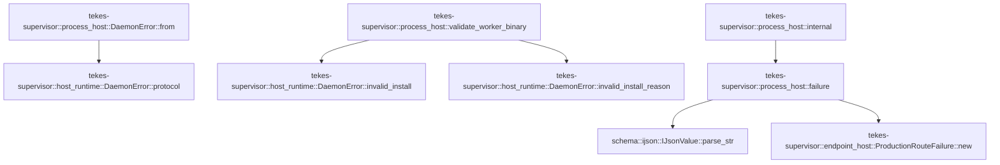

```mermaid
flowchart TD
  n0["endpoint::service::NativeEndpoint::open"]
  n1["endpoint::types::validate_session_id"]
  n2["engine::admission::AdmissionPool::new"]
  n3["profile::config::ConfigRepository::open"]
  n4["profile::instruction::InstructionResolver::new_scoped"]
  n5["provider::secret_store::MemorySecretStore::new"]
  n6["schedule::ScheduleAuthority::open"]
  n7["store::folder::ThreadStore::open"]
  n8["store::folder_events::subscribe"]
  n9["store::folder_events::canonical_root"]
  n10["tekes-supervisor::catalog::Catalog::new"]
  n11["tekes-supervisor::dynamic_bindings::resolve_worker_launch_bindings"]
  n12["tekes-supervisor::host_runtime::DaemonError::invalid_config"]
  n13["tekes-supervisor::host_runtime::DaemonError::corrupt"]
  n14["tekes-supervisor::host_runtime::DaemonError::required_broker"]
  n15["tekes-supervisor::mcp_runtime::McpRuntime::open_production_authorities_with_mutation"]
  n16["tekes-supervisor::process_host::ProductionProcessHost::workspace_policy_published"]
  n17["tekes-supervisor::process_host::ProductionProcessHost::workspace_policy_recovered"]
  n18["tekes-supervisor::process_host::ProductionProcessHost::plugin_store"]
  n19["tekes-supervisor::process_host::ProductionProcessHost::client_file_changes"]
  n20["tekes-supervisor::process_host::ProductionProcessHost::client_file_page"]
  n21["tekes-supervisor::process_host::ProductionProcessHost::user_agent_dir"]
  n22["tekes-supervisor::process_host::ProductionProcessHost::client_session_roots"]
  n23["tekes-supervisor::process_host::mcp_failure_is_required"]
  n24["tekes-supervisor::process_host::required_mcp_failure_reason"]
  n25["tekes-supervisor::process_host::PolicyCandidateError::new"]
  n26["tekes-supervisor::process_host::terminate_worker"]
  n27["tekes-supervisor::process_host::WorkerHandshakeGuard::child_mut"]
  n28["tekes-supervisor::process_host::WorkerHandshakeGuard::take_credential_broker"]
  n29["tekes-supervisor::process_host::WorkerHandshakeGuard::wait_for_exit"]
  n30["tekes-supervisor::process_host::WorkerHandshakeGuard::drop"]
  n31["tekes-supervisor::process_host::reconcile_credential_bindings"]
  n32["tekes-supervisor::process_host::scoped_client_file_path"]
  n33["tekes-supervisor::process_host::session_workspace_binding"]
  n34["tekes-supervisor::process_host::validate_worker_binary"]
  n35["tekes-supervisor::process_host::credential_control"]
  n36["tekes-supervisor::process_host::active_material"]
  n37["tekes-supervisor::process_host::retain_prior_for_unknown_credentials"]
  n38["tekes-supervisor::process_host::ProductionProcessHost::open"]
  n39["tekes-supervisor::process_host::ProductionProcessHost::open_with_secret_store"]
  n40["tekes-supervisor::process_host::ProductionProcessHost::open_with_secret_authorities"]
  n41["tekes-supervisor::process_host::ProductionProcessHost::mcp_runtime"]
  n42["tekes-supervisor::process_host::ProductionProcessHost::credential_is_ready"]
  n43["tekes-supervisor::process_host::ProductionProcessHost::validate_workspace_policy_candidate"]
  n44["tekes-supervisor::thread_card::CardWriter::spawn_from_env"]
  n45["tools::builtin::BuiltinManifest::compiled"]
  n46["workspace-service::file_text_page"]
  n47["workspace-service::file_byte_page"]
  n16 --> n12
  n16 --> n26
  n17 --> n26
  n19 --> n1
  n19 --> n12
  n19 --> n33
  n20 --> n1
  n20 --> n12
  n20 --> n32
  n20 --> n33
  n20 --> n46
  n20 --> n47
  n22 --> n1
  n22 --> n12
  n22 --> n33
  n29 --> n27
  n31 --> n14
  n31 --> n35
  n31 --> n36
  n35 --> n14
  n38 --> n5
  n38 --> n39
  n39 --> n40
  n40 --> n0
  n40 --> n2
  n40 --> n3
  n40 --> n6
  n40 --> n7
  n40 --> n8
  n40 --> n9
  n40 --> n10
  n40 --> n12
  n40 --> n13
  n40 --> n14
  n40 --> n15
  n40 --> n34
  n40 --> n44
  n43 --> n4
  n43 --> n11
  n43 --> n23
  n43 --> n24
  n43 --> n25
  n43 --> n45
```

```mermaid
flowchart TD
  n0["endpoint::management::ManagementStore::open_light_at"]
  n1["engine::lifecycle::classify"]
  n2["profile::instruction::InstructionResolver::new_scoped"]
  n3["profile::resources::ResourceCatalog::from_snapshot"]
  n4["store::folder::ThreadStore::open"]
  n5["store::folder_events::is_admitted"]
  n6["store::tail::scan_valid_prefix"]
  n7["tekes-supervisor::boot_trace::phase"]
  n8["tekes-supervisor::dynamic_bindings::resolve_worker_launch_bindings"]
  n9["tekes-supervisor::host_runtime::DaemonError::protocol"]
  n10["tekes-supervisor::host_runtime::DaemonError::invalid_config"]
  n11["tekes-supervisor::host_runtime::DaemonError::corrupt"]
  n12["tekes-supervisor::host_runtime::DaemonError::required_broker"]
  n13["tekes-supervisor::process_host::ProductionProcessHost::client_resource_catalog"]
  n14["tekes-supervisor::process_host::ProductionProcessHost::client_tool_catalog"]
  n15["tekes-supervisor::process_host::ProductionProcessHost::schedule_authority"]
  n16["tekes-supervisor::process_host::ProductionProcessHost::start_schedule_timer"]
  n17["tekes-supervisor::process_host::ProductionProcessHost::schedule_failure"]
  n18["tekes-supervisor::process_host::ProductionProcessHost::schedule_has_work"]
  n19["tekes-supervisor::process_host::ProductionProcessHost::drive_schedule"]
  n20["tekes-supervisor::process_host::ProductionProcessHost::execute_schedule_claim"]
  n21["tekes-supervisor::process_host::ProductionProcessHost::reconcile_schedule_statuses"]
  n22["tekes-supervisor::process_host::ProductionProcessHost::run_post_ready"]
  n23["tekes-supervisor::process_host::ProductionProcessHost::post_ready_tasks"]
  n24["tekes-supervisor::process_host::ProductionProcessHost::cleanup_stale_ephemeral"]
  n25["tekes-supervisor::process_host::ProductionProcessHost::live_sessions_for_cleanup"]
  n26["tekes-supervisor::process_host::ProductionProcessHost::run_upgrade_pass"]
  n27["tekes-supervisor::process_host::ProductionProcessHost::is_stale_ephemeral"]
  n28["tekes-supervisor::process_host::ProductionProcessHost::on_folder_event"]
  n29["tekes-supervisor::process_host::ProductionProcessHost::attach_streams"]
  n30["tekes-supervisor::process_host::ProductionProcessHost::reconcile_child_line"]
  n31["tekes-supervisor::process_host::ProductionProcessHost::publish_session_status"]
  n32["tekes-supervisor::process_host::ProductionProcessHost::start_periodic_sweep"]
  n33["tekes-supervisor::process_host::ProductionProcessHost::hydrate"]
  n34["tekes-supervisor::process_host::ProductionProcessHost::recently_failed"]
  n35["tekes-supervisor::process_host::ProductionProcessHost::live_worker"]
  n36["tekes-supervisor::process_host::mcp_failure_is_required"]
  n37["tekes-supervisor::process_host::session_workspace_binding"]
  n38["tekes-supervisor::process_host::probe_line_lock"]
  n13 --> n2
  n13 --> n3
  n13 --> n10
  n13 --> n37
  n14 --> n2
  n14 --> n8
  n14 --> n10
  n14 --> n12
  n14 --> n36
  n14 --> n37
  n16 --> n18
  n16 --> n19
  n18 --> n11
  n19 --> n11
  n19 --> n20
  n19 --> n21
  n20 --> n0
  n20 --> n9
  n20 --> n11
  n21 --> n1
  n21 --> n6
  n21 --> n11
  n21 --> n35
  n21 --> n38
  n23 --> n7
  n23 --> n16
  n23 --> n24
  n23 --> n26
  n24 --> n4
  n24 --> n5
  n24 --> n25
  n26 --> n33
  n26 --> n34
  n27 --> n5
```

```mermaid
flowchart TD
  n0["engine::lifecycle::ensure_action_at"]
  n1["engine::lifecycle::classify"]
  n2["provider::secret_store::resolve_config_credentials"]
  n3["store::card::remove_stale_card_temps"]
  n4["store::folder_events::arm_admission"]
  n5["store::folder_events::is_admitted"]
  n6["store::folder_events::admitted_ids"]
  n7["store::tail::scan_valid_prefix"]
  n8["store::tail::repair_thread_tails"]
  n9["tekes-supervisor::boot_trace::detail"]
  n10["tekes-supervisor::boot_trace::per_item_enabled"]
  n11["tekes-supervisor::endpoint_host::recover_pending_management"]
  n12["tekes-supervisor::host_runtime::DaemonError::protocol"]
  n13["tekes-supervisor::host_runtime::DaemonError::invalid_config"]
  n14["tekes-supervisor::host_runtime::DaemonError::corrupt"]
  n15["tekes-supervisor::host_runtime::DaemonError::required_broker"]
  n16["tekes-supervisor::process_host::now_rfc3339"]
  n17["tekes-supervisor::process_host::ProductionProcessHost::recover_pending_management"]
  n18["tekes-supervisor::process_host::ProductionProcessHost::refresh_live_credentials"]
  n19["tekes-supervisor::process_host::ProductionProcessHost::config_mutation_succeeded"]
  n20["tekes-supervisor::process_host::ProductionProcessHost::refresh_worker_credentials"]
  n21["tekes-supervisor::process_host::ProductionProcessHost::boot_sweep"]
  n22["tekes-supervisor::process_host::ProductionProcessHost::arm_admission"]
  n23["tekes-supervisor::process_host::ProductionProcessHost::recover_client_sessions"]
  n24["tekes-supervisor::process_host::ProductionProcessHost::ensure_verified"]
  n25["tekes-supervisor::process_host::ProductionProcessHost::hydrate"]
  n26["tekes-supervisor::process_host::ProductionProcessHost::hydrate_with"]
  n27["tekes-supervisor::process_host::ProductionProcessHost::recently_failed"]
  n28["tekes-supervisor::process_host::ProductionProcessHost::hydrate_unrecorded"]
  n29["tekes-supervisor::process_host::ProductionProcessHost::repair_main_projection"]
  n30["tekes-supervisor::process_host::ProductionProcessHost::periodic_sweep_once"]
  n31["tekes-supervisor::process_host::ProductionProcessHost::is_draining"]
  n32["tekes-supervisor::process_host::ProductionProcessHost::sweep_ledger_scan"]
  n33["tekes-supervisor::process_host::ProductionProcessHost::sweep_once"]
  n34["tekes-supervisor::process_host::ProductionProcessHost::sweep_ids"]
  n35["tekes-supervisor::process_host::ProductionProcessHost::is_deferred"]
  n36["tekes-supervisor::process_host::ProductionProcessHost::sweep_session"]
  n37["tekes-supervisor::process_host::ProductionProcessHost::propagate_durable_stops_before_sweep"]
  n38["tekes-supervisor::process_host::ProductionProcessHost::refresh_limits"]
  n39["tekes-supervisor::process_host::ProductionProcessHost::schedule_worker_at"]
  n40["tekes-supervisor::process_host::ProductionProcessHost::publish_appended"]
  n41["tekes-supervisor::process_host::ProductionProcessHost::publish_appended_with"]
  n42["tekes-supervisor::process_host::ProductionProcessHost::restart_is_due"]
  n43["tekes-supervisor::process_host::ProductionProcessHost::note_restart_failure"]
  n44["tekes-supervisor::process_host::web_search_scope_ready"]
  n45["tekes-supervisor::process_host::terminate_worker"]
  n46["tekes-supervisor::process_host::damage_under_lock"]
  n47["tekes-supervisor::process_host::child_ledger_damage"]
  n48["tekes-supervisor::process_host::reconcile_credential_bindings"]
  n49["tekes-supervisor::process_host::goal_continuation_due"]
  n50["tekes-supervisor::process_host::probe_line_lock"]
  n51["tekes-supervisor::process_host::retain_prior_for_unknown_credentials"]
  n52["tekes-supervisor::process_host::SweepLedgerIdentity::of"]
  n53["tekes-supervisor::thread_card::fold_child_views"]
  n17 --> n11
  n18 --> n20
  n19 --> n18
  n20 --> n2
  n20 --> n15
  n20 --> n44
  n20 --> n45
  n20 --> n48
  n20 --> n51
  n21 --> n33
  n22 --> n4
  n23 --> n13
  n23 --> n24
  n23 --> n36
  n24 --> n13
  n24 --> n14
  n24 --> n25
  n25 --> n26
  n26 --> n28
  n28 --> n3
  n28 --> n8
  n28 --> n14
  n28 --> n41
  n28 --> n46
  n28 --> n47
  n28 --> n53
  n29 --> n40
  n30 --> n33
  n32 --> n7
  n32 --> n12
  n32 --> n14
  n32 --> n52
  n33 --> n9
  n33 --> n10
  n33 --> n34
  n33 --> n36
  n34 --> n6
  n35 --> n5
  n36 --> n0
  n36 --> n1
  n36 --> n16
  n36 --> n29
  n36 --> n32
  n36 --> n35
  n36 --> n37
  n36 --> n38
  n36 --> n39
  n36 --> n42
  n36 --> n43
  n36 --> n49
  n36 --> n50
```

```mermaid
flowchart TD
  n0["session-controls::bound_goal_id"]
  n1["store::platform::NamedLock::shared"]
  n2["tekes-supervisor::dynamic_bindings::resolve_worker_launch_bindings"]
  n3["tekes-supervisor::host_runtime::system_timestamp"]
  n4["tekes-supervisor::host_runtime::DaemonError::protocol"]
  n5["tekes-supervisor::host_runtime::DaemonError::io"]
  n6["tekes-supervisor::host_runtime::DaemonError::invalid_config"]
  n7["tekes-supervisor::host_runtime::DaemonError::required_broker"]
  n8["tekes-supervisor::launch_profiled_worker_with_secret_store_and_binding_resolver"]
  n9["tekes-supervisor::process_host::production_sandbox_backend"]
  n10["tekes-supervisor::process_host::ProductionProcessHost::live_sessions_for_cleanup"]
  n11["tekes-supervisor::process_host::ProductionProcessHost::publish_session_status"]
  n12["tekes-supervisor::process_host::ProductionProcessHost::refresh_worker_credentials"]
  n13["tekes-supervisor::process_host::ProductionProcessHost::ensure_verified"]
  n14["tekes-supervisor::process_host::ProductionProcessHost::sweep_ledger_scan"]
  n15["tekes-supervisor::process_host::ProductionProcessHost::propagate_durable_stops_before_sweep"]
  n16["tekes-supervisor::process_host::ProductionProcessHost::shutdown"]
  n17["tekes-supervisor::process_host::ProductionProcessHost::shutdown_with"]
  n18["tekes-supervisor::process_host::ProductionProcessHost::ensure_running"]
  n19["tekes-supervisor::process_host::ProductionProcessHost::live_worker"]
  n20["tekes-supervisor::process_host::ProductionProcessHost::spawn_worker_at"]
  n21["tekes-supervisor::process_host::ProductionProcessHost::spawn_worker_at_with_handshake_timeout"]
  n22["tekes-supervisor::process_host::ProductionProcessHost::workspace_service_binary"]
  n23["tekes-supervisor::process_host::ProductionProcessHost::worker_binary_digest"]
  n24["tekes-supervisor::process_host::ProductionProcessHost::refresh_limits"]
  n25["tekes-supervisor::process_host::ProductionProcessHost::preflight_mandatory_authorities"]
  n26["tekes-supervisor::process_host::ProductionProcessHost::is_mcp_only_app_sandbox_host"]
  n27["tekes-supervisor::process_host::ProductionProcessHost::freeze_tool_authority"]
  n28["tekes-supervisor::process_host::ProductionProcessHost::schedule_main"]
  n29["tekes-supervisor::process_host::ProductionProcessHost::schedule_line"]
  n30["tekes-supervisor::process_host::ProductionProcessHost::schedule_worker_at"]
  n31["tekes-supervisor::process_host::ProductionProcessHost::schedule_worker_at_with_startup"]
  n32["tekes-supervisor::process_host::ProductionProcessHost::schedule_child_from_parent"]
  n33["tekes-supervisor::process_host::ProductionProcessHost::wait_for_worker"]
  n34["tekes-supervisor::process_host::ProductionProcessHost::start_pending_workers"]
  n35["tekes-supervisor::process_host::ProductionProcessHost::has_worker_capacity"]
  n36["tekes-supervisor::process_host::ProductionProcessHost::cascade_stop_from"]
  n37["tekes-supervisor::process_host::ProductionProcessHost::reset_restart_backoff"]
  n38["tekes-supervisor::process_host::ProductionProcessHost::record_session_notice"]
  n39["tekes-supervisor::process_host::genesis_preset_skills"]
  n40["tekes-supervisor::process_host::missing_preset_skill_notice"]
  n41["tekes-supervisor::process_host::mcp_launch_notices"]
  n42["tekes-supervisor::process_host::frozen_tool_launch_policy"]
  n43["tekes-supervisor::process_host::validator_tool_launch_policy"]
  n44["tekes-supervisor::process_host::mcp_failure_is_required"]
  n45["tekes-supervisor::process_host::child_dependency_admitted"]
  n46["tekes-supervisor::process_host::worker_reader"]
  n47["tekes-supervisor::process_host::worker_stderr_reader"]
  n48["tekes-supervisor::process_host::unresolved_parent_dependency"]
  n49["tekes-supervisor::process_host::line_schedule_target"]
  n50["tekes-supervisor::process_host::workspace_quiescence_lock_path"]
  n51["tekes-supervisor::process_host::workspace_id"]
  n52["tekes-supervisor::process_host::session_workspace_binding"]
  n53["tekes-supervisor::process_host::ledger_needs_worker"]
  n54["tekes-supervisor::process_host::read_worker_hello"]
  n55["tools::runtime_backends::HelperJobLauncher::new"]
  n56["tools::runtime_backends::HelperJobLauncher::disabled"]
  n57["tools::sandbox::probe_backend"]
  n58["worker-control::durable::encode_queue_transaction"]
  n59["worker-control::negotiate"]
  n60["worker-control::encode_line"]
  n15 --> n14
  n15 --> n36
  n16 --> n17
  n17 --> n10
  n18 --> n24
  n18 --> n30
  n18 --> n33
  n18 --> n37
  n20 --> n21
  n21 --> n0
  n21 --> n1
  n21 --> n2
  n21 --> n3
  n21 --> n4
  n21 --> n6
  n21 --> n7
  n21 --> n8
  n21 --> n23
  n21 --> n27
  n21 --> n38
  n21 --> n39
  n21 --> n40
  n21 --> n41
  n21 --> n43
  n21 --> n44
  n21 --> n46
  n21 --> n47
  n21 --> n50
  n21 --> n52
  n21 --> n54
  n21 --> n58
  n21 --> n59
  n21 --> n60
  n24 --> n6
  n24 --> n51
  n25 --> n7
  n25 --> n9
  n25 --> n26
  n25 --> n55
  n25 --> n56
  n25 --> n57
  n26 --> n5
  n26 --> n7
  n27 --> n7
  n27 --> n9
  n27 --> n26
  n27 --> n42
  n27 --> n55
  n27 --> n56
  n27 --> n57
  n28 --> n30
  n29 --> n30
  n29 --> n32
  n29 --> n48
  n29 --> n49
  n30 --> n31
  n31 --> n4
  n31 --> n11
  n31 --> n12
  n31 --> n13
  n31 --> n19
  n31 --> n20
  n31 --> n24
  n31 --> n35
  n32 --> n11
  n32 --> n12
  n32 --> n20
  n32 --> n24
  n32 --> n35
  n32 --> n45
  n33 --> n7
  n34 --> n11
  n34 --> n20
  n34 --> n35
  n34 --> n53
```

```mermaid
flowchart TD
  n0["endpoint::journal::EndpointJournal::open"]
  n1["engine::compaction_summary::admit_summary_artifact"]
  n2["engine::compaction_summary::summary_request_bytes"]
  n3["engine::compaction_summary::CompactionSummary::from_outcome"]
  n4["engine::compaction_summary::freeze_source_bundle"]
  n5["engine::context::plan_context_compaction"]
  n6["provider::compaction_summary::prepare_summary_request"]
  n7["provider::compaction_summary::summary_completion_artifact"]
  n8["provider::http::HttpRuntime::new"]
  n9["schema::event::Event::from_value"]
  n10["schema::ijson::IJsonValue::parse"]
  n11["store::tail::scan_valid_prefix"]
  n12["store::tail::read_genesis"]
  n13["tekes-supervisor::host_runtime::DaemonError::protocol"]
  n14["tekes-supervisor::host_runtime::DaemonError::corrupt"]
  n15["tekes-supervisor::host_runtime::DaemonError::required_broker"]
  n16["tekes-supervisor::process_host::spill_compaction_summary"]
  n17["tekes-supervisor::process_host::deterministic_automatic_thread_title"]
  n18["tekes-supervisor::process_host::normalized_automatic_thread_title"]
  n19["tekes-supervisor::process_host::prompt_text"]
  n20["tekes-supervisor::process_host::automatic_title_origin"]
  n21["tekes-supervisor::process_host::automatic_title_route"]
  n22["tekes-supervisor::process_host::ProductionProcessHost::schedule_main"]
  n23["tekes-supervisor::process_host::session_model_route"]
  n24["tekes-supervisor::process_host::ProductionProcessHost::has_worker_capacity"]
  n25["tekes-supervisor::process_host::ProductionProcessHost::request_provider_lease"]
  n26["tekes-supervisor::process_host::ProductionProcessHost::locked_prompt"]
  n27["tekes-supervisor::process_host::ProductionProcessHost::locked_compact"]
  n28["tekes-supervisor::process_host::ProductionProcessHost::first_root_input"]
  n29["tekes-supervisor::process_host::ProductionProcessHost::seed_automatic_title"]
  n30["tekes-supervisor::process_host::ProductionProcessHost::try_seed_automatic_title"]
  n31["tekes-supervisor::process_host::ProductionProcessHost::wait_and_seed_automatic_title"]
  n32["tekes-supervisor::process_host::ProductionProcessHost::spawn_automatic_title_refinement"]
  n33["tekes-supervisor::process_host::ProductionProcessHost::spawn_automatic_title_seed_and_refinement"]
  n34["tekes-supervisor::process_host::ProductionProcessHost::refine_automatic_title"]
  n35["tekes-supervisor::process_host::prepare_automatic_title_request"]
  n36["tekes-supervisor::process_host::ProductionProcessHost::complete_automatic_text"]
  n37["tekes-supervisor::process_host::ProductionProcessHost::complete_automatic_terminal"]
  n38["tekes-supervisor::process_host::ProductionProcessHost::summary_for_manual_compaction"]
  n39["tekes-supervisor::process_host::ProductionProcessHost::generate_automatic_title"]
  n40["tekes-supervisor::process_host::ProductionProcessHost::handle_tool_control"]
  n41["tekes-supervisor::process_host::ProductionProcessHost::handle_tool_continuation"]
  n42["tekes-supervisor::process_host::ProductionProcessHost::validate_child_proof"]
  n43["tekes-supervisor::process_host::ProductionProcessHost::publish_appended"]
  n44["tekes-supervisor::process_host::ProductionProcessHost::publish_appended_with"]
  n45["tekes-supervisor::process_host::ProductionProcessHost::reset_restart_backoff"]
  n46["tekes-supervisor::process_host::ProductionProcessHost::record_spawn_failure"]
  n47["tekes-supervisor::process_host::ledger_damage"]
  n48["tekes-supervisor::process_host::damage_under_lock"]
  n49["tekes-supervisor::process_host::internal"]
  n50["tekes-supervisor::production_tool_control::JobBrokerSupervisorAuthority::new"]
  n51["tekes-supervisor::production_tool_control::ProductionToolControlHandler::new"]
  n52["tekes-supervisor::production_tool_control::ProductionToolControlPolicy::new"]
  n53["tekes-supervisor::thread_card::journal_input"]
  n54["tekes-supervisor::thread_card::prepare"]
  n55["tekes-supervisor::tool_control::ToolControlSession::new"]
  n56["tools::schema_registry::fixed_schema"]
  n57["worker-control::continuation::decode_tool_continuation"]
  n58["worker-control::continuation::encode_tool_continuation_result"]
  n26 --> n10
  n26 --> n19
  n26 --> n22
  n26 --> n28
  n26 --> n29
  n26 --> n32
  n26 --> n45
  n26 --> n46
  n27 --> n5
  n27 --> n9
  n27 --> n10
  n27 --> n16
  n27 --> n38
  n27 --> n43
  n27 --> n49
  n28 --> n11
  n29 --> n30
  n30 --> n17
  n30 --> n20
  n30 --> n43
  n31 --> n30
  n34 --> n20
  n34 --> n39
  n34 --> n43
  n36 --> n37
  n37 --> n8
  n38 --> n1
  n38 --> n2
  n38 --> n3
  n38 --> n4
  n38 --> n5
  n38 --> n6
  n38 --> n7
  n38 --> n10
  n38 --> n11
  n38 --> n23
  n38 --> n37
  n38 --> n56
  n39 --> n18
  n39 --> n21
  n39 --> n35
  n39 --> n36
  n40 --> n13
  n40 --> n15
  n40 --> n50
  n40 --> n51
  n40 --> n52
  n40 --> n55
  n41 --> n13
  n41 --> n15
  n41 --> n50
  n41 --> n51
  n41 --> n52
  n41 --> n57
  n41 --> n58
  n42 --> n12
  n42 --> n14
  n43 --> n44
  n44 --> n0
  n44 --> n11
  n44 --> n14
  n44 --> n47
  n44 --> n48
  n44 --> n53
  n44 --> n54
```

```mermaid
flowchart TD
  n0["endpoint::journal::EndpointJournal::open"]
  n1["engine::lifecycle::ensure_action_at"]
  n2["engine::lifecycle::classify"]
  n3["mcp::projection::project_name"]
  n4["profile::resources::ResourceCatalog::skill_package_names"]
  n5["provider::request::endpoint_origin"]
  n6["schema::event::Event::from_value"]
  n7["schema::ijson::IJsonValue::parse"]
  n8["store::tail::LockedLedger::open"]
  n9["store::tail::scan_valid_prefix"]
  n10["store::tail::read_genesis"]
  n11["tekes-supervisor::host_runtime::system_timestamp"]
  n12["tekes-supervisor::host_runtime::DaemonError::protocol"]
  n13["tekes-supervisor::host_runtime::DaemonError::invalid_config"]
  n14["tekes-supervisor::host_runtime::DaemonError::corrupt"]
  n15["tekes-supervisor::host_runtime::DaemonError::required_broker"]
  n16["tekes-supervisor::process_host::now_rfc3339"]
  n17["tekes-supervisor::process_host::session_event_time_now"]
  n18["tekes-supervisor::process_host::ProductionProcessHost::refresh_limits"]
  n19["tekes-supervisor::process_host::ProductionProcessHost::schedule_worker_at"]
  n20["tekes-supervisor::process_host::ProductionProcessHost::schedule_child_from_parent"]
  n21["tekes-supervisor::process_host::ProductionProcessHost::publish_appended"]
  n22["tekes-supervisor::process_host::ProductionProcessHost::publish_frame"]
  n23["tekes-supervisor::process_host::ProductionProcessHost::launch_child"]
  n24["tekes-supervisor::process_host::ProductionProcessHost::propagate_parent_stop"]
  n25["tekes-supervisor::process_host::ProductionProcessHost::cascade_stop_from"]
  n26["tekes-supervisor::process_host::ProductionProcessHost::reconcile_after_exit"]
  n27["tekes-supervisor::process_host::ProductionProcessHost::reset_restart_backoff"]
  n28["tekes-supervisor::process_host::ProductionProcessHost::restart_is_due"]
  n29["tekes-supervisor::process_host::ProductionProcessHost::note_restart_failure"]
  n30["tekes-supervisor::process_host::ProductionProcessHost::record_spawn_failure"]
  n31["tekes-supervisor::process_host::ProductionProcessHost::record_session_notice"]
  n32["tekes-supervisor::process_host::genesis_preset_skills"]
  n33["tekes-supervisor::process_host::missing_preset_skill_notice"]
  n34["tekes-supervisor::process_host::mcp_launch_notices"]
  n35["tekes-supervisor::process_host::frozen_tool_launch_policy"]
  n36["tekes-supervisor::process_host::validator_tool_launch_policy"]
  n37["tekes-supervisor::process_host::private_validator_launch_policy"]
  n38["tekes-supervisor::process_host::web_search_scope_ready"]
  n39["tekes-supervisor::process_host::mcp_failure_is_required"]
  n40["tekes-supervisor::process_host::required_mcp_failure_reason"]
  n41["tekes-supervisor::process_host::bounded_name_list"]
  n42["tekes-supervisor::process_host::terminate_worker"]
  n43["tekes-supervisor::process_host::line_schedule_target"]
  n44["tekes-supervisor::process_host::goal_continuation_due"]
  n45["tekes-supervisor::process_host::probe_line_lock"]
  n46["tools::preset::ResolvedPreset::from_genesis"]
  n47["tools::runtime_backends::JobLaunchPolicy::new"]
  n48["tools::sandbox::kernel_protected_roots"]
  n49["tools::sandbox::exposed_protected_roots"]
  n50["worker-control::encode_line"]
  n22 --> n0
  n22 --> n9
  n22 --> n14
  n22 --> n17
  n23 --> n1
  n23 --> n2
  n23 --> n9
  n23 --> n12
  n23 --> n14
  n23 --> n16
  n23 --> n20
  n23 --> n24
  n23 --> n45
  n24 --> n6
  n24 --> n7
  n24 --> n8
  n24 --> n9
  n24 --> n12
  n24 --> n14
  n24 --> n50
  n25 --> n9
  n25 --> n14
  n25 --> n20
  n25 --> n24
  n25 --> n25
  n25 --> n42
  n25 --> n43
  n26 --> n1
  n26 --> n2
  n26 --> n9
  n26 --> n14
  n26 --> n16
  n26 --> n18
  n26 --> n19
  n26 --> n21
  n26 --> n27
  n26 --> n28
  n26 --> n29
  n26 --> n44
  n26 --> n45
  n30 --> n31
  n31 --> n11
  n31 --> n21
  n32 --> n10
  n32 --> n46
  n33 --> n4
  n35 --> n13
  n35 --> n15
  n35 --> n47
  n35 --> n48
  n35 --> n49
  n36 --> n9
  n36 --> n12
  n36 --> n14
  n36 --> n15
  n36 --> n37
  n37 --> n15
  n37 --> n47
  n38 --> n5
  n39 --> n3
  n40 --> n39
```

```mermaid
flowchart TD
  n0["endpoint::service::genesis_preset_summary"]
  n1["endpoint::service::permission_mode_of"]
  n2["endpoint::service::last_record_updated_ms"]
  n3["endpoint::types::validate_session_id"]
  n4["provider::dialect::validate_provider"]
  n5["provider::dialect::resolve_profile"]
  n6["provider::request::endpoint_origin"]
  n7["provider::secret_store::resolve_config_credentials"]
  n8["store::card::valid_line_name"]
  n9["store::folder_events::admitted_ids"]
  n10["store::tail::scan_valid_prefix"]
  n11["store::tail::read_genesis"]
  n12["tekes-supervisor::process_host::ProductionProcessHost::is_stale_ephemeral"]
  n13["tekes-supervisor::process_host::ProductionProcessHost::ensure_verified"]
  n14["tekes-supervisor::process_host::ProductionProcessHost::recently_failed"]
  n15["tekes-supervisor::process_host::child_exited_within"]
  n16["tekes-supervisor::process_host::neutral_lifecycle"]
  n17["tekes-supervisor::process_host::ledger_damage"]
  n18["tekes-supervisor::process_host::damage_under_lock"]
  n19["tekes-supervisor::process_host::child_ledger_damage"]
  n20["tekes-supervisor::process_host::is_single_line_ledger"]
  n21["tekes-supervisor::process_host::ProductionProcessHost::list_wait"]
  n22["tekes-supervisor::process_host::ProductionProcessHost::is_running"]
  n23["tekes-supervisor::process_host::ProductionProcessHost::catalog_item"]
  n24["tekes-supervisor::process_host::ProductionProcessHost::verify_within"]
  n25["tekes-supervisor::process_host::ProductionProcessHost::build_inventory"]
  n26["tekes-supervisor::process_host::ProductionProcessHost::inventory_items"]
  n27["tekes-supervisor::process_host::ProductionProcessHost::ensure_verified"]
  n28["tekes-supervisor::process_host::ProductionProcessHost::has_catalog"]
  n29["tekes-supervisor::process_host::ProductionProcessHost::hold_catalog"]
  n30["tekes-supervisor::process_host::ProductionProcessHost::inventory_item"]
  n31["tekes-supervisor::process_host::ProductionProcessHost::live_sessions"]
  n32["tekes-supervisor::process_host::ProductionProcessHost::reconcile_projection"]
  n33["tekes-supervisor::process_host::ProductionProcessHost::execute"]
  n34["tekes-supervisor::process_host::ProductionProcessHost::readiness"]
  n35["worker-control::durable::encode_queue_transaction"]
  n17 --> n10
  n18 --> n17
  n19 --> n8
  n19 --> n17
  n19 --> n18
  n23 --> n0
  n23 --> n1
  n23 --> n2
  n23 --> n11
  n23 --> n12
  n23 --> n16
  n23 --> n20
  n23 --> n22
  n25 --> n3
  n25 --> n9
  n25 --> n14
  n25 --> n16
  n25 --> n23
  n25 --> n24
  n27 --> n13
  n33 --> n35
  n34 --> n4
  n34 --> n5
  n34 --> n6
  n34 --> n7
```

```mermaid
flowchart TD
  n0["engine::lifecycle::ensure_action_at"]
  n1["engine::lifecycle::classify"]
  n2["schema::ijson::IJsonValue::parse"]
  n3["session-controls::read_goal"]
  n4["store::tail::scan_valid_prefix"]
  n5["store::tail::read_genesis"]
  n6["tekes-supervisor::host_runtime::system_timestamp"]
  n7["tekes-supervisor::host_runtime::DaemonError::protocol"]
  n8["tekes-supervisor::host_runtime::DaemonError::io"]
  n9["tekes-supervisor::host_runtime::DaemonError::invalid_config"]
  n10["tekes-supervisor::host_runtime::DaemonError::corrupt"]
  n11["tekes-supervisor::process_host::now_rfc3339"]
  n12["tekes-supervisor::process_host::ProductionProcessHost::config_mutation_succeeded"]
  n13["tekes-supervisor::process_host::ProcessToolRuntime::host"]
  n14["tekes-supervisor::process_host::ProcessToolRuntime::ensure_running"]
  n15["tekes-supervisor::process_host::ProcessToolRuntime::deliver_input"]
  n16["tekes-supervisor::process_host::ProcessToolRuntime::interrupt"]
  n17["tekes-supervisor::process_host::ProcessToolRuntime::ensure_child"]
  n18["tekes-supervisor::process_host::ProcessToolRuntime::deliver_report"]
  n19["tekes-supervisor::process_host::unresolved_parent_dependency"]
  n20["tekes-supervisor::process_host::line_schedule_target"]
  n21["tekes-supervisor::process_host::operation_unavailable"]
  n22["tekes-supervisor::process_host::operation_value"]
  n23["tekes-supervisor::process_host::workspace_quiescence_lock_path"]
  n24["tekes-supervisor::process_host::workspace_id"]
  n25["tekes-supervisor::process_host::scoped_client_file_path"]
  n26["tekes-supervisor::process_host::session_workspace_binding"]
  n27["tekes-supervisor::process_host::ledger_needs_worker"]
  n28["tekes-supervisor::process_host::goal_continuation_due"]
  n29["tekes-supervisor::process_host::probe_line_lock"]
  n30["tekes-supervisor::process_host::read_worker_hello"]
  n31["tekes-supervisor::process_host::next_stop_generation"]
  n32["tekes-supervisor::process_host::internal"]
  n33["worker-control::decode_hello"]
  n14 --> n22
  n15 --> n6
  n15 --> n22
  n16 --> n6
  n16 --> n22
  n17 --> n22
  n18 --> n22
  n19 --> n4
  n19 --> n10
  n19 --> n20
  n20 --> n10
  n22 --> n2
  n24 --> n26
  n25 --> n9
  n26 --> n5
  n26 --> n10
  n27 --> n0
  n27 --> n1
  n27 --> n4
  n27 --> n10
  n27 --> n11
  n27 --> n28
  n27 --> n29
  n28 --> n3
  n28 --> n4
  n28 --> n9
  n28 --> n10
  n29 --> n8
  n29 --> n10
  n30 --> n7
  n30 --> n8
  n30 --> n33
  n31 --> n4
  n31 --> n32
```

# tekes-supervisor::process_host

[Package atlas](index.md) · [Source](../../src/process_host.rs)

## Declarations

Visibility is the declaration spelling; trait members and reexports require their enclosing interface. `cfg` is not evaluated.

| Symbol | Kind | Visibility | Test / cfg |
|---|---|---|---|
| [tekes-supervisor::process_host::DELIVERY_TIMEOUT](../../src/process_host.rs#L62) | const_item | `private` |  |
| [tekes-supervisor::process_host::MCP_ONLY_APP_SANDBOX_MARKER](../../src/process_host.rs#L63) | const_item | `private` |  |
| [tekes-supervisor::process_host::WORKER_HANDSHAKE_TIMEOUT](../../src/process_host.rs#L64) | const_item | `private` |  |
| [tekes-supervisor::process_host::WORKER_HELLO_MAX_BYTES](../../src/process_host.rs#L65) | const_item | `private` |  |
| [tekes-supervisor::process_host::MANAGEMENT_RECOVERY_SECONDS](../../src/process_host.rs#L67) | const_item | `private` |  |
| [tekes-supervisor::process_host::PERIODIC_SWEEP_INTERVAL](../../src/process_host.rs#L68) | const_item | `private` |  |
| [tekes-supervisor::process_host::SweepLedgerIdentity](../../src/process_host.rs#L73) | struct_item | `private` |  |
| [tekes-supervisor::process_host::SweepLedgerIdentity::of](../../src/process_host.rs#L80) | function_item | `private` |  |
| [tekes-supervisor::process_host::SweepLedgerScan](../../src/process_host.rs#L93) | struct_item | `private` |  |
| [tekes-supervisor::process_host::AUTOMATIC_THREAD_TITLE_MODEL_HINT](../../src/process_host.rs#L107) | const_item | `private` |  |
| [tekes-supervisor::process_host::AUTOMATIC_THREAD_TITLE_MAX_CHARS](../../src/process_host.rs#L108) | const_item | `private` |  |
| [tekes-supervisor::process_host::AUTOMATIC_THREAD_TITLE_TIMEOUT](../../src/process_host.rs#L109) | const_item | `private` |  |
| [tekes-supervisor::process_host::AUTOMATIC_THREAD_TITLE_MAX_OUTPUT_TOKENS](../../src/process_host.rs#L113) | const_item | `private` |  |
| [tekes-supervisor::process_host::COMPACTION_SUMMARY_TIMEOUT](../../src/process_host.rs#L114) | const_item | `private` |  |
| [tekes-supervisor::process_host::AUTOMATIC_THREAD_TITLE_SYSTEM](../../src/process_host.rs#L115) | const_item | `private` |  |
| [tekes-supervisor::process_host::LineLockState](../../src/process_host.rs#L118) | enum_item | `private` |  |
| [tekes-supervisor::process_host::production_sandbox_backend](../../src/process_host.rs#L123) | function_item | `private` |  |
| [tekes-supervisor::process_host::seq_ranges](../../src/process_host.rs#L134) | function_item | `private` |  |
| [tekes-supervisor::process_host::spill_compaction_summary](../../src/process_host.rs#L153) | function_item | `private` |  |
| [tekes-supervisor::process_host::now_rfc3339](../../src/process_host.rs#L170) | function_item | `private` |  |
| [tekes-supervisor::process_host::session_event_time_now](../../src/process_host.rs#L174) | function_item | `private` |  |
| [tekes-supervisor::process_host::session_event_time](../../src/process_host.rs#L178) | function_item | `private` |  |
| [tekes-supervisor::process_host::compact_title_source](../../src/process_host.rs#L188) | function_item | `private` |  |
| [tekes-supervisor::process_host::bounded_title](../../src/process_host.rs#L192) | function_item | `private` |  |
| [tekes-supervisor::process_host::deterministic_automatic_thread_title](../../src/process_host.rs#L199) | function_item | `private` |  |
| [tekes-supervisor::process_host::normalized_automatic_thread_title](../../src/process_host.rs#L203) | function_item | `private` |  |
| [tekes-supervisor::process_host::prompt_text](../../src/process_host.rs#L228) | function_item | `private` |  |
| [tekes-supervisor::process_host::automatic_title_origin](../../src/process_host.rs#L239) | function_item | `private` |  |
| [tekes-supervisor::process_host::automatic_title_route](../../src/process_host.rs#L249) | function_item | `private` |  |
| [tekes-supervisor::process_host::session_model_route](../../src/process_host.rs#L288) | function_item | `private` |  |
| [tekes-supervisor::process_host::prepare_automatic_title_request](../../src/process_host.rs#L336) | function_item | `private` |  |
| [tekes-supervisor::process_host::prepare_automatic_text_request](../../src/process_host.rs#L353) | function_item | `private` |  |
| [tekes-supervisor::process_host::accepted_stream_event](../../src/process_host.rs#L404) | function_item | `private` | test; #[cfg(test)] |
| [tekes-supervisor::process_host::ProcessToolRuntime](../../src/process_host.rs#L419) | struct_item | `private` |  |
| [tekes-supervisor::process_host::ProductionProcessHost](../../src/process_host.rs#L423) | struct_item | `pub` |  |
| [tekes-supervisor::process_host::SessionProjectionCache](../../src/process_host.rs#L485) | struct_item | `private` |  |
| [tekes-supervisor::process_host::WorkerHandle](../../src/process_host.rs#L491) | struct_item | `private` |  |
| [tekes-supervisor::process_host::WorkerHandshakeGuard](../../src/process_host.rs#L512) | struct_item | `private` |  |
| [tekes-supervisor::process_host::WorkerHandshakeGuard::child_mut](../../src/process_host.rs#L519) | function_item | `private` |  |
| [tekes-supervisor::process_host::WorkerHandshakeGuard::take_child](../../src/process_host.rs#L523) | function_item | `private` |  |
| [tekes-supervisor::process_host::WorkerHandshakeGuard::take_credential_control](../../src/process_host.rs#L527) | function_item | `private` |  |
| [tekes-supervisor::process_host::WorkerHandshakeGuard::take_credential_broker](../../src/process_host.rs#L531) | function_item | `private` |  |
| [tekes-supervisor::process_host::WorkerHandshakeGuard::wait_for_exit](../../src/process_host.rs#L535) | function_item | `private` |  |
| [tekes-supervisor::process_host::WorkerHandshakeGuard::drop](../../src/process_host.rs#L548) | function_item | `private` |  |
| [tekes-supervisor::process_host::PendingWorker](../../src/process_host.rs#L561) | struct_item | `private` |  |
| [tekes-supervisor::process_host::WorkerProtocolQuarantine](../../src/process_host.rs#L568) | struct_item | `private` |  |
| [tekes-supervisor::process_host::RestartBackoff](../../src/process_host.rs#L575) | struct_item | `private` |  |
| [tekes-supervisor::process_host::ScheduledWorker](../../src/process_host.rs#L582) | struct_item | `private` |  |
| [tekes-supervisor::process_host::WorkerState](../../src/process_host.rs#L588) | struct_item | `private` |  |
| [tekes-supervisor::process_host::reconcile_credential_bindings](../../src/process_host.rs#L595) | function_item | `private` |  |
| [tekes-supervisor::process_host::credential_control](../../src/process_host.rs#L699) | function_item | `private` |  |
| [tekes-supervisor::process_host::active_material](../../src/process_host.rs#L710) | function_item | `private` |  |
| [tekes-supervisor::process_host::retain_prior_for_unknown_credentials](../../src/process_host.rs#L724) | function_item | `private` |  |
| [tekes-supervisor::process_host::ProductionProcessHost::open](../../src/process_host.rs#L767) | function_item | `pub` |  |
| [tekes-supervisor::process_host::ProductionProcessHost::open_with_secret_store](../../src/process_host.rs#L782) | function_item | `pub` |  |
| [tekes-supervisor::process_host::ProductionProcessHost::open_with_secret_authorities](../../src/process_host.rs#L802) | function_item | `pub` |  |
| [tekes-supervisor::process_host::ProductionProcessHost::mcp_runtime](../../src/process_host.rs#L914) | function_item | `pub` |  |
| [tekes-supervisor::process_host::ProductionProcessHost::credential_is_ready](../../src/process_host.rs#L921) | function_item | `pub` |  |
| [tekes-supervisor::process_host::ProductionProcessHost::validate_workspace_policy_candidate](../../src/process_host.rs#L942) | function_item | `pub` |  |
| [tekes-supervisor::process_host::ProductionProcessHost::workspace_policy_published](../../src/process_host.rs#L1040) | function_item | `pub` |  |
| [tekes-supervisor::process_host::ProductionProcessHost::workspace_policy_recovered](../../src/process_host.rs#L1069) | function_item | `pub` |  |
| [tekes-supervisor::process_host::ProductionProcessHost::plugin_store](../../src/process_host.rs#L1084) | function_item | `pub(crate)` |  |
| [tekes-supervisor::process_host::ProductionProcessHost::client_file_changes](../../src/process_host.rs#L1090) | function_item | `pub(crate)` |  |
| [tekes-supervisor::process_host::ProductionProcessHost::client_file_page](../../src/process_host.rs#L1128) | function_item | `pub(crate)` |  |
| [tekes-supervisor::process_host::ProductionProcessHost::user_agent_dir](../../src/process_host.rs#L1168) | function_item | `pub` |  |
| [tekes-supervisor::process_host::ProductionProcessHost::client_session_roots](../../src/process_host.rs#L1174) | function_item | `pub` |  |
| [tekes-supervisor::process_host::ProductionProcessHost::client_resource_catalog](../../src/process_host.rs#L1206) | function_item | `pub(crate)` |  |
| [tekes-supervisor::process_host::ProductionProcessHost::client_tool_catalog](../../src/process_host.rs#L1244) | function_item | `pub(crate)` |  |
| [tekes-supervisor::process_host::ProductionProcessHost::schedule_authority](../../src/process_host.rs#L1308) | function_item | `pub` |  |
| [tekes-supervisor::process_host::ProductionProcessHost::start_schedule_timer](../../src/process_host.rs#L1315) | function_item | `pub` |  |
| [tekes-supervisor::process_host::ProductionProcessHost::schedule_failure](../../src/process_host.rs#L1412) | function_item | `pub` |  |
| [tekes-supervisor::process_host::ProductionProcessHost::schedule_has_work](../../src/process_host.rs#L1419) | function_item | `private` |  |
| [tekes-supervisor::process_host::ProductionProcessHost::drive_schedule](../../src/process_host.rs#L1430) | function_item | `private` |  |
| [tekes-supervisor::process_host::ProductionProcessHost::execute_schedule_claim](../../src/process_host.rs#L1444) | function_item | `private` |  |
| [tekes-supervisor::process_host::ProductionProcessHost::reconcile_schedule_statuses](../../src/process_host.rs#L1517) | function_item | `private` |  |
| [tekes-supervisor::process_host::ProductionProcessHost::run_post_ready](../../src/process_host.rs#L1594) | function_item | `pub` |  |
| [tekes-supervisor::process_host::ProductionProcessHost::post_ready_tasks](../../src/process_host.rs#L1608) | function_item | `private` |  |
| [tekes-supervisor::process_host::ProductionProcessHost::cleanup_stale_ephemeral](../../src/process_host.rs#L1629) | function_item | `private` |  |
| [tekes-supervisor::process_host::ProductionProcessHost::live_sessions_for_cleanup](../../src/process_host.rs#L1654) | function_item | `private` |  |
| [tekes-supervisor::process_host::ProductionProcessHost::run_upgrade_pass](../../src/process_host.rs#L1667) | function_item | `private` |  |
| [tekes-supervisor::process_host::ProductionProcessHost::release_for_test](../../src/process_host.rs#L1710) | function_item | `pub(crate)` | test; #[cfg(test)] #[cfg_attr(not(target_os = "macos"), allow(dead_code))] |
| [tekes-supervisor::process_host::ProductionProcessHost::is_stale_ephemeral](../../src/process_host.rs#L1718) | function_item | `pub(crate)` |  |
| [tekes-supervisor::process_host::ProductionProcessHost::on_folder_event](../../src/process_host.rs#L1722) | function_item | `private` |  |
| [tekes-supervisor::process_host::ProductionProcessHost::attach_streams](../../src/process_host.rs#L1761) | function_item | `pub` |  |
| [tekes-supervisor::process_host::ProductionProcessHost::reconcile_child_line](../../src/process_host.rs#L1771) | function_item | `private` |  |
| [tekes-supervisor::process_host::ProductionProcessHost::publish_session_status](../../src/process_host.rs#L1790) | function_item | `private` |  |
| [tekes-supervisor::process_host::ProductionProcessHost::start_periodic_sweep](../../src/process_host.rs#L1807) | function_item | `pub` |  |
| [tekes-supervisor::process_host::ProductionProcessHost::recover_pending_management](../../src/process_host.rs#L1858) | function_item | `private` |  |
| [tekes-supervisor::process_host::ProductionProcessHost::refresh_live_credentials](../../src/process_host.rs#L1866) | function_item | `pub` |  |
| [tekes-supervisor::process_host::ProductionProcessHost::config_mutation_succeeded](../../src/process_host.rs#L1884) | function_item | `pub` |  |
| [tekes-supervisor::process_host::ProductionProcessHost::refresh_worker_credentials](../../src/process_host.rs#L1899) | function_item | `private` |  |
| [tekes-supervisor::process_host::ProductionProcessHost::boot_sweep](../../src/process_host.rs#L1938) | function_item | `pub` |  |
| [tekes-supervisor::process_host::ProductionProcessHost::arm_admission](../../src/process_host.rs#L1949) | function_item | `pub` |  |
| [tekes-supervisor::process_host::ProductionProcessHost::recover_client_sessions](../../src/process_host.rs#L1958) | function_item | `pub` |  |
| [tekes-supervisor::process_host::ProductionProcessHost::ensure_verified](../../src/process_host.rs#L2000) | function_item | `pub(crate)` |  |
| [tekes-supervisor::process_host::ProductionProcessHost::hydrate](../../src/process_host.rs#L2015) | function_item | `pub(crate)` |  |
| [tekes-supervisor::process_host::ProductionProcessHost::hydrate_with](../../src/process_host.rs#L2021) | function_item | `pub(crate)` |  |
| [tekes-supervisor::process_host::ProductionProcessHost::recently_failed](../../src/process_host.rs#L2041) | function_item | `private` |  |
| [tekes-supervisor::process_host::ProductionProcessHost::hydrate_unrecorded](../../src/process_host.rs#L2049) | function_item | `private` |  |
| [tekes-supervisor::process_host::ProductionProcessHost::repair_main_projection](../../src/process_host.rs#L2138) | function_item | `private` |  |
| [tekes-supervisor::process_host::ProductionProcessHost::periodic_sweep_once](../../src/process_host.rs#L2183) | function_item | `pub` |  |
| [tekes-supervisor::process_host::ProductionProcessHost::is_draining](../../src/process_host.rs#L2200) | function_item | `pub` |  |
| [tekes-supervisor::process_host::ProductionProcessHost::sweep_ledger_scan](../../src/process_host.rs#L2210) | function_item | `private` |  |
| [tekes-supervisor::process_host::ProductionProcessHost::sweep_once](../../src/process_host.rs#L2260) | function_item | `private` |  |
| [tekes-supervisor::process_host::ProductionProcessHost::sweep_ids](../../src/process_host.rs#L2280) | function_item | `private` |  |
| [tekes-supervisor::process_host::ProductionProcessHost::is_deferred](../../src/process_host.rs#L2309) | function_item | `private` |  |
| [tekes-supervisor::process_host::ProductionProcessHost::sweep_session](../../src/process_host.rs#L2321) | function_item | `private` |  |
| [tekes-supervisor::process_host::ProductionProcessHost::propagate_durable_stops_before_sweep](../../src/process_host.rs#L2404) | function_item | `private` |  |
| [tekes-supervisor::process_host::ProductionProcessHost::shutdown](../../src/process_host.rs#L2439) | function_item | `pub` |  |
| [tekes-supervisor::process_host::ProductionProcessHost::shutdown_with](../../src/process_host.rs#L2446) | function_item | `private` |  |
| [tekes-supervisor::process_host::ProductionProcessHost::ensure_running](../../src/process_host.rs#L2485) | function_item | `private` |  |
| [tekes-supervisor::process_host::ProductionProcessHost::live_worker](../../src/process_host.rs#L2499) | function_item | `private` |  |
| [tekes-supervisor::process_host::ProductionProcessHost::spawn_worker_at](../../src/process_host.rs#L2509) | function_item | `private` |  |
| [tekes-supervisor::process_host::ProductionProcessHost::spawn_worker_at_with_handshake_timeout](../../src/process_host.rs#L2525) | function_item | `private` |  |
| [tekes-supervisor::process_host::ProductionProcessHost::workspace_service_binary](../../src/process_host.rs#L2758) | function_item | `pub` |  |
| [tekes-supervisor::process_host::ProductionProcessHost::worker_binary_digest](../../src/process_host.rs#L2762) | function_item | `private` |  |
| [tekes-supervisor::process_host::ProductionProcessHost::refresh_limits](../../src/process_host.rs#L2767) | function_item | `private` |  |
| [tekes-supervisor::process_host::ProductionProcessHost::preflight_mandatory_authorities](../../src/process_host.rs#L2787) | function_item | `pub` |  |
| [tekes-supervisor::process_host::ProductionProcessHost::is_mcp_only_app_sandbox_host](../../src/process_host.rs#L2806) | function_item | `private` |  |
| [tekes-supervisor::process_host::ProductionProcessHost::freeze_tool_authority](../../src/process_host.rs#L2826) | function_item | `private` |  |
| [tekes-supervisor::process_host::ProductionProcessHost::schedule_main](../../src/process_host.rs#L2846) | function_item | `private` |  |
| [tekes-supervisor::process_host::ProductionProcessHost::schedule_line](../../src/process_host.rs#L2857) | function_item | `private` |  |
| [tekes-supervisor::process_host::ProductionProcessHost::schedule_worker_at](../../src/process_host.rs#L2873) | function_item | `private` |  |
| [tekes-supervisor::process_host::ProductionProcessHost::schedule_worker_at_with_startup](../../src/process_host.rs#L2884) | function_item | `private` |  |
| [tekes-supervisor::process_host::ProductionProcessHost::schedule_child_from_parent](../../src/process_host.rs#L2971) | function_item | `private` |  |
| [tekes-supervisor::process_host::ProductionProcessHost::wait_for_worker](../../src/process_host.rs#L3019) | function_item | `private` |  |
| [tekes-supervisor::process_host::ProductionProcessHost::start_pending_workers](../../src/process_host.rs#L3047) | function_item | `private` |  |
| [tekes-supervisor::process_host::ProductionProcessHost::has_worker_capacity](../../src/process_host.rs#L3114) | function_item | `private` |  |
| [tekes-supervisor::process_host::ProductionProcessHost::request_provider_lease](../../src/process_host.rs#L3122) | function_item | `private` |  |
| [tekes-supervisor::process_host::ProductionProcessHost::locked_prompt](../../src/process_host.rs#L3161) | function_item | `private` |  |
| [tekes-supervisor::process_host::ProductionProcessHost::locked_compact](../../src/process_host.rs#L3195) | function_item | `private` |  |
| [tekes-supervisor::process_host::ProductionProcessHost::first_root_input](../../src/process_host.rs#L3272) | function_item | `private` |  |
| [tekes-supervisor::process_host::ProductionProcessHost::seed_automatic_title](../../src/process_host.rs#L3304) | function_item | `private` |  |
| [tekes-supervisor::process_host::ProductionProcessHost::try_seed_automatic_title](../../src/process_host.rs#L3316) | function_item | `private` |  |
| [tekes-supervisor::process_host::ProductionProcessHost::wait_and_seed_automatic_title](../../src/process_host.rs#L3344) | function_item | `private` |  |
| [tekes-supervisor::process_host::ProductionProcessHost::spawn_automatic_title_refinement](../../src/process_host.rs#L3369) | function_item | `private` |  |
| [tekes-supervisor::process_host::ProductionProcessHost::spawn_automatic_title_seed_and_refinement](../../src/process_host.rs#L3383) | function_item | `private` |  |
| [tekes-supervisor::process_host::ProductionProcessHost::refine_automatic_title](../../src/process_host.rs#L3407) | function_item | `private` |  |
| [tekes-supervisor::process_host::ProductionProcessHost::complete_automatic_text](../../src/process_host.rs#L3444) | function_item | `private` |  |
| [tekes-supervisor::process_host::ProductionProcessHost::complete_automatic_terminal](../../src/process_host.rs#L3470) | function_item | `private` |  |
| [tekes-supervisor::process_host::ProductionProcessHost::summary_for_manual_compaction](../../src/process_host.rs#L3534) | function_item | `private` |  |
| [tekes-supervisor::process_host::ProductionProcessHost::generate_automatic_title](../../src/process_host.rs#L3605) | function_item | `private` |  |
| [tekes-supervisor::process_host::ProductionProcessHost::handle_tool_control](../../src/process_host.rs#L3630) | function_item | `private` |  |
| [tekes-supervisor::process_host::ProductionProcessHost::handle_tool_continuation](../../src/process_host.rs#L3665) | function_item | `private` |  |
| [tekes-supervisor::process_host::ProductionProcessHost::validate_child_proof](../../src/process_host.rs#L3703) | function_item | `private` |  |
| [tekes-supervisor::process_host::ProductionProcessHost::publish_appended](../../src/process_host.rs#L3720) | function_item | `private` |  |
| [tekes-supervisor::process_host::ProductionProcessHost::publish_appended_with](../../src/process_host.rs#L3726) | function_item | `private` |  |
| [tekes-supervisor::process_host::ProductionProcessHost::publish_frame](../../src/process_host.rs#L3925) | function_item | `private` |  |
| [tekes-supervisor::process_host::ProductionProcessHost::launch_child](../../src/process_host.rs#L4070) | function_item | `private` |  |
| [tekes-supervisor::process_host::ProductionProcessHost::propagate_parent_stop](../../src/process_host.rs#L4157) | function_item | `private` |  |
| [tekes-supervisor::process_host::ProductionProcessHost::cascade_stop_from](../../src/process_host.rs#L4250) | function_item | `private` |  |
| [tekes-supervisor::process_host::ProductionProcessHost::reconcile_after_exit](../../src/process_host.rs#L4336) | function_item | `private` |  |
| [tekes-supervisor::process_host::ProductionProcessHost::reset_restart_backoff](../../src/process_host.rs#L4399) | function_item | `private` |  |
| [tekes-supervisor::process_host::ProductionProcessHost::restart_is_due](../../src/process_host.rs#L4406) | function_item | `private` |  |
| [tekes-supervisor::process_host::ProductionProcessHost::note_restart_failure](../../src/process_host.rs#L4414) | function_item | `private` |  |
| [tekes-supervisor::process_host::ProductionProcessHost::record_spawn_failure](../../src/process_host.rs#L4455) | function_item | `private` |  |
| [tekes-supervisor::process_host::ProductionProcessHost::record_session_notice](../../src/process_host.rs#L4480) | function_item | `private` |  |
| [tekes-supervisor::process_host::MAX_NOTICE_TOOLS](../../src/process_host.rs#L4518) | const_item | `private` |  |
| [tekes-supervisor::process_host::genesis_preset_skills](../../src/process_host.rs#L4521) | function_item | `private` |  |
| [tekes-supervisor::process_host::missing_preset_skill_notice](../../src/process_host.rs#L4532) | function_item | `private` |  |
| [tekes-supervisor::process_host::mcp_launch_notices](../../src/process_host.rs#L4553) | function_item | `private` |  |
| [tekes-supervisor::process_host::frozen_tool_launch_policy](../../src/process_host.rs#L4631) | function_item | `private` |  |
| [tekes-supervisor::process_host::validator_tool_launch_policy](../../src/process_host.rs#L4661) | function_item | `private` |  |
| [tekes-supervisor::process_host::private_validator_launch_policy](../../src/process_host.rs#L4703) | function_item | `private` |  |
| [tekes-supervisor::process_host::web_search_scope_ready](../../src/process_host.rs#L4732) | function_item | `private` |  |
| [tekes-supervisor::process_host::mcp_failure_is_required](../../src/process_host.rs#L4750) | function_item | `private` |  |
| [tekes-supervisor::process_host::required_mcp_failure_reason](../../src/process_host.rs#L4766) | function_item | `private` |  |
| [tekes-supervisor::process_host::bounded_name_list](../../src/process_host.rs#L4782) | function_item | `private` |  |
| [tekes-supervisor::process_host::bounded_name_list::LISTED](../../src/process_host.rs#L4783) | const_item | `private` |  |
| [tekes-supervisor::process_host::PolicyCandidateError](../../src/process_host.rs#L4806) | struct_item | `pub` |  |
| [tekes-supervisor::process_host::PolicyCandidateError::new](../../src/process_host.rs#L4812) | function_item | `private` |  |
| [tekes-supervisor::process_host::PolicyCandidateError::fmt](../../src/process_host.rs#L4821) | function_item | `private` |  |
| [tekes-supervisor::process_host::PolicyCandidateCause](../../src/process_host.rs#L4829) | enum_item | `pub` |  |
| [tekes-supervisor::process_host::PolicyCandidateCause::code](../../src/process_host.rs#L4844) | function_item | `pub` |  |
| [tekes-supervisor::process_host::child_dependency_admitted](../../src/process_host.rs#L4854) | function_item | `private` |  |
| [tekes-supervisor::process_host::WorkerHandle::write](../../src/process_host.rs#L4859) | function_item | `private` |  |
| [tekes-supervisor::process_host::WorkerHandle::receipt](../../src/process_host.rs#L4868) | function_item | `private` |  |
| [tekes-supervisor::process_host::WorkerHandle::queue_result](../../src/process_host.rs#L4893) | function_item | `private` |  |
| [tekes-supervisor::process_host::worker_reader](../../src/process_host.rs#L4922) | function_item | `private` |  |
| [tekes-supervisor::process_host::terminate_worker](../../src/process_host.rs#L5177) | function_item | `private` |  |
| [tekes-supervisor::process_host::fail_worker](../../src/process_host.rs#L5204) | function_item | `private` |  |
| [tekes-supervisor::process_host::worker_stderr_reader](../../src/process_host.rs#L5228) | function_item | `private` |  |
| [tekes-supervisor::process_host::worker_stderr_reader::MAX_STDERR_TAIL](../../src/process_host.rs#L5229) | const_item | `private` |  |
| [tekes-supervisor::process_host::preserve_first_failure](../../src/process_host.rs#L5248) | function_item | `private` |  |
| [tekes-supervisor::process_host::ProductionProcessHost::session_metadata_changed](../../src/process_host.rs#L5255) | function_item | `private` |  |
| [tekes-supervisor::process_host::ProductionProcessHost::prompt](../../src/process_host.rs#L5259) | function_item | `private` |  |
| [tekes-supervisor::process_host::ProductionProcessHost::compact](../../src/process_host.rs#L5322) | function_item | `private` |  |
| [tekes-supervisor::process_host::ProductionProcessHost::cancel](../../src/process_host.rs#L5361) | function_item | `private` |  |
| [tekes-supervisor::process_host::ProductionProcessHost::rename](../../src/process_host.rs#L5445) | function_item | `private` |  |
| [tekes-supervisor::process_host::ProductionProcessHost::deliver_if_live](../../src/process_host.rs#L5482) | function_item | `private` |  |
| [tekes-supervisor::process_host::ProductionProcessHost::ensure_after_locked_append](../../src/process_host.rs#L5506) | function_item | `private` |  |
| [tekes-supervisor::process_host::cancel_stage_failure](../../src/process_host.rs#L5520) | function_item | `private` |  |
| [tekes-supervisor::process_host::child_exited_within](../../src/process_host.rs#L5539) | function_item | `private` |  |
| [tekes-supervisor::process_host::neutral_lifecycle](../../src/process_host.rs#L5561) | function_item | `private` |  |
| [tekes-supervisor::process_host::ledger_damage](../../src/process_host.rs#L5584) | function_item | `private` |  |
| [tekes-supervisor::process_host::DamageVerdict](../../src/process_host.rs#L5594) | enum_item | `private` |  |
| [tekes-supervisor::process_host::damage_under_lock](../../src/process_host.rs#L5610) | function_item | `private` |  |
| [tekes-supervisor::process_host::child_ledger_damage](../../src/process_host.rs#L5646) | function_item | `private` |  |
| [tekes-supervisor::process_host::is_single_line_ledger](../../src/process_host.rs#L5672) | function_item | `private` |  |
| [tekes-supervisor::process_host::HYDRATE_RETRY](../../src/process_host.rs#L5685) | const_item | `private` |  |
| [tekes-supervisor::process_host::DEFAULT_LIST_WAIT](../../src/process_host.rs#L5687) | const_item | `private` |  |
| [tekes-supervisor::process_host::ProductionProcessHost::list_wait](../../src/process_host.rs#L5690) | function_item | `private` |  |
| [tekes-supervisor::process_host::ProductionProcessHost::is_running](../../src/process_host.rs#L5705) | function_item | `private` |  |
| [tekes-supervisor::process_host::ProductionProcessHost::catalog_item](../../src/process_host.rs#L5715) | function_item | `private` |  |
| [tekes-supervisor::process_host::ProductionProcessHost::verify_within](../../src/process_host.rs#L5791) | function_item | `private` |  |
| [tekes-supervisor::process_host::ProductionProcessHost::build_inventory](../../src/process_host.rs#L5856) | function_item | `private` |  |
| [tekes-supervisor::process_host::ProductionProcessHost::inventory_items](../../src/process_host.rs#L5911) | function_item | `private` |  |
| [tekes-supervisor::process_host::ProductionProcessHost::ensure_verified](../../src/process_host.rs#L5921) | function_item | `private` |  |
| [tekes-supervisor::process_host::ProductionProcessHost::has_catalog](../../src/process_host.rs#L5936) | function_item | `private` |  |
| [tekes-supervisor::process_host::ProductionProcessHost::hold_catalog](../../src/process_host.rs#L5940) | function_item | `private` |  |
| [tekes-supervisor::process_host::ProductionProcessHost::inventory_item](../../src/process_host.rs#L5996) | function_item | `private` |  |
| [tekes-supervisor::process_host::ProductionProcessHost::live_sessions](../../src/process_host.rs#L6025) | function_item | `private` |  |
| [tekes-supervisor::process_host::ProductionProcessHost::reconcile_projection](../../src/process_host.rs#L6035) | function_item | `private` |  |
| [tekes-supervisor::process_host::ProductionProcessHost::execute](../../src/process_host.rs#L6045) | function_item | `private` |  |
| [tekes-supervisor::process_host::ProductionProcessHost::readiness](../../src/process_host.rs#L6073) | function_item | `private` |  |
| [tekes-supervisor::process_host::ProductionProcessHost::config_mutation_succeeded](../../src/process_host.rs#L6150) | function_item | `private` |  |
| [tekes-supervisor::process_host::ProcessToolRuntime::host](../../src/process_host.rs#L6174) | function_item | `private` |  |
| [tekes-supervisor::process_host::ProcessToolRuntime::ensure_running](../../src/process_host.rs#L6182) | function_item | `private` |  |
| [tekes-supervisor::process_host::ProcessToolRuntime::deliver_input](../../src/process_host.rs#L6193) | function_item | `private` |  |
| [tekes-supervisor::process_host::ProcessToolRuntime::interrupt](../../src/process_host.rs#L6229) | function_item | `private` |  |
| [tekes-supervisor::process_host::ProcessToolRuntime::ensure_child](../../src/process_host.rs#L6253) | function_item | `private` |  |
| [tekes-supervisor::process_host::ProcessToolRuntime::deliver_report](../../src/process_host.rs#L6267) | function_item | `private` |  |
| [tekes-supervisor::process_host::unresolved_parent_dependency](../../src/process_host.rs#L6289) | function_item | `private` |  |
| [tekes-supervisor::process_host::line_schedule_target](../../src/process_host.rs#L6367) | function_item | `private` |  |
| [tekes-supervisor::process_host::operation_unavailable](../../src/process_host.rs#L6403) | function_item | `private` |  |
| [tekes-supervisor::process_host::operation_value](../../src/process_host.rs#L6407) | function_item | `private` |  |
| [tekes-supervisor::process_host::workspace_quiescence_lock_path](../../src/process_host.rs#L6415) | function_item | `pub(crate)` |  |
| [tekes-supervisor::process_host::workspace_id](../../src/process_host.rs#L6420) | function_item | `private` |  |
| [tekes-supervisor::process_host::scoped_client_file_path](../../src/process_host.rs#L6424) | function_item | `private` |  |
| [tekes-supervisor::process_host::session_workspace_binding](../../src/process_host.rs#L6467) | function_item | `private` |  |
| [tekes-supervisor::process_host::ledger_needs_worker](../../src/process_host.rs#L6481) | function_item | `private` |  |
| [tekes-supervisor::process_host::goal_continuation_due](../../src/process_host.rs#L6499) | function_item | `private` |  |
| [tekes-supervisor::process_host::probe_line_lock](../../src/process_host.rs#L6543) | function_item | `private` |  |
| [tekes-supervisor::process_host::read_worker_hello](../../src/process_host.rs#L6577) | function_item | `private` |  |
| [tekes-supervisor::process_host::next_stop_generation](../../src/process_host.rs#L6649) | function_item | `private` |  |
| [tekes-supervisor::process_host::validate_worker_binary](../../src/process_host.rs#L6668) | function_item | `private` |  |
| [tekes-supervisor::process_host::failure](../../src/process_host.rs#L6680) | function_item | `private` |  |
| [tekes-supervisor::process_host::internal](../../src/process_host.rs#L6688) | function_item | `private` |  |
| [tekes-supervisor::process_host::DaemonError::from](../../src/process_host.rs#L6693) | function_item | `private` |  |
| [tekes-supervisor::process_host::tests::client_file_scope_uses_selected_directory_and_rejects_escape](../../src/process_host.rs#L6701) | function_item | `private` | test; #[cfg(test)] |
| [tekes-supervisor::process_host::tests::deepseek_title_provider](../../src/process_host.rs#L6744) | function_item | `private` | test; #[cfg(test)] |
| [tekes-supervisor::process_host::tests::serve_title_once](../../src/process_host.rs#L6767) | function_item | `private` | test; #[cfg(test)] |
| [tekes-supervisor::process_host::tests::serve_title_response](../../src/process_host.rs#L6782) | function_item | `private` | test; #[cfg(test)] |
| [tekes-supervisor::process_host::tests::automatic_title_text_normalization_matches_the_legacy_contract](../../src/process_host.rs#L6836) | function_item | `private` | test; #[cfg(test)] |
| [tekes-supervisor::process_host::tests::automatic_title_route_finds_flash_by_hint_and_falls_back_to_any_deepseek](../../src/process_host.rs#L6859) | function_item | `private` | test; #[cfg(test)] |
| [tekes-supervisor::process_host::tests::automatic_title_route_finds_flash_by_hint_and_falls_back_to_any_deepseek::providers_with](../../src/process_host.rs#L6860) | function_item | `private` | test; #[cfg(test)] |
| [tekes-supervisor::process_host::tests::automatic_title_request_uses_configured_deepseek_adapter_and_pins_flash](../../src/process_host.rs#L6903) | function_item | `private` | test; #[cfg(test)] |
| [tekes-supervisor::process_host::tests::automatic_title_uses_the_provider_runtime_and_normalizes_its_terminal](../../src/process_host.rs#L6939) | function_item | `private` | test; #[cfg(test)] |
| [tekes-supervisor::process_host::tests::automatic_title_rejects_cut_and_failed_responses](../../src/process_host.rs#L6984) | function_item | `private` | test; #[cfg(test)] |
| [tekes-supervisor::process_host::tests::automatic_title_request_fails_closed_without_a_reasoning_off_switch](../../src/process_host.rs#L7038) | function_item | `private` | test; #[cfg(test)] |
| [tekes-supervisor::process_host::tests::locked_manual_compact_covers_settled_history_and_is_keyed_by_origin](../../src/process_host.rs#L7071) | function_item | `private` | test; #[cfg(test)] |
| [tekes-supervisor::process_host::tests::worker_failure_preserves_first_root_cause](../../src/process_host.rs#L7170) | function_item | `private` | test; #[cfg(test)] |
| [tekes-supervisor::process_host::tests::restart_backoff_is_reason_scoped_bounded_and_user_resettable](../../src/process_host.rs#L7180) | function_item | `private` | test; #[cfg(test)] |
| [tekes-supervisor::process_host::tests::unavailable_credential_refresh_retains_last_authoritative_generation](../../src/process_host.rs#L7223) | function_item | `private` | test; #[cfg(test)] |
| [tekes-supervisor::process_host::tests::a_missing_preset_skill_is_one_warning](../../src/process_host.rs#L7261) | function_item | `private` | test; #[cfg(test)] |
| [tekes-supervisor::process_host::tests::mcp_launch_notices_name_the_skipped_server_and_its_reason](../../src/process_host.rs#L7290) | function_item | `private` | test; #[cfg(test)] |
| [tekes-supervisor::process_host::tests::refused_tools_produce_one_bounded_notice_per_healthy_server](../../src/process_host.rs#L7332) | function_item | `private` | test; #[cfg(test)] |
| [tekes-supervisor::process_host::tests::write_catalog_server](../../src/process_host.rs#L7373) | function_item | `private` | test; #[cfg(test)] #[cfg(target_os = "macos")] |
| [tekes-supervisor::process_host::tests::launch_notice_for_policy](../../src/process_host.rs#L7389) | function_item | `private` | test; #[cfg(test)] #[cfg(target_os = "macos")] |
| [tekes-supervisor::process_host::tests::a_policy_set_accepts_never_breaks_the_launch_binding](../../src/process_host.rs#L7478) | function_item | `private` | test; #[cfg(test)] #[cfg(target_os = "macos")] |
| [tekes-supervisor::process_host::tests::unavailable_mcp_server_fails_launch_only_when_policy_names_its_tools](../../src/process_host.rs#L7524) | function_item | `private` | test; #[cfg(test)] |
| [tekes-supervisor::process_host::tests::durable_prompt_receipt_survives_spawn_failure_and_exact_retry_deduplicates](../../src/process_host.rs#L7547) | function_item | `private` | test; #[cfg(test)] #[cfg(target_os = "macos")] |
| [tekes-supervisor::process_host::tests::broken_mcp_registry_degrades_the_launch_and_warns_in_the_session](../../src/process_host.rs#L7632) | function_item | `private` | test; #[cfg(test)] #[cfg(target_os = "macos")] |
| [tekes-supervisor::process_host::tests::session_notices](../../src/process_host.rs#L7699) | function_item | `private` | test; #[cfg(test)] #[cfg(target_os = "macos")] |
| [tekes-supervisor::process_host::tests::late_provider_frame_does_not_reopen_sealed_output](../../src/process_host.rs#L7711) | function_item | `private` | test; #[cfg(test)] #[cfg(target_os = "macos")] |
| [tekes-supervisor::process_host::tests::late_provider_frame_does_not_reopen_sealed_output::SESSION](../../src/process_host.rs#L7712) | const_item | `private` | test; #[cfg(test)] #[cfg(target_os = "macos")] |
| [tekes-supervisor::process_host::tests::eager_tool_records_published_by_doorbell_do_not_drop_later_frames](../../src/process_host.rs#L7755) | function_item | `private` | test; #[cfg(test)] #[cfg(target_os = "macos")] |
| [tekes-supervisor::process_host::tests::eager_tool_records_published_by_doorbell_do_not_drop_later_frames::SESSION](../../src/process_host.rs#L7756) | const_item | `private` | test; #[cfg(test)] #[cfg(target_os = "macos")] |
| [tekes-supervisor::process_host::tests::late_stamped_frame_does_not_reopen_sealed_output](../../src/process_host.rs#L7840) | function_item | `private` | test; #[cfg(test)] #[cfg(target_os = "macos")] |
| [tekes-supervisor::process_host::tests::late_stamped_frame_does_not_reopen_sealed_output::SESSION](../../src/process_host.rs#L7841) | const_item | `private` | test; #[cfg(test)] #[cfg(target_os = "macos")] |
| [tekes-supervisor::process_host::tests::provider_frame_reaches_transient_sink_and_is_never_journaled](../../src/process_host.rs#L7878) | function_item | `private` | test; #[cfg(test)] |
| [tekes-supervisor::process_host::tests::provider_frame_reaches_transient_sink_and_is_never_journaled::SESSION](../../src/process_host.rs#L7879) | const_item | `private` | test; #[cfg(test)] |
| [tekes-supervisor::process_host::tests::block_on_ready](../../src/process_host.rs#L7965) | function_item | `private` | test; #[cfg(test)] |
| [tekes-supervisor::process_host::tests::appended_events_are_projected_before_any_endpoint_stream_is_attached](../../src/process_host.rs#L7977) | function_item | `private` | test; #[cfg(test)] #[cfg(target_os = "macos")] |
| [tekes-supervisor::process_host::tests::opening_a_thread_repairs_a_terminal_main_tail_missing_from_the_endpoint_journal](../../src/process_host.rs#L8026) | function_item | `private` | test; #[cfg(test)] #[cfg(target_os = "macos")] |
| [tekes-supervisor::process_host::tests::opening_a_thread_repairs_a_terminal_main_tail_missing_from_the_endpoint_journal::SESSION](../../src/process_host.rs#L8027) | const_item | `private` | test; #[cfg(test)] #[cfg(target_os = "macos")] |
| [tekes-supervisor::process_host::tests::attached_streams_report_inventory_running_from_the_line_lock_on_status_frames](../../src/process_host.rs#L8086) | function_item | `private` | test; #[cfg(test)] #[cfg(target_os = "macos")] |
| [tekes-supervisor::process_host::tests::periodic_sweep_repairs_a_stale_endpoint_journal_for_live_subscribers](../../src/process_host.rs#L8154) | function_item | `private` | test; #[cfg(test)] #[cfg(target_os = "macos")] |
| [tekes-supervisor::process_host::tests::periodic_sweep_repairs_a_stale_endpoint_journal_for_live_subscribers::SESSION](../../src/process_host.rs#L8155) | const_item | `private` | test; #[cfg(test)] #[cfg(target_os = "macos")] |
| [tekes-supervisor::process_host::tests::opening_a_mux_journal_reconciles_the_semantic_tail_first](../../src/process_host.rs#L8259) | function_item | `private` | test; #[cfg(test)] #[cfg(target_os = "macos")] |
| [tekes-supervisor::process_host::tests::opening_a_mux_journal_reconciles_the_semantic_tail_first::SESSION](../../src/process_host.rs#L8260) | const_item | `private` | test; #[cfg(test)] #[cfg(target_os = "macos")] |
| [tekes-supervisor::process_host::tests::wait_for_mux_frame](../../src/process_host.rs#L8312) | function_item | `private` | test; #[cfg(test)] #[cfg(target_os = "macos")] |
| [tekes-supervisor::process_host::tests::worker_exit_path_projects_the_settled_tail_and_refreshes_inventory](../../src/process_host.rs#L8344) | function_item | `private` | test; #[cfg(test)] #[cfg(target_os = "macos")] |
| [tekes-supervisor::process_host::tests::worker_exit_path_projects_the_settled_tail_and_refreshes_inventory::SESSION](../../src/process_host.rs#L8345) | const_item | `private` | test; #[cfg(test)] #[cfg(target_os = "macos")] |
| [tekes-supervisor::process_host::tests::sweep_retries_a_projection_that_failed_on_the_doorbell](../../src/process_host.rs#L8476) | function_item | `private` | test; #[cfg(test)] #[cfg(target_os = "macos")] |
| [tekes-supervisor::process_host::tests::sweep_retries_a_projection_that_failed_on_the_doorbell::SESSION](../../src/process_host.rs#L8477) | const_item | `private` | test; #[cfg(test)] #[cfg(target_os = "macos")] |
| [tekes-supervisor::process_host::tests::live_stream_time_is_integral_epoch_milliseconds](../../src/process_host.rs#L8541) | function_item | `private` | test; #[cfg(test)] |
| [tekes-supervisor::process_host::tests::terminal_attempt_pipe_tail_is_not_a_worker_failure](../../src/process_host.rs#L8548) | function_item | `private` | test; #[cfg(test)] |
| [tekes-supervisor::process_host::tests::tool_launch_policy_uses_selected_folder_without_dropping_other_roots](../../src/process_host.rs#L8564) | function_item | `private` | test; #[cfg(test)] |
| [tekes-supervisor::process_host::tests::report_wake_targets_the_exact_nested_parent_line](../../src/process_host.rs#L8656) | function_item | `private` | test; #[cfg(test)] |
| [tekes-supervisor::process_host::tests::report_wake_rejects_parent_line_aliases_and_path_escape](../../src/process_host.rs#L8666) | function_item | `private` | test; #[cfg(test)] |
| [tekes-supervisor::process_host::tests::child_dependency_overrides_only_its_live_parent_capacity_slot](../../src/process_host.rs#L8680) | function_item | `private` | test; #[cfg(test)] |
| [tekes-supervisor::process_host::tests::slice14c_gate_103_production_claim_uses_management_and_delivery_authorities](../../src/process_host.rs#L8695) | function_item | `private` | test; #[cfg(test)] #[cfg(target_os = "macos")] |
| [tekes-supervisor::process_host::tests::periodic_sweep_is_single_flight_and_stops_at_drain](../../src/process_host.rs#L8804) | function_item | `private` | test; #[cfg(test)] |
| [tekes-supervisor::process_host::tests::sweep_isolates_one_corrupt_session_and_still_recovers_the_next](../../src/process_host.rs#L8835) | function_item | `private` | test; #[cfg(test)] #[cfg(target_os = "macos")] |
| [tekes-supervisor::process_host::tests::builtin_recovery_waits_for_explicit_request_and_is_idempotent](../../src/process_host.rs#L8841) | function_item | `private` | test; #[cfg(test)] #[cfg(target_os = "macos")] |
| [tekes-supervisor::process_host::tests::check_sweep_recovery](../../src/process_host.rs#L8846) | function_item | `private` | test; #[cfg(test)] #[cfg(target_os = "macos")] |
| [tekes-supervisor::process_host::tests::sweep_scans_a_ledger_once_per_file_identity](../../src/process_host.rs#L8944) | function_item | `private` | test; #[cfg(test)] |
| [tekes-supervisor::process_host::tests::sweep_quarantines_busy_unknown_until_the_file_lock_is_free](../../src/process_host.rs#L8985) | function_item | `private` | test; #[cfg(test)] #[cfg(target_os = "macos")] |
| [tekes-supervisor::process_host::tests::ensure_existing_worker_refreshes_adjacent_secret_revocation](../../src/process_host.rs#L9051) | function_item | `private` | test; #[cfg(test)] #[cfg(target_os = "macos")] |
| [tekes-supervisor::process_host::tests::queue_recovery_is_preloaded_during_worker_negotiation](../../src/process_host.rs#L9138) | function_item | `private` | test; #[cfg(test)] #[cfg(target_os = "macos")] |
| [tekes-supervisor::process_host::tests::pending_queue_recovery_survives_an_ordinary_ensure_race](../../src/process_host.rs#L9223) | function_item | `private` | test; #[cfg(test)] #[cfg(target_os = "macos")] |
| [tekes-supervisor::process_host::tests::capacity_release_starts_a_pending_queue_transaction_on_a_settled_tail](../../src/process_host.rs#L9328) | function_item | `private` | test; #[cfg(test)] #[cfg(target_os = "macos")] |
| [tekes-supervisor::process_host::tests::no_mutual_worker_protocol_is_quarantined_until_binary_bytes_change](../../src/process_host.rs#L9443) | function_item | `private` | test; #[cfg(test)] #[cfg(target_os = "macos")] |
| [tekes-supervisor::process_host::tests::worker_hello_timeout_kills_waits_and_closes_the_broker](../../src/process_host.rs#L9515) | function_item | `private` | test; #[cfg(test)] #[cfg(target_os = "macos")] |
| [tekes-supervisor::process_host::tests::malformed_worker_hello_kills_waits_and_closes_the_broker](../../src/process_host.rs#L9525) | function_item | `private` | test; #[cfg(test)] #[cfg(target_os = "macos")] |
| [tekes-supervisor::process_host::tests::worker_early_eof_is_reaped_before_spawn_returns](../../src/process_host.rs#L9535) | function_item | `private` | test; #[cfg(test)] #[cfg(target_os = "macos")] |
| [tekes-supervisor::process_host::tests::assert_handshake_failure_reaps_worker](../../src/process_host.rs#L9544) | function_item | `private` | test; #[cfg(test)] #[cfg(target_os = "macos")] |
| [tekes-supervisor::process_host::tests::stop_cascade_durably_gates_the_entire_unpaired_spawn_graph](../../src/process_host.rs#L9645) | function_item | `private` | test; #[cfg(test)] #[cfg(target_os = "macos")] |
| [tekes-supervisor::process_host::tests::live_root_stop_receipt_precedes_the_same_durable_cascade](../../src/process_host.rs#L9651) | function_item | `private` | test; #[cfg(test)] #[cfg(target_os = "macos")] |
| [tekes-supervisor::process_host::tests::sweep_propagates_a_durable_root_stop_before_descendant_triage](../../src/process_host.rs#L9657) | function_item | `private` | test; #[cfg(test)] #[cfg(target_os = "macos")] |
| [tekes-supervisor::process_host::tests::exercise_stop_cascade](../../src/process_host.rs#L9741) | function_item | `private` | test; #[cfg(test)] #[cfg(target_os = "macos")] |
| [tekes-supervisor::process_host::tests::max_one_worker_dependency_chain_progresses_without_admitting_unrelated_work](../../src/process_host.rs#L9867) | function_item | `private` | test; #[cfg(test)] #[cfg(target_os = "macos")] |
| [tekes-supervisor::process_host::tests::prompt_after_confirmed_worker_exit_reuses_locked_origin](../../src/process_host.rs#L10031) | function_item | `private` | test; #[cfg(test)] #[cfg(target_os = "macos")] |
| [tekes-supervisor::process_host::tests::write_canonical_test_json](../../src/process_host.rs#L10102) | function_item | `private` | test; #[cfg(test)] #[cfg_attr(not(target_os = "macos"), allow(dead_code))] |
| [tekes-supervisor::process_host::tests::real_worker_recovers_final_before_settlement_with_resume_never](../../src/process_host.rs#L10111) | function_item | `private` | test; #[cfg(test)] #[cfg(target_os = "macos")] |
| [tekes-supervisor::process_host::tests::HELD_TS](../../src/process_host.rs#L10360) | const_item | `private` | test; #[cfg(test)] |
| [tekes-supervisor::process_host::tests::held_ledger_lines](../../src/process_host.rs#L10363) | function_item | `private` | test; #[cfg(test)] |
| [tekes-supervisor::process_host::tests::held_response_line](../../src/process_host.rs#L10396) | function_item | `private` | test; #[cfg(test)] #[cfg_attr(not(target_os = "macos"), allow(dead_code))] |
| [tekes-supervisor::process_host::tests::held_host](../../src/process_host.rs#L10403) | function_item | `private` | test; #[cfg(test)] #[cfg_attr(not(target_os = "macos"), allow(dead_code))] |
| [tekes-supervisor::process_host::tests::publish_appended_writes_a_fresh_card_that_matches_the_inventory_scan](../../src/process_host.rs#L10437) | function_item | `private` | test; #[cfg(test)] #[cfg(target_os = "macos")] |
| [tekes-supervisor::process_host::tests::card_writer_coalesces_and_flushes_at_shutdown](../../src/process_host.rs#L10485) | function_item | `private` | test; #[cfg(test)] #[cfg(target_os = "macos")] |
| [tekes-supervisor::process_host::tests::publish_appended_fast_path_publishes_the_pending_hold_from_one_decode](../../src/process_host.rs#L10518) | function_item | `private` | test; #[cfg(test)] #[cfg(target_os = "macos")] |
| [tekes-supervisor::process_host::tests::publish_appended_with_a_grown_ledger_does_not_resurrect_a_resolved_hold](../../src/process_host.rs#L10537) | function_item | `private` | test; #[cfg(test)] #[cfg(target_os = "macos")] |
| [tekes-supervisor::process_host::tests::a_reused_session_id_does_not_inherit_the_old_actionable_high_water_mark](../../src/process_host.rs#L10571) | function_item | `private` | test; #[cfg(test)] #[cfg(target_os = "macos")] |
| [tekes-supervisor::process_host::tests::held_thread_on_disk](../../src/process_host.rs#L10615) | function_item | `private` | test; #[cfg(test)] #[cfg_attr(not(target_os = "macos"), allow(dead_code))] |
| [tekes-supervisor::process_host::tests::the_catalog_list_equals_the_scan_list_and_a_late_thread_is_a_placeholder](../../src/process_host.rs#L10632) | function_item | `private` | test; #[cfg(test)] #[cfg(target_os = "macos")] |
| [tekes-supervisor::process_host::tests::only_threads_this_process_published_or_unarchived_are_admitted](../../src/process_host.rs#L10754) | function_item | `private` | test; #[cfg(test)] #[cfg(target_os = "macos")] |
| [tekes-supervisor::process_host::tests::open_host](../../src/process_host.rs#L10783) | function_item | `private` | test; #[cfg(test)] #[cfg_attr(not(target_os = "macos"), allow(dead_code))] |
| [tekes-supervisor::process_host::tests::poll_until_ready](../../src/process_host.rs#L10806) | function_item | `private` | test; #[cfg(test)] #[cfg_attr(not(target_os = "macos"), allow(dead_code))] |
| [tekes-supervisor::process_host::tests::a_thread_published_after_the_catalog_loaded_is_listed_swept_and_blank](../../src/process_host.rs#L10825) | function_item | `private` | test; #[cfg(test)] #[cfg(target_os = "macos")] |
| [tekes-supervisor::process_host::tests::hydrations_run_in_parallel_and_never_hold_up_a_doorbell](../../src/process_host.rs#L10880) | function_item | `private` | test; #[cfg(test)] #[cfg(target_os = "macos")] |
| [tekes-supervisor::process_host::tests::a_complete_invalid_line_quarantines_and_is_not_rehydrated](../../src/process_host.rs#L10955) | function_item | `private` | test; #[cfg(test)] #[cfg(target_os = "macos")] |
| [tekes-supervisor::process_host::tests::damage_in_a_held_ledger_is_deferred_until_the_lock_is_free](../../src/process_host.rs#L10998) | function_item | `private` | test; #[cfg(test)] #[cfg(target_os = "macos")] |
| [tekes-supervisor::process_host::tests::a_placeholder_row_is_followed_by_the_real_row_as_an_upsert](../../src/process_host.rs#L11045) | function_item | `private` | test; #[cfg(test)] #[cfg(target_os = "macos")] |
| [tekes-supervisor::process_host::tests::a_client_unarchive_admits_the_thread_and_lists_it_again](../../src/process_host.rs#L11092) | function_item | `private` | test; #[cfg(test)] #[cfg(target_os = "macos")] |
| [tekes-supervisor::process_host::tests::shutdown_stops_workers_before_it_flushes_the_cards_of_live_threads](../../src/process_host.rs#L11123) | function_item | `private` | test; #[cfg(test)] #[cfg(target_os = "macos")] |
| [tekes-supervisor::process_host::tests::a_fold_between_card_writes_does_not_rebuild_the_card_view](../../src/process_host.rs#L11158) | function_item | `private` | test; #[cfg(test)] #[cfg(target_os = "macos")] |
| [tekes-supervisor::process_host::tests::a_complete_invalid_line_in_a_child_ledger_quarantines_the_thread](../../src/process_host.rs#L11221) | function_item | `private` | test; #[cfg(test)] #[cfg(target_os = "macos")] |
| [tekes-supervisor::process_host::tests::a_published_folder_enters_the_catalog_unread](../../src/process_host.rs#L11244) | function_item | `private` | test; #[cfg(test)] #[cfg(target_os = "macos")] |
| [tekes-supervisor::process_host::tests::the_management_recovery_tick_runs_on_an_idle_root_and_reads_no_thread](../../src/process_host.rs#L11271) | function_item | `private` | test; #[cfg(test)] #[cfg(target_os = "macos")] |
| [tekes-supervisor::process_host::tests::a_thread_that_fails_verification_is_not_retried_by_every_list](../../src/process_host.rs#L11293) | function_item | `private` | test; #[cfg(test)] #[cfg(target_os = "macos")] |
| [tekes-supervisor::process_host::tests::opening_a_thread_bypasses_the_list_backoff](../../src/process_host.rs#L11326) | function_item | `private` | test; #[cfg(test)] #[cfg(target_os = "macos")] |
| [tekes-supervisor::process_host::tests::the_list_verifies_the_newest_ledgers_first](../../src/process_host.rs#L11352) | function_item | `private` | test; #[cfg(test)] #[cfg(target_os = "macos")] |
| [tekes-supervisor::process_host::tests::the_ready_path_does_not_read_any_thread_or_archive_folder](../../src/process_host.rs#L11399) | function_item | `private` | test; #[cfg(test)] #[cfg(target_os = "macos")] |
| [tekes-supervisor::process_host::tests::the_ready_path_does_not_read_any_thread_or_archive_folder::Restore](../../src/process_host.rs#L11417) | struct_item | `private` | test; #[cfg(test)] #[cfg(target_os = "macos")] |
| [tekes-supervisor::process_host::tests::the_ready_path_does_not_read_any_thread_or_archive_folder::Restore::drop](../../src/process_host.rs#L11419) | function_item | `private` | test; #[cfg(test)] #[cfg(target_os = "macos")] |
| [tekes-supervisor::process_host::tests::a_stale_projection_cannot_overwrite_a_newer_published_actionable_set](../../src/process_host.rs#L11454) | function_item | `private` | test; #[cfg(test)] #[cfg(target_os = "macos")] |
| [tekes-supervisor::process_host::tests::publish_appended_with_a_torn_tail_keeps_the_previous_error_path](../../src/process_host.rs#L11486) | function_item | `private` | test; #[cfg(test)] #[cfg(target_os = "macos")] |
| [tekes-supervisor::process_host::tests::write_test_genesis](../../src/process_host.rs#L11501) | function_item | `private` | test; #[cfg(test)] |
| [tekes-supervisor::process_host::tests::write_test_genesis_with_identity](../../src/process_host.rs#L11507) | function_item | `private` | test; #[cfg(test)] |
| [tekes-supervisor::process_host::tests::append_test_input](../../src/process_host.rs#L11525) | function_item | `private` | test; #[cfg(test)] |
| [tekes-supervisor::process_host::tests::append_test_stop](../../src/process_host.rs#L11548) | function_item | `private` | test; #[cfg(test)] #[cfg(target_os = "macos")] |
| [tekes-supervisor::process_host::tests::write_test_spawn_line](../../src/process_host.rs#L11571) | function_item | `private` | test; #[cfg(test)] #[cfg(target_os = "macos")] |
| [tekes-supervisor::process_host::tests::write_test_child_genesis](../../src/process_host.rs#L11630) | function_item | `private` | test; #[cfg(test)] #[cfg(target_os = "macos")] |
| [tekes-supervisor::process_host::tests::write_test_events](../../src/process_host.rs#L11653) | function_item | `private` | test; #[cfg(test)] #[cfg(target_os = "macos")] |
| [tekes-supervisor::process_host::tests::CHILD_TS](../../src/process_host.rs#L11666) | const_item | `private` | test; #[cfg(test)] #[cfg_attr(not(target_os = "macos"), allow(dead_code))] |
| [tekes-supervisor::process_host::tests::write_thread_with_child](../../src/process_host.rs#L11671) | function_item | `private` | test; #[cfg(test)] #[cfg(target_os = "macos")] |
| [tekes-supervisor::process_host::tests::child_request_event](../../src/process_host.rs#L11712) | function_item | `private` | test; #[cfg(test)] #[cfg(target_os = "macos")] |
| [tekes-supervisor::process_host::tests::child_response_event](../../src/process_host.rs#L11717) | function_item | `private` | test; #[cfg(test)] #[cfg(target_os = "macos")] |
| [tekes-supervisor::process_host::tests::append_test_events](../../src/process_host.rs#L11723) | function_item | `private` | test; #[cfg(test)] #[cfg(target_os = "macos")] |
| [tekes-supervisor::process_host::tests::child_rpc_id](../../src/process_host.rs#L11736) | function_item | `private` | test; #[cfg(test)] #[cfg(target_os = "macos")] |
| [tekes-supervisor::process_host::tests::a_live_child_hold_is_in_the_baseline_of_a_verified_thread_until_it_is_answered](../../src/process_host.rs#L11751) | function_item | `private` | test; #[cfg(test)] #[cfg(target_os = "macos")] |
| [tekes-supervisor::process_host::tests::a_child_exit_announces_a_hold_no_doorbell_announced](../../src/process_host.rs#L11792) | function_item | `private` | test; #[cfg(test)] #[cfg(target_os = "macos")] |
| [tekes-supervisor::process_host::tests::a_doorbell_fold_clears_child_exactness_and_the_prefilter_finds_the_new_hold](../../src/process_host.rs#L11817) | function_item | `private` | test; #[cfg(test)] #[cfg(target_os = "macos")] |
| [tekes-supervisor::process_host::tests::actionables_recomputes_do_not_reread_unchanged_child_files](../../src/process_host.rs#L11869) | function_item | `private` | test; #[cfg(test)] #[cfg(target_os = "macos")] |
| [tekes-supervisor::process_host::tests::a_busy_stale_scratch_thread_is_removed_by_the_retry](../../src/process_host.rs#L11907) | function_item | `private` | test; #[cfg(test)] #[cfg(target_os = "macos")] |
| [tekes-supervisor::process_host::tests::hydration_removes_a_dead_processs_card_temporary](../../src/process_host.rs#L11934) | function_item | `private` | test; #[cfg(test)] #[cfg(target_os = "macos")] |
| [tekes-supervisor::process_host::tests::hold_line_lock](../../src/process_host.rs#L11952) | function_item | `private` | test; #[cfg(test)] |
| [tekes-supervisor::process_host::tests::damage_is_decided_under_the_line_lock](../../src/process_host.rs#L11966) | function_item | `private` | test; #[cfg(test)] |
| [tekes-supervisor::process_host::tests::provider_admission_waits_fairly_and_drain_denies_waiter](../../src/process_host.rs#L12021) | function_item | `private` | test; #[cfg(test)] |

## Imports / reexports

| Local name | Source path | Visibility |
|---|---|---|
| `BTreeMap` | `std::collections::BTreeMap` | `private` |
| `BTreeSet` | `std::collections::BTreeSet` | `private` |
| `HashMap` | `std::collections::HashMap` | `private` |
| `HashSet` | `std::collections::HashSet` | `private` |
| `VecDeque` | `std::collections::VecDeque` | `private` |
| `_` | `std::fmt::Write` | `private` |
| `fs` | `std::fs` | `private` |
| `BufRead` | `std::io::BufRead` | `private` |
| `BufReader` | `std::io::BufReader` | `private` |
| `Read` | `std::io::Read` | `private` |
| `Write` | `std::io::Write` | `private` |
| `AsRawFd` | `std::os::fd::AsRawFd` | `private` |
| `MetadataExt` | `std::os::unix::fs::MetadataExt` | `private` |
| `OpenOptionsExt` | `std::os::unix::fs::OpenOptionsExt` | `private` |
| `Path` | `std::path::Path` | `private` |
| `PathBuf` | `std::path::PathBuf` | `private` |
| `Child` | `std::process::Child` | `private` |
| `ChildStdin` | `std::process::ChildStdin` | `private` |
| `AtomicBool` | `std::sync::atomic::AtomicBool` | `private` |
| `AtomicU64` | `std::sync::atomic::AtomicU64` | `private` |
| `Ordering` | `std::sync::atomic::Ordering` | `private` |
| `Arc` | `std::sync::Arc` | `private` |
| `Condvar` | `std::sync::Condvar` | `private` |
| `Mutex` | `std::sync::Mutex` | `private` |
| `TryLockError` | `std::sync::TryLockError` | `private` |
| `Weak` | `std::sync::Weak` | `private` |
| `Duration` | `std::time::Duration` | `private` |
| `Instant` | `std::time::Instant` | `private` |
| `UNIX_EPOCH` | `std::time::UNIX_EPOCH` | `private` |
| `DateTime` | `chrono::DateTime` | `private` |
| `Utc` | `chrono::Utc` | `private` |
| `AUTOMATIC_TITLE_REFINE_OPERATION` | `endpoint::AUTOMATIC_TITLE_REFINE_OPERATION` | `private` |
| `AUTOMATIC_TITLE_SEED_OPERATION` | `endpoint::AUTOMATIC_TITLE_SEED_OPERATION` | `private` |
| `AcceptedStreamFrame` | `endpoint::AcceptedStreamFrame` | `private` |
| `EndpointJournal` | `endpoint::EndpointJournal` | `private` |
| `ManagementStore` | `endpoint::ManagementStore` | `private` |
| `MaterializedPrompt` | `endpoint::MaterializedPrompt` | `private` |
| `MutationReceipt` | `endpoint::MutationReceipt` | `private` |
| `NativeEndpoint` | `endpoint::NativeEndpoint` | `private` |
| `Projector` | `endpoint::Projector` | `private` |
| `SESSION_NOTICE_OPERATION` | `endpoint::SESSION_NOTICE_OPERATION` | `private` |
| `SessionCreateOperation` | `endpoint::SessionCreateOperation` | `private` |
| `SessionInventoryItem` | `endpoint::SessionInventoryItem` | `private` |
| `SessionNotice` | `endpoint::SessionNotice` | `private` |
| `SessionNoticeSeverity` | `endpoint::SessionNoticeSeverity` | `private` |
| `AdmissionLease` | `engine::AdmissionLease` | `private` |
| `AdmissionPool` | `engine::AdmissionPool` | `private` |
| `EnsureAction` | `engine::EnsureAction` | `private` |
| `LockFacts` | `engine::LockFacts` | `private` |
| `TailState` | `engine::TailState` | `private` |
| `classify` | `engine::classify` | `private` |
| `ensure_action_at` | `engine::ensure_action_at` | `private` |
| `MacOsNativeHelperVerifier` | `plugins::MacOsNativeHelperVerifier` | `private` |
| `PluginStore` | `plugins::PluginStore` | `private` |
| `ConfigRepository` | `profile::ConfigRepository` | `private` |
| `ConfigSnapshot` | `profile::ConfigSnapshot` | `private` |
| `DynamicToolCatalog` | `profile::DynamicToolCatalog` | `private` |
| `Block` | `schema::Block` | `private` |
| `Event` | `schema::Event` | `private` |
| `EventKind` | `schema::EventKind` | `private` |
| `IJsonValue` | `schema::IJsonValue` | `private` |
| `OriginTuple` | `schema::OriginTuple` | `private` |
| `Digest` | `sha2::Digest` | `private` |
| `Sha256` | `sha2::Sha256` | `private` |
| `AssetStore` | `store::AssetStore` | `private` |
| `LockedLedger` | `store::LockedLedger` | `private` |
| `ThreadStore` | `store::ThreadStore` | `private` |
| `scan_valid_prefix` | `store::scan_valid_prefix` | `private` |
| `ApprovalResponse` | `worker_control::ApprovalResponse` | `private` |
| `Frame` | `worker_control::Frame` | `private` |
| `FrameChannel` | `worker_control::FrameChannel` | `private` |
| `Input` | `worker_control::Input` | `private` |
| `LaunchChild` | `worker_control::LaunchChild` | `private` |
| `LaunchResult` | `worker_control::LaunchResult` | `private` |
| `Lease` | `worker_control::Lease` | `private` |
| `Meta` | `worker_control::Meta` | `private` |
| `Receipt` | `worker_control::Receipt` | `private` |
| `Reject` | `worker_control::Reject` | `private` |
| `Stop` | `worker_control::Stop` | `private` |
| `WorkerMessage` | `worker_control::WorkerMessage` | `private` |
| `decode_hello` | `worker_control::decode_hello` | `private` |
| `decode_worker` | `worker_control::decode_worker` | `private` |
| `encode_line` | `worker_control::encode_line` | `private` |
| `QueueTransaction` | `worker_control::QueueTransaction` | `private` |
| `QueueTransactionResult` | `worker_control::QueueTransactionResult` | `private` |
| `Selection` | `worker_control::Selection` | `private` |
| `WorkerStartup` | `worker_control::WorkerStartup` | `private` |
| `decode_tool_control` | `worker_control::decode_tool_control` | `private` |
| `encode_queue_transaction` | `worker_control::encode_queue_transaction` | `private` |
| `resolve_worker_launch_bindings` | `crate::dynamic_bindings::resolve_worker_launch_bindings` | `private` |
| `HoldCatalog` | `crate::endpoint_carrier::HoldCatalog` | `private` |
| `HoldRef` | `crate::endpoint_carrier::HoldRef` | `private` |
| `LiveRespondAuthority` | `crate::endpoint_carrier::LiveRespondAuthority` | `private` |
| `ProductionCarrierError` | `crate::endpoint_carrier::ProductionCarrierError` | `private` |
| `ProductionCarrierStreams` | `crate::endpoint_carrier::ProductionCarrierStreams` | `private` |
| `SessionGateError` | `crate::endpoint_carrier::SessionGateError` | `private` |
| `SupervisorSessionAuthority` | `crate::endpoint_carrier::SupervisorSessionAuthority` | `private` |
| `VerifiedHolds` | `crate::endpoint_carrier::VerifiedHolds` | `private` |
| `ProductionRouteFailure` | `crate::endpoint_host::ProductionRouteFailure` | `private` |
| `ProviderReadinessAuthority` | `crate::endpoint_host::ProviderReadinessAuthority` | `private` |
| `QueueTransactionAuthority` | `crate::endpoint_host::QueueTransactionAuthority` | `private` |
| `RuntimeModelReadiness` | `crate::endpoint_host::RuntimeModelReadiness` | `private` |
| `RuntimeProviderFailure` | `crate::endpoint_host::RuntimeProviderFailure` | `private` |
| `RuntimeProviderReadiness` | `crate::endpoint_host::RuntimeProviderReadiness` | `private` |
| `RuntimeProviderStatus` | `crate::endpoint_host::RuntimeProviderStatus` | `private` |
| `SessionDeliveryAuthority` | `crate::endpoint_host::SessionDeliveryAuthority` | `private` |
| `DaemonError` | `crate::host_runtime::DaemonError` | `private` |
| `McpRuntime` | `crate::mcp_runtime::McpRuntime` | `private` |
| `ChildLaunchProof` | `crate::production_tool_control::ChildLaunchProof` | `private` |
| `DeliveryRequest` | `crate::production_tool_control::DeliveryRequest` | `private` |
| `DynamicSupervisorAuthority` | `crate::production_tool_control::DynamicSupervisorAuthority` | `private` |
| `InterruptRequest` | `crate::production_tool_control::InterruptRequest` | `private` |
| `JobBrokerSupervisorAuthority` | `crate::production_tool_control::JobBrokerSupervisorAuthority` | `private` |
| `ParentReportProof` | `crate::production_tool_control::ParentReportProof` | `private` |
| `ProductionToolControlHandler` | `crate::production_tool_control::ProductionToolControlHandler` | `private` |
| `ProductionToolControlPolicy` | `crate::production_tool_control::ProductionToolControlPolicy` | `private` |
| `SupervisorOperationError` | `crate::production_tool_control::SupervisorOperationError` | `private` |
| `SupervisorRuntimeAuthority` | `crate::production_tool_control::SupervisorRuntimeAuthority` | `private` |
| `ToolControlSession` | `crate::tool_control::ToolControlSession` | `private` |
| `ProfiledWorkerLaunchSpec` | `crate::ProfiledWorkerLaunchSpec` | `private` |
| `launch_profiled_worker_with_secret_store_and_binding_resolver` | `crate::launch_profiled_worker_with_secret_store_and_binding_resolver` | `private` |
| `Future` | `std::future::Future` | `private` |
| `_` | `std::io::Read` | `private` |
| `_` | `std::io::Write` | `private` |
| `TcpListener` | `std::net::TcpListener` | `private` |
| `PermissionsExt` | `std::os::unix::fs::PermissionsExt` | `private` |
| `mpsc` | `std::sync::mpsc` | `private` |
| `Context` | `std::task::Context` | `private` |
| `Poll` | `std::task::Poll` | `private` |
| `Waker` | `std::task::Waker` | `private` |
| `Value` | `serde_json::Value` | `private` |
| `json` | `serde_json::json` | `private` |
| `*` | `super::*` | `private` |

## Module declarations

| Module | Visibility | Attributes |
|---|---|---|
| `tekes-supervisor::process_host::tests` | `private` | #[cfg(test)] |

## Function call graphs

Edges below are syntactically resolved calls only, including private functions. Graphs partition callers into groups of 20; they are not execution order. All unresolved sites are listed below and in the JSON inventory.

Functions 1–20: 12 direct edges

Functions 21–40: 43 direct edges

Functions 41–60: 34 direct edges

Functions 61–80: 51 direct edges

Functions 81–100: 75 direct edges

Functions 101–120: 65 direct edges

Functions 121–140: 61 direct edges

Functions 141–160: 25 direct edges

Functions 161–180: 25 direct edges

Functions 181–200: 34 direct edges

Functions 201–204: 6 direct edges

## Call sites

Includes test functions (marked in declarations). Receiver-type-required sites need type analysis/manual tracing. Calls in closures are attributed to their enclosing function; their occurrence here does not mean the closure executes immediately.

| Caller | Callee expression | Source lines | Target / classification |
|---|---|---|---|
| `DELIVERY_TIMEOUT` | `Duration::from_secs` | [62](../../src/process_host.rs#L62) | external-constructor-callback-or-unresolved |
| `WORKER_HANDSHAKE_TIMEOUT` | `Duration::from_secs` | [64](../../src/process_host.rs#L64) | external-constructor-callback-or-unresolved |
| `PERIODIC_SWEEP_INTERVAL` | `Duration::from_secs` | [68](../../src/process_host.rs#L68) | external-constructor-callback-or-unresolved |
| `of` | `fs::metadata(path).map_err` | [81](../../src/process_host.rs#L81) | receiver-type-required |
| `of` | `fs::metadata` | [81](../../src/process_host.rs#L81) | external-constructor-callback-or-unresolved |
| `of` | `Ok` | [82](../../src/process_host.rs#L82) | external-constructor-callback-or-unresolved |
| `of` | `metadata.ino` | [83](../../src/process_host.rs#L83) | receiver-type-required |
| `of` | `metadata.len` | [84](../../src/process_host.rs#L84) | receiver-type-required |
| `of` | `i128::from` | [85](../../src/process_host.rs#L85), [86](../../src/process_host.rs#L86) | external-constructor-callback-or-unresolved |
| `of` | `metadata.mtime` | [85](../../src/process_host.rs#L85) | receiver-type-required |
| `of` | `metadata.mtime_nsec` | [86](../../src/process_host.rs#L86) | receiver-type-required |
| `AUTOMATIC_THREAD_TITLE_TIMEOUT` | `Duration::from_secs` | [109](../../src/process_host.rs#L109) | external-constructor-callback-or-unresolved |
| `COMPACTION_SUMMARY_TIMEOUT` | `Duration::from_secs` | [114](../../src/process_host.rs#L114) | external-constructor-callback-or-unresolved |
| `seq_ranges` | `Vec::new` | [135](../../src/process_host.rs#L135) | external-constructor-callback-or-unresolved |
| `seq_ranges` | `ranges.last_mut().and_then` | [137](../../src/process_host.rs#L137) | receiver-type-required |
| `seq_ranges` | `ranges.last_mut` | [137](../../src/process_host.rs#L137) | receiver-type-required |
| `seq_ranges` | `range.get("to").and_then` | [139](../../src/process_host.rs#L139) | receiver-type-required |
| `seq_ranges` | `range.get` | [139](../../src/process_host.rs#L139) | receiver-type-required |
| `seq_ranges` | `Some` | [140](../../src/process_host.rs#L140) | external-constructor-callback-or-unresolved |
| `seq_ranges` | `seq.saturating_sub` | [140](../../src/process_host.rs#L140) | receiver-type-required |
| `seq_ranges` | `range.insert` | [142](../../src/process_host.rs#L142) | receiver-type-required |
| `seq_ranges` | `"to".to_owned` | [142](../../src/process_host.rs#L142) | receiver-type-required |
| `seq_ranges` | `serde_json::Value::from` | [142](../../src/process_host.rs#L142) | external-constructor-callback-or-unresolved |
| `seq_ranges` | `ranges.push` | [144](../../src/process_host.rs#L144) | receiver-type-required |
| `spill_compaction_summary` | `serde_json_canonicalizer::to_vec(&serde_json::Value::String(summary.to_owned()))         .map_err` | [157](../../src/process_host.rs#L157) | receiver-type-required |
| `spill_compaction_summary` | `serde_json_canonicalizer::to_vec` | [157](../../src/process_host.rs#L157) | external-constructor-callback-or-unresolved |
| `spill_compaction_summary` | `serde_json::Value::String` | [157](../../src/process_host.rs#L157), [160](../../src/process_host.rs#L160) | external-constructor-callback-or-unresolved |
| `spill_compaction_summary` | `summary.to_owned` | [157](../../src/process_host.rs#L157), [160](../../src/process_host.rs#L160) | receiver-type-required |
| `spill_compaction_summary` | `store::StoreError::Corruption` | [158](../../src/process_host.rs#L158), [165](../../src/process_host.rs#L165) | external-constructor-callback-or-unresolved |
| `spill_compaction_summary` | `error.to_string` | [158](../../src/process_host.rs#L158) | receiver-type-required |
| `spill_compaction_summary` | `encoded.len` | [159](../../src/process_host.rs#L159) | receiver-type-required |
| `spill_compaction_summary` | `Ok` | [160](../../src/process_host.rs#L160), [167](../../src/process_host.rs#L167) | external-constructor-callback-or-unresolved |
| `spill_compaction_summary` | `ledger         .path()         .parent()         .ok_or_else` | [162](../../src/process_host.rs#L162) | receiver-type-required |
| `spill_compaction_summary` | `ledger         .path()         .parent` | [162](../../src/process_host.rs#L162) | receiver-type-required |
| `spill_compaction_summary` | `ledger         .path` | [162](../../src/process_host.rs#L162) | receiver-type-required |
| `spill_compaction_summary` | `"ledger has no folder".to_owned` | [165](../../src/process_host.rs#L165) | receiver-type-required |
| `spill_compaction_summary` | `AssetStore::new(folder.join("assets"))?.publish` | [166](../../src/process_host.rs#L166) | receiver-type-required |
| `spill_compaction_summary` | `AssetStore::new` | [166](../../src/process_host.rs#L166) | [store::asset::AssetStore::new](../../../store/src/asset.rs#L27) |
| `spill_compaction_summary` | `folder.join` | [166](../../src/process_host.rs#L166) | receiver-type-required |
| `now_rfc3339` | `Utc::now().to_rfc3339_opts` | [171](../../src/process_host.rs#L171) | receiver-type-required |
| `now_rfc3339` | `Utc::now` | [171](../../src/process_host.rs#L171) | external-constructor-callback-or-unresolved |
| `session_event_time_now` | `session_event_time` | [175](../../src/process_host.rs#L175) | [tekes-supervisor::process_host::session_event_time](../../src/process_host.rs#L178) |
| `session_event_time_now` | `std::time::SystemTime::now` | [175](../../src/process_host.rs#L175) | external-constructor-callback-or-unresolved |
| `session_event_time` | `time         .duration_since(std::time::UNIX_EPOCH)         .map_err(&#124;error&#124; DaemonError::protocol(error.to_string()))?         .as_millis` | [179](../../src/process_host.rs#L179) | receiver-type-required |
| `session_event_time` | `time         .duration_since(std::time::UNIX_EPOCH)         .map_err` | [179](../../src/process_host.rs#L179) | receiver-type-required |
| `session_event_time` | `time         .duration_since` | [179](../../src/process_host.rs#L179) | receiver-type-required |
| `session_event_time` | `DaemonError::protocol` | [181](../../src/process_host.rs#L181), [184](../../src/process_host.rs#L184) | [tekes-supervisor::host_runtime::DaemonError::protocol](../../src/host_runtime.rs#L538) |
| `session_event_time` | `error.to_string` | [181](../../src/process_host.rs#L181) | receiver-type-required |
| `session_event_time` | `u64::try_from(millis)         .map_err` | [183](../../src/process_host.rs#L183) | receiver-type-required |
| `session_event_time` | `u64::try_from` | [183](../../src/process_host.rs#L183) | external-constructor-callback-or-unresolved |
| `session_event_time` | `Ok` | [185](../../src/process_host.rs#L185) | external-constructor-callback-or-unresolved |
| `compact_title_source` | `value.split_whitespace().collect::<Vec<_>>().join` | [189](../../src/process_host.rs#L189) | receiver-type-required |
| `compact_title_source` | `value.split_whitespace().collect::<Vec<_>>` | [189](../../src/process_host.rs#L189) | receiver-type-required |
| `compact_title_source` | `value.split_whitespace` | [189](../../src/process_host.rs#L189) | receiver-type-required |
| `bounded_title` | `value         .chars()         .take(AUTOMATIC_THREAD_TITLE_MAX_CHARS)         .collect` | [193](../../src/process_host.rs#L193) | receiver-type-required |
| `bounded_title` | `value         .chars()         .take` | [193](../../src/process_host.rs#L193) | receiver-type-required |
| `bounded_title` | `value         .chars` | [193](../../src/process_host.rs#L193) | receiver-type-required |
| `deterministic_automatic_thread_title` | `bounded_title` | [200](../../src/process_host.rs#L200) | [tekes-supervisor::process_host::bounded_title](../../src/process_host.rs#L192) |
| `deterministic_automatic_thread_title` | `compact_title_source` | [200](../../src/process_host.rs#L200) | [tekes-supervisor::process_host::compact_title_source](../../src/process_host.rs#L188) |
| `normalized_automatic_thread_title` | `compact_title_source` | [204](../../src/process_host.rs#L204) | [tekes-supervisor::process_host::compact_title_source](../../src/process_host.rs#L188) |
| `normalized_automatic_thread_title` | `value.trim().to_owned` | [206](../../src/process_host.rs#L206), [216](../../src/process_host.rs#L216) | receiver-type-required |
| `normalized_automatic_thread_title` | `value.trim` | [206](../../src/process_host.rs#L206), [216](../../src/process_host.rs#L216) | receiver-type-required |
| `normalized_automatic_thread_title` | `value.chars().next` | [207](../../src/process_host.rs#L207) | receiver-type-required |
| `normalized_automatic_thread_title` | `value.chars` | [207](../../src/process_host.rs#L207), [217](../../src/process_host.rs#L217) | receiver-type-required |
| `normalized_automatic_thread_title` | `"#'\"'“‘".contains` | [210](../../src/process_host.rs#L210) | receiver-type-required |
| `normalized_automatic_thread_title` | `value.drain` | [213](../../src/process_host.rs#L213) | receiver-type-required |
| `normalized_automatic_thread_title` | `first.len_utf8` | [213](../../src/process_host.rs#L213) | receiver-type-required |
| `normalized_automatic_thread_title` | `value.chars().next_back` | [217](../../src/process_host.rs#L217) | receiver-type-required |
| `normalized_automatic_thread_title` | `"'\"'”’。.!！?？:：;；".contains` | [220](../../src/process_host.rs#L220) | receiver-type-required |
| `normalized_automatic_thread_title` | `value.truncate` | [223](../../src/process_host.rs#L223) | receiver-type-required |
| `normalized_automatic_thread_title` | `value.len` | [223](../../src/process_host.rs#L223) | receiver-type-required |
| `normalized_automatic_thread_title` | `last.len_utf8` | [223](../../src/process_host.rs#L223) | receiver-type-required |
| `normalized_automatic_thread_title` | `bounded_title` | [225](../../src/process_host.rs#L225) | [tekes-supervisor::process_host::bounded_title](../../src/process_host.rs#L192) |
| `prompt_text` | `blocks         .iter()         .filter_map(&#124;block&#124; match block {             Block::Text { text } => Some(text.as_str()),             _ => None,         })         .collect::<Vec<_>>()         .join` | [229](../../src/process_host.rs#L229) | receiver-type-required |
| `prompt_text` | `blocks         .iter()         .filter_map(&#124;block&#124; match block {             Block::Text { text } => Some(text.as_str()),             _ => None,         })         .collect::<Vec<_>>` | [229](../../src/process_host.rs#L229) | receiver-type-required |
| `prompt_text` | `blocks         .iter()         .filter_map` | [229](../../src/process_host.rs#L229) | receiver-type-required |
| `prompt_text` | `blocks         .iter` | [229](../../src/process_host.rs#L229) | receiver-type-required |
| `prompt_text` | `Some` | [232](../../src/process_host.rs#L232) | external-constructor-callback-or-unresolved |
| `prompt_text` | `text.as_str` | [232](../../src/process_host.rs#L232) | receiver-type-required |
| `automatic_title_origin` | `"host".to_owned` | [241](../../src/process_host.rs#L241) | receiver-type-required |
| `automatic_title_origin` | `"tekes-supervisor".to_owned` | [242](../../src/process_host.rs#L242) | receiver-type-required |
| `automatic_title_origin` | `session_id.to_owned` | [243](../../src/process_host.rs#L243) | receiver-type-required |
| `automatic_title_origin` | `operation.to_owned` | [244](../../src/process_host.rs#L244) | receiver-type-required |
| `automatic_title_route` | `configured.models.iter().filter` | [263](../../src/process_host.rs#L263) | receiver-type-required |
| `automatic_title_route` | `configured.models.iter` | [263](../../src/process_host.rs#L263) | receiver-type-required |
| `automatic_title_route` | `provider::resolve_profile` | [264](../../src/process_host.rs#L264) | [provider::dialect::resolve_profile](../../../provider/src/dialect.rs#L692) |
| `automatic_title_route` | `configured.clone` | [273](../../src/process_host.rs#L273) | receiver-type-required |
| `automatic_title_route` | `model.clone` | [273](../../src/process_host.rs#L273) | receiver-type-required |
| `automatic_title_route` | `model.id.contains` | [274](../../src/process_host.rs#L274) | receiver-type-required |
| `automatic_title_route` | `model.profile.contains` | [275](../../src/process_host.rs#L275) | receiver-type-required |
| `automatic_title_route` | `Ok` | [277](../../src/process_host.rs#L277) | external-constructor-callback-or-unresolved |
| `automatic_title_route` | `fallback.get_or_insert` | [279](../../src/process_host.rs#L279) | receiver-type-required |
| `automatic_title_route` | `fallback.ok_or_else` | [282](../../src/process_host.rs#L282) | receiver-type-required |
| `automatic_title_route` | `"no enabled DeepSeek model is configured".to_owned` | [282](../../src/process_host.rs#L282) | receiver-type-required |
| `session_model_route` | `session.provider.clone` | [303](../../src/process_host.rs#L303) | receiver-type-required |
| `session_model_route` | `session.model.clone` | [303](../../src/process_host.rs#L303) | receiver-type-required |
| `session_model_route` | `provider_id.clone` | [304](../../src/process_host.rs#L304) | receiver-type-required |
| `session_model_route` | `model_id.clone` | [304](../../src/process_host.rs#L304) | receiver-type-required |
| `session_model_route` | `config                 .providers                 .providers                 .iter()                 .find(&#124;configured&#124; configured.models.iter().any(&#124;model&#124; model.enabled))                 .ok_or` | [306](../../src/process_host.rs#L306) | receiver-type-required |
| `session_model_route` | `config                 .providers                 .providers                 .iter()                 .find` | [306](../../src/process_host.rs#L306) | receiver-type-required |
| `session_model_route` | `config                 .providers                 .providers                 .iter` | [306](../../src/process_host.rs#L306) | receiver-type-required |
| `session_model_route` | `configured.models.iter().any` | [310](../../src/process_host.rs#L310) | receiver-type-required |
| `session_model_route` | `configured.models.iter` | [310](../../src/process_host.rs#L310) | receiver-type-required |
| `session_model_route` | `configured                 .models                 .iter()                 .find(&#124;model&#124; model.enabled)                 .expect` | [312](../../src/process_host.rs#L312) | receiver-type-required |
| `session_model_route` | `configured                 .models                 .iter()                 .find` | [312](../../src/process_host.rs#L312) | receiver-type-required |
| `session_model_route` | `configured                 .models                 .iter` | [312](../../src/process_host.rs#L312) | receiver-type-required |
| `session_model_route` | `configured.id.clone` | [317](../../src/process_host.rs#L317) | receiver-type-required |
| `session_model_route` | `model.id.clone` | [317](../../src/process_host.rs#L317) | receiver-type-required |
| `session_model_route` | `config         .providers         .providers         .iter()         .find(&#124;configured&#124; configured.id == provider_id)         .ok_or_else` | [320](../../src/process_host.rs#L320) | receiver-type-required |
| `session_model_route` | `config         .providers         .providers         .iter()         .find` | [320](../../src/process_host.rs#L320) | receiver-type-required |
| `session_model_route` | `config         .providers         .providers         .iter` | [320](../../src/process_host.rs#L320) | receiver-type-required |
| `session_model_route` | `configured         .models         .iter()         .find(&#124;model&#124; model.enabled && model.id == model_id)         .ok_or_else` | [326](../../src/process_host.rs#L326) | receiver-type-required |
| `session_model_route` | `configured         .models         .iter()         .find` | [326](../../src/process_host.rs#L326) | receiver-type-required |
| `session_model_route` | `configured         .models         .iter` | [326](../../src/process_host.rs#L326) | receiver-type-required |
| `session_model_route` | `provider::resolve_profile(configured, model)         .map_err` | [331](../../src/process_host.rs#L331) | receiver-type-required |
| `session_model_route` | `provider::resolve_profile` | [331](../../src/process_host.rs#L331) | [provider::dialect::resolve_profile](../../../provider/src/dialect.rs#L692) |
| `session_model_route` | `Ok` | [333](../../src/process_host.rs#L333) | external-constructor-callback-or-unresolved |
| `session_model_route` | `configured.clone` | [333](../../src/process_host.rs#L333) | receiver-type-required |
| `session_model_route` | `model.clone` | [333](../../src/process_host.rs#L333) | receiver-type-required |
| `prepare_automatic_title_request` | `prepare_automatic_text_request` | [342](../../src/process_host.rs#L342) | [tekes-supervisor::process_host::prepare_automatic_text_request](../../src/process_host.rs#L353) |
| `prepare_automatic_text_request` | `IJsonValue::parse(         &serde_json_canonicalizer::to_vec(&serde_json::json!({             "controls": {                 "title_max_output_tokens": AUTOMATIC_THREAD_TITLE_MAX_OUTPUT_TOKENS,                 "reasoning_disabled": true,             },             "serializer_revision": resolved.serializer_revision,             "system": system,             "target": resolved.target,         }))         .map_err(&#124;error&#124; format!("request profile: {error}"))?,     )     .map_err` | [368](../../src/process_host.rs#L368) | receiver-type-required |
| `prepare_automatic_text_request` | `IJsonValue::parse` | [368](../../src/process_host.rs#L368), [381](../../src/process_host.rs#L381), [389](../../src/process_host.rs#L389) | [schema::ijson::IJsonValue::parse](../../../schema/src/ijson.rs#L16) |
| `prepare_automatic_text_request` | `serde_json_canonicalizer::to_vec(&serde_json::json!({             "controls": {                 "title_max_output_tokens": AUTOMATIC_THREAD_TITLE_MAX_OUTPUT_TOKENS,                 "reasoning_disabled": true,             },             "serializer_revision": resolved.serializer_revision,             "system": system,             "target": resolved.target,         }))         .map_err` | [369](../../src/process_host.rs#L369) | receiver-type-required |
| `prepare_automatic_text_request` | `serde_json_canonicalizer::to_vec` | [369](../../src/process_host.rs#L369), [382](../../src/process_host.rs#L382) | external-constructor-callback-or-unresolved |
| `prepare_automatic_text_request` | `IJsonValue::parse(         &serde_json_canonicalizer::to_vec(&serde_json::json!({             "content": [{"text": source, "type": "text"}],             "role": "user",         }))         .map_err(&#124;error&#124; format!("request input: {error}"))?,     )     .map_err` | [381](../../src/process_host.rs#L381) | receiver-type-required |
| `prepare_automatic_text_request` | `serde_json_canonicalizer::to_vec(&serde_json::json!({             "content": [{"text": source, "type": "text"}],             "role": "user",         }))         .map_err` | [382](../../src/process_host.rs#L382) | receiver-type-required |
| `prepare_automatic_text_request` | `IJsonValue::parse(b"[]").map_err` | [389](../../src/process_host.rs#L389) | receiver-type-required |
| `prepare_automatic_text_request` | `provider::prepare(&provider::PrepareInput {         attempt_id,         target: resolved.target.clone(),         endpoint: configured.endpoint.clone(),         epoch_profile,         continuation_id: None,         rendered_items: vec![rendered],         tool_catalog: tools,         stream: false,     })     .map_err` | [390](../../src/process_host.rs#L390) | receiver-type-required |
| `prepare_automatic_text_request` | `provider::prepare` | [390](../../src/process_host.rs#L390) | [provider::request::prepare](../../../provider/src/request.rs#L132) |
| `prepare_automatic_text_request` | `resolved.target.clone` | [392](../../src/process_host.rs#L392) | receiver-type-required |
| `prepare_automatic_text_request` | `configured.endpoint.clone` | [393](../../src/process_host.rs#L393) | receiver-type-required |
| `accepted_stream_event` | `Ok` | [408](../../src/process_host.rs#L408), [413](../../src/process_host.rs#L413) | external-constructor-callback-or-unresolved |
| `accepted_stream_event` | `Some` | [408](../../src/process_host.rs#L408) | external-constructor-callback-or-unresolved |
| `accepted_stream_event` | `Err` | [414](../../src/process_host.rs#L414) | external-constructor-callback-or-unresolved |
| `accepted_stream_event` | `DaemonError::protocol` | [414](../../src/process_host.rs#L414) | [tekes-supervisor::host_runtime::DaemonError::protocol](../../src/host_runtime.rs#L538) |
| `accepted_stream_event` | `error.to_string` | [414](../../src/process_host.rs#L414) | receiver-type-required |
| `child_mut` | `self.child.as_mut().expect` | [520](../../src/process_host.rs#L520) | receiver-type-required |
| `child_mut` | `self.child.as_mut` | [520](../../src/process_host.rs#L520) | receiver-type-required |
| `take_child` | `self.child.take().expect` | [524](../../src/process_host.rs#L524) | receiver-type-required |
| `take_child` | `self.child.take` | [524](../../src/process_host.rs#L524) | receiver-type-required |
| `take_credential_control` | `self.credential_control.take` | [528](../../src/process_host.rs#L528) | receiver-type-required |
| `take_credential_broker` | `self.credential_broker.take` | [532](../../src/process_host.rs#L532) | receiver-type-required |
| `wait_for_exit` | `Instant::now` | [536](../../src/process_host.rs#L536), [537](../../src/process_host.rs#L537) | external-constructor-callback-or-unresolved |
| `wait_for_exit` | `self.child_mut().try_wait` | [538](../../src/process_host.rs#L538) | receiver-type-required |
| `wait_for_exit` | `self.child_mut` | [538](../../src/process_host.rs#L538) | [tekes-supervisor::process_host::WorkerHandshakeGuard::child_mut](../../src/process_host.rs#L519) |
| `wait_for_exit` | `std::thread::sleep` | [540](../../src/process_host.rs#L540) | external-constructor-callback-or-unresolved |
| `wait_for_exit` | `Duration::from_millis` | [540](../../src/process_host.rs#L540) | external-constructor-callback-or-unresolved |
| `drop` | `self.child.take` | [549](../../src/process_host.rs#L549) | receiver-type-required |
| `drop` | `child.kill` | [550](../../src/process_host.rs#L550) | receiver-type-required |
| `drop` | `child.wait` | [551](../../src/process_host.rs#L551) | receiver-type-required |
| `drop` | `drop` | [553](../../src/process_host.rs#L553) | external-constructor-callback-or-unresolved |
| `drop` | `self.credential_control.take` | [553](../../src/process_host.rs#L553) | receiver-type-required |
| `drop` | `self.credential_broker.take` | [554](../../src/process_host.rs#L554) | receiver-type-required |
| `drop` | `join.join` | [555](../../src/process_host.rs#L555) | receiver-type-required |
| `reconcile_credential_bindings` | `previous         .availability         .keys()         .chain(current.availability.keys())         .cloned()         .collect::<BTreeSet<_>>` | [600](../../src/process_host.rs#L600) | receiver-type-required |
| `reconcile_credential_bindings` | `previous         .availability         .keys()         .chain(current.availability.keys())         .cloned` | [600](../../src/process_host.rs#L600) | receiver-type-required |
| `reconcile_credential_bindings` | `previous         .availability         .keys()         .chain` | [600](../../src/process_host.rs#L600) | receiver-type-required |
| `reconcile_credential_bindings` | `previous         .availability         .keys` | [600](../../src/process_host.rs#L600) | receiver-type-required |
| `reconcile_credential_bindings` | `current.availability.keys` | [603](../../src/process_host.rs#L603) | receiver-type-required |
| `reconcile_credential_bindings` | `previous.availability.get` | [607](../../src/process_host.rs#L607) | receiver-type-required |
| `reconcile_credential_bindings` | `current.availability.get` | [608](../../src/process_host.rs#L608) | receiver-type-required |
| `reconcile_credential_bindings` | `active_material` | [619](../../src/process_host.rs#L619), [620](../../src/process_host.rs#L620), [635](../../src/process_host.rs#L635), [677](../../src/process_host.rs#L677) | [tekes-supervisor::process_host::active_material](../../src/process_host.rs#L710) |
| `reconcile_credential_bindings` | `Err` | [622](../../src/process_host.rs#L622), [690](../../src/process_host.rs#L690) | external-constructor-callback-or-unresolved |
| `reconcile_credential_bindings` | `DaemonError::required_broker` | [622](../../src/process_host.rs#L622), [636](../../src/process_host.rs#L636), [644](../../src/process_host.rs#L644), [667](../../src/process_host.rs#L667), [678](../../src/process_host.rs#L678), [686](../../src/process_host.rs#L686), [690](../../src/process_host.rs#L690) | [tekes-supervisor::host_runtime::DaemonError::required_broker](../../src/host_runtime.rs#L588) |
| `reconcile_credential_bindings` | `active_material(current, &credential_id).ok_or_else` | [635](../../src/process_host.rs#L635), [677](../../src/process_host.rs#L677) | receiver-type-required |
| `reconcile_credential_bindings` | `credential_control(worker)?                     .rotate(                         credential_id.clone(),                         after_generation.to_string(),                         material.to_owned(),                     )                     .map_err` | [638](../../src/process_host.rs#L638), [680](../../src/process_host.rs#L680) | receiver-type-required |
| `reconcile_credential_bindings` | `credential_control(worker)?                     .rotate` | [638](../../src/process_host.rs#L638), [680](../../src/process_host.rs#L680) | receiver-type-required |
| `reconcile_credential_bindings` | `credential_control` | [638](../../src/process_host.rs#L638), [665](../../src/process_host.rs#L665), [680](../../src/process_host.rs#L680) | [tekes-supervisor::process_host::credential_control](../../src/process_host.rs#L699) |
| `reconcile_credential_bindings` | `credential_id.clone` | [640](../../src/process_host.rs#L640), [666](../../src/process_host.rs#L666), [682](../../src/process_host.rs#L682) | receiver-type-required |
| `reconcile_credential_bindings` | `after_generation.to_string` | [641](../../src/process_host.rs#L641), [666](../../src/process_host.rs#L666), [683](../../src/process_host.rs#L683) | receiver-type-required |
| `reconcile_credential_bindings` | `material.to_owned` | [642](../../src/process_host.rs#L642), [684](../../src/process_host.rs#L684) | receiver-type-required |
| `reconcile_credential_bindings` | `credential_control(worker)?                     .revoke(credential_id.clone(), after_generation.to_string())                     .map_err` | [665](../../src/process_host.rs#L665) | receiver-type-required |
| `reconcile_credential_bindings` | `credential_control(worker)?                     .revoke` | [665](../../src/process_host.rs#L665) | receiver-type-required |
| `reconcile_credential_bindings` | `Ok` | [696](../../src/process_host.rs#L696) | external-constructor-callback-or-unresolved |
| `credential_control` | `worker         .credential_control         .lock()         .unwrap_or_else(std::sync::PoisonError::into_inner)         .clone()         .ok_or_else` | [702](../../src/process_host.rs#L702) | receiver-type-required |
| `credential_control` | `worker         .credential_control         .lock()         .unwrap_or_else(std::sync::PoisonError::into_inner)         .clone` | [702](../../src/process_host.rs#L702) | receiver-type-required |
| `credential_control` | `worker         .credential_control         .lock()         .unwrap_or_else` | [702](../../src/process_host.rs#L702) | receiver-type-required |
| `credential_control` | `worker         .credential_control         .lock` | [702](../../src/process_host.rs#L702) | receiver-type-required |
| `credential_control` | `DaemonError::required_broker` | [707](../../src/process_host.rs#L707) | [tekes-supervisor::host_runtime::DaemonError::required_broker](../../src/host_runtime.rs#L588) |
| `active_material` | `bindings         .active         .iter()         .filter` | [714](../../src/process_host.rs#L714) | receiver-type-required |
| `active_material` | `bindings         .active         .iter` | [714](../../src/process_host.rs#L714) | receiver-type-required |
| `active_material` | `scopes.next()?.material.as_str` | [718](../../src/process_host.rs#L718) | receiver-type-required |
| `active_material` | `scopes.next` | [718](../../src/process_host.rs#L718) | receiver-type-required |
| `active_material` | `scopes         .all(&#124;scope&#124; scope.material == material)         .then_some` | [719](../../src/process_host.rs#L719) | receiver-type-required |
| `active_material` | `scopes         .all` | [719](../../src/process_host.rs#L719) | receiver-type-required |
| `retain_prior_for_unknown_credentials` | `current         .availability         .iter()         .filter_map(&#124;(credential_id, availability)&#124; {             matches!(availability, provider::CredentialAvailability::Unavailable)                 .then_some(credential_id.clone())         })         .collect::<BTreeSet<_>>` | [728](../../src/process_host.rs#L728) | receiver-type-required |
| `retain_prior_for_unknown_credentials` | `current         .availability         .iter()         .filter_map` | [728](../../src/process_host.rs#L728) | receiver-type-required |
| `retain_prior_for_unknown_credentials` | `current         .availability         .iter` | [728](../../src/process_host.rs#L728) | receiver-type-required |
| `retain_prior_for_unknown_credentials` | `matches!(availability, provider::CredentialAvailability::Unavailable)                 .then_some` | [732](../../src/process_host.rs#L732) | receiver-type-required |
| `retain_prior_for_unknown_credentials` | `credential_id.clone` | [733](../../src/process_host.rs#L733), [742](../../src/process_host.rs#L742) | receiver-type-required |
| `retain_prior_for_unknown_credentials` | `previous.availability.get` | [737](../../src/process_host.rs#L737) | receiver-type-required |
| `retain_prior_for_unknown_credentials` | `current             .availability             .insert` | [740](../../src/process_host.rs#L740) | receiver-type-required |
| `retain_prior_for_unknown_credentials` | `prior_availability.clone` | [742](../../src/process_host.rs#L742) | receiver-type-required |
| `retain_prior_for_unknown_credentials` | `current             .active             .retain` | [743](../../src/process_host.rs#L743) | receiver-type-required |
| `retain_prior_for_unknown_credentials` | `current             .revoked             .retain` | [746](../../src/process_host.rs#L746) | receiver-type-required |
| `retain_prior_for_unknown_credentials` | `current.active.extend` | [749](../../src/process_host.rs#L749) | receiver-type-required |
| `retain_prior_for_unknown_credentials` | `previous                 .active                 .iter()                 .filter(&#124;scope&#124; scope.credential_id == credential_id)                 .cloned` | [750](../../src/process_host.rs#L750) | receiver-type-required |
| `retain_prior_for_unknown_credentials` | `previous                 .active                 .iter()                 .filter` | [750](../../src/process_host.rs#L750) | receiver-type-required |
| `retain_prior_for_unknown_credentials` | `previous                 .active                 .iter` | [750](../../src/process_host.rs#L750) | receiver-type-required |
| `retain_prior_for_unknown_credentials` | `current.revoked.extend` | [756](../../src/process_host.rs#L756) | receiver-type-required |
| `retain_prior_for_unknown_credentials` | `previous                 .revoked                 .iter()                 .filter(&#124;scope&#124; scope.credential_id == credential_id)                 .cloned` | [757](../../src/process_host.rs#L757) | receiver-type-required |
| `retain_prior_for_unknown_credentials` | `previous                 .revoked                 .iter()                 .filter` | [757](../../src/process_host.rs#L757) | receiver-type-required |
| `retain_prior_for_unknown_credentials` | `previous                 .revoked                 .iter` | [757](../../src/process_host.rs#L757) | receiver-type-required |
| `open` | `Self::open_with_secret_store` | [773](../../src/process_host.rs#L773) | [tekes-supervisor::process_host::ProductionProcessHost::open_with_secret_store](../../src/process_host.rs#L782) |
| `open` | `Arc::new` | [778](../../src/process_host.rs#L778) | external-constructor-callback-or-unresolved |
| `open` | `provider::MemorySecretStore::new` | [778](../../src/process_host.rs#L778) | [provider::secret_store::MemorySecretStore::new](../../../provider/src/secret_store.rs#L179) |
| `open_with_secret_store` | `Self::open_with_secret_authorities` | [789](../../src/process_host.rs#L789) | [tekes-supervisor::process_host::ProductionProcessHost::open_with_secret_authorities](../../src/process_host.rs#L802) |
| `open_with_secret_authorities` | `root.as_ref().to_path_buf` | [810](../../src/process_host.rs#L810) | receiver-type-required |
| `open_with_secret_authorities` | `root.as_ref` | [810](../../src/process_host.rs#L810) | receiver-type-required |
| `open_with_secret_authorities` | `worker_binary.into` | [811](../../src/process_host.rs#L811) | receiver-type-required |
| `open_with_secret_authorities` | `validate_worker_binary` | [812](../../src/process_host.rs#L812) | [tekes-supervisor::process_host::validate_worker_binary](../../src/process_host.rs#L6668) |
| `open_with_secret_authorities` | `ConfigRepository::open(&root)             .map_err` | [813](../../src/process_host.rs#L813) | receiver-type-required |
| `open_with_secret_authorities` | `ConfigRepository::open` | [813](../../src/process_host.rs#L813) | [profile::config::ConfigRepository::open](../../../profile/src/config.rs#L688) |
| `open_with_secret_authorities` | `DaemonError::invalid_config` | [814](../../src/process_host.rs#L814) | [tekes-supervisor::host_runtime::DaemonError::invalid_config](../../src/host_runtime.rs#L580) |
| `open_with_secret_authorities` | `error.to_string` | [814](../../src/process_host.rs#L814), [816](../../src/process_host.rs#L816), [818](../../src/process_host.rs#L818), [827](../../src/process_host.rs#L827) | receiver-type-required |
| `open_with_secret_authorities` | `NativeEndpoint::open(&root).map_err` | [816](../../src/process_host.rs#L816) | receiver-type-required |
| `open_with_secret_authorities` | `NativeEndpoint::open` | [816](../../src/process_host.rs#L816) | [endpoint::service::NativeEndpoint::open](../../../endpoint/src/service.rs#L263) |
| `open_with_secret_authorities` | `DaemonError::corrupt` | [816](../../src/process_host.rs#L816), [818](../../src/process_host.rs#L818) | [tekes-supervisor::host_runtime::DaemonError::corrupt](../../src/host_runtime.rs#L584) |
| `open_with_secret_authorities` | `schedule::ScheduleAuthority::open(&root)             .map_err` | [817](../../src/process_host.rs#L817) | receiver-type-required |
| `open_with_secret_authorities` | `schedule::ScheduleAuthority::open` | [817](../../src/process_host.rs#L817) | [schedule::ScheduleAuthority::open](../../../schedule/src/lib.rs#L216) |
| `open_with_secret_authorities` | `build.into` | [819](../../src/process_host.rs#L819) | receiver-type-required |
| `open_with_secret_authorities` | `McpRuntime::open_production_authorities_with_mutation(             root.join("config"),             root.join("plugins"),             &build,             Arc::clone(&secret_store),             secret_mutation,         )         .map_err` | [820](../../src/process_host.rs#L820) | receiver-type-required |
| `open_with_secret_authorities` | `McpRuntime::open_production_authorities_with_mutation` | [820](../../src/process_host.rs#L820) | [tekes-supervisor::mcp_runtime::McpRuntime::open_production_authorities_with_mutation](../../src/mcp_runtime.rs#L293) |
| `open_with_secret_authorities` | `root.join` | [821](../../src/process_host.rs#L821), [822](../../src/process_host.rs#L822) | receiver-type-required |
| `open_with_secret_authorities` | `Arc::clone` | [824](../../src/process_host.rs#L824) | external-constructor-callback-or-unresolved |
| `open_with_secret_authorities` | `DaemonError::required_broker` | [827](../../src/process_host.rs#L827) | [tekes-supervisor::host_runtime::DaemonError::required_broker](../../src/host_runtime.rs#L588) |
| `open_with_secret_authorities` | `Arc::new` | [828](../../src/process_host.rs#L828), [845](../../src/process_host.rs#L845), [861](../../src/process_host.rs#L861), [888](../../src/process_host.rs#L888) | external-constructor-callback-or-unresolved |
| `open_with_secret_authorities` | `root.clone` | [829](../../src/process_host.rs#L829) | receiver-type-required |
| `open_with_secret_authorities` | `ThreadStore::open(&root_for_catalog).map_err` | [830](../../src/process_host.rs#L830) | receiver-type-required |
| `open_with_secret_authorities` | `ThreadStore::open` | [830](../../src/process_host.rs#L830) | [store::folder::ThreadStore::open](../../../store/src/folder.rs#L36) |
| `open_with_secret_authorities` | `Arc::new_cyclic` | [831](../../src/process_host.rs#L831) | external-constructor-callback-or-unresolved |
| `open_with_secret_authorities` | `crate::thread_card::CardWriter::spawn_from_env` | [832](../../src/process_host.rs#L832) | [tekes-supervisor::thread_card::CardWriter::spawn_from_env](../../src/thread_card.rs#L431) |
| `open_with_secret_authorities` | `user_agent_dir.into` | [838](../../src/process_host.rs#L838) | receiver-type-required |
| `open_with_secret_authorities` | `Mutex::new` | [843](../../src/process_host.rs#L843), [844](../../src/process_host.rs#L844), [847](../../src/process_host.rs#L847), [848](../../src/process_host.rs#L848), [855](../../src/process_host.rs#L855), [857](../../src/process_host.rs#L857), [859](../../src/process_host.rs#L859), [861](../../src/process_host.rs#L861), [862](../../src/process_host.rs#L862), [868](../../src/process_host.rs#L868), [869](../../src/process_host.rs#L869), [870](../../src/process_host.rs#L870), [871](../../src/process_host.rs#L871), [872](../../src/process_host.rs#L872), [873](../../src/process_host.rs#L873), [874](../../src/process_host.rs#L874), [875](../../src/process_host.rs#L875), [878](../../src/process_host.rs#L878), [879](../../src/process_host.rs#L879), [882](../../src/process_host.rs#L882) | external-constructor-callback-or-unresolved |
| `open_with_secret_authorities` | `HashMap::new` | [843](../../src/process_host.rs#L843), [847](../../src/process_host.rs#L847), [848](../../src/process_host.rs#L848), [869](../../src/process_host.rs#L869), [874](../../src/process_host.rs#L874), [879](../../src/process_host.rs#L879) | external-constructor-callback-or-unresolved |
| `open_with_secret_authorities` | `HashSet::new` | [844](../../src/process_host.rs#L844), [870](../../src/process_host.rs#L870), [871](../../src/process_host.rs#L871) | external-constructor-callback-or-unresolved |
| `open_with_secret_authorities` | `crate::catalog::Catalog::new` | [845](../../src/process_host.rs#L845) | [tekes-supervisor::catalog::Catalog::new](../../src/catalog.rs#L105) |
| `open_with_secret_authorities` | `std::sync::atomic::AtomicUsize::new` | [849](../../src/process_host.rs#L849) | external-constructor-callback-or-unresolved |
| `open_with_secret_authorities` | `AtomicU64::new` | [851](../../src/process_host.rs#L851), [853](../../src/process_host.rs#L853), [864](../../src/process_host.rs#L864), [865](../../src/process_host.rs#L865), [866](../../src/process_host.rs#L866) | external-constructor-callback-or-unresolved |
| `open_with_secret_authorities` | `Vec::new` | [855](../../src/process_host.rs#L855) | external-constructor-callback-or-unresolved |
| `open_with_secret_authorities` | `crate::file_observation::SessionFileObservations::default` | [858](../../src/process_host.rs#L858) | external-constructor-callback-or-unresolved |
| `open_with_secret_authorities` | `BTreeMap::new` | [859](../../src/process_host.rs#L859) | external-constructor-callback-or-unresolved |
| `open_with_secret_authorities` | `Condvar::new` | [860](../../src/process_host.rs#L860), [863](../../src/process_host.rs#L863) | external-constructor-callback-or-unresolved |
| `open_with_secret_authorities` | `AdmissionPool::new` | [861](../../src/process_host.rs#L861) | [engine::admission::AdmissionPool::new](../../../engine/src/admission.rs#L24) |
| `open_with_secret_authorities` | `VecDeque::new` | [862](../../src/process_host.rs#L862) | external-constructor-callback-or-unresolved |
| `open_with_secret_authorities` | `weak.clone` | [867](../../src/process_host.rs#L867) | receiver-type-required |
| `open_with_secret_authorities` | `BTreeSet::new` | [872](../../src/process_host.rs#L872) | external-constructor-callback-or-unresolved |
| `open_with_secret_authorities` | `AtomicBool::new` | [876](../../src/process_host.rs#L876), [877](../../src/process_host.rs#L877), [880](../../src/process_host.rs#L880) | external-constructor-callback-or-unresolved |
| `open_with_secret_authorities` | `Arc::downgrade` | [886](../../src/process_host.rs#L886), [897](../../src/process_host.rs#L897) | external-constructor-callback-or-unresolved |
| `open_with_secret_authorities` | `store::folder_events::canonical_root` | [887](../../src/process_host.rs#L887) | [store::folder_events::canonical_root](../../../store/src/folder_events.rs#L69) |
| `open_with_secret_authorities` | `store::folder_events::subscribe` | [888](../../src/process_host.rs#L888) | [store::folder_events::subscribe](../../../store/src/folder_events.rs#L135) |
| `open_with_secret_authorities` | `events_host.upgrade` | [889](../../src/process_host.rs#L889) | receiver-type-required |
| `open_with_secret_authorities` | `event.root` | [892](../../src/process_host.rs#L892) | receiver-type-required |
| `open_with_secret_authorities` | `host.on_folder_event` | [893](../../src/process_host.rs#L893) | receiver-type-required |
| `open_with_secret_authorities` | `std::thread::spawn` | [898](../../src/process_host.rs#L898) | external-constructor-callback-or-unresolved |
| `open_with_secret_authorities` | `refresh_host.upgrade` | [899](../../src/process_host.rs#L899) | receiver-type-required |
| `open_with_secret_authorities` | `host.draining.load` | [900](../../src/process_host.rs#L900), [904](../../src/process_host.rs#L904) | receiver-type-required |
| `open_with_secret_authorities` | `std::thread::sleep` | [903](../../src/process_host.rs#L903) | external-constructor-callback-or-unresolved |
| `open_with_secret_authorities` | `Duration::from_secs` | [903](../../src/process_host.rs#L903) | external-constructor-callback-or-unresolved |
| `open_with_secret_authorities` | `host.refresh_live_credentials` | [907](../../src/process_host.rs#L907) | receiver-type-required |
| `open_with_secret_authorities` | `Ok` | [910](../../src/process_host.rs#L910) | external-constructor-callback-or-unresolved |
| `mcp_runtime` | `Arc::clone` | [915](../../src/process_host.rs#L915) | external-constructor-callback-or-unresolved |
| `credential_is_ready` | `Ok` | [923](../../src/process_host.rs#L923), [925](../../src/process_host.rs#L925) | external-constructor-callback-or-unresolved |
| `validate_workspace_policy_candidate` | `self             .repository             .resolve(workspace_id)             .map_err` | [948](../../src/process_host.rs#L948) | receiver-type-required |
| `validate_workspace_policy_candidate` | `self             .repository             .resolve` | [948](../../src/process_host.rs#L948) | receiver-type-required |
| `validate_workspace_policy_candidate` | `PolicyCandidateError::new` | [951](../../src/process_host.rs#L951), [959](../../src/process_host.rs#L959), [968](../../src/process_host.rs#L968), [993](../../src/process_host.rs#L993), [1004](../../src/process_host.rs#L1004), [1006](../../src/process_host.rs#L1006), [1025](../../src/process_host.rs#L1025) | [tekes-supervisor::process_host::PolicyCandidateError::new](../../src/process_host.rs#L4812) |
| `validate_workspace_policy_candidate` | `policy.clone` | [952](../../src/process_host.rs#L952) | receiver-type-required |
| `validate_workspace_policy_candidate` | `profile::InstructionResolver::new_scoped(             &self.user_agent_dir,             self.root.join("workspaces").join(workspace_id),             config.workspace.cwd.iter().map(PathBuf::from),         )         .capture()         .map_err` | [953](../../src/process_host.rs#L953) | receiver-type-required |
| `validate_workspace_policy_candidate` | `profile::InstructionResolver::new_scoped(             &self.user_agent_dir,             self.root.join("workspaces").join(workspace_id),             config.workspace.cwd.iter().map(PathBuf::from),         )         .capture` | [953](../../src/process_host.rs#L953) | receiver-type-required |
| `validate_workspace_policy_candidate` | `profile::InstructionResolver::new_scoped` | [953](../../src/process_host.rs#L953) | [profile::instruction::InstructionResolver::new_scoped](../../../profile/src/instruction.rs#L300) |
| `validate_workspace_policy_candidate` | `self.root.join("workspaces").join` | [955](../../src/process_host.rs#L955) | receiver-type-required |
| `validate_workspace_policy_candidate` | `self.root.join` | [955](../../src/process_host.rs#L955) | receiver-type-required |
| `validate_workspace_policy_candidate` | `config.workspace.cwd.iter().map` | [956](../../src/process_host.rs#L956) | receiver-type-required |
| `validate_workspace_policy_candidate` | `config.workspace.cwd.iter` | [956](../../src/process_host.rs#L956) | receiver-type-required |
| `validate_workspace_policy_candidate` | `instruction.meet_workspace_policy` | [960](../../src/process_host.rs#L960) | receiver-type-required |
| `validate_workspace_policy_candidate` | `effective.allowed_tools.iter().collect::<BTreeSet<_>>` | [962](../../src/process_host.rs#L962) | receiver-type-required |
| `validate_workspace_policy_candidate` | `effective.allowed_tools.iter` | [962](../../src/process_host.rs#L962) | receiver-type-required |
| `validate_workspace_policy_candidate` | `policy.allowed_tools.iter().collect::<BTreeSet<_>>` | [963](../../src/process_host.rs#L963) | receiver-type-required |
| `validate_workspace_policy_candidate` | `policy.allowed_tools.iter` | [963](../../src/process_host.rs#L963) | receiver-type-required |
| `validate_workspace_policy_candidate` | `effective.writable_roots.iter().collect::<BTreeSet<_>>` | [964](../../src/process_host.rs#L964) | receiver-type-required |
| `validate_workspace_policy_candidate` | `effective.writable_roots.iter` | [964](../../src/process_host.rs#L964) | receiver-type-required |
| `validate_workspace_policy_candidate` | `policy.writable_roots.iter().collect::<BTreeSet<_>>` | [965](../../src/process_host.rs#L965) | receiver-type-required |
| `validate_workspace_policy_candidate` | `policy.writable_roots.iter` | [965](../../src/process_host.rs#L965) | receiver-type-required |
| `validate_workspace_policy_candidate` | `Err` | [968](../../src/process_host.rs#L968), [1006](../../src/process_host.rs#L1006), [1025](../../src/process_host.rs#L1025) | external-constructor-callback-or-unresolved |
| `validate_workspace_policy_candidate` | `policy             .allowed_tools             .iter()             .cloned()             .collect::<BTreeSet<_>>` | [974](../../src/process_host.rs#L974) | receiver-type-required |
| `validate_workspace_policy_candidate` | `policy             .allowed_tools             .iter()             .cloned` | [974](../../src/process_host.rs#L974) | receiver-type-required |
| `validate_workspace_policy_candidate` | `policy             .allowed_tools             .iter` | [974](../../src/process_host.rs#L974) | receiver-type-required |
| `validate_workspace_policy_candidate` | `tools::BuiltinManifest::compiled()             .tools             .into_iter()             .map(&#124;tool&#124; tool.name)             .collect::<BTreeSet<_>>` | [979](../../src/process_host.rs#L979) | receiver-type-required |
| `validate_workspace_policy_candidate` | `tools::BuiltinManifest::compiled()             .tools             .into_iter()             .map` | [979](../../src/process_host.rs#L979) | receiver-type-required |
| `validate_workspace_policy_candidate` | `tools::BuiltinManifest::compiled()             .tools             .into_iter` | [979](../../src/process_host.rs#L979) | receiver-type-required |
| `validate_workspace_policy_candidate` | `tools::BuiltinManifest::compiled` | [979](../../src/process_host.rs#L979) | [tools::builtin::BuiltinManifest::compiled](../../../tools/src/builtin.rs#L315) |
| `validate_workspace_policy_candidate` | `config.clone` | [984](../../src/process_host.rs#L984) | receiver-type-required |
| `validate_workspace_policy_candidate` | `discovery_config.workspace.policy.allowed_tools.clear` | [985](../../src/process_host.rs#L985) | receiver-type-required |
| `validate_workspace_policy_candidate` | `resolve_worker_launch_bindings(             &discovery_config,             &instruction,             None,             Vec::new(),             Vec::new(),         )         .map_err` | [986](../../src/process_host.rs#L986) | receiver-type-required |
| `validate_workspace_policy_candidate` | `resolve_worker_launch_bindings` | [986](../../src/process_host.rs#L986) | [tekes-supervisor::dynamic_bindings::resolve_worker_launch_bindings](../../src/dynamic_bindings.rs#L14) |
| `validate_workspace_policy_candidate` | `Vec::new` | [990](../../src/process_host.rs#L990), [991](../../src/process_host.rs#L991) | external-constructor-callback-or-unresolved |
| `validate_workspace_policy_candidate` | `available.extend` | [994](../../src/process_host.rs#L994), [1011](../../src/process_host.rs#L1011) | receiver-type-required |
| `validate_workspace_policy_candidate` | `bindings                 .dynamic_catalog                 .tools                 .into_iter()                 .map` | [995](../../src/process_host.rs#L995) | receiver-type-required |
| `validate_workspace_policy_candidate` | `bindings                 .dynamic_catalog                 .tools                 .into_iter` | [995](../../src/process_host.rs#L995) | receiver-type-required |
| `validate_workspace_policy_candidate` | `self             .mcp_runtime             .prepare_workspace(workspace_id)             .map_err` | [1001](../../src/process_host.rs#L1001) | receiver-type-required |
| `validate_workspace_policy_candidate` | `self             .mcp_runtime             .prepare_workspace` | [1001](../../src/process_host.rs#L1001) | receiver-type-required |
| `validate_workspace_policy_candidate` | `mcp_failure_is_required` | [1005](../../src/process_host.rs#L1005) | [tekes-supervisor::process_host::mcp_failure_is_required](../../src/process_host.rs#L4750) |
| `validate_workspace_policy_candidate` | `required_mcp_failure_reason` | [1008](../../src/process_host.rs#L1008) | [tekes-supervisor::process_host::required_mcp_failure_reason](../../src/process_host.rs#L4766) |
| `validate_workspace_policy_candidate` | `mcp.catalog.tools.iter().map` | [1011](../../src/process_host.rs#L1011) | receiver-type-required |
| `validate_workspace_policy_candidate` | `mcp.catalog.tools.iter` | [1011](../../src/process_host.rs#L1011) | receiver-type-required |
| `validate_workspace_policy_candidate` | `tool.name.clone` | [1011](../../src/process_host.rs#L1011) | receiver-type-required |
| `validate_workspace_policy_candidate` | `mcp.refused_allowed_tools` | [1015](../../src/process_host.rs#L1015) | receiver-type-required |
| `validate_workspace_policy_candidate` | `unavailable             .iter()             .filter_map(&#124;refused&#124; refused.refusal.name.clone())             .collect::<BTreeSet<_>>` | [1016](../../src/process_host.rs#L1016) | receiver-type-required |
| `validate_workspace_policy_candidate` | `unavailable             .iter()             .filter_map` | [1016](../../src/process_host.rs#L1016) | receiver-type-required |
| `validate_workspace_policy_candidate` | `unavailable             .iter` | [1016](../../src/process_host.rs#L1016) | receiver-type-required |
| `validate_workspace_policy_candidate` | `refused.refusal.name.clone` | [1018](../../src/process_host.rs#L1018) | receiver-type-required |
| `validate_workspace_policy_candidate` | `requested             .iter()             .filter(&#124;name&#124; !available.contains(*name) && !excused.contains(*name))             .collect::<Vec<_>>` | [1020](../../src/process_host.rs#L1020) | receiver-type-required |
| `validate_workspace_policy_candidate` | `requested             .iter()             .filter` | [1020](../../src/process_host.rs#L1020) | receiver-type-required |
| `validate_workspace_policy_candidate` | `requested             .iter` | [1020](../../src/process_host.rs#L1020) | receiver-type-required |
| `validate_workspace_policy_candidate` | `available.contains` | [1022](../../src/process_host.rs#L1022) | receiver-type-required |
| `validate_workspace_policy_candidate` | `excused.contains` | [1022](../../src/process_host.rs#L1022) | receiver-type-required |
| `validate_workspace_policy_candidate` | `unknown.is_empty` | [1024](../../src/process_host.rs#L1024) | receiver-type-required |
| `validate_workspace_policy_candidate` | `Ok` | [1033](../../src/process_host.rs#L1033) | external-constructor-callback-or-unresolved |
| `workspace_policy_published` | `self             .repository             .resolve(workspace_id)             .map_err` | [1045](../../src/process_host.rs#L1045) | receiver-type-required |
| `workspace_policy_published` | `self             .repository             .resolve` | [1045](../../src/process_host.rs#L1045) | receiver-type-required |
| `workspace_policy_published` | `DaemonError::invalid_config` | [1048](../../src/process_host.rs#L1048) | [tekes-supervisor::host_runtime::DaemonError::invalid_config](../../src/host_runtime.rs#L580) |
| `workspace_policy_published` | `error.to_string` | [1048](../../src/process_host.rs#L1048) | receiver-type-required |
| `workspace_policy_published` | `current.requires_respawn_from` | [1049](../../src/process_host.rs#L1049) | receiver-type-required |
| `workspace_policy_published` | `self                 .workers                 .lock()                 .unwrap_or_else(std::sync::PoisonError::into_inner)                 .values()                 .filter(&#124;worker&#124; worker.config_snapshot.workspace.id == workspace_id)                 .cloned()                 .collect::<Vec<_>>` | [1050](../../src/process_host.rs#L1050) | receiver-type-required |
| `workspace_policy_published` | `self                 .workers                 .lock()                 .unwrap_or_else(std::sync::PoisonError::into_inner)                 .values()                 .filter(&#124;worker&#124; worker.config_snapshot.workspace.id == workspace_id)                 .cloned` | [1050](../../src/process_host.rs#L1050) | receiver-type-required |
| `workspace_policy_published` | `self                 .workers                 .lock()                 .unwrap_or_else(std::sync::PoisonError::into_inner)                 .values()                 .filter` | [1050](../../src/process_host.rs#L1050) | receiver-type-required |
| `workspace_policy_published` | `self                 .workers                 .lock()                 .unwrap_or_else(std::sync::PoisonError::into_inner)                 .values` | [1050](../../src/process_host.rs#L1050) | receiver-type-required |
| `workspace_policy_published` | `self                 .workers                 .lock()                 .unwrap_or_else` | [1050](../../src/process_host.rs#L1050) | receiver-type-required |
| `workspace_policy_published` | `self                 .workers                 .lock` | [1050](../../src/process_host.rs#L1050) | receiver-type-required |
| `workspace_policy_published` | `terminate_worker` | [1059](../../src/process_host.rs#L1059) | [tekes-supervisor::process_host::terminate_worker](../../src/process_host.rs#L5177) |
| `workspace_policy_published` | `Ok` | [1062](../../src/process_host.rs#L1062) | external-constructor-callback-or-unresolved |
| `workspace_policy_recovered` | `self             .workers             .lock()             .unwrap_or_else(std::sync::PoisonError::into_inner)             .values()             .filter(&#124;worker&#124; worker.config_snapshot.workspace.id == workspace_id)             .cloned()             .collect::<Vec<_>>` | [1070](../../src/process_host.rs#L1070) | receiver-type-required |
| `workspace_policy_recovered` | `self             .workers             .lock()             .unwrap_or_else(std::sync::PoisonError::into_inner)             .values()             .filter(&#124;worker&#124; worker.config_snapshot.workspace.id == workspace_id)             .cloned` | [1070](../../src/process_host.rs#L1070) | receiver-type-required |
| `workspace_policy_recovered` | `self             .workers             .lock()             .unwrap_or_else(std::sync::PoisonError::into_inner)             .values()             .filter` | [1070](../../src/process_host.rs#L1070) | receiver-type-required |
| `workspace_policy_recovered` | `self             .workers             .lock()             .unwrap_or_else(std::sync::PoisonError::into_inner)             .values` | [1070](../../src/process_host.rs#L1070) | receiver-type-required |
| `workspace_policy_recovered` | `self             .workers             .lock()             .unwrap_or_else` | [1070](../../src/process_host.rs#L1070) | receiver-type-required |
| `workspace_policy_recovered` | `self             .workers             .lock` | [1070](../../src/process_host.rs#L1070) | receiver-type-required |
| `workspace_policy_recovered` | `terminate_worker` | [1079](../../src/process_host.rs#L1079) | [tekes-supervisor::process_host::terminate_worker](../../src/process_host.rs#L5177) |
| `plugin_store` | `self.plugin_store.clone` | [1087](../../src/process_host.rs#L1087) | receiver-type-required |
| `client_file_changes` | `endpoint::validate_session_id(session_id)             .map_err` | [1094](../../src/process_host.rs#L1094) | receiver-type-required |
| `client_file_changes` | `endpoint::validate_session_id` | [1094](../../src/process_host.rs#L1094) | [endpoint::types::validate_session_id](../../../endpoint/src/types.rs#L130) |
| `client_file_changes` | `DaemonError::invalid_config` | [1095](../../src/process_host.rs#L1095), [1100](../../src/process_host.rs#L1100) | [tekes-supervisor::host_runtime::DaemonError::invalid_config](../../src/host_runtime.rs#L580) |
| `client_file_changes` | `["threads", "archive"]             .into_iter()             .map(&#124;area&#124; self.root.join(area).join(session_id))             .find(&#124;path&#124; path.is_dir())             .ok_or_else` | [1096](../../src/process_host.rs#L1096) | receiver-type-required |
| `client_file_changes` | `["threads", "archive"]             .into_iter()             .map(&#124;area&#124; self.root.join(area).join(session_id))             .find` | [1096](../../src/process_host.rs#L1096) | receiver-type-required |
| `client_file_changes` | `["threads", "archive"]             .into_iter()             .map` | [1096](../../src/process_host.rs#L1096) | receiver-type-required |
| `client_file_changes` | `["threads", "archive"]             .into_iter` | [1096](../../src/process_host.rs#L1096) | receiver-type-required |
| `client_file_changes` | `self.root.join(area).join` | [1098](../../src/process_host.rs#L1098) | receiver-type-required |
| `client_file_changes` | `self.root.join` | [1098](../../src/process_host.rs#L1098) | receiver-type-required |
| `client_file_changes` | `path.is_dir` | [1099](../../src/process_host.rs#L1099) | receiver-type-required |
| `client_file_changes` | `session_workspace_binding` | [1101](../../src/process_host.rs#L1101) | [tekes-supervisor::process_host::session_workspace_binding](../../src/process_host.rs#L6467) |
| `client_file_changes` | `folder.join` | [1101](../../src/process_host.rs#L1101) | receiver-type-required |
| `client_file_changes` | `self.repository.clone` | [1102](../../src/process_host.rs#L1102) | receiver-type-required |
| `client_file_changes` | `match &binding {                 Some(binding) => {                     repository.resolve_for_session_binding(&workspace, &folder, binding)                 }                 None => repository.resolve_for_session(&workspace, &folder),             }             .map(&#124;config&#124; config.workspace)             .map_err` | [1104](../../src/process_host.rs#L1104) | receiver-type-required |
| `client_file_changes` | `match &binding {                 Some(binding) => {                     repository.resolve_for_session_binding(&workspace, &folder, binding)                 }                 None => repository.resolve_for_session(&workspace, &folder),             }             .map` | [1104](../../src/process_host.rs#L1104) | receiver-type-required |
| `client_file_changes` | `repository.resolve_for_session_binding` | [1106](../../src/process_host.rs#L1106) | receiver-type-required |
| `client_file_changes` | `repository.resolve_for_session` | [1108](../../src/process_host.rs#L1108) | receiver-type-required |
| `client_file_changes` | `error.to_string` | [1111](../../src/process_host.rs#L1111) | receiver-type-required |
| `client_file_changes` | `resolve().map_err` | [1113](../../src/process_host.rs#L1113) | receiver-type-required |
| `client_file_changes` | `resolve` | [1113](../../src/process_host.rs#L1113), [1119](../../src/process_host.rs#L1119) | external-constructor-callback-or-unresolved |
| `client_file_changes` | `self             .file_observations             .open(session_id)             .map_err` | [1114](../../src/process_host.rs#L1114) | receiver-type-required |
| `client_file_changes` | `self             .file_observations             .open` | [1114](../../src/process_host.rs#L1114) | receiver-type-required |
| `client_file_changes` | `Ok` | [1118](../../src/process_host.rs#L1118), [1122](../../src/process_host.rs#L1122) | external-constructor-callback-or-unresolved |
| `client_file_changes` | `subscription.with_authority_check` | [1118](../../src/process_host.rs#L1118) | receiver-type-required |
| `client_file_changes` | `Err` | [1120](../../src/process_host.rs#L1120) | external-constructor-callback-or-unresolved |
| `client_file_changes` | `"Session workspace authority changed".into` | [1120](../../src/process_host.rs#L1120) | receiver-type-required |
| `client_file_page` | `endpoint::validate_session_id(session_id)             .map_err` | [1136](../../src/process_host.rs#L1136) | receiver-type-required |
| `client_file_page` | `endpoint::validate_session_id` | [1136](../../src/process_host.rs#L1136) | [endpoint::types::validate_session_id](../../../endpoint/src/types.rs#L130) |
| `client_file_page` | `DaemonError::invalid_config` | [1137](../../src/process_host.rs#L1137), [1142](../../src/process_host.rs#L1142), [1150](../../src/process_host.rs#L1150), [1157](../../src/process_host.rs#L1157), [1163](../../src/process_host.rs#L1163) | [tekes-supervisor::host_runtime::DaemonError::invalid_config](../../src/host_runtime.rs#L580) |
| `client_file_page` | `["threads", "archive"]             .into_iter()             .map(&#124;area&#124; self.root.join(area).join(session_id))             .find(&#124;path&#124; path.is_dir())             .ok_or_else` | [1138](../../src/process_host.rs#L1138) | receiver-type-required |
| `client_file_page` | `["threads", "archive"]             .into_iter()             .map(&#124;area&#124; self.root.join(area).join(session_id))             .find` | [1138](../../src/process_host.rs#L1138) | receiver-type-required |
| `client_file_page` | `["threads", "archive"]             .into_iter()             .map` | [1138](../../src/process_host.rs#L1138) | receiver-type-required |
| `client_file_page` | `["threads", "archive"]             .into_iter` | [1138](../../src/process_host.rs#L1138) | receiver-type-required |
| `client_file_page` | `self.root.join(area).join` | [1140](../../src/process_host.rs#L1140) | receiver-type-required |
| `client_file_page` | `self.root.join` | [1140](../../src/process_host.rs#L1140) | receiver-type-required |
| `client_file_page` | `path.is_dir` | [1141](../../src/process_host.rs#L1141) | receiver-type-required |
| `client_file_page` | `session_workspace_binding` | [1143](../../src/process_host.rs#L1143) | [tekes-supervisor::process_host::session_workspace_binding](../../src/process_host.rs#L6467) |
| `client_file_page` | `folder.join` | [1143](../../src/process_host.rs#L1143) | receiver-type-required |
| `client_file_page` | `match binding {             Some(binding) => self                 .repository                 .resolve_for_session_binding(&workspace, &folder, &binding),             None => self.repository.resolve_for_session(&workspace, &folder),         }         .map_err` | [1144](../../src/process_host.rs#L1144) | receiver-type-required |
| `client_file_page` | `self                 .repository                 .resolve_for_session_binding` | [1145](../../src/process_host.rs#L1145) | receiver-type-required |
| `client_file_page` | `self.repository.resolve_for_session` | [1148](../../src/process_host.rs#L1148) | receiver-type-required |
| `client_file_page` | `error.to_string` | [1150](../../src/process_host.rs#L1150) | receiver-type-required |
| `client_file_page` | `scoped_client_file_path` | [1151](../../src/process_host.rs#L1151) | [tekes-supervisor::process_host::scoped_client_file_path](../../src/process_host.rs#L6424) |
| `client_file_page` | `self.file_observations             .register(session_id, &root, &relative)             .map_err` | [1152](../../src/process_host.rs#L1152) | receiver-type-required |
| `client_file_page` | `self.file_observations             .register` | [1152](../../src/process_host.rs#L1152) | receiver-type-required |
| `client_file_page` | `usize::try_from(offset)                 .map_err` | [1156](../../src/process_host.rs#L1156) | receiver-type-required |
| `client_file_page` | `usize::try_from` | [1156](../../src/process_host.rs#L1156) | external-constructor-callback-or-unresolved |
| `client_file_page` | `workspace_service::file_text_page` | [1158](../../src/process_host.rs#L1158) | [workspace-service::file_text_page](../../../workspace-service/src/lib.rs#L128) |
| `client_file_page` | `workspace_service::file_byte_page` | [1160](../../src/process_host.rs#L1160) | [workspace-service::file_byte_page](../../../workspace-service/src/lib.rs#L199) |
| `client_file_page` | `result.map_err` | [1162](../../src/process_host.rs#L1162) | receiver-type-required |
| `client_session_roots` | `endpoint::validate_session_id(session_id)             .map_err` | [1175](../../src/process_host.rs#L1175) | receiver-type-required |
| `client_session_roots` | `endpoint::validate_session_id` | [1175](../../src/process_host.rs#L1175) | [endpoint::types::validate_session_id](../../../endpoint/src/types.rs#L130) |
| `client_session_roots` | `DaemonError::invalid_config` | [1176](../../src/process_host.rs#L1176), [1181](../../src/process_host.rs#L1181), [1189](../../src/process_host.rs#L1189) | [tekes-supervisor::host_runtime::DaemonError::invalid_config](../../src/host_runtime.rs#L580) |
| `client_session_roots` | `["threads", "archive"]             .into_iter()             .map(&#124;area&#124; self.root.join(area).join(session_id))             .find(&#124;path&#124; path.is_dir())             .ok_or_else` | [1177](../../src/process_host.rs#L1177) | receiver-type-required |
| `client_session_roots` | `["threads", "archive"]             .into_iter()             .map(&#124;area&#124; self.root.join(area).join(session_id))             .find` | [1177](../../src/process_host.rs#L1177) | receiver-type-required |
| `client_session_roots` | `["threads", "archive"]             .into_iter()             .map` | [1177](../../src/process_host.rs#L1177) | receiver-type-required |
| `client_session_roots` | `["threads", "archive"]             .into_iter` | [1177](../../src/process_host.rs#L1177) | receiver-type-required |
| `client_session_roots` | `self.root.join(area).join` | [1179](../../src/process_host.rs#L1179) | receiver-type-required |
| `client_session_roots` | `self.root.join` | [1179](../../src/process_host.rs#L1179) | receiver-type-required |
| `client_session_roots` | `path.is_dir` | [1180](../../src/process_host.rs#L1180) | receiver-type-required |
| `client_session_roots` | `session_workspace_binding` | [1182](../../src/process_host.rs#L1182) | [tekes-supervisor::process_host::session_workspace_binding](../../src/process_host.rs#L6467) |
| `client_session_roots` | `folder.join` | [1182](../../src/process_host.rs#L1182) | receiver-type-required |
| `client_session_roots` | `match binding {             Some(binding) => self                 .repository                 .resolve_for_session_binding(&workspace, &folder, &binding),             None => self.repository.resolve_for_session(&workspace, &folder),         }         .map_err` | [1183](../../src/process_host.rs#L1183) | receiver-type-required |
| `client_session_roots` | `self                 .repository                 .resolve_for_session_binding` | [1184](../../src/process_host.rs#L1184) | receiver-type-required |
| `client_session_roots` | `self.repository.resolve_for_session` | [1187](../../src/process_host.rs#L1187) | receiver-type-required |
| `client_session_roots` | `error.to_string` | [1189](../../src/process_host.rs#L1189) | receiver-type-required |
| `client_session_roots` | `workspace.selected_cwd.as_deref` | [1191](../../src/process_host.rs#L1191) | receiver-type-required |
| `client_session_roots` | `selected             .into_iter()             .chain(                 workspace                     .cwd                     .iter()                     .map(String::as_str)                     .filter(&#124;root&#124; Some(*root) != selected),             )             .map(&#124;root&#124; Path::new(root).canonicalize().map_err(DaemonError::io))             .collect` | [1192](../../src/process_host.rs#L1192) | receiver-type-required |
| `client_session_roots` | `selected             .into_iter()             .chain(                 workspace                     .cwd                     .iter()                     .map(String::as_str)                     .filter(&#124;root&#124; Some(*root) != selected),             )             .map` | [1192](../../src/process_host.rs#L1192) | receiver-type-required |
| `client_session_roots` | `selected             .into_iter()             .chain` | [1192](../../src/process_host.rs#L1192) | receiver-type-required |
| `client_session_roots` | `selected             .into_iter` | [1192](../../src/process_host.rs#L1192) | receiver-type-required |
| `client_session_roots` | `workspace                     .cwd                     .iter()                     .map(String::as_str)                     .filter` | [1195](../../src/process_host.rs#L1195) | receiver-type-required |
| `client_session_roots` | `workspace                     .cwd                     .iter()                     .map` | [1195](../../src/process_host.rs#L1195) | receiver-type-required |
| `client_session_roots` | `workspace                     .cwd                     .iter` | [1195](../../src/process_host.rs#L1195) | receiver-type-required |
| `client_session_roots` | `Some` | [1199](../../src/process_host.rs#L1199) | external-constructor-callback-or-unresolved |
| `client_session_roots` | `Path::new(root).canonicalize().map_err` | [1201](../../src/process_host.rs#L1201) | receiver-type-required |
| `client_session_roots` | `Path::new(root).canonicalize` | [1201](../../src/process_host.rs#L1201) | receiver-type-required |
| `client_session_roots` | `Path::new` | [1201](../../src/process_host.rs#L1201) | external-constructor-callback-or-unresolved |
| `client_resource_catalog` | `session_id.is_empty` | [1210](../../src/process_host.rs#L1210) | receiver-type-required |
| `client_resource_catalog` | `session_id.contains` | [1211](../../src/process_host.rs#L1211) | receiver-type-required |
| `client_resource_catalog` | `Err` | [1215](../../src/process_host.rs#L1215) | external-constructor-callback-or-unresolved |
| `client_resource_catalog` | `DaemonError::invalid_config` | [1215](../../src/process_host.rs#L1215), [1221](../../src/process_host.rs#L1221), [1229](../../src/process_host.rs#L1229), [1236](../../src/process_host.rs#L1236), [1238](../../src/process_host.rs#L1238) | [tekes-supervisor::host_runtime::DaemonError::invalid_config](../../src/host_runtime.rs#L580) |
| `client_resource_catalog` | `["threads", "archive"]             .into_iter()             .map(&#124;area&#124; self.root.join(area).join(session_id))             .find(&#124;path&#124; path.is_dir())             .ok_or_else` | [1217](../../src/process_host.rs#L1217) | receiver-type-required |
| `client_resource_catalog` | `["threads", "archive"]             .into_iter()             .map(&#124;area&#124; self.root.join(area).join(session_id))             .find` | [1217](../../src/process_host.rs#L1217) | receiver-type-required |
| `client_resource_catalog` | `["threads", "archive"]             .into_iter()             .map` | [1217](../../src/process_host.rs#L1217) | receiver-type-required |
| `client_resource_catalog` | `["threads", "archive"]             .into_iter` | [1217](../../src/process_host.rs#L1217) | receiver-type-required |
| `client_resource_catalog` | `self.root.join(area).join` | [1219](../../src/process_host.rs#L1219) | receiver-type-required |
| `client_resource_catalog` | `self.root.join` | [1219](../../src/process_host.rs#L1219), [1232](../../src/process_host.rs#L1232) | receiver-type-required |
| `client_resource_catalog` | `path.is_dir` | [1220](../../src/process_host.rs#L1220) | receiver-type-required |
| `client_resource_catalog` | `session_workspace_binding` | [1222](../../src/process_host.rs#L1222) | [tekes-supervisor::process_host::session_workspace_binding](../../src/process_host.rs#L6467) |
| `client_resource_catalog` | `folder.join` | [1222](../../src/process_host.rs#L1222) | receiver-type-required |
| `client_resource_catalog` | `match binding {             Some(binding) => self                 .repository                 .resolve_for_session_binding(&workspace, &folder, &binding),             None => self.repository.resolve_for_session(&workspace, &folder),         }         .map_err` | [1223](../../src/process_host.rs#L1223) | receiver-type-required |
| `client_resource_catalog` | `self                 .repository                 .resolve_for_session_binding` | [1224](../../src/process_host.rs#L1224) | receiver-type-required |
| `client_resource_catalog` | `self.repository.resolve_for_session` | [1227](../../src/process_host.rs#L1227) | receiver-type-required |
| `client_resource_catalog` | `error.to_string` | [1229](../../src/process_host.rs#L1229), [1236](../../src/process_host.rs#L1236), [1238](../../src/process_host.rs#L1238) | receiver-type-required |
| `client_resource_catalog` | `profile::InstructionResolver::new_scoped(             &self.user_agent_dir,             self.root.join("workspaces").join(&workspace),             &config.workspace.cwd,         )         .capture()         .map_err` | [1230](../../src/process_host.rs#L1230) | receiver-type-required |
| `client_resource_catalog` | `profile::InstructionResolver::new_scoped(             &self.user_agent_dir,             self.root.join("workspaces").join(&workspace),             &config.workspace.cwd,         )         .capture` | [1230](../../src/process_host.rs#L1230) | receiver-type-required |
| `client_resource_catalog` | `profile::InstructionResolver::new_scoped` | [1230](../../src/process_host.rs#L1230) | [profile::instruction::InstructionResolver::new_scoped](../../../profile/src/instruction.rs#L300) |
| `client_resource_catalog` | `self.root.join("workspaces").join` | [1232](../../src/process_host.rs#L1232) | receiver-type-required |
| `client_resource_catalog` | `profile::ResourceCatalog::from_snapshot(&snapshot)             .map_err` | [1237](../../src/process_host.rs#L1237) | receiver-type-required |
| `client_resource_catalog` | `profile::ResourceCatalog::from_snapshot` | [1237](../../src/process_host.rs#L1237) | [profile::resources::ResourceCatalog::from_snapshot](../../../profile/src/resources.rs#L98) |
| `client_tool_catalog` | `session_id             .map_or_else(                 &#124;&#124; self.repository.resolve(workspace_id),                 &#124;session_id&#124; {                     let folder = ["threads", "archive"]                         .into_iter()                         .map(&#124;area&#124; self.root.join(area).join(session_id))                         .find(&#124;path&#124; path.is_dir())                         .ok_or_else(&#124;&#124; profile::ProfileError::InvalidPath {                             path: self.root.join("threads").join(session_id),                             reason: "session folder does not exist".to_owned(),                         })?;                     let (_, binding) = session_workspace_binding(&folder.join("main.jsonl"))                         .map_err(&#124;error&#124; profile::ProfileError::InvalidPath {                             path: folder.join("main.jsonl"),                             reason: error.to_string(),                         })?;                     match binding {                         Some(binding) => self.repository.resolve_for_session_binding(                             workspace_id,                             folder,                             &binding,                         ),                         None => self.repository.resolve_for_session(workspace_id, folder),                     }                 },             )             .map_err` | [1249](../../src/process_host.rs#L1249) | receiver-type-required |
| `client_tool_catalog` | `session_id             .map_or_else` | [1249](../../src/process_host.rs#L1249) | receiver-type-required |
| `client_tool_catalog` | `self.repository.resolve` | [1251](../../src/process_host.rs#L1251) | receiver-type-required |
| `client_tool_catalog` | `["threads", "archive"]                         .into_iter()                         .map(&#124;area&#124; self.root.join(area).join(session_id))                         .find(&#124;path&#124; path.is_dir())                         .ok_or_else` | [1253](../../src/process_host.rs#L1253) | receiver-type-required |
| `client_tool_catalog` | `["threads", "archive"]                         .into_iter()                         .map(&#124;area&#124; self.root.join(area).join(session_id))                         .find` | [1253](../../src/process_host.rs#L1253) | receiver-type-required |
| `client_tool_catalog` | `["threads", "archive"]                         .into_iter()                         .map` | [1253](../../src/process_host.rs#L1253) | receiver-type-required |
| `client_tool_catalog` | `["threads", "archive"]                         .into_iter` | [1253](../../src/process_host.rs#L1253) | receiver-type-required |
| `client_tool_catalog` | `self.root.join(area).join` | [1255](../../src/process_host.rs#L1255) | receiver-type-required |
| `client_tool_catalog` | `self.root.join` | [1255](../../src/process_host.rs#L1255), [1258](../../src/process_host.rs#L1258), [1279](../../src/process_host.rs#L1279) | receiver-type-required |
| `client_tool_catalog` | `path.is_dir` | [1256](../../src/process_host.rs#L1256) | receiver-type-required |
| `client_tool_catalog` | `self.root.join("threads").join` | [1258](../../src/process_host.rs#L1258) | receiver-type-required |
| `client_tool_catalog` | `"session folder does not exist".to_owned` | [1259](../../src/process_host.rs#L1259) | receiver-type-required |
| `client_tool_catalog` | `session_workspace_binding(&folder.join("main.jsonl"))                         .map_err` | [1261](../../src/process_host.rs#L1261) | receiver-type-required |
| `client_tool_catalog` | `session_workspace_binding` | [1261](../../src/process_host.rs#L1261) | [tekes-supervisor::process_host::session_workspace_binding](../../src/process_host.rs#L6467) |
| `client_tool_catalog` | `folder.join` | [1261](../../src/process_host.rs#L1261), [1263](../../src/process_host.rs#L1263) | receiver-type-required |
| `client_tool_catalog` | `error.to_string` | [1264](../../src/process_host.rs#L1264), [1276](../../src/process_host.rs#L1276), [1283](../../src/process_host.rs#L1283), [1287](../../src/process_host.rs#L1287), [1301](../../src/process_host.rs#L1301) | receiver-type-required |
| `client_tool_catalog` | `self.repository.resolve_for_session_binding` | [1267](../../src/process_host.rs#L1267) | receiver-type-required |
| `client_tool_catalog` | `self.repository.resolve_for_session` | [1272](../../src/process_host.rs#L1272) | receiver-type-required |
| `client_tool_catalog` | `DaemonError::invalid_config` | [1276](../../src/process_host.rs#L1276), [1283](../../src/process_host.rs#L1283) | [tekes-supervisor::host_runtime::DaemonError::invalid_config](../../src/host_runtime.rs#L580) |
| `client_tool_catalog` | `profile::InstructionResolver::new_scoped(             &self.user_agent_dir,             self.root.join("workspaces").join(workspace_id),             config.workspace.cwd.iter().map(PathBuf::from),         )         .capture()         .map_err` | [1277](../../src/process_host.rs#L1277) | receiver-type-required |
| `client_tool_catalog` | `profile::InstructionResolver::new_scoped(             &self.user_agent_dir,             self.root.join("workspaces").join(workspace_id),             config.workspace.cwd.iter().map(PathBuf::from),         )         .capture` | [1277](../../src/process_host.rs#L1277) | receiver-type-required |
| `client_tool_catalog` | `profile::InstructionResolver::new_scoped` | [1277](../../src/process_host.rs#L1277) | [profile::instruction::InstructionResolver::new_scoped](../../../profile/src/instruction.rs#L300) |
| `client_tool_catalog` | `self.root.join("workspaces").join` | [1279](../../src/process_host.rs#L1279) | receiver-type-required |
| `client_tool_catalog` | `config.workspace.cwd.iter().map` | [1280](../../src/process_host.rs#L1280) | receiver-type-required |
| `client_tool_catalog` | `config.workspace.cwd.iter` | [1280](../../src/process_host.rs#L1280) | receiver-type-required |
| `client_tool_catalog` | `self             .mcp_runtime             .prepare_workspace(workspace_id)             .map_err` | [1284](../../src/process_host.rs#L1284) | receiver-type-required |
| `client_tool_catalog` | `self             .mcp_runtime             .prepare_workspace` | [1284](../../src/process_host.rs#L1284) | receiver-type-required |
| `client_tool_catalog` | `DaemonError::required_broker` | [1287](../../src/process_host.rs#L1287), [1289](../../src/process_host.rs#L1289), [1301](../../src/process_host.rs#L1301) | [tekes-supervisor::host_runtime::DaemonError::required_broker](../../src/host_runtime.rs#L588) |
| `client_tool_catalog` | `mcp_failure_is_required` | [1288](../../src/process_host.rs#L1288) | [tekes-supervisor::process_host::mcp_failure_is_required](../../src/process_host.rs#L4750) |
| `client_tool_catalog` | `Err` | [1289](../../src/process_host.rs#L1289) | external-constructor-callback-or-unresolved |
| `client_tool_catalog` | `mcp.refused_allowed_tool_names` | [1293](../../src/process_host.rs#L1293) | receiver-type-required |
| `client_tool_catalog` | `resolve_worker_launch_bindings(             &config,             &instruction,             None,             mcp.catalog.tools,             unavailable,         )         .map_err` | [1294](../../src/process_host.rs#L1294) | receiver-type-required |
| `client_tool_catalog` | `resolve_worker_launch_bindings` | [1294](../../src/process_host.rs#L1294) | [tekes-supervisor::dynamic_bindings::resolve_worker_launch_bindings](../../src/dynamic_bindings.rs#L14) |
| `client_tool_catalog` | `Ok` | [1302](../../src/process_host.rs#L1302) | external-constructor-callback-or-unresolved |
| `start_schedule_timer` | `self.schedule_timer_started.swap` | [1316](../../src/process_host.rs#L1316) | receiver-type-required |
| `start_schedule_timer` | `Ok` | [1317](../../src/process_host.rs#L1317), [1329](../../src/process_host.rs#L1329), [1408](../../src/process_host.rs#L1408) | external-constructor-callback-or-unresolved |
| `start_schedule_timer` | `self             .schedule_failure             .lock()             .unwrap_or_else` | [1319](../../src/process_host.rs#L1319) | receiver-type-required |
| `start_schedule_timer` | `self             .schedule_failure             .lock` | [1319](../../src/process_host.rs#L1319) | receiver-type-required |
| `start_schedule_timer` | `self.drive_schedule` | [1323](../../src/process_host.rs#L1323) | [tekes-supervisor::process_host::ProductionProcessHost::drive_schedule](../../src/process_host.rs#L1430) |
| `start_schedule_timer` | `Utc::now` | [1323](../../src/process_host.rs#L1323), [1343](../../src/process_host.rs#L1343) | external-constructor-callback-or-unresolved |
| `start_schedule_timer` | `self.schedule_timer_started.store` | [1324](../../src/process_host.rs#L1324), [1328](../../src/process_host.rs#L1328) | receiver-type-required |
| `start_schedule_timer` | `Err` | [1325](../../src/process_host.rs#L1325) | external-constructor-callback-or-unresolved |
| `start_schedule_timer` | `self.schedule_has_work` | [1327](../../src/process_host.rs#L1327) | [tekes-supervisor::process_host::ProductionProcessHost::schedule_has_work](../../src/process_host.rs#L1419) |
| `start_schedule_timer` | `self.self_weak.clone` | [1331](../../src/process_host.rs#L1331) | receiver-type-required |
| `start_schedule_timer` | `std::thread::spawn` | [1332](../../src/process_host.rs#L1332) | external-constructor-callback-or-unresolved |
| `start_schedule_timer` | `host.upgrade` | [1333](../../src/process_host.rs#L1333) | receiver-type-required |
| `start_schedule_timer` | `host.draining.load` | [1334](../../src/process_host.rs#L1334), [1339](../../src/process_host.rs#L1339) | receiver-type-required |
| `start_schedule_timer` | `host.schedule_timer_started.store` | [1335](../../src/process_host.rs#L1335), [1340](../../src/process_host.rs#L1340), [1366](../../src/process_host.rs#L1366), [1402](../../src/process_host.rs#L1402) | receiver-type-required |
| `start_schedule_timer` | `std::thread::sleep` | [1338](../../src/process_host.rs#L1338) | external-constructor-callback-or-unresolved |
| `start_schedule_timer` | `Duration::from_secs` | [1338](../../src/process_host.rs#L1338) | external-constructor-callback-or-unresolved |
| `start_schedule_timer` | `host.drive_schedule` | [1343](../../src/process_host.rs#L1343) | receiver-type-required |
| `start_schedule_timer` | `host                             .schedule_failure                             .lock()                             .unwrap_or_else` | [1345](../../src/process_host.rs#L1345), [1355](../../src/process_host.rs#L1355), [1397](../../src/process_host.rs#L1397) | receiver-type-required |
| `start_schedule_timer` | `host                             .schedule_failure                             .lock` | [1345](../../src/process_host.rs#L1345), [1355](../../src/process_host.rs#L1355), [1397](../../src/process_host.rs#L1397) | receiver-type-required |
| `start_schedule_timer` | `Some` | [1359](../../src/process_host.rs#L1359), [1391](../../src/process_host.rs#L1391), [1401](../../src/process_host.rs#L1401) | external-constructor-callback-or-unresolved |
| `start_schedule_timer` | `error.to_string` | [1359](../../src/process_host.rs#L1359), [1391](../../src/process_host.rs#L1391), [1401](../../src/process_host.rs#L1401) | receiver-type-required |
| `start_schedule_timer` | `host.schedule_has_work` | [1363](../../src/process_host.rs#L1363), [1371](../../src/process_host.rs#L1371) | receiver-type-required |
| `start_schedule_timer` | `host                                     .schedule_timer_started                                     .compare_exchange(                                         false,                                         true,                                         Ordering::AcqRel,                                         Ordering::Acquire,                                     )                                     .is_ok` | [1373](../../src/process_host.rs#L1373) | receiver-type-required |
| `start_schedule_timer` | `host                                     .schedule_timer_started                                     .compare_exchange` | [1373](../../src/process_host.rs#L1373) | receiver-type-required |
| `start_schedule_timer` | `host                                     .schedule_failure                                     .lock()                                     .unwrap_or_else` | [1387](../../src/process_host.rs#L1387) | receiver-type-required |
| `start_schedule_timer` | `host                                     .schedule_failure                                     .lock` | [1387](../../src/process_host.rs#L1387) | receiver-type-required |
| `schedule_failure` | `self.schedule_failure             .lock()             .unwrap_or_else(std::sync::PoisonError::into_inner)             .clone` | [1413](../../src/process_host.rs#L1413) | receiver-type-required |
| `schedule_failure` | `self.schedule_failure             .lock()             .unwrap_or_else` | [1413](../../src/process_host.rs#L1413) | receiver-type-required |
| `schedule_failure` | `self.schedule_failure             .lock` | [1413](../../src/process_host.rs#L1413) | receiver-type-required |
| `schedule_has_work` | `self.schedule             .list(None)             .map(&#124;tasks&#124; {                 tasks                     .into_iter()                     .any(&#124;task&#124; task.definition.enabled &#124;&#124; task.last_status.is_active())             })             .map_err` | [1420](../../src/process_host.rs#L1420) | receiver-type-required |
| `schedule_has_work` | `self.schedule             .list(None)             .map` | [1420](../../src/process_host.rs#L1420) | receiver-type-required |
| `schedule_has_work` | `self.schedule             .list` | [1420](../../src/process_host.rs#L1420) | receiver-type-required |
| `schedule_has_work` | `tasks                     .into_iter()                     .any` | [1423](../../src/process_host.rs#L1423) | receiver-type-required |
| `schedule_has_work` | `tasks                     .into_iter` | [1423](../../src/process_host.rs#L1423) | receiver-type-required |
| `schedule_has_work` | `task.last_status.is_active` | [1425](../../src/process_host.rs#L1425) | receiver-type-required |
| `schedule_has_work` | `DaemonError::corrupt` | [1427](../../src/process_host.rs#L1427) | [tekes-supervisor::host_runtime::DaemonError::corrupt](../../src/host_runtime.rs#L584) |
| `schedule_has_work` | `error.to_string` | [1427](../../src/process_host.rs#L1427) | receiver-type-required |
| `drive_schedule` | `self.reconcile_schedule_statuses` | [1431](../../src/process_host.rs#L1431) | [tekes-supervisor::process_host::ProductionProcessHost::reconcile_schedule_statuses](../../src/process_host.rs#L1517) |
| `drive_schedule` | `if startup {             self.schedule.recover(now)         } else {             self.schedule.poll_due(now)         }         .map_err` | [1432](../../src/process_host.rs#L1432) | receiver-type-required |
| `drive_schedule` | `self.schedule.recover` | [1433](../../src/process_host.rs#L1433) | receiver-type-required |
| `drive_schedule` | `self.schedule.poll_due` | [1435](../../src/process_host.rs#L1435) | receiver-type-required |
| `drive_schedule` | `DaemonError::corrupt` | [1437](../../src/process_host.rs#L1437) | [tekes-supervisor::host_runtime::DaemonError::corrupt](../../src/host_runtime.rs#L584) |
| `drive_schedule` | `error.to_string` | [1437](../../src/process_host.rs#L1437) | receiver-type-required |
| `drive_schedule` | `self.execute_schedule_claim` | [1439](../../src/process_host.rs#L1439) | [tekes-supervisor::process_host::ProductionProcessHost::execute_schedule_claim](../../src/process_host.rs#L1444) |
| `drive_schedule` | `Ok` | [1441](../../src/process_host.rs#L1441) | external-constructor-callback-or-unresolved |
| `execute_schedule_claim` | `DateTime::parse_from_rfc3339(&claim.scheduled_for)             .map_err(&#124;error&#124; DaemonError::corrupt(error.to_string()))?             .with_timezone(&Utc)             .to_rfc3339_opts` | [1452](../../src/process_host.rs#L1452) | receiver-type-required |
| `execute_schedule_claim` | `DateTime::parse_from_rfc3339(&claim.scheduled_for)             .map_err(&#124;error&#124; DaemonError::corrupt(error.to_string()))?             .with_timezone` | [1452](../../src/process_host.rs#L1452) | receiver-type-required |
| `execute_schedule_claim` | `DateTime::parse_from_rfc3339(&claim.scheduled_for)             .map_err` | [1452](../../src/process_host.rs#L1452) | receiver-type-required |
| `execute_schedule_claim` | `DateTime::parse_from_rfc3339` | [1452](../../src/process_host.rs#L1452) | external-constructor-callback-or-unresolved |
| `execute_schedule_claim` | `DaemonError::corrupt` | [1453](../../src/process_host.rs#L1453), [1466](../../src/process_host.rs#L1466), [1482](../../src/process_host.rs#L1482), [1513](../../src/process_host.rs#L1513) | [tekes-supervisor::host_runtime::DaemonError::corrupt](../../src/host_runtime.rs#L584) |
| `execute_schedule_claim` | `error.to_string` | [1453](../../src/process_host.rs#L1453), [1457](../../src/process_host.rs#L1457), [1466](../../src/process_host.rs#L1466), [1482](../../src/process_host.rs#L1482), [1513](../../src/process_host.rs#L1513) | receiver-type-required |
| `execute_schedule_claim` | `serde_json_canonicalizer::to_vec(claim)             .map_err` | [1456](../../src/process_host.rs#L1456) | receiver-type-required |
| `execute_schedule_claim` | `serde_json_canonicalizer::to_vec` | [1456](../../src/process_host.rs#L1456) | external-constructor-callback-or-unresolved |
| `execute_schedule_claim` | `DaemonError::protocol` | [1457](../../src/process_host.rs#L1457), [1504](../../src/process_host.rs#L1504) | [tekes-supervisor::host_runtime::DaemonError::protocol](../../src/host_runtime.rs#L538) |
| `execute_schedule_claim` | `Sha256::digest(&request_bytes).iter().fold` | [1458](../../src/process_host.rs#L1458) | receiver-type-required |
| `execute_schedule_claim` | `Sha256::digest(&request_bytes).iter` | [1458](../../src/process_host.rs#L1458) | receiver-type-required |
| `execute_schedule_claim` | `Sha256::digest` | [1458](../../src/process_host.rs#L1458) | external-constructor-callback-or-unresolved |
| `execute_schedule_claim` | `String::with_capacity` | [1459](../../src/process_host.rs#L1459) | external-constructor-callback-or-unresolved |
| `execute_schedule_claim` | `write!(output, "{byte:02x}").expect` | [1461](../../src/process_host.rs#L1461) | receiver-type-required |
| `execute_schedule_claim` | `ManagementStore::open_light_at(&self.root, &timestamp)             .map_err` | [1465](../../src/process_host.rs#L1465) | receiver-type-required |
| `execute_schedule_claim` | `ManagementStore::open_light_at` | [1465](../../src/process_host.rs#L1465) | [endpoint::management::ManagementStore::open_light_at](../../../endpoint/src/management.rs#L539) |
| `execute_schedule_claim` | `management             .create_session(SessionCreateOperation {                 rpc_id: &claim.claim_id,                 request_sha256: &request_sha256,                 requested_session_id: None,                 workspace_id: Some(&claim.definition.workspace_id),                 cwd: None,                 identity_profile: None,                 preset: None,                 preset_mcp: None,                 preset_models: None,                 user_agent_dir: &self.user_agent_dir,                 started_at: &timestamp,                 principal: "schedule",             })             .map_err` | [1467](../../src/process_host.rs#L1467) | receiver-type-required |
| `execute_schedule_claim` | `management             .create_session` | [1467](../../src/process_host.rs#L1467) | receiver-type-required |
| `execute_schedule_claim` | `Some` | [1472](../../src/process_host.rs#L1472) | external-constructor-callback-or-unresolved |
| `execute_schedule_claim` | `"schedule".to_owned` | [1484](../../src/process_host.rs#L1484), [1485](../../src/process_host.rs#L1485) | receiver-type-required |
| `execute_schedule_claim` | `session_id.clone` | [1486](../../src/process_host.rs#L1486) | receiver-type-required |
| `execute_schedule_claim` | `"session.prompt".to_owned` | [1487](../../src/process_host.rs#L1487) | receiver-type-required |
| `execute_schedule_claim` | `claim.claim_id.clone` | [1488](../../src/process_host.rs#L1488) | receiver-type-required |
| `execute_schedule_claim` | `SessionDeliveryAuthority::prompt(             self,             &session_id,             &timestamp,             &origin,             &MaterializedPrompt {                 blocks: vec![Block::Text {                     text: claim.definition.prompt.clone(),                 }],                 attachments: Vec::new(),                 files: Vec::new(),             },             false,         )         .map_err` | [1490](../../src/process_host.rs#L1490) | receiver-type-required |
| `execute_schedule_claim` | `SessionDeliveryAuthority::prompt` | [1490](../../src/process_host.rs#L1490) | external-constructor-callback-or-unresolved |
| `execute_schedule_claim` | `Vec::new` | [1499](../../src/process_host.rs#L1499), [1500](../../src/process_host.rs#L1500) | external-constructor-callback-or-unresolved |
| `execute_schedule_claim` | `self.schedule             .bind_launch(                 &claim.task_id,                 &claim.claim_id,                 &session_id,                 receipt.seq,                 now,             )             .map_err` | [1505](../../src/process_host.rs#L1505) | receiver-type-required |
| `execute_schedule_claim` | `self.schedule             .bind_launch` | [1505](../../src/process_host.rs#L1505) | receiver-type-required |
| `execute_schedule_claim` | `Ok` | [1514](../../src/process_host.rs#L1514) | external-constructor-callback-or-unresolved |
| `reconcile_schedule_statuses` | `self             .schedule             .list(None)             .map_err` | [1518](../../src/process_host.rs#L1518) | receiver-type-required |
| `reconcile_schedule_statuses` | `self             .schedule             .list` | [1518](../../src/process_host.rs#L1518) | receiver-type-required |
| `reconcile_schedule_statuses` | `DaemonError::corrupt` | [1521](../../src/process_host.rs#L1521), [1532](../../src/process_host.rs#L1532), [1544](../../src/process_host.rs#L1544), [1562](../../src/process_host.rs#L1562), [1572](../../src/process_host.rs#L1572), [1583](../../src/process_host.rs#L1583) | [tekes-supervisor::host_runtime::DaemonError::corrupt](../../src/host_runtime.rs#L584) |
| `reconcile_schedule_statuses` | `error.to_string` | [1521](../../src/process_host.rs#L1521), [1583](../../src/process_host.rs#L1583) | receiver-type-required |
| `reconcile_schedule_statuses` | `tasks.into_iter().filter` | [1522](../../src/process_host.rs#L1522) | receiver-type-required |
| `reconcile_schedule_statuses` | `tasks.into_iter` | [1522](../../src/process_host.rs#L1522) | receiver-type-required |
| `reconcile_schedule_statuses` | `task.active_claim_id.as_deref` | [1529](../../src/process_host.rs#L1529) | receiver-type-required |
| `reconcile_schedule_statuses` | `task.last_session_id.as_deref` | [1530](../../src/process_host.rs#L1530) | receiver-type-required |
| `reconcile_schedule_statuses` | `Err` | [1532](../../src/process_host.rs#L1532), [1572](../../src/process_host.rs#L1572) | external-constructor-callback-or-unresolved |
| `reconcile_schedule_statuses` | `self.root.join("threads").join` | [1536](../../src/process_host.rs#L1536) | receiver-type-required |
| `reconcile_schedule_statuses` | `self.root.join` | [1536](../../src/process_host.rs#L1536), [1537](../../src/process_host.rs#L1537) | receiver-type-required |
| `reconcile_schedule_statuses` | `self.root.join("archive").join` | [1537](../../src/process_host.rs#L1537) | receiver-type-required |
| `reconcile_schedule_statuses` | `active.is_dir` | [1538](../../src/process_host.rs#L1538) | receiver-type-required |
| `reconcile_schedule_statuses` | `folder.join` | [1539](../../src/process_host.rs#L1539) | receiver-type-required |
| `reconcile_schedule_statuses` | `fs::read(&ledger).map_err` | [1540](../../src/process_host.rs#L1540) | receiver-type-required |
| `reconcile_schedule_statuses` | `fs::read` | [1540](../../src/process_host.rs#L1540) | external-constructor-callback-or-unresolved |
| `reconcile_schedule_statuses` | `scan_valid_prefix` | [1541](../../src/process_host.rs#L1541) | [store::tail::scan_valid_prefix](../../../store/src/tail.rs#L37) |
| `reconcile_schedule_statuses` | `scan                 .projection                 .ok_or_else` | [1542](../../src/process_host.rs#L1542) | receiver-type-required |
| `reconcile_schedule_statuses` | `self.live_worker(session_id).is_some` | [1545](../../src/process_host.rs#L1545) | receiver-type-required |
| `reconcile_schedule_statuses` | `self.live_worker` | [1545](../../src/process_host.rs#L1545) | [tekes-supervisor::process_host::ProductionProcessHost::live_worker](../../src/process_host.rs#L2499) |
| `reconcile_schedule_statuses` | `probe_line_lock` | [1546](../../src/process_host.rs#L1546) | [tekes-supervisor::process_host::probe_line_lock](../../src/process_host.rs#L6543) |
| `reconcile_schedule_statuses` | `classify` | [1552](../../src/process_host.rs#L1552) | [engine::lifecycle::classify](../../../engine/src/lifecycle.rs#L84) |
| `reconcile_schedule_statuses` | `projection                         .events                         .iter()                         .rev()                         .find(&#124;event&#124; matches!(event.kind(), EventKind::Settle))                         .ok_or_else` | [1556](../../src/process_host.rs#L1556) | receiver-type-required |
| `reconcile_schedule_statuses` | `projection                         .events                         .iter()                         .rev()                         .find` | [1556](../../src/process_host.rs#L1556) | receiver-type-required |
| `reconcile_schedule_statuses` | `projection                         .events                         .iter()                         .rev` | [1556](../../src/process_host.rs#L1556) | receiver-type-required |
| `reconcile_schedule_statuses` | `projection                         .events                         .iter` | [1556](../../src/process_host.rs#L1556) | receiver-type-required |
| `reconcile_schedule_statuses` | `settle.string_field` | [1564](../../src/process_host.rs#L1564), [1569](../../src/process_host.rs#L1569) | receiver-type-required |
| `reconcile_schedule_statuses` | `settle.string_field("reason").map` | [1569](../../src/process_host.rs#L1569) | receiver-type-required |
| `reconcile_schedule_statuses` | `self.schedule                     .record_status(&task.definition.id, claim_id, status, error, now)                     .map_err` | [1581](../../src/process_host.rs#L1581) | receiver-type-required |
| `reconcile_schedule_statuses` | `self.schedule                     .record_status` | [1581](../../src/process_host.rs#L1581) | receiver-type-required |
| `reconcile_schedule_statuses` | `Ok` | [1586](../../src/process_host.rs#L1586) | external-constructor-callback-or-unresolved |
| `run_post_ready` | `Arc::downgrade` | [1595](../../src/process_host.rs#L1595) | external-constructor-callback-or-unresolved |
| `run_post_ready` | `std::thread::Builder::new()             .name("post-ready".to_owned())             .spawn` | [1596](../../src/process_host.rs#L1596) | receiver-type-required |
| `run_post_ready` | `std::thread::Builder::new()             .name` | [1596](../../src/process_host.rs#L1596) | receiver-type-required |
| `run_post_ready` | `std::thread::Builder::new` | [1596](../../src/process_host.rs#L1596) | external-constructor-callback-or-unresolved |
| `run_post_ready` | `"post-ready".to_owned` | [1597](../../src/process_host.rs#L1597) | receiver-type-required |
| `run_post_ready` | `host.upgrade` | [1599](../../src/process_host.rs#L1599) | receiver-type-required |
| `run_post_ready` | `host.post_ready_tasks` | [1600](../../src/process_host.rs#L1600) | receiver-type-required |
| `post_ready_tasks` | `self.catalog.ensure_loaded` | [1609](../../src/process_host.rs#L1609) | receiver-type-required |
| `post_ready_tasks` | `crate::boot_trace::phase` | [1610](../../src/process_host.rs#L1610), [1621](../../src/process_host.rs#L1621) | [tekes-supervisor::boot_trace::phase](../../src/boot_trace.rs#L60) |
| `post_ready_tasks` | `self.draining.load` | [1611](../../src/process_host.rs#L1611), [1615](../../src/process_host.rs#L1615) | receiver-type-required |
| `post_ready_tasks` | `self.cleanup_stale_ephemeral` | [1614](../../src/process_host.rs#L1614) | [tekes-supervisor::process_host::ProductionProcessHost::cleanup_stale_ephemeral](../../src/process_host.rs#L1629) |
| `post_ready_tasks` | `self.start_schedule_timer` | [1618](../../src/process_host.rs#L1618) | [tekes-supervisor::process_host::ProductionProcessHost::start_schedule_timer](../../src/process_host.rs#L1315) |
| `post_ready_tasks` | `self.run_upgrade_pass` | [1622](../../src/process_host.rs#L1622) | [tekes-supervisor::process_host::ProductionProcessHost::run_upgrade_pass](../../src/process_host.rs#L1667) |
| `cleanup_stale_ephemeral` | `store::ThreadStore::open` | [1630](../../src/process_host.rs#L1630) | [store::folder::ThreadStore::open](../../../store/src/folder.rs#L36) |
| `cleanup_stale_ephemeral` | `self.live_sessions_for_cleanup` | [1633](../../src/process_host.rs#L1633) | [tekes-supervisor::process_host::ProductionProcessHost::live_sessions_for_cleanup](../../src/process_host.rs#L1654) |
| `cleanup_stale_ephemeral` | `threads.cleanup_stale_ephemeral` | [1634](../../src/process_host.rs#L1634) | receiver-type-required |
| `cleanup_stale_ephemeral` | `store::folder_events::is_admitted` | [1635](../../src/process_host.rs#L1635) | [store::folder_events::is_admitted](../../../store/src/folder_events.rs#L148) |
| `cleanup_stale_ephemeral` | `live.contains` | [1635](../../src/process_host.rs#L1635) | receiver-type-required |
| `cleanup_stale_ephemeral` | `self.stale_ephemeral_busy                     .store` | [1639](../../src/process_host.rs#L1639) | receiver-type-required |
| `cleanup_stale_ephemeral` | `report.busy.len` | [1640](../../src/process_host.rs#L1640) | receiver-type-required |
| `cleanup_stale_ephemeral` | `report.removed.is_empty` | [1641](../../src/process_host.rs#L1641) | receiver-type-required |
| `cleanup_stale_ephemeral` | `report.busy.is_empty` | [1641](../../src/process_host.rs#L1641) | receiver-type-required |
| `live_sessions_for_cleanup` | `self.workers             .lock()             .unwrap_or_else(std::sync::PoisonError::into_inner)             .iter()             .filter(&#124;(_, worker)&#124; worker.alive.load(Ordering::Acquire))             .map(&#124;(key, _)&#124; key.split(':').next().unwrap_or(key).to_owned())             .collect` | [1655](../../src/process_host.rs#L1655) | receiver-type-required |
| `live_sessions_for_cleanup` | `self.workers             .lock()             .unwrap_or_else(std::sync::PoisonError::into_inner)             .iter()             .filter(&#124;(_, worker)&#124; worker.alive.load(Ordering::Acquire))             .map` | [1655](../../src/process_host.rs#L1655) | receiver-type-required |
| `live_sessions_for_cleanup` | `self.workers             .lock()             .unwrap_or_else(std::sync::PoisonError::into_inner)             .iter()             .filter` | [1655](../../src/process_host.rs#L1655) | receiver-type-required |
| `live_sessions_for_cleanup` | `self.workers             .lock()             .unwrap_or_else(std::sync::PoisonError::into_inner)             .iter` | [1655](../../src/process_host.rs#L1655) | receiver-type-required |
| `live_sessions_for_cleanup` | `self.workers             .lock()             .unwrap_or_else` | [1655](../../src/process_host.rs#L1655) | receiver-type-required |
| `live_sessions_for_cleanup` | `self.workers             .lock` | [1655](../../src/process_host.rs#L1655) | receiver-type-required |
| `live_sessions_for_cleanup` | `worker.alive.load` | [1659](../../src/process_host.rs#L1659) | receiver-type-required |
| `live_sessions_for_cleanup` | `key.split(':').next().unwrap_or(key).to_owned` | [1660](../../src/process_host.rs#L1660) | receiver-type-required |
| `live_sessions_for_cleanup` | `key.split(':').next().unwrap_or` | [1660](../../src/process_host.rs#L1660) | receiver-type-required |
| `live_sessions_for_cleanup` | `key.split(':').next` | [1660](../../src/process_host.rs#L1660) | receiver-type-required |
| `live_sessions_for_cleanup` | `key.split` | [1660](../../src/process_host.rs#L1660) | receiver-type-required |
| `run_upgrade_pass` | `self.catalog.unverified` | [1668](../../src/process_host.rs#L1668) | receiver-type-required |
| `run_upgrade_pass` | `work.is_empty` | [1669](../../src/process_host.rs#L1669) | receiver-type-required |
| `run_upgrade_pass` | `Instant::now` | [1672](../../src/process_host.rs#L1672), [1675](../../src/process_host.rs#L1675), [1683](../../src/process_host.rs#L1683), [1695](../../src/process_host.rs#L1695) | external-constructor-callback-or-unresolved |
| `run_upgrade_pass` | `work.len` | [1673](../../src/process_host.rs#L1673) | receiver-type-required |
| `run_upgrade_pass` | `self.draining.load` | [1677](../../src/process_host.rs#L1677) | receiver-type-required |
| `run_upgrade_pass` | `self.recently_failed` | [1680](../../src/process_host.rs#L1680) | [tekes-supervisor::process_host::ProductionProcessHost::recently_failed](../../src/process_host.rs#L2041) |
| `run_upgrade_pass` | `self.hydrate` | [1684](../../src/process_host.rs#L1684) | [tekes-supervisor::process_host::ProductionProcessHost::hydrate](../../src/process_host.rs#L2015) |
| `run_upgrade_pass` | `last_report.elapsed` | [1690](../../src/process_host.rs#L1690) | receiver-type-required |
| `run_upgrade_pass` | `Duration::from_millis` | [1690](../../src/process_host.rs#L1690), [1699](../../src/process_host.rs#L1699) | external-constructor-callback-or-unresolved |
| `run_upgrade_pass` | `std::thread::sleep` | [1699](../../src/process_host.rs#L1699) | external-constructor-callback-or-unresolved |
| `run_upgrade_pass` | `began.elapsed().min` | [1699](../../src/process_host.rs#L1699) | receiver-type-required |
| `run_upgrade_pass` | `began.elapsed` | [1699](../../src/process_host.rs#L1699) | receiver-type-required |
| `release_for_test` | `self.released             .lock()             .unwrap_or_else(std::sync::PoisonError::into_inner)             .insert` | [1711](../../src/process_host.rs#L1711) | receiver-type-required |
| `release_for_test` | `self.released             .lock()             .unwrap_or_else` | [1711](../../src/process_host.rs#L1711) | receiver-type-required |
| `release_for_test` | `self.released             .lock` | [1711](../../src/process_host.rs#L1711) | receiver-type-required |
| `release_for_test` | `session_id.to_owned` | [1714](../../src/process_host.rs#L1714) | receiver-type-required |
| `is_stale_ephemeral` | `store::folder_events::is_admitted` | [1719](../../src/process_host.rs#L1719) | [store::folder_events::is_admitted](../../../store/src/folder_events.rs#L148) |
| `on_folder_event` | `event.id` | [1724](../../src/process_host.rs#L1724) | receiver-type-required |
| `on_folder_event` | `self.catalog.forget` | [1725](../../src/process_host.rs#L1725) | receiver-type-required |
| `on_folder_event` | `self.catalog.note_present` | [1739](../../src/process_host.rs#L1739) | receiver-type-required |
| `on_folder_event` | `self.projection_cache             .lock()             .unwrap_or_else(std::sync::PoisonError::into_inner)             .remove` | [1741](../../src/process_host.rs#L1741) | receiver-type-required |
| `on_folder_event` | `self.projection_cache             .lock()             .unwrap_or_else` | [1741](../../src/process_host.rs#L1741) | receiver-type-required |
| `on_folder_event` | `self.projection_cache             .lock` | [1741](../../src/process_host.rs#L1741) | receiver-type-required |
| `on_folder_event` | `self             .streams             .lock()             .unwrap_or_else(std::sync::PoisonError::into_inner)             .clone` | [1745](../../src/process_host.rs#L1745) | receiver-type-required |
| `on_folder_event` | `self             .streams             .lock()             .unwrap_or_else` | [1745](../../src/process_host.rs#L1745) | receiver-type-required |
| `on_folder_event` | `self             .streams             .lock` | [1745](../../src/process_host.rs#L1745) | receiver-type-required |
| `on_folder_event` | `streams.forget_session` | [1751](../../src/process_host.rs#L1751) | receiver-type-required |
| `on_folder_event` | `self.released                 .lock()                 .unwrap_or_else(std::sync::PoisonError::into_inner)                 .remove` | [1754](../../src/process_host.rs#L1754) | receiver-type-required |
| `on_folder_event` | `self.released                 .lock()                 .unwrap_or_else` | [1754](../../src/process_host.rs#L1754) | receiver-type-required |
| `on_folder_event` | `self.released                 .lock` | [1754](../../src/process_host.rs#L1754) | receiver-type-required |
| `attach_streams` | `streams.attach_session_authority` | [1762](../../src/process_host.rs#L1762) | receiver-type-required |
| `attach_streams` | `self.self_weak.clone` | [1762](../../src/process_host.rs#L1762) | receiver-type-required |
| `attach_streams` | `self             .streams             .lock()             .unwrap_or_else` | [1763](../../src/process_host.rs#L1763) | receiver-type-required |
| `attach_streams` | `self             .streams             .lock` | [1763](../../src/process_host.rs#L1763) | receiver-type-required |
| `attach_streams` | `Some` | [1766](../../src/process_host.rs#L1766) | external-constructor-callback-or-unresolved |
| `reconcile_child_line` | `self             .streams             .lock()             .unwrap_or_else(std::sync::PoisonError::into_inner)             .clone` | [1772](../../src/process_host.rs#L1772) | receiver-type-required |
| `reconcile_child_line` | `self             .streams             .lock()             .unwrap_or_else` | [1772](../../src/process_host.rs#L1772) | receiver-type-required |
| `reconcile_child_line` | `self             .streams             .lock` | [1772](../../src/process_host.rs#L1772) | receiver-type-required |
| `reconcile_child_line` | `ledger.file_name().and_then` | [1778](../../src/process_host.rs#L1778) | receiver-type-required |
| `reconcile_child_line` | `ledger.file_name` | [1778](../../src/process_host.rs#L1778) | receiver-type-required |
| `reconcile_child_line` | `name.to_str` | [1778](../../src/process_host.rs#L1778) | receiver-type-required |
| `reconcile_child_line` | `streams.reconcile_actionables` | [1782](../../src/process_host.rs#L1782) | receiver-type-required |
| `reconcile_child_line` | `Some` | [1782](../../src/process_host.rs#L1782) | external-constructor-callback-or-unresolved |
| `publish_session_status` | `self             .streams             .lock()             .unwrap_or_else(std::sync::PoisonError::into_inner)             .clone` | [1791](../../src/process_host.rs#L1791) | receiver-type-required |
| `publish_session_status` | `self             .streams             .lock()             .unwrap_or_else` | [1791](../../src/process_host.rs#L1791) | receiver-type-required |
| `publish_session_status` | `self             .streams             .lock` | [1791](../../src/process_host.rs#L1791) | receiver-type-required |
| `publish_session_status` | `self.live_sessions().contains` | [1799](../../src/process_host.rs#L1799) | receiver-type-required |
| `publish_session_status` | `self.live_sessions` | [1799](../../src/process_host.rs#L1799) | receiver-type-required |
| `publish_session_status` | `streams.publish_session_status` | [1800](../../src/process_host.rs#L1800) | receiver-type-required |
| `start_periodic_sweep` | `self             .periodic_sweep_started             .compare_exchange(false, true, Ordering::AcqRel, Ordering::Acquire)             .is_err` | [1808](../../src/process_host.rs#L1808) | receiver-type-required |
| `start_periodic_sweep` | `self             .periodic_sweep_started             .compare_exchange` | [1808](../../src/process_host.rs#L1808) | receiver-type-required |
| `start_periodic_sweep` | `Arc::downgrade` | [1815](../../src/process_host.rs#L1815), [1832](../../src/process_host.rs#L1832) | external-constructor-callback-or-unresolved |
| `start_periodic_sweep` | `std::thread::spawn` | [1816](../../src/process_host.rs#L1816), [1833](../../src/process_host.rs#L1833) | external-constructor-callback-or-unresolved |
| `start_periodic_sweep` | `std::thread::sleep` | [1818](../../src/process_host.rs#L1818), [1837](../../src/process_host.rs#L1837) | external-constructor-callback-or-unresolved |
| `start_periodic_sweep` | `sweep_host.upgrade` | [1819](../../src/process_host.rs#L1819) | receiver-type-required |
| `start_periodic_sweep` | `host.draining.load` | [1822](../../src/process_host.rs#L1822), [1839](../../src/process_host.rs#L1839) | receiver-type-required |
| `start_periodic_sweep` | `host.periodic_sweep_once` | [1825](../../src/process_host.rs#L1825) | receiver-type-required |
| `start_periodic_sweep` | `endpoint::CompleteOperations::default` | [1834](../../src/process_host.rs#L1834) | external-constructor-callback-or-unresolved |
| `start_periodic_sweep` | `Duration::from_secs` | [1837](../../src/process_host.rs#L1837) | external-constructor-callback-or-unresolved |
| `start_periodic_sweep` | `recovery_host.upgrade` | [1838](../../src/process_host.rs#L1838), [1843](../../src/process_host.rs#L1843) | receiver-type-required |
| `start_periodic_sweep` | `host.recover_pending_management` | [1846](../../src/process_host.rs#L1846) | receiver-type-required |
| `start_periodic_sweep` | `host.stale_ephemeral_busy.load` | [1849](../../src/process_host.rs#L1849) | receiver-type-required |
| `start_periodic_sweep` | `host.cleanup_stale_ephemeral` | [1850](../../src/process_host.rs#L1850) | receiver-type-required |
| `recover_pending_management` | `crate::endpoint_host::recover_pending_management` | [1860](../../src/process_host.rs#L1860) | [tekes-supervisor::endpoint_host::recover_pending_management](../../src/endpoint_host.rs#L197) |
| `refresh_live_credentials` | `self             .workers             .lock()             .unwrap_or_else(std::sync::PoisonError::into_inner)             .values()             .filter(&#124;worker&#124; worker.alive.load(Ordering::Acquire))             .cloned()             .collect::<Vec<_>>` | [1867](../../src/process_host.rs#L1867) | receiver-type-required |
| `refresh_live_credentials` | `self             .workers             .lock()             .unwrap_or_else(std::sync::PoisonError::into_inner)             .values()             .filter(&#124;worker&#124; worker.alive.load(Ordering::Acquire))             .cloned` | [1867](../../src/process_host.rs#L1867) | receiver-type-required |
| `refresh_live_credentials` | `self             .workers             .lock()             .unwrap_or_else(std::sync::PoisonError::into_inner)             .values()             .filter` | [1867](../../src/process_host.rs#L1867) | receiver-type-required |
| `refresh_live_credentials` | `self             .workers             .lock()             .unwrap_or_else(std::sync::PoisonError::into_inner)             .values` | [1867](../../src/process_host.rs#L1867) | receiver-type-required |
| `refresh_live_credentials` | `self             .workers             .lock()             .unwrap_or_else` | [1867](../../src/process_host.rs#L1867) | receiver-type-required |
| `refresh_live_credentials` | `self             .workers             .lock` | [1867](../../src/process_host.rs#L1867) | receiver-type-required |
| `refresh_live_credentials` | `worker.alive.load` | [1872](../../src/process_host.rs#L1872) | receiver-type-required |
| `refresh_live_credentials` | `self.refresh_worker_credentials` | [1876](../../src/process_host.rs#L1876) | [tekes-supervisor::process_host::ProductionProcessHost::refresh_worker_credentials](../../src/process_host.rs#L1899) |
| `refresh_live_credentials` | `Ok` | [1878](../../src/process_host.rs#L1878) | external-constructor-callback-or-unresolved |
| `config_mutation_succeeded` | `self.refresh_live_credentials` | [1885](../../src/process_host.rs#L1885) | [tekes-supervisor::process_host::ProductionProcessHost::refresh_live_credentials](../../src/process_host.rs#L1866) |
| `config_mutation_succeeded` | `self             .streams             .lock()             .unwrap_or_else(std::sync::PoisonError::into_inner)             .clone` | [1886](../../src/process_host.rs#L1886) | receiver-type-required |
| `config_mutation_succeeded` | `self             .streams             .lock()             .unwrap_or_else` | [1886](../../src/process_host.rs#L1886) | receiver-type-required |
| `config_mutation_succeeded` | `self             .streams             .lock` | [1886](../../src/process_host.rs#L1886) | receiver-type-required |
| `config_mutation_succeeded` | `streams                 .refresh_all_context_projections()                 .map_err` | [1892](../../src/process_host.rs#L1892) | receiver-type-required |
| `config_mutation_succeeded` | `streams                 .refresh_all_context_projections` | [1892](../../src/process_host.rs#L1892) | receiver-type-required |
| `config_mutation_succeeded` | `Ok` | [1896](../../src/process_host.rs#L1896) | external-constructor-callback-or-unresolved |
| `refresh_worker_credentials` | `provider::resolve_config_credentials(             &worker.config_snapshot,             self.secret_store.as_ref(),         )         .map_err` | [1900](../../src/process_host.rs#L1900) | receiver-type-required |
| `refresh_worker_credentials` | `provider::resolve_config_credentials` | [1900](../../src/process_host.rs#L1900) | [provider::secret_store::resolve_config_credentials](../../../provider/src/secret_store.rs#L294) |
| `refresh_worker_credentials` | `self.secret_store.as_ref` | [1902](../../src/process_host.rs#L1902) | receiver-type-required |
| `refresh_worker_credentials` | `DaemonError::required_broker` | [1904](../../src/process_host.rs#L1904), [1912](../../src/process_host.rs#L1912) | [tekes-supervisor::host_runtime::DaemonError::required_broker](../../src/host_runtime.rs#L588) |
| `refresh_worker_credentials` | `worker             .credential_bindings             .lock()             .unwrap_or_else` | [1905](../../src/process_host.rs#L1905) | receiver-type-required |
| `refresh_worker_credentials` | `worker             .credential_bindings             .lock` | [1905](../../src/process_host.rs#L1905) | receiver-type-required |
| `refresh_worker_credentials` | `prior.as_ref` | [1909](../../src/process_host.rs#L1909) | receiver-type-required |
| `refresh_worker_credentials` | `current.availability.is_empty` | [1910](../../src/process_host.rs#L1910) | receiver-type-required |
| `refresh_worker_credentials` | `terminate_worker` | [1911](../../src/process_host.rs#L1911), [1921](../../src/process_host.rs#L1921), [1928](../../src/process_host.rs#L1928) | [tekes-supervisor::process_host::terminate_worker](../../src/process_host.rs#L5177) |
| `refresh_worker_credentials` | `Err` | [1912](../../src/process_host.rs#L1912), [1922](../../src/process_host.rs#L1922) | external-constructor-callback-or-unresolved |
| `refresh_worker_credentials` | `Some` | [1916](../../src/process_host.rs#L1916), [1927](../../src/process_host.rs#L1927), [1931](../../src/process_host.rs#L1931) | external-constructor-callback-or-unresolved |
| `refresh_worker_credentials` | `Ok` | [1917](../../src/process_host.rs#L1917), [1929](../../src/process_host.rs#L1929), [1932](../../src/process_host.rs#L1932) | external-constructor-callback-or-unresolved |
| `refresh_worker_credentials` | `retain_prior_for_unknown_credentials` | [1919](../../src/process_host.rs#L1919) | [tekes-supervisor::process_host::retain_prior_for_unknown_credentials](../../src/process_host.rs#L724) |
| `refresh_worker_credentials` | `reconcile_credential_bindings` | [1920](../../src/process_host.rs#L1920) | [tekes-supervisor::process_host::reconcile_credential_bindings](../../src/process_host.rs#L595) |
| `refresh_worker_credentials` | `web_search_scope_ready` | [1924](../../src/process_host.rs#L1924), [1925](../../src/process_host.rs#L1925) | [tekes-supervisor::process_host::web_search_scope_ready](../../src/process_host.rs#L4732) |
| `boot_sweep` | `self             .sweep_lock             .lock()             .unwrap_or_else` | [1939](../../src/process_host.rs#L1939) | receiver-type-required |
| `boot_sweep` | `self             .sweep_lock             .lock` | [1939](../../src/process_host.rs#L1939) | receiver-type-required |
| `boot_sweep` | `self.sweep_once` | [1943](../../src/process_host.rs#L1943) | [tekes-supervisor::process_host::ProductionProcessHost::sweep_once](../../src/process_host.rs#L2260) |
| `arm_admission` | `store::folder_events::arm_admission` | [1950](../../src/process_host.rs#L1950) | [store::folder_events::arm_admission](../../../store/src/folder_events.rs#L141) |
| `recover_client_sessions` | `session.is_empty` | [1960](../../src/process_host.rs#L1960) | receiver-type-required |
| `recover_client_sessions` | `session.contains` | [1961](../../src/process_host.rs#L1961) | receiver-type-required |
| `recover_client_sessions` | `self                     .root                     .join("threads")                     .join(session)                     .join("main.jsonl")                     .is_file` | [1964](../../src/process_host.rs#L1964) | receiver-type-required |
| `recover_client_sessions` | `self                     .root                     .join("threads")                     .join(session)                     .join` | [1964](../../src/process_host.rs#L1964) | receiver-type-required |
| `recover_client_sessions` | `self                     .root                     .join("threads")                     .join` | [1964](../../src/process_host.rs#L1964) | receiver-type-required |
| `recover_client_sessions` | `self                     .root                     .join` | [1964](../../src/process_host.rs#L1964) | receiver-type-required |
| `recover_client_sessions` | `Err` | [1971](../../src/process_host.rs#L1971) | external-constructor-callback-or-unresolved |
| `recover_client_sessions` | `DaemonError::invalid_config` | [1971](../../src/process_host.rs#L1971) | [tekes-supervisor::host_runtime::DaemonError::invalid_config](../../src/host_runtime.rs#L580) |
| `recover_client_sessions` | `self.ensure_verified` | [1975](../../src/process_host.rs#L1975) | [tekes-supervisor::process_host::ProductionProcessHost::ensure_verified](../../src/process_host.rs#L2000) |
| `recover_client_sessions` | `self.released                 .lock()                 .unwrap_or_else(std::sync::PoisonError::into_inner)                 .insert` | [1980](../../src/process_host.rs#L1980) | receiver-type-required |
| `recover_client_sessions` | `self.released                 .lock()                 .unwrap_or_else` | [1980](../../src/process_host.rs#L1980) | receiver-type-required |
| `recover_client_sessions` | `self.released                 .lock` | [1980](../../src/process_host.rs#L1980) | receiver-type-required |
| `recover_client_sessions` | `session.clone` | [1983](../../src/process_host.rs#L1983) | receiver-type-required |
| `recover_client_sessions` | `self                 .sweep_lock                 .lock()                 .unwrap_or_else` | [1984](../../src/process_host.rs#L1984) | receiver-type-required |
| `recover_client_sessions` | `self                 .sweep_lock                 .lock` | [1984](../../src/process_host.rs#L1984) | receiver-type-required |
| `recover_client_sessions` | `self.sweep_session` | [1988](../../src/process_host.rs#L1988) | [tekes-supervisor::process_host::ProductionProcessHost::sweep_session](../../src/process_host.rs#L2321) |
| `recover_client_sessions` | `Ok` | [1992](../../src/process_host.rs#L1992) | external-constructor-callback-or-unresolved |
| `ensure_verified` | `self.catalog.get` | [2001](../../src/process_host.rs#L2001) | receiver-type-required |
| `ensure_verified` | `Err` | [2002](../../src/process_host.rs#L2002), [2007](../../src/process_host.rs#L2007) | external-constructor-callback-or-unresolved |
| `ensure_verified` | `DaemonError::invalid_config` | [2002](../../src/process_host.rs#L2002) | [tekes-supervisor::host_runtime::DaemonError::invalid_config](../../src/host_runtime.rs#L580) |
| `ensure_verified` | `Ok` | [2005](../../src/process_host.rs#L2005) | external-constructor-callback-or-unresolved |
| `ensure_verified` | `DaemonError::corrupt` | [2007](../../src/process_host.rs#L2007) | [tekes-supervisor::host_runtime::DaemonError::corrupt](../../src/host_runtime.rs#L584) |
| `ensure_verified` | `self.hydrate` | [2011](../../src/process_host.rs#L2011) | [tekes-supervisor::process_host::ProductionProcessHost::hydrate](../../src/process_host.rs#L2015) |
| `hydrate` | `self.hydrate_with` | [2016](../../src/process_host.rs#L2016) | [tekes-supervisor::process_host::ProductionProcessHost::hydrate_with](../../src/process_host.rs#L2021) |
| `hydrate_with` | `self.hydrate_unrecorded` | [2026](../../src/process_host.rs#L2026) | [tekes-supervisor::process_host::ProductionProcessHost::hydrate_unrecorded](../../src/process_host.rs#L2049) |
| `hydrate_with` | `self             .hydrate_failures             .lock()             .unwrap_or_else` | [2027](../../src/process_host.rs#L2027) | receiver-type-required |
| `hydrate_with` | `self             .hydrate_failures             .lock` | [2027](../../src/process_host.rs#L2027) | receiver-type-required |
| `hydrate_with` | `outcome.is_ok` | [2031](../../src/process_host.rs#L2031) | receiver-type-required |
| `hydrate_with` | `failures.remove` | [2032](../../src/process_host.rs#L2032) | receiver-type-required |
| `hydrate_with` | `failures.insert` | [2034](../../src/process_host.rs#L2034) | receiver-type-required |
| `hydrate_with` | `session_id.to_owned` | [2034](../../src/process_host.rs#L2034) | receiver-type-required |
| `hydrate_with` | `Instant::now` | [2034](../../src/process_host.rs#L2034) | external-constructor-callback-or-unresolved |
| `recently_failed` | `self.hydrate_failures             .lock()             .unwrap_or_else(std::sync::PoisonError::into_inner)             .get(session_id)             .is_some_and` | [2042](../../src/process_host.rs#L2042) | receiver-type-required |
| `recently_failed` | `self.hydrate_failures             .lock()             .unwrap_or_else(std::sync::PoisonError::into_inner)             .get` | [2042](../../src/process_host.rs#L2042) | receiver-type-required |
| `recently_failed` | `self.hydrate_failures             .lock()             .unwrap_or_else` | [2042](../../src/process_host.rs#L2042) | receiver-type-required |
| `recently_failed` | `self.hydrate_failures             .lock` | [2042](../../src/process_host.rs#L2042) | receiver-type-required |
| `recently_failed` | `at.elapsed` | [2046](../../src/process_host.rs#L2046) | receiver-type-required |
| `hydrate_unrecorded` | `self                 .hydrating                 .lock()                 .unwrap_or_else` | [2055](../../src/process_host.rs#L2055) | receiver-type-required |
| `hydrate_unrecorded` | `self                 .hydrating                 .lock` | [2055](../../src/process_host.rs#L2055) | receiver-type-required |
| `hydrate_unrecorded` | `Arc::clone` | [2059](../../src/process_host.rs#L2059) | external-constructor-callback-or-unresolved |
| `hydrate_unrecorded` | `gates.entry(session_id.to_owned()).or_default` | [2059](../../src/process_host.rs#L2059) | receiver-type-required |
| `hydrate_unrecorded` | `gates.entry` | [2059](../../src/process_host.rs#L2059) | receiver-type-required |
| `hydrate_unrecorded` | `session_id.to_owned` | [2059](../../src/process_host.rs#L2059) | receiver-type-required |
| `hydrate_unrecorded` | `gate             .lock()             .unwrap_or_else` | [2061](../../src/process_host.rs#L2061) | receiver-type-required |
| `hydrate_unrecorded` | `gate             .lock` | [2061](../../src/process_host.rs#L2061) | receiver-type-required |
| `hydrate_unrecorded` | `self.catalog.get` | [2065](../../src/process_host.rs#L2065) | receiver-type-required |
| `hydrate_unrecorded` | `Ok` | [2067](../../src/process_host.rs#L2067), [2129](../../src/process_host.rs#L2129) | external-constructor-callback-or-unresolved |
| `hydrate_unrecorded` | `Err` | [2069](../../src/process_host.rs#L2069), [2096](../../src/process_host.rs#L2096), [2121](../../src/process_host.rs#L2121) | external-constructor-callback-or-unresolved |
| `hydrate_unrecorded` | `DaemonError::corrupt` | [2069](../../src/process_host.rs#L2069), [2096](../../src/process_host.rs#L2096), [2121](../../src/process_host.rs#L2121) | [tekes-supervisor::host_runtime::DaemonError::corrupt](../../src/host_runtime.rs#L584) |
| `hydrate_unrecorded` | `self.root.join("threads").join` | [2074](../../src/process_host.rs#L2074) | receiver-type-required |
| `hydrate_unrecorded` | `self.root.join` | [2074](../../src/process_host.rs#L2074) | receiver-type-required |
| `hydrate_unrecorded` | `store::repair_thread_tails(&folder).map_err` | [2075](../../src/process_host.rs#L2075) | receiver-type-required |
| `hydrate_unrecorded` | `store::repair_thread_tails` | [2075](../../src/process_host.rs#L2075) | [store::tail::repair_thread_tails](../../../store/src/tail.rs#L676) |
| `hydrate_unrecorded` | `report             .corrupt             .iter()             .find` | [2079](../../src/process_host.rs#L2079) | receiver-type-required |
| `hydrate_unrecorded` | `report             .corrupt             .iter` | [2079](../../src/process_host.rs#L2079) | receiver-type-required |
| `hydrate_unrecorded` | `damage_under_lock` | [2082](../../src/process_host.rs#L2082) | [tekes-supervisor::process_host::damage_under_lock](../../src/process_host.rs#L5610) |
| `hydrate_unrecorded` | `folder.join` | [2082](../../src/process_host.rs#L2082) | receiver-type-required |
| `hydrate_unrecorded` | `self.catalog.mark_corrupt` | [2095](../../src/process_host.rs#L2095), [2120](../../src/process_host.rs#L2120) | receiver-type-required |
| `hydrate_unrecorded` | `self.card_writer.governor().charge` | [2105](../../src/process_host.rs#L2105) | receiver-type-required |
| `hydrate_unrecorded` | `self.card_writer.governor` | [2105](../../src/process_host.rs#L2105) | receiver-type-required |
| `hydrate_unrecorded` | `store::card::remove_stale_card_temps` | [2109](../../src/process_host.rs#L2109) | [store::card::remove_stale_card_temps](../../../store/src/card.rs#L717) |
| `hydrate_unrecorded` | `self.card_writer.reset_window` | [2113](../../src/process_host.rs#L2113) | receiver-type-required |
| `hydrate_unrecorded` | `self.hydrate_runs.fetch_add` | [2115](../../src/process_host.rs#L2115) | receiver-type-required |
| `hydrate_unrecorded` | `self.publish_appended_with` | [2116](../../src/process_host.rs#L2116) | [tekes-supervisor::process_host::ProductionProcessHost::publish_appended_with](../../src/process_host.rs#L3726) |
| `hydrate_unrecorded` | `child_ledger_damage` | [2118](../../src/process_host.rs#L2118) | [tekes-supervisor::process_host::child_ledger_damage](../../src/process_host.rs#L5646) |
| `hydrate_unrecorded` | `self.catalog.set_children` | [2125](../../src/process_host.rs#L2125) | receiver-type-required |
| `hydrate_unrecorded` | `crate::thread_card::fold_child_views` | [2127](../../src/process_host.rs#L2127) | [tekes-supervisor::thread_card::fold_child_views](../../src/thread_card.rs#L184) |
| `repair_main_projection` | `self             .projection_cache             .lock()             .unwrap_or_else(std::sync::PoisonError::into_inner)             .get(session_id)             .map` | [2139](../../src/process_host.rs#L2139) | receiver-type-required |
| `repair_main_projection` | `self             .projection_cache             .lock()             .unwrap_or_else(std::sync::PoisonError::into_inner)             .get` | [2139](../../src/process_host.rs#L2139) | receiver-type-required |
| `repair_main_projection` | `self             .projection_cache             .lock()             .unwrap_or_else` | [2139](../../src/process_host.rs#L2139) | receiver-type-required |
| `repair_main_projection` | `self             .projection_cache             .lock` | [2139](../../src/process_host.rs#L2139) | receiver-type-required |
| `repair_main_projection` | `cache.projector.processed_through().unwrap_or` | [2144](../../src/process_host.rs#L2144) | receiver-type-required |
| `repair_main_projection` | `cache.projector.processed_through` | [2144](../../src/process_host.rs#L2144) | receiver-type-required |
| `repair_main_projection` | `cached_through.is_some_and` | [2145](../../src/process_host.rs#L2145) | receiver-type-required |
| `repair_main_projection` | `self                 .context_projection_retries                 .lock()                 .unwrap_or_else(std::sync::PoisonError::into_inner)                 .contains` | [2146](../../src/process_host.rs#L2146) | receiver-type-required |
| `repair_main_projection` | `self                 .context_projection_retries                 .lock()                 .unwrap_or_else` | [2146](../../src/process_host.rs#L2146) | receiver-type-required |
| `repair_main_projection` | `self                 .context_projection_retries                 .lock` | [2146](../../src/process_host.rs#L2146) | receiver-type-required |
| `repair_main_projection` | `self.publish_appended` | [2154](../../src/process_host.rs#L2154) | [tekes-supervisor::process_host::ProductionProcessHost::publish_appended](../../src/process_host.rs#L3720) |
| `repair_main_projection` | `self.projection_repair_failures                     .lock()                     .unwrap_or_else(std::sync::PoisonError::into_inner)                     .remove` | [2156](../../src/process_host.rs#L2156) | receiver-type-required |
| `repair_main_projection` | `self.projection_repair_failures                     .lock()                     .unwrap_or_else` | [2156](../../src/process_host.rs#L2156) | receiver-type-required |
| `repair_main_projection` | `self.projection_repair_failures                     .lock` | [2156](../../src/process_host.rs#L2156) | receiver-type-required |
| `repair_main_projection` | `self                     .projection_repair_failures                     .lock()                     .unwrap_or_else(std::sync::PoisonError::into_inner)                     .insert` | [2164](../../src/process_host.rs#L2164) | receiver-type-required |
| `repair_main_projection` | `self                     .projection_repair_failures                     .lock()                     .unwrap_or_else` | [2164](../../src/process_host.rs#L2164) | receiver-type-required |
| `repair_main_projection` | `self                     .projection_repair_failures                     .lock` | [2164](../../src/process_host.rs#L2164) | receiver-type-required |
| `repair_main_projection` | `session_id.to_owned` | [2168](../../src/process_host.rs#L2168) | receiver-type-required |
| `periodic_sweep_once` | `self.draining.load` | [2184](../../src/process_host.rs#L2184), [2192](../../src/process_host.rs#L2192) | receiver-type-required |
| `periodic_sweep_once` | `Ok` | [2185](../../src/process_host.rs#L2185), [2189](../../src/process_host.rs#L2189), [2193](../../src/process_host.rs#L2193), [2196](../../src/process_host.rs#L2196) | external-constructor-callback-or-unresolved |
| `periodic_sweep_once` | `self.sweep_lock.try_lock` | [2187](../../src/process_host.rs#L2187) | receiver-type-required |
| `periodic_sweep_once` | `poisoned.into_inner` | [2190](../../src/process_host.rs#L2190) | receiver-type-required |
| `periodic_sweep_once` | `self.sweep_once` | [2195](../../src/process_host.rs#L2195) | [tekes-supervisor::process_host::ProductionProcessHost::sweep_once](../../src/process_host.rs#L2260) |
| `is_draining` | `self.draining.load` | [2201](../../src/process_host.rs#L2201) | receiver-type-required |
| `sweep_ledger_scan` | `SweepLedgerIdentity::of` | [2211](../../src/process_host.rs#L2211) | [tekes-supervisor::process_host::SweepLedgerIdentity::of](../../src/process_host.rs#L80) |
| `sweep_ledger_scan` | `self             .sweep_scans             .lock()             .unwrap_or_else(std::sync::PoisonError::into_inner)             .get(path)             .filter` | [2212](../../src/process_host.rs#L2212) | receiver-type-required |
| `sweep_ledger_scan` | `self             .sweep_scans             .lock()             .unwrap_or_else(std::sync::PoisonError::into_inner)             .get` | [2212](../../src/process_host.rs#L2212) | receiver-type-required |
| `sweep_ledger_scan` | `self             .sweep_scans             .lock()             .unwrap_or_else` | [2212](../../src/process_host.rs#L2212) | receiver-type-required |
| `sweep_ledger_scan` | `self             .sweep_scans             .lock` | [2212](../../src/process_host.rs#L2212) | receiver-type-required |
| `sweep_ledger_scan` | `Ok` | [2219](../../src/process_host.rs#L2219), [2257](../../src/process_host.rs#L2257) | external-constructor-callback-or-unresolved |
| `sweep_ledger_scan` | `Arc::clone` | [2219](../../src/process_host.rs#L2219), [2256](../../src/process_host.rs#L2256) | external-constructor-callback-or-unresolved |
| `sweep_ledger_scan` | `fs::read(path).map_err` | [2221](../../src/process_host.rs#L2221) | receiver-type-required |
| `sweep_ledger_scan` | `fs::read` | [2221](../../src/process_host.rs#L2221) | external-constructor-callback-or-unresolved |
| `sweep_ledger_scan` | `scan_valid_prefix` | [2224](../../src/process_host.rs#L2224) | [store::tail::scan_valid_prefix](../../../store/src/tail.rs#L37) |
| `sweep_ledger_scan` | `self.sweep_scans                 .lock()                 .unwrap_or_else(std::sync::PoisonError::into_inner)                 .remove` | [2226](../../src/process_host.rs#L2226) | receiver-type-required |
| `sweep_ledger_scan` | `self.sweep_scans                 .lock()                 .unwrap_or_else` | [2226](../../src/process_host.rs#L2226) | receiver-type-required |
| `sweep_ledger_scan` | `self.sweep_scans                 .lock` | [2226](../../src/process_host.rs#L2226) | receiver-type-required |
| `sweep_ledger_scan` | `Err` | [2230](../../src/process_host.rs#L2230) | external-constructor-callback-or-unresolved |
| `sweep_ledger_scan` | `DaemonError::corrupt` | [2230](../../src/process_host.rs#L2230), [2235](../../src/process_host.rs#L2235), [2238](../../src/process_host.rs#L2238) | [tekes-supervisor::host_runtime::DaemonError::corrupt](../../src/host_runtime.rs#L584) |
| `sweep_ledger_scan` | `projection             .events             .first()             .ok_or_else` | [2232](../../src/process_host.rs#L2232) | receiver-type-required |
| `sweep_ledger_scan` | `projection             .events             .first` | [2232](../../src/process_host.rs#L2232) | receiver-type-required |
| `sweep_ledger_scan` | `genesis             .string_field("thread")             .ok_or_else(&#124;&#124; DaemonError::corrupt("line genesis has no thread"))?             .to_owned` | [2236](../../src/process_host.rs#L2236) | receiver-type-required |
| `sweep_ledger_scan` | `genesis             .string_field("thread")             .ok_or_else` | [2236](../../src/process_host.rs#L2236) | receiver-type-required |
| `sweep_ledger_scan` | `genesis             .string_field` | [2236](../../src/process_host.rs#L2236) | receiver-type-required |
| `sweep_ledger_scan` | `serde_json::to_value(genesis.raw())             .map_err(&#124;error&#124; DaemonError::protocol(error.to_string()))?             .get("parent")             .and_then(&#124;parent&#124; parent.get("file"))             .and_then(serde_json::Value::as_str)             .map` | [2240](../../src/process_host.rs#L2240) | receiver-type-required |
| `sweep_ledger_scan` | `serde_json::to_value(genesis.raw())             .map_err(&#124;error&#124; DaemonError::protocol(error.to_string()))?             .get("parent")             .and_then(&#124;parent&#124; parent.get("file"))             .and_then` | [2240](../../src/process_host.rs#L2240) | receiver-type-required |
| `sweep_ledger_scan` | `serde_json::to_value(genesis.raw())             .map_err(&#124;error&#124; DaemonError::protocol(error.to_string()))?             .get("parent")             .and_then` | [2240](../../src/process_host.rs#L2240) | receiver-type-required |
| `sweep_ledger_scan` | `serde_json::to_value(genesis.raw())             .map_err(&#124;error&#124; DaemonError::protocol(error.to_string()))?             .get` | [2240](../../src/process_host.rs#L2240) | receiver-type-required |
| `sweep_ledger_scan` | `serde_json::to_value(genesis.raw())             .map_err` | [2240](../../src/process_host.rs#L2240) | receiver-type-required |
| `sweep_ledger_scan` | `serde_json::to_value` | [2240](../../src/process_host.rs#L2240) | external-constructor-callback-or-unresolved |
| `sweep_ledger_scan` | `genesis.raw` | [2240](../../src/process_host.rs#L2240) | receiver-type-required |
| `sweep_ledger_scan` | `DaemonError::protocol` | [2241](../../src/process_host.rs#L2241) | [tekes-supervisor::host_runtime::DaemonError::protocol](../../src/host_runtime.rs#L538) |
| `sweep_ledger_scan` | `error.to_string` | [2241](../../src/process_host.rs#L2241) | receiver-type-required |
| `sweep_ledger_scan` | `parent.get` | [2243](../../src/process_host.rs#L2243) | receiver-type-required |
| `sweep_ledger_scan` | `Arc::new` | [2246](../../src/process_host.rs#L2246) | external-constructor-callback-or-unresolved |
| `sweep_ledger_scan` | `self.sweep_scans             .lock()             .unwrap_or_else(std::sync::PoisonError::into_inner)             .insert` | [2253](../../src/process_host.rs#L2253) | receiver-type-required |
| `sweep_ledger_scan` | `self.sweep_scans             .lock()             .unwrap_or_else` | [2253](../../src/process_host.rs#L2253) | receiver-type-required |
| `sweep_ledger_scan` | `self.sweep_scans             .lock` | [2253](../../src/process_host.rs#L2253) | receiver-type-required |
| `sweep_ledger_scan` | `path.to_path_buf` | [2256](../../src/process_host.rs#L2256) | receiver-type-required |
| `sweep_once` | `self.sweep_ids` | [2261](../../src/process_host.rs#L2261) | [tekes-supervisor::process_host::ProductionProcessHost::sweep_ids](../../src/process_host.rs#L2280) |
| `sweep_once` | `Instant::now` | [2262](../../src/process_host.rs#L2262) | external-constructor-callback-or-unresolved |
| `sweep_once` | `self.sweep_session` | [2263](../../src/process_host.rs#L2263) | [tekes-supervisor::process_host::ProductionProcessHost::sweep_session](../../src/process_host.rs#L2321) |
| `sweep_once` | `crate::boot_trace::per_item_enabled` | [2268](../../src/process_host.rs#L2268) | [tekes-supervisor::boot_trace::per_item_enabled](../../src/boot_trace.rs#L93) |
| `sweep_once` | `started.elapsed().as_millis` | [2268](../../src/process_host.rs#L2268) | receiver-type-required |
| `sweep_once` | `started.elapsed` | [2268](../../src/process_host.rs#L2268) | receiver-type-required |
| `sweep_once` | `crate::boot_trace::detail` | [2269](../../src/process_host.rs#L2269) | [tekes-supervisor::boot_trace::detail](../../src/boot_trace.rs#L65) |
| `sweep_once` | `Ok` | [2275](../../src/process_host.rs#L2275) | external-constructor-callback-or-unresolved |
| `sweep_ids` | `self.catalog.is_loaded` | [2281](../../src/process_host.rs#L2281) | receiver-type-required |
| `sweep_ids` | `self.catalog                 .entries_now()                 .into_iter()                 .map(&#124;(id, _)&#124; id)                 .collect::<Vec<_>>` | [2282](../../src/process_host.rs#L2282) | receiver-type-required |
| `sweep_ids` | `self.catalog                 .entries_now()                 .into_iter()                 .map` | [2282](../../src/process_host.rs#L2282) | receiver-type-required |
| `sweep_ids` | `self.catalog                 .entries_now()                 .into_iter` | [2282](../../src/process_host.rs#L2282) | receiver-type-required |
| `sweep_ids` | `self.catalog                 .entries_now` | [2282](../../src/process_host.rs#L2282) | receiver-type-required |
| `sweep_ids` | `Vec::new` | [2288](../../src/process_host.rs#L2288) | external-constructor-callback-or-unresolved |
| `sweep_ids` | `ids.extend` | [2292](../../src/process_host.rs#L2292), [2293](../../src/process_host.rs#L2293) | receiver-type-required |
| `sweep_ids` | `store::folder_events::admitted_ids` | [2292](../../src/process_host.rs#L2292) | [store::folder_events::admitted_ids](../../../store/src/folder_events.rs#L158) |
| `sweep_ids` | `self.released                 .lock()                 .unwrap_or_else(std::sync::PoisonError::into_inner)                 .iter()                 .cloned` | [2294](../../src/process_host.rs#L2294) | receiver-type-required |
| `sweep_ids` | `self.released                 .lock()                 .unwrap_or_else(std::sync::PoisonError::into_inner)                 .iter` | [2294](../../src/process_host.rs#L2294) | receiver-type-required |
| `sweep_ids` | `self.released                 .lock()                 .unwrap_or_else` | [2294](../../src/process_host.rs#L2294) | receiver-type-required |
| `sweep_ids` | `self.released                 .lock` | [2294](../../src/process_host.rs#L2294) | receiver-type-required |
| `sweep_ids` | `ids.sort` | [2300](../../src/process_host.rs#L2300) | receiver-type-required |
| `sweep_ids` | `ids.dedup` | [2301](../../src/process_host.rs#L2301) | receiver-type-required |
| `is_deferred` | `store::folder_events::is_admitted` | [2310](../../src/process_host.rs#L2310) | [store::folder_events::is_admitted](../../../store/src/folder_events.rs#L148) |
| `is_deferred` | `self                 .released                 .lock()                 .unwrap_or_else(std::sync::PoisonError::into_inner)                 .contains` | [2311](../../src/process_host.rs#L2311) | receiver-type-required |
| `is_deferred` | `self                 .released                 .lock()                 .unwrap_or_else` | [2311](../../src/process_host.rs#L2311) | receiver-type-required |
| `is_deferred` | `self                 .released                 .lock` | [2311](../../src/process_host.rs#L2311) | receiver-type-required |
| `sweep_session` | `self.catalog.get` | [2322](../../src/process_host.rs#L2322) | receiver-type-required |
| `sweep_session` | `Ok` | [2323](../../src/process_host.rs#L2323), [2326](../../src/process_host.rs#L2326), [2335](../../src/process_host.rs#L2335), [2358](../../src/process_host.rs#L2358), [2398](../../src/process_host.rs#L2398) | external-constructor-callback-or-unresolved |
| `sweep_session` | `self.is_deferred` | [2328](../../src/process_host.rs#L2328) | [tekes-supervisor::process_host::ProductionProcessHost::is_deferred](../../src/process_host.rs#L2309) |
| `sweep_session` | `entry                 .view                 .as_ref()                 .is_some_and` | [2330](../../src/process_host.rs#L2330) | receiver-type-required |
| `sweep_session` | `entry                 .view                 .as_ref` | [2330](../../src/process_host.rs#L2330) | receiver-type-required |
| `sweep_session` | `view.stop_active` | [2333](../../src/process_host.rs#L2333) | receiver-type-required |
| `sweep_session` | `self.root.join("threads").join` | [2337](../../src/process_host.rs#L2337) | receiver-type-required |
| `sweep_session` | `self.root.join` | [2337](../../src/process_host.rs#L2337) | receiver-type-required |
| `sweep_session` | `fs::read_dir(&session_dir)             .map_err(DaemonError::io)?             .collect::<Result<Vec<_>, _>>()             .map_err` | [2338](../../src/process_host.rs#L2338) | receiver-type-required |
| `sweep_session` | `fs::read_dir(&session_dir)             .map_err(DaemonError::io)?             .collect::<Result<Vec<_>, _>>` | [2338](../../src/process_host.rs#L2338) | receiver-type-required |
| `sweep_session` | `fs::read_dir(&session_dir)             .map_err` | [2338](../../src/process_host.rs#L2338) | receiver-type-required |
| `sweep_session` | `fs::read_dir` | [2338](../../src/process_host.rs#L2338) | external-constructor-callback-or-unresolved |
| `sweep_session` | `ledgers.retain` | [2342](../../src/process_host.rs#L2342) | receiver-type-required |
| `sweep_session` | `entry.file_type().is_ok_and` | [2343](../../src/process_host.rs#L2343) | receiver-type-required |
| `sweep_session` | `entry.file_type` | [2343](../../src/process_host.rs#L2343) | receiver-type-required |
| `sweep_session` | `kind.is_file` | [2343](../../src/process_host.rs#L2343) | receiver-type-required |
| `sweep_session` | `entry.path().extension().and_then` | [2344](../../src/process_host.rs#L2344) | receiver-type-required |
| `sweep_session` | `entry.path().extension` | [2344](../../src/process_host.rs#L2344) | receiver-type-required |
| `sweep_session` | `entry.path` | [2344](../../src/process_host.rs#L2344) | receiver-type-required |
| `sweep_session` | `value.to_str` | [2344](../../src/process_host.rs#L2344) | receiver-type-required |
| `sweep_session` | `Some` | [2344](../../src/process_host.rs#L2344), [2385](../../src/process_host.rs#L2385) | external-constructor-callback-or-unresolved |
| `sweep_session` | `entry                     .file_name()                     .to_str()                     .is_some_and` | [2345](../../src/process_host.rs#L2345) | receiver-type-required |
| `sweep_session` | `entry                     .file_name()                     .to_str` | [2345](../../src/process_host.rs#L2345) | receiver-type-required |
| `sweep_session` | `entry                     .file_name` | [2345](../../src/process_host.rs#L2345) | receiver-type-required |
| `sweep_session` | `ledgers.sort_by_key` | [2350](../../src/process_host.rs#L2350) | receiver-type-required |
| `sweep_session` | `entry.file_name` | [2352](../../src/process_host.rs#L2352), [2353](../../src/process_host.rs#L2353) | receiver-type-required |
| `sweep_session` | `std::ffi::OsStr::new` | [2352](../../src/process_host.rs#L2352), [2365](../../src/process_host.rs#L2365) | external-constructor-callback-or-unresolved |
| `sweep_session` | `self.propagate_durable_stops_before_sweep` | [2356](../../src/process_host.rs#L2356) | [tekes-supervisor::process_host::ProductionProcessHost::propagate_durable_stops_before_sweep](../../src/process_host.rs#L2404) |
| `sweep_session` | `ledger.path` | [2361](../../src/process_host.rs#L2361) | receiver-type-required |
| `sweep_session` | `self.sweep_ledger_scan` | [2362](../../src/process_host.rs#L2362) | [tekes-supervisor::process_host::ProductionProcessHost::sweep_ledger_scan](../../src/process_host.rs#L2210) |
| `sweep_session` | `ledger.file_name` | [2365](../../src/process_host.rs#L2365) | receiver-type-required |
| `sweep_session` | `session_id.to_owned` | [2366](../../src/process_host.rs#L2366) | receiver-type-required |
| `sweep_session` | `self                 .workers                 .lock()                 .unwrap_or_else(std::sync::PoisonError::into_inner)                 .get(&key)                 .is_some_and` | [2370](../../src/process_host.rs#L2370) | receiver-type-required |
| `sweep_session` | `self                 .workers                 .lock()                 .unwrap_or_else(std::sync::PoisonError::into_inner)                 .get` | [2370](../../src/process_host.rs#L2370) | receiver-type-required |
| `sweep_session` | `self                 .workers                 .lock()                 .unwrap_or_else` | [2370](../../src/process_host.rs#L2370) | receiver-type-required |
| `sweep_session` | `self                 .workers                 .lock` | [2370](../../src/process_host.rs#L2370) | receiver-type-required |
| `sweep_session` | `worker.alive.load` | [2375](../../src/process_host.rs#L2375) | receiver-type-required |
| `sweep_session` | `self.repair_main_projection` | [2377](../../src/process_host.rs#L2377) | [tekes-supervisor::process_host::ProductionProcessHost::repair_main_projection](../../src/process_host.rs#L2138) |
| `sweep_session` | `probe_line_lock` | [2379](../../src/process_host.rs#L2379) | [tekes-supervisor::process_host::probe_line_lock](../../src/process_host.rs#L6543) |
| `sweep_session` | `classify` | [2384](../../src/process_host.rs#L2384) | [engine::lifecycle::classify](../../../engine/src/lifecycle.rs#L84) |
| `sweep_session` | `ensure_action_at` | [2385](../../src/process_host.rs#L2385) | [engine::lifecycle::ensure_action_at](../../../engine/src/lifecycle.rs#L116) |
| `sweep_session` | `now_rfc3339` | [2385](../../src/process_host.rs#L2385) | [tekes-supervisor::process_host::now_rfc3339](../../src/process_host.rs#L170) |
| `sweep_session` | `goal_continuation_due` | [2386](../../src/process_host.rs#L2386) | [tekes-supervisor::process_host::goal_continuation_due](../../src/process_host.rs#L6499) |
| `sweep_session` | `self.restart_is_due` | [2390](../../src/process_host.rs#L2390) | [tekes-supervisor::process_host::ProductionProcessHost::restart_is_due](../../src/process_host.rs#L4406) |
| `sweep_session` | `self.refresh_limits` | [2393](../../src/process_host.rs#L2393) | [tekes-supervisor::process_host::ProductionProcessHost::refresh_limits](../../src/process_host.rs#L2767) |
| `sweep_session` | `self.schedule_worker_at` | [2394](../../src/process_host.rs#L2394) | [tekes-supervisor::process_host::ProductionProcessHost::schedule_worker_at](../../src/process_host.rs#L2873) |
| `sweep_session` | `self.note_restart_failure` | [2395](../../src/process_host.rs#L2395) | [tekes-supervisor::process_host::ProductionProcessHost::note_restart_failure](../../src/process_host.rs#L4414) |
| `sweep_session` | `error.bootstrap_code().as_bytes` | [2395](../../src/process_host.rs#L2395) | receiver-type-required |
| `sweep_session` | `error.bootstrap_code` | [2395](../../src/process_host.rs#L2395) | receiver-type-required |
| `propagate_durable_stops_before_sweep` | `self.root.join("threads").join` | [2409](../../src/process_host.rs#L2409) | receiver-type-required |
| `propagate_durable_stops_before_sweep` | `self.root.join` | [2409](../../src/process_host.rs#L2409) | receiver-type-required |
| `propagate_durable_stops_before_sweep` | `Vec::new` | [2410](../../src/process_host.rs#L2410) | external-constructor-callback-or-unresolved |
| `propagate_durable_stops_before_sweep` | `HashSet::new` | [2411](../../src/process_host.rs#L2411), [2434](../../src/process_host.rs#L2434) | external-constructor-callback-or-unresolved |
| `propagate_durable_stops_before_sweep` | `ledger.path` | [2413](../../src/process_host.rs#L2413) | receiver-type-required |
| `propagate_durable_stops_before_sweep` | `self.sweep_ledger_scan` | [2414](../../src/process_host.rs#L2414) | [tekes-supervisor::process_host::ProductionProcessHost::sweep_ledger_scan](../../src/process_host.rs#L2210) |
| `propagate_durable_stops_before_sweep` | `scan.parent_file.as_deref().map` | [2418](../../src/process_host.rs#L2418) | receiver-type-required |
| `propagate_durable_stops_before_sweep` | `scan.parent_file.as_deref` | [2418](../../src/process_host.rs#L2418) | receiver-type-required |
| `propagate_durable_stops_before_sweep` | `folder.join` | [2418](../../src/process_host.rs#L2418) | receiver-type-required |
| `propagate_durable_stops_before_sweep` | `active_paths.insert` | [2419](../../src/process_host.rs#L2419) | receiver-type-required |
| `propagate_durable_stops_before_sweep` | `path.clone` | [2419](../../src/process_host.rs#L2419) | receiver-type-required |
| `propagate_durable_stops_before_sweep` | `active.push` | [2420](../../src/process_host.rs#L2420) | receiver-type-required |
| `propagate_durable_stops_before_sweep` | `scan.line.clone` | [2420](../../src/process_host.rs#L2420) | receiver-type-required |
| `propagate_durable_stops_before_sweep` | `parent                 .as_ref()                 .is_some_and` | [2423](../../src/process_host.rs#L2423) | receiver-type-required |
| `propagate_durable_stops_before_sweep` | `parent                 .as_ref` | [2423](../../src/process_host.rs#L2423) | receiver-type-required |
| `propagate_durable_stops_before_sweep` | `active_paths.contains` | [2425](../../src/process_host.rs#L2425) | receiver-type-required |
| `propagate_durable_stops_before_sweep` | `path.file_name` | [2429](../../src/process_host.rs#L2429) | receiver-type-required |
| `propagate_durable_stops_before_sweep` | `Some` | [2429](../../src/process_host.rs#L2429) | external-constructor-callback-or-unresolved |
| `propagate_durable_stops_before_sweep` | `std::ffi::OsStr::new` | [2429](../../src/process_host.rs#L2429) | external-constructor-callback-or-unresolved |
| `propagate_durable_stops_before_sweep` | `session_id.to_owned` | [2430](../../src/process_host.rs#L2430) | receiver-type-required |
| `propagate_durable_stops_before_sweep` | `self.cascade_stop_from` | [2434](../../src/process_host.rs#L2434) | [tekes-supervisor::process_host::ProductionProcessHost::cascade_stop_from](../../src/process_host.rs#L4250) |
| `propagate_durable_stops_before_sweep` | `Ok` | [2436](../../src/process_host.rs#L2436) | external-constructor-callback-or-unresolved |
| `shutdown` | `self.shutdown_with` | [2440](../../src/process_host.rs#L2440) | [tekes-supervisor::process_host::ProductionProcessHost::shutdown_with](../../src/process_host.rs#L2446) |
| `shutdown` | `HashSet::new` | [2440](../../src/process_host.rs#L2440) | external-constructor-callback-or-unresolved |
| `shutdown_with` | `self.draining.store` | [2447](../../src/process_host.rs#L2447) | receiver-type-required |
| `shutdown_with` | `self.pending_workers             .lock()             .unwrap_or_else(std::sync::PoisonError::into_inner)             .clear` | [2448](../../src/process_host.rs#L2448) | receiver-type-required |
| `shutdown_with` | `self.pending_workers             .lock()             .unwrap_or_else` | [2448](../../src/process_host.rs#L2448) | receiver-type-required |
| `shutdown_with` | `self.pending_workers             .lock` | [2448](../../src/process_host.rs#L2448) | receiver-type-required |
| `shutdown_with` | `self.admission_changed.notify_all` | [2452](../../src/process_host.rs#L2452) | receiver-type-required |
| `shutdown_with` | `self.workers_changed.notify_all` | [2453](../../src/process_host.rs#L2453) | receiver-type-required |
| `shutdown_with` | `self.live_sessions_for_cleanup` | [2454](../../src/process_host.rs#L2454) | [tekes-supervisor::process_host::ProductionProcessHost::live_sessions_for_cleanup](../../src/process_host.rs#L1654) |
| `shutdown_with` | `live_before.extend` | [2455](../../src/process_host.rs#L2455) | receiver-type-required |
| `shutdown_with` | `also_live.iter().cloned` | [2455](../../src/process_host.rs#L2455) | receiver-type-required |
| `shutdown_with` | `also_live.iter` | [2455](../../src/process_host.rs#L2455) | receiver-type-required |
| `shutdown_with` | `self             .workers             .lock()             .unwrap_or_else(std::sync::PoisonError::into_inner)             .values()             .cloned()             .collect::<Vec<_>>` | [2456](../../src/process_host.rs#L2456) | receiver-type-required |
| `shutdown_with` | `self             .workers             .lock()             .unwrap_or_else(std::sync::PoisonError::into_inner)             .values()             .cloned` | [2456](../../src/process_host.rs#L2456) | receiver-type-required |
| `shutdown_with` | `self             .workers             .lock()             .unwrap_or_else(std::sync::PoisonError::into_inner)             .values` | [2456](../../src/process_host.rs#L2456) | receiver-type-required |
| `shutdown_with` | `self             .workers             .lock()             .unwrap_or_else` | [2456](../../src/process_host.rs#L2456) | receiver-type-required |
| `shutdown_with` | `self             .workers             .lock` | [2456](../../src/process_host.rs#L2456) | receiver-type-required |
| `shutdown_with` | `worker                 .child                 .lock()                 .unwrap_or_else` | [2464](../../src/process_host.rs#L2464) | receiver-type-required |
| `shutdown_with` | `worker                 .child                 .lock` | [2464](../../src/process_host.rs#L2464) | receiver-type-required |
| `shutdown_with` | `child.kill` | [2468](../../src/process_host.rs#L2468) | receiver-type-required |
| `shutdown_with` | `child.wait` | [2469](../../src/process_host.rs#L2469) | receiver-type-required |
| `shutdown_with` | `worker.alive.store` | [2470](../../src/process_host.rs#L2470) | receiver-type-required |
| `shutdown_with` | `after_workers_stopped` | [2476](../../src/process_host.rs#L2476) | external-constructor-callback-or-unresolved |
| `shutdown_with` | `self.root.join("threads").join` | [2479](../../src/process_host.rs#L2479) | receiver-type-required |
| `shutdown_with` | `self.root.join` | [2479](../../src/process_host.rs#L2479) | receiver-type-required |
| `shutdown_with` | `self.card_writer.mark_dirty` | [2480](../../src/process_host.rs#L2480) | receiver-type-required |
| `shutdown_with` | `self.card_writer.shutdown` | [2482](../../src/process_host.rs#L2482) | receiver-type-required |
| `ensure_running` | `self.reset_restart_backoff` | [2486](../../src/process_host.rs#L2486) | [tekes-supervisor::process_host::ProductionProcessHost::reset_restart_backoff](../../src/process_host.rs#L4399) |
| `ensure_running` | `self             .root             .join("threads")             .join(session_id)             .join` | [2487](../../src/process_host.rs#L2487) | receiver-type-required |
| `ensure_running` | `self             .root             .join("threads")             .join` | [2487](../../src/process_host.rs#L2487) | receiver-type-required |
| `ensure_running` | `self             .root             .join` | [2487](../../src/process_host.rs#L2487) | receiver-type-required |
| `ensure_running` | `self.refresh_limits` | [2492](../../src/process_host.rs#L2492) | [tekes-supervisor::process_host::ProductionProcessHost::refresh_limits](../../src/process_host.rs#L2767) |
| `ensure_running` | `self.schedule_worker_at` | [2493](../../src/process_host.rs#L2493) | [tekes-supervisor::process_host::ProductionProcessHost::schedule_worker_at](../../src/process_host.rs#L2873) |
| `ensure_running` | `Ok` | [2494](../../src/process_host.rs#L2494) | external-constructor-callback-or-unresolved |
| `ensure_running` | `self.wait_for_worker` | [2496](../../src/process_host.rs#L2496) | [tekes-supervisor::process_host::ProductionProcessHost::wait_for_worker](../../src/process_host.rs#L3019) |
| `live_worker` | `self             .workers             .lock()             .unwrap_or_else(std::sync::PoisonError::into_inner)             .get(session_id)             .cloned` | [2500](../../src/process_host.rs#L2500) | receiver-type-required |
| `live_worker` | `self             .workers             .lock()             .unwrap_or_else(std::sync::PoisonError::into_inner)             .get` | [2500](../../src/process_host.rs#L2500) | receiver-type-required |
| `live_worker` | `self             .workers             .lock()             .unwrap_or_else` | [2500](../../src/process_host.rs#L2500) | receiver-type-required |
| `live_worker` | `self             .workers             .lock` | [2500](../../src/process_host.rs#L2500) | receiver-type-required |
| `live_worker` | `worker.alive.load(Ordering::Acquire).then_some` | [2506](../../src/process_host.rs#L2506) | receiver-type-required |
| `live_worker` | `worker.alive.load` | [2506](../../src/process_host.rs#L2506) | receiver-type-required |
| `spawn_worker_at` | `self.spawn_worker_at_with_handshake_timeout` | [2516](../../src/process_host.rs#L2516) | [tekes-supervisor::process_host::ProductionProcessHost::spawn_worker_at_with_handshake_timeout](../../src/process_host.rs#L2525) |
| `spawn_worker_at_with_handshake_timeout` | `self.worker_binary_digest` | [2533](../../src/process_host.rs#L2533) | [tekes-supervisor::process_host::ProductionProcessHost::worker_binary_digest](../../src/process_host.rs#L2762) |
| `spawn_worker_at_with_handshake_timeout` | `self             .protocol_quarantine             .lock()             .unwrap_or_else(std::sync::PoisonError::into_inner)             .iter()             .any` | [2534](../../src/process_host.rs#L2534) | receiver-type-required |
| `spawn_worker_at_with_handshake_timeout` | `self             .protocol_quarantine             .lock()             .unwrap_or_else(std::sync::PoisonError::into_inner)             .iter` | [2534](../../src/process_host.rs#L2534) | receiver-type-required |
| `spawn_worker_at_with_handshake_timeout` | `self             .protocol_quarantine             .lock()             .unwrap_or_else` | [2534](../../src/process_host.rs#L2534) | receiver-type-required |
| `spawn_worker_at_with_handshake_timeout` | `self             .protocol_quarantine             .lock` | [2534](../../src/process_host.rs#L2534) | receiver-type-required |
| `spawn_worker_at_with_handshake_timeout` | `Err` | [2541](../../src/process_host.rs#L2541), [2584](../../src/process_host.rs#L2584), [2687](../../src/process_host.rs#L2687), [2689](../../src/process_host.rs#L2689) | external-constructor-callback-or-unresolved |
| `spawn_worker_at_with_handshake_timeout` | `DaemonError::protocol` | [2541](../../src/process_host.rs#L2541), [2650](../../src/process_host.rs#L2650), [2655](../../src/process_host.rs#L2655), [2660](../../src/process_host.rs#L2660), [2687](../../src/process_host.rs#L2687), [2689](../../src/process_host.rs#L2689), [2704](../../src/process_host.rs#L2704) | [tekes-supervisor::host_runtime::DaemonError::protocol](../../src/host_runtime.rs#L538) |
| `spawn_worker_at_with_handshake_timeout` | `session_workspace_binding` | [2545](../../src/process_host.rs#L2545) | [tekes-supervisor::process_host::session_workspace_binding](../../src/process_host.rs#L6467) |
| `spawn_worker_at_with_handshake_timeout` | `store::NamedLock::shared(workspace_quiescence_lock_path(&self.root, &workspace_id))                 .map_err` | [2547](../../src/process_host.rs#L2547) | receiver-type-required |
| `spawn_worker_at_with_handshake_timeout` | `store::NamedLock::shared` | [2547](../../src/process_host.rs#L2547) | [store::platform::NamedLock::shared](../../../store/src/platform.rs#L99) |
| `spawn_worker_at_with_handshake_timeout` | `workspace_quiescence_lock_path` | [2547](../../src/process_host.rs#L2547) | [tekes-supervisor::process_host::workspace_quiescence_lock_path](../../src/process_host.rs#L6415) |
| `spawn_worker_at_with_handshake_timeout` | `Arc::new` | [2549](../../src/process_host.rs#L2549), [2561](../../src/process_host.rs#L2561), [2720](../../src/process_host.rs#L2720) | external-constructor-callback-or-unresolved |
| `spawn_worker_at_with_handshake_timeout` | `Mutex::new` | [2549](../../src/process_host.rs#L2549), [2561](../../src/process_host.rs#L2561), [2722](../../src/process_host.rs#L2722), [2723](../../src/process_host.rs#L2723), [2724](../../src/process_host.rs#L2724), [2725](../../src/process_host.rs#L2725), [2730](../../src/process_host.rs#L2730), [2731](../../src/process_host.rs#L2731), [2732](../../src/process_host.rs#L2732) | external-constructor-callback-or-unresolved |
| `spawn_worker_at_with_handshake_timeout` | `Arc::clone` | [2552](../../src/process_host.rs#L2552), [2562](../../src/process_host.rs#L2562), [2738](../../src/process_host.rs#L2738), [2753](../../src/process_host.rs#L2753) | external-constructor-callback-or-unresolved |
| `spawn_worker_at_with_handshake_timeout` | `session_controls::bound_goal_id(&self.root, session_id)             .map_err` | [2556](../../src/process_host.rs#L2556) | receiver-type-required |
| `spawn_worker_at_with_handshake_timeout` | `session_controls::bound_goal_id` | [2556](../../src/process_host.rs#L2556) | [session-controls::bound_goal_id](../../../session-controls/src/lib.rs#L352) |
| `spawn_worker_at_with_handshake_timeout` | `DaemonError::invalid_config` | [2557](../../src/process_host.rs#L2557) | [tekes-supervisor::host_runtime::DaemonError::invalid_config](../../src/host_runtime.rs#L580) |
| `spawn_worker_at_with_handshake_timeout` | `error.to_string` | [2557](../../src/process_host.rs#L2557), [2582](../../src/process_host.rs#L2582), [2612](../../src/process_host.rs#L2612), [2622](../../src/process_host.rs#L2622), [2689](../../src/process_host.rs#L2689), [2704](../../src/process_host.rs#L2704) | receiver-type-required |
| `spawn_worker_at_with_handshake_timeout` | `self.next_run.fetch_add` | [2558](../../src/process_host.rs#L2558) | receiver-type-required |
| `spawn_worker_at_with_handshake_timeout` | `crate::host_runtime::system_timestamp().map_err` | [2559](../../src/process_host.rs#L2559) | receiver-type-required |
| `spawn_worker_at_with_handshake_timeout` | `crate::host_runtime::system_timestamp` | [2559](../../src/process_host.rs#L2559) | [tekes-supervisor::host_runtime::system_timestamp](../../src/host_runtime.rs#L497) |
| `spawn_worker_at_with_handshake_timeout` | `Vec::<SessionNotice>::new` | [2561](../../src/process_host.rs#L2561) | external-constructor-callback-or-unresolved |
| `spawn_worker_at_with_handshake_timeout` | `genesis_preset_skills` | [2563](../../src/process_host.rs#L2563) | [tekes-supervisor::process_host::genesis_preset_skills](../../src/process_host.rs#L4521) |
| `spawn_worker_at_with_handshake_timeout` | `launch_profiled_worker_with_secret_store_and_binding_resolver(             &self.repository,             &ProfiledWorkerLaunchSpec {                 binary: self.worker_binary.clone(),                 ledger: ledger.clone(),                 timestamp,                 run_id: run_id.clone(),                 binary_attribution: self.build.clone(),                 workspace_id,                 folder_binding,                 user_agent_dir: self.user_agent_dir.clone(),             },             self.secret_store.as_ref(),             move &#124;config, instruction&#124; {                 // MCP tools join the effective catalog before the policy is                 // validated against it: a policy may allow-list an MCP tool.                 let mcp = mcp_runtime                     .prepare_workspace(&config.workspace.id)                     .map_err(&#124;error&#124; error.to_string())?;                 if mcp_failure_is_required(&mcp.failures, &config.workspace.policy.allowed_tools) {                     return Err("workspace policy requires an unavailable MCP server".to_owned());                 }                 // A degraded MCP catalog still launches; the session learns                 // what it is missing through a notice rather than a dead turn.                 let mut notices = mcp_launch_notices(                     mcp.registry_failure.as_deref(),                     &mcp.failures,                     &mcp.tool_refusals,                     &config.workspace.policy.allowed_tools,                 );                 notices.extend(missing_preset_skill_notice(                     preset_skills.as_deref(),                     instruction,                 ));                 *launch_notices_capture                     .lock()                     .unwrap_or_else(std::sync::PoisonError::into_inner) = notices;                 let unavailable =                     mcp.refused_allowed_tool_names(&config.workspace.policy.allowed_tools);                 // The bound goal is the session's durable goals.v1 record id                 // (never a session, ledger, or process id).                 let bindings = resolve_worker_launch_bindings(                     config,                     instruction,                     goal_id.clone(),                     mcp.catalog.tools,                     unavailable,                 )                 .map_err(&#124;error&#124; error.to_string())?;                 *mcp_routes_capture                     .lock()                     .unwrap_or_else(std::sync::PoisonError::into_inner) = Some((                     bindings.dynamic_catalog.clone(),                     mcp.authority as Arc<dyn DynamicSupervisorAuthority>,                 ));                 Ok(bindings)             },         )         .map_err` | [2564](../../src/process_host.rs#L2564) | receiver-type-required |
| `spawn_worker_at_with_handshake_timeout` | `launch_profiled_worker_with_secret_store_and_binding_resolver` | [2564](../../src/process_host.rs#L2564) | [tekes-supervisor::launch_profiled_worker_with_secret_store_and_binding_resolver](../../src/lib.rs#L200) |
| `spawn_worker_at_with_handshake_timeout` | `self.worker_binary.clone` | [2567](../../src/process_host.rs#L2567) | receiver-type-required |
| `spawn_worker_at_with_handshake_timeout` | `ledger.clone` | [2568](../../src/process_host.rs#L2568), [2742](../../src/process_host.rs#L2742) | receiver-type-required |
| `spawn_worker_at_with_handshake_timeout` | `run_id.clone` | [2570](../../src/process_host.rs#L2570) | receiver-type-required |
| `spawn_worker_at_with_handshake_timeout` | `self.build.clone` | [2571](../../src/process_host.rs#L2571) | receiver-type-required |
| `spawn_worker_at_with_handshake_timeout` | `self.user_agent_dir.clone` | [2574](../../src/process_host.rs#L2574) | receiver-type-required |
| `spawn_worker_at_with_handshake_timeout` | `self.secret_store.as_ref` | [2576](../../src/process_host.rs#L2576) | receiver-type-required |
| `spawn_worker_at_with_handshake_timeout` | `mcp_runtime                     .prepare_workspace(&config.workspace.id)                     .map_err` | [2580](../../src/process_host.rs#L2580) | receiver-type-required |
| `spawn_worker_at_with_handshake_timeout` | `mcp_runtime                     .prepare_workspace` | [2580](../../src/process_host.rs#L2580) | receiver-type-required |
| `spawn_worker_at_with_handshake_timeout` | `mcp_failure_is_required` | [2583](../../src/process_host.rs#L2583) | [tekes-supervisor::process_host::mcp_failure_is_required](../../src/process_host.rs#L4750) |
| `spawn_worker_at_with_handshake_timeout` | `"workspace policy requires an unavailable MCP server".to_owned` | [2584](../../src/process_host.rs#L2584) | receiver-type-required |
| `spawn_worker_at_with_handshake_timeout` | `mcp_launch_notices` | [2588](../../src/process_host.rs#L2588) | [tekes-supervisor::process_host::mcp_launch_notices](../../src/process_host.rs#L4553) |
| `spawn_worker_at_with_handshake_timeout` | `mcp.registry_failure.as_deref` | [2589](../../src/process_host.rs#L2589) | receiver-type-required |
| `spawn_worker_at_with_handshake_timeout` | `notices.extend` | [2594](../../src/process_host.rs#L2594) | receiver-type-required |
| `spawn_worker_at_with_handshake_timeout` | `missing_preset_skill_notice` | [2594](../../src/process_host.rs#L2594) | [tekes-supervisor::process_host::missing_preset_skill_notice](../../src/process_host.rs#L4532) |
| `spawn_worker_at_with_handshake_timeout` | `preset_skills.as_deref` | [2595](../../src/process_host.rs#L2595) | receiver-type-required |
| `spawn_worker_at_with_handshake_timeout` | `launch_notices_capture                     .lock()                     .unwrap_or_else` | [2598](../../src/process_host.rs#L2598) | receiver-type-required |
| `spawn_worker_at_with_handshake_timeout` | `launch_notices_capture                     .lock` | [2598](../../src/process_host.rs#L2598) | receiver-type-required |
| `spawn_worker_at_with_handshake_timeout` | `mcp.refused_allowed_tool_names` | [2602](../../src/process_host.rs#L2602) | receiver-type-required |
| `spawn_worker_at_with_handshake_timeout` | `resolve_worker_launch_bindings(                     config,                     instruction,                     goal_id.clone(),                     mcp.catalog.tools,                     unavailable,                 )                 .map_err` | [2605](../../src/process_host.rs#L2605) | receiver-type-required |
| `spawn_worker_at_with_handshake_timeout` | `resolve_worker_launch_bindings` | [2605](../../src/process_host.rs#L2605) | [tekes-supervisor::dynamic_bindings::resolve_worker_launch_bindings](../../src/dynamic_bindings.rs#L14) |
| `spawn_worker_at_with_handshake_timeout` | `goal_id.clone` | [2608](../../src/process_host.rs#L2608) | receiver-type-required |
| `spawn_worker_at_with_handshake_timeout` | `mcp_routes_capture                     .lock()                     .unwrap_or_else` | [2613](../../src/process_host.rs#L2613) | receiver-type-required |
| `spawn_worker_at_with_handshake_timeout` | `mcp_routes_capture                     .lock` | [2613](../../src/process_host.rs#L2613) | receiver-type-required |
| `spawn_worker_at_with_handshake_timeout` | `Some` | [2615](../../src/process_host.rs#L2615), [2633](../../src/process_host.rs#L2633), [2718](../../src/process_host.rs#L2718) | external-constructor-callback-or-unresolved |
| `spawn_worker_at_with_handshake_timeout` | `bindings.dynamic_catalog.clone` | [2616](../../src/process_host.rs#L2616) | receiver-type-required |
| `spawn_worker_at_with_handshake_timeout` | `Ok` | [2619](../../src/process_host.rs#L2619), [2755](../../src/process_host.rs#L2755) | external-constructor-callback-or-unresolved |
| `spawn_worker_at_with_handshake_timeout` | `DaemonError::required_broker` | [2622](../../src/process_host.rs#L2622) | [tekes-supervisor::host_runtime::DaemonError::required_broker](../../src/host_runtime.rs#L588) |
| `spawn_worker_at_with_handshake_timeout` | `std::mem::take` | [2623](../../src/process_host.rs#L2623) | external-constructor-callback-or-unresolved |
| `spawn_worker_at_with_handshake_timeout` | `launch_notices                 .lock()                 .unwrap_or_else` | [2624](../../src/process_host.rs#L2624) | receiver-type-required |
| `spawn_worker_at_with_handshake_timeout` | `launch_notices                 .lock` | [2624](../../src/process_host.rs#L2624) | receiver-type-required |
| `spawn_worker_at_with_handshake_timeout` | `self.record_session_notice` | [2629](../../src/process_host.rs#L2629) | [tekes-supervisor::process_host::ProductionProcessHost::record_session_notice](../../src/process_host.rs#L4480) |
| `spawn_worker_at_with_handshake_timeout` | `Instant::now` | [2631](../../src/process_host.rs#L2631) | external-constructor-callback-or-unresolved |
| `spawn_worker_at_with_handshake_timeout` | `launch.credential_control.take` | [2634](../../src/process_host.rs#L2634) | receiver-type-required |
| `spawn_worker_at_with_handshake_timeout` | `launch.credential_broker.take` | [2635](../../src/process_host.rs#L2635) | receiver-type-required |
| `spawn_worker_at_with_handshake_timeout` | `self.freeze_tool_authority` | [2638](../../src/process_host.rs#L2638) | [tekes-supervisor::process_host::ProductionProcessHost::freeze_tool_authority](../../src/process_host.rs#L2826) |
| `spawn_worker_at_with_handshake_timeout` | `validator_tool_launch_policy` | [2639](../../src/process_host.rs#L2639) | [tekes-supervisor::process_host::validator_tool_launch_policy](../../src/process_host.rs#L4661) |
| `spawn_worker_at_with_handshake_timeout` | `guard             .child_mut()             .stdin             .take()             .ok_or_else` | [2646](../../src/process_host.rs#L2646) | receiver-type-required |
| `spawn_worker_at_with_handshake_timeout` | `guard             .child_mut()             .stdin             .take` | [2646](../../src/process_host.rs#L2646) | receiver-type-required |
| `spawn_worker_at_with_handshake_timeout` | `guard             .child_mut` | [2646](../../src/process_host.rs#L2646), [2651](../../src/process_host.rs#L2651), [2656](../../src/process_host.rs#L2656) | receiver-type-required |
| `spawn_worker_at_with_handshake_timeout` | `guard             .child_mut()             .stdout             .take()             .ok_or_else` | [2651](../../src/process_host.rs#L2651) | receiver-type-required |
| `spawn_worker_at_with_handshake_timeout` | `guard             .child_mut()             .stdout             .take` | [2651](../../src/process_host.rs#L2651) | receiver-type-required |
| `spawn_worker_at_with_handshake_timeout` | `guard             .child_mut()             .stderr             .take()             .ok_or_else` | [2656](../../src/process_host.rs#L2656) | receiver-type-required |
| `spawn_worker_at_with_handshake_timeout` | `guard             .child_mut()             .stderr             .take` | [2656](../../src/process_host.rs#L2656) | receiver-type-required |
| `spawn_worker_at_with_handshake_timeout` | `BufReader::new` | [2661](../../src/process_host.rs#L2661), [2754](../../src/process_host.rs#L2754) | external-constructor-callback-or-unresolved |
| `spawn_worker_at_with_handshake_timeout` | `read_worker_hello` | [2662](../../src/process_host.rs#L2662) | [tekes-supervisor::process_host::read_worker_hello](../../src/process_host.rs#L6577) |
| `spawn_worker_at_with_handshake_timeout` | `worker_control::negotiate` | [2663](../../src/process_host.rs#L2663) | [worker-control::negotiate](../../../worker-control/src/lib.rs#L276) |
| `spawn_worker_at_with_handshake_timeout` | `self.protocol_quarantine                     .lock()                     .unwrap_or_else(std::sync::PoisonError::into_inner)                     .insert` | [2670](../../src/process_host.rs#L2670) | receiver-type-required |
| `spawn_worker_at_with_handshake_timeout` | `self.protocol_quarantine                     .lock()                     .unwrap_or_else` | [2670](../../src/process_host.rs#L2670) | receiver-type-required |
| `spawn_worker_at_with_handshake_timeout` | `self.protocol_quarantine                     .lock` | [2670](../../src/process_host.rs#L2670) | receiver-type-required |
| `spawn_worker_at_with_handshake_timeout` | `encode_line` | [2678](../../src/process_host.rs#L2678), [2692](../../src/process_host.rs#L2692) | [worker-control::encode_line](../../../worker-control/src/lib.rs#L359) |
| `spawn_worker_at_with_handshake_timeout` | `"no_mutual_version".to_owned` | [2681](../../src/process_host.rs#L2681) | receiver-type-required |
| `spawn_worker_at_with_handshake_timeout` | `stdin.write_all(&reject).map_err` | [2684](../../src/process_host.rs#L2684) | receiver-type-required |
| `spawn_worker_at_with_handshake_timeout` | `stdin.write_all` | [2684](../../src/process_host.rs#L2684) | receiver-type-required |
| `spawn_worker_at_with_handshake_timeout` | `stdin.flush().map_err` | [2685](../../src/process_host.rs#L2685), [2708](../../src/process_host.rs#L2708) | receiver-type-required |
| `spawn_worker_at_with_handshake_timeout` | `stdin.flush` | [2685](../../src/process_host.rs#L2685), [2708](../../src/process_host.rs#L2708) | receiver-type-required |
| `spawn_worker_at_with_handshake_timeout` | `guard.wait_for_exit` | [2686](../../src/process_host.rs#L2686) | receiver-type-required |
| `spawn_worker_at_with_handshake_timeout` | `Duration::from_secs` | [2686](../../src/process_host.rs#L2686) | external-constructor-callback-or-unresolved |
| `spawn_worker_at_with_handshake_timeout` | `stdin             .write_all(&encode_line(                 "selected",                 &Selection {                     version: selected,                     startup: startup.map(&#124;_&#124; WorkerStartup::QueueTransaction),                 },             )?)             .map_err` | [2691](../../src/process_host.rs#L2691) | receiver-type-required |
| `spawn_worker_at_with_handshake_timeout` | `stdin             .write_all` | [2691](../../src/process_host.rs#L2691) | receiver-type-required |
| `spawn_worker_at_with_handshake_timeout` | `startup.map` | [2696](../../src/process_host.rs#L2696) | receiver-type-required |
| `spawn_worker_at_with_handshake_timeout` | `stdin                 .write_all(                     &encode_queue_transaction(transaction)                         .map_err(&#124;error&#124; DaemonError::protocol(error.to_string()))?,                 )                 .map_err` | [2701](../../src/process_host.rs#L2701) | receiver-type-required |
| `spawn_worker_at_with_handshake_timeout` | `stdin                 .write_all` | [2701](../../src/process_host.rs#L2701) | receiver-type-required |
| `spawn_worker_at_with_handshake_timeout` | `encode_queue_transaction(transaction)                         .map_err` | [2703](../../src/process_host.rs#L2703) | receiver-type-required |
| `spawn_worker_at_with_handshake_timeout` | `encode_queue_transaction` | [2703](../../src/process_host.rs#L2703) | [worker-control::durable::encode_queue_transaction](../../../worker-control/src/durable.rs#L499) |
| `spawn_worker_at_with_handshake_timeout` | `guard.take_child` | [2709](../../src/process_host.rs#L2709) | receiver-type-required |
| `spawn_worker_at_with_handshake_timeout` | `guard.take_credential_control` | [2710](../../src/process_host.rs#L2710) | receiver-type-required |
| `spawn_worker_at_with_handshake_timeout` | `guard.take_credential_broker` | [2711](../../src/process_host.rs#L2711) | receiver-type-required |
| `spawn_worker_at_with_handshake_timeout` | `mcp_routes             .lock()             .unwrap_or_else(std::sync::PoisonError::into_inner)             .take()             .map_or_else` | [2712](../../src/process_host.rs#L2712) | receiver-type-required |
| `spawn_worker_at_with_handshake_timeout` | `mcp_routes             .lock()             .unwrap_or_else(std::sync::PoisonError::into_inner)             .take` | [2712](../../src/process_host.rs#L2712) | receiver-type-required |
| `spawn_worker_at_with_handshake_timeout` | `mcp_routes             .lock()             .unwrap_or_else` | [2712](../../src/process_host.rs#L2712) | receiver-type-required |
| `spawn_worker_at_with_handshake_timeout` | `mcp_routes             .lock` | [2712](../../src/process_host.rs#L2712) | receiver-type-required |
| `spawn_worker_at_with_handshake_timeout` | `DynamicToolCatalog::default` | [2717](../../src/process_host.rs#L2717) | external-constructor-callback-or-unresolved |
| `spawn_worker_at_with_handshake_timeout` | `WorkerState::default` | [2724](../../src/process_host.rs#L2724) | external-constructor-callback-or-unresolved |
| `spawn_worker_at_with_handshake_timeout` | `Vec::new` | [2725](../../src/process_host.rs#L2725) | external-constructor-callback-or-unresolved |
| `spawn_worker_at_with_handshake_timeout` | `Condvar::new` | [2726](../../src/process_host.rs#L2726) | external-constructor-callback-or-unresolved |
| `spawn_worker_at_with_handshake_timeout` | `AtomicBool::new` | [2727](../../src/process_host.rs#L2727) | external-constructor-callback-or-unresolved |
| `spawn_worker_at_with_handshake_timeout` | `launch.credential_bindings.take` | [2732](../../src/process_host.rs#L2732) | receiver-type-required |
| `spawn_worker_at_with_handshake_timeout` | `tools::CancellationToken::default` | [2736](../../src/process_host.rs#L2736) | external-constructor-callback-or-unresolved |
| `spawn_worker_at_with_handshake_timeout` | `self.self_weak.clone` | [2739](../../src/process_host.rs#L2739) | receiver-type-required |
| `spawn_worker_at_with_handshake_timeout` | `session_id.to_owned` | [2740](../../src/process_host.rs#L2740) | receiver-type-required |
| `spawn_worker_at_with_handshake_timeout` | `process_key.to_owned` | [2741](../../src/process_host.rs#L2741) | receiver-type-required |
| `spawn_worker_at_with_handshake_timeout` | `std::thread::spawn` | [2743](../../src/process_host.rs#L2743), [2754](../../src/process_host.rs#L2754) | external-constructor-callback-or-unresolved |
| `spawn_worker_at_with_handshake_timeout` | `worker_reader` | [2744](../../src/process_host.rs#L2744) | [tekes-supervisor::process_host::worker_reader](../../src/process_host.rs#L4922) |
| `spawn_worker_at_with_handshake_timeout` | `worker_stderr_reader` | [2754](../../src/process_host.rs#L2754) | [tekes-supervisor::process_host::worker_stderr_reader](../../src/process_host.rs#L5228) |
| `workspace_service_binary` | `self.worker_binary.with_file_name` | [2759](../../src/process_host.rs#L2759) | receiver-type-required |
| `worker_binary_digest` | `fs::read(&self.worker_binary).map_err` | [2763](../../src/process_host.rs#L2763) | receiver-type-required |
| `worker_binary_digest` | `fs::read` | [2763](../../src/process_host.rs#L2763) | external-constructor-callback-or-unresolved |
| `worker_binary_digest` | `Ok` | [2764](../../src/process_host.rs#L2764) | external-constructor-callback-or-unresolved |
| `worker_binary_digest` | `Sha256::digest(bytes).into` | [2764](../../src/process_host.rs#L2764) | receiver-type-required |
| `worker_binary_digest` | `Sha256::digest` | [2764](../../src/process_host.rs#L2764) | external-constructor-callback-or-unresolved |
| `refresh_limits` | `workspace_id` | [2768](../../src/process_host.rs#L2768) | [tekes-supervisor::process_host::workspace_id](../../src/process_host.rs#L6420) |
| `refresh_limits` | `self             .repository             .resolve(&workspace)             .map_err` | [2769](../../src/process_host.rs#L2769) | receiver-type-required |
| `refresh_limits` | `self             .repository             .resolve` | [2769](../../src/process_host.rs#L2769) | receiver-type-required |
| `refresh_limits` | `DaemonError::invalid_config` | [2772](../../src/process_host.rs#L2772) | [tekes-supervisor::host_runtime::DaemonError::invalid_config](../../src/host_runtime.rs#L580) |
| `refresh_limits` | `error.to_string` | [2772](../../src/process_host.rs#L2772) | receiver-type-required |
| `refresh_limits` | `snapshot.settings.limits.as_ref` | [2773](../../src/process_host.rs#L2773) | receiver-type-required |
| `refresh_limits` | `self.max_workers.store` | [2774](../../src/process_host.rs#L2774) | receiver-type-required |
| `refresh_limits` | `limits.and_then(&#124;limits&#124; limits.max_workers).unwrap_or` | [2775](../../src/process_host.rs#L2775) | receiver-type-required |
| `refresh_limits` | `limits.and_then` | [2775](../../src/process_host.rs#L2775) | receiver-type-required |
| `refresh_limits` | `self.max_provider_leases.store` | [2778](../../src/process_host.rs#L2778) | receiver-type-required |
| `refresh_limits` | `limits                 .and_then(&#124;limits&#124; limits.max_provider_leases)                 .unwrap_or` | [2779](../../src/process_host.rs#L2779) | receiver-type-required |
| `refresh_limits` | `limits                 .and_then` | [2779](../../src/process_host.rs#L2779) | receiver-type-required |
| `refresh_limits` | `Ok` | [2784](../../src/process_host.rs#L2784) | external-constructor-callback-or-unresolved |
| `preflight_mandatory_authorities` | `self.root.join("jobs").is_dir` | [2788](../../src/process_host.rs#L2788) | receiver-type-required |
| `preflight_mandatory_authorities` | `self.root.join` | [2788](../../src/process_host.rs#L2788) | receiver-type-required |
| `preflight_mandatory_authorities` | `Err` | [2789](../../src/process_host.rs#L2789) | external-constructor-callback-or-unresolved |
| `preflight_mandatory_authorities` | `DaemonError::required_broker` | [2789](../../src/process_host.rs#L2789), [2795](../../src/process_host.rs#L2795), [2801](../../src/process_host.rs#L2801) | [tekes-supervisor::host_runtime::DaemonError::required_broker](../../src/host_runtime.rs#L588) |
| `preflight_mandatory_authorities` | `self.is_mcp_only_app_sandbox_host` | [2793](../../src/process_host.rs#L2793) | [tekes-supervisor::process_host::ProductionProcessHost::is_mcp_only_app_sandbox_host](../../src/process_host.rs#L2806) |
| `preflight_mandatory_authorities` | `tools::HelperJobLauncher::disabled(self.worker_binary.with_file_name("tekes-helper"))                 .map_err` | [2794](../../src/process_host.rs#L2794) | receiver-type-required |
| `preflight_mandatory_authorities` | `tools::HelperJobLauncher::disabled` | [2794](../../src/process_host.rs#L2794) | [tools::runtime_backends::HelperJobLauncher::disabled](../../../tools/src/runtime_backends.rs#L516) |
| `preflight_mandatory_authorities` | `self.worker_binary.with_file_name` | [2794](../../src/process_host.rs#L2794), [2798](../../src/process_host.rs#L2798) | receiver-type-required |
| `preflight_mandatory_authorities` | `error.to_string` | [2795](../../src/process_host.rs#L2795), [2801](../../src/process_host.rs#L2801) | receiver-type-required |
| `preflight_mandatory_authorities` | `tools::HelperJobLauncher::new(                 self.worker_binary.with_file_name("tekes-helper"),                 tools::probe_backend(production_sandbox_backend()),             )             .map_err` | [2797](../../src/process_host.rs#L2797) | receiver-type-required |
| `preflight_mandatory_authorities` | `tools::HelperJobLauncher::new` | [2797](../../src/process_host.rs#L2797) | [tools::runtime_backends::HelperJobLauncher::new](../../../tools/src/runtime_backends.rs#L498) |
| `preflight_mandatory_authorities` | `tools::probe_backend` | [2799](../../src/process_host.rs#L2799) | [tools::sandbox::probe_backend](../../../tools/src/sandbox.rs#L477) |
| `preflight_mandatory_authorities` | `production_sandbox_backend` | [2799](../../src/process_host.rs#L2799) | [tekes-supervisor::process_host::production_sandbox_backend](../../src/process_host.rs#L123) |
| `preflight_mandatory_authorities` | `Ok` | [2803](../../src/process_host.rs#L2803) | external-constructor-callback-or-unresolved |
| `is_mcp_only_app_sandbox_host` | `self.root.join` | [2807](../../src/process_host.rs#L2807) | receiver-type-required |
| `is_mcp_only_app_sandbox_host` | `libc::geteuid` | [2809](../../src/process_host.rs#L2809) | external-constructor-callback-or-unresolved |
| `is_mcp_only_app_sandbox_host` | `fs::symlink_metadata` | [2810](../../src/process_host.rs#L2810) | external-constructor-callback-or-unresolved |
| `is_mcp_only_app_sandbox_host` | `metadata.file_type().is_file` | [2812](../../src/process_host.rs#L2812) | receiver-type-required |
| `is_mcp_only_app_sandbox_host` | `metadata.file_type` | [2812](../../src/process_host.rs#L2812) | receiver-type-required |
| `is_mcp_only_app_sandbox_host` | `metadata.uid` | [2813](../../src/process_host.rs#L2813) | receiver-type-required |
| `is_mcp_only_app_sandbox_host` | `metadata.mode` | [2814](../../src/process_host.rs#L2814) | receiver-type-required |
| `is_mcp_only_app_sandbox_host` | `Ok` | [2816](../../src/process_host.rs#L2816), [2821](../../src/process_host.rs#L2821) | external-constructor-callback-or-unresolved |
| `is_mcp_only_app_sandbox_host` | `Err` | [2818](../../src/process_host.rs#L2818), [2822](../../src/process_host.rs#L2822) | external-constructor-callback-or-unresolved |
| `is_mcp_only_app_sandbox_host` | `DaemonError::required_broker` | [2818](../../src/process_host.rs#L2818) | [tekes-supervisor::host_runtime::DaemonError::required_broker](../../src/host_runtime.rs#L588) |
| `is_mcp_only_app_sandbox_host` | `error.kind` | [2821](../../src/process_host.rs#L2821) | receiver-type-required |
| `is_mcp_only_app_sandbox_host` | `DaemonError::io` | [2822](../../src/process_host.rs#L2822) | [tekes-supervisor::host_runtime::DaemonError::io](../../src/host_runtime.rs#L542) |
| `freeze_tool_authority` | `frozen_tool_launch_policy` | [2831](../../src/process_host.rs#L2831) | [tekes-supervisor::process_host::frozen_tool_launch_policy](../../src/process_host.rs#L4631) |
| `freeze_tool_authority` | `self.worker_binary.with_file_name` | [2832](../../src/process_host.rs#L2832) | receiver-type-required |
| `freeze_tool_authority` | `if self.is_mcp_only_app_sandbox_host()? {             tools::HelperJobLauncher::disabled(executable)         } else {             tools::HelperJobLauncher::new(                 executable,                 tools::probe_backend(production_sandbox_backend()),             )         }         .map_err` | [2833](../../src/process_host.rs#L2833) | receiver-type-required |
| `freeze_tool_authority` | `self.is_mcp_only_app_sandbox_host` | [2833](../../src/process_host.rs#L2833) | [tekes-supervisor::process_host::ProductionProcessHost::is_mcp_only_app_sandbox_host](../../src/process_host.rs#L2806) |
| `freeze_tool_authority` | `tools::HelperJobLauncher::disabled` | [2834](../../src/process_host.rs#L2834) | [tools::runtime_backends::HelperJobLauncher::disabled](../../../tools/src/runtime_backends.rs#L516) |
| `freeze_tool_authority` | `tools::HelperJobLauncher::new` | [2836](../../src/process_host.rs#L2836) | [tools::runtime_backends::HelperJobLauncher::new](../../../tools/src/runtime_backends.rs#L498) |
| `freeze_tool_authority` | `tools::probe_backend` | [2838](../../src/process_host.rs#L2838) | [tools::sandbox::probe_backend](../../../tools/src/sandbox.rs#L477) |
| `freeze_tool_authority` | `production_sandbox_backend` | [2838](../../src/process_host.rs#L2838) | [tekes-supervisor::process_host::production_sandbox_backend](../../src/process_host.rs#L123) |
| `freeze_tool_authority` | `DaemonError::required_broker` | [2841](../../src/process_host.rs#L2841) | [tekes-supervisor::host_runtime::DaemonError::required_broker](../../src/host_runtime.rs#L588) |
| `freeze_tool_authority` | `error.to_string` | [2841](../../src/process_host.rs#L2841) | receiver-type-required |
| `freeze_tool_authority` | `Arc::new` | [2842](../../src/process_host.rs#L2842) | external-constructor-callback-or-unresolved |
| `freeze_tool_authority` | `Ok` | [2843](../../src/process_host.rs#L2843) | external-constructor-callback-or-unresolved |
| `schedule_main` | `self.schedule_worker_at` | [2847](../../src/process_host.rs#L2847) | [tekes-supervisor::process_host::ProductionProcessHost::schedule_worker_at](../../src/process_host.rs#L2873) |
| `schedule_main` | `self.root                 .join("threads")                 .join(session_id)                 .join` | [2850](../../src/process_host.rs#L2850) | receiver-type-required |
| `schedule_main` | `self.root                 .join("threads")                 .join` | [2850](../../src/process_host.rs#L2850) | receiver-type-required |
| `schedule_main` | `self.root                 .join` | [2850](../../src/process_host.rs#L2850) | receiver-type-required |
| `schedule_line` | `line_schedule_target` | [2864](../../src/process_host.rs#L2864) | [tekes-supervisor::process_host::line_schedule_target](../../src/process_host.rs#L6367) |
| `schedule_line` | `unresolved_parent_dependency` | [2866](../../src/process_host.rs#L2866) | [tekes-supervisor::process_host::unresolved_parent_dependency](../../src/process_host.rs#L6289) |
| `schedule_line` | `self.schedule_child_from_parent` | [2868](../../src/process_host.rs#L2868) | [tekes-supervisor::process_host::ProductionProcessHost::schedule_child_from_parent](../../src/process_host.rs#L2971) |
| `schedule_line` | `self.schedule_worker_at` | [2870](../../src/process_host.rs#L2870) | [tekes-supervisor::process_host::ProductionProcessHost::schedule_worker_at](../../src/process_host.rs#L2873) |
| `schedule_worker_at` | `Ok` | [2879](../../src/process_host.rs#L2879) | external-constructor-callback-or-unresolved |
| `schedule_worker_at` | `self             .schedule_worker_at_with_startup` | [2879](../../src/process_host.rs#L2879) | [tekes-supervisor::process_host::ProductionProcessHost::schedule_worker_at_with_startup](../../src/process_host.rs#L2884) |
| `schedule_worker_at_with_startup` | `self.live_worker(process_key).is_none` | [2893](../../src/process_host.rs#L2893) | receiver-type-required |
| `schedule_worker_at_with_startup` | `self.live_worker` | [2893](../../src/process_host.rs#L2893) | [tekes-supervisor::process_host::ProductionProcessHost::live_worker](../../src/process_host.rs#L2499) |
| `schedule_worker_at_with_startup` | `ProductionProcessHost::ensure_verified` | [2894](../../src/process_host.rs#L2894) | [tekes-supervisor::process_host::ProductionProcessHost::ensure_verified](../../src/process_host.rs#L2000) |
| `schedule_worker_at_with_startup` | `self.refresh_limits` | [2896](../../src/process_host.rs#L2896) | [tekes-supervisor::process_host::ProductionProcessHost::refresh_limits](../../src/process_host.rs#L2767) |
| `schedule_worker_at_with_startup` | `self             .workers             .lock()             .unwrap_or_else` | [2897](../../src/process_host.rs#L2897) | receiver-type-required |
| `schedule_worker_at_with_startup` | `self             .workers             .lock` | [2897](../../src/process_host.rs#L2897) | receiver-type-required |
| `schedule_worker_at_with_startup` | `workers             .get(process_key)             .filter(&#124;worker&#124; worker.alive.load(Ordering::Acquire))             .cloned` | [2901](../../src/process_host.rs#L2901) | receiver-type-required |
| `schedule_worker_at_with_startup` | `workers             .get(process_key)             .filter` | [2901](../../src/process_host.rs#L2901) | receiver-type-required |
| `schedule_worker_at_with_startup` | `workers             .get` | [2901](../../src/process_host.rs#L2901) | receiver-type-required |
| `schedule_worker_at_with_startup` | `worker.alive.load` | [2903](../../src/process_host.rs#L2903) | receiver-type-required |
| `schedule_worker_at_with_startup` | `drop` | [2906](../../src/process_host.rs#L2906), [2962](../../src/process_host.rs#L2962) | external-constructor-callback-or-unresolved |
| `schedule_worker_at_with_startup` | `self.refresh_worker_credentials` | [2907](../../src/process_host.rs#L2907) | [tekes-supervisor::process_host::ProductionProcessHost::refresh_worker_credentials](../../src/process_host.rs#L1899) |
| `schedule_worker_at_with_startup` | `Ok` | [2908](../../src/process_host.rs#L2908), [2936](../../src/process_host.rs#L2936), [2965](../../src/process_host.rs#L2965) | external-constructor-callback-or-unresolved |
| `schedule_worker_at_with_startup` | `Some` | [2909](../../src/process_host.rs#L2909), [2933](../../src/process_host.rs#L2933), [2953](../../src/process_host.rs#L2953), [2966](../../src/process_host.rs#L2966) | external-constructor-callback-or-unresolved |
| `schedule_worker_at_with_startup` | `self.has_worker_capacity` | [2913](../../src/process_host.rs#L2913) | [tekes-supervisor::process_host::ProductionProcessHost::has_worker_capacity](../../src/process_host.rs#L3114) |
| `schedule_worker_at_with_startup` | `self                 .pending_workers                 .lock()                 .unwrap_or_else` | [2914](../../src/process_host.rs#L2914) | receiver-type-required |
| `schedule_worker_at_with_startup` | `self                 .pending_workers                 .lock` | [2914](../../src/process_host.rs#L2914) | receiver-type-required |
| `schedule_worker_at_with_startup` | `pending                 .entry(process_key.to_owned())                 .or_insert_with` | [2918](../../src/process_host.rs#L2918) | receiver-type-required |
| `schedule_worker_at_with_startup` | `pending                 .entry` | [2918](../../src/process_host.rs#L2918) | receiver-type-required |
| `schedule_worker_at_with_startup` | `process_key.to_owned` | [2919](../../src/process_host.rs#L2919), [2961](../../src/process_host.rs#L2961) | receiver-type-required |
| `schedule_worker_at_with_startup` | `session_id.to_owned` | [2921](../../src/process_host.rs#L2921) | receiver-type-required |
| `schedule_worker_at_with_startup` | `pending.startup.as_ref` | [2926](../../src/process_host.rs#L2926) | receiver-type-required |
| `schedule_worker_at_with_startup` | `Err` | [2928](../../src/process_host.rs#L2928), [2949](../../src/process_host.rs#L2949) | external-constructor-callback-or-unresolved |
| `schedule_worker_at_with_startup` | `DaemonError::protocol` | [2928](../../src/process_host.rs#L2928), [2949](../../src/process_host.rs#L2949) | [tekes-supervisor::host_runtime::DaemonError::protocol](../../src/host_runtime.rs#L538) |
| `schedule_worker_at_with_startup` | `startup.clone` | [2933](../../src/process_host.rs#L2933) | receiver-type-required |
| `schedule_worker_at_with_startup` | `startup.is_some` | [2938](../../src/process_host.rs#L2938) | receiver-type-required |
| `schedule_worker_at_with_startup` | `self             .pending_workers             .lock()             .unwrap_or_else(std::sync::PoisonError::into_inner)             .get(process_key)             .and_then` | [2941](../../src/process_host.rs#L2941) | receiver-type-required |
| `schedule_worker_at_with_startup` | `self             .pending_workers             .lock()             .unwrap_or_else(std::sync::PoisonError::into_inner)             .get` | [2941](../../src/process_host.rs#L2941) | receiver-type-required |
| `schedule_worker_at_with_startup` | `self             .pending_workers             .lock()             .unwrap_or_else` | [2941](../../src/process_host.rs#L2941) | receiver-type-required |
| `schedule_worker_at_with_startup` | `self             .pending_workers             .lock` | [2941](../../src/process_host.rs#L2941) | receiver-type-required |
| `schedule_worker_at_with_startup` | `pending.startup.clone` | [2946](../../src/process_host.rs#L2946) | receiver-type-required |
| `schedule_worker_at_with_startup` | `pending_startup.as_ref` | [2947](../../src/process_host.rs#L2947) | receiver-type-required |
| `schedule_worker_at_with_startup` | `self.spawn_worker_at` | [2956](../../src/process_host.rs#L2956) | [tekes-supervisor::process_host::ProductionProcessHost::spawn_worker_at](../../src/process_host.rs#L2509) |
| `schedule_worker_at_with_startup` | `self.pending_workers             .lock()             .unwrap_or_else(std::sync::PoisonError::into_inner)             .remove` | [2957](../../src/process_host.rs#L2957) | receiver-type-required |
| `schedule_worker_at_with_startup` | `self.pending_workers             .lock()             .unwrap_or_else` | [2957](../../src/process_host.rs#L2957) | receiver-type-required |
| `schedule_worker_at_with_startup` | `self.pending_workers             .lock` | [2957](../../src/process_host.rs#L2957) | receiver-type-required |
| `schedule_worker_at_with_startup` | `workers.insert` | [2961](../../src/process_host.rs#L2961) | receiver-type-required |
| `schedule_worker_at_with_startup` | `Arc::clone` | [2961](../../src/process_host.rs#L2961) | external-constructor-callback-or-unresolved |
| `schedule_worker_at_with_startup` | `self.workers_changed.notify_all` | [2963](../../src/process_host.rs#L2963) | receiver-type-required |
| `schedule_worker_at_with_startup` | `self.publish_session_status` | [2964](../../src/process_host.rs#L2964) | [tekes-supervisor::process_host::ProductionProcessHost::publish_session_status](../../src/process_host.rs#L1790) |
| `schedule_worker_at_with_startup` | `effective_startup.is_some` | [2967](../../src/process_host.rs#L2967) | receiver-type-required |
| `schedule_child_from_parent` | `self.refresh_limits` | [2978](../../src/process_host.rs#L2978) | [tekes-supervisor::process_host::ProductionProcessHost::refresh_limits](../../src/process_host.rs#L2767) |
| `schedule_child_from_parent` | `self             .workers             .lock()             .unwrap_or_else` | [2979](../../src/process_host.rs#L2979) | receiver-type-required |
| `schedule_child_from_parent` | `self             .workers             .lock` | [2979](../../src/process_host.rs#L2979) | receiver-type-required |
| `schedule_child_from_parent` | `workers             .get(child_process_key)             .filter(&#124;worker&#124; worker.alive.load(Ordering::Acquire))             .cloned` | [2983](../../src/process_host.rs#L2983) | receiver-type-required |
| `schedule_child_from_parent` | `workers             .get(child_process_key)             .filter` | [2983](../../src/process_host.rs#L2983) | receiver-type-required |
| `schedule_child_from_parent` | `workers             .get` | [2983](../../src/process_host.rs#L2983), [2992](../../src/process_host.rs#L2992) | receiver-type-required |
| `schedule_child_from_parent` | `worker.alive.load` | [2985](../../src/process_host.rs#L2985), [2994](../../src/process_host.rs#L2994) | receiver-type-required |
| `schedule_child_from_parent` | `drop` | [2988](../../src/process_host.rs#L2988), [3013](../../src/process_host.rs#L3013) | external-constructor-callback-or-unresolved |
| `schedule_child_from_parent` | `self.refresh_worker_credentials` | [2989](../../src/process_host.rs#L2989) | [tekes-supervisor::process_host::ProductionProcessHost::refresh_worker_credentials](../../src/process_host.rs#L1899) |
| `schedule_child_from_parent` | `Ok` | [2990](../../src/process_host.rs#L2990), [3005](../../src/process_host.rs#L3005), [3016](../../src/process_host.rs#L3016) | external-constructor-callback-or-unresolved |
| `schedule_child_from_parent` | `Some` | [2990](../../src/process_host.rs#L2990), [3016](../../src/process_host.rs#L3016) | external-constructor-callback-or-unresolved |
| `schedule_child_from_parent` | `workers             .get(parent_process_key)             .is_some_and` | [2992](../../src/process_host.rs#L2992) | receiver-type-required |
| `schedule_child_from_parent` | `child_dependency_admitted` | [2995](../../src/process_host.rs#L2995) | [tekes-supervisor::process_host::child_dependency_admitted](../../src/process_host.rs#L4854) |
| `schedule_child_from_parent` | `self.has_worker_capacity` | [2995](../../src/process_host.rs#L2995) | [tekes-supervisor::process_host::ProductionProcessHost::has_worker_capacity](../../src/process_host.rs#L3114) |
| `schedule_child_from_parent` | `self.pending_workers                 .lock()                 .unwrap_or_else(std::sync::PoisonError::into_inner)                 .entry(child_process_key.to_owned())                 .or_insert_with` | [2996](../../src/process_host.rs#L2996) | receiver-type-required |
| `schedule_child_from_parent` | `self.pending_workers                 .lock()                 .unwrap_or_else(std::sync::PoisonError::into_inner)                 .entry` | [2996](../../src/process_host.rs#L2996) | receiver-type-required |
| `schedule_child_from_parent` | `self.pending_workers                 .lock()                 .unwrap_or_else` | [2996](../../src/process_host.rs#L2996) | receiver-type-required |
| `schedule_child_from_parent` | `self.pending_workers                 .lock` | [2996](../../src/process_host.rs#L2996) | receiver-type-required |
| `schedule_child_from_parent` | `child_process_key.to_owned` | [2999](../../src/process_host.rs#L2999), [3012](../../src/process_host.rs#L3012) | receiver-type-required |
| `schedule_child_from_parent` | `session_id.to_owned` | [3001](../../src/process_host.rs#L3001) | receiver-type-required |
| `schedule_child_from_parent` | `self.spawn_worker_at` | [3007](../../src/process_host.rs#L3007) | [tekes-supervisor::process_host::ProductionProcessHost::spawn_worker_at](../../src/process_host.rs#L2509) |
| `schedule_child_from_parent` | `self.pending_workers             .lock()             .unwrap_or_else(std::sync::PoisonError::into_inner)             .remove` | [3008](../../src/process_host.rs#L3008) | receiver-type-required |
| `schedule_child_from_parent` | `self.pending_workers             .lock()             .unwrap_or_else` | [3008](../../src/process_host.rs#L3008) | receiver-type-required |
| `schedule_child_from_parent` | `self.pending_workers             .lock` | [3008](../../src/process_host.rs#L3008) | receiver-type-required |
| `schedule_child_from_parent` | `workers.insert` | [3012](../../src/process_host.rs#L3012) | receiver-type-required |
| `schedule_child_from_parent` | `Arc::clone` | [3012](../../src/process_host.rs#L3012) | external-constructor-callback-or-unresolved |
| `schedule_child_from_parent` | `self.workers_changed.notify_all` | [3014](../../src/process_host.rs#L3014) | receiver-type-required |
| `schedule_child_from_parent` | `self.publish_session_status` | [3015](../../src/process_host.rs#L3015) | [tekes-supervisor::process_host::ProductionProcessHost::publish_session_status](../../src/process_host.rs#L1790) |
| `wait_for_worker` | `Instant::now` | [3020](../../src/process_host.rs#L3020), [3035](../../src/process_host.rs#L3035) | external-constructor-callback-or-unresolved |
| `wait_for_worker` | `self             .workers             .lock()             .unwrap_or_else` | [3021](../../src/process_host.rs#L3021) | receiver-type-required |
| `wait_for_worker` | `self             .workers             .lock` | [3021](../../src/process_host.rs#L3021) | receiver-type-required |
| `wait_for_worker` | `workers                 .get(process_key)                 .filter` | [3026](../../src/process_host.rs#L3026) | receiver-type-required |
| `wait_for_worker` | `workers                 .get` | [3026](../../src/process_host.rs#L3026) | receiver-type-required |
| `wait_for_worker` | `worker.alive.load` | [3028](../../src/process_host.rs#L3028) | receiver-type-required |
| `wait_for_worker` | `Ok` | [3030](../../src/process_host.rs#L3030) | external-constructor-callback-or-unresolved |
| `wait_for_worker` | `Arc::clone` | [3030](../../src/process_host.rs#L3030) | external-constructor-callback-or-unresolved |
| `wait_for_worker` | `self.draining.load` | [3032](../../src/process_host.rs#L3032) | receiver-type-required |
| `wait_for_worker` | `Err` | [3033](../../src/process_host.rs#L3033), [3037](../../src/process_host.rs#L3037) | external-constructor-callback-or-unresolved |
| `wait_for_worker` | `DaemonError::required_broker` | [3033](../../src/process_host.rs#L3033), [3037](../../src/process_host.rs#L3037) | [tekes-supervisor::host_runtime::DaemonError::required_broker](../../src/host_runtime.rs#L588) |
| `wait_for_worker` | `self                 .workers_changed                 .wait_timeout(workers, deadline - now)                 .unwrap_or_else` | [3039](../../src/process_host.rs#L3039) | receiver-type-required |
| `wait_for_worker` | `self                 .workers_changed                 .wait_timeout` | [3039](../../src/process_host.rs#L3039) | receiver-type-required |
| `start_pending_workers` | `self.draining.load` | [3049](../../src/process_host.rs#L3049) | receiver-type-required |
| `start_pending_workers` | `self                 .workers                 .lock()                 .unwrap_or_else` | [3052](../../src/process_host.rs#L3052) | receiver-type-required |
| `start_pending_workers` | `self                 .workers                 .lock` | [3052](../../src/process_host.rs#L3052) | receiver-type-required |
| `start_pending_workers` | `self.has_worker_capacity` | [3056](../../src/process_host.rs#L3056) | [tekes-supervisor::process_host::ProductionProcessHost::has_worker_capacity](../../src/process_host.rs#L3114) |
| `start_pending_workers` | `self                     .pending_workers                     .lock()                     .unwrap_or_else` | [3060](../../src/process_host.rs#L3060) | receiver-type-required |
| `start_pending_workers` | `self                     .pending_workers                     .lock` | [3060](../../src/process_host.rs#L3060) | receiver-type-required |
| `start_pending_workers` | `pending.keys().next().cloned` | [3064](../../src/process_host.rs#L3064) | receiver-type-required |
| `start_pending_workers` | `pending.keys().next` | [3064](../../src/process_host.rs#L3064) | receiver-type-required |
| `start_pending_workers` | `pending.keys` | [3064](../../src/process_host.rs#L3064) | receiver-type-required |
| `start_pending_workers` | `pending.get(&key).cloned().map` | [3067](../../src/process_host.rs#L3067) | receiver-type-required |
| `start_pending_workers` | `pending.get(&key).cloned` | [3067](../../src/process_host.rs#L3067) | receiver-type-required |
| `start_pending_workers` | `pending.get` | [3067](../../src/process_host.rs#L3067) | receiver-type-required |
| `start_pending_workers` | `pending.startup.is_some` | [3072](../../src/process_host.rs#L3072) | receiver-type-required |
| `start_pending_workers` | `ledger_needs_worker` | [3075](../../src/process_host.rs#L3075) | [tekes-supervisor::process_host::ledger_needs_worker](../../src/process_host.rs#L6481) |
| `start_pending_workers` | `self.pending_workers                     .lock()                     .unwrap_or_else(std::sync::PoisonError::into_inner)                     .remove` | [3084](../../src/process_host.rs#L3084) | receiver-type-required |
| `start_pending_workers` | `self.pending_workers                     .lock()                     .unwrap_or_else` | [3084](../../src/process_host.rs#L3084) | receiver-type-required |
| `start_pending_workers` | `self.pending_workers                     .lock` | [3084](../../src/process_host.rs#L3084) | receiver-type-required |
| `start_pending_workers` | `self.spawn_worker_at` | [3090](../../src/process_host.rs#L3090) | [tekes-supervisor::process_host::ProductionProcessHost::spawn_worker_at](../../src/process_host.rs#L2509) |
| `start_pending_workers` | `pending.ledger.clone` | [3093](../../src/process_host.rs#L3093) | receiver-type-required |
| `start_pending_workers` | `pending.startup.as_ref` | [3094](../../src/process_host.rs#L3094) | receiver-type-required |
| `start_pending_workers` | `self.pending_workers                         .lock()                         .unwrap_or_else(std::sync::PoisonError::into_inner)                         .remove` | [3097](../../src/process_host.rs#L3097) | receiver-type-required |
| `start_pending_workers` | `self.pending_workers                         .lock()                         .unwrap_or_else` | [3097](../../src/process_host.rs#L3097) | receiver-type-required |
| `start_pending_workers` | `self.pending_workers                         .lock` | [3097](../../src/process_host.rs#L3097) | receiver-type-required |
| `start_pending_workers` | `workers.insert` | [3101](../../src/process_host.rs#L3101) | receiver-type-required |
| `start_pending_workers` | `drop` | [3102](../../src/process_host.rs#L3102) | external-constructor-callback-or-unresolved |
| `start_pending_workers` | `self.workers_changed.notify_all` | [3103](../../src/process_host.rs#L3103) | receiver-type-required |
| `start_pending_workers` | `self.publish_session_status` | [3104](../../src/process_host.rs#L3104) | [tekes-supervisor::process_host::ProductionProcessHost::publish_session_status](../../src/process_host.rs#L1790) |
| `has_worker_capacity` | `workers             .values()             .filter(&#124;worker&#124; worker.alive.load(Ordering::Acquire))             .count` | [3115](../../src/process_host.rs#L3115) | receiver-type-required |
| `has_worker_capacity` | `workers             .values()             .filter` | [3115](../../src/process_host.rs#L3115) | receiver-type-required |
| `has_worker_capacity` | `workers             .values` | [3115](../../src/process_host.rs#L3115) | receiver-type-required |
| `has_worker_capacity` | `worker.alive.load` | [3117](../../src/process_host.rs#L3117) | receiver-type-required |
| `has_worker_capacity` | `self.max_workers.load` | [3119](../../src/process_host.rs#L3119) | receiver-type-required |
| `request_provider_lease` | `lease.attempt.clone` | [3123](../../src/process_host.rs#L3123) | receiver-type-required |
| `request_provider_lease` | `self             .admission_waiters             .lock()             .unwrap_or_else` | [3124](../../src/process_host.rs#L3124) | receiver-type-required |
| `request_provider_lease` | `self             .admission_waiters             .lock` | [3124](../../src/process_host.rs#L3124) | receiver-type-required |
| `request_provider_lease` | `waiters.contains` | [3128](../../src/process_host.rs#L3128) | receiver-type-required |
| `request_provider_lease` | `waiters.push_back` | [3129](../../src/process_host.rs#L3129) | receiver-type-required |
| `request_provider_lease` | `attempt.clone` | [3129](../../src/process_host.rs#L3129) | receiver-type-required |
| `request_provider_lease` | `self.draining.load` | [3132](../../src/process_host.rs#L3132) | receiver-type-required |
| `request_provider_lease` | `waiters.retain` | [3133](../../src/process_host.rs#L3133) | receiver-type-required |
| `request_provider_lease` | `self.admission_changed.notify_all` | [3134](../../src/process_host.rs#L3134), [3150](../../src/process_host.rs#L3150) | receiver-type-required |
| `request_provider_lease` | `waiters.front` | [3137](../../src/process_host.rs#L3137) | receiver-type-required |
| `request_provider_lease` | `Some` | [3137](../../src/process_host.rs#L3137) | external-constructor-callback-or-unresolved |
| `request_provider_lease` | `self                     .admission                     .lock()                     .unwrap_or_else` | [3139](../../src/process_host.rs#L3139) | receiver-type-required |
| `request_provider_lease` | `self                     .admission                     .lock` | [3139](../../src/process_host.rs#L3139) | receiver-type-required |
| `request_provider_lease` | `admission.is_held` | [3143](../../src/process_host.rs#L3143) | receiver-type-required |
| `request_provider_lease` | `admission.held_count` | [3144](../../src/process_host.rs#L3144) | receiver-type-required |
| `request_provider_lease` | `self.max_provider_leases.load` | [3145](../../src/process_host.rs#L3145) | receiver-type-required |
| `request_provider_lease` | `admission.request` | [3146](../../src/process_host.rs#L3146) | receiver-type-required |
| `request_provider_lease` | `lease.clone` | [3146](../../src/process_host.rs#L3146) | receiver-type-required |
| `request_provider_lease` | `waiters.pop_front` | [3148](../../src/process_host.rs#L3148) | receiver-type-required |
| `request_provider_lease` | `drop` | [3149](../../src/process_host.rs#L3149) | external-constructor-callback-or-unresolved |
| `request_provider_lease` | `self                 .admission_changed                 .wait(waiters)                 .unwrap_or_else` | [3154](../../src/process_host.rs#L3154) | receiver-type-required |
| `request_provider_lease` | `self                 .admission_changed                 .wait` | [3154](../../src/process_host.rs#L3154) | receiver-type-required |
| `locked_prompt` | `IJsonValue::parse(&serde_json::to_vec(&prompt.blocks).map_err(internal)?)             .map_err` | [3169](../../src/process_host.rs#L3169) | receiver-type-required |
| `locked_prompt` | `IJsonValue::parse` | [3169](../../src/process_host.rs#L3169) | [schema::ijson::IJsonValue::parse](../../../schema/src/ijson.rs#L16) |
| `locked_prompt` | `serde_json::to_vec(&prompt.blocks).map_err` | [3169](../../src/process_host.rs#L3169) | receiver-type-required |
| `locked_prompt` | `serde_json::to_vec` | [3169](../../src/process_host.rs#L3169) | external-constructor-callback-or-unresolved |
| `locked_prompt` | `self             .endpoint             .prompt_for_endpoint(session_id, timestamp, origin, content, steer)             .map_err` | [3171](../../src/process_host.rs#L3171) | receiver-type-required |
| `locked_prompt` | `self             .endpoint             .prompt_for_endpoint` | [3171](../../src/process_host.rs#L3171) | receiver-type-required |
| `locked_prompt` | `self             .first_root_input(session_id)             .unwrap_or_else` | [3175](../../src/process_host.rs#L3175) | receiver-type-required |
| `locked_prompt` | `self             .first_root_input` | [3175](../../src/process_host.rs#L3175) | [tekes-supervisor::process_host::ProductionProcessHost::first_root_input](../../src/process_host.rs#L3272) |
| `locked_prompt` | `prompt_text` | [3177](../../src/process_host.rs#L3177) | [tekes-supervisor::process_host::prompt_text](../../src/process_host.rs#L228) |
| `locked_prompt` | `self.seed_automatic_title` | [3178](../../src/process_host.rs#L3178) | [tekes-supervisor::process_host::ProductionProcessHost::seed_automatic_title](../../src/process_host.rs#L3304) |
| `locked_prompt` | `self.reset_restart_backoff` | [3179](../../src/process_host.rs#L3179) | [tekes-supervisor::process_host::ProductionProcessHost::reset_restart_backoff](../../src/process_host.rs#L4399) |
| `locked_prompt` | `self.schedule_main` | [3180](../../src/process_host.rs#L3180) | [tekes-supervisor::process_host::ProductionProcessHost::schedule_main](../../src/process_host.rs#L2846) |
| `locked_prompt` | `self.record_spawn_failure` | [3181](../../src/process_host.rs#L3181) | [tekes-supervisor::process_host::ProductionProcessHost::record_spawn_failure](../../src/process_host.rs#L4455) |
| `locked_prompt` | `self.spawn_automatic_title_refinement` | [3184](../../src/process_host.rs#L3184) | [tekes-supervisor::process_host::ProductionProcessHost::spawn_automatic_title_refinement](../../src/process_host.rs#L3369) |
| `locked_prompt` | `session_id.to_owned` | [3184](../../src/process_host.rs#L3184) | receiver-type-required |
| `locked_prompt` | `Ok` | [3186](../../src/process_host.rs#L3186) | external-constructor-callback-or-unresolved |
| `locked_compact` | `std::thread::scope` | [3206](../../src/process_host.rs#L3206) | external-constructor-callback-or-unresolved |
| `locked_compact` | `scope                 .spawn(&#124;&#124; self.summary_for_manual_compaction(session_id))                 .join()                 .unwrap_or_else` | [3207](../../src/process_host.rs#L3207) | receiver-type-required |
| `locked_compact` | `scope                 .spawn(&#124;&#124; self.summary_for_manual_compaction(session_id))                 .join` | [3207](../../src/process_host.rs#L3207) | receiver-type-required |
| `locked_compact` | `scope                 .spawn` | [3207](../../src/process_host.rs#L3207) | receiver-type-required |
| `locked_compact` | `self.summary_for_manual_compaction` | [3208](../../src/process_host.rs#L3208) | [tekes-supervisor::process_host::ProductionProcessHost::summary_for_manual_compaction](../../src/process_host.rs#L3534) |
| `locked_compact` | `Err` | [3210](../../src/process_host.rs#L3210) | external-constructor-callback-or-unresolved |
| `locked_compact` | `"summary request thread panicked".to_owned` | [3210](../../src/process_host.rs#L3210) | receiver-type-required |
| `locked_compact` | `self             .endpoint             .author_keyed_with_ledger(session_id, origin, &#124;ledger&#124; {                 let (turn, plan) = {                     let projection = ledger.projection().ok_or_else(&#124;&#124; {                         store::StoreError::Corruption("empty thread ledger".to_owned())                     })?;                     let turn = projection                         .latest_turn                         .unwrap_or(0)                         .saturating_add(u64::from(                             projection.terminal_tail &#124;&#124; projection.latest_turn.is_none(),                         ));                     let plan = engine::plan_context_compaction(&projection.events, turn).map_err(                         &#124;error&#124; store::StoreError::Corruption(format!("compaction plan: {error}")),                     )?;                     (turn, plan)                 };                 let _ = turn;                 let (summary_record, summary_text) = match summary.as_ref() {                     Some(model_summary) => {                         let (record, text) =                             model_summary.apply(&plan.covers, plan.summary.clone());                         (Some(record), text)                     }                     None => (None, plan.summary.clone()),                 };                 ledger.create_checkpoint(timestamp, "manual compaction boundary")?;                 let summary = spill_compaction_summary(ledger, &summary_text)?;                 let mut value = serde_json::json!({                     "v": 1, "seq": ledger.next_seq(), "kind": "compact", "ts": timestamp,                     "covers": seq_ranges(&plan.covers), "summary": summary,                     "origin_key": origin.key, "origin_tuple": origin,                 });                 if let Some(record) = summary_record {                     value["summary_request"] = record;                 }                 let bytes = serde_json::to_vec(&value)                     .map_err(&#124;error&#124; store::StoreError::Corruption(error.to_string()))?;                 let parsed = IJsonValue::parse(&bytes)                     .map_err(&#124;error&#124; store::StoreError::Corruption(error.to_string()))?;                 Ok(Some(schema::Event::from_value(parsed)?))             })             .map_err` | [3221](../../src/process_host.rs#L3221) | receiver-type-required |
| `locked_compact` | `self             .endpoint             .author_keyed_with_ledger` | [3221](../../src/process_host.rs#L3221) | receiver-type-required |
| `locked_compact` | `ledger.projection().ok_or_else` | [3225](../../src/process_host.rs#L3225) | receiver-type-required |
| `locked_compact` | `ledger.projection` | [3225](../../src/process_host.rs#L3225) | receiver-type-required |
| `locked_compact` | `store::StoreError::Corruption` | [3226](../../src/process_host.rs#L3226), [3235](../../src/process_host.rs#L3235), [3259](../../src/process_host.rs#L3259), [3261](../../src/process_host.rs#L3261) | external-constructor-callback-or-unresolved |
| `locked_compact` | `"empty thread ledger".to_owned` | [3226](../../src/process_host.rs#L3226) | receiver-type-required |
| `locked_compact` | `projection                         .latest_turn                         .unwrap_or(0)                         .saturating_add` | [3228](../../src/process_host.rs#L3228) | receiver-type-required |
| `locked_compact` | `projection                         .latest_turn                         .unwrap_or` | [3228](../../src/process_host.rs#L3228) | receiver-type-required |
| `locked_compact` | `u64::from` | [3231](../../src/process_host.rs#L3231) | external-constructor-callback-or-unresolved |
| `locked_compact` | `projection.latest_turn.is_none` | [3232](../../src/process_host.rs#L3232) | receiver-type-required |
| `locked_compact` | `engine::plan_context_compaction(&projection.events, turn).map_err` | [3234](../../src/process_host.rs#L3234) | receiver-type-required |
| `locked_compact` | `engine::plan_context_compaction` | [3234](../../src/process_host.rs#L3234) | [engine::context::plan_context_compaction](../../../engine/src/context.rs#L106) |
| `locked_compact` | `summary.as_ref` | [3240](../../src/process_host.rs#L3240) | receiver-type-required |
| `locked_compact` | `model_summary.apply` | [3243](../../src/process_host.rs#L3243) | receiver-type-required |
| `locked_compact` | `plan.summary.clone` | [3243](../../src/process_host.rs#L3243), [3246](../../src/process_host.rs#L3246) | receiver-type-required |
| `locked_compact` | `Some` | [3244](../../src/process_host.rs#L3244), [3262](../../src/process_host.rs#L3262) | external-constructor-callback-or-unresolved |
| `locked_compact` | `ledger.create_checkpoint` | [3248](../../src/process_host.rs#L3248) | receiver-type-required |
| `locked_compact` | `spill_compaction_summary` | [3249](../../src/process_host.rs#L3249) | [tekes-supervisor::process_host::spill_compaction_summary](../../src/process_host.rs#L153) |
| `locked_compact` | `serde_json::to_vec(&value)                     .map_err` | [3258](../../src/process_host.rs#L3258) | receiver-type-required |
| `locked_compact` | `serde_json::to_vec` | [3258](../../src/process_host.rs#L3258) | external-constructor-callback-or-unresolved |
| `locked_compact` | `error.to_string` | [3259](../../src/process_host.rs#L3259), [3261](../../src/process_host.rs#L3261) | receiver-type-required |
| `locked_compact` | `IJsonValue::parse(&bytes)                     .map_err` | [3260](../../src/process_host.rs#L3260) | receiver-type-required |
| `locked_compact` | `IJsonValue::parse` | [3260](../../src/process_host.rs#L3260) | [schema::ijson::IJsonValue::parse](../../../schema/src/ijson.rs#L16) |
| `locked_compact` | `Ok` | [3262](../../src/process_host.rs#L3262), [3269](../../src/process_host.rs#L3269) | external-constructor-callback-or-unresolved |
| `locked_compact` | `schema::Event::from_value` | [3262](../../src/process_host.rs#L3262) | [schema::event::Event::from_value](../../../schema/src/event.rs#L179) |
| `locked_compact` | `appended.ok_or_else` | [3265](../../src/process_host.rs#L3265) | receiver-type-required |
| `locked_compact` | `internal` | [3265](../../src/process_host.rs#L3265) | [tekes-supervisor::process_host::internal](../../src/process_host.rs#L6688) |
| `locked_compact` | `self.publish_appended(session_id).map_err` | [3267](../../src/process_host.rs#L3267) | receiver-type-required |
| `locked_compact` | `self.publish_appended` | [3267](../../src/process_host.rs#L3267) | [tekes-supervisor::process_host::ProductionProcessHost::publish_appended](../../src/process_host.rs#L3720) |
| `first_root_input` | `self.root.join("threads").join` | [3273](../../src/process_host.rs#L3273) | receiver-type-required |
| `first_root_input` | `self.root.join` | [3273](../../src/process_host.rs#L3273) | receiver-type-required |
| `first_root_input` | `fs::read(folder.join("main.jsonl")).ok` | [3274](../../src/process_host.rs#L3274) | receiver-type-required |
| `first_root_input` | `fs::read` | [3274](../../src/process_host.rs#L3274) | external-constructor-callback-or-unresolved |
| `first_root_input` | `folder.join` | [3274](../../src/process_host.rs#L3274) | receiver-type-required |
| `first_root_input` | `scan_valid_prefix` | [3275](../../src/process_host.rs#L3275) | [store::tail::scan_valid_prefix](../../../store/src/tail.rs#L37) |
| `first_root_input` | `projection             .events             .iter()             .find(&#124;event&#124; *event.kind() == EventKind::Input)             .and_then(&#124;event&#124; serde_json::to_value(event.raw()).ok())             .and_then(&#124;event&#124; {                 event                     .get("content")                     .and_then(serde_json::Value::as_array)                     .cloned()             })             .map(&#124;blocks&#124; {                 blocks                     .iter()                     .filter_map(&#124;block&#124; {                         (block.get("type").and_then(serde_json::Value::as_str) == Some("text"))                             .then(&#124;&#124; block.get("text").and_then(serde_json::Value::as_str))                             .flatten()                     })                     .collect::<Vec<_>>()                     .join("\n")             })             .filter` | [3276](../../src/process_host.rs#L3276) | receiver-type-required |
| `first_root_input` | `projection             .events             .iter()             .find(&#124;event&#124; *event.kind() == EventKind::Input)             .and_then(&#124;event&#124; serde_json::to_value(event.raw()).ok())             .and_then(&#124;event&#124; {                 event                     .get("content")                     .and_then(serde_json::Value::as_array)                     .cloned()             })             .map` | [3276](../../src/process_host.rs#L3276) | receiver-type-required |
| `first_root_input` | `projection             .events             .iter()             .find(&#124;event&#124; *event.kind() == EventKind::Input)             .and_then(&#124;event&#124; serde_json::to_value(event.raw()).ok())             .and_then` | [3276](../../src/process_host.rs#L3276) | receiver-type-required |
| `first_root_input` | `projection             .events             .iter()             .find(&#124;event&#124; *event.kind() == EventKind::Input)             .and_then` | [3276](../../src/process_host.rs#L3276) | receiver-type-required |
| `first_root_input` | `projection             .events             .iter()             .find` | [3276](../../src/process_host.rs#L3276) | receiver-type-required |
| `first_root_input` | `projection             .events             .iter` | [3276](../../src/process_host.rs#L3276) | receiver-type-required |
| `first_root_input` | `event.kind` | [3279](../../src/process_host.rs#L3279) | receiver-type-required |
| `first_root_input` | `serde_json::to_value(event.raw()).ok` | [3280](../../src/process_host.rs#L3280) | receiver-type-required |
| `first_root_input` | `serde_json::to_value` | [3280](../../src/process_host.rs#L3280) | external-constructor-callback-or-unresolved |
| `first_root_input` | `event.raw` | [3280](../../src/process_host.rs#L3280) | receiver-type-required |
| `first_root_input` | `event                     .get("content")                     .and_then(serde_json::Value::as_array)                     .cloned` | [3282](../../src/process_host.rs#L3282) | receiver-type-required |
| `first_root_input` | `event                     .get("content")                     .and_then` | [3282](../../src/process_host.rs#L3282) | receiver-type-required |
| `first_root_input` | `event                     .get` | [3282](../../src/process_host.rs#L3282) | receiver-type-required |
| `first_root_input` | `blocks                     .iter()                     .filter_map(&#124;block&#124; {                         (block.get("type").and_then(serde_json::Value::as_str) == Some("text"))                             .then(&#124;&#124; block.get("text").and_then(serde_json::Value::as_str))                             .flatten()                     })                     .collect::<Vec<_>>()                     .join` | [3288](../../src/process_host.rs#L3288) | receiver-type-required |
| `first_root_input` | `blocks                     .iter()                     .filter_map(&#124;block&#124; {                         (block.get("type").and_then(serde_json::Value::as_str) == Some("text"))                             .then(&#124;&#124; block.get("text").and_then(serde_json::Value::as_str))                             .flatten()                     })                     .collect::<Vec<_>>` | [3288](../../src/process_host.rs#L3288) | receiver-type-required |
| `first_root_input` | `blocks                     .iter()                     .filter_map` | [3288](../../src/process_host.rs#L3288) | receiver-type-required |
| `first_root_input` | `blocks                     .iter` | [3288](../../src/process_host.rs#L3288) | receiver-type-required |
| `first_root_input` | `(block.get("type").and_then(serde_json::Value::as_str) == Some("text"))                             .then(&#124;&#124; block.get("text").and_then(serde_json::Value::as_str))                             .flatten` | [3291](../../src/process_host.rs#L3291) | receiver-type-required |
| `first_root_input` | `(block.get("type").and_then(serde_json::Value::as_str) == Some("text"))                             .then` | [3291](../../src/process_host.rs#L3291) | receiver-type-required |
| `first_root_input` | `block.get("type").and_then` | [3291](../../src/process_host.rs#L3291) | receiver-type-required |
| `first_root_input` | `block.get` | [3291](../../src/process_host.rs#L3291), [3292](../../src/process_host.rs#L3292) | receiver-type-required |
| `first_root_input` | `Some` | [3291](../../src/process_host.rs#L3291) | external-constructor-callback-or-unresolved |
| `first_root_input` | `block.get("text").and_then` | [3292](../../src/process_host.rs#L3292) | receiver-type-required |
| `first_root_input` | `value.trim().is_empty` | [3298](../../src/process_host.rs#L3298) | receiver-type-required |
| `first_root_input` | `value.trim` | [3298](../../src/process_host.rs#L3298) | receiver-type-required |
| `seed_automatic_title` | `self.try_seed_automatic_title` | [3305](../../src/process_host.rs#L3305) | [tekes-supervisor::process_host::ProductionProcessHost::try_seed_automatic_title](../../src/process_host.rs#L3316) |
| `try_seed_automatic_title` | `deterministic_automatic_thread_title` | [3322](../../src/process_host.rs#L3322) | [tekes-supervisor::process_host::deterministic_automatic_thread_title](../../src/process_host.rs#L199) |
| `try_seed_automatic_title` | `fallback.is_empty` | [3323](../../src/process_host.rs#L3323) | receiver-type-required |
| `try_seed_automatic_title` | `Ok` | [3324](../../src/process_host.rs#L3324), [3337](../../src/process_host.rs#L3337), [3339](../../src/process_host.rs#L3339) | external-constructor-callback-or-unresolved |
| `try_seed_automatic_title` | `automatic_title_origin` | [3326](../../src/process_host.rs#L3326) | [tekes-supervisor::process_host::automatic_title_origin](../../src/process_host.rs#L239) |
| `try_seed_automatic_title` | `self             .endpoint             .seed_automatic_title_if_missing` | [3327](../../src/process_host.rs#L3327) | receiver-type-required |
| `try_seed_automatic_title` | `self.publish_appended` | [3332](../../src/process_host.rs#L3332) | [tekes-supervisor::process_host::ProductionProcessHost::publish_appended](../../src/process_host.rs#L3720) |
| `try_seed_automatic_title` | `Err` | [3340](../../src/process_host.rs#L3340) | external-constructor-callback-or-unresolved |
| `wait_and_seed_automatic_title` | `self.draining.load` | [3351](../../src/process_host.rs#L3351) | receiver-type-required |
| `wait_and_seed_automatic_title` | `self.try_seed_automatic_title` | [3354](../../src/process_host.rs#L3354) | [tekes-supervisor::process_host::ProductionProcessHost::try_seed_automatic_title](../../src/process_host.rs#L3316) |
| `wait_and_seed_automatic_title` | `std::thread::sleep` | [3357](../../src/process_host.rs#L3357) | external-constructor-callback-or-unresolved |
| `wait_and_seed_automatic_title` | `Duration::from_millis` | [3357](../../src/process_host.rs#L3357) | external-constructor-callback-or-unresolved |
| `spawn_automatic_title_refinement` | `self.self_weak.clone` | [3370](../../src/process_host.rs#L3370) | receiver-type-required |
| `spawn_automatic_title_refinement` | `std::thread::spawn` | [3371](../../src/process_host.rs#L3371) | external-constructor-callback-or-unresolved |
| `spawn_automatic_title_refinement` | `owner.upgrade` | [3372](../../src/process_host.rs#L3372) | receiver-type-required |
| `spawn_automatic_title_refinement` | `owner.refine_automatic_title` | [3375](../../src/process_host.rs#L3375) | receiver-type-required |
| `spawn_automatic_title_seed_and_refinement` | `self.self_weak.clone` | [3389](../../src/process_host.rs#L3389) | receiver-type-required |
| `spawn_automatic_title_seed_and_refinement` | `std::thread::spawn` | [3390](../../src/process_host.rs#L3390) | external-constructor-callback-or-unresolved |
| `spawn_automatic_title_seed_and_refinement` | `owner.upgrade` | [3391](../../src/process_host.rs#L3391) | receiver-type-required |
| `spawn_automatic_title_seed_and_refinement` | `owner                 .first_root_input(&session_id)                 .unwrap_or` | [3394](../../src/process_host.rs#L3394) | receiver-type-required |
| `spawn_automatic_title_seed_and_refinement` | `owner                 .first_root_input` | [3394](../../src/process_host.rs#L3394) | receiver-type-required |
| `spawn_automatic_title_seed_and_refinement` | `owner.wait_and_seed_automatic_title` | [3397](../../src/process_host.rs#L3397) | receiver-type-required |
| `spawn_automatic_title_seed_and_refinement` | `owner.refine_automatic_title` | [3398](../../src/process_host.rs#L3398) | receiver-type-required |
| `refine_automatic_title` | `self.draining.load` | [3408](../../src/process_host.rs#L3408), [3419](../../src/process_host.rs#L3419) | receiver-type-required |
| `refine_automatic_title` | `Ok` | [3409](../../src/process_host.rs#L3409), [3420](../../src/process_host.rs#L3420), [3440](../../src/process_host.rs#L3440) | external-constructor-callback-or-unresolved |
| `refine_automatic_title` | `self             .endpoint             .session_config_snapshot(session_id)             .map_err` | [3411](../../src/process_host.rs#L3411) | receiver-type-required |
| `refine_automatic_title` | `self             .endpoint             .session_config_snapshot` | [3411](../../src/process_host.rs#L3411) | receiver-type-required |
| `refine_automatic_title` | `self.generate_automatic_title` | [3415](../../src/process_host.rs#L3415) | [tekes-supervisor::process_host::ProductionProcessHost::generate_automatic_title](../../src/process_host.rs#L3605) |
| `refine_automatic_title` | `automatic_title_origin` | [3416](../../src/process_host.rs#L3416) | [tekes-supervisor::process_host::automatic_title_origin](../../src/process_host.rs#L239) |
| `refine_automatic_title` | `Utc::now().to_rfc3339_opts` | [3417](../../src/process_host.rs#L3417) | receiver-type-required |
| `refine_automatic_title` | `Utc::now` | [3417](../../src/process_host.rs#L3417) | external-constructor-callback-or-unresolved |
| `refine_automatic_title` | `self                 .endpoint                 .refine_automatic_title` | [3422](../../src/process_host.rs#L3422) | receiver-type-required |
| `refine_automatic_title` | `std::thread::sleep` | [3431](../../src/process_host.rs#L3431) | external-constructor-callback-or-unresolved |
| `refine_automatic_title` | `Duration::from_millis` | [3431](../../src/process_host.rs#L3431) | external-constructor-callback-or-unresolved |
| `refine_automatic_title` | `Err` | [3433](../../src/process_host.rs#L3433) | external-constructor-callback-or-unresolved |
| `refine_automatic_title` | `receipt.is_some_and` | [3436](../../src/process_host.rs#L3436) | receiver-type-required |
| `refine_automatic_title` | `self.publish_appended(session_id)                 .map_err` | [3437](../../src/process_host.rs#L3437) | receiver-type-required |
| `refine_automatic_title` | `self.publish_appended` | [3437](../../src/process_host.rs#L3437) | [tekes-supervisor::process_host::ProductionProcessHost::publish_appended](../../src/process_host.rs#L3720) |
| `complete_automatic_text` | `self.complete_automatic_terminal` | [3451](../../src/process_host.rs#L3451) | [tekes-supervisor::process_host::ProductionProcessHost::complete_automatic_terminal](../../src/process_host.rs#L3470) |
| `complete_automatic_text` | `terminal.tool_calls.is_empty` | [3453](../../src/process_host.rs#L3453) | receiver-type-required |
| `complete_automatic_text` | `Err` | [3455](../../src/process_host.rs#L3455) | external-constructor-callback-or-unresolved |
| `complete_automatic_text` | `terminal             .content             .iter()             .filter_map(&#124;block&#124; match block {                 provider::ContentBlock::Text(text) => Some(text.as_str()),                 provider::ContentBlock::Reasoning(_) => None,             })             .collect::<Vec<_>>()             .join` | [3457](../../src/process_host.rs#L3457) | receiver-type-required |
| `complete_automatic_text` | `terminal             .content             .iter()             .filter_map(&#124;block&#124; match block {                 provider::ContentBlock::Text(text) => Some(text.as_str()),                 provider::ContentBlock::Reasoning(_) => None,             })             .collect::<Vec<_>>` | [3457](../../src/process_host.rs#L3457) | receiver-type-required |
| `complete_automatic_text` | `terminal             .content             .iter()             .filter_map` | [3457](../../src/process_host.rs#L3457) | receiver-type-required |
| `complete_automatic_text` | `terminal             .content             .iter` | [3457](../../src/process_host.rs#L3457) | receiver-type-required |
| `complete_automatic_text` | `Some` | [3461](../../src/process_host.rs#L3461) | external-constructor-callback-or-unresolved |
| `complete_automatic_text` | `text.as_str` | [3461](../../src/process_host.rs#L3461) | receiver-type-required |
| `complete_automatic_text` | `Ok` | [3466](../../src/process_host.rs#L3466) | external-constructor-callback-or-unresolved |
| `complete_automatic_terminal` | `configured             .credential_key             .as_deref()             .map(&#124;key&#124; self.secret_store.resolve(key))             .transpose()             .map_err` | [3477](../../src/process_host.rs#L3477) | receiver-type-required |
| `complete_automatic_terminal` | `configured             .credential_key             .as_deref()             .map(&#124;key&#124; self.secret_store.resolve(key))             .transpose` | [3477](../../src/process_host.rs#L3477) | receiver-type-required |
| `complete_automatic_terminal` | `configured             .credential_key             .as_deref()             .map` | [3477](../../src/process_host.rs#L3477) | receiver-type-required |
| `complete_automatic_terminal` | `configured             .credential_key             .as_deref` | [3477](../../src/process_host.rs#L3477) | receiver-type-required |
| `complete_automatic_terminal` | `self.secret_store.resolve` | [3480](../../src/process_host.rs#L3480) | receiver-type-required |
| `complete_automatic_terminal` | `credential.as_ref` | [3483](../../src/process_host.rs#L3483) | receiver-type-required |
| `complete_automatic_terminal` | `material.as_str` | [3487](../../src/process_host.rs#L3487) | receiver-type-required |
| `complete_automatic_terminal` | `Err` | [3492](../../src/process_host.rs#L3492), [3495](../../src/process_host.rs#L3495), [3523](../../src/process_host.rs#L3523) | external-constructor-callback-or-unresolved |
| `complete_automatic_terminal` | `"credential is revoked".to_owned` | [3492](../../src/process_host.rs#L3492) | receiver-type-required |
| `complete_automatic_terminal` | `"credential is missing".to_owned` | [3495](../../src/process_host.rs#L3495) | receiver-type-required |
| `complete_automatic_terminal` | `provider::HttpRuntime::new().map_err` | [3499](../../src/process_host.rs#L3499) | receiver-type-required |
| `complete_automatic_terminal` | `provider::HttpRuntime::new` | [3499](../../src/process_host.rs#L3499) | [provider::http::HttpRuntime::new](../../../provider/src/http.rs#L62) |
| `complete_automatic_terminal` | `error.to_string` | [3499](../../src/process_host.rs#L3499), [3519](../../src/process_host.rs#L3519) | receiver-type-required |
| `complete_automatic_terminal` | `Arc::new` | [3500](../../src/process_host.rs#L3500) | external-constructor-callback-or-unresolved |
| `complete_automatic_terminal` | `AtomicBool::new` | [3500](../../src/process_host.rs#L3500) | external-constructor-callback-or-unresolved |
| `complete_automatic_terminal` | `self             .automatic_title_test_redirect             .lock()             .unwrap_or_else(std::sync::PoisonError::into_inner)             .clone` | [3502](../../src/process_host.rs#L3502) | receiver-type-required |
| `complete_automatic_terminal` | `self             .automatic_title_test_redirect             .lock()             .unwrap_or_else` | [3502](../../src/process_host.rs#L3502) | receiver-type-required |
| `complete_automatic_terminal` | `self             .automatic_title_test_redirect             .lock` | [3502](../../src/process_host.rs#L3502) | receiver-type-required |
| `complete_automatic_terminal` | `runtime             .send_dialect_with_frames_and_wall_transport(                 resolved.dialect,                 prepared,                 transport_endpoint.as_deref(),                 material,                 &cancelled,                 Some(timeout),                 &#124;_&#124; Ok(()),             )             .map_err` | [3509](../../src/process_host.rs#L3509) | receiver-type-required |
| `complete_automatic_terminal` | `runtime             .send_dialect_with_frames_and_wall_transport` | [3509](../../src/process_host.rs#L3509) | receiver-type-required |
| `complete_automatic_terminal` | `transport_endpoint.as_deref` | [3513](../../src/process_host.rs#L3513) | receiver-type-required |
| `complete_automatic_terminal` | `Some` | [3516](../../src/process_host.rs#L3516) | external-constructor-callback-or-unresolved |
| `complete_automatic_terminal` | `Ok` | [3517](../../src/process_host.rs#L3517), [3521](../../src/process_host.rs#L3521) | external-constructor-callback-or-unresolved |
| `summary_for_manual_compaction` | `self             .endpoint             .session_config_snapshot(session_id)             .map_err` | [3538](../../src/process_host.rs#L3538) | receiver-type-required |
| `summary_for_manual_compaction` | `self             .endpoint             .session_config_snapshot` | [3538](../../src/process_host.rs#L3538) | receiver-type-required |
| `summary_for_manual_compaction` | `self.root.join("threads").join` | [3542](../../src/process_host.rs#L3542) | receiver-type-required |
| `summary_for_manual_compaction` | `self.root.join` | [3542](../../src/process_host.rs#L3542) | receiver-type-required |
| `summary_for_manual_compaction` | `fs::read(folder.join("main.jsonl")).map_err` | [3543](../../src/process_host.rs#L3543) | receiver-type-required |
| `summary_for_manual_compaction` | `fs::read` | [3543](../../src/process_host.rs#L3543) | external-constructor-callback-or-unresolved |
| `summary_for_manual_compaction` | `folder.join` | [3543](../../src/process_host.rs#L3543) | receiver-type-required |
| `summary_for_manual_compaction` | `error.to_string` | [3543](../../src/process_host.rs#L3543), [3554](../../src/process_host.rs#L3554), [3569](../../src/process_host.rs#L3569), [3571](../../src/process_host.rs#L3571) | receiver-type-required |
| `summary_for_manual_compaction` | `scan_valid_prefix(&bytes, schema::READER_VERSION)             .projection             .ok_or` | [3544](../../src/process_host.rs#L3544) | receiver-type-required |
| `summary_for_manual_compaction` | `scan_valid_prefix` | [3544](../../src/process_host.rs#L3544) | [store::tail::scan_valid_prefix](../../../store/src/tail.rs#L37) |
| `summary_for_manual_compaction` | `projection             .latest_turn             .unwrap_or(0)             .saturating_add` | [3547](../../src/process_host.rs#L3547) | receiver-type-required |
| `summary_for_manual_compaction` | `projection             .latest_turn             .unwrap_or` | [3547](../../src/process_host.rs#L3547) | receiver-type-required |
| `summary_for_manual_compaction` | `u64::from` | [3550](../../src/process_host.rs#L3550) | external-constructor-callback-or-unresolved |
| `summary_for_manual_compaction` | `projection.latest_turn.is_none` | [3551](../../src/process_host.rs#L3551) | receiver-type-required |
| `summary_for_manual_compaction` | `engine::plan_context_compaction(&projection.events, turn)             .map_err` | [3553](../../src/process_host.rs#L3553) | receiver-type-required |
| `summary_for_manual_compaction` | `engine::plan_context_compaction` | [3553](../../src/process_host.rs#L3553) | [engine::context::plan_context_compaction](../../../engine/src/context.rs#L106) |
| `summary_for_manual_compaction` | `plan.covers.is_empty` | [3555](../../src/process_host.rs#L3555) | receiver-type-required |
| `summary_for_manual_compaction` | `Ok` | [3556](../../src/process_host.rs#L3556), [3589](../../src/process_host.rs#L3589), [3600](../../src/process_host.rs#L3600) | external-constructor-callback-or-unresolved |
| `summary_for_manual_compaction` | `session_model_route` | [3558](../../src/process_host.rs#L3558) | [tekes-supervisor::process_host::session_model_route](../../src/process_host.rs#L288) |
| `summary_for_manual_compaction` | `engine::freeze_source_bundle` | [3559](../../src/process_host.rs#L3559) | [engine::compaction_summary::freeze_source_bundle](../../../engine/src/compaction_summary.rs#L39) |
| `summary_for_manual_compaction` | `engine::summary_request_bytes` | [3562](../../src/process_host.rs#L3562) | [engine::compaction_summary::summary_request_bytes](../../../engine/src/compaction_summary.rs#L18) |
| `summary_for_manual_compaction` | `(&#124;&#124; -> Result<_, String> {             let schema =                 tools::fixed_schema("summary_artifact").ok_or("summary_artifact schema missing")?;             let catalog = IJsonValue::parse(                 &serde_json::to_vec(&serde_json::json!([schema.model_schema()]))                     .map_err(&#124;error&#124; error.to_string())?,             )             .map_err(&#124;error&#124; error.to_string())?;             let prepared = provider::prepare_summary_request(                 &configured.endpoint,                 &resolved,                 engine::SUMMARY_SYSTEM,                 &bundle.rendered,                 catalog,                 format!("compaction-summary-{}", uuid::Uuid::new_v4()),             )?;             self.complete_automatic_terminal(                 &configured,                 &resolved,                 &prepared,                 COMPACTION_SUMMARY_TIMEOUT,             )         })` | [3564](../../src/process_host.rs#L3564) | external-constructor-callback-or-unresolved |
| `summary_for_manual_compaction` | `tools::fixed_schema("summary_artifact").ok_or` | [3566](../../src/process_host.rs#L3566) | receiver-type-required |
| `summary_for_manual_compaction` | `tools::fixed_schema` | [3566](../../src/process_host.rs#L3566) | [tools::schema_registry::fixed_schema](../../../tools/src/schema_registry.rs#L1225) |
| `summary_for_manual_compaction` | `IJsonValue::parse(                 &serde_json::to_vec(&serde_json::json!([schema.model_schema()]))                     .map_err(&#124;error&#124; error.to_string())?,             )             .map_err` | [3567](../../src/process_host.rs#L3567) | receiver-type-required |
| `summary_for_manual_compaction` | `IJsonValue::parse` | [3567](../../src/process_host.rs#L3567) | [schema::ijson::IJsonValue::parse](../../../schema/src/ijson.rs#L16) |
| `summary_for_manual_compaction` | `serde_json::to_vec(&serde_json::json!([schema.model_schema()]))                     .map_err` | [3568](../../src/process_host.rs#L3568) | receiver-type-required |
| `summary_for_manual_compaction` | `serde_json::to_vec` | [3568](../../src/process_host.rs#L3568) | external-constructor-callback-or-unresolved |
| `summary_for_manual_compaction` | `provider::prepare_summary_request` | [3572](../../src/process_host.rs#L3572) | [provider::compaction_summary::prepare_summary_request](../../../provider/src/compaction_summary.rs#L14) |
| `summary_for_manual_compaction` | `self.complete_automatic_terminal` | [3580](../../src/process_host.rs#L3580) | [tekes-supervisor::process_host::ProductionProcessHost::complete_automatic_terminal](../../src/process_host.rs#L3470) |
| `summary_for_manual_compaction` | `provider::summary_completion_artifact` | [3589](../../src/process_host.rs#L3589) | [provider::compaction_summary::summary_completion_artifact](../../../provider/src/compaction_summary.rs#L62) |
| `summary_for_manual_compaction` | `provider::ProviderCompletion::Terminal` | [3590](../../src/process_host.rs#L3590) | external-constructor-callback-or-unresolved |
| `summary_for_manual_compaction` | `artifact                         .and_then` | [3593](../../src/process_host.rs#L3593) | receiver-type-required |
| `summary_for_manual_compaction` | `engine::admit_summary_artifact` | [3594](../../src/process_host.rs#L3594) | [engine::compaction_summary::admit_summary_artifact](../../../engine/src/compaction_summary.rs#L103) |
| `summary_for_manual_compaction` | `Err` | [3598](../../src/process_host.rs#L3598) | external-constructor-callback-or-unresolved |
| `summary_for_manual_compaction` | `Some` | [3600](../../src/process_host.rs#L3600) | external-constructor-callback-or-unresolved |
| `summary_for_manual_compaction` | `engine::CompactionSummary::from_outcome` | [3600](../../src/process_host.rs#L3600) | [engine::compaction_summary::CompactionSummary::from_outcome](../../../engine/src/compaction_summary.rs#L192) |
| `generate_automatic_title` | `automatic_title_route` | [3610](../../src/process_host.rs#L3610) | [tekes-supervisor::process_host::automatic_title_route](../../src/process_host.rs#L249) |
| `generate_automatic_title` | `prepare_automatic_title_request` | [3611](../../src/process_host.rs#L3611) | [tekes-supervisor::process_host::prepare_automatic_title_request](../../src/process_host.rs#L336) |
| `generate_automatic_title` | `self.complete_automatic_text` | [3617](../../src/process_host.rs#L3617) | [tekes-supervisor::process_host::ProductionProcessHost::complete_automatic_text](../../src/process_host.rs#L3444) |
| `generate_automatic_title` | `normalized_automatic_thread_title` | [3623](../../src/process_host.rs#L3623) | [tekes-supervisor::process_host::normalized_automatic_thread_title](../../src/process_host.rs#L203) |
| `generate_automatic_title` | `title.is_empty` | [3624](../../src/process_host.rs#L3624) | receiver-type-required |
| `generate_automatic_title` | `Err` | [3625](../../src/process_host.rs#L3625) | external-constructor-callback-or-unresolved |
| `generate_automatic_title` | `"provider returned an empty title".to_owned` | [3625](../../src/process_host.rs#L3625) | receiver-type-required |
| `generate_automatic_title` | `Ok` | [3627](../../src/process_host.rs#L3627) | external-constructor-callback-or-unresolved |
| `handle_tool_control` | `JobBrokerSupervisorAuthority::new(             self.root.join("jobs"),             64 * 1024,             handle.tool_launch_policy.clone(),             Arc::clone(&handle.tool_launcher),             handle.tool_cancellation.clone(),         )         .map_err` | [3635](../../src/process_host.rs#L3635) | receiver-type-required |
| `handle_tool_control` | `JobBrokerSupervisorAuthority::new` | [3635](../../src/process_host.rs#L3635) | [tekes-supervisor::production_tool_control::JobBrokerSupervisorAuthority::new](../../src/production_tool_control.rs#L188) |
| `handle_tool_control` | `self.root.join` | [3636](../../src/process_host.rs#L3636) | receiver-type-required |
| `handle_tool_control` | `handle.tool_launch_policy.clone` | [3638](../../src/process_host.rs#L3638) | receiver-type-required |
| `handle_tool_control` | `Arc::clone` | [3639](../../src/process_host.rs#L3639), [3649](../../src/process_host.rs#L3649) | external-constructor-callback-or-unresolved |
| `handle_tool_control` | `handle.tool_cancellation.clone` | [3640](../../src/process_host.rs#L3640) | receiver-type-required |
| `handle_tool_control` | `DaemonError::required_broker` | [3642](../../src/process_host.rs#L3642) | [tekes-supervisor::host_runtime::DaemonError::required_broker](../../src/host_runtime.rs#L588) |
| `handle_tool_control` | `error.to_string` | [3642](../../src/process_host.rs#L3642), [3659](../../src/process_host.rs#L3659) | receiver-type-required |
| `handle_tool_control` | `self.self_weak.clone` | [3644](../../src/process_host.rs#L3644) | receiver-type-required |
| `handle_tool_control` | `ProductionToolControlHandler::new` | [3646](../../src/process_host.rs#L3646) | [tekes-supervisor::production_tool_control::ProductionToolControlHandler::new](../../src/production_tool_control.rs#L273) |
| `handle_tool_control` | `self.root.clone` | [3646](../../src/process_host.rs#L3646), [3652](../../src/process_host.rs#L3652) | receiver-type-required |
| `handle_tool_control` | `handle.dynamic_authority.as_ref` | [3647](../../src/process_host.rs#L3647) | receiver-type-required |
| `handle_tool_control` | `handler.with_dynamic_routes` | [3649](../../src/process_host.rs#L3649) | receiver-type-required |
| `handle_tool_control` | `handle.dynamic_catalog.clone` | [3649](../../src/process_host.rs#L3649) | receiver-type-required |
| `handle_tool_control` | `ToolControlSession::new` | [3651](../../src/process_host.rs#L3651) | [tekes-supervisor::tool_control::ToolControlSession::new](../../src/tool_control.rs#L125) |
| `handle_tool_control` | `ProductionToolControlPolicy::new` | [3655](../../src/process_host.rs#L3655) | [tekes-supervisor::production_tool_control::ProductionToolControlPolicy::new](../../src/production_tool_control.rs#L875) |
| `handle_tool_control` | `tools::SecretScanner::default` | [3655](../../src/process_host.rs#L3655) | external-constructor-callback-or-unresolved |
| `handle_tool_control` | `session             .handle_line(line)             .map_err` | [3657](../../src/process_host.rs#L3657) | receiver-type-required |
| `handle_tool_control` | `session             .handle_line` | [3657](../../src/process_host.rs#L3657) | receiver-type-required |
| `handle_tool_control` | `DaemonError::protocol` | [3659](../../src/process_host.rs#L3659) | [tekes-supervisor::host_runtime::DaemonError::protocol](../../src/host_runtime.rs#L538) |
| `handle_tool_continuation` | `worker_control::continuation::decode_tool_continuation(line)             .map_err` | [3670](../../src/process_host.rs#L3670) | receiver-type-required |
| `handle_tool_continuation` | `worker_control::continuation::decode_tool_continuation` | [3670](../../src/process_host.rs#L3670) | [worker-control::continuation::decode_tool_continuation](../../../worker-control/src/continuation.rs#L277) |
| `handle_tool_continuation` | `DaemonError::protocol` | [3671](../../src/process_host.rs#L3671), [3674](../../src/process_host.rs#L3674), [3676](../../src/process_host.rs#L3676), [3700](../../src/process_host.rs#L3700) | [tekes-supervisor::host_runtime::DaemonError::protocol](../../src/host_runtime.rs#L538) |
| `handle_tool_continuation` | `error.to_string` | [3671](../../src/process_host.rs#L3671), [3687](../../src/process_host.rs#L3687), [3700](../../src/process_host.rs#L3700) | receiver-type-required |
| `handle_tool_continuation` | `self.root.join("threads").join` | [3672](../../src/process_host.rs#L3672) | receiver-type-required |
| `handle_tool_continuation` | `self.root.join` | [3672](../../src/process_host.rs#L3672), [3681](../../src/process_host.rs#L3681) | receiver-type-required |
| `handle_tool_continuation` | `fs::symlink_metadata(&thread_folder)             .map_err` | [3673](../../src/process_host.rs#L3673) | receiver-type-required |
| `handle_tool_continuation` | `fs::symlink_metadata` | [3673](../../src/process_host.rs#L3673) | external-constructor-callback-or-unresolved |
| `handle_tool_continuation` | `metadata.is_dir` | [3675](../../src/process_host.rs#L3675) | receiver-type-required |
| `handle_tool_continuation` | `metadata.file_type().is_symlink` | [3675](../../src/process_host.rs#L3675) | receiver-type-required |
| `handle_tool_continuation` | `metadata.file_type` | [3675](../../src/process_host.rs#L3675) | receiver-type-required |
| `handle_tool_continuation` | `Err` | [3676](../../src/process_host.rs#L3676) | external-constructor-callback-or-unresolved |
| `handle_tool_continuation` | `JobBrokerSupervisorAuthority::new(             self.root.join("jobs"),             64 * 1024,             handle.tool_launch_policy.clone(),             Arc::clone(&handle.tool_launcher),             handle.tool_cancellation.clone(),         )         .map_err` | [3680](../../src/process_host.rs#L3680) | receiver-type-required |
| `handle_tool_continuation` | `JobBrokerSupervisorAuthority::new` | [3680](../../src/process_host.rs#L3680) | [tekes-supervisor::production_tool_control::JobBrokerSupervisorAuthority::new](../../src/production_tool_control.rs#L188) |
| `handle_tool_continuation` | `handle.tool_launch_policy.clone` | [3683](../../src/process_host.rs#L3683) | receiver-type-required |
| `handle_tool_continuation` | `Arc::clone` | [3684](../../src/process_host.rs#L3684), [3694](../../src/process_host.rs#L3694) | external-constructor-callback-or-unresolved |
| `handle_tool_continuation` | `handle.tool_cancellation.clone` | [3685](../../src/process_host.rs#L3685) | receiver-type-required |
| `handle_tool_continuation` | `DaemonError::required_broker` | [3687](../../src/process_host.rs#L3687) | [tekes-supervisor::host_runtime::DaemonError::required_broker](../../src/host_runtime.rs#L588) |
| `handle_tool_continuation` | `self.self_weak.clone` | [3689](../../src/process_host.rs#L3689) | receiver-type-required |
| `handle_tool_continuation` | `ProductionToolControlHandler::new` | [3691](../../src/process_host.rs#L3691) | [tekes-supervisor::production_tool_control::ProductionToolControlHandler::new](../../src/production_tool_control.rs#L273) |
| `handle_tool_continuation` | `self.root.clone` | [3691](../../src/process_host.rs#L3691) | receiver-type-required |
| `handle_tool_continuation` | `handle.dynamic_authority.as_ref` | [3692](../../src/process_host.rs#L3692) | receiver-type-required |
| `handle_tool_continuation` | `handler.with_dynamic_routes` | [3694](../../src/process_host.rs#L3694) | receiver-type-required |
| `handle_tool_continuation` | `handle.dynamic_catalog.clone` | [3694](../../src/process_host.rs#L3694) | receiver-type-required |
| `handle_tool_continuation` | `handler.continue_task` | [3696](../../src/process_host.rs#L3696) | receiver-type-required |
| `handle_tool_continuation` | `ProductionToolControlPolicy::new(tools::SecretScanner::default())             .apply_continuation` | [3697](../../src/process_host.rs#L3697) | receiver-type-required |
| `handle_tool_continuation` | `ProductionToolControlPolicy::new` | [3697](../../src/process_host.rs#L3697) | [tekes-supervisor::production_tool_control::ProductionToolControlPolicy::new](../../src/production_tool_control.rs#L875) |
| `handle_tool_continuation` | `tools::SecretScanner::default` | [3697](../../src/process_host.rs#L3697) | external-constructor-callback-or-unresolved |
| `handle_tool_continuation` | `worker_control::continuation::encode_tool_continuation_result(&response)             .map_err` | [3699](../../src/process_host.rs#L3699) | receiver-type-required |
| `handle_tool_continuation` | `worker_control::continuation::encode_tool_continuation_result` | [3699](../../src/process_host.rs#L3699) | [worker-control::continuation::encode_tool_continuation_result](../../../worker-control/src/continuation.rs#L287) |
| `validate_child_proof` | `self             .root             .join("threads")             .join(&proof.session)             .join` | [3704](../../src/process_host.rs#L3704) | receiver-type-required |
| `validate_child_proof` | `self             .root             .join("threads")             .join` | [3704](../../src/process_host.rs#L3704) | receiver-type-required |
| `validate_child_proof` | `self             .root             .join` | [3704](../../src/process_host.rs#L3704) | receiver-type-required |
| `validate_child_proof` | `store::read_genesis(&ledger)             .map_err(DaemonError::store)?             .ok_or_else` | [3709](../../src/process_host.rs#L3709) | receiver-type-required |
| `validate_child_proof` | `store::read_genesis(&ledger)             .map_err` | [3709](../../src/process_host.rs#L3709) | receiver-type-required |
| `validate_child_proof` | `store::read_genesis` | [3709](../../src/process_host.rs#L3709) | [store::tail::read_genesis](../../../store/src/tail.rs#L86) |
| `validate_child_proof` | `DaemonError::corrupt` | [3711](../../src/process_host.rs#L3711), [3713](../../src/process_host.rs#L3713) | [tekes-supervisor::host_runtime::DaemonError::corrupt](../../src/host_runtime.rs#L584) |
| `validate_child_proof` | `genesis.string_field` | [3712](../../src/process_host.rs#L3712) | receiver-type-required |
| `validate_child_proof` | `Some` | [3712](../../src/process_host.rs#L3712) | external-constructor-callback-or-unresolved |
| `validate_child_proof` | `proof.child_line.as_str` | [3712](../../src/process_host.rs#L3712) | receiver-type-required |
| `validate_child_proof` | `Err` | [3713](../../src/process_host.rs#L3713) | external-constructor-callback-or-unresolved |
| `validate_child_proof` | `Ok` | [3717](../../src/process_host.rs#L3717) | external-constructor-callback-or-unresolved |
| `publish_appended` | `self.publish_appended_with` | [3721](../../src/process_host.rs#L3721) | [tekes-supervisor::process_host::ProductionProcessHost::publish_appended_with](../../src/process_host.rs#L3726) |
| `publish_appended_with` | `self             .streams             .lock()             .unwrap_or_else(std::sync::PoisonError::into_inner)             .clone` | [3731](../../src/process_host.rs#L3731) | receiver-type-required |
| `publish_appended_with` | `self             .streams             .lock()             .unwrap_or_else` | [3731](../../src/process_host.rs#L3731) | receiver-type-required |
| `publish_appended_with` | `self             .streams             .lock` | [3731](../../src/process_host.rs#L3731) | receiver-type-required |
| `publish_appended_with` | `self.root.join("threads").join` | [3736](../../src/process_host.rs#L3736) | receiver-type-required |
| `publish_appended_with` | `self.root.join` | [3736](../../src/process_host.rs#L3736) | receiver-type-required |
| `publish_appended_with` | `folder.join` | [3737](../../src/process_host.rs#L3737) | receiver-type-required |
| `publish_appended_with` | `fs::read(&ledger_path).map_err` | [3741](../../src/process_host.rs#L3741), [3759](../../src/process_host.rs#L3759) | receiver-type-required |
| `publish_appended_with` | `fs::read` | [3741](../../src/process_host.rs#L3741), [3759](../../src/process_host.rs#L3759) | external-constructor-callback-or-unresolved |
| `publish_appended_with` | `scan_valid_prefix` | [3742](../../src/process_host.rs#L3742), [3760](../../src/process_host.rs#L3760) | [store::tail::scan_valid_prefix](../../../store/src/tail.rs#L37) |
| `publish_appended_with` | `ledger_damage(&bytes).is_some` | [3749](../../src/process_host.rs#L3749) | receiver-type-required |
| `publish_appended_with` | `ledger_damage` | [3749](../../src/process_host.rs#L3749) | [tekes-supervisor::process_host::ledger_damage](../../src/process_host.rs#L5584) |
| `publish_appended_with` | `damage_under_lock` | [3750](../../src/process_host.rs#L3750) | [tekes-supervisor::process_host::damage_under_lock](../../src/process_host.rs#L5610) |
| `publish_appended_with` | `self.catalog.mark_corrupt` | [3754](../../src/process_host.rs#L3754) | receiver-type-required |
| `publish_appended_with` | `Err` | [3755](../../src/process_host.rs#L3755), [3832](../../src/process_host.rs#L3832) | external-constructor-callback-or-unresolved |
| `publish_appended_with` | `DaemonError::corrupt` | [3755](../../src/process_host.rs#L3755), [3772](../../src/process_host.rs#L3772), [3806](../../src/process_host.rs#L3806), [3810](../../src/process_host.rs#L3810) | [tekes-supervisor::host_runtime::DaemonError::corrupt](../../src/host_runtime.rs#L584) |
| `publish_appended_with` | `bytes.len` | [3764](../../src/process_host.rs#L3764) | receiver-type-required |
| `publish_appended_with` | `usize::try_from(scan.valid_bytes).unwrap_or` | [3765](../../src/process_host.rs#L3765) | receiver-type-required |
| `publish_appended_with` | `usize::try_from` | [3765](../../src/process_host.rs#L3765) | external-constructor-callback-or-unresolved |
| `publish_appended_with` | `scan.needs_repair` | [3769](../../src/process_host.rs#L3769) | receiver-type-required |
| `publish_appended_with` | `scan             .projection             .ok_or_else` | [3770](../../src/process_host.rs#L3770) | receiver-type-required |
| `publish_appended_with` | `self.card_writer.is_due` | [3773](../../src/process_host.rs#L3773) | receiver-type-required |
| `publish_appended_with` | `self.catalog.refresh_light` | [3777](../../src/process_host.rs#L3777) | receiver-type-required |
| `publish_appended_with` | `self.card_builds.fetch_add` | [3780](../../src/process_host.rs#L3780) | receiver-type-required |
| `publish_appended_with` | `crate::thread_card::prepare` | [3783](../../src/process_host.rs#L3783) | [tekes-supervisor::thread_card::prepare](../../src/thread_card.rs#L155) |
| `publish_appended_with` | `folder.clone` | [3785](../../src/process_host.rs#L3785), [3874](../../src/process_host.rs#L3874), [3888](../../src/process_host.rs#L3888), [3896](../../src/process_host.rs#L3896) | receiver-type-required |
| `publish_appended_with` | `after_decode` | [3795](../../src/process_host.rs#L3795) | external-constructor-callback-or-unresolved |
| `publish_appended_with` | `self             .projection_lock             .lock()             .unwrap_or_else` | [3801](../../src/process_host.rs#L3801) | receiver-type-required |
| `publish_appended_with` | `self             .projection_lock             .lock` | [3801](../../src/process_host.rs#L3801) | receiver-type-required |
| `publish_appended_with` | `EndpointJournal::open(&folder)             .map_err` | [3805](../../src/process_host.rs#L3805) | receiver-type-required |
| `publish_appended_with` | `EndpointJournal::open` | [3805](../../src/process_host.rs#L3805) | [endpoint::journal::EndpointJournal::open](../../../endpoint/src/journal.rs#L165) |
| `publish_appended_with` | `error.to_string` | [3806](../../src/process_host.rs#L3806), [3810](../../src/process_host.rs#L3810) | receiver-type-required |
| `publish_appended_with` | `Projector::default` | [3807](../../src/process_host.rs#L3807) | external-constructor-callback-or-unresolved |
| `publish_appended_with` | `projector             .reconcile(&projection.events, &journal)             .map_err` | [3808](../../src/process_host.rs#L3808) | receiver-type-required |
| `publish_appended_with` | `projector             .reconcile` | [3808](../../src/process_host.rs#L3808) | receiver-type-required |
| `publish_appended_with` | `fs::metadata(&ledger_path).is_ok_and` | [3816](../../src/process_host.rs#L3816) | receiver-type-required |
| `publish_appended_with` | `fs::metadata` | [3816](../../src/process_host.rs#L3816) | external-constructor-callback-or-unresolved |
| `publish_appended_with` | `metadata.len` | [3816](../../src/process_host.rs#L3816) | receiver-type-required |
| `publish_appended_with` | `ledger_unchanged` | [3819](../../src/process_host.rs#L3819), [3843](../../src/process_host.rs#L3843) | external-constructor-callback-or-unresolved |
| `publish_appended_with` | `streams.reconcile_actionables_main` | [3820](../../src/process_host.rs#L3820) | receiver-type-required |
| `publish_appended_with` | `streams.reconcile_actionables` | [3822](../../src/process_host.rs#L3822) | receiver-type-required |
| `publish_appended_with` | `DaemonError::from` | [3832](../../src/process_host.rs#L3832) | external-constructor-callback-or-unresolved |
| `publish_appended_with` | `streams                     .publish_durable_session_event_from_journal(session_id, &journal, event, None)                     .map_err` | [3837](../../src/process_host.rs#L3837) | receiver-type-required |
| `publish_appended_with` | `streams                     .publish_durable_session_event_from_journal` | [3837](../../src/process_host.rs#L3837) | receiver-type-required |
| `publish_appended_with` | `streams.refresh_context_projection_shared` | [3844](../../src/process_host.rs#L3844) | receiver-type-required |
| `publish_appended_with` | `streams.refresh_context_projection` | [3846](../../src/process_host.rs#L3846) | receiver-type-required |
| `publish_appended_with` | `self.context_projection_retries                         .lock()                         .unwrap_or_else(std::sync::PoisonError::into_inner)                         .remove` | [3850](../../src/process_host.rs#L3850) | receiver-type-required |
| `publish_appended_with` | `self.context_projection_retries                         .lock()                         .unwrap_or_else` | [3850](../../src/process_host.rs#L3850), [3856](../../src/process_host.rs#L3856) | receiver-type-required |
| `publish_appended_with` | `self.context_projection_retries                         .lock` | [3850](../../src/process_host.rs#L3850), [3856](../../src/process_host.rs#L3856) | receiver-type-required |
| `publish_appended_with` | `self.context_projection_retries                         .lock()                         .unwrap_or_else(std::sync::PoisonError::into_inner)                         .insert` | [3856](../../src/process_host.rs#L3856) | receiver-type-required |
| `publish_appended_with` | `session_id.to_owned` | [3859](../../src/process_host.rs#L3859), [3908](../../src/process_host.rs#L3908), [3912](../../src/process_host.rs#L3912) | receiver-type-required |
| `publish_appended_with` | `self.card_writer.mark_dirty` | [3872](../../src/process_host.rs#L3872), [3886](../../src/process_host.rs#L3886) | receiver-type-required |
| `publish_appended_with` | `crate::thread_card::journal_input` | [3875](../../src/process_host.rs#L3875), [3878](../../src/process_host.rs#L3878) | [tekes-supervisor::thread_card::journal_input](../../src/thread_card.rs#L117) |
| `publish_appended_with` | `card.with_journal` | [3881](../../src/process_host.rs#L3881) | receiver-type-required |
| `publish_appended_with` | `self.catalog.set_fresh_main` | [3882](../../src/process_host.rs#L3882) | receiver-type-required |
| `publish_appended_with` | `card.view` | [3882](../../src/process_host.rs#L3882) | receiver-type-required |
| `publish_appended_with` | `self.card_writer.submit` | [3884](../../src/process_host.rs#L3884) | receiver-type-required |
| `publish_appended_with` | `self.card_writer                         .mark_dirty` | [3895](../../src/process_host.rs#L3895) | receiver-type-required |
| `publish_appended_with` | `self             .projection_cache             .lock()             .unwrap_or_else` | [3901](../../src/process_host.rs#L3901) | receiver-type-required |
| `publish_appended_with` | `self             .projection_cache             .lock` | [3901](../../src/process_host.rs#L3901) | receiver-type-required |
| `publish_appended_with` | `projection_cache.remove` | [3905](../../src/process_host.rs#L3905) | receiver-type-required |
| `publish_appended_with` | `projection_cache.insert` | [3908](../../src/process_host.rs#L3908), [3911](../../src/process_host.rs#L3911) | receiver-type-required |
| `publish_appended_with` | `previous.map(&#124;cache&#124; cache.next_frames).unwrap_or_default` | [3916](../../src/process_host.rs#L3916) | receiver-type-required |
| `publish_appended_with` | `previous.map` | [3916](../../src/process_host.rs#L3916) | receiver-type-required |
| `publish_appended_with` | `drop` | [3921](../../src/process_host.rs#L3921) | external-constructor-callback-or-unresolved |
| `publish_appended_with` | `Ok` | [3922](../../src/process_host.rs#L3922) | external-constructor-callback-or-unresolved |
| `publish_frame` | `self             .projection_lock             .lock()             .unwrap_or_else` | [3926](../../src/process_host.rs#L3926) | receiver-type-required |
| `publish_frame` | `self             .projection_lock             .lock` | [3926](../../src/process_host.rs#L3926) | receiver-type-required |
| `publish_frame` | `self             .streams             .lock()             .unwrap_or_else(std::sync::PoisonError::into_inner)             .clone` | [3930](../../src/process_host.rs#L3930) | receiver-type-required |
| `publish_frame` | `self             .streams             .lock()             .unwrap_or_else` | [3930](../../src/process_host.rs#L3930) | receiver-type-required |
| `publish_frame` | `self             .streams             .lock` | [3930](../../src/process_host.rs#L3930) | receiver-type-required |
| `publish_frame` | `self.root.join("threads").join` | [3935](../../src/process_host.rs#L3935) | receiver-type-required |
| `publish_frame` | `self.root.join` | [3935](../../src/process_host.rs#L3935) | receiver-type-required |
| `publish_frame` | `folder.join` | [3936](../../src/process_host.rs#L3936) | receiver-type-required |
| `publish_frame` | `fs::metadata(&ledger_path).map_err(DaemonError::io)?.len` | [3937](../../src/process_host.rs#L3937) | receiver-type-required |
| `publish_frame` | `fs::metadata(&ledger_path).map_err` | [3937](../../src/process_host.rs#L3937) | receiver-type-required |
| `publish_frame` | `fs::metadata` | [3937](../../src/process_host.rs#L3937) | external-constructor-callback-or-unresolved |
| `publish_frame` | `self             .projection_cache             .lock()             .unwrap_or_else` | [3938](../../src/process_host.rs#L3938) | receiver-type-required |
| `publish_frame` | `self             .projection_cache             .lock` | [3938](../../src/process_host.rs#L3938) | receiver-type-required |
| `publish_frame` | `projection_cache.get(session_id).is_some_and` | [3942](../../src/process_host.rs#L3942) | receiver-type-required |
| `publish_frame` | `projection_cache.get` | [3942](../../src/process_host.rs#L3942) | receiver-type-required |
| `publish_frame` | `cache.next_frames.contains_key` | [3944](../../src/process_host.rs#L3944) | receiver-type-required |
| `publish_frame` | `fs::read(&ledger_path).map_err` | [3947](../../src/process_host.rs#L3947) | receiver-type-required |
| `publish_frame` | `fs::read` | [3947](../../src/process_host.rs#L3947) | external-constructor-callback-or-unresolved |
| `publish_frame` | `scan_valid_prefix(&bytes, schema::READER_VERSION)                 .projection                 .ok_or_else` | [3948](../../src/process_host.rs#L3948) | receiver-type-required |
| `publish_frame` | `scan_valid_prefix` | [3948](../../src/process_host.rs#L3948) | [store::tail::scan_valid_prefix](../../../store/src/tail.rs#L37) |
| `publish_frame` | `DaemonError::corrupt` | [3950](../../src/process_host.rs#L3950), [3952](../../src/process_host.rs#L3952), [3958](../../src/process_host.rs#L3958), [3999](../../src/process_host.rs#L3999), [4054](../../src/process_host.rs#L4054) | [tekes-supervisor::host_runtime::DaemonError::corrupt](../../src/host_runtime.rs#L584) |
| `publish_frame` | `EndpointJournal::open(&folder)                 .map_err` | [3951](../../src/process_host.rs#L3951) | receiver-type-required |
| `publish_frame` | `EndpointJournal::open` | [3951](../../src/process_host.rs#L3951) | [endpoint::journal::EndpointJournal::open](../../../endpoint/src/journal.rs#L165) |
| `publish_frame` | `error.to_string` | [3952](../../src/process_host.rs#L3952), [3958](../../src/process_host.rs#L3958), [3999](../../src/process_host.rs#L3999), [4054](../../src/process_host.rs#L4054) | receiver-type-required |
| `publish_frame` | `journal                 .records()                 .map_err(&#124;error&#124; DaemonError::corrupt(error.to_string()))?                 .iter()                 .flat_map(&#124;record&#124; record.kernel_seqs.iter().copied())                 .max()                 .unwrap_or` | [3956](../../src/process_host.rs#L3956) | receiver-type-required |
| `publish_frame` | `journal                 .records()                 .map_err(&#124;error&#124; DaemonError::corrupt(error.to_string()))?                 .iter()                 .flat_map(&#124;record&#124; record.kernel_seqs.iter().copied())                 .max` | [3956](../../src/process_host.rs#L3956) | receiver-type-required |
| `publish_frame` | `journal                 .records()                 .map_err(&#124;error&#124; DaemonError::corrupt(error.to_string()))?                 .iter()                 .flat_map` | [3956](../../src/process_host.rs#L3956) | receiver-type-required |
| `publish_frame` | `journal                 .records()                 .map_err(&#124;error&#124; DaemonError::corrupt(error.to_string()))?                 .iter` | [3956](../../src/process_host.rs#L3956) | receiver-type-required |
| `publish_frame` | `journal                 .records()                 .map_err` | [3956](../../src/process_host.rs#L3956) | receiver-type-required |
| `publish_frame` | `journal                 .records` | [3956](../../src/process_host.rs#L3956) | receiver-type-required |
| `publish_frame` | `record.kernel_seqs.iter().copied` | [3960](../../src/process_host.rs#L3960) | receiver-type-required |
| `publish_frame` | `record.kernel_seqs.iter` | [3960](../../src/process_host.rs#L3960) | receiver-type-required |
| `publish_frame` | `ledger_seq.max` | [3971](../../src/process_host.rs#L3971) | receiver-type-required |
| `publish_frame` | `projection                     .events                     .partition_point` | [3972](../../src/process_host.rs#L3972) | receiver-type-required |
| `publish_frame` | `event.seq` | [3974](../../src/process_host.rs#L3974) | receiver-type-required |
| `publish_frame` | `projection                     .events                     .iter()                     .position(&#124;event&#124; {                         event.string_field("attempt") == Some(frame.attempt.as_str())                             && matches!(                                 event.kind(),                                 EventKind::ToolCall &#124; EventKind::Output &#124; EventKind::Error                             )                     })                     .unwrap_or` | [3976](../../src/process_host.rs#L3976) | receiver-type-required |
| `publish_frame` | `projection                     .events                     .iter()                     .position` | [3976](../../src/process_host.rs#L3976) | receiver-type-required |
| `publish_frame` | `projection                     .events                     .iter` | [3976](../../src/process_host.rs#L3976) | receiver-type-required |
| `publish_frame` | `event.string_field` | [3980](../../src/process_host.rs#L3980) | receiver-type-required |
| `publish_frame` | `Some` | [3980](../../src/process_host.rs#L3980) | external-constructor-callback-or-unresolved |
| `publish_frame` | `frame.attempt.as_str` | [3980](../../src/process_host.rs#L3980) | receiver-type-required |
| `publish_frame` | `projection.events.len` | [3986](../../src/process_host.rs#L3986) | receiver-type-required |
| `publish_frame` | `prefix.last().map_or` | [3988](../../src/process_host.rs#L3988) | receiver-type-required |
| `publish_frame` | `prefix.last` | [3988](../../src/process_host.rs#L3988) | receiver-type-required |
| `publish_frame` | `Ok` | [3992](../../src/process_host.rs#L3992), [4053](../../src/process_host.rs#L4053), [4067](../../src/process_host.rs#L4067) | external-constructor-callback-or-unresolved |
| `publish_frame` | `Projector::default` | [3996](../../src/process_host.rs#L3996) | external-constructor-callback-or-unresolved |
| `publish_frame` | `projector                 .reconcile(prefix, &journal)                 .map_err` | [3997](../../src/process_host.rs#L3997) | receiver-type-required |
| `publish_frame` | `projector                 .reconcile` | [3997](../../src/process_host.rs#L3997) | receiver-type-required |
| `publish_frame` | `streams                         .publish_durable_session_event_from_journal(                             session_id, &journal, event, None,                         )                         .map_err` | [4002](../../src/process_host.rs#L4002) | receiver-type-required |
| `publish_frame` | `streams                         .publish_durable_session_event_from_journal` | [4002](../../src/process_host.rs#L4002) | receiver-type-required |
| `publish_frame` | `projection_cache                 .remove(session_id)                 .map(&#124;previous&#124; previous.next_frames)                 .unwrap_or_default` | [4009](../../src/process_host.rs#L4009) | receiver-type-required |
| `publish_frame` | `projection_cache                 .remove(session_id)                 .map` | [4009](../../src/process_host.rs#L4009) | receiver-type-required |
| `publish_frame` | `projection_cache                 .remove` | [4009](../../src/process_host.rs#L4009) | receiver-type-required |
| `publish_frame` | `projection_cache.insert` | [4013](../../src/process_host.rs#L4013) | receiver-type-required |
| `publish_frame` | `session_id.to_owned` | [4014](../../src/process_host.rs#L4014), [4061](../../src/process_host.rs#L4061) | receiver-type-required |
| `publish_frame` | `projection_cache             .get_mut(session_id)             .expect` | [4022](../../src/process_host.rs#L4022) | receiver-type-required |
| `publish_frame` | `projection_cache             .get_mut` | [4022](../../src/process_host.rs#L4022) | receiver-type-required |
| `publish_frame` | `cache.next_frames.get(&frame.attempt).copied().unwrap_or` | [4027](../../src/process_host.rs#L4027) | receiver-type-required |
| `publish_frame` | `cache.next_frames.get(&frame.attempt).copied` | [4027](../../src/process_host.rs#L4027) | receiver-type-required |
| `publish_frame` | `cache.next_frames.get` | [4027](../../src/process_host.rs#L4027) | receiver-type-required |
| `publish_frame` | `cache             .next_frames             .insert` | [4028](../../src/process_host.rs#L4028) | receiver-type-required |
| `publish_frame` | `frame.attempt.clone` | [4030](../../src/process_host.rs#L4030) | receiver-type-required |
| `publish_frame` | `next_frame.saturating_add` | [4030](../../src/process_host.rs#L4030) | receiver-type-required |
| `publish_frame` | `session_event_time_now` | [4031](../../src/process_host.rs#L4031) | [tekes-supervisor::process_host::session_event_time_now](../../src/process_host.rs#L174) |
| `publish_frame` | `match frame.channel {                 FrameChannel::Text => "text",                 FrameChannel::Reasoning => "reasoning",                 FrameChannel::Tool => "tool",                 FrameChannel::Usage => "usage",             }             .to_owned` | [4036](../../src/process_host.rs#L4036) | receiver-type-required |
| `publish_frame` | `cache.projector.stream_event` | [4049](../../src/process_host.rs#L4049) | receiver-type-required |
| `publish_frame` | `Err` | [4054](../../src/process_host.rs#L4054) | external-constructor-callback-or-unresolved |
| `publish_frame` | `streams                 .publish_session_frame(                     session_id,                     endpoint::MuxFrame::Transient {                         session_id: session_id.to_owned(),                         event: transient.clone(),                     },                 )                 .map_err` | [4057](../../src/process_host.rs#L4057) | receiver-type-required |
| `publish_frame` | `streams                 .publish_session_frame` | [4057](../../src/process_host.rs#L4057) | receiver-type-required |
| `publish_frame` | `transient.clone` | [4062](../../src/process_host.rs#L4062) | receiver-type-required |
| `launch_child` | `self.root.join("threads").join` | [4077](../../src/process_host.rs#L4077) | receiver-type-required |
| `launch_child` | `self.root.join` | [4077](../../src/process_host.rs#L4077) | receiver-type-required |
| `launch_child` | `fs::read_dir(&folder)             .map_err(DaemonError::io)?             .collect::<Result<Vec<_>, _>>()             .map_err` | [4078](../../src/process_host.rs#L4078) | receiver-type-required |
| `launch_child` | `fs::read_dir(&folder)             .map_err(DaemonError::io)?             .collect::<Result<Vec<_>, _>>` | [4078](../../src/process_host.rs#L4078) | receiver-type-required |
| `launch_child` | `fs::read_dir(&folder)             .map_err` | [4078](../../src/process_host.rs#L4078) | receiver-type-required |
| `launch_child` | `fs::read_dir` | [4078](../../src/process_host.rs#L4078) | external-constructor-callback-or-unresolved |
| `launch_child` | `ledgers.sort_by_key` | [4082](../../src/process_host.rs#L4082) | receiver-type-required |
| `launch_child` | `ledger.path` | [4084](../../src/process_host.rs#L4084) | receiver-type-required |
| `launch_child` | `ledger.file_type().map_err(DaemonError::io)?.is_file` | [4085](../../src/process_host.rs#L4085) | receiver-type-required |
| `launch_child` | `ledger.file_type().map_err` | [4085](../../src/process_host.rs#L4085) | receiver-type-required |
| `launch_child` | `ledger.file_type` | [4085](../../src/process_host.rs#L4085) | receiver-type-required |
| `launch_child` | `path.extension().and_then` | [4086](../../src/process_host.rs#L4086) | receiver-type-required |
| `launch_child` | `path.extension` | [4086](../../src/process_host.rs#L4086) | receiver-type-required |
| `launch_child` | `value.to_str` | [4086](../../src/process_host.rs#L4086), [4089](../../src/process_host.rs#L4089) | receiver-type-required |
| `launch_child` | `Some` | [4086](../../src/process_host.rs#L4086), [4101](../../src/process_host.rs#L4101), [4110](../../src/process_host.rs#L4110), [4116](../../src/process_host.rs#L4116), [4137](../../src/process_host.rs#L4137), [4153](../../src/process_host.rs#L4153) | external-constructor-callback-or-unresolved |
| `launch_child` | `path                     .file_name()                     .and_then(&#124;value&#124; value.to_str())                     .is_some_and` | [4087](../../src/process_host.rs#L4087) | receiver-type-required |
| `launch_child` | `path                     .file_name()                     .and_then` | [4087](../../src/process_host.rs#L4087) | receiver-type-required |
| `launch_child` | `path                     .file_name` | [4087](../../src/process_host.rs#L4087) | receiver-type-required |
| `launch_child` | `fs::read(&path).map_err` | [4094](../../src/process_host.rs#L4094), [4121](../../src/process_host.rs#L4121) | receiver-type-required |
| `launch_child` | `fs::read` | [4094](../../src/process_host.rs#L4094), [4121](../../src/process_host.rs#L4121) | external-constructor-callback-or-unresolved |
| `launch_child` | `scan_valid_prefix(&bytes, schema::READER_VERSION)                 .projection                 .ok_or_else` | [4095](../../src/process_host.rs#L4095), [4122](../../src/process_host.rs#L4122) | receiver-type-required |
| `launch_child` | `scan_valid_prefix` | [4095](../../src/process_host.rs#L4095), [4122](../../src/process_host.rs#L4122) | [store::tail::scan_valid_prefix](../../../store/src/tail.rs#L37) |
| `launch_child` | `DaemonError::corrupt` | [4097](../../src/process_host.rs#L4097), [4124](../../src/process_host.rs#L4124) | [tekes-supervisor::host_runtime::DaemonError::corrupt](../../src/host_runtime.rs#L584) |
| `launch_child` | `projection.events.first` | [4098](../../src/process_host.rs#L4098) | receiver-type-required |
| `launch_child` | `genesis.string_field` | [4101](../../src/process_host.rs#L4101) | receiver-type-required |
| `launch_child` | `request.child.as_str` | [4101](../../src/process_host.rs#L4101) | receiver-type-required |
| `launch_child` | `serde_json::to_value(genesis.raw())                 .map_err` | [4104](../../src/process_host.rs#L4104) | receiver-type-required |
| `launch_child` | `serde_json::to_value` | [4104](../../src/process_host.rs#L4104) | external-constructor-callback-or-unresolved |
| `launch_child` | `genesis.raw` | [4104](../../src/process_host.rs#L4104) | receiver-type-required |
| `launch_child` | `DaemonError::protocol` | [4105](../../src/process_host.rs#L4105) | [tekes-supervisor::host_runtime::DaemonError::protocol](../../src/host_runtime.rs#L538) |
| `launch_child` | `error.to_string` | [4105](../../src/process_host.rs#L4105) | receiver-type-required |
| `launch_child` | `genesis_value                 .get("parent")                 .and_then(&#124;parent&#124; parent.get("spawn_id"))                 .and_then` | [4106](../../src/process_host.rs#L4106) | receiver-type-required |
| `launch_child` | `genesis_value                 .get("parent")                 .and_then` | [4106](../../src/process_host.rs#L4106) | receiver-type-required |
| `launch_child` | `genesis_value                 .get` | [4106](../../src/process_host.rs#L4106) | receiver-type-required |
| `launch_child` | `parent.get` | [4108](../../src/process_host.rs#L4108) | receiver-type-required |
| `launch_child` | `request.spawn_id.as_str` | [4110](../../src/process_host.rs#L4110) | receiver-type-required |
| `launch_child` | `Ok` | [4112](../../src/process_host.rs#L4112), [4142](../../src/process_host.rs#L4142), [4149](../../src/process_host.rs#L4149) | external-constructor-callback-or-unresolved |
| `launch_child` | `request.child.clone` | [4113](../../src/process_host.rs#L4113), [4143](../../src/process_host.rs#L4143), [4150](../../src/process_host.rs#L4150) | receiver-type-required |
| `launch_child` | `request.spawn_id.clone` | [4114](../../src/process_host.rs#L4114), [4144](../../src/process_host.rs#L4144), [4151](../../src/process_host.rs#L4151) | receiver-type-required |
| `launch_child` | `"spawn_mismatch".to_owned` | [4116](../../src/process_host.rs#L4116) | receiver-type-required |
| `launch_child` | `self.propagate_parent_stop` | [4120](../../src/process_host.rs#L4120) | [tekes-supervisor::process_host::ProductionProcessHost::propagate_parent_stop](../../src/process_host.rs#L4157) |
| `launch_child` | `self                 .workers                 .lock()                 .unwrap_or_else(std::sync::PoisonError::into_inner)                 .get(&key)                 .is_some_and` | [4126](../../src/process_host.rs#L4126) | receiver-type-required |
| `launch_child` | `self                 .workers                 .lock()                 .unwrap_or_else(std::sync::PoisonError::into_inner)                 .get` | [4126](../../src/process_host.rs#L4126) | receiver-type-required |
| `launch_child` | `self                 .workers                 .lock()                 .unwrap_or_else` | [4126](../../src/process_host.rs#L4126) | receiver-type-required |
| `launch_child` | `self                 .workers                 .lock` | [4126](../../src/process_host.rs#L4126) | receiver-type-required |
| `launch_child` | `worker.alive.load` | [4131](../../src/process_host.rs#L4131) | receiver-type-required |
| `launch_child` | `probe_line_lock` | [4132](../../src/process_host.rs#L4132) | [tekes-supervisor::process_host::probe_line_lock](../../src/process_host.rs#L6543) |
| `launch_child` | `ensure_action_at` | [4137](../../src/process_host.rs#L4137) | [engine::lifecycle::ensure_action_at](../../../engine/src/lifecycle.rs#L116) |
| `launch_child` | `classify` | [4137](../../src/process_host.rs#L4137) | [engine::lifecycle::classify](../../../engine/src/lifecycle.rs#L84) |
| `launch_child` | `now_rfc3339` | [4137](../../src/process_host.rs#L4137) | [tekes-supervisor::process_host::now_rfc3339](../../src/process_host.rs#L170) |
| `launch_child` | `self.schedule_child_from_parent` | [4140](../../src/process_host.rs#L4140) | [tekes-supervisor::process_host::ProductionProcessHost::schedule_child_from_parent](../../src/process_host.rs#L2971) |
| `launch_child` | `"missing".to_owned` | [4153](../../src/process_host.rs#L4153) | receiver-type-required |
| `propagate_parent_stop` | `fs::read(parent_ledger).map_err` | [4164](../../src/process_host.rs#L4164) | receiver-type-required |
| `propagate_parent_stop` | `fs::read` | [4164](../../src/process_host.rs#L4164), [4190](../../src/process_host.rs#L4190) | external-constructor-callback-or-unresolved |
| `propagate_parent_stop` | `scan_valid_prefix(&parent_bytes, schema::READER_VERSION)             .projection             .ok_or_else` | [4165](../../src/process_host.rs#L4165) | receiver-type-required |
| `propagate_parent_stop` | `scan_valid_prefix` | [4165](../../src/process_host.rs#L4165), [4191](../../src/process_host.rs#L4191) | [store::tail::scan_valid_prefix](../../../store/src/tail.rs#L37) |
| `propagate_parent_stop` | `DaemonError::corrupt` | [4167](../../src/process_host.rs#L4167), [4176](../../src/process_host.rs#L4176), [4179](../../src/process_host.rs#L4179), [4186](../../src/process_host.rs#L4186), [4193](../../src/process_host.rs#L4193) | [tekes-supervisor::host_runtime::DaemonError::corrupt](../../src/host_runtime.rs#L584) |
| `propagate_parent_stop` | `Ok` | [4169](../../src/process_host.rs#L4169), [4205](../../src/process_host.rs#L4205), [4227](../../src/process_host.rs#L4227) | external-constructor-callback-or-unresolved |
| `propagate_parent_stop` | `parent             .events             .iter()             .rev()             .find(&#124;event&#124; event.kind() == &schema::EventKind::StopRequested)             .ok_or_else` | [4171](../../src/process_host.rs#L4171) | receiver-type-required |
| `propagate_parent_stop` | `parent             .events             .iter()             .rev()             .find` | [4171](../../src/process_host.rs#L4171) | receiver-type-required |
| `propagate_parent_stop` | `parent             .events             .iter()             .rev` | [4171](../../src/process_host.rs#L4171) | receiver-type-required |
| `propagate_parent_stop` | `parent             .events             .iter` | [4171](../../src/process_host.rs#L4171) | receiver-type-required |
| `propagate_parent_stop` | `event.kind` | [4175](../../src/process_host.rs#L4175), [4198](../../src/process_host.rs#L4198) | receiver-type-required |
| `propagate_parent_stop` | `stop             .integer_field("generation")             .ok_or_else` | [4177](../../src/process_host.rs#L4177) | receiver-type-required |
| `propagate_parent_stop` | `stop             .integer_field` | [4177](../../src/process_host.rs#L4177) | receiver-type-required |
| `propagate_parent_stop` | `serde_json::to_value(stop.raw())             .map_err` | [4180](../../src/process_host.rs#L4180) | receiver-type-required |
| `propagate_parent_stop` | `serde_json::to_value` | [4180](../../src/process_host.rs#L4180) | external-constructor-callback-or-unresolved |
| `propagate_parent_stop` | `stop.raw` | [4180](../../src/process_host.rs#L4180) | receiver-type-required |
| `propagate_parent_stop` | `DaemonError::protocol` | [4181](../../src/process_host.rs#L4181), [4188](../../src/process_host.rs#L4188), [4226](../../src/process_host.rs#L4226), [4242](../../src/process_host.rs#L4242), [4244](../../src/process_host.rs#L4244), [4246](../../src/process_host.rs#L4246) | [tekes-supervisor::host_runtime::DaemonError::protocol](../../src/host_runtime.rs#L538) |
| `propagate_parent_stop` | `error.to_string` | [4181](../../src/process_host.rs#L4181), [4188](../../src/process_host.rs#L4188), [4242](../../src/process_host.rs#L4242), [4244](../../src/process_host.rs#L4244), [4246](../../src/process_host.rs#L4246) | receiver-type-required |
| `propagate_parent_stop` | `serde_json::from_value(             value                 .get("origin_tuple")                 .cloned()                 .ok_or_else(&#124;&#124; DaemonError::corrupt("parent stop has no origin tuple"))?,         )         .map_err` | [4182](../../src/process_host.rs#L4182) | receiver-type-required |
| `propagate_parent_stop` | `serde_json::from_value` | [4182](../../src/process_host.rs#L4182) | external-constructor-callback-or-unresolved |
| `propagate_parent_stop` | `value                 .get("origin_tuple")                 .cloned()                 .ok_or_else` | [4183](../../src/process_host.rs#L4183) | receiver-type-required |
| `propagate_parent_stop` | `value                 .get("origin_tuple")                 .cloned` | [4183](../../src/process_host.rs#L4183) | receiver-type-required |
| `propagate_parent_stop` | `value                 .get` | [4183](../../src/process_host.rs#L4183) | receiver-type-required |
| `propagate_parent_stop` | `fs::read(child_ledger).map_err` | [4190](../../src/process_host.rs#L4190) | receiver-type-required |
| `propagate_parent_stop` | `scan_valid_prefix(&child_bytes, schema::READER_VERSION)             .projection             .ok_or_else` | [4191](../../src/process_host.rs#L4191) | receiver-type-required |
| `propagate_parent_stop` | `child             .events             .iter()             .filter_map(&#124;event&#124; {                 (event.kind() == &schema::EventKind::StopRequested)                     .then(&#124;&#124; event.integer_field("generation"))                     .flatten()             })             .max()             .unwrap_or` | [4194](../../src/process_host.rs#L4194) | receiver-type-required |
| `propagate_parent_stop` | `child             .events             .iter()             .filter_map(&#124;event&#124; {                 (event.kind() == &schema::EventKind::StopRequested)                     .then(&#124;&#124; event.integer_field("generation"))                     .flatten()             })             .max` | [4194](../../src/process_host.rs#L4194) | receiver-type-required |
| `propagate_parent_stop` | `child             .events             .iter()             .filter_map` | [4194](../../src/process_host.rs#L4194) | receiver-type-required |
| `propagate_parent_stop` | `child             .events             .iter` | [4194](../../src/process_host.rs#L4194) | receiver-type-required |
| `propagate_parent_stop` | `(event.kind() == &schema::EventKind::StopRequested)                     .then(&#124;&#124; event.integer_field("generation"))                     .flatten` | [4198](../../src/process_host.rs#L4198) | receiver-type-required |
| `propagate_parent_stop` | `(event.kind() == &schema::EventKind::StopRequested)                     .then` | [4198](../../src/process_host.rs#L4198) | receiver-type-required |
| `propagate_parent_stop` | `event.integer_field` | [4199](../../src/process_host.rs#L4199) | receiver-type-required |
| `propagate_parent_stop` | `self             .workers             .lock()             .unwrap_or_else(std::sync::PoisonError::into_inner)             .get(child_key)             .filter(&#124;worker&#124; worker.alive.load(Ordering::Acquire))             .cloned` | [4207](../../src/process_host.rs#L4207) | receiver-type-required |
| `propagate_parent_stop` | `self             .workers             .lock()             .unwrap_or_else(std::sync::PoisonError::into_inner)             .get(child_key)             .filter` | [4207](../../src/process_host.rs#L4207) | receiver-type-required |
| `propagate_parent_stop` | `self             .workers             .lock()             .unwrap_or_else(std::sync::PoisonError::into_inner)             .get` | [4207](../../src/process_host.rs#L4207) | receiver-type-required |
| `propagate_parent_stop` | `self             .workers             .lock()             .unwrap_or_else` | [4207](../../src/process_host.rs#L4207) | receiver-type-required |
| `propagate_parent_stop` | `self             .workers             .lock` | [4207](../../src/process_host.rs#L4207) | receiver-type-required |
| `propagate_parent_stop` | `worker.alive.load` | [4212](../../src/process_host.rs#L4212) | receiver-type-required |
| `propagate_parent_stop` | `worker.write` | [4216](../../src/process_host.rs#L4216) | receiver-type-required |
| `propagate_parent_stop` | `encode_line` | [4216](../../src/process_host.rs#L4216) | [worker-control::encode_line](../../../worker-control/src/lib.rs#L359) |
| `propagate_parent_stop` | `delivery.clone` | [4219](../../src/process_host.rs#L4219) | receiver-type-required |
| `propagate_parent_stop` | `worker                 .receipt(&delivery)                 .map_err` | [4224](../../src/process_host.rs#L4224) | receiver-type-required |
| `propagate_parent_stop` | `worker                 .receipt` | [4224](../../src/process_host.rs#L4224) | receiver-type-required |
| `propagate_parent_stop` | `LockedLedger::open(child_ledger, schema::READER_VERSION).map_err` | [4230](../../src/process_host.rs#L4230) | receiver-type-required |
| `propagate_parent_stop` | `LockedLedger::open` | [4230](../../src/process_host.rs#L4230) | [store::tail::LockedLedger::open](../../../store/src/tail.rs#L186) |
| `propagate_parent_stop` | `schema::Event::from_value(             IJsonValue::parse(                 &serde_json::to_vec(&serde_json::json!({                     "v":1,                     "seq":ledger.next_seq(),                     "ts":crate::host_runtime::system_timestamp().map_err(DaemonError::protocol)?,                     "kind":"stop_requested",                     "generation":generation,                     "origin_key":origin.key,                     "origin_tuple":origin,                 }))                 .map_err(&#124;error&#124; DaemonError::protocol(error.to_string()))?,             )             .map_err(&#124;error&#124; DaemonError::protocol(error.to_string()))?,         )         .map_err` | [4231](../../src/process_host.rs#L4231) | receiver-type-required |
| `propagate_parent_stop` | `schema::Event::from_value` | [4231](../../src/process_host.rs#L4231) | [schema::event::Event::from_value](../../../schema/src/event.rs#L179) |
| `propagate_parent_stop` | `IJsonValue::parse(                 &serde_json::to_vec(&serde_json::json!({                     "v":1,                     "seq":ledger.next_seq(),                     "ts":crate::host_runtime::system_timestamp().map_err(DaemonError::protocol)?,                     "kind":"stop_requested",                     "generation":generation,                     "origin_key":origin.key,                     "origin_tuple":origin,                 }))                 .map_err(&#124;error&#124; DaemonError::protocol(error.to_string()))?,             )             .map_err` | [4232](../../src/process_host.rs#L4232) | receiver-type-required |
| `propagate_parent_stop` | `IJsonValue::parse` | [4232](../../src/process_host.rs#L4232) | [schema::ijson::IJsonValue::parse](../../../schema/src/ijson.rs#L16) |
| `propagate_parent_stop` | `serde_json::to_vec(&serde_json::json!({                     "v":1,                     "seq":ledger.next_seq(),                     "ts":crate::host_runtime::system_timestamp().map_err(DaemonError::protocol)?,                     "kind":"stop_requested",                     "generation":generation,                     "origin_key":origin.key,                     "origin_tuple":origin,                 }))                 .map_err` | [4233](../../src/process_host.rs#L4233) | receiver-type-required |
| `propagate_parent_stop` | `serde_json::to_vec` | [4233](../../src/process_host.rs#L4233) | external-constructor-callback-or-unresolved |
| `propagate_parent_stop` | `ledger.append(event, true).map_err` | [4247](../../src/process_host.rs#L4247) | receiver-type-required |
| `propagate_parent_stop` | `ledger.append` | [4247](../../src/process_host.rs#L4247) | receiver-type-required |
| `cascade_stop_from` | `parent_ledger.canonicalize().map_err` | [4257](../../src/process_host.rs#L4257) | receiver-type-required |
| `cascade_stop_from` | `parent_ledger.canonicalize` | [4257](../../src/process_host.rs#L4257) | receiver-type-required |
| `cascade_stop_from` | `visited.insert` | [4258](../../src/process_host.rs#L4258) | receiver-type-required |
| `cascade_stop_from` | `Err` | [4259](../../src/process_host.rs#L4259), [4292](../../src/process_host.rs#L4292), [4306](../../src/process_host.rs#L4306) | external-constructor-callback-or-unresolved |
| `cascade_stop_from` | `DaemonError::corrupt` | [4259](../../src/process_host.rs#L4259), [4263](../../src/process_host.rs#L4263), [4267](../../src/process_host.rs#L4267), [4292](../../src/process_host.rs#L4292), [4297](../../src/process_host.rs#L4297), [4302](../../src/process_host.rs#L4302), [4306](../../src/process_host.rs#L4306) | [tekes-supervisor::host_runtime::DaemonError::corrupt](../../src/host_runtime.rs#L584) |
| `cascade_stop_from` | `parent_ledger             .parent()             .ok_or_else` | [4261](../../src/process_host.rs#L4261) | receiver-type-required |
| `cascade_stop_from` | `parent_ledger             .parent` | [4261](../../src/process_host.rs#L4261) | receiver-type-required |
| `cascade_stop_from` | `fs::read(parent_ledger).map_err` | [4264](../../src/process_host.rs#L4264) | receiver-type-required |
| `cascade_stop_from` | `fs::read` | [4264](../../src/process_host.rs#L4264), [4294](../../src/process_host.rs#L4294) | external-constructor-callback-or-unresolved |
| `cascade_stop_from` | `scan_valid_prefix(&bytes, schema::READER_VERSION)             .projection             .ok_or_else` | [4265](../../src/process_host.rs#L4265) | receiver-type-required |
| `cascade_stop_from` | `scan_valid_prefix` | [4265](../../src/process_host.rs#L4265), [4295](../../src/process_host.rs#L4295) | [store::tail::scan_valid_prefix](../../../store/src/tail.rs#L37) |
| `cascade_stop_from` | `projection             .events             .iter()             .filter(&#124;event&#124; event.kind() == &EventKind::ChildResult)             .filter_map(&#124;event&#124; event.string_field("call"))             .collect::<HashSet<_>>` | [4268](../../src/process_host.rs#L4268) | receiver-type-required |
| `cascade_stop_from` | `projection             .events             .iter()             .filter(&#124;event&#124; event.kind() == &EventKind::ChildResult)             .filter_map` | [4268](../../src/process_host.rs#L4268) | receiver-type-required |
| `cascade_stop_from` | `projection             .events             .iter()             .filter` | [4268](../../src/process_host.rs#L4268), [4274](../../src/process_host.rs#L4274) | receiver-type-required |
| `cascade_stop_from` | `projection             .events             .iter` | [4268](../../src/process_host.rs#L4268), [4274](../../src/process_host.rs#L4274) | receiver-type-required |
| `cascade_stop_from` | `event.kind` | [4271](../../src/process_host.rs#L4271), [4277](../../src/process_host.rs#L4277) | receiver-type-required |
| `cascade_stop_from` | `event.string_field` | [4272](../../src/process_host.rs#L4272), [4279](../../src/process_host.rs#L4279), [4281](../../src/process_host.rs#L4281), [4301](../../src/process_host.rs#L4301) | receiver-type-required |
| `cascade_stop_from` | `projection             .events             .iter()             .filter(&#124;event&#124; event.kind() == &EventKind::Spawn)             .filter_map(&#124;event&#124; {                 let call = event.string_field("call")?;                 (!completed_calls.contains(call))                     .then(&#124;&#124; event.string_field("child").map(str::to_owned))                     .flatten()             })             .collect::<Vec<_>>` | [4274](../../src/process_host.rs#L4274) | receiver-type-required |
| `cascade_stop_from` | `projection             .events             .iter()             .filter(&#124;event&#124; event.kind() == &EventKind::Spawn)             .filter_map` | [4274](../../src/process_host.rs#L4274) | receiver-type-required |
| `cascade_stop_from` | `(!completed_calls.contains(call))                     .then(&#124;&#124; event.string_field("child").map(str::to_owned))                     .flatten` | [4280](../../src/process_host.rs#L4280) | receiver-type-required |
| `cascade_stop_from` | `(!completed_calls.contains(call))                     .then` | [4280](../../src/process_host.rs#L4280) | receiver-type-required |
| `cascade_stop_from` | `completed_calls.contains` | [4280](../../src/process_host.rs#L4280) | receiver-type-required |
| `cascade_stop_from` | `event.string_field("child").map` | [4281](../../src/process_host.rs#L4281) | receiver-type-required |
| `cascade_stop_from` | `children.sort_by` | [4285](../../src/process_host.rs#L4285) | receiver-type-required |
| `cascade_stop_from` | `left.as_bytes().cmp` | [4285](../../src/process_host.rs#L4285) | receiver-type-required |
| `cascade_stop_from` | `left.as_bytes` | [4285](../../src/process_host.rs#L4285) | receiver-type-required |
| `cascade_stop_from` | `right.as_bytes` | [4285](../../src/process_host.rs#L4285) | receiver-type-required |
| `cascade_stop_from` | `children.dedup` | [4286](../../src/process_host.rs#L4286) | receiver-type-required |
| `cascade_stop_from` | `folder.join` | [4288](../../src/process_host.rs#L4288) | receiver-type-required |
| `cascade_stop_from` | `child_ledger.parent` | [4289](../../src/process_host.rs#L4289) | receiver-type-required |
| `cascade_stop_from` | `Some` | [4289](../../src/process_host.rs#L4289), [4290](../../src/process_host.rs#L4290) | external-constructor-callback-or-unresolved |
| `cascade_stop_from` | `child_ledger.extension().and_then` | [4290](../../src/process_host.rs#L4290) | receiver-type-required |
| `cascade_stop_from` | `child_ledger.extension` | [4290](../../src/process_host.rs#L4290) | receiver-type-required |
| `cascade_stop_from` | `v.to_str` | [4290](../../src/process_host.rs#L4290) | receiver-type-required |
| `cascade_stop_from` | `fs::read(&child_ledger).map_err` | [4294](../../src/process_host.rs#L4294) | receiver-type-required |
| `cascade_stop_from` | `scan_valid_prefix(&child_bytes, schema::READER_VERSION)                 .projection                 .ok_or_else` | [4295](../../src/process_host.rs#L4295) | receiver-type-required |
| `cascade_stop_from` | `child_projection                 .events                 .first()                 .and_then(&#124;event&#124; event.string_field("thread"))                 .ok_or_else` | [4298](../../src/process_host.rs#L4298) | receiver-type-required |
| `cascade_stop_from` | `child_projection                 .events                 .first()                 .and_then` | [4298](../../src/process_host.rs#L4298) | receiver-type-required |
| `cascade_stop_from` | `child_projection                 .events                 .first` | [4298](../../src/process_host.rs#L4298) | receiver-type-required |
| `cascade_stop_from` | `line_schedule_target` | [4304](../../src/process_host.rs#L4304) | [tekes-supervisor::process_host::line_schedule_target](../../src/process_host.rs#L6367) |
| `cascade_stop_from` | `self.propagate_parent_stop` | [4310](../../src/process_host.rs#L4310) | [tekes-supervisor::process_host::ProductionProcessHost::propagate_parent_stop](../../src/process_host.rs#L4157) |
| `cascade_stop_from` | `self.cascade_stop_from` | [4311](../../src/process_host.rs#L4311) | [tekes-supervisor::process_host::ProductionProcessHost::cascade_stop_from](../../src/process_host.rs#L4250) |
| `cascade_stop_from` | `self                 .workers                 .lock()                 .unwrap_or_else(std::sync::PoisonError::into_inner)                 .get(&child_key)                 .cloned` | [4312](../../src/process_host.rs#L4312) | receiver-type-required |
| `cascade_stop_from` | `self                 .workers                 .lock()                 .unwrap_or_else(std::sync::PoisonError::into_inner)                 .get` | [4312](../../src/process_host.rs#L4312) | receiver-type-required |
| `cascade_stop_from` | `self                 .workers                 .lock()                 .unwrap_or_else` | [4312](../../src/process_host.rs#L4312) | receiver-type-required |
| `cascade_stop_from` | `self                 .workers                 .lock` | [4312](../../src/process_host.rs#L4312) | receiver-type-required |
| `cascade_stop_from` | `terminate_worker` | [4319](../../src/process_host.rs#L4319) | [tekes-supervisor::process_host::terminate_worker](../../src/process_host.rs#L5177) |
| `cascade_stop_from` | `self.schedule_child_from_parent` | [4321](../../src/process_host.rs#L4321) | [tekes-supervisor::process_host::ProductionProcessHost::schedule_child_from_parent](../../src/process_host.rs#L2971) |
| `cascade_stop_from` | `Ok` | [4329](../../src/process_host.rs#L4329) | external-constructor-callback-or-unresolved |
| `reconcile_after_exit` | `self.draining.load` | [4343](../../src/process_host.rs#L4343) | receiver-type-required |
| `reconcile_after_exit` | `(&#124;&#124; {             if process_key == session_id {                 self.publish_appended(session_id)?;             }             self.refresh_limits(ledger)?;             let bytes = fs::read(ledger).map_err(DaemonError::io)?;             let facts = scan_valid_prefix(&bytes, schema::READER_VERSION)                 .projection                 .ok_or_else(&#124;&#124; DaemonError::corrupt("worker ledger has no projection"))?                 .lifecycle;             let lock_facts = if probe_line_lock(ledger)? == LineLockState::Busy {                 LockFacts::OTHER             } else {                 LockFacts::FREE             };             let state = classify(&facts, lock_facts);             if ensure_action_at(state, &facts, Some(&now_rfc3339())) == EnsureAction::None                 && !(process_key == session_id && goal_continuation_due(ledger)?)             {                 self.reset_restart_backoff(process_key);                 return Ok(());             }             match failure {                 Some(failure) => {                     let Some(delay) = self.note_restart_failure(process_key, session_id, failure)                     else {                         return Ok(());                     };                     std::thread::sleep(delay);                     if !self.restart_is_due(process_key) {                         return Ok(());                     }                 }                 None => self.reset_restart_backoff(process_key),             }             match self.schedule_worker_at(process_key, session_id, ledger.to_owned()) {                 Ok(Some(_)) => {}                 Ok(None) => {}                 Err(error) => {                     self.note_restart_failure(                         process_key,                         session_id,                         error.bootstrap_code().as_bytes(),                     );                 }             }             Ok::<_, DaemonError>(())         })` | [4346](../../src/process_host.rs#L4346) | external-constructor-callback-or-unresolved |
| `reconcile_after_exit` | `self.publish_appended` | [4348](../../src/process_host.rs#L4348) | [tekes-supervisor::process_host::ProductionProcessHost::publish_appended](../../src/process_host.rs#L3720) |
| `reconcile_after_exit` | `self.refresh_limits` | [4350](../../src/process_host.rs#L4350) | [tekes-supervisor::process_host::ProductionProcessHost::refresh_limits](../../src/process_host.rs#L2767) |
| `reconcile_after_exit` | `fs::read(ledger).map_err` | [4351](../../src/process_host.rs#L4351) | receiver-type-required |
| `reconcile_after_exit` | `fs::read` | [4351](../../src/process_host.rs#L4351) | external-constructor-callback-or-unresolved |
| `reconcile_after_exit` | `scan_valid_prefix(&bytes, schema::READER_VERSION)                 .projection                 .ok_or_else` | [4352](../../src/process_host.rs#L4352) | receiver-type-required |
| `reconcile_after_exit` | `scan_valid_prefix` | [4352](../../src/process_host.rs#L4352) | [store::tail::scan_valid_prefix](../../../store/src/tail.rs#L37) |
| `reconcile_after_exit` | `DaemonError::corrupt` | [4354](../../src/process_host.rs#L4354) | [tekes-supervisor::host_runtime::DaemonError::corrupt](../../src/host_runtime.rs#L584) |
| `reconcile_after_exit` | `probe_line_lock` | [4356](../../src/process_host.rs#L4356) | [tekes-supervisor::process_host::probe_line_lock](../../src/process_host.rs#L6543) |
| `reconcile_after_exit` | `classify` | [4361](../../src/process_host.rs#L4361) | [engine::lifecycle::classify](../../../engine/src/lifecycle.rs#L84) |
| `reconcile_after_exit` | `ensure_action_at` | [4362](../../src/process_host.rs#L4362) | [engine::lifecycle::ensure_action_at](../../../engine/src/lifecycle.rs#L116) |
| `reconcile_after_exit` | `Some` | [4362](../../src/process_host.rs#L4362) | external-constructor-callback-or-unresolved |
| `reconcile_after_exit` | `now_rfc3339` | [4362](../../src/process_host.rs#L4362) | [tekes-supervisor::process_host::now_rfc3339](../../src/process_host.rs#L170) |
| `reconcile_after_exit` | `goal_continuation_due` | [4363](../../src/process_host.rs#L4363) | [tekes-supervisor::process_host::goal_continuation_due](../../src/process_host.rs#L6499) |
| `reconcile_after_exit` | `self.reset_restart_backoff` | [4365](../../src/process_host.rs#L4365), [4379](../../src/process_host.rs#L4379) | [tekes-supervisor::process_host::ProductionProcessHost::reset_restart_backoff](../../src/process_host.rs#L4399) |
| `reconcile_after_exit` | `Ok` | [4366](../../src/process_host.rs#L4366), [4372](../../src/process_host.rs#L4372), [4376](../../src/process_host.rs#L4376) | external-constructor-callback-or-unresolved |
| `reconcile_after_exit` | `self.note_restart_failure` | [4370](../../src/process_host.rs#L4370), [4385](../../src/process_host.rs#L4385) | [tekes-supervisor::process_host::ProductionProcessHost::note_restart_failure](../../src/process_host.rs#L4414) |
| `reconcile_after_exit` | `std::thread::sleep` | [4374](../../src/process_host.rs#L4374) | external-constructor-callback-or-unresolved |
| `reconcile_after_exit` | `self.restart_is_due` | [4375](../../src/process_host.rs#L4375) | [tekes-supervisor::process_host::ProductionProcessHost::restart_is_due](../../src/process_host.rs#L4406) |
| `reconcile_after_exit` | `self.schedule_worker_at` | [4381](../../src/process_host.rs#L4381) | [tekes-supervisor::process_host::ProductionProcessHost::schedule_worker_at](../../src/process_host.rs#L2873) |
| `reconcile_after_exit` | `ledger.to_owned` | [4381](../../src/process_host.rs#L4381) | receiver-type-required |
| `reconcile_after_exit` | `error.bootstrap_code().as_bytes` | [4388](../../src/process_host.rs#L4388) | receiver-type-required |
| `reconcile_after_exit` | `error.bootstrap_code` | [4388](../../src/process_host.rs#L4388) | receiver-type-required |
| `reconcile_after_exit` | `Ok::<_, DaemonError>` | [4392](../../src/process_host.rs#L4392) | external-constructor-callback-or-unresolved |
| `reset_restart_backoff` | `self.restart_failures             .lock()             .unwrap_or_else(std::sync::PoisonError::into_inner)             .remove` | [4400](../../src/process_host.rs#L4400) | receiver-type-required |
| `reset_restart_backoff` | `self.restart_failures             .lock()             .unwrap_or_else` | [4400](../../src/process_host.rs#L4400) | receiver-type-required |
| `reset_restart_backoff` | `self.restart_failures             .lock` | [4400](../../src/process_host.rs#L4400) | receiver-type-required |
| `restart_is_due` | `self.restart_failures             .lock()             .unwrap_or_else(std::sync::PoisonError::into_inner)             .get(process_key)             .is_none_or` | [4407](../../src/process_host.rs#L4407) | receiver-type-required |
| `restart_is_due` | `self.restart_failures             .lock()             .unwrap_or_else(std::sync::PoisonError::into_inner)             .get` | [4407](../../src/process_host.rs#L4407) | receiver-type-required |
| `restart_is_due` | `self.restart_failures             .lock()             .unwrap_or_else` | [4407](../../src/process_host.rs#L4407) | receiver-type-required |
| `restart_is_due` | `self.restart_failures             .lock` | [4407](../../src/process_host.rs#L4407) | receiver-type-required |
| `restart_is_due` | `Instant::now` | [4411](../../src/process_host.rs#L4411) | external-constructor-callback-or-unresolved |
| `note_restart_failure` | `Sha256::digest(reason).into` | [4420](../../src/process_host.rs#L4420) | receiver-type-required |
| `note_restart_failure` | `Sha256::digest` | [4420](../../src/process_host.rs#L4420) | external-constructor-callback-or-unresolved |
| `note_restart_failure` | `self             .restart_failures             .lock()             .unwrap_or_else` | [4421](../../src/process_host.rs#L4421) | receiver-type-required |
| `note_restart_failure` | `self             .restart_failures             .lock` | [4421](../../src/process_host.rs#L4421) | receiver-type-required |
| `note_restart_failure` | `Instant::now` | [4425](../../src/process_host.rs#L4425) | external-constructor-callback-or-unresolved |
| `note_restart_failure` | `failures             .entry(process_key.to_owned())             .or_insert` | [4426](../../src/process_host.rs#L4426) | receiver-type-required |
| `note_restart_failure` | `failures             .entry` | [4426](../../src/process_host.rs#L4426) | receiver-type-required |
| `note_restart_failure` | `process_key.to_owned` | [4427](../../src/process_host.rs#L4427) | receiver-type-required |
| `note_restart_failure` | `backoff.failures.saturating_add` | [4439](../../src/process_host.rs#L4439) | receiver-type-required |
| `note_restart_failure` | `(1_u64 << backoff.failures.saturating_sub(1).min(4)).min` | [4445](../../src/process_host.rs#L4445) | receiver-type-required |
| `note_restart_failure` | `backoff.failures.saturating_sub(1).min` | [4445](../../src/process_host.rs#L4445) | receiver-type-required |
| `note_restart_failure` | `backoff.failures.saturating_sub` | [4445](../../src/process_host.rs#L4445) | receiver-type-required |
| `note_restart_failure` | `Duration::from_secs` | [4446](../../src/process_host.rs#L4446) | external-constructor-callback-or-unresolved |
| `note_restart_failure` | `Some` | [4448](../../src/process_host.rs#L4448) | external-constructor-callback-or-unresolved |
| `record_spawn_failure` | `self.record_session_notice` | [4465](../../src/process_host.rs#L4465) | [tekes-supervisor::process_host::ProductionProcessHost::record_session_notice](../../src/process_host.rs#L4480) |
| `record_spawn_failure` | `"worker_launch".to_owned` | [4470](../../src/process_host.rs#L4470) | receiver-type-required |
| `record_spawn_failure` | `operation.to_owned` | [4471](../../src/process_host.rs#L4471) | receiver-type-required |
| `record_session_notice` | `crate::host_runtime::system_timestamp` | [4481](../../src/process_host.rs#L4481) | [tekes-supervisor::host_runtime::system_timestamp](../../src/host_runtime.rs#L497) |
| `record_session_notice` | `"host".to_owned` | [4489](../../src/process_host.rs#L4489) | receiver-type-required |
| `record_session_notice` | `"tekes-supervisor".to_owned` | [4490](../../src/process_host.rs#L4490) | receiver-type-required |
| `record_session_notice` | `session_id.to_owned` | [4491](../../src/process_host.rs#L4491) | receiver-type-required |
| `record_session_notice` | `SESSION_NOTICE_OPERATION.to_owned` | [4492](../../src/process_host.rs#L4492) | receiver-type-required |
| `record_session_notice` | `self             .endpoint             .record_session_notice` | [4495](../../src/process_host.rs#L4495) | receiver-type-required |
| `record_session_notice` | `self.publish_appended` | [4500](../../src/process_host.rs#L4500) | [tekes-supervisor::process_host::ProductionProcessHost::publish_appended](../../src/process_host.rs#L3720) |
| `genesis_preset_skills` | `store::read_genesis(ledger).ok` | [4522](../../src/process_host.rs#L4522) | receiver-type-required |
| `genesis_preset_skills` | `store::read_genesis` | [4522](../../src/process_host.rs#L4522) | [store::tail::read_genesis](../../../store/src/tail.rs#L86) |
| `genesis_preset_skills` | `serde_json::to_value(genesis.raw()).ok` | [4523](../../src/process_host.rs#L4523) | receiver-type-required |
| `genesis_preset_skills` | `serde_json::to_value` | [4523](../../src/process_host.rs#L4523) | external-constructor-callback-or-unresolved |
| `genesis_preset_skills` | `genesis.raw` | [4523](../../src/process_host.rs#L4523) | receiver-type-required |
| `genesis_preset_skills` | `tools::ResolvedPreset::from_genesis(raw.get("preset")?)         .ok` | [4524](../../src/process_host.rs#L4524) | receiver-type-required |
| `genesis_preset_skills` | `tools::ResolvedPreset::from_genesis` | [4524](../../src/process_host.rs#L4524) | [tools::preset::ResolvedPreset::from_genesis](../../../tools/src/preset.rs#L855) |
| `genesis_preset_skills` | `raw.get` | [4524](../../src/process_host.rs#L4524) | receiver-type-required |
| `missing_preset_skill_notice` | `profile::ResourceCatalog::skill_package_names` | [4536](../../src/process_host.rs#L4536) | [profile::resources::ResourceCatalog::skill_package_names](../../../profile/src/resources.rs#L109) |
| `missing_preset_skill_notice` | `selected?         .iter()         .filter(&#124;name&#124; !packages.contains(name.as_str()))         .map(String::as_str)         .collect::<Vec<_>>` | [4537](../../src/process_host.rs#L4537) | receiver-type-required |
| `missing_preset_skill_notice` | `selected?         .iter()         .filter(&#124;name&#124; !packages.contains(name.as_str()))         .map` | [4537](../../src/process_host.rs#L4537) | receiver-type-required |
| `missing_preset_skill_notice` | `selected?         .iter()         .filter` | [4537](../../src/process_host.rs#L4537) | receiver-type-required |
| `missing_preset_skill_notice` | `selected?         .iter` | [4537](../../src/process_host.rs#L4537) | receiver-type-required |
| `missing_preset_skill_notice` | `packages.contains` | [4539](../../src/process_host.rs#L4539) | receiver-type-required |
| `missing_preset_skill_notice` | `name.as_str` | [4539](../../src/process_host.rs#L4539) | receiver-type-required |
| `missing_preset_skill_notice` | `(!missing.is_empty()).then` | [4542](../../src/process_host.rs#L4542) | receiver-type-required |
| `missing_preset_skill_notice` | `missing.is_empty` | [4542](../../src/process_host.rs#L4542) | receiver-type-required |
| `missing_preset_skill_notice` | `"preset_skill".to_owned` | [4544](../../src/process_host.rs#L4544) | receiver-type-required |
| `missing_preset_skill_notice` | `"worker-launch".to_owned` | [4545](../../src/process_host.rs#L4545) | receiver-type-required |
| `mcp_launch_notices` | `Vec::new` | [4559](../../src/process_host.rs#L4559) | external-constructor-callback-or-unresolved |
| `mcp_launch_notices` | `notices.push` | [4561](../../src/process_host.rs#L4561), [4570](../../src/process_host.rs#L4570), [4617](../../src/process_host.rs#L4617) | receiver-type-required |
| `mcp_launch_notices` | `"mcp_registry".to_owned` | [4563](../../src/process_host.rs#L4563) | receiver-type-required |
| `mcp_launch_notices` | `"worker-launch".to_owned` | [4564](../../src/process_host.rs#L4564), [4573](../../src/process_host.rs#L4573), [4620](../../src/process_host.rs#L4620) | receiver-type-required |
| `mcp_launch_notices` | `failure.detail.as_deref().unwrap_or` | [4569](../../src/process_host.rs#L4569) | receiver-type-required |
| `mcp_launch_notices` | `failure.detail.as_deref` | [4569](../../src/process_host.rs#L4569) | receiver-type-required |
| `mcp_launch_notices` | `"mcp_server".to_owned` | [4572](../../src/process_host.rs#L4572) | receiver-type-required |
| `mcp_launch_notices` | `BTreeMap::<&mcp::McpServerReference, Vec<&mcp::McpToolRefusal>>::new` | [4584](../../src/process_host.rs#L4584) | external-constructor-callback-or-unresolved |
| `mcp_launch_notices` | `servers             .entry(&refused.server)             .or_default()             .push` | [4586](../../src/process_host.rs#L4586) | receiver-type-required |
| `mcp_launch_notices` | `servers             .entry(&refused.server)             .or_default` | [4586](../../src/process_host.rs#L4586) | receiver-type-required |
| `mcp_launch_notices` | `servers             .entry` | [4586](../../src/process_host.rs#L4586) | receiver-type-required |
| `mcp_launch_notices` | `refusals.sort_by_key` | [4592](../../src/process_host.rs#L4592) | receiver-type-required |
| `mcp_launch_notices` | `refusal                 .name                 .as_ref()                 .is_some_and` | [4593](../../src/process_host.rs#L4593) | receiver-type-required |
| `mcp_launch_notices` | `refusal                 .name                 .as_ref` | [4593](../../src/process_host.rs#L4593) | receiver-type-required |
| `mcp_launch_notices` | `allowed_tools.contains` | [4596](../../src/process_host.rs#L4596) | receiver-type-required |
| `mcp_launch_notices` | `refusals             .iter()             .take(MAX_NOTICE_TOOLS)             .map(&#124;refusal&#124; {                 let location = refusal                     .pointer                     .as_deref()                     .map(&#124;pointer&#124; format!(" at {pointer}"))                     .unwrap_or_default();                 format!("{}{location}: {}", refusal.tool, refusal.reason)             })             .collect::<Vec<_>>()             .join` | [4598](../../src/process_host.rs#L4598) | receiver-type-required |
| `mcp_launch_notices` | `refusals             .iter()             .take(MAX_NOTICE_TOOLS)             .map(&#124;refusal&#124; {                 let location = refusal                     .pointer                     .as_deref()                     .map(&#124;pointer&#124; format!(" at {pointer}"))                     .unwrap_or_default();                 format!("{}{location}: {}", refusal.tool, refusal.reason)             })             .collect::<Vec<_>>` | [4598](../../src/process_host.rs#L4598) | receiver-type-required |
| `mcp_launch_notices` | `refusals             .iter()             .take(MAX_NOTICE_TOOLS)             .map` | [4598](../../src/process_host.rs#L4598) | receiver-type-required |
| `mcp_launch_notices` | `refusals             .iter()             .take` | [4598](../../src/process_host.rs#L4598) | receiver-type-required |
| `mcp_launch_notices` | `refusals             .iter` | [4598](../../src/process_host.rs#L4598) | receiver-type-required |
| `mcp_launch_notices` | `refusal                     .pointer                     .as_deref()                     .map(&#124;pointer&#124; format!(" at {pointer}"))                     .unwrap_or_default` | [4602](../../src/process_host.rs#L4602) | receiver-type-required |
| `mcp_launch_notices` | `refusal                     .pointer                     .as_deref()                     .map` | [4602](../../src/process_host.rs#L4602) | receiver-type-required |
| `mcp_launch_notices` | `refusal                     .pointer                     .as_deref` | [4602](../../src/process_host.rs#L4602) | receiver-type-required |
| `mcp_launch_notices` | `refusals.len().saturating_sub` | [4611](../../src/process_host.rs#L4611) | receiver-type-required |
| `mcp_launch_notices` | `refusals.len` | [4611](../../src/process_host.rs#L4611) | receiver-type-required |
| `mcp_launch_notices` | `String::new` | [4613](../../src/process_host.rs#L4613) | external-constructor-callback-or-unresolved |
| `mcp_launch_notices` | `"mcp_tool".to_owned` | [4619](../../src/process_host.rs#L4619) | receiver-type-required |
| `frozen_tool_launch_policy` | `instruction.meet_workspace_policy` | [4636](../../src/process_host.rs#L4636) | receiver-type-required |
| `frozen_tool_launch_policy` | `config         .execution_cwd()         .map(str::to_owned)         .ok_or_else` | [4637](../../src/process_host.rs#L4637) | receiver-type-required |
| `frozen_tool_launch_policy` | `config         .execution_cwd()         .map` | [4637](../../src/process_host.rs#L4637) | receiver-type-required |
| `frozen_tool_launch_policy` | `config         .execution_cwd` | [4637](../../src/process_host.rs#L4637) | receiver-type-required |
| `frozen_tool_launch_policy` | `DaemonError::invalid_config` | [4640](../../src/process_host.rs#L4640) | [tekes-supervisor::host_runtime::DaemonError::invalid_config](../../src/host_runtime.rs#L580) |
| `frozen_tool_launch_policy` | `config.workspace.cwd.clone` | [4643](../../src/process_host.rs#L4643) | receiver-type-required |
| `frozen_tool_launch_policy` | `Vec::new` | [4644](../../src/process_host.rs#L4644) | external-constructor-callback-or-unresolved |
| `frozen_tool_launch_policy` | `tools::exposed_protected_roots` | [4652](../../src/process_host.rs#L4652) | [tools::sandbox::exposed_protected_roots](../../../tools/src/sandbox.rs#L173) |
| `frozen_tool_launch_policy` | `tools::kernel_protected_roots` | [4653](../../src/process_host.rs#L4653) | [tools::sandbox::kernel_protected_roots](../../../tools/src/sandbox.rs#L150) |
| `frozen_tool_launch_policy` | `tools::JobLaunchPolicy::new(execution_cwd, sandbox, effective.writable_roots)         .map_err` | [4657](../../src/process_host.rs#L4657) | receiver-type-required |
| `frozen_tool_launch_policy` | `tools::JobLaunchPolicy::new` | [4657](../../src/process_host.rs#L4657) | [tools::runtime_backends::JobLaunchPolicy::new](../../../tools/src/runtime_backends.rs#L319) |
| `frozen_tool_launch_policy` | `DaemonError::required_broker` | [4658](../../src/process_host.rs#L4658) | [tekes-supervisor::host_runtime::DaemonError::required_broker](../../src/host_runtime.rs#L588) |
| `frozen_tool_launch_policy` | `error.to_string` | [4658](../../src/process_host.rs#L4658) | receiver-type-required |
| `validator_tool_launch_policy` | `fs::read(ledger).map_err` | [4666](../../src/process_host.rs#L4666) | receiver-type-required |
| `validator_tool_launch_policy` | `fs::read` | [4666](../../src/process_host.rs#L4666) | external-constructor-callback-or-unresolved |
| `validator_tool_launch_policy` | `scan_valid_prefix(&bytes, schema::READER_VERSION)         .projection         .ok_or_else` | [4667](../../src/process_host.rs#L4667) | receiver-type-required |
| `validator_tool_launch_policy` | `scan_valid_prefix` | [4667](../../src/process_host.rs#L4667) | [store::tail::scan_valid_prefix](../../../store/src/tail.rs#L37) |
| `validator_tool_launch_policy` | `DaemonError::corrupt` | [4669](../../src/process_host.rs#L4669) | [tekes-supervisor::host_runtime::DaemonError::corrupt](../../src/host_runtime.rs#L584) |
| `validator_tool_launch_policy` | `projection         .events         .first()         .is_some_and` | [4670](../../src/process_host.rs#L4670) | receiver-type-required |
| `validator_tool_launch_policy` | `projection         .events         .first` | [4670](../../src/process_host.rs#L4670) | receiver-type-required |
| `validator_tool_launch_policy` | `genesis.has_field` | [4673](../../src/process_host.rs#L4673) | receiver-type-required |
| `validator_tool_launch_policy` | `Ok` | [4675](../../src/process_host.rs#L4675) | external-constructor-callback-or-unresolved |
| `validator_tool_launch_policy` | `ledger         .parent()         .ok_or_else(&#124;&#124; DaemonError::protocol("validator ledger has no folder"))?         .canonicalize()         .map_err` | [4677](../../src/process_host.rs#L4677) | receiver-type-required |
| `validator_tool_launch_policy` | `ledger         .parent()         .ok_or_else(&#124;&#124; DaemonError::protocol("validator ledger has no folder"))?         .canonicalize` | [4677](../../src/process_host.rs#L4677) | receiver-type-required |
| `validator_tool_launch_policy` | `ledger         .parent()         .ok_or_else` | [4677](../../src/process_host.rs#L4677) | receiver-type-required |
| `validator_tool_launch_policy` | `ledger         .parent` | [4677](../../src/process_host.rs#L4677) | receiver-type-required |
| `validator_tool_launch_policy` | `DaemonError::protocol` | [4679](../../src/process_host.rs#L4679), [4685](../../src/process_host.rs#L4685) | [tekes-supervisor::host_runtime::DaemonError::protocol](../../src/host_runtime.rs#L538) |
| `validator_tool_launch_policy` | `ledger         .file_stem()         .and_then(&#124;value&#124; value.to_str())         .ok_or_else` | [4682](../../src/process_host.rs#L4682) | receiver-type-required |
| `validator_tool_launch_policy` | `ledger         .file_stem()         .and_then` | [4682](../../src/process_host.rs#L4682) | receiver-type-required |
| `validator_tool_launch_policy` | `ledger         .file_stem` | [4682](../../src/process_host.rs#L4682) | receiver-type-required |
| `validator_tool_launch_policy` | `value.to_str` | [4684](../../src/process_host.rs#L4684) | receiver-type-required |
| `validator_tool_launch_policy` | `folder.join("validator-workspaces").join` | [4686](../../src/process_host.rs#L4686) | receiver-type-required |
| `validator_tool_launch_policy` | `folder.join` | [4686](../../src/process_host.rs#L4686) | receiver-type-required |
| `validator_tool_launch_policy` | `private         .join("scratch")         .canonicalize()         .map_err` | [4687](../../src/process_host.rs#L4687) | receiver-type-required |
| `validator_tool_launch_policy` | `private         .join("scratch")         .canonicalize` | [4687](../../src/process_host.rs#L4687) | receiver-type-required |
| `validator_tool_launch_policy` | `private         .join` | [4687](../../src/process_host.rs#L4687), [4691](../../src/process_host.rs#L4691) | receiver-type-required |
| `validator_tool_launch_policy` | `private         .join("snapshot")         .canonicalize()         .map_err` | [4691](../../src/process_host.rs#L4691) | receiver-type-required |
| `validator_tool_launch_policy` | `private         .join("snapshot")         .canonicalize` | [4691](../../src/process_host.rs#L4691) | receiver-type-required |
| `validator_tool_launch_policy` | `private.join` | [4695](../../src/process_host.rs#L4695) | receiver-type-required |
| `validator_tool_launch_policy` | `Err` | [4696](../../src/process_host.rs#L4696) | external-constructor-callback-or-unresolved |
| `validator_tool_launch_policy` | `DaemonError::required_broker` | [4696](../../src/process_host.rs#L4696) | [tekes-supervisor::host_runtime::DaemonError::required_broker](../../src/host_runtime.rs#L588) |
| `validator_tool_launch_policy` | `private_validator_launch_policy(&scratch, &snapshot, config, instruction).map` | [4700](../../src/process_host.rs#L4700) | receiver-type-required |
| `validator_tool_launch_policy` | `private_validator_launch_policy` | [4700](../../src/process_host.rs#L4700) | [tekes-supervisor::process_host::private_validator_launch_policy](../../src/process_host.rs#L4703) |
| `private_validator_launch_policy` | `scratch.to_string_lossy().into_owned` | [4709](../../src/process_host.rs#L4709) | receiver-type-required |
| `private_validator_launch_policy` | `scratch.to_string_lossy` | [4709](../../src/process_host.rs#L4709) | receiver-type-required |
| `private_validator_launch_policy` | `read_roots.extend` | [4711](../../src/process_host.rs#L4711) | receiver-type-required |
| `private_validator_launch_policy` | `config.workspace.cwd.iter().cloned` | [4711](../../src/process_host.rs#L4711) | receiver-type-required |
| `private_validator_launch_policy` | `config.workspace.cwd.iter` | [4711](../../src/process_host.rs#L4711) | receiver-type-required |
| `private_validator_launch_policy` | `read_roots.sort` | [4712](../../src/process_host.rs#L4712) | receiver-type-required |
| `private_validator_launch_policy` | `read_roots.dedup` | [4713](../../src/process_host.rs#L4713) | receiver-type-required |
| `private_validator_launch_policy` | `instruction.meet_workspace_policy` | [4714](../../src/process_host.rs#L4714) | receiver-type-required |
| `private_validator_launch_policy` | `Vec::new` | [4718](../../src/process_host.rs#L4718), [4726](../../src/process_host.rs#L4726) | external-constructor-callback-or-unresolved |
| `private_validator_launch_policy` | `tools::JobLaunchPolicy::new(scratch.clone(), sandbox, vec![scratch])         .map_err` | [4728](../../src/process_host.rs#L4728) | receiver-type-required |
| `private_validator_launch_policy` | `tools::JobLaunchPolicy::new` | [4728](../../src/process_host.rs#L4728) | [tools::runtime_backends::JobLaunchPolicy::new](../../../tools/src/runtime_backends.rs#L319) |
| `private_validator_launch_policy` | `scratch.clone` | [4728](../../src/process_host.rs#L4728) | receiver-type-required |
| `private_validator_launch_policy` | `DaemonError::required_broker` | [4729](../../src/process_host.rs#L4729) | [tekes-supervisor::host_runtime::DaemonError::required_broker](../../src/host_runtime.rs#L588) |
| `private_validator_launch_policy` | `error.to_string` | [4729](../../src/process_host.rs#L4729) | receiver-type-required |
| `web_search_scope_ready` | `provider::endpoint_origin` | [4739](../../src/process_host.rs#L4739) | [provider::request::endpoint_origin](../../../provider/src/request.rs#L113) |
| `web_search_scope_ready` | `bindings.active.iter().any` | [4742](../../src/process_host.rs#L4742) | receiver-type-required |
| `web_search_scope_ready` | `bindings.active.iter` | [4742](../../src/process_host.rs#L4742) | receiver-type-required |
| `mcp_failure_is_required` | `failures.iter().any` | [4754](../../src/process_host.rs#L4754) | receiver-type-required |
| `mcp_failure_is_required` | `failures.iter` | [4754](../../src/process_host.rs#L4754) | receiver-type-required |
| `mcp_failure_is_required` | `mcp::project_name(&failure.server.name, "required_marker")             .expect` | [4755](../../src/process_host.rs#L4755) | receiver-type-required |
| `mcp_failure_is_required` | `mcp::project_name` | [4755](../../src/process_host.rs#L4755) | [mcp::projection::project_name](../../../mcp/src/projection.rs#L14) |
| `mcp_failure_is_required` | `marker             .strip_suffix("required_marker")             .expect` | [4757](../../src/process_host.rs#L4757) | receiver-type-required |
| `mcp_failure_is_required` | `marker             .strip_suffix` | [4757](../../src/process_host.rs#L4757) | receiver-type-required |
| `mcp_failure_is_required` | `allowed_tools.iter().any` | [4760](../../src/process_host.rs#L4760) | receiver-type-required |
| `mcp_failure_is_required` | `allowed_tools.iter` | [4760](../../src/process_host.rs#L4760) | receiver-type-required |
| `mcp_failure_is_required` | `tool.starts_with` | [4760](../../src/process_host.rs#L4760) | receiver-type-required |
| `required_mcp_failure_reason` | `failures         .iter()         .filter(&#124;failure&#124; mcp_failure_is_required(std::slice::from_ref(failure), allowed_tools))         .map(&#124;failure&#124; format!("{} ({})", failure.server.name, failure.code))         .collect::<Vec<_>>` | [4770](../../src/process_host.rs#L4770) | receiver-type-required |
| `required_mcp_failure_reason` | `failures         .iter()         .filter(&#124;failure&#124; mcp_failure_is_required(std::slice::from_ref(failure), allowed_tools))         .map` | [4770](../../src/process_host.rs#L4770) | receiver-type-required |
| `required_mcp_failure_reason` | `failures         .iter()         .filter` | [4770](../../src/process_host.rs#L4770) | receiver-type-required |
| `required_mcp_failure_reason` | `failures         .iter` | [4770](../../src/process_host.rs#L4770) | receiver-type-required |
| `required_mcp_failure_reason` | `mcp_failure_is_required` | [4772](../../src/process_host.rs#L4772) | [tekes-supervisor::process_host::mcp_failure_is_required](../../src/process_host.rs#L4750) |
| `required_mcp_failure_reason` | `std::slice::from_ref` | [4772](../../src/process_host.rs#L4772) | external-constructor-callback-or-unresolved |
| `bounded_name_list` | `names.collect::<Vec<_>>` | [4784](../../src/process_host.rs#L4784) | receiver-type-required |
| `bounded_name_list` | `names         .iter()         .take(LISTED)         .map(&#124;name&#124; {             let mut end = name.len().min(128);             while !name.is_char_boundary(end) {                 end -= 1;             }             name[..end].to_owned()         })         .collect::<Vec<_>>()         .join` | [4785](../../src/process_host.rs#L4785) | receiver-type-required |
| `bounded_name_list` | `names         .iter()         .take(LISTED)         .map(&#124;name&#124; {             let mut end = name.len().min(128);             while !name.is_char_boundary(end) {                 end -= 1;             }             name[..end].to_owned()         })         .collect::<Vec<_>>` | [4785](../../src/process_host.rs#L4785) | receiver-type-required |
| `bounded_name_list` | `names         .iter()         .take(LISTED)         .map` | [4785](../../src/process_host.rs#L4785) | receiver-type-required |
| `bounded_name_list` | `names         .iter()         .take` | [4785](../../src/process_host.rs#L4785) | receiver-type-required |
| `bounded_name_list` | `names         .iter` | [4785](../../src/process_host.rs#L4785) | receiver-type-required |
| `bounded_name_list` | `name.len().min` | [4789](../../src/process_host.rs#L4789) | receiver-type-required |
| `bounded_name_list` | `name.len` | [4789](../../src/process_host.rs#L4789) | receiver-type-required |
| `bounded_name_list` | `name.is_char_boundary` | [4790](../../src/process_host.rs#L4790) | receiver-type-required |
| `bounded_name_list` | `name[..end].to_owned` | [4793](../../src/process_host.rs#L4793) | receiver-type-required |
| `bounded_name_list` | `names.len` | [4797](../../src/process_host.rs#L4797) | receiver-type-required |
| `bounded_name_list` | `text.push_str` | [4798](../../src/process_host.rs#L4798) | receiver-type-required |
| `new` | `reason.to_string` | [4815](../../src/process_host.rs#L4815) | receiver-type-required |
| `fmt` | `formatter.write_str` | [4822](../../src/process_host.rs#L4822) | receiver-type-required |
| `write` | `self             .stdin             .lock()             .unwrap_or_else` | [4860](../../src/process_host.rs#L4860) | receiver-type-required |
| `write` | `self             .stdin             .lock` | [4860](../../src/process_host.rs#L4860) | receiver-type-required |
| `write` | `stdin.write_all(bytes).map_err` | [4864](../../src/process_host.rs#L4864) | receiver-type-required |
| `write` | `stdin.write_all` | [4864](../../src/process_host.rs#L4864) | receiver-type-required |
| `write` | `stdin.flush().map_err` | [4865](../../src/process_host.rs#L4865) | receiver-type-required |
| `write` | `stdin.flush` | [4865](../../src/process_host.rs#L4865) | receiver-type-required |
| `receipt` | `Instant::now` | [4869](../../src/process_host.rs#L4869), [4881](../../src/process_host.rs#L4881) | external-constructor-callback-or-unresolved |
| `receipt` | `self             .state             .lock()             .unwrap_or_else` | [4870](../../src/process_host.rs#L4870) | receiver-type-required |
| `receipt` | `self             .state             .lock` | [4870](../../src/process_host.rs#L4870) | receiver-type-required |
| `receipt` | `state.receipts.remove` | [4875](../../src/process_host.rs#L4875) | receiver-type-required |
| `receipt` | `Ok` | [4876](../../src/process_host.rs#L4876) | external-constructor-callback-or-unresolved |
| `receipt` | `state.failure.as_ref` | [4878](../../src/process_host.rs#L4878) | receiver-type-required |
| `receipt` | `Err` | [4879](../../src/process_host.rs#L4879), [4883](../../src/process_host.rs#L4883) | external-constructor-callback-or-unresolved |
| `receipt` | `internal` | [4879](../../src/process_host.rs#L4879), [4883](../../src/process_host.rs#L4883) | [tekes-supervisor::process_host::internal](../../src/process_host.rs#L6688) |
| `receipt` | `self                 .changed                 .wait_timeout(state, deadline - now)                 .unwrap_or_else` | [4885](../../src/process_host.rs#L4885) | receiver-type-required |
| `receipt` | `self                 .changed                 .wait_timeout` | [4885](../../src/process_host.rs#L4885) | receiver-type-required |
| `queue_result` | `Instant::now` | [4897](../../src/process_host.rs#L4897), [4909](../../src/process_host.rs#L4909) | external-constructor-callback-or-unresolved |
| `queue_result` | `self             .state             .lock()             .unwrap_or_else` | [4898](../../src/process_host.rs#L4898) | receiver-type-required |
| `queue_result` | `self             .state             .lock` | [4898](../../src/process_host.rs#L4898) | receiver-type-required |
| `queue_result` | `state.queue_results.remove` | [4903](../../src/process_host.rs#L4903) | receiver-type-required |
| `queue_result` | `Ok` | [4904](../../src/process_host.rs#L4904) | external-constructor-callback-or-unresolved |
| `queue_result` | `state.failure.as_ref` | [4906](../../src/process_host.rs#L4906) | receiver-type-required |
| `queue_result` | `Err` | [4907](../../src/process_host.rs#L4907), [4911](../../src/process_host.rs#L4911) | external-constructor-callback-or-unresolved |
| `queue_result` | `internal` | [4907](../../src/process_host.rs#L4907), [4911](../../src/process_host.rs#L4911) | [tekes-supervisor::process_host::internal](../../src/process_host.rs#L6688) |
| `queue_result` | `self                 .changed                 .wait_timeout(state, deadline - now)                 .unwrap_or_else` | [4913](../../src/process_host.rs#L4913) | receiver-type-required |
| `queue_result` | `self                 .changed                 .wait_timeout` | [4913](../../src/process_host.rs#L4913) | receiver-type-required |
| `worker_reader` | `String::new` | [4930](../../src/process_host.rs#L4930) | external-constructor-callback-or-unresolved |
| `worker_reader` | `line.clear` | [4933](../../src/process_host.rs#L4933) | receiver-type-required |
| `worker_reader` | `reader.read_line` | [4934](../../src/process_host.rs#L4934) | receiver-type-required |
| `worker_reader` | `fail_worker` | [4938](../../src/process_host.rs#L4938), [5048](../../src/process_host.rs#L5048), [5073](../../src/process_host.rs#L5073), [5082](../../src/process_host.rs#L5082), [5089](../../src/process_host.rs#L5089) | [tekes-supervisor::process_host::fail_worker](../../src/process_host.rs#L5204) |
| `worker_reader` | `error.to_string` | [4938](../../src/process_host.rs#L4938), [5043](../../src/process_host.rs#L5043), [5048](../../src/process_host.rs#L5048), [5073](../../src/process_host.rs#L5073), [5082](../../src/process_host.rs#L5082) | receiver-type-required |
| `worker_reader` | `decode_worker` | [4943](../../src/process_host.rs#L4943) | [worker-control::decode_worker](../../../worker-control/src/lib.rs#L330) |
| `worker_reader` | `line.as_bytes` | [4943](../../src/process_host.rs#L4943), [5055](../../src/process_host.rs#L5055), [5057](../../src/process_host.rs#L5057), [5065](../../src/process_host.rs#L5065), [5067](../../src/process_host.rs#L5067) | receiver-type-required |
| `worker_reader` | `handle                     .state                     .lock()                     .unwrap_or_else(std::sync::PoisonError::into_inner)                     .receipts                     .insert` | [4945](../../src/process_host.rs#L4945) | receiver-type-required |
| `worker_reader` | `handle                     .state                     .lock()                     .unwrap_or_else` | [4945](../../src/process_host.rs#L4945), [4954](../../src/process_host.rs#L4954) | receiver-type-required |
| `worker_reader` | `handle                     .state                     .lock` | [4945](../../src/process_host.rs#L4945), [4954](../../src/process_host.rs#L4954) | receiver-type-required |
| `worker_reader` | `receipt.delivery.clone` | [4950](../../src/process_host.rs#L4950) | receiver-type-required |
| `worker_reader` | `handle.changed.notify_all` | [4951](../../src/process_host.rs#L4951), [4960](../../src/process_host.rs#L4960) | receiver-type-required |
| `worker_reader` | `handle                     .state                     .lock()                     .unwrap_or_else(std::sync::PoisonError::into_inner)                     .queue_results                     .insert` | [4954](../../src/process_host.rs#L4954) | receiver-type-required |
| `worker_reader` | `result.delivery.clone` | [4959](../../src/process_host.rs#L4959) | receiver-type-required |
| `worker_reader` | `owner.upgrade().is_some_and` | [4963](../../src/process_host.rs#L4963) | receiver-type-required |
| `worker_reader` | `owner.upgrade` | [4963](../../src/process_host.rs#L4963), [4989](../../src/process_host.rs#L4989), [5006](../../src/process_host.rs#L5006), [5011](../../src/process_host.rs#L5011), [5019](../../src/process_host.rs#L5019), [5120](../../src/process_host.rs#L5120) | receiver-type-required |
| `worker_reader` | `owner.request_provider_lease` | [4964](../../src/process_host.rs#L4964) | receiver-type-required |
| `worker_reader` | `request.attempt.clone` | [4965](../../src/process_host.rs#L4965), [4975](../../src/process_host.rs#L4975) | receiver-type-required |
| `worker_reader` | `handle                         .state                         .lock()                         .unwrap_or_else(std::sync::PoisonError::into_inner)                         .held_attempts                         .insert` | [4970](../../src/process_host.rs#L4970) | receiver-type-required |
| `worker_reader` | `handle                         .state                         .lock()                         .unwrap_or_else` | [4970](../../src/process_host.rs#L4970), [4990](../../src/process_host.rs#L4990), [5158](../../src/process_host.rs#L5158) | receiver-type-required |
| `worker_reader` | `handle                         .state                         .lock` | [4970](../../src/process_host.rs#L4970), [4990](../../src/process_host.rs#L4990), [5158](../../src/process_host.rs#L5158) | receiver-type-required |
| `worker_reader` | `handle.write` | [4977](../../src/process_host.rs#L4977), [5042](../../src/process_host.rs#L5042), [5070](../../src/process_host.rs#L5070) | receiver-type-required |
| `worker_reader` | `encode_line(                         "lease",                         &Lease {                             attempt: request.attempt,                             granted,                         },                     )                     .unwrap_or_default` | [4978](../../src/process_host.rs#L4978) | receiver-type-required |
| `worker_reader` | `encode_line` | [4978](../../src/process_host.rs#L4978), [5041](../../src/process_host.rs#L5041) | [worker-control::encode_line](../../../worker-control/src/lib.rs#L359) |
| `worker_reader` | `handle                         .state                         .lock()                         .unwrap_or_else(std::sync::PoisonError::into_inner)                         .held_attempts                         .remove` | [4990](../../src/process_host.rs#L4990) | receiver-type-required |
| `worker_reader` | `owner                         .admission                         .lock()                         .unwrap_or_else(std::sync::PoisonError::into_inner)                         .settle` | [4996](../../src/process_host.rs#L4996) | receiver-type-required |
| `worker_reader` | `owner                         .admission                         .lock()                         .unwrap_or_else` | [4996](../../src/process_host.rs#L4996) | receiver-type-required |
| `worker_reader` | `owner                         .admission                         .lock` | [4996](../../src/process_host.rs#L4996) | receiver-type-required |
| `worker_reader` | `owner.admission_changed.notify_all` | [5001](../../src/process_host.rs#L5001), [5133](../../src/process_host.rs#L5133) | receiver-type-required |
| `worker_reader` | `owner.reconcile_child_line` | [5008](../../src/process_host.rs#L5008), [5150](../../src/process_host.rs#L5150) | receiver-type-required |
| `worker_reader` | `owner.publish_appended` | [5012](../../src/process_host.rs#L5012) | receiver-type-required |
| `worker_reader` | `owner.publish_frame` | [5020](../../src/process_host.rs#L5020) | receiver-type-required |
| `worker_reader` | `owner                     .upgrade()                     .ok_or_else(&#124;&#124; DaemonError::protocol("process host was dropped"))                     .and_then` | [5026](../../src/process_host.rs#L5026) | receiver-type-required |
| `worker_reader` | `owner                     .upgrade()                     .ok_or_else` | [5026](../../src/process_host.rs#L5026) | receiver-type-required |
| `worker_reader` | `owner                     .upgrade` | [5026](../../src/process_host.rs#L5026) | receiver-type-required |
| `worker_reader` | `DaemonError::protocol` | [5028](../../src/process_host.rs#L5028), [5062](../../src/process_host.rs#L5062) | [tekes-supervisor::host_runtime::DaemonError::protocol](../../src/host_runtime.rs#L538) |
| `worker_reader` | `owner.launch_child` | [5030](../../src/process_host.rs#L5030) | receiver-type-required |
| `worker_reader` | `Some` | [5038](../../src/process_host.rs#L5038), [5157](../../src/process_host.rs#L5157) | external-constructor-callback-or-unresolved |
| `worker_reader` | `error.bootstrap_code().to_owned` | [5038](../../src/process_host.rs#L5038) | receiver-type-required |
| `worker_reader` | `error.bootstrap_code` | [5038](../../src/process_host.rs#L5038) | receiver-type-required |
| `worker_reader` | `encode_line("launch_result", &result).and_then` | [5041](../../src/process_host.rs#L5041) | receiver-type-required |
| `worker_reader` | `handle.write(&bytes).map_err` | [5042](../../src/process_host.rs#L5042) | receiver-type-required |
| `worker_reader` | `worker_control::ProtocolError::InvalidDurableControl` | [5043](../../src/process_host.rs#L5043) | external-constructor-callback-or-unresolved |
| `worker_reader` | `decode_tool_control(line.as_bytes()).is_ok` | [5055](../../src/process_host.rs#L5055) | receiver-type-required |
| `worker_reader` | `decode_tool_control` | [5055](../../src/process_host.rs#L5055) | [worker-control::durable::decode_tool_control](../../../worker-control/src/durable.rs#L474) |
| `worker_reader` | `worker_control::continuation::decode_tool_continuation(line.as_bytes())                         .is_ok` | [5057](../../src/process_host.rs#L5057) | receiver-type-required |
| `worker_reader` | `worker_control::continuation::decode_tool_continuation` | [5057](../../src/process_host.rs#L5057) | [worker-control::continuation::decode_tool_continuation](../../../worker-control/src/continuation.rs#L277) |
| `worker_reader` | `owner                         .upgrade()                         .ok_or_else(&#124;&#124; DaemonError::protocol("process host was dropped"))                         .and_then` | [5060](../../src/process_host.rs#L5060) | receiver-type-required |
| `worker_reader` | `owner                         .upgrade()                         .ok_or_else` | [5060](../../src/process_host.rs#L5060) | receiver-type-required |
| `worker_reader` | `owner                         .upgrade` | [5060](../../src/process_host.rs#L5060) | receiver-type-required |
| `worker_reader` | `owner.handle_tool_control` | [5065](../../src/process_host.rs#L5065) | receiver-type-required |
| `worker_reader` | `owner.handle_tool_continuation` | [5067](../../src/process_host.rs#L5067) | receiver-type-required |
| `worker_reader` | `result.and_then` | [5070](../../src/process_host.rs#L5070) | receiver-type-required |
| `worker_reader` | `handle.alive.store` | [5088](../../src/process_host.rs#L5088) | receiver-type-required |
| `worker_reader` | `"worker exited".to_owned` | [5089](../../src/process_host.rs#L5089) | receiver-type-required |
| `worker_reader` | `terminate_worker` | [5091](../../src/process_host.rs#L5091) | [tekes-supervisor::process_host::terminate_worker](../../src/process_host.rs#L5177) |
| `worker_reader` | `handle         .child         .lock()         .unwrap_or_else(std::sync::PoisonError::into_inner)         .wait` | [5093](../../src/process_host.rs#L5093) | receiver-type-required |
| `worker_reader` | `handle         .child         .lock()         .unwrap_or_else` | [5093](../../src/process_host.rs#L5093) | receiver-type-required |
| `worker_reader` | `handle         .child         .lock` | [5093](../../src/process_host.rs#L5093) | receiver-type-required |
| `worker_reader` | `exit_status             .as_ref()             .is_ok_and` | [5102](../../src/process_host.rs#L5102) | receiver-type-required |
| `worker_reader` | `exit_status             .as_ref` | [5102](../../src/process_host.rs#L5102) | receiver-type-required |
| `worker_reader` | `drop` | [5105](../../src/process_host.rs#L5105), [5144](../../src/process_host.rs#L5144) | external-constructor-callback-or-unresolved |
| `worker_reader` | `handle             .credential_control             .lock()             .unwrap_or_else(std::sync::PoisonError::into_inner)             .take` | [5106](../../src/process_host.rs#L5106) | receiver-type-required |
| `worker_reader` | `handle             .credential_control             .lock()             .unwrap_or_else` | [5106](../../src/process_host.rs#L5106) | receiver-type-required |
| `worker_reader` | `handle             .credential_control             .lock` | [5106](../../src/process_host.rs#L5106) | receiver-type-required |
| `worker_reader` | `handle         .credential_broker         .lock()         .unwrap_or_else(std::sync::PoisonError::into_inner)         .take` | [5112](../../src/process_host.rs#L5112) | receiver-type-required |
| `worker_reader` | `handle         .credential_broker         .lock()         .unwrap_or_else` | [5112](../../src/process_host.rs#L5112) | receiver-type-required |
| `worker_reader` | `handle         .credential_broker         .lock` | [5112](../../src/process_host.rs#L5112) | receiver-type-required |
| `worker_reader` | `join.join` | [5118](../../src/process_host.rs#L5118) | receiver-type-required |
| `worker_reader` | `std::mem::take` | [5121](../../src/process_host.rs#L5121) | external-constructor-callback-or-unresolved |
| `worker_reader` | `handle                 .state                 .lock()                 .unwrap_or_else` | [5122](../../src/process_host.rs#L5122) | receiver-type-required |
| `worker_reader` | `handle                 .state                 .lock` | [5122](../../src/process_host.rs#L5122) | receiver-type-required |
| `worker_reader` | `owner             .admission             .lock()             .unwrap_or_else(std::sync::PoisonError::into_inner)             .reap` | [5128](../../src/process_host.rs#L5128) | receiver-type-required |
| `worker_reader` | `owner             .admission             .lock()             .unwrap_or_else` | [5128](../../src/process_host.rs#L5128) | receiver-type-required |
| `worker_reader` | `owner             .admission             .lock` | [5128](../../src/process_host.rs#L5128) | receiver-type-required |
| `worker_reader` | `owner             .workers             .lock()             .unwrap_or_else` | [5134](../../src/process_host.rs#L5134) | receiver-type-required |
| `worker_reader` | `owner             .workers             .lock` | [5134](../../src/process_host.rs#L5134) | receiver-type-required |
| `worker_reader` | `workers             .get(&process_key)             .is_some_and` | [5138](../../src/process_host.rs#L5138) | receiver-type-required |
| `worker_reader` | `workers             .get` | [5138](../../src/process_host.rs#L5138) | receiver-type-required |
| `worker_reader` | `Arc::ptr_eq` | [5140](../../src/process_host.rs#L5140) | external-constructor-callback-or-unresolved |
| `worker_reader` | `workers.remove` | [5142](../../src/process_host.rs#L5142) | receiver-type-required |
| `worker_reader` | `owner.workers_changed.notify_all` | [5145](../../src/process_host.rs#L5145) | receiver-type-required |
| `worker_reader` | `owner.publish_session_status` | [5146](../../src/process_host.rs#L5146) | receiver-type-required |
| `worker_reader` | `owner.start_pending_workers` | [5152](../../src/process_host.rs#L5152) | receiver-type-required |
| `worker_reader` | `owner.draining.load` | [5153](../../src/process_host.rs#L5153) | receiver-type-required |
| `worker_reader` | `handle                         .state                         .lock()                         .unwrap_or_else(std::sync::PoisonError::into_inner)                         .failure                         .clone()                         .unwrap_or_else` | [5158](../../src/process_host.rs#L5158) | receiver-type-required |
| `worker_reader` | `handle                         .state                         .lock()                         .unwrap_or_else(std::sync::PoisonError::into_inner)                         .failure                         .clone` | [5158](../../src/process_host.rs#L5158) | receiver-type-required |
| `worker_reader` | `"worker-exit".to_owned` | [5164](../../src/process_host.rs#L5164) | receiver-type-required |
| `worker_reader` | `owner.reconcile_after_exit` | [5167](../../src/process_host.rs#L5167) | receiver-type-required |
| `worker_reader` | `failure.as_deref().map` | [5171](../../src/process_host.rs#L5171) | receiver-type-required |
| `worker_reader` | `failure.as_deref` | [5171](../../src/process_host.rs#L5171) | receiver-type-required |
| `terminate_worker` | `handle.tool_cancellation.cancel` | [5178](../../src/process_host.rs#L5178) | receiver-type-required |
| `terminate_worker` | `handle.dynamic_authority.as_ref` | [5179](../../src/process_host.rs#L5179) | receiver-type-required |
| `terminate_worker` | `authority.cancel_inflight` | [5180](../../src/process_host.rs#L5180) | receiver-type-required |
| `terminate_worker` | `handle         .child         .lock()         .unwrap_or_else` | [5182](../../src/process_host.rs#L5182) | receiver-type-required |
| `terminate_worker` | `handle         .child         .lock` | [5182](../../src/process_host.rs#L5182) | receiver-type-required |
| `terminate_worker` | `child.id` | [5186](../../src/process_host.rs#L5186) | receiver-type-required |
| `terminate_worker` | `libc::kill` | [5188](../../src/process_host.rs#L5188) | external-constructor-callback-or-unresolved |
| `terminate_worker` | `Instant::now` | [5189](../../src/process_host.rs#L5189), [5193](../../src/process_host.rs#L5193) | external-constructor-callback-or-unresolved |
| `terminate_worker` | `Duration::from_secs` | [5189](../../src/process_host.rs#L5189) | external-constructor-callback-or-unresolved |
| `terminate_worker` | `child.try_wait` | [5191](../../src/process_host.rs#L5191) | receiver-type-required |
| `terminate_worker` | `std::thread::sleep` | [5194](../../src/process_host.rs#L5194) | external-constructor-callback-or-unresolved |
| `terminate_worker` | `Duration::from_millis` | [5194](../../src/process_host.rs#L5194) | external-constructor-callback-or-unresolved |
| `terminate_worker` | `child.kill` | [5197](../../src/process_host.rs#L5197) | receiver-type-required |
| `fail_worker` | `handle.tool_cancellation.cancel` | [5205](../../src/process_host.rs#L5205) | receiver-type-required |
| `fail_worker` | `handle.dynamic_authority.as_ref` | [5206](../../src/process_host.rs#L5206) | receiver-type-required |
| `fail_worker` | `authority.cancel_inflight` | [5207](../../src/process_host.rs#L5207) | receiver-type-required |
| `fail_worker` | `handle.alive.store` | [5209](../../src/process_host.rs#L5209) | receiver-type-required |
| `fail_worker` | `handle         .state         .lock()         .unwrap_or_else` | [5210](../../src/process_host.rs#L5210) | receiver-type-required |
| `fail_worker` | `handle         .state         .lock` | [5210](../../src/process_host.rs#L5210) | receiver-type-required |
| `fail_worker` | `handle         .stderr_tail         .lock()         .unwrap_or_else` | [5214](../../src/process_host.rs#L5214) | receiver-type-required |
| `fail_worker` | `handle         .stderr_tail         .lock` | [5214](../../src/process_host.rs#L5214) | receiver-type-required |
| `fail_worker` | `stderr.is_empty` | [5218](../../src/process_host.rs#L5218) | receiver-type-required |
| `fail_worker` | `preserve_first_failure` | [5223](../../src/process_host.rs#L5223) | [tekes-supervisor::process_host::preserve_first_failure](../../src/process_host.rs#L5248) |
| `fail_worker` | `drop` | [5224](../../src/process_host.rs#L5224) | external-constructor-callback-or-unresolved |
| `fail_worker` | `handle.changed.notify_all` | [5225](../../src/process_host.rs#L5225) | receiver-type-required |
| `worker_stderr_reader` | `reader.read` | [5232](../../src/process_host.rs#L5232) | receiver-type-required |
| `worker_stderr_reader` | `handle             .stderr_tail             .lock()             .unwrap_or_else` | [5236](../../src/process_host.rs#L5236) | receiver-type-required |
| `worker_stderr_reader` | `handle             .stderr_tail             .lock` | [5236](../../src/process_host.rs#L5236) | receiver-type-required |
| `worker_stderr_reader` | `tail.extend_from_slice` | [5240](../../src/process_host.rs#L5240) | receiver-type-required |
| `worker_stderr_reader` | `tail.len` | [5241](../../src/process_host.rs#L5241), [5242](../../src/process_host.rs#L5242) | receiver-type-required |
| `worker_stderr_reader` | `tail.drain` | [5243](../../src/process_host.rs#L5243) | receiver-type-required |
| `preserve_first_failure` | `failure.is_none` | [5249](../../src/process_host.rs#L5249) | receiver-type-required |
| `preserve_first_failure` | `Some` | [5250](../../src/process_host.rs#L5250) | external-constructor-callback-or-unresolved |
| `session_metadata_changed` | `self.publish_session_status` | [5256](../../src/process_host.rs#L5256) | receiver-type-required |
| `prompt` | `self.reset_restart_backoff` | [5267](../../src/process_host.rs#L5267) | receiver-type-required |
| `prompt` | `self.live_worker` | [5268](../../src/process_host.rs#L5268) | receiver-type-required |
| `prompt` | `origin.key.clone` | [5269](../../src/process_host.rs#L5269) | receiver-type-required |
| `prompt` | `worker                 .write(                     &encode_line(                         "input",                         &Input {                             delivery: delivery.clone(),                             origin: origin.clone(),                             content: prompt.blocks.clone(),                             submission: Some(                                 self.endpoint                                     .submission_snapshot(session_id)                                     .map_err(internal)?,                             ),                             steer: Some(steer),                             assets: (!prompt.attachments.is_empty()).then(&#124;&#124; {                                 prompt                                     .attachments                                     .iter()                                     .map(&#124;attachment&#124; worker_control::AssetRef {                                         asset: attachment.attachment_id.clone(),                                         mime: attachment.media_type.as_str().to_owned(),                                     })                                     .collect()                             }),                         },                     )                     .map_err(internal)?,                 )                 .map_err(internal)                 .and_then` | [5270](../../src/process_host.rs#L5270) | receiver-type-required |
| `prompt` | `worker                 .write(                     &encode_line(                         "input",                         &Input {                             delivery: delivery.clone(),                             origin: origin.clone(),                             content: prompt.blocks.clone(),                             submission: Some(                                 self.endpoint                                     .submission_snapshot(session_id)                                     .map_err(internal)?,                             ),                             steer: Some(steer),                             assets: (!prompt.attachments.is_empty()).then(&#124;&#124; {                                 prompt                                     .attachments                                     .iter()                                     .map(&#124;attachment&#124; worker_control::AssetRef {                                         asset: attachment.attachment_id.clone(),                                         mime: attachment.media_type.as_str().to_owned(),                                     })                                     .collect()                             }),                         },                     )                     .map_err(internal)?,                 )                 .map_err` | [5270](../../src/process_host.rs#L5270) | receiver-type-required |
| `prompt` | `worker                 .write` | [5270](../../src/process_host.rs#L5270) | receiver-type-required |
| `prompt` | `encode_line(                         "input",                         &Input {                             delivery: delivery.clone(),                             origin: origin.clone(),                             content: prompt.blocks.clone(),                             submission: Some(                                 self.endpoint                                     .submission_snapshot(session_id)                                     .map_err(internal)?,                             ),                             steer: Some(steer),                             assets: (!prompt.attachments.is_empty()).then(&#124;&#124; {                                 prompt                                     .attachments                                     .iter()                                     .map(&#124;attachment&#124; worker_control::AssetRef {                                         asset: attachment.attachment_id.clone(),                                         mime: attachment.media_type.as_str().to_owned(),                                     })                                     .collect()                             }),                         },                     )                     .map_err` | [5272](../../src/process_host.rs#L5272) | receiver-type-required |
| `prompt` | `encode_line` | [5272](../../src/process_host.rs#L5272) | [worker-control::encode_line](../../../worker-control/src/lib.rs#L359) |
| `prompt` | `delivery.clone` | [5275](../../src/process_host.rs#L5275) | receiver-type-required |
| `prompt` | `origin.clone` | [5276](../../src/process_host.rs#L5276) | receiver-type-required |
| `prompt` | `prompt.blocks.clone` | [5277](../../src/process_host.rs#L5277) | receiver-type-required |
| `prompt` | `Some` | [5278](../../src/process_host.rs#L5278), [5283](../../src/process_host.rs#L5283) | external-constructor-callback-or-unresolved |
| `prompt` | `self.endpoint                                     .submission_snapshot(session_id)                                     .map_err` | [5279](../../src/process_host.rs#L5279) | receiver-type-required |
| `prompt` | `self.endpoint                                     .submission_snapshot` | [5279](../../src/process_host.rs#L5279) | receiver-type-required |
| `prompt` | `(!prompt.attachments.is_empty()).then` | [5284](../../src/process_host.rs#L5284) | receiver-type-required |
| `prompt` | `prompt.attachments.is_empty` | [5284](../../src/process_host.rs#L5284) | receiver-type-required |
| `prompt` | `prompt                                     .attachments                                     .iter()                                     .map(&#124;attachment&#124; worker_control::AssetRef {                                         asset: attachment.attachment_id.clone(),                                         mime: attachment.media_type.as_str().to_owned(),                                     })                                     .collect` | [5285](../../src/process_host.rs#L5285) | receiver-type-required |
| `prompt` | `prompt                                     .attachments                                     .iter()                                     .map` | [5285](../../src/process_host.rs#L5285) | receiver-type-required |
| `prompt` | `prompt                                     .attachments                                     .iter` | [5285](../../src/process_host.rs#L5285) | receiver-type-required |
| `prompt` | `attachment.attachment_id.clone` | [5289](../../src/process_host.rs#L5289) | receiver-type-required |
| `prompt` | `attachment.media_type.as_str().to_owned` | [5290](../../src/process_host.rs#L5290) | receiver-type-required |
| `prompt` | `attachment.media_type.as_str` | [5290](../../src/process_host.rs#L5290) | receiver-type-required |
| `prompt` | `worker.receipt` | [5299](../../src/process_host.rs#L5299) | receiver-type-required |
| `prompt` | `self.spawn_automatic_title_seed_and_refinement` | [5301](../../src/process_host.rs#L5301) | receiver-type-required |
| `prompt` | `session_id.to_owned` | [5302](../../src/process_host.rs#L5302) | receiver-type-required |
| `prompt` | `timestamp.to_owned` | [5303](../../src/process_host.rs#L5303) | receiver-type-required |
| `prompt` | `prompt_text` | [5304](../../src/process_host.rs#L5304) | [tekes-supervisor::process_host::prompt_text](../../src/process_host.rs#L228) |
| `prompt` | `Ok` | [5306](../../src/process_host.rs#L5306) | external-constructor-callback-or-unresolved |
| `prompt` | `child_exited_within` | [5314](../../src/process_host.rs#L5314) | [tekes-supervisor::process_host::child_exited_within](../../src/process_host.rs#L5539) |
| `prompt` | `Duration::from_secs` | [5314](../../src/process_host.rs#L5314) | external-constructor-callback-or-unresolved |
| `prompt` | `Err` | [5315](../../src/process_host.rs#L5315) | external-constructor-callback-or-unresolved |
| `prompt` | `delivered.unwrap_err` | [5315](../../src/process_host.rs#L5315) | receiver-type-required |
| `prompt` | `worker.alive.store` | [5317](../../src/process_host.rs#L5317) | receiver-type-required |
| `prompt` | `self.locked_prompt` | [5319](../../src/process_host.rs#L5319) | receiver-type-required |
| `compact` | `self.reset_restart_backoff` | [5328](../../src/process_host.rs#L5328) | receiver-type-required |
| `compact` | `self.live_worker` | [5329](../../src/process_host.rs#L5329) | receiver-type-required |
| `compact` | `origin.key.clone` | [5330](../../src/process_host.rs#L5330) | receiver-type-required |
| `compact` | `worker                 .write(                     &encode_line(                         "compact",                         &worker_control::Compact {                             delivery: delivery.clone(),                             origin: origin.clone(),                         },                     )                     .map_err(internal)?,                 )                 .map_err(internal)                 .and_then` | [5331](../../src/process_host.rs#L5331) | receiver-type-required |
| `compact` | `worker                 .write(                     &encode_line(                         "compact",                         &worker_control::Compact {                             delivery: delivery.clone(),                             origin: origin.clone(),                         },                     )                     .map_err(internal)?,                 )                 .map_err` | [5331](../../src/process_host.rs#L5331) | receiver-type-required |
| `compact` | `worker                 .write` | [5331](../../src/process_host.rs#L5331) | receiver-type-required |
| `compact` | `encode_line(                         "compact",                         &worker_control::Compact {                             delivery: delivery.clone(),                             origin: origin.clone(),                         },                     )                     .map_err` | [5333](../../src/process_host.rs#L5333) | receiver-type-required |
| `compact` | `encode_line` | [5333](../../src/process_host.rs#L5333) | [worker-control::encode_line](../../../worker-control/src/lib.rs#L359) |
| `compact` | `delivery.clone` | [5336](../../src/process_host.rs#L5336) | receiver-type-required |
| `compact` | `origin.clone` | [5337](../../src/process_host.rs#L5337) | receiver-type-required |
| `compact` | `worker.receipt` | [5343](../../src/process_host.rs#L5343) | receiver-type-required |
| `compact` | `Ok` | [5345](../../src/process_host.rs#L5345) | external-constructor-callback-or-unresolved |
| `compact` | `child_exited_within` | [5353](../../src/process_host.rs#L5353) | [tekes-supervisor::process_host::child_exited_within](../../src/process_host.rs#L5539) |
| `compact` | `Duration::from_secs` | [5353](../../src/process_host.rs#L5353) | external-constructor-callback-or-unresolved |
| `compact` | `Err` | [5354](../../src/process_host.rs#L5354) | external-constructor-callback-or-unresolved |
| `compact` | `delivered.unwrap_err` | [5354](../../src/process_host.rs#L5354) | receiver-type-required |
| `compact` | `worker.alive.store` | [5356](../../src/process_host.rs#L5356) | receiver-type-required |
| `compact` | `self.locked_compact` | [5358](../../src/process_host.rs#L5358) | receiver-type-required |
| `cancel` | `self.reset_restart_backoff` | [5367](../../src/process_host.rs#L5367) | receiver-type-required |
| `cancel` | `Instant::now` | [5368](../../src/process_host.rs#L5368) | external-constructor-callback-or-unresolved |
| `cancel` | `self.live_worker` | [5369](../../src/process_host.rs#L5369) | receiver-type-required |
| `cancel` | `worker.tool_cancellation.cancel` | [5370](../../src/process_host.rs#L5370) | receiver-type-required |
| `cancel` | `worker.dynamic_authority.as_ref` | [5371](../../src/process_host.rs#L5371) | receiver-type-required |
| `cancel` | `authority.cancel_inflight` | [5372](../../src/process_host.rs#L5372) | receiver-type-required |
| `cancel` | `origin.key.clone` | [5374](../../src/process_host.rs#L5374) | receiver-type-required |
| `cancel` | `next_stop_generation` | [5375](../../src/process_host.rs#L5375) | [tekes-supervisor::process_host::next_stop_generation](../../src/process_host.rs#L6649) |
| `cancel` | `encode_line(                 "stop",                 &Stop {                     delivery: delivery.clone(),                     origin: origin.clone(),                     generation,                 },             )             .map_err` | [5376](../../src/process_host.rs#L5376) | receiver-type-required |
| `cancel` | `encode_line` | [5376](../../src/process_host.rs#L5376) | [worker-control::encode_line](../../../worker-control/src/lib.rs#L359) |
| `cancel` | `delivery.clone` | [5379](../../src/process_host.rs#L5379) | receiver-type-required |
| `cancel` | `origin.clone` | [5380](../../src/process_host.rs#L5380) | receiver-type-required |
| `cancel` | `worker                 .write(&stop)                 .map_err(&#124;error&#124; ("stop-write", internal(error)))                 .and_then` | [5385](../../src/process_host.rs#L5385) | receiver-type-required |
| `cancel` | `worker                 .write(&stop)                 .map_err` | [5385](../../src/process_host.rs#L5385) | receiver-type-required |
| `cancel` | `worker                 .write` | [5385](../../src/process_host.rs#L5385) | receiver-type-required |
| `cancel` | `internal` | [5387](../../src/process_host.rs#L5387), [5402](../../src/process_host.rs#L5402) | [tekes-supervisor::process_host::internal](../../src/process_host.rs#L6688) |
| `cancel` | `worker                         .receipt(&delivery)                         .map_err` | [5389](../../src/process_host.rs#L5389) | receiver-type-required |
| `cancel` | `worker                         .receipt` | [5389](../../src/process_host.rs#L5389) | receiver-type-required |
| `cancel` | `self                         .root                         .join("threads")                         .join(session_id)                         .join` | [5395](../../src/process_host.rs#L5395) | receiver-type-required |
| `cancel` | `self                         .root                         .join("threads")                         .join` | [5395](../../src/process_host.rs#L5395) | receiver-type-required |
| `cancel` | `self                         .root                         .join` | [5395](../../src/process_host.rs#L5395) | receiver-type-required |
| `cancel` | `self.cascade_stop_from(session_id, session_id, &ledger, &mut HashSet::new())                         .map_err` | [5400](../../src/process_host.rs#L5400) | receiver-type-required |
| `cancel` | `self.cascade_stop_from` | [5400](../../src/process_host.rs#L5400), [5437](../../src/process_host.rs#L5437) | receiver-type-required |
| `cancel` | `HashSet::new` | [5400](../../src/process_host.rs#L5400), [5437](../../src/process_host.rs#L5437) | external-constructor-callback-or-unresolved |
| `cancel` | `cancel_stage_failure` | [5402](../../src/process_host.rs#L5402), [5418](../../src/process_host.rs#L5418) | [tekes-supervisor::process_host::cancel_stage_failure](../../src/process_host.rs#L5520) |
| `cancel` | `terminate_worker` | [5404](../../src/process_host.rs#L5404) | [tekes-supervisor::process_host::terminate_worker](../../src/process_host.rs#L5177) |
| `cancel` | `Ok` | [5405](../../src/process_host.rs#L5405), [5442](../../src/process_host.rs#L5442) | external-constructor-callback-or-unresolved |
| `cancel` | `child_exited_within` | [5417](../../src/process_host.rs#L5417) | [tekes-supervisor::process_host::child_exited_within](../../src/process_host.rs#L5539) |
| `cancel` | `Duration::from_secs` | [5417](../../src/process_host.rs#L5417) | external-constructor-callback-or-unresolved |
| `cancel` | `Err` | [5418](../../src/process_host.rs#L5418) | external-constructor-callback-or-unresolved |
| `cancel` | `worker.alive.store` | [5420](../../src/process_host.rs#L5420) | receiver-type-required |
| `cancel` | `self             .endpoint             .cancel_for_endpoint(session_id, timestamp, origin)             .map_err` | [5428](../../src/process_host.rs#L5428) | receiver-type-required |
| `cancel` | `self             .endpoint             .cancel_for_endpoint` | [5428](../../src/process_host.rs#L5428) | receiver-type-required |
| `cancel` | `self             .root             .join("threads")             .join(session_id)             .join` | [5432](../../src/process_host.rs#L5432) | receiver-type-required |
| `cancel` | `self             .root             .join("threads")             .join` | [5432](../../src/process_host.rs#L5432) | receiver-type-required |
| `cancel` | `self             .root             .join` | [5432](../../src/process_host.rs#L5432) | receiver-type-required |
| `cancel` | `self.cascade_stop_from(session_id, session_id, &ledger, &mut HashSet::new())             .map_err` | [5437](../../src/process_host.rs#L5437) | receiver-type-required |
| `cancel` | `self.schedule_main` | [5439](../../src/process_host.rs#L5439) | receiver-type-required |
| `cancel` | `self.record_spawn_failure` | [5440](../../src/process_host.rs#L5440) | receiver-type-required |
| `rename` | `self.reset_restart_backoff` | [5452](../../src/process_host.rs#L5452) | receiver-type-required |
| `rename` | `self.live_worker` | [5453](../../src/process_host.rs#L5453) | receiver-type-required |
| `rename` | `origin.key.clone` | [5454](../../src/process_host.rs#L5454) | receiver-type-required |
| `rename` | `worker                 .write(                     &encode_line(                         "meta",                         &Meta {                             delivery: delivery.clone(),                             origin: origin.clone(),                             title: Some(title.to_owned()),                             labels: None,                         },                     )                     .map_err(internal)?,                 )                 .map_err` | [5455](../../src/process_host.rs#L5455) | receiver-type-required |
| `rename` | `worker                 .write` | [5455](../../src/process_host.rs#L5455) | receiver-type-required |
| `rename` | `encode_line(                         "meta",                         &Meta {                             delivery: delivery.clone(),                             origin: origin.clone(),                             title: Some(title.to_owned()),                             labels: None,                         },                     )                     .map_err` | [5457](../../src/process_host.rs#L5457) | receiver-type-required |
| `rename` | `encode_line` | [5457](../../src/process_host.rs#L5457) | [worker-control::encode_line](../../../worker-control/src/lib.rs#L359) |
| `rename` | `delivery.clone` | [5460](../../src/process_host.rs#L5460) | receiver-type-required |
| `rename` | `origin.clone` | [5461](../../src/process_host.rs#L5461) | receiver-type-required |
| `rename` | `Some` | [5462](../../src/process_host.rs#L5462) | external-constructor-callback-or-unresolved |
| `rename` | `title.to_owned` | [5462](../../src/process_host.rs#L5462) | receiver-type-required |
| `rename` | `worker.receipt` | [5469](../../src/process_host.rs#L5469) | receiver-type-required |
| `rename` | `Ok` | [5470](../../src/process_host.rs#L5470) | external-constructor-callback-or-unresolved |
| `rename` | `self.endpoint             .rename_session_for_endpoint(session_id, timestamp, origin, title)             .map_err` | [5475](../../src/process_host.rs#L5475) | receiver-type-required |
| `rename` | `self.endpoint             .rename_session_for_endpoint` | [5475](../../src/process_host.rs#L5475) | receiver-type-required |
| `deliver_if_live` | `self.live_worker` | [5487](../../src/process_host.rs#L5487) | receiver-type-required |
| `deliver_if_live` | `Ok` | [5488](../../src/process_host.rs#L5488), [5501](../../src/process_host.rs#L5501) | external-constructor-callback-or-unresolved |
| `deliver_if_live` | `encode_line("approval_response", response).map_err` | [5490](../../src/process_host.rs#L5490) | receiver-type-required |
| `deliver_if_live` | `encode_line` | [5490](../../src/process_host.rs#L5490) | [worker-control::encode_line](../../../worker-control/src/lib.rs#L359) |
| `deliver_if_live` | `worker             .write(&bytes)             .map_err(internal)             .and_then(&#124;()&#124; worker.receipt(&response.delivery))             .map` | [5491](../../src/process_host.rs#L5491) | receiver-type-required |
| `deliver_if_live` | `worker             .write(&bytes)             .map_err(internal)             .and_then` | [5491](../../src/process_host.rs#L5491) | receiver-type-required |
| `deliver_if_live` | `worker             .write(&bytes)             .map_err` | [5491](../../src/process_host.rs#L5491) | receiver-type-required |
| `deliver_if_live` | `worker             .write` | [5491](../../src/process_host.rs#L5491) | receiver-type-required |
| `deliver_if_live` | `worker.receipt` | [5494](../../src/process_host.rs#L5494) | receiver-type-required |
| `deliver_if_live` | `result.is_err` | [5496](../../src/process_host.rs#L5496) | receiver-type-required |
| `deliver_if_live` | `child_exited_within` | [5496](../../src/process_host.rs#L5496) | [tekes-supervisor::process_host::child_exited_within](../../src/process_host.rs#L5539) |
| `deliver_if_live` | `Duration::from_secs` | [5496](../../src/process_host.rs#L5496) | external-constructor-callback-or-unresolved |
| `ensure_after_locked_append` | `session_id.split_once` | [5507](../../src/process_host.rs#L5507) | receiver-type-required |
| `ensure_after_locked_append` | `self.schedule_line(session, child, &format!("{child}.jsonl"))                 .map(&#124;_&#124; ())                 .map_err` | [5508](../../src/process_host.rs#L5508) | receiver-type-required |
| `ensure_after_locked_append` | `self.schedule_line(session, child, &format!("{child}.jsonl"))                 .map` | [5508](../../src/process_host.rs#L5508) | receiver-type-required |
| `ensure_after_locked_append` | `self.schedule_line` | [5508](../../src/process_host.rs#L5508) | receiver-type-required |
| `ensure_after_locked_append` | `self.schedule_main(session_id).map(&#124;_&#124; ()).map_err` | [5512](../../src/process_host.rs#L5512) | receiver-type-required |
| `ensure_after_locked_append` | `self.schedule_main(session_id).map` | [5512](../../src/process_host.rs#L5512) | receiver-type-required |
| `ensure_after_locked_append` | `self.schedule_main` | [5512](../../src/process_host.rs#L5512) | receiver-type-required |
| `cancel_stage_failure` | `ProductionRouteFailure::new` | [5528](../../src/process_host.rs#L5528) | [tekes-supervisor::endpoint_host::ProductionRouteFailure::new](../../src/endpoint_host.rs#L513) |
| `child_exited_within` | `Instant::now` | [5540](../../src/process_host.rs#L5540), [5551](../../src/process_host.rs#L5551) | external-constructor-callback-or-unresolved |
| `child_exited_within` | `child.try_lock` | [5542](../../src/process_host.rs#L5542) | receiver-type-required |
| `child_exited_within` | `child.try_wait` | [5543](../../src/process_host.rs#L5543) | receiver-type-required |
| `child_exited_within` | `std::thread::sleep` | [5554](../../src/process_host.rs#L5554) | external-constructor-callback-or-unresolved |
| `child_exited_within` | `Duration::from_millis` | [5554](../../src/process_host.rs#L5554) | external-constructor-callback-or-unresolved |
| `neutral_lifecycle` | `Vec::new` | [5569](../../src/process_host.rs#L5569), [5570](../../src/process_host.rs#L5570), [5571](../../src/process_host.rs#L5571) | external-constructor-callback-or-unresolved |
| `ledger_damage` | `scan_valid_prefix` | [5585](../../src/process_host.rs#L5585) | [store::tail::scan_valid_prefix](../../../store/src/tail.rs#L37) |
| `ledger_damage` | `usize::try_from(scan.valid_bytes).unwrap_or` | [5586](../../src/process_host.rs#L5586) | receiver-type-required |
| `ledger_damage` | `usize::try_from` | [5586](../../src/process_host.rs#L5586) | external-constructor-callback-or-unresolved |
| `ledger_damage` | `(scan.projection.is_none()         &#124;&#124; (scan.needs_repair() && bytes.get(valid..).is_some_and(&#124;tail&#124; tail.contains(&b'\n'))))     .then` | [5587](../../src/process_host.rs#L5587) | receiver-type-required |
| `ledger_damage` | `scan.projection.is_none` | [5587](../../src/process_host.rs#L5587) | receiver-type-required |
| `ledger_damage` | `scan.needs_repair` | [5588](../../src/process_host.rs#L5588) | receiver-type-required |
| `ledger_damage` | `bytes.get(valid..).is_some_and` | [5588](../../src/process_host.rs#L5588) | receiver-type-required |
| `ledger_damage` | `bytes.get` | [5588](../../src/process_host.rs#L5588) | receiver-type-required |
| `ledger_damage` | `tail.contains` | [5588](../../src/process_host.rs#L5588) | receiver-type-required |
| `ledger_damage` | `scan.first_invalid_offset.unwrap_or` | [5589](../../src/process_host.rs#L5589) | receiver-type-required |
| `damage_under_lock` | `fs::OpenOptions::new()         .read(true)         .append(true)         .custom_flags(libc::O_CLOEXEC &#124; libc::O_NOFOLLOW)         .open` | [5611](../../src/process_host.rs#L5611) | receiver-type-required |
| `damage_under_lock` | `fs::OpenOptions::new()         .read(true)         .append(true)         .custom_flags` | [5611](../../src/process_host.rs#L5611) | receiver-type-required |
| `damage_under_lock` | `fs::OpenOptions::new()         .read(true)         .append` | [5611](../../src/process_host.rs#L5611) | receiver-type-required |
| `damage_under_lock` | `fs::OpenOptions::new()         .read` | [5611](../../src/process_host.rs#L5611) | receiver-type-required |
| `damage_under_lock` | `fs::OpenOptions::new` | [5611](../../src/process_host.rs#L5611) | external-constructor-callback-or-unresolved |
| `damage_under_lock` | `libc::flock` | [5621](../../src/process_host.rs#L5621) | external-constructor-callback-or-unresolved |
| `damage_under_lock` | `file.as_raw_fd` | [5621](../../src/process_host.rs#L5621) | receiver-type-required |
| `damage_under_lock` | `std::io::Error::last_os_error().kind` | [5624](../../src/process_host.rs#L5624) | receiver-type-required |
| `damage_under_lock` | `std::io::Error::last_os_error` | [5624](../../src/process_host.rs#L5624) | external-constructor-callback-or-unresolved |
| `damage_under_lock` | `file.metadata` | [5630](../../src/process_host.rs#L5630) | receiver-type-required |
| `damage_under_lock` | `fs::metadata` | [5630](../../src/process_host.rs#L5630) | external-constructor-callback-or-unresolved |
| `damage_under_lock` | `descriptor.dev` | [5633](../../src/process_host.rs#L5633) | receiver-type-required |
| `damage_under_lock` | `pathname.dev` | [5633](../../src/process_host.rs#L5633) | receiver-type-required |
| `damage_under_lock` | `descriptor.ino` | [5633](../../src/process_host.rs#L5633) | receiver-type-required |
| `damage_under_lock` | `pathname.ino` | [5633](../../src/process_host.rs#L5633) | receiver-type-required |
| `damage_under_lock` | `fs::read` | [5636](../../src/process_host.rs#L5636) | external-constructor-callback-or-unresolved |
| `damage_under_lock` | `ledger_damage(&bytes).map_or` | [5637](../../src/process_host.rs#L5637) | receiver-type-required |
| `damage_under_lock` | `ledger_damage` | [5637](../../src/process_host.rs#L5637) | [tekes-supervisor::process_host::ledger_damage](../../src/process_host.rs#L5584) |
| `child_ledger_damage` | `fs::read_dir(folder).ok` | [5647](../../src/process_host.rs#L5647) | receiver-type-required |
| `child_ledger_damage` | `fs::read_dir` | [5647](../../src/process_host.rs#L5647) | external-constructor-callback-or-unresolved |
| `child_ledger_damage` | `entries.flatten` | [5648](../../src/process_host.rs#L5648) | receiver-type-required |
| `child_ledger_damage` | `entry.file_name().to_string_lossy().into_owned` | [5649](../../src/process_host.rs#L5649) | receiver-type-required |
| `child_ledger_damage` | `entry.file_name().to_string_lossy` | [5649](../../src/process_host.rs#L5649) | receiver-type-required |
| `child_ledger_damage` | `entry.file_name` | [5649](../../src/process_host.rs#L5649) | receiver-type-required |
| `child_ledger_damage` | `store::card::valid_line_name` | [5651](../../src/process_host.rs#L5651) | [store::card::valid_line_name](../../../store/src/card.rs#L255) |
| `child_ledger_damage` | `entry.file_type().is_ok_and` | [5652](../../src/process_host.rs#L5652) | receiver-type-required |
| `child_ledger_damage` | `entry.file_type` | [5652](../../src/process_host.rs#L5652) | receiver-type-required |
| `child_ledger_damage` | `kind.is_file` | [5652](../../src/process_host.rs#L5652) | receiver-type-required |
| `child_ledger_damage` | `fs::read` | [5656](../../src/process_host.rs#L5656) | external-constructor-callback-or-unresolved |
| `child_ledger_damage` | `entry.path` | [5656](../../src/process_host.rs#L5656), [5663](../../src/process_host.rs#L5663) | receiver-type-required |
| `child_ledger_damage` | `bytes.is_empty` | [5659](../../src/process_host.rs#L5659) | receiver-type-required |
| `child_ledger_damage` | `ledger_damage(&bytes).is_some` | [5662](../../src/process_host.rs#L5662) | receiver-type-required |
| `child_ledger_damage` | `ledger_damage` | [5662](../../src/process_host.rs#L5662) | [tekes-supervisor::process_host::ledger_damage](../../src/process_host.rs#L5584) |
| `child_ledger_damage` | `damage_under_lock` | [5663](../../src/process_host.rs#L5663) | [tekes-supervisor::process_host::damage_under_lock](../../src/process_host.rs#L5610) |
| `child_ledger_damage` | `Some` | [5665](../../src/process_host.rs#L5665) | external-constructor-callback-or-unresolved |
| `is_single_line_ledger` | `fs::File::open` | [5673](../../src/process_host.rs#L5673) | external-constructor-callback-or-unresolved |
| `is_single_line_ledger` | `BufReader::new` | [5676](../../src/process_host.rs#L5676) | external-constructor-callback-or-unresolved |
| `is_single_line_ledger` | `Vec::new` | [5677](../../src/process_host.rs#L5677) | external-constructor-callback-or-unresolved |
| `is_single_line_ledger` | `reader.read_until(b'\n', &mut first).is_err` | [5678](../../src/process_host.rs#L5678) | receiver-type-required |
| `is_single_line_ledger` | `reader.read_until` | [5678](../../src/process_host.rs#L5678) | receiver-type-required |
| `is_single_line_ledger` | `first.last` | [5678](../../src/process_host.rs#L5678) | receiver-type-required |
| `is_single_line_ledger` | `Some` | [5678](../../src/process_host.rs#L5678) | external-constructor-callback-or-unresolved |
| `is_single_line_ledger` | `reader.fill_buf().is_ok_and` | [5681](../../src/process_host.rs#L5681) | receiver-type-required |
| `is_single_line_ledger` | `reader.fill_buf` | [5681](../../src/process_host.rs#L5681) | receiver-type-required |
| `HYDRATE_RETRY` | `Duration::from_secs` | [5685](../../src/process_host.rs#L5685) | external-constructor-callback-or-unresolved |
| `DEFAULT_LIST_WAIT` | `Duration::from_millis` | [5687](../../src/process_host.rs#L5687) | external-constructor-callback-or-unresolved |
| `list_wait` | `self             .list_wait_override             .lock()             .unwrap_or_else` | [5692](../../src/process_host.rs#L5692) | receiver-type-required |
| `list_wait` | `self             .list_wait_override             .lock` | [5692](../../src/process_host.rs#L5692) | receiver-type-required |
| `list_wait` | `std::env::var("TEKES_KERNEL_LIST_COLD_WAIT_MS")             .ok()             .and_then(&#124;value&#124; value.parse::<u64>().ok())             .map_or` | [5699](../../src/process_host.rs#L5699) | receiver-type-required |
| `list_wait` | `std::env::var("TEKES_KERNEL_LIST_COLD_WAIT_MS")             .ok()             .and_then` | [5699](../../src/process_host.rs#L5699) | receiver-type-required |
| `list_wait` | `std::env::var("TEKES_KERNEL_LIST_COLD_WAIT_MS")             .ok` | [5699](../../src/process_host.rs#L5699) | receiver-type-required |
| `list_wait` | `std::env::var` | [5699](../../src/process_host.rs#L5699) | external-constructor-callback-or-unresolved |
| `list_wait` | `value.parse::<u64>().ok` | [5701](../../src/process_host.rs#L5701) | receiver-type-required |
| `list_wait` | `value.parse::<u64>` | [5701](../../src/process_host.rs#L5701) | receiver-type-required |
| `is_running` | `live.contains` | [5706](../../src/process_host.rs#L5706) | receiver-type-required |
| `is_running` | `self                 .threads                 .session_has_live_line_holder(session_id)                 .unwrap_or` | [5707](../../src/process_host.rs#L5707) | receiver-type-required |
| `is_running` | `self                 .threads                 .session_has_live_line_holder` | [5707](../../src/process_host.rs#L5707) | receiver-type-required |
| `catalog_item` | `self.root.join("threads").join` | [5721](../../src/process_host.rs#L5721) | receiver-type-required |
| `catalog_item` | `self.root.join` | [5721](../../src/process_host.rs#L5721) | receiver-type-required |
| `catalog_item` | `self.is_running` | [5722](../../src/process_host.rs#L5722) | [tekes-supervisor::process_host::ProductionProcessHost::is_running](../../src/process_host.rs#L5705) |
| `catalog_item` | `entry             .view             .as_ref()             .filter` | [5723](../../src/process_host.rs#L5723) | receiver-type-required |
| `catalog_item` | `entry             .view             .as_ref` | [5723](../../src/process_host.rs#L5723) | receiver-type-required |
| `catalog_item` | `view.main` | [5728](../../src/process_host.rs#L5728) | receiver-type-required |
| `catalog_item` | `self.is_stale_ephemeral` | [5729](../../src/process_host.rs#L5729), [5752](../../src/process_host.rs#L5752) | [tekes-supervisor::process_host::ProductionProcessHost::is_stale_ephemeral](../../src/process_host.rs#L1718) |
| `catalog_item` | `Some` | [5732](../../src/process_host.rs#L5732), [5766](../../src/process_host.rs#L5766), [5780](../../src/process_host.rs#L5780), [5781](../../src/process_host.rs#L5781) | external-constructor-callback-or-unresolved |
| `catalog_item` | `session_id.to_owned` | [5733](../../src/process_host.rs#L5733), [5767](../../src/process_host.rs#L5767) | receiver-type-required |
| `catalog_item` | `view.summary.workspace.clone` | [5734](../../src/process_host.rs#L5734) | receiver-type-required |
| `catalog_item` | `view.summary.title.clone` | [5735](../../src/process_host.rs#L5735) | receiver-type-required |
| `catalog_item` | `main.facts.clone` | [5741](../../src/process_host.rs#L5741) | receiver-type-required |
| `catalog_item` | `endpoint::permission_mode_of` | [5742](../../src/process_host.rs#L5742), [5776](../../src/process_host.rs#L5776) | [endpoint::service::permission_mode_of](../../../endpoint/src/service.rs#L110) |
| `catalog_item` | `view.summary.identity_profile.clone` | [5743](../../src/process_host.rs#L5743) | receiver-type-required |
| `catalog_item` | `view.summary.preset.clone` | [5744](../../src/process_host.rs#L5744) | receiver-type-required |
| `catalog_item` | `store::read_genesis(folder.join("main.jsonl")).ok` | [5750](../../src/process_host.rs#L5750) | receiver-type-required |
| `catalog_item` | `store::read_genesis` | [5750](../../src/process_host.rs#L5750) | [store::tail::read_genesis](../../../store/src/tail.rs#L86) |
| `catalog_item` | `folder.join` | [5750](../../src/process_host.rs#L5750), [5756](../../src/process_host.rs#L5756), [5758](../../src/process_host.rs#L5758), [5773](../../src/process_host.rs#L5773) | receiver-type-required |
| `catalog_item` | `genesis.is_ephemeral_genesis` | [5751](../../src/process_host.rs#L5751) | receiver-type-required |
| `catalog_item` | `endpoint::last_record_updated_ms(&folder.join("main.jsonl"))             .unwrap_or_else` | [5756](../../src/process_host.rs#L5756) | receiver-type-required |
| `catalog_item` | `endpoint::last_record_updated_ms` | [5756](../../src/process_host.rs#L5756) | [endpoint::service::last_record_updated_ms](../../../endpoint/src/service.rs#L175) |
| `catalog_item` | `fs::metadata(folder.join("main.jsonl"))                     .and_then(&#124;metadata&#124; metadata.modified())                     .ok()                     .and_then(&#124;time&#124; time.duration_since(UNIX_EPOCH).ok())                     .map_or` | [5758](../../src/process_host.rs#L5758) | receiver-type-required |
| `catalog_item` | `fs::metadata(folder.join("main.jsonl"))                     .and_then(&#124;metadata&#124; metadata.modified())                     .ok()                     .and_then` | [5758](../../src/process_host.rs#L5758) | receiver-type-required |
| `catalog_item` | `fs::metadata(folder.join("main.jsonl"))                     .and_then(&#124;metadata&#124; metadata.modified())                     .ok` | [5758](../../src/process_host.rs#L5758) | receiver-type-required |
| `catalog_item` | `fs::metadata(folder.join("main.jsonl"))                     .and_then` | [5758](../../src/process_host.rs#L5758) | receiver-type-required |
| `catalog_item` | `fs::metadata` | [5758](../../src/process_host.rs#L5758) | external-constructor-callback-or-unresolved |
| `catalog_item` | `metadata.modified` | [5759](../../src/process_host.rs#L5759) | receiver-type-required |
| `catalog_item` | `time.duration_since(UNIX_EPOCH).ok` | [5761](../../src/process_host.rs#L5761) | receiver-type-required |
| `catalog_item` | `time.duration_since` | [5761](../../src/process_host.rs#L5761) | receiver-type-required |
| `catalog_item` | `u64::try_from(duration.as_millis()).unwrap_or` | [5763](../../src/process_host.rs#L5763) | receiver-type-required |
| `catalog_item` | `u64::try_from` | [5763](../../src/process_host.rs#L5763) | external-constructor-callback-or-unresolved |
| `catalog_item` | `duration.as_millis` | [5763](../../src/process_host.rs#L5763) | receiver-type-required |
| `catalog_item` | `genesis.string_field("workspace")?.to_owned` | [5768](../../src/process_host.rs#L5768) | receiver-type-required |
| `catalog_item` | `genesis.string_field` | [5768](../../src/process_host.rs#L5768), [5778](../../src/process_host.rs#L5778) | receiver-type-required |
| `catalog_item` | `is_single_line_ledger` | [5773](../../src/process_host.rs#L5773) | [tekes-supervisor::process_host::is_single_line_ledger](../../src/process_host.rs#L5672) |
| `catalog_item` | `neutral_lifecycle` | [5775](../../src/process_host.rs#L5775) | [tekes-supervisor::process_host::neutral_lifecycle](../../src/process_host.rs#L5561) |
| `catalog_item` | `endpoint::genesis_preset_summary` | [5777](../../src/process_host.rs#L5777), [5779](../../src/process_host.rs#L5779) | [endpoint::service::genesis_preset_summary](../../../endpoint/src/service.rs#L104) |
| `catalog_item` | `endpoint::genesis_preset_summary(&genesis).is_some` | [5779](../../src/process_host.rs#L5779) | receiver-type-required |
| `catalog_item` | `"coding".to_owned` | [5780](../../src/process_host.rs#L5780) | receiver-type-required |
| `catalog_item` | `profile.to_owned` | [5781](../../src/process_host.rs#L5781) | receiver-type-required |
| `verify_within` | `ids.is_empty` | [5792](../../src/process_host.rs#L5792) | receiver-type-required |
| `verify_within` | `self.self_weak.upgrade` | [5795](../../src/process_host.rs#L5795) | receiver-type-required |
| `verify_within` | `ids.len` | [5798](../../src/process_host.rs#L5798) | receiver-type-required |
| `verify_within` | `Arc::new` | [5799](../../src/process_host.rs#L5799), [5800](../../src/process_host.rs#L5800) | external-constructor-callback-or-unresolved |
| `verify_within` | `Mutex::new` | [5799](../../src/process_host.rs#L5799), [5800](../../src/process_host.rs#L5800) | external-constructor-callback-or-unresolved |
| `verify_within` | `ids.into_iter().collect::<VecDeque<_>>` | [5799](../../src/process_host.rs#L5799) | receiver-type-required |
| `verify_within` | `ids.into_iter` | [5799](../../src/process_host.rs#L5799) | receiver-type-required |
| `verify_within` | `Condvar::new` | [5800](../../src/process_host.rs#L5800) | external-constructor-callback-or-unresolved |
| `verify_within` | `std::thread::available_parallelism()             .map_or(2, std::num::NonZeroUsize::get)             .min(8)             .min` | [5801](../../src/process_host.rs#L5801) | receiver-type-required |
| `verify_within` | `std::thread::available_parallelism()             .map_or(2, std::num::NonZeroUsize::get)             .min` | [5801](../../src/process_host.rs#L5801) | receiver-type-required |
| `verify_within` | `std::thread::available_parallelism()             .map_or` | [5801](../../src/process_host.rs#L5801) | receiver-type-required |
| `verify_within` | `std::thread::available_parallelism` | [5801](../../src/process_host.rs#L5801) | external-constructor-callback-or-unresolved |
| `verify_within` | `Arc::clone` | [5807](../../src/process_host.rs#L5807) | external-constructor-callback-or-unresolved |
| `verify_within` | `std::thread::spawn` | [5808](../../src/process_host.rs#L5808) | external-constructor-callback-or-unresolved |
| `verify_within` | `queue                             .lock()                             .unwrap_or_else` | [5811](../../src/process_host.rs#L5811) | receiver-type-required |
| `verify_within` | `queue                             .lock` | [5811](../../src/process_host.rs#L5811) | receiver-type-required |
| `verify_within` | `queue.pop_front` | [5814](../../src/process_host.rs#L5814) | receiver-type-required |
| `verify_within` | `host.verify_order                                 .lock()                                 .unwrap_or_else(std::sync::PoisonError::into_inner)                                 .push` | [5818](../../src/process_host.rs#L5818) | receiver-type-required |
| `verify_within` | `host.verify_order                                 .lock()                                 .unwrap_or_else` | [5818](../../src/process_host.rs#L5818) | receiver-type-required |
| `verify_within` | `host.verify_order                                 .lock` | [5818](../../src/process_host.rs#L5818) | receiver-type-required |
| `verify_within` | `id.clone` | [5821](../../src/process_host.rs#L5821) | receiver-type-required |
| `verify_within` | `host.hydrate` | [5828](../../src/process_host.rs#L5828) | receiver-type-required |
| `verify_within` | `host.publish_session_status` | [5831](../../src/process_host.rs#L5831) | receiver-type-required |
| `verify_within` | `count                         .lock()                         .unwrap_or_else` | [5833](../../src/process_host.rs#L5833) | receiver-type-required |
| `verify_within` | `count                         .lock` | [5833](../../src/process_host.rs#L5833) | receiver-type-required |
| `verify_within` | `changed.notify_all` | [5836](../../src/process_host.rs#L5836) | receiver-type-required |
| `verify_within` | `Instant::now` | [5841](../../src/process_host.rs#L5841), [5846](../../src/process_host.rs#L5846) | external-constructor-callback-or-unresolved |
| `verify_within` | `count             .lock()             .unwrap_or_else` | [5842](../../src/process_host.rs#L5842) | receiver-type-required |
| `verify_within` | `count             .lock` | [5842](../../src/process_host.rs#L5842) | receiver-type-required |
| `verify_within` | `deadline.checked_duration_since` | [5846](../../src/process_host.rs#L5846) | receiver-type-required |
| `verify_within` | `changed                 .wait_timeout(done, remaining)                 .unwrap_or_else` | [5849](../../src/process_host.rs#L5849) | receiver-type-required |
| `verify_within` | `changed                 .wait_timeout` | [5849](../../src/process_host.rs#L5849) | receiver-type-required |
| `build_inventory` | `self.live_sessions` | [5861](../../src/process_host.rs#L5861) | receiver-type-required |
| `build_inventory` | `self.catalog.ensure_loaded` | [5862](../../src/process_host.rs#L5862) | receiver-type-required |
| `build_inventory` | `store::folder_events::admitted_ids` | [5863](../../src/process_host.rs#L5863) | [store::folder_events::admitted_ids](../../../store/src/folder_events.rs#L158) |
| `build_inventory` | `self.catalog.get` | [5864](../../src/process_host.rs#L5864) | receiver-type-required |
| `build_inventory` | `self             .catalog             .unverified()             .into_iter()             .filter(&#124;id&#124; !self.recently_failed(id))             .collect::<Vec<_>>` | [5867](../../src/process_host.rs#L5867) | receiver-type-required |
| `build_inventory` | `self             .catalog             .unverified()             .into_iter()             .filter` | [5867](../../src/process_host.rs#L5867) | receiver-type-required |
| `build_inventory` | `self             .catalog             .unverified()             .into_iter` | [5867](../../src/process_host.rs#L5867) | receiver-type-required |
| `build_inventory` | `self             .catalog             .unverified` | [5867](../../src/process_host.rs#L5867) | receiver-type-required |
| `build_inventory` | `self.recently_failed` | [5871](../../src/process_host.rs#L5871) | [tekes-supervisor::process_host::ProductionProcessHost::recently_failed](../../src/process_host.rs#L2041) |
| `build_inventory` | `self.verify_within` | [5873](../../src/process_host.rs#L5873) | [tekes-supervisor::process_host::ProductionProcessHost::verify_within](../../src/process_host.rs#L5791) |
| `build_inventory` | `self             .catalog             .entries_now()             .into_iter()             .filter_map(&#124;(id, entry)&#124; self.catalog_item(&id, &entry, &live))             .collect::<Vec<_>>` | [5874](../../src/process_host.rs#L5874) | receiver-type-required |
| `build_inventory` | `self             .catalog             .entries_now()             .into_iter()             .filter_map` | [5874](../../src/process_host.rs#L5874) | receiver-type-required |
| `build_inventory` | `self             .catalog             .entries_now()             .into_iter` | [5874](../../src/process_host.rs#L5874) | receiver-type-required |
| `build_inventory` | `self             .catalog             .entries_now` | [5874](../../src/process_host.rs#L5874) | receiver-type-required |
| `build_inventory` | `self.catalog_item` | [5878](../../src/process_host.rs#L5878) | [tekes-supervisor::process_host::ProductionProcessHost::catalog_item](../../src/process_host.rs#L5715) |
| `build_inventory` | `fs::read_dir(self.root.join("archive")).map_err` | [5881](../../src/process_host.rs#L5881) | receiver-type-required |
| `build_inventory` | `fs::read_dir` | [5881](../../src/process_host.rs#L5881) | external-constructor-callback-or-unresolved |
| `build_inventory` | `self.root.join` | [5881](../../src/process_host.rs#L5881) | receiver-type-required |
| `build_inventory` | `entry.map_err` | [5882](../../src/process_host.rs#L5882) | receiver-type-required |
| `build_inventory` | `entry.file_name().to_string_lossy().into_owned` | [5883](../../src/process_host.rs#L5883) | receiver-type-required |
| `build_inventory` | `entry.file_name().to_string_lossy` | [5883](../../src/process_host.rs#L5883) | receiver-type-required |
| `build_inventory` | `entry.file_name` | [5883](../../src/process_host.rs#L5883) | receiver-type-required |
| `build_inventory` | `entry.file_type().map_err(DaemonError::io)?.is_dir` | [5884](../../src/process_host.rs#L5884) | receiver-type-required |
| `build_inventory` | `entry.file_type().map_err` | [5884](../../src/process_host.rs#L5884) | receiver-type-required |
| `build_inventory` | `entry.file_type` | [5884](../../src/process_host.rs#L5884) | receiver-type-required |
| `build_inventory` | `endpoint::validate_session_id(&id).is_ok` | [5885](../../src/process_host.rs#L5885) | receiver-type-required |
| `build_inventory` | `endpoint::validate_session_id` | [5885](../../src/process_host.rs#L5885) | [endpoint::types::validate_session_id](../../../endpoint/src/types.rs#L130) |
| `build_inventory` | `items.push` | [5887](../../src/process_host.rs#L5887) | receiver-type-required |
| `build_inventory` | `String::new` | [5889](../../src/process_host.rs#L5889), [5897](../../src/process_host.rs#L5897) | external-constructor-callback-or-unresolved |
| `build_inventory` | `neutral_lifecycle` | [5896](../../src/process_host.rs#L5896) | [tekes-supervisor::process_host::neutral_lifecycle](../../src/process_host.rs#L5561) |
| `build_inventory` | `items.sort_by` | [5905](../../src/process_host.rs#L5905) | receiver-type-required |
| `build_inventory` | `left.session_id.as_bytes().cmp` | [5905](../../src/process_host.rs#L5905) | receiver-type-required |
| `build_inventory` | `left.session_id.as_bytes` | [5905](../../src/process_host.rs#L5905) | receiver-type-required |
| `build_inventory` | `right.session_id.as_bytes` | [5905](../../src/process_host.rs#L5905) | receiver-type-required |
| `build_inventory` | `Ok` | [5906](../../src/process_host.rs#L5906) | external-constructor-callback-or-unresolved |
| `inventory_items` | `Some` | [5915](../../src/process_host.rs#L5915) | external-constructor-callback-or-unresolved |
| `inventory_items` | `self.build_inventory(include_archived, self.list_wait())                 .map_err` | [5916](../../src/process_host.rs#L5916) | receiver-type-required |
| `inventory_items` | `self.build_inventory` | [5916](../../src/process_host.rs#L5916) | receiver-type-required |
| `inventory_items` | `self.list_wait` | [5916](../../src/process_host.rs#L5916) | receiver-type-required |
| `inventory_items` | `error.to_string` | [5917](../../src/process_host.rs#L5917) | receiver-type-required |
| `ensure_verified` | `self.live_worker(session_id).is_some` | [5923](../../src/process_host.rs#L5923) | receiver-type-required |
| `ensure_verified` | `self.live_worker` | [5923](../../src/process_host.rs#L5923) | receiver-type-required |
| `ensure_verified` | `Ok` | [5924](../../src/process_host.rs#L5924) | external-constructor-callback-or-unresolved |
| `ensure_verified` | `ProductionProcessHost::ensure_verified(self, session_id).map_err` | [5926](../../src/process_host.rs#L5926) | receiver-type-required |
| `ensure_verified` | `ProductionProcessHost::ensure_verified` | [5926](../../src/process_host.rs#L5926) | [tekes-supervisor::process_host::ProductionProcessHost::ensure_verified](../../src/process_host.rs#L2000) |
| `ensure_verified` | `error.to_string` | [5927](../../src/process_host.rs#L5927) | receiver-type-required |
| `ensure_verified` | `message.contains` | [5928](../../src/process_host.rs#L5928) | receiver-type-required |
| `ensure_verified` | `SessionGateError::Quarantined` | [5929](../../src/process_host.rs#L5929) | external-constructor-callback-or-unresolved |
| `ensure_verified` | `SessionGateError::Failed` | [5931](../../src/process_host.rs#L5931) | external-constructor-callback-or-unresolved |
| `hold_catalog` | `self.catalog.ensure_loaded` | [5942](../../src/process_host.rs#L5942) | receiver-type-required |
| `hold_catalog` | `HoldCatalog::default` | [5943](../../src/process_host.rs#L5943) | external-constructor-callback-or-unresolved |
| `hold_catalog` | `self.catalog.entries_now` | [5944](../../src/process_host.rs#L5944) | receiver-type-required |
| `hold_catalog` | `entry                 .view                 .as_ref()                 .map(&#124;view&#124; {                     view.lines                         .iter()                         .flat_map(&#124;line&#124; {                             line.holds.iter().map(&#124;hold&#124; HoldRef {                                 line: (line.file != "main.jsonl").then(&#124;&#124; line.file.clone()),                                 hold_seq: hold.hold_seq,                                 kind: if hold.kind == "question" {                                     endpoint::RequestFrameType::Question                                 } else {                                     endpoint::RequestFrameType::Approval                                 },                                 resolved: hold.resolved.is_some(),                             })                         })                         .collect::<Vec<_>>()                 })                 .unwrap_or_default` | [5945](../../src/process_host.rs#L5945) | receiver-type-required |
| `hold_catalog` | `entry                 .view                 .as_ref()                 .map` | [5945](../../src/process_host.rs#L5945) | receiver-type-required |
| `hold_catalog` | `entry                 .view                 .as_ref` | [5945](../../src/process_host.rs#L5945) | receiver-type-required |
| `hold_catalog` | `view.lines                         .iter()                         .flat_map(&#124;line&#124; {                             line.holds.iter().map(&#124;hold&#124; HoldRef {                                 line: (line.file != "main.jsonl").then(&#124;&#124; line.file.clone()),                                 hold_seq: hold.hold_seq,                                 kind: if hold.kind == "question" {                                     endpoint::RequestFrameType::Question                                 } else {                                     endpoint::RequestFrameType::Approval                                 },                                 resolved: hold.resolved.is_some(),                             })                         })                         .collect::<Vec<_>>` | [5949](../../src/process_host.rs#L5949) | receiver-type-required |
| `hold_catalog` | `view.lines                         .iter()                         .flat_map` | [5949](../../src/process_host.rs#L5949) | receiver-type-required |
| `hold_catalog` | `view.lines                         .iter` | [5949](../../src/process_host.rs#L5949) | receiver-type-required |
| `hold_catalog` | `line.holds.iter().map` | [5952](../../src/process_host.rs#L5952) | receiver-type-required |
| `hold_catalog` | `line.holds.iter` | [5952](../../src/process_host.rs#L5952) | receiver-type-required |
| `hold_catalog` | `(line.file != "main.jsonl").then` | [5953](../../src/process_host.rs#L5953) | receiver-type-required |
| `hold_catalog` | `line.file.clone` | [5953](../../src/process_host.rs#L5953) | receiver-type-required |
| `hold_catalog` | `hold.resolved.is_some` | [5960](../../src/process_host.rs#L5960) | receiver-type-required |
| `hold_catalog` | `entry.view.as_ref().is_some_and` | [5968](../../src/process_host.rs#L5968) | receiver-type-required |
| `hold_catalog` | `entry.view.as_ref` | [5968](../../src/process_host.rs#L5968) | receiver-type-required |
| `hold_catalog` | `result.children_unverified.push` | [5969](../../src/process_host.rs#L5969) | receiver-type-required |
| `hold_catalog` | `session.clone` | [5969](../../src/process_host.rs#L5969), [5984](../../src/process_host.rs#L5984) | receiver-type-required |
| `hold_catalog` | `result.verified.push` | [5971](../../src/process_host.rs#L5971), [5977](../../src/process_host.rs#L5977), [5983](../../src/process_host.rs#L5983) | receiver-type-required |
| `hold_catalog` | `result.unverified.push` | [5988](../../src/process_host.rs#L5988), [5990](../../src/process_host.rs#L5990) | receiver-type-required |
| `hold_catalog` | `Some` | [5993](../../src/process_host.rs#L5993) | external-constructor-callback-or-unresolved |
| `inventory_item` | `self.live_sessions` | [6000](../../src/process_host.rs#L6000) | receiver-type-required |
| `inventory_item` | `self.catalog.get` | [6001](../../src/process_host.rs#L6001), [6018](../../src/process_host.rs#L6018) | receiver-type-required |
| `inventory_item` | `entry.as_ref().is_some_and` | [6006](../../src/process_host.rs#L6006) | receiver-type-required |
| `inventory_item` | `entry.as_ref` | [6006](../../src/process_host.rs#L6006) | receiver-type-required |
| `inventory_item` | `self.live_worker(session_id).is_none` | [6011](../../src/process_host.rs#L6011) | receiver-type-required |
| `inventory_item` | `self.live_worker` | [6011](../../src/process_host.rs#L6011) | receiver-type-required |
| `inventory_item` | `self.hydrate` | [6013](../../src/process_host.rs#L6013) | receiver-type-required |
| `inventory_item` | `Some` | [6020](../../src/process_host.rs#L6020) | external-constructor-callback-or-unresolved |
| `inventory_item` | `Ok` | [6020](../../src/process_host.rs#L6020) | external-constructor-callback-or-unresolved |
| `inventory_item` | `entry.and_then` | [6020](../../src/process_host.rs#L6020) | receiver-type-required |
| `inventory_item` | `self.catalog_item` | [6021](../../src/process_host.rs#L6021) | receiver-type-required |
| `live_sessions` | `self.workers             .lock()             .unwrap_or_else(std::sync::PoisonError::into_inner)             .iter()             .filter(&#124;(_, worker)&#124; worker.alive.load(Ordering::Acquire))             .map(&#124;(key, _)&#124; key.split(':').next().unwrap_or(key).to_owned())             .collect` | [6026](../../src/process_host.rs#L6026) | receiver-type-required |
| `live_sessions` | `self.workers             .lock()             .unwrap_or_else(std::sync::PoisonError::into_inner)             .iter()             .filter(&#124;(_, worker)&#124; worker.alive.load(Ordering::Acquire))             .map` | [6026](../../src/process_host.rs#L6026) | receiver-type-required |
| `live_sessions` | `self.workers             .lock()             .unwrap_or_else(std::sync::PoisonError::into_inner)             .iter()             .filter` | [6026](../../src/process_host.rs#L6026) | receiver-type-required |
| `live_sessions` | `self.workers             .lock()             .unwrap_or_else(std::sync::PoisonError::into_inner)             .iter` | [6026](../../src/process_host.rs#L6026) | receiver-type-required |
| `live_sessions` | `self.workers             .lock()             .unwrap_or_else` | [6026](../../src/process_host.rs#L6026) | receiver-type-required |
| `live_sessions` | `self.workers             .lock` | [6026](../../src/process_host.rs#L6026) | receiver-type-required |
| `live_sessions` | `worker.alive.load` | [6030](../../src/process_host.rs#L6030) | receiver-type-required |
| `live_sessions` | `key.split(':').next().unwrap_or(key).to_owned` | [6031](../../src/process_host.rs#L6031) | receiver-type-required |
| `live_sessions` | `key.split(':').next().unwrap_or` | [6031](../../src/process_host.rs#L6031) | receiver-type-required |
| `live_sessions` | `key.split(':').next` | [6031](../../src/process_host.rs#L6031) | receiver-type-required |
| `live_sessions` | `key.split` | [6031](../../src/process_host.rs#L6031) | receiver-type-required |
| `reconcile_projection` | `self.live_worker(session_id).is_some` | [6036](../../src/process_host.rs#L6036) | receiver-type-required |
| `reconcile_projection` | `self.live_worker` | [6036](../../src/process_host.rs#L6036) | receiver-type-required |
| `reconcile_projection` | `Ok` | [6037](../../src/process_host.rs#L6037) | external-constructor-callback-or-unresolved |
| `reconcile_projection` | `self.publish_appended(session_id)             .map_err` | [6039](../../src/process_host.rs#L6039) | receiver-type-required |
| `reconcile_projection` | `self.publish_appended` | [6039](../../src/process_host.rs#L6039) | receiver-type-required |
| `reconcile_projection` | `error.to_string` | [6040](../../src/process_host.rs#L6040) | receiver-type-required |
| `execute` | `self.reset_restart_backoff` | [6050](../../src/process_host.rs#L6050) | receiver-type-required |
| `execute` | `self             .root             .join("threads")             .join(session_id)             .join` | [6051](../../src/process_host.rs#L6051) | receiver-type-required |
| `execute` | `self             .root             .join("threads")             .join` | [6051](../../src/process_host.rs#L6051) | receiver-type-required |
| `execute` | `self             .root             .join` | [6051](../../src/process_host.rs#L6051) | receiver-type-required |
| `execute` | `self             .schedule_worker_at_with_startup(session_id, session_id, ledger, Some(transaction))             .map_err` | [6056](../../src/process_host.rs#L6056) | receiver-type-required |
| `execute` | `self             .schedule_worker_at_with_startup` | [6056](../../src/process_host.rs#L6056) | receiver-type-required |
| `execute` | `Some` | [6057](../../src/process_host.rs#L6057) | external-constructor-callback-or-unresolved |
| `execute` | `self.wait_for_worker(session_id).map_err` | [6061](../../src/process_host.rs#L6061) | receiver-type-required |
| `execute` | `self.wait_for_worker` | [6061](../../src/process_host.rs#L6061) | receiver-type-required |
| `execute` | `worker                 .write(&encode_queue_transaction(transaction).map_err(internal)?)                 .map_err` | [6064](../../src/process_host.rs#L6064) | receiver-type-required |
| `execute` | `worker                 .write` | [6064](../../src/process_host.rs#L6064) | receiver-type-required |
| `execute` | `encode_queue_transaction(transaction).map_err` | [6065](../../src/process_host.rs#L6065) | receiver-type-required |
| `execute` | `encode_queue_transaction` | [6065](../../src/process_host.rs#L6065) | [worker-control::durable::encode_queue_transaction](../../../worker-control/src/durable.rs#L499) |
| `execute` | `worker.queue_result` | [6068](../../src/process_host.rs#L6068) | receiver-type-required |
| `readiness` | `provider::resolve_config_credentials(config, self.secret_store.as_ref())             .map_err` | [6078](../../src/process_host.rs#L6078) | receiver-type-required |
| `readiness` | `provider::resolve_config_credentials` | [6078](../../src/process_host.rs#L6078) | [provider::secret_store::resolve_config_credentials](../../../provider/src/secret_store.rs#L294) |
| `readiness` | `self.secret_store.as_ref` | [6078](../../src/process_host.rs#L6078) | receiver-type-required |
| `readiness` | `Ok` | [6080](../../src/process_host.rs#L6080) | external-constructor-callback-or-unresolved |
| `readiness` | `config             .providers             .providers             .iter()             .map(&#124;configured&#124; {                 let route_misconfigured = provider::validate_provider(configured).is_err();                 let resolved_models = configured                     .models                     .iter()                     .filter(&#124;model&#124; model.enabled)                     .filter_map(&#124;model&#124; {                         provider::resolve_profile(configured, model)                             .ok()                             .map(&#124;profile&#124; (model, profile))                     })                     .collect::<Vec<_>>();                 let status = if route_misconfigured                     &#124;&#124; provider::endpoint_origin(&configured.endpoint).is_err()                     &#124;&#124; resolved_models.is_empty()                 {                     RuntimeProviderStatus::Failed {                         failure: RuntimeProviderFailure::Misconfigured,                     }                 } else if let Some(credential_id) = &configured.credential_key {                     match credentials.availability.get(credential_id) {                         Some(provider::CredentialAvailability::Active { .. }) => {                             RuntimeProviderStatus::Ready                         }                         Some(provider::CredentialAvailability::Unavailable) => {                             RuntimeProviderStatus::Failed {                                 failure: RuntimeProviderFailure::Unavailable,                             }                         }                         Some(                             provider::CredentialAvailability::Revoked { .. }                             &#124; provider::CredentialAvailability::NotFound,                         )                         &#124; None => RuntimeProviderStatus::Failed {                             failure: RuntimeProviderFailure::InvalidCredential,                         },                     }                 } else {                     RuntimeProviderStatus::Ready                 };                 RuntimeProviderReadiness {                     provider: configured.id.clone(),                     models: if status == RuntimeProviderStatus::Ready {                         resolved_models                             .into_iter()                             .map(&#124;(model, profile)&#124; RuntimeModelReadiness {                                 id: model.id.clone(),                                 efforts: profile                                     .reasoning_efforts()                                     .iter()                                     .map(&#124;value&#124; (*value).to_owned())                                     .collect(),                                 default_effort: profile                                     .default_reasoning_effort()                                     .map(str::to_owned),                             })                             .collect()                     } else {                         Vec::new()                     },                     status,                 }             })             .collect` | [6080](../../src/process_host.rs#L6080) | receiver-type-required |
| `readiness` | `config             .providers             .providers             .iter()             .map` | [6080](../../src/process_host.rs#L6080) | receiver-type-required |
| `readiness` | `config             .providers             .providers             .iter` | [6080](../../src/process_host.rs#L6080) | receiver-type-required |
| `readiness` | `provider::validate_provider(configured).is_err` | [6085](../../src/process_host.rs#L6085) | receiver-type-required |
| `readiness` | `provider::validate_provider` | [6085](../../src/process_host.rs#L6085) | [provider::dialect::validate_provider](../../../provider/src/dialect.rs#L683) |
| `readiness` | `configured                     .models                     .iter()                     .filter(&#124;model&#124; model.enabled)                     .filter_map(&#124;model&#124; {                         provider::resolve_profile(configured, model)                             .ok()                             .map(&#124;profile&#124; (model, profile))                     })                     .collect::<Vec<_>>` | [6086](../../src/process_host.rs#L6086) | receiver-type-required |
| `readiness` | `configured                     .models                     .iter()                     .filter(&#124;model&#124; model.enabled)                     .filter_map` | [6086](../../src/process_host.rs#L6086) | receiver-type-required |
| `readiness` | `configured                     .models                     .iter()                     .filter` | [6086](../../src/process_host.rs#L6086) | receiver-type-required |
| `readiness` | `configured                     .models                     .iter` | [6086](../../src/process_host.rs#L6086) | receiver-type-required |
| `readiness` | `provider::resolve_profile(configured, model)                             .ok()                             .map` | [6091](../../src/process_host.rs#L6091) | receiver-type-required |
| `readiness` | `provider::resolve_profile(configured, model)                             .ok` | [6091](../../src/process_host.rs#L6091) | receiver-type-required |
| `readiness` | `provider::resolve_profile` | [6091](../../src/process_host.rs#L6091) | [provider::dialect::resolve_profile](../../../provider/src/dialect.rs#L692) |
| `readiness` | `provider::endpoint_origin(&configured.endpoint).is_err` | [6097](../../src/process_host.rs#L6097) | receiver-type-required |
| `readiness` | `provider::endpoint_origin` | [6097](../../src/process_host.rs#L6097) | [provider::request::endpoint_origin](../../../provider/src/request.rs#L113) |
| `readiness` | `resolved_models.is_empty` | [6098](../../src/process_host.rs#L6098) | receiver-type-required |
| `readiness` | `credentials.availability.get` | [6104](../../src/process_host.rs#L6104) | receiver-type-required |
| `readiness` | `configured.id.clone` | [6125](../../src/process_host.rs#L6125) | receiver-type-required |
| `readiness` | `resolved_models                             .into_iter()                             .map(&#124;(model, profile)&#124; RuntimeModelReadiness {                                 id: model.id.clone(),                                 efforts: profile                                     .reasoning_efforts()                                     .iter()                                     .map(&#124;value&#124; (*value).to_owned())                                     .collect(),                                 default_effort: profile                                     .default_reasoning_effort()                                     .map(str::to_owned),                             })                             .collect` | [6127](../../src/process_host.rs#L6127) | receiver-type-required |
| `readiness` | `resolved_models                             .into_iter()                             .map` | [6127](../../src/process_host.rs#L6127) | receiver-type-required |
| `readiness` | `resolved_models                             .into_iter` | [6127](../../src/process_host.rs#L6127) | receiver-type-required |
| `readiness` | `model.id.clone` | [6130](../../src/process_host.rs#L6130) | receiver-type-required |
| `readiness` | `profile                                     .reasoning_efforts()                                     .iter()                                     .map(&#124;value&#124; (*value).to_owned())                                     .collect` | [6131](../../src/process_host.rs#L6131) | receiver-type-required |
| `readiness` | `profile                                     .reasoning_efforts()                                     .iter()                                     .map` | [6131](../../src/process_host.rs#L6131) | receiver-type-required |
| `readiness` | `profile                                     .reasoning_efforts()                                     .iter` | [6131](../../src/process_host.rs#L6131) | receiver-type-required |
| `readiness` | `profile                                     .reasoning_efforts` | [6131](../../src/process_host.rs#L6131) | receiver-type-required |
| `readiness` | `(*value).to_owned` | [6134](../../src/process_host.rs#L6134) | receiver-type-required |
| `readiness` | `profile                                     .default_reasoning_effort()                                     .map` | [6136](../../src/process_host.rs#L6136) | receiver-type-required |
| `readiness` | `profile                                     .default_reasoning_effort` | [6136](../../src/process_host.rs#L6136) | receiver-type-required |
| `readiness` | `Vec::new` | [6142](../../src/process_host.rs#L6142) | external-constructor-callback-or-unresolved |
| `config_mutation_succeeded` | `self.refresh_live_credentials().map_err` | [6151](../../src/process_host.rs#L6151) | receiver-type-required |
| `config_mutation_succeeded` | `self.refresh_live_credentials` | [6151](../../src/process_host.rs#L6151) | receiver-type-required |
| `config_mutation_succeeded` | `self             .streams             .lock()             .unwrap_or_else(std::sync::PoisonError::into_inner)             .clone` | [6152](../../src/process_host.rs#L6152) | receiver-type-required |
| `config_mutation_succeeded` | `self             .streams             .lock()             .unwrap_or_else` | [6152](../../src/process_host.rs#L6152) | receiver-type-required |
| `config_mutation_succeeded` | `self             .streams             .lock` | [6152](../../src/process_host.rs#L6152) | receiver-type-required |
| `config_mutation_succeeded` | `session_id.is_empty` | [6158](../../src/process_host.rs#L6158) | receiver-type-required |
| `config_mutation_succeeded` | `streams.refresh_all_context_projections` | [6159](../../src/process_host.rs#L6159) | receiver-type-required |
| `config_mutation_succeeded` | `streams.refresh_context_projection` | [6161](../../src/process_host.rs#L6161) | receiver-type-required |
| `config_mutation_succeeded` | `Ok` | [6169](../../src/process_host.rs#L6169) | external-constructor-callback-or-unresolved |
| `host` | `self.host.upgrade().ok_or_else` | [6175](../../src/process_host.rs#L6175) | receiver-type-required |
| `host` | `self.host.upgrade` | [6175](../../src/process_host.rs#L6175) | receiver-type-required |
| `host` | `SupervisorOperationError::Unavailable` | [6176](../../src/process_host.rs#L6176) | external-constructor-callback-or-unresolved |
| `host` | `"production process host was dropped".into` | [6176](../../src/process_host.rs#L6176) | receiver-type-required |
| `ensure_running` | `self.host()?             .ensure_running(session)             .map_err` | [6187](../../src/process_host.rs#L6187) | receiver-type-required |
| `ensure_running` | `self.host()?             .ensure_running` | [6187](../../src/process_host.rs#L6187) | receiver-type-required |
| `ensure_running` | `self.host` | [6187](../../src/process_host.rs#L6187) | receiver-type-required |
| `ensure_running` | `operation_value` | [6190](../../src/process_host.rs#L6190) | [tekes-supervisor::process_host::operation_value](../../src/process_host.rs#L6407) |
| `deliver_input` | `self.host` | [6197](../../src/process_host.rs#L6197) | receiver-type-required |
| `deliver_input` | `crate::host_runtime::system_timestamp().map_err` | [6199](../../src/process_host.rs#L6199) | receiver-type-required |
| `deliver_input` | `crate::host_runtime::system_timestamp` | [6199](../../src/process_host.rs#L6199) | [tekes-supervisor::host_runtime::system_timestamp](../../src/host_runtime.rs#L497) |
| `deliver_input` | `"kernel-worker".into` | [6201](../../src/process_host.rs#L6201) | receiver-type-required |
| `deliver_input` | `"context".into` | [6202](../../src/process_host.rs#L6202) | receiver-type-required |
| `deliver_input` | `request.target_session.clone` | [6203](../../src/process_host.rs#L6203) | receiver-type-required |
| `deliver_input` | `"prompt".into` | [6204](../../src/process_host.rs#L6204) | receiver-type-required |
| `deliver_input` | `request.request_id.clone` | [6205](../../src/process_host.rs#L6205) | receiver-type-required |
| `deliver_input` | `host             .locked_prompt(                 &request.target_session,                 &timestamp,                 &origin,                 &MaterializedPrompt {                     blocks: vec![Block::Text {                         text: request.message.clone(),                     }],                     attachments: Vec::new(),                     files: Vec::new(),                 },                 false,             )             .map_err` | [6207](../../src/process_host.rs#L6207) | receiver-type-required |
| `deliver_input` | `host             .locked_prompt` | [6207](../../src/process_host.rs#L6207) | receiver-type-required |
| `deliver_input` | `Vec::new` | [6216](../../src/process_host.rs#L6216), [6217](../../src/process_host.rs#L6217) | external-constructor-callback-or-unresolved |
| `deliver_input` | `SupervisorOperationError::Unavailable` | [6221](../../src/process_host.rs#L6221) | external-constructor-callback-or-unresolved |
| `deliver_input` | `operation_value` | [6222](../../src/process_host.rs#L6222) | [tekes-supervisor::process_host::operation_value](../../src/process_host.rs#L6407) |
| `interrupt` | `self.host` | [6233](../../src/process_host.rs#L6233) | receiver-type-required |
| `interrupt` | `crate::host_runtime::system_timestamp().map_err` | [6235](../../src/process_host.rs#L6235) | receiver-type-required |
| `interrupt` | `crate::host_runtime::system_timestamp` | [6235](../../src/process_host.rs#L6235) | [tekes-supervisor::host_runtime::system_timestamp](../../src/host_runtime.rs#L497) |
| `interrupt` | `"kernel-worker".into` | [6237](../../src/process_host.rs#L6237) | receiver-type-required |
| `interrupt` | `"context".into` | [6238](../../src/process_host.rs#L6238) | receiver-type-required |
| `interrupt` | `request.target_session.clone` | [6239](../../src/process_host.rs#L6239) | receiver-type-required |
| `interrupt` | `"cancel".into` | [6240](../../src/process_host.rs#L6240) | receiver-type-required |
| `interrupt` | `request.request_id.clone` | [6241](../../src/process_host.rs#L6241) | receiver-type-required |
| `interrupt` | `host             .cancel(&request.target_session, &timestamp, &origin)             .map_err` | [6243](../../src/process_host.rs#L6243) | receiver-type-required |
| `interrupt` | `host             .cancel` | [6243](../../src/process_host.rs#L6243) | receiver-type-required |
| `interrupt` | `SupervisorOperationError::Unavailable` | [6245](../../src/process_host.rs#L6245) | external-constructor-callback-or-unresolved |
| `interrupt` | `operation_value` | [6246](../../src/process_host.rs#L6246) | [tekes-supervisor::process_host::operation_value](../../src/process_host.rs#L6407) |
| `ensure_child` | `self.host()?             .validate_child_proof(proof)             .map_err` | [6257](../../src/process_host.rs#L6257) | receiver-type-required |
| `ensure_child` | `self.host()?             .validate_child_proof` | [6257](../../src/process_host.rs#L6257) | receiver-type-required |
| `ensure_child` | `self.host` | [6257](../../src/process_host.rs#L6257) | receiver-type-required |
| `ensure_child` | `operation_value` | [6260](../../src/process_host.rs#L6260) | [tekes-supervisor::process_host::operation_value](../../src/process_host.rs#L6407) |
| `deliver_report` | `self.host()?             .schedule_line(&proof.session, &proof.parent_line, &proof.parent_file)             .map_err` | [6275](../../src/process_host.rs#L6275) | receiver-type-required |
| `deliver_report` | `self.host()?             .schedule_line` | [6275](../../src/process_host.rs#L6275) | receiver-type-required |
| `deliver_report` | `self.host` | [6275](../../src/process_host.rs#L6275) | receiver-type-required |
| `deliver_report` | `operation_value` | [6278](../../src/process_host.rs#L6278) | [tekes-supervisor::process_host::operation_value](../../src/process_host.rs#L6407) |
| `unresolved_parent_dependency` | `scan_valid_prefix(             &fs::read(path).map_err(DaemonError::io)?,             schema::READER_VERSION,         )         .projection         .ok_or_else` | [6296](../../src/process_host.rs#L6296) | receiver-type-required |
| `unresolved_parent_dependency` | `scan_valid_prefix` | [6296](../../src/process_host.rs#L6296) | [store::tail::scan_valid_prefix](../../../store/src/tail.rs#L37) |
| `unresolved_parent_dependency` | `fs::read(path).map_err` | [6297](../../src/process_host.rs#L6297) | receiver-type-required |
| `unresolved_parent_dependency` | `fs::read` | [6297](../../src/process_host.rs#L6297) | external-constructor-callback-or-unresolved |
| `unresolved_parent_dependency` | `DaemonError::corrupt` | [6301](../../src/process_host.rs#L6301), [6307](../../src/process_host.rs#L6307), [6309](../../src/process_host.rs#L6309), [6312](../../src/process_host.rs#L6312), [6318](../../src/process_host.rs#L6318), [6323](../../src/process_host.rs#L6323), [6327](../../src/process_host.rs#L6327), [6336](../../src/process_host.rs#L6336), [6340](../../src/process_host.rs#L6340), [6343](../../src/process_host.rs#L6343), [6348](../../src/process_host.rs#L6348), [6352](../../src/process_host.rs#L6352) | [tekes-supervisor::host_runtime::DaemonError::corrupt](../../src/host_runtime.rs#L584) |
| `unresolved_parent_dependency` | `read` | [6303](../../src/process_host.rs#L6303), [6329](../../src/process_host.rs#L6329) | external-constructor-callback-or-unresolved |
| `unresolved_parent_dependency` | `child         .events         .first()         .ok_or_else` | [6304](../../src/process_host.rs#L6304) | receiver-type-required |
| `unresolved_parent_dependency` | `child         .events         .first` | [6304](../../src/process_host.rs#L6304) | receiver-type-required |
| `unresolved_parent_dependency` | `genesis.string_field` | [6308](../../src/process_host.rs#L6308) | receiver-type-required |
| `unresolved_parent_dependency` | `Some` | [6308](../../src/process_host.rs#L6308), [6334](../../src/process_host.rs#L6334), [6350](../../src/process_host.rs#L6350), [6358](../../src/process_host.rs#L6358), [6364](../../src/process_host.rs#L6364) | external-constructor-callback-or-unresolved |
| `unresolved_parent_dependency` | `Err` | [6309](../../src/process_host.rs#L6309), [6327](../../src/process_host.rs#L6327), [6336](../../src/process_host.rs#L6336), [6352](../../src/process_host.rs#L6352) | external-constructor-callback-or-unresolved |
| `unresolved_parent_dependency` | `serde_json::to_value(genesis.raw()).map_err` | [6312](../../src/process_host.rs#L6312) | receiver-type-required |
| `unresolved_parent_dependency` | `serde_json::to_value` | [6312](../../src/process_host.rs#L6312) | external-constructor-callback-or-unresolved |
| `unresolved_parent_dependency` | `genesis.raw` | [6312](../../src/process_host.rs#L6312) | receiver-type-required |
| `unresolved_parent_dependency` | `e.to_string` | [6312](../../src/process_host.rs#L6312) | receiver-type-required |
| `unresolved_parent_dependency` | `raw.get` | [6313](../../src/process_host.rs#L6313) | receiver-type-required |
| `unresolved_parent_dependency` | `Ok` | [6314](../../src/process_host.rs#L6314), [6362](../../src/process_host.rs#L6362), [6364](../../src/process_host.rs#L6364) | external-constructor-callback-or-unresolved |
| `unresolved_parent_dependency` | `parent["file"]         .as_str()         .ok_or_else` | [6316](../../src/process_host.rs#L6316) | receiver-type-required |
| `unresolved_parent_dependency` | `parent["file"]         .as_str` | [6316](../../src/process_host.rs#L6316) | receiver-type-required |
| `unresolved_parent_dependency` | `file.strip_suffix(".jsonl")             .ok_or_else` | [6322](../../src/process_host.rs#L6322) | receiver-type-required |
| `unresolved_parent_dependency` | `file.strip_suffix` | [6322](../../src/process_host.rs#L6322) | receiver-type-required |
| `unresolved_parent_dependency` | `line_schedule_target` | [6325](../../src/process_host.rs#L6325) | [tekes-supervisor::process_host::line_schedule_target](../../src/process_host.rs#L6367) |
| `unresolved_parent_dependency` | `projection         .events         .first()         .and_then` | [6330](../../src/process_host.rs#L6330) | receiver-type-required |
| `unresolved_parent_dependency` | `projection         .events         .first` | [6330](../../src/process_host.rs#L6330) | receiver-type-required |
| `unresolved_parent_dependency` | `e.string_field` | [6333](../../src/process_host.rs#L6333), [6358](../../src/process_host.rs#L6358) | receiver-type-required |
| `unresolved_parent_dependency` | `parent["seq"]         .as_u64()         .ok_or_else` | [6338](../../src/process_host.rs#L6338) | receiver-type-required |
| `unresolved_parent_dependency` | `parent["seq"]         .as_u64` | [6338](../../src/process_host.rs#L6338) | receiver-type-required |
| `unresolved_parent_dependency` | `parent["spawn_id"]         .as_str()         .ok_or_else` | [6341](../../src/process_host.rs#L6341) | receiver-type-required |
| `unresolved_parent_dependency` | `parent["spawn_id"]         .as_str` | [6341](../../src/process_host.rs#L6341) | receiver-type-required |
| `unresolved_parent_dependency` | `projection         .events         .iter()         .find(&#124;e&#124; e.seq() == seq && e.kind() == &EventKind::Spawn)         .ok_or_else` | [6344](../../src/process_host.rs#L6344) | receiver-type-required |
| `unresolved_parent_dependency` | `projection         .events         .iter()         .find` | [6344](../../src/process_host.rs#L6344) | receiver-type-required |
| `unresolved_parent_dependency` | `projection         .events         .iter` | [6344](../../src/process_host.rs#L6344) | receiver-type-required |
| `unresolved_parent_dependency` | `e.seq` | [6347](../../src/process_host.rs#L6347), [6356](../../src/process_host.rs#L6356) | receiver-type-required |
| `unresolved_parent_dependency` | `e.kind` | [6347](../../src/process_host.rs#L6347), [6357](../../src/process_host.rs#L6357), [6359](../../src/process_host.rs#L6359) | receiver-type-required |
| `unresolved_parent_dependency` | `spawn.string_field` | [6349](../../src/process_host.rs#L6349), [6350](../../src/process_host.rs#L6350) | receiver-type-required |
| `unresolved_parent_dependency` | `child_path.file_name().and_then` | [6349](../../src/process_host.rs#L6349) | receiver-type-required |
| `unresolved_parent_dependency` | `child_path.file_name` | [6349](../../src/process_host.rs#L6349) | receiver-type-required |
| `unresolved_parent_dependency` | `n.to_str` | [6349](../../src/process_host.rs#L6349) | receiver-type-required |
| `unresolved_parent_dependency` | `spawn.turn` | [6354](../../src/process_host.rs#L6354), [6359](../../src/process_host.rs#L6359) | receiver-type-required |
| `unresolved_parent_dependency` | `projection.events.iter().any` | [6355](../../src/process_host.rs#L6355) | receiver-type-required |
| `unresolved_parent_dependency` | `projection.events.iter` | [6355](../../src/process_host.rs#L6355) | receiver-type-required |
| `unresolved_parent_dependency` | `e.turn` | [6359](../../src/process_host.rs#L6359) | receiver-type-required |
| `line_schedule_target` | `Path::new` | [6373](../../src/process_host.rs#L6373) | external-constructor-callback-or-unresolved |
| `line_schedule_target` | `file_path.file_name().and_then` | [6374](../../src/process_host.rs#L6374) | receiver-type-required |
| `line_schedule_target` | `file_path.file_name` | [6374](../../src/process_host.rs#L6374) | receiver-type-required |
| `line_schedule_target` | `name.to_str` | [6374](../../src/process_host.rs#L6374) | receiver-type-required |
| `line_schedule_target` | `Some` | [6374](../../src/process_host.rs#L6374), [6378](../../src/process_host.rs#L6378) | external-constructor-callback-or-unresolved |
| `line_schedule_target` | `file_path             .extension()             .and_then` | [6375](../../src/process_host.rs#L6375) | receiver-type-required |
| `line_schedule_target` | `file_path             .extension` | [6375](../../src/process_host.rs#L6375) | receiver-type-required |
| `line_schedule_target` | `extension.to_str` | [6377](../../src/process_host.rs#L6377) | receiver-type-required |
| `line_schedule_target` | `Err` | [6380](../../src/process_host.rs#L6380), [6384](../../src/process_host.rs#L6384), [6391](../../src/process_host.rs#L6391) | external-constructor-callback-or-unresolved |
| `line_schedule_target` | `DaemonError::corrupt` | [6380](../../src/process_host.rs#L6380), [6384](../../src/process_host.rs#L6384), [6391](../../src/process_host.rs#L6391) | [tekes-supervisor::host_runtime::DaemonError::corrupt](../../src/host_runtime.rs#L584) |
| `line_schedule_target` | `session_id.to_owned` | [6388](../../src/process_host.rs#L6388) | receiver-type-required |
| `line_schedule_target` | `Ok` | [6397](../../src/process_host.rs#L6397) | external-constructor-callback-or-unresolved |
| `line_schedule_target` | `root.join("threads").join(session_id).join` | [6399](../../src/process_host.rs#L6399) | receiver-type-required |
| `line_schedule_target` | `root.join("threads").join` | [6399](../../src/process_host.rs#L6399) | receiver-type-required |
| `line_schedule_target` | `root.join` | [6399](../../src/process_host.rs#L6399) | receiver-type-required |
| `operation_unavailable` | `SupervisorOperationError::Unavailable` | [6404](../../src/process_host.rs#L6404) | external-constructor-callback-or-unresolved |
| `operation_unavailable` | `error.to_string` | [6404](../../src/process_host.rs#L6404) | receiver-type-required |
| `operation_value` | `IJsonValue::parse(         &serde_json::to_vec(&value)             .map_err(&#124;error&#124; SupervisorOperationError::Protocol(error.to_string()))?,     )     .map_err` | [6408](../../src/process_host.rs#L6408) | receiver-type-required |
| `operation_value` | `IJsonValue::parse` | [6408](../../src/process_host.rs#L6408) | [schema::ijson::IJsonValue::parse](../../../schema/src/ijson.rs#L16) |
| `operation_value` | `serde_json::to_vec(&value)             .map_err` | [6409](../../src/process_host.rs#L6409) | receiver-type-required |
| `operation_value` | `serde_json::to_vec` | [6409](../../src/process_host.rs#L6409) | external-constructor-callback-or-unresolved |
| `operation_value` | `SupervisorOperationError::Protocol` | [6410](../../src/process_host.rs#L6410), [6412](../../src/process_host.rs#L6412) | external-constructor-callback-or-unresolved |
| `operation_value` | `error.to_string` | [6410](../../src/process_host.rs#L6410), [6412](../../src/process_host.rs#L6412) | receiver-type-required |
| `workspace_quiescence_lock_path` | `Sha256::digest` | [6416](../../src/process_host.rs#L6416) | external-constructor-callback-or-unresolved |
| `workspace_quiescence_lock_path` | `workspace_id.as_bytes` | [6416](../../src/process_host.rs#L6416) | receiver-type-required |
| `workspace_quiescence_lock_path` | `root.join` | [6417](../../src/process_host.rs#L6417) | receiver-type-required |
| `workspace_id` | `session_workspace_binding(ledger).map` | [6421](../../src/process_host.rs#L6421) | receiver-type-required |
| `workspace_id` | `session_workspace_binding` | [6421](../../src/process_host.rs#L6421) | [tekes-supervisor::process_host::session_workspace_binding](../../src/process_host.rs#L6467) |
| `scoped_client_file_path` | `Path::new` | [6428](../../src/process_host.rs#L6428), [6440](../../src/process_host.rs#L6440), [6450](../../src/process_host.rs#L6450) | external-constructor-callback-or-unresolved |
| `scoped_client_file_path` | `path.is_empty` | [6429](../../src/process_host.rs#L6429) | receiver-type-required |
| `scoped_client_file_path` | `path.contains` | [6430](../../src/process_host.rs#L6430) | receiver-type-required |
| `scoped_client_file_path` | `requested             .components()             .any` | [6431](../../src/process_host.rs#L6431) | receiver-type-required |
| `scoped_client_file_path` | `requested             .components` | [6431](../../src/process_host.rs#L6431) | receiver-type-required |
| `scoped_client_file_path` | `Err` | [6435](../../src/process_host.rs#L6435) | external-constructor-callback-or-unresolved |
| `scoped_client_file_path` | `DaemonError::invalid_config` | [6435](../../src/process_host.rs#L6435), [6449](../../src/process_host.rs#L6449), [6457](../../src/process_host.rs#L6457), [6462](../../src/process_host.rs#L6462) | [tekes-supervisor::host_runtime::DaemonError::invalid_config](../../src/host_runtime.rs#L580) |
| `scoped_client_file_path` | `workspace         .cwd         .iter()         .map(&#124;root&#124; Path::new(root).canonicalize().map_err(DaemonError::io))         .collect::<Result<Vec<_>, _>>` | [6437](../../src/process_host.rs#L6437) | receiver-type-required |
| `scoped_client_file_path` | `workspace         .cwd         .iter()         .map` | [6437](../../src/process_host.rs#L6437) | receiver-type-required |
| `scoped_client_file_path` | `workspace         .cwd         .iter` | [6437](../../src/process_host.rs#L6437) | receiver-type-required |
| `scoped_client_file_path` | `Path::new(root).canonicalize().map_err` | [6440](../../src/process_host.rs#L6440) | receiver-type-required |
| `scoped_client_file_path` | `Path::new(root).canonicalize` | [6440](../../src/process_host.rs#L6440) | receiver-type-required |
| `scoped_client_file_path` | `if requested.is_absolute() {         requested.to_owned()     } else {         let selected = workspace             .selected_cwd             .as_deref()             .or_else(&#124;&#124; workspace.cwd.first().map(String::as_str))             .ok_or_else(&#124;&#124; DaemonError::invalid_config("session has no directory"))?;         Path::new(selected).join(requested)     }     .canonicalize()     .map_err` | [6442](../../src/process_host.rs#L6442) | receiver-type-required |
| `scoped_client_file_path` | `if requested.is_absolute() {         requested.to_owned()     } else {         let selected = workspace             .selected_cwd             .as_deref()             .or_else(&#124;&#124; workspace.cwd.first().map(String::as_str))             .ok_or_else(&#124;&#124; DaemonError::invalid_config("session has no directory"))?;         Path::new(selected).join(requested)     }     .canonicalize` | [6442](../../src/process_host.rs#L6442) | receiver-type-required |
| `scoped_client_file_path` | `requested.is_absolute` | [6442](../../src/process_host.rs#L6442) | receiver-type-required |
| `scoped_client_file_path` | `requested.to_owned` | [6443](../../src/process_host.rs#L6443) | receiver-type-required |
| `scoped_client_file_path` | `workspace             .selected_cwd             .as_deref()             .or_else(&#124;&#124; workspace.cwd.first().map(String::as_str))             .ok_or_else` | [6445](../../src/process_host.rs#L6445) | receiver-type-required |
| `scoped_client_file_path` | `workspace             .selected_cwd             .as_deref()             .or_else` | [6445](../../src/process_host.rs#L6445) | receiver-type-required |
| `scoped_client_file_path` | `workspace             .selected_cwd             .as_deref` | [6445](../../src/process_host.rs#L6445) | receiver-type-required |
| `scoped_client_file_path` | `workspace.cwd.first().map` | [6448](../../src/process_host.rs#L6448) | receiver-type-required |
| `scoped_client_file_path` | `workspace.cwd.first` | [6448](../../src/process_host.rs#L6448) | receiver-type-required |
| `scoped_client_file_path` | `Path::new(selected).join` | [6450](../../src/process_host.rs#L6450) | receiver-type-required |
| `scoped_client_file_path` | `roots         .into_iter()         .find(&#124;root&#124; target.starts_with(root))         .ok_or_else` | [6454](../../src/process_host.rs#L6454) | receiver-type-required |
| `scoped_client_file_path` | `roots         .into_iter()         .find` | [6454](../../src/process_host.rs#L6454) | receiver-type-required |
| `scoped_client_file_path` | `roots         .into_iter` | [6454](../../src/process_host.rs#L6454) | receiver-type-required |
| `scoped_client_file_path` | `target.starts_with` | [6456](../../src/process_host.rs#L6456) | receiver-type-required |
| `scoped_client_file_path` | `target         .strip_prefix(&root)         .unwrap()         .to_str()         .ok_or_else(&#124;&#124; DaemonError::invalid_config("file path is not UTF-8"))?         .to_owned` | [6458](../../src/process_host.rs#L6458) | receiver-type-required |
| `scoped_client_file_path` | `target         .strip_prefix(&root)         .unwrap()         .to_str()         .ok_or_else` | [6458](../../src/process_host.rs#L6458) | receiver-type-required |
| `scoped_client_file_path` | `target         .strip_prefix(&root)         .unwrap()         .to_str` | [6458](../../src/process_host.rs#L6458) | receiver-type-required |
| `scoped_client_file_path` | `target         .strip_prefix(&root)         .unwrap` | [6458](../../src/process_host.rs#L6458) | receiver-type-required |
| `scoped_client_file_path` | `target         .strip_prefix` | [6458](../../src/process_host.rs#L6458) | receiver-type-required |
| `scoped_client_file_path` | `Ok` | [6464](../../src/process_host.rs#L6464) | external-constructor-callback-or-unresolved |
| `session_workspace_binding` | `store::read_genesis(ledger)         .map_err(DaemonError::store)?         .ok_or_else` | [6469](../../src/process_host.rs#L6469) | receiver-type-required |
| `session_workspace_binding` | `store::read_genesis(ledger)         .map_err` | [6469](../../src/process_host.rs#L6469) | receiver-type-required |
| `session_workspace_binding` | `store::read_genesis` | [6469](../../src/process_host.rs#L6469) | [store::tail::read_genesis](../../../store/src/tail.rs#L86) |
| `session_workspace_binding` | `DaemonError::corrupt` | [6471](../../src/process_host.rs#L6471), [6476](../../src/process_host.rs#L6476) | [tekes-supervisor::host_runtime::DaemonError::corrupt](../../src/host_runtime.rs#L584) |
| `session_workspace_binding` | `genesis         .string_field("workspace")         .map(str::to_owned)         .ok_or_else` | [6473](../../src/process_host.rs#L6473) | receiver-type-required |
| `session_workspace_binding` | `genesis         .string_field("workspace")         .map` | [6473](../../src/process_host.rs#L6473) | receiver-type-required |
| `session_workspace_binding` | `genesis         .string_field` | [6473](../../src/process_host.rs#L6473) | receiver-type-required |
| `session_workspace_binding` | `genesis.string_field("folder_binding").map` | [6477](../../src/process_host.rs#L6477) | receiver-type-required |
| `session_workspace_binding` | `genesis.string_field` | [6477](../../src/process_host.rs#L6477) | receiver-type-required |
| `session_workspace_binding` | `Ok` | [6478](../../src/process_host.rs#L6478) | external-constructor-callback-or-unresolved |
| `ledger_needs_worker` | `fs::read(ledger).map_err` | [6482](../../src/process_host.rs#L6482) | receiver-type-required |
| `ledger_needs_worker` | `fs::read` | [6482](../../src/process_host.rs#L6482) | external-constructor-callback-or-unresolved |
| `ledger_needs_worker` | `scan_valid_prefix(&bytes, schema::READER_VERSION)         .projection         .ok_or_else` | [6483](../../src/process_host.rs#L6483) | receiver-type-required |
| `ledger_needs_worker` | `scan_valid_prefix` | [6483](../../src/process_host.rs#L6483) | [store::tail::scan_valid_prefix](../../../store/src/tail.rs#L37) |
| `ledger_needs_worker` | `DaemonError::corrupt` | [6485](../../src/process_host.rs#L6485) | [tekes-supervisor::host_runtime::DaemonError::corrupt](../../src/host_runtime.rs#L584) |
| `ledger_needs_worker` | `probe_line_lock` | [6487](../../src/process_host.rs#L6487) | [tekes-supervisor::process_host::probe_line_lock](../../src/process_host.rs#L6543) |
| `ledger_needs_worker` | `Ok` | [6492](../../src/process_host.rs#L6492) | external-constructor-callback-or-unresolved |
| `ledger_needs_worker` | `ensure_action_at` | [6493](../../src/process_host.rs#L6493) | [engine::lifecycle::ensure_action_at](../../../engine/src/lifecycle.rs#L116) |
| `ledger_needs_worker` | `classify` | [6493](../../src/process_host.rs#L6493) | [engine::lifecycle::classify](../../../engine/src/lifecycle.rs#L84) |
| `ledger_needs_worker` | `Some` | [6493](../../src/process_host.rs#L6493) | external-constructor-callback-or-unresolved |
| `ledger_needs_worker` | `now_rfc3339` | [6493](../../src/process_host.rs#L6493) | [tekes-supervisor::process_host::now_rfc3339](../../src/process_host.rs#L170) |
| `ledger_needs_worker` | `goal_continuation_due` | [6495](../../src/process_host.rs#L6495) | [tekes-supervisor::process_host::goal_continuation_due](../../src/process_host.rs#L6499) |
| `goal_continuation_due` | `ledger.file_name` | [6500](../../src/process_host.rs#L6500) | receiver-type-required |
| `goal_continuation_due` | `Some` | [6500](../../src/process_host.rs#L6500), [6539](../../src/process_host.rs#L6539) | external-constructor-callback-or-unresolved |
| `goal_continuation_due` | `std::ffi::OsStr::new` | [6500](../../src/process_host.rs#L6500) | external-constructor-callback-or-unresolved |
| `goal_continuation_due` | `Ok` | [6501](../../src/process_host.rs#L6501), [6517](../../src/process_host.rs#L6517), [6520](../../src/process_host.rs#L6520), [6528](../../src/process_host.rs#L6528), [6531](../../src/process_host.rs#L6531), [6533](../../src/process_host.rs#L6533) | external-constructor-callback-or-unresolved |
| `goal_continuation_due` | `ledger         .parent()         .ok_or_else` | [6503](../../src/process_host.rs#L6503) | receiver-type-required |
| `goal_continuation_due` | `ledger         .parent` | [6503](../../src/process_host.rs#L6503) | receiver-type-required |
| `goal_continuation_due` | `DaemonError::corrupt` | [6505](../../src/process_host.rs#L6505), [6509](../../src/process_host.rs#L6509), [6513](../../src/process_host.rs#L6513), [6525](../../src/process_host.rs#L6525) | [tekes-supervisor::host_runtime::DaemonError::corrupt](../../src/host_runtime.rs#L584) |
| `goal_continuation_due` | `folder         .file_name()         .and_then(&#124;name&#124; name.to_str())         .ok_or_else` | [6506](../../src/process_host.rs#L6506) | receiver-type-required |
| `goal_continuation_due` | `folder         .file_name()         .and_then` | [6506](../../src/process_host.rs#L6506) | receiver-type-required |
| `goal_continuation_due` | `folder         .file_name` | [6506](../../src/process_host.rs#L6506) | receiver-type-required |
| `goal_continuation_due` | `name.to_str` | [6508](../../src/process_host.rs#L6508) | receiver-type-required |
| `goal_continuation_due` | `folder         .parent()         .and_then(Path::parent)         .ok_or_else` | [6510](../../src/process_host.rs#L6510) | receiver-type-required |
| `goal_continuation_due` | `folder         .parent()         .and_then` | [6510](../../src/process_host.rs#L6510) | receiver-type-required |
| `goal_continuation_due` | `folder         .parent` | [6510](../../src/process_host.rs#L6510) | receiver-type-required |
| `goal_continuation_due` | `session_controls::read_goal(root, session)         .map_err` | [6514](../../src/process_host.rs#L6514) | receiver-type-required |
| `goal_continuation_due` | `session_controls::read_goal` | [6514](../../src/process_host.rs#L6514) | [session-controls::read_goal](../../../session-controls/src/lib.rs#L366) |
| `goal_continuation_due` | `DaemonError::invalid_config` | [6515](../../src/process_host.rs#L6515) | [tekes-supervisor::host_runtime::DaemonError::invalid_config](../../src/host_runtime.rs#L580) |
| `goal_continuation_due` | `error.to_string` | [6515](../../src/process_host.rs#L6515) | receiver-type-required |
| `goal_continuation_due` | `fs::read(ledger).map_err` | [6522](../../src/process_host.rs#L6522) | receiver-type-required |
| `goal_continuation_due` | `fs::read` | [6522](../../src/process_host.rs#L6522) | external-constructor-callback-or-unresolved |
| `goal_continuation_due` | `scan_valid_prefix(&bytes, schema::READER_VERSION)         .projection         .ok_or_else` | [6523](../../src/process_host.rs#L6523) | receiver-type-required |
| `goal_continuation_due` | `scan_valid_prefix` | [6523](../../src/process_host.rs#L6523) | [store::tail::scan_valid_prefix](../../../store/src/tail.rs#L37) |
| `goal_continuation_due` | `facts.turn_open_inputs.is_empty` | [6527](../../src/process_host.rs#L6527) | receiver-type-required |
| `goal_continuation_due` | `projection         .events         .iter()         .rev()         .find(&#124;event&#124; event.kind() == &schema::EventKind::Settle)         .is_some_and` | [6533](../../src/process_host.rs#L6533) | receiver-type-required |
| `goal_continuation_due` | `projection         .events         .iter()         .rev()         .find` | [6533](../../src/process_host.rs#L6533) | receiver-type-required |
| `goal_continuation_due` | `projection         .events         .iter()         .rev` | [6533](../../src/process_host.rs#L6533) | receiver-type-required |
| `goal_continuation_due` | `projection         .events         .iter` | [6533](../../src/process_host.rs#L6533) | receiver-type-required |
| `goal_continuation_due` | `event.kind` | [6537](../../src/process_host.rs#L6537) | receiver-type-required |
| `goal_continuation_due` | `event.turn` | [6539](../../src/process_host.rs#L6539) | receiver-type-required |
| `goal_continuation_due` | `event.string_field` | [6539](../../src/process_host.rs#L6539) | receiver-type-required |
| `probe_line_lock` | `fs::OpenOptions::new()         .read(true)         .append(true)         .custom_flags(libc::O_CLOEXEC &#124; libc::O_NOFOLLOW)         .open(path)         .map_err` | [6544](../../src/process_host.rs#L6544) | receiver-type-required |
| `probe_line_lock` | `fs::OpenOptions::new()         .read(true)         .append(true)         .custom_flags(libc::O_CLOEXEC &#124; libc::O_NOFOLLOW)         .open` | [6544](../../src/process_host.rs#L6544) | receiver-type-required |
| `probe_line_lock` | `fs::OpenOptions::new()         .read(true)         .append(true)         .custom_flags` | [6544](../../src/process_host.rs#L6544) | receiver-type-required |
| `probe_line_lock` | `fs::OpenOptions::new()         .read(true)         .append` | [6544](../../src/process_host.rs#L6544) | receiver-type-required |
| `probe_line_lock` | `fs::OpenOptions::new()         .read` | [6544](../../src/process_host.rs#L6544) | receiver-type-required |
| `probe_line_lock` | `fs::OpenOptions::new` | [6544](../../src/process_host.rs#L6544) | external-constructor-callback-or-unresolved |
| `probe_line_lock` | `libc::flock` | [6552](../../src/process_host.rs#L6552), [6561](../../src/process_host.rs#L6561) | external-constructor-callback-or-unresolved |
| `probe_line_lock` | `file.as_raw_fd` | [6552](../../src/process_host.rs#L6552), [6561](../../src/process_host.rs#L6561) | receiver-type-required |
| `probe_line_lock` | `file.metadata().map_err` | [6553](../../src/process_host.rs#L6553) | receiver-type-required |
| `probe_line_lock` | `file.metadata` | [6553](../../src/process_host.rs#L6553) | receiver-type-required |
| `probe_line_lock` | `fs::metadata(path).map_err` | [6554](../../src/process_host.rs#L6554) | receiver-type-required |
| `probe_line_lock` | `fs::metadata` | [6554](../../src/process_host.rs#L6554) | external-constructor-callback-or-unresolved |
| `probe_line_lock` | `descriptor.dev` | [6555](../../src/process_host.rs#L6555) | receiver-type-required |
| `probe_line_lock` | `pathname.dev` | [6555](../../src/process_host.rs#L6555) | receiver-type-required |
| `probe_line_lock` | `descriptor.ino` | [6555](../../src/process_host.rs#L6555) | receiver-type-required |
| `probe_line_lock` | `pathname.ino` | [6555](../../src/process_host.rs#L6555) | receiver-type-required |
| `probe_line_lock` | `Err` | [6556](../../src/process_host.rs#L6556), [6562](../../src/process_host.rs#L6562), [6572](../../src/process_host.rs#L6572) | external-constructor-callback-or-unresolved |
| `probe_line_lock` | `DaemonError::corrupt` | [6556](../../src/process_host.rs#L6556) | [tekes-supervisor::host_runtime::DaemonError::corrupt](../../src/host_runtime.rs#L584) |
| `probe_line_lock` | `DaemonError::io` | [6562](../../src/process_host.rs#L6562), [6572](../../src/process_host.rs#L6572) | [tekes-supervisor::host_runtime::DaemonError::io](../../src/host_runtime.rs#L542) |
| `probe_line_lock` | `std::io::Error::last_os_error` | [6562](../../src/process_host.rs#L6562), [6566](../../src/process_host.rs#L6566) | external-constructor-callback-or-unresolved |
| `probe_line_lock` | `Ok` | [6564](../../src/process_host.rs#L6564), [6569](../../src/process_host.rs#L6569) | external-constructor-callback-or-unresolved |
| `probe_line_lock` | `error.raw_os_error` | [6567](../../src/process_host.rs#L6567) | receiver-type-required |
| `probe_line_lock` | `error.kind` | [6571](../../src/process_host.rs#L6571) | receiver-type-required |
| `read_worker_hello` | `Vec::new` | [6581](../../src/process_host.rs#L6581) | external-constructor-callback-or-unresolved |
| `read_worker_hello` | `Instant::now` | [6583](../../src/process_host.rs#L6583) | external-constructor-callback-or-unresolved |
| `read_worker_hello` | `remaining                 .as_millis()                 .saturating_add(u128::from(                     !remaining.subsec_nanos().is_multiple_of(1_000_000),                 ))                 .clamp` | [6593](../../src/process_host.rs#L6593) | receiver-type-required |
| `read_worker_hello` | `remaining                 .as_millis()                 .saturating_add` | [6593](../../src/process_host.rs#L6593) | receiver-type-required |
| `read_worker_hello` | `remaining                 .as_millis` | [6593](../../src/process_host.rs#L6593) | receiver-type-required |
| `read_worker_hello` | `u128::from` | [6595](../../src/process_host.rs#L6595) | external-constructor-callback-or-unresolved |
| `read_worker_hello` | `remaining.subsec_nanos().is_multiple_of` | [6596](../../src/process_host.rs#L6596) | receiver-type-required |
| `read_worker_hello` | `remaining.subsec_nanos` | [6596](../../src/process_host.rs#L6596) | receiver-type-required |
| `read_worker_hello` | `reader.get_ref().as_raw_fd` | [6601](../../src/process_host.rs#L6601) | receiver-type-required |
| `read_worker_hello` | `reader.get_ref` | [6601](../../src/process_host.rs#L6601) | receiver-type-required |
| `read_worker_hello` | `libc::poll` | [6606](../../src/process_host.rs#L6606) | external-constructor-callback-or-unresolved |
| `read_worker_hello` | `Err` | [6608](../../src/process_host.rs#L6608), [6615](../../src/process_host.rs#L6615), [6618](../../src/process_host.rs#L6618), [6625](../../src/process_host.rs#L6625), [6630](../../src/process_host.rs#L6630), [6636](../../src/process_host.rs#L6636) | external-constructor-callback-or-unresolved |
| `read_worker_hello` | `DaemonError::protocol` | [6608](../../src/process_host.rs#L6608), [6618](../../src/process_host.rs#L6618), [6625](../../src/process_host.rs#L6625), [6630](../../src/process_host.rs#L6630), [6636](../../src/process_host.rs#L6636), [6644](../../src/process_host.rs#L6644) | [tekes-supervisor::host_runtime::DaemonError::protocol](../../src/host_runtime.rs#L538) |
| `read_worker_hello` | `std::io::Error::last_os_error` | [6611](../../src/process_host.rs#L6611) | external-constructor-callback-or-unresolved |
| `read_worker_hello` | `error.kind` | [6612](../../src/process_host.rs#L6612) | receiver-type-required |
| `read_worker_hello` | `DaemonError::io` | [6615](../../src/process_host.rs#L6615) | [tekes-supervisor::host_runtime::DaemonError::io](../../src/host_runtime.rs#L542) |
| `read_worker_hello` | `reader.fill_buf().map_err` | [6623](../../src/process_host.rs#L6623) | receiver-type-required |
| `read_worker_hello` | `reader.fill_buf` | [6623](../../src/process_host.rs#L6623) | receiver-type-required |
| `read_worker_hello` | `available.is_empty` | [6624](../../src/process_host.rs#L6624) | receiver-type-required |
| `read_worker_hello` | `available.iter().position` | [6627](../../src/process_host.rs#L6627) | receiver-type-required |
| `read_worker_hello` | `available.iter` | [6627](../../src/process_host.rs#L6627) | receiver-type-required |
| `read_worker_hello` | `line.len().saturating_add` | [6629](../../src/process_host.rs#L6629), [6635](../../src/process_host.rs#L6635) | receiver-type-required |
| `read_worker_hello` | `line.len` | [6629](../../src/process_host.rs#L6629), [6635](../../src/process_host.rs#L6635) | receiver-type-required |
| `read_worker_hello` | `line.extend_from_slice` | [6632](../../src/process_host.rs#L6632), [6638](../../src/process_host.rs#L6638) | receiver-type-required |
| `read_worker_hello` | `available.len` | [6635](../../src/process_host.rs#L6635), [6639](../../src/process_host.rs#L6639) | receiver-type-required |
| `read_worker_hello` | `reader.consume` | [6642](../../src/process_host.rs#L6642) | receiver-type-required |
| `read_worker_hello` | `decode_hello(&line).map_err` | [6644](../../src/process_host.rs#L6644) | receiver-type-required |
| `read_worker_hello` | `decode_hello` | [6644](../../src/process_host.rs#L6644) | [worker-control::decode_hello](../../../worker-control/src/lib.rs#L292) |
| `read_worker_hello` | `error.to_string` | [6644](../../src/process_host.rs#L6644) | receiver-type-required |
| `next_stop_generation` | `root.join("threads").join(session_id).join` | [6650](../../src/process_host.rs#L6650) | receiver-type-required |
| `next_stop_generation` | `root.join("threads").join` | [6650](../../src/process_host.rs#L6650) | receiver-type-required |
| `next_stop_generation` | `root.join` | [6650](../../src/process_host.rs#L6650) | receiver-type-required |
| `next_stop_generation` | `fs::read(&ledger).map_err` | [6651](../../src/process_host.rs#L6651) | receiver-type-required |
| `next_stop_generation` | `fs::read` | [6651](../../src/process_host.rs#L6651) | external-constructor-callback-or-unresolved |
| `next_stop_generation` | `scan_valid_prefix(&bytes, schema::READER_VERSION)         .projection         .ok_or_else` | [6652](../../src/process_host.rs#L6652) | receiver-type-required |
| `next_stop_generation` | `scan_valid_prefix` | [6652](../../src/process_host.rs#L6652) | [store::tail::scan_valid_prefix](../../../store/src/tail.rs#L37) |
| `next_stop_generation` | `internal` | [6654](../../src/process_host.rs#L6654) | [tekes-supervisor::process_host::internal](../../src/process_host.rs#L6688) |
| `next_stop_generation` | `Ok` | [6655](../../src/process_host.rs#L6655) | external-constructor-callback-or-unresolved |
| `next_stop_generation` | `projection         .events         .iter()         .filter_map(&#124;event&#124; {             (event.kind() == &schema::EventKind::StopRequested)                 .then(&#124;&#124; event.integer_field("generation"))                 .flatten()         })         .max()         .unwrap_or(0)         .saturating_add` | [6655](../../src/process_host.rs#L6655) | receiver-type-required |
| `next_stop_generation` | `projection         .events         .iter()         .filter_map(&#124;event&#124; {             (event.kind() == &schema::EventKind::StopRequested)                 .then(&#124;&#124; event.integer_field("generation"))                 .flatten()         })         .max()         .unwrap_or` | [6655](../../src/process_host.rs#L6655) | receiver-type-required |
| `next_stop_generation` | `projection         .events         .iter()         .filter_map(&#124;event&#124; {             (event.kind() == &schema::EventKind::StopRequested)                 .then(&#124;&#124; event.integer_field("generation"))                 .flatten()         })         .max` | [6655](../../src/process_host.rs#L6655) | receiver-type-required |
| `next_stop_generation` | `projection         .events         .iter()         .filter_map` | [6655](../../src/process_host.rs#L6655) | receiver-type-required |
| `next_stop_generation` | `projection         .events         .iter` | [6655](../../src/process_host.rs#L6655) | receiver-type-required |
| `next_stop_generation` | `(event.kind() == &schema::EventKind::StopRequested)                 .then(&#124;&#124; event.integer_field("generation"))                 .flatten` | [6659](../../src/process_host.rs#L6659) | receiver-type-required |
| `next_stop_generation` | `(event.kind() == &schema::EventKind::StopRequested)                 .then` | [6659](../../src/process_host.rs#L6659) | receiver-type-required |
| `next_stop_generation` | `event.kind` | [6659](../../src/process_host.rs#L6659) | receiver-type-required |
| `next_stop_generation` | `event.integer_field` | [6660](../../src/process_host.rs#L6660) | receiver-type-required |
| `validate_worker_binary` | `fs::symlink_metadata(path)         .map_err` | [6669](../../src/process_host.rs#L6669) | receiver-type-required |
| `validate_worker_binary` | `fs::symlink_metadata` | [6669](../../src/process_host.rs#L6669) | external-constructor-callback-or-unresolved |
| `validate_worker_binary` | `DaemonError::invalid_install` | [6670](../../src/process_host.rs#L6670) | [tekes-supervisor::host_runtime::DaemonError::invalid_install](../../src/host_runtime.rs#L572) |
| `validate_worker_binary` | `path.to_path_buf` | [6670](../../src/process_host.rs#L6670) | receiver-type-required |
| `validate_worker_binary` | `metadata.file_type().is_symlink` | [6671](../../src/process_host.rs#L6671) | receiver-type-required |
| `validate_worker_binary` | `metadata.file_type` | [6671](../../src/process_host.rs#L6671) | receiver-type-required |
| `validate_worker_binary` | `metadata.file_type().is_file` | [6671](../../src/process_host.rs#L6671) | receiver-type-required |
| `validate_worker_binary` | `Err` | [6672](../../src/process_host.rs#L6672) | external-constructor-callback-or-unresolved |
| `validate_worker_binary` | `DaemonError::invalid_install_reason` | [6672](../../src/process_host.rs#L6672) | [tekes-supervisor::host_runtime::DaemonError::invalid_install_reason](../../src/host_runtime.rs#L576) |
| `validate_worker_binary` | `Ok` | [6677](../../src/process_host.rs#L6677) | external-constructor-callback-or-unresolved |
| `failure` | `ProductionRouteFailure::new` | [6681](../../src/process_host.rs#L6681) | [tekes-supervisor::endpoint_host::ProductionRouteFailure::new](../../src/endpoint_host.rs#L513) |
| `failure` | `IJsonValue::parse_str("{}").expect` | [6684](../../src/process_host.rs#L6684) | receiver-type-required |
| `failure` | `IJsonValue::parse_str` | [6684](../../src/process_host.rs#L6684) | [schema::ijson::IJsonValue::parse_str](../../../schema/src/ijson.rs#L23) |
| `internal` | `failure` | [6689](../../src/process_host.rs#L6689) | [tekes-supervisor::process_host::failure](../../src/process_host.rs#L6680) |
| `internal` | `error.to_string` | [6689](../../src/process_host.rs#L6689) | receiver-type-required |
| `from` | `DaemonError::protocol` | [6694](../../src/process_host.rs#L6694) | [tekes-supervisor::host_runtime::DaemonError::protocol](../../src/host_runtime.rs#L538) |
| `from` | `error.to_string` | [6694](../../src/process_host.rs#L6694) | receiver-type-required |
| `client_file_scope_uses_selected_directory_and_rejects_escape` | `tempfile::tempdir().unwrap` | [6702](../../src/process_host.rs#L6702), [6703](../../src/process_host.rs#L6703), [6704](../../src/process_host.rs#L6704) | receiver-type-required |
| `client_file_scope_uses_selected_directory_and_rejects_escape` | `tempfile::tempdir` | [6702](../../src/process_host.rs#L6702), [6703](../../src/process_host.rs#L6703), [6704](../../src/process_host.rs#L6704) | external-constructor-callback-or-unresolved |
| `client_file_scope_uses_selected_directory_and_rejects_escape` | `first.path` | [6705](../../src/process_host.rs#L6705) | receiver-type-required |
| `client_file_scope_uses_selected_directory_and_rejects_escape` | `selected.path` | [6705](../../src/process_host.rs#L6705), [6728](../../src/process_host.rs#L6728) | receiver-type-required |
| `client_file_scope_uses_selected_directory_and_rejects_escape` | `outside.path` | [6705](../../src/process_host.rs#L6705), [6728](../../src/process_host.rs#L6728) | receiver-type-required |
| `client_file_scope_uses_selected_directory_and_rejects_escape` | `std::fs::write(directory.join("file"), "fixture").unwrap` | [6706](../../src/process_host.rs#L6706) | receiver-type-required |
| `client_file_scope_uses_selected_directory_and_rejects_escape` | `std::fs::write` | [6706](../../src/process_host.rs#L6706) | external-constructor-callback-or-unresolved |
| `client_file_scope_uses_selected_directory_and_rejects_escape` | `directory.join` | [6706](../../src/process_host.rs#L6706) | receiver-type-required |
| `client_file_scope_uses_selected_directory_and_rejects_escape` | `serde_json::from_value(serde_json::json!({             "format":1,"revision":1,"id":"w","name":"w","selected_cwd":selected.path(),             "cwd":[first.path(),selected.path()],"policy":{}         }))         .unwrap` | [6708](../../src/process_host.rs#L6708) | receiver-type-required |
| `client_file_scope_uses_selected_directory_and_rejects_escape` | `serde_json::from_value` | [6708](../../src/process_host.rs#L6708) | external-constructor-callback-or-unresolved |
| `client_file_scope_uses_selected_directory_and_rejects_escape` | `super::scoped_client_file_path(&workspace, "file").unwrap` | [6713](../../src/process_host.rs#L6713) | receiver-type-required |
| `client_file_scope_uses_selected_directory_and_rejects_escape` | `super::scoped_client_file_path` | [6713](../../src/process_host.rs#L6713) | [tekes-supervisor::process_host::scoped_client_file_path](../../src/process_host.rs#L6424) |
| `client_file_scope_uses_selected_directory_and_rejects_escape` | `std::os::unix::fs::symlink(outside.path().join("file"), selected.path().join("escape"))             .unwrap` | [6728](../../src/process_host.rs#L6728) | receiver-type-required |
| `client_file_scope_uses_selected_directory_and_rejects_escape` | `std::os::unix::fs::symlink` | [6728](../../src/process_host.rs#L6728) | external-constructor-callback-or-unresolved |
| `client_file_scope_uses_selected_directory_and_rejects_escape` | `outside.path().join` | [6728](../../src/process_host.rs#L6728) | receiver-type-required |
| `client_file_scope_uses_selected_directory_and_rejects_escape` | `selected.path().join` | [6728](../../src/process_host.rs#L6728) | receiver-type-required |
| `deepseek_title_provider` | `"deepseek-responses".to_owned` | [6746](../../src/process_host.rs#L6746) | receiver-type-required |
| `deepseek_title_provider` | `Some` | [6747](../../src/process_host.rs#L6747), [6755](../../src/process_host.rs#L6755) | external-constructor-callback-or-unresolved |
| `deepseek_title_provider` | `"DeepSeek".to_owned` | [6747](../../src/process_host.rs#L6747) | receiver-type-required |
| `deepseek_title_provider` | `"responses".to_owned` | [6748](../../src/process_host.rs#L6748) | receiver-type-required |
| `deepseek_title_provider` | `"deepseek_responses_v1".to_owned` | [6749](../../src/process_host.rs#L6749) | receiver-type-required |
| `deepseek_title_provider` | `"deepseek".to_owned` | [6750](../../src/process_host.rs#L6750) | receiver-type-required |
| `deepseek_title_provider` | `"direct".to_owned` | [6751](../../src/process_host.rs#L6751) | receiver-type-required |
| `deepseek_title_provider` | `"deepseek-direct-responses-v4-2026-07-31+function-json-schema-strict-v1".to_owned` | [6753](../../src/process_host.rs#L6753) | receiver-type-required |
| `deepseek_title_provider` | `"https://api.deepseek.com".to_owned` | [6754](../../src/process_host.rs#L6754) | receiver-type-required |
| `deepseek_title_provider` | `"deepseek-key".to_owned` | [6755](../../src/process_host.rs#L6755) | receiver-type-required |
| `serve_title_once` | `serve_title_response` | [6768](../../src/process_host.rs#L6768) | [tekes-supervisor::process_host::tests::serve_title_response](../../src/process_host.rs#L6782) |
| `serve_title_response` | `TcpListener::bind("127.0.0.1:0").expect` | [6786](../../src/process_host.rs#L6786) | receiver-type-required |
| `serve_title_response` | `TcpListener::bind` | [6786](../../src/process_host.rs#L6786) | external-constructor-callback-or-unresolved |
| `serve_title_response` | `listener.local_addr().expect` | [6787](../../src/process_host.rs#L6787) | receiver-type-required |
| `serve_title_response` | `listener.local_addr` | [6787](../../src/process_host.rs#L6787) | receiver-type-required |
| `serve_title_response` | `serde_json::to_vec(response).expect` | [6788](../../src/process_host.rs#L6788) | receiver-type-required |
| `serve_title_response` | `serde_json::to_vec` | [6788](../../src/process_host.rs#L6788) | external-constructor-callback-or-unresolved |
| `serve_title_response` | `std::thread::spawn` | [6789](../../src/process_host.rs#L6789) | external-constructor-callback-or-unresolved |
| `serve_title_response` | `listener.accept().expect` | [6790](../../src/process_host.rs#L6790) | receiver-type-required |
| `serve_title_response` | `listener.accept` | [6790](../../src/process_host.rs#L6790) | receiver-type-required |
| `serve_title_response` | `stream                 .set_read_timeout(Some(Duration::from_secs(2)))                 .expect` | [6791](../../src/process_host.rs#L6791) | receiver-type-required |
| `serve_title_response` | `stream                 .set_read_timeout` | [6791](../../src/process_host.rs#L6791) | receiver-type-required |
| `serve_title_response` | `Some` | [6792](../../src/process_host.rs#L6792), [6815](../../src/process_host.rs#L6815) | external-constructor-callback-or-unresolved |
| `serve_title_response` | `Duration::from_secs` | [6792](../../src/process_host.rs#L6792) | external-constructor-callback-or-unresolved |
| `serve_title_response` | `Vec::new` | [6794](../../src/process_host.rs#L6794) | external-constructor-callback-or-unresolved |
| `serve_title_response` | `stream.read(&mut chunk).expect` | [6798](../../src/process_host.rs#L6798) | receiver-type-required |
| `serve_title_response` | `stream.read` | [6798](../../src/process_host.rs#L6798) | receiver-type-required |
| `serve_title_response` | `request.extend_from_slice` | [6802](../../src/process_host.rs#L6802) | receiver-type-required |
| `serve_title_response` | `expected.is_none` | [6803](../../src/process_host.rs#L6803) | receiver-type-required |
| `serve_title_response` | `request.windows(4).position` | [6804](../../src/process_host.rs#L6804) | receiver-type-required |
| `serve_title_response` | `request.windows` | [6804](../../src/process_host.rs#L6804) | receiver-type-required |
| `serve_title_response` | `String::from_utf8_lossy` | [6806](../../src/process_host.rs#L6806) | external-constructor-callback-or-unresolved |
| `serve_title_response` | `headers                         .lines()                         .find_map(&#124;line&#124; {                             line.strip_prefix("content-length: ")                                 .or_else(&#124;&#124; line.strip_prefix("Content-Length: "))                         })                         .and_then(&#124;value&#124; value.parse::<usize>().ok())                         .unwrap_or` | [6807](../../src/process_host.rs#L6807) | receiver-type-required |
| `serve_title_response` | `headers                         .lines()                         .find_map(&#124;line&#124; {                             line.strip_prefix("content-length: ")                                 .or_else(&#124;&#124; line.strip_prefix("Content-Length: "))                         })                         .and_then` | [6807](../../src/process_host.rs#L6807) | receiver-type-required |
| `serve_title_response` | `headers                         .lines()                         .find_map` | [6807](../../src/process_host.rs#L6807) | receiver-type-required |
| `serve_title_response` | `headers                         .lines` | [6807](../../src/process_host.rs#L6807) | receiver-type-required |
| `serve_title_response` | `line.strip_prefix("content-length: ")                                 .or_else` | [6810](../../src/process_host.rs#L6810) | receiver-type-required |
| `serve_title_response` | `line.strip_prefix` | [6810](../../src/process_host.rs#L6810), [6811](../../src/process_host.rs#L6811) | receiver-type-required |
| `serve_title_response` | `value.parse::<usize>().ok` | [6813](../../src/process_host.rs#L6813) | receiver-type-required |
| `serve_title_response` | `value.parse::<usize>` | [6813](../../src/process_host.rs#L6813) | receiver-type-required |
| `serve_title_response` | `expected.is_some_and` | [6817](../../src/process_host.rs#L6817) | receiver-type-required |
| `serve_title_response` | `request.len` | [6817](../../src/process_host.rs#L6817) | receiver-type-required |
| `serve_title_response` | `stream                 .write_all(header.as_bytes())                 .expect` | [6825](../../src/process_host.rs#L6825) | receiver-type-required |
| `serve_title_response` | `stream                 .write_all` | [6825](../../src/process_host.rs#L6825) | receiver-type-required |
| `serve_title_response` | `header.as_bytes` | [6826](../../src/process_host.rs#L6826) | receiver-type-required |
| `serve_title_response` | `stream.write_all(&body).expect` | [6828](../../src/process_host.rs#L6828) | receiver-type-required |
| `serve_title_response` | `stream.write_all` | [6828](../../src/process_host.rs#L6828) | receiver-type-required |
| `serve_title_response` | `stream.flush().expect` | [6829](../../src/process_host.rs#L6829) | receiver-type-required |
| `serve_title_response` | `stream.flush` | [6829](../../src/process_host.rs#L6829) | receiver-type-required |
| `automatic_title_route_finds_flash_by_hint_and_falls_back_to_any_deepseek` | `providers_with` | [6881](../../src/process_host.rs#L6881), [6889](../../src/process_host.rs#L6889), [6894](../../src/process_host.rs#L6894) | external-constructor-callback-or-unresolved |
| `automatic_title_route_finds_flash_by_hint_and_falls_back_to_any_deepseek` | `automatic_title_route(&production).expect` | [6885](../../src/process_host.rs#L6885) | receiver-type-required |
| `automatic_title_route_finds_flash_by_hint_and_falls_back_to_any_deepseek` | `automatic_title_route` | [6885](../../src/process_host.rs#L6885), [6890](../../src/process_host.rs#L6890), [6898](../../src/process_host.rs#L6898) | external-constructor-callback-or-unresolved |
| `automatic_title_route_finds_flash_by_hint_and_falls_back_to_any_deepseek` | `automatic_title_route(&renamed).expect` | [6890](../../src/process_host.rs#L6890) | receiver-type-required |
| `automatic_title_route_finds_flash_by_hint_and_falls_back_to_any_deepseek` | `automatic_title_route(&pro_only).expect` | [6898](../../src/process_host.rs#L6898) | receiver-type-required |
| `providers_with` | `deepseek_title_provider` | [6861](../../src/process_host.rs#L6861) | external-constructor-callback-or-unresolved |
| `providers_with` | `models                 .into_iter()                 .map(&#124;(id, profile_id)&#124; profile::Model {                     id: id.to_owned(),                     profile: profile_id.to_owned(),                     enabled: true,                     context_window_tokens: 200_000,                     compact_trigger_tokens: 180_000,                 })                 .collect` | [6862](../../src/process_host.rs#L6862) | receiver-type-required |
| `providers_with` | `models                 .into_iter()                 .map` | [6862](../../src/process_host.rs#L6862) | receiver-type-required |
| `providers_with` | `models                 .into_iter` | [6862](../../src/process_host.rs#L6862) | receiver-type-required |
| `providers_with` | `id.to_owned` | [6865](../../src/process_host.rs#L6865) | receiver-type-required |
| `providers_with` | `profile_id.to_owned` | [6866](../../src/process_host.rs#L6866) | receiver-type-required |
| `automatic_title_request_uses_configured_deepseek_adapter_and_pins_flash` | `automatic_title_route(&providers).expect` | [6911](../../src/process_host.rs#L6911) | receiver-type-required |
| `automatic_title_request_uses_configured_deepseek_adapter_and_pins_flash` | `automatic_title_route` | [6911](../../src/process_host.rs#L6911) | external-constructor-callback-or-unresolved |
| `automatic_title_request_uses_configured_deepseek_adapter_and_pins_flash` | `prepare_automatic_title_request(             &configured,             &resolved,             "请修复登录问题",             "automatic-title-test".to_owned(),         )         .expect` | [6914](../../src/process_host.rs#L6914) | receiver-type-required |
| `automatic_title_request_uses_configured_deepseek_adapter_and_pins_flash` | `prepare_automatic_title_request` | [6914](../../src/process_host.rs#L6914) | external-constructor-callback-or-unresolved |
| `automatic_title_request_uses_configured_deepseek_adapter_and_pins_flash` | `"automatic-title-test".to_owned` | [6918](../../src/process_host.rs#L6918) | receiver-type-required |
| `automatic_title_request_uses_configured_deepseek_adapter_and_pins_flash` | `serde_json::from_slice(&prepared.body).expect` | [6922](../../src/process_host.rs#L6922) | receiver-type-required |
| `automatic_title_request_uses_configured_deepseek_adapter_and_pins_flash` | `serde_json::from_slice` | [6922](../../src/process_host.rs#L6922) | external-constructor-callback-or-unresolved |
| `automatic_title_uses_the_provider_runtime_and_normalizes_its_terminal` | `tempfile::tempdir().expect` | [6940](../../src/process_host.rs#L6940) | receiver-type-required |
| `automatic_title_uses_the_provider_runtime_and_normalizes_its_terminal` | `tempfile::tempdir` | [6940](../../src/process_host.rs#L6940) | external-constructor-callback-or-unresolved |
| `automatic_title_uses_the_provider_runtime_and_normalizes_its_terminal` | `Arc::new` | [6941](../../src/process_host.rs#L6941) | external-constructor-callback-or-unresolved |
| `automatic_title_uses_the_provider_runtime_and_normalizes_its_terminal` | `provider::MemorySecretStore::new` | [6941](../../src/process_host.rs#L6941) | [provider::secret_store::MemorySecretStore::new](../../../provider/src/secret_store.rs#L179) |
| `automatic_title_uses_the_provider_runtime_and_normalizes_its_terminal` | `secrets             .publish(                 "deepseek-key",                 provider::SecretRecord::Active {                     generation: 1,                     material: "fixture-title-secret".to_owned(),                 },             )             .expect` | [6942](../../src/process_host.rs#L6942) | receiver-type-required |
| `automatic_title_uses_the_provider_runtime_and_normalizes_its_terminal` | `secrets             .publish` | [6942](../../src/process_host.rs#L6942) | receiver-type-required |
| `automatic_title_uses_the_provider_runtime_and_normalizes_its_terminal` | `"fixture-title-secret".to_owned` | [6947](../../src/process_host.rs#L6947) | receiver-type-required |
| `automatic_title_uses_the_provider_runtime_and_normalizes_its_terminal` | `ProductionProcessHost::open_with_secret_store(             root.path(),             std::env::current_exe().expect("test executable"),             "test-build",             root.path().join("missing-agent-home"),             secrets,         )         .expect` | [6951](../../src/process_host.rs#L6951) | receiver-type-required |
| `automatic_title_uses_the_provider_runtime_and_normalizes_its_terminal` | `ProductionProcessHost::open_with_secret_store` | [6951](../../src/process_host.rs#L6951) | external-constructor-callback-or-unresolved |
| `automatic_title_uses_the_provider_runtime_and_normalizes_its_terminal` | `root.path` | [6952](../../src/process_host.rs#L6952), [6955](../../src/process_host.rs#L6955) | receiver-type-required |
| `automatic_title_uses_the_provider_runtime_and_normalizes_its_terminal` | `std::env::current_exe().expect` | [6953](../../src/process_host.rs#L6953) | receiver-type-required |
| `automatic_title_uses_the_provider_runtime_and_normalizes_its_terminal` | `std::env::current_exe` | [6953](../../src/process_host.rs#L6953) | external-constructor-callback-or-unresolved |
| `automatic_title_uses_the_provider_runtime_and_normalizes_its_terminal` | `root.path().join` | [6955](../../src/process_host.rs#L6955) | receiver-type-required |
| `automatic_title_uses_the_provider_runtime_and_normalizes_its_terminal` | `serve_title_once` | [6959](../../src/process_host.rs#L6959) | [tekes-supervisor::process_host::tests::serve_title_once](../../src/process_host.rs#L6767) |
| `automatic_title_uses_the_provider_runtime_and_normalizes_its_terminal` | `host             .automatic_title_test_redirect             .lock()             .unwrap_or_else` | [6960](../../src/process_host.rs#L6960) | receiver-type-required |
| `automatic_title_uses_the_provider_runtime_and_normalizes_its_terminal` | `host             .automatic_title_test_redirect             .lock` | [6960](../../src/process_host.rs#L6960) | receiver-type-required |
| `automatic_title_uses_the_provider_runtime_and_normalizes_its_terminal` | `Some` | [6963](../../src/process_host.rs#L6963) | external-constructor-callback-or-unresolved |
| `automatic_title_uses_the_provider_runtime_and_normalizes_its_terminal` | `String::from_utf8(request.join().expect("title server")).expect` | [6975](../../src/process_host.rs#L6975) | receiver-type-required |
| `automatic_title_uses_the_provider_runtime_and_normalizes_its_terminal` | `String::from_utf8` | [6975](../../src/process_host.rs#L6975) | external-constructor-callback-or-unresolved |
| `automatic_title_uses_the_provider_runtime_and_normalizes_its_terminal` | `request.join().expect` | [6975](../../src/process_host.rs#L6975) | receiver-type-required |
| `automatic_title_uses_the_provider_runtime_and_normalizes_its_terminal` | `request.join` | [6975](../../src/process_host.rs#L6975) | receiver-type-required |
| `automatic_title_uses_the_provider_runtime_and_normalizes_its_terminal` | `host.shutdown` | [6978](../../src/process_host.rs#L6978) | receiver-type-required |
| `automatic_title_rejects_cut_and_failed_responses` | `tempfile::tempdir().expect` | [6985](../../src/process_host.rs#L6985) | receiver-type-required |
| `automatic_title_rejects_cut_and_failed_responses` | `tempfile::tempdir` | [6985](../../src/process_host.rs#L6985) | external-constructor-callback-or-unresolved |
| `automatic_title_rejects_cut_and_failed_responses` | `Arc::new` | [6986](../../src/process_host.rs#L6986) | external-constructor-callback-or-unresolved |
| `automatic_title_rejects_cut_and_failed_responses` | `provider::MemorySecretStore::new` | [6986](../../src/process_host.rs#L6986) | [provider::secret_store::MemorySecretStore::new](../../../provider/src/secret_store.rs#L179) |
| `automatic_title_rejects_cut_and_failed_responses` | `secrets             .publish(                 "deepseek-key",                 provider::SecretRecord::Active {                     generation: 1,                     material: "fixture-title-secret".to_owned(),                 },             )             .expect` | [6987](../../src/process_host.rs#L6987) | receiver-type-required |
| `automatic_title_rejects_cut_and_failed_responses` | `secrets             .publish` | [6987](../../src/process_host.rs#L6987) | receiver-type-required |
| `automatic_title_rejects_cut_and_failed_responses` | `"fixture-title-secret".to_owned` | [6992](../../src/process_host.rs#L6992) | receiver-type-required |
| `automatic_title_rejects_cut_and_failed_responses` | `ProductionProcessHost::open_with_secret_store(             root.path(),             std::env::current_exe().expect("test executable"),             "test-build",             root.path().join("missing-agent-home"),             secrets,         )         .expect` | [6996](../../src/process_host.rs#L6996) | receiver-type-required |
| `automatic_title_rejects_cut_and_failed_responses` | `ProductionProcessHost::open_with_secret_store` | [6996](../../src/process_host.rs#L6996) | external-constructor-callback-or-unresolved |
| `automatic_title_rejects_cut_and_failed_responses` | `root.path` | [6997](../../src/process_host.rs#L6997), [7000](../../src/process_host.rs#L7000) | receiver-type-required |
| `automatic_title_rejects_cut_and_failed_responses` | `std::env::current_exe().expect` | [6998](../../src/process_host.rs#L6998) | receiver-type-required |
| `automatic_title_rejects_cut_and_failed_responses` | `std::env::current_exe` | [6998](../../src/process_host.rs#L6998) | external-constructor-callback-or-unresolved |
| `automatic_title_rejects_cut_and_failed_responses` | `root.path().join` | [7000](../../src/process_host.rs#L7000) | receiver-type-required |
| `automatic_title_rejects_cut_and_failed_responses` | `serve_title_response` | [7022](../../src/process_host.rs#L7022) | [tekes-supervisor::process_host::tests::serve_title_response](../../src/process_host.rs#L6782) |
| `automatic_title_rejects_cut_and_failed_responses` | `host                 .automatic_title_test_redirect                 .lock()                 .unwrap_or_else` | [7023](../../src/process_host.rs#L7023) | receiver-type-required |
| `automatic_title_rejects_cut_and_failed_responses` | `host                 .automatic_title_test_redirect                 .lock` | [7023](../../src/process_host.rs#L7023) | receiver-type-required |
| `automatic_title_rejects_cut_and_failed_responses` | `Some` | [7026](../../src/process_host.rs#L7026) | external-constructor-callback-or-unresolved |
| `automatic_title_rejects_cut_and_failed_responses` | `request.join().expect` | [7032](../../src/process_host.rs#L7032) | receiver-type-required |
| `automatic_title_rejects_cut_and_failed_responses` | `request.join` | [7032](../../src/process_host.rs#L7032) | receiver-type-required |
| `automatic_title_rejects_cut_and_failed_responses` | `host.shutdown` | [7034](../../src/process_host.rs#L7034) | receiver-type-required |
| `automatic_title_request_fails_closed_without_a_reasoning_off_switch` | `"openai".to_owned` | [7040](../../src/process_host.rs#L7040), [7044](../../src/process_host.rs#L7044) | receiver-type-required |
| `automatic_title_request_fails_closed_without_a_reasoning_off_switch` | `"responses".to_owned` | [7042](../../src/process_host.rs#L7042) | receiver-type-required |
| `automatic_title_request_fails_closed_without_a_reasoning_off_switch` | `"openai_responses_v1".to_owned` | [7043](../../src/process_host.rs#L7043) | receiver-type-required |
| `automatic_title_request_fails_closed_without_a_reasoning_off_switch` | `"direct".to_owned` | [7045](../../src/process_host.rs#L7045) | receiver-type-required |
| `automatic_title_request_fails_closed_without_a_reasoning_off_switch` | `"openai-2026-08-01".to_owned` | [7046](../../src/process_host.rs#L7046) | receiver-type-required |
| `automatic_title_request_fails_closed_without_a_reasoning_off_switch` | `"https://api.openai.com/v1".to_owned` | [7047](../../src/process_host.rs#L7047) | receiver-type-required |
| `automatic_title_request_fails_closed_without_a_reasoning_off_switch` | `provider::resolve_profile(&configured, &configured.models[0]).expect` | [7058](../../src/process_host.rs#L7058) | receiver-type-required |
| `automatic_title_request_fails_closed_without_a_reasoning_off_switch` | `provider::resolve_profile` | [7058](../../src/process_host.rs#L7058) | [provider::dialect::resolve_profile](../../../provider/src/dialect.rs#L692) |
| `locked_manual_compact_covers_settled_history_and_is_keyed_by_origin` | `tempfile::tempdir().expect` | [7072](../../src/process_host.rs#L7072) | receiver-type-required |
| `locked_manual_compact_covers_settled_history_and_is_keyed_by_origin` | `tempfile::tempdir` | [7072](../../src/process_host.rs#L7072) | external-constructor-callback-or-unresolved |
| `locked_manual_compact_covers_settled_history_and_is_keyed_by_origin` | `ProductionProcessHost::open(             root.path(),             std::env::current_exe().expect("test executable"),             "test-build",             root.path().join("missing-agent-home"),         )         .expect` | [7073](../../src/process_host.rs#L7073) | receiver-type-required |
| `locked_manual_compact_covers_settled_history_and_is_keyed_by_origin` | `ProductionProcessHost::open` | [7073](../../src/process_host.rs#L7073) | external-constructor-callback-or-unresolved |
| `locked_manual_compact_covers_settled_history_and_is_keyed_by_origin` | `root.path` | [7074](../../src/process_host.rs#L7074), [7077](../../src/process_host.rs#L7077), [7081](../../src/process_host.rs#L7081) | receiver-type-required |
| `locked_manual_compact_covers_settled_history_and_is_keyed_by_origin` | `std::env::current_exe().expect` | [7075](../../src/process_host.rs#L7075) | receiver-type-required |
| `locked_manual_compact_covers_settled_history_and_is_keyed_by_origin` | `std::env::current_exe` | [7075](../../src/process_host.rs#L7075) | external-constructor-callback-or-unresolved |
| `locked_manual_compact_covers_settled_history_and_is_keyed_by_origin` | `root.path().join` | [7077](../../src/process_host.rs#L7077), [7081](../../src/process_host.rs#L7081) | receiver-type-required |
| `locked_manual_compact_covers_settled_history_and_is_keyed_by_origin` | `root.path().join("threads").join` | [7081](../../src/process_host.rs#L7081) | receiver-type-required |
| `locked_manual_compact_covers_settled_history_and_is_keyed_by_origin` | `fs::create_dir_all(folder.join("assets")).expect` | [7082](../../src/process_host.rs#L7082) | receiver-type-required |
| `locked_manual_compact_covers_settled_history_and_is_keyed_by_origin` | `fs::create_dir_all` | [7082](../../src/process_host.rs#L7082) | external-constructor-callback-or-unresolved |
| `locked_manual_compact_covers_settled_history_and_is_keyed_by_origin` | `folder.join` | [7082](../../src/process_host.rs#L7082), [7083](../../src/process_host.rs#L7083), [7084](../../src/process_host.rs#L7084), [7090](../../src/process_host.rs#L7090), [7122](../../src/process_host.rs#L7122) | receiver-type-required |
| `locked_manual_compact_covers_settled_history_and_is_keyed_by_origin` | `write_test_genesis` | [7083](../../src/process_host.rs#L7083) | [tekes-supervisor::process_host::tests::write_test_genesis](../../src/process_host.rs#L11501) |
| `locked_manual_compact_covers_settled_history_and_is_keyed_by_origin` | `AssetStore::new(folder.join("assets"))             .expect("assets")             .publish(b"system")             .expect` | [7084](../../src/process_host.rs#L7084) | receiver-type-required |
| `locked_manual_compact_covers_settled_history_and_is_keyed_by_origin` | `AssetStore::new(folder.join("assets"))             .expect("assets")             .publish` | [7084](../../src/process_host.rs#L7084) | receiver-type-required |
| `locked_manual_compact_covers_settled_history_and_is_keyed_by_origin` | `AssetStore::new(folder.join("assets"))             .expect` | [7084](../../src/process_host.rs#L7084) | receiver-type-required |
| `locked_manual_compact_covers_settled_history_and_is_keyed_by_origin` | `AssetStore::new` | [7084](../../src/process_host.rs#L7084) | external-constructor-callback-or-unresolved |
| `locked_manual_compact_covers_settled_history_and_is_keyed_by_origin` | `store::LockedLedger::open(folder.join("main.jsonl"), schema::READER_VERSION)                     .expect` | [7090](../../src/process_host.rs#L7090) | receiver-type-required |
| `locked_manual_compact_covers_settled_history_and_is_keyed_by_origin` | `store::LockedLedger::open` | [7090](../../src/process_host.rs#L7090) | [store::tail::LockedLedger::open](../../../store/src/tail.rs#L186) |
| `locked_manual_compact_covers_settled_history_and_is_keyed_by_origin` | `schema::Event::decode(&serde_json::to_vec(&value).expect("event JSON"))                     .expect` | [7104](../../src/process_host.rs#L7104) | receiver-type-required |
| `locked_manual_compact_covers_settled_history_and_is_keyed_by_origin` | `schema::Event::decode` | [7104](../../src/process_host.rs#L7104) | [schema::event::Event::decode](../../../schema/src/event.rs#L163) |
| `locked_manual_compact_covers_settled_history_and_is_keyed_by_origin` | `serde_json::to_vec(&value).expect` | [7104](../../src/process_host.rs#L7104) | receiver-type-required |
| `locked_manual_compact_covers_settled_history_and_is_keyed_by_origin` | `serde_json::to_vec` | [7104](../../src/process_host.rs#L7104) | external-constructor-callback-or-unresolved |
| `locked_manual_compact_covers_settled_history_and_is_keyed_by_origin` | `ledger                     .append_contract(event, store::BarrierContext::default())                     .expect` | [7106](../../src/process_host.rs#L7106) | receiver-type-required |
| `locked_manual_compact_covers_settled_history_and_is_keyed_by_origin` | `ledger                     .append_contract` | [7106](../../src/process_host.rs#L7106) | receiver-type-required |
| `locked_manual_compact_covers_settled_history_and_is_keyed_by_origin` | `store::BarrierContext::default` | [7107](../../src/process_host.rs#L7107) | external-constructor-callback-or-unresolved |
| `locked_manual_compact_covers_settled_history_and_is_keyed_by_origin` | `"uid:501".to_owned` | [7112](../../src/process_host.rs#L7112) | receiver-type-required |
| `locked_manual_compact_covers_settled_history_and_is_keyed_by_origin` | `"tekes-client-resource".to_owned` | [7113](../../src/process_host.rs#L7113) | receiver-type-required |
| `locked_manual_compact_covers_settled_history_and_is_keyed_by_origin` | `session.to_owned` | [7114](../../src/process_host.rs#L7114) | receiver-type-required |
| `locked_manual_compact_covers_settled_history_and_is_keyed_by_origin` | `"commands/run".to_owned` | [7115](../../src/process_host.rs#L7115) | receiver-type-required |
| `locked_manual_compact_covers_settled_history_and_is_keyed_by_origin` | `"compact-1".to_owned` | [7116](../../src/process_host.rs#L7116) | receiver-type-required |
| `locked_manual_compact_covers_settled_history_and_is_keyed_by_origin` | `host             .locked_compact(session, "2026-09-05T00:00:03.000Z", &origin)             .expect` | [7118](../../src/process_host.rs#L7118) | receiver-type-required |
| `locked_manual_compact_covers_settled_history_and_is_keyed_by_origin` | `host             .locked_compact` | [7118](../../src/process_host.rs#L7118), [7147](../../src/process_host.rs#L7147) | receiver-type-required |
| `locked_manual_compact_covers_settled_history_and_is_keyed_by_origin` | `fs::read_to_string(folder.join("main.jsonl")).expect` | [7122](../../src/process_host.rs#L7122) | receiver-type-required |
| `locked_manual_compact_covers_settled_history_and_is_keyed_by_origin` | `fs::read_to_string` | [7122](../../src/process_host.rs#L7122) | external-constructor-callback-or-unresolved |
| `locked_manual_compact_covers_settled_history_and_is_keyed_by_origin` | `ledger             .lines()             .map(&#124;line&#124; serde_json::from_str(line).expect("event"))             .collect` | [7123](../../src/process_host.rs#L7123) | receiver-type-required |
| `locked_manual_compact_covers_settled_history_and_is_keyed_by_origin` | `ledger             .lines()             .map` | [7123](../../src/process_host.rs#L7123) | receiver-type-required |
| `locked_manual_compact_covers_settled_history_and_is_keyed_by_origin` | `ledger             .lines` | [7123](../../src/process_host.rs#L7123) | receiver-type-required |
| `locked_manual_compact_covers_settled_history_and_is_keyed_by_origin` | `serde_json::from_str(line).expect` | [7125](../../src/process_host.rs#L7125) | receiver-type-required |
| `locked_manual_compact_covers_settled_history_and_is_keyed_by_origin` | `serde_json::from_str` | [7125](../../src/process_host.rs#L7125) | external-constructor-callback-or-unresolved |
| `locked_manual_compact_covers_settled_history_and_is_keyed_by_origin` | `events             .iter()             .find(&#124;event&#124; event["kind"] == "compact")             .expect` | [7127](../../src/process_host.rs#L7127) | receiver-type-required |
| `locked_manual_compact_covers_settled_history_and_is_keyed_by_origin` | `events             .iter()             .find` | [7127](../../src/process_host.rs#L7127) | receiver-type-required |
| `locked_manual_compact_covers_settled_history_and_is_keyed_by_origin` | `events             .iter` | [7127](../../src/process_host.rs#L7127) | receiver-type-required |
| `locked_manual_compact_covers_settled_history_and_is_keyed_by_origin` | `host             .locked_compact(session, "2026-09-05T00:00:04.000Z", &origin)             .expect` | [7147](../../src/process_host.rs#L7147) | receiver-type-required |
| `locked_manual_compact_covers_settled_history_and_is_keyed_by_origin` | `schema::validate_ledger(ledger.as_bytes(), schema::READER_VERSION)             .expect` | [7158](../../src/process_host.rs#L7158) | receiver-type-required |
| `locked_manual_compact_covers_settled_history_and_is_keyed_by_origin` | `schema::validate_ledger` | [7158](../../src/process_host.rs#L7158) | [schema::fold::validate_ledger](../../../schema/src/fold.rs#L1053) |
| `locked_manual_compact_covers_settled_history_and_is_keyed_by_origin` | `ledger.as_bytes` | [7158](../../src/process_host.rs#L7158) | receiver-type-required |
| `locked_manual_compact_covers_settled_history_and_is_keyed_by_origin` | `host.shutdown` | [7166](../../src/process_host.rs#L7166) | receiver-type-required |
| `worker_failure_preserves_first_root_cause` | `preserve_first_failure` | [7173](../../src/process_host.rs#L7173), [7174](../../src/process_host.rs#L7174) | external-constructor-callback-or-unresolved |
| `worker_failure_preserves_first_root_cause` | `"publish frame failed".to_owned` | [7173](../../src/process_host.rs#L7173) | receiver-type-required |
| `worker_failure_preserves_first_root_cause` | `"worker exited".to_owned` | [7174](../../src/process_host.rs#L7174) | receiver-type-required |
| `restart_backoff_is_reason_scoped_bounded_and_user_resettable` | `tempfile::tempdir().expect` | [7181](../../src/process_host.rs#L7181) | receiver-type-required |
| `restart_backoff_is_reason_scoped_bounded_and_user_resettable` | `tempfile::tempdir` | [7181](../../src/process_host.rs#L7181) | external-constructor-callback-or-unresolved |
| `restart_backoff_is_reason_scoped_bounded_and_user_resettable` | `ProductionProcessHost::open(             root.path(),             std::env::current_exe().expect("test executable"),             "test-build",             root.path().join("missing-agent-home"),         )         .expect` | [7182](../../src/process_host.rs#L7182) | receiver-type-required |
| `restart_backoff_is_reason_scoped_bounded_and_user_resettable` | `ProductionProcessHost::open` | [7182](../../src/process_host.rs#L7182) | external-constructor-callback-or-unresolved |
| `restart_backoff_is_reason_scoped_bounded_and_user_resettable` | `root.path` | [7183](../../src/process_host.rs#L7183), [7186](../../src/process_host.rs#L7186) | receiver-type-required |
| `restart_backoff_is_reason_scoped_bounded_and_user_resettable` | `std::env::current_exe().expect` | [7184](../../src/process_host.rs#L7184) | receiver-type-required |
| `restart_backoff_is_reason_scoped_bounded_and_user_resettable` | `std::env::current_exe` | [7184](../../src/process_host.rs#L7184) | external-constructor-callback-or-unresolved |
| `restart_backoff_is_reason_scoped_bounded_and_user_resettable` | `root.path().join` | [7186](../../src/process_host.rs#L7186) | receiver-type-required |
| `restart_backoff_is_reason_scoped_bounded_and_user_resettable` | `host.reset_restart_backoff` | [7217](../../src/process_host.rs#L7217) | receiver-type-required |
| `restart_backoff_is_reason_scoped_bounded_and_user_resettable` | `host.shutdown` | [7219](../../src/process_host.rs#L7219) | receiver-type-required |
| `unavailable_credential_refresh_retains_last_authoritative_generation` | `"provider-key".to_owned` | [7225](../../src/process_host.rs#L7225), [7236](../../src/process_host.rs#L7236), [7246](../../src/process_host.rs#L7246) | receiver-type-required |
| `unavailable_credential_refresh_retains_last_authoritative_generation` | `"responses".to_owned` | [7226](../../src/process_host.rs#L7226) | receiver-type-required |
| `unavailable_credential_refresh_retains_last_authoritative_generation` | `"https://api.example.test".to_owned` | [7227](../../src/process_host.rs#L7227) | receiver-type-required |
| `unavailable_credential_refresh_retains_last_authoritative_generation` | `"provider".to_owned` | [7228](../../src/process_host.rs#L7228) | receiver-type-required |
| `unavailable_credential_refresh_retains_last_authoritative_generation` | `"7".to_owned` | [7229](../../src/process_host.rs#L7229) | receiver-type-required |
| `unavailable_credential_refresh_retains_last_authoritative_generation` | `"fixture-secret-never-log".to_owned` | [7230](../../src/process_host.rs#L7230) | receiver-type-required |
| `unavailable_credential_refresh_retains_last_authoritative_generation` | `Vec::new` | [7234](../../src/process_host.rs#L7234), [7243](../../src/process_host.rs#L7243), [7244](../../src/process_host.rs#L7244) | external-constructor-callback-or-unresolved |
| `unavailable_credential_refresh_retains_last_authoritative_generation` | `[(                 "provider-key".to_owned(),                 provider::CredentialAvailability::Active { generation: 7 },             )]             .into_iter()             .collect` | [7235](../../src/process_host.rs#L7235) | receiver-type-required |
| `unavailable_credential_refresh_retains_last_authoritative_generation` | `[(                 "provider-key".to_owned(),                 provider::CredentialAvailability::Active { generation: 7 },             )]             .into_iter` | [7235](../../src/process_host.rs#L7235) | receiver-type-required |
| `unavailable_credential_refresh_retains_last_authoritative_generation` | `[(                 "provider-key".to_owned(),                 provider::CredentialAvailability::Unavailable,             )]             .into_iter()             .collect` | [7245](../../src/process_host.rs#L7245) | receiver-type-required |
| `unavailable_credential_refresh_retains_last_authoritative_generation` | `[(                 "provider-key".to_owned(),                 provider::CredentialAvailability::Unavailable,             )]             .into_iter` | [7245](../../src/process_host.rs#L7245) | receiver-type-required |
| `unavailable_credential_refresh_retains_last_authoritative_generation` | `retain_prior_for_unknown_credentials` | [7253](../../src/process_host.rs#L7253) | external-constructor-callback-or-unresolved |
| `a_missing_preset_skill_is_one_warning` | `profile::EffectiveInstructions::default` | [7272](../../src/process_host.rs#L7272) | external-constructor-callback-or-unresolved |
| `a_missing_preset_skill_is_one_warning` | `missing_preset_skill_notice(Some(&selected), &instruction).expect` | [7275](../../src/process_host.rs#L7275) | receiver-type-required |
| `a_missing_preset_skill_is_one_warning` | `missing_preset_skill_notice` | [7275](../../src/process_host.rs#L7275) | external-constructor-callback-or-unresolved |
| `a_missing_preset_skill_is_one_warning` | `Some` | [7275](../../src/process_host.rs#L7275) | external-constructor-callback-or-unresolved |
| `mcp_launch_notices_name_the_skipped_server_and_its_reason` | `"ws".to_owned` | [7292](../../src/process_host.rs#L7292) | receiver-type-required |
| `mcp_launch_notices_name_the_skipped_server_and_its_reason` | `"drawing-editor".to_owned` | [7294](../../src/process_host.rs#L7294) | receiver-type-required |
| `mcp_launch_notices_name_the_skipped_server_and_its_reason` | `mcp_launch_notices` | [7296](../../src/process_host.rs#L7296) | external-constructor-callback-or-unresolved |
| `mcp_launch_notices_name_the_skipped_server_and_its_reason` | `reference.clone` | [7300](../../src/process_host.rs#L7300) | receiver-type-required |
| `mcp_launch_notices_name_the_skipped_server_and_its_reason` | `Some` | [7302](../../src/process_host.rs#L7302) | external-constructor-callback-or-unresolved |
| `mcp_launch_notices_name_the_skipped_server_and_its_reason` | `"MCP schema projection failed: tool get_entities: unsupported keyword"                             .to_owned` | [7303](../../src/process_host.rs#L7303) | receiver-type-required |
| `mcp_launch_notices_name_the_skipped_server_and_its_reason` | `"offline".to_owned` | [7309](../../src/process_host.rs#L7309) | receiver-type-required |
| `refused_tools_produce_one_bounded_notice_per_healthy_server` | `"ws".to_owned` | [7334](../../src/process_host.rs#L7334) | receiver-type-required |
| `refused_tools_produce_one_bounded_notice_per_healthy_server` | `"probe".to_owned` | [7336](../../src/process_host.rs#L7336) | receiver-type-required |
| `refused_tools_produce_one_bounded_notice_per_healthy_server` | `reference.clone` | [7339](../../src/process_host.rs#L7339) | receiver-type-required |
| `refused_tools_produce_one_bounded_notice_per_healthy_server` | `Some` | [7342](../../src/process_host.rs#L7342), [7344](../../src/process_host.rs#L7344), [7345](../../src/process_host.rs#L7345) | external-constructor-callback-or-unresolved |
| `refused_tools_produce_one_bounded_notice_per_healthy_server` | `"/parameters/properties/operand".to_owned` | [7344](../../src/process_host.rs#L7344) | receiver-type-required |
| `refused_tools_produce_one_bounded_notice_per_healthy_server` | `"maxProperties".to_owned` | [7345](../../src/process_host.rs#L7345) | receiver-type-required |
| `refused_tools_produce_one_bounded_notice_per_healthy_server` | `"uses unsupported keyword \"maxProperties\"".to_owned` | [7346](../../src/process_host.rs#L7346) | receiver-type-required |
| `refused_tools_produce_one_bounded_notice_per_healthy_server` | `mcp_launch_notices` | [7349](../../src/process_host.rs#L7349), [7359](../../src/process_host.rs#L7359) | external-constructor-callback-or-unresolved |
| `refused_tools_produce_one_bounded_notice_per_healthy_server` | `refusal` | [7349](../../src/process_host.rs#L7349) | external-constructor-callback-or-unresolved |
| `refused_tools_produce_one_bounded_notice_per_healthy_server` | `(0..MAX_NOTICE_TOOLS + 3).map(refusal).collect::<Vec<_>>` | [7356](../../src/process_host.rs#L7356) | receiver-type-required |
| `refused_tools_produce_one_bounded_notice_per_healthy_server` | `(0..MAX_NOTICE_TOOLS + 3).map` | [7356](../../src/process_host.rs#L7356) | receiver-type-required |
| `refused_tools_produce_one_bounded_notice_per_healthy_server` | `std::slice::from_ref` | [7359](../../src/process_host.rs#L7359) | external-constructor-callback-or-unresolved |
| `write_catalog_server` | `fs::write(             script,             format!(                 "#!/bin/sh\nwhile IFS= read -r line; do\ncase \"$line\" in\n*'\"method\":\"initialize\"'*) printf '%s\\n' '{{\"jsonrpc\":\"2.0\",\"id\":1,\"result\":{{\"protocolVersion\":\"{}\",\"capabilities\":{{\"tools\":{{}}}},\"serverInfo\":{{\"name\":\"catalog\",\"version\":\"1\"}}}}}}' ;;\n*'\"method\":\"tools/list\"'*) printf '%s\\n' '{{\"jsonrpc\":\"2.0\",\"id\":2,\"result\":{{\"tools\":{tools_json}}}}}' ;;\nesac\ndone\n",                 mcp::LEGACY_PROTOCOL_VERSION             ),         )         .expect` | [7374](../../src/process_host.rs#L7374) | receiver-type-required |
| `write_catalog_server` | `fs::write` | [7374](../../src/process_host.rs#L7374) | external-constructor-callback-or-unresolved |
| `write_catalog_server` | `fs::set_permissions(script, fs::Permissions::from_mode(0o755)).expect` | [7382](../../src/process_host.rs#L7382) | receiver-type-required |
| `write_catalog_server` | `fs::set_permissions` | [7382](../../src/process_host.rs#L7382) | external-constructor-callback-or-unresolved |
| `write_catalog_server` | `fs::Permissions::from_mode` | [7382](../../src/process_host.rs#L7382) | external-constructor-callback-or-unresolved |
| `launch_notice_for_policy` | `tempfile::tempdir().expect` | [7390](../../src/process_host.rs#L7390) | receiver-type-required |
| `launch_notice_for_policy` | `tempfile::tempdir` | [7390](../../src/process_host.rs#L7390) | external-constructor-callback-or-unresolved |
| `launch_notice_for_policy` | `root.path().join` | [7391](../../src/process_host.rs#L7391), [7393](../../src/process_host.rs#L7393), [7395](../../src/process_host.rs#L7395), [7401](../../src/process_host.rs#L7401), [7405](../../src/process_host.rs#L7405), [7408](../../src/process_host.rs#L7408), [7415](../../src/process_host.rs#L7415), [7419](../../src/process_host.rs#L7419) | receiver-type-required |
| `launch_notice_for_policy` | `root.path` | [7391](../../src/process_host.rs#L7391), [7393](../../src/process_host.rs#L7393), [7395](../../src/process_host.rs#L7395), [7401](../../src/process_host.rs#L7401), [7405](../../src/process_host.rs#L7405), [7408](../../src/process_host.rs#L7408), [7412](../../src/process_host.rs#L7412), [7415](../../src/process_host.rs#L7415), [7419](../../src/process_host.rs#L7419) | receiver-type-required |
| `launch_notice_for_policy` | `fs::create_dir_all(&workspace).expect` | [7392](../../src/process_host.rs#L7392) | receiver-type-required |
| `launch_notice_for_policy` | `fs::create_dir_all` | [7392](../../src/process_host.rs#L7392), [7393](../../src/process_host.rs#L7393), [7402](../../src/process_host.rs#L7402) | external-constructor-callback-or-unresolved |
| `launch_notice_for_policy` | `fs::create_dir_all(root.path().join("workspaces/ws")).expect` | [7393](../../src/process_host.rs#L7393) | receiver-type-required |
| `launch_notice_for_policy` | `write_canonical_test_json` | [7394](../../src/process_host.rs#L7394) | [tekes-supervisor::process_host::tests::write_canonical_test_json](../../src/process_host.rs#L10102) |
| `launch_notice_for_policy` | `root.path().join("threads").join` | [7401](../../src/process_host.rs#L7401) | receiver-type-required |
| `launch_notice_for_policy` | `fs::create_dir_all(folder.join("assets")).expect` | [7402](../../src/process_host.rs#L7402) | receiver-type-required |
| `launch_notice_for_policy` | `folder.join` | [7402](../../src/process_host.rs#L7402), [7403](../../src/process_host.rs#L7403) | receiver-type-required |
| `launch_notice_for_policy` | `write_test_genesis` | [7404](../../src/process_host.rs#L7404) | [tekes-supervisor::process_host::tests::write_test_genesis](../../src/process_host.rs#L11501) |
| `launch_notice_for_policy` | `fs::write(&worker, b"#!/bin/sh\nexit 1\n").expect` | [7406](../../src/process_host.rs#L7406) | receiver-type-required |
| `launch_notice_for_policy` | `fs::write` | [7406](../../src/process_host.rs#L7406), [7409](../../src/process_host.rs#L7409) | external-constructor-callback-or-unresolved |
| `launch_notice_for_policy` | `fs::set_permissions(&worker, fs::Permissions::from_mode(0o700)).expect` | [7407](../../src/process_host.rs#L7407) | receiver-type-required |
| `launch_notice_for_policy` | `fs::set_permissions` | [7407](../../src/process_host.rs#L7407), [7410](../../src/process_host.rs#L7410) | external-constructor-callback-or-unresolved |
| `launch_notice_for_policy` | `fs::Permissions::from_mode` | [7407](../../src/process_host.rs#L7407), [7410](../../src/process_host.rs#L7410) | external-constructor-callback-or-unresolved |
| `launch_notice_for_policy` | `fs::write(&helper, b"#!/bin/sh\nexit 0\n").expect` | [7409](../../src/process_host.rs#L7409) | receiver-type-required |
| `launch_notice_for_policy` | `fs::set_permissions(&helper, fs::Permissions::from_mode(0o700)).expect` | [7410](../../src/process_host.rs#L7410) | receiver-type-required |
| `launch_notice_for_policy` | `ProductionProcessHost::open(             root.path(),             worker,             "test-build",             root.path().join("missing-agent-home"),         )         .expect` | [7411](../../src/process_host.rs#L7411) | receiver-type-required |
| `launch_notice_for_policy` | `ProductionProcessHost::open` | [7411](../../src/process_host.rs#L7411) | external-constructor-callback-or-unresolved |
| `launch_notice_for_policy` | `write_catalog_server` | [7420](../../src/process_host.rs#L7420) | [tekes-supervisor::process_host::tests::write_catalog_server](../../src/process_host.rs#L7373) |
| `launch_notice_for_policy` | `host.mcp_runtime                 .mutate(                     &format!("save-{name}"),                     &mcp::McpManagementMutation::Save {                         server: mcp::McpServerConfig {                             reference: mcp::McpServerReference {                                 workspace_id: "ws".to_owned(),                                 scope: mcp::McpScope::User,                                 name: (*name).to_owned(),                             },                             transport: mcp::McpTransportConfig::Stdio {                                 command: vec![script.to_string_lossy().into_owned()],                                 cwd: None,                                 environment: BTreeMap::new(),                             },                             enabled: true,                             always_on: false,                             protocol_mode: mcp::ProtocolMode::Legacy,                             owner: None,                             plugin_component: None,                             project_trusted: true,                         },                         credential_fields: BTreeMap::new(),                     },                 )                 .expect` | [7421](../../src/process_host.rs#L7421) | receiver-type-required |
| `launch_notice_for_policy` | `host.mcp_runtime                 .mutate` | [7421](../../src/process_host.rs#L7421) | receiver-type-required |
| `launch_notice_for_policy` | `"ws".to_owned` | [7427](../../src/process_host.rs#L7427) | receiver-type-required |
| `launch_notice_for_policy` | `(*name).to_owned` | [7429](../../src/process_host.rs#L7429) | receiver-type-required |
| `launch_notice_for_policy` | `BTreeMap::new` | [7434](../../src/process_host.rs#L7434), [7443](../../src/process_host.rs#L7443) | external-constructor-callback-or-unresolved |
| `launch_notice_for_policy` | `"test".to_owned` | [7449](../../src/process_host.rs#L7449), [7450](../../src/process_host.rs#L7450) | receiver-type-required |
| `launch_notice_for_policy` | `session.to_owned` | [7451](../../src/process_host.rs#L7451) | receiver-type-required |
| `launch_notice_for_policy` | `"session.prompt".to_owned` | [7452](../../src/process_host.rs#L7452) | receiver-type-required |
| `launch_notice_for_policy` | `"rpc-launch-probe".to_owned` | [7453](../../src/process_host.rs#L7453) | receiver-type-required |
| `launch_notice_for_policy` | `Vec::new` | [7459](../../src/process_host.rs#L7459), [7460](../../src/process_host.rs#L7460) | external-constructor-callback-or-unresolved |
| `launch_notice_for_policy` | `host.locked_prompt(session, "2026-08-28T00:00:01.000Z", &origin, &prompt, false)             .expect` | [7462](../../src/process_host.rs#L7462) | receiver-type-required |
| `launch_notice_for_policy` | `host.locked_prompt` | [7462](../../src/process_host.rs#L7462) | receiver-type-required |
| `launch_notice_for_policy` | `session_notices` | [7464](../../src/process_host.rs#L7464) | [tekes-supervisor::process_host::tests::session_notices](../../src/process_host.rs#L7699) |
| `launch_notice_for_policy` | `fs::read(&ledger).expect` | [7464](../../src/process_host.rs#L7464) | receiver-type-required |
| `launch_notice_for_policy` | `fs::read` | [7464](../../src/process_host.rs#L7464) | external-constructor-callback-or-unresolved |
| `launch_notice_for_policy` | `notices             .iter()             .find(&#124;notice&#124; notice["classification"] == "worker_launch")             .unwrap_or_else` | [7465](../../src/process_host.rs#L7465) | receiver-type-required |
| `launch_notice_for_policy` | `notices             .iter()             .find` | [7465](../../src/process_host.rs#L7465) | receiver-type-required |
| `launch_notice_for_policy` | `notices             .iter` | [7465](../../src/process_host.rs#L7465) | receiver-type-required |
| `launch_notice_for_policy` | `launch["message"].as_str().unwrap_or_default().to_owned` | [7469](../../src/process_host.rs#L7469) | receiver-type-required |
| `launch_notice_for_policy` | `launch["message"].as_str().unwrap_or_default` | [7469](../../src/process_host.rs#L7469) | receiver-type-required |
| `launch_notice_for_policy` | `launch["message"].as_str` | [7469](../../src/process_host.rs#L7469) | receiver-type-required |
| `a_policy_set_accepts_never_breaks_the_launch_binding` | `message.contains` | [7490](../../src/process_host.rs#L7490) | receiver-type-required |
| `a_policy_set_accepts_never_breaks_the_launch_binding` | `launch_notice_for_policy` | [7492](../../src/process_host.rs#L7492), [7498](../../src/process_host.rs#L7498), [7504](../../src/process_host.rs#L7504), [7516](../../src/process_host.rs#L7516) | [tekes-supervisor::process_host::tests::launch_notice_for_policy](../../src/process_host.rs#L7389) |
| `a_policy_set_accepts_never_breaks_the_launch_binding` | `"x".repeat` | [7515](../../src/process_host.rs#L7515) | receiver-type-required |
| `durable_prompt_receipt_survives_spawn_failure_and_exact_retry_deduplicates` | `tempfile::tempdir().expect` | [7548](../../src/process_host.rs#L7548) | receiver-type-required |
| `durable_prompt_receipt_survives_spawn_failure_and_exact_retry_deduplicates` | `tempfile::tempdir` | [7548](../../src/process_host.rs#L7548) | external-constructor-callback-or-unresolved |
| `durable_prompt_receipt_survives_spawn_failure_and_exact_retry_deduplicates` | `root.path().join` | [7549](../../src/process_host.rs#L7549), [7551](../../src/process_host.rs#L7551), [7553](../../src/process_host.rs#L7553), [7559](../../src/process_host.rs#L7559), [7563](../../src/process_host.rs#L7563), [7566](../../src/process_host.rs#L7566), [7573](../../src/process_host.rs#L7573) | receiver-type-required |
| `durable_prompt_receipt_survives_spawn_failure_and_exact_retry_deduplicates` | `root.path` | [7549](../../src/process_host.rs#L7549), [7551](../../src/process_host.rs#L7551), [7553](../../src/process_host.rs#L7553), [7559](../../src/process_host.rs#L7559), [7563](../../src/process_host.rs#L7563), [7566](../../src/process_host.rs#L7566), [7570](../../src/process_host.rs#L7570), [7573](../../src/process_host.rs#L7573) | receiver-type-required |
| `durable_prompt_receipt_survives_spawn_failure_and_exact_retry_deduplicates` | `fs::create_dir_all(&workspace).expect` | [7550](../../src/process_host.rs#L7550) | receiver-type-required |
| `durable_prompt_receipt_survives_spawn_failure_and_exact_retry_deduplicates` | `fs::create_dir_all` | [7550](../../src/process_host.rs#L7550), [7551](../../src/process_host.rs#L7551), [7560](../../src/process_host.rs#L7560) | external-constructor-callback-or-unresolved |
| `durable_prompt_receipt_survives_spawn_failure_and_exact_retry_deduplicates` | `fs::create_dir_all(root.path().join("workspaces/ws")).expect` | [7551](../../src/process_host.rs#L7551) | receiver-type-required |
| `durable_prompt_receipt_survives_spawn_failure_and_exact_retry_deduplicates` | `write_canonical_test_json` | [7552](../../src/process_host.rs#L7552) | [tekes-supervisor::process_host::tests::write_canonical_test_json](../../src/process_host.rs#L10102) |
| `durable_prompt_receipt_survives_spawn_failure_and_exact_retry_deduplicates` | `root.path().join("threads").join` | [7559](../../src/process_host.rs#L7559) | receiver-type-required |
| `durable_prompt_receipt_survives_spawn_failure_and_exact_retry_deduplicates` | `fs::create_dir_all(folder.join("assets")).expect` | [7560](../../src/process_host.rs#L7560) | receiver-type-required |
| `durable_prompt_receipt_survives_spawn_failure_and_exact_retry_deduplicates` | `folder.join` | [7560](../../src/process_host.rs#L7560), [7561](../../src/process_host.rs#L7561) | receiver-type-required |
| `durable_prompt_receipt_survives_spawn_failure_and_exact_retry_deduplicates` | `write_test_genesis` | [7562](../../src/process_host.rs#L7562) | [tekes-supervisor::process_host::tests::write_test_genesis](../../src/process_host.rs#L11501) |
| `durable_prompt_receipt_survives_spawn_failure_and_exact_retry_deduplicates` | `fs::write(&worker, b"#!/bin/sh\nexit 1\n").expect` | [7564](../../src/process_host.rs#L7564) | receiver-type-required |
| `durable_prompt_receipt_survives_spawn_failure_and_exact_retry_deduplicates` | `fs::write` | [7564](../../src/process_host.rs#L7564), [7567](../../src/process_host.rs#L7567) | external-constructor-callback-or-unresolved |
| `durable_prompt_receipt_survives_spawn_failure_and_exact_retry_deduplicates` | `fs::set_permissions(&worker, fs::Permissions::from_mode(0o700)).expect` | [7565](../../src/process_host.rs#L7565) | receiver-type-required |
| `durable_prompt_receipt_survives_spawn_failure_and_exact_retry_deduplicates` | `fs::set_permissions` | [7565](../../src/process_host.rs#L7565), [7568](../../src/process_host.rs#L7568) | external-constructor-callback-or-unresolved |
| `durable_prompt_receipt_survives_spawn_failure_and_exact_retry_deduplicates` | `fs::Permissions::from_mode` | [7565](../../src/process_host.rs#L7565), [7568](../../src/process_host.rs#L7568) | external-constructor-callback-or-unresolved |
| `durable_prompt_receipt_survives_spawn_failure_and_exact_retry_deduplicates` | `fs::write(&helper, b"#!/bin/sh\nexit 0\n").expect` | [7567](../../src/process_host.rs#L7567) | receiver-type-required |
| `durable_prompt_receipt_survives_spawn_failure_and_exact_retry_deduplicates` | `fs::set_permissions(&helper, fs::Permissions::from_mode(0o700)).expect` | [7568](../../src/process_host.rs#L7568) | receiver-type-required |
| `durable_prompt_receipt_survives_spawn_failure_and_exact_retry_deduplicates` | `ProductionProcessHost::open(             root.path(),             worker,             "test-build",             root.path().join("missing-agent-home"),         )         .expect` | [7569](../../src/process_host.rs#L7569) | receiver-type-required |
| `durable_prompt_receipt_survives_spawn_failure_and_exact_retry_deduplicates` | `ProductionProcessHost::open` | [7569](../../src/process_host.rs#L7569) | external-constructor-callback-or-unresolved |
| `durable_prompt_receipt_survives_spawn_failure_and_exact_retry_deduplicates` | `"test".to_owned` | [7577](../../src/process_host.rs#L7577), [7578](../../src/process_host.rs#L7578) | receiver-type-required |
| `durable_prompt_receipt_survives_spawn_failure_and_exact_retry_deduplicates` | `session.to_owned` | [7579](../../src/process_host.rs#L7579) | receiver-type-required |
| `durable_prompt_receipt_survives_spawn_failure_and_exact_retry_deduplicates` | `"session.prompt".to_owned` | [7580](../../src/process_host.rs#L7580) | receiver-type-required |
| `durable_prompt_receipt_survives_spawn_failure_and_exact_retry_deduplicates` | `"rpc-durable-spawn-failure".to_owned` | [7581](../../src/process_host.rs#L7581) | receiver-type-required |
| `durable_prompt_receipt_survives_spawn_failure_and_exact_retry_deduplicates` | `Vec::new` | [7587](../../src/process_host.rs#L7587), [7588](../../src/process_host.rs#L7588) | external-constructor-callback-or-unresolved |
| `durable_prompt_receipt_survives_spawn_failure_and_exact_retry_deduplicates` | `host             .locked_prompt(session, "2026-08-28T00:00:01.000Z", &origin, &prompt, false)             .expect` | [7591](../../src/process_host.rs#L7591), [7594](../../src/process_host.rs#L7594) | receiver-type-required |
| `durable_prompt_receipt_survives_spawn_failure_and_exact_retry_deduplicates` | `host             .locked_prompt` | [7591](../../src/process_host.rs#L7591), [7594](../../src/process_host.rs#L7594) | receiver-type-required |
| `durable_prompt_receipt_survives_spawn_failure_and_exact_retry_deduplicates` | `fs::read(&ledger).expect` | [7601](../../src/process_host.rs#L7601) | receiver-type-required |
| `durable_prompt_receipt_survives_spawn_failure_and_exact_retry_deduplicates` | `fs::read` | [7601](../../src/process_host.rs#L7601) | external-constructor-callback-or-unresolved |
| `durable_prompt_receipt_survives_spawn_failure_and_exact_retry_deduplicates` | `session_notices` | [7611](../../src/process_host.rs#L7611) | [tekes-supervisor::process_host::tests::session_notices](../../src/process_host.rs#L7699) |
| `durable_prompt_receipt_survives_spawn_failure_and_exact_retry_deduplicates` | `host.shutdown` | [7623](../../src/process_host.rs#L7623) | receiver-type-required |
| `broken_mcp_registry_degrades_the_launch_and_warns_in_the_session` | `tempfile::tempdir().expect` | [7633](../../src/process_host.rs#L7633) | receiver-type-required |
| `broken_mcp_registry_degrades_the_launch_and_warns_in_the_session` | `tempfile::tempdir` | [7633](../../src/process_host.rs#L7633) | external-constructor-callback-or-unresolved |
| `broken_mcp_registry_degrades_the_launch_and_warns_in_the_session` | `root.path().join` | [7634](../../src/process_host.rs#L7634), [7636](../../src/process_host.rs#L7636), [7638](../../src/process_host.rs#L7638), [7643](../../src/process_host.rs#L7643), [7645](../../src/process_host.rs#L7645), [7650](../../src/process_host.rs#L7650), [7654](../../src/process_host.rs#L7654), [7661](../../src/process_host.rs#L7661) | receiver-type-required |
| `broken_mcp_registry_degrades_the_launch_and_warns_in_the_session` | `root.path` | [7634](../../src/process_host.rs#L7634), [7636](../../src/process_host.rs#L7636), [7638](../../src/process_host.rs#L7638), [7643](../../src/process_host.rs#L7643), [7645](../../src/process_host.rs#L7645), [7650](../../src/process_host.rs#L7650), [7654](../../src/process_host.rs#L7654), [7658](../../src/process_host.rs#L7658), [7661](../../src/process_host.rs#L7661) | receiver-type-required |
| `broken_mcp_registry_degrades_the_launch_and_warns_in_the_session` | `fs::create_dir_all(&workspace).expect` | [7635](../../src/process_host.rs#L7635) | receiver-type-required |
| `broken_mcp_registry_degrades_the_launch_and_warns_in_the_session` | `fs::create_dir_all` | [7635](../../src/process_host.rs#L7635), [7636](../../src/process_host.rs#L7636), [7643](../../src/process_host.rs#L7643), [7651](../../src/process_host.rs#L7651) | external-constructor-callback-or-unresolved |
| `broken_mcp_registry_degrades_the_launch_and_warns_in_the_session` | `fs::create_dir_all(root.path().join("workspaces/ws")).expect` | [7636](../../src/process_host.rs#L7636) | receiver-type-required |
| `broken_mcp_registry_degrades_the_launch_and_warns_in_the_session` | `write_canonical_test_json` | [7637](../../src/process_host.rs#L7637) | [tekes-supervisor::process_host::tests::write_canonical_test_json](../../src/process_host.rs#L10102) |
| `broken_mcp_registry_degrades_the_launch_and_warns_in_the_session` | `fs::create_dir_all(root.path().join("config")).expect` | [7643](../../src/process_host.rs#L7643) | receiver-type-required |
| `broken_mcp_registry_degrades_the_launch_and_warns_in_the_session` | `fs::write(             root.path().join("config/mcp-servers.json"),             b"{\"format\":1,\"servers\":[]} ",         )         .expect` | [7644](../../src/process_host.rs#L7644) | receiver-type-required |
| `broken_mcp_registry_degrades_the_launch_and_warns_in_the_session` | `fs::write` | [7644](../../src/process_host.rs#L7644), [7655](../../src/process_host.rs#L7655) | external-constructor-callback-or-unresolved |
| `broken_mcp_registry_degrades_the_launch_and_warns_in_the_session` | `root.path().join("threads").join` | [7650](../../src/process_host.rs#L7650) | receiver-type-required |
| `broken_mcp_registry_degrades_the_launch_and_warns_in_the_session` | `fs::create_dir_all(folder.join("assets")).expect` | [7651](../../src/process_host.rs#L7651) | receiver-type-required |
| `broken_mcp_registry_degrades_the_launch_and_warns_in_the_session` | `folder.join` | [7651](../../src/process_host.rs#L7651), [7652](../../src/process_host.rs#L7652) | receiver-type-required |
| `broken_mcp_registry_degrades_the_launch_and_warns_in_the_session` | `write_test_genesis` | [7653](../../src/process_host.rs#L7653) | [tekes-supervisor::process_host::tests::write_test_genesis](../../src/process_host.rs#L11501) |
| `broken_mcp_registry_degrades_the_launch_and_warns_in_the_session` | `fs::write(&worker, b"#!/bin/sh\nexit 1\n").expect` | [7655](../../src/process_host.rs#L7655) | receiver-type-required |
| `broken_mcp_registry_degrades_the_launch_and_warns_in_the_session` | `fs::set_permissions(&worker, fs::Permissions::from_mode(0o700)).expect` | [7656](../../src/process_host.rs#L7656) | receiver-type-required |
| `broken_mcp_registry_degrades_the_launch_and_warns_in_the_session` | `fs::set_permissions` | [7656](../../src/process_host.rs#L7656) | external-constructor-callback-or-unresolved |
| `broken_mcp_registry_degrades_the_launch_and_warns_in_the_session` | `fs::Permissions::from_mode` | [7656](../../src/process_host.rs#L7656) | external-constructor-callback-or-unresolved |
| `broken_mcp_registry_degrades_the_launch_and_warns_in_the_session` | `ProductionProcessHost::open(             root.path(),             worker,             "test-build",             root.path().join("missing-agent-home"),         )         .expect` | [7657](../../src/process_host.rs#L7657) | receiver-type-required |
| `broken_mcp_registry_degrades_the_launch_and_warns_in_the_session` | `ProductionProcessHost::open` | [7657](../../src/process_host.rs#L7657) | external-constructor-callback-or-unresolved |
| `broken_mcp_registry_degrades_the_launch_and_warns_in_the_session` | `"test".to_owned` | [7665](../../src/process_host.rs#L7665), [7666](../../src/process_host.rs#L7666) | receiver-type-required |
| `broken_mcp_registry_degrades_the_launch_and_warns_in_the_session` | `session.to_owned` | [7667](../../src/process_host.rs#L7667) | receiver-type-required |
| `broken_mcp_registry_degrades_the_launch_and_warns_in_the_session` | `"session.prompt".to_owned` | [7668](../../src/process_host.rs#L7668) | receiver-type-required |
| `broken_mcp_registry_degrades_the_launch_and_warns_in_the_session` | `"rpc-broken-registry".to_owned` | [7669](../../src/process_host.rs#L7669) | receiver-type-required |
| `broken_mcp_registry_degrades_the_launch_and_warns_in_the_session` | `Vec::new` | [7675](../../src/process_host.rs#L7675), [7676](../../src/process_host.rs#L7676) | external-constructor-callback-or-unresolved |
| `broken_mcp_registry_degrades_the_launch_and_warns_in_the_session` | `host.locked_prompt(session, "2026-09-20T00:00:01.000Z", &origin, &prompt, false)             .expect` | [7678](../../src/process_host.rs#L7678) | receiver-type-required |
| `broken_mcp_registry_degrades_the_launch_and_warns_in_the_session` | `host.locked_prompt` | [7678](../../src/process_host.rs#L7678) | receiver-type-required |
| `broken_mcp_registry_degrades_the_launch_and_warns_in_the_session` | `session_notices` | [7680](../../src/process_host.rs#L7680) | [tekes-supervisor::process_host::tests::session_notices](../../src/process_host.rs#L7699) |
| `broken_mcp_registry_degrades_the_launch_and_warns_in_the_session` | `fs::read(&ledger).expect` | [7680](../../src/process_host.rs#L7680) | receiver-type-required |
| `broken_mcp_registry_degrades_the_launch_and_warns_in_the_session` | `fs::read` | [7680](../../src/process_host.rs#L7680) | external-constructor-callback-or-unresolved |
| `broken_mcp_registry_degrades_the_launch_and_warns_in_the_session` | `notices             .iter()             .find(&#124;notice&#124; notice["severity"] == "warning")             .unwrap_or_else` | [7683](../../src/process_host.rs#L7683) | receiver-type-required |
| `broken_mcp_registry_degrades_the_launch_and_warns_in_the_session` | `notices             .iter()             .find` | [7683](../../src/process_host.rs#L7683) | receiver-type-required |
| `broken_mcp_registry_degrades_the_launch_and_warns_in_the_session` | `notices             .iter` | [7683](../../src/process_host.rs#L7683) | receiver-type-required |
| `broken_mcp_registry_degrades_the_launch_and_warns_in_the_session` | `warning["message"].as_str().expect` | [7688](../../src/process_host.rs#L7688) | receiver-type-required |
| `broken_mcp_registry_degrades_the_launch_and_warns_in_the_session` | `warning["message"].as_str` | [7688](../../src/process_host.rs#L7688) | receiver-type-required |
| `broken_mcp_registry_degrades_the_launch_and_warns_in_the_session` | `host.shutdown` | [7695](../../src/process_host.rs#L7695) | receiver-type-required |
| `session_notices` | `ledger             .split(&#124;byte&#124; *byte == b'\n')             .filter(&#124;line&#124; !line.is_empty())             .filter_map(&#124;line&#124; serde_json::from_slice::<serde_json::Value>(line).ok())             .filter(&#124;event&#124; event["kind"] == "meta")             .filter_map(&#124;event&#124; event.get("notice").cloned())             .collect` | [7700](../../src/process_host.rs#L7700) | receiver-type-required |
| `session_notices` | `ledger             .split(&#124;byte&#124; *byte == b'\n')             .filter(&#124;line&#124; !line.is_empty())             .filter_map(&#124;line&#124; serde_json::from_slice::<serde_json::Value>(line).ok())             .filter(&#124;event&#124; event["kind"] == "meta")             .filter_map` | [7700](../../src/process_host.rs#L7700) | receiver-type-required |
| `session_notices` | `ledger             .split(&#124;byte&#124; *byte == b'\n')             .filter(&#124;line&#124; !line.is_empty())             .filter_map(&#124;line&#124; serde_json::from_slice::<serde_json::Value>(line).ok())             .filter` | [7700](../../src/process_host.rs#L7700) | receiver-type-required |
| `session_notices` | `ledger             .split(&#124;byte&#124; *byte == b'\n')             .filter(&#124;line&#124; !line.is_empty())             .filter_map` | [7700](../../src/process_host.rs#L7700) | receiver-type-required |
| `session_notices` | `ledger             .split(&#124;byte&#124; *byte == b'\n')             .filter` | [7700](../../src/process_host.rs#L7700) | receiver-type-required |
| `session_notices` | `ledger             .split` | [7700](../../src/process_host.rs#L7700) | receiver-type-required |
| `session_notices` | `line.is_empty` | [7702](../../src/process_host.rs#L7702) | receiver-type-required |
| `session_notices` | `serde_json::from_slice::<serde_json::Value>(line).ok` | [7703](../../src/process_host.rs#L7703) | receiver-type-required |
| `session_notices` | `serde_json::from_slice::<serde_json::Value>` | [7703](../../src/process_host.rs#L7703) | external-constructor-callback-or-unresolved |
| `session_notices` | `event.get("notice").cloned` | [7705](../../src/process_host.rs#L7705) | receiver-type-required |
| `session_notices` | `event.get` | [7705](../../src/process_host.rs#L7705) | receiver-type-required |
| `late_provider_frame_does_not_reopen_sealed_output` | `tempfile::tempdir().unwrap` | [7713](../../src/process_host.rs#L7713) | receiver-type-required |
| `late_provider_frame_does_not_reopen_sealed_output` | `tempfile::tempdir` | [7713](../../src/process_host.rs#L7713) | external-constructor-callback-or-unresolved |
| `late_provider_frame_does_not_reopen_sealed_output` | `root.path().join("threads").join` | [7714](../../src/process_host.rs#L7714) | receiver-type-required |
| `late_provider_frame_does_not_reopen_sealed_output` | `root.path().join` | [7714](../../src/process_host.rs#L7714), [7725](../../src/process_host.rs#L7725) | receiver-type-required |
| `late_provider_frame_does_not_reopen_sealed_output` | `root.path` | [7714](../../src/process_host.rs#L7714), [7722](../../src/process_host.rs#L7722), [7725](../../src/process_host.rs#L7725) | receiver-type-required |
| `late_provider_frame_does_not_reopen_sealed_output` | `fs::create_dir_all(folder.join("assets")).unwrap` | [7715](../../src/process_host.rs#L7715) | receiver-type-required |
| `late_provider_frame_does_not_reopen_sealed_output` | `fs::create_dir_all` | [7715](../../src/process_host.rs#L7715) | external-constructor-callback-or-unresolved |
| `late_provider_frame_does_not_reopen_sealed_output` | `folder.join` | [7715](../../src/process_host.rs#L7715), [7717](../../src/process_host.rs#L7717), [7729](../../src/process_host.rs#L7729) | receiver-type-required |
| `late_provider_frame_does_not_reopen_sealed_output` | `fs::write(             folder.join("main.jsonl"),             include_str!("../../../fixtures/endpoint/projection-source.jsonl"),         )         .unwrap` | [7716](../../src/process_host.rs#L7716) | receiver-type-required |
| `late_provider_frame_does_not_reopen_sealed_output` | `fs::write` | [7716](../../src/process_host.rs#L7716) | external-constructor-callback-or-unresolved |
| `late_provider_frame_does_not_reopen_sealed_output` | `ProductionProcessHost::open(             root.path(),             std::env::current_exe().unwrap(),             "test-build",             root.path().join("missing-agent-home"),         )         .unwrap` | [7721](../../src/process_host.rs#L7721) | receiver-type-required |
| `late_provider_frame_does_not_reopen_sealed_output` | `ProductionProcessHost::open` | [7721](../../src/process_host.rs#L7721) | external-constructor-callback-or-unresolved |
| `late_provider_frame_does_not_reopen_sealed_output` | `std::env::current_exe().unwrap` | [7723](../../src/process_host.rs#L7723) | receiver-type-required |
| `late_provider_frame_does_not_reopen_sealed_output` | `std::env::current_exe` | [7723](../../src/process_host.rs#L7723) | external-constructor-callback-or-unresolved |
| `late_provider_frame_does_not_reopen_sealed_output` | `host.publish_appended(SESSION).unwrap` | [7728](../../src/process_host.rs#L7728), [7744](../../src/process_host.rs#L7744) | receiver-type-required |
| `late_provider_frame_does_not_reopen_sealed_output` | `host.publish_appended` | [7728](../../src/process_host.rs#L7728), [7744](../../src/process_host.rs#L7744) | receiver-type-required |
| `late_provider_frame_does_not_reopen_sealed_output` | `fs::read(folder.join("endpoint.jsonl")).unwrap` | [7729](../../src/process_host.rs#L7729) | receiver-type-required |
| `late_provider_frame_does_not_reopen_sealed_output` | `fs::read` | [7729](../../src/process_host.rs#L7729) | external-constructor-callback-or-unresolved |
| `late_provider_frame_does_not_reopen_sealed_output` | `host.publish_frame(             SESSION,             Frame {                 arguments_complete: None,                 ledger_seq: None,                 attempt: "a1".into(),                 channel: FrameChannel::Text,                 block: 0,                 delta: "late text".into(),                 call_id: None,                 name: None,             },         )         .unwrap` | [7730](../../src/process_host.rs#L7730) | receiver-type-required |
| `late_provider_frame_does_not_reopen_sealed_output` | `host.publish_frame` | [7730](../../src/process_host.rs#L7730) | receiver-type-required |
| `late_provider_frame_does_not_reopen_sealed_output` | `"a1".into` | [7735](../../src/process_host.rs#L7735) | receiver-type-required |
| `late_provider_frame_does_not_reopen_sealed_output` | `"late text".into` | [7738](../../src/process_host.rs#L7738) | receiver-type-required |
| `eager_tool_records_published_by_doorbell_do_not_drop_later_frames` | `tempfile::tempdir().unwrap` | [7757](../../src/process_host.rs#L7757) | receiver-type-required |
| `eager_tool_records_published_by_doorbell_do_not_drop_later_frames` | `tempfile::tempdir` | [7757](../../src/process_host.rs#L7757) | external-constructor-callback-or-unresolved |
| `eager_tool_records_published_by_doorbell_do_not_drop_later_frames` | `root.path().join("threads").join` | [7758](../../src/process_host.rs#L7758) | receiver-type-required |
| `eager_tool_records_published_by_doorbell_do_not_drop_later_frames` | `root.path().join` | [7758](../../src/process_host.rs#L7758), [7771](../../src/process_host.rs#L7771) | receiver-type-required |
| `eager_tool_records_published_by_doorbell_do_not_drop_later_frames` | `root.path` | [7758](../../src/process_host.rs#L7758), [7768](../../src/process_host.rs#L7768), [7771](../../src/process_host.rs#L7771) | receiver-type-required |
| `eager_tool_records_published_by_doorbell_do_not_drop_later_frames` | `fs::create_dir_all(folder.join("assets")).unwrap` | [7759](../../src/process_host.rs#L7759) | receiver-type-required |
| `eager_tool_records_published_by_doorbell_do_not_drop_later_frames` | `fs::create_dir_all` | [7759](../../src/process_host.rs#L7759) | external-constructor-callback-or-unresolved |
| `eager_tool_records_published_by_doorbell_do_not_drop_later_frames` | `folder.join` | [7759](../../src/process_host.rs#L7759), [7766](../../src/process_host.rs#L7766) | receiver-type-required |
| `eager_tool_records_published_by_doorbell_do_not_drop_later_frames` | `source.lines().take(6).collect::<Vec<_>>().join` | [7761](../../src/process_host.rs#L7761) | receiver-type-required |
| `eager_tool_records_published_by_doorbell_do_not_drop_later_frames` | `source.lines().take(6).collect::<Vec<_>>` | [7761](../../src/process_host.rs#L7761) | receiver-type-required |
| `eager_tool_records_published_by_doorbell_do_not_drop_later_frames` | `source.lines().take` | [7761](../../src/process_host.rs#L7761) | receiver-type-required |
| `eager_tool_records_published_by_doorbell_do_not_drop_later_frames` | `source.lines` | [7761](../../src/process_host.rs#L7761) | receiver-type-required |
| `eager_tool_records_published_by_doorbell_do_not_drop_later_frames` | `ledger.push_str` | [7762](../../src/process_host.rs#L7762), [7764](../../src/process_host.rs#L7764) | receiver-type-required |
| `eager_tool_records_published_by_doorbell_do_not_drop_later_frames` | `ledger.push` | [7763](../../src/process_host.rs#L7763), [7765](../../src/process_host.rs#L7765) | receiver-type-required |
| `eager_tool_records_published_by_doorbell_do_not_drop_later_frames` | `fs::write(folder.join("main.jsonl"), ledger).unwrap` | [7766](../../src/process_host.rs#L7766) | receiver-type-required |
| `eager_tool_records_published_by_doorbell_do_not_drop_later_frames` | `fs::write` | [7766](../../src/process_host.rs#L7766) | external-constructor-callback-or-unresolved |
| `eager_tool_records_published_by_doorbell_do_not_drop_later_frames` | `ProductionProcessHost::open(             root.path(),             std::env::current_exe().unwrap(),             "test-build",             root.path().join("missing-agent-home"),         )         .unwrap` | [7767](../../src/process_host.rs#L7767) | receiver-type-required |
| `eager_tool_records_published_by_doorbell_do_not_drop_later_frames` | `ProductionProcessHost::open` | [7767](../../src/process_host.rs#L7767) | external-constructor-callback-or-unresolved |
| `eager_tool_records_published_by_doorbell_do_not_drop_later_frames` | `std::env::current_exe().unwrap` | [7769](../../src/process_host.rs#L7769) | receiver-type-required |
| `eager_tool_records_published_by_doorbell_do_not_drop_later_frames` | `std::env::current_exe` | [7769](../../src/process_host.rs#L7769) | external-constructor-callback-or-unresolved |
| `eager_tool_records_published_by_doorbell_do_not_drop_later_frames` | `host.publish_appended(SESSION).unwrap` | [7774](../../src/process_host.rs#L7774) | receiver-type-required |
| `eager_tool_records_published_by_doorbell_do_not_drop_later_frames` | `host.publish_appended` | [7774](../../src/process_host.rs#L7774) | receiver-type-required |
| `eager_tool_records_published_by_doorbell_do_not_drop_later_frames` | `EndpointJournal::open(&folder).unwrap` | [7775](../../src/process_host.rs#L7775) | receiver-type-required |
| `eager_tool_records_published_by_doorbell_do_not_drop_later_frames` | `EndpointJournal::open` | [7775](../../src/process_host.rs#L7775) | external-constructor-callback-or-unresolved |
| `eager_tool_records_published_by_doorbell_do_not_drop_later_frames` | `host.publish_frame(             SESSION,             Frame {                 arguments_complete: None,                 ledger_seq: Some(8),                 attempt: "a1".into(),                 channel: FrameChannel::Text,                 block: 0,                 delta: "after the tool".into(),                 call_id: None,                 name: None,             },         )         .unwrap` | [7785](../../src/process_host.rs#L7785) | receiver-type-required |
| `eager_tool_records_published_by_doorbell_do_not_drop_later_frames` | `host.publish_frame` | [7785](../../src/process_host.rs#L7785), [7811](../../src/process_host.rs#L7811) | receiver-type-required |
| `eager_tool_records_published_by_doorbell_do_not_drop_later_frames` | `Some` | [7789](../../src/process_host.rs#L7789), [7815](../../src/process_host.rs#L7815) | external-constructor-callback-or-unresolved |
| `eager_tool_records_published_by_doorbell_do_not_drop_later_frames` | `"a1".into` | [7790](../../src/process_host.rs#L7790), [7816](../../src/process_host.rs#L7816) | receiver-type-required |
| `eager_tool_records_published_by_doorbell_do_not_drop_later_frames` | `"after the tool".into` | [7793](../../src/process_host.rs#L7793) | receiver-type-required |
| `eager_tool_records_published_by_doorbell_do_not_drop_later_frames` | `host.publish_frame(             SESSION,             Frame {                 arguments_complete: None,                 ledger_seq: Some(6),                 attempt: "a1".into(),                 channel: FrameChannel::Text,                 block: 1,                 delta: "stale stamp".into(),                 call_id: None,                 name: None,             },         )         .unwrap` | [7811](../../src/process_host.rs#L7811) | receiver-type-required |
| `eager_tool_records_published_by_doorbell_do_not_drop_later_frames` | `"stale stamp".into` | [7819](../../src/process_host.rs#L7819) | receiver-type-required |
| `late_stamped_frame_does_not_reopen_sealed_output` | `tempfile::tempdir().unwrap` | [7842](../../src/process_host.rs#L7842) | receiver-type-required |
| `late_stamped_frame_does_not_reopen_sealed_output` | `tempfile::tempdir` | [7842](../../src/process_host.rs#L7842) | external-constructor-callback-or-unresolved |
| `late_stamped_frame_does_not_reopen_sealed_output` | `root.path().join("threads").join` | [7843](../../src/process_host.rs#L7843) | receiver-type-required |
| `late_stamped_frame_does_not_reopen_sealed_output` | `root.path().join` | [7843](../../src/process_host.rs#L7843), [7854](../../src/process_host.rs#L7854) | receiver-type-required |
| `late_stamped_frame_does_not_reopen_sealed_output` | `root.path` | [7843](../../src/process_host.rs#L7843), [7851](../../src/process_host.rs#L7851), [7854](../../src/process_host.rs#L7854) | receiver-type-required |
| `late_stamped_frame_does_not_reopen_sealed_output` | `fs::create_dir_all(folder.join("assets")).unwrap` | [7844](../../src/process_host.rs#L7844) | receiver-type-required |
| `late_stamped_frame_does_not_reopen_sealed_output` | `fs::create_dir_all` | [7844](../../src/process_host.rs#L7844) | external-constructor-callback-or-unresolved |
| `late_stamped_frame_does_not_reopen_sealed_output` | `folder.join` | [7844](../../src/process_host.rs#L7844), [7846](../../src/process_host.rs#L7846), [7858](../../src/process_host.rs#L7858) | receiver-type-required |
| `late_stamped_frame_does_not_reopen_sealed_output` | `fs::write(             folder.join("main.jsonl"),             include_str!("../../../fixtures/endpoint/projection-source.jsonl"),         )         .unwrap` | [7845](../../src/process_host.rs#L7845) | receiver-type-required |
| `late_stamped_frame_does_not_reopen_sealed_output` | `fs::write` | [7845](../../src/process_host.rs#L7845) | external-constructor-callback-or-unresolved |
| `late_stamped_frame_does_not_reopen_sealed_output` | `ProductionProcessHost::open(             root.path(),             std::env::current_exe().unwrap(),             "test-build",             root.path().join("missing-agent-home"),         )         .unwrap` | [7850](../../src/process_host.rs#L7850) | receiver-type-required |
| `late_stamped_frame_does_not_reopen_sealed_output` | `ProductionProcessHost::open` | [7850](../../src/process_host.rs#L7850) | external-constructor-callback-or-unresolved |
| `late_stamped_frame_does_not_reopen_sealed_output` | `std::env::current_exe().unwrap` | [7852](../../src/process_host.rs#L7852) | receiver-type-required |
| `late_stamped_frame_does_not_reopen_sealed_output` | `std::env::current_exe` | [7852](../../src/process_host.rs#L7852) | external-constructor-callback-or-unresolved |
| `late_stamped_frame_does_not_reopen_sealed_output` | `host.publish_appended(SESSION).unwrap` | [7857](../../src/process_host.rs#L7857), [7873](../../src/process_host.rs#L7873) | receiver-type-required |
| `late_stamped_frame_does_not_reopen_sealed_output` | `host.publish_appended` | [7857](../../src/process_host.rs#L7857), [7873](../../src/process_host.rs#L7873) | receiver-type-required |
| `late_stamped_frame_does_not_reopen_sealed_output` | `fs::read(folder.join("endpoint.jsonl")).unwrap` | [7858](../../src/process_host.rs#L7858) | receiver-type-required |
| `late_stamped_frame_does_not_reopen_sealed_output` | `fs::read` | [7858](../../src/process_host.rs#L7858) | external-constructor-callback-or-unresolved |
| `late_stamped_frame_does_not_reopen_sealed_output` | `host.publish_frame(             SESSION,             Frame {                 arguments_complete: None,                 ledger_seq: Some(6),                 attempt: "a1".into(),                 channel: FrameChannel::Text,                 block: 0,                 delta: "late text".into(),                 call_id: None,                 name: None,             },         )         .unwrap` | [7859](../../src/process_host.rs#L7859) | receiver-type-required |
| `late_stamped_frame_does_not_reopen_sealed_output` | `host.publish_frame` | [7859](../../src/process_host.rs#L7859) | receiver-type-required |
| `late_stamped_frame_does_not_reopen_sealed_output` | `Some` | [7863](../../src/process_host.rs#L7863) | external-constructor-callback-or-unresolved |
| `late_stamped_frame_does_not_reopen_sealed_output` | `"a1".into` | [7864](../../src/process_host.rs#L7864) | receiver-type-required |
| `late_stamped_frame_does_not_reopen_sealed_output` | `"late text".into` | [7867](../../src/process_host.rs#L7867) | receiver-type-required |
| `provider_frame_reaches_transient_sink_and_is_never_journaled` | `tempfile::tempdir().expect` | [7880](../../src/process_host.rs#L7880) | receiver-type-required |
| `provider_frame_reaches_transient_sink_and_is_never_journaled` | `tempfile::tempdir` | [7880](../../src/process_host.rs#L7880) | external-constructor-callback-or-unresolved |
| `provider_frame_reaches_transient_sink_and_is_never_journaled` | `root.path().join("threads").join` | [7881](../../src/process_host.rs#L7881) | receiver-type-required |
| `provider_frame_reaches_transient_sink_and_is_never_journaled` | `root.path().join` | [7881](../../src/process_host.rs#L7881), [7891](../../src/process_host.rs#L7891) | receiver-type-required |
| `provider_frame_reaches_transient_sink_and_is_never_journaled` | `root.path` | [7881](../../src/process_host.rs#L7881), [7888](../../src/process_host.rs#L7888), [7891](../../src/process_host.rs#L7891), [7897](../../src/process_host.rs#L7897) | receiver-type-required |
| `provider_frame_reaches_transient_sink_and_is_never_journaled` | `fs::create_dir_all(folder.join("assets")).expect` | [7882](../../src/process_host.rs#L7882) | receiver-type-required |
| `provider_frame_reaches_transient_sink_and_is_never_journaled` | `fs::create_dir_all` | [7882](../../src/process_host.rs#L7882) | external-constructor-callback-or-unresolved |
| `provider_frame_reaches_transient_sink_and_is_never_journaled` | `folder.join` | [7882](../../src/process_host.rs#L7882), [7885](../../src/process_host.rs#L7885), [7914](../../src/process_host.rs#L7914) | receiver-type-required |
| `provider_frame_reaches_transient_sink_and_is_never_journaled` | `source.lines().take(6).collect::<Vec<_>>().join` | [7884](../../src/process_host.rs#L7884) | receiver-type-required |
| `provider_frame_reaches_transient_sink_and_is_never_journaled` | `source.lines().take(6).collect::<Vec<_>>` | [7884](../../src/process_host.rs#L7884) | receiver-type-required |
| `provider_frame_reaches_transient_sink_and_is_never_journaled` | `source.lines().take` | [7884](../../src/process_host.rs#L7884) | receiver-type-required |
| `provider_frame_reaches_transient_sink_and_is_never_journaled` | `source.lines` | [7884](../../src/process_host.rs#L7884) | receiver-type-required |
| `provider_frame_reaches_transient_sink_and_is_never_journaled` | `fs::write(folder.join("main.jsonl"), active_attempt).expect` | [7885](../../src/process_host.rs#L7885) | receiver-type-required |
| `provider_frame_reaches_transient_sink_and_is_never_journaled` | `fs::write` | [7885](../../src/process_host.rs#L7885), [7914](../../src/process_host.rs#L7914) | external-constructor-callback-or-unresolved |
| `provider_frame_reaches_transient_sink_and_is_never_journaled` | `ProductionProcessHost::open(             root.path(),             std::env::current_exe().expect("test executable"),             "test-build",             root.path().join("missing-agent-home"),         )         .expect` | [7887](../../src/process_host.rs#L7887) | receiver-type-required |
| `provider_frame_reaches_transient_sink_and_is_never_journaled` | `ProductionProcessHost::open` | [7887](../../src/process_host.rs#L7887) | external-constructor-callback-or-unresolved |
| `provider_frame_reaches_transient_sink_and_is_never_journaled` | `std::env::current_exe().expect` | [7889](../../src/process_host.rs#L7889) | receiver-type-required |
| `provider_frame_reaches_transient_sink_and_is_never_journaled` | `std::env::current_exe` | [7889](../../src/process_host.rs#L7889) | external-constructor-callback-or-unresolved |
| `provider_frame_reaches_transient_sink_and_is_never_journaled` | `host.publish_appended(SESSION)             .expect` | [7894](../../src/process_host.rs#L7894) | receiver-type-required |
| `provider_frame_reaches_transient_sink_and_is_never_journaled` | `host.publish_appended` | [7894](../../src/process_host.rs#L7894), [7950](../../src/process_host.rs#L7950) | receiver-type-required |
| `provider_frame_reaches_transient_sink_and_is_never_journaled` | `ProductionCarrierStreams::new` | [7897](../../src/process_host.rs#L7897) | external-constructor-callback-or-unresolved |
| `provider_frame_reaches_transient_sink_and_is_never_journaled` | `block_on_ready(endpoint::CarrierStreamHandler::open_stream(             &streams,             endpoint::StreamChannel::Mux,         ))         .expect` | [7898](../../src/process_host.rs#L7898) | receiver-type-required |
| `provider_frame_reaches_transient_sink_and_is_never_journaled` | `block_on_ready` | [7898](../../src/process_host.rs#L7898), [7907](../../src/process_host.rs#L7907), [7931](../../src/process_host.rs#L7931) | [tekes-supervisor::process_host::tests::block_on_ready](../../src/process_host.rs#L7965) |
| `provider_frame_reaches_transient_sink_and_is_never_journaled` | `endpoint::CarrierStreamHandler::open_stream` | [7898](../../src/process_host.rs#L7898) | external-constructor-callback-or-unresolved |
| `provider_frame_reaches_transient_sink_and_is_never_journaled` | `host.attach_streams` | [7903](../../src/process_host.rs#L7903) | receiver-type-required |
| `provider_frame_reaches_transient_sink_and_is_never_journaled` | `streams.clone` | [7903](../../src/process_host.rs#L7903) | receiver-type-required |
| `provider_frame_reaches_transient_sink_and_is_never_journaled` | `streams.attach_session(SESSION).expect` | [7906](../../src/process_host.rs#L7906) | receiver-type-required |
| `provider_frame_reaches_transient_sink_and_is_never_journaled` | `streams.attach_session` | [7906](../../src/process_host.rs#L7906) | receiver-type-required |
| `provider_frame_reaches_transient_sink_and_is_never_journaled` | `block_on_ready(mux.recv())             .expect("baseline item")             .expect` | [7907](../../src/process_host.rs#L7907) | receiver-type-required |
| `provider_frame_reaches_transient_sink_and_is_never_journaled` | `block_on_ready(mux.recv())             .expect` | [7907](../../src/process_host.rs#L7907), [7931](../../src/process_host.rs#L7931) | receiver-type-required |
| `provider_frame_reaches_transient_sink_and_is_never_journaled` | `mux.recv` | [7907](../../src/process_host.rs#L7907), [7931](../../src/process_host.rs#L7931) | receiver-type-required |
| `provider_frame_reaches_transient_sink_and_is_never_journaled` | `fs::write(folder.join("main.jsonl"), source).unwrap` | [7914](../../src/process_host.rs#L7914) | receiver-type-required |
| `provider_frame_reaches_transient_sink_and_is_never_journaled` | `host.publish_frame(             SESSION,             Frame {                 arguments_complete: None,                 ledger_seq: None,                 attempt: "a1".to_owned(),                 channel: FrameChannel::Reasoning,                 block: 0,                 delta: "live reasoning".to_owned(),                 call_id: None,                 name: None,             },         )         .expect` | [7916](../../src/process_host.rs#L7916) | receiver-type-required |
| `provider_frame_reaches_transient_sink_and_is_never_journaled` | `host.publish_frame` | [7916](../../src/process_host.rs#L7916) | receiver-type-required |
| `provider_frame_reaches_transient_sink_and_is_never_journaled` | `"a1".to_owned` | [7921](../../src/process_host.rs#L7921) | receiver-type-required |
| `provider_frame_reaches_transient_sink_and_is_never_journaled` | `"live reasoning".to_owned` | [7924](../../src/process_host.rs#L7924) | receiver-type-required |
| `provider_frame_reaches_transient_sink_and_is_never_journaled` | `block_on_ready(mux.recv())             .expect("transient item")             .expect` | [7931](../../src/process_host.rs#L7931) | receiver-type-required |
| `provider_frame_reaches_transient_sink_and_is_never_journaled` | `serde_json::from_slice(             &transient                 .payload                 .canonical_bytes()                 .expect("transient payload"),         )         .expect` | [7935](../../src/process_host.rs#L7935) | receiver-type-required |
| `provider_frame_reaches_transient_sink_and_is_never_journaled` | `serde_json::from_slice` | [7935](../../src/process_host.rs#L7935) | external-constructor-callback-or-unresolved |
| `provider_frame_reaches_transient_sink_and_is_never_journaled` | `transient                 .payload                 .canonical_bytes()                 .expect` | [7936](../../src/process_host.rs#L7936) | receiver-type-required |
| `provider_frame_reaches_transient_sink_and_is_never_journaled` | `transient                 .payload                 .canonical_bytes` | [7936](../../src/process_host.rs#L7936) | receiver-type-required |
| `provider_frame_reaches_transient_sink_and_is_never_journaled` | `host.publish_appended(SESSION).unwrap` | [7950](../../src/process_host.rs#L7950) | receiver-type-required |
| `provider_frame_reaches_transient_sink_and_is_never_journaled` | `EndpointJournal::open(&folder).expect` | [7951](../../src/process_host.rs#L7951) | receiver-type-required |
| `provider_frame_reaches_transient_sink_and_is_never_journaled` | `EndpointJournal::open` | [7951](../../src/process_host.rs#L7951) | external-constructor-callback-or-unresolved |
| `provider_frame_reaches_transient_sink_and_is_never_journaled` | `journal.records().unwrap` | [7952](../../src/process_host.rs#L7952) | receiver-type-required |
| `provider_frame_reaches_transient_sink_and_is_never_journaled` | `journal.records` | [7952](../../src/process_host.rs#L7952) | receiver-type-required |
| `provider_frame_reaches_transient_sink_and_is_never_journaled` | `host.shutdown` | [7962](../../src/process_host.rs#L7962) | receiver-type-required |
| `block_on_ready` | `Waker::noop` | [7966](../../src/process_host.rs#L7966) | external-constructor-callback-or-unresolved |
| `block_on_ready` | `Context::from_waker` | [7967](../../src/process_host.rs#L7967) | external-constructor-callback-or-unresolved |
| `block_on_ready` | `future.as_mut().poll` | [7969](../../src/process_host.rs#L7969) | receiver-type-required |
| `block_on_ready` | `future.as_mut` | [7969](../../src/process_host.rs#L7969) | receiver-type-required |
| `appended_events_are_projected_before_any_endpoint_stream_is_attached` | `tempfile::tempdir().expect` | [7978](../../src/process_host.rs#L7978) | receiver-type-required |
| `appended_events_are_projected_before_any_endpoint_stream_is_attached` | `tempfile::tempdir` | [7978](../../src/process_host.rs#L7978) | external-constructor-callback-or-unresolved |
| `appended_events_are_projected_before_any_endpoint_stream_is_attached` | `root.path().join("threads").join` | [7980](../../src/process_host.rs#L7980) | receiver-type-required |
| `appended_events_are_projected_before_any_endpoint_stream_is_attached` | `root.path().join` | [7980](../../src/process_host.rs#L7980), [8010](../../src/process_host.rs#L8010) | receiver-type-required |
| `appended_events_are_projected_before_any_endpoint_stream_is_attached` | `root.path` | [7980](../../src/process_host.rs#L7980), [8007](../../src/process_host.rs#L8007), [8010](../../src/process_host.rs#L8010) | receiver-type-required |
| `appended_events_are_projected_before_any_endpoint_stream_is_attached` | `fs::create_dir_all(folder.join("assets")).expect` | [7981](../../src/process_host.rs#L7981) | receiver-type-required |
| `appended_events_are_projected_before_any_endpoint_stream_is_attached` | `fs::create_dir_all` | [7981](../../src/process_host.rs#L7981) | external-constructor-callback-or-unresolved |
| `appended_events_are_projected_before_any_endpoint_stream_is_attached` | `folder.join` | [7981](../../src/process_host.rs#L7981), [7982](../../src/process_host.rs#L7982), [7983](../../src/process_host.rs#L7983), [8001](../../src/process_host.rs#L8001) | receiver-type-required |
| `appended_events_are_projected_before_any_endpoint_stream_is_attached` | `write_test_genesis` | [7982](../../src/process_host.rs#L7982) | [tekes-supervisor::process_host::tests::write_test_genesis](../../src/process_host.rs#L11501) |
| `appended_events_are_projected_before_any_endpoint_stream_is_attached` | `append_test_input` | [7983](../../src/process_host.rs#L7983) | [tekes-supervisor::process_host::tests::append_test_input](../../src/process_host.rs#L11525) |
| `appended_events_are_projected_before_any_endpoint_stream_is_attached` | `schema::Event::decode(&serde_json::to_vec(&value).expect("event JSON"))                 .expect` | [7995](../../src/process_host.rs#L7995) | receiver-type-required |
| `appended_events_are_projected_before_any_endpoint_stream_is_attached` | `schema::Event::decode` | [7995](../../src/process_host.rs#L7995) | [schema::event::Event::decode](../../../schema/src/event.rs#L163) |
| `appended_events_are_projected_before_any_endpoint_stream_is_attached` | `serde_json::to_vec(&value).expect` | [7995](../../src/process_host.rs#L7995) | receiver-type-required |
| `appended_events_are_projected_before_any_endpoint_stream_is_attached` | `serde_json::to_vec` | [7995](../../src/process_host.rs#L7995) | external-constructor-callback-or-unresolved |
| `appended_events_are_projected_before_any_endpoint_stream_is_attached` | `event.canonical_bytes().expect` | [7997](../../src/process_host.rs#L7997) | receiver-type-required |
| `appended_events_are_projected_before_any_endpoint_stream_is_attached` | `event.canonical_bytes` | [7997](../../src/process_host.rs#L7997) | receiver-type-required |
| `appended_events_are_projected_before_any_endpoint_stream_is_attached` | `bytes.push` | [7998](../../src/process_host.rs#L7998) | receiver-type-required |
| `appended_events_are_projected_before_any_endpoint_stream_is_attached` | `fs::OpenOptions::new()                 .append(true)                 .open(folder.join("main.jsonl"))                 .expect("open ledger")                 .write_all(&bytes)                 .expect` | [7999](../../src/process_host.rs#L7999) | receiver-type-required |
| `appended_events_are_projected_before_any_endpoint_stream_is_attached` | `fs::OpenOptions::new()                 .append(true)                 .open(folder.join("main.jsonl"))                 .expect("open ledger")                 .write_all` | [7999](../../src/process_host.rs#L7999) | receiver-type-required |
| `appended_events_are_projected_before_any_endpoint_stream_is_attached` | `fs::OpenOptions::new()                 .append(true)                 .open(folder.join("main.jsonl"))                 .expect` | [7999](../../src/process_host.rs#L7999) | receiver-type-required |
| `appended_events_are_projected_before_any_endpoint_stream_is_attached` | `fs::OpenOptions::new()                 .append(true)                 .open` | [7999](../../src/process_host.rs#L7999) | receiver-type-required |
| `appended_events_are_projected_before_any_endpoint_stream_is_attached` | `fs::OpenOptions::new()                 .append` | [7999](../../src/process_host.rs#L7999) | receiver-type-required |
| `appended_events_are_projected_before_any_endpoint_stream_is_attached` | `fs::OpenOptions::new` | [7999](../../src/process_host.rs#L7999) | external-constructor-callback-or-unresolved |
| `appended_events_are_projected_before_any_endpoint_stream_is_attached` | `ProductionProcessHost::open(             root.path(),             std::env::current_exe().expect("test executable"),             "test-build",             root.path().join("missing-agent-home"),         )         .expect` | [8006](../../src/process_host.rs#L8006) | receiver-type-required |
| `appended_events_are_projected_before_any_endpoint_stream_is_attached` | `ProductionProcessHost::open` | [8006](../../src/process_host.rs#L8006) | external-constructor-callback-or-unresolved |
| `appended_events_are_projected_before_any_endpoint_stream_is_attached` | `std::env::current_exe().expect` | [8008](../../src/process_host.rs#L8008) | receiver-type-required |
| `appended_events_are_projected_before_any_endpoint_stream_is_attached` | `std::env::current_exe` | [8008](../../src/process_host.rs#L8008) | external-constructor-callback-or-unresolved |
| `appended_events_are_projected_before_any_endpoint_stream_is_attached` | `host.publish_appended(session)             .expect` | [8014](../../src/process_host.rs#L8014) | receiver-type-required |
| `appended_events_are_projected_before_any_endpoint_stream_is_attached` | `host.publish_appended` | [8014](../../src/process_host.rs#L8014) | receiver-type-required |
| `appended_events_are_projected_before_any_endpoint_stream_is_attached` | `EndpointJournal::open(&folder).expect` | [8017](../../src/process_host.rs#L8017) | receiver-type-required |
| `appended_events_are_projected_before_any_endpoint_stream_is_attached` | `EndpointJournal::open` | [8017](../../src/process_host.rs#L8017) | external-constructor-callback-or-unresolved |
| `opening_a_thread_repairs_a_terminal_main_tail_missing_from_the_endpoint_journal` | `tempfile::tempdir().expect` | [8028](../../src/process_host.rs#L8028) | receiver-type-required |
| `opening_a_thread_repairs_a_terminal_main_tail_missing_from_the_endpoint_journal` | `tempfile::tempdir` | [8028](../../src/process_host.rs#L8028) | external-constructor-callback-or-unresolved |
| `opening_a_thread_repairs_a_terminal_main_tail_missing_from_the_endpoint_journal` | `root.path().join("threads").join` | [8029](../../src/process_host.rs#L8029) | receiver-type-required |
| `opening_a_thread_repairs_a_terminal_main_tail_missing_from_the_endpoint_journal` | `root.path().join` | [8029](../../src/process_host.rs#L8029), [8039](../../src/process_host.rs#L8039) | receiver-type-required |
| `opening_a_thread_repairs_a_terminal_main_tail_missing_from_the_endpoint_journal` | `root.path` | [8029](../../src/process_host.rs#L8029), [8036](../../src/process_host.rs#L8036), [8039](../../src/process_host.rs#L8039) | receiver-type-required |
| `opening_a_thread_repairs_a_terminal_main_tail_missing_from_the_endpoint_journal` | `fs::create_dir_all(folder.join("assets")).expect` | [8030](../../src/process_host.rs#L8030) | receiver-type-required |
| `opening_a_thread_repairs_a_terminal_main_tail_missing_from_the_endpoint_journal` | `fs::create_dir_all` | [8030](../../src/process_host.rs#L8030) | external-constructor-callback-or-unresolved |
| `opening_a_thread_repairs_a_terminal_main_tail_missing_from_the_endpoint_journal` | `folder.join` | [8030](../../src/process_host.rs#L8030), [8033](../../src/process_host.rs#L8033), [8058](../../src/process_host.rs#L8058) | receiver-type-required |
| `opening_a_thread_repairs_a_terminal_main_tail_missing_from_the_endpoint_journal` | `source.lines().collect::<Vec<_>>` | [8032](../../src/process_host.rs#L8032) | receiver-type-required |
| `opening_a_thread_repairs_a_terminal_main_tail_missing_from_the_endpoint_journal` | `source.lines` | [8032](../../src/process_host.rs#L8032) | receiver-type-required |
| `opening_a_thread_repairs_a_terminal_main_tail_missing_from_the_endpoint_journal` | `fs::write(folder.join("main.jsonl"), lines[..6].join("\n") + "\n")             .expect` | [8033](../../src/process_host.rs#L8033) | receiver-type-required |
| `opening_a_thread_repairs_a_terminal_main_tail_missing_from_the_endpoint_journal` | `fs::write` | [8033](../../src/process_host.rs#L8033), [8058](../../src/process_host.rs#L8058) | external-constructor-callback-or-unresolved |
| `opening_a_thread_repairs_a_terminal_main_tail_missing_from_the_endpoint_journal` | `lines[..6].join` | [8033](../../src/process_host.rs#L8033) | receiver-type-required |
| `opening_a_thread_repairs_a_terminal_main_tail_missing_from_the_endpoint_journal` | `ProductionProcessHost::open(             root.path(),             std::env::current_exe().expect("test executable"),             "test-build",             root.path().join("missing-agent-home"),         )         .expect` | [8035](../../src/process_host.rs#L8035) | receiver-type-required |
| `opening_a_thread_repairs_a_terminal_main_tail_missing_from_the_endpoint_journal` | `ProductionProcessHost::open` | [8035](../../src/process_host.rs#L8035) | external-constructor-callback-or-unresolved |
| `opening_a_thread_repairs_a_terminal_main_tail_missing_from_the_endpoint_journal` | `std::env::current_exe().expect` | [8037](../../src/process_host.rs#L8037) | receiver-type-required |
| `opening_a_thread_repairs_a_terminal_main_tail_missing_from_the_endpoint_journal` | `std::env::current_exe` | [8037](../../src/process_host.rs#L8037) | external-constructor-callback-or-unresolved |
| `opening_a_thread_repairs_a_terminal_main_tail_missing_from_the_endpoint_journal` | `host.publish_appended(SESSION)             .expect` | [8042](../../src/process_host.rs#L8042) | receiver-type-required |
| `opening_a_thread_repairs_a_terminal_main_tail_missing_from_the_endpoint_journal` | `host.publish_appended` | [8042](../../src/process_host.rs#L8042) | receiver-type-required |
| `opening_a_thread_repairs_a_terminal_main_tail_missing_from_the_endpoint_journal` | `host.publish_frame(             SESSION,             Frame {                 arguments_complete: None,                 ledger_seq: None,                 attempt: "a1".to_owned(),                 channel: FrameChannel::Text,                 block: 0,                 delta: "done".to_owned(),                 call_id: None,                 name: None,             },         )         .expect` | [8044](../../src/process_host.rs#L8044) | receiver-type-required |
| `opening_a_thread_repairs_a_terminal_main_tail_missing_from_the_endpoint_journal` | `host.publish_frame` | [8044](../../src/process_host.rs#L8044) | receiver-type-required |
| `opening_a_thread_repairs_a_terminal_main_tail_missing_from_the_endpoint_journal` | `"a1".to_owned` | [8049](../../src/process_host.rs#L8049) | receiver-type-required |
| `opening_a_thread_repairs_a_terminal_main_tail_missing_from_the_endpoint_journal` | `"done".to_owned` | [8052](../../src/process_host.rs#L8052) | receiver-type-required |
| `opening_a_thread_repairs_a_terminal_main_tail_missing_from_the_endpoint_journal` | `fs::write(folder.join("main.jsonl"), source).expect` | [8058](../../src/process_host.rs#L8058) | receiver-type-required |
| `opening_a_thread_repairs_a_terminal_main_tail_missing_from_the_endpoint_journal` | `SupervisorSessionAuthority::reconcile_projection(&*host, SESSION)             .expect` | [8062](../../src/process_host.rs#L8062) | receiver-type-required |
| `opening_a_thread_repairs_a_terminal_main_tail_missing_from_the_endpoint_journal` | `SupervisorSessionAuthority::reconcile_projection` | [8062](../../src/process_host.rs#L8062) | external-constructor-callback-or-unresolved |
| `opening_a_thread_repairs_a_terminal_main_tail_missing_from_the_endpoint_journal` | `EndpointJournal::open(&folder).expect` | [8065](../../src/process_host.rs#L8065) | receiver-type-required |
| `opening_a_thread_repairs_a_terminal_main_tail_missing_from_the_endpoint_journal` | `EndpointJournal::open` | [8065](../../src/process_host.rs#L8065) | external-constructor-callback-or-unresolved |
| `opening_a_thread_repairs_a_terminal_main_tail_missing_from_the_endpoint_journal` | `endpoint             .records()             .expect("endpoint records")             .into_iter()             .map(&#124;record&#124; record.event.event_type)             .collect::<Vec<_>>` | [8066](../../src/process_host.rs#L8066) | receiver-type-required |
| `opening_a_thread_repairs_a_terminal_main_tail_missing_from_the_endpoint_journal` | `endpoint             .records()             .expect("endpoint records")             .into_iter()             .map` | [8066](../../src/process_host.rs#L8066) | receiver-type-required |
| `opening_a_thread_repairs_a_terminal_main_tail_missing_from_the_endpoint_journal` | `endpoint             .records()             .expect("endpoint records")             .into_iter` | [8066](../../src/process_host.rs#L8066) | receiver-type-required |
| `opening_a_thread_repairs_a_terminal_main_tail_missing_from_the_endpoint_journal` | `endpoint             .records()             .expect` | [8066](../../src/process_host.rs#L8066) | receiver-type-required |
| `opening_a_thread_repairs_a_terminal_main_tail_missing_from_the_endpoint_journal` | `endpoint             .records` | [8066](../../src/process_host.rs#L8066) | receiver-type-required |
| `opening_a_thread_repairs_a_terminal_main_tail_missing_from_the_endpoint_journal` | `host.shutdown` | [8081](../../src/process_host.rs#L8081) | receiver-type-required |
| `attached_streams_report_inventory_running_from_the_line_lock_on_status_frames` | `tempfile::tempdir().expect` | [8087](../../src/process_host.rs#L8087) | receiver-type-required |
| `attached_streams_report_inventory_running_from_the_line_lock_on_status_frames` | `tempfile::tempdir` | [8087](../../src/process_host.rs#L8087) | external-constructor-callback-or-unresolved |
| `attached_streams_report_inventory_running_from_the_line_lock_on_status_frames` | `root.path().join("threads").join` | [8089](../../src/process_host.rs#L8089) | receiver-type-required |
| `attached_streams_report_inventory_running_from_the_line_lock_on_status_frames` | `root.path().join` | [8089](../../src/process_host.rs#L8089), [8091](../../src/process_host.rs#L8091), [8093](../../src/process_host.rs#L8093), [8105](../../src/process_host.rs#L8105) | receiver-type-required |
| `attached_streams_report_inventory_running_from_the_line_lock_on_status_frames` | `root.path` | [8089](../../src/process_host.rs#L8089), [8091](../../src/process_host.rs#L8091), [8093](../../src/process_host.rs#L8093), [8102](../../src/process_host.rs#L8102), [8105](../../src/process_host.rs#L8105), [8108](../../src/process_host.rs#L8108) | receiver-type-required |
| `attached_streams_report_inventory_running_from_the_line_lock_on_status_frames` | `fs::create_dir_all(folder.join("assets")).expect` | [8090](../../src/process_host.rs#L8090) | receiver-type-required |
| `attached_streams_report_inventory_running_from_the_line_lock_on_status_frames` | `fs::create_dir_all` | [8090](../../src/process_host.rs#L8090), [8091](../../src/process_host.rs#L8091) | external-constructor-callback-or-unresolved |
| `attached_streams_report_inventory_running_from_the_line_lock_on_status_frames` | `folder.join` | [8090](../../src/process_host.rs#L8090), [8100](../../src/process_host.rs#L8100), [8124](../../src/process_host.rs#L8124) | receiver-type-required |
| `attached_streams_report_inventory_running_from_the_line_lock_on_status_frames` | `fs::create_dir_all(root.path().join("workspaces/ws")).expect` | [8091](../../src/process_host.rs#L8091) | receiver-type-required |
| `attached_streams_report_inventory_running_from_the_line_lock_on_status_frames` | `write_canonical_test_json` | [8092](../../src/process_host.rs#L8092) | [tekes-supervisor::process_host::tests::write_canonical_test_json](../../src/process_host.rs#L10102) |
| `attached_streams_report_inventory_running_from_the_line_lock_on_status_frames` | `write_test_genesis` | [8100](../../src/process_host.rs#L8100) | [tekes-supervisor::process_host::tests::write_test_genesis](../../src/process_host.rs#L11501) |
| `attached_streams_report_inventory_running_from_the_line_lock_on_status_frames` | `ProductionProcessHost::open(             root.path(),             std::env::current_exe().expect("test executable"),             "test-build",             root.path().join("missing-agent-home"),         )         .expect` | [8101](../../src/process_host.rs#L8101) | receiver-type-required |
| `attached_streams_report_inventory_running_from_the_line_lock_on_status_frames` | `ProductionProcessHost::open` | [8101](../../src/process_host.rs#L8101) | external-constructor-callback-or-unresolved |
| `attached_streams_report_inventory_running_from_the_line_lock_on_status_frames` | `std::env::current_exe().expect` | [8103](../../src/process_host.rs#L8103) | receiver-type-required |
| `attached_streams_report_inventory_running_from_the_line_lock_on_status_frames` | `std::env::current_exe` | [8103](../../src/process_host.rs#L8103) | external-constructor-callback-or-unresolved |
| `attached_streams_report_inventory_running_from_the_line_lock_on_status_frames` | `ProductionCarrierStreams::new` | [8108](../../src/process_host.rs#L8108) | external-constructor-callback-or-unresolved |
| `attached_streams_report_inventory_running_from_the_line_lock_on_status_frames` | `host.attach_streams` | [8109](../../src/process_host.rs#L8109) | receiver-type-required |
| `attached_streams_report_inventory_running_from_the_line_lock_on_status_frames` | `streams.clone` | [8109](../../src/process_host.rs#L8109) | receiver-type-required |
| `attached_streams_report_inventory_running_from_the_line_lock_on_status_frames` | `streams             .open_mux(1, endpoint::SessionStreamTarget::SessionInventory)             .expect` | [8110](../../src/process_host.rs#L8110) | receiver-type-required |
| `attached_streams_report_inventory_running_from_the_line_lock_on_status_frames` | `streams             .open_mux` | [8110](../../src/process_host.rs#L8110) | receiver-type-required |
| `attached_streams_report_inventory_running_from_the_line_lock_on_status_frames` | `block_on_ready(inventory.recv())                 .expect("baseline item")                 .expect` | [8114](../../src/process_host.rs#L8114) | receiver-type-required |
| `attached_streams_report_inventory_running_from_the_line_lock_on_status_frames` | `block_on_ready(inventory.recv())                 .expect` | [8114](../../src/process_host.rs#L8114) | receiver-type-required |
| `attached_streams_report_inventory_running_from_the_line_lock_on_status_frames` | `block_on_ready` | [8114](../../src/process_host.rs#L8114), [8129](../../src/process_host.rs#L8129), [8142](../../src/process_host.rs#L8142) | [tekes-supervisor::process_host::tests::block_on_ready](../../src/process_host.rs#L7965) |
| `attached_streams_report_inventory_running_from_the_line_lock_on_status_frames` | `inventory.recv` | [8114](../../src/process_host.rs#L8114), [8129](../../src/process_host.rs#L8129), [8142](../../src/process_host.rs#L8142) | receiver-type-required |
| `attached_streams_report_inventory_running_from_the_line_lock_on_status_frames` | `LockedLedger::open(folder.join("main.jsonl"), schema::READER_VERSION)             .expect` | [8124](../../src/process_host.rs#L8124) | receiver-type-required |
| `attached_streams_report_inventory_running_from_the_line_lock_on_status_frames` | `LockedLedger::open` | [8124](../../src/process_host.rs#L8124) | external-constructor-callback-or-unresolved |
| `attached_streams_report_inventory_running_from_the_line_lock_on_status_frames` | `host.publish_session_status` | [8126](../../src/process_host.rs#L8126), [8139](../../src/process_host.rs#L8139) | receiver-type-required |
| `attached_streams_report_inventory_running_from_the_line_lock_on_status_frames` | `block_on_ready(inventory.recv())             .expect("running upsert item")             .expect` | [8129](../../src/process_host.rs#L8129) | receiver-type-required |
| `attached_streams_report_inventory_running_from_the_line_lock_on_status_frames` | `block_on_ready(inventory.recv())             .expect` | [8129](../../src/process_host.rs#L8129), [8142](../../src/process_host.rs#L8142) | receiver-type-required |
| `attached_streams_report_inventory_running_from_the_line_lock_on_status_frames` | `drop` | [8138](../../src/process_host.rs#L8138) | external-constructor-callback-or-unresolved |
| `attached_streams_report_inventory_running_from_the_line_lock_on_status_frames` | `block_on_ready(inventory.recv())             .expect("idle upsert item")             .expect` | [8142](../../src/process_host.rs#L8142) | receiver-type-required |
| `attached_streams_report_inventory_running_from_the_line_lock_on_status_frames` | `host.shutdown` | [8149](../../src/process_host.rs#L8149) | receiver-type-required |
| `periodic_sweep_repairs_a_stale_endpoint_journal_for_live_subscribers` | `tempfile::tempdir().expect` | [8156](../../src/process_host.rs#L8156) | receiver-type-required |
| `periodic_sweep_repairs_a_stale_endpoint_journal_for_live_subscribers` | `tempfile::tempdir` | [8156](../../src/process_host.rs#L8156) | external-constructor-callback-or-unresolved |
| `periodic_sweep_repairs_a_stale_endpoint_journal_for_live_subscribers` | `root.path().join("threads").join` | [8157](../../src/process_host.rs#L8157) | receiver-type-required |
| `periodic_sweep_repairs_a_stale_endpoint_journal_for_live_subscribers` | `root.path().join` | [8157](../../src/process_host.rs#L8157), [8168](../../src/process_host.rs#L8168) | receiver-type-required |
| `periodic_sweep_repairs_a_stale_endpoint_journal_for_live_subscribers` | `root.path` | [8157](../../src/process_host.rs#L8157), [8165](../../src/process_host.rs#L8165), [8168](../../src/process_host.rs#L8168), [8172](../../src/process_host.rs#L8172) | receiver-type-required |
| `periodic_sweep_repairs_a_stale_endpoint_journal_for_live_subscribers` | `fs::create_dir_all(folder.join("assets")).expect` | [8158](../../src/process_host.rs#L8158) | receiver-type-required |
| `periodic_sweep_repairs_a_stale_endpoint_journal_for_live_subscribers` | `fs::create_dir_all` | [8158](../../src/process_host.rs#L8158) | external-constructor-callback-or-unresolved |
| `periodic_sweep_repairs_a_stale_endpoint_journal_for_live_subscribers` | `folder.join` | [8158](../../src/process_host.rs#L8158), [8162](../../src/process_host.rs#L8162), [8217](../../src/process_host.rs#L8217) | receiver-type-required |
| `periodic_sweep_repairs_a_stale_endpoint_journal_for_live_subscribers` | `include_str!("../../../fixtures/endpoint/projection-source.jsonl")             .replace` | [8159](../../src/process_host.rs#L8159) | receiver-type-required |
| `periodic_sweep_repairs_a_stale_endpoint_journal_for_live_subscribers` | `source.lines().collect::<Vec<_>>` | [8161](../../src/process_host.rs#L8161) | receiver-type-required |
| `periodic_sweep_repairs_a_stale_endpoint_journal_for_live_subscribers` | `source.lines` | [8161](../../src/process_host.rs#L8161) | receiver-type-required |
| `periodic_sweep_repairs_a_stale_endpoint_journal_for_live_subscribers` | `fs::write(folder.join("main.jsonl"), lines[..6].join("\n") + "\n")             .expect` | [8162](../../src/process_host.rs#L8162) | receiver-type-required |
| `periodic_sweep_repairs_a_stale_endpoint_journal_for_live_subscribers` | `fs::write` | [8162](../../src/process_host.rs#L8162), [8217](../../src/process_host.rs#L8217) | external-constructor-callback-or-unresolved |
| `periodic_sweep_repairs_a_stale_endpoint_journal_for_live_subscribers` | `lines[..6].join` | [8162](../../src/process_host.rs#L8162) | receiver-type-required |
| `periodic_sweep_repairs_a_stale_endpoint_journal_for_live_subscribers` | `ProductionProcessHost::open(             root.path(),             std::env::current_exe().expect("test executable"),             "test-build",             root.path().join("missing-agent-home"),         )         .expect` | [8164](../../src/process_host.rs#L8164) | receiver-type-required |
| `periodic_sweep_repairs_a_stale_endpoint_journal_for_live_subscribers` | `ProductionProcessHost::open` | [8164](../../src/process_host.rs#L8164) | external-constructor-callback-or-unresolved |
| `periodic_sweep_repairs_a_stale_endpoint_journal_for_live_subscribers` | `std::env::current_exe().expect` | [8166](../../src/process_host.rs#L8166) | receiver-type-required |
| `periodic_sweep_repairs_a_stale_endpoint_journal_for_live_subscribers` | `std::env::current_exe` | [8166](../../src/process_host.rs#L8166) | external-constructor-callback-or-unresolved |
| `periodic_sweep_repairs_a_stale_endpoint_journal_for_live_subscribers` | `host.release_for_test` | [8171](../../src/process_host.rs#L8171) | receiver-type-required |
| `periodic_sweep_repairs_a_stale_endpoint_journal_for_live_subscribers` | `ProductionCarrierStreams::new` | [8172](../../src/process_host.rs#L8172) | external-constructor-callback-or-unresolved |
| `periodic_sweep_repairs_a_stale_endpoint_journal_for_live_subscribers` | `host.attach_streams` | [8173](../../src/process_host.rs#L8173) | receiver-type-required |
| `periodic_sweep_repairs_a_stale_endpoint_journal_for_live_subscribers` | `streams.clone` | [8173](../../src/process_host.rs#L8173) | receiver-type-required |
| `periodic_sweep_repairs_a_stale_endpoint_journal_for_live_subscribers` | `host.publish_appended(SESSION)             .expect` | [8174](../../src/process_host.rs#L8174) | receiver-type-required |
| `periodic_sweep_repairs_a_stale_endpoint_journal_for_live_subscribers` | `host.publish_appended` | [8174](../../src/process_host.rs#L8174) | receiver-type-required |
| `periodic_sweep_repairs_a_stale_endpoint_journal_for_live_subscribers` | `host.publish_frame(             SESSION,             Frame {                 arguments_complete: None,                 ledger_seq: None,                 attempt: "a1".to_owned(),                 channel: FrameChannel::Text,                 block: 0,                 delta: "done".to_owned(),                 call_id: None,                 name: None,             },         )         .expect` | [8176](../../src/process_host.rs#L8176) | receiver-type-required |
| `periodic_sweep_repairs_a_stale_endpoint_journal_for_live_subscribers` | `host.publish_frame` | [8176](../../src/process_host.rs#L8176) | receiver-type-required |
| `periodic_sweep_repairs_a_stale_endpoint_journal_for_live_subscribers` | `"a1".to_owned` | [8181](../../src/process_host.rs#L8181) | receiver-type-required |
| `periodic_sweep_repairs_a_stale_endpoint_journal_for_live_subscribers` | `"done".to_owned` | [8184](../../src/process_host.rs#L8184) | receiver-type-required |
| `periodic_sweep_repairs_a_stale_endpoint_journal_for_live_subscribers` | `streams             .open_mux(                 1,                 endpoint::SessionStreamTarget::SessionJournal {                     address: endpoint::SessionAddress {                         session_id: SESSION.to_owned(),                     },                     max_messages: 50,                 },             )             .expect` | [8190](../../src/process_host.rs#L8190) | receiver-type-required |
| `periodic_sweep_repairs_a_stale_endpoint_journal_for_live_subscribers` | `streams             .open_mux` | [8190](../../src/process_host.rs#L8190) | receiver-type-required |
| `periodic_sweep_repairs_a_stale_endpoint_journal_for_live_subscribers` | `SESSION.to_owned` | [8195](../../src/process_host.rs#L8195) | receiver-type-required |
| `periodic_sweep_repairs_a_stale_endpoint_journal_for_live_subscribers` | `block_on_ready(journal.recv())                 .expect("snapshot item")                 .expect` | [8202](../../src/process_host.rs#L8202) | receiver-type-required |
| `periodic_sweep_repairs_a_stale_endpoint_journal_for_live_subscribers` | `block_on_ready(journal.recv())                 .expect` | [8202](../../src/process_host.rs#L8202), [8224](../../src/process_host.rs#L8224) | receiver-type-required |
| `periodic_sweep_repairs_a_stale_endpoint_journal_for_live_subscribers` | `block_on_ready` | [8202](../../src/process_host.rs#L8202), [8224](../../src/process_host.rs#L8224) | [tekes-supervisor::process_host::tests::block_on_ready](../../src/process_host.rs#L7965) |
| `periodic_sweep_repairs_a_stale_endpoint_journal_for_live_subscribers` | `journal.recv` | [8202](../../src/process_host.rs#L8202), [8224](../../src/process_host.rs#L8224) | receiver-type-required |
| `periodic_sweep_repairs_a_stale_endpoint_journal_for_live_subscribers` | `fs::write(folder.join("main.jsonl"), source).expect` | [8217](../../src/process_host.rs#L8217) | receiver-type-required |
| `periodic_sweep_repairs_a_stale_endpoint_journal_for_live_subscribers` | `Vec::new` | [8221](../../src/process_host.rs#L8221), [8222](../../src/process_host.rs#L8222) | external-constructor-callback-or-unresolved |
| `periodic_sweep_repairs_a_stale_endpoint_journal_for_live_subscribers` | `delivered.len` | [8223](../../src/process_host.rs#L8223) | receiver-type-required |
| `periodic_sweep_repairs_a_stale_endpoint_journal_for_live_subscribers` | `block_on_ready(journal.recv())                 .expect("live repair item")                 .expect` | [8224](../../src/process_host.rs#L8224) | receiver-type-required |
| `periodic_sweep_repairs_a_stale_endpoint_journal_for_live_subscribers` | `replayed.push` | [8230](../../src/process_host.rs#L8230) | receiver-type-required |
| `periodic_sweep_repairs_a_stale_endpoint_journal_for_live_subscribers` | `delivered.push` | [8232](../../src/process_host.rs#L8232) | receiver-type-required |
| `periodic_sweep_repairs_a_stale_endpoint_journal_for_live_subscribers` | `EndpointJournal::open(&folder)             .expect("endpoint journal")             .records()             .expect` | [8244](../../src/process_host.rs#L8244) | receiver-type-required |
| `periodic_sweep_repairs_a_stale_endpoint_journal_for_live_subscribers` | `EndpointJournal::open(&folder)             .expect("endpoint journal")             .records` | [8244](../../src/process_host.rs#L8244) | receiver-type-required |
| `periodic_sweep_repairs_a_stale_endpoint_journal_for_live_subscribers` | `EndpointJournal::open(&folder)             .expect` | [8244](../../src/process_host.rs#L8244) | receiver-type-required |
| `periodic_sweep_repairs_a_stale_endpoint_journal_for_live_subscribers` | `EndpointJournal::open` | [8244](../../src/process_host.rs#L8244) | external-constructor-callback-or-unresolved |
| `periodic_sweep_repairs_a_stale_endpoint_journal_for_live_subscribers` | `host.shutdown` | [8254](../../src/process_host.rs#L8254) | receiver-type-required |
| `opening_a_mux_journal_reconciles_the_semantic_tail_first` | `tempfile::tempdir().expect` | [8261](../../src/process_host.rs#L8261) | receiver-type-required |
| `opening_a_mux_journal_reconciles_the_semantic_tail_first` | `tempfile::tempdir` | [8261](../../src/process_host.rs#L8261) | external-constructor-callback-or-unresolved |
| `opening_a_mux_journal_reconciles_the_semantic_tail_first` | `root.path().join("threads").join` | [8262](../../src/process_host.rs#L8262) | receiver-type-required |
| `opening_a_mux_journal_reconciles_the_semantic_tail_first` | `root.path().join` | [8262](../../src/process_host.rs#L8262), [8271](../../src/process_host.rs#L8271) | receiver-type-required |
| `opening_a_mux_journal_reconciles_the_semantic_tail_first` | `root.path` | [8262](../../src/process_host.rs#L8262), [8268](../../src/process_host.rs#L8268), [8271](../../src/process_host.rs#L8271), [8274](../../src/process_host.rs#L8274) | receiver-type-required |
| `opening_a_mux_journal_reconciles_the_semantic_tail_first` | `fs::create_dir_all(folder.join("assets")).expect` | [8263](../../src/process_host.rs#L8263) | receiver-type-required |
| `opening_a_mux_journal_reconciles_the_semantic_tail_first` | `fs::create_dir_all` | [8263](../../src/process_host.rs#L8263) | external-constructor-callback-or-unresolved |
| `opening_a_mux_journal_reconciles_the_semantic_tail_first` | `folder.join` | [8263](../../src/process_host.rs#L8263), [8266](../../src/process_host.rs#L8266) | receiver-type-required |
| `opening_a_mux_journal_reconciles_the_semantic_tail_first` | `include_str!("../../../fixtures/endpoint/projection-source.jsonl")             .replace` | [8264](../../src/process_host.rs#L8264) | receiver-type-required |
| `opening_a_mux_journal_reconciles_the_semantic_tail_first` | `fs::write(folder.join("main.jsonl"), source).expect` | [8266](../../src/process_host.rs#L8266) | receiver-type-required |
| `opening_a_mux_journal_reconciles_the_semantic_tail_first` | `fs::write` | [8266](../../src/process_host.rs#L8266) | external-constructor-callback-or-unresolved |
| `opening_a_mux_journal_reconciles_the_semantic_tail_first` | `ProductionProcessHost::open(             root.path(),             std::env::current_exe().expect("test executable"),             "test-build",             root.path().join("missing-agent-home"),         )         .expect` | [8267](../../src/process_host.rs#L8267) | receiver-type-required |
| `opening_a_mux_journal_reconciles_the_semantic_tail_first` | `ProductionProcessHost::open` | [8267](../../src/process_host.rs#L8267) | external-constructor-callback-or-unresolved |
| `opening_a_mux_journal_reconciles_the_semantic_tail_first` | `std::env::current_exe().expect` | [8269](../../src/process_host.rs#L8269) | receiver-type-required |
| `opening_a_mux_journal_reconciles_the_semantic_tail_first` | `std::env::current_exe` | [8269](../../src/process_host.rs#L8269) | external-constructor-callback-or-unresolved |
| `opening_a_mux_journal_reconciles_the_semantic_tail_first` | `ProductionCarrierStreams::new` | [8274](../../src/process_host.rs#L8274) | external-constructor-callback-or-unresolved |
| `opening_a_mux_journal_reconciles_the_semantic_tail_first` | `host.attach_streams` | [8275](../../src/process_host.rs#L8275) | receiver-type-required |
| `opening_a_mux_journal_reconciles_the_semantic_tail_first` | `streams.clone` | [8275](../../src/process_host.rs#L8275) | receiver-type-required |
| `opening_a_mux_journal_reconciles_the_semantic_tail_first` | `streams             .open_mux(                 1,                 endpoint::SessionStreamTarget::SessionJournal {                     address: endpoint::SessionAddress {                         session_id: SESSION.to_owned(),                     },                     max_messages: 50,                 },             )             .expect` | [8276](../../src/process_host.rs#L8276) | receiver-type-required |
| `opening_a_mux_journal_reconciles_the_semantic_tail_first` | `streams             .open_mux` | [8276](../../src/process_host.rs#L8276) | receiver-type-required |
| `opening_a_mux_journal_reconciles_the_semantic_tail_first` | `SESSION.to_owned` | [8281](../../src/process_host.rs#L8281) | receiver-type-required |
| `opening_a_mux_journal_reconciles_the_semantic_tail_first` | `block_on_ready(journal.recv())                 .expect("snapshot item")                 .expect` | [8288](../../src/process_host.rs#L8288) | receiver-type-required |
| `opening_a_mux_journal_reconciles_the_semantic_tail_first` | `block_on_ready(journal.recv())                 .expect` | [8288](../../src/process_host.rs#L8288) | receiver-type-required |
| `opening_a_mux_journal_reconciles_the_semantic_tail_first` | `block_on_ready` | [8288](../../src/process_host.rs#L8288) | [tekes-supervisor::process_host::tests::block_on_ready](../../src/process_host.rs#L7965) |
| `opening_a_mux_journal_reconciles_the_semantic_tail_first` | `journal.recv` | [8288](../../src/process_host.rs#L8288) | receiver-type-required |
| `opening_a_mux_journal_reconciles_the_semantic_tail_first` | `host.shutdown` | [8306](../../src/process_host.rs#L8306) | receiver-type-required |
| `wait_for_mux_frame` | `Instant::now` | [8316](../../src/process_host.rs#L8316), [8332](../../src/process_host.rs#L8332) | external-constructor-callback-or-unresolved |
| `wait_for_mux_frame` | `Waker::noop` | [8318](../../src/process_host.rs#L8318) | external-constructor-callback-or-unresolved |
| `wait_for_mux_frame` | `Context::from_waker` | [8319](../../src/process_host.rs#L8319) | external-constructor-callback-or-unresolved |
| `wait_for_mux_frame` | `future.as_mut().poll` | [8322](../../src/process_host.rs#L8322) | receiver-type-required |
| `wait_for_mux_frame` | `future.as_mut` | [8322](../../src/process_host.rs#L8322) | receiver-type-required |
| `wait_for_mux_frame` | `Some` | [8323](../../src/process_host.rs#L8323), [8325](../../src/process_host.rs#L8325) | external-constructor-callback-or-unresolved |
| `wait_for_mux_frame` | `std::thread::sleep` | [8335](../../src/process_host.rs#L8335) | external-constructor-callback-or-unresolved |
| `wait_for_mux_frame` | `Duration::from_millis` | [8335](../../src/process_host.rs#L8335) | external-constructor-callback-or-unresolved |
| `worker_exit_path_projects_the_settled_tail_and_refreshes_inventory` | `tempfile::tempdir().expect` | [8346](../../src/process_host.rs#L8346) | receiver-type-required |
| `worker_exit_path_projects_the_settled_tail_and_refreshes_inventory` | `tempfile::tempdir` | [8346](../../src/process_host.rs#L8346) | external-constructor-callback-or-unresolved |
| `worker_exit_path_projects_the_settled_tail_and_refreshes_inventory` | `root.path().join` | [8347](../../src/process_host.rs#L8347), [8349](../../src/process_host.rs#L8349), [8350](../../src/process_host.rs#L8350), [8351](../../src/process_host.rs#L8351), [8353](../../src/process_host.rs#L8353), [8365](../../src/process_host.rs#L8365), [8374](../../src/process_host.rs#L8374), [8378](../../src/process_host.rs#L8378), [8386](../../src/process_host.rs#L8386) | receiver-type-required |
| `worker_exit_path_projects_the_settled_tail_and_refreshes_inventory` | `root.path` | [8347](../../src/process_host.rs#L8347), [8349](../../src/process_host.rs#L8349), [8350](../../src/process_host.rs#L8350), [8351](../../src/process_host.rs#L8351), [8353](../../src/process_host.rs#L8353), [8365](../../src/process_host.rs#L8365), [8374](../../src/process_host.rs#L8374), [8378](../../src/process_host.rs#L8378), [8386](../../src/process_host.rs#L8386), [8389](../../src/process_host.rs#L8389) | receiver-type-required |
| `worker_exit_path_projects_the_settled_tail_and_refreshes_inventory` | `fs::create_dir_all(&workspace).expect` | [8348](../../src/process_host.rs#L8348) | receiver-type-required |
| `worker_exit_path_projects_the_settled_tail_and_refreshes_inventory` | `fs::create_dir_all` | [8348](../../src/process_host.rs#L8348), [8349](../../src/process_host.rs#L8349), [8350](../../src/process_host.rs#L8350), [8351](../../src/process_host.rs#L8351), [8379](../../src/process_host.rs#L8379) | external-constructor-callback-or-unresolved |
| `worker_exit_path_projects_the_settled_tail_and_refreshes_inventory` | `fs::create_dir_all(root.path().join("config")).expect` | [8349](../../src/process_host.rs#L8349) | receiver-type-required |
| `worker_exit_path_projects_the_settled_tail_and_refreshes_inventory` | `fs::create_dir_all(root.path().join("workspaces/ws")).expect` | [8350](../../src/process_host.rs#L8350) | receiver-type-required |
| `worker_exit_path_projects_the_settled_tail_and_refreshes_inventory` | `fs::create_dir_all(root.path().join("threads")).expect` | [8351](../../src/process_host.rs#L8351) | receiver-type-required |
| `worker_exit_path_projects_the_settled_tail_and_refreshes_inventory` | `write_canonical_test_json` | [8352](../../src/process_host.rs#L8352) | [tekes-supervisor::process_host::tests::write_canonical_test_json](../../src/process_host.rs#L10102) |
| `worker_exit_path_projects_the_settled_tail_and_refreshes_inventory` | `fs::write(             &bin,             format!(                 "#!/bin/sh\nLEDGER=\"$1\"\nprintf '%s\\n' '{{\"hello\":{{\"max\":2,\"min\":2,\"proto\":\"tekes-worker\"}}}}'\nIFS= read -r selected\nsleep 0.5\ncp '{fixture}' \"$LEDGER\"\nexit 0\n"             ),         )         .expect` | [8366](../../src/process_host.rs#L8366) | receiver-type-required |
| `worker_exit_path_projects_the_settled_tail_and_refreshes_inventory` | `fs::write` | [8366](../../src/process_host.rs#L8366), [8375](../../src/process_host.rs#L8375), [8382](../../src/process_host.rs#L8382) | external-constructor-callback-or-unresolved |
| `worker_exit_path_projects_the_settled_tail_and_refreshes_inventory` | `fs::set_permissions(&bin, fs::Permissions::from_mode(0o700)).expect` | [8373](../../src/process_host.rs#L8373) | receiver-type-required |
| `worker_exit_path_projects_the_settled_tail_and_refreshes_inventory` | `fs::set_permissions` | [8373](../../src/process_host.rs#L8373), [8376](../../src/process_host.rs#L8376) | external-constructor-callback-or-unresolved |
| `worker_exit_path_projects_the_settled_tail_and_refreshes_inventory` | `fs::Permissions::from_mode` | [8373](../../src/process_host.rs#L8373), [8376](../../src/process_host.rs#L8376) | external-constructor-callback-or-unresolved |
| `worker_exit_path_projects_the_settled_tail_and_refreshes_inventory` | `fs::write(&helper, b"#!/bin/sh\nexit 0\n").expect` | [8375](../../src/process_host.rs#L8375) | receiver-type-required |
| `worker_exit_path_projects_the_settled_tail_and_refreshes_inventory` | `fs::set_permissions(&helper, fs::Permissions::from_mode(0o700)).expect` | [8376](../../src/process_host.rs#L8376) | receiver-type-required |
| `worker_exit_path_projects_the_settled_tail_and_refreshes_inventory` | `root.path().join("threads").join` | [8378](../../src/process_host.rs#L8378) | receiver-type-required |
| `worker_exit_path_projects_the_settled_tail_and_refreshes_inventory` | `fs::create_dir_all(folder.join("assets")).expect` | [8379](../../src/process_host.rs#L8379) | receiver-type-required |
| `worker_exit_path_projects_the_settled_tail_and_refreshes_inventory` | `folder.join` | [8379](../../src/process_host.rs#L8379), [8382](../../src/process_host.rs#L8382) | receiver-type-required |
| `worker_exit_path_projects_the_settled_tail_and_refreshes_inventory` | `fs::read_to_string(fixture).expect` | [8380](../../src/process_host.rs#L8380) | receiver-type-required |
| `worker_exit_path_projects_the_settled_tail_and_refreshes_inventory` | `fs::read_to_string` | [8380](../../src/process_host.rs#L8380) | external-constructor-callback-or-unresolved |
| `worker_exit_path_projects_the_settled_tail_and_refreshes_inventory` | `source.lines().collect::<Vec<_>>` | [8381](../../src/process_host.rs#L8381) | receiver-type-required |
| `worker_exit_path_projects_the_settled_tail_and_refreshes_inventory` | `source.lines` | [8381](../../src/process_host.rs#L8381) | receiver-type-required |
| `worker_exit_path_projects_the_settled_tail_and_refreshes_inventory` | `fs::write(folder.join("main.jsonl"), lines[..2].join("\n") + "\n")             .expect` | [8382](../../src/process_host.rs#L8382) | receiver-type-required |
| `worker_exit_path_projects_the_settled_tail_and_refreshes_inventory` | `lines[..2].join` | [8382](../../src/process_host.rs#L8382) | receiver-type-required |
| `worker_exit_path_projects_the_settled_tail_and_refreshes_inventory` | `ProductionProcessHost::open(root.path(), &bin, "test", root.path().join(".agent"))                 .expect` | [8386](../../src/process_host.rs#L8386) | receiver-type-required |
| `worker_exit_path_projects_the_settled_tail_and_refreshes_inventory` | `ProductionProcessHost::open` | [8386](../../src/process_host.rs#L8386) | external-constructor-callback-or-unresolved |
| `worker_exit_path_projects_the_settled_tail_and_refreshes_inventory` | `host.release_for_test` | [8388](../../src/process_host.rs#L8388) | receiver-type-required |
| `worker_exit_path_projects_the_settled_tail_and_refreshes_inventory` | `ProductionCarrierStreams::new` | [8389](../../src/process_host.rs#L8389) | external-constructor-callback-or-unresolved |
| `worker_exit_path_projects_the_settled_tail_and_refreshes_inventory` | `host.attach_streams` | [8390](../../src/process_host.rs#L8390) | receiver-type-required |
| `worker_exit_path_projects_the_settled_tail_and_refreshes_inventory` | `streams.clone` | [8390](../../src/process_host.rs#L8390) | receiver-type-required |
| `worker_exit_path_projects_the_settled_tail_and_refreshes_inventory` | `streams             .open_mux(1, endpoint::SessionStreamTarget::SessionInventory)             .expect` | [8391](../../src/process_host.rs#L8391) | receiver-type-required |
| `worker_exit_path_projects_the_settled_tail_and_refreshes_inventory` | `streams             .open_mux` | [8391](../../src/process_host.rs#L8391), [8402](../../src/process_host.rs#L8402) | receiver-type-required |
| `worker_exit_path_projects_the_settled_tail_and_refreshes_inventory` | `block_on_ready(inventory.recv())                 .expect("baseline item")                 .expect` | [8395](../../src/process_host.rs#L8395) | receiver-type-required |
| `worker_exit_path_projects_the_settled_tail_and_refreshes_inventory` | `block_on_ready(inventory.recv())                 .expect` | [8395](../../src/process_host.rs#L8395) | receiver-type-required |
| `worker_exit_path_projects_the_settled_tail_and_refreshes_inventory` | `block_on_ready` | [8395](../../src/process_host.rs#L8395) | [tekes-supervisor::process_host::tests::block_on_ready](../../src/process_host.rs#L7965) |
| `worker_exit_path_projects_the_settled_tail_and_refreshes_inventory` | `inventory.recv` | [8395](../../src/process_host.rs#L8395) | receiver-type-required |
| `worker_exit_path_projects_the_settled_tail_and_refreshes_inventory` | `streams             .open_mux(                 1,                 endpoint::SessionStreamTarget::SessionJournal {                     address: endpoint::SessionAddress {                         session_id: SESSION.to_owned(),                     },                     max_messages: 50,                 },             )             .expect` | [8402](../../src/process_host.rs#L8402) | receiver-type-required |
| `worker_exit_path_projects_the_settled_tail_and_refreshes_inventory` | `SESSION.to_owned` | [8407](../../src/process_host.rs#L8407) | receiver-type-required |
| `worker_exit_path_projects_the_settled_tail_and_refreshes_inventory` | `wait_for_mux_frame` | [8424](../../src/process_host.rs#L8424), [8437](../../src/process_host.rs#L8437), [8454](../../src/process_host.rs#L8454) | [tekes-supervisor::process_host::tests::wait_for_mux_frame](../../src/process_host.rs#L8312) |
| `worker_exit_path_projects_the_settled_tail_and_refreshes_inventory` | `Duration::from_secs` | [8424](../../src/process_host.rs#L8424), [8431](../../src/process_host.rs#L8431), [8437](../../src/process_host.rs#L8437), [8448](../../src/process_host.rs#L8448) | external-constructor-callback-or-unresolved |
| `worker_exit_path_projects_the_settled_tail_and_refreshes_inventory` | `Vec::new` | [8430](../../src/process_host.rs#L8430) | external-constructor-callback-or-unresolved |
| `worker_exit_path_projects_the_settled_tail_and_refreshes_inventory` | `Instant::now` | [8431](../../src/process_host.rs#L8431), [8448](../../src/process_host.rs#L8448), [8456](../../src/process_host.rs#L8456) | external-constructor-callback-or-unresolved |
| `worker_exit_path_projects_the_settled_tail_and_refreshes_inventory` | `delivered.contains` | [8432](../../src/process_host.rs#L8432) | receiver-type-required |
| `worker_exit_path_projects_the_settled_tail_and_refreshes_inventory` | `"turn/end".to_owned` | [8432](../../src/process_host.rs#L8432) | receiver-type-required |
| `worker_exit_path_projects_the_settled_tail_and_refreshes_inventory` | `delivered.push` | [8439](../../src/process_host.rs#L8439) | receiver-type-required |
| `worker_exit_path_projects_the_settled_tail_and_refreshes_inventory` | `deadline.saturating_duration_since` | [8456](../../src/process_host.rs#L8456) | receiver-type-required |
| `worker_exit_path_projects_the_settled_tail_and_refreshes_inventory` | `host.shutdown` | [8469](../../src/process_host.rs#L8469) | receiver-type-required |
| `sweep_retries_a_projection_that_failed_on_the_doorbell` | `tempfile::tempdir().expect` | [8478](../../src/process_host.rs#L8478) | receiver-type-required |
| `sweep_retries_a_projection_that_failed_on_the_doorbell` | `tempfile::tempdir` | [8478](../../src/process_host.rs#L8478) | external-constructor-callback-or-unresolved |
| `sweep_retries_a_projection_that_failed_on_the_doorbell` | `root.path().join("threads").join` | [8479](../../src/process_host.rs#L8479) | receiver-type-required |
| `sweep_retries_a_projection_that_failed_on_the_doorbell` | `root.path().join` | [8479](../../src/process_host.rs#L8479), [8489](../../src/process_host.rs#L8489) | receiver-type-required |
| `sweep_retries_a_projection_that_failed_on_the_doorbell` | `root.path` | [8479](../../src/process_host.rs#L8479), [8486](../../src/process_host.rs#L8486), [8489](../../src/process_host.rs#L8489) | receiver-type-required |
| `sweep_retries_a_projection_that_failed_on_the_doorbell` | `fs::create_dir_all(folder.join("assets")).expect` | [8480](../../src/process_host.rs#L8480) | receiver-type-required |
| `sweep_retries_a_projection_that_failed_on_the_doorbell` | `fs::create_dir_all` | [8480](../../src/process_host.rs#L8480) | external-constructor-callback-or-unresolved |
| `sweep_retries_a_projection_that_failed_on_the_doorbell` | `folder.join` | [8480](../../src/process_host.rs#L8480), [8483](../../src/process_host.rs#L8483), [8495](../../src/process_host.rs#L8495), [8497](../../src/process_host.rs#L8497) | receiver-type-required |
| `sweep_retries_a_projection_that_failed_on_the_doorbell` | `source.lines().collect::<Vec<_>>` | [8482](../../src/process_host.rs#L8482) | receiver-type-required |
| `sweep_retries_a_projection_that_failed_on_the_doorbell` | `source.lines` | [8482](../../src/process_host.rs#L8482) | receiver-type-required |
| `sweep_retries_a_projection_that_failed_on_the_doorbell` | `fs::write(folder.join("main.jsonl"), lines[..6].join("\n") + "\n")             .expect` | [8483](../../src/process_host.rs#L8483) | receiver-type-required |
| `sweep_retries_a_projection_that_failed_on_the_doorbell` | `fs::write` | [8483](../../src/process_host.rs#L8483), [8495](../../src/process_host.rs#L8495) | external-constructor-callback-or-unresolved |
| `sweep_retries_a_projection_that_failed_on_the_doorbell` | `lines[..6].join` | [8483](../../src/process_host.rs#L8483) | receiver-type-required |
| `sweep_retries_a_projection_that_failed_on_the_doorbell` | `ProductionProcessHost::open(             root.path(),             std::env::current_exe().expect("test executable"),             "test-build",             root.path().join("missing-agent-home"),         )         .expect` | [8485](../../src/process_host.rs#L8485) | receiver-type-required |
| `sweep_retries_a_projection_that_failed_on_the_doorbell` | `ProductionProcessHost::open` | [8485](../../src/process_host.rs#L8485) | external-constructor-callback-or-unresolved |
| `sweep_retries_a_projection_that_failed_on_the_doorbell` | `std::env::current_exe().expect` | [8487](../../src/process_host.rs#L8487) | receiver-type-required |
| `sweep_retries_a_projection_that_failed_on_the_doorbell` | `std::env::current_exe` | [8487](../../src/process_host.rs#L8487) | external-constructor-callback-or-unresolved |
| `sweep_retries_a_projection_that_failed_on_the_doorbell` | `host.release_for_test` | [8492](../../src/process_host.rs#L8492) | receiver-type-required |
| `sweep_retries_a_projection_that_failed_on_the_doorbell` | `host.publish_appended(SESSION)             .expect` | [8493](../../src/process_host.rs#L8493) | receiver-type-required |
| `sweep_retries_a_projection_that_failed_on_the_doorbell` | `host.publish_appended` | [8493](../../src/process_host.rs#L8493) | receiver-type-required |
| `sweep_retries_a_projection_that_failed_on_the_doorbell` | `fs::write(folder.join("main.jsonl"), source).expect` | [8495](../../src/process_host.rs#L8495) | receiver-type-required |
| `sweep_retries_a_projection_that_failed_on_the_doorbell` | `fs::set_permissions(&journal_path, fs::Permissions::from_mode(0o400))             .expect` | [8498](../../src/process_host.rs#L8498) | receiver-type-required |
| `sweep_retries_a_projection_that_failed_on_the_doorbell` | `fs::set_permissions` | [8498](../../src/process_host.rs#L8498), [8518](../../src/process_host.rs#L8518) | external-constructor-callback-or-unresolved |
| `sweep_retries_a_projection_that_failed_on_the_doorbell` | `fs::Permissions::from_mode` | [8498](../../src/process_host.rs#L8498), [8518](../../src/process_host.rs#L8518) | external-constructor-callback-or-unresolved |
| `sweep_retries_a_projection_that_failed_on_the_doorbell` | `fs::read_to_string(&journal_path).expect` | [8512](../../src/process_host.rs#L8512) | receiver-type-required |
| `sweep_retries_a_projection_that_failed_on_the_doorbell` | `fs::read_to_string` | [8512](../../src/process_host.rs#L8512) | external-constructor-callback-or-unresolved |
| `sweep_retries_a_projection_that_failed_on_the_doorbell` | `fs::set_permissions(&journal_path, fs::Permissions::from_mode(0o644))             .expect` | [8518](../../src/process_host.rs#L8518) | receiver-type-required |
| `sweep_retries_a_projection_that_failed_on_the_doorbell` | `EndpointJournal::open(&folder)             .expect("endpoint journal")             .records()             .expect` | [8521](../../src/process_host.rs#L8521) | receiver-type-required |
| `sweep_retries_a_projection_that_failed_on_the_doorbell` | `EndpointJournal::open(&folder)             .expect("endpoint journal")             .records` | [8521](../../src/process_host.rs#L8521) | receiver-type-required |
| `sweep_retries_a_projection_that_failed_on_the_doorbell` | `EndpointJournal::open(&folder)             .expect` | [8521](../../src/process_host.rs#L8521) | receiver-type-required |
| `sweep_retries_a_projection_that_failed_on_the_doorbell` | `EndpointJournal::open` | [8521](../../src/process_host.rs#L8521) | external-constructor-callback-or-unresolved |
| `sweep_retries_a_projection_that_failed_on_the_doorbell` | `host.shutdown` | [8537](../../src/process_host.rs#L8537) | receiver-type-required |
| `live_stream_time_is_integral_epoch_milliseconds` | `Duration::from_micros` | [8542](../../src/process_host.rs#L8542) | external-constructor-callback-or-unresolved |
| `terminal_attempt_pipe_tail_is_not_a_worker_failure` | `accepted_stream_event(Err(endpoint::ProjectionError::TerminalAttempt(             "attempt-1".to_owned(),         )))         .expect` | [8549](../../src/process_host.rs#L8549) | receiver-type-required |
| `terminal_attempt_pipe_tail_is_not_a_worker_failure` | `accepted_stream_event` | [8549](../../src/process_host.rs#L8549) | external-constructor-callback-or-unresolved |
| `terminal_attempt_pipe_tail_is_not_a_worker_failure` | `Err` | [8549](../../src/process_host.rs#L8549) | external-constructor-callback-or-unresolved |
| `terminal_attempt_pipe_tail_is_not_a_worker_failure` | `endpoint::ProjectionError::TerminalAttempt` | [8549](../../src/process_host.rs#L8549) | external-constructor-callback-or-unresolved |
| `terminal_attempt_pipe_tail_is_not_a_worker_failure` | `"attempt-1".to_owned` | [8550](../../src/process_host.rs#L8550) | receiver-type-required |
| `tool_launch_policy_uses_selected_folder_without_dropping_other_roots` | `tempfile::tempdir().expect` | [8565](../../src/process_host.rs#L8565) | receiver-type-required |
| `tool_launch_policy_uses_selected_folder_without_dropping_other_roots` | `tempfile::tempdir` | [8565](../../src/process_host.rs#L8565) | external-constructor-callback-or-unresolved |
| `tool_launch_policy_uses_selected_folder_without_dropping_other_roots` | `root.path().join` | [8566](../../src/process_host.rs#L8566), [8567](../../src/process_host.rs#L8567), [8598](../../src/process_host.rs#L8598), [8628](../../src/process_host.rs#L8628), [8629](../../src/process_host.rs#L8629) | receiver-type-required |
| `tool_launch_policy_uses_selected_folder_without_dropping_other_roots` | `root.path` | [8566](../../src/process_host.rs#L8566), [8567](../../src/process_host.rs#L8567), [8570](../../src/process_host.rs#L8570), [8598](../../src/process_host.rs#L8598), [8604](../../src/process_host.rs#L8604), [8628](../../src/process_host.rs#L8628), [8629](../../src/process_host.rs#L8629) | receiver-type-required |
| `tool_launch_policy_uses_selected_folder_without_dropping_other_roots` | `fs::create_dir(&first).expect` | [8568](../../src/process_host.rs#L8568) | receiver-type-required |
| `tool_launch_policy_uses_selected_folder_without_dropping_other_roots` | `fs::create_dir` | [8568](../../src/process_host.rs#L8568), [8569](../../src/process_host.rs#L8569) | external-constructor-callback-or-unresolved |
| `tool_launch_policy_uses_selected_folder_without_dropping_other_roots` | `fs::create_dir(&second).expect` | [8569](../../src/process_host.rs#L8569) | receiver-type-required |
| `tool_launch_policy_uses_selected_folder_without_dropping_other_roots` | `profile::ConfigRepository::open(root.path()).expect` | [8570](../../src/process_host.rs#L8570) | receiver-type-required |
| `tool_launch_policy_uses_selected_folder_without_dropping_other_roots` | `profile::ConfigRepository::open` | [8570](../../src/process_host.rs#L8570) | [profile::config::ConfigRepository::open](../../../profile/src/config.rs#L688) |
| `tool_launch_policy_uses_selected_folder_without_dropping_other_roots` | `repository             .publish_workspace(                 0,                 &profile::WorkspaceConfig {                     format: 1,                     revision: 1,                     id: "workspace-tools".to_owned(),                     name: "Workspace".to_owned(),                     cwd: Vec::new(),                     folders: vec![                         profile::WorkspaceFolder {                             id: "primary".to_owned(),                             path: first.display().to_string(),                         },                         profile::WorkspaceFolder {                             id: "secondary".to_owned(),                             path: second.display().to_string(),                         },                     ],                     policy: None,                 },             )             .expect` | [8571](../../src/process_host.rs#L8571) | receiver-type-required |
| `tool_launch_policy_uses_selected_folder_without_dropping_other_roots` | `repository             .publish_workspace` | [8571](../../src/process_host.rs#L8571) | receiver-type-required |
| `tool_launch_policy_uses_selected_folder_without_dropping_other_roots` | `"workspace-tools".to_owned` | [8577](../../src/process_host.rs#L8577) | receiver-type-required |
| `tool_launch_policy_uses_selected_folder_without_dropping_other_roots` | `"Workspace".to_owned` | [8578](../../src/process_host.rs#L8578) | receiver-type-required |
| `tool_launch_policy_uses_selected_folder_without_dropping_other_roots` | `Vec::new` | [8579](../../src/process_host.rs#L8579) | external-constructor-callback-or-unresolved |
| `tool_launch_policy_uses_selected_folder_without_dropping_other_roots` | `repository             .resolve_for_binding("workspace-tools", "secondary")             .expect` | [8594](../../src/process_host.rs#L8594) | receiver-type-required |
| `tool_launch_policy_uses_selected_folder_without_dropping_other_roots` | `repository             .resolve_for_binding` | [8594](../../src/process_host.rs#L8594) | receiver-type-required |
| `tool_launch_policy_uses_selected_folder_without_dropping_other_roots` | `profile::InstructionResolver::new(             root.path().join("missing-agent"),             config.workspace.cwd.iter().map(Path::new),         )         .capture()         .expect` | [8597](../../src/process_host.rs#L8597) | receiver-type-required |
| `tool_launch_policy_uses_selected_folder_without_dropping_other_roots` | `profile::InstructionResolver::new(             root.path().join("missing-agent"),             config.workspace.cwd.iter().map(Path::new),         )         .capture` | [8597](../../src/process_host.rs#L8597) | receiver-type-required |
| `tool_launch_policy_uses_selected_folder_without_dropping_other_roots` | `profile::InstructionResolver::new` | [8597](../../src/process_host.rs#L8597) | [profile::instruction::InstructionResolver::new](../../../profile/src/instruction.rs#L285) |
| `tool_launch_policy_uses_selected_folder_without_dropping_other_roots` | `config.workspace.cwd.iter().map` | [8599](../../src/process_host.rs#L8599) | receiver-type-required |
| `tool_launch_policy_uses_selected_folder_without_dropping_other_roots` | `config.workspace.cwd.iter` | [8599](../../src/process_host.rs#L8599) | receiver-type-required |
| `tool_launch_policy_uses_selected_folder_without_dropping_other_roots` | `frozen_tool_launch_policy(root.path(), &config, &instruction).expect` | [8604](../../src/process_host.rs#L8604) | receiver-type-required |
| `tool_launch_policy_uses_selected_folder_without_dropping_other_roots` | `frozen_tool_launch_policy` | [8604](../../src/process_host.rs#L8604) | external-constructor-callback-or-unresolved |
| `tool_launch_policy_uses_selected_folder_without_dropping_other_roots` | `fs::create_dir_all(&scratch).expect` | [8630](../../src/process_host.rs#L8630) | receiver-type-required |
| `tool_launch_policy_uses_selected_folder_without_dropping_other_roots` | `fs::create_dir_all` | [8630](../../src/process_host.rs#L8630), [8631](../../src/process_host.rs#L8631) | external-constructor-callback-or-unresolved |
| `tool_launch_policy_uses_selected_folder_without_dropping_other_roots` | `fs::create_dir_all(&snapshot).expect` | [8631](../../src/process_host.rs#L8631) | receiver-type-required |
| `tool_launch_policy_uses_selected_folder_without_dropping_other_roots` | `scratch.canonicalize().expect` | [8632](../../src/process_host.rs#L8632) | receiver-type-required |
| `tool_launch_policy_uses_selected_folder_without_dropping_other_roots` | `scratch.canonicalize` | [8632](../../src/process_host.rs#L8632) | receiver-type-required |
| `tool_launch_policy_uses_selected_folder_without_dropping_other_roots` | `snapshot.canonicalize().expect` | [8633](../../src/process_host.rs#L8633) | receiver-type-required |
| `tool_launch_policy_uses_selected_folder_without_dropping_other_roots` | `snapshot.canonicalize` | [8633](../../src/process_host.rs#L8633) | receiver-type-required |
| `tool_launch_policy_uses_selected_folder_without_dropping_other_roots` | `private_validator_launch_policy(&scratch, &snapshot, &config, &instruction)             .expect` | [8634](../../src/process_host.rs#L8634) | receiver-type-required |
| `tool_launch_policy_uses_selected_folder_without_dropping_other_roots` | `private_validator_launch_policy` | [8634](../../src/process_host.rs#L8634) | external-constructor-callback-or-unresolved |
| `report_wake_targets_the_exact_nested_parent_line` | `Path::new` | [8657](../../src/process_host.rs#L8657) | external-constructor-callback-or-unresolved |
| `report_wake_targets_the_exact_nested_parent_line` | `line_schedule_target(root, "session-1", "parent-child", "parent-child.jsonl")                 .expect` | [8659](../../src/process_host.rs#L8659) | receiver-type-required |
| `report_wake_targets_the_exact_nested_parent_line` | `line_schedule_target` | [8659](../../src/process_host.rs#L8659) | external-constructor-callback-or-unresolved |
| `report_wake_rejects_parent_line_aliases_and_path_escape` | `Path::new` | [8667](../../src/process_host.rs#L8667) | external-constructor-callback-or-unresolved |
| `slice14c_gate_103_production_claim_uses_management_and_delivery_authorities` | `tempfile::tempdir().expect` | [8696](../../src/process_host.rs#L8696) | receiver-type-required |
| `slice14c_gate_103_production_claim_uses_management_and_delivery_authorities` | `tempfile::tempdir` | [8696](../../src/process_host.rs#L8696) | external-constructor-callback-or-unresolved |
| `slice14c_gate_103_production_claim_uses_management_and_delivery_authorities` | `root.path().join` | [8697](../../src/process_host.rs#L8697), [8715](../../src/process_host.rs#L8715), [8722](../../src/process_host.rs#L8722), [8727](../../src/process_host.rs#L8727) | receiver-type-required |
| `slice14c_gate_103_production_claim_uses_management_and_delivery_authorities` | `root.path` | [8697](../../src/process_host.rs#L8697), [8700](../../src/process_host.rs#L8700), [8715](../../src/process_host.rs#L8715), [8722](../../src/process_host.rs#L8722), [8727](../../src/process_host.rs#L8727) | receiver-type-required |
| `slice14c_gate_103_production_claim_uses_management_and_delivery_authorities` | `fs::create_dir_all(&workspace).expect` | [8698](../../src/process_host.rs#L8698) | receiver-type-required |
| `slice14c_gate_103_production_claim_uses_management_and_delivery_authorities` | `fs::create_dir_all` | [8698](../../src/process_host.rs#L8698) | external-constructor-callback-or-unresolved |
| `slice14c_gate_103_production_claim_uses_management_and_delivery_authorities` | `fs::canonicalize(&workspace).expect` | [8699](../../src/process_host.rs#L8699) | receiver-type-required |
| `slice14c_gate_103_production_claim_uses_management_and_delivery_authorities` | `fs::canonicalize` | [8699](../../src/process_host.rs#L8699) | external-constructor-callback-or-unresolved |
| `slice14c_gate_103_production_claim_uses_management_and_delivery_authorities` | `profile::ConfigRepository::open(root.path()).expect` | [8700](../../src/process_host.rs#L8700) | receiver-type-required |
| `slice14c_gate_103_production_claim_uses_management_and_delivery_authorities` | `profile::ConfigRepository::open` | [8700](../../src/process_host.rs#L8700) | [profile::config::ConfigRepository::open](../../../profile/src/config.rs#L688) |
| `slice14c_gate_103_production_claim_uses_management_and_delivery_authorities` | `repository             .publish_workspace(                 0,                 &profile::WorkspaceConfig {                     format: 1,                     revision: 1,                     id: "ws".to_owned(),                     name: "ws".to_owned(),                     cwd: vec![workspace.to_string_lossy().into_owned()],                     folders: Vec::new(),                     policy: Some(profile::WorkspacePolicy::default()),                 },             )             .expect` | [8701](../../src/process_host.rs#L8701) | receiver-type-required |
| `slice14c_gate_103_production_claim_uses_management_and_delivery_authorities` | `repository             .publish_workspace` | [8701](../../src/process_host.rs#L8701) | receiver-type-required |
| `slice14c_gate_103_production_claim_uses_management_and_delivery_authorities` | `"ws".to_owned` | [8707](../../src/process_host.rs#L8707), [8708](../../src/process_host.rs#L8708), [8742](../../src/process_host.rs#L8742) | receiver-type-required |
| `slice14c_gate_103_production_claim_uses_management_and_delivery_authorities` | `Vec::new` | [8710](../../src/process_host.rs#L8710) | external-constructor-callback-or-unresolved |
| `slice14c_gate_103_production_claim_uses_management_and_delivery_authorities` | `Some` | [8711](../../src/process_host.rs#L8711) | external-constructor-callback-or-unresolved |
| `slice14c_gate_103_production_claim_uses_management_and_delivery_authorities` | `profile::WorkspacePolicy::default` | [8711](../../src/process_host.rs#L8711) | external-constructor-callback-or-unresolved |
| `slice14c_gate_103_production_claim_uses_management_and_delivery_authorities` | `fs::write(             &bin,             b"#!/bin/sh\nprintf '%s\\n' '{\"hello\":{\"max\":2,\"min\":2,\"proto\":\"tekes-worker\"}}'\nIFS= read -r selected\nwhile IFS= read -r line; do :; done\n",         )         .expect` | [8716](../../src/process_host.rs#L8716) | receiver-type-required |
| `slice14c_gate_103_production_claim_uses_management_and_delivery_authorities` | `fs::write` | [8716](../../src/process_host.rs#L8716), [8723](../../src/process_host.rs#L8723) | external-constructor-callback-or-unresolved |
| `slice14c_gate_103_production_claim_uses_management_and_delivery_authorities` | `fs::set_permissions(&bin, fs::Permissions::from_mode(0o700)).expect` | [8721](../../src/process_host.rs#L8721) | receiver-type-required |
| `slice14c_gate_103_production_claim_uses_management_and_delivery_authorities` | `fs::set_permissions` | [8721](../../src/process_host.rs#L8721), [8724](../../src/process_host.rs#L8724) | external-constructor-callback-or-unresolved |
| `slice14c_gate_103_production_claim_uses_management_and_delivery_authorities` | `fs::Permissions::from_mode` | [8721](../../src/process_host.rs#L8721), [8724](../../src/process_host.rs#L8724) | external-constructor-callback-or-unresolved |
| `slice14c_gate_103_production_claim_uses_management_and_delivery_authorities` | `fs::write(&helper, b"#!/bin/sh\nexit 0\n").expect` | [8723](../../src/process_host.rs#L8723) | receiver-type-required |
| `slice14c_gate_103_production_claim_uses_management_and_delivery_authorities` | `fs::set_permissions(&helper, fs::Permissions::from_mode(0o700)).expect` | [8724](../../src/process_host.rs#L8724) | receiver-type-required |
| `slice14c_gate_103_production_claim_uses_management_and_delivery_authorities` | `ProductionProcessHost::open(root.path(), &bin, "test", root.path().join(".agent"))                 .expect` | [8727](../../src/process_host.rs#L8727) | receiver-type-required |
| `slice14c_gate_103_production_claim_uses_management_and_delivery_authorities` | `ProductionProcessHost::open` | [8727](../../src/process_host.rs#L8727) | external-constructor-callback-or-unresolved |
| `slice14c_gate_103_production_claim_uses_management_and_delivery_authorities` | `DateTime::parse_from_rfc3339("2026-08-29T04:00:00Z")             .expect("time")             .with_timezone` | [8729](../../src/process_host.rs#L8729) | receiver-type-required |
| `slice14c_gate_103_production_claim_uses_management_and_delivery_authorities` | `DateTime::parse_from_rfc3339("2026-08-29T04:00:00Z")             .expect` | [8729](../../src/process_host.rs#L8729) | receiver-type-required |
| `slice14c_gate_103_production_claim_uses_management_and_delivery_authorities` | `DateTime::parse_from_rfc3339` | [8729](../../src/process_host.rs#L8729) | external-constructor-callback-or-unresolved |
| `slice14c_gate_103_production_claim_uses_management_and_delivery_authorities` | `host.schedule             .save(                 schedule::OriginTuple {                     client_id: "test-client".to_owned(),                     key: "save".to_owned(),                 },                 schedule::ScheduleDefinition {                     id: task_id.to_owned(),                     name: "Scheduled review".to_owned(),                     workspace_id: "ws".to_owned(),                     cron: "0 * * * *".to_owned(),                     time_zone: "UTC".to_owned(),                     prompt: "Review now".to_owned(),                     permission_mode: "workspace-write".to_owned(),                     model_id: None,                     enabled: true,                     missed_policy: schedule::MissedPolicy::SkipAndRecord,                 },                 now,             )             .expect` | [8733](../../src/process_host.rs#L8733) | receiver-type-required |
| `slice14c_gate_103_production_claim_uses_management_and_delivery_authorities` | `host.schedule             .save` | [8733](../../src/process_host.rs#L8733) | receiver-type-required |
| `slice14c_gate_103_production_claim_uses_management_and_delivery_authorities` | `"test-client".to_owned` | [8736](../../src/process_host.rs#L8736), [8758](../../src/process_host.rs#L8758) | receiver-type-required |
| `slice14c_gate_103_production_claim_uses_management_and_delivery_authorities` | `"save".to_owned` | [8737](../../src/process_host.rs#L8737) | receiver-type-required |
| `slice14c_gate_103_production_claim_uses_management_and_delivery_authorities` | `task_id.to_owned` | [8740](../../src/process_host.rs#L8740) | receiver-type-required |
| `slice14c_gate_103_production_claim_uses_management_and_delivery_authorities` | `"Scheduled review".to_owned` | [8741](../../src/process_host.rs#L8741) | receiver-type-required |
| `slice14c_gate_103_production_claim_uses_management_and_delivery_authorities` | `"0 * * * *".to_owned` | [8743](../../src/process_host.rs#L8743) | receiver-type-required |
| `slice14c_gate_103_production_claim_uses_management_and_delivery_authorities` | `"UTC".to_owned` | [8744](../../src/process_host.rs#L8744) | receiver-type-required |
| `slice14c_gate_103_production_claim_uses_management_and_delivery_authorities` | `"Review now".to_owned` | [8745](../../src/process_host.rs#L8745) | receiver-type-required |
| `slice14c_gate_103_production_claim_uses_management_and_delivery_authorities` | `"workspace-write".to_owned` | [8746](../../src/process_host.rs#L8746) | receiver-type-required |
| `slice14c_gate_103_production_claim_uses_management_and_delivery_authorities` | `host             .schedule             .run_now(                 schedule::OriginTuple {                     client_id: "test-client".to_owned(),                     key: "run".to_owned(),                 },                 task_id,                 now,             )             .expect` | [8754](../../src/process_host.rs#L8754) | receiver-type-required |
| `slice14c_gate_103_production_claim_uses_management_and_delivery_authorities` | `host             .schedule             .run_now` | [8754](../../src/process_host.rs#L8754) | receiver-type-required |
| `slice14c_gate_103_production_claim_uses_management_and_delivery_authorities` | `"run".to_owned` | [8759](../../src/process_host.rs#L8759) | receiver-type-required |
| `slice14c_gate_103_production_claim_uses_management_and_delivery_authorities` | `host.execute_schedule_claim(&claim, now)             .expect` | [8765](../../src/process_host.rs#L8765) | receiver-type-required |
| `slice14c_gate_103_production_claim_uses_management_and_delivery_authorities` | `host.execute_schedule_claim` | [8765](../../src/process_host.rs#L8765) | receiver-type-required |
| `slice14c_gate_103_production_claim_uses_management_and_delivery_authorities` | `host.schedule.list(None).expect("schedule view").remove` | [8767](../../src/process_host.rs#L8767) | receiver-type-required |
| `slice14c_gate_103_production_claim_uses_management_and_delivery_authorities` | `host.schedule.list(None).expect` | [8767](../../src/process_host.rs#L8767) | receiver-type-required |
| `slice14c_gate_103_production_claim_uses_management_and_delivery_authorities` | `host.schedule.list` | [8767](../../src/process_host.rs#L8767) | receiver-type-required |
| `slice14c_gate_103_production_claim_uses_management_and_delivery_authorities` | `view.last_session_id.expect` | [8770](../../src/process_host.rs#L8770) | receiver-type-required |
| `slice14c_gate_103_production_claim_uses_management_and_delivery_authorities` | `root             .path()             .join("threads")             .join(&session)             .join` | [8771](../../src/process_host.rs#L8771) | receiver-type-required |
| `slice14c_gate_103_production_claim_uses_management_and_delivery_authorities` | `root             .path()             .join("threads")             .join` | [8771](../../src/process_host.rs#L8771) | receiver-type-required |
| `slice14c_gate_103_production_claim_uses_management_and_delivery_authorities` | `root             .path()             .join` | [8771](../../src/process_host.rs#L8771) | receiver-type-required |
| `slice14c_gate_103_production_claim_uses_management_and_delivery_authorities` | `root             .path` | [8771](../../src/process_host.rs#L8771) | receiver-type-required |
| `slice14c_gate_103_production_claim_uses_management_and_delivery_authorities` | `store::scan_valid_prefix(&fs::read(ledger).expect("ledger"), schema::READER_VERSION)                 .projection                 .expect` | [8777](../../src/process_host.rs#L8777) | receiver-type-required |
| `slice14c_gate_103_production_claim_uses_management_and_delivery_authorities` | `store::scan_valid_prefix` | [8777](../../src/process_host.rs#L8777) | [store::tail::scan_valid_prefix](../../../store/src/tail.rs#L37) |
| `slice14c_gate_103_production_claim_uses_management_and_delivery_authorities` | `fs::read(ledger).expect` | [8777](../../src/process_host.rs#L8777) | receiver-type-required |
| `slice14c_gate_103_production_claim_uses_management_and_delivery_authorities` | `fs::read` | [8777](../../src/process_host.rs#L8777) | external-constructor-callback-or-unresolved |
| `slice14c_gate_103_production_claim_uses_management_and_delivery_authorities` | `host.shutdown` | [8800](../../src/process_host.rs#L8800) | receiver-type-required |
| `periodic_sweep_is_single_flight_and_stops_at_drain` | `tempfile::tempdir().expect` | [8805](../../src/process_host.rs#L8805) | receiver-type-required |
| `periodic_sweep_is_single_flight_and_stops_at_drain` | `tempfile::tempdir` | [8805](../../src/process_host.rs#L8805) | external-constructor-callback-or-unresolved |
| `periodic_sweep_is_single_flight_and_stops_at_drain` | `fs::create_dir_all(root.path().join("threads")).expect` | [8806](../../src/process_host.rs#L8806) | receiver-type-required |
| `periodic_sweep_is_single_flight_and_stops_at_drain` | `fs::create_dir_all` | [8806](../../src/process_host.rs#L8806) | external-constructor-callback-or-unresolved |
| `periodic_sweep_is_single_flight_and_stops_at_drain` | `root.path().join` | [8806](../../src/process_host.rs#L8806), [8811](../../src/process_host.rs#L8811) | receiver-type-required |
| `periodic_sweep_is_single_flight_and_stops_at_drain` | `root.path` | [8806](../../src/process_host.rs#L8806), [8808](../../src/process_host.rs#L8808), [8811](../../src/process_host.rs#L8811) | receiver-type-required |
| `periodic_sweep_is_single_flight_and_stops_at_drain` | `ProductionProcessHost::open(             root.path(),             std::env::current_exe().expect("test executable"),             "test-build",             root.path().join("missing-agent-home"),         )         .expect` | [8807](../../src/process_host.rs#L8807) | receiver-type-required |
| `periodic_sweep_is_single_flight_and_stops_at_drain` | `ProductionProcessHost::open` | [8807](../../src/process_host.rs#L8807) | external-constructor-callback-or-unresolved |
| `periodic_sweep_is_single_flight_and_stops_at_drain` | `std::env::current_exe().expect` | [8809](../../src/process_host.rs#L8809) | receiver-type-required |
| `periodic_sweep_is_single_flight_and_stops_at_drain` | `std::env::current_exe` | [8809](../../src/process_host.rs#L8809) | external-constructor-callback-or-unresolved |
| `periodic_sweep_is_single_flight_and_stops_at_drain` | `host             .sweep_lock             .lock()             .unwrap_or_else` | [8815](../../src/process_host.rs#L8815) | receiver-type-required |
| `periodic_sweep_is_single_flight_and_stops_at_drain` | `host             .sweep_lock             .lock` | [8815](../../src/process_host.rs#L8815) | receiver-type-required |
| `periodic_sweep_is_single_flight_and_stops_at_drain` | `drop` | [8823](../../src/process_host.rs#L8823) | external-constructor-callback-or-unresolved |
| `periodic_sweep_is_single_flight_and_stops_at_drain` | `host.shutdown` | [8826](../../src/process_host.rs#L8826) | receiver-type-required |
| `sweep_isolates_one_corrupt_session_and_still_recovers_the_next` | `check_sweep_recovery` | [8836](../../src/process_host.rs#L8836) | [tekes-supervisor::process_host::tests::check_sweep_recovery](../../src/process_host.rs#L8846) |
| `builtin_recovery_waits_for_explicit_request_and_is_idempotent` | `check_sweep_recovery` | [8842](../../src/process_host.rs#L8842) | [tekes-supervisor::process_host::tests::check_sweep_recovery](../../src/process_host.rs#L8846) |
| `check_sweep_recovery` | `tempfile::tempdir().expect` | [8847](../../src/process_host.rs#L8847) | receiver-type-required |
| `check_sweep_recovery` | `tempfile::tempdir` | [8847](../../src/process_host.rs#L8847) | external-constructor-callback-or-unresolved |
| `check_sweep_recovery` | `root.path().join` | [8848](../../src/process_host.rs#L8848), [8850](../../src/process_host.rs#L8850), [8851](../../src/process_host.rs#L8851), [8852](../../src/process_host.rs#L8852), [8854](../../src/process_host.rs#L8854), [8861](../../src/process_host.rs#L8861), [8868](../../src/process_host.rs#L8868), [8873](../../src/process_host.rs#L8873), [8876](../../src/process_host.rs#L8876), [8880](../../src/process_host.rs#L8880) | receiver-type-required |
| `check_sweep_recovery` | `root.path` | [8848](../../src/process_host.rs#L8848), [8850](../../src/process_host.rs#L8850), [8851](../../src/process_host.rs#L8851), [8852](../../src/process_host.rs#L8852), [8854](../../src/process_host.rs#L8854), [8861](../../src/process_host.rs#L8861), [8868](../../src/process_host.rs#L8868), [8873](../../src/process_host.rs#L8873), [8876](../../src/process_host.rs#L8876), [8880](../../src/process_host.rs#L8880) | receiver-type-required |
| `check_sweep_recovery` | `fs::create_dir_all(&workspace).expect` | [8849](../../src/process_host.rs#L8849) | receiver-type-required |
| `check_sweep_recovery` | `fs::create_dir_all` | [8849](../../src/process_host.rs#L8849), [8850](../../src/process_host.rs#L8850), [8851](../../src/process_host.rs#L8851), [8852](../../src/process_host.rs#L8852), [8877](../../src/process_host.rs#L8877), [8881](../../src/process_host.rs#L8881) | external-constructor-callback-or-unresolved |
| `check_sweep_recovery` | `fs::create_dir_all(root.path().join("config")).expect` | [8850](../../src/process_host.rs#L8850) | receiver-type-required |
| `check_sweep_recovery` | `fs::create_dir_all(root.path().join("workspaces/ws")).expect` | [8851](../../src/process_host.rs#L8851) | receiver-type-required |
| `check_sweep_recovery` | `fs::create_dir_all(root.path().join("threads")).expect` | [8852](../../src/process_host.rs#L8852) | receiver-type-required |
| `check_sweep_recovery` | `write_canonical_test_json` | [8853](../../src/process_host.rs#L8853) | [tekes-supervisor::process_host::tests::write_canonical_test_json](../../src/process_host.rs#L10102) |
| `check_sweep_recovery` | `fs::write(             &bin,             b"#!/bin/sh\nprintf '%s\\n' '{\"hello\":{\"max\":2,\"min\":2,\"proto\":\"tekes-worker\"}}'\nIFS= read -r selected\nwhile IFS= read -r line; do :; done\n",         )         .expect` | [8862](../../src/process_host.rs#L8862) | receiver-type-required |
| `check_sweep_recovery` | `fs::write` | [8862](../../src/process_host.rs#L8862), [8869](../../src/process_host.rs#L8869), [8878](../../src/process_host.rs#L8878) | external-constructor-callback-or-unresolved |
| `check_sweep_recovery` | `fs::set_permissions(&bin, fs::Permissions::from_mode(0o700)).expect` | [8867](../../src/process_host.rs#L8867) | receiver-type-required |
| `check_sweep_recovery` | `fs::set_permissions` | [8867](../../src/process_host.rs#L8867), [8870](../../src/process_host.rs#L8870) | external-constructor-callback-or-unresolved |
| `check_sweep_recovery` | `fs::Permissions::from_mode` | [8867](../../src/process_host.rs#L8867), [8870](../../src/process_host.rs#L8870) | external-constructor-callback-or-unresolved |
| `check_sweep_recovery` | `fs::write(&helper, b"#!/bin/sh\nexit 0\n").expect` | [8869](../../src/process_host.rs#L8869) | receiver-type-required |
| `check_sweep_recovery` | `fs::set_permissions(&helper, fs::Permissions::from_mode(0o700)).expect` | [8870](../../src/process_host.rs#L8870) | receiver-type-required |
| `check_sweep_recovery` | `ProductionProcessHost::open(root.path(), &bin, "test", root.path().join(".agent"))                 .expect` | [8873](../../src/process_host.rs#L8873) | receiver-type-required |
| `check_sweep_recovery` | `ProductionProcessHost::open` | [8873](../../src/process_host.rs#L8873) | external-constructor-callback-or-unresolved |
| `check_sweep_recovery` | `root.path().join("threads").join` | [8876](../../src/process_host.rs#L8876), [8880](../../src/process_host.rs#L8880) | receiver-type-required |
| `check_sweep_recovery` | `fs::create_dir_all(corrupt_folder.join("assets")).expect` | [8877](../../src/process_host.rs#L8877) | receiver-type-required |
| `check_sweep_recovery` | `corrupt_folder.join` | [8877](../../src/process_host.rs#L8877), [8878](../../src/process_host.rs#L8878) | receiver-type-required |
| `check_sweep_recovery` | `fs::write(corrupt_folder.join("main.jsonl"), b"corrupt\n").expect` | [8878](../../src/process_host.rs#L8878) | receiver-type-required |
| `check_sweep_recovery` | `fs::create_dir_all(folder.join("assets")).expect` | [8881](../../src/process_host.rs#L8881) | receiver-type-required |
| `check_sweep_recovery` | `folder.join` | [8881](../../src/process_host.rs#L8881), [8882](../../src/process_host.rs#L8882), [8883](../../src/process_host.rs#L8883) | receiver-type-required |
| `check_sweep_recovery` | `write_test_genesis` | [8882](../../src/process_host.rs#L8882) | [tekes-supervisor::process_host::tests::write_test_genesis](../../src/process_host.rs#L11501) |
| `check_sweep_recovery` | `append_test_input` | [8883](../../src/process_host.rs#L8883) | [tekes-supervisor::process_host::tests::append_test_input](../../src/process_host.rs#L11525) |
| `check_sweep_recovery` | `host.boot_sweep().expect` | [8887](../../src/process_host.rs#L8887) | receiver-type-required |
| `check_sweep_recovery` | `host.boot_sweep` | [8887](../../src/process_host.rs#L8887) | receiver-type-required |
| `check_sweep_recovery` | `host.recover_client_sessions(&[session.to_owned()])                 .expect` | [8893](../../src/process_host.rs#L8893), [8902](../../src/process_host.rs#L8902) | receiver-type-required |
| `check_sweep_recovery` | `host.recover_client_sessions` | [8893](../../src/process_host.rs#L8893), [8902](../../src/process_host.rs#L8902) | receiver-type-required |
| `check_sweep_recovery` | `session.to_owned` | [8893](../../src/process_host.rs#L8893), [8902](../../src/process_host.rs#L8902), [8921](../../src/process_host.rs#L8921) | receiver-type-required |
| `check_sweep_recovery` | `host                 .workers                 .lock()                 .unwrap()                 .get(session)                 .cloned()                 .expect` | [8895](../../src/process_host.rs#L8895), [8904](../../src/process_host.rs#L8904) | receiver-type-required |
| `check_sweep_recovery` | `host                 .workers                 .lock()                 .unwrap()                 .get(session)                 .cloned` | [8895](../../src/process_host.rs#L8895), [8904](../../src/process_host.rs#L8904) | receiver-type-required |
| `check_sweep_recovery` | `host                 .workers                 .lock()                 .unwrap()                 .get` | [8895](../../src/process_host.rs#L8895), [8904](../../src/process_host.rs#L8904) | receiver-type-required |
| `check_sweep_recovery` | `host                 .workers                 .lock()                 .unwrap` | [8895](../../src/process_host.rs#L8895), [8904](../../src/process_host.rs#L8904) | receiver-type-required |
| `check_sweep_recovery` | `host                 .workers                 .lock` | [8895](../../src/process_host.rs#L8895), [8904](../../src/process_host.rs#L8904), [8926](../../src/process_host.rs#L8926) | receiver-type-required |
| `check_sweep_recovery` | `host.released                 .lock()                 .unwrap()                 .extend` | [8918](../../src/process_host.rs#L8918) | receiver-type-required |
| `check_sweep_recovery` | `host.released                 .lock()                 .unwrap` | [8918](../../src/process_host.rs#L8918) | receiver-type-required |
| `check_sweep_recovery` | `host.released                 .lock` | [8918](../../src/process_host.rs#L8918) | receiver-type-required |
| `check_sweep_recovery` | `corrupt.to_owned` | [8921](../../src/process_host.rs#L8921) | receiver-type-required |
| `check_sweep_recovery` | `host                 .workers                 .lock()                 .unwrap_or_else(std::sync::PoisonError::into_inner)                 .get(session)                 .is_some_and` | [8926](../../src/process_host.rs#L8926) | receiver-type-required |
| `check_sweep_recovery` | `host                 .workers                 .lock()                 .unwrap_or_else(std::sync::PoisonError::into_inner)                 .get` | [8926](../../src/process_host.rs#L8926) | receiver-type-required |
| `check_sweep_recovery` | `host                 .workers                 .lock()                 .unwrap_or_else` | [8926](../../src/process_host.rs#L8926) | receiver-type-required |
| `check_sweep_recovery` | `worker.alive.load` | [8931](../../src/process_host.rs#L8931) | receiver-type-required |
| `check_sweep_recovery` | `host.shutdown` | [8933](../../src/process_host.rs#L8933), [8938](../../src/process_host.rs#L8938) | receiver-type-required |
| `check_sweep_recovery` | `std::thread::sleep` | [8936](../../src/process_host.rs#L8936) | external-constructor-callback-or-unresolved |
| `check_sweep_recovery` | `Duration::from_millis` | [8936](../../src/process_host.rs#L8936) | external-constructor-callback-or-unresolved |
| `sweep_scans_a_ledger_once_per_file_identity` | `tempfile::tempdir().expect` | [8945](../../src/process_host.rs#L8945) | receiver-type-required |
| `sweep_scans_a_ledger_once_per_file_identity` | `tempfile::tempdir` | [8945](../../src/process_host.rs#L8945) | external-constructor-callback-or-unresolved |
| `sweep_scans_a_ledger_once_per_file_identity` | `fs::create_dir_all(root.path().join("config")).expect` | [8946](../../src/process_host.rs#L8946) | receiver-type-required |
| `sweep_scans_a_ledger_once_per_file_identity` | `fs::create_dir_all` | [8946](../../src/process_host.rs#L8946), [8947](../../src/process_host.rs#L8947), [8956](../../src/process_host.rs#L8956) | external-constructor-callback-or-unresolved |
| `sweep_scans_a_ledger_once_per_file_identity` | `root.path().join` | [8946](../../src/process_host.rs#L8946), [8947](../../src/process_host.rs#L8947), [8948](../../src/process_host.rs#L8948), [8952](../../src/process_host.rs#L8952), [8955](../../src/process_host.rs#L8955) | receiver-type-required |
| `sweep_scans_a_ledger_once_per_file_identity` | `root.path` | [8946](../../src/process_host.rs#L8946), [8947](../../src/process_host.rs#L8947), [8948](../../src/process_host.rs#L8948), [8952](../../src/process_host.rs#L8952), [8955](../../src/process_host.rs#L8955) | receiver-type-required |
| `sweep_scans_a_ledger_once_per_file_identity` | `fs::create_dir_all(root.path().join("threads")).expect` | [8947](../../src/process_host.rs#L8947) | receiver-type-required |
| `sweep_scans_a_ledger_once_per_file_identity` | `fs::write(&bin, b"#!/bin/sh\nexit 0\n").expect` | [8949](../../src/process_host.rs#L8949) | receiver-type-required |
| `sweep_scans_a_ledger_once_per_file_identity` | `fs::write` | [8949](../../src/process_host.rs#L8949), [8974](../../src/process_host.rs#L8974) | external-constructor-callback-or-unresolved |
| `sweep_scans_a_ledger_once_per_file_identity` | `fs::set_permissions(&bin, fs::Permissions::from_mode(0o700)).expect` | [8950](../../src/process_host.rs#L8950) | receiver-type-required |
| `sweep_scans_a_ledger_once_per_file_identity` | `fs::set_permissions` | [8950](../../src/process_host.rs#L8950) | external-constructor-callback-or-unresolved |
| `sweep_scans_a_ledger_once_per_file_identity` | `fs::Permissions::from_mode` | [8950](../../src/process_host.rs#L8950) | external-constructor-callback-or-unresolved |
| `sweep_scans_a_ledger_once_per_file_identity` | `ProductionProcessHost::open(root.path(), &bin, "test", root.path().join(".agent"))                 .expect` | [8952](../../src/process_host.rs#L8952) | receiver-type-required |
| `sweep_scans_a_ledger_once_per_file_identity` | `ProductionProcessHost::open` | [8952](../../src/process_host.rs#L8952) | external-constructor-callback-or-unresolved |
| `sweep_scans_a_ledger_once_per_file_identity` | `root.path().join("threads").join` | [8955](../../src/process_host.rs#L8955) | receiver-type-required |
| `sweep_scans_a_ledger_once_per_file_identity` | `fs::create_dir_all(&folder).expect` | [8956](../../src/process_host.rs#L8956) | receiver-type-required |
| `sweep_scans_a_ledger_once_per_file_identity` | `folder.join` | [8957](../../src/process_host.rs#L8957) | receiver-type-required |
| `sweep_scans_a_ledger_once_per_file_identity` | `write_test_genesis` | [8958](../../src/process_host.rs#L8958) | [tekes-supervisor::process_host::tests::write_test_genesis](../../src/process_host.rs#L11501) |
| `sweep_scans_a_ledger_once_per_file_identity` | `host.sweep_ledger_scan(&ledger).expect` | [8960](../../src/process_host.rs#L8960), [8961](../../src/process_host.rs#L8961), [8967](../../src/process_host.rs#L8967) | receiver-type-required |
| `sweep_scans_a_ledger_once_per_file_identity` | `host.sweep_ledger_scan` | [8960](../../src/process_host.rs#L8960), [8961](../../src/process_host.rs#L8961), [8967](../../src/process_host.rs#L8967) | receiver-type-required |
| `sweep_scans_a_ledger_once_per_file_identity` | `append_test_input` | [8966](../../src/process_host.rs#L8966) | [tekes-supervisor::process_host::tests::append_test_input](../../src/process_host.rs#L11525) |
| `sweep_scans_a_ledger_once_per_file_identity` | `fs::write(&ledger, b"corrupt\n").expect` | [8974](../../src/process_host.rs#L8974) | receiver-type-required |
| `sweep_scans_a_ledger_once_per_file_identity` | `host.shutdown` | [8980](../../src/process_host.rs#L8980) | receiver-type-required |
| `sweep_quarantines_busy_unknown_until_the_file_lock_is_free` | `tempfile::tempdir().expect` | [8986](../../src/process_host.rs#L8986) | receiver-type-required |
| `sweep_quarantines_busy_unknown_until_the_file_lock_is_free` | `tempfile::tempdir` | [8986](../../src/process_host.rs#L8986) | external-constructor-callback-or-unresolved |
| `sweep_quarantines_busy_unknown_until_the_file_lock_is_free` | `root.path().join` | [8987](../../src/process_host.rs#L8987), [8989](../../src/process_host.rs#L8989), [8990](../../src/process_host.rs#L8990), [8991](../../src/process_host.rs#L8991), [8993](../../src/process_host.rs#L8993), [9000](../../src/process_host.rs#L9000), [9007](../../src/process_host.rs#L9007), [9012](../../src/process_host.rs#L9012), [9023](../../src/process_host.rs#L9023) | receiver-type-required |
| `sweep_quarantines_busy_unknown_until_the_file_lock_is_free` | `root.path` | [8987](../../src/process_host.rs#L8987), [8989](../../src/process_host.rs#L8989), [8990](../../src/process_host.rs#L8990), [8991](../../src/process_host.rs#L8991), [8993](../../src/process_host.rs#L8993), [9000](../../src/process_host.rs#L9000), [9007](../../src/process_host.rs#L9007), [9012](../../src/process_host.rs#L9012), [9020](../../src/process_host.rs#L9020), [9023](../../src/process_host.rs#L9023) | receiver-type-required |
| `sweep_quarantines_busy_unknown_until_the_file_lock_is_free` | `fs::create_dir_all(&workspace).expect` | [8988](../../src/process_host.rs#L8988) | receiver-type-required |
| `sweep_quarantines_busy_unknown_until_the_file_lock_is_free` | `fs::create_dir_all` | [8988](../../src/process_host.rs#L8988), [8989](../../src/process_host.rs#L8989), [8990](../../src/process_host.rs#L8990), [8991](../../src/process_host.rs#L8991), [9013](../../src/process_host.rs#L9013) | external-constructor-callback-or-unresolved |
| `sweep_quarantines_busy_unknown_until_the_file_lock_is_free` | `fs::create_dir_all(root.path().join("config")).expect` | [8989](../../src/process_host.rs#L8989) | receiver-type-required |
| `sweep_quarantines_busy_unknown_until_the_file_lock_is_free` | `fs::create_dir_all(root.path().join("workspaces/ws")).expect` | [8990](../../src/process_host.rs#L8990) | receiver-type-required |
| `sweep_quarantines_busy_unknown_until_the_file_lock_is_free` | `fs::create_dir_all(root.path().join("threads")).expect` | [8991](../../src/process_host.rs#L8991) | receiver-type-required |
| `sweep_quarantines_busy_unknown_until_the_file_lock_is_free` | `write_canonical_test_json` | [8992](../../src/process_host.rs#L8992) | [tekes-supervisor::process_host::tests::write_canonical_test_json](../../src/process_host.rs#L10102) |
| `sweep_quarantines_busy_unknown_until_the_file_lock_is_free` | `fs::write(             &bin,             b"#!/bin/sh\nprintf '%s\n' '{\"hello\":{\"max\":2,\"min\":2,\"proto\":\"tekes-worker\"}}'\nIFS= read -r selected\nwhile IFS= read -r line; do :; done\n",         )         .expect` | [9001](../../src/process_host.rs#L9001) | receiver-type-required |
| `sweep_quarantines_busy_unknown_until_the_file_lock_is_free` | `fs::write` | [9001](../../src/process_host.rs#L9001), [9008](../../src/process_host.rs#L9008) | external-constructor-callback-or-unresolved |
| `sweep_quarantines_busy_unknown_until_the_file_lock_is_free` | `fs::set_permissions(&bin, fs::Permissions::from_mode(0o700)).expect` | [9006](../../src/process_host.rs#L9006) | receiver-type-required |
| `sweep_quarantines_busy_unknown_until_the_file_lock_is_free` | `fs::set_permissions` | [9006](../../src/process_host.rs#L9006), [9009](../../src/process_host.rs#L9009) | external-constructor-callback-or-unresolved |
| `sweep_quarantines_busy_unknown_until_the_file_lock_is_free` | `fs::Permissions::from_mode` | [9006](../../src/process_host.rs#L9006), [9009](../../src/process_host.rs#L9009) | external-constructor-callback-or-unresolved |
| `sweep_quarantines_busy_unknown_until_the_file_lock_is_free` | `fs::write(&helper, b"#!/bin/sh\nexit 0\n").expect` | [9008](../../src/process_host.rs#L9008) | receiver-type-required |
| `sweep_quarantines_busy_unknown_until_the_file_lock_is_free` | `fs::set_permissions(&helper, fs::Permissions::from_mode(0o700)).expect` | [9009](../../src/process_host.rs#L9009) | receiver-type-required |
| `sweep_quarantines_busy_unknown_until_the_file_lock_is_free` | `root.path().join("threads").join` | [9012](../../src/process_host.rs#L9012) | receiver-type-required |
| `sweep_quarantines_busy_unknown_until_the_file_lock_is_free` | `fs::create_dir_all(folder.join("assets")).expect` | [9013](../../src/process_host.rs#L9013) | receiver-type-required |
| `sweep_quarantines_busy_unknown_until_the_file_lock_is_free` | `folder.join` | [9013](../../src/process_host.rs#L9013), [9014](../../src/process_host.rs#L9014) | receiver-type-required |
| `sweep_quarantines_busy_unknown_until_the_file_lock_is_free` | `write_test_genesis` | [9015](../../src/process_host.rs#L9015) | [tekes-supervisor::process_host::tests::write_test_genesis](../../src/process_host.rs#L11501) |
| `sweep_quarantines_busy_unknown_until_the_file_lock_is_free` | `append_test_input` | [9016](../../src/process_host.rs#L9016) | [tekes-supervisor::process_host::tests::append_test_input](../../src/process_host.rs#L11525) |
| `sweep_quarantines_busy_unknown_until_the_file_lock_is_free` | `LockedLedger::open(&ledger, schema::READER_VERSION).expect` | [9018](../../src/process_host.rs#L9018) | receiver-type-required |
| `sweep_quarantines_busy_unknown_until_the_file_lock_is_free` | `LockedLedger::open` | [9018](../../src/process_host.rs#L9018) | external-constructor-callback-or-unresolved |
| `sweep_quarantines_busy_unknown_until_the_file_lock_is_free` | `ProductionProcessHost::open(             root.path(),             &bin,             "test",             root.path().join("missing-agent-home"),         )         .expect` | [9019](../../src/process_host.rs#L9019) | receiver-type-required |
| `sweep_quarantines_busy_unknown_until_the_file_lock_is_free` | `ProductionProcessHost::open` | [9019](../../src/process_host.rs#L9019) | external-constructor-callback-or-unresolved |
| `sweep_quarantines_busy_unknown_until_the_file_lock_is_free` | `host.release_for_test` | [9026](../../src/process_host.rs#L9026) | receiver-type-required |
| `sweep_quarantines_busy_unknown_until_the_file_lock_is_free` | `drop` | [9036](../../src/process_host.rs#L9036) | external-constructor-callback-or-unresolved |
| `sweep_quarantines_busy_unknown_until_the_file_lock_is_free` | `host.shutdown` | [9046](../../src/process_host.rs#L9046) | receiver-type-required |
| `ensure_existing_worker_refreshes_adjacent_secret_revocation` | `tempfile::tempdir().expect` | [9052](../../src/process_host.rs#L9052) | receiver-type-required |
| `ensure_existing_worker_refreshes_adjacent_secret_revocation` | `tempfile::tempdir` | [9052](../../src/process_host.rs#L9052) | external-constructor-callback-or-unresolved |
| `ensure_existing_worker_refreshes_adjacent_secret_revocation` | `root.path().join` | [9053](../../src/process_host.rs#L9053), [9055](../../src/process_host.rs#L9055), [9056](../../src/process_host.rs#L9056), [9058](../../src/process_host.rs#L9058), [9066](../../src/process_host.rs#L9066), [9078](../../src/process_host.rs#L9078), [9085](../../src/process_host.rs#L9085), [9090](../../src/process_host.rs#L9090), [9107](../../src/process_host.rs#L9107) | receiver-type-required |
| `ensure_existing_worker_refreshes_adjacent_secret_revocation` | `root.path` | [9053](../../src/process_host.rs#L9053), [9055](../../src/process_host.rs#L9055), [9056](../../src/process_host.rs#L9056), [9058](../../src/process_host.rs#L9058), [9066](../../src/process_host.rs#L9066), [9078](../../src/process_host.rs#L9078), [9085](../../src/process_host.rs#L9085), [9090](../../src/process_host.rs#L9090), [9104](../../src/process_host.rs#L9104), [9107](../../src/process_host.rs#L9107) | receiver-type-required |
| `ensure_existing_worker_refreshes_adjacent_secret_revocation` | `fs::create_dir_all(&workspace).expect` | [9054](../../src/process_host.rs#L9054) | receiver-type-required |
| `ensure_existing_worker_refreshes_adjacent_secret_revocation` | `fs::create_dir_all` | [9054](../../src/process_host.rs#L9054), [9055](../../src/process_host.rs#L9055), [9056](../../src/process_host.rs#L9056), [9091](../../src/process_host.rs#L9091) | external-constructor-callback-or-unresolved |
| `ensure_existing_worker_refreshes_adjacent_secret_revocation` | `fs::create_dir_all(root.path().join("config")).expect` | [9055](../../src/process_host.rs#L9055) | receiver-type-required |
| `ensure_existing_worker_refreshes_adjacent_secret_revocation` | `fs::create_dir_all(root.path().join("workspaces/ws")).expect` | [9056](../../src/process_host.rs#L9056) | receiver-type-required |
| `ensure_existing_worker_refreshes_adjacent_secret_revocation` | `write_canonical_test_json` | [9057](../../src/process_host.rs#L9057), [9065](../../src/process_host.rs#L9065) | [tekes-supervisor::process_host::tests::write_canonical_test_json](../../src/process_host.rs#L10102) |
| `ensure_existing_worker_refreshes_adjacent_secret_revocation` | `fs::write(             &bin,             b"#!/bin/sh\nprintf '%s\\n' '{\"hello\":{\"max\":2,\"min\":2,\"proto\":\"tekes-worker\"}}'\nIFS= read -r selected\nwhile IFS= read -r line; do :; done\n",         )         .expect` | [9079](../../src/process_host.rs#L9079) | receiver-type-required |
| `ensure_existing_worker_refreshes_adjacent_secret_revocation` | `fs::write` | [9079](../../src/process_host.rs#L9079), [9086](../../src/process_host.rs#L9086) | external-constructor-callback-or-unresolved |
| `ensure_existing_worker_refreshes_adjacent_secret_revocation` | `fs::set_permissions(&bin, fs::Permissions::from_mode(0o700)).expect` | [9084](../../src/process_host.rs#L9084) | receiver-type-required |
| `ensure_existing_worker_refreshes_adjacent_secret_revocation` | `fs::set_permissions` | [9084](../../src/process_host.rs#L9084), [9087](../../src/process_host.rs#L9087) | external-constructor-callback-or-unresolved |
| `ensure_existing_worker_refreshes_adjacent_secret_revocation` | `fs::Permissions::from_mode` | [9084](../../src/process_host.rs#L9084), [9087](../../src/process_host.rs#L9087) | external-constructor-callback-or-unresolved |
| `ensure_existing_worker_refreshes_adjacent_secret_revocation` | `fs::write(&helper, b"#!/bin/sh\nexit 0\n").expect` | [9086](../../src/process_host.rs#L9086) | receiver-type-required |
| `ensure_existing_worker_refreshes_adjacent_secret_revocation` | `fs::set_permissions(&helper, fs::Permissions::from_mode(0o700)).expect` | [9087](../../src/process_host.rs#L9087) | receiver-type-required |
| `ensure_existing_worker_refreshes_adjacent_secret_revocation` | `root.path().join("threads").join` | [9090](../../src/process_host.rs#L9090) | receiver-type-required |
| `ensure_existing_worker_refreshes_adjacent_secret_revocation` | `fs::create_dir_all(folder.join("assets")).expect` | [9091](../../src/process_host.rs#L9091) | receiver-type-required |
| `ensure_existing_worker_refreshes_adjacent_secret_revocation` | `folder.join` | [9091](../../src/process_host.rs#L9091), [9092](../../src/process_host.rs#L9092), [9112](../../src/process_host.rs#L9112), [9120](../../src/process_host.rs#L9120) | receiver-type-required |
| `ensure_existing_worker_refreshes_adjacent_secret_revocation` | `write_test_genesis` | [9092](../../src/process_host.rs#L9092) | [tekes-supervisor::process_host::tests::write_test_genesis](../../src/process_host.rs#L11501) |
| `ensure_existing_worker_refreshes_adjacent_secret_revocation` | `Arc::new` | [9093](../../src/process_host.rs#L9093) | external-constructor-callback-or-unresolved |
| `ensure_existing_worker_refreshes_adjacent_secret_revocation` | `provider::MemorySecretStore::new` | [9093](../../src/process_host.rs#L9093) | [provider::secret_store::MemorySecretStore::new](../../../provider/src/secret_store.rs#L179) |
| `ensure_existing_worker_refreshes_adjacent_secret_revocation` | `store             .publish(                 "shared",                 provider::SecretRecord::Active {                     generation: 1,                     material: "fixture-secret-never-log".to_owned(),                 },             )             .expect` | [9094](../../src/process_host.rs#L9094) | receiver-type-required |
| `ensure_existing_worker_refreshes_adjacent_secret_revocation` | `store             .publish` | [9094](../../src/process_host.rs#L9094), [9116](../../src/process_host.rs#L9116) | receiver-type-required |
| `ensure_existing_worker_refreshes_adjacent_secret_revocation` | `"fixture-secret-never-log".to_owned` | [9099](../../src/process_host.rs#L9099) | receiver-type-required |
| `ensure_existing_worker_refreshes_adjacent_secret_revocation` | `ProductionProcessHost::open_with_secret_store(             root.path(),             &bin,             "test",             root.path().join(".agent"),             Arc::clone(&store) as Arc<dyn provider::SecretStore>,         )         .expect` | [9103](../../src/process_host.rs#L9103) | receiver-type-required |
| `ensure_existing_worker_refreshes_adjacent_secret_revocation` | `ProductionProcessHost::open_with_secret_store` | [9103](../../src/process_host.rs#L9103) | external-constructor-callback-or-unresolved |
| `ensure_existing_worker_refreshes_adjacent_secret_revocation` | `Arc::clone` | [9108](../../src/process_host.rs#L9108) | external-constructor-callback-or-unresolved |
| `ensure_existing_worker_refreshes_adjacent_secret_revocation` | `host             .schedule_worker_at(session, session, folder.join("main.jsonl"))             .expect("first ensure")             .expect` | [9111](../../src/process_host.rs#L9111) | receiver-type-required |
| `ensure_existing_worker_refreshes_adjacent_secret_revocation` | `host             .schedule_worker_at(session, session, folder.join("main.jsonl"))             .expect` | [9111](../../src/process_host.rs#L9111), [9119](../../src/process_host.rs#L9119) | receiver-type-required |
| `ensure_existing_worker_refreshes_adjacent_secret_revocation` | `host             .schedule_worker_at` | [9111](../../src/process_host.rs#L9111), [9119](../../src/process_host.rs#L9119) | receiver-type-required |
| `ensure_existing_worker_refreshes_adjacent_secret_revocation` | `store             .publish("shared", provider::SecretRecord::Revoked { generation: 2 })             .expect` | [9116](../../src/process_host.rs#L9116) | receiver-type-required |
| `ensure_existing_worker_refreshes_adjacent_secret_revocation` | `host             .schedule_worker_at(session, session, folder.join("main.jsonl"))             .expect("second ensure")             .expect` | [9119](../../src/process_host.rs#L9119) | receiver-type-required |
| `ensure_existing_worker_refreshes_adjacent_secret_revocation` | `host.shutdown` | [9133](../../src/process_host.rs#L9133) | receiver-type-required |
| `queue_recovery_is_preloaded_during_worker_negotiation` | `tempfile::tempdir().expect` | [9139](../../src/process_host.rs#L9139) | receiver-type-required |
| `queue_recovery_is_preloaded_during_worker_negotiation` | `tempfile::tempdir` | [9139](../../src/process_host.rs#L9139) | external-constructor-callback-or-unresolved |
| `queue_recovery_is_preloaded_during_worker_negotiation` | `root.path().join` | [9140](../../src/process_host.rs#L9140), [9142](../../src/process_host.rs#L9142), [9143](../../src/process_host.rs#L9143), [9145](../../src/process_host.rs#L9145), [9152](../../src/process_host.rs#L9152), [9165](../../src/process_host.rs#L9165), [9176](../../src/process_host.rs#L9176), [9181](../../src/process_host.rs#L9181), [9201](../../src/process_host.rs#L9201) | receiver-type-required |
| `queue_recovery_is_preloaded_during_worker_negotiation` | `root.path` | [9140](../../src/process_host.rs#L9140), [9142](../../src/process_host.rs#L9142), [9143](../../src/process_host.rs#L9143), [9145](../../src/process_host.rs#L9145), [9152](../../src/process_host.rs#L9152), [9165](../../src/process_host.rs#L9165), [9176](../../src/process_host.rs#L9176), [9181](../../src/process_host.rs#L9181), [9198](../../src/process_host.rs#L9198), [9201](../../src/process_host.rs#L9201) | receiver-type-required |
| `queue_recovery_is_preloaded_during_worker_negotiation` | `fs::create_dir_all(&workspace).expect` | [9141](../../src/process_host.rs#L9141) | receiver-type-required |
| `queue_recovery_is_preloaded_during_worker_negotiation` | `fs::create_dir_all` | [9141](../../src/process_host.rs#L9141), [9142](../../src/process_host.rs#L9142), [9143](../../src/process_host.rs#L9143), [9182](../../src/process_host.rs#L9182) | external-constructor-callback-or-unresolved |
| `queue_recovery_is_preloaded_during_worker_negotiation` | `fs::create_dir_all(root.path().join("config")).expect` | [9142](../../src/process_host.rs#L9142) | receiver-type-required |
| `queue_recovery_is_preloaded_during_worker_negotiation` | `fs::create_dir_all(root.path().join("workspaces/ws")).expect` | [9143](../../src/process_host.rs#L9143) | receiver-type-required |
| `queue_recovery_is_preloaded_during_worker_negotiation` | `write_canonical_test_json` | [9144](../../src/process_host.rs#L9144) | [tekes-supervisor::process_host::tests::write_canonical_test_json](../../src/process_host.rs#L10102) |
| `queue_recovery_is_preloaded_during_worker_negotiation` | `"rpc-queue".to_owned` | [9154](../../src/process_host.rs#L9154), [9185](../../src/process_host.rs#L9185), [9186](../../src/process_host.rs#L9186) | receiver-type-required |
| `queue_recovery_is_preloaded_during_worker_negotiation` | `String::from_utf8(             worker_control::encode_queue_transaction_result(&result).expect("queue result line"),         )         .expect` | [9161](../../src/process_host.rs#L9161) | receiver-type-required |
| `queue_recovery_is_preloaded_during_worker_negotiation` | `String::from_utf8` | [9161](../../src/process_host.rs#L9161) | external-constructor-callback-or-unresolved |
| `queue_recovery_is_preloaded_during_worker_negotiation` | `worker_control::encode_queue_transaction_result(&result).expect` | [9162](../../src/process_host.rs#L9162) | receiver-type-required |
| `queue_recovery_is_preloaded_during_worker_negotiation` | `worker_control::encode_queue_transaction_result` | [9162](../../src/process_host.rs#L9162) | [worker-control::durable::encode_queue_transaction_result](../../../worker-control/src/durable.rs#L512) |
| `queue_recovery_is_preloaded_during_worker_negotiation` | `fs::write(             &bin,             format!(                 "#!/bin/sh\nprintf '%s\\n' '{{\"hello\":{{\"max\":2,\"min\":2,\"proto\":\"tekes-worker\"}}}}'\nIFS= read -r selected\nIFS= read -r startup\nprintf '%s\\n%s\\n' \"$selected\" \"$startup\" > '{}'\nprintf '%s\\n' '{}'\nwhile IFS= read -r line; do :; done\n",                 capture.display(),                 result_line.trim_end()             ),         )         .expect` | [9166](../../src/process_host.rs#L9166) | receiver-type-required |
| `queue_recovery_is_preloaded_during_worker_negotiation` | `fs::write` | [9166](../../src/process_host.rs#L9166), [9177](../../src/process_host.rs#L9177) | external-constructor-callback-or-unresolved |
| `queue_recovery_is_preloaded_during_worker_negotiation` | `fs::set_permissions(&bin, fs::Permissions::from_mode(0o700)).expect` | [9175](../../src/process_host.rs#L9175) | receiver-type-required |
| `queue_recovery_is_preloaded_during_worker_negotiation` | `fs::set_permissions` | [9175](../../src/process_host.rs#L9175), [9178](../../src/process_host.rs#L9178) | external-constructor-callback-or-unresolved |
| `queue_recovery_is_preloaded_during_worker_negotiation` | `fs::Permissions::from_mode` | [9175](../../src/process_host.rs#L9175), [9178](../../src/process_host.rs#L9178) | external-constructor-callback-or-unresolved |
| `queue_recovery_is_preloaded_during_worker_negotiation` | `fs::write(&helper, b"#!/bin/sh\nexit 0\n").expect` | [9177](../../src/process_host.rs#L9177) | receiver-type-required |
| `queue_recovery_is_preloaded_during_worker_negotiation` | `fs::set_permissions(&helper, fs::Permissions::from_mode(0o700)).expect` | [9178](../../src/process_host.rs#L9178) | receiver-type-required |
| `queue_recovery_is_preloaded_during_worker_negotiation` | `root.path().join("threads").join` | [9181](../../src/process_host.rs#L9181) | receiver-type-required |
| `queue_recovery_is_preloaded_during_worker_negotiation` | `fs::create_dir_all(folder.join("assets")).expect` | [9182](../../src/process_host.rs#L9182) | receiver-type-required |
| `queue_recovery_is_preloaded_during_worker_negotiation` | `folder.join` | [9182](../../src/process_host.rs#L9182), [9183](../../src/process_host.rs#L9183) | receiver-type-required |
| `queue_recovery_is_preloaded_during_worker_negotiation` | `write_test_genesis` | [9183](../../src/process_host.rs#L9183) | [tekes-supervisor::process_host::tests::write_test_genesis](../../src/process_host.rs#L11501) |
| `queue_recovery_is_preloaded_during_worker_negotiation` | `"client".to_owned` | [9189](../../src/process_host.rs#L9189) | receiver-type-required |
| `queue_recovery_is_preloaded_during_worker_negotiation` | `"principal".to_owned` | [9190](../../src/process_host.rs#L9190) | receiver-type-required |
| `queue_recovery_is_preloaded_during_worker_negotiation` | `"session.updateQueue".to_owned` | [9191](../../src/process_host.rs#L9191) | receiver-type-required |
| `queue_recovery_is_preloaded_during_worker_negotiation` | `session.to_owned` | [9192](../../src/process_host.rs#L9192) | receiver-type-required |
| `queue_recovery_is_preloaded_during_worker_negotiation` | `"rpc-queue/retract".to_owned` | [9193](../../src/process_host.rs#L9193) | receiver-type-required |
| `queue_recovery_is_preloaded_during_worker_negotiation` | `ProductionProcessHost::open(             root.path(),             &bin,             "test",             root.path().join("missing-agent-home"),         )         .expect` | [9197](../../src/process_host.rs#L9197) | receiver-type-required |
| `queue_recovery_is_preloaded_during_worker_negotiation` | `ProductionProcessHost::open` | [9197](../../src/process_host.rs#L9197) | external-constructor-callback-or-unresolved |
| `queue_recovery_is_preloaded_during_worker_negotiation` | `QueueTransactionAuthority::execute(&*host, session, &transaction)             .expect` | [9204](../../src/process_host.rs#L9204) | receiver-type-required |
| `queue_recovery_is_preloaded_during_worker_negotiation` | `QueueTransactionAuthority::execute` | [9204](../../src/process_host.rs#L9204) | external-constructor-callback-or-unresolved |
| `queue_recovery_is_preloaded_during_worker_negotiation` | `fs::read(&capture).expect` | [9207](../../src/process_host.rs#L9207) | receiver-type-required |
| `queue_recovery_is_preloaded_during_worker_negotiation` | `fs::read` | [9207](../../src/process_host.rs#L9207) | external-constructor-callback-or-unresolved |
| `queue_recovery_is_preloaded_during_worker_negotiation` | `lines.split_inclusive` | [9208](../../src/process_host.rs#L9208) | receiver-type-required |
| `queue_recovery_is_preloaded_during_worker_negotiation` | `worker_control::decode_selection(lines.next().expect("selection line"))             .expect` | [9209](../../src/process_host.rs#L9209) | receiver-type-required |
| `queue_recovery_is_preloaded_during_worker_negotiation` | `worker_control::decode_selection` | [9209](../../src/process_host.rs#L9209) | [worker-control::durable::decode_selection](../../../worker-control/src/durable.rs#L493) |
| `queue_recovery_is_preloaded_during_worker_negotiation` | `lines.next().expect` | [9209](../../src/process_host.rs#L9209) | receiver-type-required |
| `queue_recovery_is_preloaded_during_worker_negotiation` | `lines.next` | [9209](../../src/process_host.rs#L9209) | receiver-type-required |
| `queue_recovery_is_preloaded_during_worker_negotiation` | `host.shutdown` | [9218](../../src/process_host.rs#L9218) | receiver-type-required |
| `pending_queue_recovery_survives_an_ordinary_ensure_race` | `tempfile::tempdir().expect` | [9224](../../src/process_host.rs#L9224) | receiver-type-required |
| `pending_queue_recovery_survives_an_ordinary_ensure_race` | `tempfile::tempdir` | [9224](../../src/process_host.rs#L9224) | external-constructor-callback-or-unresolved |
| `pending_queue_recovery_survives_an_ordinary_ensure_race` | `root.path().join` | [9225](../../src/process_host.rs#L9225), [9227](../../src/process_host.rs#L9227), [9228](../../src/process_host.rs#L9228), [9229](../../src/process_host.rs#L9229), [9231](../../src/process_host.rs#L9231), [9238](../../src/process_host.rs#L9238), [9251](../../src/process_host.rs#L9251), [9262](../../src/process_host.rs#L9262), [9267](../../src/process_host.rs#L9267), [9288](../../src/process_host.rs#L9288) | receiver-type-required |
| `pending_queue_recovery_survives_an_ordinary_ensure_race` | `root.path` | [9225](../../src/process_host.rs#L9225), [9227](../../src/process_host.rs#L9227), [9228](../../src/process_host.rs#L9228), [9229](../../src/process_host.rs#L9229), [9231](../../src/process_host.rs#L9231), [9238](../../src/process_host.rs#L9238), [9251](../../src/process_host.rs#L9251), [9262](../../src/process_host.rs#L9262), [9267](../../src/process_host.rs#L9267), [9285](../../src/process_host.rs#L9285), [9288](../../src/process_host.rs#L9288) | receiver-type-required |
| `pending_queue_recovery_survives_an_ordinary_ensure_race` | `fs::create_dir_all(&workspace).expect` | [9226](../../src/process_host.rs#L9226) | receiver-type-required |
| `pending_queue_recovery_survives_an_ordinary_ensure_race` | `fs::create_dir_all` | [9226](../../src/process_host.rs#L9226), [9227](../../src/process_host.rs#L9227), [9228](../../src/process_host.rs#L9228), [9229](../../src/process_host.rs#L9229), [9268](../../src/process_host.rs#L9268) | external-constructor-callback-or-unresolved |
| `pending_queue_recovery_survives_an_ordinary_ensure_race` | `fs::create_dir_all(root.path().join("config")).expect` | [9227](../../src/process_host.rs#L9227) | receiver-type-required |
| `pending_queue_recovery_survives_an_ordinary_ensure_race` | `fs::create_dir_all(root.path().join("workspaces/ws")).expect` | [9228](../../src/process_host.rs#L9228) | receiver-type-required |
| `pending_queue_recovery_survives_an_ordinary_ensure_race` | `fs::create_dir_all(root.path().join("threads")).expect` | [9229](../../src/process_host.rs#L9229) | receiver-type-required |
| `pending_queue_recovery_survives_an_ordinary_ensure_race` | `write_canonical_test_json` | [9230](../../src/process_host.rs#L9230) | [tekes-supervisor::process_host::tests::write_canonical_test_json](../../src/process_host.rs#L10102) |
| `pending_queue_recovery_survives_an_ordinary_ensure_race` | `"rpc-pending".to_owned` | [9240](../../src/process_host.rs#L9240), [9272](../../src/process_host.rs#L9272), [9273](../../src/process_host.rs#L9273) | receiver-type-required |
| `pending_queue_recovery_survives_an_ordinary_ensure_race` | `String::from_utf8(             worker_control::encode_queue_transaction_result(&result).expect("queue result line"),         )         .expect` | [9247](../../src/process_host.rs#L9247) | receiver-type-required |
| `pending_queue_recovery_survives_an_ordinary_ensure_race` | `String::from_utf8` | [9247](../../src/process_host.rs#L9247) | external-constructor-callback-or-unresolved |
| `pending_queue_recovery_survives_an_ordinary_ensure_race` | `worker_control::encode_queue_transaction_result(&result).expect` | [9248](../../src/process_host.rs#L9248) | receiver-type-required |
| `pending_queue_recovery_survives_an_ordinary_ensure_race` | `worker_control::encode_queue_transaction_result` | [9248](../../src/process_host.rs#L9248) | [worker-control::durable::encode_queue_transaction_result](../../../worker-control/src/durable.rs#L512) |
| `pending_queue_recovery_survives_an_ordinary_ensure_race` | `fs::write(             &bin,             format!(                 "#!/bin/sh\nprintf '%s\\n' '{{\"hello\":{{\"max\":2,\"min\":2,\"proto\":\"tekes-worker\"}}}}'\nIFS= read -r selected\nIFS= read -r startup\nprintf '%s\\n%s\\n' \"$selected\" \"$startup\" > '{}'\nprintf '%s\\n' '{}'\nwhile IFS= read -r line; do :; done\n",                 capture.display(),                 result_line.trim_end()             ),         )         .expect` | [9252](../../src/process_host.rs#L9252) | receiver-type-required |
| `pending_queue_recovery_survives_an_ordinary_ensure_race` | `fs::write` | [9252](../../src/process_host.rs#L9252), [9263](../../src/process_host.rs#L9263) | external-constructor-callback-or-unresolved |
| `pending_queue_recovery_survives_an_ordinary_ensure_race` | `fs::set_permissions(&bin, fs::Permissions::from_mode(0o700)).expect` | [9261](../../src/process_host.rs#L9261) | receiver-type-required |
| `pending_queue_recovery_survives_an_ordinary_ensure_race` | `fs::set_permissions` | [9261](../../src/process_host.rs#L9261), [9264](../../src/process_host.rs#L9264) | external-constructor-callback-or-unresolved |
| `pending_queue_recovery_survives_an_ordinary_ensure_race` | `fs::Permissions::from_mode` | [9261](../../src/process_host.rs#L9261), [9264](../../src/process_host.rs#L9264) | external-constructor-callback-or-unresolved |
| `pending_queue_recovery_survives_an_ordinary_ensure_race` | `fs::write(&helper, b"#!/bin/sh\nexit 0\n").expect` | [9263](../../src/process_host.rs#L9263) | receiver-type-required |
| `pending_queue_recovery_survives_an_ordinary_ensure_race` | `fs::set_permissions(&helper, fs::Permissions::from_mode(0o700)).expect` | [9264](../../src/process_host.rs#L9264) | receiver-type-required |
| `pending_queue_recovery_survives_an_ordinary_ensure_race` | `root.path().join("threads").join` | [9267](../../src/process_host.rs#L9267) | receiver-type-required |
| `pending_queue_recovery_survives_an_ordinary_ensure_race` | `fs::create_dir_all(folder.join("assets")).expect` | [9268](../../src/process_host.rs#L9268) | receiver-type-required |
| `pending_queue_recovery_survives_an_ordinary_ensure_race` | `folder.join` | [9268](../../src/process_host.rs#L9268), [9269](../../src/process_host.rs#L9269) | receiver-type-required |
| `pending_queue_recovery_survives_an_ordinary_ensure_race` | `write_test_genesis` | [9270](../../src/process_host.rs#L9270) | [tekes-supervisor::process_host::tests::write_test_genesis](../../src/process_host.rs#L11501) |
| `pending_queue_recovery_survives_an_ordinary_ensure_race` | `"client".to_owned` | [9276](../../src/process_host.rs#L9276) | receiver-type-required |
| `pending_queue_recovery_survives_an_ordinary_ensure_race` | `"principal".to_owned` | [9277](../../src/process_host.rs#L9277) | receiver-type-required |
| `pending_queue_recovery_survives_an_ordinary_ensure_race` | `"session.updateQueue".to_owned` | [9278](../../src/process_host.rs#L9278) | receiver-type-required |
| `pending_queue_recovery_survives_an_ordinary_ensure_race` | `session.to_owned` | [9279](../../src/process_host.rs#L9279), [9295](../../src/process_host.rs#L9295), [9297](../../src/process_host.rs#L9297) | receiver-type-required |
| `pending_queue_recovery_survives_an_ordinary_ensure_race` | `"rpc-pending/retract".to_owned` | [9280](../../src/process_host.rs#L9280) | receiver-type-required |
| `pending_queue_recovery_survives_an_ordinary_ensure_race` | `ProductionProcessHost::open(             root.path(),             &bin,             "test",             root.path().join("missing-agent-home"),         )         .expect` | [9284](../../src/process_host.rs#L9284) | receiver-type-required |
| `pending_queue_recovery_survives_an_ordinary_ensure_race` | `ProductionProcessHost::open` | [9284](../../src/process_host.rs#L9284) | external-constructor-callback-or-unresolved |
| `pending_queue_recovery_survives_an_ordinary_ensure_race` | `host.pending_workers             .lock()             .unwrap_or_else(std::sync::PoisonError::into_inner)             .insert` | [9291](../../src/process_host.rs#L9291) | receiver-type-required |
| `pending_queue_recovery_survives_an_ordinary_ensure_race` | `host.pending_workers             .lock()             .unwrap_or_else` | [9291](../../src/process_host.rs#L9291) | receiver-type-required |
| `pending_queue_recovery_survives_an_ordinary_ensure_race` | `host.pending_workers             .lock` | [9291](../../src/process_host.rs#L9291) | receiver-type-required |
| `pending_queue_recovery_survives_an_ordinary_ensure_race` | `ledger.clone` | [9298](../../src/process_host.rs#L9298) | receiver-type-required |
| `pending_queue_recovery_survives_an_ordinary_ensure_race` | `Some` | [9299](../../src/process_host.rs#L9299) | external-constructor-callback-or-unresolved |
| `pending_queue_recovery_survives_an_ordinary_ensure_race` | `transaction.clone` | [9299](../../src/process_host.rs#L9299) | receiver-type-required |
| `pending_queue_recovery_survives_an_ordinary_ensure_race` | `host             .schedule_worker_at(session, session, ledger)             .expect("ordinary ensure")             .expect` | [9302](../../src/process_host.rs#L9302) | receiver-type-required |
| `pending_queue_recovery_survives_an_ordinary_ensure_race` | `host             .schedule_worker_at(session, session, ledger)             .expect` | [9302](../../src/process_host.rs#L9302) | receiver-type-required |
| `pending_queue_recovery_survives_an_ordinary_ensure_race` | `host             .schedule_worker_at` | [9302](../../src/process_host.rs#L9302) | receiver-type-required |
| `pending_queue_recovery_survives_an_ordinary_ensure_race` | `fs::read(&capture).expect` | [9312](../../src/process_host.rs#L9312) | receiver-type-required |
| `pending_queue_recovery_survives_an_ordinary_ensure_race` | `fs::read` | [9312](../../src/process_host.rs#L9312) | external-constructor-callback-or-unresolved |
| `pending_queue_recovery_survives_an_ordinary_ensure_race` | `lines.split_inclusive` | [9313](../../src/process_host.rs#L9313) | receiver-type-required |
| `pending_queue_recovery_survives_an_ordinary_ensure_race` | `worker_control::decode_selection(lines.next().expect("selection line"))             .expect` | [9314](../../src/process_host.rs#L9314) | receiver-type-required |
| `pending_queue_recovery_survives_an_ordinary_ensure_race` | `worker_control::decode_selection` | [9314](../../src/process_host.rs#L9314) | [worker-control::durable::decode_selection](../../../worker-control/src/durable.rs#L493) |
| `pending_queue_recovery_survives_an_ordinary_ensure_race` | `lines.next().expect` | [9314](../../src/process_host.rs#L9314) | receiver-type-required |
| `pending_queue_recovery_survives_an_ordinary_ensure_race` | `lines.next` | [9314](../../src/process_host.rs#L9314) | receiver-type-required |
| `pending_queue_recovery_survives_an_ordinary_ensure_race` | `host.shutdown` | [9323](../../src/process_host.rs#L9323) | receiver-type-required |
| `capacity_release_starts_a_pending_queue_transaction_on_a_settled_tail` | `tempfile::tempdir().expect` | [9329](../../src/process_host.rs#L9329) | receiver-type-required |
| `capacity_release_starts_a_pending_queue_transaction_on_a_settled_tail` | `tempfile::tempdir` | [9329](../../src/process_host.rs#L9329) | external-constructor-callback-or-unresolved |
| `capacity_release_starts_a_pending_queue_transaction_on_a_settled_tail` | `root.path().join` | [9330](../../src/process_host.rs#L9330), [9332](../../src/process_host.rs#L9332), [9333](../../src/process_host.rs#L9333), [9334](../../src/process_host.rs#L9334), [9336](../../src/process_host.rs#L9336), [9344](../../src/process_host.rs#L9344), [9359](../../src/process_host.rs#L9359), [9371](../../src/process_host.rs#L9371), [9378](../../src/process_host.rs#L9378), [9399](../../src/process_host.rs#L9399), [9410](../../src/process_host.rs#L9410) | receiver-type-required |
| `capacity_release_starts_a_pending_queue_transaction_on_a_settled_tail` | `root.path` | [9330](../../src/process_host.rs#L9330), [9332](../../src/process_host.rs#L9332), [9333](../../src/process_host.rs#L9333), [9334](../../src/process_host.rs#L9334), [9336](../../src/process_host.rs#L9336), [9344](../../src/process_host.rs#L9344), [9359](../../src/process_host.rs#L9359), [9371](../../src/process_host.rs#L9371), [9378](../../src/process_host.rs#L9378), [9396](../../src/process_host.rs#L9396), [9399](../../src/process_host.rs#L9399), [9410](../../src/process_host.rs#L9410) | receiver-type-required |
| `capacity_release_starts_a_pending_queue_transaction_on_a_settled_tail` | `fs::create_dir_all(&workspace).expect` | [9331](../../src/process_host.rs#L9331) | receiver-type-required |
| `capacity_release_starts_a_pending_queue_transaction_on_a_settled_tail` | `fs::create_dir_all` | [9331](../../src/process_host.rs#L9331), [9332](../../src/process_host.rs#L9332), [9333](../../src/process_host.rs#L9333), [9334](../../src/process_host.rs#L9334), [9379](../../src/process_host.rs#L9379) | external-constructor-callback-or-unresolved |
| `capacity_release_starts_a_pending_queue_transaction_on_a_settled_tail` | `fs::create_dir_all(root.path().join("config")).expect` | [9332](../../src/process_host.rs#L9332) | receiver-type-required |
| `capacity_release_starts_a_pending_queue_transaction_on_a_settled_tail` | `fs::create_dir_all(root.path().join("workspaces/ws")).expect` | [9333](../../src/process_host.rs#L9333) | receiver-type-required |
| `capacity_release_starts_a_pending_queue_transaction_on_a_settled_tail` | `fs::create_dir_all(root.path().join("threads")).expect` | [9334](../../src/process_host.rs#L9334) | receiver-type-required |
| `capacity_release_starts_a_pending_queue_transaction_on_a_settled_tail` | `write_canonical_test_json` | [9335](../../src/process_host.rs#L9335), [9343](../../src/process_host.rs#L9343) | [tekes-supervisor::process_host::tests::write_canonical_test_json](../../src/process_host.rs#L10102) |
| `capacity_release_starts_a_pending_queue_transaction_on_a_settled_tail` | `"rpc-capacity".to_owned` | [9348](../../src/process_host.rs#L9348), [9383](../../src/process_host.rs#L9383), [9384](../../src/process_host.rs#L9384) | receiver-type-required |
| `capacity_release_starts_a_pending_queue_transaction_on_a_settled_tail` | `String::from_utf8(             worker_control::encode_queue_transaction_result(&result).expect("queue result line"),         )         .expect` | [9355](../../src/process_host.rs#L9355) | receiver-type-required |
| `capacity_release_starts_a_pending_queue_transaction_on_a_settled_tail` | `String::from_utf8` | [9355](../../src/process_host.rs#L9355) | external-constructor-callback-or-unresolved |
| `capacity_release_starts_a_pending_queue_transaction_on_a_settled_tail` | `worker_control::encode_queue_transaction_result(&result).expect` | [9356](../../src/process_host.rs#L9356) | receiver-type-required |
| `capacity_release_starts_a_pending_queue_transaction_on_a_settled_tail` | `worker_control::encode_queue_transaction_result` | [9356](../../src/process_host.rs#L9356) | [worker-control::durable::encode_queue_transaction_result](../../../worker-control/src/durable.rs#L512) |
| `capacity_release_starts_a_pending_queue_transaction_on_a_settled_tail` | `fs::write(             &bin,             format!(                 "#!/bin/sh\nprintf '%s\\n' '{{\"hello\":{{\"max\":2,\"min\":2,\"proto\":\"tekes-worker\"}}}}'\nIFS= read -r selected\ncase \"$selected\" in\n  *queue-transaction*) IFS= read -r startup; printf '%s\\n' '{}'; while IFS= read -r line; do :; done ;;\n  *) while IFS= read -r line; do :; done ;;\nesac\n",                 result_line.trim_end()             ),         )         .expect` | [9362](../../src/process_host.rs#L9362) | receiver-type-required |
| `capacity_release_starts_a_pending_queue_transaction_on_a_settled_tail` | `fs::write` | [9362](../../src/process_host.rs#L9362), [9372](../../src/process_host.rs#L9372) | external-constructor-callback-or-unresolved |
| `capacity_release_starts_a_pending_queue_transaction_on_a_settled_tail` | `fs::set_permissions(&bin, fs::Permissions::from_mode(0o700)).expect` | [9370](../../src/process_host.rs#L9370) | receiver-type-required |
| `capacity_release_starts_a_pending_queue_transaction_on_a_settled_tail` | `fs::set_permissions` | [9370](../../src/process_host.rs#L9370), [9373](../../src/process_host.rs#L9373) | external-constructor-callback-or-unresolved |
| `capacity_release_starts_a_pending_queue_transaction_on_a_settled_tail` | `fs::Permissions::from_mode` | [9370](../../src/process_host.rs#L9370), [9373](../../src/process_host.rs#L9373) | external-constructor-callback-or-unresolved |
| `capacity_release_starts_a_pending_queue_transaction_on_a_settled_tail` | `fs::write(&helper, b"#!/bin/sh\nexit 0\n").expect` | [9372](../../src/process_host.rs#L9372) | receiver-type-required |
| `capacity_release_starts_a_pending_queue_transaction_on_a_settled_tail` | `fs::set_permissions(&helper, fs::Permissions::from_mode(0o700)).expect` | [9373](../../src/process_host.rs#L9373) | receiver-type-required |
| `capacity_release_starts_a_pending_queue_transaction_on_a_settled_tail` | `root.path().join("threads").join` | [9378](../../src/process_host.rs#L9378), [9410](../../src/process_host.rs#L9410) | receiver-type-required |
| `capacity_release_starts_a_pending_queue_transaction_on_a_settled_tail` | `fs::create_dir_all(folder.join("assets")).expect` | [9379](../../src/process_host.rs#L9379) | receiver-type-required |
| `capacity_release_starts_a_pending_queue_transaction_on_a_settled_tail` | `folder.join` | [9379](../../src/process_host.rs#L9379), [9380](../../src/process_host.rs#L9380) | receiver-type-required |
| `capacity_release_starts_a_pending_queue_transaction_on_a_settled_tail` | `write_test_genesis` | [9380](../../src/process_host.rs#L9380) | [tekes-supervisor::process_host::tests::write_test_genesis](../../src/process_host.rs#L11501) |
| `capacity_release_starts_a_pending_queue_transaction_on_a_settled_tail` | `"client".to_owned` | [9387](../../src/process_host.rs#L9387) | receiver-type-required |
| `capacity_release_starts_a_pending_queue_transaction_on_a_settled_tail` | `"principal".to_owned` | [9388](../../src/process_host.rs#L9388) | receiver-type-required |
| `capacity_release_starts_a_pending_queue_transaction_on_a_settled_tail` | `"session.updateQueue".to_owned` | [9389](../../src/process_host.rs#L9389) | receiver-type-required |
| `capacity_release_starts_a_pending_queue_transaction_on_a_settled_tail` | `target.to_owned` | [9390](../../src/process_host.rs#L9390) | receiver-type-required |
| `capacity_release_starts_a_pending_queue_transaction_on_a_settled_tail` | `"rpc-capacity/retract".to_owned` | [9391](../../src/process_host.rs#L9391) | receiver-type-required |
| `capacity_release_starts_a_pending_queue_transaction_on_a_settled_tail` | `ProductionProcessHost::open(             root.path(),             &bin,             "test",             root.path().join("missing-agent-home"),         )         .expect` | [9395](../../src/process_host.rs#L9395) | receiver-type-required |
| `capacity_release_starts_a_pending_queue_transaction_on_a_settled_tail` | `ProductionProcessHost::open` | [9395](../../src/process_host.rs#L9395) | external-constructor-callback-or-unresolved |
| `capacity_release_starts_a_pending_queue_transaction_on_a_settled_tail` | `host             .schedule_main(blocker)             .expect("blocker schedule")             .expect` | [9402](../../src/process_host.rs#L9402) | receiver-type-required |
| `capacity_release_starts_a_pending_queue_transaction_on_a_settled_tail` | `host             .schedule_main(blocker)             .expect` | [9402](../../src/process_host.rs#L9402) | receiver-type-required |
| `capacity_release_starts_a_pending_queue_transaction_on_a_settled_tail` | `host             .schedule_main` | [9402](../../src/process_host.rs#L9402) | receiver-type-required |
| `capacity_release_starts_a_pending_queue_transaction_on_a_settled_tail` | `host             .schedule_worker_at_with_startup(                 target,                 target,                 root.path().join("threads").join(target).join("main.jsonl"),                 Some(&transaction),             )             .expect` | [9406](../../src/process_host.rs#L9406) | receiver-type-required |
| `capacity_release_starts_a_pending_queue_transaction_on_a_settled_tail` | `host             .schedule_worker_at_with_startup` | [9406](../../src/process_host.rs#L9406) | receiver-type-required |
| `capacity_release_starts_a_pending_queue_transaction_on_a_settled_tail` | `root.path().join("threads").join(target).join` | [9410](../../src/process_host.rs#L9410) | receiver-type-required |
| `capacity_release_starts_a_pending_queue_transaction_on_a_settled_tail` | `Some` | [9411](../../src/process_host.rs#L9411) | external-constructor-callback-or-unresolved |
| `capacity_release_starts_a_pending_queue_transaction_on_a_settled_tail` | `blocker_worker             .child             .lock()             .unwrap_or_else(std::sync::PoisonError::into_inner)             .kill()             .expect` | [9417](../../src/process_host.rs#L9417) | receiver-type-required |
| `capacity_release_starts_a_pending_queue_transaction_on_a_settled_tail` | `blocker_worker             .child             .lock()             .unwrap_or_else(std::sync::PoisonError::into_inner)             .kill` | [9417](../../src/process_host.rs#L9417) | receiver-type-required |
| `capacity_release_starts_a_pending_queue_transaction_on_a_settled_tail` | `blocker_worker             .child             .lock()             .unwrap_or_else` | [9417](../../src/process_host.rs#L9417) | receiver-type-required |
| `capacity_release_starts_a_pending_queue_transaction_on_a_settled_tail` | `blocker_worker             .child             .lock` | [9417](../../src/process_host.rs#L9417) | receiver-type-required |
| `capacity_release_starts_a_pending_queue_transaction_on_a_settled_tail` | `host.wait_for_worker(target).expect` | [9423](../../src/process_host.rs#L9423) | receiver-type-required |
| `capacity_release_starts_a_pending_queue_transaction_on_a_settled_tail` | `host.wait_for_worker` | [9423](../../src/process_host.rs#L9423) | receiver-type-required |
| `capacity_release_starts_a_pending_queue_transaction_on_a_settled_tail` | `host.shutdown` | [9438](../../src/process_host.rs#L9438) | receiver-type-required |
| `no_mutual_worker_protocol_is_quarantined_until_binary_bytes_change` | `tempfile::tempdir().expect` | [9444](../../src/process_host.rs#L9444) | receiver-type-required |
| `no_mutual_worker_protocol_is_quarantined_until_binary_bytes_change` | `tempfile::tempdir` | [9444](../../src/process_host.rs#L9444) | external-constructor-callback-or-unresolved |
| `no_mutual_worker_protocol_is_quarantined_until_binary_bytes_change` | `root.path().join` | [9445](../../src/process_host.rs#L9445), [9447](../../src/process_host.rs#L9447), [9448](../../src/process_host.rs#L9448), [9449](../../src/process_host.rs#L9449), [9451](../../src/process_host.rs#L9451), [9460](../../src/process_host.rs#L9460), [9471](../../src/process_host.rs#L9471), [9475](../../src/process_host.rs#L9475), [9483](../../src/process_host.rs#L9483) | receiver-type-required |
| `no_mutual_worker_protocol_is_quarantined_until_binary_bytes_change` | `root.path` | [9445](../../src/process_host.rs#L9445), [9447](../../src/process_host.rs#L9447), [9448](../../src/process_host.rs#L9448), [9449](../../src/process_host.rs#L9449), [9451](../../src/process_host.rs#L9451), [9460](../../src/process_host.rs#L9460), [9471](../../src/process_host.rs#L9471), [9475](../../src/process_host.rs#L9475), [9480](../../src/process_host.rs#L9480), [9483](../../src/process_host.rs#L9483) | receiver-type-required |
| `no_mutual_worker_protocol_is_quarantined_until_binary_bytes_change` | `fs::create_dir_all(&workspace).expect` | [9446](../../src/process_host.rs#L9446) | receiver-type-required |
| `no_mutual_worker_protocol_is_quarantined_until_binary_bytes_change` | `fs::create_dir_all` | [9446](../../src/process_host.rs#L9446), [9447](../../src/process_host.rs#L9447), [9448](../../src/process_host.rs#L9448), [9449](../../src/process_host.rs#L9449), [9476](../../src/process_host.rs#L9476) | external-constructor-callback-or-unresolved |
| `no_mutual_worker_protocol_is_quarantined_until_binary_bytes_change` | `fs::create_dir_all(root.path().join("config")).expect` | [9447](../../src/process_host.rs#L9447) | receiver-type-required |
| `no_mutual_worker_protocol_is_quarantined_until_binary_bytes_change` | `fs::create_dir_all(root.path().join("workspaces/ws")).expect` | [9448](../../src/process_host.rs#L9448) | receiver-type-required |
| `no_mutual_worker_protocol_is_quarantined_until_binary_bytes_change` | `fs::create_dir_all(root.path().join("threads")).expect` | [9449](../../src/process_host.rs#L9449) | receiver-type-required |
| `no_mutual_worker_protocol_is_quarantined_until_binary_bytes_change` | `write_canonical_test_json` | [9450](../../src/process_host.rs#L9450) | [tekes-supervisor::process_host::tests::write_canonical_test_json](../../src/process_host.rs#L10102) |
| `no_mutual_worker_protocol_is_quarantined_until_binary_bytes_change` | `workspace.join` | [9458](../../src/process_host.rs#L9458), [9459](../../src/process_host.rs#L9459) | receiver-type-required |
| `no_mutual_worker_protocol_is_quarantined_until_binary_bytes_change` | `fs::write(             &bin,             format!(                 "#!/bin/sh\nprintf x >> '{}'\nprintf '%s\\n' '{{\"hello\":{{\"max\":4,\"min\":3,\"proto\":\"tekes-worker\"}}}}'\nIFS= read -r line\nprintf '%s\\n' \"$line\" > '{}'\nexit 76\n",                 launches.display(),                 reject.display(),             ),         )         .expect` | [9461](../../src/process_host.rs#L9461) | receiver-type-required |
| `no_mutual_worker_protocol_is_quarantined_until_binary_bytes_change` | `fs::write` | [9461](../../src/process_host.rs#L9461), [9472](../../src/process_host.rs#L9472) | external-constructor-callback-or-unresolved |
| `no_mutual_worker_protocol_is_quarantined_until_binary_bytes_change` | `fs::set_permissions(&bin, fs::Permissions::from_mode(0o700)).expect` | [9470](../../src/process_host.rs#L9470) | receiver-type-required |
| `no_mutual_worker_protocol_is_quarantined_until_binary_bytes_change` | `fs::set_permissions` | [9470](../../src/process_host.rs#L9470), [9473](../../src/process_host.rs#L9473) | external-constructor-callback-or-unresolved |
| `no_mutual_worker_protocol_is_quarantined_until_binary_bytes_change` | `fs::Permissions::from_mode` | [9470](../../src/process_host.rs#L9470), [9473](../../src/process_host.rs#L9473) | external-constructor-callback-or-unresolved |
| `no_mutual_worker_protocol_is_quarantined_until_binary_bytes_change` | `fs::write(&helper, b"#!/bin/sh\nexit 0\n").expect` | [9472](../../src/process_host.rs#L9472) | receiver-type-required |
| `no_mutual_worker_protocol_is_quarantined_until_binary_bytes_change` | `fs::set_permissions(&helper, fs::Permissions::from_mode(0o700)).expect` | [9473](../../src/process_host.rs#L9473) | receiver-type-required |
| `no_mutual_worker_protocol_is_quarantined_until_binary_bytes_change` | `root.path().join("threads").join` | [9475](../../src/process_host.rs#L9475) | receiver-type-required |
| `no_mutual_worker_protocol_is_quarantined_until_binary_bytes_change` | `fs::create_dir_all(folder.join("assets")).expect` | [9476](../../src/process_host.rs#L9476) | receiver-type-required |
| `no_mutual_worker_protocol_is_quarantined_until_binary_bytes_change` | `folder.join` | [9476](../../src/process_host.rs#L9476), [9477](../../src/process_host.rs#L9477) | receiver-type-required |
| `no_mutual_worker_protocol_is_quarantined_until_binary_bytes_change` | `write_test_genesis` | [9478](../../src/process_host.rs#L9478) | [tekes-supervisor::process_host::tests::write_test_genesis](../../src/process_host.rs#L11501) |
| `no_mutual_worker_protocol_is_quarantined_until_binary_bytes_change` | `ProductionProcessHost::open(             root.path(),             &bin,             "test",             root.path().join("missing-agent-home"),         )         .expect` | [9479](../../src/process_host.rs#L9479) | receiver-type-required |
| `no_mutual_worker_protocol_is_quarantined_until_binary_bytes_change` | `ProductionProcessHost::open` | [9479](../../src/process_host.rs#L9479) | external-constructor-callback-or-unresolved |
| `no_mutual_worker_protocol_is_quarantined_until_binary_bytes_change` | `host.schedule_worker_at` | [9487](../../src/process_host.rs#L9487), [9492](../../src/process_host.rs#L9492) | receiver-type-required |
| `no_mutual_worker_protocol_is_quarantined_until_binary_bytes_change` | `ledger.clone` | [9487](../../src/process_host.rs#L9487) | receiver-type-required |
| `no_mutual_worker_protocol_is_quarantined_until_binary_bytes_change` | `host.shutdown` | [9510](../../src/process_host.rs#L9510) | receiver-type-required |
| `worker_hello_timeout_kills_waits_and_closes_the_broker` | `assert_handshake_failure_reaps_worker` | [9516](../../src/process_host.rs#L9516) | [tekes-supervisor::process_host::tests::assert_handshake_failure_reaps_worker](../../src/process_host.rs#L9544) |
| `worker_hello_timeout_kills_waits_and_closes_the_broker` | `Duration::from_secs` | [9518](../../src/process_host.rs#L9518) | external-constructor-callback-or-unresolved |
| `worker_hello_timeout_kills_waits_and_closes_the_broker` | `Some` | [9519](../../src/process_host.rs#L9519) | external-constructor-callback-or-unresolved |
| `malformed_worker_hello_kills_waits_and_closes_the_broker` | `assert_handshake_failure_reaps_worker` | [9526](../../src/process_host.rs#L9526) | [tekes-supervisor::process_host::tests::assert_handshake_failure_reaps_worker](../../src/process_host.rs#L9544) |
| `malformed_worker_hello_kills_waits_and_closes_the_broker` | `Duration::from_secs` | [9528](../../src/process_host.rs#L9528) | external-constructor-callback-or-unresolved |
| `worker_early_eof_is_reaped_before_spawn_returns` | `assert_handshake_failure_reaps_worker` | [9536](../../src/process_host.rs#L9536) | [tekes-supervisor::process_host::tests::assert_handshake_failure_reaps_worker](../../src/process_host.rs#L9544) |
| `worker_early_eof_is_reaped_before_spawn_returns` | `Duration::from_secs` | [9538](../../src/process_host.rs#L9538) | external-constructor-callback-or-unresolved |
| `worker_early_eof_is_reaped_before_spawn_returns` | `Some` | [9539](../../src/process_host.rs#L9539) | external-constructor-callback-or-unresolved |
| `assert_handshake_failure_reaps_worker` | `tempfile::tempdir().expect` | [9549](../../src/process_host.rs#L9549) | receiver-type-required |
| `assert_handshake_failure_reaps_worker` | `tempfile::tempdir` | [9549](../../src/process_host.rs#L9549) | external-constructor-callback-or-unresolved |
| `assert_handshake_failure_reaps_worker` | `root.path().join` | [9550](../../src/process_host.rs#L9550), [9552](../../src/process_host.rs#L9552), [9553](../../src/process_host.rs#L9553), [9554](../../src/process_host.rs#L9554), [9556](../../src/process_host.rs#L9556), [9565](../../src/process_host.rs#L9565), [9578](../../src/process_host.rs#L9578), [9588](../../src/process_host.rs#L9588), [9593](../../src/process_host.rs#L9593), [9611](../../src/process_host.rs#L9611) | receiver-type-required |
| `assert_handshake_failure_reaps_worker` | `root.path` | [9550](../../src/process_host.rs#L9550), [9552](../../src/process_host.rs#L9552), [9553](../../src/process_host.rs#L9553), [9554](../../src/process_host.rs#L9554), [9556](../../src/process_host.rs#L9556), [9565](../../src/process_host.rs#L9565), [9578](../../src/process_host.rs#L9578), [9588](../../src/process_host.rs#L9588), [9593](../../src/process_host.rs#L9593), [9608](../../src/process_host.rs#L9608), [9611](../../src/process_host.rs#L9611) | receiver-type-required |
| `assert_handshake_failure_reaps_worker` | `fs::create_dir_all(&workspace).expect` | [9551](../../src/process_host.rs#L9551) | receiver-type-required |
| `assert_handshake_failure_reaps_worker` | `fs::create_dir_all` | [9551](../../src/process_host.rs#L9551), [9552](../../src/process_host.rs#L9552), [9553](../../src/process_host.rs#L9553), [9554](../../src/process_host.rs#L9554), [9594](../../src/process_host.rs#L9594) | external-constructor-callback-or-unresolved |
| `assert_handshake_failure_reaps_worker` | `fs::create_dir_all(root.path().join("config")).expect` | [9552](../../src/process_host.rs#L9552) | receiver-type-required |
| `assert_handshake_failure_reaps_worker` | `fs::create_dir_all(root.path().join("workspaces/ws")).expect` | [9553](../../src/process_host.rs#L9553) | receiver-type-required |
| `assert_handshake_failure_reaps_worker` | `fs::create_dir_all(root.path().join("threads")).expect` | [9554](../../src/process_host.rs#L9554) | receiver-type-required |
| `assert_handshake_failure_reaps_worker` | `write_canonical_test_json` | [9555](../../src/process_host.rs#L9555), [9564](../../src/process_host.rs#L9564) | [tekes-supervisor::process_host::tests::write_canonical_test_json](../../src/process_host.rs#L10102) |
| `assert_handshake_failure_reaps_worker` | `workspace.join` | [9577](../../src/process_host.rs#L9577) | receiver-type-required |
| `assert_handshake_failure_reaps_worker` | `fs::write(             &bin,             format!(                 "#!/bin/sh\nprintf '%s\\n' \"$$\" > '{}'\n{behavior}\n",                 pid_file.display()             ),         )         .expect` | [9579](../../src/process_host.rs#L9579) | receiver-type-required |
| `assert_handshake_failure_reaps_worker` | `fs::write` | [9579](../../src/process_host.rs#L9579), [9589](../../src/process_host.rs#L9589) | external-constructor-callback-or-unresolved |
| `assert_handshake_failure_reaps_worker` | `fs::set_permissions(&bin, fs::Permissions::from_mode(0o700)).expect` | [9587](../../src/process_host.rs#L9587) | receiver-type-required |
| `assert_handshake_failure_reaps_worker` | `fs::set_permissions` | [9587](../../src/process_host.rs#L9587), [9590](../../src/process_host.rs#L9590) | external-constructor-callback-or-unresolved |
| `assert_handshake_failure_reaps_worker` | `fs::Permissions::from_mode` | [9587](../../src/process_host.rs#L9587), [9590](../../src/process_host.rs#L9590) | external-constructor-callback-or-unresolved |
| `assert_handshake_failure_reaps_worker` | `fs::write(&helper, b"#!/bin/sh\nexit 0\n").expect` | [9589](../../src/process_host.rs#L9589) | receiver-type-required |
| `assert_handshake_failure_reaps_worker` | `fs::set_permissions(&helper, fs::Permissions::from_mode(0o700)).expect` | [9590](../../src/process_host.rs#L9590) | receiver-type-required |
| `assert_handshake_failure_reaps_worker` | `root.path().join("threads").join` | [9593](../../src/process_host.rs#L9593) | receiver-type-required |
| `assert_handshake_failure_reaps_worker` | `fs::create_dir_all(folder.join("assets")).expect` | [9594](../../src/process_host.rs#L9594) | receiver-type-required |
| `assert_handshake_failure_reaps_worker` | `folder.join` | [9594](../../src/process_host.rs#L9594), [9595](../../src/process_host.rs#L9595) | receiver-type-required |
| `assert_handshake_failure_reaps_worker` | `write_test_genesis` | [9596](../../src/process_host.rs#L9596) | [tekes-supervisor::process_host::tests::write_test_genesis](../../src/process_host.rs#L11501) |
| `assert_handshake_failure_reaps_worker` | `Arc::new` | [9597](../../src/process_host.rs#L9597) | external-constructor-callback-or-unresolved |
| `assert_handshake_failure_reaps_worker` | `provider::MemorySecretStore::new` | [9597](../../src/process_host.rs#L9597) | [provider::secret_store::MemorySecretStore::new](../../../provider/src/secret_store.rs#L179) |
| `assert_handshake_failure_reaps_worker` | `store             .publish(                 "shared",                 provider::SecretRecord::Active {                     generation: 1,                     material: "fixture-secret-never-log".to_owned(),                 },             )             .expect` | [9598](../../src/process_host.rs#L9598) | receiver-type-required |
| `assert_handshake_failure_reaps_worker` | `store             .publish` | [9598](../../src/process_host.rs#L9598) | receiver-type-required |
| `assert_handshake_failure_reaps_worker` | `"fixture-secret-never-log".to_owned` | [9603](../../src/process_host.rs#L9603) | receiver-type-required |
| `assert_handshake_failure_reaps_worker` | `ProductionProcessHost::open_with_secret_store(             root.path(),             &bin,             "test",             root.path().join("missing-agent-home"),             store as Arc<dyn provider::SecretStore>,         )         .expect` | [9607](../../src/process_host.rs#L9607) | receiver-type-required |
| `assert_handshake_failure_reaps_worker` | `ProductionProcessHost::open_with_secret_store` | [9607](../../src/process_host.rs#L9607) | external-constructor-callback-or-unresolved |
| `assert_handshake_failure_reaps_worker` | `host             .spawn_worker_at_with_handshake_timeout` | [9615](../../src/process_host.rs#L9615) | receiver-type-required |
| `assert_handshake_failure_reaps_worker` | `fs::read_to_string(&pid_file)             .expect("worker pid witness")             .trim()             .parse::<libc::pid_t>()             .expect` | [9628](../../src/process_host.rs#L9628) | receiver-type-required |
| `assert_handshake_failure_reaps_worker` | `fs::read_to_string(&pid_file)             .expect("worker pid witness")             .trim()             .parse::<libc::pid_t>` | [9628](../../src/process_host.rs#L9628) | receiver-type-required |
| `assert_handshake_failure_reaps_worker` | `fs::read_to_string(&pid_file)             .expect("worker pid witness")             .trim` | [9628](../../src/process_host.rs#L9628) | receiver-type-required |
| `assert_handshake_failure_reaps_worker` | `fs::read_to_string(&pid_file)             .expect` | [9628](../../src/process_host.rs#L9628) | receiver-type-required |
| `assert_handshake_failure_reaps_worker` | `fs::read_to_string` | [9628](../../src/process_host.rs#L9628) | external-constructor-callback-or-unresolved |
| `assert_handshake_failure_reaps_worker` | `host.shutdown` | [9640](../../src/process_host.rs#L9640) | receiver-type-required |
| `stop_cascade_durably_gates_the_entire_unpaired_spawn_graph` | `exercise_stop_cascade` | [9646](../../src/process_host.rs#L9646) | [tekes-supervisor::process_host::tests::exercise_stop_cascade](../../src/process_host.rs#L9741) |
| `live_root_stop_receipt_precedes_the_same_durable_cascade` | `exercise_stop_cascade` | [9652](../../src/process_host.rs#L9652) | [tekes-supervisor::process_host::tests::exercise_stop_cascade](../../src/process_host.rs#L9741) |
| `sweep_propagates_a_durable_root_stop_before_descendant_triage` | `tempfile::tempdir().expect` | [9658](../../src/process_host.rs#L9658) | receiver-type-required |
| `sweep_propagates_a_durable_root_stop_before_descendant_triage` | `tempfile::tempdir` | [9658](../../src/process_host.rs#L9658) | external-constructor-callback-or-unresolved |
| `sweep_propagates_a_durable_root_stop_before_descendant_triage` | `root.path().join` | [9659](../../src/process_host.rs#L9659), [9661](../../src/process_host.rs#L9661), [9662](../../src/process_host.rs#L9662), [9663](../../src/process_host.rs#L9663), [9665](../../src/process_host.rs#L9665), [9673](../../src/process_host.rs#L9673), [9676](../../src/process_host.rs#L9676), [9683](../../src/process_host.rs#L9683), [9690](../../src/process_host.rs#L9690), [9718](../../src/process_host.rs#L9718) | receiver-type-required |
| `sweep_propagates_a_durable_root_stop_before_descendant_triage` | `root.path` | [9659](../../src/process_host.rs#L9659), [9661](../../src/process_host.rs#L9661), [9662](../../src/process_host.rs#L9662), [9663](../../src/process_host.rs#L9663), [9665](../../src/process_host.rs#L9665), [9673](../../src/process_host.rs#L9673), [9676](../../src/process_host.rs#L9676), [9683](../../src/process_host.rs#L9683), [9690](../../src/process_host.rs#L9690), [9715](../../src/process_host.rs#L9715), [9718](../../src/process_host.rs#L9718) | receiver-type-required |
| `sweep_propagates_a_durable_root_stop_before_descendant_triage` | `fs::create_dir_all(&workspace).expect` | [9660](../../src/process_host.rs#L9660) | receiver-type-required |
| `sweep_propagates_a_durable_root_stop_before_descendant_triage` | `fs::create_dir_all` | [9660](../../src/process_host.rs#L9660), [9661](../../src/process_host.rs#L9661), [9662](../../src/process_host.rs#L9662), [9663](../../src/process_host.rs#L9663), [9691](../../src/process_host.rs#L9691) | external-constructor-callback-or-unresolved |
| `sweep_propagates_a_durable_root_stop_before_descendant_triage` | `fs::create_dir_all(root.path().join("config")).expect` | [9661](../../src/process_host.rs#L9661) | receiver-type-required |
| `sweep_propagates_a_durable_root_stop_before_descendant_triage` | `fs::create_dir_all(root.path().join("workspaces/ws")).expect` | [9662](../../src/process_host.rs#L9662) | receiver-type-required |
| `sweep_propagates_a_durable_root_stop_before_descendant_triage` | `fs::create_dir_all(root.path().join("threads")).expect` | [9663](../../src/process_host.rs#L9663) | receiver-type-required |
| `sweep_propagates_a_durable_root_stop_before_descendant_triage` | `write_canonical_test_json` | [9664](../../src/process_host.rs#L9664), [9672](../../src/process_host.rs#L9672) | [tekes-supervisor::process_host::tests::write_canonical_test_json](../../src/process_host.rs#L10102) |
| `sweep_propagates_a_durable_root_stop_before_descendant_triage` | `fs::write(             &bin,             b"#!/bin/sh\nprintf '%s\n' '{\"hello\":{\"max\":2,\"min\":2,\"proto\":\"tekes-worker\"}}'\nIFS= read -r selected\nwhile IFS= read -r line; do :; done\n",         )         .expect` | [9677](../../src/process_host.rs#L9677) | receiver-type-required |
| `sweep_propagates_a_durable_root_stop_before_descendant_triage` | `fs::write` | [9677](../../src/process_host.rs#L9677), [9684](../../src/process_host.rs#L9684) | external-constructor-callback-or-unresolved |
| `sweep_propagates_a_durable_root_stop_before_descendant_triage` | `fs::set_permissions(&bin, fs::Permissions::from_mode(0o700)).expect` | [9682](../../src/process_host.rs#L9682) | receiver-type-required |
| `sweep_propagates_a_durable_root_stop_before_descendant_triage` | `fs::set_permissions` | [9682](../../src/process_host.rs#L9682), [9685](../../src/process_host.rs#L9685) | external-constructor-callback-or-unresolved |
| `sweep_propagates_a_durable_root_stop_before_descendant_triage` | `fs::Permissions::from_mode` | [9682](../../src/process_host.rs#L9682), [9685](../../src/process_host.rs#L9685) | external-constructor-callback-or-unresolved |
| `sweep_propagates_a_durable_root_stop_before_descendant_triage` | `fs::write(&helper, b"#!/bin/sh\nexit 0\n").expect` | [9684](../../src/process_host.rs#L9684) | receiver-type-required |
| `sweep_propagates_a_durable_root_stop_before_descendant_triage` | `fs::set_permissions(&helper, fs::Permissions::from_mode(0o700)).expect` | [9685](../../src/process_host.rs#L9685) | receiver-type-required |
| `sweep_propagates_a_durable_root_stop_before_descendant_triage` | `root.path().join("threads").join` | [9690](../../src/process_host.rs#L9690) | receiver-type-required |
| `sweep_propagates_a_durable_root_stop_before_descendant_triage` | `fs::create_dir_all(folder.join("assets")).expect` | [9691](../../src/process_host.rs#L9691) | receiver-type-required |
| `sweep_propagates_a_durable_root_stop_before_descendant_triage` | `folder.join` | [9691](../../src/process_host.rs#L9691), [9692](../../src/process_host.rs#L9692), [9693](../../src/process_host.rs#L9693), [9694](../../src/process_host.rs#L9694) | receiver-type-required |
| `sweep_propagates_a_durable_root_stop_before_descendant_triage` | `write_test_spawn_line` | [9695](../../src/process_host.rs#L9695), [9696](../../src/process_host.rs#L9696) | [tekes-supervisor::process_host::tests::write_test_spawn_line](../../src/process_host.rs#L11571) |
| `sweep_propagates_a_durable_root_stop_before_descendant_triage` | `Some` | [9701](../../src/process_host.rs#L9701) | external-constructor-callback-or-unresolved |
| `sweep_propagates_a_durable_root_stop_before_descendant_triage` | `write_test_child_genesis` | [9705](../../src/process_host.rs#L9705) | [tekes-supervisor::process_host::tests::write_test_child_genesis](../../src/process_host.rs#L11630) |
| `sweep_propagates_a_durable_root_stop_before_descendant_triage` | `append_test_stop` | [9712](../../src/process_host.rs#L9712) | [tekes-supervisor::process_host::tests::append_test_stop](../../src/process_host.rs#L11548) |
| `sweep_propagates_a_durable_root_stop_before_descendant_triage` | `ProductionProcessHost::open(             root.path(),             &bin,             "test",             root.path().join("missing-agent-home"),         )         .expect` | [9714](../../src/process_host.rs#L9714) | receiver-type-required |
| `sweep_propagates_a_durable_root_stop_before_descendant_triage` | `ProductionProcessHost::open` | [9714](../../src/process_host.rs#L9714) | external-constructor-callback-or-unresolved |
| `sweep_propagates_a_durable_root_stop_before_descendant_triage` | `host.release_for_test` | [9721](../../src/process_host.rs#L9721) | receiver-type-required |
| `sweep_propagates_a_durable_root_stop_before_descendant_triage` | `host.boot_sweep().expect` | [9722](../../src/process_host.rs#L9722) | receiver-type-required |
| `sweep_propagates_a_durable_root_stop_before_descendant_triage` | `host.boot_sweep` | [9722](../../src/process_host.rs#L9722) | receiver-type-required |
| `sweep_propagates_a_durable_root_stop_before_descendant_triage` | `fs::read(ledger).expect` | [9725](../../src/process_host.rs#L9725) | receiver-type-required |
| `sweep_propagates_a_durable_root_stop_before_descendant_triage` | `fs::read` | [9725](../../src/process_host.rs#L9725) | external-constructor-callback-or-unresolved |
| `sweep_propagates_a_durable_root_stop_before_descendant_triage` | `scan_valid_prefix(&bytes, schema::READER_VERSION)                 .projection                 .expect` | [9726](../../src/process_host.rs#L9726) | receiver-type-required |
| `sweep_propagates_a_durable_root_stop_before_descendant_triage` | `scan_valid_prefix` | [9726](../../src/process_host.rs#L9726) | external-constructor-callback-or-unresolved |
| `sweep_propagates_a_durable_root_stop_before_descendant_triage` | `host.shutdown` | [9737](../../src/process_host.rs#L9737) | receiver-type-required |
| `exercise_stop_cascade` | `tempfile::tempdir().expect` | [9742](../../src/process_host.rs#L9742) | receiver-type-required |
| `exercise_stop_cascade` | `tempfile::tempdir` | [9742](../../src/process_host.rs#L9742) | external-constructor-callback-or-unresolved |
| `exercise_stop_cascade` | `root.path().join` | [9743](../../src/process_host.rs#L9743), [9745](../../src/process_host.rs#L9745), [9746](../../src/process_host.rs#L9746), [9747](../../src/process_host.rs#L9747), [9749](../../src/process_host.rs#L9749), [9757](../../src/process_host.rs#L9757), [9760](../../src/process_host.rs#L9760), [9767](../../src/process_host.rs#L9767), [9774](../../src/process_host.rs#L9774), [9801](../../src/process_host.rs#L9801) | receiver-type-required |
| `exercise_stop_cascade` | `root.path` | [9743](../../src/process_host.rs#L9743), [9745](../../src/process_host.rs#L9745), [9746](../../src/process_host.rs#L9746), [9747](../../src/process_host.rs#L9747), [9749](../../src/process_host.rs#L9749), [9757](../../src/process_host.rs#L9757), [9760](../../src/process_host.rs#L9760), [9767](../../src/process_host.rs#L9767), [9774](../../src/process_host.rs#L9774), [9798](../../src/process_host.rs#L9798), [9801](../../src/process_host.rs#L9801) | receiver-type-required |
| `exercise_stop_cascade` | `fs::create_dir_all(&workspace).expect` | [9744](../../src/process_host.rs#L9744) | receiver-type-required |
| `exercise_stop_cascade` | `fs::create_dir_all` | [9744](../../src/process_host.rs#L9744), [9745](../../src/process_host.rs#L9745), [9746](../../src/process_host.rs#L9746), [9747](../../src/process_host.rs#L9747), [9775](../../src/process_host.rs#L9775) | external-constructor-callback-or-unresolved |
| `exercise_stop_cascade` | `fs::create_dir_all(root.path().join("config")).expect` | [9745](../../src/process_host.rs#L9745) | receiver-type-required |
| `exercise_stop_cascade` | `fs::create_dir_all(root.path().join("workspaces/ws")).expect` | [9746](../../src/process_host.rs#L9746) | receiver-type-required |
| `exercise_stop_cascade` | `fs::create_dir_all(root.path().join("threads")).expect` | [9747](../../src/process_host.rs#L9747) | receiver-type-required |
| `exercise_stop_cascade` | `write_canonical_test_json` | [9748](../../src/process_host.rs#L9748), [9756](../../src/process_host.rs#L9756) | [tekes-supervisor::process_host::tests::write_canonical_test_json](../../src/process_host.rs#L10102) |
| `exercise_stop_cascade` | `fs::write(             &bin,             b"#!/bin/sh\nprintf '%s\\n' '{\"hello\":{\"max\":2,\"min\":2,\"proto\":\"tekes-worker\"}}'\nIFS= read -r selected\nwhile IFS= read -r line; do\n  case \"$line\" in\n    *'\"stop\"'*)\n      printf '%s\\n' '{\"generation\":1,\"kind\":\"stop_requested\",\"origin_key\":\"root-stop\",\"origin_tuple\":{\"client\":\"test\",\"key\":\"root-stop\",\"op\":\"session.cancel\",\"principal\":\"test\",\"target\":\"018f0000-0000-7000-8000-000000000109\"},\"seq\":6,\"ts\":\"2026-08-28T00:00:05.000Z\",\"v\":1}' >> \"$1\"\n      sync\n      printf '%s\\n' '{\"receipt\":{\"deduplicated\":false,\"delivery\":\"root-stop\",\"seq\":6}}'\n      ;;\n  esac\ndone\n",         )         .expect` | [9761](../../src/process_host.rs#L9761) | receiver-type-required |
| `exercise_stop_cascade` | `fs::write` | [9761](../../src/process_host.rs#L9761), [9768](../../src/process_host.rs#L9768) | external-constructor-callback-or-unresolved |
| `exercise_stop_cascade` | `fs::set_permissions(&bin, fs::Permissions::from_mode(0o700)).expect` | [9766](../../src/process_host.rs#L9766) | receiver-type-required |
| `exercise_stop_cascade` | `fs::set_permissions` | [9766](../../src/process_host.rs#L9766), [9769](../../src/process_host.rs#L9769) | external-constructor-callback-or-unresolved |
| `exercise_stop_cascade` | `fs::Permissions::from_mode` | [9766](../../src/process_host.rs#L9766), [9769](../../src/process_host.rs#L9769) | external-constructor-callback-or-unresolved |
| `exercise_stop_cascade` | `fs::write(&helper, b"#!/bin/sh\nexit 0\n").expect` | [9768](../../src/process_host.rs#L9768) | receiver-type-required |
| `exercise_stop_cascade` | `fs::set_permissions(&helper, fs::Permissions::from_mode(0o700)).expect` | [9769](../../src/process_host.rs#L9769) | receiver-type-required |
| `exercise_stop_cascade` | `root.path().join("threads").join` | [9774](../../src/process_host.rs#L9774) | receiver-type-required |
| `exercise_stop_cascade` | `fs::create_dir_all(folder.join("assets")).expect` | [9775](../../src/process_host.rs#L9775) | receiver-type-required |
| `exercise_stop_cascade` | `folder.join` | [9775](../../src/process_host.rs#L9775), [9776](../../src/process_host.rs#L9776), [9777](../../src/process_host.rs#L9777), [9778](../../src/process_host.rs#L9778) | receiver-type-required |
| `exercise_stop_cascade` | `write_test_spawn_line` | [9779](../../src/process_host.rs#L9779), [9780](../../src/process_host.rs#L9780) | [tekes-supervisor::process_host::tests::write_test_spawn_line](../../src/process_host.rs#L11571) |
| `exercise_stop_cascade` | `Some` | [9785](../../src/process_host.rs#L9785), [9805](../../src/process_host.rs#L9805) | external-constructor-callback-or-unresolved |
| `exercise_stop_cascade` | `write_test_child_genesis` | [9789](../../src/process_host.rs#L9789) | [tekes-supervisor::process_host::tests::write_test_child_genesis](../../src/process_host.rs#L11630) |
| `exercise_stop_cascade` | `ProductionProcessHost::open(             root.path(),             &bin,             "test",             root.path().join("missing-agent-home"),         )         .expect` | [9797](../../src/process_host.rs#L9797) | receiver-type-required |
| `exercise_stop_cascade` | `ProductionProcessHost::open` | [9797](../../src/process_host.rs#L9797) | external-constructor-callback-or-unresolved |
| `exercise_stop_cascade` | `host.schedule_worker_at(session, session, main.clone())                     .expect("schedule root")                     .expect` | [9806](../../src/process_host.rs#L9806) | receiver-type-required |
| `exercise_stop_cascade` | `host.schedule_worker_at(session, session, main.clone())                     .expect` | [9806](../../src/process_host.rs#L9806) | receiver-type-required |
| `exercise_stop_cascade` | `host.schedule_worker_at` | [9806](../../src/process_host.rs#L9806) | receiver-type-required |
| `exercise_stop_cascade` | `main.clone` | [9806](../../src/process_host.rs#L9806) | receiver-type-required |
| `exercise_stop_cascade` | `host             .cancel(                 session,                 "2026-08-28T00:00:05.000Z",                 &OriginTuple {                     principal: "test".to_owned(),                     client: "test".to_owned(),                     target: session.to_owned(),                     op: "session.cancel".to_owned(),                     key: "root-stop".to_owned(),                 },             )             .expect` | [9813](../../src/process_host.rs#L9813) | receiver-type-required |
| `exercise_stop_cascade` | `host             .cancel` | [9813](../../src/process_host.rs#L9813) | receiver-type-required |
| `exercise_stop_cascade` | `"test".to_owned` | [9818](../../src/process_host.rs#L9818), [9819](../../src/process_host.rs#L9819) | receiver-type-required |
| `exercise_stop_cascade` | `session.to_owned` | [9820](../../src/process_host.rs#L9820) | receiver-type-required |
| `exercise_stop_cascade` | `"session.cancel".to_owned` | [9821](../../src/process_host.rs#L9821) | receiver-type-required |
| `exercise_stop_cascade` | `"root-stop".to_owned` | [9822](../../src/process_host.rs#L9822) | receiver-type-required |
| `exercise_stop_cascade` | `fs::read(ledger).expect` | [9829](../../src/process_host.rs#L9829) | receiver-type-required |
| `exercise_stop_cascade` | `fs::read` | [9829](../../src/process_host.rs#L9829) | external-constructor-callback-or-unresolved |
| `exercise_stop_cascade` | `scan_valid_prefix(&bytes, schema::READER_VERSION)                 .projection                 .expect` | [9830](../../src/process_host.rs#L9830) | receiver-type-required |
| `exercise_stop_cascade` | `scan_valid_prefix` | [9830](../../src/process_host.rs#L9830) | external-constructor-callback-or-unresolved |
| `exercise_stop_cascade` | `host                     .workers                     .lock()                     .unwrap_or_else(std::sync::PoisonError::into_inner)                     .get(session)                     .filter(&#124;worker&#124; worker.alive.load(Ordering::Acquire))                     .is_some_and` | [9846](../../src/process_host.rs#L9846) | receiver-type-required |
| `exercise_stop_cascade` | `host                     .workers                     .lock()                     .unwrap_or_else(std::sync::PoisonError::into_inner)                     .get(session)                     .filter` | [9846](../../src/process_host.rs#L9846) | receiver-type-required |
| `exercise_stop_cascade` | `host                     .workers                     .lock()                     .unwrap_or_else(std::sync::PoisonError::into_inner)                     .get` | [9846](../../src/process_host.rs#L9846) | receiver-type-required |
| `exercise_stop_cascade` | `host                     .workers                     .lock()                     .unwrap_or_else` | [9846](../../src/process_host.rs#L9846) | receiver-type-required |
| `exercise_stop_cascade` | `host                     .workers                     .lock` | [9846](../../src/process_host.rs#L9846) | receiver-type-required |
| `exercise_stop_cascade` | `worker.alive.load` | [9851](../../src/process_host.rs#L9851) | receiver-type-required |
| `exercise_stop_cascade` | `Arc::ptr_eq` | [9852](../../src/process_host.rs#L9852) | external-constructor-callback-or-unresolved |
| `exercise_stop_cascade` | `host.shutdown` | [9854](../../src/process_host.rs#L9854), [9859](../../src/process_host.rs#L9859), [9862](../../src/process_host.rs#L9862) | receiver-type-required |
| `exercise_stop_cascade` | `std::thread::sleep` | [9857](../../src/process_host.rs#L9857) | external-constructor-callback-or-unresolved |
| `exercise_stop_cascade` | `Duration::from_millis` | [9857](../../src/process_host.rs#L9857) | external-constructor-callback-or-unresolved |
| `max_one_worker_dependency_chain_progresses_without_admitting_unrelated_work` | `tempfile::tempdir().expect` | [9868](../../src/process_host.rs#L9868) | receiver-type-required |
| `max_one_worker_dependency_chain_progresses_without_admitting_unrelated_work` | `tempfile::tempdir` | [9868](../../src/process_host.rs#L9868) | external-constructor-callback-or-unresolved |
| `max_one_worker_dependency_chain_progresses_without_admitting_unrelated_work` | `root.path().join` | [9869](../../src/process_host.rs#L9869), [9871](../../src/process_host.rs#L9871), [9872](../../src/process_host.rs#L9872), [9874](../../src/process_host.rs#L9874), [9882](../../src/process_host.rs#L9882), [9885](../../src/process_host.rs#L9885), [9892](../../src/process_host.rs#L9892), [9900](../../src/process_host.rs#L9900), [9908](../../src/process_host.rs#L9908) | receiver-type-required |
| `max_one_worker_dependency_chain_progresses_without_admitting_unrelated_work` | `root.path` | [9869](../../src/process_host.rs#L9869), [9871](../../src/process_host.rs#L9871), [9872](../../src/process_host.rs#L9872), [9874](../../src/process_host.rs#L9874), [9882](../../src/process_host.rs#L9882), [9885](../../src/process_host.rs#L9885), [9892](../../src/process_host.rs#L9892), [9900](../../src/process_host.rs#L9900), [9908](../../src/process_host.rs#L9908) | receiver-type-required |
| `max_one_worker_dependency_chain_progresses_without_admitting_unrelated_work` | `fs::create_dir_all(&workspace).expect` | [9870](../../src/process_host.rs#L9870) | receiver-type-required |
| `max_one_worker_dependency_chain_progresses_without_admitting_unrelated_work` | `fs::create_dir_all` | [9870](../../src/process_host.rs#L9870), [9871](../../src/process_host.rs#L9871), [9872](../../src/process_host.rs#L9872), [9901](../../src/process_host.rs#L9901) | external-constructor-callback-or-unresolved |
| `max_one_worker_dependency_chain_progresses_without_admitting_unrelated_work` | `fs::create_dir_all(root.path().join("config")).expect` | [9871](../../src/process_host.rs#L9871) | receiver-type-required |
| `max_one_worker_dependency_chain_progresses_without_admitting_unrelated_work` | `fs::create_dir_all(root.path().join("workspaces/ws")).expect` | [9872](../../src/process_host.rs#L9872) | receiver-type-required |
| `max_one_worker_dependency_chain_progresses_without_admitting_unrelated_work` | `write_canonical_test_json` | [9873](../../src/process_host.rs#L9873), [9881](../../src/process_host.rs#L9881) | [tekes-supervisor::process_host::tests::write_canonical_test_json](../../src/process_host.rs#L10102) |
| `max_one_worker_dependency_chain_progresses_without_admitting_unrelated_work` | `fs::write(             &bin,             b"#!/bin/sh\nprintf '%s\\n' '{\"hello\":{\"max\":2,\"min\":2,\"proto\":\"tekes-worker\"}}'\nIFS= read -r selected\nwhile IFS= read -r line; do :; done\n",         )         .expect` | [9886](../../src/process_host.rs#L9886) | receiver-type-required |
| `max_one_worker_dependency_chain_progresses_without_admitting_unrelated_work` | `fs::write` | [9886](../../src/process_host.rs#L9886), [9893](../../src/process_host.rs#L9893), [9940](../../src/process_host.rs#L9940), [9948](../../src/process_host.rs#L9948), [9961](../../src/process_host.rs#L9961) | external-constructor-callback-or-unresolved |
| `max_one_worker_dependency_chain_progresses_without_admitting_unrelated_work` | `fs::set_permissions(&bin, fs::Permissions::from_mode(0o700)).expect` | [9891](../../src/process_host.rs#L9891) | receiver-type-required |
| `max_one_worker_dependency_chain_progresses_without_admitting_unrelated_work` | `fs::set_permissions` | [9891](../../src/process_host.rs#L9891), [9894](../../src/process_host.rs#L9894) | external-constructor-callback-or-unresolved |
| `max_one_worker_dependency_chain_progresses_without_admitting_unrelated_work` | `fs::Permissions::from_mode` | [9891](../../src/process_host.rs#L9891), [9894](../../src/process_host.rs#L9894) | external-constructor-callback-or-unresolved |
| `max_one_worker_dependency_chain_progresses_without_admitting_unrelated_work` | `fs::write(&helper, b"#!/bin/sh\nexit 0\n").expect` | [9893](../../src/process_host.rs#L9893) | receiver-type-required |
| `max_one_worker_dependency_chain_progresses_without_admitting_unrelated_work` | `fs::set_permissions(&helper, fs::Permissions::from_mode(0o700)).expect` | [9894](../../src/process_host.rs#L9894) | receiver-type-required |
| `max_one_worker_dependency_chain_progresses_without_admitting_unrelated_work` | `root.path().join("threads").join` | [9900](../../src/process_host.rs#L9900) | receiver-type-required |
| `max_one_worker_dependency_chain_progresses_without_admitting_unrelated_work` | `fs::create_dir_all(folder.join("assets")).expect` | [9901](../../src/process_host.rs#L9901) | receiver-type-required |
| `max_one_worker_dependency_chain_progresses_without_admitting_unrelated_work` | `folder.join` | [9901](../../src/process_host.rs#L9901), [9902](../../src/process_host.rs#L9902), [9903](../../src/process_host.rs#L9903), [9904](../../src/process_host.rs#L9904), [9905](../../src/process_host.rs#L9905), [9910](../../src/process_host.rs#L9910), [9928](../../src/process_host.rs#L9928), [9929](../../src/process_host.rs#L9929), [9968](../../src/process_host.rs#L9968) | receiver-type-required |
| `max_one_worker_dependency_chain_progresses_without_admitting_unrelated_work` | `write_test_genesis` | [9902](../../src/process_host.rs#L9902), [9903](../../src/process_host.rs#L9903), [9904](../../src/process_host.rs#L9904), [9905](../../src/process_host.rs#L9905) | [tekes-supervisor::process_host::tests::write_test_genesis](../../src/process_host.rs#L11501) |
| `max_one_worker_dependency_chain_progresses_without_admitting_unrelated_work` | `ProductionProcessHost::open(root.path(), &bin, "test", root.path().join(".agent"))                 .expect` | [9908](../../src/process_host.rs#L9908) | receiver-type-required |
| `max_one_worker_dependency_chain_progresses_without_admitting_unrelated_work` | `ProductionProcessHost::open` | [9908](../../src/process_host.rs#L9908) | external-constructor-callback-or-unresolved |
| `max_one_worker_dependency_chain_progresses_without_admitting_unrelated_work` | `host.schedule_worker_at(session, session, folder.join("main.jsonl"))             .expect("parent schedule")             .expect` | [9910](../../src/process_host.rs#L9910) | receiver-type-required |
| `max_one_worker_dependency_chain_progresses_without_admitting_unrelated_work` | `host.schedule_worker_at(session, session, folder.join("main.jsonl"))             .expect` | [9910](../../src/process_host.rs#L9910) | receiver-type-required |
| `max_one_worker_dependency_chain_progresses_without_admitting_unrelated_work` | `host.schedule_worker_at` | [9910](../../src/process_host.rs#L9910) | receiver-type-required |
| `max_one_worker_dependency_chain_progresses_without_admitting_unrelated_work` | `append_test_input` | [9930](../../src/process_host.rs#L9930) | [tekes-supervisor::process_host::tests::append_test_input](../../src/process_host.rs#L11525) |
| `max_one_worker_dependency_chain_progresses_without_admitting_unrelated_work` | `fs::read(&parent_path).unwrap` | [9931](../../src/process_host.rs#L9931) | receiver-type-required |
| `max_one_worker_dependency_chain_progresses_without_admitting_unrelated_work` | `fs::read` | [9931](../../src/process_host.rs#L9931), [9942](../../src/process_host.rs#L9942) | external-constructor-callback-or-unresolved |
| `max_one_worker_dependency_chain_progresses_without_admitting_unrelated_work` | `Event::decode(&serde_json::to_vec(&value).unwrap()).unwrap` | [9936](../../src/process_host.rs#L9936) | receiver-type-required |
| `max_one_worker_dependency_chain_progresses_without_admitting_unrelated_work` | `Event::decode` | [9936](../../src/process_host.rs#L9936), [9945](../../src/process_host.rs#L9945), [9958](../../src/process_host.rs#L9958) | external-constructor-callback-or-unresolved |
| `max_one_worker_dependency_chain_progresses_without_admitting_unrelated_work` | `serde_json::to_vec(&value).unwrap` | [9936](../../src/process_host.rs#L9936) | receiver-type-required |
| `max_one_worker_dependency_chain_progresses_without_admitting_unrelated_work` | `serde_json::to_vec` | [9936](../../src/process_host.rs#L9936), [9945](../../src/process_host.rs#L9945), [9958](../../src/process_host.rs#L9958) | external-constructor-callback-or-unresolved |
| `max_one_worker_dependency_chain_progresses_without_admitting_unrelated_work` | `parent_bytes.extend` | [9937](../../src/process_host.rs#L9937) | receiver-type-required |
| `max_one_worker_dependency_chain_progresses_without_admitting_unrelated_work` | `event.canonical_bytes().unwrap` | [9937](../../src/process_host.rs#L9937), [9946](../../src/process_host.rs#L9946), [9959](../../src/process_host.rs#L9959) | receiver-type-required |
| `max_one_worker_dependency_chain_progresses_without_admitting_unrelated_work` | `event.canonical_bytes` | [9937](../../src/process_host.rs#L9937), [9946](../../src/process_host.rs#L9946), [9959](../../src/process_host.rs#L9959) | receiver-type-required |
| `max_one_worker_dependency_chain_progresses_without_admitting_unrelated_work` | `parent_bytes.push` | [9938](../../src/process_host.rs#L9938) | receiver-type-required |
| `max_one_worker_dependency_chain_progresses_without_admitting_unrelated_work` | `fs::write(&parent_path, &parent_bytes).unwrap` | [9940](../../src/process_host.rs#L9940) | receiver-type-required |
| `max_one_worker_dependency_chain_progresses_without_admitting_unrelated_work` | `serde_json::from_slice(&fs::read(&child_path).unwrap()).unwrap` | [9942](../../src/process_host.rs#L9942) | receiver-type-required |
| `max_one_worker_dependency_chain_progresses_without_admitting_unrelated_work` | `serde_json::from_slice` | [9942](../../src/process_host.rs#L9942) | external-constructor-callback-or-unresolved |
| `max_one_worker_dependency_chain_progresses_without_admitting_unrelated_work` | `fs::read(&child_path).unwrap` | [9942](../../src/process_host.rs#L9942) | receiver-type-required |
| `max_one_worker_dependency_chain_progresses_without_admitting_unrelated_work` | `Event::decode(&serde_json::to_vec(&child_genesis).unwrap()).unwrap` | [9945](../../src/process_host.rs#L9945), [9958](../../src/process_host.rs#L9958) | receiver-type-required |
| `max_one_worker_dependency_chain_progresses_without_admitting_unrelated_work` | `serde_json::to_vec(&child_genesis).unwrap` | [9945](../../src/process_host.rs#L9945), [9958](../../src/process_host.rs#L9958) | receiver-type-required |
| `max_one_worker_dependency_chain_progresses_without_admitting_unrelated_work` | `bytes.push` | [9947](../../src/process_host.rs#L9947), [9960](../../src/process_host.rs#L9960) | receiver-type-required |
| `max_one_worker_dependency_chain_progresses_without_admitting_unrelated_work` | `fs::write(&child_path, bytes).unwrap` | [9948](../../src/process_host.rs#L9948), [9961](../../src/process_host.rs#L9961) | receiver-type-required |
| `max_one_worker_dependency_chain_progresses_without_admitting_unrelated_work` | `host.ensure_after_locked_append(&child_key)             .expect` | [9953](../../src/process_host.rs#L9953) | receiver-type-required |
| `max_one_worker_dependency_chain_progresses_without_admitting_unrelated_work` | `host.ensure_after_locked_append` | [9953](../../src/process_host.rs#L9953) | receiver-type-required |
| `max_one_worker_dependency_chain_progresses_without_admitting_unrelated_work` | `host.schedule_child_from_parent(             &child_key,             &grandchild_key,             session,             folder.join(format!("{grandchild}.jsonl")),         )         .expect("grandchild dependency schedule")         .expect` | [9964](../../src/process_host.rs#L9964) | receiver-type-required |
| `max_one_worker_dependency_chain_progresses_without_admitting_unrelated_work` | `host.schedule_child_from_parent(             &child_key,             &grandchild_key,             session,             folder.join(format!("{grandchild}.jsonl")),         )         .expect` | [9964](../../src/process_host.rs#L9964) | receiver-type-required |
| `max_one_worker_dependency_chain_progresses_without_admitting_unrelated_work` | `host.schedule_child_from_parent` | [9964](../../src/process_host.rs#L9964) | receiver-type-required |
| `max_one_worker_dependency_chain_progresses_without_admitting_unrelated_work` | `host             .workers             .lock()             .unwrap_or_else(std::sync::PoisonError::into_inner)             .get(&grandchild_key)             .cloned()             .expect` | [9999](../../src/process_host.rs#L9999) | receiver-type-required |
| `max_one_worker_dependency_chain_progresses_without_admitting_unrelated_work` | `host             .workers             .lock()             .unwrap_or_else(std::sync::PoisonError::into_inner)             .get(&grandchild_key)             .cloned` | [9999](../../src/process_host.rs#L9999) | receiver-type-required |
| `max_one_worker_dependency_chain_progresses_without_admitting_unrelated_work` | `host             .workers             .lock()             .unwrap_or_else(std::sync::PoisonError::into_inner)             .get` | [9999](../../src/process_host.rs#L9999) | receiver-type-required |
| `max_one_worker_dependency_chain_progresses_without_admitting_unrelated_work` | `host             .workers             .lock()             .unwrap_or_else` | [9999](../../src/process_host.rs#L9999) | receiver-type-required |
| `max_one_worker_dependency_chain_progresses_without_admitting_unrelated_work` | `host             .workers             .lock` | [9999](../../src/process_host.rs#L9999) | receiver-type-required |
| `max_one_worker_dependency_chain_progresses_without_admitting_unrelated_work` | `grandchild_worker             .child             .lock()             .unwrap_or_else(std::sync::PoisonError::into_inner)             .kill()             .expect` | [10006](../../src/process_host.rs#L10006) | receiver-type-required |
| `max_one_worker_dependency_chain_progresses_without_admitting_unrelated_work` | `grandchild_worker             .child             .lock()             .unwrap_or_else(std::sync::PoisonError::into_inner)             .kill` | [10006](../../src/process_host.rs#L10006) | receiver-type-required |
| `max_one_worker_dependency_chain_progresses_without_admitting_unrelated_work` | `grandchild_worker             .child             .lock()             .unwrap_or_else` | [10006](../../src/process_host.rs#L10006) | receiver-type-required |
| `max_one_worker_dependency_chain_progresses_without_admitting_unrelated_work` | `grandchild_worker             .child             .lock` | [10006](../../src/process_host.rs#L10006) | receiver-type-required |
| `max_one_worker_dependency_chain_progresses_without_admitting_unrelated_work` | `grandchild_worker.alive.load` | [10013](../../src/process_host.rs#L10013) | receiver-type-required |
| `max_one_worker_dependency_chain_progresses_without_admitting_unrelated_work` | `std::thread::sleep` | [10016](../../src/process_host.rs#L10016) | external-constructor-callback-or-unresolved |
| `max_one_worker_dependency_chain_progresses_without_admitting_unrelated_work` | `Duration::from_millis` | [10016](../../src/process_host.rs#L10016) | external-constructor-callback-or-unresolved |
| `max_one_worker_dependency_chain_progresses_without_admitting_unrelated_work` | `host.shutdown` | [10026](../../src/process_host.rs#L10026) | receiver-type-required |
| `prompt_after_confirmed_worker_exit_reuses_locked_origin` | `tempfile::tempdir().unwrap` | [10032](../../src/process_host.rs#L10032) | receiver-type-required |
| `prompt_after_confirmed_worker_exit_reuses_locked_origin` | `tempfile::tempdir` | [10032](../../src/process_host.rs#L10032) | external-constructor-callback-or-unresolved |
| `prompt_after_confirmed_worker_exit_reuses_locked_origin` | `root.path().join` | [10033](../../src/process_host.rs#L10033), [10035](../../src/process_host.rs#L10035), [10037](../../src/process_host.rs#L10037), [10041](../../src/process_host.rs#L10041), [10044](../../src/process_host.rs#L10044), [10048](../../src/process_host.rs#L10048), [10053](../../src/process_host.rs#L10053) | receiver-type-required |
| `prompt_after_confirmed_worker_exit_reuses_locked_origin` | `root.path` | [10033](../../src/process_host.rs#L10033), [10035](../../src/process_host.rs#L10035), [10037](../../src/process_host.rs#L10037), [10041](../../src/process_host.rs#L10041), [10044](../../src/process_host.rs#L10044), [10048](../../src/process_host.rs#L10048), [10053](../../src/process_host.rs#L10053) | receiver-type-required |
| `prompt_after_confirmed_worker_exit_reuses_locked_origin` | `fs::create_dir_all(&workspace).unwrap` | [10034](../../src/process_host.rs#L10034) | receiver-type-required |
| `prompt_after_confirmed_worker_exit_reuses_locked_origin` | `fs::create_dir_all` | [10034](../../src/process_host.rs#L10034), [10035](../../src/process_host.rs#L10035), [10049](../../src/process_host.rs#L10049) | external-constructor-callback-or-unresolved |
| `prompt_after_confirmed_worker_exit_reuses_locked_origin` | `fs::create_dir_all(root.path().join("workspaces/ws")).unwrap` | [10035](../../src/process_host.rs#L10035) | receiver-type-required |
| `prompt_after_confirmed_worker_exit_reuses_locked_origin` | `write_canonical_test_json` | [10036](../../src/process_host.rs#L10036) | [tekes-supervisor::process_host::tests::write_canonical_test_json](../../src/process_host.rs#L10102) |
| `prompt_after_confirmed_worker_exit_reuses_locked_origin` | `fs::write(&bin,b"#!/bin/sh\nprintf '%s\\n' '{\"hello\":{\"max\":2,\"min\":2,\"proto\":\"tekes-worker\"}}'\nIFS= read -r selected\nexit 0\n").unwrap` | [10042](../../src/process_host.rs#L10042) | receiver-type-required |
| `prompt_after_confirmed_worker_exit_reuses_locked_origin` | `fs::write` | [10042](../../src/process_host.rs#L10042), [10045](../../src/process_host.rs#L10045) | external-constructor-callback-or-unresolved |
| `prompt_after_confirmed_worker_exit_reuses_locked_origin` | `fs::set_permissions(&bin, fs::Permissions::from_mode(0o700)).unwrap` | [10043](../../src/process_host.rs#L10043) | receiver-type-required |
| `prompt_after_confirmed_worker_exit_reuses_locked_origin` | `fs::set_permissions` | [10043](../../src/process_host.rs#L10043), [10046](../../src/process_host.rs#L10046) | external-constructor-callback-or-unresolved |
| `prompt_after_confirmed_worker_exit_reuses_locked_origin` | `fs::Permissions::from_mode` | [10043](../../src/process_host.rs#L10043), [10046](../../src/process_host.rs#L10046) | external-constructor-callback-or-unresolved |
| `prompt_after_confirmed_worker_exit_reuses_locked_origin` | `fs::write(&helper, b"#!/bin/sh\nexit 0\n").unwrap` | [10045](../../src/process_host.rs#L10045) | receiver-type-required |
| `prompt_after_confirmed_worker_exit_reuses_locked_origin` | `fs::set_permissions(&helper, fs::Permissions::from_mode(0o700)).unwrap` | [10046](../../src/process_host.rs#L10046) | receiver-type-required |
| `prompt_after_confirmed_worker_exit_reuses_locked_origin` | `root.path().join("threads").join` | [10048](../../src/process_host.rs#L10048) | receiver-type-required |
| `prompt_after_confirmed_worker_exit_reuses_locked_origin` | `fs::create_dir_all(folder.join("assets")).unwrap` | [10049](../../src/process_host.rs#L10049) | receiver-type-required |
| `prompt_after_confirmed_worker_exit_reuses_locked_origin` | `folder.join` | [10049](../../src/process_host.rs#L10049), [10050](../../src/process_host.rs#L10050) | receiver-type-required |
| `prompt_after_confirmed_worker_exit_reuses_locked_origin` | `write_test_genesis` | [10051](../../src/process_host.rs#L10051) | [tekes-supervisor::process_host::tests::write_test_genesis](../../src/process_host.rs#L11501) |
| `prompt_after_confirmed_worker_exit_reuses_locked_origin` | `ProductionProcessHost::open(root.path(), &bin, "test", root.path().join(".agent"))                 .unwrap` | [10053](../../src/process_host.rs#L10053) | receiver-type-required |
| `prompt_after_confirmed_worker_exit_reuses_locked_origin` | `ProductionProcessHost::open` | [10053](../../src/process_host.rs#L10053) | external-constructor-callback-or-unresolved |
| `prompt_after_confirmed_worker_exit_reuses_locked_origin` | `host             .spawn_worker_at(session, session, path.clone(), None)             .unwrap` | [10055](../../src/process_host.rs#L10055) | receiver-type-required |
| `prompt_after_confirmed_worker_exit_reuses_locked_origin` | `host             .spawn_worker_at` | [10055](../../src/process_host.rs#L10055) | receiver-type-required |
| `prompt_after_confirmed_worker_exit_reuses_locked_origin` | `path.clone` | [10056](../../src/process_host.rs#L10056) | receiver-type-required |
| `prompt_after_confirmed_worker_exit_reuses_locked_origin` | `worker.alive.store` | [10061](../../src/process_host.rs#L10061) | receiver-type-required |
| `prompt_after_confirmed_worker_exit_reuses_locked_origin` | `host.workers.lock().unwrap().insert` | [10062](../../src/process_host.rs#L10062) | receiver-type-required |
| `prompt_after_confirmed_worker_exit_reuses_locked_origin` | `host.workers.lock().unwrap` | [10062](../../src/process_host.rs#L10062) | receiver-type-required |
| `prompt_after_confirmed_worker_exit_reuses_locked_origin` | `host.workers.lock` | [10062](../../src/process_host.rs#L10062) | receiver-type-required |
| `prompt_after_confirmed_worker_exit_reuses_locked_origin` | `session.into` | [10062](../../src/process_host.rs#L10062), [10066](../../src/process_host.rs#L10066) | receiver-type-required |
| `prompt_after_confirmed_worker_exit_reuses_locked_origin` | `"test".into` | [10064](../../src/process_host.rs#L10064), [10065](../../src/process_host.rs#L10065) | receiver-type-required |
| `prompt_after_confirmed_worker_exit_reuses_locked_origin` | `"session.prompt".into` | [10067](../../src/process_host.rs#L10067) | receiver-type-required |
| `prompt_after_confirmed_worker_exit_reuses_locked_origin` | `"exit-input".into` | [10068](../../src/process_host.rs#L10068) | receiver-type-required |
| `prompt_after_confirmed_worker_exit_reuses_locked_origin` | `Vec::new` | [10075](../../src/process_host.rs#L10075) | external-constructor-callback-or-unresolved |
| `prompt_after_confirmed_worker_exit_reuses_locked_origin` | `SessionDeliveryAuthority::prompt(             &*host,             session,             "2026-09-04T00:00:00.000Z",             &origin,             &prompt,             false,         )         .unwrap` | [10077](../../src/process_host.rs#L10077) | receiver-type-required |
| `prompt_after_confirmed_worker_exit_reuses_locked_origin` | `SessionDeliveryAuthority::prompt` | [10077](../../src/process_host.rs#L10077) | external-constructor-callback-or-unresolved |
| `prompt_after_confirmed_worker_exit_reuses_locked_origin` | `host.shutdown` | [10086](../../src/process_host.rs#L10086) | receiver-type-required |
| `prompt_after_confirmed_worker_exit_reuses_locked_origin` | `LockedLedger::open(&path, schema::READER_VERSION).unwrap` | [10087](../../src/process_host.rs#L10087) | receiver-type-required |
| `prompt_after_confirmed_worker_exit_reuses_locked_origin` | `LockedLedger::open` | [10087](../../src/process_host.rs#L10087) | external-constructor-callback-or-unresolved |
| `prompt_after_confirmed_worker_exit_reuses_locked_origin` | `ledger.projection().unwrap` | [10088](../../src/process_host.rs#L10088) | receiver-type-required |
| `prompt_after_confirmed_worker_exit_reuses_locked_origin` | `ledger.projection` | [10088](../../src/process_host.rs#L10088) | receiver-type-required |
| `write_canonical_test_json` | `serde_json_canonicalizer::to_vec(&value).expect` | [10103](../../src/process_host.rs#L10103) | receiver-type-required |
| `write_canonical_test_json` | `serde_json_canonicalizer::to_vec` | [10103](../../src/process_host.rs#L10103) | external-constructor-callback-or-unresolved |
| `write_canonical_test_json` | `bytes.push` | [10104](../../src/process_host.rs#L10104) | receiver-type-required |
| `write_canonical_test_json` | `fs::write(path, bytes).expect` | [10105](../../src/process_host.rs#L10105) | receiver-type-required |
| `write_canonical_test_json` | `fs::write` | [10105](../../src/process_host.rs#L10105) | external-constructor-callback-or-unresolved |
| `real_worker_recovers_final_before_settlement_with_resume_never` | `boundary.contains` | [10119](../../src/process_host.rs#L10119) | receiver-type-required |
| `real_worker_recovers_final_before_settlement_with_resume_never` | `PathBuf::from` | [10122](../../src/process_host.rs#L10122) | external-constructor-callback-or-unresolved |
| `real_worker_recovers_final_before_settlement_with_resume_never` | `std::env::var("TEKES_TEST_REAL_WORKER").expect` | [10122](../../src/process_host.rs#L10122) | receiver-type-required |
| `real_worker_recovers_final_before_settlement_with_resume_never` | `std::env::var` | [10122](../../src/process_host.rs#L10122) | external-constructor-callback-or-unresolved |
| `real_worker_recovers_final_before_settlement_with_resume_never` | `tempfile::tempdir().unwrap` | [10123](../../src/process_host.rs#L10123) | receiver-type-required |
| `real_worker_recovers_final_before_settlement_with_resume_never` | `tempfile::tempdir` | [10123](../../src/process_host.rs#L10123) | external-constructor-callback-or-unresolved |
| `real_worker_recovers_final_before_settlement_with_resume_never` | `root.path().join` | [10124](../../src/process_host.rs#L10124), [10126](../../src/process_host.rs#L10126), [10128](../../src/process_host.rs#L10128), [10133](../../src/process_host.rs#L10133), [10213](../../src/process_host.rs#L10213) | receiver-type-required |
| `real_worker_recovers_final_before_settlement_with_resume_never` | `root.path` | [10124](../../src/process_host.rs#L10124), [10126](../../src/process_host.rs#L10126), [10128](../../src/process_host.rs#L10128), [10133](../../src/process_host.rs#L10133), [10210](../../src/process_host.rs#L10210), [10213](../../src/process_host.rs#L10213) | receiver-type-required |
| `real_worker_recovers_final_before_settlement_with_resume_never` | `fs::create_dir_all(&workspace).unwrap` | [10125](../../src/process_host.rs#L10125) | receiver-type-required |
| `real_worker_recovers_final_before_settlement_with_resume_never` | `fs::create_dir_all` | [10125](../../src/process_host.rs#L10125), [10126](../../src/process_host.rs#L10126), [10134](../../src/process_host.rs#L10134) | external-constructor-callback-or-unresolved |
| `real_worker_recovers_final_before_settlement_with_resume_never` | `fs::create_dir_all(root.path().join("workspaces/ws")).unwrap` | [10126](../../src/process_host.rs#L10126) | receiver-type-required |
| `real_worker_recovers_final_before_settlement_with_resume_never` | `write_canonical_test_json` | [10127](../../src/process_host.rs#L10127) | [tekes-supervisor::process_host::tests::write_canonical_test_json](../../src/process_host.rs#L10102) |
| `real_worker_recovers_final_before_settlement_with_resume_never` | `root.path().join("threads").join` | [10133](../../src/process_host.rs#L10133) | receiver-type-required |
| `real_worker_recovers_final_before_settlement_with_resume_never` | `fs::create_dir_all(folder.join("assets")).unwrap` | [10134](../../src/process_host.rs#L10134) | receiver-type-required |
| `real_worker_recovers_final_before_settlement_with_resume_never` | `folder.join` | [10134](../../src/process_host.rs#L10134), [10135](../../src/process_host.rs#L10135), [10138](../../src/process_host.rs#L10138), [10335](../../src/process_host.rs#L10335) | receiver-type-required |
| `real_worker_recovers_final_before_settlement_with_resume_never` | `write_test_genesis` | [10136](../../src/process_host.rs#L10136) | [tekes-supervisor::process_host::tests::write_test_genesis](../../src/process_host.rs#L11501) |
| `real_worker_recovers_final_before_settlement_with_resume_never` | `append_test_input` | [10137](../../src/process_host.rs#L10137) | [tekes-supervisor::process_host::tests::append_test_input](../../src/process_host.rs#L11525) |
| `real_worker_recovers_final_before_settlement_with_resume_never` | `AssetStore::new(folder.join("assets"))                 .unwrap()                 .publish(b"{}")                 .unwrap` | [10138](../../src/process_host.rs#L10138) | receiver-type-required |
| `real_worker_recovers_final_before_settlement_with_resume_never` | `AssetStore::new(folder.join("assets"))                 .unwrap()                 .publish` | [10138](../../src/process_host.rs#L10138) | receiver-type-required |
| `real_worker_recovers_final_before_settlement_with_resume_never` | `AssetStore::new(folder.join("assets"))                 .unwrap` | [10138](../../src/process_host.rs#L10138) | receiver-type-required |
| `real_worker_recovers_final_before_settlement_with_resume_never` | `AssetStore::new` | [10138](../../src/process_host.rs#L10138) | external-constructor-callback-or-unresolved |
| `real_worker_recovers_final_before_settlement_with_resume_never` | `fs::read(&path).unwrap` | [10142](../../src/process_host.rs#L10142), [10207](../../src/process_host.rs#L10207) | receiver-type-required |
| `real_worker_recovers_final_before_settlement_with_resume_never` | `fs::read` | [10142](../../src/process_host.rs#L10142), [10207](../../src/process_host.rs#L10207) | external-constructor-callback-or-unresolved |
| `real_worker_recovers_final_before_settlement_with_resume_never` | `records                 .iter()                 .position(&#124;record&#124; record["kind"] == "output")                 .unwrap` | [10150](../../src/process_host.rs#L10150) | receiver-type-required |
| `real_worker_recovers_final_before_settlement_with_resume_never` | `records                 .iter()                 .position` | [10150](../../src/process_host.rs#L10150) | receiver-type-required |
| `real_worker_recovers_final_before_settlement_with_resume_never` | `records                 .iter` | [10150](../../src/process_host.rs#L10150) | receiver-type-required |
| `real_worker_recovers_final_before_settlement_with_resume_never` | `records.into_iter().enumerate` | [10155](../../src/process_host.rs#L10155) | receiver-type-required |
| `real_worker_recovers_final_before_settlement_with_resume_never` | `records.into_iter` | [10155](../../src/process_host.rs#L10155) | receiver-type-required |
| `real_worker_recovers_final_before_settlement_with_resume_never` | `schema::Event::decode(&serde_json::to_vec(&raw).unwrap()).unwrap` | [10159](../../src/process_host.rs#L10159), [10202](../../src/process_host.rs#L10202) | receiver-type-required |
| `real_worker_recovers_final_before_settlement_with_resume_never` | `schema::Event::decode` | [10159](../../src/process_host.rs#L10159), [10202](../../src/process_host.rs#L10202) | [schema::event::Event::decode](../../../schema/src/event.rs#L163) |
| `real_worker_recovers_final_before_settlement_with_resume_never` | `serde_json::to_vec(&raw).unwrap` | [10159](../../src/process_host.rs#L10159), [10202](../../src/process_host.rs#L10202) | receiver-type-required |
| `real_worker_recovers_final_before_settlement_with_resume_never` | `serde_json::to_vec` | [10159](../../src/process_host.rs#L10159), [10202](../../src/process_host.rs#L10202) | external-constructor-callback-or-unresolved |
| `real_worker_recovers_final_before_settlement_with_resume_never` | `bytes.extend` | [10160](../../src/process_host.rs#L10160) | receiver-type-required |
| `real_worker_recovers_final_before_settlement_with_resume_never` | `event.canonical_bytes().unwrap` | [10160](../../src/process_host.rs#L10160) | receiver-type-required |
| `real_worker_recovers_final_before_settlement_with_resume_never` | `event.canonical_bytes` | [10160](../../src/process_host.rs#L10160) | receiver-type-required |
| `real_worker_recovers_final_before_settlement_with_resume_never` | `bytes.push` | [10161](../../src/process_host.rs#L10161) | receiver-type-required |
| `real_worker_recovers_final_before_settlement_with_resume_never` | `fs::write(&path, bytes).unwrap` | [10163](../../src/process_host.rs#L10163) | receiver-type-required |
| `real_worker_recovers_final_before_settlement_with_resume_never` | `fs::write` | [10163](../../src/process_host.rs#L10163), [10176](../../src/process_host.rs#L10176) | external-constructor-callback-or-unresolved |
| `real_worker_recovers_final_before_settlement_with_resume_never` | `store::LockedLedger::open(&path, schema::READER_VERSION).unwrap` | [10165](../../src/process_host.rs#L10165), [10196](../../src/process_host.rs#L10196) | receiver-type-required |
| `real_worker_recovers_final_before_settlement_with_resume_never` | `store::LockedLedger::open` | [10165](../../src/process_host.rs#L10165), [10196](../../src/process_host.rs#L10196) | [store::tail::LockedLedger::open](../../../store/src/tail.rs#L186) |
| `real_worker_recovers_final_before_settlement_with_resume_never` | `session.into` | [10167](../../src/process_host.rs#L10167), [10168](../../src/process_host.rs#L10168) | receiver-type-required |
| `real_worker_recovers_final_before_settlement_with_resume_never` | `Default::default` | [10171](../../src/process_host.rs#L10171) | external-constructor-callback-or-unresolved |
| `real_worker_recovers_final_before_settlement_with_resume_never` | `workspace.join` | [10175](../../src/process_host.rs#L10175) | receiver-type-required |
| `real_worker_recovers_final_before_settlement_with_resume_never` | `fs::write(&artifact, b"frozen draft").unwrap` | [10176](../../src/process_host.rs#L10176) | receiver-type-required |
| `real_worker_recovers_final_before_settlement_with_resume_never` | `binding.snapshot.insert` | [10177](../../src/process_host.rs#L10177) | receiver-type-required |
| `real_worker_recovers_final_before_settlement_with_resume_never` | `artifact.to_string_lossy().into_owned` | [10178](../../src/process_host.rs#L10178) | receiver-type-required |
| `real_worker_recovers_final_before_settlement_with_resume_never` | `artifact.to_string_lossy` | [10178](../../src/process_host.rs#L10178) | receiver-type-required |
| `real_worker_recovers_final_before_settlement_with_resume_never` | `engine::begin_validation(&mut ledger, "2026-08-28T00:00:03.000Z", &binding)                         .unwrap` | [10183](../../src/process_host.rs#L10183) | receiver-type-required |
| `real_worker_recovers_final_before_settlement_with_resume_never` | `engine::begin_validation` | [10183](../../src/process_host.rs#L10183) | [engine::validation_writer::begin_validation](../../../engine/src/validation_writer.rs#L25) |
| `real_worker_recovers_final_before_settlement_with_resume_never` | `engine::commit_validation_decision(                         &mut ledger,                         "2026-08-28T00:00:04.000Z",                         candidate,                         candidate,                     )                     .unwrap` | [10186](../../src/process_host.rs#L10186) | receiver-type-required |
| `real_worker_recovers_final_before_settlement_with_resume_never` | `engine::commit_validation_decision` | [10186](../../src/process_host.rs#L10186) | [engine::validation_writer::commit_validation_decision](../../../engine/src/validation_writer.rs#L92) |
| `real_worker_recovers_final_before_settlement_with_resume_never` | `ledger                     .append(                         schema::Event::decode(&serde_json::to_vec(&raw).unwrap()).unwrap(),                         true,                     )                     .unwrap` | [10200](../../src/process_host.rs#L10200) | receiver-type-required |
| `real_worker_recovers_final_before_settlement_with_resume_never` | `ledger                     .append` | [10200](../../src/process_host.rs#L10200) | receiver-type-required |
| `real_worker_recovers_final_before_settlement_with_resume_never` | `ProductionProcessHost::open(                 root.path(),                 worker,                 "test",                 root.path().join(".agent"),             )             .unwrap` | [10209](../../src/process_host.rs#L10209) | receiver-type-required |
| `real_worker_recovers_final_before_settlement_with_resume_never` | `ProductionProcessHost::open` | [10209](../../src/process_host.rs#L10209) | external-constructor-callback-or-unresolved |
| `real_worker_recovers_final_before_settlement_with_resume_never` | `std::panic::catch_unwind` | [10216](../../src/process_host.rs#L10216) | external-constructor-callback-or-unresolved |
| `real_worker_recovers_final_before_settlement_with_resume_never` | `std::panic::AssertUnwindSafe` | [10216](../../src/process_host.rs#L10216) | external-constructor-callback-or-unresolved |
| `real_worker_recovers_final_before_settlement_with_resume_never` | `host.schedule_main(session)                     .unwrap()                     .expect` | [10217](../../src/process_host.rs#L10217) | receiver-type-required |
| `real_worker_recovers_final_before_settlement_with_resume_never` | `host.schedule_main(session)                     .unwrap` | [10217](../../src/process_host.rs#L10217) | receiver-type-required |
| `real_worker_recovers_final_before_settlement_with_resume_never` | `host.schedule_main` | [10217](../../src/process_host.rs#L10217) | receiver-type-required |
| `real_worker_recovers_final_before_settlement_with_resume_never` | `Instant::now` | [10220](../../src/process_host.rs#L10220) | external-constructor-callback-or-unresolved |
| `real_worker_recovers_final_before_settlement_with_resume_never` | `Duration::from_secs` | [10220](../../src/process_host.rs#L10220) | external-constructor-callback-or-unresolved |
| `real_worker_recovers_final_before_settlement_with_resume_never` | `fs::read_to_string(&path).unwrap` | [10222](../../src/process_host.rs#L10222) | receiver-type-required |
| `real_worker_recovers_final_before_settlement_with_resume_never` | `fs::read_to_string` | [10222](../../src/process_host.rs#L10222), [10304](../../src/process_host.rs#L10304), [10335](../../src/process_host.rs#L10335) | external-constructor-callback-or-unresolved |
| `real_worker_recovers_final_before_settlement_with_resume_never` | `text                         .lines()                         .map(&#124;line&#124; serde_json::from_str::<Value>(line).unwrap())                         .collect::<Vec<_>>` | [10223](../../src/process_host.rs#L10223) | receiver-type-required |
| `real_worker_recovers_final_before_settlement_with_resume_never` | `text                         .lines()                         .map` | [10223](../../src/process_host.rs#L10223) | receiver-type-required |
| `real_worker_recovers_final_before_settlement_with_resume_never` | `text                         .lines` | [10223](../../src/process_host.rs#L10223) | receiver-type-required |
| `real_worker_recovers_final_before_settlement_with_resume_never` | `serde_json::from_str::<Value>(line).unwrap` | [10225](../../src/process_host.rs#L10225), [10307](../../src/process_host.rs#L10307), [10338](../../src/process_host.rs#L10338) | receiver-type-required |
| `real_worker_recovers_final_before_settlement_with_resume_never` | `serde_json::from_str::<Value>` | [10225](../../src/process_host.rs#L10225), [10307](../../src/process_host.rs#L10307), [10338](../../src/process_host.rs#L10338) | external-constructor-callback-or-unresolved |
| `real_worker_recovers_final_before_settlement_with_resume_never` | `events.iter().find` | [10227](../../src/process_host.rs#L10227) | receiver-type-required |
| `real_worker_recovers_final_before_settlement_with_resume_never` | `events.iter` | [10227](../../src/process_host.rs#L10227) | receiver-type-required |
| `real_worker_recovers_final_before_settlement_with_resume_never` | `events                                 .iter()                                 .find` | [10251](../../src/process_host.rs#L10251) | receiver-type-required |
| `real_worker_recovers_final_before_settlement_with_resume_never` | `events                                 .iter` | [10251](../../src/process_host.rs#L10251) | receiver-type-required |
| `real_worker_recovers_final_before_settlement_with_resume_never` | `events                                     .iter()                                     .find(&#124;e&#124; e["kind"] == "turn_open" && e["turn"] == 2)                                     .unwrap` | [10255](../../src/process_host.rs#L10255) | receiver-type-required |
| `real_worker_recovers_final_before_settlement_with_resume_never` | `events                                     .iter()                                     .find` | [10255](../../src/process_host.rs#L10255), [10264](../../src/process_host.rs#L10264) | receiver-type-required |
| `real_worker_recovers_final_before_settlement_with_resume_never` | `events                                     .iter` | [10255](../../src/process_host.rs#L10255), [10264](../../src/process_host.rs#L10264) | receiver-type-required |
| `real_worker_recovers_final_before_settlement_with_resume_never` | `events                                     .iter()                                     .find(&#124;event&#124; {                                         event["kind"] == "input"                                             && event["origin_key"] == "queued-second"                                     })                                     .unwrap` | [10264](../../src/process_host.rs#L10264) | receiver-type-required |
| `real_worker_recovers_final_before_settlement_with_resume_never` | `std::thread::sleep` | [10290](../../src/process_host.rs#L10290) | external-constructor-callback-or-unresolved |
| `real_worker_recovers_final_before_settlement_with_resume_never` | `Duration::from_millis` | [10290](../../src/process_host.rs#L10290) | external-constructor-callback-or-unresolved |
| `real_worker_recovers_final_before_settlement_with_resume_never` | `host.shutdown` | [10293](../../src/process_host.rs#L10293) | receiver-type-required |
| `real_worker_recovers_final_before_settlement_with_resume_never` | `std::panic::resume_unwind` | [10295](../../src/process_host.rs#L10295) | external-constructor-callback-or-unresolved |
| `real_worker_recovers_final_before_settlement_with_resume_never` | `fs::read_to_string(&path)                 .unwrap()                 .lines()                 .map(&#124;line&#124; serde_json::from_str::<Value>(line).unwrap())                 .collect::<Vec<_>>` | [10304](../../src/process_host.rs#L10304) | receiver-type-required |
| `real_worker_recovers_final_before_settlement_with_resume_never` | `fs::read_to_string(&path)                 .unwrap()                 .lines()                 .map` | [10304](../../src/process_host.rs#L10304) | receiver-type-required |
| `real_worker_recovers_final_before_settlement_with_resume_never` | `fs::read_to_string(&path)                 .unwrap()                 .lines` | [10304](../../src/process_host.rs#L10304) | receiver-type-required |
| `real_worker_recovers_final_before_settlement_with_resume_never` | `fs::read_to_string(&path)                 .unwrap` | [10304](../../src/process_host.rs#L10304) | receiver-type-required |
| `real_worker_recovers_final_before_settlement_with_resume_never` | `records                     .iter()                     .find(&#124;e&#124; e["kind"] == "spawn")                     .expect` | [10330](../../src/process_host.rs#L10330) | receiver-type-required |
| `real_worker_recovers_final_before_settlement_with_resume_never` | `records                     .iter()                     .find` | [10330](../../src/process_host.rs#L10330) | receiver-type-required |
| `real_worker_recovers_final_before_settlement_with_resume_never` | `records                     .iter` | [10330](../../src/process_host.rs#L10330) | receiver-type-required |
| `real_worker_recovers_final_before_settlement_with_resume_never` | `fs::read_to_string(folder.join(spawn["child"].as_str().unwrap())).unwrap` | [10335](../../src/process_host.rs#L10335) | receiver-type-required |
| `real_worker_recovers_final_before_settlement_with_resume_never` | `spawn["child"].as_str().unwrap` | [10335](../../src/process_host.rs#L10335) | receiver-type-required |
| `real_worker_recovers_final_before_settlement_with_resume_never` | `spawn["child"].as_str` | [10335](../../src/process_host.rs#L10335) | receiver-type-required |
| `real_worker_recovers_final_before_settlement_with_resume_never` | `child                     .lines()                     .map(&#124;line&#124; serde_json::from_str::<Value>(line).unwrap())                     .collect::<Vec<_>>` | [10336](../../src/process_host.rs#L10336) | receiver-type-required |
| `real_worker_recovers_final_before_settlement_with_resume_never` | `child                     .lines()                     .map` | [10336](../../src/process_host.rs#L10336) | receiver-type-required |
| `real_worker_recovers_final_before_settlement_with_resume_never` | `child                     .lines` | [10336](../../src/process_host.rs#L10336) | receiver-type-required |
| `held_host` | `root.join("threads").join` | [10412](../../src/process_host.rs#L10412) | receiver-type-required |
| `held_host` | `root.join` | [10412](../../src/process_host.rs#L10412), [10424](../../src/process_host.rs#L10424) | receiver-type-required |
| `held_host` | `fs::create_dir_all(folder.join("assets")).expect` | [10413](../../src/process_host.rs#L10413) | receiver-type-required |
| `held_host` | `fs::create_dir_all` | [10413](../../src/process_host.rs#L10413) | external-constructor-callback-or-unresolved |
| `held_host` | `folder.join` | [10413](../../src/process_host.rs#L10413), [10414](../../src/process_host.rs#L10414) | receiver-type-required |
| `held_host` | `fs::write(             &ledger,             held_ledger_lines(session).join("\n") + "\n" + extra,         )         .expect` | [10415](../../src/process_host.rs#L10415) | receiver-type-required |
| `held_host` | `fs::write` | [10415](../../src/process_host.rs#L10415) | external-constructor-callback-or-unresolved |
| `held_host` | `held_ledger_lines(session).join` | [10417](../../src/process_host.rs#L10417) | receiver-type-required |
| `held_host` | `held_ledger_lines` | [10417](../../src/process_host.rs#L10417) | [tekes-supervisor::process_host::tests::held_ledger_lines](../../src/process_host.rs#L10363) |
| `held_host` | `ProductionProcessHost::open(             root,             std::env::current_exe().expect("test executable"),             "test-build",             root.join("missing-agent-home"),         )         .expect` | [10420](../../src/process_host.rs#L10420) | receiver-type-required |
| `held_host` | `ProductionProcessHost::open` | [10420](../../src/process_host.rs#L10420) | external-constructor-callback-or-unresolved |
| `held_host` | `std::env::current_exe().expect` | [10422](../../src/process_host.rs#L10422) | receiver-type-required |
| `held_host` | `std::env::current_exe` | [10422](../../src/process_host.rs#L10422) | external-constructor-callback-or-unresolved |
| `held_host` | `ProductionCarrierStreams::new` | [10427](../../src/process_host.rs#L10427) | external-constructor-callback-or-unresolved |
| `held_host` | `host.attach_streams` | [10428](../../src/process_host.rs#L10428) | receiver-type-required |
| `held_host` | `streams.clone` | [10428](../../src/process_host.rs#L10428) | receiver-type-required |
| `publish_appended_writes_a_fresh_card_that_matches_the_inventory_scan` | `tempfile::tempdir().expect` | [10438](../../src/process_host.rs#L10438) | receiver-type-required |
| `publish_appended_writes_a_fresh_card_that_matches_the_inventory_scan` | `tempfile::tempdir` | [10438](../../src/process_host.rs#L10438) | external-constructor-callback-or-unresolved |
| `publish_appended_writes_a_fresh_card_that_matches_the_inventory_scan` | `held_host` | [10440](../../src/process_host.rs#L10440) | [tekes-supervisor::process_host::tests::held_host](../../src/process_host.rs#L10403) |
| `publish_appended_writes_a_fresh_card_that_matches_the_inventory_scan` | `root.path` | [10440](../../src/process_host.rs#L10440), [10443](../../src/process_host.rs#L10443), [10452](../../src/process_host.rs#L10452) | receiver-type-required |
| `publish_appended_writes_a_fresh_card_that_matches_the_inventory_scan` | `host.publish_appended(session).expect` | [10441](../../src/process_host.rs#L10441) | receiver-type-required |
| `publish_appended_writes_a_fresh_card_that_matches_the_inventory_scan` | `host.publish_appended` | [10441](../../src/process_host.rs#L10441) | receiver-type-required |
| `publish_appended_writes_a_fresh_card_that_matches_the_inventory_scan` | `host.card_writer.shutdown` | [10442](../../src/process_host.rs#L10442) | receiver-type-required |
| `publish_appended_writes_a_fresh_card_that_matches_the_inventory_scan` | `root.path().join("threads").join` | [10443](../../src/process_host.rs#L10443) | receiver-type-required |
| `publish_appended_writes_a_fresh_card_that_matches_the_inventory_scan` | `root.path().join` | [10443](../../src/process_host.rs#L10443) | receiver-type-required |
| `publish_appended_writes_a_fresh_card_that_matches_the_inventory_scan` | `store::card::read_card(&folder).expect` | [10444](../../src/process_host.rs#L10444) | receiver-type-required |
| `publish_appended_writes_a_fresh_card_that_matches_the_inventory_scan` | `store::card::read_card` | [10444](../../src/process_host.rs#L10444) | [store::card::read_card](../../../store/src/card.rs#L175) |
| `publish_appended_writes_a_fresh_card_that_matches_the_inventory_scan` | `store::card::classify(&folder, &card).expect` | [10445](../../src/process_host.rs#L10445), [10478](../../src/process_host.rs#L10478) | receiver-type-required |
| `publish_appended_writes_a_fresh_card_that_matches_the_inventory_scan` | `store::card::classify` | [10445](../../src/process_host.rs#L10445), [10478](../../src/process_host.rs#L10478) | [store::card::classify](../../../store/src/card.rs#L390) |
| `publish_appended_writes_a_fresh_card_that_matches_the_inventory_scan` | `NativeEndpoint::open(root.path())             .expect("endpoint")             .list_sessions(&HashSet::new())             .expect("scan")             .into_iter()             .find(&#124;item&#124; item.session_id == session)             .expect` | [10452](../../src/process_host.rs#L10452) | receiver-type-required |
| `publish_appended_writes_a_fresh_card_that_matches_the_inventory_scan` | `NativeEndpoint::open(root.path())             .expect("endpoint")             .list_sessions(&HashSet::new())             .expect("scan")             .into_iter()             .find` | [10452](../../src/process_host.rs#L10452) | receiver-type-required |
| `publish_appended_writes_a_fresh_card_that_matches_the_inventory_scan` | `NativeEndpoint::open(root.path())             .expect("endpoint")             .list_sessions(&HashSet::new())             .expect("scan")             .into_iter` | [10452](../../src/process_host.rs#L10452) | receiver-type-required |
| `publish_appended_writes_a_fresh_card_that_matches_the_inventory_scan` | `NativeEndpoint::open(root.path())             .expect("endpoint")             .list_sessions(&HashSet::new())             .expect` | [10452](../../src/process_host.rs#L10452) | receiver-type-required |
| `publish_appended_writes_a_fresh_card_that_matches_the_inventory_scan` | `NativeEndpoint::open(root.path())             .expect("endpoint")             .list_sessions` | [10452](../../src/process_host.rs#L10452) | receiver-type-required |
| `publish_appended_writes_a_fresh_card_that_matches_the_inventory_scan` | `NativeEndpoint::open(root.path())             .expect` | [10452](../../src/process_host.rs#L10452) | receiver-type-required |
| `publish_appended_writes_a_fresh_card_that_matches_the_inventory_scan` | `NativeEndpoint::open` | [10452](../../src/process_host.rs#L10452) | external-constructor-callback-or-unresolved |
| `publish_appended_writes_a_fresh_card_that_matches_the_inventory_scan` | `HashSet::new` | [10454](../../src/process_host.rs#L10454) | external-constructor-callback-or-unresolved |
| `publish_appended_writes_a_fresh_card_that_matches_the_inventory_scan` | `fs::OpenOptions::new()                 .append(true)                 .open(&ledger)                 .expect` | [10471](../../src/process_host.rs#L10471) | receiver-type-required |
| `publish_appended_writes_a_fresh_card_that_matches_the_inventory_scan` | `fs::OpenOptions::new()                 .append(true)                 .open` | [10471](../../src/process_host.rs#L10471) | receiver-type-required |
| `publish_appended_writes_a_fresh_card_that_matches_the_inventory_scan` | `fs::OpenOptions::new()                 .append` | [10471](../../src/process_host.rs#L10471) | receiver-type-required |
| `publish_appended_writes_a_fresh_card_that_matches_the_inventory_scan` | `fs::OpenOptions::new` | [10471](../../src/process_host.rs#L10471) | external-constructor-callback-or-unresolved |
| `publish_appended_writes_a_fresh_card_that_matches_the_inventory_scan` | `file.write_all((held_response_line(session) + "\n").as_bytes())                 .expect` | [10475](../../src/process_host.rs#L10475) | receiver-type-required |
| `publish_appended_writes_a_fresh_card_that_matches_the_inventory_scan` | `file.write_all` | [10475](../../src/process_host.rs#L10475) | receiver-type-required |
| `publish_appended_writes_a_fresh_card_that_matches_the_inventory_scan` | `(held_response_line(session) + "\n").as_bytes` | [10475](../../src/process_host.rs#L10475) | receiver-type-required |
| `publish_appended_writes_a_fresh_card_that_matches_the_inventory_scan` | `held_response_line` | [10475](../../src/process_host.rs#L10475) | [tekes-supervisor::process_host::tests::held_response_line](../../src/process_host.rs#L10396) |
| `publish_appended_writes_a_fresh_card_that_matches_the_inventory_scan` | `host.shutdown` | [10480](../../src/process_host.rs#L10480) | receiver-type-required |
| `card_writer_coalesces_and_flushes_at_shutdown` | `tempfile::tempdir().expect` | [10486](../../src/process_host.rs#L10486) | receiver-type-required |
| `card_writer_coalesces_and_flushes_at_shutdown` | `tempfile::tempdir` | [10486](../../src/process_host.rs#L10486) | external-constructor-callback-or-unresolved |
| `card_writer_coalesces_and_flushes_at_shutdown` | `held_host` | [10488](../../src/process_host.rs#L10488) | [tekes-supervisor::process_host::tests::held_host](../../src/process_host.rs#L10403) |
| `card_writer_coalesces_and_flushes_at_shutdown` | `root.path` | [10488](../../src/process_host.rs#L10488), [10501](../../src/process_host.rs#L10501) | receiver-type-required |
| `card_writer_coalesces_and_flushes_at_shutdown` | `host.publish_appended(session).expect` | [10489](../../src/process_host.rs#L10489), [10499](../../src/process_host.rs#L10499) | receiver-type-required |
| `card_writer_coalesces_and_flushes_at_shutdown` | `host.publish_appended` | [10489](../../src/process_host.rs#L10489), [10499](../../src/process_host.rs#L10499) | receiver-type-required |
| `card_writer_coalesces_and_flushes_at_shutdown` | `fs::OpenOptions::new()                 .append(true)                 .open(&ledger)                 .expect` | [10492](../../src/process_host.rs#L10492) | receiver-type-required |
| `card_writer_coalesces_and_flushes_at_shutdown` | `fs::OpenOptions::new()                 .append(true)                 .open` | [10492](../../src/process_host.rs#L10492) | receiver-type-required |
| `card_writer_coalesces_and_flushes_at_shutdown` | `fs::OpenOptions::new()                 .append` | [10492](../../src/process_host.rs#L10492) | receiver-type-required |
| `card_writer_coalesces_and_flushes_at_shutdown` | `fs::OpenOptions::new` | [10492](../../src/process_host.rs#L10492) | external-constructor-callback-or-unresolved |
| `card_writer_coalesces_and_flushes_at_shutdown` | `file.write_all((held_response_line(session) + "\n").as_bytes())                 .expect` | [10496](../../src/process_host.rs#L10496) | receiver-type-required |
| `card_writer_coalesces_and_flushes_at_shutdown` | `file.write_all` | [10496](../../src/process_host.rs#L10496) | receiver-type-required |
| `card_writer_coalesces_and_flushes_at_shutdown` | `(held_response_line(session) + "\n").as_bytes` | [10496](../../src/process_host.rs#L10496) | receiver-type-required |
| `card_writer_coalesces_and_flushes_at_shutdown` | `held_response_line` | [10496](../../src/process_host.rs#L10496) | [tekes-supervisor::process_host::tests::held_response_line](../../src/process_host.rs#L10396) |
| `card_writer_coalesces_and_flushes_at_shutdown` | `host.shutdown` | [10500](../../src/process_host.rs#L10500) | receiver-type-required |
| `card_writer_coalesces_and_flushes_at_shutdown` | `root.path().join("threads").join` | [10501](../../src/process_host.rs#L10501) | receiver-type-required |
| `card_writer_coalesces_and_flushes_at_shutdown` | `root.path().join` | [10501](../../src/process_host.rs#L10501) | receiver-type-required |
| `card_writer_coalesces_and_flushes_at_shutdown` | `store::card::read_card(&folder).expect` | [10502](../../src/process_host.rs#L10502) | receiver-type-required |
| `card_writer_coalesces_and_flushes_at_shutdown` | `store::card::read_card` | [10502](../../src/process_host.rs#L10502) | [store::card::read_card](../../../store/src/card.rs#L175) |
| `publish_appended_fast_path_publishes_the_pending_hold_from_one_decode` | `tempfile::tempdir().expect` | [10519](../../src/process_host.rs#L10519) | receiver-type-required |
| `publish_appended_fast_path_publishes_the_pending_hold_from_one_decode` | `tempfile::tempdir` | [10519](../../src/process_host.rs#L10519) | external-constructor-callback-or-unresolved |
| `publish_appended_fast_path_publishes_the_pending_hold_from_one_decode` | `held_host` | [10521](../../src/process_host.rs#L10521) | [tekes-supervisor::process_host::tests::held_host](../../src/process_host.rs#L10403) |
| `publish_appended_fast_path_publishes_the_pending_hold_from_one_decode` | `root.path` | [10521](../../src/process_host.rs#L10521) | receiver-type-required |
| `publish_appended_fast_path_publishes_the_pending_hold_from_one_decode` | `host.publish_appended(session).expect` | [10522](../../src/process_host.rs#L10522) | receiver-type-required |
| `publish_appended_fast_path_publishes_the_pending_hold_from_one_decode` | `host.publish_appended` | [10522](../../src/process_host.rs#L10522) | receiver-type-required |
| `publish_appended_fast_path_publishes_the_pending_hold_from_one_decode` | `host.shutdown` | [10528](../../src/process_host.rs#L10528) | receiver-type-required |
| `publish_appended_with_a_grown_ledger_does_not_resurrect_a_resolved_hold` | `tempfile::tempdir().expect` | [10538](../../src/process_host.rs#L10538) | receiver-type-required |
| `publish_appended_with_a_grown_ledger_does_not_resurrect_a_resolved_hold` | `tempfile::tempdir` | [10538](../../src/process_host.rs#L10538) | external-constructor-callback-or-unresolved |
| `publish_appended_with_a_grown_ledger_does_not_resurrect_a_resolved_hold` | `held_host` | [10540](../../src/process_host.rs#L10540) | [tekes-supervisor::process_host::tests::held_host](../../src/process_host.rs#L10403) |
| `publish_appended_with_a_grown_ledger_does_not_resurrect_a_resolved_hold` | `root.path` | [10540](../../src/process_host.rs#L10540) | receiver-type-required |
| `publish_appended_with_a_grown_ledger_does_not_resurrect_a_resolved_hold` | `host.publish_appended(session).expect` | [10542](../../src/process_host.rs#L10542) | receiver-type-required |
| `publish_appended_with_a_grown_ledger_does_not_resurrect_a_resolved_hold` | `host.publish_appended` | [10542](../../src/process_host.rs#L10542) | receiver-type-required |
| `publish_appended_with_a_grown_ledger_does_not_resurrect_a_resolved_hold` | `fs::OpenOptions::new()                 .append(true)                 .open(&ledger)                 .expect` | [10545](../../src/process_host.rs#L10545) | receiver-type-required |
| `publish_appended_with_a_grown_ledger_does_not_resurrect_a_resolved_hold` | `fs::OpenOptions::new()                 .append(true)                 .open` | [10545](../../src/process_host.rs#L10545) | receiver-type-required |
| `publish_appended_with_a_grown_ledger_does_not_resurrect_a_resolved_hold` | `fs::OpenOptions::new()                 .append` | [10545](../../src/process_host.rs#L10545) | receiver-type-required |
| `publish_appended_with_a_grown_ledger_does_not_resurrect_a_resolved_hold` | `fs::OpenOptions::new` | [10545](../../src/process_host.rs#L10545) | external-constructor-callback-or-unresolved |
| `publish_appended_with_a_grown_ledger_does_not_resurrect_a_resolved_hold` | `file.write_all((held_response_line(session) + "\n").as_bytes())                 .expect` | [10549](../../src/process_host.rs#L10549) | receiver-type-required |
| `publish_appended_with_a_grown_ledger_does_not_resurrect_a_resolved_hold` | `file.write_all` | [10549](../../src/process_host.rs#L10549) | receiver-type-required |
| `publish_appended_with_a_grown_ledger_does_not_resurrect_a_resolved_hold` | `(held_response_line(session) + "\n").as_bytes` | [10549](../../src/process_host.rs#L10549) | receiver-type-required |
| `publish_appended_with_a_grown_ledger_does_not_resurrect_a_resolved_hold` | `held_response_line` | [10549](../../src/process_host.rs#L10549) | [tekes-supervisor::process_host::tests::held_response_line](../../src/process_host.rs#L10396) |
| `publish_appended_with_a_grown_ledger_does_not_resurrect_a_resolved_hold` | `drop` | [10551](../../src/process_host.rs#L10551) | external-constructor-callback-or-unresolved |
| `publish_appended_with_a_grown_ledger_does_not_resurrect_a_resolved_hold` | `streams                 .reconcile_actionables(session, None)                 .expect` | [10552](../../src/process_host.rs#L10552) | receiver-type-required |
| `publish_appended_with_a_grown_ledger_does_not_resurrect_a_resolved_hold` | `streams                 .reconcile_actionables` | [10552](../../src/process_host.rs#L10552) | receiver-type-required |
| `publish_appended_with_a_grown_ledger_does_not_resurrect_a_resolved_hold` | `host.publish_appended_with(session, Some(&respond))             .expect` | [10556](../../src/process_host.rs#L10556) | receiver-type-required |
| `publish_appended_with_a_grown_ledger_does_not_resurrect_a_resolved_hold` | `host.publish_appended_with` | [10556](../../src/process_host.rs#L10556) | receiver-type-required |
| `publish_appended_with_a_grown_ledger_does_not_resurrect_a_resolved_hold` | `Some` | [10556](../../src/process_host.rs#L10556) | external-constructor-callback-or-unresolved |
| `publish_appended_with_a_grown_ledger_does_not_resurrect_a_resolved_hold` | `host.shutdown` | [10562](../../src/process_host.rs#L10562) | receiver-type-required |
| `a_reused_session_id_does_not_inherit_the_old_actionable_high_water_mark` | `tempfile::tempdir().expect` | [10572](../../src/process_host.rs#L10572) | receiver-type-required |
| `a_reused_session_id_does_not_inherit_the_old_actionable_high_water_mark` | `tempfile::tempdir` | [10572](../../src/process_host.rs#L10572) | external-constructor-callback-or-unresolved |
| `a_reused_session_id_does_not_inherit_the_old_actionable_high_water_mark` | `held_host` | [10574](../../src/process_host.rs#L10574) | [tekes-supervisor::process_host::tests::held_host](../../src/process_host.rs#L10403) |
| `a_reused_session_id_does_not_inherit_the_old_actionable_high_water_mark` | `root.path` | [10574](../../src/process_host.rs#L10574), [10594](../../src/process_host.rs#L10594), [10598](../../src/process_host.rs#L10598) | receiver-type-required |
| `a_reused_session_id_does_not_inherit_the_old_actionable_high_water_mark` | `fs::read_to_string(&ledger).expect` | [10576](../../src/process_host.rs#L10576) | receiver-type-required |
| `a_reused_session_id_does_not_inherit_the_old_actionable_high_water_mark` | `fs::read_to_string` | [10576](../../src/process_host.rs#L10576) | external-constructor-callback-or-unresolved |
| `a_reused_session_id_does_not_inherit_the_old_actionable_high_water_mark` | `text.replacen` | [10578](../../src/process_host.rs#L10578) | receiver-type-required |
| `a_reused_session_id_does_not_inherit_the_old_actionable_high_water_mark` | `fs::write(&ledger, &ephemeral).expect` | [10580](../../src/process_host.rs#L10580) | receiver-type-required |
| `a_reused_session_id_does_not_inherit_the_old_actionable_high_water_mark` | `fs::write` | [10580](../../src/process_host.rs#L10580), [10600](../../src/process_host.rs#L10600) | external-constructor-callback-or-unresolved |
| `a_reused_session_id_does_not_inherit_the_old_actionable_high_water_mark` | `fs::OpenOptions::new()                 .append(true)                 .open(&ledger)                 .expect` | [10583](../../src/process_host.rs#L10583) | receiver-type-required |
| `a_reused_session_id_does_not_inherit_the_old_actionable_high_water_mark` | `fs::OpenOptions::new()                 .append(true)                 .open` | [10583](../../src/process_host.rs#L10583) | receiver-type-required |
| `a_reused_session_id_does_not_inherit_the_old_actionable_high_water_mark` | `fs::OpenOptions::new()                 .append` | [10583](../../src/process_host.rs#L10583) | receiver-type-required |
| `a_reused_session_id_does_not_inherit_the_old_actionable_high_water_mark` | `fs::OpenOptions::new` | [10583](../../src/process_host.rs#L10583) | external-constructor-callback-or-unresolved |
| `a_reused_session_id_does_not_inherit_the_old_actionable_high_water_mark` | `file.write_all((held_response_line(session) + "\n").as_bytes())                 .expect` | [10587](../../src/process_host.rs#L10587) | receiver-type-required |
| `a_reused_session_id_does_not_inherit_the_old_actionable_high_water_mark` | `file.write_all` | [10587](../../src/process_host.rs#L10587) | receiver-type-required |
| `a_reused_session_id_does_not_inherit_the_old_actionable_high_water_mark` | `(held_response_line(session) + "\n").as_bytes` | [10587](../../src/process_host.rs#L10587) | receiver-type-required |
| `a_reused_session_id_does_not_inherit_the_old_actionable_high_water_mark` | `held_response_line` | [10587](../../src/process_host.rs#L10587) | [tekes-supervisor::process_host::tests::held_response_line](../../src/process_host.rs#L10396) |
| `a_reused_session_id_does_not_inherit_the_old_actionable_high_water_mark` | `host.publish_appended(session).expect` | [10590](../../src/process_host.rs#L10590), [10605](../../src/process_host.rs#L10605) | receiver-type-required |
| `a_reused_session_id_does_not_inherit_the_old_actionable_high_water_mark` | `host.publish_appended` | [10590](../../src/process_host.rs#L10590), [10605](../../src/process_host.rs#L10605) | receiver-type-required |
| `a_reused_session_id_does_not_inherit_the_old_actionable_high_water_mark` | `store::ThreadStore::open(root.path())             .expect("store")             .discard_ephemeral(session)             .expect` | [10594](../../src/process_host.rs#L10594) | receiver-type-required |
| `a_reused_session_id_does_not_inherit_the_old_actionable_high_water_mark` | `store::ThreadStore::open(root.path())             .expect("store")             .discard_ephemeral` | [10594](../../src/process_host.rs#L10594) | receiver-type-required |
| `a_reused_session_id_does_not_inherit_the_old_actionable_high_water_mark` | `store::ThreadStore::open(root.path())             .expect` | [10594](../../src/process_host.rs#L10594) | receiver-type-required |
| `a_reused_session_id_does_not_inherit_the_old_actionable_high_water_mark` | `store::ThreadStore::open` | [10594](../../src/process_host.rs#L10594) | [store::folder::ThreadStore::open](../../../store/src/folder.rs#L36) |
| `a_reused_session_id_does_not_inherit_the_old_actionable_high_water_mark` | `root.path().join("threads").join` | [10598](../../src/process_host.rs#L10598) | receiver-type-required |
| `a_reused_session_id_does_not_inherit_the_old_actionable_high_water_mark` | `root.path().join` | [10598](../../src/process_host.rs#L10598) | receiver-type-required |
| `a_reused_session_id_does_not_inherit_the_old_actionable_high_water_mark` | `fs::create_dir_all(folder.join("assets")).expect` | [10599](../../src/process_host.rs#L10599) | receiver-type-required |
| `a_reused_session_id_does_not_inherit_the_old_actionable_high_water_mark` | `fs::create_dir_all` | [10599](../../src/process_host.rs#L10599) | external-constructor-callback-or-unresolved |
| `a_reused_session_id_does_not_inherit_the_old_actionable_high_water_mark` | `folder.join` | [10599](../../src/process_host.rs#L10599), [10601](../../src/process_host.rs#L10601) | receiver-type-required |
| `a_reused_session_id_does_not_inherit_the_old_actionable_high_water_mark` | `fs::write(             folder.join("main.jsonl"),             held_ledger_lines(session).join("\n") + "\n",         )         .expect` | [10600](../../src/process_host.rs#L10600) | receiver-type-required |
| `a_reused_session_id_does_not_inherit_the_old_actionable_high_water_mark` | `held_ledger_lines(session).join` | [10602](../../src/process_host.rs#L10602) | receiver-type-required |
| `a_reused_session_id_does_not_inherit_the_old_actionable_high_water_mark` | `held_ledger_lines` | [10602](../../src/process_host.rs#L10602) | [tekes-supervisor::process_host::tests::held_ledger_lines](../../src/process_host.rs#L10363) |
| `a_reused_session_id_does_not_inherit_the_old_actionable_high_water_mark` | `host.shutdown` | [10611](../../src/process_host.rs#L10611) | receiver-type-required |
| `held_thread_on_disk` | `root.join("threads").join` | [10616](../../src/process_host.rs#L10616) | receiver-type-required |
| `held_thread_on_disk` | `root.join` | [10616](../../src/process_host.rs#L10616) | receiver-type-required |
| `held_thread_on_disk` | `fs::create_dir_all(folder.join("assets")).expect` | [10617](../../src/process_host.rs#L10617) | receiver-type-required |
| `held_thread_on_disk` | `fs::create_dir_all` | [10617](../../src/process_host.rs#L10617) | external-constructor-callback-or-unresolved |
| `held_thread_on_disk` | `folder.join` | [10617](../../src/process_host.rs#L10617), [10619](../../src/process_host.rs#L10619) | receiver-type-required |
| `held_thread_on_disk` | `fs::write(             folder.join("main.jsonl"),             held_ledger_lines(session).join("\n") + "\n",         )         .expect` | [10618](../../src/process_host.rs#L10618) | receiver-type-required |
| `held_thread_on_disk` | `fs::write` | [10618](../../src/process_host.rs#L10618) | external-constructor-callback-or-unresolved |
| `held_thread_on_disk` | `held_ledger_lines(session).join` | [10620](../../src/process_host.rs#L10620) | receiver-type-required |
| `held_thread_on_disk` | `held_ledger_lines` | [10620](../../src/process_host.rs#L10620) | [tekes-supervisor::process_host::tests::held_ledger_lines](../../src/process_host.rs#L10363) |
| `the_catalog_list_equals_the_scan_list_and_a_late_thread_is_a_placeholder` | `tempfile::tempdir().expect` | [10633](../../src/process_host.rs#L10633) | receiver-type-required |
| `the_catalog_list_equals_the_scan_list_and_a_late_thread_is_a_placeholder` | `tempfile::tempdir` | [10633](../../src/process_host.rs#L10633) | external-constructor-callback-or-unresolved |
| `the_catalog_list_equals_the_scan_list_and_a_late_thread_is_a_placeholder` | `(0..14)             .map(&#124;n&#124; format!("018f0000-0000-7000-8000-0000000000b{n:x}"))             .collect::<Vec<_>>` | [10634](../../src/process_host.rs#L10634) | receiver-type-required |
| `the_catalog_list_equals_the_scan_list_and_a_late_thread_is_a_placeholder` | `(0..14)             .map` | [10634](../../src/process_host.rs#L10634) | receiver-type-required |
| `the_catalog_list_equals_the_scan_list_and_a_late_thread_is_a_placeholder` | `ids.iter().enumerate` | [10637](../../src/process_host.rs#L10637) | receiver-type-required |
| `the_catalog_list_equals_the_scan_list_and_a_late_thread_is_a_placeholder` | `ids.iter` | [10637](../../src/process_host.rs#L10637) | receiver-type-required |
| `the_catalog_list_equals_the_scan_list_and_a_late_thread_is_a_placeholder` | `held_thread_on_disk` | [10641](../../src/process_host.rs#L10641), [10658](../../src/process_host.rs#L10658), [10678](../../src/process_host.rs#L10678) | [tekes-supervisor::process_host::tests::held_thread_on_disk](../../src/process_host.rs#L10615) |
| `the_catalog_list_equals_the_scan_list_and_a_late_thread_is_a_placeholder` | `root.path` | [10641](../../src/process_host.rs#L10641), [10645](../../src/process_host.rs#L10645), [10651](../../src/process_host.rs#L10651), [10658](../../src/process_host.rs#L10658), [10668](../../src/process_host.rs#L10668), [10678](../../src/process_host.rs#L10678), [10679](../../src/process_host.rs#L10679), [10682](../../src/process_host.rs#L10682), [10685](../../src/process_host.rs#L10685), [10688](../../src/process_host.rs#L10688), [10699](../../src/process_host.rs#L10699) | receiver-type-required |
| `the_catalog_list_equals_the_scan_list_and_a_late_thread_is_a_placeholder` | `root.path().join("threads").join` | [10645](../../src/process_host.rs#L10645), [10651](../../src/process_host.rs#L10651), [10668](../../src/process_host.rs#L10668) | receiver-type-required |
| `the_catalog_list_equals_the_scan_list_and_a_late_thread_is_a_placeholder` | `root.path().join` | [10645](../../src/process_host.rs#L10645), [10651](../../src/process_host.rs#L10651), [10668](../../src/process_host.rs#L10668), [10679](../../src/process_host.rs#L10679), [10682](../../src/process_host.rs#L10682) | receiver-type-required |
| `the_catalog_list_equals_the_scan_list_and_a_late_thread_is_a_placeholder` | `fs::create_dir_all(folder.join("assets")).expect` | [10646](../../src/process_host.rs#L10646), [10652](../../src/process_host.rs#L10652), [10669](../../src/process_host.rs#L10669) | receiver-type-required |
| `the_catalog_list_equals_the_scan_list_and_a_late_thread_is_a_placeholder` | `fs::create_dir_all` | [10646](../../src/process_host.rs#L10646), [10652](../../src/process_host.rs#L10652), [10669](../../src/process_host.rs#L10669), [10679](../../src/process_host.rs#L10679) | external-constructor-callback-or-unresolved |
| `the_catalog_list_equals_the_scan_list_and_a_late_thread_is_a_placeholder` | `folder.join` | [10646](../../src/process_host.rs#L10646), [10647](../../src/process_host.rs#L10647), [10652](../../src/process_host.rs#L10652), [10653](../../src/process_host.rs#L10653), [10654](../../src/process_host.rs#L10654), [10659](../../src/process_host.rs#L10659), [10661](../../src/process_host.rs#L10661), [10669](../../src/process_host.rs#L10669), [10670](../../src/process_host.rs#L10670), [10671](../../src/process_host.rs#L10671), [10672](../../src/process_host.rs#L10672) | receiver-type-required |
| `the_catalog_list_equals_the_scan_list_and_a_late_thread_is_a_placeholder` | `write_test_genesis` | [10647](../../src/process_host.rs#L10647), [10653](../../src/process_host.rs#L10653), [10670](../../src/process_host.rs#L10670) | [tekes-supervisor::process_host::tests::write_test_genesis](../../src/process_host.rs#L11501) |
| `the_catalog_list_equals_the_scan_list_and_a_late_thread_is_a_placeholder` | `append_test_input` | [10654](../../src/process_host.rs#L10654), [10671](../../src/process_host.rs#L10671) | [tekes-supervisor::process_host::tests::append_test_input](../../src/process_host.rs#L11525) |
| `the_catalog_list_equals_the_scan_list_and_a_late_thread_is_a_placeholder` | `fs::read_to_string(folder.join("main.jsonl")).expect` | [10659](../../src/process_host.rs#L10659) | receiver-type-required |
| `the_catalog_list_equals_the_scan_list_and_a_late_thread_is_a_placeholder` | `fs::read_to_string` | [10659](../../src/process_host.rs#L10659) | external-constructor-callback-or-unresolved |
| `the_catalog_list_equals_the_scan_list_and_a_late_thread_is_a_placeholder` | `fs::write(                         folder.join("main.jsonl"),                         text.replacen(r#""format":1,"#, r#""ephemeral":true,"format":1,"#, 1),                     )                     .expect` | [10660](../../src/process_host.rs#L10660) | receiver-type-required |
| `the_catalog_list_equals_the_scan_list_and_a_late_thread_is_a_placeholder` | `fs::write` | [10660](../../src/process_host.rs#L10660) | external-constructor-callback-or-unresolved |
| `the_catalog_list_equals_the_scan_list_and_a_late_thread_is_a_placeholder` | `text.replacen` | [10662](../../src/process_host.rs#L10662) | receiver-type-required |
| `the_catalog_list_equals_the_scan_list_and_a_late_thread_is_a_placeholder` | `append_test_stop` | [10672](../../src/process_host.rs#L10672) | [tekes-supervisor::process_host::tests::append_test_stop](../../src/process_host.rs#L11548) |
| `the_catalog_list_equals_the_scan_list_and_a_late_thread_is_a_placeholder` | `fs::create_dir_all(root.path().join("archive")).expect` | [10679](../../src/process_host.rs#L10679) | receiver-type-required |
| `the_catalog_list_equals_the_scan_list_and_a_late_thread_is_a_placeholder` | `store::move_thread_folder(             &archived_folder,             &root.path().join("archive").join(archived),         )         .expect` | [10680](../../src/process_host.rs#L10680) | receiver-type-required |
| `the_catalog_list_equals_the_scan_list_and_a_late_thread_is_a_placeholder` | `store::move_thread_folder` | [10680](../../src/process_host.rs#L10680) | [store::folder::move_thread_folder](../../../store/src/folder.rs#L986) |
| `the_catalog_list_equals_the_scan_list_and_a_late_thread_is_a_placeholder` | `root.path().join("archive").join` | [10682](../../src/process_host.rs#L10682) | receiver-type-required |
| `the_catalog_list_equals_the_scan_list_and_a_late_thread_is_a_placeholder` | `open_host` | [10685](../../src/process_host.rs#L10685) | [tekes-supervisor::process_host::tests::open_host](../../src/process_host.rs#L10783) |
| `the_catalog_list_equals_the_scan_list_and_a_late_thread_is_a_placeholder` | `host.arm_admission` | [10687](../../src/process_host.rs#L10687) | receiver-type-required |
| `the_catalog_list_equals_the_scan_list_and_a_late_thread_is_a_placeholder` | `store::folder_events::arm_admission` | [10688](../../src/process_host.rs#L10688) | [store::folder_events::arm_admission](../../../store/src/folder_events.rs#L141) |
| `the_catalog_list_equals_the_scan_list_and_a_late_thread_is_a_placeholder` | `host             .build_inventory(false, Duration::ZERO)             .expect` | [10691](../../src/process_host.rs#L10691) | receiver-type-required |
| `the_catalog_list_equals_the_scan_list_and_a_late_thread_is_a_placeholder` | `host             .build_inventory` | [10691](../../src/process_host.rs#L10691), [10696](../../src/process_host.rs#L10696) | receiver-type-required |
| `the_catalog_list_equals_the_scan_list_and_a_late_thread_is_a_placeholder` | `host             .build_inventory(true, Duration::from_secs(120))             .expect` | [10696](../../src/process_host.rs#L10696) | receiver-type-required |
| `the_catalog_list_equals_the_scan_list_and_a_late_thread_is_a_placeholder` | `Duration::from_secs` | [10697](../../src/process_host.rs#L10697) | external-constructor-callback-or-unresolved |
| `the_catalog_list_equals_the_scan_list_and_a_late_thread_is_a_placeholder` | `NativeEndpoint::open(root.path())             .expect("endpoint")             .list_sessions(&HashSet::new())             .expect` | [10699](../../src/process_host.rs#L10699) | receiver-type-required |
| `the_catalog_list_equals_the_scan_list_and_a_late_thread_is_a_placeholder` | `NativeEndpoint::open(root.path())             .expect("endpoint")             .list_sessions` | [10699](../../src/process_host.rs#L10699) | receiver-type-required |
| `the_catalog_list_equals_the_scan_list_and_a_late_thread_is_a_placeholder` | `NativeEndpoint::open(root.path())             .expect` | [10699](../../src/process_host.rs#L10699) | receiver-type-required |
| `the_catalog_list_equals_the_scan_list_and_a_late_thread_is_a_placeholder` | `NativeEndpoint::open` | [10699](../../src/process_host.rs#L10699) | external-constructor-callback-or-unresolved |
| `the_catalog_list_equals_the_scan_list_and_a_late_thread_is_a_placeholder` | `HashSet::new` | [10701](../../src/process_host.rs#L10701) | external-constructor-callback-or-unresolved |
| `the_catalog_list_equals_the_scan_list_and_a_late_thread_is_a_placeholder` | `items                 .iter()                 .filter(&#124;item&#124; !item.archived)                 .cloned()                 .collect::<Vec<_>>` | [10704](../../src/process_host.rs#L10704) | receiver-type-required |
| `the_catalog_list_equals_the_scan_list_and_a_late_thread_is_a_placeholder` | `items                 .iter()                 .filter(&#124;item&#124; !item.archived)                 .cloned` | [10704](../../src/process_host.rs#L10704) | receiver-type-required |
| `the_catalog_list_equals_the_scan_list_and_a_late_thread_is_a_placeholder` | `items                 .iter()                 .filter` | [10704](../../src/process_host.rs#L10704) | receiver-type-required |
| `the_catalog_list_equals_the_scan_list_and_a_late_thread_is_a_placeholder` | `items                 .iter` | [10704](../../src/process_host.rs#L10704) | receiver-type-required |
| `the_catalog_list_equals_the_scan_list_and_a_late_thread_is_a_placeholder` | `active` | [10710](../../src/process_host.rs#L10710) | external-constructor-callback-or-unresolved |
| `the_catalog_list_equals_the_scan_list_and_a_late_thread_is_a_placeholder` | `right             .into_iter()             .filter(&#124;item&#124; !item.ephemeral)             .collect::<Vec<_>>` | [10713](../../src/process_host.rs#L10713) | receiver-type-required |
| `the_catalog_list_equals_the_scan_list_and_a_late_thread_is_a_placeholder` | `right             .into_iter()             .filter` | [10713](../../src/process_host.rs#L10713) | receiver-type-required |
| `the_catalog_list_equals_the_scan_list_and_a_late_thread_is_a_placeholder` | `right             .into_iter` | [10713](../../src/process_host.rs#L10713) | receiver-type-required |
| `the_catalog_list_equals_the_scan_list_and_a_late_thread_is_a_placeholder` | `rows.iter()                 .map(&#124;row&#124; row.session_id.clone())                 .collect::<Vec<_>>` | [10718](../../src/process_host.rs#L10718) | receiver-type-required |
| `the_catalog_list_equals_the_scan_list_and_a_late_thread_is_a_placeholder` | `rows.iter()                 .map` | [10718](../../src/process_host.rs#L10718) | receiver-type-required |
| `the_catalog_list_equals_the_scan_list_and_a_late_thread_is_a_placeholder` | `rows.iter` | [10718](../../src/process_host.rs#L10718) | receiver-type-required |
| `the_catalog_list_equals_the_scan_list_and_a_late_thread_is_a_placeholder` | `row.session_id.clone` | [10719](../../src/process_host.rs#L10719) | receiver-type-required |
| `the_catalog_list_equals_the_scan_list_and_a_late_thread_is_a_placeholder` | `left.iter().zip` | [10723](../../src/process_host.rs#L10723) | receiver-type-required |
| `the_catalog_list_equals_the_scan_list_and_a_late_thread_is_a_placeholder` | `left.iter` | [10723](../../src/process_host.rs#L10723) | receiver-type-required |
| `the_catalog_list_equals_the_scan_list_and_a_late_thread_is_a_placeholder` | `patient             .iter()             .filter(&#124;item&#124; item.archived)             .map(&#124;item&#124; item.session_id.as_str())             .collect::<Vec<_>>` | [10726](../../src/process_host.rs#L10726) | receiver-type-required |
| `the_catalog_list_equals_the_scan_list_and_a_late_thread_is_a_placeholder` | `patient             .iter()             .filter(&#124;item&#124; item.archived)             .map` | [10726](../../src/process_host.rs#L10726) | receiver-type-required |
| `the_catalog_list_equals_the_scan_list_and_a_late_thread_is_a_placeholder` | `patient             .iter()             .filter` | [10726](../../src/process_host.rs#L10726) | receiver-type-required |
| `the_catalog_list_equals_the_scan_list_and_a_late_thread_is_a_placeholder` | `patient             .iter` | [10726](../../src/process_host.rs#L10726) | receiver-type-required |
| `the_catalog_list_equals_the_scan_list_and_a_late_thread_is_a_placeholder` | `item.session_id.as_str` | [10729](../../src/process_host.rs#L10729) | receiver-type-required |
| `the_catalog_list_equals_the_scan_list_and_a_late_thread_is_a_placeholder` | `host             .inventory_item(&ids[1])             .expect("catalog backed")             .expect("ok")             .expect` | [10733](../../src/process_host.rs#L10733) | receiver-type-required |
| `the_catalog_list_equals_the_scan_list_and_a_late_thread_is_a_placeholder` | `host             .inventory_item(&ids[1])             .expect("catalog backed")             .expect` | [10733](../../src/process_host.rs#L10733) | receiver-type-required |
| `the_catalog_list_equals_the_scan_list_and_a_late_thread_is_a_placeholder` | `host             .inventory_item(&ids[1])             .expect` | [10733](../../src/process_host.rs#L10733) | receiver-type-required |
| `the_catalog_list_equals_the_scan_list_and_a_late_thread_is_a_placeholder` | `host             .inventory_item` | [10733](../../src/process_host.rs#L10733) | receiver-type-required |
| `the_catalog_list_equals_the_scan_list_and_a_late_thread_is_a_placeholder` | `host.shutdown` | [10746](../../src/process_host.rs#L10746) | receiver-type-required |
| `only_threads_this_process_published_or_unarchived_are_admitted` | `tempfile::tempdir().expect` | [10755](../../src/process_host.rs#L10755) | receiver-type-required |
| `only_threads_this_process_published_or_unarchived_are_admitted` | `tempfile::tempdir` | [10755](../../src/process_host.rs#L10755) | external-constructor-callback-or-unresolved |
| `only_threads_this_process_published_or_unarchived_are_admitted` | `held_thread_on_disk` | [10758](../../src/process_host.rs#L10758), [10759](../../src/process_host.rs#L10759) | [tekes-supervisor::process_host::tests::held_thread_on_disk](../../src/process_host.rs#L10615) |
| `only_threads_this_process_published_or_unarchived_are_admitted` | `root.path` | [10758](../../src/process_host.rs#L10758), [10759](../../src/process_host.rs#L10759), [10760](../../src/process_host.rs#L10760), [10761](../../src/process_host.rs#L10761), [10764](../../src/process_host.rs#L10764), [10767](../../src/process_host.rs#L10767), [10773](../../src/process_host.rs#L10773) | receiver-type-required |
| `only_threads_this_process_published_or_unarchived_are_admitted` | `fs::create_dir_all(root.path().join("archive")).expect` | [10760](../../src/process_host.rs#L10760) | receiver-type-required |
| `only_threads_this_process_published_or_unarchived_are_admitted` | `fs::create_dir_all` | [10760](../../src/process_host.rs#L10760) | external-constructor-callback-or-unresolved |
| `only_threads_this_process_published_or_unarchived_are_admitted` | `root.path().join` | [10760](../../src/process_host.rs#L10760), [10761](../../src/process_host.rs#L10761), [10767](../../src/process_host.rs#L10767), [10773](../../src/process_host.rs#L10773) | receiver-type-required |
| `only_threads_this_process_published_or_unarchived_are_admitted` | `root.path().join("archive").join` | [10761](../../src/process_host.rs#L10761) | receiver-type-required |
| `only_threads_this_process_published_or_unarchived_are_admitted` | `store::move_thread_folder(&archived_folder, &in_archive).expect` | [10762](../../src/process_host.rs#L10762) | receiver-type-required |
| `only_threads_this_process_published_or_unarchived_are_admitted` | `store::move_thread_folder` | [10762](../../src/process_host.rs#L10762), [10773](../../src/process_host.rs#L10773) | [store::folder::move_thread_folder](../../../store/src/folder.rs#L986) |
| `only_threads_this_process_published_or_unarchived_are_admitted` | `ProductionProcessHost::open(             root.path(),             std::env::current_exe().expect("test executable"),             "test-build",             root.path().join("missing-agent-home"),         )         .expect` | [10763](../../src/process_host.rs#L10763) | receiver-type-required |
| `only_threads_this_process_published_or_unarchived_are_admitted` | `ProductionProcessHost::open` | [10763](../../src/process_host.rs#L10763) | external-constructor-callback-or-unresolved |
| `only_threads_this_process_published_or_unarchived_are_admitted` | `std::env::current_exe().expect` | [10765](../../src/process_host.rs#L10765) | receiver-type-required |
| `only_threads_this_process_published_or_unarchived_are_admitted` | `std::env::current_exe` | [10765](../../src/process_host.rs#L10765) | external-constructor-callback-or-unresolved |
| `only_threads_this_process_published_or_unarchived_are_admitted` | `host.arm_admission` | [10770](../../src/process_host.rs#L10770) | receiver-type-required |
| `only_threads_this_process_published_or_unarchived_are_admitted` | `store::move_thread_folder(&in_archive, &root.path().join("threads").join(archived))             .expect` | [10773](../../src/process_host.rs#L10773) | receiver-type-required |
| `only_threads_this_process_published_or_unarchived_are_admitted` | `root.path().join("threads").join` | [10773](../../src/process_host.rs#L10773) | receiver-type-required |
| `only_threads_this_process_published_or_unarchived_are_admitted` | `host.release_for_test` | [10777](../../src/process_host.rs#L10777) | receiver-type-required |
| `only_threads_this_process_published_or_unarchived_are_admitted` | `host.shutdown` | [10779](../../src/process_host.rs#L10779) | receiver-type-required |
| `open_host` | `fs::create_dir_all(root.join("workspaces/ws")).expect` | [10784](../../src/process_host.rs#L10784) | receiver-type-required |
| `open_host` | `fs::create_dir_all` | [10784](../../src/process_host.rs#L10784) | external-constructor-callback-or-unresolved |
| `open_host` | `root.join` | [10784](../../src/process_host.rs#L10784), [10786](../../src/process_host.rs#L10786), [10797](../../src/process_host.rs#L10797) | receiver-type-required |
| `open_host` | `write_canonical_test_json` | [10785](../../src/process_host.rs#L10785) | [tekes-supervisor::process_host::tests::write_canonical_test_json](../../src/process_host.rs#L10102) |
| `open_host` | `ProductionProcessHost::open(             root,             std::env::current_exe().expect("test executable"),             "test-build",             root.join("missing-agent-home"),         )         .expect` | [10793](../../src/process_host.rs#L10793) | receiver-type-required |
| `open_host` | `ProductionProcessHost::open` | [10793](../../src/process_host.rs#L10793) | external-constructor-callback-or-unresolved |
| `open_host` | `std::env::current_exe().expect` | [10795](../../src/process_host.rs#L10795) | receiver-type-required |
| `open_host` | `std::env::current_exe` | [10795](../../src/process_host.rs#L10795) | external-constructor-callback-or-unresolved |
| `open_host` | `ProductionCarrierStreams::new` | [10800](../../src/process_host.rs#L10800) | external-constructor-callback-or-unresolved |
| `open_host` | `host.attach_streams` | [10801](../../src/process_host.rs#L10801) | receiver-type-required |
| `open_host` | `streams.clone` | [10801](../../src/process_host.rs#L10801) | receiver-type-required |
| `poll_until_ready` | `Waker::noop` | [10807](../../src/process_host.rs#L10807) | external-constructor-callback-or-unresolved |
| `poll_until_ready` | `Context::from_waker` | [10808](../../src/process_host.rs#L10808) | external-constructor-callback-or-unresolved |
| `poll_until_ready` | `Instant::now` | [10810](../../src/process_host.rs#L10810) | external-constructor-callback-or-unresolved |
| `poll_until_ready` | `Duration::from_secs` | [10810](../../src/process_host.rs#L10810) | external-constructor-callback-or-unresolved |
| `poll_until_ready` | `future.as_mut().poll` | [10812](../../src/process_host.rs#L10812) | receiver-type-required |
| `poll_until_ready` | `future.as_mut` | [10812](../../src/process_host.rs#L10812) | receiver-type-required |
| `poll_until_ready` | `std::thread::sleep` | [10816](../../src/process_host.rs#L10816) | external-constructor-callback-or-unresolved |
| `poll_until_ready` | `Duration::from_millis` | [10816](../../src/process_host.rs#L10816) | external-constructor-callback-or-unresolved |
| `a_thread_published_after_the_catalog_loaded_is_listed_swept_and_blank` | `tempfile::tempdir().expect` | [10826](../../src/process_host.rs#L10826) | receiver-type-required |
| `a_thread_published_after_the_catalog_loaded_is_listed_swept_and_blank` | `tempfile::tempdir` | [10826](../../src/process_host.rs#L10826) | external-constructor-callback-or-unresolved |
| `a_thread_published_after_the_catalog_loaded_is_listed_swept_and_blank` | `held_thread_on_disk` | [10829](../../src/process_host.rs#L10829) | [tekes-supervisor::process_host::tests::held_thread_on_disk](../../src/process_host.rs#L10615) |
| `a_thread_published_after_the_catalog_loaded_is_listed_swept_and_blank` | `root.path` | [10829](../../src/process_host.rs#L10829), [10830](../../src/process_host.rs#L10830), [10836](../../src/process_host.rs#L10836) | receiver-type-required |
| `a_thread_published_after_the_catalog_loaded_is_listed_swept_and_blank` | `open_host` | [10830](../../src/process_host.rs#L10830) | [tekes-supervisor::process_host::tests::open_host](../../src/process_host.rs#L10783) |
| `a_thread_published_after_the_catalog_loaded_is_listed_swept_and_blank` | `host.arm_admission` | [10831](../../src/process_host.rs#L10831) | receiver-type-required |
| `a_thread_published_after_the_catalog_loaded_is_listed_swept_and_blank` | `host.catalog.ensure_loaded` | [10832](../../src/process_host.rs#L10832) | receiver-type-required |
| `a_thread_published_after_the_catalog_loaded_is_listed_swept_and_blank` | `schema::Event::decode_canonical(held_ledger_lines(fresh)[0].as_bytes())             .expect` | [10834](../../src/process_host.rs#L10834) | receiver-type-required |
| `a_thread_published_after_the_catalog_loaded_is_listed_swept_and_blank` | `schema::Event::decode_canonical` | [10834](../../src/process_host.rs#L10834) | [schema::event::Event::decode_canonical](../../../schema/src/event.rs#L168) |
| `a_thread_published_after_the_catalog_loaded_is_listed_swept_and_blank` | `held_ledger_lines(fresh)[0].as_bytes` | [10834](../../src/process_host.rs#L10834) | receiver-type-required |
| `a_thread_published_after_the_catalog_loaded_is_listed_swept_and_blank` | `held_ledger_lines` | [10834](../../src/process_host.rs#L10834) | [tekes-supervisor::process_host::tests::held_ledger_lines](../../src/process_host.rs#L10363) |
| `a_thread_published_after_the_catalog_loaded_is_listed_swept_and_blank` | `store::ThreadStore::open(root.path())             .expect("store")             .create_thread(fresh, genesis)             .expect` | [10836](../../src/process_host.rs#L10836) | receiver-type-required |
| `a_thread_published_after_the_catalog_loaded_is_listed_swept_and_blank` | `store::ThreadStore::open(root.path())             .expect("store")             .create_thread` | [10836](../../src/process_host.rs#L10836) | receiver-type-required |
| `a_thread_published_after_the_catalog_loaded_is_listed_swept_and_blank` | `store::ThreadStore::open(root.path())             .expect` | [10836](../../src/process_host.rs#L10836) | receiver-type-required |
| `a_thread_published_after_the_catalog_loaded_is_listed_swept_and_blank` | `store::ThreadStore::open` | [10836](../../src/process_host.rs#L10836) | [store::folder::ThreadStore::open](../../../store/src/folder.rs#L36) |
| `a_thread_published_after_the_catalog_loaded_is_listed_swept_and_blank` | `host             .build_inventory(false, Duration::from_secs(60))             .expect` | [10844](../../src/process_host.rs#L10844) | receiver-type-required |
| `a_thread_published_after_the_catalog_loaded_is_listed_swept_and_blank` | `host             .build_inventory` | [10844](../../src/process_host.rs#L10844) | receiver-type-required |
| `a_thread_published_after_the_catalog_loaded_is_listed_swept_and_blank` | `Duration::from_secs` | [10845](../../src/process_host.rs#L10845) | external-constructor-callback-or-unresolved |
| `a_thread_published_after_the_catalog_loaded_is_listed_swept_and_blank` | `list             .iter()             .find(&#124;item&#124; item.session_id == fresh)             .expect` | [10847](../../src/process_host.rs#L10847) | receiver-type-required |
| `a_thread_published_after_the_catalog_loaded_is_listed_swept_and_blank` | `list             .iter()             .find` | [10847](../../src/process_host.rs#L10847) | receiver-type-required |
| `a_thread_published_after_the_catalog_loaded_is_listed_swept_and_blank` | `list             .iter` | [10847](../../src/process_host.rs#L10847) | receiver-type-required |
| `a_thread_published_after_the_catalog_loaded_is_listed_swept_and_blank` | `host             .inventory_item(fresh)             .expect("catalog backed")             .expect("ok")             .expect` | [10853](../../src/process_host.rs#L10853) | receiver-type-required |
| `a_thread_published_after_the_catalog_loaded_is_listed_swept_and_blank` | `host             .inventory_item(fresh)             .expect("catalog backed")             .expect` | [10853](../../src/process_host.rs#L10853) | receiver-type-required |
| `a_thread_published_after_the_catalog_loaded_is_listed_swept_and_blank` | `host             .inventory_item(fresh)             .expect` | [10853](../../src/process_host.rs#L10853) | receiver-type-required |
| `a_thread_published_after_the_catalog_loaded_is_listed_swept_and_blank` | `host             .inventory_item` | [10853](../../src/process_host.rs#L10853) | receiver-type-required |
| `a_thread_published_after_the_catalog_loaded_is_listed_swept_and_blank` | `streams             .open_mux(7, endpoint::SessionStreamTarget::SessionInventory)             .expect` | [10861](../../src/process_host.rs#L10861) | receiver-type-required |
| `a_thread_published_after_the_catalog_loaded_is_listed_swept_and_blank` | `streams             .open_mux` | [10861](../../src/process_host.rs#L10861) | receiver-type-required |
| `a_thread_published_after_the_catalog_loaded_is_listed_swept_and_blank` | `poll_until_ready(inventory.recv())                 .expect("baseline item")                 .expect` | [10865](../../src/process_host.rs#L10865) | receiver-type-required |
| `a_thread_published_after_the_catalog_loaded_is_listed_swept_and_blank` | `poll_until_ready(inventory.recv())                 .expect` | [10865](../../src/process_host.rs#L10865) | receiver-type-required |
| `a_thread_published_after_the_catalog_loaded_is_listed_swept_and_blank` | `poll_until_ready` | [10865](../../src/process_host.rs#L10865) | [tekes-supervisor::process_host::tests::poll_until_ready](../../src/process_host.rs#L10806) |
| `a_thread_published_after_the_catalog_loaded_is_listed_swept_and_blank` | `inventory.recv` | [10865](../../src/process_host.rs#L10865) | receiver-type-required |
| `a_thread_published_after_the_catalog_loaded_is_listed_swept_and_blank` | `host.shutdown` | [10872](../../src/process_host.rs#L10872) | receiver-type-required |
| `hydrations_run_in_parallel_and_never_hold_up_a_doorbell` | `tempfile::tempdir().expect` | [10881](../../src/process_host.rs#L10881) | receiver-type-required |
| `hydrations_run_in_parallel_and_never_hold_up_a_doorbell` | `tempfile::tempdir` | [10881](../../src/process_host.rs#L10881) | external-constructor-callback-or-unresolved |
| `hydrations_run_in_parallel_and_never_hold_up_a_doorbell` | `(0..8)             .map(&#124;n&#124; format!("018f0000-0000-7000-8000-0000000000f{n}"))             .collect::<Vec<_>>` | [10882](../../src/process_host.rs#L10882) | receiver-type-required |
| `hydrations_run_in_parallel_and_never_hold_up_a_doorbell` | `(0..8)             .map` | [10882](../../src/process_host.rs#L10882) | receiver-type-required |
| `hydrations_run_in_parallel_and_never_hold_up_a_doorbell` | `held_thread_on_disk` | [10886](../../src/process_host.rs#L10886), [10919](../../src/process_host.rs#L10919), [10920](../../src/process_host.rs#L10920) | [tekes-supervisor::process_host::tests::held_thread_on_disk](../../src/process_host.rs#L10615) |
| `hydrations_run_in_parallel_and_never_hold_up_a_doorbell` | `root.path` | [10886](../../src/process_host.rs#L10886), [10888](../../src/process_host.rs#L10888), [10919](../../src/process_host.rs#L10919), [10920](../../src/process_host.rs#L10920) | receiver-type-required |
| `hydrations_run_in_parallel_and_never_hold_up_a_doorbell` | `open_host` | [10888](../../src/process_host.rs#L10888) | [tekes-supervisor::process_host::tests::open_host](../../src/process_host.rs#L10783) |
| `hydrations_run_in_parallel_and_never_hold_up_a_doorbell` | `std::sync::atomic::AtomicUsize::new` | [10889](../../src/process_host.rs#L10889) | external-constructor-callback-or-unresolved |
| `hydrations_run_in_parallel_and_never_hold_up_a_doorbell` | `std::thread::scope` | [10890](../../src/process_host.rs#L10890), [10923](../../src/process_host.rs#L10923) | external-constructor-callback-or-unresolved |
| `hydrations_run_in_parallel_and_never_hold_up_a_doorbell` | `scope.spawn` | [10893](../../src/process_host.rs#L10893), [10925](../../src/process_host.rs#L10925) | receiver-type-required |
| `hydrations_run_in_parallel_and_never_hold_up_a_doorbell` | `arrived.fetch_add` | [10895](../../src/process_host.rs#L10895) | receiver-type-required |
| `hydrations_run_in_parallel_and_never_hold_up_a_doorbell` | `Instant::now` | [10896](../../src/process_host.rs#L10896), [10928](../../src/process_host.rs#L10928), [10938](../../src/process_host.rs#L10938) | external-constructor-callback-or-unresolved |
| `hydrations_run_in_parallel_and_never_hold_up_a_doorbell` | `Duration::from_secs` | [10896](../../src/process_host.rs#L10896), [10928](../../src/process_host.rs#L10928), [10938](../../src/process_host.rs#L10938) | external-constructor-callback-or-unresolved |
| `hydrations_run_in_parallel_and_never_hold_up_a_doorbell` | `arrived.load` | [10897](../../src/process_host.rs#L10897) | receiver-type-required |
| `hydrations_run_in_parallel_and_never_hold_up_a_doorbell` | `std::thread::sleep` | [10903](../../src/process_host.rs#L10903), [10931](../../src/process_host.rs#L10931), [10941](../../src/process_host.rs#L10941) | external-constructor-callback-or-unresolved |
| `hydrations_run_in_parallel_and_never_hold_up_a_doorbell` | `Duration::from_millis` | [10903](../../src/process_host.rs#L10903), [10931](../../src/process_host.rs#L10931), [10941](../../src/process_host.rs#L10941) | external-constructor-callback-or-unresolved |
| `hydrations_run_in_parallel_and_never_hold_up_a_doorbell` | `host.hydrate_with(id, Some(&rendezvous)).expect` | [10906](../../src/process_host.rs#L10906) | receiver-type-required |
| `hydrations_run_in_parallel_and_never_hold_up_a_doorbell` | `host.hydrate_with` | [10906](../../src/process_host.rs#L10906) | receiver-type-required |
| `hydrations_run_in_parallel_and_never_hold_up_a_doorbell` | `Some` | [10906](../../src/process_host.rs#L10906), [10935](../../src/process_host.rs#L10935) | external-constructor-callback-or-unresolved |
| `hydrations_run_in_parallel_and_never_hold_up_a_doorbell` | `std::sync::atomic::AtomicBool::new` | [10921](../../src/process_host.rs#L10921), [10922](../../src/process_host.rs#L10922) | external-constructor-callback-or-unresolved |
| `hydrations_run_in_parallel_and_never_hold_up_a_doorbell` | `holding.store` | [10927](../../src/process_host.rs#L10927) | receiver-type-required |
| `hydrations_run_in_parallel_and_never_hold_up_a_doorbell` | `release.load` | [10929](../../src/process_host.rs#L10929) | receiver-type-required |
| `hydrations_run_in_parallel_and_never_hold_up_a_doorbell` | `host_ref                     .hydrate_with(cold, Some(&hold))                     .expect` | [10934](../../src/process_host.rs#L10934) | receiver-type-required |
| `hydrations_run_in_parallel_and_never_hold_up_a_doorbell` | `host_ref                     .hydrate_with` | [10934](../../src/process_host.rs#L10934) | receiver-type-required |
| `hydrations_run_in_parallel_and_never_hold_up_a_doorbell` | `holding.load` | [10939](../../src/process_host.rs#L10939) | receiver-type-required |
| `hydrations_run_in_parallel_and_never_hold_up_a_doorbell` | `host.publish_appended(live)                 .expect` | [10943](../../src/process_host.rs#L10943) | receiver-type-required |
| `hydrations_run_in_parallel_and_never_hold_up_a_doorbell` | `host.publish_appended` | [10943](../../src/process_host.rs#L10943) | receiver-type-required |
| `hydrations_run_in_parallel_and_never_hold_up_a_doorbell` | `release.store` | [10945](../../src/process_host.rs#L10945) | receiver-type-required |
| `hydrations_run_in_parallel_and_never_hold_up_a_doorbell` | `slow.join().expect` | [10946](../../src/process_host.rs#L10946) | receiver-type-required |
| `hydrations_run_in_parallel_and_never_hold_up_a_doorbell` | `slow.join` | [10946](../../src/process_host.rs#L10946) | receiver-type-required |
| `hydrations_run_in_parallel_and_never_hold_up_a_doorbell` | `host.shutdown` | [10948](../../src/process_host.rs#L10948) | receiver-type-required |
| `a_complete_invalid_line_quarantines_and_is_not_rehydrated` | `tempfile::tempdir().expect` | [10956](../../src/process_host.rs#L10956) | receiver-type-required |
| `a_complete_invalid_line_quarantines_and_is_not_rehydrated` | `tempfile::tempdir` | [10956](../../src/process_host.rs#L10956) | external-constructor-callback-or-unresolved |
| `a_complete_invalid_line_quarantines_and_is_not_rehydrated` | `held_thread_on_disk` | [10959](../../src/process_host.rs#L10959), [10960](../../src/process_host.rs#L10960) | [tekes-supervisor::process_host::tests::held_thread_on_disk](../../src/process_host.rs#L10615) |
| `a_complete_invalid_line_quarantines_and_is_not_rehydrated` | `root.path` | [10959](../../src/process_host.rs#L10959), [10960](../../src/process_host.rs#L10960), [10971](../../src/process_host.rs#L10971) | receiver-type-required |
| `a_complete_invalid_line_quarantines_and_is_not_rehydrated` | `fs::OpenOptions::new()                 .append(true)                 .open(folder.join("main.jsonl"))                 .expect` | [10962](../../src/process_host.rs#L10962) | receiver-type-required |
| `a_complete_invalid_line_quarantines_and_is_not_rehydrated` | `fs::OpenOptions::new()                 .append(true)                 .open` | [10962](../../src/process_host.rs#L10962) | receiver-type-required |
| `a_complete_invalid_line_quarantines_and_is_not_rehydrated` | `fs::OpenOptions::new()                 .append` | [10962](../../src/process_host.rs#L10962) | receiver-type-required |
| `a_complete_invalid_line_quarantines_and_is_not_rehydrated` | `fs::OpenOptions::new` | [10962](../../src/process_host.rs#L10962) | external-constructor-callback-or-unresolved |
| `a_complete_invalid_line_quarantines_and_is_not_rehydrated` | `folder.join` | [10964](../../src/process_host.rs#L10964) | receiver-type-required |
| `a_complete_invalid_line_quarantines_and_is_not_rehydrated` | `ledger                 .write_all(b"{\"not\":\"an event\"}\n")                 .expect` | [10967](../../src/process_host.rs#L10967) | receiver-type-required |
| `a_complete_invalid_line_quarantines_and_is_not_rehydrated` | `ledger                 .write_all` | [10967](../../src/process_host.rs#L10967) | receiver-type-required |
| `a_complete_invalid_line_quarantines_and_is_not_rehydrated` | `open_host` | [10971](../../src/process_host.rs#L10971) | [tekes-supervisor::process_host::tests::open_host](../../src/process_host.rs#L10783) |
| `a_complete_invalid_line_quarantines_and_is_not_rehydrated` | `host.hydrate(bad).expect_err` | [10972](../../src/process_host.rs#L10972) | receiver-type-required |
| `a_complete_invalid_line_quarantines_and_is_not_rehydrated` | `host.hydrate` | [10972](../../src/process_host.rs#L10972) | receiver-type-required |
| `a_complete_invalid_line_quarantines_and_is_not_rehydrated` | `host.hydrate_runs.load` | [10978](../../src/process_host.rs#L10978) | receiver-type-required |
| `a_complete_invalid_line_quarantines_and_is_not_rehydrated` | `host                 .build_inventory(false, Duration::from_secs(60))                 .expect` | [10980](../../src/process_host.rs#L10980) | receiver-type-required |
| `a_complete_invalid_line_quarantines_and_is_not_rehydrated` | `host                 .build_inventory` | [10980](../../src/process_host.rs#L10980) | receiver-type-required |
| `a_complete_invalid_line_quarantines_and_is_not_rehydrated` | `Duration::from_secs` | [10981](../../src/process_host.rs#L10981) | external-constructor-callback-or-unresolved |
| `a_complete_invalid_line_quarantines_and_is_not_rehydrated` | `host.ensure_verified(bad).expect_err` | [10988](../../src/process_host.rs#L10988) | receiver-type-required |
| `a_complete_invalid_line_quarantines_and_is_not_rehydrated` | `host.ensure_verified` | [10988](../../src/process_host.rs#L10988) | receiver-type-required |
| `a_complete_invalid_line_quarantines_and_is_not_rehydrated` | `host.shutdown` | [10990](../../src/process_host.rs#L10990) | receiver-type-required |
| `damage_in_a_held_ledger_is_deferred_until_the_lock_is_free` | `tempfile::tempdir().expect` | [10999](../../src/process_host.rs#L10999) | receiver-type-required |
| `damage_in_a_held_ledger_is_deferred_until_the_lock_is_free` | `tempfile::tempdir` | [10999](../../src/process_host.rs#L10999) | external-constructor-callback-or-unresolved |
| `damage_in_a_held_ledger_is_deferred_until_the_lock_is_free` | `held_thread_on_disk` | [11001](../../src/process_host.rs#L11001) | [tekes-supervisor::process_host::tests::held_thread_on_disk](../../src/process_host.rs#L10615) |
| `damage_in_a_held_ledger_is_deferred_until_the_lock_is_free` | `root.path` | [11001](../../src/process_host.rs#L11001), [11008](../../src/process_host.rs#L11008), [11029](../../src/process_host.rs#L11029) | receiver-type-required |
| `damage_in_a_held_ledger_is_deferred_until_the_lock_is_free` | `fs::OpenOptions::new()             .append(true)             .open(folder.join("main.jsonl"))             .expect("ledger")             .write_all(b"{\"not\":\"an event\"}\n")             .expect` | [11002](../../src/process_host.rs#L11002) | receiver-type-required |
| `damage_in_a_held_ledger_is_deferred_until_the_lock_is_free` | `fs::OpenOptions::new()             .append(true)             .open(folder.join("main.jsonl"))             .expect("ledger")             .write_all` | [11002](../../src/process_host.rs#L11002) | receiver-type-required |
| `damage_in_a_held_ledger_is_deferred_until_the_lock_is_free` | `fs::OpenOptions::new()             .append(true)             .open(folder.join("main.jsonl"))             .expect` | [11002](../../src/process_host.rs#L11002) | receiver-type-required |
| `damage_in_a_held_ledger_is_deferred_until_the_lock_is_free` | `fs::OpenOptions::new()             .append(true)             .open` | [11002](../../src/process_host.rs#L11002) | receiver-type-required |
| `damage_in_a_held_ledger_is_deferred_until_the_lock_is_free` | `fs::OpenOptions::new()             .append` | [11002](../../src/process_host.rs#L11002) | receiver-type-required |
| `damage_in_a_held_ledger_is_deferred_until_the_lock_is_free` | `fs::OpenOptions::new` | [11002](../../src/process_host.rs#L11002), [11009](../../src/process_host.rs#L11009) | external-constructor-callback-or-unresolved |
| `damage_in_a_held_ledger_is_deferred_until_the_lock_is_free` | `folder.join` | [11004](../../src/process_host.rs#L11004), [11012](../../src/process_host.rs#L11012) | receiver-type-required |
| `damage_in_a_held_ledger_is_deferred_until_the_lock_is_free` | `open_host` | [11008](../../src/process_host.rs#L11008), [11029](../../src/process_host.rs#L11029) | [tekes-supervisor::process_host::tests::open_host](../../src/process_host.rs#L10783) |
| `damage_in_a_held_ledger_is_deferred_until_the_lock_is_free` | `fs::OpenOptions::new()             .read(true)             .append(true)             .open(folder.join("main.jsonl"))             .expect` | [11009](../../src/process_host.rs#L11009) | receiver-type-required |
| `damage_in_a_held_ledger_is_deferred_until_the_lock_is_free` | `fs::OpenOptions::new()             .read(true)             .append(true)             .open` | [11009](../../src/process_host.rs#L11009) | receiver-type-required |
| `damage_in_a_held_ledger_is_deferred_until_the_lock_is_free` | `fs::OpenOptions::new()             .read(true)             .append` | [11009](../../src/process_host.rs#L11009) | receiver-type-required |
| `damage_in_a_held_ledger_is_deferred_until_the_lock_is_free` | `fs::OpenOptions::new()             .read` | [11009](../../src/process_host.rs#L11009) | receiver-type-required |
| `damage_in_a_held_ledger_is_deferred_until_the_lock_is_free` | `hold_line_lock` | [11014](../../src/process_host.rs#L11014) | [tekes-supervisor::process_host::tests::hold_line_lock](../../src/process_host.rs#L11952) |
| `damage_in_a_held_ledger_is_deferred_until_the_lock_is_free` | `host.hydrate` | [11015](../../src/process_host.rs#L11015), [11030](../../src/process_host.rs#L11030) | receiver-type-required |
| `damage_in_a_held_ledger_is_deferred_until_the_lock_is_free` | `drop` | [11023](../../src/process_host.rs#L11023) | external-constructor-callback-or-unresolved |
| `damage_in_a_held_ledger_is_deferred_until_the_lock_is_free` | `host.shutdown` | [11024](../../src/process_host.rs#L11024), [11031](../../src/process_host.rs#L11031) | receiver-type-required |
| `damage_in_a_held_ledger_is_deferred_until_the_lock_is_free` | `outcome.is_err_and` | [11032](../../src/process_host.rs#L11032) | receiver-type-required |
| `damage_in_a_held_ledger_is_deferred_until_the_lock_is_free` | `error.to_string().contains` | [11032](../../src/process_host.rs#L11032) | receiver-type-required |
| `damage_in_a_held_ledger_is_deferred_until_the_lock_is_free` | `error.to_string` | [11032](../../src/process_host.rs#L11032) | receiver-type-required |
| `damage_in_a_held_ledger_is_deferred_until_the_lock_is_free` | `std::thread::sleep` | [11036](../../src/process_host.rs#L11036) | external-constructor-callback-or-unresolved |
| `damage_in_a_held_ledger_is_deferred_until_the_lock_is_free` | `Duration::from_millis` | [11036](../../src/process_host.rs#L11036) | external-constructor-callback-or-unresolved |
| `a_placeholder_row_is_followed_by_the_real_row_as_an_upsert` | `tempfile::tempdir().expect` | [11046](../../src/process_host.rs#L11046) | receiver-type-required |
| `a_placeholder_row_is_followed_by_the_real_row_as_an_upsert` | `tempfile::tempdir` | [11046](../../src/process_host.rs#L11046) | external-constructor-callback-or-unresolved |
| `a_placeholder_row_is_followed_by_the_real_row_as_an_upsert` | `held_thread_on_disk` | [11048](../../src/process_host.rs#L11048) | [tekes-supervisor::process_host::tests::held_thread_on_disk](../../src/process_host.rs#L10615) |
| `a_placeholder_row_is_followed_by_the_real_row_as_an_upsert` | `root.path` | [11048](../../src/process_host.rs#L11048), [11049](../../src/process_host.rs#L11049) | receiver-type-required |
| `a_placeholder_row_is_followed_by_the_real_row_as_an_upsert` | `open_host` | [11049](../../src/process_host.rs#L11049) | [tekes-supervisor::process_host::tests::open_host](../../src/process_host.rs#L10783) |
| `a_placeholder_row_is_followed_by_the_real_row_as_an_upsert` | `host             .list_wait_override             .lock()             .unwrap_or_else` | [11050](../../src/process_host.rs#L11050) | receiver-type-required |
| `a_placeholder_row_is_followed_by_the_real_row_as_an_upsert` | `host             .list_wait_override             .lock` | [11050](../../src/process_host.rs#L11050) | receiver-type-required |
| `a_placeholder_row_is_followed_by_the_real_row_as_an_upsert` | `Some` | [11053](../../src/process_host.rs#L11053) | external-constructor-callback-or-unresolved |
| `a_placeholder_row_is_followed_by_the_real_row_as_an_upsert` | `streams             .open_mux(3, endpoint::SessionStreamTarget::SessionInventory)             .expect` | [11054](../../src/process_host.rs#L11054) | receiver-type-required |
| `a_placeholder_row_is_followed_by_the_real_row_as_an_upsert` | `streams             .open_mux` | [11054](../../src/process_host.rs#L11054) | receiver-type-required |
| `a_placeholder_row_is_followed_by_the_real_row_as_an_upsert` | `poll_until_ready(inventory.recv())                 .expect("baseline item")                 .expect` | [11058](../../src/process_host.rs#L11058) | receiver-type-required |
| `a_placeholder_row_is_followed_by_the_real_row_as_an_upsert` | `poll_until_ready(inventory.recv())                 .expect` | [11058](../../src/process_host.rs#L11058), [11073](../../src/process_host.rs#L11073) | receiver-type-required |
| `a_placeholder_row_is_followed_by_the_real_row_as_an_upsert` | `poll_until_ready` | [11058](../../src/process_host.rs#L11058), [11073](../../src/process_host.rs#L11073) | [tekes-supervisor::process_host::tests::poll_until_ready](../../src/process_host.rs#L10806) |
| `a_placeholder_row_is_followed_by_the_real_row_as_an_upsert` | `inventory.recv` | [11058](../../src/process_host.rs#L11058), [11073](../../src/process_host.rs#L11073) | receiver-type-required |
| `a_placeholder_row_is_followed_by_the_real_row_as_an_upsert` | `poll_until_ready(inventory.recv())                 .expect("upsert item")                 .expect` | [11073](../../src/process_host.rs#L11073) | receiver-type-required |
| `a_placeholder_row_is_followed_by_the_real_row_as_an_upsert` | `host.shutdown` | [11085](../../src/process_host.rs#L11085) | receiver-type-required |
| `a_client_unarchive_admits_the_thread_and_lists_it_again` | `tempfile::tempdir().expect` | [11093](../../src/process_host.rs#L11093) | receiver-type-required |
| `a_client_unarchive_admits_the_thread_and_lists_it_again` | `tempfile::tempdir` | [11093](../../src/process_host.rs#L11093) | external-constructor-callback-or-unresolved |
| `a_client_unarchive_admits_the_thread_and_lists_it_again` | `held_thread_on_disk` | [11095](../../src/process_host.rs#L11095) | [tekes-supervisor::process_host::tests::held_thread_on_disk](../../src/process_host.rs#L10615) |
| `a_client_unarchive_admits_the_thread_and_lists_it_again` | `root.path` | [11095](../../src/process_host.rs#L11095), [11096](../../src/process_host.rs#L11096), [11100](../../src/process_host.rs#L11100) | receiver-type-required |
| `a_client_unarchive_admits_the_thread_and_lists_it_again` | `open_host` | [11096](../../src/process_host.rs#L11096) | [tekes-supervisor::process_host::tests::open_host](../../src/process_host.rs#L10783) |
| `a_client_unarchive_admits_the_thread_and_lists_it_again` | `host.arm_admission` | [11097](../../src/process_host.rs#L11097) | receiver-type-required |
| `a_client_unarchive_admits_the_thread_and_lists_it_again` | `host.catalog.ensure_loaded` | [11098](../../src/process_host.rs#L11098) | receiver-type-required |
| `a_client_unarchive_admits_the_thread_and_lists_it_again` | `endpoint::ManagementStore::open_light(root.path()).expect` | [11100](../../src/process_host.rs#L11100) | receiver-type-required |
| `a_client_unarchive_admits_the_thread_and_lists_it_again` | `endpoint::ManagementStore::open_light` | [11100](../../src/process_host.rs#L11100) | [endpoint::management::ManagementStore::open_light](../../../endpoint/src/management.rs#L535) |
| `a_client_unarchive_admits_the_thread_and_lists_it_again` | `"a".repeat` | [11101](../../src/process_host.rs#L11101) | receiver-type-required |
| `a_client_unarchive_admits_the_thread_and_lists_it_again` | `management             .archive_session("rpc-archive-1", &sha, session, "2026-10-12T00:00:00.000Z")             .expect` | [11102](../../src/process_host.rs#L11102) | receiver-type-required |
| `a_client_unarchive_admits_the_thread_and_lists_it_again` | `management             .archive_session` | [11102](../../src/process_host.rs#L11102) | receiver-type-required |
| `a_client_unarchive_admits_the_thread_and_lists_it_again` | `management             .unarchive_session("rpc-unarchive-1", &sha, session, "2026-10-12T00:00:00.000Z")             .expect` | [11106](../../src/process_host.rs#L11106) | receiver-type-required |
| `a_client_unarchive_admits_the_thread_and_lists_it_again` | `management             .unarchive_session` | [11106](../../src/process_host.rs#L11106) | receiver-type-required |
| `a_client_unarchive_admits_the_thread_and_lists_it_again` | `host.shutdown` | [11116](../../src/process_host.rs#L11116) | receiver-type-required |
| `shutdown_stops_workers_before_it_flushes_the_cards_of_live_threads` | `tempfile::tempdir().expect` | [11124](../../src/process_host.rs#L11124) | receiver-type-required |
| `shutdown_stops_workers_before_it_flushes_the_cards_of_live_threads` | `tempfile::tempdir` | [11124](../../src/process_host.rs#L11124) | external-constructor-callback-or-unresolved |
| `shutdown_stops_workers_before_it_flushes_the_cards_of_live_threads` | `held_host` | [11126](../../src/process_host.rs#L11126) | [tekes-supervisor::process_host::tests::held_host](../../src/process_host.rs#L10403) |
| `shutdown_stops_workers_before_it_flushes_the_cards_of_live_threads` | `root.path` | [11126](../../src/process_host.rs#L11126), [11128](../../src/process_host.rs#L11128) | receiver-type-required |
| `shutdown_stops_workers_before_it_flushes_the_cards_of_live_threads` | `host.publish_appended(session).expect` | [11127](../../src/process_host.rs#L11127) | receiver-type-required |
| `shutdown_stops_workers_before_it_flushes_the_cards_of_live_threads` | `host.publish_appended` | [11127](../../src/process_host.rs#L11127) | receiver-type-required |
| `shutdown_stops_workers_before_it_flushes_the_cards_of_live_threads` | `root.path().join("threads").join` | [11128](../../src/process_host.rs#L11128) | receiver-type-required |
| `shutdown_stops_workers_before_it_flushes_the_cards_of_live_threads` | `root.path().join` | [11128](../../src/process_host.rs#L11128) | receiver-type-required |
| `shutdown_stops_workers_before_it_flushes_the_cards_of_live_threads` | `fs::OpenOptions::new()                 .append(true)                 .open(&ledger)                 .expect` | [11130](../../src/process_host.rs#L11130) | receiver-type-required |
| `shutdown_stops_workers_before_it_flushes_the_cards_of_live_threads` | `fs::OpenOptions::new()                 .append(true)                 .open` | [11130](../../src/process_host.rs#L11130) | receiver-type-required |
| `shutdown_stops_workers_before_it_flushes_the_cards_of_live_threads` | `fs::OpenOptions::new()                 .append` | [11130](../../src/process_host.rs#L11130) | receiver-type-required |
| `shutdown_stops_workers_before_it_flushes_the_cards_of_live_threads` | `fs::OpenOptions::new` | [11130](../../src/process_host.rs#L11130) | external-constructor-callback-or-unresolved |
| `shutdown_stops_workers_before_it_flushes_the_cards_of_live_threads` | `file.write_all((held_response_line(session) + "\n").as_bytes())                 .expect` | [11134](../../src/process_host.rs#L11134) | receiver-type-required |
| `shutdown_stops_workers_before_it_flushes_the_cards_of_live_threads` | `file.write_all` | [11134](../../src/process_host.rs#L11134) | receiver-type-required |
| `shutdown_stops_workers_before_it_flushes_the_cards_of_live_threads` | `(held_response_line(session) + "\n").as_bytes` | [11134](../../src/process_host.rs#L11134) | receiver-type-required |
| `shutdown_stops_workers_before_it_flushes_the_cards_of_live_threads` | `held_response_line` | [11134](../../src/process_host.rs#L11134) | [tekes-supervisor::process_host::tests::held_response_line](../../src/process_host.rs#L10396) |
| `shutdown_stops_workers_before_it_flushes_the_cards_of_live_threads` | `host.shutdown_with` | [11137](../../src/process_host.rs#L11137) | receiver-type-required |
| `shutdown_stops_workers_before_it_flushes_the_cards_of_live_threads` | `Some` | [11138](../../src/process_host.rs#L11138) | external-constructor-callback-or-unresolved |
| `shutdown_stops_workers_before_it_flushes_the_cards_of_live_threads` | `HashSet::from` | [11139](../../src/process_host.rs#L11139) | external-constructor-callback-or-unresolved |
| `shutdown_stops_workers_before_it_flushes_the_cards_of_live_threads` | `session.to_owned` | [11139](../../src/process_host.rs#L11139) | receiver-type-required |
| `shutdown_stops_workers_before_it_flushes_the_cards_of_live_threads` | `store::card::read_card(&folder).expect` | [11141](../../src/process_host.rs#L11141) | receiver-type-required |
| `shutdown_stops_workers_before_it_flushes_the_cards_of_live_threads` | `store::card::read_card` | [11141](../../src/process_host.rs#L11141) | [store::card::read_card](../../../store/src/card.rs#L175) |
| `a_fold_between_card_writes_does_not_rebuild_the_card_view` | `tempfile::tempdir().expect` | [11159](../../src/process_host.rs#L11159) | receiver-type-required |
| `a_fold_between_card_writes_does_not_rebuild_the_card_view` | `tempfile::tempdir` | [11159](../../src/process_host.rs#L11159) | external-constructor-callback-or-unresolved |
| `a_fold_between_card_writes_does_not_rebuild_the_card_view` | `root.path().join("threads").join` | [11161](../../src/process_host.rs#L11161) | receiver-type-required |
| `a_fold_between_card_writes_does_not_rebuild_the_card_view` | `root.path().join` | [11161](../../src/process_host.rs#L11161) | receiver-type-required |
| `a_fold_between_card_writes_does_not_rebuild_the_card_view` | `root.path` | [11161](../../src/process_host.rs#L11161), [11164](../../src/process_host.rs#L11164), [11184](../../src/process_host.rs#L11184) | receiver-type-required |
| `a_fold_between_card_writes_does_not_rebuild_the_card_view` | `fs::create_dir_all(folder.join("assets")).expect` | [11162](../../src/process_host.rs#L11162) | receiver-type-required |
| `a_fold_between_card_writes_does_not_rebuild_the_card_view` | `fs::create_dir_all` | [11162](../../src/process_host.rs#L11162) | external-constructor-callback-or-unresolved |
| `a_fold_between_card_writes_does_not_rebuild_the_card_view` | `folder.join` | [11162](../../src/process_host.rs#L11162), [11163](../../src/process_host.rs#L11163), [11169](../../src/process_host.rs#L11169), [11198](../../src/process_host.rs#L11198) | receiver-type-required |
| `a_fold_between_card_writes_does_not_rebuild_the_card_view` | `write_test_genesis` | [11163](../../src/process_host.rs#L11163) | [tekes-supervisor::process_host::tests::write_test_genesis](../../src/process_host.rs#L11501) |
| `a_fold_between_card_writes_does_not_rebuild_the_card_view` | `open_host` | [11164](../../src/process_host.rs#L11164) | [tekes-supervisor::process_host::tests::open_host](../../src/process_host.rs#L10783) |
| `a_fold_between_card_writes_does_not_rebuild_the_card_view` | `host.publish_appended(session).expect` | [11165](../../src/process_host.rs#L11165), [11170](../../src/process_host.rs#L11170), [11208](../../src/process_host.rs#L11208) | receiver-type-required |
| `a_fold_between_card_writes_does_not_rebuild_the_card_view` | `host.publish_appended` | [11165](../../src/process_host.rs#L11165), [11170](../../src/process_host.rs#L11170), [11208](../../src/process_host.rs#L11208) | receiver-type-required |
| `a_fold_between_card_writes_does_not_rebuild_the_card_view` | `append_test_input` | [11169](../../src/process_host.rs#L11169) | [tekes-supervisor::process_host::tests::append_test_input](../../src/process_host.rs#L11525) |
| `a_fold_between_card_writes_does_not_rebuild_the_card_view` | `host.catalog.get(session).expect` | [11176](../../src/process_host.rs#L11176), [11210](../../src/process_host.rs#L11210) | receiver-type-required |
| `a_fold_between_card_writes_does_not_rebuild_the_card_view` | `host.catalog.get` | [11176](../../src/process_host.rs#L11176), [11210](../../src/process_host.rs#L11210) | receiver-type-required |
| `a_fold_between_card_writes_does_not_rebuild_the_card_view` | `entry             .view             .as_ref()             .and_then(&#124;view&#124; view.main())             .expect` | [11177](../../src/process_host.rs#L11177) | receiver-type-required |
| `a_fold_between_card_writes_does_not_rebuild_the_card_view` | `entry             .view             .as_ref()             .and_then` | [11177](../../src/process_host.rs#L11177) | receiver-type-required |
| `a_fold_between_card_writes_does_not_rebuild_the_card_view` | `entry             .view             .as_ref` | [11177](../../src/process_host.rs#L11177) | receiver-type-required |
| `a_fold_between_card_writes_does_not_rebuild_the_card_view` | `view.main` | [11180](../../src/process_host.rs#L11180) | receiver-type-required |
| `a_fold_between_card_writes_does_not_rebuild_the_card_view` | `NativeEndpoint::open(root.path())             .expect("endpoint")             .list_sessions(&HashSet::new())             .expect("scan")             .into_iter()             .find(&#124;item&#124; item.session_id == session)             .expect` | [11184](../../src/process_host.rs#L11184) | receiver-type-required |
| `a_fold_between_card_writes_does_not_rebuild_the_card_view` | `NativeEndpoint::open(root.path())             .expect("endpoint")             .list_sessions(&HashSet::new())             .expect("scan")             .into_iter()             .find` | [11184](../../src/process_host.rs#L11184) | receiver-type-required |
| `a_fold_between_card_writes_does_not_rebuild_the_card_view` | `NativeEndpoint::open(root.path())             .expect("endpoint")             .list_sessions(&HashSet::new())             .expect("scan")             .into_iter` | [11184](../../src/process_host.rs#L11184) | receiver-type-required |
| `a_fold_between_card_writes_does_not_rebuild_the_card_view` | `NativeEndpoint::open(root.path())             .expect("endpoint")             .list_sessions(&HashSet::new())             .expect` | [11184](../../src/process_host.rs#L11184) | receiver-type-required |
| `a_fold_between_card_writes_does_not_rebuild_the_card_view` | `NativeEndpoint::open(root.path())             .expect("endpoint")             .list_sessions` | [11184](../../src/process_host.rs#L11184) | receiver-type-required |
| `a_fold_between_card_writes_does_not_rebuild_the_card_view` | `NativeEndpoint::open(root.path())             .expect` | [11184](../../src/process_host.rs#L11184) | receiver-type-required |
| `a_fold_between_card_writes_does_not_rebuild_the_card_view` | `NativeEndpoint::open` | [11184](../../src/process_host.rs#L11184) | external-constructor-callback-or-unresolved |
| `a_fold_between_card_writes_does_not_rebuild_the_card_view` | `HashSet::new` | [11186](../../src/process_host.rs#L11186), [11191](../../src/process_host.rs#L11191) | external-constructor-callback-or-unresolved |
| `a_fold_between_card_writes_does_not_rebuild_the_card_view` | `host.catalog_item(session, &entry, &live).expect` | [11192](../../src/process_host.rs#L11192) | receiver-type-required |
| `a_fold_between_card_writes_does_not_rebuild_the_card_view` | `host.catalog_item` | [11192](../../src/process_host.rs#L11192) | receiver-type-required |
| `a_fold_between_card_writes_does_not_rebuild_the_card_view` | `fs::OpenOptions::new()                 .append(true)                 .open(folder.join("main.jsonl"))                 .expect` | [11196](../../src/process_host.rs#L11196) | receiver-type-required |
| `a_fold_between_card_writes_does_not_rebuild_the_card_view` | `fs::OpenOptions::new()                 .append(true)                 .open` | [11196](../../src/process_host.rs#L11196) | receiver-type-required |
| `a_fold_between_card_writes_does_not_rebuild_the_card_view` | `fs::OpenOptions::new()                 .append` | [11196](../../src/process_host.rs#L11196) | receiver-type-required |
| `a_fold_between_card_writes_does_not_rebuild_the_card_view` | `fs::OpenOptions::new` | [11196](../../src/process_host.rs#L11196) | external-constructor-callback-or-unresolved |
| `a_fold_between_card_writes_does_not_rebuild_the_card_view` | `ledger                 .write_all(                     (r#"{"kind":"meta","seq":3,"title":"A title","ts":"2026-08-28T00:00:02.000Z","v":1}"#.to_owned()                         + "\n")                         .as_bytes(),                 )                 .expect` | [11200](../../src/process_host.rs#L11200) | receiver-type-required |
| `a_fold_between_card_writes_does_not_rebuild_the_card_view` | `ledger                 .write_all` | [11200](../../src/process_host.rs#L11200) | receiver-type-required |
| `a_fold_between_card_writes_does_not_rebuild_the_card_view` | `(r#"{"kind":"meta","seq":3,"title":"A title","ts":"2026-08-28T00:00:02.000Z","v":1}"#.to_owned()                         + "\n")                         .as_bytes` | [11202](../../src/process_host.rs#L11202) | receiver-type-required |
| `a_fold_between_card_writes_does_not_rebuild_the_card_view` | `r#"{"kind":"meta","seq":3,"title":"A title","ts":"2026-08-28T00:00:02.000Z","v":1}"#.to_owned` | [11202](../../src/process_host.rs#L11202) | receiver-type-required |
| `a_fold_between_card_writes_does_not_rebuild_the_card_view` | `host.shutdown` | [11215](../../src/process_host.rs#L11215) | receiver-type-required |
| `a_complete_invalid_line_in_a_child_ledger_quarantines_the_thread` | `tempfile::tempdir().expect` | [11222](../../src/process_host.rs#L11222) | receiver-type-required |
| `a_complete_invalid_line_in_a_child_ledger_quarantines_the_thread` | `tempfile::tempdir` | [11222](../../src/process_host.rs#L11222) | external-constructor-callback-or-unresolved |
| `a_complete_invalid_line_in_a_child_ledger_quarantines_the_thread` | `held_thread_on_disk` | [11224](../../src/process_host.rs#L11224) | [tekes-supervisor::process_host::tests::held_thread_on_disk](../../src/process_host.rs#L10615) |
| `a_complete_invalid_line_in_a_child_ledger_quarantines_the_thread` | `root.path` | [11224](../../src/process_host.rs#L11224), [11230](../../src/process_host.rs#L11230) | receiver-type-required |
| `a_complete_invalid_line_in_a_child_ledger_quarantines_the_thread` | `fs::write(             folder.join("018f0000-0000-7000-8000-0000000000c0.jsonl"),             b"{\"not\":\"a record\"}\n",         )         .expect` | [11225](../../src/process_host.rs#L11225) | receiver-type-required |
| `a_complete_invalid_line_in_a_child_ledger_quarantines_the_thread` | `fs::write` | [11225](../../src/process_host.rs#L11225) | external-constructor-callback-or-unresolved |
| `a_complete_invalid_line_in_a_child_ledger_quarantines_the_thread` | `folder.join` | [11226](../../src/process_host.rs#L11226) | receiver-type-required |
| `a_complete_invalid_line_in_a_child_ledger_quarantines_the_thread` | `open_host` | [11230](../../src/process_host.rs#L11230) | [tekes-supervisor::process_host::tests::open_host](../../src/process_host.rs#L10783) |
| `a_complete_invalid_line_in_a_child_ledger_quarantines_the_thread` | `host.hydrate(session).expect_err` | [11231](../../src/process_host.rs#L11231) | receiver-type-required |
| `a_complete_invalid_line_in_a_child_ledger_quarantines_the_thread` | `host.hydrate` | [11231](../../src/process_host.rs#L11231) | receiver-type-required |
| `a_complete_invalid_line_in_a_child_ledger_quarantines_the_thread` | `host.shutdown` | [11237](../../src/process_host.rs#L11237) | receiver-type-required |
| `a_published_folder_enters_the_catalog_unread` | `tempfile::tempdir().expect` | [11245](../../src/process_host.rs#L11245) | receiver-type-required |
| `a_published_folder_enters_the_catalog_unread` | `tempfile::tempdir` | [11245](../../src/process_host.rs#L11245) | external-constructor-callback-or-unresolved |
| `a_published_folder_enters_the_catalog_unread` | `open_host` | [11247](../../src/process_host.rs#L11247) | [tekes-supervisor::process_host::tests::open_host](../../src/process_host.rs#L10783) |
| `a_published_folder_enters_the_catalog_unread` | `root.path` | [11247](../../src/process_host.rs#L11247), [11251](../../src/process_host.rs#L11251) | receiver-type-required |
| `a_published_folder_enters_the_catalog_unread` | `host.arm_admission` | [11248](../../src/process_host.rs#L11248) | receiver-type-required |
| `a_published_folder_enters_the_catalog_unread` | `schema::Event::decode_canonical(held_ledger_lines(session)[0].as_bytes())             .expect` | [11249](../../src/process_host.rs#L11249) | receiver-type-required |
| `a_published_folder_enters_the_catalog_unread` | `schema::Event::decode_canonical` | [11249](../../src/process_host.rs#L11249) | [schema::event::Event::decode_canonical](../../../schema/src/event.rs#L168) |
| `a_published_folder_enters_the_catalog_unread` | `held_ledger_lines(session)[0].as_bytes` | [11249](../../src/process_host.rs#L11249) | receiver-type-required |
| `a_published_folder_enters_the_catalog_unread` | `held_ledger_lines` | [11249](../../src/process_host.rs#L11249) | [tekes-supervisor::process_host::tests::held_ledger_lines](../../src/process_host.rs#L10363) |
| `a_published_folder_enters_the_catalog_unread` | `store::ThreadStore::open(root.path())             .expect("store")             .create_thread(session, genesis)             .expect` | [11251](../../src/process_host.rs#L11251) | receiver-type-required |
| `a_published_folder_enters_the_catalog_unread` | `store::ThreadStore::open(root.path())             .expect("store")             .create_thread` | [11251](../../src/process_host.rs#L11251) | receiver-type-required |
| `a_published_folder_enters_the_catalog_unread` | `store::ThreadStore::open(root.path())             .expect` | [11251](../../src/process_host.rs#L11251) | receiver-type-required |
| `a_published_folder_enters_the_catalog_unread` | `store::ThreadStore::open` | [11251](../../src/process_host.rs#L11251) | [store::folder::ThreadStore::open](../../../store/src/folder.rs#L36) |
| `a_published_folder_enters_the_catalog_unread` | `host.catalog.entries_now` | [11255](../../src/process_host.rs#L11255) | receiver-type-required |
| `a_published_folder_enters_the_catalog_unread` | `listed             .iter()             .find(&#124;(id, _)&#124; id == session)             .expect` | [11256](../../src/process_host.rs#L11256) | receiver-type-required |
| `a_published_folder_enters_the_catalog_unread` | `listed             .iter()             .find` | [11256](../../src/process_host.rs#L11256) | receiver-type-required |
| `a_published_folder_enters_the_catalog_unread` | `listed             .iter` | [11256](../../src/process_host.rs#L11256) | receiver-type-required |
| `a_published_folder_enters_the_catalog_unread` | `host.catalog.get(session).expect` | [11262](../../src/process_host.rs#L11262) | receiver-type-required |
| `a_published_folder_enters_the_catalog_unread` | `host.catalog.get` | [11262](../../src/process_host.rs#L11262) | receiver-type-required |
| `a_published_folder_enters_the_catalog_unread` | `host.shutdown` | [11264](../../src/process_host.rs#L11264) | receiver-type-required |
| `the_management_recovery_tick_runs_on_an_idle_root_and_reads_no_thread` | `tempfile::tempdir().expect` | [11273](../../src/process_host.rs#L11273) | receiver-type-required |
| `the_management_recovery_tick_runs_on_an_idle_root_and_reads_no_thread` | `tempfile::tempdir` | [11273](../../src/process_host.rs#L11273) | external-constructor-callback-or-unresolved |
| `the_management_recovery_tick_runs_on_an_idle_root_and_reads_no_thread` | `held_thread_on_disk` | [11275](../../src/process_host.rs#L11275) | [tekes-supervisor::process_host::tests::held_thread_on_disk](../../src/process_host.rs#L10615) |
| `the_management_recovery_tick_runs_on_an_idle_root_and_reads_no_thread` | `root.path` | [11275](../../src/process_host.rs#L11275), [11276](../../src/process_host.rs#L11276), [11279](../../src/process_host.rs#L11279), [11283](../../src/process_host.rs#L11283) | receiver-type-required |
| `the_management_recovery_tick_runs_on_an_idle_root_and_reads_no_thread` | `open_host` | [11276](../../src/process_host.rs#L11276) | [tekes-supervisor::process_host::tests::open_host](../../src/process_host.rs#L10783) |
| `the_management_recovery_tick_runs_on_an_idle_root_and_reads_no_thread` | `endpoint::CompleteOperations::default` | [11278](../../src/process_host.rs#L11278) | external-constructor-callback-or-unresolved |
| `the_management_recovery_tick_runs_on_an_idle_root_and_reads_no_thread` | `crate::endpoint_host::recover_pending_management(root.path(), &*host, &mut validated)             .expect` | [11279](../../src/process_host.rs#L11279) | receiver-type-required |
| `the_management_recovery_tick_runs_on_an_idle_root_and_reads_no_thread` | `crate::endpoint_host::recover_pending_management` | [11279](../../src/process_host.rs#L11279), [11283](../../src/process_host.rs#L11283) | [tekes-supervisor::endpoint_host::recover_pending_management](../../src/endpoint_host.rs#L197) |
| `the_management_recovery_tick_runs_on_an_idle_root_and_reads_no_thread` | `fs::set_permissions(&folder, fs::Permissions::from_mode(0o000)).expect` | [11281](../../src/process_host.rs#L11281) | receiver-type-required |
| `the_management_recovery_tick_runs_on_an_idle_root_and_reads_no_thread` | `fs::set_permissions` | [11281](../../src/process_host.rs#L11281), [11284](../../src/process_host.rs#L11284) | external-constructor-callback-or-unresolved |
| `the_management_recovery_tick_runs_on_an_idle_root_and_reads_no_thread` | `fs::Permissions::from_mode` | [11281](../../src/process_host.rs#L11281), [11284](../../src/process_host.rs#L11284) | external-constructor-callback-or-unresolved |
| `the_management_recovery_tick_runs_on_an_idle_root_and_reads_no_thread` | `fs::set_permissions(&folder, fs::Permissions::from_mode(0o700)).expect` | [11284](../../src/process_host.rs#L11284) | receiver-type-required |
| `the_management_recovery_tick_runs_on_an_idle_root_and_reads_no_thread` | `outcome.expect` | [11285](../../src/process_host.rs#L11285) | receiver-type-required |
| `the_management_recovery_tick_runs_on_an_idle_root_and_reads_no_thread` | `host.shutdown` | [11286](../../src/process_host.rs#L11286) | receiver-type-required |
| `a_thread_that_fails_verification_is_not_retried_by_every_list` | `tempfile::tempdir().expect` | [11294](../../src/process_host.rs#L11294) | receiver-type-required |
| `a_thread_that_fails_verification_is_not_retried_by_every_list` | `tempfile::tempdir` | [11294](../../src/process_host.rs#L11294) | external-constructor-callback-or-unresolved |
| `a_thread_that_fails_verification_is_not_retried_by_every_list` | `held_thread_on_disk` | [11296](../../src/process_host.rs#L11296) | [tekes-supervisor::process_host::tests::held_thread_on_disk](../../src/process_host.rs#L10615) |
| `a_thread_that_fails_verification_is_not_retried_by_every_list` | `root.path` | [11296](../../src/process_host.rs#L11296), [11298](../../src/process_host.rs#L11298) | receiver-type-required |
| `a_thread_that_fails_verification_is_not_retried_by_every_list` | `fs::create_dir(folder.join("endpoint.jsonl")).expect` | [11297](../../src/process_host.rs#L11297) | receiver-type-required |
| `a_thread_that_fails_verification_is_not_retried_by_every_list` | `fs::create_dir` | [11297](../../src/process_host.rs#L11297) | external-constructor-callback-or-unresolved |
| `a_thread_that_fails_verification_is_not_retried_by_every_list` | `folder.join` | [11297](../../src/process_host.rs#L11297) | receiver-type-required |
| `a_thread_that_fails_verification_is_not_retried_by_every_list` | `open_host` | [11298](../../src/process_host.rs#L11298) | [tekes-supervisor::process_host::tests::open_host](../../src/process_host.rs#L10783) |
| `a_thread_that_fails_verification_is_not_retried_by_every_list` | `host             .build_inventory(false, Duration::from_secs(30))             .expect` | [11299](../../src/process_host.rs#L11299) | receiver-type-required |
| `a_thread_that_fails_verification_is_not_retried_by_every_list` | `host             .build_inventory` | [11299](../../src/process_host.rs#L11299) | receiver-type-required |
| `a_thread_that_fails_verification_is_not_retried_by_every_list` | `Duration::from_secs` | [11300](../../src/process_host.rs#L11300), [11311](../../src/process_host.rs#L11311) | external-constructor-callback-or-unresolved |
| `a_thread_that_fails_verification_is_not_retried_by_every_list` | `host.hydrate_runs.load` | [11303](../../src/process_host.rs#L11303) | receiver-type-required |
| `a_thread_that_fails_verification_is_not_retried_by_every_list` | `host.build_inventory(false, Duration::from_secs(30))                 .expect` | [11311](../../src/process_host.rs#L11311) | receiver-type-required |
| `a_thread_that_fails_verification_is_not_retried_by_every_list` | `host.build_inventory` | [11311](../../src/process_host.rs#L11311) | receiver-type-required |
| `a_thread_that_fails_verification_is_not_retried_by_every_list` | `host.shutdown` | [11319](../../src/process_host.rs#L11319) | receiver-type-required |
| `opening_a_thread_bypasses_the_list_backoff` | `tempfile::tempdir().expect` | [11327](../../src/process_host.rs#L11327) | receiver-type-required |
| `opening_a_thread_bypasses_the_list_backoff` | `tempfile::tempdir` | [11327](../../src/process_host.rs#L11327) | external-constructor-callback-or-unresolved |
| `opening_a_thread_bypasses_the_list_backoff` | `held_thread_on_disk` | [11329](../../src/process_host.rs#L11329) | [tekes-supervisor::process_host::tests::held_thread_on_disk](../../src/process_host.rs#L10615) |
| `opening_a_thread_bypasses_the_list_backoff` | `root.path` | [11329](../../src/process_host.rs#L11329), [11331](../../src/process_host.rs#L11331) | receiver-type-required |
| `opening_a_thread_bypasses_the_list_backoff` | `fs::create_dir(folder.join("endpoint.jsonl")).expect` | [11330](../../src/process_host.rs#L11330) | receiver-type-required |
| `opening_a_thread_bypasses_the_list_backoff` | `fs::create_dir` | [11330](../../src/process_host.rs#L11330) | external-constructor-callback-or-unresolved |
| `opening_a_thread_bypasses_the_list_backoff` | `folder.join` | [11330](../../src/process_host.rs#L11330), [11337](../../src/process_host.rs#L11337) | receiver-type-required |
| `opening_a_thread_bypasses_the_list_backoff` | `open_host` | [11331](../../src/process_host.rs#L11331) | [tekes-supervisor::process_host::tests::open_host](../../src/process_host.rs#L10783) |
| `opening_a_thread_bypasses_the_list_backoff` | `host.build_inventory(false, Duration::from_secs(30))             .expect` | [11332](../../src/process_host.rs#L11332), [11338](../../src/process_host.rs#L11338) | receiver-type-required |
| `opening_a_thread_bypasses_the_list_backoff` | `host.build_inventory` | [11332](../../src/process_host.rs#L11332), [11338](../../src/process_host.rs#L11338) | receiver-type-required |
| `opening_a_thread_bypasses_the_list_backoff` | `Duration::from_secs` | [11332](../../src/process_host.rs#L11332), [11338](../../src/process_host.rs#L11338) | external-constructor-callback-or-unresolved |
| `opening_a_thread_bypasses_the_list_backoff` | `host.hydrate_runs.load` | [11334](../../src/process_host.rs#L11334) | receiver-type-required |
| `opening_a_thread_bypasses_the_list_backoff` | `fs::remove_dir(folder.join("endpoint.jsonl")).expect` | [11337](../../src/process_host.rs#L11337) | receiver-type-required |
| `opening_a_thread_bypasses_the_list_backoff` | `fs::remove_dir` | [11337](../../src/process_host.rs#L11337) | external-constructor-callback-or-unresolved |
| `opening_a_thread_bypasses_the_list_backoff` | `host.ensure_verified(broken)             .expect` | [11341](../../src/process_host.rs#L11341) | receiver-type-required |
| `opening_a_thread_bypasses_the_list_backoff` | `host.ensure_verified` | [11341](../../src/process_host.rs#L11341) | receiver-type-required |
| `opening_a_thread_bypasses_the_list_backoff` | `host.shutdown` | [11345](../../src/process_host.rs#L11345) | receiver-type-required |
| `the_list_verifies_the_newest_ledgers_first` | `tempfile::tempdir().expect` | [11353](../../src/process_host.rs#L11353) | receiver-type-required |
| `the_list_verifies_the_newest_ledgers_first` | `tempfile::tempdir` | [11353](../../src/process_host.rs#L11353) | external-constructor-callback-or-unresolved |
| `the_list_verifies_the_newest_ledgers_first` | `std::time::SystemTime::now` | [11362](../../src/process_host.rs#L11362) | external-constructor-callback-or-unresolved |
| `the_list_verifies_the_newest_ledgers_first` | `Duration::from_secs` | [11362](../../src/process_host.rs#L11362), [11369](../../src/process_host.rs#L11369), [11380](../../src/process_host.rs#L11380) | external-constructor-callback-or-unresolved |
| `the_list_verifies_the_newest_ledgers_first` | `ids.iter().enumerate` | [11363](../../src/process_host.rs#L11363) | receiver-type-required |
| `the_list_verifies_the_newest_ledgers_first` | `ids.iter` | [11363](../../src/process_host.rs#L11363) | receiver-type-required |
| `the_list_verifies_the_newest_ledgers_first` | `held_thread_on_disk` | [11364](../../src/process_host.rs#L11364) | [tekes-supervisor::process_host::tests::held_thread_on_disk](../../src/process_host.rs#L10615) |
| `the_list_verifies_the_newest_ledgers_first` | `root.path` | [11364](../../src/process_host.rs#L11364), [11372](../../src/process_host.rs#L11372) | receiver-type-required |
| `the_list_verifies_the_newest_ledgers_first` | `fs::OpenOptions::new()                 .write(true)                 .open(folder.join("main.jsonl"))                 .expect` | [11365](../../src/process_host.rs#L11365) | receiver-type-required |
| `the_list_verifies_the_newest_ledgers_first` | `fs::OpenOptions::new()                 .write(true)                 .open` | [11365](../../src/process_host.rs#L11365) | receiver-type-required |
| `the_list_verifies_the_newest_ledgers_first` | `fs::OpenOptions::new()                 .write` | [11365](../../src/process_host.rs#L11365) | receiver-type-required |
| `the_list_verifies_the_newest_ledgers_first` | `fs::OpenOptions::new` | [11365](../../src/process_host.rs#L11365) | external-constructor-callback-or-unresolved |
| `the_list_verifies_the_newest_ledgers_first` | `folder.join` | [11367](../../src/process_host.rs#L11367) | receiver-type-required |
| `the_list_verifies_the_newest_ledgers_first` | `file.set_modified(base + Duration::from_secs(1_000 * (n as u64 + 1)))                 .expect` | [11369](../../src/process_host.rs#L11369) | receiver-type-required |
| `the_list_verifies_the_newest_ledgers_first` | `file.set_modified` | [11369](../../src/process_host.rs#L11369) | receiver-type-required |
| `the_list_verifies_the_newest_ledgers_first` | `open_host` | [11372](../../src/process_host.rs#L11372) | [tekes-supervisor::process_host::tests::open_host](../../src/process_host.rs#L10783) |
| `the_list_verifies_the_newest_ledgers_first` | `host.catalog.ensure_loaded` | [11373](../../src/process_host.rs#L11373) | receiver-type-required |
| `the_list_verifies_the_newest_ledgers_first` | `ids             .iter()             .rev()             .map(ToString::to_string)             .collect::<Vec<_>>` | [11374](../../src/process_host.rs#L11374) | receiver-type-required |
| `the_list_verifies_the_newest_ledgers_first` | `ids             .iter()             .rev()             .map` | [11374](../../src/process_host.rs#L11374) | receiver-type-required |
| `the_list_verifies_the_newest_ledgers_first` | `ids             .iter()             .rev` | [11374](../../src/process_host.rs#L11374) | receiver-type-required |
| `the_list_verifies_the_newest_ledgers_first` | `ids             .iter` | [11374](../../src/process_host.rs#L11374) | receiver-type-required |
| `the_list_verifies_the_newest_ledgers_first` | `host.build_inventory(false, Duration::from_secs(30))             .expect` | [11380](../../src/process_host.rs#L11380) | receiver-type-required |
| `the_list_verifies_the_newest_ledgers_first` | `host.build_inventory` | [11380](../../src/process_host.rs#L11380) | receiver-type-required |
| `the_list_verifies_the_newest_ledgers_first` | `host.shutdown` | [11390](../../src/process_host.rs#L11390) | receiver-type-required |
| `the_ready_path_does_not_read_any_thread_or_archive_folder` | `tempfile::tempdir().expect` | [11401](../../src/process_host.rs#L11401) | receiver-type-required |
| `the_ready_path_does_not_read_any_thread_or_archive_folder` | `tempfile::tempdir` | [11401](../../src/process_host.rs#L11401) | external-constructor-callback-or-unresolved |
| `the_ready_path_does_not_read_any_thread_or_archive_folder` | `fs::canonicalize(root_dir.path()).expect` | [11402](../../src/process_host.rs#L11402) | receiver-type-required |
| `the_ready_path_does_not_read_any_thread_or_archive_folder` | `fs::canonicalize` | [11402](../../src/process_host.rs#L11402) | external-constructor-callback-or-unresolved |
| `the_ready_path_does_not_read_any_thread_or_archive_folder` | `root_dir.path` | [11402](../../src/process_host.rs#L11402) | receiver-type-required |
| `the_ready_path_does_not_read_any_thread_or_archive_folder` | `Vec::new` | [11403](../../src/process_host.rs#L11403) | external-constructor-callback-or-unresolved |
| `the_ready_path_does_not_read_any_thread_or_archive_folder` | `["threads", "archive"].into_iter().enumerate` | [11404](../../src/process_host.rs#L11404) | receiver-type-required |
| `the_ready_path_does_not_read_any_thread_or_archive_folder` | `["threads", "archive"].into_iter` | [11404](../../src/process_host.rs#L11404) | receiver-type-required |
| `the_ready_path_does_not_read_any_thread_or_archive_folder` | `root_path.join(area).join` | [11407](../../src/process_host.rs#L11407) | receiver-type-required |
| `the_ready_path_does_not_read_any_thread_or_archive_folder` | `root_path.join` | [11407](../../src/process_host.rs#L11407), [11430](../../src/process_host.rs#L11430), [11433](../../src/process_host.rs#L11433), [11439](../../src/process_host.rs#L11439) | receiver-type-required |
| `the_ready_path_does_not_read_any_thread_or_archive_folder` | `fs::create_dir_all(folder.join("assets")).expect` | [11408](../../src/process_host.rs#L11408) | receiver-type-required |
| `the_ready_path_does_not_read_any_thread_or_archive_folder` | `fs::create_dir_all` | [11408](../../src/process_host.rs#L11408) | external-constructor-callback-or-unresolved |
| `the_ready_path_does_not_read_any_thread_or_archive_folder` | `folder.join` | [11408](../../src/process_host.rs#L11408), [11410](../../src/process_host.rs#L11410) | receiver-type-required |
| `the_ready_path_does_not_read_any_thread_or_archive_folder` | `fs::write(                     folder.join("main.jsonl"),                     held_ledger_lines(&id).join("\n") + "\n",                 )                 .expect` | [11409](../../src/process_host.rs#L11409) | receiver-type-required |
| `the_ready_path_does_not_read_any_thread_or_archive_folder` | `fs::write` | [11409](../../src/process_host.rs#L11409) | external-constructor-callback-or-unresolved |
| `the_ready_path_does_not_read_any_thread_or_archive_folder` | `held_ledger_lines(&id).join` | [11411](../../src/process_host.rs#L11411) | receiver-type-required |
| `the_ready_path_does_not_read_any_thread_or_archive_folder` | `held_ledger_lines` | [11411](../../src/process_host.rs#L11411) | [tekes-supervisor::process_host::tests::held_ledger_lines](../../src/process_host.rs#L10363) |
| `the_ready_path_does_not_read_any_thread_or_archive_folder` | `locked.push` | [11414](../../src/process_host.rs#L11414) | receiver-type-required |
| `the_ready_path_does_not_read_any_thread_or_archive_folder` | `Restore` | [11425](../../src/process_host.rs#L11425) | external-constructor-callback-or-unresolved |
| `the_ready_path_does_not_read_any_thread_or_archive_folder` | `locked.clone` | [11425](../../src/process_host.rs#L11425) | receiver-type-required |
| `the_ready_path_does_not_read_any_thread_or_archive_folder` | `fs::set_permissions(folder, fs::Permissions::from_mode(0o000)).expect` | [11427](../../src/process_host.rs#L11427) | receiver-type-required |
| `the_ready_path_does_not_read_any_thread_or_archive_folder` | `fs::set_permissions` | [11427](../../src/process_host.rs#L11427), [11430](../../src/process_host.rs#L11430) | external-constructor-callback-or-unresolved |
| `the_ready_path_does_not_read_any_thread_or_archive_folder` | `fs::Permissions::from_mode` | [11427](../../src/process_host.rs#L11427), [11430](../../src/process_host.rs#L11430) | external-constructor-callback-or-unresolved |
| `the_ready_path_does_not_read_any_thread_or_archive_folder` | `fs::set_permissions(root_path.join(area), fs::Permissions::from_mode(0o700))                 .expect` | [11430](../../src/process_host.rs#L11430) | receiver-type-required |
| `the_ready_path_does_not_read_any_thread_or_archive_folder` | `crate::host_runtime::prepare_storage(&root_path.join("threads"))             .expect` | [11433](../../src/process_host.rs#L11433) | receiver-type-required |
| `the_ready_path_does_not_read_any_thread_or_archive_folder` | `crate::host_runtime::prepare_storage` | [11433](../../src/process_host.rs#L11433) | [tekes-supervisor::host_runtime::prepare_storage](../../src/host_runtime.rs#L187) |
| `the_ready_path_does_not_read_any_thread_or_archive_folder` | `ProductionProcessHost::open(             &root_path,             std::env::current_exe().expect("test executable"),             "test-build",             root_path.join("missing-agent-home"),         )         .expect` | [11435](../../src/process_host.rs#L11435) | receiver-type-required |
| `the_ready_path_does_not_read_any_thread_or_archive_folder` | `ProductionProcessHost::open` | [11435](../../src/process_host.rs#L11435) | external-constructor-callback-or-unresolved |
| `the_ready_path_does_not_read_any_thread_or_archive_folder` | `std::env::current_exe().expect` | [11437](../../src/process_host.rs#L11437) | receiver-type-required |
| `the_ready_path_does_not_read_any_thread_or_archive_folder` | `std::env::current_exe` | [11437](../../src/process_host.rs#L11437) | external-constructor-callback-or-unresolved |
| `the_ready_path_does_not_read_any_thread_or_archive_folder` | `host.arm_admission` | [11442](../../src/process_host.rs#L11442) | receiver-type-required |
| `the_ready_path_does_not_read_any_thread_or_archive_folder` | `host.shutdown` | [11447](../../src/process_host.rs#L11447) | receiver-type-required |
| `drop` | `fs::set_permissions` | [11421](../../src/process_host.rs#L11421) | external-constructor-callback-or-unresolved |
| `drop` | `fs::Permissions::from_mode` | [11421](../../src/process_host.rs#L11421) | external-constructor-callback-or-unresolved |
| `a_stale_projection_cannot_overwrite_a_newer_published_actionable_set` | `tempfile::tempdir().expect` | [11455](../../src/process_host.rs#L11455) | receiver-type-required |
| `a_stale_projection_cannot_overwrite_a_newer_published_actionable_set` | `tempfile::tempdir` | [11455](../../src/process_host.rs#L11455) | external-constructor-callback-or-unresolved |
| `a_stale_projection_cannot_overwrite_a_newer_published_actionable_set` | `held_host` | [11457](../../src/process_host.rs#L11457) | [tekes-supervisor::process_host::tests::held_host](../../src/process_host.rs#L10403) |
| `a_stale_projection_cannot_overwrite_a_newer_published_actionable_set` | `root.path` | [11457](../../src/process_host.rs#L11457) | receiver-type-required |
| `a_stale_projection_cannot_overwrite_a_newer_published_actionable_set` | `scan_valid_prefix(&fs::read(&ledger).expect("ledger"), schema::READER_VERSION)             .projection             .expect` | [11458](../../src/process_host.rs#L11458) | receiver-type-required |
| `a_stale_projection_cannot_overwrite_a_newer_published_actionable_set` | `scan_valid_prefix` | [11458](../../src/process_host.rs#L11458) | external-constructor-callback-or-unresolved |
| `a_stale_projection_cannot_overwrite_a_newer_published_actionable_set` | `fs::read(&ledger).expect` | [11458](../../src/process_host.rs#L11458) | receiver-type-required |
| `a_stale_projection_cannot_overwrite_a_newer_published_actionable_set` | `fs::read` | [11458](../../src/process_host.rs#L11458) | external-constructor-callback-or-unresolved |
| `a_stale_projection_cannot_overwrite_a_newer_published_actionable_set` | `fs::OpenOptions::new()                 .append(true)                 .open(&ledger)                 .expect` | [11463](../../src/process_host.rs#L11463) | receiver-type-required |
| `a_stale_projection_cannot_overwrite_a_newer_published_actionable_set` | `fs::OpenOptions::new()                 .append(true)                 .open` | [11463](../../src/process_host.rs#L11463) | receiver-type-required |
| `a_stale_projection_cannot_overwrite_a_newer_published_actionable_set` | `fs::OpenOptions::new()                 .append` | [11463](../../src/process_host.rs#L11463) | receiver-type-required |
| `a_stale_projection_cannot_overwrite_a_newer_published_actionable_set` | `fs::OpenOptions::new` | [11463](../../src/process_host.rs#L11463) | external-constructor-callback-or-unresolved |
| `a_stale_projection_cannot_overwrite_a_newer_published_actionable_set` | `file.write_all((held_response_line(session) + "\n").as_bytes())                 .expect` | [11467](../../src/process_host.rs#L11467) | receiver-type-required |
| `a_stale_projection_cannot_overwrite_a_newer_published_actionable_set` | `file.write_all` | [11467](../../src/process_host.rs#L11467) | receiver-type-required |
| `a_stale_projection_cannot_overwrite_a_newer_published_actionable_set` | `(held_response_line(session) + "\n").as_bytes` | [11467](../../src/process_host.rs#L11467) | receiver-type-required |
| `a_stale_projection_cannot_overwrite_a_newer_published_actionable_set` | `held_response_line` | [11467](../../src/process_host.rs#L11467) | [tekes-supervisor::process_host::tests::held_response_line](../../src/process_host.rs#L10396) |
| `a_stale_projection_cannot_overwrite_a_newer_published_actionable_set` | `host.publish_appended(session)             .expect` | [11470](../../src/process_host.rs#L11470) | receiver-type-required |
| `a_stale_projection_cannot_overwrite_a_newer_published_actionable_set` | `host.publish_appended` | [11470](../../src/process_host.rs#L11470) | receiver-type-required |
| `a_stale_projection_cannot_overwrite_a_newer_published_actionable_set` | `streams             .reconcile_actionables_main(session, &stale)             .expect` | [11474](../../src/process_host.rs#L11474) | receiver-type-required |
| `a_stale_projection_cannot_overwrite_a_newer_published_actionable_set` | `streams             .reconcile_actionables_main` | [11474](../../src/process_host.rs#L11474) | receiver-type-required |
| `a_stale_projection_cannot_overwrite_a_newer_published_actionable_set` | `host.shutdown` | [11481](../../src/process_host.rs#L11481) | receiver-type-required |
| `publish_appended_with_a_torn_tail_keeps_the_previous_error_path` | `tempfile::tempdir().expect` | [11487](../../src/process_host.rs#L11487) | receiver-type-required |
| `publish_appended_with_a_torn_tail_keeps_the_previous_error_path` | `tempfile::tempdir` | [11487](../../src/process_host.rs#L11487) | external-constructor-callback-or-unresolved |
| `publish_appended_with_a_torn_tail_keeps_the_previous_error_path` | `held_host` | [11489](../../src/process_host.rs#L11489) | [tekes-supervisor::process_host::tests::held_host](../../src/process_host.rs#L10403) |
| `publish_appended_with_a_torn_tail_keeps_the_previous_error_path` | `root.path` | [11489](../../src/process_host.rs#L11489) | receiver-type-required |
| `publish_appended_with_a_torn_tail_keeps_the_previous_error_path` | `host             .publish_appended(session)             .expect_err` | [11490](../../src/process_host.rs#L11490) | receiver-type-required |
| `publish_appended_with_a_torn_tail_keeps_the_previous_error_path` | `host             .publish_appended` | [11490](../../src/process_host.rs#L11490) | receiver-type-required |
| `publish_appended_with_a_torn_tail_keeps_the_previous_error_path` | `host.shutdown` | [11498](../../src/process_host.rs#L11498) | receiver-type-required |
| `write_test_genesis` | `write_test_genesis_with_identity` | [11502](../../src/process_host.rs#L11502) | [tekes-supervisor::process_host::tests::write_test_genesis_with_identity](../../src/process_host.rs#L11507) |
| `write_test_genesis_with_identity` | `schema::Event::decode(&serde_json::to_vec(&genesis).expect("genesis JSON"))             .expect` | [11518](../../src/process_host.rs#L11518) | receiver-type-required |
| `write_test_genesis_with_identity` | `schema::Event::decode` | [11518](../../src/process_host.rs#L11518) | [schema::event::Event::decode](../../../schema/src/event.rs#L163) |
| `write_test_genesis_with_identity` | `serde_json::to_vec(&genesis).expect` | [11518](../../src/process_host.rs#L11518) | receiver-type-required |
| `write_test_genesis_with_identity` | `serde_json::to_vec` | [11518](../../src/process_host.rs#L11518) | external-constructor-callback-or-unresolved |
| `write_test_genesis_with_identity` | `event.canonical_bytes().expect` | [11520](../../src/process_host.rs#L11520) | receiver-type-required |
| `write_test_genesis_with_identity` | `event.canonical_bytes` | [11520](../../src/process_host.rs#L11520) | receiver-type-required |
| `write_test_genesis_with_identity` | `bytes.push` | [11521](../../src/process_host.rs#L11521) | receiver-type-required |
| `write_test_genesis_with_identity` | `fs::write(path, bytes).expect` | [11522](../../src/process_host.rs#L11522) | receiver-type-required |
| `write_test_genesis_with_identity` | `fs::write` | [11522](../../src/process_host.rs#L11522) | external-constructor-callback-or-unresolved |
| `append_test_input` | `schema::Event::decode(             &serde_json::to_vec(&json!({                 "v":1,"seq":2,"kind":"input","ts":"2026-08-28T00:00:01.000Z",                 "content":[{"type":"text","text":"recover"}],                 "origin_key":"periodic-input",                 "origin_tuple":{"principal":"test","client":"test","target":thread,                     "op":"submit","key":"periodic-input"}             }))             .expect("input JSON"),         )         .expect` | [11526](../../src/process_host.rs#L11526) | receiver-type-required |
| `append_test_input` | `schema::Event::decode` | [11526](../../src/process_host.rs#L11526) | [schema::event::Event::decode](../../../schema/src/event.rs#L163) |
| `append_test_input` | `serde_json::to_vec(&json!({                 "v":1,"seq":2,"kind":"input","ts":"2026-08-28T00:00:01.000Z",                 "content":[{"type":"text","text":"recover"}],                 "origin_key":"periodic-input",                 "origin_tuple":{"principal":"test","client":"test","target":thread,                     "op":"submit","key":"periodic-input"}             }))             .expect` | [11527](../../src/process_host.rs#L11527) | receiver-type-required |
| `append_test_input` | `serde_json::to_vec` | [11527](../../src/process_host.rs#L11527) | external-constructor-callback-or-unresolved |
| `append_test_input` | `event.canonical_bytes().expect` | [11537](../../src/process_host.rs#L11537) | receiver-type-required |
| `append_test_input` | `event.canonical_bytes` | [11537](../../src/process_host.rs#L11537) | receiver-type-required |
| `append_test_input` | `bytes.push` | [11538](../../src/process_host.rs#L11538) | receiver-type-required |
| `append_test_input` | `fs::OpenOptions::new()             .append(true)             .open(path)             .expect("open ledger")             .write_all(&bytes)             .expect` | [11539](../../src/process_host.rs#L11539) | receiver-type-required |
| `append_test_input` | `fs::OpenOptions::new()             .append(true)             .open(path)             .expect("open ledger")             .write_all` | [11539](../../src/process_host.rs#L11539) | receiver-type-required |
| `append_test_input` | `fs::OpenOptions::new()             .append(true)             .open(path)             .expect` | [11539](../../src/process_host.rs#L11539) | receiver-type-required |
| `append_test_input` | `fs::OpenOptions::new()             .append(true)             .open` | [11539](../../src/process_host.rs#L11539) | receiver-type-required |
| `append_test_input` | `fs::OpenOptions::new()             .append` | [11539](../../src/process_host.rs#L11539) | receiver-type-required |
| `append_test_input` | `fs::OpenOptions::new` | [11539](../../src/process_host.rs#L11539) | external-constructor-callback-or-unresolved |
| `append_test_stop` | `schema::Event::decode(             &serde_json::to_vec(&json!({                 "v":1,"seq":seq,"kind":"stop_requested",                 "ts":"2026-08-28T00:00:05.000Z","generation":generation,                 "origin_key":"root-stop",                 "origin_tuple":{"principal":"test","client":"test","target":thread,                     "op":"session.cancel","key":"root-stop"}             }))             .expect("stop JSON"),         )         .expect` | [11549](../../src/process_host.rs#L11549) | receiver-type-required |
| `append_test_stop` | `schema::Event::decode` | [11549](../../src/process_host.rs#L11549) | [schema::event::Event::decode](../../../schema/src/event.rs#L163) |
| `append_test_stop` | `serde_json::to_vec(&json!({                 "v":1,"seq":seq,"kind":"stop_requested",                 "ts":"2026-08-28T00:00:05.000Z","generation":generation,                 "origin_key":"root-stop",                 "origin_tuple":{"principal":"test","client":"test","target":thread,                     "op":"session.cancel","key":"root-stop"}             }))             .expect` | [11550](../../src/process_host.rs#L11550) | receiver-type-required |
| `append_test_stop` | `serde_json::to_vec` | [11550](../../src/process_host.rs#L11550) | external-constructor-callback-or-unresolved |
| `append_test_stop` | `event.canonical_bytes().expect` | [11560](../../src/process_host.rs#L11560) | receiver-type-required |
| `append_test_stop` | `event.canonical_bytes` | [11560](../../src/process_host.rs#L11560) | receiver-type-required |
| `append_test_stop` | `bytes.push` | [11561](../../src/process_host.rs#L11561) | receiver-type-required |
| `append_test_stop` | `fs::OpenOptions::new()             .append(true)             .open(path)             .expect("open ledger")             .write_all(&bytes)             .expect` | [11562](../../src/process_host.rs#L11562) | receiver-type-required |
| `append_test_stop` | `fs::OpenOptions::new()             .append(true)             .open(path)             .expect("open ledger")             .write_all` | [11562](../../src/process_host.rs#L11562) | receiver-type-required |
| `append_test_stop` | `fs::OpenOptions::new()             .append(true)             .open(path)             .expect` | [11562](../../src/process_host.rs#L11562) | receiver-type-required |
| `append_test_stop` | `fs::OpenOptions::new()             .append(true)             .open` | [11562](../../src/process_host.rs#L11562) | receiver-type-required |
| `append_test_stop` | `fs::OpenOptions::new()             .append` | [11562](../../src/process_host.rs#L11562) | receiver-type-required |
| `append_test_stop` | `fs::OpenOptions::new` | [11562](../../src/process_host.rs#L11562) | external-constructor-callback-or-unresolved |
| `write_test_spawn_line` | `parent.is_none` | [11597](../../src/process_host.rs#L11597) | receiver-type-required |
| `write_test_spawn_line` | `events.extend` | [11598](../../src/process_host.rs#L11598) | receiver-type-required |
| `write_test_spawn_line` | `events.push` | [11616](../../src/process_host.rs#L11616), [11621](../../src/process_host.rs#L11621) | receiver-type-required |
| `write_test_spawn_line` | `write_test_events` | [11626](../../src/process_host.rs#L11626) | [tekes-supervisor::process_host::tests::write_test_events](../../src/process_host.rs#L11653) |
| `write_test_child_genesis` | `write_test_events` | [11637](../../src/process_host.rs#L11637) | [tekes-supervisor::process_host::tests::write_test_events](../../src/process_host.rs#L11653) |
| `write_test_events` | `Vec::new` | [11654](../../src/process_host.rs#L11654) | external-constructor-callback-or-unresolved |
| `write_test_events` | `schema::Event::decode(&serde_json::to_vec(&value).expect("event JSON"))                 .expect` | [11656](../../src/process_host.rs#L11656) | receiver-type-required |
| `write_test_events` | `schema::Event::decode` | [11656](../../src/process_host.rs#L11656) | [schema::event::Event::decode](../../../schema/src/event.rs#L163) |
| `write_test_events` | `serde_json::to_vec(&value).expect` | [11656](../../src/process_host.rs#L11656) | receiver-type-required |
| `write_test_events` | `serde_json::to_vec` | [11656](../../src/process_host.rs#L11656) | external-constructor-callback-or-unresolved |
| `write_test_events` | `bytes.extend_from_slice` | [11658](../../src/process_host.rs#L11658) | receiver-type-required |
| `write_test_events` | `event.canonical_bytes().expect` | [11658](../../src/process_host.rs#L11658) | receiver-type-required |
| `write_test_events` | `event.canonical_bytes` | [11658](../../src/process_host.rs#L11658) | receiver-type-required |
| `write_test_events` | `bytes.push` | [11659](../../src/process_host.rs#L11659) | receiver-type-required |
| `write_test_events` | `schema::validate_ledger(&bytes, schema::READER_VERSION).expect` | [11661](../../src/process_host.rs#L11661) | receiver-type-required |
| `write_test_events` | `schema::validate_ledger` | [11661](../../src/process_host.rs#L11661) | [schema::fold::validate_ledger](../../../schema/src/fold.rs#L1053) |
| `write_test_events` | `fs::write(path, bytes).expect` | [11662](../../src/process_host.rs#L11662) | receiver-type-required |
| `write_test_events` | `fs::write` | [11662](../../src/process_host.rs#L11662) | external-constructor-callback-or-unresolved |
| `write_thread_with_child` | `root.join("threads").join` | [11672](../../src/process_host.rs#L11672) | receiver-type-required |
| `write_thread_with_child` | `root.join` | [11672](../../src/process_host.rs#L11672) | receiver-type-required |
| `write_thread_with_child` | `fs::create_dir_all(folder.join("assets")).expect` | [11673](../../src/process_host.rs#L11673) | receiver-type-required |
| `write_thread_with_child` | `fs::create_dir_all` | [11673](../../src/process_host.rs#L11673) | external-constructor-callback-or-unresolved |
| `write_thread_with_child` | `folder.join` | [11673](../../src/process_host.rs#L11673), [11675](../../src/process_host.rs#L11675), [11706](../../src/process_host.rs#L11706) | receiver-type-required |
| `write_thread_with_child` | `write_test_spawn_line` | [11674](../../src/process_host.rs#L11674) | [tekes-supervisor::process_host::tests::write_test_spawn_line](../../src/process_host.rs#L11571) |
| `write_thread_with_child` | `events.push` | [11704](../../src/process_host.rs#L11704) | receiver-type-required |
| `write_thread_with_child` | `child_request_event` | [11704](../../src/process_host.rs#L11704) | [tekes-supervisor::process_host::tests::child_request_event](../../src/process_host.rs#L11712) |
| `write_thread_with_child` | `write_test_events` | [11707](../../src/process_host.rs#L11707) | [tekes-supervisor::process_host::tests::write_test_events](../../src/process_host.rs#L11653) |
| `append_test_events` | `fs::read(path).expect` | [11724](../../src/process_host.rs#L11724) | receiver-type-required |
| `append_test_events` | `fs::read` | [11724](../../src/process_host.rs#L11724) | external-constructor-callback-or-unresolved |
| `append_test_events` | `schema::Event::decode(&serde_json::to_vec(&value).expect("event JSON"))                 .expect` | [11726](../../src/process_host.rs#L11726) | receiver-type-required |
| `append_test_events` | `schema::Event::decode` | [11726](../../src/process_host.rs#L11726) | [schema::event::Event::decode](../../../schema/src/event.rs#L163) |
| `append_test_events` | `serde_json::to_vec(&value).expect` | [11726](../../src/process_host.rs#L11726) | receiver-type-required |
| `append_test_events` | `serde_json::to_vec` | [11726](../../src/process_host.rs#L11726) | external-constructor-callback-or-unresolved |
| `append_test_events` | `bytes.extend_from_slice` | [11728](../../src/process_host.rs#L11728) | receiver-type-required |
| `append_test_events` | `event.canonical_bytes().expect` | [11728](../../src/process_host.rs#L11728) | receiver-type-required |
| `append_test_events` | `event.canonical_bytes` | [11728](../../src/process_host.rs#L11728) | receiver-type-required |
| `append_test_events` | `bytes.push` | [11729](../../src/process_host.rs#L11729) | receiver-type-required |
| `append_test_events` | `schema::validate_ledger(&bytes, schema::READER_VERSION).expect` | [11731](../../src/process_host.rs#L11731) | receiver-type-required |
| `append_test_events` | `schema::validate_ledger` | [11731](../../src/process_host.rs#L11731) | [schema::fold::validate_ledger](../../../schema/src/fold.rs#L1053) |
| `append_test_events` | `fs::write(path, bytes).expect` | [11732](../../src/process_host.rs#L11732) | receiver-type-required |
| `append_test_events` | `fs::write` | [11732](../../src/process_host.rs#L11732) | external-constructor-callback-or-unresolved |
| `child_rpc_id` | `endpoint::derive_line_request_rpc_id` | [11737](../../src/process_host.rs#L11737) | [endpoint::requests::derive_line_request_rpc_id](../../../endpoint/src/requests.rs#L128) |
| `child_rpc_id` | `Some` | [11739](../../src/process_host.rs#L11739) | external-constructor-callback-or-unresolved |
| `a_live_child_hold_is_in_the_baseline_of_a_verified_thread_until_it_is_answered` | `tempfile::tempdir().expect` | [11752](../../src/process_host.rs#L11752) | receiver-type-required |
| `a_live_child_hold_is_in_the_baseline_of_a_verified_thread_until_it_is_answered` | `tempfile::tempdir` | [11752](../../src/process_host.rs#L11752) | external-constructor-callback-or-unresolved |
| `a_live_child_hold_is_in_the_baseline_of_a_verified_thread_until_it_is_answered` | `write_thread_with_child` | [11755](../../src/process_host.rs#L11755) | [tekes-supervisor::process_host::tests::write_thread_with_child](../../src/process_host.rs#L11671) |
| `a_live_child_hold_is_in_the_baseline_of_a_verified_thread_until_it_is_answered` | `root.path` | [11755](../../src/process_host.rs#L11755), [11756](../../src/process_host.rs#L11756) | receiver-type-required |
| `a_live_child_hold_is_in_the_baseline_of_a_verified_thread_until_it_is_answered` | `open_host` | [11756](../../src/process_host.rs#L11756) | [tekes-supervisor::process_host::tests::open_host](../../src/process_host.rs#L10783) |
| `a_live_child_hold_is_in_the_baseline_of_a_verified_thread_until_it_is_answered` | `host.hydrate(session).expect` | [11757](../../src/process_host.rs#L11757) | receiver-type-required |
| `a_live_child_hold_is_in_the_baseline_of_a_verified_thread_until_it_is_answered` | `host.hydrate` | [11757](../../src/process_host.rs#L11757) | receiver-type-required |
| `a_live_child_hold_is_in_the_baseline_of_a_verified_thread_until_it_is_answered` | `host             .catalog             .get(session)             .and_then(&#124;entry&#124; entry.view)             .expect` | [11758](../../src/process_host.rs#L11758) | receiver-type-required |
| `a_live_child_hold_is_in_the_baseline_of_a_verified_thread_until_it_is_answered` | `host             .catalog             .get(session)             .and_then` | [11758](../../src/process_host.rs#L11758) | receiver-type-required |
| `a_live_child_hold_is_in_the_baseline_of_a_verified_thread_until_it_is_answered` | `host             .catalog             .get` | [11758](../../src/process_host.rs#L11758) | receiver-type-required |
| `a_live_child_hold_is_in_the_baseline_of_a_verified_thread_until_it_is_answered` | `append_test_events` | [11767](../../src/process_host.rs#L11767), [11777](../../src/process_host.rs#L11777) | [tekes-supervisor::process_host::tests::append_test_events](../../src/process_host.rs#L11723) |
| `a_live_child_hold_is_in_the_baseline_of_a_verified_thread_until_it_is_answered` | `streams             .reconcile_actionables(session, Some(&line))             .expect` | [11769](../../src/process_host.rs#L11769), [11778](../../src/process_host.rs#L11778) | receiver-type-required |
| `a_live_child_hold_is_in_the_baseline_of_a_verified_thread_until_it_is_answered` | `streams             .reconcile_actionables` | [11769](../../src/process_host.rs#L11769), [11778](../../src/process_host.rs#L11778) | receiver-type-required |
| `a_live_child_hold_is_in_the_baseline_of_a_verified_thread_until_it_is_answered` | `Some` | [11770](../../src/process_host.rs#L11770), [11779](../../src/process_host.rs#L11779) | external-constructor-callback-or-unresolved |
| `a_live_child_hold_is_in_the_baseline_of_a_verified_thread_until_it_is_answered` | `host.shutdown` | [11785](../../src/process_host.rs#L11785) | receiver-type-required |
| `a_child_exit_announces_a_hold_no_doorbell_announced` | `tempfile::tempdir().expect` | [11793](../../src/process_host.rs#L11793) | receiver-type-required |
| `a_child_exit_announces_a_hold_no_doorbell_announced` | `tempfile::tempdir` | [11793](../../src/process_host.rs#L11793) | external-constructor-callback-or-unresolved |
| `a_child_exit_announces_a_hold_no_doorbell_announced` | `write_thread_with_child` | [11796](../../src/process_host.rs#L11796) | [tekes-supervisor::process_host::tests::write_thread_with_child](../../src/process_host.rs#L11671) |
| `a_child_exit_announces_a_hold_no_doorbell_announced` | `root.path` | [11796](../../src/process_host.rs#L11796), [11797](../../src/process_host.rs#L11797) | receiver-type-required |
| `a_child_exit_announces_a_hold_no_doorbell_announced` | `open_host` | [11797](../../src/process_host.rs#L11797) | [tekes-supervisor::process_host::tests::open_host](../../src/process_host.rs#L10783) |
| `a_child_exit_announces_a_hold_no_doorbell_announced` | `host.hydrate(session).expect` | [11798](../../src/process_host.rs#L11798) | receiver-type-required |
| `a_child_exit_announces_a_hold_no_doorbell_announced` | `host.hydrate` | [11798](../../src/process_host.rs#L11798) | receiver-type-required |
| `a_child_exit_announces_a_hold_no_doorbell_announced` | `append_test_events` | [11799](../../src/process_host.rs#L11799) | [tekes-supervisor::process_host::tests::append_test_events](../../src/process_host.rs#L11723) |
| `a_child_exit_announces_a_hold_no_doorbell_announced` | `host.reconcile_child_line` | [11804](../../src/process_host.rs#L11804) | receiver-type-required |
| `a_child_exit_announces_a_hold_no_doorbell_announced` | `host.shutdown` | [11809](../../src/process_host.rs#L11809) | receiver-type-required |
| `a_doorbell_fold_clears_child_exactness_and_the_prefilter_finds_the_new_hold` | `tempfile::tempdir().expect` | [11818](../../src/process_host.rs#L11818) | receiver-type-required |
| `a_doorbell_fold_clears_child_exactness_and_the_prefilter_finds_the_new_hold` | `tempfile::tempdir` | [11818](../../src/process_host.rs#L11818) | external-constructor-callback-or-unresolved |
| `a_doorbell_fold_clears_child_exactness_and_the_prefilter_finds_the_new_hold` | `write_thread_with_child` | [11821](../../src/process_host.rs#L11821) | [tekes-supervisor::process_host::tests::write_thread_with_child](../../src/process_host.rs#L11671) |
| `a_doorbell_fold_clears_child_exactness_and_the_prefilter_finds_the_new_hold` | `root.path` | [11821](../../src/process_host.rs#L11821), [11822](../../src/process_host.rs#L11822) | receiver-type-required |
| `a_doorbell_fold_clears_child_exactness_and_the_prefilter_finds_the_new_hold` | `open_host` | [11822](../../src/process_host.rs#L11822) | [tekes-supervisor::process_host::tests::open_host](../../src/process_host.rs#L10783) |
| `a_doorbell_fold_clears_child_exactness_and_the_prefilter_finds_the_new_hold` | `host.hydrate(session).expect` | [11823](../../src/process_host.rs#L11823) | receiver-type-required |
| `a_doorbell_fold_clears_child_exactness_and_the_prefilter_finds_the_new_hold` | `host.hydrate` | [11823](../../src/process_host.rs#L11823) | receiver-type-required |
| `a_doorbell_fold_clears_child_exactness_and_the_prefilter_finds_the_new_hold` | `append_test_events` | [11839](../../src/process_host.rs#L11839) | [tekes-supervisor::process_host::tests::append_test_events](../../src/process_host.rs#L11723) |
| `a_doorbell_fold_clears_child_exactness_and_the_prefilter_finds_the_new_hold` | `host.publish_appended(session).expect` | [11840](../../src/process_host.rs#L11840) | receiver-type-required |
| `a_doorbell_fold_clears_child_exactness_and_the_prefilter_finds_the_new_hold` | `host.publish_appended` | [11840](../../src/process_host.rs#L11840) | receiver-type-required |
| `a_doorbell_fold_clears_child_exactness_and_the_prefilter_finds_the_new_hold` | `host.shutdown` | [11861](../../src/process_host.rs#L11861) | receiver-type-required |
| `actionables_recomputes_do_not_reread_unchanged_child_files` | `tempfile::tempdir().expect` | [11870](../../src/process_host.rs#L11870) | receiver-type-required |
| `actionables_recomputes_do_not_reread_unchanged_child_files` | `tempfile::tempdir` | [11870](../../src/process_host.rs#L11870) | external-constructor-callback-or-unresolved |
| `actionables_recomputes_do_not_reread_unchanged_child_files` | `write_thread_with_child` | [11873](../../src/process_host.rs#L11873) | [tekes-supervisor::process_host::tests::write_thread_with_child](../../src/process_host.rs#L11671) |
| `actionables_recomputes_do_not_reread_unchanged_child_files` | `root.path` | [11873](../../src/process_host.rs#L11873), [11874](../../src/process_host.rs#L11874) | receiver-type-required |
| `actionables_recomputes_do_not_reread_unchanged_child_files` | `open_host` | [11874](../../src/process_host.rs#L11874) | [tekes-supervisor::process_host::tests::open_host](../../src/process_host.rs#L10783) |
| `actionables_recomputes_do_not_reread_unchanged_child_files` | `host.hydrate(session).expect` | [11875](../../src/process_host.rs#L11875) | receiver-type-required |
| `actionables_recomputes_do_not_reread_unchanged_child_files` | `host.hydrate` | [11875](../../src/process_host.rs#L11875) | receiver-type-required |
| `actionables_recomputes_do_not_reread_unchanged_child_files` | `host.publish_appended(session).expect` | [11876](../../src/process_host.rs#L11876) | receiver-type-required |
| `actionables_recomputes_do_not_reread_unchanged_child_files` | `host.publish_appended` | [11876](../../src/process_host.rs#L11876) | receiver-type-required |
| `actionables_recomputes_do_not_reread_unchanged_child_files` | `append_test_events` | [11892](../../src/process_host.rs#L11892) | [tekes-supervisor::process_host::tests::append_test_events](../../src/process_host.rs#L11723) |
| `actionables_recomputes_do_not_reread_unchanged_child_files` | `host.shutdown` | [11899](../../src/process_host.rs#L11899) | receiver-type-required |
| `a_busy_stale_scratch_thread_is_removed_by_the_retry` | `tempfile::tempdir().expect` | [11908](../../src/process_host.rs#L11908) | receiver-type-required |
| `a_busy_stale_scratch_thread_is_removed_by_the_retry` | `tempfile::tempdir` | [11908](../../src/process_host.rs#L11908) | external-constructor-callback-or-unresolved |
| `a_busy_stale_scratch_thread_is_removed_by_the_retry` | `held_thread_on_disk` | [11910](../../src/process_host.rs#L11910) | [tekes-supervisor::process_host::tests::held_thread_on_disk](../../src/process_host.rs#L10615) |
| `a_busy_stale_scratch_thread_is_removed_by_the_retry` | `root.path` | [11910](../../src/process_host.rs#L11910), [11918](../../src/process_host.rs#L11918) | receiver-type-required |
| `a_busy_stale_scratch_thread_is_removed_by_the_retry` | `folder.join` | [11911](../../src/process_host.rs#L11911) | receiver-type-required |
| `a_busy_stale_scratch_thread_is_removed_by_the_retry` | `fs::read_to_string(&ledger).expect` | [11912](../../src/process_host.rs#L11912) | receiver-type-required |
| `a_busy_stale_scratch_thread_is_removed_by_the_retry` | `fs::read_to_string` | [11912](../../src/process_host.rs#L11912) | external-constructor-callback-or-unresolved |
| `a_busy_stale_scratch_thread_is_removed_by_the_retry` | `fs::write(             &ledger,             text.replacen(r#""format":1,"#, r#""ephemeral":true,"format":1,"#, 1),         )         .expect` | [11913](../../src/process_host.rs#L11913) | receiver-type-required |
| `a_busy_stale_scratch_thread_is_removed_by_the_retry` | `fs::write` | [11913](../../src/process_host.rs#L11913) | external-constructor-callback-or-unresolved |
| `a_busy_stale_scratch_thread_is_removed_by_the_retry` | `text.replacen` | [11915](../../src/process_host.rs#L11915) | receiver-type-required |
| `a_busy_stale_scratch_thread_is_removed_by_the_retry` | `open_host` | [11918](../../src/process_host.rs#L11918) | [tekes-supervisor::process_host::tests::open_host](../../src/process_host.rs#L10783) |
| `a_busy_stale_scratch_thread_is_removed_by_the_retry` | `store::LockedLedger::open(ledger.clone(), schema::READER_VERSION)             .expect` | [11919](../../src/process_host.rs#L11919) | receiver-type-required |
| `a_busy_stale_scratch_thread_is_removed_by_the_retry` | `store::LockedLedger::open` | [11919](../../src/process_host.rs#L11919) | [store::tail::LockedLedger::open](../../../store/src/tail.rs#L186) |
| `a_busy_stale_scratch_thread_is_removed_by_the_retry` | `ledger.clone` | [11919](../../src/process_host.rs#L11919) | receiver-type-required |
| `a_busy_stale_scratch_thread_is_removed_by_the_retry` | `host.cleanup_stale_ephemeral` | [11921](../../src/process_host.rs#L11921), [11925](../../src/process_host.rs#L11925) | receiver-type-required |
| `a_busy_stale_scratch_thread_is_removed_by_the_retry` | `drop` | [11924](../../src/process_host.rs#L11924) | external-constructor-callback-or-unresolved |
| `a_busy_stale_scratch_thread_is_removed_by_the_retry` | `host.shutdown` | [11928](../../src/process_host.rs#L11928) | receiver-type-required |
| `hydration_removes_a_dead_processs_card_temporary` | `tempfile::tempdir().expect` | [11935](../../src/process_host.rs#L11935) | receiver-type-required |
| `hydration_removes_a_dead_processs_card_temporary` | `tempfile::tempdir` | [11935](../../src/process_host.rs#L11935) | external-constructor-callback-or-unresolved |
| `hydration_removes_a_dead_processs_card_temporary` | `held_thread_on_disk` | [11937](../../src/process_host.rs#L11937) | [tekes-supervisor::process_host::tests::held_thread_on_disk](../../src/process_host.rs#L10615) |
| `hydration_removes_a_dead_processs_card_temporary` | `root.path` | [11937](../../src/process_host.rs#L11937), [11943](../../src/process_host.rs#L11943) | receiver-type-required |
| `hydration_removes_a_dead_processs_card_temporary` | `std::process::Command::new("true").spawn().expect` | [11938](../../src/process_host.rs#L11938) | receiver-type-required |
| `hydration_removes_a_dead_processs_card_temporary` | `std::process::Command::new("true").spawn` | [11938](../../src/process_host.rs#L11938) | receiver-type-required |
| `hydration_removes_a_dead_processs_card_temporary` | `std::process::Command::new` | [11938](../../src/process_host.rs#L11938) | external-constructor-callback-or-unresolved |
| `hydration_removes_a_dead_processs_card_temporary` | `gone.id` | [11939](../../src/process_host.rs#L11939) | receiver-type-required |
| `hydration_removes_a_dead_processs_card_temporary` | `gone.wait().expect` | [11940](../../src/process_host.rs#L11940) | receiver-type-required |
| `hydration_removes_a_dead_processs_card_temporary` | `gone.wait` | [11940](../../src/process_host.rs#L11940) | receiver-type-required |
| `hydration_removes_a_dead_processs_card_temporary` | `folder.join` | [11941](../../src/process_host.rs#L11941) | receiver-type-required |
| `hydration_removes_a_dead_processs_card_temporary` | `fs::write(&stale, b"half a card").expect` | [11942](../../src/process_host.rs#L11942) | receiver-type-required |
| `hydration_removes_a_dead_processs_card_temporary` | `fs::write` | [11942](../../src/process_host.rs#L11942) | external-constructor-callback-or-unresolved |
| `hydration_removes_a_dead_processs_card_temporary` | `open_host` | [11943](../../src/process_host.rs#L11943) | [tekes-supervisor::process_host::tests::open_host](../../src/process_host.rs#L10783) |
| `hydration_removes_a_dead_processs_card_temporary` | `host.hydrate(session).expect` | [11944](../../src/process_host.rs#L11944) | receiver-type-required |
| `hydration_removes_a_dead_processs_card_temporary` | `host.hydrate` | [11944](../../src/process_host.rs#L11944) | receiver-type-required |
| `hydration_removes_a_dead_processs_card_temporary` | `host.shutdown` | [11946](../../src/process_host.rs#L11946) | receiver-type-required |
| `hold_line_lock` | `libc::flock` | [11955](../../src/process_host.rs#L11955) | external-constructor-callback-or-unresolved |
| `hold_line_lock` | `holder.as_raw_fd` | [11955](../../src/process_host.rs#L11955) | receiver-type-required |
| `hold_line_lock` | `std::thread::sleep` | [11958](../../src/process_host.rs#L11958) | external-constructor-callback-or-unresolved |
| `hold_line_lock` | `Duration::from_millis` | [11958](../../src/process_host.rs#L11958) | external-constructor-callback-or-unresolved |
| `damage_is_decided_under_the_line_lock` | `damage_under_lock` | [11971](../../src/process_host.rs#L11971) | external-constructor-callback-or-unresolved |
| `damage_is_decided_under_the_line_lock` | `std::thread::sleep` | [11975](../../src/process_host.rs#L11975) | external-constructor-callback-or-unresolved |
| `damage_is_decided_under_the_line_lock` | `Duration::from_millis` | [11975](../../src/process_host.rs#L11975) | external-constructor-callback-or-unresolved |
| `damage_is_decided_under_the_line_lock` | `tempfile::tempdir().expect` | [11979](../../src/process_host.rs#L11979) | receiver-type-required |
| `damage_is_decided_under_the_line_lock` | `tempfile::tempdir` | [11979](../../src/process_host.rs#L11979) | external-constructor-callback-or-unresolved |
| `damage_is_decided_under_the_line_lock` | `dir.path().join` | [11980](../../src/process_host.rs#L11980) | receiver-type-required |
| `damage_is_decided_under_the_line_lock` | `dir.path` | [11980](../../src/process_host.rs#L11980) | receiver-type-required |
| `damage_is_decided_under_the_line_lock` | `fs::write(&path, &good).expect` | [11985](../../src/process_host.rs#L11985) | receiver-type-required |
| `damage_is_decided_under_the_line_lock` | `fs::write` | [11985](../../src/process_host.rs#L11985), [11993](../../src/process_host.rs#L11993) | external-constructor-callback-or-unresolved |
| `damage_is_decided_under_the_line_lock` | `fs::write(&path, &damaged).expect` | [11993](../../src/process_host.rs#L11993) | receiver-type-required |
| `damage_is_decided_under_the_line_lock` | `ledger_damage(damaged.as_bytes()).expect` | [11994](../../src/process_host.rs#L11994) | receiver-type-required |
| `damage_is_decided_under_the_line_lock` | `ledger_damage` | [11994](../../src/process_host.rs#L11994) | external-constructor-callback-or-unresolved |
| `damage_is_decided_under_the_line_lock` | `damaged.as_bytes` | [11994](../../src/process_host.rs#L11994) | receiver-type-required |
| `damage_is_decided_under_the_line_lock` | `fs::OpenOptions::new()             .read(true)             .append(true)             .open(&path)             .expect` | [12001](../../src/process_host.rs#L12001) | receiver-type-required |
| `damage_is_decided_under_the_line_lock` | `fs::OpenOptions::new()             .read(true)             .append(true)             .open` | [12001](../../src/process_host.rs#L12001) | receiver-type-required |
| `damage_is_decided_under_the_line_lock` | `fs::OpenOptions::new()             .read(true)             .append` | [12001](../../src/process_host.rs#L12001) | receiver-type-required |
| `damage_is_decided_under_the_line_lock` | `fs::OpenOptions::new()             .read` | [12001](../../src/process_host.rs#L12001) | receiver-type-required |
| `damage_is_decided_under_the_line_lock` | `fs::OpenOptions::new` | [12001](../../src/process_host.rs#L12001) | external-constructor-callback-or-unresolved |
| `damage_is_decided_under_the_line_lock` | `hold_line_lock` | [12006](../../src/process_host.rs#L12006) | [tekes-supervisor::process_host::tests::hold_line_lock](../../src/process_host.rs#L11952) |
| `damage_is_decided_under_the_line_lock` | `drop` | [12008](../../src/process_host.rs#L12008) | external-constructor-callback-or-unresolved |
| `provider_admission_waits_fairly_and_drain_denies_waiter` | `tempfile::tempdir().expect` | [12022](../../src/process_host.rs#L12022) | receiver-type-required |
| `provider_admission_waits_fairly_and_drain_denies_waiter` | `tempfile::tempdir` | [12022](../../src/process_host.rs#L12022) | external-constructor-callback-or-unresolved |
| `provider_admission_waits_fairly_and_drain_denies_waiter` | `ProductionProcessHost::open(             root.path(),             std::env::current_exe().expect("test executable"),             "test-build",             root.path().join("missing-agent-home"),         )         .expect` | [12023](../../src/process_host.rs#L12023) | receiver-type-required |
| `provider_admission_waits_fairly_and_drain_denies_waiter` | `ProductionProcessHost::open` | [12023](../../src/process_host.rs#L12023) | external-constructor-callback-or-unresolved |
| `provider_admission_waits_fairly_and_drain_denies_waiter` | `root.path` | [12024](../../src/process_host.rs#L12024), [12027](../../src/process_host.rs#L12027) | receiver-type-required |
| `provider_admission_waits_fairly_and_drain_denies_waiter` | `std::env::current_exe().expect` | [12025](../../src/process_host.rs#L12025) | receiver-type-required |
| `provider_admission_waits_fairly_and_drain_denies_waiter` | `std::env::current_exe` | [12025](../../src/process_host.rs#L12025) | external-constructor-callback-or-unresolved |
| `provider_admission_waits_fairly_and_drain_denies_waiter` | `root.path().join` | [12027](../../src/process_host.rs#L12027) | receiver-type-required |
| `provider_admission_waits_fairly_and_drain_denies_waiter` | `host.max_provider_leases.store` | [12030](../../src/process_host.rs#L12030) | receiver-type-required |
| `provider_admission_waits_fairly_and_drain_denies_waiter` | `mpsc::channel` | [12036](../../src/process_host.rs#L12036), [12061](../../src/process_host.rs#L12061) | external-constructor-callback-or-unresolved |
| `provider_admission_waits_fairly_and_drain_denies_waiter` | `Arc::clone` | [12037](../../src/process_host.rs#L12037), [12062](../../src/process_host.rs#L12062) | external-constructor-callback-or-unresolved |
| `provider_admission_waits_fairly_and_drain_denies_waiter` | `std::thread::spawn` | [12038](../../src/process_host.rs#L12038), [12063](../../src/process_host.rs#L12063) | external-constructor-callback-or-unresolved |
| `provider_admission_waits_fairly_and_drain_denies_waiter` | `sent.send(waiter.request_provider_lease(AdmissionLease {                 attempt: "attempt-b".to_owned(),                 class: "provider".to_owned(),             }))             .expect` | [12039](../../src/process_host.rs#L12039) | receiver-type-required |
| `provider_admission_waits_fairly_and_drain_denies_waiter` | `sent.send` | [12039](../../src/process_host.rs#L12039), [12064](../../src/process_host.rs#L12064) | receiver-type-required |
| `provider_admission_waits_fairly_and_drain_denies_waiter` | `waiter.request_provider_lease` | [12039](../../src/process_host.rs#L12039), [12064](../../src/process_host.rs#L12064) | receiver-type-required |
| `provider_admission_waits_fairly_and_drain_denies_waiter` | `"attempt-b".to_owned` | [12040](../../src/process_host.rs#L12040) | receiver-type-required |
| `provider_admission_waits_fairly_and_drain_denies_waiter` | `"provider".to_owned` | [12041](../../src/process_host.rs#L12041), [12066](../../src/process_host.rs#L12066) | receiver-type-required |
| `provider_admission_waits_fairly_and_drain_denies_waiter` | `host.admission             .lock()             .unwrap_or_else(std::sync::PoisonError::into_inner)             .settle` | [12049](../../src/process_host.rs#L12049) | receiver-type-required |
| `provider_admission_waits_fairly_and_drain_denies_waiter` | `host.admission             .lock()             .unwrap_or_else` | [12049](../../src/process_host.rs#L12049) | receiver-type-required |
| `provider_admission_waits_fairly_and_drain_denies_waiter` | `host.admission             .lock` | [12049](../../src/process_host.rs#L12049) | receiver-type-required |
| `provider_admission_waits_fairly_and_drain_denies_waiter` | `host.admission_changed.notify_all` | [12053](../../src/process_host.rs#L12053), [12072](../../src/process_host.rs#L12072) | receiver-type-required |
| `provider_admission_waits_fairly_and_drain_denies_waiter` | `join.join().expect` | [12059](../../src/process_host.rs#L12059), [12078](../../src/process_host.rs#L12078) | receiver-type-required |
| `provider_admission_waits_fairly_and_drain_denies_waiter` | `join.join` | [12059](../../src/process_host.rs#L12059), [12078](../../src/process_host.rs#L12078) | receiver-type-required |
| `provider_admission_waits_fairly_and_drain_denies_waiter` | `sent.send(waiter.request_provider_lease(AdmissionLease {                 attempt: "attempt-c".to_owned(),                 class: "provider".to_owned(),             }))             .expect` | [12064](../../src/process_host.rs#L12064) | receiver-type-required |
| `provider_admission_waits_fairly_and_drain_denies_waiter` | `"attempt-c".to_owned` | [12065](../../src/process_host.rs#L12065) | receiver-type-required |
| `provider_admission_waits_fairly_and_drain_denies_waiter` | `host.draining.store` | [12071](../../src/process_host.rs#L12071) | receiver-type-required |
