```mermaid
flowchart TD
  n0["endpoint::service::NativeEndpoint::open"]
  n1["endpoint::types::validate_session_id"]
  n2["engine::admission::AdmissionPool::new"]
  n3["profile::config::ConfigRepository::open"]
  n4["profile::scope::SessionScope::locate"]
  n5["profile::scope::workspace_instructions"]
  n6["provider::secret_store::MemorySecretStore::new"]
  n7["schedule::ScheduleAuthority::open"]
  n8["store::folder::ThreadStore::open"]
  n9["store::folder_events::subscribe"]
  n10["store::folder_events::canonical_root"]
  n11["tekes-supervisor::catalog::Catalog::new"]
  n12["tekes-supervisor::dynamic_bindings::resolve_worker_launch_bindings"]
  n13["tekes-supervisor::host_runtime::DaemonError::invalid_config"]
  n14["tekes-supervisor::host_runtime::DaemonError::corrupt"]
  n15["tekes-supervisor::host_runtime::DaemonError::required_broker"]
  n16["tekes-supervisor::mcp_runtime::McpRuntime::open_production_authorities_with_mutation"]
  n17["tekes-supervisor::process_host::ProductionProcessHost::workspace_policy_published"]
  n18["tekes-supervisor::process_host::ProductionProcessHost::workspace_policy_recovered"]
  n19["tekes-supervisor::process_host::ProductionProcessHost::plugin_store"]
  n20["tekes-supervisor::process_host::ProductionProcessHost::client_file_changes"]
  n21["tekes-supervisor::process_host::ProductionProcessHost::client_file_page"]
  n22["tekes-supervisor::process_host::ProductionProcessHost::session_scope"]
  n23["tekes-supervisor::process_host::ProductionProcessHost::user_agent_dir"]
  n24["tekes-supervisor::process_host::mcp_failure_is_required"]
  n25["tekes-supervisor::process_host::required_mcp_failure_reason"]
  n26["tekes-supervisor::process_host::PolicyCandidateError::new"]
  n27["tekes-supervisor::process_host::terminate_worker"]
  n28["tekes-supervisor::process_host::WorkerHandshakeGuard::child_mut"]
  n29["tekes-supervisor::process_host::WorkerHandshakeGuard::take_credential_broker"]
  n30["tekes-supervisor::process_host::WorkerHandshakeGuard::wait_for_exit"]
  n31["tekes-supervisor::process_host::WorkerHandshakeGuard::drop"]
  n32["tekes-supervisor::process_host::reconcile_credential_bindings"]
  n33["tekes-supervisor::process_host::scoped_client_file_path"]
  n34["tekes-supervisor::process_host::validate_worker_binary"]
  n35["tekes-supervisor::process_host::credential_control"]
  n36["tekes-supervisor::process_host::active_material"]
  n37["tekes-supervisor::process_host::retain_prior_for_unknown_credentials"]
  n38["tekes-supervisor::process_host::ProductionProcessHost::open"]
  n39["tekes-supervisor::process_host::ProductionProcessHost::open_with_secret_store"]
  n40["tekes-supervisor::process_host::ProductionProcessHost::open_with_secret_authorities"]
  n41["tekes-supervisor::process_host::ProductionProcessHost::mcp_runtime"]
  n42["tekes-supervisor::process_host::ProductionProcessHost::credential_is_ready"]
  n43["tekes-supervisor::process_host::ProductionProcessHost::validate_workspace_policy_candidate"]
  n44["tekes-supervisor::thread_card::CardWriter::spawn_from_env"]
  n45["tools::builtin::BuiltinManifest::compiled"]
  n46["workspace-service::file_text_page"]
  n47["workspace-service::file_byte_page"]
  n17 --> n13
  n17 --> n27
  n18 --> n27
  n20 --> n4
  n20 --> n22
  n21 --> n13
  n21 --> n22
  n21 --> n33
  n21 --> n46
  n21 --> n47
  n22 --> n1
  n22 --> n4
  n22 --> n13
  n30 --> n28
  n32 --> n15
  n32 --> n35
  n32 --> n36
  n35 --> n15
  n38 --> n6
  n38 --> n39
  n39 --> n40
  n40 --> n0
  n40 --> n2
  n40 --> n3
  n40 --> n7
  n40 --> n8
  n40 --> n9
  n40 --> n10
  n40 --> n11
  n40 --> n13
  n40 --> n14
  n40 --> n15
  n40 --> n16
  n40 --> n34
  n40 --> n44
  n43 --> n5
  n43 --> n12
  n43 --> n24
  n43 --> n25
  n43 --> n26
  n43 --> n45
```

```mermaid
flowchart TD
  n0["endpoint::management::ManagementStore::open_light_at"]
  n1["engine::lifecycle::classify"]
  n2["profile::resources::ResourceCatalog::from_snapshot"]
  n3["profile::scope::workspace_instructions"]
  n4["store::folder::ThreadStore::open"]
  n5["store::folder_events::is_admitted"]
  n6["store::tail::scan_valid_prefix"]
  n7["tekes-supervisor::boot_trace::phase"]
  n8["tekes-supervisor::dynamic_bindings::resolve_worker_launch_bindings"]
  n9["tekes-supervisor::host_runtime::DaemonError::protocol"]
  n10["tekes-supervisor::host_runtime::DaemonError::invalid_config"]
  n11["tekes-supervisor::host_runtime::DaemonError::corrupt"]
  n12["tekes-supervisor::host_runtime::DaemonError::required_broker"]
  n13["tekes-supervisor::process_host::ProductionProcessHost::session_scope"]
  n14["tekes-supervisor::process_host::ProductionProcessHost::client_session_roots"]
  n15["tekes-supervisor::process_host::ProductionProcessHost::client_resource_catalog"]
  n16["tekes-supervisor::process_host::ProductionProcessHost::client_scope_config"]
  n17["tekes-supervisor::process_host::ProductionProcessHost::client_scope_resources"]
  n18["tekes-supervisor::process_host::ProductionProcessHost::client_tool_catalog"]
  n19["tekes-supervisor::process_host::ProductionProcessHost::schedule_authority"]
  n20["tekes-supervisor::process_host::ProductionProcessHost::start_schedule_timer"]
  n21["tekes-supervisor::process_host::ProductionProcessHost::schedule_failure"]
  n22["tekes-supervisor::process_host::ProductionProcessHost::schedule_has_work"]
  n23["tekes-supervisor::process_host::ProductionProcessHost::drive_schedule"]
  n24["tekes-supervisor::process_host::ProductionProcessHost::execute_schedule_claim"]
  n25["tekes-supervisor::process_host::ProductionProcessHost::reconcile_schedule_statuses"]
  n26["tekes-supervisor::process_host::ProductionProcessHost::run_post_ready"]
  n27["tekes-supervisor::process_host::ProductionProcessHost::post_ready_tasks"]
  n28["tekes-supervisor::process_host::ProductionProcessHost::cleanup_stale_ephemeral"]
  n29["tekes-supervisor::process_host::ProductionProcessHost::live_sessions_for_cleanup"]
  n30["tekes-supervisor::process_host::ProductionProcessHost::run_upgrade_pass"]
  n31["tekes-supervisor::process_host::ProductionProcessHost::is_stale_ephemeral"]
  n32["tekes-supervisor::process_host::ProductionProcessHost::on_folder_event"]
  n33["tekes-supervisor::process_host::ProductionProcessHost::attach_streams"]
  n34["tekes-supervisor::process_host::ProductionProcessHost::hydrate"]
  n35["tekes-supervisor::process_host::ProductionProcessHost::recently_failed"]
  n36["tekes-supervisor::process_host::ProductionProcessHost::live_worker"]
  n37["tekes-supervisor::process_host::mcp_failure_is_required"]
  n38["tekes-supervisor::process_host::probe_line_lock"]
  n14 --> n10
  n14 --> n13
  n15 --> n2
  n15 --> n10
  n15 --> n13
  n16 --> n10
  n16 --> n13
  n17 --> n2
  n17 --> n3
  n17 --> n10
  n17 --> n13
  n17 --> n16
  n18 --> n3
  n18 --> n8
  n18 --> n10
  n18 --> n12
  n18 --> n13
  n18 --> n37
  n20 --> n22
  n20 --> n23
  n22 --> n11
  n23 --> n11
  n23 --> n24
  n23 --> n25
  n24 --> n0
  n24 --> n9
  n24 --> n11
  n25 --> n1
  n25 --> n6
  n25 --> n11
  n25 --> n36
  n25 --> n38
  n27 --> n7
  n27 --> n20
  n27 --> n28
  n27 --> n30
  n28 --> n4
  n28 --> n5
  n28 --> n29
  n30 --> n34
  n30 --> n35
  n31 --> n5
```

```mermaid
flowchart TD
  n0["provider::secret_store::resolve_config_credentials"]
  n1["store::card::remove_stale_card_temps"]
  n2["store::folder_events::arm_admission"]
  n3["store::tail::scan_valid_prefix"]
  n4["store::tail::repair_thread_tails"]
  n5["tekes-supervisor::boot_trace::detail"]
  n6["tekes-supervisor::boot_trace::per_item_enabled"]
  n7["tekes-supervisor::endpoint_host::recover_pending_management"]
  n8["tekes-supervisor::host_runtime::DaemonError::protocol"]
  n9["tekes-supervisor::host_runtime::DaemonError::invalid_config"]
  n10["tekes-supervisor::host_runtime::DaemonError::corrupt"]
  n11["tekes-supervisor::host_runtime::DaemonError::required_broker"]
  n12["tekes-supervisor::process_host::ProductionProcessHost::reconcile_child_line"]
  n13["tekes-supervisor::process_host::ProductionProcessHost::publish_session_status"]
  n14["tekes-supervisor::process_host::ProductionProcessHost::start_periodic_sweep"]
  n15["tekes-supervisor::process_host::ProductionProcessHost::recover_pending_management"]
  n16["tekes-supervisor::process_host::ProductionProcessHost::refresh_live_credentials"]
  n17["tekes-supervisor::process_host::ProductionProcessHost::config_mutation_succeeded"]
  n18["tekes-supervisor::process_host::ProductionProcessHost::refresh_worker_credentials"]
  n19["tekes-supervisor::process_host::ProductionProcessHost::boot_sweep"]
  n20["tekes-supervisor::process_host::ProductionProcessHost::arm_admission"]
  n21["tekes-supervisor::process_host::ProductionProcessHost::recover_client_sessions"]
  n22["tekes-supervisor::process_host::ProductionProcessHost::ensure_verified"]
  n23["tekes-supervisor::process_host::ProductionProcessHost::hydrate"]
  n24["tekes-supervisor::process_host::ProductionProcessHost::hydrate_with"]
  n25["tekes-supervisor::process_host::ProductionProcessHost::recently_failed"]
  n26["tekes-supervisor::process_host::ProductionProcessHost::hydrate_unrecorded"]
  n27["tekes-supervisor::process_host::ProductionProcessHost::repair_main_projection"]
  n28["tekes-supervisor::process_host::ProductionProcessHost::periodic_sweep_once"]
  n29["tekes-supervisor::process_host::ProductionProcessHost::is_draining"]
  n30["tekes-supervisor::process_host::ProductionProcessHost::sweep_ledger_scan"]
  n31["tekes-supervisor::process_host::ProductionProcessHost::sweep_once"]
  n32["tekes-supervisor::process_host::ProductionProcessHost::sweep_ids"]
  n33["tekes-supervisor::process_host::ProductionProcessHost::sweep_session"]
  n34["tekes-supervisor::process_host::ProductionProcessHost::publish_appended"]
  n35["tekes-supervisor::process_host::ProductionProcessHost::publish_appended_with"]
  n36["tekes-supervisor::process_host::web_search_scope_ready"]
  n37["tekes-supervisor::process_host::terminate_worker"]
  n38["tekes-supervisor::process_host::damage_under_lock"]
  n39["tekes-supervisor::process_host::child_ledger_damage"]
  n40["tekes-supervisor::process_host::reconcile_credential_bindings"]
  n41["tekes-supervisor::process_host::retain_prior_for_unknown_credentials"]
  n42["tekes-supervisor::process_host::SweepLedgerIdentity::of"]
  n43["tekes-supervisor::thread_card::fold_child_views"]
  n15 --> n7
  n16 --> n18
  n17 --> n16
  n18 --> n0
  n18 --> n11
  n18 --> n36
  n18 --> n37
  n18 --> n40
  n18 --> n41
  n19 --> n31
  n20 --> n2
  n21 --> n9
  n21 --> n22
  n21 --> n33
  n22 --> n9
  n22 --> n10
  n22 --> n23
  n23 --> n24
  n24 --> n26
  n26 --> n1
  n26 --> n4
  n26 --> n10
  n26 --> n35
  n26 --> n38
  n26 --> n39
  n26 --> n43
  n27 --> n34
  n28 --> n31
  n30 --> n3
  n30 --> n8
  n30 --> n10
  n30 --> n42
  n31 --> n5
  n31 --> n6
  n31 --> n32
  n31 --> n33
```

```mermaid
flowchart TD
  n0["engine::lifecycle::ensure_action_at"]
  n1["engine::lifecycle::classify"]
  n2["profile::scope::SessionScope::for_ledger"]
  n3["session-controls::bound_goal_id"]
  n4["store::folder_events::is_admitted"]
  n5["store::folder_events::admitted_ids"]
  n6["store::platform::NamedLock::shared"]
  n7["tekes-supervisor::dynamic_bindings::resolve_worker_launch_bindings"]
  n8["tekes-supervisor::host_runtime::system_timestamp"]
  n9["tekes-supervisor::host_runtime::DaemonError::protocol"]
  n10["tekes-supervisor::host_runtime::DaemonError::io"]
  n11["tekes-supervisor::host_runtime::DaemonError::invalid_config"]
  n12["tekes-supervisor::host_runtime::DaemonError::required_broker"]
  n13["tekes-supervisor::launch_profiled_worker_with_secret_store_and_binding_resolver"]
  n14["tekes-supervisor::process_host::production_sandbox_backend"]
  n15["tekes-supervisor::process_host::ProductionProcessHost::live_sessions_for_cleanup"]
  n16["tekes-supervisor::process_host::now_rfc3339"]
  n17["tekes-supervisor::process_host::ProductionProcessHost::publish_session_status"]
  n18["tekes-supervisor::process_host::ProductionProcessHost::refresh_worker_credentials"]
  n19["tekes-supervisor::process_host::ProductionProcessHost::ensure_verified"]
  n20["tekes-supervisor::process_host::ProductionProcessHost::repair_main_projection"]
  n21["tekes-supervisor::process_host::ProductionProcessHost::sweep_ledger_scan"]
  n22["tekes-supervisor::process_host::ProductionProcessHost::sweep_ids"]
  n23["tekes-supervisor::process_host::ProductionProcessHost::is_deferred"]
  n24["tekes-supervisor::process_host::ProductionProcessHost::sweep_session"]
  n25["tekes-supervisor::process_host::ProductionProcessHost::propagate_durable_stops_before_sweep"]
  n26["tekes-supervisor::process_host::ProductionProcessHost::shutdown"]
  n27["tekes-supervisor::process_host::ProductionProcessHost::shutdown_with"]
  n28["tekes-supervisor::process_host::ProductionProcessHost::ensure_running"]
  n29["tekes-supervisor::process_host::ProductionProcessHost::live_worker"]
  n30["tekes-supervisor::process_host::ProductionProcessHost::spawn_worker_at"]
  n31["tekes-supervisor::process_host::ProductionProcessHost::spawn_worker_at_with_handshake_timeout"]
  n32["tekes-supervisor::process_host::ProductionProcessHost::workspace_service_binary"]
  n33["tekes-supervisor::process_host::ProductionProcessHost::worker_binary_digest"]
  n34["tekes-supervisor::process_host::ProductionProcessHost::refresh_limits"]
  n35["tekes-supervisor::process_host::ProductionProcessHost::preflight_mandatory_authorities"]
  n36["tekes-supervisor::process_host::ProductionProcessHost::is_mcp_only_app_sandbox_host"]
  n37["tekes-supervisor::process_host::ProductionProcessHost::freeze_tool_authority"]
  n38["tekes-supervisor::process_host::ProductionProcessHost::schedule_main"]
  n39["tekes-supervisor::process_host::ProductionProcessHost::schedule_line"]
  n40["tekes-supervisor::process_host::ProductionProcessHost::schedule_worker_at"]
  n41["tekes-supervisor::process_host::ProductionProcessHost::schedule_worker_at_with_startup"]
  n42["tekes-supervisor::process_host::ProductionProcessHost::schedule_child_from_parent"]
  n43["tekes-supervisor::process_host::ProductionProcessHost::wait_for_worker"]
  n44["tekes-supervisor::process_host::ProductionProcessHost::has_worker_capacity"]
  n45["tekes-supervisor::process_host::ProductionProcessHost::cascade_stop_from"]
  n46["tekes-supervisor::process_host::ProductionProcessHost::reset_restart_backoff"]
  n47["tekes-supervisor::process_host::ProductionProcessHost::restart_is_due"]
  n48["tekes-supervisor::process_host::ProductionProcessHost::note_restart_failure"]
  n49["tekes-supervisor::process_host::ProductionProcessHost::record_session_notice"]
  n50["tekes-supervisor::process_host::genesis_preset_skills"]
  n51["tekes-supervisor::process_host::missing_preset_skill_notice"]
  n52["tekes-supervisor::process_host::mcp_launch_notices"]
  n53["tekes-supervisor::process_host::frozen_tool_launch_policy"]
  n54["tekes-supervisor::process_host::validator_tool_launch_policy"]
  n55["tekes-supervisor::process_host::mcp_failure_is_required"]
  n56["tekes-supervisor::process_host::worker_reader"]
  n57["tekes-supervisor::process_host::worker_stderr_reader"]
  n58["tekes-supervisor::process_host::unresolved_parent_dependency"]
  n59["tekes-supervisor::process_host::line_schedule_target"]
  n60["tekes-supervisor::process_host::workspace_quiescence_lock_path"]
  n61["tekes-supervisor::process_host::workspace_id"]
  n62["tekes-supervisor::process_host::session_workspace_binding"]
  n63["tekes-supervisor::process_host::goal_continuation_due"]
  n64["tekes-supervisor::process_host::probe_line_lock"]
  n65["tekes-supervisor::process_host::read_worker_hello"]
  n66["tools::runtime_backends::HelperJobLauncher::new"]
  n67["tools::runtime_backends::HelperJobLauncher::disabled"]
  n68["tools::sandbox::probe_backend"]
  n69["worker-control::durable::encode_queue_transaction"]
  n70["worker-control::negotiate"]
  n71["worker-control::encode_line"]
  n22 --> n5
  n23 --> n4
  n24 --> n0
  n24 --> n1
  n24 --> n16
  n24 --> n20
  n24 --> n21
  n24 --> n23
  n24 --> n25
  n24 --> n34
  n24 --> n40
  n24 --> n47
  n24 --> n48
  n24 --> n63
  n24 --> n64
  n25 --> n21
  n25 --> n45
  n26 --> n27
  n27 --> n15
  n28 --> n34
  n28 --> n40
  n28 --> n43
  n28 --> n46
  n30 --> n31
  n31 --> n2
  n31 --> n3
  n31 --> n6
  n31 --> n7
  n31 --> n8
  n31 --> n9
  n31 --> n11
  n31 --> n12
  n31 --> n13
  n31 --> n33
  n31 --> n37
  n31 --> n49
  n31 --> n50
  n31 --> n51
  n31 --> n52
  n31 --> n54
  n31 --> n55
  n31 --> n56
  n31 --> n57
  n31 --> n60
  n31 --> n62
  n31 --> n65
  n31 --> n69
  n31 --> n70
  n31 --> n71
  n34 --> n11
  n34 --> n61
  n35 --> n12
  n35 --> n14
  n35 --> n36
  n35 --> n66
  n35 --> n67
  n35 --> n68
  n36 --> n10
  n36 --> n12
  n37 --> n12
  n37 --> n14
  n37 --> n36
  n37 --> n53
  n37 --> n66
  n37 --> n67
  n37 --> n68
  n38 --> n40
  n39 --> n40
  n39 --> n42
  n39 --> n58
  n39 --> n59
  n40 --> n41
  n41 --> n9
  n41 --> n17
  n41 --> n18
  n41 --> n19
  n41 --> n29
  n41 --> n30
  n41 --> n34
  n41 --> n44
```

```mermaid
flowchart TD
  n0["engine::compaction_summary::admit_summary_artifact"]
  n1["engine::compaction_summary::summary_request_bytes"]
  n2["engine::compaction_summary::CompactionSummary::from_outcome"]
  n3["engine::compaction_summary::freeze_source_bundle"]
  n4["engine::context::plan_context_compaction"]
  n5["provider::compaction_summary::prepare_summary_request"]
  n6["provider::compaction_summary::summary_completion_artifact"]
  n7["provider::http::HttpRuntime::new"]
  n8["schema::event::Event::from_value"]
  n9["schema::ijson::IJsonValue::parse"]
  n10["store::tail::scan_valid_prefix"]
  n11["tekes-supervisor::host_runtime::DaemonError::protocol"]
  n12["tekes-supervisor::host_runtime::DaemonError::required_broker"]
  n13["tekes-supervisor::process_host::spill_compaction_summary"]
  n14["tekes-supervisor::process_host::ProductionProcessHost::publish_session_status"]
  n15["tekes-supervisor::process_host::ProductionProcessHost::refresh_worker_credentials"]
  n16["tekes-supervisor::process_host::deterministic_automatic_thread_title"]
  n17["tekes-supervisor::process_host::normalized_automatic_thread_title"]
  n18["tekes-supervisor::process_host::prompt_text"]
  n19["tekes-supervisor::process_host::automatic_title_origin"]
  n20["tekes-supervisor::process_host::ProductionProcessHost::spawn_worker_at"]
  n21["tekes-supervisor::process_host::automatic_title_route"]
  n22["tekes-supervisor::process_host::ProductionProcessHost::refresh_limits"]
  n23["tekes-supervisor::process_host::ProductionProcessHost::schedule_main"]
  n24["tekes-supervisor::process_host::session_model_route"]
  n25["tekes-supervisor::process_host::ProductionProcessHost::schedule_child_from_parent"]
  n26["tekes-supervisor::process_host::ProductionProcessHost::wait_for_worker"]
  n27["tekes-supervisor::process_host::ProductionProcessHost::start_pending_workers"]
  n28["tekes-supervisor::process_host::ProductionProcessHost::has_worker_capacity"]
  n29["tekes-supervisor::process_host::ProductionProcessHost::request_provider_lease"]
  n30["tekes-supervisor::process_host::ProductionProcessHost::locked_prompt"]
  n31["tekes-supervisor::process_host::ProductionProcessHost::locked_compact"]
  n32["tekes-supervisor::process_host::ProductionProcessHost::first_root_input"]
  n33["tekes-supervisor::process_host::ProductionProcessHost::seed_automatic_title"]
  n34["tekes-supervisor::process_host::ProductionProcessHost::try_seed_automatic_title"]
  n35["tekes-supervisor::process_host::ProductionProcessHost::wait_and_seed_automatic_title"]
  n36["tekes-supervisor::process_host::ProductionProcessHost::spawn_automatic_title_refinement"]
  n37["tekes-supervisor::process_host::prepare_automatic_title_request"]
  n38["tekes-supervisor::process_host::ProductionProcessHost::spawn_automatic_title_seed_and_refinement"]
  n39["tekes-supervisor::process_host::ProductionProcessHost::refine_automatic_title"]
  n40["tekes-supervisor::process_host::ProductionProcessHost::complete_automatic_text"]
  n41["tekes-supervisor::process_host::ProductionProcessHost::complete_automatic_terminal"]
  n42["tekes-supervisor::process_host::ProductionProcessHost::summary_for_manual_compaction"]
  n43["tekes-supervisor::process_host::ProductionProcessHost::generate_automatic_title"]
  n44["tekes-supervisor::process_host::ProductionProcessHost::handle_tool_control"]
  n45["tekes-supervisor::process_host::ProductionProcessHost::handle_tool_continuation"]
  n46["tekes-supervisor::process_host::ProductionProcessHost::publish_appended"]
  n47["tekes-supervisor::process_host::ProductionProcessHost::reset_restart_backoff"]
  n48["tekes-supervisor::process_host::ProductionProcessHost::record_spawn_failure"]
  n49["tekes-supervisor::process_host::child_dependency_admitted"]
  n50["tekes-supervisor::process_host::ledger_needs_worker"]
  n51["tekes-supervisor::process_host::internal"]
  n52["tekes-supervisor::production_tool_control::JobBrokerSupervisorAuthority::new"]
  n53["tekes-supervisor::production_tool_control::ProductionToolControlHandler::new"]
  n54["tekes-supervisor::production_tool_control::ProductionToolControlPolicy::new"]
  n55["tekes-supervisor::tool_control::ToolControlSession::new"]
  n56["tools::schema_registry::fixed_schema"]
  n57["worker-control::continuation::decode_tool_continuation"]
  n58["worker-control::continuation::encode_tool_continuation_result"]
  n25 --> n14
  n25 --> n15
  n25 --> n20
  n25 --> n22
  n25 --> n28
  n25 --> n49
  n26 --> n12
  n27 --> n14
  n27 --> n20
  n27 --> n28
  n27 --> n50
  n30 --> n9
  n30 --> n18
  n30 --> n23
  n30 --> n32
  n30 --> n33
  n30 --> n36
  n30 --> n47
  n30 --> n48
  n31 --> n4
  n31 --> n8
  n31 --> n9
  n31 --> n13
  n31 --> n42
  n31 --> n46
  n31 --> n51
  n32 --> n10
  n33 --> n34
  n34 --> n16
  n34 --> n19
  n34 --> n46
  n35 --> n34
  n39 --> n19
  n39 --> n43
  n39 --> n46
  n40 --> n41
  n41 --> n7
  n42 --> n0
  n42 --> n1
  n42 --> n2
  n42 --> n3
  n42 --> n4
  n42 --> n5
  n42 --> n6
  n42 --> n9
  n42 --> n10
  n42 --> n24
  n42 --> n41
  n42 --> n56
  n43 --> n17
  n43 --> n21
  n43 --> n37
  n43 --> n40
  n44 --> n11
  n44 --> n12
  n44 --> n52
  n44 --> n53
  n44 --> n54
  n44 --> n55
  n45 --> n11
  n45 --> n12
  n45 --> n52
  n45 --> n53
  n45 --> n54
  n45 --> n57
  n45 --> n58
```

```mermaid
flowchart TD
  n0["endpoint::journal::EndpointJournal::open"]
  n1["engine::lifecycle::ensure_action_at"]
  n2["engine::lifecycle::classify"]
  n3["profile::resources::ResourceCatalog::skill_package_names"]
  n4["provider::request::endpoint_origin"]
  n5["schema::event::Event::from_value"]
  n6["schema::ijson::IJsonValue::parse"]
  n7["store::tail::LockedLedger::open"]
  n8["store::tail::scan_valid_prefix"]
  n9["store::tail::read_genesis"]
  n10["tekes-supervisor::host_runtime::system_timestamp"]
  n11["tekes-supervisor::host_runtime::DaemonError::protocol"]
  n12["tekes-supervisor::host_runtime::DaemonError::invalid_config"]
  n13["tekes-supervisor::host_runtime::DaemonError::corrupt"]
  n14["tekes-supervisor::host_runtime::DaemonError::required_broker"]
  n15["tekes-supervisor::process_host::now_rfc3339"]
  n16["tekes-supervisor::process_host::session_event_time_now"]
  n17["tekes-supervisor::process_host::ProductionProcessHost::refresh_limits"]
  n18["tekes-supervisor::process_host::ProductionProcessHost::schedule_worker_at"]
  n19["tekes-supervisor::process_host::ProductionProcessHost::schedule_child_from_parent"]
  n20["tekes-supervisor::process_host::ProductionProcessHost::validate_child_proof"]
  n21["tekes-supervisor::process_host::ProductionProcessHost::publish_appended"]
  n22["tekes-supervisor::process_host::ProductionProcessHost::publish_appended_with"]
  n23["tekes-supervisor::process_host::ProductionProcessHost::publish_frame"]
  n24["tekes-supervisor::process_host::ProductionProcessHost::launch_child"]
  n25["tekes-supervisor::process_host::ProductionProcessHost::propagate_parent_stop"]
  n26["tekes-supervisor::process_host::ProductionProcessHost::cascade_stop_from"]
  n27["tekes-supervisor::process_host::ProductionProcessHost::reconcile_after_exit"]
  n28["tekes-supervisor::process_host::ProductionProcessHost::reset_restart_backoff"]
  n29["tekes-supervisor::process_host::ProductionProcessHost::restart_is_due"]
  n30["tekes-supervisor::process_host::ProductionProcessHost::note_restart_failure"]
  n31["tekes-supervisor::process_host::ProductionProcessHost::record_spawn_failure"]
  n32["tekes-supervisor::process_host::ProductionProcessHost::record_session_notice"]
  n33["tekes-supervisor::process_host::genesis_preset_skills"]
  n34["tekes-supervisor::process_host::missing_preset_skill_notice"]
  n35["tekes-supervisor::process_host::mcp_launch_notices"]
  n36["tekes-supervisor::process_host::frozen_tool_launch_policy"]
  n37["tekes-supervisor::process_host::validator_tool_launch_policy"]
  n38["tekes-supervisor::process_host::private_validator_launch_policy"]
  n39["tekes-supervisor::process_host::web_search_scope_ready"]
  n40["tekes-supervisor::process_host::terminate_worker"]
  n41["tekes-supervisor::process_host::ledger_damage"]
  n42["tekes-supervisor::process_host::damage_under_lock"]
  n43["tekes-supervisor::process_host::line_schedule_target"]
  n44["tekes-supervisor::process_host::goal_continuation_due"]
  n45["tekes-supervisor::process_host::probe_line_lock"]
  n46["tekes-supervisor::thread_card::journal_input"]
  n47["tekes-supervisor::thread_card::prepare"]
  n48["tools::preset::ResolvedPreset::from_genesis"]
  n49["tools::runtime_backends::JobLaunchPolicy::new"]
  n50["tools::sandbox::exposed_protected_roots"]
  n51["worker-control::encode_line"]
  n20 --> n9
  n20 --> n13
  n21 --> n22
  n22 --> n0
  n22 --> n8
  n22 --> n13
  n22 --> n41
  n22 --> n42
  n22 --> n46
  n22 --> n47
  n23 --> n0
  n23 --> n8
  n23 --> n13
  n23 --> n16
  n24 --> n1
  n24 --> n2
  n24 --> n8
  n24 --> n11
  n24 --> n13
  n24 --> n15
  n24 --> n19
  n24 --> n25
  n24 --> n45
  n25 --> n5
  n25 --> n6
  n25 --> n7
  n25 --> n8
  n25 --> n11
  n25 --> n13
  n25 --> n51
  n26 --> n8
  n26 --> n13
  n26 --> n19
  n26 --> n25
  n26 --> n26
  n26 --> n40
  n26 --> n43
  n27 --> n1
  n27 --> n2
  n27 --> n8
  n27 --> n13
  n27 --> n15
  n27 --> n17
  n27 --> n18
  n27 --> n21
  n27 --> n28
  n27 --> n29
  n27 --> n30
  n27 --> n44
  n27 --> n45
  n31 --> n32
  n32 --> n10
  n32 --> n21
  n33 --> n9
  n33 --> n48
  n34 --> n3
  n36 --> n12
  n36 --> n14
  n36 --> n49
  n36 --> n50
  n37 --> n8
  n37 --> n11
  n37 --> n13
  n37 --> n14
  n37 --> n38
  n38 --> n14
  n38 --> n49
  n39 --> n4
```

```mermaid
flowchart TD
  n0["mcp::projection::project_name"]
  n1["tekes-supervisor::host_runtime::DaemonError::protocol"]
  n2["tekes-supervisor::process_host::prompt_text"]
  n3["tekes-supervisor::process_host::mcp_failure_is_required"]
  n4["tekes-supervisor::process_host::required_mcp_failure_reason"]
  n5["tekes-supervisor::process_host::bounded_name_list"]
  n6["tekes-supervisor::process_host::PolicyCandidateError::new"]
  n7["tekes-supervisor::process_host::PolicyCandidateError::fmt"]
  n8["tekes-supervisor::process_host::PolicyCandidateCause::code"]
  n9["tekes-supervisor::process_host::child_dependency_admitted"]
  n10["tekes-supervisor::process_host::WorkerHandle::write"]
  n11["tekes-supervisor::process_host::WorkerHandle::receipt"]
  n12["tekes-supervisor::process_host::WorkerHandle::queue_result"]
  n13["tekes-supervisor::process_host::worker_reader"]
  n14["tekes-supervisor::process_host::terminate_worker"]
  n15["tekes-supervisor::process_host::fail_worker"]
  n16["tekes-supervisor::process_host::worker_stderr_reader"]
  n17["tekes-supervisor::process_host::preserve_first_failure"]
  n18["tekes-supervisor::process_host::ProductionProcessHost::workspace_metadata_changed"]
  n19["tekes-supervisor::process_host::ProductionProcessHost::session_metadata_changed"]
  n20["tekes-supervisor::process_host::ProductionProcessHost::prompt"]
  n21["tekes-supervisor::process_host::ProductionProcessHost::compact"]
  n22["tekes-supervisor::process_host::ProductionProcessHost::cancel"]
  n23["tekes-supervisor::process_host::cancel_stage_failure"]
  n24["tekes-supervisor::process_host::child_exited_within"]
  n25["tekes-supervisor::process_host::next_stop_generation"]
  n26["tekes-supervisor::process_host::internal"]
  n27["worker-control::continuation::decode_tool_continuation"]
  n28["worker-control::durable::decode_tool_control"]
  n29["worker-control::decode_worker"]
  n30["worker-control::encode_line"]
  n3 --> n0
  n4 --> n3
  n11 --> n26
  n12 --> n26
  n13 --> n1
  n13 --> n14
  n13 --> n15
  n13 --> n27
  n13 --> n28
  n13 --> n29
  n13 --> n30
  n15 --> n17
  n20 --> n2
  n20 --> n24
  n20 --> n30
  n21 --> n24
  n21 --> n30
  n22 --> n14
  n22 --> n23
  n22 --> n24
  n22 --> n25
  n22 --> n26
  n22 --> n30
```

```mermaid
flowchart TD
  n0["endpoint::service::inventory_folder_binding"]
  n1["endpoint::service::genesis_cwd"]
  n2["endpoint::service::genesis_preset_summary"]
  n3["endpoint::service::permission_mode_of"]
  n4["endpoint::service::last_record_updated_ms"]
  n5["endpoint::types::validate_session_id"]
  n6["store::card::valid_line_name"]
  n7["store::folder_events::admitted_ids"]
  n8["store::tail::scan_valid_prefix"]
  n9["store::tail::read_genesis"]
  n10["tekes-supervisor::endpoint_host::ProductionRouteFailure::new"]
  n11["tekes-supervisor::process_host::ProductionProcessHost::is_stale_ephemeral"]
  n12["tekes-supervisor::process_host::ProductionProcessHost::ensure_verified"]
  n13["tekes-supervisor::process_host::ProductionProcessHost::recently_failed"]
  n14["tekes-supervisor::process_host::ProductionProcessHost::rename"]
  n15["tekes-supervisor::process_host::ProductionProcessHost::deliver_if_live"]
  n16["tekes-supervisor::process_host::ProductionProcessHost::ensure_after_locked_append"]
  n17["tekes-supervisor::process_host::cancel_stage_failure"]
  n18["tekes-supervisor::process_host::child_exited_within"]
  n19["tekes-supervisor::process_host::neutral_lifecycle"]
  n20["tekes-supervisor::process_host::ledger_damage"]
  n21["tekes-supervisor::process_host::damage_under_lock"]
  n22["tekes-supervisor::process_host::child_ledger_damage"]
  n23["tekes-supervisor::process_host::is_single_line_ledger"]
  n24["tekes-supervisor::process_host::ProductionProcessHost::list_wait"]
  n25["tekes-supervisor::process_host::ProductionProcessHost::is_running"]
  n26["tekes-supervisor::process_host::ProductionProcessHost::catalog_item"]
  n27["tekes-supervisor::process_host::ProductionProcessHost::verify_within"]
  n28["tekes-supervisor::process_host::ProductionProcessHost::build_inventory"]
  n29["tekes-supervisor::process_host::ProductionProcessHost::inventory_items"]
  n30["tekes-supervisor::process_host::ProductionProcessHost::ensure_verified"]
  n31["tekes-supervisor::process_host::ProductionProcessHost::has_catalog"]
  n32["tekes-supervisor::process_host::ProductionProcessHost::hold_catalog"]
  n33["tekes-supervisor::process_host::ProductionProcessHost::inventory_item"]
  n34["worker-control::encode_line"]
  n14 --> n34
  n15 --> n18
  n15 --> n34
  n17 --> n10
  n20 --> n8
  n21 --> n20
  n22 --> n6
  n22 --> n20
  n22 --> n21
  n26 --> n0
  n26 --> n1
  n26 --> n2
  n26 --> n3
  n26 --> n4
  n26 --> n9
  n26 --> n11
  n26 --> n19
  n26 --> n23
  n26 --> n25
  n28 --> n5
  n28 --> n7
  n28 --> n13
  n28 --> n19
  n28 --> n26
  n28 --> n27
  n30 --> n12
```

```mermaid
flowchart TD
  n0["engine::lifecycle::ensure_action_at"]
  n1["engine::lifecycle::classify"]
  n2["profile::scope::SessionScope::for_ledger"]
  n3["provider::dialect::validate_provider"]
  n4["provider::dialect::resolve_profile"]
  n5["provider::request::endpoint_origin"]
  n6["provider::secret_store::resolve_config_credentials"]
  n7["schema::ijson::IJsonValue::parse"]
  n8["store::tail::scan_valid_prefix"]
  n9["tekes-supervisor::host_runtime::system_timestamp"]
  n10["tekes-supervisor::host_runtime::DaemonError::io"]
  n11["tekes-supervisor::host_runtime::DaemonError::store"]
  n12["tekes-supervisor::host_runtime::DaemonError::invalid_config"]
  n13["tekes-supervisor::host_runtime::DaemonError::corrupt"]
  n14["tekes-supervisor::process_host::now_rfc3339"]
  n15["tekes-supervisor::process_host::ProductionProcessHost::live_sessions"]
  n16["tekes-supervisor::process_host::ProductionProcessHost::reconcile_projection"]
  n17["tekes-supervisor::process_host::ProductionProcessHost::execute"]
  n18["tekes-supervisor::process_host::ProductionProcessHost::readiness"]
  n19["tekes-supervisor::process_host::ProductionProcessHost::config_mutation_succeeded"]
  n20["tekes-supervisor::process_host::ProcessToolRuntime::host"]
  n21["tekes-supervisor::process_host::ProcessToolRuntime::ensure_running"]
  n22["tekes-supervisor::process_host::ProcessToolRuntime::deliver_input"]
  n23["tekes-supervisor::process_host::ProcessToolRuntime::interrupt"]
  n24["tekes-supervisor::process_host::ProcessToolRuntime::ensure_child"]
  n25["tekes-supervisor::process_host::ProcessToolRuntime::deliver_report"]
  n26["tekes-supervisor::process_host::unresolved_parent_dependency"]
  n27["tekes-supervisor::process_host::line_schedule_target"]
  n28["tekes-supervisor::process_host::operation_unavailable"]
  n29["tekes-supervisor::process_host::operation_value"]
  n30["tekes-supervisor::process_host::workspace_quiescence_lock_path"]
  n31["tekes-supervisor::process_host::workspace_id"]
  n32["tekes-supervisor::process_host::scoped_client_file_path"]
  n33["tekes-supervisor::process_host::session_workspace_binding"]
  n34["tekes-supervisor::process_host::ledger_needs_worker"]
  n35["tekes-supervisor::process_host::goal_continuation_due"]
  n36["tekes-supervisor::process_host::probe_line_lock"]
  n37["worker-control::durable::encode_queue_transaction"]
  n17 --> n37
  n18 --> n3
  n18 --> n4
  n18 --> n5
  n18 --> n6
  n21 --> n29
  n22 --> n9
  n22 --> n29
  n23 --> n8
  n23 --> n9
  n23 --> n10
  n23 --> n28
  n23 --> n29
  n24 --> n29
  n25 --> n29
  n26 --> n8
  n26 --> n13
  n26 --> n27
  n27 --> n13
  n29 --> n7
  n31 --> n33
  n32 --> n12
  n33 --> n2
  n33 --> n11
  n33 --> n13
  n34 --> n0
  n34 --> n1
  n34 --> n8
  n34 --> n13
  n34 --> n14
  n34 --> n35
  n34 --> n36
```

# tekes-supervisor::process_host

[Package atlas](index.md) · [Source](../../src/process_host.rs)

## Declarations

Visibility is the declaration spelling; trait members and reexports require their enclosing interface. `cfg` is not evaluated.

| Symbol | Kind | Visibility | Test / cfg |
|---|---|---|---|
| [tekes-supervisor::process_host::DELIVERY_TIMEOUT](../../src/process_host.rs#L62) | const_item | `private` |  |
| [tekes-supervisor::process_host::MCP_ONLY_APP_SANDBOX_MARKER](../../src/process_host.rs#L63) | const_item | `private` |  |
| [tekes-supervisor::process_host::WORKER_HANDSHAKE_TIMEOUT](../../src/process_host.rs#L64) | const_item | `private` |  |
| [tekes-supervisor::process_host::WORKER_HELLO_MAX_BYTES](../../src/process_host.rs#L65) | const_item | `private` |  |
| [tekes-supervisor::process_host::MANAGEMENT_RECOVERY_SECONDS](../../src/process_host.rs#L67) | const_item | `private` |  |
| [tekes-supervisor::process_host::PERIODIC_SWEEP_INTERVAL](../../src/process_host.rs#L68) | const_item | `private` |  |
| [tekes-supervisor::process_host::SweepLedgerIdentity](../../src/process_host.rs#L73) | struct_item | `private` |  |
| [tekes-supervisor::process_host::SweepLedgerIdentity::of](../../src/process_host.rs#L80) | function_item | `private` |  |
| [tekes-supervisor::process_host::SweepLedgerScan](../../src/process_host.rs#L93) | struct_item | `private` |  |
| [tekes-supervisor::process_host::AUTOMATIC_THREAD_TITLE_MODEL_HINT](../../src/process_host.rs#L107) | const_item | `private` |  |
| [tekes-supervisor::process_host::AUTOMATIC_THREAD_TITLE_MAX_CHARS](../../src/process_host.rs#L108) | const_item | `private` |  |
| [tekes-supervisor::process_host::AUTOMATIC_THREAD_TITLE_TIMEOUT](../../src/process_host.rs#L109) | const_item | `private` |  |
| [tekes-supervisor::process_host::AUTOMATIC_THREAD_TITLE_MAX_OUTPUT_TOKENS](../../src/process_host.rs#L113) | const_item | `private` |  |
| [tekes-supervisor::process_host::COMPACTION_SUMMARY_TIMEOUT](../../src/process_host.rs#L114) | const_item | `private` |  |
| [tekes-supervisor::process_host::AUTOMATIC_THREAD_TITLE_SYSTEM](../../src/process_host.rs#L115) | const_item | `private` |  |
| [tekes-supervisor::process_host::LineLockState](../../src/process_host.rs#L118) | enum_item | `private` |  |
| [tekes-supervisor::process_host::production_sandbox_backend](../../src/process_host.rs#L123) | function_item | `private` |  |
| [tekes-supervisor::process_host::seq_ranges](../../src/process_host.rs#L134) | function_item | `private` |  |
| [tekes-supervisor::process_host::spill_compaction_summary](../../src/process_host.rs#L153) | function_item | `private` |  |
| [tekes-supervisor::process_host::now_rfc3339](../../src/process_host.rs#L170) | function_item | `private` |  |
| [tekes-supervisor::process_host::session_event_time_now](../../src/process_host.rs#L174) | function_item | `private` |  |
| [tekes-supervisor::process_host::session_event_time](../../src/process_host.rs#L178) | function_item | `private` |  |
| [tekes-supervisor::process_host::compact_title_source](../../src/process_host.rs#L188) | function_item | `private` |  |
| [tekes-supervisor::process_host::bounded_title](../../src/process_host.rs#L192) | function_item | `private` |  |
| [tekes-supervisor::process_host::deterministic_automatic_thread_title](../../src/process_host.rs#L199) | function_item | `private` |  |
| [tekes-supervisor::process_host::normalized_automatic_thread_title](../../src/process_host.rs#L203) | function_item | `private` |  |
| [tekes-supervisor::process_host::prompt_text](../../src/process_host.rs#L228) | function_item | `private` |  |
| [tekes-supervisor::process_host::automatic_title_origin](../../src/process_host.rs#L239) | function_item | `private` |  |
| [tekes-supervisor::process_host::automatic_title_route](../../src/process_host.rs#L249) | function_item | `private` |  |
| [tekes-supervisor::process_host::session_model_route](../../src/process_host.rs#L288) | function_item | `private` |  |
| [tekes-supervisor::process_host::prepare_automatic_title_request](../../src/process_host.rs#L336) | function_item | `private` |  |
| [tekes-supervisor::process_host::prepare_automatic_text_request](../../src/process_host.rs#L353) | function_item | `private` |  |
| [tekes-supervisor::process_host::accepted_stream_event](../../src/process_host.rs#L404) | function_item | `private` | test; #[cfg(test)] |
| [tekes-supervisor::process_host::ProcessToolRuntime](../../src/process_host.rs#L419) | struct_item | `private` |  |
| [tekes-supervisor::process_host::ProductionProcessHost](../../src/process_host.rs#L423) | struct_item | `pub` |  |
| [tekes-supervisor::process_host::SessionProjectionCache](../../src/process_host.rs#L485) | struct_item | `private` |  |
| [tekes-supervisor::process_host::WorkerHandle](../../src/process_host.rs#L491) | struct_item | `private` |  |
| [tekes-supervisor::process_host::WorkerHandshakeGuard](../../src/process_host.rs#L515) | struct_item | `private` |  |
| [tekes-supervisor::process_host::WorkerHandshakeGuard::child_mut](../../src/process_host.rs#L522) | function_item | `private` |  |
| [tekes-supervisor::process_host::WorkerHandshakeGuard::take_child](../../src/process_host.rs#L526) | function_item | `private` |  |
| [tekes-supervisor::process_host::WorkerHandshakeGuard::take_credential_control](../../src/process_host.rs#L530) | function_item | `private` |  |
| [tekes-supervisor::process_host::WorkerHandshakeGuard::take_credential_broker](../../src/process_host.rs#L534) | function_item | `private` |  |
| [tekes-supervisor::process_host::WorkerHandshakeGuard::wait_for_exit](../../src/process_host.rs#L538) | function_item | `private` |  |
| [tekes-supervisor::process_host::WorkerHandshakeGuard::drop](../../src/process_host.rs#L551) | function_item | `private` |  |
| [tekes-supervisor::process_host::PendingWorker](../../src/process_host.rs#L564) | struct_item | `private` |  |
| [tekes-supervisor::process_host::WorkerProtocolQuarantine](../../src/process_host.rs#L571) | struct_item | `private` |  |
| [tekes-supervisor::process_host::RestartBackoff](../../src/process_host.rs#L578) | struct_item | `private` |  |
| [tekes-supervisor::process_host::ScheduledWorker](../../src/process_host.rs#L585) | struct_item | `private` |  |
| [tekes-supervisor::process_host::WorkerState](../../src/process_host.rs#L591) | struct_item | `private` |  |
| [tekes-supervisor::process_host::reconcile_credential_bindings](../../src/process_host.rs#L598) | function_item | `private` |  |
| [tekes-supervisor::process_host::credential_control](../../src/process_host.rs#L702) | function_item | `private` |  |
| [tekes-supervisor::process_host::active_material](../../src/process_host.rs#L713) | function_item | `private` |  |
| [tekes-supervisor::process_host::retain_prior_for_unknown_credentials](../../src/process_host.rs#L727) | function_item | `private` |  |
| [tekes-supervisor::process_host::ProductionProcessHost::open](../../src/process_host.rs#L770) | function_item | `pub` |  |
| [tekes-supervisor::process_host::ProductionProcessHost::open_with_secret_store](../../src/process_host.rs#L785) | function_item | `pub` |  |
| [tekes-supervisor::process_host::ProductionProcessHost::open_with_secret_authorities](../../src/process_host.rs#L805) | function_item | `pub` |  |
| [tekes-supervisor::process_host::ProductionProcessHost::mcp_runtime](../../src/process_host.rs#L917) | function_item | `pub` |  |
| [tekes-supervisor::process_host::ProductionProcessHost::credential_is_ready](../../src/process_host.rs#L924) | function_item | `pub` |  |
| [tekes-supervisor::process_host::ProductionProcessHost::validate_workspace_policy_candidate](../../src/process_host.rs#L945) | function_item | `pub` |  |
| [tekes-supervisor::process_host::ProductionProcessHost::workspace_policy_published](../../src/process_host.rs#L1044) | function_item | `pub` |  |
| [tekes-supervisor::process_host::ProductionProcessHost::workspace_policy_recovered](../../src/process_host.rs#L1075) | function_item | `pub` |  |
| [tekes-supervisor::process_host::ProductionProcessHost::plugin_store](../../src/process_host.rs#L1092) | function_item | `pub(crate)` |  |
| [tekes-supervisor::process_host::ProductionProcessHost::client_file_changes](../../src/process_host.rs#L1098) | function_item | `pub(crate)` |  |
| [tekes-supervisor::process_host::ProductionProcessHost::client_file_page](../../src/process_host.rs#L1130) | function_item | `pub(crate)` |  |
| [tekes-supervisor::process_host::ProductionProcessHost::session_scope](../../src/process_host.rs#L1160) | function_item | `private` |  |
| [tekes-supervisor::process_host::ProductionProcessHost::user_agent_dir](../../src/process_host.rs#L1168) | function_item | `pub` |  |
| [tekes-supervisor::process_host::ProductionProcessHost::client_session_roots](../../src/process_host.rs#L1174) | function_item | `pub` |  |
| [tekes-supervisor::process_host::ProductionProcessHost::client_resource_catalog](../../src/process_host.rs#L1195) | function_item | `pub(crate)` |  |
| [tekes-supervisor::process_host::ProductionProcessHost::client_scope_config](../../src/process_host.rs#L1211) | function_item | `pub(crate)` |  |
| [tekes-supervisor::process_host::ProductionProcessHost::client_scope_resources](../../src/process_host.rs#L1232) | function_item | `pub(crate)` |  |
| [tekes-supervisor::process_host::ProductionProcessHost::client_tool_catalog](../../src/process_host.rs#L1261) | function_item | `pub(crate)` |  |
| [tekes-supervisor::process_host::ProductionProcessHost::schedule_authority](../../src/process_host.rs#L1320) | function_item | `pub` |  |
| [tekes-supervisor::process_host::ProductionProcessHost::start_schedule_timer](../../src/process_host.rs#L1327) | function_item | `pub` |  |
| [tekes-supervisor::process_host::ProductionProcessHost::schedule_failure](../../src/process_host.rs#L1424) | function_item | `pub` |  |
| [tekes-supervisor::process_host::ProductionProcessHost::schedule_has_work](../../src/process_host.rs#L1431) | function_item | `private` |  |
| [tekes-supervisor::process_host::ProductionProcessHost::drive_schedule](../../src/process_host.rs#L1442) | function_item | `private` |  |
| [tekes-supervisor::process_host::ProductionProcessHost::execute_schedule_claim](../../src/process_host.rs#L1456) | function_item | `private` |  |
| [tekes-supervisor::process_host::ProductionProcessHost::reconcile_schedule_statuses](../../src/process_host.rs#L1530) | function_item | `private` |  |
| [tekes-supervisor::process_host::ProductionProcessHost::run_post_ready](../../src/process_host.rs#L1607) | function_item | `pub` |  |
| [tekes-supervisor::process_host::ProductionProcessHost::post_ready_tasks](../../src/process_host.rs#L1621) | function_item | `private` |  |
| [tekes-supervisor::process_host::ProductionProcessHost::cleanup_stale_ephemeral](../../src/process_host.rs#L1642) | function_item | `private` |  |
| [tekes-supervisor::process_host::ProductionProcessHost::live_sessions_for_cleanup](../../src/process_host.rs#L1667) | function_item | `private` |  |
| [tekes-supervisor::process_host::ProductionProcessHost::run_upgrade_pass](../../src/process_host.rs#L1680) | function_item | `private` |  |
| [tekes-supervisor::process_host::ProductionProcessHost::release_for_test](../../src/process_host.rs#L1723) | function_item | `pub(crate)` | test; #[cfg(test)] #[cfg_attr(not(target_os = "macos"), allow(dead_code))] |
| [tekes-supervisor::process_host::ProductionProcessHost::is_stale_ephemeral](../../src/process_host.rs#L1731) | function_item | `pub(crate)` |  |
| [tekes-supervisor::process_host::ProductionProcessHost::on_folder_event](../../src/process_host.rs#L1735) | function_item | `private` |  |
| [tekes-supervisor::process_host::ProductionProcessHost::attach_streams](../../src/process_host.rs#L1774) | function_item | `pub` |  |
| [tekes-supervisor::process_host::ProductionProcessHost::reconcile_child_line](../../src/process_host.rs#L1784) | function_item | `private` |  |
| [tekes-supervisor::process_host::ProductionProcessHost::publish_session_status](../../src/process_host.rs#L1803) | function_item | `private` |  |
| [tekes-supervisor::process_host::ProductionProcessHost::start_periodic_sweep](../../src/process_host.rs#L1820) | function_item | `pub` |  |
| [tekes-supervisor::process_host::ProductionProcessHost::recover_pending_management](../../src/process_host.rs#L1871) | function_item | `private` |  |
| [tekes-supervisor::process_host::ProductionProcessHost::refresh_live_credentials](../../src/process_host.rs#L1879) | function_item | `pub` |  |
| [tekes-supervisor::process_host::ProductionProcessHost::config_mutation_succeeded](../../src/process_host.rs#L1897) | function_item | `pub` |  |
| [tekes-supervisor::process_host::ProductionProcessHost::refresh_worker_credentials](../../src/process_host.rs#L1912) | function_item | `private` |  |
| [tekes-supervisor::process_host::ProductionProcessHost::boot_sweep](../../src/process_host.rs#L1951) | function_item | `pub` |  |
| [tekes-supervisor::process_host::ProductionProcessHost::arm_admission](../../src/process_host.rs#L1962) | function_item | `pub` |  |
| [tekes-supervisor::process_host::ProductionProcessHost::recover_client_sessions](../../src/process_host.rs#L1971) | function_item | `pub` |  |
| [tekes-supervisor::process_host::ProductionProcessHost::ensure_verified](../../src/process_host.rs#L2013) | function_item | `pub(crate)` |  |
| [tekes-supervisor::process_host::ProductionProcessHost::hydrate](../../src/process_host.rs#L2028) | function_item | `pub(crate)` |  |
| [tekes-supervisor::process_host::ProductionProcessHost::hydrate_with](../../src/process_host.rs#L2034) | function_item | `pub(crate)` |  |
| [tekes-supervisor::process_host::ProductionProcessHost::recently_failed](../../src/process_host.rs#L2054) | function_item | `private` |  |
| [tekes-supervisor::process_host::ProductionProcessHost::hydrate_unrecorded](../../src/process_host.rs#L2062) | function_item | `private` |  |
| [tekes-supervisor::process_host::ProductionProcessHost::repair_main_projection](../../src/process_host.rs#L2151) | function_item | `private` |  |
| [tekes-supervisor::process_host::ProductionProcessHost::periodic_sweep_once](../../src/process_host.rs#L2196) | function_item | `pub` |  |
| [tekes-supervisor::process_host::ProductionProcessHost::is_draining](../../src/process_host.rs#L2213) | function_item | `pub` |  |
| [tekes-supervisor::process_host::ProductionProcessHost::sweep_ledger_scan](../../src/process_host.rs#L2223) | function_item | `private` |  |
| [tekes-supervisor::process_host::ProductionProcessHost::sweep_once](../../src/process_host.rs#L2273) | function_item | `private` |  |
| [tekes-supervisor::process_host::ProductionProcessHost::sweep_ids](../../src/process_host.rs#L2293) | function_item | `private` |  |
| [tekes-supervisor::process_host::ProductionProcessHost::is_deferred](../../src/process_host.rs#L2322) | function_item | `private` |  |
| [tekes-supervisor::process_host::ProductionProcessHost::sweep_session](../../src/process_host.rs#L2334) | function_item | `private` |  |
| [tekes-supervisor::process_host::ProductionProcessHost::propagate_durable_stops_before_sweep](../../src/process_host.rs#L2417) | function_item | `private` |  |
| [tekes-supervisor::process_host::ProductionProcessHost::shutdown](../../src/process_host.rs#L2452) | function_item | `pub` |  |
| [tekes-supervisor::process_host::ProductionProcessHost::shutdown_with](../../src/process_host.rs#L2459) | function_item | `private` |  |
| [tekes-supervisor::process_host::ProductionProcessHost::ensure_running](../../src/process_host.rs#L2498) | function_item | `private` |  |
| [tekes-supervisor::process_host::ProductionProcessHost::live_worker](../../src/process_host.rs#L2512) | function_item | `private` |  |
| [tekes-supervisor::process_host::ProductionProcessHost::spawn_worker_at](../../src/process_host.rs#L2522) | function_item | `private` |  |
| [tekes-supervisor::process_host::ProductionProcessHost::spawn_worker_at_with_handshake_timeout](../../src/process_host.rs#L2538) | function_item | `private` |  |
| [tekes-supervisor::process_host::ProductionProcessHost::workspace_service_binary](../../src/process_host.rs#L2793) | function_item | `pub` |  |
| [tekes-supervisor::process_host::ProductionProcessHost::worker_binary_digest](../../src/process_host.rs#L2797) | function_item | `private` |  |
| [tekes-supervisor::process_host::ProductionProcessHost::refresh_limits](../../src/process_host.rs#L2802) | function_item | `private` |  |
| [tekes-supervisor::process_host::ProductionProcessHost::preflight_mandatory_authorities](../../src/process_host.rs#L2822) | function_item | `pub` |  |
| [tekes-supervisor::process_host::ProductionProcessHost::is_mcp_only_app_sandbox_host](../../src/process_host.rs#L2841) | function_item | `private` |  |
| [tekes-supervisor::process_host::ProductionProcessHost::freeze_tool_authority](../../src/process_host.rs#L2861) | function_item | `private` |  |
| [tekes-supervisor::process_host::ProductionProcessHost::schedule_main](../../src/process_host.rs#L2881) | function_item | `private` |  |
| [tekes-supervisor::process_host::ProductionProcessHost::schedule_line](../../src/process_host.rs#L2892) | function_item | `private` |  |
| [tekes-supervisor::process_host::ProductionProcessHost::schedule_worker_at](../../src/process_host.rs#L2908) | function_item | `private` |  |
| [tekes-supervisor::process_host::ProductionProcessHost::schedule_worker_at_with_startup](../../src/process_host.rs#L2919) | function_item | `private` |  |
| [tekes-supervisor::process_host::ProductionProcessHost::schedule_child_from_parent](../../src/process_host.rs#L3006) | function_item | `private` |  |
| [tekes-supervisor::process_host::ProductionProcessHost::wait_for_worker](../../src/process_host.rs#L3054) | function_item | `private` |  |
| [tekes-supervisor::process_host::ProductionProcessHost::start_pending_workers](../../src/process_host.rs#L3082) | function_item | `private` |  |
| [tekes-supervisor::process_host::ProductionProcessHost::has_worker_capacity](../../src/process_host.rs#L3149) | function_item | `private` |  |
| [tekes-supervisor::process_host::ProductionProcessHost::request_provider_lease](../../src/process_host.rs#L3157) | function_item | `private` |  |
| [tekes-supervisor::process_host::ProductionProcessHost::locked_prompt](../../src/process_host.rs#L3196) | function_item | `private` |  |
| [tekes-supervisor::process_host::ProductionProcessHost::locked_compact](../../src/process_host.rs#L3230) | function_item | `private` |  |
| [tekes-supervisor::process_host::ProductionProcessHost::first_root_input](../../src/process_host.rs#L3307) | function_item | `private` |  |
| [tekes-supervisor::process_host::ProductionProcessHost::seed_automatic_title](../../src/process_host.rs#L3339) | function_item | `private` |  |
| [tekes-supervisor::process_host::ProductionProcessHost::try_seed_automatic_title](../../src/process_host.rs#L3351) | function_item | `private` |  |
| [tekes-supervisor::process_host::ProductionProcessHost::wait_and_seed_automatic_title](../../src/process_host.rs#L3379) | function_item | `private` |  |
| [tekes-supervisor::process_host::ProductionProcessHost::spawn_automatic_title_refinement](../../src/process_host.rs#L3404) | function_item | `private` |  |
| [tekes-supervisor::process_host::ProductionProcessHost::spawn_automatic_title_seed_and_refinement](../../src/process_host.rs#L3418) | function_item | `private` |  |
| [tekes-supervisor::process_host::ProductionProcessHost::refine_automatic_title](../../src/process_host.rs#L3442) | function_item | `private` |  |
| [tekes-supervisor::process_host::ProductionProcessHost::complete_automatic_text](../../src/process_host.rs#L3479) | function_item | `private` |  |
| [tekes-supervisor::process_host::ProductionProcessHost::complete_automatic_terminal](../../src/process_host.rs#L3505) | function_item | `private` |  |
| [tekes-supervisor::process_host::ProductionProcessHost::summary_for_manual_compaction](../../src/process_host.rs#L3569) | function_item | `private` |  |
| [tekes-supervisor::process_host::ProductionProcessHost::generate_automatic_title](../../src/process_host.rs#L3640) | function_item | `private` |  |
| [tekes-supervisor::process_host::ProductionProcessHost::handle_tool_control](../../src/process_host.rs#L3665) | function_item | `private` |  |
| [tekes-supervisor::process_host::ProductionProcessHost::handle_tool_continuation](../../src/process_host.rs#L3700) | function_item | `private` |  |
| [tekes-supervisor::process_host::ProductionProcessHost::validate_child_proof](../../src/process_host.rs#L3738) | function_item | `private` |  |
| [tekes-supervisor::process_host::ProductionProcessHost::publish_appended](../../src/process_host.rs#L3755) | function_item | `private` |  |
| [tekes-supervisor::process_host::ProductionProcessHost::publish_appended_with](../../src/process_host.rs#L3761) | function_item | `private` |  |
| [tekes-supervisor::process_host::ProductionProcessHost::publish_frame](../../src/process_host.rs#L3960) | function_item | `private` |  |
| [tekes-supervisor::process_host::ProductionProcessHost::launch_child](../../src/process_host.rs#L4105) | function_item | `private` |  |
| [tekes-supervisor::process_host::ProductionProcessHost::propagate_parent_stop](../../src/process_host.rs#L4192) | function_item | `private` |  |
| [tekes-supervisor::process_host::ProductionProcessHost::cascade_stop_from](../../src/process_host.rs#L4285) | function_item | `private` |  |
| [tekes-supervisor::process_host::ProductionProcessHost::reconcile_after_exit](../../src/process_host.rs#L4371) | function_item | `private` |  |
| [tekes-supervisor::process_host::ProductionProcessHost::reset_restart_backoff](../../src/process_host.rs#L4434) | function_item | `private` |  |
| [tekes-supervisor::process_host::ProductionProcessHost::restart_is_due](../../src/process_host.rs#L4441) | function_item | `private` |  |
| [tekes-supervisor::process_host::ProductionProcessHost::note_restart_failure](../../src/process_host.rs#L4449) | function_item | `private` |  |
| [tekes-supervisor::process_host::ProductionProcessHost::record_spawn_failure](../../src/process_host.rs#L4490) | function_item | `private` |  |
| [tekes-supervisor::process_host::ProductionProcessHost::record_session_notice](../../src/process_host.rs#L4515) | function_item | `private` |  |
| [tekes-supervisor::process_host::MAX_NOTICE_TOOLS](../../src/process_host.rs#L4553) | const_item | `private` |  |
| [tekes-supervisor::process_host::genesis_preset_skills](../../src/process_host.rs#L4556) | function_item | `private` |  |
| [tekes-supervisor::process_host::missing_preset_skill_notice](../../src/process_host.rs#L4567) | function_item | `private` |  |
| [tekes-supervisor::process_host::mcp_launch_notices](../../src/process_host.rs#L4588) | function_item | `private` |  |
| [tekes-supervisor::process_host::frozen_tool_launch_policy](../../src/process_host.rs#L4666) | function_item | `private` |  |
| [tekes-supervisor::process_host::validator_tool_launch_policy](../../src/process_host.rs#L4696) | function_item | `private` |  |
| [tekes-supervisor::process_host::private_validator_launch_policy](../../src/process_host.rs#L4738) | function_item | `private` |  |
| [tekes-supervisor::process_host::web_search_scope_ready](../../src/process_host.rs#L4767) | function_item | `private` |  |
| [tekes-supervisor::process_host::mcp_failure_is_required](../../src/process_host.rs#L4785) | function_item | `private` |  |
| [tekes-supervisor::process_host::required_mcp_failure_reason](../../src/process_host.rs#L4801) | function_item | `private` |  |
| [tekes-supervisor::process_host::bounded_name_list](../../src/process_host.rs#L4817) | function_item | `private` |  |
| [tekes-supervisor::process_host::bounded_name_list::LISTED](../../src/process_host.rs#L4818) | const_item | `private` |  |
| [tekes-supervisor::process_host::PolicyCandidateError](../../src/process_host.rs#L4841) | struct_item | `pub` |  |
| [tekes-supervisor::process_host::PolicyCandidateError::new](../../src/process_host.rs#L4847) | function_item | `private` |  |
| [tekes-supervisor::process_host::PolicyCandidateError::fmt](../../src/process_host.rs#L4856) | function_item | `private` |  |
| [tekes-supervisor::process_host::PolicyCandidateCause](../../src/process_host.rs#L4864) | enum_item | `pub` |  |
| [tekes-supervisor::process_host::PolicyCandidateCause::code](../../src/process_host.rs#L4879) | function_item | `pub` |  |
| [tekes-supervisor::process_host::child_dependency_admitted](../../src/process_host.rs#L4889) | function_item | `private` |  |
| [tekes-supervisor::process_host::WorkerHandle::write](../../src/process_host.rs#L4894) | function_item | `private` |  |
| [tekes-supervisor::process_host::WorkerHandle::receipt](../../src/process_host.rs#L4903) | function_item | `private` |  |
| [tekes-supervisor::process_host::WorkerHandle::queue_result](../../src/process_host.rs#L4928) | function_item | `private` |  |
| [tekes-supervisor::process_host::worker_reader](../../src/process_host.rs#L4957) | function_item | `private` |  |
| [tekes-supervisor::process_host::terminate_worker](../../src/process_host.rs#L5212) | function_item | `private` |  |
| [tekes-supervisor::process_host::fail_worker](../../src/process_host.rs#L5239) | function_item | `private` |  |
| [tekes-supervisor::process_host::worker_stderr_reader](../../src/process_host.rs#L5263) | function_item | `private` |  |
| [tekes-supervisor::process_host::worker_stderr_reader::MAX_STDERR_TAIL](../../src/process_host.rs#L5264) | const_item | `private` |  |
| [tekes-supervisor::process_host::preserve_first_failure](../../src/process_host.rs#L5283) | function_item | `private` |  |
| [tekes-supervisor::process_host::ProductionProcessHost::workspace_metadata_changed](../../src/process_host.rs#L5290) | function_item | `private` |  |
| [tekes-supervisor::process_host::ProductionProcessHost::session_metadata_changed](../../src/process_host.rs#L5305) | function_item | `private` |  |
| [tekes-supervisor::process_host::ProductionProcessHost::prompt](../../src/process_host.rs#L5309) | function_item | `private` |  |
| [tekes-supervisor::process_host::ProductionProcessHost::compact](../../src/process_host.rs#L5372) | function_item | `private` |  |
| [tekes-supervisor::process_host::ProductionProcessHost::cancel](../../src/process_host.rs#L5411) | function_item | `private` |  |
| [tekes-supervisor::process_host::ProductionProcessHost::rename](../../src/process_host.rs#L5495) | function_item | `private` |  |
| [tekes-supervisor::process_host::ProductionProcessHost::deliver_if_live](../../src/process_host.rs#L5532) | function_item | `private` |  |
| [tekes-supervisor::process_host::ProductionProcessHost::ensure_after_locked_append](../../src/process_host.rs#L5556) | function_item | `private` |  |
| [tekes-supervisor::process_host::cancel_stage_failure](../../src/process_host.rs#L5570) | function_item | `private` |  |
| [tekes-supervisor::process_host::child_exited_within](../../src/process_host.rs#L5589) | function_item | `private` |  |
| [tekes-supervisor::process_host::neutral_lifecycle](../../src/process_host.rs#L5611) | function_item | `private` |  |
| [tekes-supervisor::process_host::ledger_damage](../../src/process_host.rs#L5634) | function_item | `private` |  |
| [tekes-supervisor::process_host::DamageVerdict](../../src/process_host.rs#L5644) | enum_item | `private` |  |
| [tekes-supervisor::process_host::damage_under_lock](../../src/process_host.rs#L5660) | function_item | `private` |  |
| [tekes-supervisor::process_host::child_ledger_damage](../../src/process_host.rs#L5696) | function_item | `private` |  |
| [tekes-supervisor::process_host::is_single_line_ledger](../../src/process_host.rs#L5722) | function_item | `private` |  |
| [tekes-supervisor::process_host::HYDRATE_RETRY](../../src/process_host.rs#L5735) | const_item | `private` |  |
| [tekes-supervisor::process_host::DEFAULT_LIST_WAIT](../../src/process_host.rs#L5737) | const_item | `private` |  |
| [tekes-supervisor::process_host::ProductionProcessHost::list_wait](../../src/process_host.rs#L5740) | function_item | `private` |  |
| [tekes-supervisor::process_host::ProductionProcessHost::is_running](../../src/process_host.rs#L5755) | function_item | `private` |  |
| [tekes-supervisor::process_host::ProductionProcessHost::catalog_item](../../src/process_host.rs#L5765) | function_item | `private` |  |
| [tekes-supervisor::process_host::ProductionProcessHost::verify_within](../../src/process_host.rs#L5857) | function_item | `private` |  |
| [tekes-supervisor::process_host::ProductionProcessHost::build_inventory](../../src/process_host.rs#L5922) | function_item | `private` |  |
| [tekes-supervisor::process_host::ProductionProcessHost::inventory_items](../../src/process_host.rs#L5979) | function_item | `private` |  |
| [tekes-supervisor::process_host::ProductionProcessHost::ensure_verified](../../src/process_host.rs#L5989) | function_item | `private` |  |
| [tekes-supervisor::process_host::ProductionProcessHost::has_catalog](../../src/process_host.rs#L6004) | function_item | `private` |  |
| [tekes-supervisor::process_host::ProductionProcessHost::hold_catalog](../../src/process_host.rs#L6008) | function_item | `private` |  |
| [tekes-supervisor::process_host::ProductionProcessHost::inventory_item](../../src/process_host.rs#L6064) | function_item | `private` |  |
| [tekes-supervisor::process_host::ProductionProcessHost::live_sessions](../../src/process_host.rs#L6093) | function_item | `private` |  |
| [tekes-supervisor::process_host::ProductionProcessHost::reconcile_projection](../../src/process_host.rs#L6103) | function_item | `private` |  |
| [tekes-supervisor::process_host::ProductionProcessHost::execute](../../src/process_host.rs#L6113) | function_item | `private` |  |
| [tekes-supervisor::process_host::ProductionProcessHost::readiness](../../src/process_host.rs#L6141) | function_item | `private` |  |
| [tekes-supervisor::process_host::ProductionProcessHost::config_mutation_succeeded](../../src/process_host.rs#L6218) | function_item | `private` |  |
| [tekes-supervisor::process_host::ProcessToolRuntime::host](../../src/process_host.rs#L6242) | function_item | `private` |  |
| [tekes-supervisor::process_host::ProcessToolRuntime::ensure_running](../../src/process_host.rs#L6250) | function_item | `private` |  |
| [tekes-supervisor::process_host::ProcessToolRuntime::deliver_input](../../src/process_host.rs#L6261) | function_item | `private` |  |
| [tekes-supervisor::process_host::ProcessToolRuntime::interrupt](../../src/process_host.rs#L6297) | function_item | `private` |  |
| [tekes-supervisor::process_host::ProcessToolRuntime::ensure_child](../../src/process_host.rs#L6379) | function_item | `private` |  |
| [tekes-supervisor::process_host::ProcessToolRuntime::deliver_report](../../src/process_host.rs#L6393) | function_item | `private` |  |
| [tekes-supervisor::process_host::unresolved_parent_dependency](../../src/process_host.rs#L6415) | function_item | `private` |  |
| [tekes-supervisor::process_host::line_schedule_target](../../src/process_host.rs#L6493) | function_item | `private` |  |
| [tekes-supervisor::process_host::operation_unavailable](../../src/process_host.rs#L6529) | function_item | `private` |  |
| [tekes-supervisor::process_host::operation_value](../../src/process_host.rs#L6533) | function_item | `private` |  |
| [tekes-supervisor::process_host::workspace_quiescence_lock_path](../../src/process_host.rs#L6541) | function_item | `pub(crate)` |  |
| [tekes-supervisor::process_host::workspace_id](../../src/process_host.rs#L6546) | function_item | `private` |  |
| [tekes-supervisor::process_host::scoped_client_file_path](../../src/process_host.rs#L6550) | function_item | `private` |  |
| [tekes-supervisor::process_host::session_workspace_binding](../../src/process_host.rs#L6593) | function_item | `private` |  |
| [tekes-supervisor::process_host::ledger_needs_worker](../../src/process_host.rs#L6606) | function_item | `private` |  |
| [tekes-supervisor::process_host::goal_continuation_due](../../src/process_host.rs#L6624) | function_item | `private` |  |
| [tekes-supervisor::process_host::probe_line_lock](../../src/process_host.rs#L6668) | function_item | `private` |  |
| [tekes-supervisor::process_host::read_worker_hello](../../src/process_host.rs#L6702) | function_item | `private` |  |
| [tekes-supervisor::process_host::next_stop_generation](../../src/process_host.rs#L6774) | function_item | `private` |  |
| [tekes-supervisor::process_host::validate_worker_binary](../../src/process_host.rs#L6793) | function_item | `private` |  |
| [tekes-supervisor::process_host::failure](../../src/process_host.rs#L6805) | function_item | `private` |  |
| [tekes-supervisor::process_host::internal](../../src/process_host.rs#L6813) | function_item | `private` |  |
| [tekes-supervisor::process_host::DaemonError::from](../../src/process_host.rs#L6818) | function_item | `private` |  |
| [tekes-supervisor::process_host::tests::client_file_scope_uses_selected_directory_and_rejects_escape](../../src/process_host.rs#L6826) | function_item | `private` | test; #[cfg(test)] |
| [tekes-supervisor::process_host::tests::deepseek_title_provider](../../src/process_host.rs#L6870) | function_item | `private` | test; #[cfg(test)] |
| [tekes-supervisor::process_host::tests::serve_title_once](../../src/process_host.rs#L6893) | function_item | `private` | test; #[cfg(test)] |
| [tekes-supervisor::process_host::tests::serve_title_response](../../src/process_host.rs#L6908) | function_item | `private` | test; #[cfg(test)] |
| [tekes-supervisor::process_host::tests::automatic_title_text_normalization_matches_the_legacy_contract](../../src/process_host.rs#L6962) | function_item | `private` | test; #[cfg(test)] |
| [tekes-supervisor::process_host::tests::automatic_title_route_finds_flash_by_hint_and_falls_back_to_any_deepseek](../../src/process_host.rs#L6985) | function_item | `private` | test; #[cfg(test)] |
| [tekes-supervisor::process_host::tests::automatic_title_route_finds_flash_by_hint_and_falls_back_to_any_deepseek::providers_with](../../src/process_host.rs#L6986) | function_item | `private` | test; #[cfg(test)] |
| [tekes-supervisor::process_host::tests::automatic_title_request_uses_configured_deepseek_adapter_and_pins_flash](../../src/process_host.rs#L7029) | function_item | `private` | test; #[cfg(test)] |
| [tekes-supervisor::process_host::tests::automatic_title_uses_the_provider_runtime_and_normalizes_its_terminal](../../src/process_host.rs#L7065) | function_item | `private` | test; #[cfg(test)] |
| [tekes-supervisor::process_host::tests::automatic_title_rejects_cut_and_failed_responses](../../src/process_host.rs#L7110) | function_item | `private` | test; #[cfg(test)] |
| [tekes-supervisor::process_host::tests::automatic_title_request_fails_closed_without_a_reasoning_off_switch](../../src/process_host.rs#L7164) | function_item | `private` | test; #[cfg(test)] |
| [tekes-supervisor::process_host::tests::locked_manual_compact_covers_settled_history_and_is_keyed_by_origin](../../src/process_host.rs#L7197) | function_item | `private` | test; #[cfg(test)] |
| [tekes-supervisor::process_host::tests::worker_failure_preserves_first_root_cause](../../src/process_host.rs#L7296) | function_item | `private` | test; #[cfg(test)] |
| [tekes-supervisor::process_host::tests::restart_backoff_is_reason_scoped_bounded_and_user_resettable](../../src/process_host.rs#L7306) | function_item | `private` | test; #[cfg(test)] |
| [tekes-supervisor::process_host::tests::unavailable_credential_refresh_retains_last_authoritative_generation](../../src/process_host.rs#L7349) | function_item | `private` | test; #[cfg(test)] |
| [tekes-supervisor::process_host::tests::a_missing_preset_skill_is_one_warning](../../src/process_host.rs#L7387) | function_item | `private` | test; #[cfg(test)] |
| [tekes-supervisor::process_host::tests::mcp_launch_notices_name_the_skipped_server_and_its_reason](../../src/process_host.rs#L7417) | function_item | `private` | test; #[cfg(test)] |
| [tekes-supervisor::process_host::tests::refused_tools_produce_one_bounded_notice_per_healthy_server](../../src/process_host.rs#L7459) | function_item | `private` | test; #[cfg(test)] |
| [tekes-supervisor::process_host::tests::write_catalog_server](../../src/process_host.rs#L7500) | function_item | `private` | test; #[cfg(test)] #[cfg(target_os = "macos")] |
| [tekes-supervisor::process_host::tests::launch_notice_for_policy](../../src/process_host.rs#L7516) | function_item | `private` | test; #[cfg(test)] #[cfg(target_os = "macos")] |
| [tekes-supervisor::process_host::tests::a_policy_set_accepts_never_breaks_the_launch_binding](../../src/process_host.rs#L7606) | function_item | `private` | test; #[cfg(test)] #[cfg(target_os = "macos")] |
| [tekes-supervisor::process_host::tests::unavailable_mcp_server_fails_launch_only_when_policy_names_its_tools](../../src/process_host.rs#L7652) | function_item | `private` | test; #[cfg(test)] |
| [tekes-supervisor::process_host::tests::durable_prompt_receipt_survives_spawn_failure_and_exact_retry_deduplicates](../../src/process_host.rs#L7675) | function_item | `private` | test; #[cfg(test)] #[cfg(target_os = "macos")] |
| [tekes-supervisor::process_host::tests::broken_mcp_registry_degrades_the_launch_and_warns_in_the_session](../../src/process_host.rs#L7760) | function_item | `private` | test; #[cfg(test)] #[cfg(target_os = "macos")] |
| [tekes-supervisor::process_host::tests::session_notices](../../src/process_host.rs#L7827) | function_item | `private` | test; #[cfg(test)] #[cfg(target_os = "macos")] |
| [tekes-supervisor::process_host::tests::late_provider_frame_does_not_reopen_sealed_output](../../src/process_host.rs#L7839) | function_item | `private` | test; #[cfg(test)] #[cfg(target_os = "macos")] |
| [tekes-supervisor::process_host::tests::late_provider_frame_does_not_reopen_sealed_output::SESSION](../../src/process_host.rs#L7840) | const_item | `private` | test; #[cfg(test)] #[cfg(target_os = "macos")] |
| [tekes-supervisor::process_host::tests::eager_tool_records_published_by_doorbell_do_not_drop_later_frames](../../src/process_host.rs#L7883) | function_item | `private` | test; #[cfg(test)] #[cfg(target_os = "macos")] |
| [tekes-supervisor::process_host::tests::eager_tool_records_published_by_doorbell_do_not_drop_later_frames::SESSION](../../src/process_host.rs#L7884) | const_item | `private` | test; #[cfg(test)] #[cfg(target_os = "macos")] |
| [tekes-supervisor::process_host::tests::late_stamped_frame_does_not_reopen_sealed_output](../../src/process_host.rs#L7968) | function_item | `private` | test; #[cfg(test)] #[cfg(target_os = "macos")] |
| [tekes-supervisor::process_host::tests::late_stamped_frame_does_not_reopen_sealed_output::SESSION](../../src/process_host.rs#L7969) | const_item | `private` | test; #[cfg(test)] #[cfg(target_os = "macos")] |
| [tekes-supervisor::process_host::tests::provider_frame_reaches_transient_sink_and_is_never_journaled](../../src/process_host.rs#L8006) | function_item | `private` | test; #[cfg(test)] |
| [tekes-supervisor::process_host::tests::provider_frame_reaches_transient_sink_and_is_never_journaled::SESSION](../../src/process_host.rs#L8007) | const_item | `private` | test; #[cfg(test)] |
| [tekes-supervisor::process_host::tests::block_on_ready](../../src/process_host.rs#L8093) | function_item | `private` | test; #[cfg(test)] |
| [tekes-supervisor::process_host::tests::appended_events_are_projected_before_any_endpoint_stream_is_attached](../../src/process_host.rs#L8105) | function_item | `private` | test; #[cfg(test)] #[cfg(target_os = "macos")] |
| [tekes-supervisor::process_host::tests::opening_a_thread_repairs_a_terminal_main_tail_missing_from_the_endpoint_journal](../../src/process_host.rs#L8154) | function_item | `private` | test; #[cfg(test)] #[cfg(target_os = "macos")] |
| [tekes-supervisor::process_host::tests::opening_a_thread_repairs_a_terminal_main_tail_missing_from_the_endpoint_journal::SESSION](../../src/process_host.rs#L8155) | const_item | `private` | test; #[cfg(test)] #[cfg(target_os = "macos")] |
| [tekes-supervisor::process_host::tests::attached_streams_report_inventory_running_from_the_line_lock_on_status_frames](../../src/process_host.rs#L8214) | function_item | `private` | test; #[cfg(test)] #[cfg(target_os = "macos")] |
| [tekes-supervisor::process_host::tests::periodic_sweep_repairs_a_stale_endpoint_journal_for_live_subscribers](../../src/process_host.rs#L8282) | function_item | `private` | test; #[cfg(test)] #[cfg(target_os = "macos")] |
| [tekes-supervisor::process_host::tests::periodic_sweep_repairs_a_stale_endpoint_journal_for_live_subscribers::SESSION](../../src/process_host.rs#L8283) | const_item | `private` | test; #[cfg(test)] #[cfg(target_os = "macos")] |
| [tekes-supervisor::process_host::tests::opening_a_mux_journal_reconciles_the_semantic_tail_first](../../src/process_host.rs#L8387) | function_item | `private` | test; #[cfg(test)] #[cfg(target_os = "macos")] |
| [tekes-supervisor::process_host::tests::opening_a_mux_journal_reconciles_the_semantic_tail_first::SESSION](../../src/process_host.rs#L8388) | const_item | `private` | test; #[cfg(test)] #[cfg(target_os = "macos")] |
| [tekes-supervisor::process_host::tests::wait_for_mux_frame](../../src/process_host.rs#L8440) | function_item | `private` | test; #[cfg(test)] #[cfg(target_os = "macos")] |
| [tekes-supervisor::process_host::tests::worker_exit_path_projects_the_settled_tail_and_refreshes_inventory](../../src/process_host.rs#L8472) | function_item | `private` | test; #[cfg(test)] #[cfg(target_os = "macos")] |
| [tekes-supervisor::process_host::tests::worker_exit_path_projects_the_settled_tail_and_refreshes_inventory::SESSION](../../src/process_host.rs#L8473) | const_item | `private` | test; #[cfg(test)] #[cfg(target_os = "macos")] |
| [tekes-supervisor::process_host::tests::sweep_retries_a_projection_that_failed_on_the_doorbell](../../src/process_host.rs#L8604) | function_item | `private` | test; #[cfg(test)] #[cfg(target_os = "macos")] |
| [tekes-supervisor::process_host::tests::sweep_retries_a_projection_that_failed_on_the_doorbell::SESSION](../../src/process_host.rs#L8605) | const_item | `private` | test; #[cfg(test)] #[cfg(target_os = "macos")] |
| [tekes-supervisor::process_host::tests::live_stream_time_is_integral_epoch_milliseconds](../../src/process_host.rs#L8669) | function_item | `private` | test; #[cfg(test)] |
| [tekes-supervisor::process_host::tests::terminal_attempt_pipe_tail_is_not_a_worker_failure](../../src/process_host.rs#L8676) | function_item | `private` | test; #[cfg(test)] |
| [tekes-supervisor::process_host::tests::tool_launch_policy_uses_selected_folder_without_dropping_other_roots](../../src/process_host.rs#L8692) | function_item | `private` | test; #[cfg(test)] |
| [tekes-supervisor::process_host::tests::report_wake_targets_the_exact_nested_parent_line](../../src/process_host.rs#L8784) | function_item | `private` | test; #[cfg(test)] |
| [tekes-supervisor::process_host::tests::report_wake_rejects_parent_line_aliases_and_path_escape](../../src/process_host.rs#L8794) | function_item | `private` | test; #[cfg(test)] |
| [tekes-supervisor::process_host::tests::child_dependency_overrides_only_its_live_parent_capacity_slot](../../src/process_host.rs#L8808) | function_item | `private` | test; #[cfg(test)] |
| [tekes-supervisor::process_host::tests::slice14c_gate_103_production_claim_uses_management_and_delivery_authorities](../../src/process_host.rs#L8823) | function_item | `private` | test; #[cfg(test)] #[cfg(target_os = "macos")] |
| [tekes-supervisor::process_host::tests::periodic_sweep_is_single_flight_and_stops_at_drain](../../src/process_host.rs#L8932) | function_item | `private` | test; #[cfg(test)] |
| [tekes-supervisor::process_host::tests::sweep_isolates_one_corrupt_session_and_still_recovers_the_next](../../src/process_host.rs#L8963) | function_item | `private` | test; #[cfg(test)] #[cfg(target_os = "macos")] |
| [tekes-supervisor::process_host::tests::builtin_recovery_waits_for_explicit_request_and_is_idempotent](../../src/process_host.rs#L8969) | function_item | `private` | test; #[cfg(test)] #[cfg(target_os = "macos")] |
| [tekes-supervisor::process_host::tests::check_sweep_recovery](../../src/process_host.rs#L8974) | function_item | `private` | test; #[cfg(test)] #[cfg(target_os = "macos")] |
| [tekes-supervisor::process_host::tests::sweep_scans_a_ledger_once_per_file_identity](../../src/process_host.rs#L9072) | function_item | `private` | test; #[cfg(test)] |
| [tekes-supervisor::process_host::tests::sweep_quarantines_busy_unknown_until_the_file_lock_is_free](../../src/process_host.rs#L9113) | function_item | `private` | test; #[cfg(test)] #[cfg(target_os = "macos")] |
| [tekes-supervisor::process_host::tests::ensure_existing_worker_refreshes_adjacent_secret_revocation](../../src/process_host.rs#L9179) | function_item | `private` | test; #[cfg(test)] #[cfg(target_os = "macos")] |
| [tekes-supervisor::process_host::tests::queue_recovery_is_preloaded_during_worker_negotiation](../../src/process_host.rs#L9266) | function_item | `private` | test; #[cfg(test)] #[cfg(target_os = "macos")] |
| [tekes-supervisor::process_host::tests::pending_queue_recovery_survives_an_ordinary_ensure_race](../../src/process_host.rs#L9351) | function_item | `private` | test; #[cfg(test)] #[cfg(target_os = "macos")] |
| [tekes-supervisor::process_host::tests::capacity_release_starts_a_pending_queue_transaction_on_a_settled_tail](../../src/process_host.rs#L9456) | function_item | `private` | test; #[cfg(test)] #[cfg(target_os = "macos")] |
| [tekes-supervisor::process_host::tests::no_mutual_worker_protocol_is_quarantined_until_binary_bytes_change](../../src/process_host.rs#L9571) | function_item | `private` | test; #[cfg(test)] #[cfg(target_os = "macos")] |
| [tekes-supervisor::process_host::tests::worker_hello_timeout_kills_waits_and_closes_the_broker](../../src/process_host.rs#L9643) | function_item | `private` | test; #[cfg(test)] #[cfg(target_os = "macos")] |
| [tekes-supervisor::process_host::tests::malformed_worker_hello_kills_waits_and_closes_the_broker](../../src/process_host.rs#L9653) | function_item | `private` | test; #[cfg(test)] #[cfg(target_os = "macos")] |
| [tekes-supervisor::process_host::tests::worker_early_eof_is_reaped_before_spawn_returns](../../src/process_host.rs#L9663) | function_item | `private` | test; #[cfg(test)] #[cfg(target_os = "macos")] |
| [tekes-supervisor::process_host::tests::worker_without_a_startup_witness_times_out_and_is_reaped](../../src/process_host.rs#L9675) | function_item | `private` | test; #[cfg(test)] #[cfg(target_os = "macos")] |
| [tekes-supervisor::process_host::tests::assert_handshake_failure_reaps_worker](../../src/process_host.rs#L9703) | function_item | `private` | test; #[cfg(test)] #[cfg(target_os = "macos")] |
| [tekes-supervisor::process_host::tests::stop_cascade_durably_gates_the_entire_unpaired_spawn_graph](../../src/process_host.rs#L9837) | function_item | `private` | test; #[cfg(test)] #[cfg(target_os = "macos")] |
| [tekes-supervisor::process_host::tests::live_root_stop_receipt_precedes_the_same_durable_cascade](../../src/process_host.rs#L9843) | function_item | `private` | test; #[cfg(test)] #[cfg(target_os = "macos")] |
| [tekes-supervisor::process_host::tests::sweep_propagates_a_durable_root_stop_before_descendant_triage](../../src/process_host.rs#L9849) | function_item | `private` | test; #[cfg(test)] #[cfg(target_os = "macos")] |
| [tekes-supervisor::process_host::tests::exercise_stop_cascade](../../src/process_host.rs#L9933) | function_item | `private` | test; #[cfg(test)] #[cfg(target_os = "macos")] |
| [tekes-supervisor::process_host::tests::max_one_worker_dependency_chain_progresses_without_admitting_unrelated_work](../../src/process_host.rs#L10059) | function_item | `private` | test; #[cfg(test)] #[cfg(target_os = "macos")] |
| [tekes-supervisor::process_host::tests::prompt_after_confirmed_worker_exit_reuses_locked_origin](../../src/process_host.rs#L10223) | function_item | `private` | test; #[cfg(test)] #[cfg(target_os = "macos")] |
| [tekes-supervisor::process_host::tests::write_canonical_test_json](../../src/process_host.rs#L10294) | function_item | `private` | test; #[cfg(test)] #[cfg_attr(not(target_os = "macos"), allow(dead_code))] |
| [tekes-supervisor::process_host::tests::real_worker_recovers_final_before_settlement_with_resume_never](../../src/process_host.rs#L10303) | function_item | `private` | test; #[cfg(test)] #[cfg(target_os = "macos")] |
| [tekes-supervisor::process_host::tests::HELD_TS](../../src/process_host.rs#L10552) | const_item | `private` | test; #[cfg(test)] |
| [tekes-supervisor::process_host::tests::held_ledger_lines](../../src/process_host.rs#L10555) | function_item | `private` | test; #[cfg(test)] |
| [tekes-supervisor::process_host::tests::held_response_line](../../src/process_host.rs#L10588) | function_item | `private` | test; #[cfg(test)] #[cfg_attr(not(target_os = "macos"), allow(dead_code))] |
| [tekes-supervisor::process_host::tests::held_host](../../src/process_host.rs#L10595) | function_item | `private` | test; #[cfg(test)] #[cfg_attr(not(target_os = "macos"), allow(dead_code))] |
| [tekes-supervisor::process_host::tests::publish_appended_writes_a_fresh_card_that_matches_the_inventory_scan](../../src/process_host.rs#L10629) | function_item | `private` | test; #[cfg(test)] #[cfg(target_os = "macos")] |
| [tekes-supervisor::process_host::tests::card_writer_coalesces_and_flushes_at_shutdown](../../src/process_host.rs#L10677) | function_item | `private` | test; #[cfg(test)] #[cfg(target_os = "macos")] |
| [tekes-supervisor::process_host::tests::publish_appended_fast_path_publishes_the_pending_hold_from_one_decode](../../src/process_host.rs#L10710) | function_item | `private` | test; #[cfg(test)] #[cfg(target_os = "macos")] |
| [tekes-supervisor::process_host::tests::publish_appended_with_a_grown_ledger_does_not_resurrect_a_resolved_hold](../../src/process_host.rs#L10729) | function_item | `private` | test; #[cfg(test)] #[cfg(target_os = "macos")] |
| [tekes-supervisor::process_host::tests::a_reused_session_id_does_not_inherit_the_old_actionable_high_water_mark](../../src/process_host.rs#L10763) | function_item | `private` | test; #[cfg(test)] #[cfg(target_os = "macos")] |
| [tekes-supervisor::process_host::tests::held_thread_on_disk](../../src/process_host.rs#L10807) | function_item | `private` | test; #[cfg(test)] #[cfg_attr(not(target_os = "macos"), allow(dead_code))] |
| [tekes-supervisor::process_host::tests::the_catalog_list_equals_the_scan_list_and_a_late_thread_is_a_placeholder](../../src/process_host.rs#L10824) | function_item | `private` | test; #[cfg(test)] #[cfg(target_os = "macos")] |
| [tekes-supervisor::process_host::tests::only_threads_this_process_published_or_unarchived_are_admitted](../../src/process_host.rs#L10946) | function_item | `private` | test; #[cfg(test)] #[cfg(target_os = "macos")] |
| [tekes-supervisor::process_host::tests::open_host](../../src/process_host.rs#L10975) | function_item | `private` | test; #[cfg(test)] #[cfg_attr(not(target_os = "macos"), allow(dead_code))] |
| [tekes-supervisor::process_host::tests::poll_until_ready](../../src/process_host.rs#L10998) | function_item | `private` | test; #[cfg(test)] #[cfg_attr(not(target_os = "macos"), allow(dead_code))] |
| [tekes-supervisor::process_host::tests::a_thread_published_after_the_catalog_loaded_is_listed_swept_and_blank](../../src/process_host.rs#L11017) | function_item | `private` | test; #[cfg(test)] #[cfg(target_os = "macos")] |
| [tekes-supervisor::process_host::tests::hydrations_run_in_parallel_and_never_hold_up_a_doorbell](../../src/process_host.rs#L11072) | function_item | `private` | test; #[cfg(test)] #[cfg(target_os = "macos")] |
| [tekes-supervisor::process_host::tests::a_complete_invalid_line_quarantines_and_is_not_rehydrated](../../src/process_host.rs#L11147) | function_item | `private` | test; #[cfg(test)] #[cfg(target_os = "macos")] |
| [tekes-supervisor::process_host::tests::damage_in_a_held_ledger_is_deferred_until_the_lock_is_free](../../src/process_host.rs#L11190) | function_item | `private` | test; #[cfg(test)] #[cfg(target_os = "macos")] |
| [tekes-supervisor::process_host::tests::a_placeholder_row_is_followed_by_the_real_row_as_an_upsert](../../src/process_host.rs#L11237) | function_item | `private` | test; #[cfg(test)] #[cfg(target_os = "macos")] |
| [tekes-supervisor::process_host::tests::a_client_unarchive_admits_the_thread_and_lists_it_again](../../src/process_host.rs#L11284) | function_item | `private` | test; #[cfg(test)] #[cfg(target_os = "macos")] |
| [tekes-supervisor::process_host::tests::shutdown_stops_workers_before_it_flushes_the_cards_of_live_threads](../../src/process_host.rs#L11315) | function_item | `private` | test; #[cfg(test)] #[cfg(target_os = "macos")] |
| [tekes-supervisor::process_host::tests::a_fold_between_card_writes_does_not_rebuild_the_card_view](../../src/process_host.rs#L11350) | function_item | `private` | test; #[cfg(test)] #[cfg(target_os = "macos")] |
| [tekes-supervisor::process_host::tests::a_complete_invalid_line_in_a_child_ledger_quarantines_the_thread](../../src/process_host.rs#L11413) | function_item | `private` | test; #[cfg(test)] #[cfg(target_os = "macos")] |
| [tekes-supervisor::process_host::tests::a_published_folder_enters_the_catalog_unread](../../src/process_host.rs#L11436) | function_item | `private` | test; #[cfg(test)] #[cfg(target_os = "macos")] |
| [tekes-supervisor::process_host::tests::the_management_recovery_tick_runs_on_an_idle_root_and_reads_no_thread](../../src/process_host.rs#L11463) | function_item | `private` | test; #[cfg(test)] #[cfg(target_os = "macos")] |
| [tekes-supervisor::process_host::tests::a_thread_that_fails_verification_is_not_retried_by_every_list](../../src/process_host.rs#L11485) | function_item | `private` | test; #[cfg(test)] #[cfg(target_os = "macos")] |
| [tekes-supervisor::process_host::tests::opening_a_thread_bypasses_the_list_backoff](../../src/process_host.rs#L11518) | function_item | `private` | test; #[cfg(test)] #[cfg(target_os = "macos")] |
| [tekes-supervisor::process_host::tests::the_list_verifies_the_newest_ledgers_first](../../src/process_host.rs#L11544) | function_item | `private` | test; #[cfg(test)] #[cfg(target_os = "macos")] |
| [tekes-supervisor::process_host::tests::the_ready_path_does_not_read_any_thread_or_archive_folder](../../src/process_host.rs#L11591) | function_item | `private` | test; #[cfg(test)] #[cfg(target_os = "macos")] |
| [tekes-supervisor::process_host::tests::the_ready_path_does_not_read_any_thread_or_archive_folder::Restore](../../src/process_host.rs#L11609) | struct_item | `private` | test; #[cfg(test)] #[cfg(target_os = "macos")] |
| [tekes-supervisor::process_host::tests::the_ready_path_does_not_read_any_thread_or_archive_folder::Restore::drop](../../src/process_host.rs#L11611) | function_item | `private` | test; #[cfg(test)] #[cfg(target_os = "macos")] |
| [tekes-supervisor::process_host::tests::a_stale_projection_cannot_overwrite_a_newer_published_actionable_set](../../src/process_host.rs#L11646) | function_item | `private` | test; #[cfg(test)] #[cfg(target_os = "macos")] |
| [tekes-supervisor::process_host::tests::publish_appended_with_a_torn_tail_keeps_the_previous_error_path](../../src/process_host.rs#L11678) | function_item | `private` | test; #[cfg(test)] #[cfg(target_os = "macos")] |
| [tekes-supervisor::process_host::tests::write_test_genesis](../../src/process_host.rs#L11693) | function_item | `private` | test; #[cfg(test)] |
| [tekes-supervisor::process_host::tests::write_test_genesis_with_identity](../../src/process_host.rs#L11699) | function_item | `private` | test; #[cfg(test)] |
| [tekes-supervisor::process_host::tests::append_test_input](../../src/process_host.rs#L11717) | function_item | `private` | test; #[cfg(test)] |
| [tekes-supervisor::process_host::tests::append_test_stop](../../src/process_host.rs#L11740) | function_item | `private` | test; #[cfg(test)] #[cfg(target_os = "macos")] |
| [tekes-supervisor::process_host::tests::write_test_spawn_line](../../src/process_host.rs#L11763) | function_item | `private` | test; #[cfg(test)] #[cfg(target_os = "macos")] |
| [tekes-supervisor::process_host::tests::write_test_child_genesis](../../src/process_host.rs#L11822) | function_item | `private` | test; #[cfg(test)] #[cfg(target_os = "macos")] |
| [tekes-supervisor::process_host::tests::write_test_events](../../src/process_host.rs#L11845) | function_item | `private` | test; #[cfg(test)] #[cfg(target_os = "macos")] |
| [tekes-supervisor::process_host::tests::CHILD_TS](../../src/process_host.rs#L11858) | const_item | `private` | test; #[cfg(test)] #[cfg_attr(not(target_os = "macos"), allow(dead_code))] |
| [tekes-supervisor::process_host::tests::write_thread_with_child](../../src/process_host.rs#L11863) | function_item | `private` | test; #[cfg(test)] #[cfg(target_os = "macos")] |
| [tekes-supervisor::process_host::tests::child_request_event](../../src/process_host.rs#L11904) | function_item | `private` | test; #[cfg(test)] #[cfg(target_os = "macos")] |
| [tekes-supervisor::process_host::tests::child_response_event](../../src/process_host.rs#L11909) | function_item | `private` | test; #[cfg(test)] #[cfg(target_os = "macos")] |
| [tekes-supervisor::process_host::tests::append_test_events](../../src/process_host.rs#L11915) | function_item | `private` | test; #[cfg(test)] #[cfg(target_os = "macos")] |
| [tekes-supervisor::process_host::tests::child_rpc_id](../../src/process_host.rs#L11928) | function_item | `private` | test; #[cfg(test)] #[cfg(target_os = "macos")] |
| [tekes-supervisor::process_host::tests::a_live_child_hold_is_in_the_baseline_of_a_verified_thread_until_it_is_answered](../../src/process_host.rs#L11943) | function_item | `private` | test; #[cfg(test)] #[cfg(target_os = "macos")] |
| [tekes-supervisor::process_host::tests::a_child_exit_announces_a_hold_no_doorbell_announced](../../src/process_host.rs#L11984) | function_item | `private` | test; #[cfg(test)] #[cfg(target_os = "macos")] |
| [tekes-supervisor::process_host::tests::a_doorbell_fold_clears_child_exactness_and_the_prefilter_finds_the_new_hold](../../src/process_host.rs#L12009) | function_item | `private` | test; #[cfg(test)] #[cfg(target_os = "macos")] |
| [tekes-supervisor::process_host::tests::actionables_recomputes_do_not_reread_unchanged_child_files](../../src/process_host.rs#L12061) | function_item | `private` | test; #[cfg(test)] #[cfg(target_os = "macos")] |
| [tekes-supervisor::process_host::tests::a_busy_stale_scratch_thread_is_removed_by_the_retry](../../src/process_host.rs#L12099) | function_item | `private` | test; #[cfg(test)] #[cfg(target_os = "macos")] |
| [tekes-supervisor::process_host::tests::hydration_removes_a_dead_processs_card_temporary](../../src/process_host.rs#L12126) | function_item | `private` | test; #[cfg(test)] #[cfg(target_os = "macos")] |
| [tekes-supervisor::process_host::tests::hold_line_lock](../../src/process_host.rs#L12144) | function_item | `private` | test; #[cfg(test)] |
| [tekes-supervisor::process_host::tests::damage_is_decided_under_the_line_lock](../../src/process_host.rs#L12158) | function_item | `private` | test; #[cfg(test)] |
| [tekes-supervisor::process_host::tests::provider_admission_waits_fairly_and_drain_denies_waiter](../../src/process_host.rs#L12213) | function_item | `private` | test; #[cfg(test)] |

## Imports / reexports

| Local name | Source path | Visibility |
|---|---|---|
| `BTreeMap` | `std::collections::BTreeMap` | `private` |
| `BTreeSet` | `std::collections::BTreeSet` | `private` |
| `HashMap` | `std::collections::HashMap` | `private` |
| `HashSet` | `std::collections::HashSet` | `private` |
| `VecDeque` | `std::collections::VecDeque` | `private` |
| `_` | `std::fmt::Write` | `private` |
| `fs` | `std::fs` | `private` |
| `BufRead` | `std::io::BufRead` | `private` |
| `BufReader` | `std::io::BufReader` | `private` |
| `Read` | `std::io::Read` | `private` |
| `Write` | `std::io::Write` | `private` |
| `AsRawFd` | `std::os::fd::AsRawFd` | `private` |
| `MetadataExt` | `std::os::unix::fs::MetadataExt` | `private` |
| `OpenOptionsExt` | `std::os::unix::fs::OpenOptionsExt` | `private` |
| `Path` | `std::path::Path` | `private` |
| `PathBuf` | `std::path::PathBuf` | `private` |
| `Child` | `std::process::Child` | `private` |
| `ChildStdin` | `std::process::ChildStdin` | `private` |
| `AtomicBool` | `std::sync::atomic::AtomicBool` | `private` |
| `AtomicU64` | `std::sync::atomic::AtomicU64` | `private` |
| `Ordering` | `std::sync::atomic::Ordering` | `private` |
| `Arc` | `std::sync::Arc` | `private` |
| `Condvar` | `std::sync::Condvar` | `private` |
| `Mutex` | `std::sync::Mutex` | `private` |
| `TryLockError` | `std::sync::TryLockError` | `private` |
| `Weak` | `std::sync::Weak` | `private` |
| `Duration` | `std::time::Duration` | `private` |
| `Instant` | `std::time::Instant` | `private` |
| `UNIX_EPOCH` | `std::time::UNIX_EPOCH` | `private` |
| `DateTime` | `chrono::DateTime` | `private` |
| `Utc` | `chrono::Utc` | `private` |
| `AUTOMATIC_TITLE_REFINE_OPERATION` | `endpoint::AUTOMATIC_TITLE_REFINE_OPERATION` | `private` |
| `AUTOMATIC_TITLE_SEED_OPERATION` | `endpoint::AUTOMATIC_TITLE_SEED_OPERATION` | `private` |
| `AcceptedStreamFrame` | `endpoint::AcceptedStreamFrame` | `private` |
| `EndpointJournal` | `endpoint::EndpointJournal` | `private` |
| `ManagementStore` | `endpoint::ManagementStore` | `private` |
| `MaterializedPrompt` | `endpoint::MaterializedPrompt` | `private` |
| `MutationReceipt` | `endpoint::MutationReceipt` | `private` |
| `NativeEndpoint` | `endpoint::NativeEndpoint` | `private` |
| `Projector` | `endpoint::Projector` | `private` |
| `SESSION_NOTICE_OPERATION` | `endpoint::SESSION_NOTICE_OPERATION` | `private` |
| `SessionCreateOperation` | `endpoint::SessionCreateOperation` | `private` |
| `SessionInventoryItem` | `endpoint::SessionInventoryItem` | `private` |
| `SessionNotice` | `endpoint::SessionNotice` | `private` |
| `SessionNoticeSeverity` | `endpoint::SessionNoticeSeverity` | `private` |
| `AdmissionLease` | `engine::AdmissionLease` | `private` |
| `AdmissionPool` | `engine::AdmissionPool` | `private` |
| `EnsureAction` | `engine::EnsureAction` | `private` |
| `LockFacts` | `engine::LockFacts` | `private` |
| `TailState` | `engine::TailState` | `private` |
| `classify` | `engine::classify` | `private` |
| `ensure_action_at` | `engine::ensure_action_at` | `private` |
| `MacOsNativeHelperVerifier` | `plugins::MacOsNativeHelperVerifier` | `private` |
| `PluginStore` | `plugins::PluginStore` | `private` |
| `ConfigRepository` | `profile::ConfigRepository` | `private` |
| `ConfigSnapshot` | `profile::ConfigSnapshot` | `private` |
| `DynamicToolCatalog` | `profile::DynamicToolCatalog` | `private` |
| `Block` | `schema::Block` | `private` |
| `Event` | `schema::Event` | `private` |
| `EventKind` | `schema::EventKind` | `private` |
| `IJsonValue` | `schema::IJsonValue` | `private` |
| `OriginTuple` | `schema::OriginTuple` | `private` |
| `Digest` | `sha2::Digest` | `private` |
| `Sha256` | `sha2::Sha256` | `private` |
| `AssetStore` | `store::AssetStore` | `private` |
| `LockedLedger` | `store::LockedLedger` | `private` |
| `ThreadStore` | `store::ThreadStore` | `private` |
| `scan_valid_prefix` | `store::scan_valid_prefix` | `private` |
| `ApprovalResponse` | `worker_control::ApprovalResponse` | `private` |
| `Frame` | `worker_control::Frame` | `private` |
| `FrameChannel` | `worker_control::FrameChannel` | `private` |
| `Input` | `worker_control::Input` | `private` |
| `LaunchChild` | `worker_control::LaunchChild` | `private` |
| `LaunchResult` | `worker_control::LaunchResult` | `private` |
| `Lease` | `worker_control::Lease` | `private` |
| `Meta` | `worker_control::Meta` | `private` |
| `Receipt` | `worker_control::Receipt` | `private` |
| `Reject` | `worker_control::Reject` | `private` |
| `Stop` | `worker_control::Stop` | `private` |
| `WorkerMessage` | `worker_control::WorkerMessage` | `private` |
| `decode_hello` | `worker_control::decode_hello` | `private` |
| `decode_worker` | `worker_control::decode_worker` | `private` |
| `encode_line` | `worker_control::encode_line` | `private` |
| `QueueTransaction` | `worker_control::QueueTransaction` | `private` |
| `QueueTransactionResult` | `worker_control::QueueTransactionResult` | `private` |
| `Selection` | `worker_control::Selection` | `private` |
| `WorkerStartup` | `worker_control::WorkerStartup` | `private` |
| `decode_tool_control` | `worker_control::decode_tool_control` | `private` |
| `encode_queue_transaction` | `worker_control::encode_queue_transaction` | `private` |
| `resolve_worker_launch_bindings` | `crate::dynamic_bindings::resolve_worker_launch_bindings` | `private` |
| `HoldCatalog` | `crate::endpoint_carrier::HoldCatalog` | `private` |
| `HoldRef` | `crate::endpoint_carrier::HoldRef` | `private` |
| `LiveRespondAuthority` | `crate::endpoint_carrier::LiveRespondAuthority` | `private` |
| `ProductionCarrierError` | `crate::endpoint_carrier::ProductionCarrierError` | `private` |
| `ProductionCarrierStreams` | `crate::endpoint_carrier::ProductionCarrierStreams` | `private` |
| `SessionGateError` | `crate::endpoint_carrier::SessionGateError` | `private` |
| `SupervisorSessionAuthority` | `crate::endpoint_carrier::SupervisorSessionAuthority` | `private` |
| `VerifiedHolds` | `crate::endpoint_carrier::VerifiedHolds` | `private` |
| `ProductionRouteFailure` | `crate::endpoint_host::ProductionRouteFailure` | `private` |
| `ProviderReadinessAuthority` | `crate::endpoint_host::ProviderReadinessAuthority` | `private` |
| `QueueTransactionAuthority` | `crate::endpoint_host::QueueTransactionAuthority` | `private` |
| `RuntimeModelReadiness` | `crate::endpoint_host::RuntimeModelReadiness` | `private` |
| `RuntimeProviderFailure` | `crate::endpoint_host::RuntimeProviderFailure` | `private` |
| `RuntimeProviderReadiness` | `crate::endpoint_host::RuntimeProviderReadiness` | `private` |
| `RuntimeProviderStatus` | `crate::endpoint_host::RuntimeProviderStatus` | `private` |
| `SessionDeliveryAuthority` | `crate::endpoint_host::SessionDeliveryAuthority` | `private` |
| `DaemonError` | `crate::host_runtime::DaemonError` | `private` |
| `McpRuntime` | `crate::mcp_runtime::McpRuntime` | `private` |
| `ChildLaunchProof` | `crate::production_tool_control::ChildLaunchProof` | `private` |
| `DeliveryRequest` | `crate::production_tool_control::DeliveryRequest` | `private` |
| `DynamicSupervisorAuthority` | `crate::production_tool_control::DynamicSupervisorAuthority` | `private` |
| `InterruptRequest` | `crate::production_tool_control::InterruptRequest` | `private` |
| `JobBrokerSupervisorAuthority` | `crate::production_tool_control::JobBrokerSupervisorAuthority` | `private` |
| `ParentReportProof` | `crate::production_tool_control::ParentReportProof` | `private` |
| `ProductionToolControlHandler` | `crate::production_tool_control::ProductionToolControlHandler` | `private` |
| `ProductionToolControlPolicy` | `crate::production_tool_control::ProductionToolControlPolicy` | `private` |
| `SupervisorOperationError` | `crate::production_tool_control::SupervisorOperationError` | `private` |
| `SupervisorRuntimeAuthority` | `crate::production_tool_control::SupervisorRuntimeAuthority` | `private` |
| `ToolControlSession` | `crate::tool_control::ToolControlSession` | `private` |
| `ProfiledWorkerLaunchSpec` | `crate::ProfiledWorkerLaunchSpec` | `private` |
| `launch_profiled_worker_with_secret_store_and_binding_resolver` | `crate::launch_profiled_worker_with_secret_store_and_binding_resolver` | `private` |
| `Future` | `std::future::Future` | `private` |
| `_` | `std::io::Read` | `private` |
| `_` | `std::io::Write` | `private` |
| `TcpListener` | `std::net::TcpListener` | `private` |
| `PermissionsExt` | `std::os::unix::fs::PermissionsExt` | `private` |
| `mpsc` | `std::sync::mpsc` | `private` |
| `Context` | `std::task::Context` | `private` |
| `Poll` | `std::task::Poll` | `private` |
| `Waker` | `std::task::Waker` | `private` |
| `Value` | `serde_json::Value` | `private` |
| `json` | `serde_json::json` | `private` |
| `*` | `super::*` | `private` |

## Module declarations

| Module | Visibility | Attributes |
|---|---|---|
| `tekes-supervisor::process_host::tests` | `private` | #[cfg(test)] |

## Function call graphs

Edges below are syntactically resolved calls only, including private functions. Graphs partition callers into groups of 20; they are not execution order. All unresolved sites are listed below and in the JSON inventory.

Functions 1–20: 12 direct edges

Functions 21–40: 41 direct edges

Functions 41–60: 42 direct edges

Functions 61–80: 36 direct edges

Functions 81–100: 80 direct edges

Functions 101–120: 66 direct edges

Functions 121–140: 68 direct edges

Functions 141–160: 23 direct edges

Functions 161–180: 26 direct edges

Functions 181–200: 32 direct edges

Functions 201–208: 17 direct edges

```mermaid
flowchart TD
  n0["schema::ijson::IJsonValue::parse_str"]
  n1["session-controls::read_goal"]
  n2["store::tail::scan_valid_prefix"]
  n3["tekes-supervisor::endpoint_host::ProductionRouteFailure::new"]
  n4["tekes-supervisor::host_runtime::DaemonError::protocol"]
  n5["tekes-supervisor::host_runtime::DaemonError::io"]
  n6["tekes-supervisor::host_runtime::DaemonError::invalid_install"]
  n7["tekes-supervisor::host_runtime::DaemonError::invalid_install_reason"]
  n8["tekes-supervisor::host_runtime::DaemonError::invalid_config"]
  n9["tekes-supervisor::host_runtime::DaemonError::corrupt"]
  n10["tekes-supervisor::process_host::goal_continuation_due"]
  n11["tekes-supervisor::process_host::probe_line_lock"]
  n12["tekes-supervisor::process_host::read_worker_hello"]
  n13["tekes-supervisor::process_host::next_stop_generation"]
  n14["tekes-supervisor::process_host::validate_worker_binary"]
  n15["tekes-supervisor::process_host::failure"]
  n16["tekes-supervisor::process_host::internal"]
  n17["tekes-supervisor::process_host::DaemonError::from"]
  n18["worker-control::decode_hello"]
  n10 --> n1
  n10 --> n2
  n10 --> n8
  n10 --> n9
  n11 --> n5
  n11 --> n9
  n12 --> n4
  n12 --> n5
  n12 --> n18
  n13 --> n2
  n13 --> n16
  n14 --> n6
  n14 --> n7
  n15 --> n0
  n15 --> n3
  n16 --> n15
  n17 --> n4
```

## Call sites

Includes test functions (marked in declarations). Receiver-type-required sites need type analysis/manual tracing. Calls in closures are attributed to their enclosing function; their occurrence here does not mean the closure executes immediately.

| Caller | Callee expression | Source lines | Target / classification |
|---|---|---|---|
| `DELIVERY_TIMEOUT` | `Duration::from_secs` | [62](../../src/process_host.rs#L62) | external-constructor-callback-or-unresolved |
| `WORKER_HANDSHAKE_TIMEOUT` | `Duration::from_secs` | [64](../../src/process_host.rs#L64) | external-constructor-callback-or-unresolved |
| `PERIODIC_SWEEP_INTERVAL` | `Duration::from_secs` | [68](../../src/process_host.rs#L68) | external-constructor-callback-or-unresolved |
| `of` | `fs::metadata(path).map_err` | [81](../../src/process_host.rs#L81) | receiver-type-required |
| `of` | `fs::metadata` | [81](../../src/process_host.rs#L81) | external-constructor-callback-or-unresolved |
| `of` | `Ok` | [82](../../src/process_host.rs#L82) | external-constructor-callback-or-unresolved |
| `of` | `metadata.ino` | [83](../../src/process_host.rs#L83) | receiver-type-required |
| `of` | `metadata.len` | [84](../../src/process_host.rs#L84) | receiver-type-required |
| `of` | `i128::from` | [85](../../src/process_host.rs#L85), [86](../../src/process_host.rs#L86) | external-constructor-callback-or-unresolved |
| `of` | `metadata.mtime` | [85](../../src/process_host.rs#L85) | receiver-type-required |
| `of` | `metadata.mtime_nsec` | [86](../../src/process_host.rs#L86) | receiver-type-required |
| `AUTOMATIC_THREAD_TITLE_TIMEOUT` | `Duration::from_secs` | [109](../../src/process_host.rs#L109) | external-constructor-callback-or-unresolved |
| `COMPACTION_SUMMARY_TIMEOUT` | `Duration::from_secs` | [114](../../src/process_host.rs#L114) | external-constructor-callback-or-unresolved |
| `seq_ranges` | `Vec::new` | [135](../../src/process_host.rs#L135) | external-constructor-callback-or-unresolved |
| `seq_ranges` | `ranges.last_mut().and_then` | [137](../../src/process_host.rs#L137) | receiver-type-required |
| `seq_ranges` | `ranges.last_mut` | [137](../../src/process_host.rs#L137) | receiver-type-required |
| `seq_ranges` | `range.get("to").and_then` | [139](../../src/process_host.rs#L139) | receiver-type-required |
| `seq_ranges` | `range.get` | [139](../../src/process_host.rs#L139) | receiver-type-required |
| `seq_ranges` | `Some` | [140](../../src/process_host.rs#L140) | external-constructor-callback-or-unresolved |
| `seq_ranges` | `seq.saturating_sub` | [140](../../src/process_host.rs#L140) | receiver-type-required |
| `seq_ranges` | `range.insert` | [142](../../src/process_host.rs#L142) | receiver-type-required |
| `seq_ranges` | `"to".to_owned` | [142](../../src/process_host.rs#L142) | receiver-type-required |
| `seq_ranges` | `serde_json::Value::from` | [142](../../src/process_host.rs#L142) | external-constructor-callback-or-unresolved |
| `seq_ranges` | `ranges.push` | [144](../../src/process_host.rs#L144) | receiver-type-required |
| `spill_compaction_summary` | `serde_json_canonicalizer::to_vec(&serde_json::Value::String(summary.to_owned()))         .map_err` | [157](../../src/process_host.rs#L157) | receiver-type-required |
| `spill_compaction_summary` | `serde_json_canonicalizer::to_vec` | [157](../../src/process_host.rs#L157) | external-constructor-callback-or-unresolved |
| `spill_compaction_summary` | `serde_json::Value::String` | [157](../../src/process_host.rs#L157), [160](../../src/process_host.rs#L160) | external-constructor-callback-or-unresolved |
| `spill_compaction_summary` | `summary.to_owned` | [157](../../src/process_host.rs#L157), [160](../../src/process_host.rs#L160) | receiver-type-required |
| `spill_compaction_summary` | `store::StoreError::Corruption` | [158](../../src/process_host.rs#L158), [165](../../src/process_host.rs#L165) | external-constructor-callback-or-unresolved |
| `spill_compaction_summary` | `error.to_string` | [158](../../src/process_host.rs#L158) | receiver-type-required |
| `spill_compaction_summary` | `encoded.len` | [159](../../src/process_host.rs#L159) | receiver-type-required |
| `spill_compaction_summary` | `Ok` | [160](../../src/process_host.rs#L160), [167](../../src/process_host.rs#L167) | external-constructor-callback-or-unresolved |
| `spill_compaction_summary` | `ledger         .path()         .parent()         .ok_or_else` | [162](../../src/process_host.rs#L162) | receiver-type-required |
| `spill_compaction_summary` | `ledger         .path()         .parent` | [162](../../src/process_host.rs#L162) | receiver-type-required |
| `spill_compaction_summary` | `ledger         .path` | [162](../../src/process_host.rs#L162) | receiver-type-required |
| `spill_compaction_summary` | `"ledger has no folder".to_owned` | [165](../../src/process_host.rs#L165) | receiver-type-required |
| `spill_compaction_summary` | `AssetStore::new(folder.join("assets"))?.publish` | [166](../../src/process_host.rs#L166) | receiver-type-required |
| `spill_compaction_summary` | `AssetStore::new` | [166](../../src/process_host.rs#L166) | [store::asset::AssetStore::new](../../../store/src/asset.rs#L27) |
| `spill_compaction_summary` | `folder.join` | [166](../../src/process_host.rs#L166) | receiver-type-required |
| `now_rfc3339` | `Utc::now().to_rfc3339_opts` | [171](../../src/process_host.rs#L171) | receiver-type-required |
| `now_rfc3339` | `Utc::now` | [171](../../src/process_host.rs#L171) | external-constructor-callback-or-unresolved |
| `session_event_time_now` | `session_event_time` | [175](../../src/process_host.rs#L175) | [tekes-supervisor::process_host::session_event_time](../../src/process_host.rs#L178) |
| `session_event_time_now` | `std::time::SystemTime::now` | [175](../../src/process_host.rs#L175) | external-constructor-callback-or-unresolved |
| `session_event_time` | `time         .duration_since(std::time::UNIX_EPOCH)         .map_err(&#124;error&#124; DaemonError::protocol(error.to_string()))?         .as_millis` | [179](../../src/process_host.rs#L179) | receiver-type-required |
| `session_event_time` | `time         .duration_since(std::time::UNIX_EPOCH)         .map_err` | [179](../../src/process_host.rs#L179) | receiver-type-required |
| `session_event_time` | `time         .duration_since` | [179](../../src/process_host.rs#L179) | receiver-type-required |
| `session_event_time` | `DaemonError::protocol` | [181](../../src/process_host.rs#L181), [184](../../src/process_host.rs#L184) | [tekes-supervisor::host_runtime::DaemonError::protocol](../../src/host_runtime.rs#L516) |
| `session_event_time` | `error.to_string` | [181](../../src/process_host.rs#L181) | receiver-type-required |
| `session_event_time` | `u64::try_from(millis)         .map_err` | [183](../../src/process_host.rs#L183) | receiver-type-required |
| `session_event_time` | `u64::try_from` | [183](../../src/process_host.rs#L183) | external-constructor-callback-or-unresolved |
| `session_event_time` | `Ok` | [185](../../src/process_host.rs#L185) | external-constructor-callback-or-unresolved |
| `compact_title_source` | `value.split_whitespace().collect::<Vec<_>>().join` | [189](../../src/process_host.rs#L189) | receiver-type-required |
| `compact_title_source` | `value.split_whitespace().collect::<Vec<_>>` | [189](../../src/process_host.rs#L189) | receiver-type-required |
| `compact_title_source` | `value.split_whitespace` | [189](../../src/process_host.rs#L189) | receiver-type-required |
| `bounded_title` | `value         .chars()         .take(AUTOMATIC_THREAD_TITLE_MAX_CHARS)         .collect` | [193](../../src/process_host.rs#L193) | receiver-type-required |
| `bounded_title` | `value         .chars()         .take` | [193](../../src/process_host.rs#L193) | receiver-type-required |
| `bounded_title` | `value         .chars` | [193](../../src/process_host.rs#L193) | receiver-type-required |
| `deterministic_automatic_thread_title` | `bounded_title` | [200](../../src/process_host.rs#L200) | [tekes-supervisor::process_host::bounded_title](../../src/process_host.rs#L192) |
| `deterministic_automatic_thread_title` | `compact_title_source` | [200](../../src/process_host.rs#L200) | [tekes-supervisor::process_host::compact_title_source](../../src/process_host.rs#L188) |
| `normalized_automatic_thread_title` | `compact_title_source` | [204](../../src/process_host.rs#L204) | [tekes-supervisor::process_host::compact_title_source](../../src/process_host.rs#L188) |
| `normalized_automatic_thread_title` | `value.trim().to_owned` | [206](../../src/process_host.rs#L206), [216](../../src/process_host.rs#L216) | receiver-type-required |
| `normalized_automatic_thread_title` | `value.trim` | [206](../../src/process_host.rs#L206), [216](../../src/process_host.rs#L216) | receiver-type-required |
| `normalized_automatic_thread_title` | `value.chars().next` | [207](../../src/process_host.rs#L207) | receiver-type-required |
| `normalized_automatic_thread_title` | `value.chars` | [207](../../src/process_host.rs#L207), [217](../../src/process_host.rs#L217) | receiver-type-required |
| `normalized_automatic_thread_title` | `"#'\"'“‘".contains` | [210](../../src/process_host.rs#L210) | receiver-type-required |
| `normalized_automatic_thread_title` | `value.drain` | [213](../../src/process_host.rs#L213) | receiver-type-required |
| `normalized_automatic_thread_title` | `first.len_utf8` | [213](../../src/process_host.rs#L213) | receiver-type-required |
| `normalized_automatic_thread_title` | `value.chars().next_back` | [217](../../src/process_host.rs#L217) | receiver-type-required |
| `normalized_automatic_thread_title` | `"'\"'”’。.!！?？:：;；".contains` | [220](../../src/process_host.rs#L220) | receiver-type-required |
| `normalized_automatic_thread_title` | `value.truncate` | [223](../../src/process_host.rs#L223) | receiver-type-required |
| `normalized_automatic_thread_title` | `value.len` | [223](../../src/process_host.rs#L223) | receiver-type-required |
| `normalized_automatic_thread_title` | `last.len_utf8` | [223](../../src/process_host.rs#L223) | receiver-type-required |
| `normalized_automatic_thread_title` | `bounded_title` | [225](../../src/process_host.rs#L225) | [tekes-supervisor::process_host::bounded_title](../../src/process_host.rs#L192) |
| `prompt_text` | `blocks         .iter()         .filter_map(&#124;block&#124; match block {             Block::Text { text } => Some(text.as_str()),             _ => None,         })         .collect::<Vec<_>>()         .join` | [229](../../src/process_host.rs#L229) | receiver-type-required |
| `prompt_text` | `blocks         .iter()         .filter_map(&#124;block&#124; match block {             Block::Text { text } => Some(text.as_str()),             _ => None,         })         .collect::<Vec<_>>` | [229](../../src/process_host.rs#L229) | receiver-type-required |
| `prompt_text` | `blocks         .iter()         .filter_map` | [229](../../src/process_host.rs#L229) | receiver-type-required |
| `prompt_text` | `blocks         .iter` | [229](../../src/process_host.rs#L229) | receiver-type-required |
| `prompt_text` | `Some` | [232](../../src/process_host.rs#L232) | external-constructor-callback-or-unresolved |
| `prompt_text` | `text.as_str` | [232](../../src/process_host.rs#L232) | receiver-type-required |
| `automatic_title_origin` | `"host".to_owned` | [241](../../src/process_host.rs#L241) | receiver-type-required |
| `automatic_title_origin` | `"tekes-supervisor".to_owned` | [242](../../src/process_host.rs#L242) | receiver-type-required |
| `automatic_title_origin` | `session_id.to_owned` | [243](../../src/process_host.rs#L243) | receiver-type-required |
| `automatic_title_origin` | `operation.to_owned` | [244](../../src/process_host.rs#L244) | receiver-type-required |
| `automatic_title_route` | `configured.models.iter().filter` | [263](../../src/process_host.rs#L263) | receiver-type-required |
| `automatic_title_route` | `configured.models.iter` | [263](../../src/process_host.rs#L263) | receiver-type-required |
| `automatic_title_route` | `provider::resolve_profile` | [264](../../src/process_host.rs#L264) | [provider::dialect::resolve_profile](../../../provider/src/dialect.rs#L692) |
| `automatic_title_route` | `configured.clone` | [273](../../src/process_host.rs#L273) | receiver-type-required |
| `automatic_title_route` | `model.clone` | [273](../../src/process_host.rs#L273) | receiver-type-required |
| `automatic_title_route` | `model.id.contains` | [274](../../src/process_host.rs#L274) | receiver-type-required |
| `automatic_title_route` | `model.profile.contains` | [275](../../src/process_host.rs#L275) | receiver-type-required |
| `automatic_title_route` | `Ok` | [277](../../src/process_host.rs#L277) | external-constructor-callback-or-unresolved |
| `automatic_title_route` | `fallback.get_or_insert` | [279](../../src/process_host.rs#L279) | receiver-type-required |
| `automatic_title_route` | `fallback.ok_or_else` | [282](../../src/process_host.rs#L282) | receiver-type-required |
| `automatic_title_route` | `"no enabled DeepSeek model is configured".to_owned` | [282](../../src/process_host.rs#L282) | receiver-type-required |
| `session_model_route` | `session.provider.clone` | [303](../../src/process_host.rs#L303) | receiver-type-required |
| `session_model_route` | `session.model.clone` | [303](../../src/process_host.rs#L303) | receiver-type-required |
| `session_model_route` | `provider_id.clone` | [304](../../src/process_host.rs#L304) | receiver-type-required |
| `session_model_route` | `model_id.clone` | [304](../../src/process_host.rs#L304) | receiver-type-required |
| `session_model_route` | `config                 .providers                 .providers                 .iter()                 .find(&#124;configured&#124; configured.models.iter().any(&#124;model&#124; model.enabled))                 .ok_or` | [306](../../src/process_host.rs#L306) | receiver-type-required |
| `session_model_route` | `config                 .providers                 .providers                 .iter()                 .find` | [306](../../src/process_host.rs#L306) | receiver-type-required |
| `session_model_route` | `config                 .providers                 .providers                 .iter` | [306](../../src/process_host.rs#L306) | receiver-type-required |
| `session_model_route` | `configured.models.iter().any` | [310](../../src/process_host.rs#L310) | receiver-type-required |
| `session_model_route` | `configured.models.iter` | [310](../../src/process_host.rs#L310) | receiver-type-required |
| `session_model_route` | `configured                 .models                 .iter()                 .find(&#124;model&#124; model.enabled)                 .expect` | [312](../../src/process_host.rs#L312) | receiver-type-required |
| `session_model_route` | `configured                 .models                 .iter()                 .find` | [312](../../src/process_host.rs#L312) | receiver-type-required |
| `session_model_route` | `configured                 .models                 .iter` | [312](../../src/process_host.rs#L312) | receiver-type-required |
| `session_model_route` | `configured.id.clone` | [317](../../src/process_host.rs#L317) | receiver-type-required |
| `session_model_route` | `model.id.clone` | [317](../../src/process_host.rs#L317) | receiver-type-required |
| `session_model_route` | `config         .providers         .providers         .iter()         .find(&#124;configured&#124; configured.id == provider_id)         .ok_or_else` | [320](../../src/process_host.rs#L320) | receiver-type-required |
| `session_model_route` | `config         .providers         .providers         .iter()         .find` | [320](../../src/process_host.rs#L320) | receiver-type-required |
| `session_model_route` | `config         .providers         .providers         .iter` | [320](../../src/process_host.rs#L320) | receiver-type-required |
| `session_model_route` | `configured         .models         .iter()         .find(&#124;model&#124; model.enabled && model.id == model_id)         .ok_or_else` | [326](../../src/process_host.rs#L326) | receiver-type-required |
| `session_model_route` | `configured         .models         .iter()         .find` | [326](../../src/process_host.rs#L326) | receiver-type-required |
| `session_model_route` | `configured         .models         .iter` | [326](../../src/process_host.rs#L326) | receiver-type-required |
| `session_model_route` | `provider::resolve_profile(configured, model)         .map_err` | [331](../../src/process_host.rs#L331) | receiver-type-required |
| `session_model_route` | `provider::resolve_profile` | [331](../../src/process_host.rs#L331) | [provider::dialect::resolve_profile](../../../provider/src/dialect.rs#L692) |
| `session_model_route` | `Ok` | [333](../../src/process_host.rs#L333) | external-constructor-callback-or-unresolved |
| `session_model_route` | `configured.clone` | [333](../../src/process_host.rs#L333) | receiver-type-required |
| `session_model_route` | `model.clone` | [333](../../src/process_host.rs#L333) | receiver-type-required |
| `prepare_automatic_title_request` | `prepare_automatic_text_request` | [342](../../src/process_host.rs#L342) | [tekes-supervisor::process_host::prepare_automatic_text_request](../../src/process_host.rs#L353) |
| `prepare_automatic_text_request` | `IJsonValue::parse(         &serde_json_canonicalizer::to_vec(&serde_json::json!({             "controls": {                 "title_max_output_tokens": AUTOMATIC_THREAD_TITLE_MAX_OUTPUT_TOKENS,                 "reasoning_disabled": true,             },             "serializer_revision": resolved.serializer_revision,             "system": system,             "target": resolved.target,         }))         .map_err(&#124;error&#124; format!("request profile: {error}"))?,     )     .map_err` | [368](../../src/process_host.rs#L368) | receiver-type-required |
| `prepare_automatic_text_request` | `IJsonValue::parse` | [368](../../src/process_host.rs#L368), [381](../../src/process_host.rs#L381), [389](../../src/process_host.rs#L389) | [schema::ijson::IJsonValue::parse](../../../schema/src/ijson.rs#L16) |
| `prepare_automatic_text_request` | `serde_json_canonicalizer::to_vec(&serde_json::json!({             "controls": {                 "title_max_output_tokens": AUTOMATIC_THREAD_TITLE_MAX_OUTPUT_TOKENS,                 "reasoning_disabled": true,             },             "serializer_revision": resolved.serializer_revision,             "system": system,             "target": resolved.target,         }))         .map_err` | [369](../../src/process_host.rs#L369) | receiver-type-required |
| `prepare_automatic_text_request` | `serde_json_canonicalizer::to_vec` | [369](../../src/process_host.rs#L369), [382](../../src/process_host.rs#L382) | external-constructor-callback-or-unresolved |
| `prepare_automatic_text_request` | `IJsonValue::parse(         &serde_json_canonicalizer::to_vec(&serde_json::json!({             "content": [{"text": source, "type": "text"}],             "role": "user",         }))         .map_err(&#124;error&#124; format!("request input: {error}"))?,     )     .map_err` | [381](../../src/process_host.rs#L381) | receiver-type-required |
| `prepare_automatic_text_request` | `serde_json_canonicalizer::to_vec(&serde_json::json!({             "content": [{"text": source, "type": "text"}],             "role": "user",         }))         .map_err` | [382](../../src/process_host.rs#L382) | receiver-type-required |
| `prepare_automatic_text_request` | `IJsonValue::parse(b"[]").map_err` | [389](../../src/process_host.rs#L389) | receiver-type-required |
| `prepare_automatic_text_request` | `provider::prepare(&provider::PrepareInput {         attempt_id,         target: resolved.target.clone(),         endpoint: configured.endpoint.clone(),         epoch_profile,         continuation_id: None,         rendered_items: vec![rendered],         tool_catalog: tools,         stream: false,     })     .map_err` | [390](../../src/process_host.rs#L390) | receiver-type-required |
| `prepare_automatic_text_request` | `provider::prepare` | [390](../../src/process_host.rs#L390) | [provider::request::prepare](../../../provider/src/request.rs#L132) |
| `prepare_automatic_text_request` | `resolved.target.clone` | [392](../../src/process_host.rs#L392) | receiver-type-required |
| `prepare_automatic_text_request` | `configured.endpoint.clone` | [393](../../src/process_host.rs#L393) | receiver-type-required |
| `accepted_stream_event` | `Ok` | [408](../../src/process_host.rs#L408), [413](../../src/process_host.rs#L413) | external-constructor-callback-or-unresolved |
| `accepted_stream_event` | `Some` | [408](../../src/process_host.rs#L408) | external-constructor-callback-or-unresolved |
| `accepted_stream_event` | `Err` | [414](../../src/process_host.rs#L414) | external-constructor-callback-or-unresolved |
| `accepted_stream_event` | `DaemonError::protocol` | [414](../../src/process_host.rs#L414) | [tekes-supervisor::host_runtime::DaemonError::protocol](../../src/host_runtime.rs#L516) |
| `accepted_stream_event` | `error.to_string` | [414](../../src/process_host.rs#L414) | receiver-type-required |
| `child_mut` | `self.child.as_mut().expect` | [523](../../src/process_host.rs#L523) | receiver-type-required |
| `child_mut` | `self.child.as_mut` | [523](../../src/process_host.rs#L523) | receiver-type-required |
| `take_child` | `self.child.take().expect` | [527](../../src/process_host.rs#L527) | receiver-type-required |
| `take_child` | `self.child.take` | [527](../../src/process_host.rs#L527) | receiver-type-required |
| `take_credential_control` | `self.credential_control.take` | [531](../../src/process_host.rs#L531) | receiver-type-required |
| `take_credential_broker` | `self.credential_broker.take` | [535](../../src/process_host.rs#L535) | receiver-type-required |
| `wait_for_exit` | `Instant::now` | [539](../../src/process_host.rs#L539), [540](../../src/process_host.rs#L540) | external-constructor-callback-or-unresolved |
| `wait_for_exit` | `self.child_mut().try_wait` | [541](../../src/process_host.rs#L541) | receiver-type-required |
| `wait_for_exit` | `self.child_mut` | [541](../../src/process_host.rs#L541) | [tekes-supervisor::process_host::WorkerHandshakeGuard::child_mut](../../src/process_host.rs#L522) |
| `wait_for_exit` | `std::thread::sleep` | [543](../../src/process_host.rs#L543) | external-constructor-callback-or-unresolved |
| `wait_for_exit` | `Duration::from_millis` | [543](../../src/process_host.rs#L543) | external-constructor-callback-or-unresolved |
| `drop` | `self.child.take` | [552](../../src/process_host.rs#L552) | receiver-type-required |
| `drop` | `child.kill` | [553](../../src/process_host.rs#L553) | receiver-type-required |
| `drop` | `child.wait` | [554](../../src/process_host.rs#L554) | receiver-type-required |
| `drop` | `drop` | [556](../../src/process_host.rs#L556) | external-constructor-callback-or-unresolved |
| `drop` | `self.credential_control.take` | [556](../../src/process_host.rs#L556) | receiver-type-required |
| `drop` | `self.credential_broker.take` | [557](../../src/process_host.rs#L557) | receiver-type-required |
| `drop` | `join.join` | [558](../../src/process_host.rs#L558) | receiver-type-required |
| `reconcile_credential_bindings` | `previous         .availability         .keys()         .chain(current.availability.keys())         .cloned()         .collect::<BTreeSet<_>>` | [603](../../src/process_host.rs#L603) | receiver-type-required |
| `reconcile_credential_bindings` | `previous         .availability         .keys()         .chain(current.availability.keys())         .cloned` | [603](../../src/process_host.rs#L603) | receiver-type-required |
| `reconcile_credential_bindings` | `previous         .availability         .keys()         .chain` | [603](../../src/process_host.rs#L603) | receiver-type-required |
| `reconcile_credential_bindings` | `previous         .availability         .keys` | [603](../../src/process_host.rs#L603) | receiver-type-required |
| `reconcile_credential_bindings` | `current.availability.keys` | [606](../../src/process_host.rs#L606) | receiver-type-required |
| `reconcile_credential_bindings` | `previous.availability.get` | [610](../../src/process_host.rs#L610) | receiver-type-required |
| `reconcile_credential_bindings` | `current.availability.get` | [611](../../src/process_host.rs#L611) | receiver-type-required |
| `reconcile_credential_bindings` | `active_material` | [622](../../src/process_host.rs#L622), [623](../../src/process_host.rs#L623), [638](../../src/process_host.rs#L638), [680](../../src/process_host.rs#L680) | [tekes-supervisor::process_host::active_material](../../src/process_host.rs#L713) |
| `reconcile_credential_bindings` | `Err` | [625](../../src/process_host.rs#L625), [693](../../src/process_host.rs#L693) | external-constructor-callback-or-unresolved |
| `reconcile_credential_bindings` | `DaemonError::required_broker` | [625](../../src/process_host.rs#L625), [639](../../src/process_host.rs#L639), [647](../../src/process_host.rs#L647), [670](../../src/process_host.rs#L670), [681](../../src/process_host.rs#L681), [689](../../src/process_host.rs#L689), [693](../../src/process_host.rs#L693) | [tekes-supervisor::host_runtime::DaemonError::required_broker](../../src/host_runtime.rs#L566) |
| `reconcile_credential_bindings` | `active_material(current, &credential_id).ok_or_else` | [638](../../src/process_host.rs#L638), [680](../../src/process_host.rs#L680) | receiver-type-required |
| `reconcile_credential_bindings` | `credential_control(worker)?                     .rotate(                         credential_id.clone(),                         after_generation.to_string(),                         material.to_owned(),                     )                     .map_err` | [641](../../src/process_host.rs#L641), [683](../../src/process_host.rs#L683) | receiver-type-required |
| `reconcile_credential_bindings` | `credential_control(worker)?                     .rotate` | [641](../../src/process_host.rs#L641), [683](../../src/process_host.rs#L683) | receiver-type-required |
| `reconcile_credential_bindings` | `credential_control` | [641](../../src/process_host.rs#L641), [668](../../src/process_host.rs#L668), [683](../../src/process_host.rs#L683) | [tekes-supervisor::process_host::credential_control](../../src/process_host.rs#L702) |
| `reconcile_credential_bindings` | `credential_id.clone` | [643](../../src/process_host.rs#L643), [669](../../src/process_host.rs#L669), [685](../../src/process_host.rs#L685) | receiver-type-required |
| `reconcile_credential_bindings` | `after_generation.to_string` | [644](../../src/process_host.rs#L644), [669](../../src/process_host.rs#L669), [686](../../src/process_host.rs#L686) | receiver-type-required |
| `reconcile_credential_bindings` | `material.to_owned` | [645](../../src/process_host.rs#L645), [687](../../src/process_host.rs#L687) | receiver-type-required |
| `reconcile_credential_bindings` | `credential_control(worker)?                     .revoke(credential_id.clone(), after_generation.to_string())                     .map_err` | [668](../../src/process_host.rs#L668) | receiver-type-required |
| `reconcile_credential_bindings` | `credential_control(worker)?                     .revoke` | [668](../../src/process_host.rs#L668) | receiver-type-required |
| `reconcile_credential_bindings` | `Ok` | [699](../../src/process_host.rs#L699) | external-constructor-callback-or-unresolved |
| `credential_control` | `worker         .credential_control         .lock()         .unwrap_or_else(std::sync::PoisonError::into_inner)         .clone()         .ok_or_else` | [705](../../src/process_host.rs#L705) | receiver-type-required |
| `credential_control` | `worker         .credential_control         .lock()         .unwrap_or_else(std::sync::PoisonError::into_inner)         .clone` | [705](../../src/process_host.rs#L705) | receiver-type-required |
| `credential_control` | `worker         .credential_control         .lock()         .unwrap_or_else` | [705](../../src/process_host.rs#L705) | receiver-type-required |
| `credential_control` | `worker         .credential_control         .lock` | [705](../../src/process_host.rs#L705) | receiver-type-required |
| `credential_control` | `DaemonError::required_broker` | [710](../../src/process_host.rs#L710) | [tekes-supervisor::host_runtime::DaemonError::required_broker](../../src/host_runtime.rs#L566) |
| `active_material` | `bindings         .active         .iter()         .filter` | [717](../../src/process_host.rs#L717) | receiver-type-required |
| `active_material` | `bindings         .active         .iter` | [717](../../src/process_host.rs#L717) | receiver-type-required |
| `active_material` | `scopes.next()?.material.as_str` | [721](../../src/process_host.rs#L721) | receiver-type-required |
| `active_material` | `scopes.next` | [721](../../src/process_host.rs#L721) | receiver-type-required |
| `active_material` | `scopes         .all(&#124;scope&#124; scope.material == material)         .then_some` | [722](../../src/process_host.rs#L722) | receiver-type-required |
| `active_material` | `scopes         .all` | [722](../../src/process_host.rs#L722) | receiver-type-required |
| `retain_prior_for_unknown_credentials` | `current         .availability         .iter()         .filter_map(&#124;(credential_id, availability)&#124; {             matches!(availability, provider::CredentialAvailability::Unavailable)                 .then_some(credential_id.clone())         })         .collect::<BTreeSet<_>>` | [731](../../src/process_host.rs#L731) | receiver-type-required |
| `retain_prior_for_unknown_credentials` | `current         .availability         .iter()         .filter_map` | [731](../../src/process_host.rs#L731) | receiver-type-required |
| `retain_prior_for_unknown_credentials` | `current         .availability         .iter` | [731](../../src/process_host.rs#L731) | receiver-type-required |
| `retain_prior_for_unknown_credentials` | `matches!(availability, provider::CredentialAvailability::Unavailable)                 .then_some` | [735](../../src/process_host.rs#L735) | receiver-type-required |
| `retain_prior_for_unknown_credentials` | `credential_id.clone` | [736](../../src/process_host.rs#L736), [745](../../src/process_host.rs#L745) | receiver-type-required |
| `retain_prior_for_unknown_credentials` | `previous.availability.get` | [740](../../src/process_host.rs#L740) | receiver-type-required |
| `retain_prior_for_unknown_credentials` | `current             .availability             .insert` | [743](../../src/process_host.rs#L743) | receiver-type-required |
| `retain_prior_for_unknown_credentials` | `prior_availability.clone` | [745](../../src/process_host.rs#L745) | receiver-type-required |
| `retain_prior_for_unknown_credentials` | `current             .active             .retain` | [746](../../src/process_host.rs#L746) | receiver-type-required |
| `retain_prior_for_unknown_credentials` | `current             .revoked             .retain` | [749](../../src/process_host.rs#L749) | receiver-type-required |
| `retain_prior_for_unknown_credentials` | `current.active.extend` | [752](../../src/process_host.rs#L752) | receiver-type-required |
| `retain_prior_for_unknown_credentials` | `previous                 .active                 .iter()                 .filter(&#124;scope&#124; scope.credential_id == credential_id)                 .cloned` | [753](../../src/process_host.rs#L753) | receiver-type-required |
| `retain_prior_for_unknown_credentials` | `previous                 .active                 .iter()                 .filter` | [753](../../src/process_host.rs#L753) | receiver-type-required |
| `retain_prior_for_unknown_credentials` | `previous                 .active                 .iter` | [753](../../src/process_host.rs#L753) | receiver-type-required |
| `retain_prior_for_unknown_credentials` | `current.revoked.extend` | [759](../../src/process_host.rs#L759) | receiver-type-required |
| `retain_prior_for_unknown_credentials` | `previous                 .revoked                 .iter()                 .filter(&#124;scope&#124; scope.credential_id == credential_id)                 .cloned` | [760](../../src/process_host.rs#L760) | receiver-type-required |
| `retain_prior_for_unknown_credentials` | `previous                 .revoked                 .iter()                 .filter` | [760](../../src/process_host.rs#L760) | receiver-type-required |
| `retain_prior_for_unknown_credentials` | `previous                 .revoked                 .iter` | [760](../../src/process_host.rs#L760) | receiver-type-required |
| `open` | `Self::open_with_secret_store` | [776](../../src/process_host.rs#L776) | [tekes-supervisor::process_host::ProductionProcessHost::open_with_secret_store](../../src/process_host.rs#L785) |
| `open` | `Arc::new` | [781](../../src/process_host.rs#L781) | external-constructor-callback-or-unresolved |
| `open` | `provider::MemorySecretStore::new` | [781](../../src/process_host.rs#L781) | [provider::secret_store::MemorySecretStore::new](../../../provider/src/secret_store.rs#L179) |
| `open_with_secret_store` | `Self::open_with_secret_authorities` | [792](../../src/process_host.rs#L792) | [tekes-supervisor::process_host::ProductionProcessHost::open_with_secret_authorities](../../src/process_host.rs#L805) |
| `open_with_secret_authorities` | `root.as_ref().to_path_buf` | [813](../../src/process_host.rs#L813) | receiver-type-required |
| `open_with_secret_authorities` | `root.as_ref` | [813](../../src/process_host.rs#L813) | receiver-type-required |
| `open_with_secret_authorities` | `worker_binary.into` | [814](../../src/process_host.rs#L814) | receiver-type-required |
| `open_with_secret_authorities` | `validate_worker_binary` | [815](../../src/process_host.rs#L815) | [tekes-supervisor::process_host::validate_worker_binary](../../src/process_host.rs#L6793) |
| `open_with_secret_authorities` | `ConfigRepository::open(&root)             .map_err` | [816](../../src/process_host.rs#L816) | receiver-type-required |
| `open_with_secret_authorities` | `ConfigRepository::open` | [816](../../src/process_host.rs#L816) | [profile::config::ConfigRepository::open](../../../profile/src/config.rs#L814) |
| `open_with_secret_authorities` | `DaemonError::invalid_config` | [817](../../src/process_host.rs#L817) | [tekes-supervisor::host_runtime::DaemonError::invalid_config](../../src/host_runtime.rs#L558) |
| `open_with_secret_authorities` | `error.to_string` | [817](../../src/process_host.rs#L817), [819](../../src/process_host.rs#L819), [821](../../src/process_host.rs#L821), [830](../../src/process_host.rs#L830) | receiver-type-required |
| `open_with_secret_authorities` | `NativeEndpoint::open(&root).map_err` | [819](../../src/process_host.rs#L819) | receiver-type-required |
| `open_with_secret_authorities` | `NativeEndpoint::open` | [819](../../src/process_host.rs#L819) | [endpoint::service::NativeEndpoint::open](../../../endpoint/src/service.rs#L342) |
| `open_with_secret_authorities` | `DaemonError::corrupt` | [819](../../src/process_host.rs#L819), [821](../../src/process_host.rs#L821) | [tekes-supervisor::host_runtime::DaemonError::corrupt](../../src/host_runtime.rs#L562) |
| `open_with_secret_authorities` | `schedule::ScheduleAuthority::open(&root)             .map_err` | [820](../../src/process_host.rs#L820) | receiver-type-required |
| `open_with_secret_authorities` | `schedule::ScheduleAuthority::open` | [820](../../src/process_host.rs#L820) | [schedule::ScheduleAuthority::open](../../../schedule/src/lib.rs#L216) |
| `open_with_secret_authorities` | `build.into` | [822](../../src/process_host.rs#L822) | receiver-type-required |
| `open_with_secret_authorities` | `McpRuntime::open_production_authorities_with_mutation(             root.join("config"),             root.join("plugins"),             &build,             Arc::clone(&secret_store),             secret_mutation,         )         .map_err` | [823](../../src/process_host.rs#L823) | receiver-type-required |
| `open_with_secret_authorities` | `McpRuntime::open_production_authorities_with_mutation` | [823](../../src/process_host.rs#L823) | [tekes-supervisor::mcp_runtime::McpRuntime::open_production_authorities_with_mutation](../../src/mcp_runtime.rs#L293) |
| `open_with_secret_authorities` | `root.join` | [824](../../src/process_host.rs#L824), [825](../../src/process_host.rs#L825) | receiver-type-required |
| `open_with_secret_authorities` | `Arc::clone` | [827](../../src/process_host.rs#L827) | external-constructor-callback-or-unresolved |
| `open_with_secret_authorities` | `DaemonError::required_broker` | [830](../../src/process_host.rs#L830) | [tekes-supervisor::host_runtime::DaemonError::required_broker](../../src/host_runtime.rs#L566) |
| `open_with_secret_authorities` | `Arc::new` | [831](../../src/process_host.rs#L831), [848](../../src/process_host.rs#L848), [864](../../src/process_host.rs#L864), [891](../../src/process_host.rs#L891) | external-constructor-callback-or-unresolved |
| `open_with_secret_authorities` | `root.clone` | [832](../../src/process_host.rs#L832) | receiver-type-required |
| `open_with_secret_authorities` | `ThreadStore::open(&root_for_catalog).map_err` | [833](../../src/process_host.rs#L833) | receiver-type-required |
| `open_with_secret_authorities` | `ThreadStore::open` | [833](../../src/process_host.rs#L833) | [store::folder::ThreadStore::open](../../../store/src/folder.rs#L36) |
| `open_with_secret_authorities` | `Arc::new_cyclic` | [834](../../src/process_host.rs#L834) | external-constructor-callback-or-unresolved |
| `open_with_secret_authorities` | `crate::thread_card::CardWriter::spawn_from_env` | [835](../../src/process_host.rs#L835) | [tekes-supervisor::thread_card::CardWriter::spawn_from_env](../../src/thread_card.rs#L437) |
| `open_with_secret_authorities` | `user_agent_dir.into` | [841](../../src/process_host.rs#L841) | receiver-type-required |
| `open_with_secret_authorities` | `Mutex::new` | [846](../../src/process_host.rs#L846), [847](../../src/process_host.rs#L847), [850](../../src/process_host.rs#L850), [851](../../src/process_host.rs#L851), [858](../../src/process_host.rs#L858), [860](../../src/process_host.rs#L860), [862](../../src/process_host.rs#L862), [864](../../src/process_host.rs#L864), [865](../../src/process_host.rs#L865), [871](../../src/process_host.rs#L871), [872](../../src/process_host.rs#L872), [873](../../src/process_host.rs#L873), [874](../../src/process_host.rs#L874), [875](../../src/process_host.rs#L875), [876](../../src/process_host.rs#L876), [877](../../src/process_host.rs#L877), [878](../../src/process_host.rs#L878), [881](../../src/process_host.rs#L881), [882](../../src/process_host.rs#L882), [885](../../src/process_host.rs#L885) | external-constructor-callback-or-unresolved |
| `open_with_secret_authorities` | `HashMap::new` | [846](../../src/process_host.rs#L846), [850](../../src/process_host.rs#L850), [851](../../src/process_host.rs#L851), [872](../../src/process_host.rs#L872), [877](../../src/process_host.rs#L877), [882](../../src/process_host.rs#L882) | external-constructor-callback-or-unresolved |
| `open_with_secret_authorities` | `HashSet::new` | [847](../../src/process_host.rs#L847), [873](../../src/process_host.rs#L873), [874](../../src/process_host.rs#L874) | external-constructor-callback-or-unresolved |
| `open_with_secret_authorities` | `crate::catalog::Catalog::new` | [848](../../src/process_host.rs#L848) | [tekes-supervisor::catalog::Catalog::new](../../src/catalog.rs#L105) |
| `open_with_secret_authorities` | `std::sync::atomic::AtomicUsize::new` | [852](../../src/process_host.rs#L852) | external-constructor-callback-or-unresolved |
| `open_with_secret_authorities` | `AtomicU64::new` | [854](../../src/process_host.rs#L854), [856](../../src/process_host.rs#L856), [867](../../src/process_host.rs#L867), [868](../../src/process_host.rs#L868), [869](../../src/process_host.rs#L869) | external-constructor-callback-or-unresolved |
| `open_with_secret_authorities` | `Vec::new` | [858](../../src/process_host.rs#L858) | external-constructor-callback-or-unresolved |
| `open_with_secret_authorities` | `crate::file_observation::SessionFileObservations::default` | [861](../../src/process_host.rs#L861) | external-constructor-callback-or-unresolved |
| `open_with_secret_authorities` | `BTreeMap::new` | [862](../../src/process_host.rs#L862) | external-constructor-callback-or-unresolved |
| `open_with_secret_authorities` | `Condvar::new` | [863](../../src/process_host.rs#L863), [866](../../src/process_host.rs#L866) | external-constructor-callback-or-unresolved |
| `open_with_secret_authorities` | `AdmissionPool::new` | [864](../../src/process_host.rs#L864) | [engine::admission::AdmissionPool::new](../../../engine/src/admission.rs#L24) |
| `open_with_secret_authorities` | `VecDeque::new` | [865](../../src/process_host.rs#L865) | external-constructor-callback-or-unresolved |
| `open_with_secret_authorities` | `weak.clone` | [870](../../src/process_host.rs#L870) | receiver-type-required |
| `open_with_secret_authorities` | `BTreeSet::new` | [875](../../src/process_host.rs#L875) | external-constructor-callback-or-unresolved |
| `open_with_secret_authorities` | `AtomicBool::new` | [879](../../src/process_host.rs#L879), [880](../../src/process_host.rs#L880), [883](../../src/process_host.rs#L883) | external-constructor-callback-or-unresolved |
| `open_with_secret_authorities` | `Arc::downgrade` | [889](../../src/process_host.rs#L889), [900](../../src/process_host.rs#L900) | external-constructor-callback-or-unresolved |
| `open_with_secret_authorities` | `store::folder_events::canonical_root` | [890](../../src/process_host.rs#L890) | [store::folder_events::canonical_root](../../../store/src/folder_events.rs#L69) |
| `open_with_secret_authorities` | `store::folder_events::subscribe` | [891](../../src/process_host.rs#L891) | [store::folder_events::subscribe](../../../store/src/folder_events.rs#L135) |
| `open_with_secret_authorities` | `events_host.upgrade` | [892](../../src/process_host.rs#L892) | receiver-type-required |
| `open_with_secret_authorities` | `event.root` | [895](../../src/process_host.rs#L895) | receiver-type-required |
| `open_with_secret_authorities` | `host.on_folder_event` | [896](../../src/process_host.rs#L896) | receiver-type-required |
| `open_with_secret_authorities` | `std::thread::spawn` | [901](../../src/process_host.rs#L901) | external-constructor-callback-or-unresolved |
| `open_with_secret_authorities` | `refresh_host.upgrade` | [902](../../src/process_host.rs#L902) | receiver-type-required |
| `open_with_secret_authorities` | `host.draining.load` | [903](../../src/process_host.rs#L903), [907](../../src/process_host.rs#L907) | receiver-type-required |
| `open_with_secret_authorities` | `std::thread::sleep` | [906](../../src/process_host.rs#L906) | external-constructor-callback-or-unresolved |
| `open_with_secret_authorities` | `Duration::from_secs` | [906](../../src/process_host.rs#L906) | external-constructor-callback-or-unresolved |
| `open_with_secret_authorities` | `host.refresh_live_credentials` | [910](../../src/process_host.rs#L910) | receiver-type-required |
| `open_with_secret_authorities` | `Ok` | [913](../../src/process_host.rs#L913) | external-constructor-callback-or-unresolved |
| `mcp_runtime` | `Arc::clone` | [918](../../src/process_host.rs#L918) | external-constructor-callback-or-unresolved |
| `credential_is_ready` | `Ok` | [926](../../src/process_host.rs#L926), [928](../../src/process_host.rs#L928) | external-constructor-callback-or-unresolved |
| `validate_workspace_policy_candidate` | `self             .repository             .resolve(workspace_id)             .map_err` | [951](../../src/process_host.rs#L951) | receiver-type-required |
| `validate_workspace_policy_candidate` | `self             .repository             .resolve` | [951](../../src/process_host.rs#L951) | receiver-type-required |
| `validate_workspace_policy_candidate` | `PolicyCandidateError::new` | [954](../../src/process_host.rs#L954), [963](../../src/process_host.rs#L963), [972](../../src/process_host.rs#L972), [997](../../src/process_host.rs#L997), [1008](../../src/process_host.rs#L1008), [1010](../../src/process_host.rs#L1010), [1029](../../src/process_host.rs#L1029) | [tekes-supervisor::process_host::PolicyCandidateError::new](../../src/process_host.rs#L4847) |
| `validate_workspace_policy_candidate` | `policy.clone` | [955](../../src/process_host.rs#L955) | receiver-type-required |
| `validate_workspace_policy_candidate` | `profile::workspace_instructions(             &self.repository,             workspace_id,             &self.user_agent_dir,             &config,         )         .and_then(&#124;resolver&#124; resolver.capture())         .map_err` | [956](../../src/process_host.rs#L956) | receiver-type-required |
| `validate_workspace_policy_candidate` | `profile::workspace_instructions(             &self.repository,             workspace_id,             &self.user_agent_dir,             &config,         )         .and_then` | [956](../../src/process_host.rs#L956) | receiver-type-required |
| `validate_workspace_policy_candidate` | `profile::workspace_instructions` | [956](../../src/process_host.rs#L956) | [profile::scope::workspace_instructions](../../../profile/src/scope.rs#L403) |
| `validate_workspace_policy_candidate` | `resolver.capture` | [962](../../src/process_host.rs#L962) | receiver-type-required |
| `validate_workspace_policy_candidate` | `instruction.meet_workspace_policy` | [964](../../src/process_host.rs#L964) | receiver-type-required |
| `validate_workspace_policy_candidate` | `effective.allowed_tools.iter().collect::<BTreeSet<_>>` | [966](../../src/process_host.rs#L966) | receiver-type-required |
| `validate_workspace_policy_candidate` | `effective.allowed_tools.iter` | [966](../../src/process_host.rs#L966) | receiver-type-required |
| `validate_workspace_policy_candidate` | `policy.allowed_tools.iter().collect::<BTreeSet<_>>` | [967](../../src/process_host.rs#L967) | receiver-type-required |
| `validate_workspace_policy_candidate` | `policy.allowed_tools.iter` | [967](../../src/process_host.rs#L967) | receiver-type-required |
| `validate_workspace_policy_candidate` | `effective.writable_roots.iter().collect::<BTreeSet<_>>` | [968](../../src/process_host.rs#L968) | receiver-type-required |
| `validate_workspace_policy_candidate` | `effective.writable_roots.iter` | [968](../../src/process_host.rs#L968) | receiver-type-required |
| `validate_workspace_policy_candidate` | `policy.writable_roots.iter().collect::<BTreeSet<_>>` | [969](../../src/process_host.rs#L969) | receiver-type-required |
| `validate_workspace_policy_candidate` | `policy.writable_roots.iter` | [969](../../src/process_host.rs#L969) | receiver-type-required |
| `validate_workspace_policy_candidate` | `Err` | [972](../../src/process_host.rs#L972), [1010](../../src/process_host.rs#L1010), [1029](../../src/process_host.rs#L1029) | external-constructor-callback-or-unresolved |
| `validate_workspace_policy_candidate` | `policy             .allowed_tools             .iter()             .cloned()             .collect::<BTreeSet<_>>` | [978](../../src/process_host.rs#L978) | receiver-type-required |
| `validate_workspace_policy_candidate` | `policy             .allowed_tools             .iter()             .cloned` | [978](../../src/process_host.rs#L978) | receiver-type-required |
| `validate_workspace_policy_candidate` | `policy             .allowed_tools             .iter` | [978](../../src/process_host.rs#L978) | receiver-type-required |
| `validate_workspace_policy_candidate` | `tools::BuiltinManifest::compiled()             .tools             .into_iter()             .map(&#124;tool&#124; tool.name)             .collect::<BTreeSet<_>>` | [983](../../src/process_host.rs#L983) | receiver-type-required |
| `validate_workspace_policy_candidate` | `tools::BuiltinManifest::compiled()             .tools             .into_iter()             .map` | [983](../../src/process_host.rs#L983) | receiver-type-required |
| `validate_workspace_policy_candidate` | `tools::BuiltinManifest::compiled()             .tools             .into_iter` | [983](../../src/process_host.rs#L983) | receiver-type-required |
| `validate_workspace_policy_candidate` | `tools::BuiltinManifest::compiled` | [983](../../src/process_host.rs#L983) | [tools::builtin::BuiltinManifest::compiled](../../../tools/src/builtin.rs#L315) |
| `validate_workspace_policy_candidate` | `config.clone` | [988](../../src/process_host.rs#L988) | receiver-type-required |
| `validate_workspace_policy_candidate` | `discovery_config.workspace.policy.allowed_tools.clear` | [989](../../src/process_host.rs#L989) | receiver-type-required |
| `validate_workspace_policy_candidate` | `resolve_worker_launch_bindings(             &discovery_config,             &instruction,             None,             Vec::new(),             Vec::new(),         )         .map_err` | [990](../../src/process_host.rs#L990) | receiver-type-required |
| `validate_workspace_policy_candidate` | `resolve_worker_launch_bindings` | [990](../../src/process_host.rs#L990) | [tekes-supervisor::dynamic_bindings::resolve_worker_launch_bindings](../../src/dynamic_bindings.rs#L14) |
| `validate_workspace_policy_candidate` | `Vec::new` | [994](../../src/process_host.rs#L994), [995](../../src/process_host.rs#L995) | external-constructor-callback-or-unresolved |
| `validate_workspace_policy_candidate` | `available.extend` | [998](../../src/process_host.rs#L998), [1015](../../src/process_host.rs#L1015) | receiver-type-required |
| `validate_workspace_policy_candidate` | `bindings                 .dynamic_catalog                 .tools                 .into_iter()                 .map` | [999](../../src/process_host.rs#L999) | receiver-type-required |
| `validate_workspace_policy_candidate` | `bindings                 .dynamic_catalog                 .tools                 .into_iter` | [999](../../src/process_host.rs#L999) | receiver-type-required |
| `validate_workspace_policy_candidate` | `self             .mcp_runtime             .prepare_for_config(&config)             .map_err` | [1005](../../src/process_host.rs#L1005) | receiver-type-required |
| `validate_workspace_policy_candidate` | `self             .mcp_runtime             .prepare_for_config` | [1005](../../src/process_host.rs#L1005) | receiver-type-required |
| `validate_workspace_policy_candidate` | `mcp_failure_is_required` | [1009](../../src/process_host.rs#L1009) | [tekes-supervisor::process_host::mcp_failure_is_required](../../src/process_host.rs#L4785) |
| `validate_workspace_policy_candidate` | `required_mcp_failure_reason` | [1012](../../src/process_host.rs#L1012) | [tekes-supervisor::process_host::required_mcp_failure_reason](../../src/process_host.rs#L4801) |
| `validate_workspace_policy_candidate` | `mcp.catalog.tools.iter().map` | [1015](../../src/process_host.rs#L1015) | receiver-type-required |
| `validate_workspace_policy_candidate` | `mcp.catalog.tools.iter` | [1015](../../src/process_host.rs#L1015) | receiver-type-required |
| `validate_workspace_policy_candidate` | `tool.name.clone` | [1015](../../src/process_host.rs#L1015) | receiver-type-required |
| `validate_workspace_policy_candidate` | `mcp.refused_allowed_tools` | [1019](../../src/process_host.rs#L1019) | receiver-type-required |
| `validate_workspace_policy_candidate` | `unavailable             .iter()             .filter_map(&#124;refused&#124; refused.refusal.name.clone())             .collect::<BTreeSet<_>>` | [1020](../../src/process_host.rs#L1020) | receiver-type-required |
| `validate_workspace_policy_candidate` | `unavailable             .iter()             .filter_map` | [1020](../../src/process_host.rs#L1020) | receiver-type-required |
| `validate_workspace_policy_candidate` | `unavailable             .iter` | [1020](../../src/process_host.rs#L1020) | receiver-type-required |
| `validate_workspace_policy_candidate` | `refused.refusal.name.clone` | [1022](../../src/process_host.rs#L1022) | receiver-type-required |
| `validate_workspace_policy_candidate` | `requested             .iter()             .filter(&#124;name&#124; !available.contains(*name) && !excused.contains(*name))             .collect::<Vec<_>>` | [1024](../../src/process_host.rs#L1024) | receiver-type-required |
| `validate_workspace_policy_candidate` | `requested             .iter()             .filter` | [1024](../../src/process_host.rs#L1024) | receiver-type-required |
| `validate_workspace_policy_candidate` | `requested             .iter` | [1024](../../src/process_host.rs#L1024) | receiver-type-required |
| `validate_workspace_policy_candidate` | `available.contains` | [1026](../../src/process_host.rs#L1026) | receiver-type-required |
| `validate_workspace_policy_candidate` | `excused.contains` | [1026](../../src/process_host.rs#L1026) | receiver-type-required |
| `validate_workspace_policy_candidate` | `unknown.is_empty` | [1028](../../src/process_host.rs#L1028) | receiver-type-required |
| `validate_workspace_policy_candidate` | `Ok` | [1037](../../src/process_host.rs#L1037) | external-constructor-callback-or-unresolved |
| `workspace_policy_published` | `self             .repository             .resolve(workspace_id)             .map_err` | [1049](../../src/process_host.rs#L1049) | receiver-type-required |
| `workspace_policy_published` | `self             .repository             .resolve` | [1049](../../src/process_host.rs#L1049) | receiver-type-required |
| `workspace_policy_published` | `DaemonError::invalid_config` | [1052](../../src/process_host.rs#L1052) | [tekes-supervisor::host_runtime::DaemonError::invalid_config](../../src/host_runtime.rs#L558) |
| `workspace_policy_published` | `error.to_string` | [1052](../../src/process_host.rs#L1052) | receiver-type-required |
| `workspace_policy_published` | `current.requires_respawn_from` | [1053](../../src/process_host.rs#L1053) | receiver-type-required |
| `workspace_policy_published` | `self                 .workers                 .lock()                 .unwrap_or_else(std::sync::PoisonError::into_inner)                 .values()                 .filter(&#124;worker&#124; {                     !worker.detached_scope && worker.config_snapshot.workspace.id == workspace_id                 })                 .cloned()                 .collect::<Vec<_>>` | [1054](../../src/process_host.rs#L1054) | receiver-type-required |
| `workspace_policy_published` | `self                 .workers                 .lock()                 .unwrap_or_else(std::sync::PoisonError::into_inner)                 .values()                 .filter(&#124;worker&#124; {                     !worker.detached_scope && worker.config_snapshot.workspace.id == workspace_id                 })                 .cloned` | [1054](../../src/process_host.rs#L1054) | receiver-type-required |
| `workspace_policy_published` | `self                 .workers                 .lock()                 .unwrap_or_else(std::sync::PoisonError::into_inner)                 .values()                 .filter` | [1054](../../src/process_host.rs#L1054) | receiver-type-required |
| `workspace_policy_published` | `self                 .workers                 .lock()                 .unwrap_or_else(std::sync::PoisonError::into_inner)                 .values` | [1054](../../src/process_host.rs#L1054) | receiver-type-required |
| `workspace_policy_published` | `self                 .workers                 .lock()                 .unwrap_or_else` | [1054](../../src/process_host.rs#L1054) | receiver-type-required |
| `workspace_policy_published` | `self                 .workers                 .lock` | [1054](../../src/process_host.rs#L1054) | receiver-type-required |
| `workspace_policy_published` | `terminate_worker` | [1065](../../src/process_host.rs#L1065) | [tekes-supervisor::process_host::terminate_worker](../../src/process_host.rs#L5212) |
| `workspace_policy_published` | `Ok` | [1068](../../src/process_host.rs#L1068) | external-constructor-callback-or-unresolved |
| `workspace_policy_recovered` | `self             .workers             .lock()             .unwrap_or_else(std::sync::PoisonError::into_inner)             .values()             .filter(&#124;worker&#124; {                 !worker.detached_scope && worker.config_snapshot.workspace.id == workspace_id             })             .cloned()             .collect::<Vec<_>>` | [1076](../../src/process_host.rs#L1076) | receiver-type-required |
| `workspace_policy_recovered` | `self             .workers             .lock()             .unwrap_or_else(std::sync::PoisonError::into_inner)             .values()             .filter(&#124;worker&#124; {                 !worker.detached_scope && worker.config_snapshot.workspace.id == workspace_id             })             .cloned` | [1076](../../src/process_host.rs#L1076) | receiver-type-required |
| `workspace_policy_recovered` | `self             .workers             .lock()             .unwrap_or_else(std::sync::PoisonError::into_inner)             .values()             .filter` | [1076](../../src/process_host.rs#L1076) | receiver-type-required |
| `workspace_policy_recovered` | `self             .workers             .lock()             .unwrap_or_else(std::sync::PoisonError::into_inner)             .values` | [1076](../../src/process_host.rs#L1076) | receiver-type-required |
| `workspace_policy_recovered` | `self             .workers             .lock()             .unwrap_or_else` | [1076](../../src/process_host.rs#L1076) | receiver-type-required |
| `workspace_policy_recovered` | `self             .workers             .lock` | [1076](../../src/process_host.rs#L1076) | receiver-type-required |
| `workspace_policy_recovered` | `terminate_worker` | [1087](../../src/process_host.rs#L1087) | [tekes-supervisor::process_host::terminate_worker](../../src/process_host.rs#L5212) |
| `plugin_store` | `self.plugin_store.clone` | [1095](../../src/process_host.rs#L1095) | receiver-type-required |
| `client_file_changes` | `self.session_scope` | [1105](../../src/process_host.rs#L1105) | [tekes-supervisor::process_host::ProductionProcessHost::session_scope](../../src/process_host.rs#L1160) |
| `client_file_changes` | `self.root.clone` | [1106](../../src/process_host.rs#L1106) | receiver-type-required |
| `client_file_changes` | `session_id.to_owned` | [1107](../../src/process_host.rs#L1107) | receiver-type-required |
| `client_file_changes` | `self.repository.clone` | [1108](../../src/process_host.rs#L1108) | receiver-type-required |
| `client_file_changes` | `profile::SessionScope::locate(&root, &session)                 .and_then(&#124;scope&#124; scope.config(&repository))                 .map(&#124;config&#124; config.workspace)                 .map_err` | [1110](../../src/process_host.rs#L1110) | receiver-type-required |
| `client_file_changes` | `profile::SessionScope::locate(&root, &session)                 .and_then(&#124;scope&#124; scope.config(&repository))                 .map` | [1110](../../src/process_host.rs#L1110) | receiver-type-required |
| `client_file_changes` | `profile::SessionScope::locate(&root, &session)                 .and_then` | [1110](../../src/process_host.rs#L1110) | receiver-type-required |
| `client_file_changes` | `profile::SessionScope::locate` | [1110](../../src/process_host.rs#L1110) | [profile::scope::SessionScope::locate](../../../profile/src/scope.rs#L34) |
| `client_file_changes` | `scope.config` | [1111](../../src/process_host.rs#L1111) | receiver-type-required |
| `client_file_changes` | `error.to_string` | [1113](../../src/process_host.rs#L1113) | receiver-type-required |
| `client_file_changes` | `resolve().map_err` | [1115](../../src/process_host.rs#L1115) | receiver-type-required |
| `client_file_changes` | `resolve` | [1115](../../src/process_host.rs#L1115), [1121](../../src/process_host.rs#L1121) | external-constructor-callback-or-unresolved |
| `client_file_changes` | `self             .file_observations             .open(session_id)             .map_err` | [1116](../../src/process_host.rs#L1116) | receiver-type-required |
| `client_file_changes` | `self             .file_observations             .open` | [1116](../../src/process_host.rs#L1116) | receiver-type-required |
| `client_file_changes` | `Ok` | [1120](../../src/process_host.rs#L1120), [1124](../../src/process_host.rs#L1124) | external-constructor-callback-or-unresolved |
| `client_file_changes` | `subscription.with_authority_check` | [1120](../../src/process_host.rs#L1120) | receiver-type-required |
| `client_file_changes` | `Err` | [1122](../../src/process_host.rs#L1122) | external-constructor-callback-or-unresolved |
| `client_file_changes` | `"Session workspace authority changed".into` | [1122](../../src/process_host.rs#L1122) | receiver-type-required |
| `client_file_page` | `self.session_scope` | [1138](../../src/process_host.rs#L1138) | [tekes-supervisor::process_host::ProductionProcessHost::session_scope](../../src/process_host.rs#L1160) |
| `client_file_page` | `scope             .config(&self.repository)             .map_err` | [1139](../../src/process_host.rs#L1139) | receiver-type-required |
| `client_file_page` | `scope             .config` | [1139](../../src/process_host.rs#L1139) | receiver-type-required |
| `client_file_page` | `DaemonError::invalid_config` | [1141](../../src/process_host.rs#L1141), [1148](../../src/process_host.rs#L1148), [1154](../../src/process_host.rs#L1154) | [tekes-supervisor::host_runtime::DaemonError::invalid_config](../../src/host_runtime.rs#L558) |
| `client_file_page` | `error.to_string` | [1141](../../src/process_host.rs#L1141) | receiver-type-required |
| `client_file_page` | `scoped_client_file_path` | [1142](../../src/process_host.rs#L1142) | [tekes-supervisor::process_host::scoped_client_file_path](../../src/process_host.rs#L6550) |
| `client_file_page` | `self.file_observations             .register(session_id, &root, &relative)             .map_err` | [1143](../../src/process_host.rs#L1143) | receiver-type-required |
| `client_file_page` | `self.file_observations             .register` | [1143](../../src/process_host.rs#L1143) | receiver-type-required |
| `client_file_page` | `usize::try_from(offset)                 .map_err` | [1147](../../src/process_host.rs#L1147) | receiver-type-required |
| `client_file_page` | `usize::try_from` | [1147](../../src/process_host.rs#L1147) | external-constructor-callback-or-unresolved |
| `client_file_page` | `workspace_service::file_text_page` | [1149](../../src/process_host.rs#L1149) | [workspace-service::file_text_page](../../../workspace-service/src/lib.rs#L128) |
| `client_file_page` | `workspace_service::file_byte_page` | [1151](../../src/process_host.rs#L1151) | [workspace-service::file_byte_page](../../../workspace-service/src/lib.rs#L199) |
| `client_file_page` | `result.map_err` | [1153](../../src/process_host.rs#L1153) | receiver-type-required |
| `session_scope` | `endpoint::validate_session_id(session_id)             .map_err` | [1161](../../src/process_host.rs#L1161) | receiver-type-required |
| `session_scope` | `endpoint::validate_session_id` | [1161](../../src/process_host.rs#L1161) | [endpoint::types::validate_session_id](../../../endpoint/src/types.rs#L130) |
| `session_scope` | `DaemonError::invalid_config` | [1162](../../src/process_host.rs#L1162), [1164](../../src/process_host.rs#L1164) | [tekes-supervisor::host_runtime::DaemonError::invalid_config](../../src/host_runtime.rs#L558) |
| `session_scope` | `profile::SessionScope::locate(&self.root, session_id)             .map_err` | [1163](../../src/process_host.rs#L1163) | receiver-type-required |
| `session_scope` | `profile::SessionScope::locate` | [1163](../../src/process_host.rs#L1163) | [profile::scope::SessionScope::locate](../../../profile/src/scope.rs#L34) |
| `client_session_roots` | `self.session_scope` | [1175](../../src/process_host.rs#L1175) | [tekes-supervisor::process_host::ProductionProcessHost::session_scope](../../src/process_host.rs#L1160) |
| `client_session_roots` | `scope             .config(&self.repository)             .map_err` | [1176](../../src/process_host.rs#L1176) | receiver-type-required |
| `client_session_roots` | `scope             .config` | [1176](../../src/process_host.rs#L1176) | receiver-type-required |
| `client_session_roots` | `DaemonError::invalid_config` | [1178](../../src/process_host.rs#L1178) | [tekes-supervisor::host_runtime::DaemonError::invalid_config](../../src/host_runtime.rs#L558) |
| `client_session_roots` | `error.to_string` | [1178](../../src/process_host.rs#L1178) | receiver-type-required |
| `client_session_roots` | `workspace.selected_cwd.as_deref` | [1180](../../src/process_host.rs#L1180) | receiver-type-required |
| `client_session_roots` | `selected             .into_iter()             .chain(                 workspace                     .cwd                     .iter()                     .map(String::as_str)                     .filter(&#124;root&#124; Some(*root) != selected),             )             .map(&#124;root&#124; Path::new(root).canonicalize().map_err(DaemonError::io))             .collect` | [1181](../../src/process_host.rs#L1181) | receiver-type-required |
| `client_session_roots` | `selected             .into_iter()             .chain(                 workspace                     .cwd                     .iter()                     .map(String::as_str)                     .filter(&#124;root&#124; Some(*root) != selected),             )             .map` | [1181](../../src/process_host.rs#L1181) | receiver-type-required |
| `client_session_roots` | `selected             .into_iter()             .chain` | [1181](../../src/process_host.rs#L1181) | receiver-type-required |
| `client_session_roots` | `selected             .into_iter` | [1181](../../src/process_host.rs#L1181) | receiver-type-required |
| `client_session_roots` | `workspace                     .cwd                     .iter()                     .map(String::as_str)                     .filter` | [1184](../../src/process_host.rs#L1184) | receiver-type-required |
| `client_session_roots` | `workspace                     .cwd                     .iter()                     .map` | [1184](../../src/process_host.rs#L1184) | receiver-type-required |
| `client_session_roots` | `workspace                     .cwd                     .iter` | [1184](../../src/process_host.rs#L1184) | receiver-type-required |
| `client_session_roots` | `Some` | [1188](../../src/process_host.rs#L1188) | external-constructor-callback-or-unresolved |
| `client_session_roots` | `Path::new(root).canonicalize().map_err` | [1190](../../src/process_host.rs#L1190) | receiver-type-required |
| `client_session_roots` | `Path::new(root).canonicalize` | [1190](../../src/process_host.rs#L1190) | receiver-type-required |
| `client_session_roots` | `Path::new` | [1190](../../src/process_host.rs#L1190) | external-constructor-callback-or-unresolved |
| `client_resource_catalog` | `self.session_scope` | [1199](../../src/process_host.rs#L1199) | [tekes-supervisor::process_host::ProductionProcessHost::session_scope](../../src/process_host.rs#L1160) |
| `client_resource_catalog` | `scope             .config(&self.repository)             .map_err` | [1200](../../src/process_host.rs#L1200) | receiver-type-required |
| `client_resource_catalog` | `scope             .config` | [1200](../../src/process_host.rs#L1200) | receiver-type-required |
| `client_resource_catalog` | `DaemonError::invalid_config` | [1202](../../src/process_host.rs#L1202), [1206](../../src/process_host.rs#L1206), [1208](../../src/process_host.rs#L1208) | [tekes-supervisor::host_runtime::DaemonError::invalid_config](../../src/host_runtime.rs#L558) |
| `client_resource_catalog` | `error.to_string` | [1202](../../src/process_host.rs#L1202), [1206](../../src/process_host.rs#L1206), [1208](../../src/process_host.rs#L1208) | receiver-type-required |
| `client_resource_catalog` | `scope             .instructions(&self.repository, &self.user_agent_dir, &config)             .and_then(&#124;resolver&#124; resolver.capture())             .map_err` | [1203](../../src/process_host.rs#L1203) | receiver-type-required |
| `client_resource_catalog` | `scope             .instructions(&self.repository, &self.user_agent_dir, &config)             .and_then` | [1203](../../src/process_host.rs#L1203) | receiver-type-required |
| `client_resource_catalog` | `scope             .instructions` | [1203](../../src/process_host.rs#L1203) | receiver-type-required |
| `client_resource_catalog` | `resolver.capture` | [1205](../../src/process_host.rs#L1205) | receiver-type-required |
| `client_resource_catalog` | `profile::ResourceCatalog::from_snapshot(&snapshot)             .map_err` | [1207](../../src/process_host.rs#L1207) | receiver-type-required |
| `client_resource_catalog` | `profile::ResourceCatalog::from_snapshot` | [1207](../../src/process_host.rs#L1207) | [profile::resources::ResourceCatalog::from_snapshot](../../../profile/src/resources.rs#L99) |
| `client_scope_config` | `self.session_scope` | [1217](../../src/process_host.rs#L1217) | [tekes-supervisor::process_host::ProductionProcessHost::session_scope](../../src/process_host.rs#L1160) |
| `client_scope_config` | `scope.workspace_id` | [1218](../../src/process_host.rs#L1218) | receiver-type-required |
| `client_scope_config` | `Err` | [1219](../../src/process_host.rs#L1219) | external-constructor-callback-or-unresolved |
| `client_scope_config` | `DaemonError::invalid_config` | [1219](../../src/process_host.rs#L1219), [1225](../../src/process_host.rs#L1225), [1229](../../src/process_host.rs#L1229) | [tekes-supervisor::host_runtime::DaemonError::invalid_config](../../src/host_runtime.rs#L558) |
| `client_scope_config` | `scope                 .config(&self.repository)                 .map_err` | [1223](../../src/process_host.rs#L1223) | receiver-type-required |
| `client_scope_config` | `scope                 .config` | [1223](../../src/process_host.rs#L1223) | receiver-type-required |
| `client_scope_config` | `error.to_string` | [1225](../../src/process_host.rs#L1225), [1229](../../src/process_host.rs#L1229) | receiver-type-required |
| `client_scope_config` | `self.repository                 .resolve(workspace)                 .map_err` | [1227](../../src/process_host.rs#L1227) | receiver-type-required |
| `client_scope_config` | `self.repository                 .resolve` | [1227](../../src/process_host.rs#L1227) | receiver-type-required |
| `client_scope_resources` | `self.client_scope_config` | [1237](../../src/process_host.rs#L1237) | [tekes-supervisor::process_host::ProductionProcessHost::client_scope_config](../../src/process_host.rs#L1211) |
| `client_scope_resources` | `self.session_scope(session)?.instructions` | [1239](../../src/process_host.rs#L1239) | receiver-type-required |
| `client_scope_resources` | `self.session_scope` | [1239](../../src/process_host.rs#L1239) | [tekes-supervisor::process_host::ProductionProcessHost::session_scope](../../src/process_host.rs#L1160) |
| `client_scope_resources` | `profile::workspace_instructions` | [1244](../../src/process_host.rs#L1244) | [profile::scope::workspace_instructions](../../../profile/src/scope.rs#L403) |
| `client_scope_resources` | `resolver             .and_then(&#124;resolver&#124; resolver.capture())             .map_err` | [1251](../../src/process_host.rs#L1251) | receiver-type-required |
| `client_scope_resources` | `resolver             .and_then` | [1251](../../src/process_host.rs#L1251) | receiver-type-required |
| `client_scope_resources` | `resolver.capture` | [1252](../../src/process_host.rs#L1252) | receiver-type-required |
| `client_scope_resources` | `DaemonError::invalid_config` | [1253](../../src/process_host.rs#L1253), [1255](../../src/process_host.rs#L1255) | [tekes-supervisor::host_runtime::DaemonError::invalid_config](../../src/host_runtime.rs#L558) |
| `client_scope_resources` | `error.to_string` | [1253](../../src/process_host.rs#L1253), [1255](../../src/process_host.rs#L1255) | receiver-type-required |
| `client_scope_resources` | `profile::ResourceCatalog::from_snapshot(&snapshot)             .map_err` | [1254](../../src/process_host.rs#L1254) | receiver-type-required |
| `client_scope_resources` | `profile::ResourceCatalog::from_snapshot` | [1254](../../src/process_host.rs#L1254) | [profile::resources::ResourceCatalog::from_snapshot](../../../profile/src/resources.rs#L99) |
| `client_tool_catalog` | `session_id             .map(&#124;session_id&#124; self.session_scope(session_id))             .transpose` | [1268](../../src/process_host.rs#L1268) | receiver-type-required |
| `client_tool_catalog` | `session_id             .map` | [1268](../../src/process_host.rs#L1268) | receiver-type-required |
| `client_tool_catalog` | `self.session_scope` | [1269](../../src/process_host.rs#L1269) | [tekes-supervisor::process_host::ProductionProcessHost::session_scope](../../src/process_host.rs#L1160) |
| `client_tool_catalog` | `scope             .as_ref()             .is_some_and` | [1271](../../src/process_host.rs#L1271) | receiver-type-required |
| `client_tool_catalog` | `scope             .as_ref` | [1271](../../src/process_host.rs#L1271) | receiver-type-required |
| `client_tool_catalog` | `scope.workspace_id` | [1273](../../src/process_host.rs#L1273) | receiver-type-required |
| `client_tool_catalog` | `Err` | [1275](../../src/process_host.rs#L1275), [1301](../../src/process_host.rs#L1301) | external-constructor-callback-or-unresolved |
| `client_tool_catalog` | `DaemonError::invalid_config` | [1275](../../src/process_host.rs#L1275), [1283](../../src/process_host.rs#L1283), [1295](../../src/process_host.rs#L1295) | [tekes-supervisor::host_runtime::DaemonError::invalid_config](../../src/host_runtime.rs#L558) |
| `client_tool_catalog` | `match &scope {             Some(scope) => scope.config(&self.repository),             None => self.repository.resolve(workspace_id),         }         .map_err` | [1279](../../src/process_host.rs#L1279) | receiver-type-required |
| `client_tool_catalog` | `scope.config` | [1280](../../src/process_host.rs#L1280) | receiver-type-required |
| `client_tool_catalog` | `self.repository.resolve` | [1281](../../src/process_host.rs#L1281) | receiver-type-required |
| `client_tool_catalog` | `error.to_string` | [1283](../../src/process_host.rs#L1283), [1295](../../src/process_host.rs#L1295), [1299](../../src/process_host.rs#L1299), [1313](../../src/process_host.rs#L1313) | receiver-type-required |
| `client_tool_catalog` | `scope.instructions` | [1285](../../src/process_host.rs#L1285) | receiver-type-required |
| `client_tool_catalog` | `profile::workspace_instructions` | [1286](../../src/process_host.rs#L1286) | [profile::scope::workspace_instructions](../../../profile/src/scope.rs#L403) |
| `client_tool_catalog` | `resolver             .and_then(&#124;resolver&#124; resolver.capture())             .map_err` | [1293](../../src/process_host.rs#L1293) | receiver-type-required |
| `client_tool_catalog` | `resolver             .and_then` | [1293](../../src/process_host.rs#L1293) | receiver-type-required |
| `client_tool_catalog` | `resolver.capture` | [1294](../../src/process_host.rs#L1294) | receiver-type-required |
| `client_tool_catalog` | `self             .mcp_runtime             .prepare_for_config(&config)             .map_err` | [1296](../../src/process_host.rs#L1296) | receiver-type-required |
| `client_tool_catalog` | `self             .mcp_runtime             .prepare_for_config` | [1296](../../src/process_host.rs#L1296) | receiver-type-required |
| `client_tool_catalog` | `DaemonError::required_broker` | [1299](../../src/process_host.rs#L1299), [1301](../../src/process_host.rs#L1301), [1313](../../src/process_host.rs#L1313) | [tekes-supervisor::host_runtime::DaemonError::required_broker](../../src/host_runtime.rs#L566) |
| `client_tool_catalog` | `mcp_failure_is_required` | [1300](../../src/process_host.rs#L1300) | [tekes-supervisor::process_host::mcp_failure_is_required](../../src/process_host.rs#L4785) |
| `client_tool_catalog` | `mcp.refused_allowed_tool_names` | [1305](../../src/process_host.rs#L1305) | receiver-type-required |
| `client_tool_catalog` | `resolve_worker_launch_bindings(             &config,             &instruction,             None,             mcp.catalog.tools,             unavailable,         )         .map_err` | [1306](../../src/process_host.rs#L1306) | receiver-type-required |
| `client_tool_catalog` | `resolve_worker_launch_bindings` | [1306](../../src/process_host.rs#L1306) | [tekes-supervisor::dynamic_bindings::resolve_worker_launch_bindings](../../src/dynamic_bindings.rs#L14) |
| `client_tool_catalog` | `Ok` | [1314](../../src/process_host.rs#L1314) | external-constructor-callback-or-unresolved |
| `start_schedule_timer` | `self.schedule_timer_started.swap` | [1328](../../src/process_host.rs#L1328) | receiver-type-required |
| `start_schedule_timer` | `Ok` | [1329](../../src/process_host.rs#L1329), [1341](../../src/process_host.rs#L1341), [1420](../../src/process_host.rs#L1420) | external-constructor-callback-or-unresolved |
| `start_schedule_timer` | `self             .schedule_failure             .lock()             .unwrap_or_else` | [1331](../../src/process_host.rs#L1331) | receiver-type-required |
| `start_schedule_timer` | `self             .schedule_failure             .lock` | [1331](../../src/process_host.rs#L1331) | receiver-type-required |
| `start_schedule_timer` | `self.drive_schedule` | [1335](../../src/process_host.rs#L1335) | [tekes-supervisor::process_host::ProductionProcessHost::drive_schedule](../../src/process_host.rs#L1442) |
| `start_schedule_timer` | `Utc::now` | [1335](../../src/process_host.rs#L1335), [1355](../../src/process_host.rs#L1355) | external-constructor-callback-or-unresolved |
| `start_schedule_timer` | `self.schedule_timer_started.store` | [1336](../../src/process_host.rs#L1336), [1340](../../src/process_host.rs#L1340) | receiver-type-required |
| `start_schedule_timer` | `Err` | [1337](../../src/process_host.rs#L1337) | external-constructor-callback-or-unresolved |
| `start_schedule_timer` | `self.schedule_has_work` | [1339](../../src/process_host.rs#L1339) | [tekes-supervisor::process_host::ProductionProcessHost::schedule_has_work](../../src/process_host.rs#L1431) |
| `start_schedule_timer` | `self.self_weak.clone` | [1343](../../src/process_host.rs#L1343) | receiver-type-required |
| `start_schedule_timer` | `std::thread::spawn` | [1344](../../src/process_host.rs#L1344) | external-constructor-callback-or-unresolved |
| `start_schedule_timer` | `host.upgrade` | [1345](../../src/process_host.rs#L1345) | receiver-type-required |
| `start_schedule_timer` | `host.draining.load` | [1346](../../src/process_host.rs#L1346), [1351](../../src/process_host.rs#L1351) | receiver-type-required |
| `start_schedule_timer` | `host.schedule_timer_started.store` | [1347](../../src/process_host.rs#L1347), [1352](../../src/process_host.rs#L1352), [1378](../../src/process_host.rs#L1378), [1414](../../src/process_host.rs#L1414) | receiver-type-required |
| `start_schedule_timer` | `std::thread::sleep` | [1350](../../src/process_host.rs#L1350) | external-constructor-callback-or-unresolved |
| `start_schedule_timer` | `Duration::from_secs` | [1350](../../src/process_host.rs#L1350) | external-constructor-callback-or-unresolved |
| `start_schedule_timer` | `host.drive_schedule` | [1355](../../src/process_host.rs#L1355) | receiver-type-required |
| `start_schedule_timer` | `host                             .schedule_failure                             .lock()                             .unwrap_or_else` | [1357](../../src/process_host.rs#L1357), [1367](../../src/process_host.rs#L1367), [1409](../../src/process_host.rs#L1409) | receiver-type-required |
| `start_schedule_timer` | `host                             .schedule_failure                             .lock` | [1357](../../src/process_host.rs#L1357), [1367](../../src/process_host.rs#L1367), [1409](../../src/process_host.rs#L1409) | receiver-type-required |
| `start_schedule_timer` | `Some` | [1371](../../src/process_host.rs#L1371), [1403](../../src/process_host.rs#L1403), [1413](../../src/process_host.rs#L1413) | external-constructor-callback-or-unresolved |
| `start_schedule_timer` | `error.to_string` | [1371](../../src/process_host.rs#L1371), [1403](../../src/process_host.rs#L1403), [1413](../../src/process_host.rs#L1413) | receiver-type-required |
| `start_schedule_timer` | `host.schedule_has_work` | [1375](../../src/process_host.rs#L1375), [1383](../../src/process_host.rs#L1383) | receiver-type-required |
| `start_schedule_timer` | `host                                     .schedule_timer_started                                     .compare_exchange(                                         false,                                         true,                                         Ordering::AcqRel,                                         Ordering::Acquire,                                     )                                     .is_ok` | [1385](../../src/process_host.rs#L1385) | receiver-type-required |
| `start_schedule_timer` | `host                                     .schedule_timer_started                                     .compare_exchange` | [1385](../../src/process_host.rs#L1385) | receiver-type-required |
| `start_schedule_timer` | `host                                     .schedule_failure                                     .lock()                                     .unwrap_or_else` | [1399](../../src/process_host.rs#L1399) | receiver-type-required |
| `start_schedule_timer` | `host                                     .schedule_failure                                     .lock` | [1399](../../src/process_host.rs#L1399) | receiver-type-required |
| `schedule_failure` | `self.schedule_failure             .lock()             .unwrap_or_else(std::sync::PoisonError::into_inner)             .clone` | [1425](../../src/process_host.rs#L1425) | receiver-type-required |
| `schedule_failure` | `self.schedule_failure             .lock()             .unwrap_or_else` | [1425](../../src/process_host.rs#L1425) | receiver-type-required |
| `schedule_failure` | `self.schedule_failure             .lock` | [1425](../../src/process_host.rs#L1425) | receiver-type-required |
| `schedule_has_work` | `self.schedule             .list(None)             .map(&#124;tasks&#124; {                 tasks                     .into_iter()                     .any(&#124;task&#124; task.definition.enabled &#124;&#124; task.last_status.is_active())             })             .map_err` | [1432](../../src/process_host.rs#L1432) | receiver-type-required |
| `schedule_has_work` | `self.schedule             .list(None)             .map` | [1432](../../src/process_host.rs#L1432) | receiver-type-required |
| `schedule_has_work` | `self.schedule             .list` | [1432](../../src/process_host.rs#L1432) | receiver-type-required |
| `schedule_has_work` | `tasks                     .into_iter()                     .any` | [1435](../../src/process_host.rs#L1435) | receiver-type-required |
| `schedule_has_work` | `tasks                     .into_iter` | [1435](../../src/process_host.rs#L1435) | receiver-type-required |
| `schedule_has_work` | `task.last_status.is_active` | [1437](../../src/process_host.rs#L1437) | receiver-type-required |
| `schedule_has_work` | `DaemonError::corrupt` | [1439](../../src/process_host.rs#L1439) | [tekes-supervisor::host_runtime::DaemonError::corrupt](../../src/host_runtime.rs#L562) |
| `schedule_has_work` | `error.to_string` | [1439](../../src/process_host.rs#L1439) | receiver-type-required |
| `drive_schedule` | `self.reconcile_schedule_statuses` | [1443](../../src/process_host.rs#L1443) | [tekes-supervisor::process_host::ProductionProcessHost::reconcile_schedule_statuses](../../src/process_host.rs#L1530) |
| `drive_schedule` | `if startup {             self.schedule.recover(now)         } else {             self.schedule.poll_due(now)         }         .map_err` | [1444](../../src/process_host.rs#L1444) | receiver-type-required |
| `drive_schedule` | `self.schedule.recover` | [1445](../../src/process_host.rs#L1445) | receiver-type-required |
| `drive_schedule` | `self.schedule.poll_due` | [1447](../../src/process_host.rs#L1447) | receiver-type-required |
| `drive_schedule` | `DaemonError::corrupt` | [1449](../../src/process_host.rs#L1449) | [tekes-supervisor::host_runtime::DaemonError::corrupt](../../src/host_runtime.rs#L562) |
| `drive_schedule` | `error.to_string` | [1449](../../src/process_host.rs#L1449) | receiver-type-required |
| `drive_schedule` | `self.execute_schedule_claim` | [1451](../../src/process_host.rs#L1451) | [tekes-supervisor::process_host::ProductionProcessHost::execute_schedule_claim](../../src/process_host.rs#L1456) |
| `drive_schedule` | `Ok` | [1453](../../src/process_host.rs#L1453) | external-constructor-callback-or-unresolved |
| `execute_schedule_claim` | `DateTime::parse_from_rfc3339(&claim.scheduled_for)             .map_err(&#124;error&#124; DaemonError::corrupt(error.to_string()))?             .with_timezone(&Utc)             .to_rfc3339_opts` | [1464](../../src/process_host.rs#L1464) | receiver-type-required |
| `execute_schedule_claim` | `DateTime::parse_from_rfc3339(&claim.scheduled_for)             .map_err(&#124;error&#124; DaemonError::corrupt(error.to_string()))?             .with_timezone` | [1464](../../src/process_host.rs#L1464) | receiver-type-required |
| `execute_schedule_claim` | `DateTime::parse_from_rfc3339(&claim.scheduled_for)             .map_err` | [1464](../../src/process_host.rs#L1464) | receiver-type-required |
| `execute_schedule_claim` | `DateTime::parse_from_rfc3339` | [1464](../../src/process_host.rs#L1464) | external-constructor-callback-or-unresolved |
| `execute_schedule_claim` | `DaemonError::corrupt` | [1465](../../src/process_host.rs#L1465), [1478](../../src/process_host.rs#L1478), [1495](../../src/process_host.rs#L1495), [1526](../../src/process_host.rs#L1526) | [tekes-supervisor::host_runtime::DaemonError::corrupt](../../src/host_runtime.rs#L562) |
| `execute_schedule_claim` | `error.to_string` | [1465](../../src/process_host.rs#L1465), [1469](../../src/process_host.rs#L1469), [1478](../../src/process_host.rs#L1478), [1495](../../src/process_host.rs#L1495), [1526](../../src/process_host.rs#L1526) | receiver-type-required |
| `execute_schedule_claim` | `serde_json_canonicalizer::to_vec(claim)             .map_err` | [1468](../../src/process_host.rs#L1468) | receiver-type-required |
| `execute_schedule_claim` | `serde_json_canonicalizer::to_vec` | [1468](../../src/process_host.rs#L1468) | external-constructor-callback-or-unresolved |
| `execute_schedule_claim` | `DaemonError::protocol` | [1469](../../src/process_host.rs#L1469), [1517](../../src/process_host.rs#L1517) | [tekes-supervisor::host_runtime::DaemonError::protocol](../../src/host_runtime.rs#L516) |
| `execute_schedule_claim` | `Sha256::digest(&request_bytes).iter().fold` | [1470](../../src/process_host.rs#L1470) | receiver-type-required |
| `execute_schedule_claim` | `Sha256::digest(&request_bytes).iter` | [1470](../../src/process_host.rs#L1470) | receiver-type-required |
| `execute_schedule_claim` | `Sha256::digest` | [1470](../../src/process_host.rs#L1470) | external-constructor-callback-or-unresolved |
| `execute_schedule_claim` | `String::with_capacity` | [1471](../../src/process_host.rs#L1471) | external-constructor-callback-or-unresolved |
| `execute_schedule_claim` | `write!(output, "{byte:02x}").expect` | [1473](../../src/process_host.rs#L1473) | receiver-type-required |
| `execute_schedule_claim` | `ManagementStore::open_light_at(&self.root, &timestamp)             .map_err` | [1477](../../src/process_host.rs#L1477) | receiver-type-required |
| `execute_schedule_claim` | `ManagementStore::open_light_at` | [1477](../../src/process_host.rs#L1477) | [endpoint::management::ManagementStore::open_light_at](../../../endpoint/src/management.rs#L540) |
| `execute_schedule_claim` | `management             .create_session(SessionCreateOperation {                 environment: None,                 rpc_id: &claim.claim_id,                 request_sha256: &request_sha256,                 requested_session_id: None,                 workspace_id: Some(&claim.definition.workspace_id),                 cwd: None,                 identity_profile: None,                 preset: None,                 preset_mcp: None,                 preset_models: None,                 user_agent_dir: &self.user_agent_dir,                 started_at: &timestamp,                 principal: "schedule",             })             .map_err` | [1479](../../src/process_host.rs#L1479) | receiver-type-required |
| `execute_schedule_claim` | `management             .create_session` | [1479](../../src/process_host.rs#L1479) | receiver-type-required |
| `execute_schedule_claim` | `Some` | [1485](../../src/process_host.rs#L1485) | external-constructor-callback-or-unresolved |
| `execute_schedule_claim` | `"schedule".to_owned` | [1497](../../src/process_host.rs#L1497), [1498](../../src/process_host.rs#L1498) | receiver-type-required |
| `execute_schedule_claim` | `session_id.clone` | [1499](../../src/process_host.rs#L1499) | receiver-type-required |
| `execute_schedule_claim` | `"session.prompt".to_owned` | [1500](../../src/process_host.rs#L1500) | receiver-type-required |
| `execute_schedule_claim` | `claim.claim_id.clone` | [1501](../../src/process_host.rs#L1501) | receiver-type-required |
| `execute_schedule_claim` | `SessionDeliveryAuthority::prompt(             self,             &session_id,             &timestamp,             &origin,             &MaterializedPrompt {                 blocks: vec![Block::Text {                     text: claim.definition.prompt.clone(),                 }],                 attachments: Vec::new(),                 files: Vec::new(),             },             false,         )         .map_err` | [1503](../../src/process_host.rs#L1503) | receiver-type-required |
| `execute_schedule_claim` | `SessionDeliveryAuthority::prompt` | [1503](../../src/process_host.rs#L1503) | external-constructor-callback-or-unresolved |
| `execute_schedule_claim` | `Vec::new` | [1512](../../src/process_host.rs#L1512), [1513](../../src/process_host.rs#L1513) | external-constructor-callback-or-unresolved |
| `execute_schedule_claim` | `self.schedule             .bind_launch(                 &claim.task_id,                 &claim.claim_id,                 &session_id,                 receipt.seq,                 now,             )             .map_err` | [1518](../../src/process_host.rs#L1518) | receiver-type-required |
| `execute_schedule_claim` | `self.schedule             .bind_launch` | [1518](../../src/process_host.rs#L1518) | receiver-type-required |
| `execute_schedule_claim` | `Ok` | [1527](../../src/process_host.rs#L1527) | external-constructor-callback-or-unresolved |
| `reconcile_schedule_statuses` | `self             .schedule             .list(None)             .map_err` | [1531](../../src/process_host.rs#L1531) | receiver-type-required |
| `reconcile_schedule_statuses` | `self             .schedule             .list` | [1531](../../src/process_host.rs#L1531) | receiver-type-required |
| `reconcile_schedule_statuses` | `DaemonError::corrupt` | [1534](../../src/process_host.rs#L1534), [1545](../../src/process_host.rs#L1545), [1557](../../src/process_host.rs#L1557), [1575](../../src/process_host.rs#L1575), [1585](../../src/process_host.rs#L1585), [1596](../../src/process_host.rs#L1596) | [tekes-supervisor::host_runtime::DaemonError::corrupt](../../src/host_runtime.rs#L562) |
| `reconcile_schedule_statuses` | `error.to_string` | [1534](../../src/process_host.rs#L1534), [1596](../../src/process_host.rs#L1596) | receiver-type-required |
| `reconcile_schedule_statuses` | `tasks.into_iter().filter` | [1535](../../src/process_host.rs#L1535) | receiver-type-required |
| `reconcile_schedule_statuses` | `tasks.into_iter` | [1535](../../src/process_host.rs#L1535) | receiver-type-required |
| `reconcile_schedule_statuses` | `task.active_claim_id.as_deref` | [1542](../../src/process_host.rs#L1542) | receiver-type-required |
| `reconcile_schedule_statuses` | `task.last_session_id.as_deref` | [1543](../../src/process_host.rs#L1543) | receiver-type-required |
| `reconcile_schedule_statuses` | `Err` | [1545](../../src/process_host.rs#L1545), [1585](../../src/process_host.rs#L1585) | external-constructor-callback-or-unresolved |
| `reconcile_schedule_statuses` | `self.root.join("threads").join` | [1549](../../src/process_host.rs#L1549) | receiver-type-required |
| `reconcile_schedule_statuses` | `self.root.join` | [1549](../../src/process_host.rs#L1549), [1550](../../src/process_host.rs#L1550) | receiver-type-required |
| `reconcile_schedule_statuses` | `self.root.join("archive").join` | [1550](../../src/process_host.rs#L1550) | receiver-type-required |
| `reconcile_schedule_statuses` | `active.is_dir` | [1551](../../src/process_host.rs#L1551) | receiver-type-required |
| `reconcile_schedule_statuses` | `folder.join` | [1552](../../src/process_host.rs#L1552) | receiver-type-required |
| `reconcile_schedule_statuses` | `fs::read(&ledger).map_err` | [1553](../../src/process_host.rs#L1553) | receiver-type-required |
| `reconcile_schedule_statuses` | `fs::read` | [1553](../../src/process_host.rs#L1553) | external-constructor-callback-or-unresolved |
| `reconcile_schedule_statuses` | `scan_valid_prefix` | [1554](../../src/process_host.rs#L1554) | [store::tail::scan_valid_prefix](../../../store/src/tail.rs#L37) |
| `reconcile_schedule_statuses` | `scan                 .projection                 .ok_or_else` | [1555](../../src/process_host.rs#L1555) | receiver-type-required |
| `reconcile_schedule_statuses` | `self.live_worker(session_id).is_some` | [1558](../../src/process_host.rs#L1558) | receiver-type-required |
| `reconcile_schedule_statuses` | `self.live_worker` | [1558](../../src/process_host.rs#L1558) | [tekes-supervisor::process_host::ProductionProcessHost::live_worker](../../src/process_host.rs#L2512) |
| `reconcile_schedule_statuses` | `probe_line_lock` | [1559](../../src/process_host.rs#L1559) | [tekes-supervisor::process_host::probe_line_lock](../../src/process_host.rs#L6668) |
| `reconcile_schedule_statuses` | `classify` | [1565](../../src/process_host.rs#L1565) | [engine::lifecycle::classify](../../../engine/src/lifecycle.rs#L84) |
| `reconcile_schedule_statuses` | `projection                         .events                         .iter()                         .rev()                         .find(&#124;event&#124; matches!(event.kind(), EventKind::Settle))                         .ok_or_else` | [1569](../../src/process_host.rs#L1569) | receiver-type-required |
| `reconcile_schedule_statuses` | `projection                         .events                         .iter()                         .rev()                         .find` | [1569](../../src/process_host.rs#L1569) | receiver-type-required |
| `reconcile_schedule_statuses` | `projection                         .events                         .iter()                         .rev` | [1569](../../src/process_host.rs#L1569) | receiver-type-required |
| `reconcile_schedule_statuses` | `projection                         .events                         .iter` | [1569](../../src/process_host.rs#L1569) | receiver-type-required |
| `reconcile_schedule_statuses` | `settle.string_field` | [1577](../../src/process_host.rs#L1577), [1582](../../src/process_host.rs#L1582) | receiver-type-required |
| `reconcile_schedule_statuses` | `settle.string_field("reason").map` | [1582](../../src/process_host.rs#L1582) | receiver-type-required |
| `reconcile_schedule_statuses` | `self.schedule                     .record_status(&task.definition.id, claim_id, status, error, now)                     .map_err` | [1594](../../src/process_host.rs#L1594) | receiver-type-required |
| `reconcile_schedule_statuses` | `self.schedule                     .record_status` | [1594](../../src/process_host.rs#L1594) | receiver-type-required |
| `reconcile_schedule_statuses` | `Ok` | [1599](../../src/process_host.rs#L1599) | external-constructor-callback-or-unresolved |
| `run_post_ready` | `Arc::downgrade` | [1608](../../src/process_host.rs#L1608) | external-constructor-callback-or-unresolved |
| `run_post_ready` | `std::thread::Builder::new()             .name("post-ready".to_owned())             .spawn` | [1609](../../src/process_host.rs#L1609) | receiver-type-required |
| `run_post_ready` | `std::thread::Builder::new()             .name` | [1609](../../src/process_host.rs#L1609) | receiver-type-required |
| `run_post_ready` | `std::thread::Builder::new` | [1609](../../src/process_host.rs#L1609) | external-constructor-callback-or-unresolved |
| `run_post_ready` | `"post-ready".to_owned` | [1610](../../src/process_host.rs#L1610) | receiver-type-required |
| `run_post_ready` | `host.upgrade` | [1612](../../src/process_host.rs#L1612) | receiver-type-required |
| `run_post_ready` | `host.post_ready_tasks` | [1613](../../src/process_host.rs#L1613) | receiver-type-required |
| `post_ready_tasks` | `self.catalog.ensure_loaded` | [1622](../../src/process_host.rs#L1622) | receiver-type-required |
| `post_ready_tasks` | `crate::boot_trace::phase` | [1623](../../src/process_host.rs#L1623), [1634](../../src/process_host.rs#L1634) | [tekes-supervisor::boot_trace::phase](../../src/boot_trace.rs#L60) |
| `post_ready_tasks` | `self.draining.load` | [1624](../../src/process_host.rs#L1624), [1628](../../src/process_host.rs#L1628) | receiver-type-required |
| `post_ready_tasks` | `self.cleanup_stale_ephemeral` | [1627](../../src/process_host.rs#L1627) | [tekes-supervisor::process_host::ProductionProcessHost::cleanup_stale_ephemeral](../../src/process_host.rs#L1642) |
| `post_ready_tasks` | `self.start_schedule_timer` | [1631](../../src/process_host.rs#L1631) | [tekes-supervisor::process_host::ProductionProcessHost::start_schedule_timer](../../src/process_host.rs#L1327) |
| `post_ready_tasks` | `self.run_upgrade_pass` | [1635](../../src/process_host.rs#L1635) | [tekes-supervisor::process_host::ProductionProcessHost::run_upgrade_pass](../../src/process_host.rs#L1680) |
| `cleanup_stale_ephemeral` | `store::ThreadStore::open` | [1643](../../src/process_host.rs#L1643) | [store::folder::ThreadStore::open](../../../store/src/folder.rs#L36) |
| `cleanup_stale_ephemeral` | `self.live_sessions_for_cleanup` | [1646](../../src/process_host.rs#L1646) | [tekes-supervisor::process_host::ProductionProcessHost::live_sessions_for_cleanup](../../src/process_host.rs#L1667) |
| `cleanup_stale_ephemeral` | `threads.cleanup_stale_ephemeral` | [1647](../../src/process_host.rs#L1647) | receiver-type-required |
| `cleanup_stale_ephemeral` | `store::folder_events::is_admitted` | [1648](../../src/process_host.rs#L1648) | [store::folder_events::is_admitted](../../../store/src/folder_events.rs#L148) |
| `cleanup_stale_ephemeral` | `live.contains` | [1648](../../src/process_host.rs#L1648) | receiver-type-required |
| `cleanup_stale_ephemeral` | `self.stale_ephemeral_busy                     .store` | [1652](../../src/process_host.rs#L1652) | receiver-type-required |
| `cleanup_stale_ephemeral` | `report.busy.len` | [1653](../../src/process_host.rs#L1653) | receiver-type-required |
| `cleanup_stale_ephemeral` | `report.removed.is_empty` | [1654](../../src/process_host.rs#L1654) | receiver-type-required |
| `cleanup_stale_ephemeral` | `report.busy.is_empty` | [1654](../../src/process_host.rs#L1654) | receiver-type-required |
| `live_sessions_for_cleanup` | `self.workers             .lock()             .unwrap_or_else(std::sync::PoisonError::into_inner)             .iter()             .filter(&#124;(_, worker)&#124; worker.alive.load(Ordering::Acquire))             .map(&#124;(key, _)&#124; key.split(':').next().unwrap_or(key).to_owned())             .collect` | [1668](../../src/process_host.rs#L1668) | receiver-type-required |
| `live_sessions_for_cleanup` | `self.workers             .lock()             .unwrap_or_else(std::sync::PoisonError::into_inner)             .iter()             .filter(&#124;(_, worker)&#124; worker.alive.load(Ordering::Acquire))             .map` | [1668](../../src/process_host.rs#L1668) | receiver-type-required |
| `live_sessions_for_cleanup` | `self.workers             .lock()             .unwrap_or_else(std::sync::PoisonError::into_inner)             .iter()             .filter` | [1668](../../src/process_host.rs#L1668) | receiver-type-required |
| `live_sessions_for_cleanup` | `self.workers             .lock()             .unwrap_or_else(std::sync::PoisonError::into_inner)             .iter` | [1668](../../src/process_host.rs#L1668) | receiver-type-required |
| `live_sessions_for_cleanup` | `self.workers             .lock()             .unwrap_or_else` | [1668](../../src/process_host.rs#L1668) | receiver-type-required |
| `live_sessions_for_cleanup` | `self.workers             .lock` | [1668](../../src/process_host.rs#L1668) | receiver-type-required |
| `live_sessions_for_cleanup` | `worker.alive.load` | [1672](../../src/process_host.rs#L1672) | receiver-type-required |
| `live_sessions_for_cleanup` | `key.split(':').next().unwrap_or(key).to_owned` | [1673](../../src/process_host.rs#L1673) | receiver-type-required |
| `live_sessions_for_cleanup` | `key.split(':').next().unwrap_or` | [1673](../../src/process_host.rs#L1673) | receiver-type-required |
| `live_sessions_for_cleanup` | `key.split(':').next` | [1673](../../src/process_host.rs#L1673) | receiver-type-required |
| `live_sessions_for_cleanup` | `key.split` | [1673](../../src/process_host.rs#L1673) | receiver-type-required |
| `run_upgrade_pass` | `self.catalog.unverified` | [1681](../../src/process_host.rs#L1681) | receiver-type-required |
| `run_upgrade_pass` | `work.is_empty` | [1682](../../src/process_host.rs#L1682) | receiver-type-required |
| `run_upgrade_pass` | `Instant::now` | [1685](../../src/process_host.rs#L1685), [1688](../../src/process_host.rs#L1688), [1696](../../src/process_host.rs#L1696), [1708](../../src/process_host.rs#L1708) | external-constructor-callback-or-unresolved |
| `run_upgrade_pass` | `work.len` | [1686](../../src/process_host.rs#L1686) | receiver-type-required |
| `run_upgrade_pass` | `self.draining.load` | [1690](../../src/process_host.rs#L1690) | receiver-type-required |
| `run_upgrade_pass` | `self.recently_failed` | [1693](../../src/process_host.rs#L1693) | [tekes-supervisor::process_host::ProductionProcessHost::recently_failed](../../src/process_host.rs#L2054) |
| `run_upgrade_pass` | `self.hydrate` | [1697](../../src/process_host.rs#L1697) | [tekes-supervisor::process_host::ProductionProcessHost::hydrate](../../src/process_host.rs#L2028) |
| `run_upgrade_pass` | `last_report.elapsed` | [1703](../../src/process_host.rs#L1703) | receiver-type-required |
| `run_upgrade_pass` | `Duration::from_millis` | [1703](../../src/process_host.rs#L1703), [1712](../../src/process_host.rs#L1712) | external-constructor-callback-or-unresolved |
| `run_upgrade_pass` | `std::thread::sleep` | [1712](../../src/process_host.rs#L1712) | external-constructor-callback-or-unresolved |
| `run_upgrade_pass` | `began.elapsed().min` | [1712](../../src/process_host.rs#L1712) | receiver-type-required |
| `run_upgrade_pass` | `began.elapsed` | [1712](../../src/process_host.rs#L1712) | receiver-type-required |
| `release_for_test` | `self.released             .lock()             .unwrap_or_else(std::sync::PoisonError::into_inner)             .insert` | [1724](../../src/process_host.rs#L1724) | receiver-type-required |
| `release_for_test` | `self.released             .lock()             .unwrap_or_else` | [1724](../../src/process_host.rs#L1724) | receiver-type-required |
| `release_for_test` | `self.released             .lock` | [1724](../../src/process_host.rs#L1724) | receiver-type-required |
| `release_for_test` | `session_id.to_owned` | [1727](../../src/process_host.rs#L1727) | receiver-type-required |
| `is_stale_ephemeral` | `store::folder_events::is_admitted` | [1732](../../src/process_host.rs#L1732) | [store::folder_events::is_admitted](../../../store/src/folder_events.rs#L148) |
| `on_folder_event` | `event.id` | [1737](../../src/process_host.rs#L1737) | receiver-type-required |
| `on_folder_event` | `self.catalog.forget` | [1738](../../src/process_host.rs#L1738) | receiver-type-required |
| `on_folder_event` | `self.catalog.note_present` | [1752](../../src/process_host.rs#L1752) | receiver-type-required |
| `on_folder_event` | `self.projection_cache             .lock()             .unwrap_or_else(std::sync::PoisonError::into_inner)             .remove` | [1754](../../src/process_host.rs#L1754) | receiver-type-required |
| `on_folder_event` | `self.projection_cache             .lock()             .unwrap_or_else` | [1754](../../src/process_host.rs#L1754) | receiver-type-required |
| `on_folder_event` | `self.projection_cache             .lock` | [1754](../../src/process_host.rs#L1754) | receiver-type-required |
| `on_folder_event` | `self             .streams             .lock()             .unwrap_or_else(std::sync::PoisonError::into_inner)             .clone` | [1758](../../src/process_host.rs#L1758) | receiver-type-required |
| `on_folder_event` | `self             .streams             .lock()             .unwrap_or_else` | [1758](../../src/process_host.rs#L1758) | receiver-type-required |
| `on_folder_event` | `self             .streams             .lock` | [1758](../../src/process_host.rs#L1758) | receiver-type-required |
| `on_folder_event` | `streams.forget_session` | [1764](../../src/process_host.rs#L1764) | receiver-type-required |
| `on_folder_event` | `self.released                 .lock()                 .unwrap_or_else(std::sync::PoisonError::into_inner)                 .remove` | [1767](../../src/process_host.rs#L1767) | receiver-type-required |
| `on_folder_event` | `self.released                 .lock()                 .unwrap_or_else` | [1767](../../src/process_host.rs#L1767) | receiver-type-required |
| `on_folder_event` | `self.released                 .lock` | [1767](../../src/process_host.rs#L1767) | receiver-type-required |
| `attach_streams` | `streams.attach_session_authority` | [1775](../../src/process_host.rs#L1775) | receiver-type-required |
| `attach_streams` | `self.self_weak.clone` | [1775](../../src/process_host.rs#L1775) | receiver-type-required |
| `attach_streams` | `self             .streams             .lock()             .unwrap_or_else` | [1776](../../src/process_host.rs#L1776) | receiver-type-required |
| `attach_streams` | `self             .streams             .lock` | [1776](../../src/process_host.rs#L1776) | receiver-type-required |
| `attach_streams` | `Some` | [1779](../../src/process_host.rs#L1779) | external-constructor-callback-or-unresolved |
| `reconcile_child_line` | `self             .streams             .lock()             .unwrap_or_else(std::sync::PoisonError::into_inner)             .clone` | [1785](../../src/process_host.rs#L1785) | receiver-type-required |
| `reconcile_child_line` | `self             .streams             .lock()             .unwrap_or_else` | [1785](../../src/process_host.rs#L1785) | receiver-type-required |
| `reconcile_child_line` | `self             .streams             .lock` | [1785](../../src/process_host.rs#L1785) | receiver-type-required |
| `reconcile_child_line` | `ledger.file_name().and_then` | [1791](../../src/process_host.rs#L1791) | receiver-type-required |
| `reconcile_child_line` | `ledger.file_name` | [1791](../../src/process_host.rs#L1791) | receiver-type-required |
| `reconcile_child_line` | `name.to_str` | [1791](../../src/process_host.rs#L1791) | receiver-type-required |
| `reconcile_child_line` | `streams.reconcile_actionables` | [1795](../../src/process_host.rs#L1795) | receiver-type-required |
| `reconcile_child_line` | `Some` | [1795](../../src/process_host.rs#L1795) | external-constructor-callback-or-unresolved |
| `publish_session_status` | `self             .streams             .lock()             .unwrap_or_else(std::sync::PoisonError::into_inner)             .clone` | [1804](../../src/process_host.rs#L1804) | receiver-type-required |
| `publish_session_status` | `self             .streams             .lock()             .unwrap_or_else` | [1804](../../src/process_host.rs#L1804) | receiver-type-required |
| `publish_session_status` | `self             .streams             .lock` | [1804](../../src/process_host.rs#L1804) | receiver-type-required |
| `publish_session_status` | `self.live_sessions().contains` | [1812](../../src/process_host.rs#L1812) | receiver-type-required |
| `publish_session_status` | `self.live_sessions` | [1812](../../src/process_host.rs#L1812) | receiver-type-required |
| `publish_session_status` | `streams.publish_session_status` | [1813](../../src/process_host.rs#L1813) | receiver-type-required |
| `start_periodic_sweep` | `self             .periodic_sweep_started             .compare_exchange(false, true, Ordering::AcqRel, Ordering::Acquire)             .is_err` | [1821](../../src/process_host.rs#L1821) | receiver-type-required |
| `start_periodic_sweep` | `self             .periodic_sweep_started             .compare_exchange` | [1821](../../src/process_host.rs#L1821) | receiver-type-required |
| `start_periodic_sweep` | `Arc::downgrade` | [1828](../../src/process_host.rs#L1828), [1845](../../src/process_host.rs#L1845) | external-constructor-callback-or-unresolved |
| `start_periodic_sweep` | `std::thread::spawn` | [1829](../../src/process_host.rs#L1829), [1846](../../src/process_host.rs#L1846) | external-constructor-callback-or-unresolved |
| `start_periodic_sweep` | `std::thread::sleep` | [1831](../../src/process_host.rs#L1831), [1850](../../src/process_host.rs#L1850) | external-constructor-callback-or-unresolved |
| `start_periodic_sweep` | `sweep_host.upgrade` | [1832](../../src/process_host.rs#L1832) | receiver-type-required |
| `start_periodic_sweep` | `host.draining.load` | [1835](../../src/process_host.rs#L1835), [1852](../../src/process_host.rs#L1852) | receiver-type-required |
| `start_periodic_sweep` | `host.periodic_sweep_once` | [1838](../../src/process_host.rs#L1838) | receiver-type-required |
| `start_periodic_sweep` | `endpoint::CompleteOperations::default` | [1847](../../src/process_host.rs#L1847) | external-constructor-callback-or-unresolved |
| `start_periodic_sweep` | `Duration::from_secs` | [1850](../../src/process_host.rs#L1850) | external-constructor-callback-or-unresolved |
| `start_periodic_sweep` | `recovery_host.upgrade` | [1851](../../src/process_host.rs#L1851), [1856](../../src/process_host.rs#L1856) | receiver-type-required |
| `start_periodic_sweep` | `host.recover_pending_management` | [1859](../../src/process_host.rs#L1859) | receiver-type-required |
| `start_periodic_sweep` | `host.stale_ephemeral_busy.load` | [1862](../../src/process_host.rs#L1862) | receiver-type-required |
| `start_periodic_sweep` | `host.cleanup_stale_ephemeral` | [1863](../../src/process_host.rs#L1863) | receiver-type-required |
| `recover_pending_management` | `crate::endpoint_host::recover_pending_management` | [1873](../../src/process_host.rs#L1873) | [tekes-supervisor::endpoint_host::recover_pending_management](../../src/endpoint_host.rs#L201) |
| `refresh_live_credentials` | `self             .workers             .lock()             .unwrap_or_else(std::sync::PoisonError::into_inner)             .values()             .filter(&#124;worker&#124; worker.alive.load(Ordering::Acquire))             .cloned()             .collect::<Vec<_>>` | [1880](../../src/process_host.rs#L1880) | receiver-type-required |
| `refresh_live_credentials` | `self             .workers             .lock()             .unwrap_or_else(std::sync::PoisonError::into_inner)             .values()             .filter(&#124;worker&#124; worker.alive.load(Ordering::Acquire))             .cloned` | [1880](../../src/process_host.rs#L1880) | receiver-type-required |
| `refresh_live_credentials` | `self             .workers             .lock()             .unwrap_or_else(std::sync::PoisonError::into_inner)             .values()             .filter` | [1880](../../src/process_host.rs#L1880) | receiver-type-required |
| `refresh_live_credentials` | `self             .workers             .lock()             .unwrap_or_else(std::sync::PoisonError::into_inner)             .values` | [1880](../../src/process_host.rs#L1880) | receiver-type-required |
| `refresh_live_credentials` | `self             .workers             .lock()             .unwrap_or_else` | [1880](../../src/process_host.rs#L1880) | receiver-type-required |
| `refresh_live_credentials` | `self             .workers             .lock` | [1880](../../src/process_host.rs#L1880) | receiver-type-required |
| `refresh_live_credentials` | `worker.alive.load` | [1885](../../src/process_host.rs#L1885) | receiver-type-required |
| `refresh_live_credentials` | `self.refresh_worker_credentials` | [1889](../../src/process_host.rs#L1889) | [tekes-supervisor::process_host::ProductionProcessHost::refresh_worker_credentials](../../src/process_host.rs#L1912) |
| `refresh_live_credentials` | `Ok` | [1891](../../src/process_host.rs#L1891) | external-constructor-callback-or-unresolved |
| `config_mutation_succeeded` | `self.refresh_live_credentials` | [1898](../../src/process_host.rs#L1898) | [tekes-supervisor::process_host::ProductionProcessHost::refresh_live_credentials](../../src/process_host.rs#L1879) |
| `config_mutation_succeeded` | `self             .streams             .lock()             .unwrap_or_else(std::sync::PoisonError::into_inner)             .clone` | [1899](../../src/process_host.rs#L1899) | receiver-type-required |
| `config_mutation_succeeded` | `self             .streams             .lock()             .unwrap_or_else` | [1899](../../src/process_host.rs#L1899) | receiver-type-required |
| `config_mutation_succeeded` | `self             .streams             .lock` | [1899](../../src/process_host.rs#L1899) | receiver-type-required |
| `config_mutation_succeeded` | `streams                 .refresh_all_context_projections()                 .map_err` | [1905](../../src/process_host.rs#L1905) | receiver-type-required |
| `config_mutation_succeeded` | `streams                 .refresh_all_context_projections` | [1905](../../src/process_host.rs#L1905) | receiver-type-required |
| `config_mutation_succeeded` | `Ok` | [1909](../../src/process_host.rs#L1909) | external-constructor-callback-or-unresolved |
| `refresh_worker_credentials` | `provider::resolve_config_credentials(             &worker.config_snapshot,             self.secret_store.as_ref(),         )         .map_err` | [1913](../../src/process_host.rs#L1913) | receiver-type-required |
| `refresh_worker_credentials` | `provider::resolve_config_credentials` | [1913](../../src/process_host.rs#L1913) | [provider::secret_store::resolve_config_credentials](../../../provider/src/secret_store.rs#L294) |
| `refresh_worker_credentials` | `self.secret_store.as_ref` | [1915](../../src/process_host.rs#L1915) | receiver-type-required |
| `refresh_worker_credentials` | `DaemonError::required_broker` | [1917](../../src/process_host.rs#L1917), [1925](../../src/process_host.rs#L1925) | [tekes-supervisor::host_runtime::DaemonError::required_broker](../../src/host_runtime.rs#L566) |
| `refresh_worker_credentials` | `worker             .credential_bindings             .lock()             .unwrap_or_else` | [1918](../../src/process_host.rs#L1918) | receiver-type-required |
| `refresh_worker_credentials` | `worker             .credential_bindings             .lock` | [1918](../../src/process_host.rs#L1918) | receiver-type-required |
| `refresh_worker_credentials` | `prior.as_ref` | [1922](../../src/process_host.rs#L1922) | receiver-type-required |
| `refresh_worker_credentials` | `current.availability.is_empty` | [1923](../../src/process_host.rs#L1923) | receiver-type-required |
| `refresh_worker_credentials` | `terminate_worker` | [1924](../../src/process_host.rs#L1924), [1934](../../src/process_host.rs#L1934), [1941](../../src/process_host.rs#L1941) | [tekes-supervisor::process_host::terminate_worker](../../src/process_host.rs#L5212) |
| `refresh_worker_credentials` | `Err` | [1925](../../src/process_host.rs#L1925), [1935](../../src/process_host.rs#L1935) | external-constructor-callback-or-unresolved |
| `refresh_worker_credentials` | `Some` | [1929](../../src/process_host.rs#L1929), [1940](../../src/process_host.rs#L1940), [1944](../../src/process_host.rs#L1944) | external-constructor-callback-or-unresolved |
| `refresh_worker_credentials` | `Ok` | [1930](../../src/process_host.rs#L1930), [1942](../../src/process_host.rs#L1942), [1945](../../src/process_host.rs#L1945) | external-constructor-callback-or-unresolved |
| `refresh_worker_credentials` | `retain_prior_for_unknown_credentials` | [1932](../../src/process_host.rs#L1932) | [tekes-supervisor::process_host::retain_prior_for_unknown_credentials](../../src/process_host.rs#L727) |
| `refresh_worker_credentials` | `reconcile_credential_bindings` | [1933](../../src/process_host.rs#L1933) | [tekes-supervisor::process_host::reconcile_credential_bindings](../../src/process_host.rs#L598) |
| `refresh_worker_credentials` | `web_search_scope_ready` | [1937](../../src/process_host.rs#L1937), [1938](../../src/process_host.rs#L1938) | [tekes-supervisor::process_host::web_search_scope_ready](../../src/process_host.rs#L4767) |
| `boot_sweep` | `self             .sweep_lock             .lock()             .unwrap_or_else` | [1952](../../src/process_host.rs#L1952) | receiver-type-required |
| `boot_sweep` | `self             .sweep_lock             .lock` | [1952](../../src/process_host.rs#L1952) | receiver-type-required |
| `boot_sweep` | `self.sweep_once` | [1956](../../src/process_host.rs#L1956) | [tekes-supervisor::process_host::ProductionProcessHost::sweep_once](../../src/process_host.rs#L2273) |
| `arm_admission` | `store::folder_events::arm_admission` | [1963](../../src/process_host.rs#L1963) | [store::folder_events::arm_admission](../../../store/src/folder_events.rs#L141) |
| `recover_client_sessions` | `session.is_empty` | [1973](../../src/process_host.rs#L1973) | receiver-type-required |
| `recover_client_sessions` | `session.contains` | [1974](../../src/process_host.rs#L1974) | receiver-type-required |
| `recover_client_sessions` | `self                     .root                     .join("threads")                     .join(session)                     .join("main.jsonl")                     .is_file` | [1977](../../src/process_host.rs#L1977) | receiver-type-required |
| `recover_client_sessions` | `self                     .root                     .join("threads")                     .join(session)                     .join` | [1977](../../src/process_host.rs#L1977) | receiver-type-required |
| `recover_client_sessions` | `self                     .root                     .join("threads")                     .join` | [1977](../../src/process_host.rs#L1977) | receiver-type-required |
| `recover_client_sessions` | `self                     .root                     .join` | [1977](../../src/process_host.rs#L1977) | receiver-type-required |
| `recover_client_sessions` | `Err` | [1984](../../src/process_host.rs#L1984) | external-constructor-callback-or-unresolved |
| `recover_client_sessions` | `DaemonError::invalid_config` | [1984](../../src/process_host.rs#L1984) | [tekes-supervisor::host_runtime::DaemonError::invalid_config](../../src/host_runtime.rs#L558) |
| `recover_client_sessions` | `self.ensure_verified` | [1988](../../src/process_host.rs#L1988) | [tekes-supervisor::process_host::ProductionProcessHost::ensure_verified](../../src/process_host.rs#L2013) |
| `recover_client_sessions` | `self.released                 .lock()                 .unwrap_or_else(std::sync::PoisonError::into_inner)                 .insert` | [1993](../../src/process_host.rs#L1993) | receiver-type-required |
| `recover_client_sessions` | `self.released                 .lock()                 .unwrap_or_else` | [1993](../../src/process_host.rs#L1993) | receiver-type-required |
| `recover_client_sessions` | `self.released                 .lock` | [1993](../../src/process_host.rs#L1993) | receiver-type-required |
| `recover_client_sessions` | `session.clone` | [1996](../../src/process_host.rs#L1996) | receiver-type-required |
| `recover_client_sessions` | `self                 .sweep_lock                 .lock()                 .unwrap_or_else` | [1997](../../src/process_host.rs#L1997) | receiver-type-required |
| `recover_client_sessions` | `self                 .sweep_lock                 .lock` | [1997](../../src/process_host.rs#L1997) | receiver-type-required |
| `recover_client_sessions` | `self.sweep_session` | [2001](../../src/process_host.rs#L2001) | [tekes-supervisor::process_host::ProductionProcessHost::sweep_session](../../src/process_host.rs#L2334) |
| `recover_client_sessions` | `Ok` | [2005](../../src/process_host.rs#L2005) | external-constructor-callback-or-unresolved |
| `ensure_verified` | `self.catalog.get` | [2014](../../src/process_host.rs#L2014) | receiver-type-required |
| `ensure_verified` | `Err` | [2015](../../src/process_host.rs#L2015), [2020](../../src/process_host.rs#L2020) | external-constructor-callback-or-unresolved |
| `ensure_verified` | `DaemonError::invalid_config` | [2015](../../src/process_host.rs#L2015) | [tekes-supervisor::host_runtime::DaemonError::invalid_config](../../src/host_runtime.rs#L558) |
| `ensure_verified` | `Ok` | [2018](../../src/process_host.rs#L2018) | external-constructor-callback-or-unresolved |
| `ensure_verified` | `DaemonError::corrupt` | [2020](../../src/process_host.rs#L2020) | [tekes-supervisor::host_runtime::DaemonError::corrupt](../../src/host_runtime.rs#L562) |
| `ensure_verified` | `self.hydrate` | [2024](../../src/process_host.rs#L2024) | [tekes-supervisor::process_host::ProductionProcessHost::hydrate](../../src/process_host.rs#L2028) |
| `hydrate` | `self.hydrate_with` | [2029](../../src/process_host.rs#L2029) | [tekes-supervisor::process_host::ProductionProcessHost::hydrate_with](../../src/process_host.rs#L2034) |
| `hydrate_with` | `self.hydrate_unrecorded` | [2039](../../src/process_host.rs#L2039) | [tekes-supervisor::process_host::ProductionProcessHost::hydrate_unrecorded](../../src/process_host.rs#L2062) |
| `hydrate_with` | `self             .hydrate_failures             .lock()             .unwrap_or_else` | [2040](../../src/process_host.rs#L2040) | receiver-type-required |
| `hydrate_with` | `self             .hydrate_failures             .lock` | [2040](../../src/process_host.rs#L2040) | receiver-type-required |
| `hydrate_with` | `outcome.is_ok` | [2044](../../src/process_host.rs#L2044) | receiver-type-required |
| `hydrate_with` | `failures.remove` | [2045](../../src/process_host.rs#L2045) | receiver-type-required |
| `hydrate_with` | `failures.insert` | [2047](../../src/process_host.rs#L2047) | receiver-type-required |
| `hydrate_with` | `session_id.to_owned` | [2047](../../src/process_host.rs#L2047) | receiver-type-required |
| `hydrate_with` | `Instant::now` | [2047](../../src/process_host.rs#L2047) | external-constructor-callback-or-unresolved |
| `recently_failed` | `self.hydrate_failures             .lock()             .unwrap_or_else(std::sync::PoisonError::into_inner)             .get(session_id)             .is_some_and` | [2055](../../src/process_host.rs#L2055) | receiver-type-required |
| `recently_failed` | `self.hydrate_failures             .lock()             .unwrap_or_else(std::sync::PoisonError::into_inner)             .get` | [2055](../../src/process_host.rs#L2055) | receiver-type-required |
| `recently_failed` | `self.hydrate_failures             .lock()             .unwrap_or_else` | [2055](../../src/process_host.rs#L2055) | receiver-type-required |
| `recently_failed` | `self.hydrate_failures             .lock` | [2055](../../src/process_host.rs#L2055) | receiver-type-required |
| `recently_failed` | `at.elapsed` | [2059](../../src/process_host.rs#L2059) | receiver-type-required |
| `hydrate_unrecorded` | `self                 .hydrating                 .lock()                 .unwrap_or_else` | [2068](../../src/process_host.rs#L2068) | receiver-type-required |
| `hydrate_unrecorded` | `self                 .hydrating                 .lock` | [2068](../../src/process_host.rs#L2068) | receiver-type-required |
| `hydrate_unrecorded` | `Arc::clone` | [2072](../../src/process_host.rs#L2072) | external-constructor-callback-or-unresolved |
| `hydrate_unrecorded` | `gates.entry(session_id.to_owned()).or_default` | [2072](../../src/process_host.rs#L2072) | receiver-type-required |
| `hydrate_unrecorded` | `gates.entry` | [2072](../../src/process_host.rs#L2072) | receiver-type-required |
| `hydrate_unrecorded` | `session_id.to_owned` | [2072](../../src/process_host.rs#L2072) | receiver-type-required |
| `hydrate_unrecorded` | `gate             .lock()             .unwrap_or_else` | [2074](../../src/process_host.rs#L2074) | receiver-type-required |
| `hydrate_unrecorded` | `gate             .lock` | [2074](../../src/process_host.rs#L2074) | receiver-type-required |
| `hydrate_unrecorded` | `self.catalog.get` | [2078](../../src/process_host.rs#L2078) | receiver-type-required |
| `hydrate_unrecorded` | `Ok` | [2080](../../src/process_host.rs#L2080), [2142](../../src/process_host.rs#L2142) | external-constructor-callback-or-unresolved |
| `hydrate_unrecorded` | `Err` | [2082](../../src/process_host.rs#L2082), [2109](../../src/process_host.rs#L2109), [2134](../../src/process_host.rs#L2134) | external-constructor-callback-or-unresolved |
| `hydrate_unrecorded` | `DaemonError::corrupt` | [2082](../../src/process_host.rs#L2082), [2109](../../src/process_host.rs#L2109), [2134](../../src/process_host.rs#L2134) | [tekes-supervisor::host_runtime::DaemonError::corrupt](../../src/host_runtime.rs#L562) |
| `hydrate_unrecorded` | `self.root.join("threads").join` | [2087](../../src/process_host.rs#L2087) | receiver-type-required |
| `hydrate_unrecorded` | `self.root.join` | [2087](../../src/process_host.rs#L2087) | receiver-type-required |
| `hydrate_unrecorded` | `store::repair_thread_tails(&folder).map_err` | [2088](../../src/process_host.rs#L2088) | receiver-type-required |
| `hydrate_unrecorded` | `store::repair_thread_tails` | [2088](../../src/process_host.rs#L2088) | [store::tail::repair_thread_tails](../../../store/src/tail.rs#L676) |
| `hydrate_unrecorded` | `report             .corrupt             .iter()             .find` | [2092](../../src/process_host.rs#L2092) | receiver-type-required |
| `hydrate_unrecorded` | `report             .corrupt             .iter` | [2092](../../src/process_host.rs#L2092) | receiver-type-required |
| `hydrate_unrecorded` | `damage_under_lock` | [2095](../../src/process_host.rs#L2095) | [tekes-supervisor::process_host::damage_under_lock](../../src/process_host.rs#L5660) |
| `hydrate_unrecorded` | `folder.join` | [2095](../../src/process_host.rs#L2095) | receiver-type-required |
| `hydrate_unrecorded` | `self.catalog.mark_corrupt` | [2108](../../src/process_host.rs#L2108), [2133](../../src/process_host.rs#L2133) | receiver-type-required |
| `hydrate_unrecorded` | `self.card_writer.governor().charge` | [2118](../../src/process_host.rs#L2118) | receiver-type-required |
| `hydrate_unrecorded` | `self.card_writer.governor` | [2118](../../src/process_host.rs#L2118) | receiver-type-required |
| `hydrate_unrecorded` | `store::card::remove_stale_card_temps` | [2122](../../src/process_host.rs#L2122) | [store::card::remove_stale_card_temps](../../../store/src/card.rs#L721) |
| `hydrate_unrecorded` | `self.card_writer.reset_window` | [2126](../../src/process_host.rs#L2126) | receiver-type-required |
| `hydrate_unrecorded` | `self.hydrate_runs.fetch_add` | [2128](../../src/process_host.rs#L2128) | receiver-type-required |
| `hydrate_unrecorded` | `self.publish_appended_with` | [2129](../../src/process_host.rs#L2129) | [tekes-supervisor::process_host::ProductionProcessHost::publish_appended_with](../../src/process_host.rs#L3761) |
| `hydrate_unrecorded` | `child_ledger_damage` | [2131](../../src/process_host.rs#L2131) | [tekes-supervisor::process_host::child_ledger_damage](../../src/process_host.rs#L5696) |
| `hydrate_unrecorded` | `self.catalog.set_children` | [2138](../../src/process_host.rs#L2138) | receiver-type-required |
| `hydrate_unrecorded` | `crate::thread_card::fold_child_views` | [2140](../../src/process_host.rs#L2140) | [tekes-supervisor::thread_card::fold_child_views](../../src/thread_card.rs#L190) |
| `repair_main_projection` | `self             .projection_cache             .lock()             .unwrap_or_else(std::sync::PoisonError::into_inner)             .get(session_id)             .map` | [2152](../../src/process_host.rs#L2152) | receiver-type-required |
| `repair_main_projection` | `self             .projection_cache             .lock()             .unwrap_or_else(std::sync::PoisonError::into_inner)             .get` | [2152](../../src/process_host.rs#L2152) | receiver-type-required |
| `repair_main_projection` | `self             .projection_cache             .lock()             .unwrap_or_else` | [2152](../../src/process_host.rs#L2152) | receiver-type-required |
| `repair_main_projection` | `self             .projection_cache             .lock` | [2152](../../src/process_host.rs#L2152) | receiver-type-required |
| `repair_main_projection` | `cache.projector.processed_through().unwrap_or` | [2157](../../src/process_host.rs#L2157) | receiver-type-required |
| `repair_main_projection` | `cache.projector.processed_through` | [2157](../../src/process_host.rs#L2157) | receiver-type-required |
| `repair_main_projection` | `cached_through.is_some_and` | [2158](../../src/process_host.rs#L2158) | receiver-type-required |
| `repair_main_projection` | `self                 .context_projection_retries                 .lock()                 .unwrap_or_else(std::sync::PoisonError::into_inner)                 .contains` | [2159](../../src/process_host.rs#L2159) | receiver-type-required |
| `repair_main_projection` | `self                 .context_projection_retries                 .lock()                 .unwrap_or_else` | [2159](../../src/process_host.rs#L2159) | receiver-type-required |
| `repair_main_projection` | `self                 .context_projection_retries                 .lock` | [2159](../../src/process_host.rs#L2159) | receiver-type-required |
| `repair_main_projection` | `self.publish_appended` | [2167](../../src/process_host.rs#L2167) | [tekes-supervisor::process_host::ProductionProcessHost::publish_appended](../../src/process_host.rs#L3755) |
| `repair_main_projection` | `self.projection_repair_failures                     .lock()                     .unwrap_or_else(std::sync::PoisonError::into_inner)                     .remove` | [2169](../../src/process_host.rs#L2169) | receiver-type-required |
| `repair_main_projection` | `self.projection_repair_failures                     .lock()                     .unwrap_or_else` | [2169](../../src/process_host.rs#L2169) | receiver-type-required |
| `repair_main_projection` | `self.projection_repair_failures                     .lock` | [2169](../../src/process_host.rs#L2169) | receiver-type-required |
| `repair_main_projection` | `self                     .projection_repair_failures                     .lock()                     .unwrap_or_else(std::sync::PoisonError::into_inner)                     .insert` | [2177](../../src/process_host.rs#L2177) | receiver-type-required |
| `repair_main_projection` | `self                     .projection_repair_failures                     .lock()                     .unwrap_or_else` | [2177](../../src/process_host.rs#L2177) | receiver-type-required |
| `repair_main_projection` | `self                     .projection_repair_failures                     .lock` | [2177](../../src/process_host.rs#L2177) | receiver-type-required |
| `repair_main_projection` | `session_id.to_owned` | [2181](../../src/process_host.rs#L2181) | receiver-type-required |
| `periodic_sweep_once` | `self.draining.load` | [2197](../../src/process_host.rs#L2197), [2205](../../src/process_host.rs#L2205) | receiver-type-required |
| `periodic_sweep_once` | `Ok` | [2198](../../src/process_host.rs#L2198), [2202](../../src/process_host.rs#L2202), [2206](../../src/process_host.rs#L2206), [2209](../../src/process_host.rs#L2209) | external-constructor-callback-or-unresolved |
| `periodic_sweep_once` | `self.sweep_lock.try_lock` | [2200](../../src/process_host.rs#L2200) | receiver-type-required |
| `periodic_sweep_once` | `poisoned.into_inner` | [2203](../../src/process_host.rs#L2203) | receiver-type-required |
| `periodic_sweep_once` | `self.sweep_once` | [2208](../../src/process_host.rs#L2208) | [tekes-supervisor::process_host::ProductionProcessHost::sweep_once](../../src/process_host.rs#L2273) |
| `is_draining` | `self.draining.load` | [2214](../../src/process_host.rs#L2214) | receiver-type-required |
| `sweep_ledger_scan` | `SweepLedgerIdentity::of` | [2224](../../src/process_host.rs#L2224) | [tekes-supervisor::process_host::SweepLedgerIdentity::of](../../src/process_host.rs#L80) |
| `sweep_ledger_scan` | `self             .sweep_scans             .lock()             .unwrap_or_else(std::sync::PoisonError::into_inner)             .get(path)             .filter` | [2225](../../src/process_host.rs#L2225) | receiver-type-required |
| `sweep_ledger_scan` | `self             .sweep_scans             .lock()             .unwrap_or_else(std::sync::PoisonError::into_inner)             .get` | [2225](../../src/process_host.rs#L2225) | receiver-type-required |
| `sweep_ledger_scan` | `self             .sweep_scans             .lock()             .unwrap_or_else` | [2225](../../src/process_host.rs#L2225) | receiver-type-required |
| `sweep_ledger_scan` | `self             .sweep_scans             .lock` | [2225](../../src/process_host.rs#L2225) | receiver-type-required |
| `sweep_ledger_scan` | `Ok` | [2232](../../src/process_host.rs#L2232), [2270](../../src/process_host.rs#L2270) | external-constructor-callback-or-unresolved |
| `sweep_ledger_scan` | `Arc::clone` | [2232](../../src/process_host.rs#L2232), [2269](../../src/process_host.rs#L2269) | external-constructor-callback-or-unresolved |
| `sweep_ledger_scan` | `fs::read(path).map_err` | [2234](../../src/process_host.rs#L2234) | receiver-type-required |
| `sweep_ledger_scan` | `fs::read` | [2234](../../src/process_host.rs#L2234) | external-constructor-callback-or-unresolved |
| `sweep_ledger_scan` | `scan_valid_prefix` | [2237](../../src/process_host.rs#L2237) | [store::tail::scan_valid_prefix](../../../store/src/tail.rs#L37) |
| `sweep_ledger_scan` | `self.sweep_scans                 .lock()                 .unwrap_or_else(std::sync::PoisonError::into_inner)                 .remove` | [2239](../../src/process_host.rs#L2239) | receiver-type-required |
| `sweep_ledger_scan` | `self.sweep_scans                 .lock()                 .unwrap_or_else` | [2239](../../src/process_host.rs#L2239) | receiver-type-required |
| `sweep_ledger_scan` | `self.sweep_scans                 .lock` | [2239](../../src/process_host.rs#L2239) | receiver-type-required |
| `sweep_ledger_scan` | `Err` | [2243](../../src/process_host.rs#L2243) | external-constructor-callback-or-unresolved |
| `sweep_ledger_scan` | `DaemonError::corrupt` | [2243](../../src/process_host.rs#L2243), [2248](../../src/process_host.rs#L2248), [2251](../../src/process_host.rs#L2251) | [tekes-supervisor::host_runtime::DaemonError::corrupt](../../src/host_runtime.rs#L562) |
| `sweep_ledger_scan` | `projection             .events             .first()             .ok_or_else` | [2245](../../src/process_host.rs#L2245) | receiver-type-required |
| `sweep_ledger_scan` | `projection             .events             .first` | [2245](../../src/process_host.rs#L2245) | receiver-type-required |
| `sweep_ledger_scan` | `genesis             .string_field("thread")             .ok_or_else(&#124;&#124; DaemonError::corrupt("line genesis has no thread"))?             .to_owned` | [2249](../../src/process_host.rs#L2249) | receiver-type-required |
| `sweep_ledger_scan` | `genesis             .string_field("thread")             .ok_or_else` | [2249](../../src/process_host.rs#L2249) | receiver-type-required |
| `sweep_ledger_scan` | `genesis             .string_field` | [2249](../../src/process_host.rs#L2249) | receiver-type-required |
| `sweep_ledger_scan` | `serde_json::to_value(genesis.raw())             .map_err(&#124;error&#124; DaemonError::protocol(error.to_string()))?             .get("parent")             .and_then(&#124;parent&#124; parent.get("file"))             .and_then(serde_json::Value::as_str)             .map` | [2253](../../src/process_host.rs#L2253) | receiver-type-required |
| `sweep_ledger_scan` | `serde_json::to_value(genesis.raw())             .map_err(&#124;error&#124; DaemonError::protocol(error.to_string()))?             .get("parent")             .and_then(&#124;parent&#124; parent.get("file"))             .and_then` | [2253](../../src/process_host.rs#L2253) | receiver-type-required |
| `sweep_ledger_scan` | `serde_json::to_value(genesis.raw())             .map_err(&#124;error&#124; DaemonError::protocol(error.to_string()))?             .get("parent")             .and_then` | [2253](../../src/process_host.rs#L2253) | receiver-type-required |
| `sweep_ledger_scan` | `serde_json::to_value(genesis.raw())             .map_err(&#124;error&#124; DaemonError::protocol(error.to_string()))?             .get` | [2253](../../src/process_host.rs#L2253) | receiver-type-required |
| `sweep_ledger_scan` | `serde_json::to_value(genesis.raw())             .map_err` | [2253](../../src/process_host.rs#L2253) | receiver-type-required |
| `sweep_ledger_scan` | `serde_json::to_value` | [2253](../../src/process_host.rs#L2253) | external-constructor-callback-or-unresolved |
| `sweep_ledger_scan` | `genesis.raw` | [2253](../../src/process_host.rs#L2253) | receiver-type-required |
| `sweep_ledger_scan` | `DaemonError::protocol` | [2254](../../src/process_host.rs#L2254) | [tekes-supervisor::host_runtime::DaemonError::protocol](../../src/host_runtime.rs#L516) |
| `sweep_ledger_scan` | `error.to_string` | [2254](../../src/process_host.rs#L2254) | receiver-type-required |
| `sweep_ledger_scan` | `parent.get` | [2256](../../src/process_host.rs#L2256) | receiver-type-required |
| `sweep_ledger_scan` | `Arc::new` | [2259](../../src/process_host.rs#L2259) | external-constructor-callback-or-unresolved |
| `sweep_ledger_scan` | `self.sweep_scans             .lock()             .unwrap_or_else(std::sync::PoisonError::into_inner)             .insert` | [2266](../../src/process_host.rs#L2266) | receiver-type-required |
| `sweep_ledger_scan` | `self.sweep_scans             .lock()             .unwrap_or_else` | [2266](../../src/process_host.rs#L2266) | receiver-type-required |
| `sweep_ledger_scan` | `self.sweep_scans             .lock` | [2266](../../src/process_host.rs#L2266) | receiver-type-required |
| `sweep_ledger_scan` | `path.to_path_buf` | [2269](../../src/process_host.rs#L2269) | receiver-type-required |
| `sweep_once` | `self.sweep_ids` | [2274](../../src/process_host.rs#L2274) | [tekes-supervisor::process_host::ProductionProcessHost::sweep_ids](../../src/process_host.rs#L2293) |
| `sweep_once` | `Instant::now` | [2275](../../src/process_host.rs#L2275) | external-constructor-callback-or-unresolved |
| `sweep_once` | `self.sweep_session` | [2276](../../src/process_host.rs#L2276) | [tekes-supervisor::process_host::ProductionProcessHost::sweep_session](../../src/process_host.rs#L2334) |
| `sweep_once` | `crate::boot_trace::per_item_enabled` | [2281](../../src/process_host.rs#L2281) | [tekes-supervisor::boot_trace::per_item_enabled](../../src/boot_trace.rs#L93) |
| `sweep_once` | `started.elapsed().as_millis` | [2281](../../src/process_host.rs#L2281) | receiver-type-required |
| `sweep_once` | `started.elapsed` | [2281](../../src/process_host.rs#L2281) | receiver-type-required |
| `sweep_once` | `crate::boot_trace::detail` | [2282](../../src/process_host.rs#L2282) | [tekes-supervisor::boot_trace::detail](../../src/boot_trace.rs#L65) |
| `sweep_once` | `Ok` | [2288](../../src/process_host.rs#L2288) | external-constructor-callback-or-unresolved |
| `sweep_ids` | `self.catalog.is_loaded` | [2294](../../src/process_host.rs#L2294) | receiver-type-required |
| `sweep_ids` | `self.catalog                 .entries_now()                 .into_iter()                 .map(&#124;(id, _)&#124; id)                 .collect::<Vec<_>>` | [2295](../../src/process_host.rs#L2295) | receiver-type-required |
| `sweep_ids` | `self.catalog                 .entries_now()                 .into_iter()                 .map` | [2295](../../src/process_host.rs#L2295) | receiver-type-required |
| `sweep_ids` | `self.catalog                 .entries_now()                 .into_iter` | [2295](../../src/process_host.rs#L2295) | receiver-type-required |
| `sweep_ids` | `self.catalog                 .entries_now` | [2295](../../src/process_host.rs#L2295) | receiver-type-required |
| `sweep_ids` | `Vec::new` | [2301](../../src/process_host.rs#L2301) | external-constructor-callback-or-unresolved |
| `sweep_ids` | `ids.extend` | [2305](../../src/process_host.rs#L2305), [2306](../../src/process_host.rs#L2306) | receiver-type-required |
| `sweep_ids` | `store::folder_events::admitted_ids` | [2305](../../src/process_host.rs#L2305) | [store::folder_events::admitted_ids](../../../store/src/folder_events.rs#L158) |
| `sweep_ids` | `self.released                 .lock()                 .unwrap_or_else(std::sync::PoisonError::into_inner)                 .iter()                 .cloned` | [2307](../../src/process_host.rs#L2307) | receiver-type-required |
| `sweep_ids` | `self.released                 .lock()                 .unwrap_or_else(std::sync::PoisonError::into_inner)                 .iter` | [2307](../../src/process_host.rs#L2307) | receiver-type-required |
| `sweep_ids` | `self.released                 .lock()                 .unwrap_or_else` | [2307](../../src/process_host.rs#L2307) | receiver-type-required |
| `sweep_ids` | `self.released                 .lock` | [2307](../../src/process_host.rs#L2307) | receiver-type-required |
| `sweep_ids` | `ids.sort` | [2313](../../src/process_host.rs#L2313) | receiver-type-required |
| `sweep_ids` | `ids.dedup` | [2314](../../src/process_host.rs#L2314) | receiver-type-required |
| `is_deferred` | `store::folder_events::is_admitted` | [2323](../../src/process_host.rs#L2323) | [store::folder_events::is_admitted](../../../store/src/folder_events.rs#L148) |
| `is_deferred` | `self                 .released                 .lock()                 .unwrap_or_else(std::sync::PoisonError::into_inner)                 .contains` | [2324](../../src/process_host.rs#L2324) | receiver-type-required |
| `is_deferred` | `self                 .released                 .lock()                 .unwrap_or_else` | [2324](../../src/process_host.rs#L2324) | receiver-type-required |
| `is_deferred` | `self                 .released                 .lock` | [2324](../../src/process_host.rs#L2324) | receiver-type-required |
| `sweep_session` | `self.catalog.get` | [2335](../../src/process_host.rs#L2335) | receiver-type-required |
| `sweep_session` | `Ok` | [2336](../../src/process_host.rs#L2336), [2339](../../src/process_host.rs#L2339), [2348](../../src/process_host.rs#L2348), [2371](../../src/process_host.rs#L2371), [2411](../../src/process_host.rs#L2411) | external-constructor-callback-or-unresolved |
| `sweep_session` | `self.is_deferred` | [2341](../../src/process_host.rs#L2341) | [tekes-supervisor::process_host::ProductionProcessHost::is_deferred](../../src/process_host.rs#L2322) |
| `sweep_session` | `entry                 .view                 .as_ref()                 .is_some_and` | [2343](../../src/process_host.rs#L2343) | receiver-type-required |
| `sweep_session` | `entry                 .view                 .as_ref` | [2343](../../src/process_host.rs#L2343) | receiver-type-required |
| `sweep_session` | `view.stop_active` | [2346](../../src/process_host.rs#L2346) | receiver-type-required |
| `sweep_session` | `self.root.join("threads").join` | [2350](../../src/process_host.rs#L2350) | receiver-type-required |
| `sweep_session` | `self.root.join` | [2350](../../src/process_host.rs#L2350) | receiver-type-required |
| `sweep_session` | `fs::read_dir(&session_dir)             .map_err(DaemonError::io)?             .collect::<Result<Vec<_>, _>>()             .map_err` | [2351](../../src/process_host.rs#L2351) | receiver-type-required |
| `sweep_session` | `fs::read_dir(&session_dir)             .map_err(DaemonError::io)?             .collect::<Result<Vec<_>, _>>` | [2351](../../src/process_host.rs#L2351) | receiver-type-required |
| `sweep_session` | `fs::read_dir(&session_dir)             .map_err` | [2351](../../src/process_host.rs#L2351) | receiver-type-required |
| `sweep_session` | `fs::read_dir` | [2351](../../src/process_host.rs#L2351) | external-constructor-callback-or-unresolved |
| `sweep_session` | `ledgers.retain` | [2355](../../src/process_host.rs#L2355) | receiver-type-required |
| `sweep_session` | `entry.file_type().is_ok_and` | [2356](../../src/process_host.rs#L2356) | receiver-type-required |
| `sweep_session` | `entry.file_type` | [2356](../../src/process_host.rs#L2356) | receiver-type-required |
| `sweep_session` | `kind.is_file` | [2356](../../src/process_host.rs#L2356) | receiver-type-required |
| `sweep_session` | `entry.path().extension().and_then` | [2357](../../src/process_host.rs#L2357) | receiver-type-required |
| `sweep_session` | `entry.path().extension` | [2357](../../src/process_host.rs#L2357) | receiver-type-required |
| `sweep_session` | `entry.path` | [2357](../../src/process_host.rs#L2357) | receiver-type-required |
| `sweep_session` | `value.to_str` | [2357](../../src/process_host.rs#L2357) | receiver-type-required |
| `sweep_session` | `Some` | [2357](../../src/process_host.rs#L2357), [2398](../../src/process_host.rs#L2398) | external-constructor-callback-or-unresolved |
| `sweep_session` | `entry                     .file_name()                     .to_str()                     .is_some_and` | [2358](../../src/process_host.rs#L2358) | receiver-type-required |
| `sweep_session` | `entry                     .file_name()                     .to_str` | [2358](../../src/process_host.rs#L2358) | receiver-type-required |
| `sweep_session` | `entry                     .file_name` | [2358](../../src/process_host.rs#L2358) | receiver-type-required |
| `sweep_session` | `ledgers.sort_by_key` | [2363](../../src/process_host.rs#L2363) | receiver-type-required |
| `sweep_session` | `entry.file_name` | [2365](../../src/process_host.rs#L2365), [2366](../../src/process_host.rs#L2366) | receiver-type-required |
| `sweep_session` | `std::ffi::OsStr::new` | [2365](../../src/process_host.rs#L2365), [2378](../../src/process_host.rs#L2378) | external-constructor-callback-or-unresolved |
| `sweep_session` | `self.propagate_durable_stops_before_sweep` | [2369](../../src/process_host.rs#L2369) | [tekes-supervisor::process_host::ProductionProcessHost::propagate_durable_stops_before_sweep](../../src/process_host.rs#L2417) |
| `sweep_session` | `ledger.path` | [2374](../../src/process_host.rs#L2374) | receiver-type-required |
| `sweep_session` | `self.sweep_ledger_scan` | [2375](../../src/process_host.rs#L2375) | [tekes-supervisor::process_host::ProductionProcessHost::sweep_ledger_scan](../../src/process_host.rs#L2223) |
| `sweep_session` | `ledger.file_name` | [2378](../../src/process_host.rs#L2378) | receiver-type-required |
| `sweep_session` | `session_id.to_owned` | [2379](../../src/process_host.rs#L2379) | receiver-type-required |
| `sweep_session` | `self                 .workers                 .lock()                 .unwrap_or_else(std::sync::PoisonError::into_inner)                 .get(&key)                 .is_some_and` | [2383](../../src/process_host.rs#L2383) | receiver-type-required |
| `sweep_session` | `self                 .workers                 .lock()                 .unwrap_or_else(std::sync::PoisonError::into_inner)                 .get` | [2383](../../src/process_host.rs#L2383) | receiver-type-required |
| `sweep_session` | `self                 .workers                 .lock()                 .unwrap_or_else` | [2383](../../src/process_host.rs#L2383) | receiver-type-required |
| `sweep_session` | `self                 .workers                 .lock` | [2383](../../src/process_host.rs#L2383) | receiver-type-required |
| `sweep_session` | `worker.alive.load` | [2388](../../src/process_host.rs#L2388) | receiver-type-required |
| `sweep_session` | `self.repair_main_projection` | [2390](../../src/process_host.rs#L2390) | [tekes-supervisor::process_host::ProductionProcessHost::repair_main_projection](../../src/process_host.rs#L2151) |
| `sweep_session` | `probe_line_lock` | [2392](../../src/process_host.rs#L2392) | [tekes-supervisor::process_host::probe_line_lock](../../src/process_host.rs#L6668) |
| `sweep_session` | `classify` | [2397](../../src/process_host.rs#L2397) | [engine::lifecycle::classify](../../../engine/src/lifecycle.rs#L84) |
| `sweep_session` | `ensure_action_at` | [2398](../../src/process_host.rs#L2398) | [engine::lifecycle::ensure_action_at](../../../engine/src/lifecycle.rs#L116) |
| `sweep_session` | `now_rfc3339` | [2398](../../src/process_host.rs#L2398) | [tekes-supervisor::process_host::now_rfc3339](../../src/process_host.rs#L170) |
| `sweep_session` | `goal_continuation_due` | [2399](../../src/process_host.rs#L2399) | [tekes-supervisor::process_host::goal_continuation_due](../../src/process_host.rs#L6624) |
| `sweep_session` | `self.restart_is_due` | [2403](../../src/process_host.rs#L2403) | [tekes-supervisor::process_host::ProductionProcessHost::restart_is_due](../../src/process_host.rs#L4441) |
| `sweep_session` | `self.refresh_limits` | [2406](../../src/process_host.rs#L2406) | [tekes-supervisor::process_host::ProductionProcessHost::refresh_limits](../../src/process_host.rs#L2802) |
| `sweep_session` | `self.schedule_worker_at` | [2407](../../src/process_host.rs#L2407) | [tekes-supervisor::process_host::ProductionProcessHost::schedule_worker_at](../../src/process_host.rs#L2908) |
| `sweep_session` | `self.note_restart_failure` | [2408](../../src/process_host.rs#L2408) | [tekes-supervisor::process_host::ProductionProcessHost::note_restart_failure](../../src/process_host.rs#L4449) |
| `sweep_session` | `error.bootstrap_code().as_bytes` | [2408](../../src/process_host.rs#L2408) | receiver-type-required |
| `sweep_session` | `error.bootstrap_code` | [2408](../../src/process_host.rs#L2408) | receiver-type-required |
| `propagate_durable_stops_before_sweep` | `self.root.join("threads").join` | [2422](../../src/process_host.rs#L2422) | receiver-type-required |
| `propagate_durable_stops_before_sweep` | `self.root.join` | [2422](../../src/process_host.rs#L2422) | receiver-type-required |
| `propagate_durable_stops_before_sweep` | `Vec::new` | [2423](../../src/process_host.rs#L2423) | external-constructor-callback-or-unresolved |
| `propagate_durable_stops_before_sweep` | `HashSet::new` | [2424](../../src/process_host.rs#L2424), [2447](../../src/process_host.rs#L2447) | external-constructor-callback-or-unresolved |
| `propagate_durable_stops_before_sweep` | `ledger.path` | [2426](../../src/process_host.rs#L2426) | receiver-type-required |
| `propagate_durable_stops_before_sweep` | `self.sweep_ledger_scan` | [2427](../../src/process_host.rs#L2427) | [tekes-supervisor::process_host::ProductionProcessHost::sweep_ledger_scan](../../src/process_host.rs#L2223) |
| `propagate_durable_stops_before_sweep` | `scan.parent_file.as_deref().map` | [2431](../../src/process_host.rs#L2431) | receiver-type-required |
| `propagate_durable_stops_before_sweep` | `scan.parent_file.as_deref` | [2431](../../src/process_host.rs#L2431) | receiver-type-required |
| `propagate_durable_stops_before_sweep` | `folder.join` | [2431](../../src/process_host.rs#L2431) | receiver-type-required |
| `propagate_durable_stops_before_sweep` | `active_paths.insert` | [2432](../../src/process_host.rs#L2432) | receiver-type-required |
| `propagate_durable_stops_before_sweep` | `path.clone` | [2432](../../src/process_host.rs#L2432) | receiver-type-required |
| `propagate_durable_stops_before_sweep` | `active.push` | [2433](../../src/process_host.rs#L2433) | receiver-type-required |
| `propagate_durable_stops_before_sweep` | `scan.line.clone` | [2433](../../src/process_host.rs#L2433) | receiver-type-required |
| `propagate_durable_stops_before_sweep` | `parent                 .as_ref()                 .is_some_and` | [2436](../../src/process_host.rs#L2436) | receiver-type-required |
| `propagate_durable_stops_before_sweep` | `parent                 .as_ref` | [2436](../../src/process_host.rs#L2436) | receiver-type-required |
| `propagate_durable_stops_before_sweep` | `active_paths.contains` | [2438](../../src/process_host.rs#L2438) | receiver-type-required |
| `propagate_durable_stops_before_sweep` | `path.file_name` | [2442](../../src/process_host.rs#L2442) | receiver-type-required |
| `propagate_durable_stops_before_sweep` | `Some` | [2442](../../src/process_host.rs#L2442) | external-constructor-callback-or-unresolved |
| `propagate_durable_stops_before_sweep` | `std::ffi::OsStr::new` | [2442](../../src/process_host.rs#L2442) | external-constructor-callback-or-unresolved |
| `propagate_durable_stops_before_sweep` | `session_id.to_owned` | [2443](../../src/process_host.rs#L2443) | receiver-type-required |
| `propagate_durable_stops_before_sweep` | `self.cascade_stop_from` | [2447](../../src/process_host.rs#L2447) | [tekes-supervisor::process_host::ProductionProcessHost::cascade_stop_from](../../src/process_host.rs#L4285) |
| `propagate_durable_stops_before_sweep` | `Ok` | [2449](../../src/process_host.rs#L2449) | external-constructor-callback-or-unresolved |
| `shutdown` | `self.shutdown_with` | [2453](../../src/process_host.rs#L2453) | [tekes-supervisor::process_host::ProductionProcessHost::shutdown_with](../../src/process_host.rs#L2459) |
| `shutdown` | `HashSet::new` | [2453](../../src/process_host.rs#L2453) | external-constructor-callback-or-unresolved |
| `shutdown_with` | `self.draining.store` | [2460](../../src/process_host.rs#L2460) | receiver-type-required |
| `shutdown_with` | `self.pending_workers             .lock()             .unwrap_or_else(std::sync::PoisonError::into_inner)             .clear` | [2461](../../src/process_host.rs#L2461) | receiver-type-required |
| `shutdown_with` | `self.pending_workers             .lock()             .unwrap_or_else` | [2461](../../src/process_host.rs#L2461) | receiver-type-required |
| `shutdown_with` | `self.pending_workers             .lock` | [2461](../../src/process_host.rs#L2461) | receiver-type-required |
| `shutdown_with` | `self.admission_changed.notify_all` | [2465](../../src/process_host.rs#L2465) | receiver-type-required |
| `shutdown_with` | `self.workers_changed.notify_all` | [2466](../../src/process_host.rs#L2466) | receiver-type-required |
| `shutdown_with` | `self.live_sessions_for_cleanup` | [2467](../../src/process_host.rs#L2467) | [tekes-supervisor::process_host::ProductionProcessHost::live_sessions_for_cleanup](../../src/process_host.rs#L1667) |
| `shutdown_with` | `live_before.extend` | [2468](../../src/process_host.rs#L2468) | receiver-type-required |
| `shutdown_with` | `also_live.iter().cloned` | [2468](../../src/process_host.rs#L2468) | receiver-type-required |
| `shutdown_with` | `also_live.iter` | [2468](../../src/process_host.rs#L2468) | receiver-type-required |
| `shutdown_with` | `self             .workers             .lock()             .unwrap_or_else(std::sync::PoisonError::into_inner)             .values()             .cloned()             .collect::<Vec<_>>` | [2469](../../src/process_host.rs#L2469) | receiver-type-required |
| `shutdown_with` | `self             .workers             .lock()             .unwrap_or_else(std::sync::PoisonError::into_inner)             .values()             .cloned` | [2469](../../src/process_host.rs#L2469) | receiver-type-required |
| `shutdown_with` | `self             .workers             .lock()             .unwrap_or_else(std::sync::PoisonError::into_inner)             .values` | [2469](../../src/process_host.rs#L2469) | receiver-type-required |
| `shutdown_with` | `self             .workers             .lock()             .unwrap_or_else` | [2469](../../src/process_host.rs#L2469) | receiver-type-required |
| `shutdown_with` | `self             .workers             .lock` | [2469](../../src/process_host.rs#L2469) | receiver-type-required |
| `shutdown_with` | `worker                 .child                 .lock()                 .unwrap_or_else` | [2477](../../src/process_host.rs#L2477) | receiver-type-required |
| `shutdown_with` | `worker                 .child                 .lock` | [2477](../../src/process_host.rs#L2477) | receiver-type-required |
| `shutdown_with` | `child.kill` | [2481](../../src/process_host.rs#L2481) | receiver-type-required |
| `shutdown_with` | `child.wait` | [2482](../../src/process_host.rs#L2482) | receiver-type-required |
| `shutdown_with` | `worker.alive.store` | [2483](../../src/process_host.rs#L2483) | receiver-type-required |
| `shutdown_with` | `after_workers_stopped` | [2489](../../src/process_host.rs#L2489) | external-constructor-callback-or-unresolved |
| `shutdown_with` | `self.root.join("threads").join` | [2492](../../src/process_host.rs#L2492) | receiver-type-required |
| `shutdown_with` | `self.root.join` | [2492](../../src/process_host.rs#L2492) | receiver-type-required |
| `shutdown_with` | `self.card_writer.mark_dirty` | [2493](../../src/process_host.rs#L2493) | receiver-type-required |
| `shutdown_with` | `self.card_writer.shutdown` | [2495](../../src/process_host.rs#L2495) | receiver-type-required |
| `ensure_running` | `self.reset_restart_backoff` | [2499](../../src/process_host.rs#L2499) | [tekes-supervisor::process_host::ProductionProcessHost::reset_restart_backoff](../../src/process_host.rs#L4434) |
| `ensure_running` | `self             .root             .join("threads")             .join(session_id)             .join` | [2500](../../src/process_host.rs#L2500) | receiver-type-required |
| `ensure_running` | `self             .root             .join("threads")             .join` | [2500](../../src/process_host.rs#L2500) | receiver-type-required |
| `ensure_running` | `self             .root             .join` | [2500](../../src/process_host.rs#L2500) | receiver-type-required |
| `ensure_running` | `self.refresh_limits` | [2505](../../src/process_host.rs#L2505) | [tekes-supervisor::process_host::ProductionProcessHost::refresh_limits](../../src/process_host.rs#L2802) |
| `ensure_running` | `self.schedule_worker_at` | [2506](../../src/process_host.rs#L2506) | [tekes-supervisor::process_host::ProductionProcessHost::schedule_worker_at](../../src/process_host.rs#L2908) |
| `ensure_running` | `Ok` | [2507](../../src/process_host.rs#L2507) | external-constructor-callback-or-unresolved |
| `ensure_running` | `self.wait_for_worker` | [2509](../../src/process_host.rs#L2509) | [tekes-supervisor::process_host::ProductionProcessHost::wait_for_worker](../../src/process_host.rs#L3054) |
| `live_worker` | `self             .workers             .lock()             .unwrap_or_else(std::sync::PoisonError::into_inner)             .get(session_id)             .cloned` | [2513](../../src/process_host.rs#L2513) | receiver-type-required |
| `live_worker` | `self             .workers             .lock()             .unwrap_or_else(std::sync::PoisonError::into_inner)             .get` | [2513](../../src/process_host.rs#L2513) | receiver-type-required |
| `live_worker` | `self             .workers             .lock()             .unwrap_or_else` | [2513](../../src/process_host.rs#L2513) | receiver-type-required |
| `live_worker` | `self             .workers             .lock` | [2513](../../src/process_host.rs#L2513) | receiver-type-required |
| `live_worker` | `worker.alive.load(Ordering::Acquire).then_some` | [2519](../../src/process_host.rs#L2519) | receiver-type-required |
| `live_worker` | `worker.alive.load` | [2519](../../src/process_host.rs#L2519) | receiver-type-required |
| `spawn_worker_at` | `self.spawn_worker_at_with_handshake_timeout` | [2529](../../src/process_host.rs#L2529) | [tekes-supervisor::process_host::ProductionProcessHost::spawn_worker_at_with_handshake_timeout](../../src/process_host.rs#L2538) |
| `spawn_worker_at_with_handshake_timeout` | `self.worker_binary_digest` | [2546](../../src/process_host.rs#L2546) | [tekes-supervisor::process_host::ProductionProcessHost::worker_binary_digest](../../src/process_host.rs#L2797) |
| `spawn_worker_at_with_handshake_timeout` | `self             .protocol_quarantine             .lock()             .unwrap_or_else(std::sync::PoisonError::into_inner)             .iter()             .any` | [2547](../../src/process_host.rs#L2547) | receiver-type-required |
| `spawn_worker_at_with_handshake_timeout` | `self             .protocol_quarantine             .lock()             .unwrap_or_else(std::sync::PoisonError::into_inner)             .iter` | [2547](../../src/process_host.rs#L2547) | receiver-type-required |
| `spawn_worker_at_with_handshake_timeout` | `self             .protocol_quarantine             .lock()             .unwrap_or_else` | [2547](../../src/process_host.rs#L2547) | receiver-type-required |
| `spawn_worker_at_with_handshake_timeout` | `self             .protocol_quarantine             .lock` | [2547](../../src/process_host.rs#L2547) | receiver-type-required |
| `spawn_worker_at_with_handshake_timeout` | `Err` | [2554](../../src/process_host.rs#L2554), [2616](../../src/process_host.rs#L2616), [2719](../../src/process_host.rs#L2719), [2721](../../src/process_host.rs#L2721) | external-constructor-callback-or-unresolved |
| `spawn_worker_at_with_handshake_timeout` | `DaemonError::protocol` | [2554](../../src/process_host.rs#L2554), [2682](../../src/process_host.rs#L2682), [2687](../../src/process_host.rs#L2687), [2692](../../src/process_host.rs#L2692), [2719](../../src/process_host.rs#L2719), [2721](../../src/process_host.rs#L2721), [2736](../../src/process_host.rs#L2736) | [tekes-supervisor::host_runtime::DaemonError::protocol](../../src/host_runtime.rs#L516) |
| `spawn_worker_at_with_handshake_timeout` | `store::NamedLock::shared(workspace_quiescence_lock_path(             &self.root,             &format!("session:{session_id}"),         ))         .map_err` | [2558](../../src/process_host.rs#L2558) | receiver-type-required |
| `spawn_worker_at_with_handshake_timeout` | `store::NamedLock::shared` | [2558](../../src/process_host.rs#L2558), [2565](../../src/process_host.rs#L2565), [2573](../../src/process_host.rs#L2573) | [store::platform::NamedLock::shared](../../../store/src/platform.rs#L99) |
| `spawn_worker_at_with_handshake_timeout` | `workspace_quiescence_lock_path` | [2558](../../src/process_host.rs#L2558), [2565](../../src/process_host.rs#L2565), [2573](../../src/process_host.rs#L2573) | [tekes-supervisor::process_host::workspace_quiescence_lock_path](../../src/process_host.rs#L6541) |
| `spawn_worker_at_with_handshake_timeout` | `session_workspace_binding` | [2563](../../src/process_host.rs#L2563) | [tekes-supervisor::process_host::session_workspace_binding](../../src/process_host.rs#L6593) |
| `spawn_worker_at_with_handshake_timeout` | `store::NamedLock::shared(workspace_quiescence_lock_path(&self.root, &workspace_id))                 .map_err` | [2565](../../src/process_host.rs#L2565) | receiver-type-required |
| `spawn_worker_at_with_handshake_timeout` | `profile::SessionScope::for_ledger(&ledger)             .map_err` | [2567](../../src/process_host.rs#L2567) | receiver-type-required |
| `spawn_worker_at_with_handshake_timeout` | `profile::SessionScope::for_ledger` | [2567](../../src/process_host.rs#L2567) | [profile::scope::SessionScope::for_ledger](../../../profile/src/scope.rs#L54) |
| `spawn_worker_at_with_handshake_timeout` | `DaemonError::invalid_config` | [2568](../../src/process_host.rs#L2568), [2589](../../src/process_host.rs#L2589) | [tekes-supervisor::host_runtime::DaemonError::invalid_config](../../src/host_runtime.rs#L558) |
| `spawn_worker_at_with_handshake_timeout` | `error.to_string` | [2568](../../src/process_host.rs#L2568), [2589](../../src/process_host.rs#L2589), [2614](../../src/process_host.rs#L2614), [2644](../../src/process_host.rs#L2644), [2654](../../src/process_host.rs#L2654), [2721](../../src/process_host.rs#L2721), [2736](../../src/process_host.rs#L2736) | receiver-type-required |
| `spawn_worker_at_with_handshake_timeout` | `Vec::new` | [2569](../../src/process_host.rs#L2569), [2759](../../src/process_host.rs#L2759) | external-constructor-callback-or-unresolved |
| `spawn_worker_at_with_handshake_timeout` | `detached_scope.session_config` | [2570](../../src/process_host.rs#L2570) | receiver-type-required |
| `spawn_worker_at_with_handshake_timeout` | `config.folder_refs.values().collect::<BTreeSet<_>>` | [2571](../../src/process_host.rs#L2571) | receiver-type-required |
| `spawn_worker_at_with_handshake_timeout` | `config.folder_refs.values` | [2571](../../src/process_host.rs#L2571) | receiver-type-required |
| `spawn_worker_at_with_handshake_timeout` | `folder_quiescence.push` | [2572](../../src/process_host.rs#L2572) | receiver-type-required |
| `spawn_worker_at_with_handshake_timeout` | `store::NamedLock::shared(workspace_quiescence_lock_path(                         &self.root,                         &format!("folder:{id}"),                     ))                     .map_err` | [2573](../../src/process_host.rs#L2573) | receiver-type-required |
| `spawn_worker_at_with_handshake_timeout` | `Arc::new` | [2581](../../src/process_host.rs#L2581), [2593](../../src/process_host.rs#L2593), [2752](../../src/process_host.rs#L2752) | external-constructor-callback-or-unresolved |
| `spawn_worker_at_with_handshake_timeout` | `Mutex::new` | [2581](../../src/process_host.rs#L2581), [2593](../../src/process_host.rs#L2593), [2756](../../src/process_host.rs#L2756), [2757](../../src/process_host.rs#L2757), [2758](../../src/process_host.rs#L2758), [2759](../../src/process_host.rs#L2759), [2764](../../src/process_host.rs#L2764), [2765](../../src/process_host.rs#L2765), [2766](../../src/process_host.rs#L2766) | external-constructor-callback-or-unresolved |
| `spawn_worker_at_with_handshake_timeout` | `Arc::clone` | [2584](../../src/process_host.rs#L2584), [2594](../../src/process_host.rs#L2594), [2773](../../src/process_host.rs#L2773), [2788](../../src/process_host.rs#L2788) | external-constructor-callback-or-unresolved |
| `spawn_worker_at_with_handshake_timeout` | `session_controls::bound_goal_id(&self.root, session_id)             .map_err` | [2588](../../src/process_host.rs#L2588) | receiver-type-required |
| `spawn_worker_at_with_handshake_timeout` | `session_controls::bound_goal_id` | [2588](../../src/process_host.rs#L2588) | [session-controls::bound_goal_id](../../../session-controls/src/lib.rs#L352) |
| `spawn_worker_at_with_handshake_timeout` | `self.next_run.fetch_add` | [2590](../../src/process_host.rs#L2590) | receiver-type-required |
| `spawn_worker_at_with_handshake_timeout` | `crate::host_runtime::system_timestamp().map_err` | [2591](../../src/process_host.rs#L2591) | receiver-type-required |
| `spawn_worker_at_with_handshake_timeout` | `crate::host_runtime::system_timestamp` | [2591](../../src/process_host.rs#L2591) | [tekes-supervisor::host_runtime::system_timestamp](../../src/host_runtime.rs#L475) |
| `spawn_worker_at_with_handshake_timeout` | `Vec::<SessionNotice>::new` | [2593](../../src/process_host.rs#L2593) | external-constructor-callback-or-unresolved |
| `spawn_worker_at_with_handshake_timeout` | `genesis_preset_skills` | [2595](../../src/process_host.rs#L2595) | [tekes-supervisor::process_host::genesis_preset_skills](../../src/process_host.rs#L4556) |
| `spawn_worker_at_with_handshake_timeout` | `launch_profiled_worker_with_secret_store_and_binding_resolver(             &self.repository,             &ProfiledWorkerLaunchSpec {                 binary: self.worker_binary.clone(),                 ledger: ledger.clone(),                 timestamp,                 run_id: run_id.clone(),                 binary_attribution: self.build.clone(),                 workspace_id,                 folder_binding,                 user_agent_dir: self.user_agent_dir.clone(),             },             self.secret_store.as_ref(),             move &#124;config, instruction&#124; {                 // MCP tools join the effective catalog before the policy is                 // validated against it: a policy may allow-list an MCP tool.                 let mcp = mcp_runtime                     .prepare_for_config(config)                     .map_err(&#124;error&#124; error.to_string())?;                 if mcp_failure_is_required(&mcp.failures, &config.workspace.policy.allowed_tools) {                     return Err("workspace policy requires an unavailable MCP server".to_owned());                 }                 // A degraded MCP catalog still launches; the session learns                 // what it is missing through a notice rather than a dead turn.                 let mut notices = mcp_launch_notices(                     mcp.registry_failure.as_deref(),                     &mcp.failures,                     &mcp.tool_refusals,                     &config.workspace.policy.allowed_tools,                 );                 notices.extend(missing_preset_skill_notice(                     preset_skills.as_deref(),                     instruction,                 ));                 *launch_notices_capture                     .lock()                     .unwrap_or_else(std::sync::PoisonError::into_inner) = notices;                 let unavailable =                     mcp.refused_allowed_tool_names(&config.workspace.policy.allowed_tools);                 // The bound goal is the session's durable goals.v1 record id                 // (never a session, ledger, or process id).                 let bindings = resolve_worker_launch_bindings(                     config,                     instruction,                     goal_id.clone(),                     mcp.catalog.tools,                     unavailable,                 )                 .map_err(&#124;error&#124; error.to_string())?;                 *mcp_routes_capture                     .lock()                     .unwrap_or_else(std::sync::PoisonError::into_inner) = Some((                     bindings.dynamic_catalog.clone(),                     mcp.authority as Arc<dyn DynamicSupervisorAuthority>,                 ));                 Ok(bindings)             },         )         .map_err` | [2596](../../src/process_host.rs#L2596) | receiver-type-required |
| `spawn_worker_at_with_handshake_timeout` | `launch_profiled_worker_with_secret_store_and_binding_resolver` | [2596](../../src/process_host.rs#L2596) | [tekes-supervisor::launch_profiled_worker_with_secret_store_and_binding_resolver](../../src/lib.rs#L201) |
| `spawn_worker_at_with_handshake_timeout` | `self.worker_binary.clone` | [2599](../../src/process_host.rs#L2599) | receiver-type-required |
| `spawn_worker_at_with_handshake_timeout` | `ledger.clone` | [2600](../../src/process_host.rs#L2600), [2777](../../src/process_host.rs#L2777) | receiver-type-required |
| `spawn_worker_at_with_handshake_timeout` | `run_id.clone` | [2602](../../src/process_host.rs#L2602) | receiver-type-required |
| `spawn_worker_at_with_handshake_timeout` | `self.build.clone` | [2603](../../src/process_host.rs#L2603) | receiver-type-required |
| `spawn_worker_at_with_handshake_timeout` | `self.user_agent_dir.clone` | [2606](../../src/process_host.rs#L2606) | receiver-type-required |
| `spawn_worker_at_with_handshake_timeout` | `self.secret_store.as_ref` | [2608](../../src/process_host.rs#L2608) | receiver-type-required |
| `spawn_worker_at_with_handshake_timeout` | `mcp_runtime                     .prepare_for_config(config)                     .map_err` | [2612](../../src/process_host.rs#L2612) | receiver-type-required |
| `spawn_worker_at_with_handshake_timeout` | `mcp_runtime                     .prepare_for_config` | [2612](../../src/process_host.rs#L2612) | receiver-type-required |
| `spawn_worker_at_with_handshake_timeout` | `mcp_failure_is_required` | [2615](../../src/process_host.rs#L2615) | [tekes-supervisor::process_host::mcp_failure_is_required](../../src/process_host.rs#L4785) |
| `spawn_worker_at_with_handshake_timeout` | `"workspace policy requires an unavailable MCP server".to_owned` | [2616](../../src/process_host.rs#L2616) | receiver-type-required |
| `spawn_worker_at_with_handshake_timeout` | `mcp_launch_notices` | [2620](../../src/process_host.rs#L2620) | [tekes-supervisor::process_host::mcp_launch_notices](../../src/process_host.rs#L4588) |
| `spawn_worker_at_with_handshake_timeout` | `mcp.registry_failure.as_deref` | [2621](../../src/process_host.rs#L2621) | receiver-type-required |
| `spawn_worker_at_with_handshake_timeout` | `notices.extend` | [2626](../../src/process_host.rs#L2626) | receiver-type-required |
| `spawn_worker_at_with_handshake_timeout` | `missing_preset_skill_notice` | [2626](../../src/process_host.rs#L2626) | [tekes-supervisor::process_host::missing_preset_skill_notice](../../src/process_host.rs#L4567) |
| `spawn_worker_at_with_handshake_timeout` | `preset_skills.as_deref` | [2627](../../src/process_host.rs#L2627) | receiver-type-required |
| `spawn_worker_at_with_handshake_timeout` | `launch_notices_capture                     .lock()                     .unwrap_or_else` | [2630](../../src/process_host.rs#L2630) | receiver-type-required |
| `spawn_worker_at_with_handshake_timeout` | `launch_notices_capture                     .lock` | [2630](../../src/process_host.rs#L2630) | receiver-type-required |
| `spawn_worker_at_with_handshake_timeout` | `mcp.refused_allowed_tool_names` | [2634](../../src/process_host.rs#L2634) | receiver-type-required |
| `spawn_worker_at_with_handshake_timeout` | `resolve_worker_launch_bindings(                     config,                     instruction,                     goal_id.clone(),                     mcp.catalog.tools,                     unavailable,                 )                 .map_err` | [2637](../../src/process_host.rs#L2637) | receiver-type-required |
| `spawn_worker_at_with_handshake_timeout` | `resolve_worker_launch_bindings` | [2637](../../src/process_host.rs#L2637) | [tekes-supervisor::dynamic_bindings::resolve_worker_launch_bindings](../../src/dynamic_bindings.rs#L14) |
| `spawn_worker_at_with_handshake_timeout` | `goal_id.clone` | [2640](../../src/process_host.rs#L2640) | receiver-type-required |
| `spawn_worker_at_with_handshake_timeout` | `mcp_routes_capture                     .lock()                     .unwrap_or_else` | [2645](../../src/process_host.rs#L2645) | receiver-type-required |
| `spawn_worker_at_with_handshake_timeout` | `mcp_routes_capture                     .lock` | [2645](../../src/process_host.rs#L2645) | receiver-type-required |
| `spawn_worker_at_with_handshake_timeout` | `Some` | [2647](../../src/process_host.rs#L2647), [2665](../../src/process_host.rs#L2665), [2750](../../src/process_host.rs#L2750) | external-constructor-callback-or-unresolved |
| `spawn_worker_at_with_handshake_timeout` | `bindings.dynamic_catalog.clone` | [2648](../../src/process_host.rs#L2648) | receiver-type-required |
| `spawn_worker_at_with_handshake_timeout` | `Ok` | [2651](../../src/process_host.rs#L2651), [2790](../../src/process_host.rs#L2790) | external-constructor-callback-or-unresolved |
| `spawn_worker_at_with_handshake_timeout` | `DaemonError::required_broker` | [2654](../../src/process_host.rs#L2654) | [tekes-supervisor::host_runtime::DaemonError::required_broker](../../src/host_runtime.rs#L566) |
| `spawn_worker_at_with_handshake_timeout` | `std::mem::take` | [2655](../../src/process_host.rs#L2655) | external-constructor-callback-or-unresolved |
| `spawn_worker_at_with_handshake_timeout` | `launch_notices                 .lock()                 .unwrap_or_else` | [2656](../../src/process_host.rs#L2656) | receiver-type-required |
| `spawn_worker_at_with_handshake_timeout` | `launch_notices                 .lock` | [2656](../../src/process_host.rs#L2656) | receiver-type-required |
| `spawn_worker_at_with_handshake_timeout` | `self.record_session_notice` | [2661](../../src/process_host.rs#L2661) | [tekes-supervisor::process_host::ProductionProcessHost::record_session_notice](../../src/process_host.rs#L4515) |
| `spawn_worker_at_with_handshake_timeout` | `Instant::now` | [2663](../../src/process_host.rs#L2663) | external-constructor-callback-or-unresolved |
| `spawn_worker_at_with_handshake_timeout` | `launch.credential_control.take` | [2666](../../src/process_host.rs#L2666) | receiver-type-required |
| `spawn_worker_at_with_handshake_timeout` | `launch.credential_broker.take` | [2667](../../src/process_host.rs#L2667) | receiver-type-required |
| `spawn_worker_at_with_handshake_timeout` | `self.freeze_tool_authority` | [2670](../../src/process_host.rs#L2670) | [tekes-supervisor::process_host::ProductionProcessHost::freeze_tool_authority](../../src/process_host.rs#L2861) |
| `spawn_worker_at_with_handshake_timeout` | `validator_tool_launch_policy` | [2671](../../src/process_host.rs#L2671) | [tekes-supervisor::process_host::validator_tool_launch_policy](../../src/process_host.rs#L4696) |
| `spawn_worker_at_with_handshake_timeout` | `guard             .child_mut()             .stdin             .take()             .ok_or_else` | [2678](../../src/process_host.rs#L2678) | receiver-type-required |
| `spawn_worker_at_with_handshake_timeout` | `guard             .child_mut()             .stdin             .take` | [2678](../../src/process_host.rs#L2678) | receiver-type-required |
| `spawn_worker_at_with_handshake_timeout` | `guard             .child_mut` | [2678](../../src/process_host.rs#L2678), [2683](../../src/process_host.rs#L2683), [2688](../../src/process_host.rs#L2688) | receiver-type-required |
| `spawn_worker_at_with_handshake_timeout` | `guard             .child_mut()             .stdout             .take()             .ok_or_else` | [2683](../../src/process_host.rs#L2683) | receiver-type-required |
| `spawn_worker_at_with_handshake_timeout` | `guard             .child_mut()             .stdout             .take` | [2683](../../src/process_host.rs#L2683) | receiver-type-required |
| `spawn_worker_at_with_handshake_timeout` | `guard             .child_mut()             .stderr             .take()             .ok_or_else` | [2688](../../src/process_host.rs#L2688) | receiver-type-required |
| `spawn_worker_at_with_handshake_timeout` | `guard             .child_mut()             .stderr             .take` | [2688](../../src/process_host.rs#L2688) | receiver-type-required |
| `spawn_worker_at_with_handshake_timeout` | `BufReader::new` | [2693](../../src/process_host.rs#L2693), [2789](../../src/process_host.rs#L2789) | external-constructor-callback-or-unresolved |
| `spawn_worker_at_with_handshake_timeout` | `read_worker_hello` | [2694](../../src/process_host.rs#L2694) | [tekes-supervisor::process_host::read_worker_hello](../../src/process_host.rs#L6702) |
| `spawn_worker_at_with_handshake_timeout` | `worker_control::negotiate` | [2695](../../src/process_host.rs#L2695) | [worker-control::negotiate](../../../worker-control/src/lib.rs#L276) |
| `spawn_worker_at_with_handshake_timeout` | `self.protocol_quarantine                     .lock()                     .unwrap_or_else(std::sync::PoisonError::into_inner)                     .insert` | [2702](../../src/process_host.rs#L2702) | receiver-type-required |
| `spawn_worker_at_with_handshake_timeout` | `self.protocol_quarantine                     .lock()                     .unwrap_or_else` | [2702](../../src/process_host.rs#L2702) | receiver-type-required |
| `spawn_worker_at_with_handshake_timeout` | `self.protocol_quarantine                     .lock` | [2702](../../src/process_host.rs#L2702) | receiver-type-required |
| `spawn_worker_at_with_handshake_timeout` | `encode_line` | [2710](../../src/process_host.rs#L2710), [2724](../../src/process_host.rs#L2724) | [worker-control::encode_line](../../../worker-control/src/lib.rs#L359) |
| `spawn_worker_at_with_handshake_timeout` | `"no_mutual_version".to_owned` | [2713](../../src/process_host.rs#L2713) | receiver-type-required |
| `spawn_worker_at_with_handshake_timeout` | `stdin.write_all(&reject).map_err` | [2716](../../src/process_host.rs#L2716) | receiver-type-required |
| `spawn_worker_at_with_handshake_timeout` | `stdin.write_all` | [2716](../../src/process_host.rs#L2716) | receiver-type-required |
| `spawn_worker_at_with_handshake_timeout` | `stdin.flush().map_err` | [2717](../../src/process_host.rs#L2717), [2740](../../src/process_host.rs#L2740) | receiver-type-required |
| `spawn_worker_at_with_handshake_timeout` | `stdin.flush` | [2717](../../src/process_host.rs#L2717), [2740](../../src/process_host.rs#L2740) | receiver-type-required |
| `spawn_worker_at_with_handshake_timeout` | `guard.wait_for_exit` | [2718](../../src/process_host.rs#L2718) | receiver-type-required |
| `spawn_worker_at_with_handshake_timeout` | `Duration::from_secs` | [2718](../../src/process_host.rs#L2718) | external-constructor-callback-or-unresolved |
| `spawn_worker_at_with_handshake_timeout` | `stdin             .write_all(&encode_line(                 "selected",                 &Selection {                     version: selected,                     startup: startup.map(&#124;_&#124; WorkerStartup::QueueTransaction),                 },             )?)             .map_err` | [2723](../../src/process_host.rs#L2723) | receiver-type-required |
| `spawn_worker_at_with_handshake_timeout` | `stdin             .write_all` | [2723](../../src/process_host.rs#L2723) | receiver-type-required |
| `spawn_worker_at_with_handshake_timeout` | `startup.map` | [2728](../../src/process_host.rs#L2728) | receiver-type-required |
| `spawn_worker_at_with_handshake_timeout` | `stdin                 .write_all(                     &encode_queue_transaction(transaction)                         .map_err(&#124;error&#124; DaemonError::protocol(error.to_string()))?,                 )                 .map_err` | [2733](../../src/process_host.rs#L2733) | receiver-type-required |
| `spawn_worker_at_with_handshake_timeout` | `stdin                 .write_all` | [2733](../../src/process_host.rs#L2733) | receiver-type-required |
| `spawn_worker_at_with_handshake_timeout` | `encode_queue_transaction(transaction)                         .map_err` | [2735](../../src/process_host.rs#L2735) | receiver-type-required |
| `spawn_worker_at_with_handshake_timeout` | `encode_queue_transaction` | [2735](../../src/process_host.rs#L2735) | [worker-control::durable::encode_queue_transaction](../../../worker-control/src/durable.rs#L499) |
| `spawn_worker_at_with_handshake_timeout` | `guard.take_child` | [2741](../../src/process_host.rs#L2741) | receiver-type-required |
| `spawn_worker_at_with_handshake_timeout` | `guard.take_credential_control` | [2742](../../src/process_host.rs#L2742) | receiver-type-required |
| `spawn_worker_at_with_handshake_timeout` | `guard.take_credential_broker` | [2743](../../src/process_host.rs#L2743) | receiver-type-required |
| `spawn_worker_at_with_handshake_timeout` | `mcp_routes             .lock()             .unwrap_or_else(std::sync::PoisonError::into_inner)             .take()             .map_or_else` | [2744](../../src/process_host.rs#L2744) | receiver-type-required |
| `spawn_worker_at_with_handshake_timeout` | `mcp_routes             .lock()             .unwrap_or_else(std::sync::PoisonError::into_inner)             .take` | [2744](../../src/process_host.rs#L2744) | receiver-type-required |
| `spawn_worker_at_with_handshake_timeout` | `mcp_routes             .lock()             .unwrap_or_else` | [2744](../../src/process_host.rs#L2744) | receiver-type-required |
| `spawn_worker_at_with_handshake_timeout` | `mcp_routes             .lock` | [2744](../../src/process_host.rs#L2744) | receiver-type-required |
| `spawn_worker_at_with_handshake_timeout` | `DynamicToolCatalog::default` | [2749](../../src/process_host.rs#L2749) | external-constructor-callback-or-unresolved |
| `spawn_worker_at_with_handshake_timeout` | `WorkerState::default` | [2758](../../src/process_host.rs#L2758) | external-constructor-callback-or-unresolved |
| `spawn_worker_at_with_handshake_timeout` | `Condvar::new` | [2760](../../src/process_host.rs#L2760) | external-constructor-callback-or-unresolved |
| `spawn_worker_at_with_handshake_timeout` | `AtomicBool::new` | [2761](../../src/process_host.rs#L2761) | external-constructor-callback-or-unresolved |
| `spawn_worker_at_with_handshake_timeout` | `launch.credential_bindings.take` | [2766](../../src/process_host.rs#L2766) | receiver-type-required |
| `spawn_worker_at_with_handshake_timeout` | `detached_scope.is_detached` | [2767](../../src/process_host.rs#L2767) | receiver-type-required |
| `spawn_worker_at_with_handshake_timeout` | `tools::CancellationToken::default` | [2771](../../src/process_host.rs#L2771) | external-constructor-callback-or-unresolved |
| `spawn_worker_at_with_handshake_timeout` | `self.self_weak.clone` | [2774](../../src/process_host.rs#L2774) | receiver-type-required |
| `spawn_worker_at_with_handshake_timeout` | `session_id.to_owned` | [2775](../../src/process_host.rs#L2775) | receiver-type-required |
| `spawn_worker_at_with_handshake_timeout` | `process_key.to_owned` | [2776](../../src/process_host.rs#L2776) | receiver-type-required |
| `spawn_worker_at_with_handshake_timeout` | `std::thread::spawn` | [2778](../../src/process_host.rs#L2778), [2789](../../src/process_host.rs#L2789) | external-constructor-callback-or-unresolved |
| `spawn_worker_at_with_handshake_timeout` | `worker_reader` | [2779](../../src/process_host.rs#L2779) | [tekes-supervisor::process_host::worker_reader](../../src/process_host.rs#L4957) |
| `spawn_worker_at_with_handshake_timeout` | `worker_stderr_reader` | [2789](../../src/process_host.rs#L2789) | [tekes-supervisor::process_host::worker_stderr_reader](../../src/process_host.rs#L5263) |
| `workspace_service_binary` | `self.worker_binary.with_file_name` | [2794](../../src/process_host.rs#L2794) | receiver-type-required |
| `worker_binary_digest` | `fs::read(&self.worker_binary).map_err` | [2798](../../src/process_host.rs#L2798) | receiver-type-required |
| `worker_binary_digest` | `fs::read` | [2798](../../src/process_host.rs#L2798) | external-constructor-callback-or-unresolved |
| `worker_binary_digest` | `Ok` | [2799](../../src/process_host.rs#L2799) | external-constructor-callback-or-unresolved |
| `worker_binary_digest` | `Sha256::digest(bytes).into` | [2799](../../src/process_host.rs#L2799) | receiver-type-required |
| `worker_binary_digest` | `Sha256::digest` | [2799](../../src/process_host.rs#L2799) | external-constructor-callback-or-unresolved |
| `refresh_limits` | `workspace_id` | [2803](../../src/process_host.rs#L2803) | [tekes-supervisor::process_host::workspace_id](../../src/process_host.rs#L6546) |
| `refresh_limits` | `self             .repository             .resolve(&workspace)             .map_err` | [2804](../../src/process_host.rs#L2804) | receiver-type-required |
| `refresh_limits` | `self             .repository             .resolve` | [2804](../../src/process_host.rs#L2804) | receiver-type-required |
| `refresh_limits` | `DaemonError::invalid_config` | [2807](../../src/process_host.rs#L2807) | [tekes-supervisor::host_runtime::DaemonError::invalid_config](../../src/host_runtime.rs#L558) |
| `refresh_limits` | `error.to_string` | [2807](../../src/process_host.rs#L2807) | receiver-type-required |
| `refresh_limits` | `snapshot.settings.limits.as_ref` | [2808](../../src/process_host.rs#L2808) | receiver-type-required |
| `refresh_limits` | `self.max_workers.store` | [2809](../../src/process_host.rs#L2809) | receiver-type-required |
| `refresh_limits` | `limits.and_then(&#124;limits&#124; limits.max_workers).unwrap_or` | [2810](../../src/process_host.rs#L2810) | receiver-type-required |
| `refresh_limits` | `limits.and_then` | [2810](../../src/process_host.rs#L2810) | receiver-type-required |
| `refresh_limits` | `self.max_provider_leases.store` | [2813](../../src/process_host.rs#L2813) | receiver-type-required |
| `refresh_limits` | `limits                 .and_then(&#124;limits&#124; limits.max_provider_leases)                 .unwrap_or` | [2814](../../src/process_host.rs#L2814) | receiver-type-required |
| `refresh_limits` | `limits                 .and_then` | [2814](../../src/process_host.rs#L2814) | receiver-type-required |
| `refresh_limits` | `Ok` | [2819](../../src/process_host.rs#L2819) | external-constructor-callback-or-unresolved |
| `preflight_mandatory_authorities` | `self.root.join("jobs").is_dir` | [2823](../../src/process_host.rs#L2823) | receiver-type-required |
| `preflight_mandatory_authorities` | `self.root.join` | [2823](../../src/process_host.rs#L2823) | receiver-type-required |
| `preflight_mandatory_authorities` | `Err` | [2824](../../src/process_host.rs#L2824) | external-constructor-callback-or-unresolved |
| `preflight_mandatory_authorities` | `DaemonError::required_broker` | [2824](../../src/process_host.rs#L2824), [2830](../../src/process_host.rs#L2830), [2836](../../src/process_host.rs#L2836) | [tekes-supervisor::host_runtime::DaemonError::required_broker](../../src/host_runtime.rs#L566) |
| `preflight_mandatory_authorities` | `self.is_mcp_only_app_sandbox_host` | [2828](../../src/process_host.rs#L2828) | [tekes-supervisor::process_host::ProductionProcessHost::is_mcp_only_app_sandbox_host](../../src/process_host.rs#L2841) |
| `preflight_mandatory_authorities` | `tools::HelperJobLauncher::disabled(self.worker_binary.with_file_name("tekes-helper"))                 .map_err` | [2829](../../src/process_host.rs#L2829) | receiver-type-required |
| `preflight_mandatory_authorities` | `tools::HelperJobLauncher::disabled` | [2829](../../src/process_host.rs#L2829) | [tools::runtime_backends::HelperJobLauncher::disabled](../../../tools/src/runtime_backends.rs#L516) |
| `preflight_mandatory_authorities` | `self.worker_binary.with_file_name` | [2829](../../src/process_host.rs#L2829), [2833](../../src/process_host.rs#L2833) | receiver-type-required |
| `preflight_mandatory_authorities` | `error.to_string` | [2830](../../src/process_host.rs#L2830), [2836](../../src/process_host.rs#L2836) | receiver-type-required |
| `preflight_mandatory_authorities` | `tools::HelperJobLauncher::new(                 self.worker_binary.with_file_name("tekes-helper"),                 tools::probe_backend(production_sandbox_backend()),             )             .map_err` | [2832](../../src/process_host.rs#L2832) | receiver-type-required |
| `preflight_mandatory_authorities` | `tools::HelperJobLauncher::new` | [2832](../../src/process_host.rs#L2832) | [tools::runtime_backends::HelperJobLauncher::new](../../../tools/src/runtime_backends.rs#L498) |
| `preflight_mandatory_authorities` | `tools::probe_backend` | [2834](../../src/process_host.rs#L2834) | [tools::sandbox::probe_backend](../../../tools/src/sandbox.rs#L506) |
| `preflight_mandatory_authorities` | `production_sandbox_backend` | [2834](../../src/process_host.rs#L2834) | [tekes-supervisor::process_host::production_sandbox_backend](../../src/process_host.rs#L123) |
| `preflight_mandatory_authorities` | `Ok` | [2838](../../src/process_host.rs#L2838) | external-constructor-callback-or-unresolved |
| `is_mcp_only_app_sandbox_host` | `self.root.join` | [2842](../../src/process_host.rs#L2842) | receiver-type-required |
| `is_mcp_only_app_sandbox_host` | `libc::geteuid` | [2844](../../src/process_host.rs#L2844) | external-constructor-callback-or-unresolved |
| `is_mcp_only_app_sandbox_host` | `fs::symlink_metadata` | [2845](../../src/process_host.rs#L2845) | external-constructor-callback-or-unresolved |
| `is_mcp_only_app_sandbox_host` | `metadata.file_type().is_file` | [2847](../../src/process_host.rs#L2847) | receiver-type-required |
| `is_mcp_only_app_sandbox_host` | `metadata.file_type` | [2847](../../src/process_host.rs#L2847) | receiver-type-required |
| `is_mcp_only_app_sandbox_host` | `metadata.uid` | [2848](../../src/process_host.rs#L2848) | receiver-type-required |
| `is_mcp_only_app_sandbox_host` | `metadata.mode` | [2849](../../src/process_host.rs#L2849) | receiver-type-required |
| `is_mcp_only_app_sandbox_host` | `Ok` | [2851](../../src/process_host.rs#L2851), [2856](../../src/process_host.rs#L2856) | external-constructor-callback-or-unresolved |
| `is_mcp_only_app_sandbox_host` | `Err` | [2853](../../src/process_host.rs#L2853), [2857](../../src/process_host.rs#L2857) | external-constructor-callback-or-unresolved |
| `is_mcp_only_app_sandbox_host` | `DaemonError::required_broker` | [2853](../../src/process_host.rs#L2853) | [tekes-supervisor::host_runtime::DaemonError::required_broker](../../src/host_runtime.rs#L566) |
| `is_mcp_only_app_sandbox_host` | `error.kind` | [2856](../../src/process_host.rs#L2856) | receiver-type-required |
| `is_mcp_only_app_sandbox_host` | `DaemonError::io` | [2857](../../src/process_host.rs#L2857) | [tekes-supervisor::host_runtime::DaemonError::io](../../src/host_runtime.rs#L520) |
| `freeze_tool_authority` | `frozen_tool_launch_policy` | [2866](../../src/process_host.rs#L2866) | [tekes-supervisor::process_host::frozen_tool_launch_policy](../../src/process_host.rs#L4666) |
| `freeze_tool_authority` | `self.worker_binary.with_file_name` | [2867](../../src/process_host.rs#L2867) | receiver-type-required |
| `freeze_tool_authority` | `if self.is_mcp_only_app_sandbox_host()? {             tools::HelperJobLauncher::disabled(executable)         } else {             tools::HelperJobLauncher::new(                 executable,                 tools::probe_backend(production_sandbox_backend()),             )         }         .map_err` | [2868](../../src/process_host.rs#L2868) | receiver-type-required |
| `freeze_tool_authority` | `self.is_mcp_only_app_sandbox_host` | [2868](../../src/process_host.rs#L2868) | [tekes-supervisor::process_host::ProductionProcessHost::is_mcp_only_app_sandbox_host](../../src/process_host.rs#L2841) |
| `freeze_tool_authority` | `tools::HelperJobLauncher::disabled` | [2869](../../src/process_host.rs#L2869) | [tools::runtime_backends::HelperJobLauncher::disabled](../../../tools/src/runtime_backends.rs#L516) |
| `freeze_tool_authority` | `tools::HelperJobLauncher::new` | [2871](../../src/process_host.rs#L2871) | [tools::runtime_backends::HelperJobLauncher::new](../../../tools/src/runtime_backends.rs#L498) |
| `freeze_tool_authority` | `tools::probe_backend` | [2873](../../src/process_host.rs#L2873) | [tools::sandbox::probe_backend](../../../tools/src/sandbox.rs#L506) |
| `freeze_tool_authority` | `production_sandbox_backend` | [2873](../../src/process_host.rs#L2873) | [tekes-supervisor::process_host::production_sandbox_backend](../../src/process_host.rs#L123) |
| `freeze_tool_authority` | `DaemonError::required_broker` | [2876](../../src/process_host.rs#L2876) | [tekes-supervisor::host_runtime::DaemonError::required_broker](../../src/host_runtime.rs#L566) |
| `freeze_tool_authority` | `error.to_string` | [2876](../../src/process_host.rs#L2876) | receiver-type-required |
| `freeze_tool_authority` | `Arc::new` | [2877](../../src/process_host.rs#L2877) | external-constructor-callback-or-unresolved |
| `freeze_tool_authority` | `Ok` | [2878](../../src/process_host.rs#L2878) | external-constructor-callback-or-unresolved |
| `schedule_main` | `self.schedule_worker_at` | [2882](../../src/process_host.rs#L2882) | [tekes-supervisor::process_host::ProductionProcessHost::schedule_worker_at](../../src/process_host.rs#L2908) |
| `schedule_main` | `self.root                 .join("threads")                 .join(session_id)                 .join` | [2885](../../src/process_host.rs#L2885) | receiver-type-required |
| `schedule_main` | `self.root                 .join("threads")                 .join` | [2885](../../src/process_host.rs#L2885) | receiver-type-required |
| `schedule_main` | `self.root                 .join` | [2885](../../src/process_host.rs#L2885) | receiver-type-required |
| `schedule_line` | `line_schedule_target` | [2899](../../src/process_host.rs#L2899) | [tekes-supervisor::process_host::line_schedule_target](../../src/process_host.rs#L6493) |
| `schedule_line` | `unresolved_parent_dependency` | [2901](../../src/process_host.rs#L2901) | [tekes-supervisor::process_host::unresolved_parent_dependency](../../src/process_host.rs#L6415) |
| `schedule_line` | `self.schedule_child_from_parent` | [2903](../../src/process_host.rs#L2903) | [tekes-supervisor::process_host::ProductionProcessHost::schedule_child_from_parent](../../src/process_host.rs#L3006) |
| `schedule_line` | `self.schedule_worker_at` | [2905](../../src/process_host.rs#L2905) | [tekes-supervisor::process_host::ProductionProcessHost::schedule_worker_at](../../src/process_host.rs#L2908) |
| `schedule_worker_at` | `Ok` | [2914](../../src/process_host.rs#L2914) | external-constructor-callback-or-unresolved |
| `schedule_worker_at` | `self             .schedule_worker_at_with_startup` | [2914](../../src/process_host.rs#L2914) | [tekes-supervisor::process_host::ProductionProcessHost::schedule_worker_at_with_startup](../../src/process_host.rs#L2919) |
| `schedule_worker_at_with_startup` | `self.live_worker(process_key).is_none` | [2928](../../src/process_host.rs#L2928) | receiver-type-required |
| `schedule_worker_at_with_startup` | `self.live_worker` | [2928](../../src/process_host.rs#L2928) | [tekes-supervisor::process_host::ProductionProcessHost::live_worker](../../src/process_host.rs#L2512) |
| `schedule_worker_at_with_startup` | `ProductionProcessHost::ensure_verified` | [2929](../../src/process_host.rs#L2929) | [tekes-supervisor::process_host::ProductionProcessHost::ensure_verified](../../src/process_host.rs#L2013) |
| `schedule_worker_at_with_startup` | `self.refresh_limits` | [2931](../../src/process_host.rs#L2931) | [tekes-supervisor::process_host::ProductionProcessHost::refresh_limits](../../src/process_host.rs#L2802) |
| `schedule_worker_at_with_startup` | `self             .workers             .lock()             .unwrap_or_else` | [2932](../../src/process_host.rs#L2932) | receiver-type-required |
| `schedule_worker_at_with_startup` | `self             .workers             .lock` | [2932](../../src/process_host.rs#L2932) | receiver-type-required |
| `schedule_worker_at_with_startup` | `workers             .get(process_key)             .filter(&#124;worker&#124; worker.alive.load(Ordering::Acquire))             .cloned` | [2936](../../src/process_host.rs#L2936) | receiver-type-required |
| `schedule_worker_at_with_startup` | `workers             .get(process_key)             .filter` | [2936](../../src/process_host.rs#L2936) | receiver-type-required |
| `schedule_worker_at_with_startup` | `workers             .get` | [2936](../../src/process_host.rs#L2936) | receiver-type-required |
| `schedule_worker_at_with_startup` | `worker.alive.load` | [2938](../../src/process_host.rs#L2938) | receiver-type-required |
| `schedule_worker_at_with_startup` | `drop` | [2941](../../src/process_host.rs#L2941), [2997](../../src/process_host.rs#L2997) | external-constructor-callback-or-unresolved |
| `schedule_worker_at_with_startup` | `self.refresh_worker_credentials` | [2942](../../src/process_host.rs#L2942) | [tekes-supervisor::process_host::ProductionProcessHost::refresh_worker_credentials](../../src/process_host.rs#L1912) |
| `schedule_worker_at_with_startup` | `Ok` | [2943](../../src/process_host.rs#L2943), [2971](../../src/process_host.rs#L2971), [3000](../../src/process_host.rs#L3000) | external-constructor-callback-or-unresolved |
| `schedule_worker_at_with_startup` | `Some` | [2944](../../src/process_host.rs#L2944), [2968](../../src/process_host.rs#L2968), [2988](../../src/process_host.rs#L2988), [3001](../../src/process_host.rs#L3001) | external-constructor-callback-or-unresolved |
| `schedule_worker_at_with_startup` | `self.has_worker_capacity` | [2948](../../src/process_host.rs#L2948) | [tekes-supervisor::process_host::ProductionProcessHost::has_worker_capacity](../../src/process_host.rs#L3149) |
| `schedule_worker_at_with_startup` | `self                 .pending_workers                 .lock()                 .unwrap_or_else` | [2949](../../src/process_host.rs#L2949) | receiver-type-required |
| `schedule_worker_at_with_startup` | `self                 .pending_workers                 .lock` | [2949](../../src/process_host.rs#L2949) | receiver-type-required |
| `schedule_worker_at_with_startup` | `pending                 .entry(process_key.to_owned())                 .or_insert_with` | [2953](../../src/process_host.rs#L2953) | receiver-type-required |
| `schedule_worker_at_with_startup` | `pending                 .entry` | [2953](../../src/process_host.rs#L2953) | receiver-type-required |
| `schedule_worker_at_with_startup` | `process_key.to_owned` | [2954](../../src/process_host.rs#L2954), [2996](../../src/process_host.rs#L2996) | receiver-type-required |
| `schedule_worker_at_with_startup` | `session_id.to_owned` | [2956](../../src/process_host.rs#L2956) | receiver-type-required |
| `schedule_worker_at_with_startup` | `pending.startup.as_ref` | [2961](../../src/process_host.rs#L2961) | receiver-type-required |
| `schedule_worker_at_with_startup` | `Err` | [2963](../../src/process_host.rs#L2963), [2984](../../src/process_host.rs#L2984) | external-constructor-callback-or-unresolved |
| `schedule_worker_at_with_startup` | `DaemonError::protocol` | [2963](../../src/process_host.rs#L2963), [2984](../../src/process_host.rs#L2984) | [tekes-supervisor::host_runtime::DaemonError::protocol](../../src/host_runtime.rs#L516) |
| `schedule_worker_at_with_startup` | `startup.clone` | [2968](../../src/process_host.rs#L2968) | receiver-type-required |
| `schedule_worker_at_with_startup` | `startup.is_some` | [2973](../../src/process_host.rs#L2973) | receiver-type-required |
| `schedule_worker_at_with_startup` | `self             .pending_workers             .lock()             .unwrap_or_else(std::sync::PoisonError::into_inner)             .get(process_key)             .and_then` | [2976](../../src/process_host.rs#L2976) | receiver-type-required |
| `schedule_worker_at_with_startup` | `self             .pending_workers             .lock()             .unwrap_or_else(std::sync::PoisonError::into_inner)             .get` | [2976](../../src/process_host.rs#L2976) | receiver-type-required |
| `schedule_worker_at_with_startup` | `self             .pending_workers             .lock()             .unwrap_or_else` | [2976](../../src/process_host.rs#L2976) | receiver-type-required |
| `schedule_worker_at_with_startup` | `self             .pending_workers             .lock` | [2976](../../src/process_host.rs#L2976) | receiver-type-required |
| `schedule_worker_at_with_startup` | `pending.startup.clone` | [2981](../../src/process_host.rs#L2981) | receiver-type-required |
| `schedule_worker_at_with_startup` | `pending_startup.as_ref` | [2982](../../src/process_host.rs#L2982) | receiver-type-required |
| `schedule_worker_at_with_startup` | `self.spawn_worker_at` | [2991](../../src/process_host.rs#L2991) | [tekes-supervisor::process_host::ProductionProcessHost::spawn_worker_at](../../src/process_host.rs#L2522) |
| `schedule_worker_at_with_startup` | `self.pending_workers             .lock()             .unwrap_or_else(std::sync::PoisonError::into_inner)             .remove` | [2992](../../src/process_host.rs#L2992) | receiver-type-required |
| `schedule_worker_at_with_startup` | `self.pending_workers             .lock()             .unwrap_or_else` | [2992](../../src/process_host.rs#L2992) | receiver-type-required |
| `schedule_worker_at_with_startup` | `self.pending_workers             .lock` | [2992](../../src/process_host.rs#L2992) | receiver-type-required |
| `schedule_worker_at_with_startup` | `workers.insert` | [2996](../../src/process_host.rs#L2996) | receiver-type-required |
| `schedule_worker_at_with_startup` | `Arc::clone` | [2996](../../src/process_host.rs#L2996) | external-constructor-callback-or-unresolved |
| `schedule_worker_at_with_startup` | `self.workers_changed.notify_all` | [2998](../../src/process_host.rs#L2998) | receiver-type-required |
| `schedule_worker_at_with_startup` | `self.publish_session_status` | [2999](../../src/process_host.rs#L2999) | [tekes-supervisor::process_host::ProductionProcessHost::publish_session_status](../../src/process_host.rs#L1803) |
| `schedule_worker_at_with_startup` | `effective_startup.is_some` | [3002](../../src/process_host.rs#L3002) | receiver-type-required |
| `schedule_child_from_parent` | `self.refresh_limits` | [3013](../../src/process_host.rs#L3013) | [tekes-supervisor::process_host::ProductionProcessHost::refresh_limits](../../src/process_host.rs#L2802) |
| `schedule_child_from_parent` | `self             .workers             .lock()             .unwrap_or_else` | [3014](../../src/process_host.rs#L3014) | receiver-type-required |
| `schedule_child_from_parent` | `self             .workers             .lock` | [3014](../../src/process_host.rs#L3014) | receiver-type-required |
| `schedule_child_from_parent` | `workers             .get(child_process_key)             .filter(&#124;worker&#124; worker.alive.load(Ordering::Acquire))             .cloned` | [3018](../../src/process_host.rs#L3018) | receiver-type-required |
| `schedule_child_from_parent` | `workers             .get(child_process_key)             .filter` | [3018](../../src/process_host.rs#L3018) | receiver-type-required |
| `schedule_child_from_parent` | `workers             .get` | [3018](../../src/process_host.rs#L3018), [3027](../../src/process_host.rs#L3027) | receiver-type-required |
| `schedule_child_from_parent` | `worker.alive.load` | [3020](../../src/process_host.rs#L3020), [3029](../../src/process_host.rs#L3029) | receiver-type-required |
| `schedule_child_from_parent` | `drop` | [3023](../../src/process_host.rs#L3023), [3048](../../src/process_host.rs#L3048) | external-constructor-callback-or-unresolved |
| `schedule_child_from_parent` | `self.refresh_worker_credentials` | [3024](../../src/process_host.rs#L3024) | [tekes-supervisor::process_host::ProductionProcessHost::refresh_worker_credentials](../../src/process_host.rs#L1912) |
| `schedule_child_from_parent` | `Ok` | [3025](../../src/process_host.rs#L3025), [3040](../../src/process_host.rs#L3040), [3051](../../src/process_host.rs#L3051) | external-constructor-callback-or-unresolved |
| `schedule_child_from_parent` | `Some` | [3025](../../src/process_host.rs#L3025), [3051](../../src/process_host.rs#L3051) | external-constructor-callback-or-unresolved |
| `schedule_child_from_parent` | `workers             .get(parent_process_key)             .is_some_and` | [3027](../../src/process_host.rs#L3027) | receiver-type-required |
| `schedule_child_from_parent` | `child_dependency_admitted` | [3030](../../src/process_host.rs#L3030) | [tekes-supervisor::process_host::child_dependency_admitted](../../src/process_host.rs#L4889) |
| `schedule_child_from_parent` | `self.has_worker_capacity` | [3030](../../src/process_host.rs#L3030) | [tekes-supervisor::process_host::ProductionProcessHost::has_worker_capacity](../../src/process_host.rs#L3149) |
| `schedule_child_from_parent` | `self.pending_workers                 .lock()                 .unwrap_or_else(std::sync::PoisonError::into_inner)                 .entry(child_process_key.to_owned())                 .or_insert_with` | [3031](../../src/process_host.rs#L3031) | receiver-type-required |
| `schedule_child_from_parent` | `self.pending_workers                 .lock()                 .unwrap_or_else(std::sync::PoisonError::into_inner)                 .entry` | [3031](../../src/process_host.rs#L3031) | receiver-type-required |
| `schedule_child_from_parent` | `self.pending_workers                 .lock()                 .unwrap_or_else` | [3031](../../src/process_host.rs#L3031) | receiver-type-required |
| `schedule_child_from_parent` | `self.pending_workers                 .lock` | [3031](../../src/process_host.rs#L3031) | receiver-type-required |
| `schedule_child_from_parent` | `child_process_key.to_owned` | [3034](../../src/process_host.rs#L3034), [3047](../../src/process_host.rs#L3047) | receiver-type-required |
| `schedule_child_from_parent` | `session_id.to_owned` | [3036](../../src/process_host.rs#L3036) | receiver-type-required |
| `schedule_child_from_parent` | `self.spawn_worker_at` | [3042](../../src/process_host.rs#L3042) | [tekes-supervisor::process_host::ProductionProcessHost::spawn_worker_at](../../src/process_host.rs#L2522) |
| `schedule_child_from_parent` | `self.pending_workers             .lock()             .unwrap_or_else(std::sync::PoisonError::into_inner)             .remove` | [3043](../../src/process_host.rs#L3043) | receiver-type-required |
| `schedule_child_from_parent` | `self.pending_workers             .lock()             .unwrap_or_else` | [3043](../../src/process_host.rs#L3043) | receiver-type-required |
| `schedule_child_from_parent` | `self.pending_workers             .lock` | [3043](../../src/process_host.rs#L3043) | receiver-type-required |
| `schedule_child_from_parent` | `workers.insert` | [3047](../../src/process_host.rs#L3047) | receiver-type-required |
| `schedule_child_from_parent` | `Arc::clone` | [3047](../../src/process_host.rs#L3047) | external-constructor-callback-or-unresolved |
| `schedule_child_from_parent` | `self.workers_changed.notify_all` | [3049](../../src/process_host.rs#L3049) | receiver-type-required |
| `schedule_child_from_parent` | `self.publish_session_status` | [3050](../../src/process_host.rs#L3050) | [tekes-supervisor::process_host::ProductionProcessHost::publish_session_status](../../src/process_host.rs#L1803) |
| `wait_for_worker` | `Instant::now` | [3055](../../src/process_host.rs#L3055), [3070](../../src/process_host.rs#L3070) | external-constructor-callback-or-unresolved |
| `wait_for_worker` | `self             .workers             .lock()             .unwrap_or_else` | [3056](../../src/process_host.rs#L3056) | receiver-type-required |
| `wait_for_worker` | `self             .workers             .lock` | [3056](../../src/process_host.rs#L3056) | receiver-type-required |
| `wait_for_worker` | `workers                 .get(process_key)                 .filter` | [3061](../../src/process_host.rs#L3061) | receiver-type-required |
| `wait_for_worker` | `workers                 .get` | [3061](../../src/process_host.rs#L3061) | receiver-type-required |
| `wait_for_worker` | `worker.alive.load` | [3063](../../src/process_host.rs#L3063) | receiver-type-required |
| `wait_for_worker` | `Ok` | [3065](../../src/process_host.rs#L3065) | external-constructor-callback-or-unresolved |
| `wait_for_worker` | `Arc::clone` | [3065](../../src/process_host.rs#L3065) | external-constructor-callback-or-unresolved |
| `wait_for_worker` | `self.draining.load` | [3067](../../src/process_host.rs#L3067) | receiver-type-required |
| `wait_for_worker` | `Err` | [3068](../../src/process_host.rs#L3068), [3072](../../src/process_host.rs#L3072) | external-constructor-callback-or-unresolved |
| `wait_for_worker` | `DaemonError::required_broker` | [3068](../../src/process_host.rs#L3068), [3072](../../src/process_host.rs#L3072) | [tekes-supervisor::host_runtime::DaemonError::required_broker](../../src/host_runtime.rs#L566) |
| `wait_for_worker` | `self                 .workers_changed                 .wait_timeout(workers, deadline - now)                 .unwrap_or_else` | [3074](../../src/process_host.rs#L3074) | receiver-type-required |
| `wait_for_worker` | `self                 .workers_changed                 .wait_timeout` | [3074](../../src/process_host.rs#L3074) | receiver-type-required |
| `start_pending_workers` | `self.draining.load` | [3084](../../src/process_host.rs#L3084) | receiver-type-required |
| `start_pending_workers` | `self                 .workers                 .lock()                 .unwrap_or_else` | [3087](../../src/process_host.rs#L3087) | receiver-type-required |
| `start_pending_workers` | `self                 .workers                 .lock` | [3087](../../src/process_host.rs#L3087) | receiver-type-required |
| `start_pending_workers` | `self.has_worker_capacity` | [3091](../../src/process_host.rs#L3091) | [tekes-supervisor::process_host::ProductionProcessHost::has_worker_capacity](../../src/process_host.rs#L3149) |
| `start_pending_workers` | `self                     .pending_workers                     .lock()                     .unwrap_or_else` | [3095](../../src/process_host.rs#L3095) | receiver-type-required |
| `start_pending_workers` | `self                     .pending_workers                     .lock` | [3095](../../src/process_host.rs#L3095) | receiver-type-required |
| `start_pending_workers` | `pending.keys().next().cloned` | [3099](../../src/process_host.rs#L3099) | receiver-type-required |
| `start_pending_workers` | `pending.keys().next` | [3099](../../src/process_host.rs#L3099) | receiver-type-required |
| `start_pending_workers` | `pending.keys` | [3099](../../src/process_host.rs#L3099) | receiver-type-required |
| `start_pending_workers` | `pending.get(&key).cloned().map` | [3102](../../src/process_host.rs#L3102) | receiver-type-required |
| `start_pending_workers` | `pending.get(&key).cloned` | [3102](../../src/process_host.rs#L3102) | receiver-type-required |
| `start_pending_workers` | `pending.get` | [3102](../../src/process_host.rs#L3102) | receiver-type-required |
| `start_pending_workers` | `pending.startup.is_some` | [3107](../../src/process_host.rs#L3107) | receiver-type-required |
| `start_pending_workers` | `ledger_needs_worker` | [3110](../../src/process_host.rs#L3110) | [tekes-supervisor::process_host::ledger_needs_worker](../../src/process_host.rs#L6606) |
| `start_pending_workers` | `self.pending_workers                     .lock()                     .unwrap_or_else(std::sync::PoisonError::into_inner)                     .remove` | [3119](../../src/process_host.rs#L3119) | receiver-type-required |
| `start_pending_workers` | `self.pending_workers                     .lock()                     .unwrap_or_else` | [3119](../../src/process_host.rs#L3119) | receiver-type-required |
| `start_pending_workers` | `self.pending_workers                     .lock` | [3119](../../src/process_host.rs#L3119) | receiver-type-required |
| `start_pending_workers` | `self.spawn_worker_at` | [3125](../../src/process_host.rs#L3125) | [tekes-supervisor::process_host::ProductionProcessHost::spawn_worker_at](../../src/process_host.rs#L2522) |
| `start_pending_workers` | `pending.ledger.clone` | [3128](../../src/process_host.rs#L3128) | receiver-type-required |
| `start_pending_workers` | `pending.startup.as_ref` | [3129](../../src/process_host.rs#L3129) | receiver-type-required |
| `start_pending_workers` | `self.pending_workers                         .lock()                         .unwrap_or_else(std::sync::PoisonError::into_inner)                         .remove` | [3132](../../src/process_host.rs#L3132) | receiver-type-required |
| `start_pending_workers` | `self.pending_workers                         .lock()                         .unwrap_or_else` | [3132](../../src/process_host.rs#L3132) | receiver-type-required |
| `start_pending_workers` | `self.pending_workers                         .lock` | [3132](../../src/process_host.rs#L3132) | receiver-type-required |
| `start_pending_workers` | `workers.insert` | [3136](../../src/process_host.rs#L3136) | receiver-type-required |
| `start_pending_workers` | `drop` | [3137](../../src/process_host.rs#L3137) | external-constructor-callback-or-unresolved |
| `start_pending_workers` | `self.workers_changed.notify_all` | [3138](../../src/process_host.rs#L3138) | receiver-type-required |
| `start_pending_workers` | `self.publish_session_status` | [3139](../../src/process_host.rs#L3139) | [tekes-supervisor::process_host::ProductionProcessHost::publish_session_status](../../src/process_host.rs#L1803) |
| `has_worker_capacity` | `workers             .values()             .filter(&#124;worker&#124; worker.alive.load(Ordering::Acquire))             .count` | [3150](../../src/process_host.rs#L3150) | receiver-type-required |
| `has_worker_capacity` | `workers             .values()             .filter` | [3150](../../src/process_host.rs#L3150) | receiver-type-required |
| `has_worker_capacity` | `workers             .values` | [3150](../../src/process_host.rs#L3150) | receiver-type-required |
| `has_worker_capacity` | `worker.alive.load` | [3152](../../src/process_host.rs#L3152) | receiver-type-required |
| `has_worker_capacity` | `self.max_workers.load` | [3154](../../src/process_host.rs#L3154) | receiver-type-required |
| `request_provider_lease` | `lease.attempt.clone` | [3158](../../src/process_host.rs#L3158) | receiver-type-required |
| `request_provider_lease` | `self             .admission_waiters             .lock()             .unwrap_or_else` | [3159](../../src/process_host.rs#L3159) | receiver-type-required |
| `request_provider_lease` | `self             .admission_waiters             .lock` | [3159](../../src/process_host.rs#L3159) | receiver-type-required |
| `request_provider_lease` | `waiters.contains` | [3163](../../src/process_host.rs#L3163) | receiver-type-required |
| `request_provider_lease` | `waiters.push_back` | [3164](../../src/process_host.rs#L3164) | receiver-type-required |
| `request_provider_lease` | `attempt.clone` | [3164](../../src/process_host.rs#L3164) | receiver-type-required |
| `request_provider_lease` | `self.draining.load` | [3167](../../src/process_host.rs#L3167) | receiver-type-required |
| `request_provider_lease` | `waiters.retain` | [3168](../../src/process_host.rs#L3168) | receiver-type-required |
| `request_provider_lease` | `self.admission_changed.notify_all` | [3169](../../src/process_host.rs#L3169), [3185](../../src/process_host.rs#L3185) | receiver-type-required |
| `request_provider_lease` | `waiters.front` | [3172](../../src/process_host.rs#L3172) | receiver-type-required |
| `request_provider_lease` | `Some` | [3172](../../src/process_host.rs#L3172) | external-constructor-callback-or-unresolved |
| `request_provider_lease` | `self                     .admission                     .lock()                     .unwrap_or_else` | [3174](../../src/process_host.rs#L3174) | receiver-type-required |
| `request_provider_lease` | `self                     .admission                     .lock` | [3174](../../src/process_host.rs#L3174) | receiver-type-required |
| `request_provider_lease` | `admission.is_held` | [3178](../../src/process_host.rs#L3178) | receiver-type-required |
| `request_provider_lease` | `admission.held_count` | [3179](../../src/process_host.rs#L3179) | receiver-type-required |
| `request_provider_lease` | `self.max_provider_leases.load` | [3180](../../src/process_host.rs#L3180) | receiver-type-required |
| `request_provider_lease` | `admission.request` | [3181](../../src/process_host.rs#L3181) | receiver-type-required |
| `request_provider_lease` | `lease.clone` | [3181](../../src/process_host.rs#L3181) | receiver-type-required |
| `request_provider_lease` | `waiters.pop_front` | [3183](../../src/process_host.rs#L3183) | receiver-type-required |
| `request_provider_lease` | `drop` | [3184](../../src/process_host.rs#L3184) | external-constructor-callback-or-unresolved |
| `request_provider_lease` | `self                 .admission_changed                 .wait(waiters)                 .unwrap_or_else` | [3189](../../src/process_host.rs#L3189) | receiver-type-required |
| `request_provider_lease` | `self                 .admission_changed                 .wait` | [3189](../../src/process_host.rs#L3189) | receiver-type-required |
| `locked_prompt` | `IJsonValue::parse(&serde_json::to_vec(&prompt.blocks).map_err(internal)?)             .map_err` | [3204](../../src/process_host.rs#L3204) | receiver-type-required |
| `locked_prompt` | `IJsonValue::parse` | [3204](../../src/process_host.rs#L3204) | [schema::ijson::IJsonValue::parse](../../../schema/src/ijson.rs#L16) |
| `locked_prompt` | `serde_json::to_vec(&prompt.blocks).map_err` | [3204](../../src/process_host.rs#L3204) | receiver-type-required |
| `locked_prompt` | `serde_json::to_vec` | [3204](../../src/process_host.rs#L3204) | external-constructor-callback-or-unresolved |
| `locked_prompt` | `self             .endpoint             .prompt_for_endpoint(session_id, timestamp, origin, content, steer)             .map_err` | [3206](../../src/process_host.rs#L3206) | receiver-type-required |
| `locked_prompt` | `self             .endpoint             .prompt_for_endpoint` | [3206](../../src/process_host.rs#L3206) | receiver-type-required |
| `locked_prompt` | `self             .first_root_input(session_id)             .unwrap_or_else` | [3210](../../src/process_host.rs#L3210) | receiver-type-required |
| `locked_prompt` | `self             .first_root_input` | [3210](../../src/process_host.rs#L3210) | [tekes-supervisor::process_host::ProductionProcessHost::first_root_input](../../src/process_host.rs#L3307) |
| `locked_prompt` | `prompt_text` | [3212](../../src/process_host.rs#L3212) | [tekes-supervisor::process_host::prompt_text](../../src/process_host.rs#L228) |
| `locked_prompt` | `self.seed_automatic_title` | [3213](../../src/process_host.rs#L3213) | [tekes-supervisor::process_host::ProductionProcessHost::seed_automatic_title](../../src/process_host.rs#L3339) |
| `locked_prompt` | `self.reset_restart_backoff` | [3214](../../src/process_host.rs#L3214) | [tekes-supervisor::process_host::ProductionProcessHost::reset_restart_backoff](../../src/process_host.rs#L4434) |
| `locked_prompt` | `self.schedule_main` | [3215](../../src/process_host.rs#L3215) | [tekes-supervisor::process_host::ProductionProcessHost::schedule_main](../../src/process_host.rs#L2881) |
| `locked_prompt` | `self.record_spawn_failure` | [3216](../../src/process_host.rs#L3216) | [tekes-supervisor::process_host::ProductionProcessHost::record_spawn_failure](../../src/process_host.rs#L4490) |
| `locked_prompt` | `self.spawn_automatic_title_refinement` | [3219](../../src/process_host.rs#L3219) | [tekes-supervisor::process_host::ProductionProcessHost::spawn_automatic_title_refinement](../../src/process_host.rs#L3404) |
| `locked_prompt` | `session_id.to_owned` | [3219](../../src/process_host.rs#L3219) | receiver-type-required |
| `locked_prompt` | `Ok` | [3221](../../src/process_host.rs#L3221) | external-constructor-callback-or-unresolved |
| `locked_compact` | `std::thread::scope` | [3241](../../src/process_host.rs#L3241) | external-constructor-callback-or-unresolved |
| `locked_compact` | `scope                 .spawn(&#124;&#124; self.summary_for_manual_compaction(session_id))                 .join()                 .unwrap_or_else` | [3242](../../src/process_host.rs#L3242) | receiver-type-required |
| `locked_compact` | `scope                 .spawn(&#124;&#124; self.summary_for_manual_compaction(session_id))                 .join` | [3242](../../src/process_host.rs#L3242) | receiver-type-required |
| `locked_compact` | `scope                 .spawn` | [3242](../../src/process_host.rs#L3242) | receiver-type-required |
| `locked_compact` | `self.summary_for_manual_compaction` | [3243](../../src/process_host.rs#L3243) | [tekes-supervisor::process_host::ProductionProcessHost::summary_for_manual_compaction](../../src/process_host.rs#L3569) |
| `locked_compact` | `Err` | [3245](../../src/process_host.rs#L3245) | external-constructor-callback-or-unresolved |
| `locked_compact` | `"summary request thread panicked".to_owned` | [3245](../../src/process_host.rs#L3245) | receiver-type-required |
| `locked_compact` | `self             .endpoint             .author_keyed_with_ledger(session_id, origin, &#124;ledger&#124; {                 let (turn, plan) = {                     let projection = ledger.projection().ok_or_else(&#124;&#124; {                         store::StoreError::Corruption("empty thread ledger".to_owned())                     })?;                     let turn = projection                         .latest_turn                         .unwrap_or(0)                         .saturating_add(u64::from(                             projection.terminal_tail &#124;&#124; projection.latest_turn.is_none(),                         ));                     let plan = engine::plan_context_compaction(&projection.events, turn).map_err(                         &#124;error&#124; store::StoreError::Corruption(format!("compaction plan: {error}")),                     )?;                     (turn, plan)                 };                 let _ = turn;                 let (summary_record, summary_text) = match summary.as_ref() {                     Some(model_summary) => {                         let (record, text) =                             model_summary.apply(&plan.covers, plan.summary.clone());                         (Some(record), text)                     }                     None => (None, plan.summary.clone()),                 };                 ledger.create_checkpoint(timestamp, "manual compaction boundary")?;                 let summary = spill_compaction_summary(ledger, &summary_text)?;                 let mut value = serde_json::json!({                     "v": 1, "seq": ledger.next_seq(), "kind": "compact", "ts": timestamp,                     "covers": seq_ranges(&plan.covers), "summary": summary,                     "origin_key": origin.key, "origin_tuple": origin,                 });                 if let Some(record) = summary_record {                     value["summary_request"] = record;                 }                 let bytes = serde_json::to_vec(&value)                     .map_err(&#124;error&#124; store::StoreError::Corruption(error.to_string()))?;                 let parsed = IJsonValue::parse(&bytes)                     .map_err(&#124;error&#124; store::StoreError::Corruption(error.to_string()))?;                 Ok(Some(schema::Event::from_value(parsed)?))             })             .map_err` | [3256](../../src/process_host.rs#L3256) | receiver-type-required |
| `locked_compact` | `self             .endpoint             .author_keyed_with_ledger` | [3256](../../src/process_host.rs#L3256) | receiver-type-required |
| `locked_compact` | `ledger.projection().ok_or_else` | [3260](../../src/process_host.rs#L3260) | receiver-type-required |
| `locked_compact` | `ledger.projection` | [3260](../../src/process_host.rs#L3260) | receiver-type-required |
| `locked_compact` | `store::StoreError::Corruption` | [3261](../../src/process_host.rs#L3261), [3270](../../src/process_host.rs#L3270), [3294](../../src/process_host.rs#L3294), [3296](../../src/process_host.rs#L3296) | external-constructor-callback-or-unresolved |
| `locked_compact` | `"empty thread ledger".to_owned` | [3261](../../src/process_host.rs#L3261) | receiver-type-required |
| `locked_compact` | `projection                         .latest_turn                         .unwrap_or(0)                         .saturating_add` | [3263](../../src/process_host.rs#L3263) | receiver-type-required |
| `locked_compact` | `projection                         .latest_turn                         .unwrap_or` | [3263](../../src/process_host.rs#L3263) | receiver-type-required |
| `locked_compact` | `u64::from` | [3266](../../src/process_host.rs#L3266) | external-constructor-callback-or-unresolved |
| `locked_compact` | `projection.latest_turn.is_none` | [3267](../../src/process_host.rs#L3267) | receiver-type-required |
| `locked_compact` | `engine::plan_context_compaction(&projection.events, turn).map_err` | [3269](../../src/process_host.rs#L3269) | receiver-type-required |
| `locked_compact` | `engine::plan_context_compaction` | [3269](../../src/process_host.rs#L3269) | [engine::context::plan_context_compaction](../../../engine/src/context.rs#L106) |
| `locked_compact` | `summary.as_ref` | [3275](../../src/process_host.rs#L3275) | receiver-type-required |
| `locked_compact` | `model_summary.apply` | [3278](../../src/process_host.rs#L3278) | receiver-type-required |
| `locked_compact` | `plan.summary.clone` | [3278](../../src/process_host.rs#L3278), [3281](../../src/process_host.rs#L3281) | receiver-type-required |
| `locked_compact` | `Some` | [3279](../../src/process_host.rs#L3279), [3297](../../src/process_host.rs#L3297) | external-constructor-callback-or-unresolved |
| `locked_compact` | `ledger.create_checkpoint` | [3283](../../src/process_host.rs#L3283) | receiver-type-required |
| `locked_compact` | `spill_compaction_summary` | [3284](../../src/process_host.rs#L3284) | [tekes-supervisor::process_host::spill_compaction_summary](../../src/process_host.rs#L153) |
| `locked_compact` | `serde_json::to_vec(&value)                     .map_err` | [3293](../../src/process_host.rs#L3293) | receiver-type-required |
| `locked_compact` | `serde_json::to_vec` | [3293](../../src/process_host.rs#L3293) | external-constructor-callback-or-unresolved |
| `locked_compact` | `error.to_string` | [3294](../../src/process_host.rs#L3294), [3296](../../src/process_host.rs#L3296) | receiver-type-required |
| `locked_compact` | `IJsonValue::parse(&bytes)                     .map_err` | [3295](../../src/process_host.rs#L3295) | receiver-type-required |
| `locked_compact` | `IJsonValue::parse` | [3295](../../src/process_host.rs#L3295) | [schema::ijson::IJsonValue::parse](../../../schema/src/ijson.rs#L16) |
| `locked_compact` | `Ok` | [3297](../../src/process_host.rs#L3297), [3304](../../src/process_host.rs#L3304) | external-constructor-callback-or-unresolved |
| `locked_compact` | `schema::Event::from_value` | [3297](../../src/process_host.rs#L3297) | [schema::event::Event::from_value](../../../schema/src/event.rs#L179) |
| `locked_compact` | `appended.ok_or_else` | [3300](../../src/process_host.rs#L3300) | receiver-type-required |
| `locked_compact` | `internal` | [3300](../../src/process_host.rs#L3300) | [tekes-supervisor::process_host::internal](../../src/process_host.rs#L6813) |
| `locked_compact` | `self.publish_appended(session_id).map_err` | [3302](../../src/process_host.rs#L3302) | receiver-type-required |
| `locked_compact` | `self.publish_appended` | [3302](../../src/process_host.rs#L3302) | [tekes-supervisor::process_host::ProductionProcessHost::publish_appended](../../src/process_host.rs#L3755) |
| `first_root_input` | `self.root.join("threads").join` | [3308](../../src/process_host.rs#L3308) | receiver-type-required |
| `first_root_input` | `self.root.join` | [3308](../../src/process_host.rs#L3308) | receiver-type-required |
| `first_root_input` | `fs::read(folder.join("main.jsonl")).ok` | [3309](../../src/process_host.rs#L3309) | receiver-type-required |
| `first_root_input` | `fs::read` | [3309](../../src/process_host.rs#L3309) | external-constructor-callback-or-unresolved |
| `first_root_input` | `folder.join` | [3309](../../src/process_host.rs#L3309) | receiver-type-required |
| `first_root_input` | `scan_valid_prefix` | [3310](../../src/process_host.rs#L3310) | [store::tail::scan_valid_prefix](../../../store/src/tail.rs#L37) |
| `first_root_input` | `projection             .events             .iter()             .find(&#124;event&#124; *event.kind() == EventKind::Input)             .and_then(&#124;event&#124; serde_json::to_value(event.raw()).ok())             .and_then(&#124;event&#124; {                 event                     .get("content")                     .and_then(serde_json::Value::as_array)                     .cloned()             })             .map(&#124;blocks&#124; {                 blocks                     .iter()                     .filter_map(&#124;block&#124; {                         (block.get("type").and_then(serde_json::Value::as_str) == Some("text"))                             .then(&#124;&#124; block.get("text").and_then(serde_json::Value::as_str))                             .flatten()                     })                     .collect::<Vec<_>>()                     .join("\n")             })             .filter` | [3311](../../src/process_host.rs#L3311) | receiver-type-required |
| `first_root_input` | `projection             .events             .iter()             .find(&#124;event&#124; *event.kind() == EventKind::Input)             .and_then(&#124;event&#124; serde_json::to_value(event.raw()).ok())             .and_then(&#124;event&#124; {                 event                     .get("content")                     .and_then(serde_json::Value::as_array)                     .cloned()             })             .map` | [3311](../../src/process_host.rs#L3311) | receiver-type-required |
| `first_root_input` | `projection             .events             .iter()             .find(&#124;event&#124; *event.kind() == EventKind::Input)             .and_then(&#124;event&#124; serde_json::to_value(event.raw()).ok())             .and_then` | [3311](../../src/process_host.rs#L3311) | receiver-type-required |
| `first_root_input` | `projection             .events             .iter()             .find(&#124;event&#124; *event.kind() == EventKind::Input)             .and_then` | [3311](../../src/process_host.rs#L3311) | receiver-type-required |
| `first_root_input` | `projection             .events             .iter()             .find` | [3311](../../src/process_host.rs#L3311) | receiver-type-required |
| `first_root_input` | `projection             .events             .iter` | [3311](../../src/process_host.rs#L3311) | receiver-type-required |
| `first_root_input` | `event.kind` | [3314](../../src/process_host.rs#L3314) | receiver-type-required |
| `first_root_input` | `serde_json::to_value(event.raw()).ok` | [3315](../../src/process_host.rs#L3315) | receiver-type-required |
| `first_root_input` | `serde_json::to_value` | [3315](../../src/process_host.rs#L3315) | external-constructor-callback-or-unresolved |
| `first_root_input` | `event.raw` | [3315](../../src/process_host.rs#L3315) | receiver-type-required |
| `first_root_input` | `event                     .get("content")                     .and_then(serde_json::Value::as_array)                     .cloned` | [3317](../../src/process_host.rs#L3317) | receiver-type-required |
| `first_root_input` | `event                     .get("content")                     .and_then` | [3317](../../src/process_host.rs#L3317) | receiver-type-required |
| `first_root_input` | `event                     .get` | [3317](../../src/process_host.rs#L3317) | receiver-type-required |
| `first_root_input` | `blocks                     .iter()                     .filter_map(&#124;block&#124; {                         (block.get("type").and_then(serde_json::Value::as_str) == Some("text"))                             .then(&#124;&#124; block.get("text").and_then(serde_json::Value::as_str))                             .flatten()                     })                     .collect::<Vec<_>>()                     .join` | [3323](../../src/process_host.rs#L3323) | receiver-type-required |
| `first_root_input` | `blocks                     .iter()                     .filter_map(&#124;block&#124; {                         (block.get("type").and_then(serde_json::Value::as_str) == Some("text"))                             .then(&#124;&#124; block.get("text").and_then(serde_json::Value::as_str))                             .flatten()                     })                     .collect::<Vec<_>>` | [3323](../../src/process_host.rs#L3323) | receiver-type-required |
| `first_root_input` | `blocks                     .iter()                     .filter_map` | [3323](../../src/process_host.rs#L3323) | receiver-type-required |
| `first_root_input` | `blocks                     .iter` | [3323](../../src/process_host.rs#L3323) | receiver-type-required |
| `first_root_input` | `(block.get("type").and_then(serde_json::Value::as_str) == Some("text"))                             .then(&#124;&#124; block.get("text").and_then(serde_json::Value::as_str))                             .flatten` | [3326](../../src/process_host.rs#L3326) | receiver-type-required |
| `first_root_input` | `(block.get("type").and_then(serde_json::Value::as_str) == Some("text"))                             .then` | [3326](../../src/process_host.rs#L3326) | receiver-type-required |
| `first_root_input` | `block.get("type").and_then` | [3326](../../src/process_host.rs#L3326) | receiver-type-required |
| `first_root_input` | `block.get` | [3326](../../src/process_host.rs#L3326), [3327](../../src/process_host.rs#L3327) | receiver-type-required |
| `first_root_input` | `Some` | [3326](../../src/process_host.rs#L3326) | external-constructor-callback-or-unresolved |
| `first_root_input` | `block.get("text").and_then` | [3327](../../src/process_host.rs#L3327) | receiver-type-required |
| `first_root_input` | `value.trim().is_empty` | [3333](../../src/process_host.rs#L3333) | receiver-type-required |
| `first_root_input` | `value.trim` | [3333](../../src/process_host.rs#L3333) | receiver-type-required |
| `seed_automatic_title` | `self.try_seed_automatic_title` | [3340](../../src/process_host.rs#L3340) | [tekes-supervisor::process_host::ProductionProcessHost::try_seed_automatic_title](../../src/process_host.rs#L3351) |
| `try_seed_automatic_title` | `deterministic_automatic_thread_title` | [3357](../../src/process_host.rs#L3357) | [tekes-supervisor::process_host::deterministic_automatic_thread_title](../../src/process_host.rs#L199) |
| `try_seed_automatic_title` | `fallback.is_empty` | [3358](../../src/process_host.rs#L3358) | receiver-type-required |
| `try_seed_automatic_title` | `Ok` | [3359](../../src/process_host.rs#L3359), [3372](../../src/process_host.rs#L3372), [3374](../../src/process_host.rs#L3374) | external-constructor-callback-or-unresolved |
| `try_seed_automatic_title` | `automatic_title_origin` | [3361](../../src/process_host.rs#L3361) | [tekes-supervisor::process_host::automatic_title_origin](../../src/process_host.rs#L239) |
| `try_seed_automatic_title` | `self             .endpoint             .seed_automatic_title_if_missing` | [3362](../../src/process_host.rs#L3362) | receiver-type-required |
| `try_seed_automatic_title` | `self.publish_appended` | [3367](../../src/process_host.rs#L3367) | [tekes-supervisor::process_host::ProductionProcessHost::publish_appended](../../src/process_host.rs#L3755) |
| `try_seed_automatic_title` | `Err` | [3375](../../src/process_host.rs#L3375) | external-constructor-callback-or-unresolved |
| `wait_and_seed_automatic_title` | `self.draining.load` | [3386](../../src/process_host.rs#L3386) | receiver-type-required |
| `wait_and_seed_automatic_title` | `self.try_seed_automatic_title` | [3389](../../src/process_host.rs#L3389) | [tekes-supervisor::process_host::ProductionProcessHost::try_seed_automatic_title](../../src/process_host.rs#L3351) |
| `wait_and_seed_automatic_title` | `std::thread::sleep` | [3392](../../src/process_host.rs#L3392) | external-constructor-callback-or-unresolved |
| `wait_and_seed_automatic_title` | `Duration::from_millis` | [3392](../../src/process_host.rs#L3392) | external-constructor-callback-or-unresolved |
| `spawn_automatic_title_refinement` | `self.self_weak.clone` | [3405](../../src/process_host.rs#L3405) | receiver-type-required |
| `spawn_automatic_title_refinement` | `std::thread::spawn` | [3406](../../src/process_host.rs#L3406) | external-constructor-callback-or-unresolved |
| `spawn_automatic_title_refinement` | `owner.upgrade` | [3407](../../src/process_host.rs#L3407) | receiver-type-required |
| `spawn_automatic_title_refinement` | `owner.refine_automatic_title` | [3410](../../src/process_host.rs#L3410) | receiver-type-required |
| `spawn_automatic_title_seed_and_refinement` | `self.self_weak.clone` | [3424](../../src/process_host.rs#L3424) | receiver-type-required |
| `spawn_automatic_title_seed_and_refinement` | `std::thread::spawn` | [3425](../../src/process_host.rs#L3425) | external-constructor-callback-or-unresolved |
| `spawn_automatic_title_seed_and_refinement` | `owner.upgrade` | [3426](../../src/process_host.rs#L3426) | receiver-type-required |
| `spawn_automatic_title_seed_and_refinement` | `owner                 .first_root_input(&session_id)                 .unwrap_or` | [3429](../../src/process_host.rs#L3429) | receiver-type-required |
| `spawn_automatic_title_seed_and_refinement` | `owner                 .first_root_input` | [3429](../../src/process_host.rs#L3429) | receiver-type-required |
| `spawn_automatic_title_seed_and_refinement` | `owner.wait_and_seed_automatic_title` | [3432](../../src/process_host.rs#L3432) | receiver-type-required |
| `spawn_automatic_title_seed_and_refinement` | `owner.refine_automatic_title` | [3433](../../src/process_host.rs#L3433) | receiver-type-required |
| `refine_automatic_title` | `self.draining.load` | [3443](../../src/process_host.rs#L3443), [3454](../../src/process_host.rs#L3454) | receiver-type-required |
| `refine_automatic_title` | `Ok` | [3444](../../src/process_host.rs#L3444), [3455](../../src/process_host.rs#L3455), [3475](../../src/process_host.rs#L3475) | external-constructor-callback-or-unresolved |
| `refine_automatic_title` | `self             .endpoint             .session_config_snapshot(session_id)             .map_err` | [3446](../../src/process_host.rs#L3446) | receiver-type-required |
| `refine_automatic_title` | `self             .endpoint             .session_config_snapshot` | [3446](../../src/process_host.rs#L3446) | receiver-type-required |
| `refine_automatic_title` | `self.generate_automatic_title` | [3450](../../src/process_host.rs#L3450) | [tekes-supervisor::process_host::ProductionProcessHost::generate_automatic_title](../../src/process_host.rs#L3640) |
| `refine_automatic_title` | `automatic_title_origin` | [3451](../../src/process_host.rs#L3451) | [tekes-supervisor::process_host::automatic_title_origin](../../src/process_host.rs#L239) |
| `refine_automatic_title` | `Utc::now().to_rfc3339_opts` | [3452](../../src/process_host.rs#L3452) | receiver-type-required |
| `refine_automatic_title` | `Utc::now` | [3452](../../src/process_host.rs#L3452) | external-constructor-callback-or-unresolved |
| `refine_automatic_title` | `self                 .endpoint                 .refine_automatic_title` | [3457](../../src/process_host.rs#L3457) | receiver-type-required |
| `refine_automatic_title` | `std::thread::sleep` | [3466](../../src/process_host.rs#L3466) | external-constructor-callback-or-unresolved |
| `refine_automatic_title` | `Duration::from_millis` | [3466](../../src/process_host.rs#L3466) | external-constructor-callback-or-unresolved |
| `refine_automatic_title` | `Err` | [3468](../../src/process_host.rs#L3468) | external-constructor-callback-or-unresolved |
| `refine_automatic_title` | `receipt.is_some_and` | [3471](../../src/process_host.rs#L3471) | receiver-type-required |
| `refine_automatic_title` | `self.publish_appended(session_id)                 .map_err` | [3472](../../src/process_host.rs#L3472) | receiver-type-required |
| `refine_automatic_title` | `self.publish_appended` | [3472](../../src/process_host.rs#L3472) | [tekes-supervisor::process_host::ProductionProcessHost::publish_appended](../../src/process_host.rs#L3755) |
| `complete_automatic_text` | `self.complete_automatic_terminal` | [3486](../../src/process_host.rs#L3486) | [tekes-supervisor::process_host::ProductionProcessHost::complete_automatic_terminal](../../src/process_host.rs#L3505) |
| `complete_automatic_text` | `terminal.tool_calls.is_empty` | [3488](../../src/process_host.rs#L3488) | receiver-type-required |
| `complete_automatic_text` | `Err` | [3490](../../src/process_host.rs#L3490) | external-constructor-callback-or-unresolved |
| `complete_automatic_text` | `terminal             .content             .iter()             .filter_map(&#124;block&#124; match block {                 provider::ContentBlock::Text(text) => Some(text.as_str()),                 provider::ContentBlock::Reasoning(_) => None,             })             .collect::<Vec<_>>()             .join` | [3492](../../src/process_host.rs#L3492) | receiver-type-required |
| `complete_automatic_text` | `terminal             .content             .iter()             .filter_map(&#124;block&#124; match block {                 provider::ContentBlock::Text(text) => Some(text.as_str()),                 provider::ContentBlock::Reasoning(_) => None,             })             .collect::<Vec<_>>` | [3492](../../src/process_host.rs#L3492) | receiver-type-required |
| `complete_automatic_text` | `terminal             .content             .iter()             .filter_map` | [3492](../../src/process_host.rs#L3492) | receiver-type-required |
| `complete_automatic_text` | `terminal             .content             .iter` | [3492](../../src/process_host.rs#L3492) | receiver-type-required |
| `complete_automatic_text` | `Some` | [3496](../../src/process_host.rs#L3496) | external-constructor-callback-or-unresolved |
| `complete_automatic_text` | `text.as_str` | [3496](../../src/process_host.rs#L3496) | receiver-type-required |
| `complete_automatic_text` | `Ok` | [3501](../../src/process_host.rs#L3501) | external-constructor-callback-or-unresolved |
| `complete_automatic_terminal` | `configured             .credential_key             .as_deref()             .map(&#124;key&#124; self.secret_store.resolve(key))             .transpose()             .map_err` | [3512](../../src/process_host.rs#L3512) | receiver-type-required |
| `complete_automatic_terminal` | `configured             .credential_key             .as_deref()             .map(&#124;key&#124; self.secret_store.resolve(key))             .transpose` | [3512](../../src/process_host.rs#L3512) | receiver-type-required |
| `complete_automatic_terminal` | `configured             .credential_key             .as_deref()             .map` | [3512](../../src/process_host.rs#L3512) | receiver-type-required |
| `complete_automatic_terminal` | `configured             .credential_key             .as_deref` | [3512](../../src/process_host.rs#L3512) | receiver-type-required |
| `complete_automatic_terminal` | `self.secret_store.resolve` | [3515](../../src/process_host.rs#L3515) | receiver-type-required |
| `complete_automatic_terminal` | `credential.as_ref` | [3518](../../src/process_host.rs#L3518) | receiver-type-required |
| `complete_automatic_terminal` | `material.as_str` | [3522](../../src/process_host.rs#L3522) | receiver-type-required |
| `complete_automatic_terminal` | `Err` | [3527](../../src/process_host.rs#L3527), [3530](../../src/process_host.rs#L3530), [3558](../../src/process_host.rs#L3558) | external-constructor-callback-or-unresolved |
| `complete_automatic_terminal` | `"credential is revoked".to_owned` | [3527](../../src/process_host.rs#L3527) | receiver-type-required |
| `complete_automatic_terminal` | `"credential is missing".to_owned` | [3530](../../src/process_host.rs#L3530) | receiver-type-required |
| `complete_automatic_terminal` | `provider::HttpRuntime::new().map_err` | [3534](../../src/process_host.rs#L3534) | receiver-type-required |
| `complete_automatic_terminal` | `provider::HttpRuntime::new` | [3534](../../src/process_host.rs#L3534) | [provider::http::HttpRuntime::new](../../../provider/src/http.rs#L62) |
| `complete_automatic_terminal` | `error.to_string` | [3534](../../src/process_host.rs#L3534), [3554](../../src/process_host.rs#L3554) | receiver-type-required |
| `complete_automatic_terminal` | `Arc::new` | [3535](../../src/process_host.rs#L3535) | external-constructor-callback-or-unresolved |
| `complete_automatic_terminal` | `AtomicBool::new` | [3535](../../src/process_host.rs#L3535) | external-constructor-callback-or-unresolved |
| `complete_automatic_terminal` | `self             .automatic_title_test_redirect             .lock()             .unwrap_or_else(std::sync::PoisonError::into_inner)             .clone` | [3537](../../src/process_host.rs#L3537) | receiver-type-required |
| `complete_automatic_terminal` | `self             .automatic_title_test_redirect             .lock()             .unwrap_or_else` | [3537](../../src/process_host.rs#L3537) | receiver-type-required |
| `complete_automatic_terminal` | `self             .automatic_title_test_redirect             .lock` | [3537](../../src/process_host.rs#L3537) | receiver-type-required |
| `complete_automatic_terminal` | `runtime             .send_dialect_with_frames_and_wall_transport(                 resolved.dialect,                 prepared,                 transport_endpoint.as_deref(),                 material,                 &cancelled,                 Some(timeout),                 &#124;_&#124; Ok(()),             )             .map_err` | [3544](../../src/process_host.rs#L3544) | receiver-type-required |
| `complete_automatic_terminal` | `runtime             .send_dialect_with_frames_and_wall_transport` | [3544](../../src/process_host.rs#L3544) | receiver-type-required |
| `complete_automatic_terminal` | `transport_endpoint.as_deref` | [3548](../../src/process_host.rs#L3548) | receiver-type-required |
| `complete_automatic_terminal` | `Some` | [3551](../../src/process_host.rs#L3551) | external-constructor-callback-or-unresolved |
| `complete_automatic_terminal` | `Ok` | [3552](../../src/process_host.rs#L3552), [3556](../../src/process_host.rs#L3556) | external-constructor-callback-or-unresolved |
| `summary_for_manual_compaction` | `self             .endpoint             .session_config_snapshot(session_id)             .map_err` | [3573](../../src/process_host.rs#L3573) | receiver-type-required |
| `summary_for_manual_compaction` | `self             .endpoint             .session_config_snapshot` | [3573](../../src/process_host.rs#L3573) | receiver-type-required |
| `summary_for_manual_compaction` | `self.root.join("threads").join` | [3577](../../src/process_host.rs#L3577) | receiver-type-required |
| `summary_for_manual_compaction` | `self.root.join` | [3577](../../src/process_host.rs#L3577) | receiver-type-required |
| `summary_for_manual_compaction` | `fs::read(folder.join("main.jsonl")).map_err` | [3578](../../src/process_host.rs#L3578) | receiver-type-required |
| `summary_for_manual_compaction` | `fs::read` | [3578](../../src/process_host.rs#L3578) | external-constructor-callback-or-unresolved |
| `summary_for_manual_compaction` | `folder.join` | [3578](../../src/process_host.rs#L3578) | receiver-type-required |
| `summary_for_manual_compaction` | `error.to_string` | [3578](../../src/process_host.rs#L3578), [3589](../../src/process_host.rs#L3589), [3604](../../src/process_host.rs#L3604), [3606](../../src/process_host.rs#L3606) | receiver-type-required |
| `summary_for_manual_compaction` | `scan_valid_prefix(&bytes, schema::READER_VERSION)             .projection             .ok_or` | [3579](../../src/process_host.rs#L3579) | receiver-type-required |
| `summary_for_manual_compaction` | `scan_valid_prefix` | [3579](../../src/process_host.rs#L3579) | [store::tail::scan_valid_prefix](../../../store/src/tail.rs#L37) |
| `summary_for_manual_compaction` | `projection             .latest_turn             .unwrap_or(0)             .saturating_add` | [3582](../../src/process_host.rs#L3582) | receiver-type-required |
| `summary_for_manual_compaction` | `projection             .latest_turn             .unwrap_or` | [3582](../../src/process_host.rs#L3582) | receiver-type-required |
| `summary_for_manual_compaction` | `u64::from` | [3585](../../src/process_host.rs#L3585) | external-constructor-callback-or-unresolved |
| `summary_for_manual_compaction` | `projection.latest_turn.is_none` | [3586](../../src/process_host.rs#L3586) | receiver-type-required |
| `summary_for_manual_compaction` | `engine::plan_context_compaction(&projection.events, turn)             .map_err` | [3588](../../src/process_host.rs#L3588) | receiver-type-required |
| `summary_for_manual_compaction` | `engine::plan_context_compaction` | [3588](../../src/process_host.rs#L3588) | [engine::context::plan_context_compaction](../../../engine/src/context.rs#L106) |
| `summary_for_manual_compaction` | `plan.covers.is_empty` | [3590](../../src/process_host.rs#L3590) | receiver-type-required |
| `summary_for_manual_compaction` | `Ok` | [3591](../../src/process_host.rs#L3591), [3624](../../src/process_host.rs#L3624), [3635](../../src/process_host.rs#L3635) | external-constructor-callback-or-unresolved |
| `summary_for_manual_compaction` | `session_model_route` | [3593](../../src/process_host.rs#L3593) | [tekes-supervisor::process_host::session_model_route](../../src/process_host.rs#L288) |
| `summary_for_manual_compaction` | `engine::freeze_source_bundle` | [3594](../../src/process_host.rs#L3594) | [engine::compaction_summary::freeze_source_bundle](../../../engine/src/compaction_summary.rs#L39) |
| `summary_for_manual_compaction` | `engine::summary_request_bytes` | [3597](../../src/process_host.rs#L3597) | [engine::compaction_summary::summary_request_bytes](../../../engine/src/compaction_summary.rs#L18) |
| `summary_for_manual_compaction` | `(&#124;&#124; -> Result<_, String> {             let schema =                 tools::fixed_schema("summary_artifact").ok_or("summary_artifact schema missing")?;             let catalog = IJsonValue::parse(                 &serde_json::to_vec(&serde_json::json!([schema.model_schema()]))                     .map_err(&#124;error&#124; error.to_string())?,             )             .map_err(&#124;error&#124; error.to_string())?;             let prepared = provider::prepare_summary_request(                 &configured.endpoint,                 &resolved,                 engine::SUMMARY_SYSTEM,                 &bundle.rendered,                 catalog,                 format!("compaction-summary-{}", uuid::Uuid::new_v4()),             )?;             self.complete_automatic_terminal(                 &configured,                 &resolved,                 &prepared,                 COMPACTION_SUMMARY_TIMEOUT,             )         })` | [3599](../../src/process_host.rs#L3599) | external-constructor-callback-or-unresolved |
| `summary_for_manual_compaction` | `tools::fixed_schema("summary_artifact").ok_or` | [3601](../../src/process_host.rs#L3601) | receiver-type-required |
| `summary_for_manual_compaction` | `tools::fixed_schema` | [3601](../../src/process_host.rs#L3601) | [tools::schema_registry::fixed_schema](../../../tools/src/schema_registry.rs#L1225) |
| `summary_for_manual_compaction` | `IJsonValue::parse(                 &serde_json::to_vec(&serde_json::json!([schema.model_schema()]))                     .map_err(&#124;error&#124; error.to_string())?,             )             .map_err` | [3602](../../src/process_host.rs#L3602) | receiver-type-required |
| `summary_for_manual_compaction` | `IJsonValue::parse` | [3602](../../src/process_host.rs#L3602) | [schema::ijson::IJsonValue::parse](../../../schema/src/ijson.rs#L16) |
| `summary_for_manual_compaction` | `serde_json::to_vec(&serde_json::json!([schema.model_schema()]))                     .map_err` | [3603](../../src/process_host.rs#L3603) | receiver-type-required |
| `summary_for_manual_compaction` | `serde_json::to_vec` | [3603](../../src/process_host.rs#L3603) | external-constructor-callback-or-unresolved |
| `summary_for_manual_compaction` | `provider::prepare_summary_request` | [3607](../../src/process_host.rs#L3607) | [provider::compaction_summary::prepare_summary_request](../../../provider/src/compaction_summary.rs#L14) |
| `summary_for_manual_compaction` | `self.complete_automatic_terminal` | [3615](../../src/process_host.rs#L3615) | [tekes-supervisor::process_host::ProductionProcessHost::complete_automatic_terminal](../../src/process_host.rs#L3505) |
| `summary_for_manual_compaction` | `provider::summary_completion_artifact` | [3624](../../src/process_host.rs#L3624) | [provider::compaction_summary::summary_completion_artifact](../../../provider/src/compaction_summary.rs#L62) |
| `summary_for_manual_compaction` | `provider::ProviderCompletion::Terminal` | [3625](../../src/process_host.rs#L3625) | external-constructor-callback-or-unresolved |
| `summary_for_manual_compaction` | `artifact                         .and_then` | [3628](../../src/process_host.rs#L3628) | receiver-type-required |
| `summary_for_manual_compaction` | `engine::admit_summary_artifact` | [3629](../../src/process_host.rs#L3629) | [engine::compaction_summary::admit_summary_artifact](../../../engine/src/compaction_summary.rs#L103) |
| `summary_for_manual_compaction` | `Err` | [3633](../../src/process_host.rs#L3633) | external-constructor-callback-or-unresolved |
| `summary_for_manual_compaction` | `Some` | [3635](../../src/process_host.rs#L3635) | external-constructor-callback-or-unresolved |
| `summary_for_manual_compaction` | `engine::CompactionSummary::from_outcome` | [3635](../../src/process_host.rs#L3635) | [engine::compaction_summary::CompactionSummary::from_outcome](../../../engine/src/compaction_summary.rs#L192) |
| `generate_automatic_title` | `automatic_title_route` | [3645](../../src/process_host.rs#L3645) | [tekes-supervisor::process_host::automatic_title_route](../../src/process_host.rs#L249) |
| `generate_automatic_title` | `prepare_automatic_title_request` | [3646](../../src/process_host.rs#L3646) | [tekes-supervisor::process_host::prepare_automatic_title_request](../../src/process_host.rs#L336) |
| `generate_automatic_title` | `self.complete_automatic_text` | [3652](../../src/process_host.rs#L3652) | [tekes-supervisor::process_host::ProductionProcessHost::complete_automatic_text](../../src/process_host.rs#L3479) |
| `generate_automatic_title` | `normalized_automatic_thread_title` | [3658](../../src/process_host.rs#L3658) | [tekes-supervisor::process_host::normalized_automatic_thread_title](../../src/process_host.rs#L203) |
| `generate_automatic_title` | `title.is_empty` | [3659](../../src/process_host.rs#L3659) | receiver-type-required |
| `generate_automatic_title` | `Err` | [3660](../../src/process_host.rs#L3660) | external-constructor-callback-or-unresolved |
| `generate_automatic_title` | `"provider returned an empty title".to_owned` | [3660](../../src/process_host.rs#L3660) | receiver-type-required |
| `generate_automatic_title` | `Ok` | [3662](../../src/process_host.rs#L3662) | external-constructor-callback-or-unresolved |
| `handle_tool_control` | `JobBrokerSupervisorAuthority::new(             self.root.join("jobs"),             64 * 1024,             handle.tool_launch_policy.clone(),             Arc::clone(&handle.tool_launcher),             handle.tool_cancellation.clone(),         )         .map_err` | [3670](../../src/process_host.rs#L3670) | receiver-type-required |
| `handle_tool_control` | `JobBrokerSupervisorAuthority::new` | [3670](../../src/process_host.rs#L3670) | [tekes-supervisor::production_tool_control::JobBrokerSupervisorAuthority::new](../../src/production_tool_control.rs#L188) |
| `handle_tool_control` | `self.root.join` | [3671](../../src/process_host.rs#L3671) | receiver-type-required |
| `handle_tool_control` | `handle.tool_launch_policy.clone` | [3673](../../src/process_host.rs#L3673) | receiver-type-required |
| `handle_tool_control` | `Arc::clone` | [3674](../../src/process_host.rs#L3674), [3684](../../src/process_host.rs#L3684) | external-constructor-callback-or-unresolved |
| `handle_tool_control` | `handle.tool_cancellation.clone` | [3675](../../src/process_host.rs#L3675) | receiver-type-required |
| `handle_tool_control` | `DaemonError::required_broker` | [3677](../../src/process_host.rs#L3677) | [tekes-supervisor::host_runtime::DaemonError::required_broker](../../src/host_runtime.rs#L566) |
| `handle_tool_control` | `error.to_string` | [3677](../../src/process_host.rs#L3677), [3694](../../src/process_host.rs#L3694) | receiver-type-required |
| `handle_tool_control` | `self.self_weak.clone` | [3679](../../src/process_host.rs#L3679) | receiver-type-required |
| `handle_tool_control` | `ProductionToolControlHandler::new` | [3681](../../src/process_host.rs#L3681) | [tekes-supervisor::production_tool_control::ProductionToolControlHandler::new](../../src/production_tool_control.rs#L273) |
| `handle_tool_control` | `self.root.clone` | [3681](../../src/process_host.rs#L3681), [3687](../../src/process_host.rs#L3687) | receiver-type-required |
| `handle_tool_control` | `handle.dynamic_authority.as_ref` | [3682](../../src/process_host.rs#L3682) | receiver-type-required |
| `handle_tool_control` | `handler.with_dynamic_routes` | [3684](../../src/process_host.rs#L3684) | receiver-type-required |
| `handle_tool_control` | `handle.dynamic_catalog.clone` | [3684](../../src/process_host.rs#L3684) | receiver-type-required |
| `handle_tool_control` | `ToolControlSession::new` | [3686](../../src/process_host.rs#L3686) | [tekes-supervisor::tool_control::ToolControlSession::new](../../src/tool_control.rs#L125) |
| `handle_tool_control` | `ProductionToolControlPolicy::new` | [3690](../../src/process_host.rs#L3690) | [tekes-supervisor::production_tool_control::ProductionToolControlPolicy::new](../../src/production_tool_control.rs#L864) |
| `handle_tool_control` | `tools::SecretScanner::default` | [3690](../../src/process_host.rs#L3690) | external-constructor-callback-or-unresolved |
| `handle_tool_control` | `session             .handle_line(line)             .map_err` | [3692](../../src/process_host.rs#L3692) | receiver-type-required |
| `handle_tool_control` | `session             .handle_line` | [3692](../../src/process_host.rs#L3692) | receiver-type-required |
| `handle_tool_control` | `DaemonError::protocol` | [3694](../../src/process_host.rs#L3694) | [tekes-supervisor::host_runtime::DaemonError::protocol](../../src/host_runtime.rs#L516) |
| `handle_tool_continuation` | `worker_control::continuation::decode_tool_continuation(line)             .map_err` | [3705](../../src/process_host.rs#L3705) | receiver-type-required |
| `handle_tool_continuation` | `worker_control::continuation::decode_tool_continuation` | [3705](../../src/process_host.rs#L3705) | [worker-control::continuation::decode_tool_continuation](../../../worker-control/src/continuation.rs#L277) |
| `handle_tool_continuation` | `DaemonError::protocol` | [3706](../../src/process_host.rs#L3706), [3709](../../src/process_host.rs#L3709), [3711](../../src/process_host.rs#L3711), [3735](../../src/process_host.rs#L3735) | [tekes-supervisor::host_runtime::DaemonError::protocol](../../src/host_runtime.rs#L516) |
| `handle_tool_continuation` | `error.to_string` | [3706](../../src/process_host.rs#L3706), [3722](../../src/process_host.rs#L3722), [3735](../../src/process_host.rs#L3735) | receiver-type-required |
| `handle_tool_continuation` | `self.root.join("threads").join` | [3707](../../src/process_host.rs#L3707) | receiver-type-required |
| `handle_tool_continuation` | `self.root.join` | [3707](../../src/process_host.rs#L3707), [3716](../../src/process_host.rs#L3716) | receiver-type-required |
| `handle_tool_continuation` | `fs::symlink_metadata(&thread_folder)             .map_err` | [3708](../../src/process_host.rs#L3708) | receiver-type-required |
| `handle_tool_continuation` | `fs::symlink_metadata` | [3708](../../src/process_host.rs#L3708) | external-constructor-callback-or-unresolved |
| `handle_tool_continuation` | `metadata.is_dir` | [3710](../../src/process_host.rs#L3710) | receiver-type-required |
| `handle_tool_continuation` | `metadata.file_type().is_symlink` | [3710](../../src/process_host.rs#L3710) | receiver-type-required |
| `handle_tool_continuation` | `metadata.file_type` | [3710](../../src/process_host.rs#L3710) | receiver-type-required |
| `handle_tool_continuation` | `Err` | [3711](../../src/process_host.rs#L3711) | external-constructor-callback-or-unresolved |
| `handle_tool_continuation` | `JobBrokerSupervisorAuthority::new(             self.root.join("jobs"),             64 * 1024,             handle.tool_launch_policy.clone(),             Arc::clone(&handle.tool_launcher),             handle.tool_cancellation.clone(),         )         .map_err` | [3715](../../src/process_host.rs#L3715) | receiver-type-required |
| `handle_tool_continuation` | `JobBrokerSupervisorAuthority::new` | [3715](../../src/process_host.rs#L3715) | [tekes-supervisor::production_tool_control::JobBrokerSupervisorAuthority::new](../../src/production_tool_control.rs#L188) |
| `handle_tool_continuation` | `handle.tool_launch_policy.clone` | [3718](../../src/process_host.rs#L3718) | receiver-type-required |
| `handle_tool_continuation` | `Arc::clone` | [3719](../../src/process_host.rs#L3719), [3729](../../src/process_host.rs#L3729) | external-constructor-callback-or-unresolved |
| `handle_tool_continuation` | `handle.tool_cancellation.clone` | [3720](../../src/process_host.rs#L3720) | receiver-type-required |
| `handle_tool_continuation` | `DaemonError::required_broker` | [3722](../../src/process_host.rs#L3722) | [tekes-supervisor::host_runtime::DaemonError::required_broker](../../src/host_runtime.rs#L566) |
| `handle_tool_continuation` | `self.self_weak.clone` | [3724](../../src/process_host.rs#L3724) | receiver-type-required |
| `handle_tool_continuation` | `ProductionToolControlHandler::new` | [3726](../../src/process_host.rs#L3726) | [tekes-supervisor::production_tool_control::ProductionToolControlHandler::new](../../src/production_tool_control.rs#L273) |
| `handle_tool_continuation` | `self.root.clone` | [3726](../../src/process_host.rs#L3726) | receiver-type-required |
| `handle_tool_continuation` | `handle.dynamic_authority.as_ref` | [3727](../../src/process_host.rs#L3727) | receiver-type-required |
| `handle_tool_continuation` | `handler.with_dynamic_routes` | [3729](../../src/process_host.rs#L3729) | receiver-type-required |
| `handle_tool_continuation` | `handle.dynamic_catalog.clone` | [3729](../../src/process_host.rs#L3729) | receiver-type-required |
| `handle_tool_continuation` | `handler.continue_task` | [3731](../../src/process_host.rs#L3731) | receiver-type-required |
| `handle_tool_continuation` | `ProductionToolControlPolicy::new(tools::SecretScanner::default())             .apply_continuation` | [3732](../../src/process_host.rs#L3732) | receiver-type-required |
| `handle_tool_continuation` | `ProductionToolControlPolicy::new` | [3732](../../src/process_host.rs#L3732) | [tekes-supervisor::production_tool_control::ProductionToolControlPolicy::new](../../src/production_tool_control.rs#L864) |
| `handle_tool_continuation` | `tools::SecretScanner::default` | [3732](../../src/process_host.rs#L3732) | external-constructor-callback-or-unresolved |
| `handle_tool_continuation` | `worker_control::continuation::encode_tool_continuation_result(&response)             .map_err` | [3734](../../src/process_host.rs#L3734) | receiver-type-required |
| `handle_tool_continuation` | `worker_control::continuation::encode_tool_continuation_result` | [3734](../../src/process_host.rs#L3734) | [worker-control::continuation::encode_tool_continuation_result](../../../worker-control/src/continuation.rs#L287) |
| `validate_child_proof` | `self             .root             .join("threads")             .join(&proof.session)             .join` | [3739](../../src/process_host.rs#L3739) | receiver-type-required |
| `validate_child_proof` | `self             .root             .join("threads")             .join` | [3739](../../src/process_host.rs#L3739) | receiver-type-required |
| `validate_child_proof` | `self             .root             .join` | [3739](../../src/process_host.rs#L3739) | receiver-type-required |
| `validate_child_proof` | `store::read_genesis(&ledger)             .map_err(DaemonError::store)?             .ok_or_else` | [3744](../../src/process_host.rs#L3744) | receiver-type-required |
| `validate_child_proof` | `store::read_genesis(&ledger)             .map_err` | [3744](../../src/process_host.rs#L3744) | receiver-type-required |
| `validate_child_proof` | `store::read_genesis` | [3744](../../src/process_host.rs#L3744) | [store::tail::read_genesis](../../../store/src/tail.rs#L86) |
| `validate_child_proof` | `DaemonError::corrupt` | [3746](../../src/process_host.rs#L3746), [3748](../../src/process_host.rs#L3748) | [tekes-supervisor::host_runtime::DaemonError::corrupt](../../src/host_runtime.rs#L562) |
| `validate_child_proof` | `genesis.string_field` | [3747](../../src/process_host.rs#L3747) | receiver-type-required |
| `validate_child_proof` | `Some` | [3747](../../src/process_host.rs#L3747) | external-constructor-callback-or-unresolved |
| `validate_child_proof` | `proof.child_line.as_str` | [3747](../../src/process_host.rs#L3747) | receiver-type-required |
| `validate_child_proof` | `Err` | [3748](../../src/process_host.rs#L3748) | external-constructor-callback-or-unresolved |
| `validate_child_proof` | `Ok` | [3752](../../src/process_host.rs#L3752) | external-constructor-callback-or-unresolved |
| `publish_appended` | `self.publish_appended_with` | [3756](../../src/process_host.rs#L3756) | [tekes-supervisor::process_host::ProductionProcessHost::publish_appended_with](../../src/process_host.rs#L3761) |
| `publish_appended_with` | `self             .streams             .lock()             .unwrap_or_else(std::sync::PoisonError::into_inner)             .clone` | [3766](../../src/process_host.rs#L3766) | receiver-type-required |
| `publish_appended_with` | `self             .streams             .lock()             .unwrap_or_else` | [3766](../../src/process_host.rs#L3766) | receiver-type-required |
| `publish_appended_with` | `self             .streams             .lock` | [3766](../../src/process_host.rs#L3766) | receiver-type-required |
| `publish_appended_with` | `self.root.join("threads").join` | [3771](../../src/process_host.rs#L3771) | receiver-type-required |
| `publish_appended_with` | `self.root.join` | [3771](../../src/process_host.rs#L3771) | receiver-type-required |
| `publish_appended_with` | `folder.join` | [3772](../../src/process_host.rs#L3772) | receiver-type-required |
| `publish_appended_with` | `fs::read(&ledger_path).map_err` | [3776](../../src/process_host.rs#L3776), [3794](../../src/process_host.rs#L3794) | receiver-type-required |
| `publish_appended_with` | `fs::read` | [3776](../../src/process_host.rs#L3776), [3794](../../src/process_host.rs#L3794) | external-constructor-callback-or-unresolved |
| `publish_appended_with` | `scan_valid_prefix` | [3777](../../src/process_host.rs#L3777), [3795](../../src/process_host.rs#L3795) | [store::tail::scan_valid_prefix](../../../store/src/tail.rs#L37) |
| `publish_appended_with` | `ledger_damage(&bytes).is_some` | [3784](../../src/process_host.rs#L3784) | receiver-type-required |
| `publish_appended_with` | `ledger_damage` | [3784](../../src/process_host.rs#L3784) | [tekes-supervisor::process_host::ledger_damage](../../src/process_host.rs#L5634) |
| `publish_appended_with` | `damage_under_lock` | [3785](../../src/process_host.rs#L3785) | [tekes-supervisor::process_host::damage_under_lock](../../src/process_host.rs#L5660) |
| `publish_appended_with` | `self.catalog.mark_corrupt` | [3789](../../src/process_host.rs#L3789) | receiver-type-required |
| `publish_appended_with` | `Err` | [3790](../../src/process_host.rs#L3790), [3867](../../src/process_host.rs#L3867) | external-constructor-callback-or-unresolved |
| `publish_appended_with` | `DaemonError::corrupt` | [3790](../../src/process_host.rs#L3790), [3807](../../src/process_host.rs#L3807), [3841](../../src/process_host.rs#L3841), [3845](../../src/process_host.rs#L3845) | [tekes-supervisor::host_runtime::DaemonError::corrupt](../../src/host_runtime.rs#L562) |
| `publish_appended_with` | `bytes.len` | [3799](../../src/process_host.rs#L3799) | receiver-type-required |
| `publish_appended_with` | `usize::try_from(scan.valid_bytes).unwrap_or` | [3800](../../src/process_host.rs#L3800) | receiver-type-required |
| `publish_appended_with` | `usize::try_from` | [3800](../../src/process_host.rs#L3800) | external-constructor-callback-or-unresolved |
| `publish_appended_with` | `scan.needs_repair` | [3804](../../src/process_host.rs#L3804) | receiver-type-required |
| `publish_appended_with` | `scan             .projection             .ok_or_else` | [3805](../../src/process_host.rs#L3805) | receiver-type-required |
| `publish_appended_with` | `self.card_writer.is_due` | [3808](../../src/process_host.rs#L3808) | receiver-type-required |
| `publish_appended_with` | `self.catalog.refresh_light` | [3812](../../src/process_host.rs#L3812) | receiver-type-required |
| `publish_appended_with` | `self.card_builds.fetch_add` | [3815](../../src/process_host.rs#L3815) | receiver-type-required |
| `publish_appended_with` | `crate::thread_card::prepare` | [3818](../../src/process_host.rs#L3818) | [tekes-supervisor::thread_card::prepare](../../src/thread_card.rs#L155) |
| `publish_appended_with` | `folder.clone` | [3820](../../src/process_host.rs#L3820), [3909](../../src/process_host.rs#L3909), [3923](../../src/process_host.rs#L3923), [3931](../../src/process_host.rs#L3931) | receiver-type-required |
| `publish_appended_with` | `after_decode` | [3830](../../src/process_host.rs#L3830) | external-constructor-callback-or-unresolved |
| `publish_appended_with` | `self             .projection_lock             .lock()             .unwrap_or_else` | [3836](../../src/process_host.rs#L3836) | receiver-type-required |
| `publish_appended_with` | `self             .projection_lock             .lock` | [3836](../../src/process_host.rs#L3836) | receiver-type-required |
| `publish_appended_with` | `EndpointJournal::open(&folder)             .map_err` | [3840](../../src/process_host.rs#L3840) | receiver-type-required |
| `publish_appended_with` | `EndpointJournal::open` | [3840](../../src/process_host.rs#L3840) | [endpoint::journal::EndpointJournal::open](../../../endpoint/src/journal.rs#L165) |
| `publish_appended_with` | `error.to_string` | [3841](../../src/process_host.rs#L3841), [3845](../../src/process_host.rs#L3845) | receiver-type-required |
| `publish_appended_with` | `Projector::default` | [3842](../../src/process_host.rs#L3842) | external-constructor-callback-or-unresolved |
| `publish_appended_with` | `projector             .reconcile(&projection.events, &journal)             .map_err` | [3843](../../src/process_host.rs#L3843) | receiver-type-required |
| `publish_appended_with` | `projector             .reconcile` | [3843](../../src/process_host.rs#L3843) | receiver-type-required |
| `publish_appended_with` | `fs::metadata(&ledger_path).is_ok_and` | [3851](../../src/process_host.rs#L3851) | receiver-type-required |
| `publish_appended_with` | `fs::metadata` | [3851](../../src/process_host.rs#L3851) | external-constructor-callback-or-unresolved |
| `publish_appended_with` | `metadata.len` | [3851](../../src/process_host.rs#L3851) | receiver-type-required |
| `publish_appended_with` | `ledger_unchanged` | [3854](../../src/process_host.rs#L3854), [3878](../../src/process_host.rs#L3878) | external-constructor-callback-or-unresolved |
| `publish_appended_with` | `streams.reconcile_actionables_main` | [3855](../../src/process_host.rs#L3855) | receiver-type-required |
| `publish_appended_with` | `streams.reconcile_actionables` | [3857](../../src/process_host.rs#L3857) | receiver-type-required |
| `publish_appended_with` | `DaemonError::from` | [3867](../../src/process_host.rs#L3867) | external-constructor-callback-or-unresolved |
| `publish_appended_with` | `streams                     .publish_durable_session_event_from_journal(session_id, &journal, event, None)                     .map_err` | [3872](../../src/process_host.rs#L3872) | receiver-type-required |
| `publish_appended_with` | `streams                     .publish_durable_session_event_from_journal` | [3872](../../src/process_host.rs#L3872) | receiver-type-required |
| `publish_appended_with` | `streams.refresh_context_projection_shared` | [3879](../../src/process_host.rs#L3879) | receiver-type-required |
| `publish_appended_with` | `streams.refresh_context_projection` | [3881](../../src/process_host.rs#L3881) | receiver-type-required |
| `publish_appended_with` | `self.context_projection_retries                         .lock()                         .unwrap_or_else(std::sync::PoisonError::into_inner)                         .remove` | [3885](../../src/process_host.rs#L3885) | receiver-type-required |
| `publish_appended_with` | `self.context_projection_retries                         .lock()                         .unwrap_or_else` | [3885](../../src/process_host.rs#L3885), [3891](../../src/process_host.rs#L3891) | receiver-type-required |
| `publish_appended_with` | `self.context_projection_retries                         .lock` | [3885](../../src/process_host.rs#L3885), [3891](../../src/process_host.rs#L3891) | receiver-type-required |
| `publish_appended_with` | `self.context_projection_retries                         .lock()                         .unwrap_or_else(std::sync::PoisonError::into_inner)                         .insert` | [3891](../../src/process_host.rs#L3891) | receiver-type-required |
| `publish_appended_with` | `session_id.to_owned` | [3894](../../src/process_host.rs#L3894), [3943](../../src/process_host.rs#L3943), [3947](../../src/process_host.rs#L3947) | receiver-type-required |
| `publish_appended_with` | `self.card_writer.mark_dirty` | [3907](../../src/process_host.rs#L3907), [3921](../../src/process_host.rs#L3921) | receiver-type-required |
| `publish_appended_with` | `crate::thread_card::journal_input` | [3910](../../src/process_host.rs#L3910), [3913](../../src/process_host.rs#L3913) | [tekes-supervisor::thread_card::journal_input](../../src/thread_card.rs#L117) |
| `publish_appended_with` | `card.with_journal` | [3916](../../src/process_host.rs#L3916) | receiver-type-required |
| `publish_appended_with` | `self.catalog.set_fresh_main` | [3917](../../src/process_host.rs#L3917) | receiver-type-required |
| `publish_appended_with` | `card.view` | [3917](../../src/process_host.rs#L3917) | receiver-type-required |
| `publish_appended_with` | `self.card_writer.submit` | [3919](../../src/process_host.rs#L3919) | receiver-type-required |
| `publish_appended_with` | `self.card_writer                         .mark_dirty` | [3930](../../src/process_host.rs#L3930) | receiver-type-required |
| `publish_appended_with` | `self             .projection_cache             .lock()             .unwrap_or_else` | [3936](../../src/process_host.rs#L3936) | receiver-type-required |
| `publish_appended_with` | `self             .projection_cache             .lock` | [3936](../../src/process_host.rs#L3936) | receiver-type-required |
| `publish_appended_with` | `projection_cache.remove` | [3940](../../src/process_host.rs#L3940) | receiver-type-required |
| `publish_appended_with` | `projection_cache.insert` | [3943](../../src/process_host.rs#L3943), [3946](../../src/process_host.rs#L3946) | receiver-type-required |
| `publish_appended_with` | `previous.map(&#124;cache&#124; cache.next_frames).unwrap_or_default` | [3951](../../src/process_host.rs#L3951) | receiver-type-required |
| `publish_appended_with` | `previous.map` | [3951](../../src/process_host.rs#L3951) | receiver-type-required |
| `publish_appended_with` | `drop` | [3956](../../src/process_host.rs#L3956) | external-constructor-callback-or-unresolved |
| `publish_appended_with` | `Ok` | [3957](../../src/process_host.rs#L3957) | external-constructor-callback-or-unresolved |
| `publish_frame` | `self             .projection_lock             .lock()             .unwrap_or_else` | [3961](../../src/process_host.rs#L3961) | receiver-type-required |
| `publish_frame` | `self             .projection_lock             .lock` | [3961](../../src/process_host.rs#L3961) | receiver-type-required |
| `publish_frame` | `self             .streams             .lock()             .unwrap_or_else(std::sync::PoisonError::into_inner)             .clone` | [3965](../../src/process_host.rs#L3965) | receiver-type-required |
| `publish_frame` | `self             .streams             .lock()             .unwrap_or_else` | [3965](../../src/process_host.rs#L3965) | receiver-type-required |
| `publish_frame` | `self             .streams             .lock` | [3965](../../src/process_host.rs#L3965) | receiver-type-required |
| `publish_frame` | `self.root.join("threads").join` | [3970](../../src/process_host.rs#L3970) | receiver-type-required |
| `publish_frame` | `self.root.join` | [3970](../../src/process_host.rs#L3970) | receiver-type-required |
| `publish_frame` | `folder.join` | [3971](../../src/process_host.rs#L3971) | receiver-type-required |
| `publish_frame` | `fs::metadata(&ledger_path).map_err(DaemonError::io)?.len` | [3972](../../src/process_host.rs#L3972) | receiver-type-required |
| `publish_frame` | `fs::metadata(&ledger_path).map_err` | [3972](../../src/process_host.rs#L3972) | receiver-type-required |
| `publish_frame` | `fs::metadata` | [3972](../../src/process_host.rs#L3972) | external-constructor-callback-or-unresolved |
| `publish_frame` | `self             .projection_cache             .lock()             .unwrap_or_else` | [3973](../../src/process_host.rs#L3973) | receiver-type-required |
| `publish_frame` | `self             .projection_cache             .lock` | [3973](../../src/process_host.rs#L3973) | receiver-type-required |
| `publish_frame` | `projection_cache.get(session_id).is_some_and` | [3977](../../src/process_host.rs#L3977) | receiver-type-required |
| `publish_frame` | `projection_cache.get` | [3977](../../src/process_host.rs#L3977) | receiver-type-required |
| `publish_frame` | `cache.next_frames.contains_key` | [3979](../../src/process_host.rs#L3979) | receiver-type-required |
| `publish_frame` | `fs::read(&ledger_path).map_err` | [3982](../../src/process_host.rs#L3982) | receiver-type-required |
| `publish_frame` | `fs::read` | [3982](../../src/process_host.rs#L3982) | external-constructor-callback-or-unresolved |
| `publish_frame` | `scan_valid_prefix(&bytes, schema::READER_VERSION)                 .projection                 .ok_or_else` | [3983](../../src/process_host.rs#L3983) | receiver-type-required |
| `publish_frame` | `scan_valid_prefix` | [3983](../../src/process_host.rs#L3983) | [store::tail::scan_valid_prefix](../../../store/src/tail.rs#L37) |
| `publish_frame` | `DaemonError::corrupt` | [3985](../../src/process_host.rs#L3985), [3987](../../src/process_host.rs#L3987), [3993](../../src/process_host.rs#L3993), [4034](../../src/process_host.rs#L4034), [4089](../../src/process_host.rs#L4089) | [tekes-supervisor::host_runtime::DaemonError::corrupt](../../src/host_runtime.rs#L562) |
| `publish_frame` | `EndpointJournal::open(&folder)                 .map_err` | [3986](../../src/process_host.rs#L3986) | receiver-type-required |
| `publish_frame` | `EndpointJournal::open` | [3986](../../src/process_host.rs#L3986) | [endpoint::journal::EndpointJournal::open](../../../endpoint/src/journal.rs#L165) |
| `publish_frame` | `error.to_string` | [3987](../../src/process_host.rs#L3987), [3993](../../src/process_host.rs#L3993), [4034](../../src/process_host.rs#L4034), [4089](../../src/process_host.rs#L4089) | receiver-type-required |
| `publish_frame` | `journal                 .records()                 .map_err(&#124;error&#124; DaemonError::corrupt(error.to_string()))?                 .iter()                 .flat_map(&#124;record&#124; record.kernel_seqs.iter().copied())                 .max()                 .unwrap_or` | [3991](../../src/process_host.rs#L3991) | receiver-type-required |
| `publish_frame` | `journal                 .records()                 .map_err(&#124;error&#124; DaemonError::corrupt(error.to_string()))?                 .iter()                 .flat_map(&#124;record&#124; record.kernel_seqs.iter().copied())                 .max` | [3991](../../src/process_host.rs#L3991) | receiver-type-required |
| `publish_frame` | `journal                 .records()                 .map_err(&#124;error&#124; DaemonError::corrupt(error.to_string()))?                 .iter()                 .flat_map` | [3991](../../src/process_host.rs#L3991) | receiver-type-required |
| `publish_frame` | `journal                 .records()                 .map_err(&#124;error&#124; DaemonError::corrupt(error.to_string()))?                 .iter` | [3991](../../src/process_host.rs#L3991) | receiver-type-required |
| `publish_frame` | `journal                 .records()                 .map_err` | [3991](../../src/process_host.rs#L3991) | receiver-type-required |
| `publish_frame` | `journal                 .records` | [3991](../../src/process_host.rs#L3991) | receiver-type-required |
| `publish_frame` | `record.kernel_seqs.iter().copied` | [3995](../../src/process_host.rs#L3995) | receiver-type-required |
| `publish_frame` | `record.kernel_seqs.iter` | [3995](../../src/process_host.rs#L3995) | receiver-type-required |
| `publish_frame` | `ledger_seq.max` | [4006](../../src/process_host.rs#L4006) | receiver-type-required |
| `publish_frame` | `projection                     .events                     .partition_point` | [4007](../../src/process_host.rs#L4007) | receiver-type-required |
| `publish_frame` | `event.seq` | [4009](../../src/process_host.rs#L4009) | receiver-type-required |
| `publish_frame` | `projection                     .events                     .iter()                     .position(&#124;event&#124; {                         event.string_field("attempt") == Some(frame.attempt.as_str())                             && matches!(                                 event.kind(),                                 EventKind::ToolCall &#124; EventKind::Output &#124; EventKind::Error                             )                     })                     .unwrap_or` | [4011](../../src/process_host.rs#L4011) | receiver-type-required |
| `publish_frame` | `projection                     .events                     .iter()                     .position` | [4011](../../src/process_host.rs#L4011) | receiver-type-required |
| `publish_frame` | `projection                     .events                     .iter` | [4011](../../src/process_host.rs#L4011) | receiver-type-required |
| `publish_frame` | `event.string_field` | [4015](../../src/process_host.rs#L4015) | receiver-type-required |
| `publish_frame` | `Some` | [4015](../../src/process_host.rs#L4015) | external-constructor-callback-or-unresolved |
| `publish_frame` | `frame.attempt.as_str` | [4015](../../src/process_host.rs#L4015) | receiver-type-required |
| `publish_frame` | `projection.events.len` | [4021](../../src/process_host.rs#L4021) | receiver-type-required |
| `publish_frame` | `prefix.last().map_or` | [4023](../../src/process_host.rs#L4023) | receiver-type-required |
| `publish_frame` | `prefix.last` | [4023](../../src/process_host.rs#L4023) | receiver-type-required |
| `publish_frame` | `Ok` | [4027](../../src/process_host.rs#L4027), [4088](../../src/process_host.rs#L4088), [4102](../../src/process_host.rs#L4102) | external-constructor-callback-or-unresolved |
| `publish_frame` | `Projector::default` | [4031](../../src/process_host.rs#L4031) | external-constructor-callback-or-unresolved |
| `publish_frame` | `projector                 .reconcile(prefix, &journal)                 .map_err` | [4032](../../src/process_host.rs#L4032) | receiver-type-required |
| `publish_frame` | `projector                 .reconcile` | [4032](../../src/process_host.rs#L4032) | receiver-type-required |
| `publish_frame` | `streams                         .publish_durable_session_event_from_journal(                             session_id, &journal, event, None,                         )                         .map_err` | [4037](../../src/process_host.rs#L4037) | receiver-type-required |
| `publish_frame` | `streams                         .publish_durable_session_event_from_journal` | [4037](../../src/process_host.rs#L4037) | receiver-type-required |
| `publish_frame` | `projection_cache                 .remove(session_id)                 .map(&#124;previous&#124; previous.next_frames)                 .unwrap_or_default` | [4044](../../src/process_host.rs#L4044) | receiver-type-required |
| `publish_frame` | `projection_cache                 .remove(session_id)                 .map` | [4044](../../src/process_host.rs#L4044) | receiver-type-required |
| `publish_frame` | `projection_cache                 .remove` | [4044](../../src/process_host.rs#L4044) | receiver-type-required |
| `publish_frame` | `projection_cache.insert` | [4048](../../src/process_host.rs#L4048) | receiver-type-required |
| `publish_frame` | `session_id.to_owned` | [4049](../../src/process_host.rs#L4049), [4096](../../src/process_host.rs#L4096) | receiver-type-required |
| `publish_frame` | `projection_cache             .get_mut(session_id)             .expect` | [4057](../../src/process_host.rs#L4057) | receiver-type-required |
| `publish_frame` | `projection_cache             .get_mut` | [4057](../../src/process_host.rs#L4057) | receiver-type-required |
| `publish_frame` | `cache.next_frames.get(&frame.attempt).copied().unwrap_or` | [4062](../../src/process_host.rs#L4062) | receiver-type-required |
| `publish_frame` | `cache.next_frames.get(&frame.attempt).copied` | [4062](../../src/process_host.rs#L4062) | receiver-type-required |
| `publish_frame` | `cache.next_frames.get` | [4062](../../src/process_host.rs#L4062) | receiver-type-required |
| `publish_frame` | `cache             .next_frames             .insert` | [4063](../../src/process_host.rs#L4063) | receiver-type-required |
| `publish_frame` | `frame.attempt.clone` | [4065](../../src/process_host.rs#L4065) | receiver-type-required |
| `publish_frame` | `next_frame.saturating_add` | [4065](../../src/process_host.rs#L4065) | receiver-type-required |
| `publish_frame` | `session_event_time_now` | [4066](../../src/process_host.rs#L4066) | [tekes-supervisor::process_host::session_event_time_now](../../src/process_host.rs#L174) |
| `publish_frame` | `match frame.channel {                 FrameChannel::Text => "text",                 FrameChannel::Reasoning => "reasoning",                 FrameChannel::Tool => "tool",                 FrameChannel::Usage => "usage",             }             .to_owned` | [4071](../../src/process_host.rs#L4071) | receiver-type-required |
| `publish_frame` | `cache.projector.stream_event` | [4084](../../src/process_host.rs#L4084) | receiver-type-required |
| `publish_frame` | `Err` | [4089](../../src/process_host.rs#L4089) | external-constructor-callback-or-unresolved |
| `publish_frame` | `streams                 .publish_session_frame(                     session_id,                     endpoint::MuxFrame::Transient {                         session_id: session_id.to_owned(),                         event: transient.clone(),                     },                 )                 .map_err` | [4092](../../src/process_host.rs#L4092) | receiver-type-required |
| `publish_frame` | `streams                 .publish_session_frame` | [4092](../../src/process_host.rs#L4092) | receiver-type-required |
| `publish_frame` | `transient.clone` | [4097](../../src/process_host.rs#L4097) | receiver-type-required |
| `launch_child` | `self.root.join("threads").join` | [4112](../../src/process_host.rs#L4112) | receiver-type-required |
| `launch_child` | `self.root.join` | [4112](../../src/process_host.rs#L4112) | receiver-type-required |
| `launch_child` | `fs::read_dir(&folder)             .map_err(DaemonError::io)?             .collect::<Result<Vec<_>, _>>()             .map_err` | [4113](../../src/process_host.rs#L4113) | receiver-type-required |
| `launch_child` | `fs::read_dir(&folder)             .map_err(DaemonError::io)?             .collect::<Result<Vec<_>, _>>` | [4113](../../src/process_host.rs#L4113) | receiver-type-required |
| `launch_child` | `fs::read_dir(&folder)             .map_err` | [4113](../../src/process_host.rs#L4113) | receiver-type-required |
| `launch_child` | `fs::read_dir` | [4113](../../src/process_host.rs#L4113) | external-constructor-callback-or-unresolved |
| `launch_child` | `ledgers.sort_by_key` | [4117](../../src/process_host.rs#L4117) | receiver-type-required |
| `launch_child` | `ledger.path` | [4119](../../src/process_host.rs#L4119) | receiver-type-required |
| `launch_child` | `ledger.file_type().map_err(DaemonError::io)?.is_file` | [4120](../../src/process_host.rs#L4120) | receiver-type-required |
| `launch_child` | `ledger.file_type().map_err` | [4120](../../src/process_host.rs#L4120) | receiver-type-required |
| `launch_child` | `ledger.file_type` | [4120](../../src/process_host.rs#L4120) | receiver-type-required |
| `launch_child` | `path.extension().and_then` | [4121](../../src/process_host.rs#L4121) | receiver-type-required |
| `launch_child` | `path.extension` | [4121](../../src/process_host.rs#L4121) | receiver-type-required |
| `launch_child` | `value.to_str` | [4121](../../src/process_host.rs#L4121), [4124](../../src/process_host.rs#L4124) | receiver-type-required |
| `launch_child` | `Some` | [4121](../../src/process_host.rs#L4121), [4136](../../src/process_host.rs#L4136), [4145](../../src/process_host.rs#L4145), [4151](../../src/process_host.rs#L4151), [4172](../../src/process_host.rs#L4172), [4188](../../src/process_host.rs#L4188) | external-constructor-callback-or-unresolved |
| `launch_child` | `path                     .file_name()                     .and_then(&#124;value&#124; value.to_str())                     .is_some_and` | [4122](../../src/process_host.rs#L4122) | receiver-type-required |
| `launch_child` | `path                     .file_name()                     .and_then` | [4122](../../src/process_host.rs#L4122) | receiver-type-required |
| `launch_child` | `path                     .file_name` | [4122](../../src/process_host.rs#L4122) | receiver-type-required |
| `launch_child` | `fs::read(&path).map_err` | [4129](../../src/process_host.rs#L4129), [4156](../../src/process_host.rs#L4156) | receiver-type-required |
| `launch_child` | `fs::read` | [4129](../../src/process_host.rs#L4129), [4156](../../src/process_host.rs#L4156) | external-constructor-callback-or-unresolved |
| `launch_child` | `scan_valid_prefix(&bytes, schema::READER_VERSION)                 .projection                 .ok_or_else` | [4130](../../src/process_host.rs#L4130), [4157](../../src/process_host.rs#L4157) | receiver-type-required |
| `launch_child` | `scan_valid_prefix` | [4130](../../src/process_host.rs#L4130), [4157](../../src/process_host.rs#L4157) | [store::tail::scan_valid_prefix](../../../store/src/tail.rs#L37) |
| `launch_child` | `DaemonError::corrupt` | [4132](../../src/process_host.rs#L4132), [4159](../../src/process_host.rs#L4159) | [tekes-supervisor::host_runtime::DaemonError::corrupt](../../src/host_runtime.rs#L562) |
| `launch_child` | `projection.events.first` | [4133](../../src/process_host.rs#L4133) | receiver-type-required |
| `launch_child` | `genesis.string_field` | [4136](../../src/process_host.rs#L4136) | receiver-type-required |
| `launch_child` | `request.child.as_str` | [4136](../../src/process_host.rs#L4136) | receiver-type-required |
| `launch_child` | `serde_json::to_value(genesis.raw())                 .map_err` | [4139](../../src/process_host.rs#L4139) | receiver-type-required |
| `launch_child` | `serde_json::to_value` | [4139](../../src/process_host.rs#L4139) | external-constructor-callback-or-unresolved |
| `launch_child` | `genesis.raw` | [4139](../../src/process_host.rs#L4139) | receiver-type-required |
| `launch_child` | `DaemonError::protocol` | [4140](../../src/process_host.rs#L4140) | [tekes-supervisor::host_runtime::DaemonError::protocol](../../src/host_runtime.rs#L516) |
| `launch_child` | `error.to_string` | [4140](../../src/process_host.rs#L4140) | receiver-type-required |
| `launch_child` | `genesis_value                 .get("parent")                 .and_then(&#124;parent&#124; parent.get("spawn_id"))                 .and_then` | [4141](../../src/process_host.rs#L4141) | receiver-type-required |
| `launch_child` | `genesis_value                 .get("parent")                 .and_then` | [4141](../../src/process_host.rs#L4141) | receiver-type-required |
| `launch_child` | `genesis_value                 .get` | [4141](../../src/process_host.rs#L4141) | receiver-type-required |
| `launch_child` | `parent.get` | [4143](../../src/process_host.rs#L4143) | receiver-type-required |
| `launch_child` | `request.spawn_id.as_str` | [4145](../../src/process_host.rs#L4145) | receiver-type-required |
| `launch_child` | `Ok` | [4147](../../src/process_host.rs#L4147), [4177](../../src/process_host.rs#L4177), [4184](../../src/process_host.rs#L4184) | external-constructor-callback-or-unresolved |
| `launch_child` | `request.child.clone` | [4148](../../src/process_host.rs#L4148), [4178](../../src/process_host.rs#L4178), [4185](../../src/process_host.rs#L4185) | receiver-type-required |
| `launch_child` | `request.spawn_id.clone` | [4149](../../src/process_host.rs#L4149), [4179](../../src/process_host.rs#L4179), [4186](../../src/process_host.rs#L4186) | receiver-type-required |
| `launch_child` | `"spawn_mismatch".to_owned` | [4151](../../src/process_host.rs#L4151) | receiver-type-required |
| `launch_child` | `self.propagate_parent_stop` | [4155](../../src/process_host.rs#L4155) | [tekes-supervisor::process_host::ProductionProcessHost::propagate_parent_stop](../../src/process_host.rs#L4192) |
| `launch_child` | `self                 .workers                 .lock()                 .unwrap_or_else(std::sync::PoisonError::into_inner)                 .get(&key)                 .is_some_and` | [4161](../../src/process_host.rs#L4161) | receiver-type-required |
| `launch_child` | `self                 .workers                 .lock()                 .unwrap_or_else(std::sync::PoisonError::into_inner)                 .get` | [4161](../../src/process_host.rs#L4161) | receiver-type-required |
| `launch_child` | `self                 .workers                 .lock()                 .unwrap_or_else` | [4161](../../src/process_host.rs#L4161) | receiver-type-required |
| `launch_child` | `self                 .workers                 .lock` | [4161](../../src/process_host.rs#L4161) | receiver-type-required |
| `launch_child` | `worker.alive.load` | [4166](../../src/process_host.rs#L4166) | receiver-type-required |
| `launch_child` | `probe_line_lock` | [4167](../../src/process_host.rs#L4167) | [tekes-supervisor::process_host::probe_line_lock](../../src/process_host.rs#L6668) |
| `launch_child` | `ensure_action_at` | [4172](../../src/process_host.rs#L4172) | [engine::lifecycle::ensure_action_at](../../../engine/src/lifecycle.rs#L116) |
| `launch_child` | `classify` | [4172](../../src/process_host.rs#L4172) | [engine::lifecycle::classify](../../../engine/src/lifecycle.rs#L84) |
| `launch_child` | `now_rfc3339` | [4172](../../src/process_host.rs#L4172) | [tekes-supervisor::process_host::now_rfc3339](../../src/process_host.rs#L170) |
| `launch_child` | `self.schedule_child_from_parent` | [4175](../../src/process_host.rs#L4175) | [tekes-supervisor::process_host::ProductionProcessHost::schedule_child_from_parent](../../src/process_host.rs#L3006) |
| `launch_child` | `"missing".to_owned` | [4188](../../src/process_host.rs#L4188) | receiver-type-required |
| `propagate_parent_stop` | `fs::read(parent_ledger).map_err` | [4199](../../src/process_host.rs#L4199) | receiver-type-required |
| `propagate_parent_stop` | `fs::read` | [4199](../../src/process_host.rs#L4199), [4225](../../src/process_host.rs#L4225) | external-constructor-callback-or-unresolved |
| `propagate_parent_stop` | `scan_valid_prefix(&parent_bytes, schema::READER_VERSION)             .projection             .ok_or_else` | [4200](../../src/process_host.rs#L4200) | receiver-type-required |
| `propagate_parent_stop` | `scan_valid_prefix` | [4200](../../src/process_host.rs#L4200), [4226](../../src/process_host.rs#L4226) | [store::tail::scan_valid_prefix](../../../store/src/tail.rs#L37) |
| `propagate_parent_stop` | `DaemonError::corrupt` | [4202](../../src/process_host.rs#L4202), [4211](../../src/process_host.rs#L4211), [4214](../../src/process_host.rs#L4214), [4221](../../src/process_host.rs#L4221), [4228](../../src/process_host.rs#L4228) | [tekes-supervisor::host_runtime::DaemonError::corrupt](../../src/host_runtime.rs#L562) |
| `propagate_parent_stop` | `Ok` | [4204](../../src/process_host.rs#L4204), [4240](../../src/process_host.rs#L4240), [4262](../../src/process_host.rs#L4262) | external-constructor-callback-or-unresolved |
| `propagate_parent_stop` | `parent             .events             .iter()             .rev()             .find(&#124;event&#124; event.kind() == &schema::EventKind::StopRequested)             .ok_or_else` | [4206](../../src/process_host.rs#L4206) | receiver-type-required |
| `propagate_parent_stop` | `parent             .events             .iter()             .rev()             .find` | [4206](../../src/process_host.rs#L4206) | receiver-type-required |
| `propagate_parent_stop` | `parent             .events             .iter()             .rev` | [4206](../../src/process_host.rs#L4206) | receiver-type-required |
| `propagate_parent_stop` | `parent             .events             .iter` | [4206](../../src/process_host.rs#L4206) | receiver-type-required |
| `propagate_parent_stop` | `event.kind` | [4210](../../src/process_host.rs#L4210), [4233](../../src/process_host.rs#L4233) | receiver-type-required |
| `propagate_parent_stop` | `stop             .integer_field("generation")             .ok_or_else` | [4212](../../src/process_host.rs#L4212) | receiver-type-required |
| `propagate_parent_stop` | `stop             .integer_field` | [4212](../../src/process_host.rs#L4212) | receiver-type-required |
| `propagate_parent_stop` | `serde_json::to_value(stop.raw())             .map_err` | [4215](../../src/process_host.rs#L4215) | receiver-type-required |
| `propagate_parent_stop` | `serde_json::to_value` | [4215](../../src/process_host.rs#L4215) | external-constructor-callback-or-unresolved |
| `propagate_parent_stop` | `stop.raw` | [4215](../../src/process_host.rs#L4215) | receiver-type-required |
| `propagate_parent_stop` | `DaemonError::protocol` | [4216](../../src/process_host.rs#L4216), [4223](../../src/process_host.rs#L4223), [4261](../../src/process_host.rs#L4261), [4277](../../src/process_host.rs#L4277), [4279](../../src/process_host.rs#L4279), [4281](../../src/process_host.rs#L4281) | [tekes-supervisor::host_runtime::DaemonError::protocol](../../src/host_runtime.rs#L516) |
| `propagate_parent_stop` | `error.to_string` | [4216](../../src/process_host.rs#L4216), [4223](../../src/process_host.rs#L4223), [4277](../../src/process_host.rs#L4277), [4279](../../src/process_host.rs#L4279), [4281](../../src/process_host.rs#L4281) | receiver-type-required |
| `propagate_parent_stop` | `serde_json::from_value(             value                 .get("origin_tuple")                 .cloned()                 .ok_or_else(&#124;&#124; DaemonError::corrupt("parent stop has no origin tuple"))?,         )         .map_err` | [4217](../../src/process_host.rs#L4217) | receiver-type-required |
| `propagate_parent_stop` | `serde_json::from_value` | [4217](../../src/process_host.rs#L4217) | external-constructor-callback-or-unresolved |
| `propagate_parent_stop` | `value                 .get("origin_tuple")                 .cloned()                 .ok_or_else` | [4218](../../src/process_host.rs#L4218) | receiver-type-required |
| `propagate_parent_stop` | `value                 .get("origin_tuple")                 .cloned` | [4218](../../src/process_host.rs#L4218) | receiver-type-required |
| `propagate_parent_stop` | `value                 .get` | [4218](../../src/process_host.rs#L4218) | receiver-type-required |
| `propagate_parent_stop` | `fs::read(child_ledger).map_err` | [4225](../../src/process_host.rs#L4225) | receiver-type-required |
| `propagate_parent_stop` | `scan_valid_prefix(&child_bytes, schema::READER_VERSION)             .projection             .ok_or_else` | [4226](../../src/process_host.rs#L4226) | receiver-type-required |
| `propagate_parent_stop` | `child             .events             .iter()             .filter_map(&#124;event&#124; {                 (event.kind() == &schema::EventKind::StopRequested)                     .then(&#124;&#124; event.integer_field("generation"))                     .flatten()             })             .max()             .unwrap_or` | [4229](../../src/process_host.rs#L4229) | receiver-type-required |
| `propagate_parent_stop` | `child             .events             .iter()             .filter_map(&#124;event&#124; {                 (event.kind() == &schema::EventKind::StopRequested)                     .then(&#124;&#124; event.integer_field("generation"))                     .flatten()             })             .max` | [4229](../../src/process_host.rs#L4229) | receiver-type-required |
| `propagate_parent_stop` | `child             .events             .iter()             .filter_map` | [4229](../../src/process_host.rs#L4229) | receiver-type-required |
| `propagate_parent_stop` | `child             .events             .iter` | [4229](../../src/process_host.rs#L4229) | receiver-type-required |
| `propagate_parent_stop` | `(event.kind() == &schema::EventKind::StopRequested)                     .then(&#124;&#124; event.integer_field("generation"))                     .flatten` | [4233](../../src/process_host.rs#L4233) | receiver-type-required |
| `propagate_parent_stop` | `(event.kind() == &schema::EventKind::StopRequested)                     .then` | [4233](../../src/process_host.rs#L4233) | receiver-type-required |
| `propagate_parent_stop` | `event.integer_field` | [4234](../../src/process_host.rs#L4234) | receiver-type-required |
| `propagate_parent_stop` | `self             .workers             .lock()             .unwrap_or_else(std::sync::PoisonError::into_inner)             .get(child_key)             .filter(&#124;worker&#124; worker.alive.load(Ordering::Acquire))             .cloned` | [4242](../../src/process_host.rs#L4242) | receiver-type-required |
| `propagate_parent_stop` | `self             .workers             .lock()             .unwrap_or_else(std::sync::PoisonError::into_inner)             .get(child_key)             .filter` | [4242](../../src/process_host.rs#L4242) | receiver-type-required |
| `propagate_parent_stop` | `self             .workers             .lock()             .unwrap_or_else(std::sync::PoisonError::into_inner)             .get` | [4242](../../src/process_host.rs#L4242) | receiver-type-required |
| `propagate_parent_stop` | `self             .workers             .lock()             .unwrap_or_else` | [4242](../../src/process_host.rs#L4242) | receiver-type-required |
| `propagate_parent_stop` | `self             .workers             .lock` | [4242](../../src/process_host.rs#L4242) | receiver-type-required |
| `propagate_parent_stop` | `worker.alive.load` | [4247](../../src/process_host.rs#L4247) | receiver-type-required |
| `propagate_parent_stop` | `worker.write` | [4251](../../src/process_host.rs#L4251) | receiver-type-required |
| `propagate_parent_stop` | `encode_line` | [4251](../../src/process_host.rs#L4251) | [worker-control::encode_line](../../../worker-control/src/lib.rs#L359) |
| `propagate_parent_stop` | `delivery.clone` | [4254](../../src/process_host.rs#L4254) | receiver-type-required |
| `propagate_parent_stop` | `worker                 .receipt(&delivery)                 .map_err` | [4259](../../src/process_host.rs#L4259) | receiver-type-required |
| `propagate_parent_stop` | `worker                 .receipt` | [4259](../../src/process_host.rs#L4259) | receiver-type-required |
| `propagate_parent_stop` | `LockedLedger::open(child_ledger, schema::READER_VERSION).map_err` | [4265](../../src/process_host.rs#L4265) | receiver-type-required |
| `propagate_parent_stop` | `LockedLedger::open` | [4265](../../src/process_host.rs#L4265) | [store::tail::LockedLedger::open](../../../store/src/tail.rs#L186) |
| `propagate_parent_stop` | `schema::Event::from_value(             IJsonValue::parse(                 &serde_json::to_vec(&serde_json::json!({                     "v":1,                     "seq":ledger.next_seq(),                     "ts":crate::host_runtime::system_timestamp().map_err(DaemonError::protocol)?,                     "kind":"stop_requested",                     "generation":generation,                     "origin_key":origin.key,                     "origin_tuple":origin,                 }))                 .map_err(&#124;error&#124; DaemonError::protocol(error.to_string()))?,             )             .map_err(&#124;error&#124; DaemonError::protocol(error.to_string()))?,         )         .map_err` | [4266](../../src/process_host.rs#L4266) | receiver-type-required |
| `propagate_parent_stop` | `schema::Event::from_value` | [4266](../../src/process_host.rs#L4266) | [schema::event::Event::from_value](../../../schema/src/event.rs#L179) |
| `propagate_parent_stop` | `IJsonValue::parse(                 &serde_json::to_vec(&serde_json::json!({                     "v":1,                     "seq":ledger.next_seq(),                     "ts":crate::host_runtime::system_timestamp().map_err(DaemonError::protocol)?,                     "kind":"stop_requested",                     "generation":generation,                     "origin_key":origin.key,                     "origin_tuple":origin,                 }))                 .map_err(&#124;error&#124; DaemonError::protocol(error.to_string()))?,             )             .map_err` | [4267](../../src/process_host.rs#L4267) | receiver-type-required |
| `propagate_parent_stop` | `IJsonValue::parse` | [4267](../../src/process_host.rs#L4267) | [schema::ijson::IJsonValue::parse](../../../schema/src/ijson.rs#L16) |
| `propagate_parent_stop` | `serde_json::to_vec(&serde_json::json!({                     "v":1,                     "seq":ledger.next_seq(),                     "ts":crate::host_runtime::system_timestamp().map_err(DaemonError::protocol)?,                     "kind":"stop_requested",                     "generation":generation,                     "origin_key":origin.key,                     "origin_tuple":origin,                 }))                 .map_err` | [4268](../../src/process_host.rs#L4268) | receiver-type-required |
| `propagate_parent_stop` | `serde_json::to_vec` | [4268](../../src/process_host.rs#L4268) | external-constructor-callback-or-unresolved |
| `propagate_parent_stop` | `ledger.append(event, true).map_err` | [4282](../../src/process_host.rs#L4282) | receiver-type-required |
| `propagate_parent_stop` | `ledger.append` | [4282](../../src/process_host.rs#L4282) | receiver-type-required |
| `cascade_stop_from` | `parent_ledger.canonicalize().map_err` | [4292](../../src/process_host.rs#L4292) | receiver-type-required |
| `cascade_stop_from` | `parent_ledger.canonicalize` | [4292](../../src/process_host.rs#L4292) | receiver-type-required |
| `cascade_stop_from` | `visited.insert` | [4293](../../src/process_host.rs#L4293) | receiver-type-required |
| `cascade_stop_from` | `Err` | [4294](../../src/process_host.rs#L4294), [4327](../../src/process_host.rs#L4327), [4341](../../src/process_host.rs#L4341) | external-constructor-callback-or-unresolved |
| `cascade_stop_from` | `DaemonError::corrupt` | [4294](../../src/process_host.rs#L4294), [4298](../../src/process_host.rs#L4298), [4302](../../src/process_host.rs#L4302), [4327](../../src/process_host.rs#L4327), [4332](../../src/process_host.rs#L4332), [4337](../../src/process_host.rs#L4337), [4341](../../src/process_host.rs#L4341) | [tekes-supervisor::host_runtime::DaemonError::corrupt](../../src/host_runtime.rs#L562) |
| `cascade_stop_from` | `parent_ledger             .parent()             .ok_or_else` | [4296](../../src/process_host.rs#L4296) | receiver-type-required |
| `cascade_stop_from` | `parent_ledger             .parent` | [4296](../../src/process_host.rs#L4296) | receiver-type-required |
| `cascade_stop_from` | `fs::read(parent_ledger).map_err` | [4299](../../src/process_host.rs#L4299) | receiver-type-required |
| `cascade_stop_from` | `fs::read` | [4299](../../src/process_host.rs#L4299), [4329](../../src/process_host.rs#L4329) | external-constructor-callback-or-unresolved |
| `cascade_stop_from` | `scan_valid_prefix(&bytes, schema::READER_VERSION)             .projection             .ok_or_else` | [4300](../../src/process_host.rs#L4300) | receiver-type-required |
| `cascade_stop_from` | `scan_valid_prefix` | [4300](../../src/process_host.rs#L4300), [4330](../../src/process_host.rs#L4330) | [store::tail::scan_valid_prefix](../../../store/src/tail.rs#L37) |
| `cascade_stop_from` | `projection             .events             .iter()             .filter(&#124;event&#124; event.kind() == &EventKind::ChildResult)             .filter_map(&#124;event&#124; event.string_field("call"))             .collect::<HashSet<_>>` | [4303](../../src/process_host.rs#L4303) | receiver-type-required |
| `cascade_stop_from` | `projection             .events             .iter()             .filter(&#124;event&#124; event.kind() == &EventKind::ChildResult)             .filter_map` | [4303](../../src/process_host.rs#L4303) | receiver-type-required |
| `cascade_stop_from` | `projection             .events             .iter()             .filter` | [4303](../../src/process_host.rs#L4303), [4309](../../src/process_host.rs#L4309) | receiver-type-required |
| `cascade_stop_from` | `projection             .events             .iter` | [4303](../../src/process_host.rs#L4303), [4309](../../src/process_host.rs#L4309) | receiver-type-required |
| `cascade_stop_from` | `event.kind` | [4306](../../src/process_host.rs#L4306), [4312](../../src/process_host.rs#L4312) | receiver-type-required |
| `cascade_stop_from` | `event.string_field` | [4307](../../src/process_host.rs#L4307), [4314](../../src/process_host.rs#L4314), [4316](../../src/process_host.rs#L4316), [4336](../../src/process_host.rs#L4336) | receiver-type-required |
| `cascade_stop_from` | `projection             .events             .iter()             .filter(&#124;event&#124; event.kind() == &EventKind::Spawn)             .filter_map(&#124;event&#124; {                 let call = event.string_field("call")?;                 (!completed_calls.contains(call))                     .then(&#124;&#124; event.string_field("child").map(str::to_owned))                     .flatten()             })             .collect::<Vec<_>>` | [4309](../../src/process_host.rs#L4309) | receiver-type-required |
| `cascade_stop_from` | `projection             .events             .iter()             .filter(&#124;event&#124; event.kind() == &EventKind::Spawn)             .filter_map` | [4309](../../src/process_host.rs#L4309) | receiver-type-required |
| `cascade_stop_from` | `(!completed_calls.contains(call))                     .then(&#124;&#124; event.string_field("child").map(str::to_owned))                     .flatten` | [4315](../../src/process_host.rs#L4315) | receiver-type-required |
| `cascade_stop_from` | `(!completed_calls.contains(call))                     .then` | [4315](../../src/process_host.rs#L4315) | receiver-type-required |
| `cascade_stop_from` | `completed_calls.contains` | [4315](../../src/process_host.rs#L4315) | receiver-type-required |
| `cascade_stop_from` | `event.string_field("child").map` | [4316](../../src/process_host.rs#L4316) | receiver-type-required |
| `cascade_stop_from` | `children.sort_by` | [4320](../../src/process_host.rs#L4320) | receiver-type-required |
| `cascade_stop_from` | `left.as_bytes().cmp` | [4320](../../src/process_host.rs#L4320) | receiver-type-required |
| `cascade_stop_from` | `left.as_bytes` | [4320](../../src/process_host.rs#L4320) | receiver-type-required |
| `cascade_stop_from` | `right.as_bytes` | [4320](../../src/process_host.rs#L4320) | receiver-type-required |
| `cascade_stop_from` | `children.dedup` | [4321](../../src/process_host.rs#L4321) | receiver-type-required |
| `cascade_stop_from` | `folder.join` | [4323](../../src/process_host.rs#L4323) | receiver-type-required |
| `cascade_stop_from` | `child_ledger.parent` | [4324](../../src/process_host.rs#L4324) | receiver-type-required |
| `cascade_stop_from` | `Some` | [4324](../../src/process_host.rs#L4324), [4325](../../src/process_host.rs#L4325) | external-constructor-callback-or-unresolved |
| `cascade_stop_from` | `child_ledger.extension().and_then` | [4325](../../src/process_host.rs#L4325) | receiver-type-required |
| `cascade_stop_from` | `child_ledger.extension` | [4325](../../src/process_host.rs#L4325) | receiver-type-required |
| `cascade_stop_from` | `v.to_str` | [4325](../../src/process_host.rs#L4325) | receiver-type-required |
| `cascade_stop_from` | `fs::read(&child_ledger).map_err` | [4329](../../src/process_host.rs#L4329) | receiver-type-required |
| `cascade_stop_from` | `scan_valid_prefix(&child_bytes, schema::READER_VERSION)                 .projection                 .ok_or_else` | [4330](../../src/process_host.rs#L4330) | receiver-type-required |
| `cascade_stop_from` | `child_projection                 .events                 .first()                 .and_then(&#124;event&#124; event.string_field("thread"))                 .ok_or_else` | [4333](../../src/process_host.rs#L4333) | receiver-type-required |
| `cascade_stop_from` | `child_projection                 .events                 .first()                 .and_then` | [4333](../../src/process_host.rs#L4333) | receiver-type-required |
| `cascade_stop_from` | `child_projection                 .events                 .first` | [4333](../../src/process_host.rs#L4333) | receiver-type-required |
| `cascade_stop_from` | `line_schedule_target` | [4339](../../src/process_host.rs#L4339) | [tekes-supervisor::process_host::line_schedule_target](../../src/process_host.rs#L6493) |
| `cascade_stop_from` | `self.propagate_parent_stop` | [4345](../../src/process_host.rs#L4345) | [tekes-supervisor::process_host::ProductionProcessHost::propagate_parent_stop](../../src/process_host.rs#L4192) |
| `cascade_stop_from` | `self.cascade_stop_from` | [4346](../../src/process_host.rs#L4346) | [tekes-supervisor::process_host::ProductionProcessHost::cascade_stop_from](../../src/process_host.rs#L4285) |
| `cascade_stop_from` | `self                 .workers                 .lock()                 .unwrap_or_else(std::sync::PoisonError::into_inner)                 .get(&child_key)                 .cloned` | [4347](../../src/process_host.rs#L4347) | receiver-type-required |
| `cascade_stop_from` | `self                 .workers                 .lock()                 .unwrap_or_else(std::sync::PoisonError::into_inner)                 .get` | [4347](../../src/process_host.rs#L4347) | receiver-type-required |
| `cascade_stop_from` | `self                 .workers                 .lock()                 .unwrap_or_else` | [4347](../../src/process_host.rs#L4347) | receiver-type-required |
| `cascade_stop_from` | `self                 .workers                 .lock` | [4347](../../src/process_host.rs#L4347) | receiver-type-required |
| `cascade_stop_from` | `terminate_worker` | [4354](../../src/process_host.rs#L4354) | [tekes-supervisor::process_host::terminate_worker](../../src/process_host.rs#L5212) |
| `cascade_stop_from` | `self.schedule_child_from_parent` | [4356](../../src/process_host.rs#L4356) | [tekes-supervisor::process_host::ProductionProcessHost::schedule_child_from_parent](../../src/process_host.rs#L3006) |
| `cascade_stop_from` | `Ok` | [4364](../../src/process_host.rs#L4364) | external-constructor-callback-or-unresolved |
| `reconcile_after_exit` | `self.draining.load` | [4378](../../src/process_host.rs#L4378) | receiver-type-required |
| `reconcile_after_exit` | `(&#124;&#124; {             if process_key == session_id {                 self.publish_appended(session_id)?;             }             self.refresh_limits(ledger)?;             let bytes = fs::read(ledger).map_err(DaemonError::io)?;             let facts = scan_valid_prefix(&bytes, schema::READER_VERSION)                 .projection                 .ok_or_else(&#124;&#124; DaemonError::corrupt("worker ledger has no projection"))?                 .lifecycle;             let lock_facts = if probe_line_lock(ledger)? == LineLockState::Busy {                 LockFacts::OTHER             } else {                 LockFacts::FREE             };             let state = classify(&facts, lock_facts);             if ensure_action_at(state, &facts, Some(&now_rfc3339())) == EnsureAction::None                 && !(process_key == session_id && goal_continuation_due(ledger)?)             {                 self.reset_restart_backoff(process_key);                 return Ok(());             }             match failure {                 Some(failure) => {                     let Some(delay) = self.note_restart_failure(process_key, session_id, failure)                     else {                         return Ok(());                     };                     std::thread::sleep(delay);                     if !self.restart_is_due(process_key) {                         return Ok(());                     }                 }                 None => self.reset_restart_backoff(process_key),             }             match self.schedule_worker_at(process_key, session_id, ledger.to_owned()) {                 Ok(Some(_)) => {}                 Ok(None) => {}                 Err(error) => {                     self.note_restart_failure(                         process_key,                         session_id,                         error.bootstrap_code().as_bytes(),                     );                 }             }             Ok::<_, DaemonError>(())         })` | [4381](../../src/process_host.rs#L4381) | external-constructor-callback-or-unresolved |
| `reconcile_after_exit` | `self.publish_appended` | [4383](../../src/process_host.rs#L4383) | [tekes-supervisor::process_host::ProductionProcessHost::publish_appended](../../src/process_host.rs#L3755) |
| `reconcile_after_exit` | `self.refresh_limits` | [4385](../../src/process_host.rs#L4385) | [tekes-supervisor::process_host::ProductionProcessHost::refresh_limits](../../src/process_host.rs#L2802) |
| `reconcile_after_exit` | `fs::read(ledger).map_err` | [4386](../../src/process_host.rs#L4386) | receiver-type-required |
| `reconcile_after_exit` | `fs::read` | [4386](../../src/process_host.rs#L4386) | external-constructor-callback-or-unresolved |
| `reconcile_after_exit` | `scan_valid_prefix(&bytes, schema::READER_VERSION)                 .projection                 .ok_or_else` | [4387](../../src/process_host.rs#L4387) | receiver-type-required |
| `reconcile_after_exit` | `scan_valid_prefix` | [4387](../../src/process_host.rs#L4387) | [store::tail::scan_valid_prefix](../../../store/src/tail.rs#L37) |
| `reconcile_after_exit` | `DaemonError::corrupt` | [4389](../../src/process_host.rs#L4389) | [tekes-supervisor::host_runtime::DaemonError::corrupt](../../src/host_runtime.rs#L562) |
| `reconcile_after_exit` | `probe_line_lock` | [4391](../../src/process_host.rs#L4391) | [tekes-supervisor::process_host::probe_line_lock](../../src/process_host.rs#L6668) |
| `reconcile_after_exit` | `classify` | [4396](../../src/process_host.rs#L4396) | [engine::lifecycle::classify](../../../engine/src/lifecycle.rs#L84) |
| `reconcile_after_exit` | `ensure_action_at` | [4397](../../src/process_host.rs#L4397) | [engine::lifecycle::ensure_action_at](../../../engine/src/lifecycle.rs#L116) |
| `reconcile_after_exit` | `Some` | [4397](../../src/process_host.rs#L4397) | external-constructor-callback-or-unresolved |
| `reconcile_after_exit` | `now_rfc3339` | [4397](../../src/process_host.rs#L4397) | [tekes-supervisor::process_host::now_rfc3339](../../src/process_host.rs#L170) |
| `reconcile_after_exit` | `goal_continuation_due` | [4398](../../src/process_host.rs#L4398) | [tekes-supervisor::process_host::goal_continuation_due](../../src/process_host.rs#L6624) |
| `reconcile_after_exit` | `self.reset_restart_backoff` | [4400](../../src/process_host.rs#L4400), [4414](../../src/process_host.rs#L4414) | [tekes-supervisor::process_host::ProductionProcessHost::reset_restart_backoff](../../src/process_host.rs#L4434) |
| `reconcile_after_exit` | `Ok` | [4401](../../src/process_host.rs#L4401), [4407](../../src/process_host.rs#L4407), [4411](../../src/process_host.rs#L4411) | external-constructor-callback-or-unresolved |
| `reconcile_after_exit` | `self.note_restart_failure` | [4405](../../src/process_host.rs#L4405), [4420](../../src/process_host.rs#L4420) | [tekes-supervisor::process_host::ProductionProcessHost::note_restart_failure](../../src/process_host.rs#L4449) |
| `reconcile_after_exit` | `std::thread::sleep` | [4409](../../src/process_host.rs#L4409) | external-constructor-callback-or-unresolved |
| `reconcile_after_exit` | `self.restart_is_due` | [4410](../../src/process_host.rs#L4410) | [tekes-supervisor::process_host::ProductionProcessHost::restart_is_due](../../src/process_host.rs#L4441) |
| `reconcile_after_exit` | `self.schedule_worker_at` | [4416](../../src/process_host.rs#L4416) | [tekes-supervisor::process_host::ProductionProcessHost::schedule_worker_at](../../src/process_host.rs#L2908) |
| `reconcile_after_exit` | `ledger.to_owned` | [4416](../../src/process_host.rs#L4416) | receiver-type-required |
| `reconcile_after_exit` | `error.bootstrap_code().as_bytes` | [4423](../../src/process_host.rs#L4423) | receiver-type-required |
| `reconcile_after_exit` | `error.bootstrap_code` | [4423](../../src/process_host.rs#L4423) | receiver-type-required |
| `reconcile_after_exit` | `Ok::<_, DaemonError>` | [4427](../../src/process_host.rs#L4427) | external-constructor-callback-or-unresolved |
| `reset_restart_backoff` | `self.restart_failures             .lock()             .unwrap_or_else(std::sync::PoisonError::into_inner)             .remove` | [4435](../../src/process_host.rs#L4435) | receiver-type-required |
| `reset_restart_backoff` | `self.restart_failures             .lock()             .unwrap_or_else` | [4435](../../src/process_host.rs#L4435) | receiver-type-required |
| `reset_restart_backoff` | `self.restart_failures             .lock` | [4435](../../src/process_host.rs#L4435) | receiver-type-required |
| `restart_is_due` | `self.restart_failures             .lock()             .unwrap_or_else(std::sync::PoisonError::into_inner)             .get(process_key)             .is_none_or` | [4442](../../src/process_host.rs#L4442) | receiver-type-required |
| `restart_is_due` | `self.restart_failures             .lock()             .unwrap_or_else(std::sync::PoisonError::into_inner)             .get` | [4442](../../src/process_host.rs#L4442) | receiver-type-required |
| `restart_is_due` | `self.restart_failures             .lock()             .unwrap_or_else` | [4442](../../src/process_host.rs#L4442) | receiver-type-required |
| `restart_is_due` | `self.restart_failures             .lock` | [4442](../../src/process_host.rs#L4442) | receiver-type-required |
| `restart_is_due` | `Instant::now` | [4446](../../src/process_host.rs#L4446) | external-constructor-callback-or-unresolved |
| `note_restart_failure` | `Sha256::digest(reason).into` | [4455](../../src/process_host.rs#L4455) | receiver-type-required |
| `note_restart_failure` | `Sha256::digest` | [4455](../../src/process_host.rs#L4455) | external-constructor-callback-or-unresolved |
| `note_restart_failure` | `self             .restart_failures             .lock()             .unwrap_or_else` | [4456](../../src/process_host.rs#L4456) | receiver-type-required |
| `note_restart_failure` | `self             .restart_failures             .lock` | [4456](../../src/process_host.rs#L4456) | receiver-type-required |
| `note_restart_failure` | `Instant::now` | [4460](../../src/process_host.rs#L4460) | external-constructor-callback-or-unresolved |
| `note_restart_failure` | `failures             .entry(process_key.to_owned())             .or_insert` | [4461](../../src/process_host.rs#L4461) | receiver-type-required |
| `note_restart_failure` | `failures             .entry` | [4461](../../src/process_host.rs#L4461) | receiver-type-required |
| `note_restart_failure` | `process_key.to_owned` | [4462](../../src/process_host.rs#L4462) | receiver-type-required |
| `note_restart_failure` | `backoff.failures.saturating_add` | [4474](../../src/process_host.rs#L4474) | receiver-type-required |
| `note_restart_failure` | `(1_u64 << backoff.failures.saturating_sub(1).min(4)).min` | [4480](../../src/process_host.rs#L4480) | receiver-type-required |
| `note_restart_failure` | `backoff.failures.saturating_sub(1).min` | [4480](../../src/process_host.rs#L4480) | receiver-type-required |
| `note_restart_failure` | `backoff.failures.saturating_sub` | [4480](../../src/process_host.rs#L4480) | receiver-type-required |
| `note_restart_failure` | `Duration::from_secs` | [4481](../../src/process_host.rs#L4481) | external-constructor-callback-or-unresolved |
| `note_restart_failure` | `Some` | [4483](../../src/process_host.rs#L4483) | external-constructor-callback-or-unresolved |
| `record_spawn_failure` | `self.record_session_notice` | [4500](../../src/process_host.rs#L4500) | [tekes-supervisor::process_host::ProductionProcessHost::record_session_notice](../../src/process_host.rs#L4515) |
| `record_spawn_failure` | `"worker_launch".to_owned` | [4505](../../src/process_host.rs#L4505) | receiver-type-required |
| `record_spawn_failure` | `operation.to_owned` | [4506](../../src/process_host.rs#L4506) | receiver-type-required |
| `record_session_notice` | `crate::host_runtime::system_timestamp` | [4516](../../src/process_host.rs#L4516) | [tekes-supervisor::host_runtime::system_timestamp](../../src/host_runtime.rs#L475) |
| `record_session_notice` | `"host".to_owned` | [4524](../../src/process_host.rs#L4524) | receiver-type-required |
| `record_session_notice` | `"tekes-supervisor".to_owned` | [4525](../../src/process_host.rs#L4525) | receiver-type-required |
| `record_session_notice` | `session_id.to_owned` | [4526](../../src/process_host.rs#L4526) | receiver-type-required |
| `record_session_notice` | `SESSION_NOTICE_OPERATION.to_owned` | [4527](../../src/process_host.rs#L4527) | receiver-type-required |
| `record_session_notice` | `self             .endpoint             .record_session_notice` | [4530](../../src/process_host.rs#L4530) | receiver-type-required |
| `record_session_notice` | `self.publish_appended` | [4535](../../src/process_host.rs#L4535) | [tekes-supervisor::process_host::ProductionProcessHost::publish_appended](../../src/process_host.rs#L3755) |
| `genesis_preset_skills` | `store::read_genesis(ledger).ok` | [4557](../../src/process_host.rs#L4557) | receiver-type-required |
| `genesis_preset_skills` | `store::read_genesis` | [4557](../../src/process_host.rs#L4557) | [store::tail::read_genesis](../../../store/src/tail.rs#L86) |
| `genesis_preset_skills` | `serde_json::to_value(genesis.raw()).ok` | [4558](../../src/process_host.rs#L4558) | receiver-type-required |
| `genesis_preset_skills` | `serde_json::to_value` | [4558](../../src/process_host.rs#L4558) | external-constructor-callback-or-unresolved |
| `genesis_preset_skills` | `genesis.raw` | [4558](../../src/process_host.rs#L4558) | receiver-type-required |
| `genesis_preset_skills` | `tools::ResolvedPreset::from_genesis(raw.get("preset")?)         .ok` | [4559](../../src/process_host.rs#L4559) | receiver-type-required |
| `genesis_preset_skills` | `tools::ResolvedPreset::from_genesis` | [4559](../../src/process_host.rs#L4559) | [tools::preset::ResolvedPreset::from_genesis](../../../tools/src/preset.rs#L855) |
| `genesis_preset_skills` | `raw.get` | [4559](../../src/process_host.rs#L4559) | receiver-type-required |
| `missing_preset_skill_notice` | `profile::ResourceCatalog::skill_package_names` | [4571](../../src/process_host.rs#L4571) | [profile::resources::ResourceCatalog::skill_package_names](../../../profile/src/resources.rs#L114) |
| `missing_preset_skill_notice` | `selected?         .iter()         .filter(&#124;name&#124; !packages.contains(name.as_str()))         .map(String::as_str)         .collect::<Vec<_>>` | [4572](../../src/process_host.rs#L4572) | receiver-type-required |
| `missing_preset_skill_notice` | `selected?         .iter()         .filter(&#124;name&#124; !packages.contains(name.as_str()))         .map` | [4572](../../src/process_host.rs#L4572) | receiver-type-required |
| `missing_preset_skill_notice` | `selected?         .iter()         .filter` | [4572](../../src/process_host.rs#L4572) | receiver-type-required |
| `missing_preset_skill_notice` | `selected?         .iter` | [4572](../../src/process_host.rs#L4572) | receiver-type-required |
| `missing_preset_skill_notice` | `packages.contains` | [4574](../../src/process_host.rs#L4574) | receiver-type-required |
| `missing_preset_skill_notice` | `name.as_str` | [4574](../../src/process_host.rs#L4574) | receiver-type-required |
| `missing_preset_skill_notice` | `(!missing.is_empty()).then` | [4577](../../src/process_host.rs#L4577) | receiver-type-required |
| `missing_preset_skill_notice` | `missing.is_empty` | [4577](../../src/process_host.rs#L4577) | receiver-type-required |
| `missing_preset_skill_notice` | `"preset_skill".to_owned` | [4579](../../src/process_host.rs#L4579) | receiver-type-required |
| `missing_preset_skill_notice` | `"worker-launch".to_owned` | [4580](../../src/process_host.rs#L4580) | receiver-type-required |
| `mcp_launch_notices` | `Vec::new` | [4594](../../src/process_host.rs#L4594) | external-constructor-callback-or-unresolved |
| `mcp_launch_notices` | `notices.push` | [4596](../../src/process_host.rs#L4596), [4605](../../src/process_host.rs#L4605), [4652](../../src/process_host.rs#L4652) | receiver-type-required |
| `mcp_launch_notices` | `"mcp_registry".to_owned` | [4598](../../src/process_host.rs#L4598) | receiver-type-required |
| `mcp_launch_notices` | `"worker-launch".to_owned` | [4599](../../src/process_host.rs#L4599), [4608](../../src/process_host.rs#L4608), [4655](../../src/process_host.rs#L4655) | receiver-type-required |
| `mcp_launch_notices` | `failure.detail.as_deref().unwrap_or` | [4604](../../src/process_host.rs#L4604) | receiver-type-required |
| `mcp_launch_notices` | `failure.detail.as_deref` | [4604](../../src/process_host.rs#L4604) | receiver-type-required |
| `mcp_launch_notices` | `"mcp_server".to_owned` | [4607](../../src/process_host.rs#L4607) | receiver-type-required |
| `mcp_launch_notices` | `BTreeMap::<&mcp::McpServerReference, Vec<&mcp::McpToolRefusal>>::new` | [4619](../../src/process_host.rs#L4619) | external-constructor-callback-or-unresolved |
| `mcp_launch_notices` | `servers             .entry(&refused.server)             .or_default()             .push` | [4621](../../src/process_host.rs#L4621) | receiver-type-required |
| `mcp_launch_notices` | `servers             .entry(&refused.server)             .or_default` | [4621](../../src/process_host.rs#L4621) | receiver-type-required |
| `mcp_launch_notices` | `servers             .entry` | [4621](../../src/process_host.rs#L4621) | receiver-type-required |
| `mcp_launch_notices` | `refusals.sort_by_key` | [4627](../../src/process_host.rs#L4627) | receiver-type-required |
| `mcp_launch_notices` | `refusal                 .name                 .as_ref()                 .is_some_and` | [4628](../../src/process_host.rs#L4628) | receiver-type-required |
| `mcp_launch_notices` | `refusal                 .name                 .as_ref` | [4628](../../src/process_host.rs#L4628) | receiver-type-required |
| `mcp_launch_notices` | `allowed_tools.contains` | [4631](../../src/process_host.rs#L4631) | receiver-type-required |
| `mcp_launch_notices` | `refusals             .iter()             .take(MAX_NOTICE_TOOLS)             .map(&#124;refusal&#124; {                 let location = refusal                     .pointer                     .as_deref()                     .map(&#124;pointer&#124; format!(" at {pointer}"))                     .unwrap_or_default();                 format!("{}{location}: {}", refusal.tool, refusal.reason)             })             .collect::<Vec<_>>()             .join` | [4633](../../src/process_host.rs#L4633) | receiver-type-required |
| `mcp_launch_notices` | `refusals             .iter()             .take(MAX_NOTICE_TOOLS)             .map(&#124;refusal&#124; {                 let location = refusal                     .pointer                     .as_deref()                     .map(&#124;pointer&#124; format!(" at {pointer}"))                     .unwrap_or_default();                 format!("{}{location}: {}", refusal.tool, refusal.reason)             })             .collect::<Vec<_>>` | [4633](../../src/process_host.rs#L4633) | receiver-type-required |
| `mcp_launch_notices` | `refusals             .iter()             .take(MAX_NOTICE_TOOLS)             .map` | [4633](../../src/process_host.rs#L4633) | receiver-type-required |
| `mcp_launch_notices` | `refusals             .iter()             .take` | [4633](../../src/process_host.rs#L4633) | receiver-type-required |
| `mcp_launch_notices` | `refusals             .iter` | [4633](../../src/process_host.rs#L4633) | receiver-type-required |
| `mcp_launch_notices` | `refusal                     .pointer                     .as_deref()                     .map(&#124;pointer&#124; format!(" at {pointer}"))                     .unwrap_or_default` | [4637](../../src/process_host.rs#L4637) | receiver-type-required |
| `mcp_launch_notices` | `refusal                     .pointer                     .as_deref()                     .map` | [4637](../../src/process_host.rs#L4637) | receiver-type-required |
| `mcp_launch_notices` | `refusal                     .pointer                     .as_deref` | [4637](../../src/process_host.rs#L4637) | receiver-type-required |
| `mcp_launch_notices` | `refusals.len().saturating_sub` | [4646](../../src/process_host.rs#L4646) | receiver-type-required |
| `mcp_launch_notices` | `refusals.len` | [4646](../../src/process_host.rs#L4646) | receiver-type-required |
| `mcp_launch_notices` | `String::new` | [4648](../../src/process_host.rs#L4648) | external-constructor-callback-or-unresolved |
| `mcp_launch_notices` | `"mcp_tool".to_owned` | [4654](../../src/process_host.rs#L4654) | receiver-type-required |
| `frozen_tool_launch_policy` | `instruction.meet_workspace_policy` | [4671](../../src/process_host.rs#L4671) | receiver-type-required |
| `frozen_tool_launch_policy` | `config         .execution_cwd()         .map(str::to_owned)         .ok_or_else` | [4672](../../src/process_host.rs#L4672) | receiver-type-required |
| `frozen_tool_launch_policy` | `config         .execution_cwd()         .map` | [4672](../../src/process_host.rs#L4672) | receiver-type-required |
| `frozen_tool_launch_policy` | `config         .execution_cwd` | [4672](../../src/process_host.rs#L4672) | receiver-type-required |
| `frozen_tool_launch_policy` | `DaemonError::invalid_config` | [4675](../../src/process_host.rs#L4675) | [tekes-supervisor::host_runtime::DaemonError::invalid_config](../../src/host_runtime.rs#L558) |
| `frozen_tool_launch_policy` | `config.workspace.cwd.clone` | [4678](../../src/process_host.rs#L4678) | receiver-type-required |
| `frozen_tool_launch_policy` | `Vec::new` | [4679](../../src/process_host.rs#L4679) | external-constructor-callback-or-unresolved |
| `frozen_tool_launch_policy` | `tools::exposed_protected_roots` | [4687](../../src/process_host.rs#L4687) | [tools::sandbox::exposed_protected_roots](../../../tools/src/sandbox.rs#L187) |
| `frozen_tool_launch_policy` | `config.protected_roots` | [4688](../../src/process_host.rs#L4688) | receiver-type-required |
| `frozen_tool_launch_policy` | `tools::JobLaunchPolicy::new(execution_cwd, sandbox, effective.writable_roots)         .map_err` | [4692](../../src/process_host.rs#L4692) | receiver-type-required |
| `frozen_tool_launch_policy` | `tools::JobLaunchPolicy::new` | [4692](../../src/process_host.rs#L4692) | [tools::runtime_backends::JobLaunchPolicy::new](../../../tools/src/runtime_backends.rs#L319) |
| `frozen_tool_launch_policy` | `DaemonError::required_broker` | [4693](../../src/process_host.rs#L4693) | [tekes-supervisor::host_runtime::DaemonError::required_broker](../../src/host_runtime.rs#L566) |
| `frozen_tool_launch_policy` | `error.to_string` | [4693](../../src/process_host.rs#L4693) | receiver-type-required |
| `validator_tool_launch_policy` | `fs::read(ledger).map_err` | [4701](../../src/process_host.rs#L4701) | receiver-type-required |
| `validator_tool_launch_policy` | `fs::read` | [4701](../../src/process_host.rs#L4701) | external-constructor-callback-or-unresolved |
| `validator_tool_launch_policy` | `scan_valid_prefix(&bytes, schema::READER_VERSION)         .projection         .ok_or_else` | [4702](../../src/process_host.rs#L4702) | receiver-type-required |
| `validator_tool_launch_policy` | `scan_valid_prefix` | [4702](../../src/process_host.rs#L4702) | [store::tail::scan_valid_prefix](../../../store/src/tail.rs#L37) |
| `validator_tool_launch_policy` | `DaemonError::corrupt` | [4704](../../src/process_host.rs#L4704) | [tekes-supervisor::host_runtime::DaemonError::corrupt](../../src/host_runtime.rs#L562) |
| `validator_tool_launch_policy` | `projection         .events         .first()         .is_some_and` | [4705](../../src/process_host.rs#L4705) | receiver-type-required |
| `validator_tool_launch_policy` | `projection         .events         .first` | [4705](../../src/process_host.rs#L4705) | receiver-type-required |
| `validator_tool_launch_policy` | `genesis.has_field` | [4708](../../src/process_host.rs#L4708) | receiver-type-required |
| `validator_tool_launch_policy` | `Ok` | [4710](../../src/process_host.rs#L4710) | external-constructor-callback-or-unresolved |
| `validator_tool_launch_policy` | `ledger         .parent()         .ok_or_else(&#124;&#124; DaemonError::protocol("validator ledger has no folder"))?         .canonicalize()         .map_err` | [4712](../../src/process_host.rs#L4712) | receiver-type-required |
| `validator_tool_launch_policy` | `ledger         .parent()         .ok_or_else(&#124;&#124; DaemonError::protocol("validator ledger has no folder"))?         .canonicalize` | [4712](../../src/process_host.rs#L4712) | receiver-type-required |
| `validator_tool_launch_policy` | `ledger         .parent()         .ok_or_else` | [4712](../../src/process_host.rs#L4712) | receiver-type-required |
| `validator_tool_launch_policy` | `ledger         .parent` | [4712](../../src/process_host.rs#L4712) | receiver-type-required |
| `validator_tool_launch_policy` | `DaemonError::protocol` | [4714](../../src/process_host.rs#L4714), [4720](../../src/process_host.rs#L4720) | [tekes-supervisor::host_runtime::DaemonError::protocol](../../src/host_runtime.rs#L516) |
| `validator_tool_launch_policy` | `ledger         .file_stem()         .and_then(&#124;value&#124; value.to_str())         .ok_or_else` | [4717](../../src/process_host.rs#L4717) | receiver-type-required |
| `validator_tool_launch_policy` | `ledger         .file_stem()         .and_then` | [4717](../../src/process_host.rs#L4717) | receiver-type-required |
| `validator_tool_launch_policy` | `ledger         .file_stem` | [4717](../../src/process_host.rs#L4717) | receiver-type-required |
| `validator_tool_launch_policy` | `value.to_str` | [4719](../../src/process_host.rs#L4719) | receiver-type-required |
| `validator_tool_launch_policy` | `folder.join("validator-workspaces").join` | [4721](../../src/process_host.rs#L4721) | receiver-type-required |
| `validator_tool_launch_policy` | `folder.join` | [4721](../../src/process_host.rs#L4721) | receiver-type-required |
| `validator_tool_launch_policy` | `private         .join("scratch")         .canonicalize()         .map_err` | [4722](../../src/process_host.rs#L4722) | receiver-type-required |
| `validator_tool_launch_policy` | `private         .join("scratch")         .canonicalize` | [4722](../../src/process_host.rs#L4722) | receiver-type-required |
| `validator_tool_launch_policy` | `private         .join` | [4722](../../src/process_host.rs#L4722), [4726](../../src/process_host.rs#L4726) | receiver-type-required |
| `validator_tool_launch_policy` | `private         .join("snapshot")         .canonicalize()         .map_err` | [4726](../../src/process_host.rs#L4726) | receiver-type-required |
| `validator_tool_launch_policy` | `private         .join("snapshot")         .canonicalize` | [4726](../../src/process_host.rs#L4726) | receiver-type-required |
| `validator_tool_launch_policy` | `private.join` | [4730](../../src/process_host.rs#L4730) | receiver-type-required |
| `validator_tool_launch_policy` | `Err` | [4731](../../src/process_host.rs#L4731) | external-constructor-callback-or-unresolved |
| `validator_tool_launch_policy` | `DaemonError::required_broker` | [4731](../../src/process_host.rs#L4731) | [tekes-supervisor::host_runtime::DaemonError::required_broker](../../src/host_runtime.rs#L566) |
| `validator_tool_launch_policy` | `private_validator_launch_policy(&scratch, &snapshot, config, instruction).map` | [4735](../../src/process_host.rs#L4735) | receiver-type-required |
| `validator_tool_launch_policy` | `private_validator_launch_policy` | [4735](../../src/process_host.rs#L4735) | [tekes-supervisor::process_host::private_validator_launch_policy](../../src/process_host.rs#L4738) |
| `private_validator_launch_policy` | `scratch.to_string_lossy().into_owned` | [4744](../../src/process_host.rs#L4744) | receiver-type-required |
| `private_validator_launch_policy` | `scratch.to_string_lossy` | [4744](../../src/process_host.rs#L4744) | receiver-type-required |
| `private_validator_launch_policy` | `read_roots.extend` | [4746](../../src/process_host.rs#L4746) | receiver-type-required |
| `private_validator_launch_policy` | `config.workspace.cwd.iter().cloned` | [4746](../../src/process_host.rs#L4746) | receiver-type-required |
| `private_validator_launch_policy` | `config.workspace.cwd.iter` | [4746](../../src/process_host.rs#L4746) | receiver-type-required |
| `private_validator_launch_policy` | `read_roots.sort` | [4747](../../src/process_host.rs#L4747) | receiver-type-required |
| `private_validator_launch_policy` | `read_roots.dedup` | [4748](../../src/process_host.rs#L4748) | receiver-type-required |
| `private_validator_launch_policy` | `instruction.meet_workspace_policy` | [4749](../../src/process_host.rs#L4749) | receiver-type-required |
| `private_validator_launch_policy` | `Vec::new` | [4753](../../src/process_host.rs#L4753), [4761](../../src/process_host.rs#L4761) | external-constructor-callback-or-unresolved |
| `private_validator_launch_policy` | `tools::JobLaunchPolicy::new(scratch.clone(), sandbox, vec![scratch])         .map_err` | [4763](../../src/process_host.rs#L4763) | receiver-type-required |
| `private_validator_launch_policy` | `tools::JobLaunchPolicy::new` | [4763](../../src/process_host.rs#L4763) | [tools::runtime_backends::JobLaunchPolicy::new](../../../tools/src/runtime_backends.rs#L319) |
| `private_validator_launch_policy` | `scratch.clone` | [4763](../../src/process_host.rs#L4763) | receiver-type-required |
| `private_validator_launch_policy` | `DaemonError::required_broker` | [4764](../../src/process_host.rs#L4764) | [tekes-supervisor::host_runtime::DaemonError::required_broker](../../src/host_runtime.rs#L566) |
| `private_validator_launch_policy` | `error.to_string` | [4764](../../src/process_host.rs#L4764) | receiver-type-required |
| `web_search_scope_ready` | `provider::endpoint_origin` | [4774](../../src/process_host.rs#L4774) | [provider::request::endpoint_origin](../../../provider/src/request.rs#L113) |
| `web_search_scope_ready` | `bindings.active.iter().any` | [4777](../../src/process_host.rs#L4777) | receiver-type-required |
| `web_search_scope_ready` | `bindings.active.iter` | [4777](../../src/process_host.rs#L4777) | receiver-type-required |
| `mcp_failure_is_required` | `failures.iter().any` | [4789](../../src/process_host.rs#L4789) | receiver-type-required |
| `mcp_failure_is_required` | `failures.iter` | [4789](../../src/process_host.rs#L4789) | receiver-type-required |
| `mcp_failure_is_required` | `mcp::project_name(&failure.server.name, "required_marker")             .expect` | [4790](../../src/process_host.rs#L4790) | receiver-type-required |
| `mcp_failure_is_required` | `mcp::project_name` | [4790](../../src/process_host.rs#L4790) | [mcp::projection::project_name](../../../mcp/src/projection.rs#L14) |
| `mcp_failure_is_required` | `marker             .strip_suffix("required_marker")             .expect` | [4792](../../src/process_host.rs#L4792) | receiver-type-required |
| `mcp_failure_is_required` | `marker             .strip_suffix` | [4792](../../src/process_host.rs#L4792) | receiver-type-required |
| `mcp_failure_is_required` | `allowed_tools.iter().any` | [4795](../../src/process_host.rs#L4795) | receiver-type-required |
| `mcp_failure_is_required` | `allowed_tools.iter` | [4795](../../src/process_host.rs#L4795) | receiver-type-required |
| `mcp_failure_is_required` | `tool.starts_with` | [4795](../../src/process_host.rs#L4795) | receiver-type-required |
| `required_mcp_failure_reason` | `failures         .iter()         .filter(&#124;failure&#124; mcp_failure_is_required(std::slice::from_ref(failure), allowed_tools))         .map(&#124;failure&#124; format!("{} ({})", failure.server.name, failure.code))         .collect::<Vec<_>>` | [4805](../../src/process_host.rs#L4805) | receiver-type-required |
| `required_mcp_failure_reason` | `failures         .iter()         .filter(&#124;failure&#124; mcp_failure_is_required(std::slice::from_ref(failure), allowed_tools))         .map` | [4805](../../src/process_host.rs#L4805) | receiver-type-required |
| `required_mcp_failure_reason` | `failures         .iter()         .filter` | [4805](../../src/process_host.rs#L4805) | receiver-type-required |
| `required_mcp_failure_reason` | `failures         .iter` | [4805](../../src/process_host.rs#L4805) | receiver-type-required |
| `required_mcp_failure_reason` | `mcp_failure_is_required` | [4807](../../src/process_host.rs#L4807) | [tekes-supervisor::process_host::mcp_failure_is_required](../../src/process_host.rs#L4785) |
| `required_mcp_failure_reason` | `std::slice::from_ref` | [4807](../../src/process_host.rs#L4807) | external-constructor-callback-or-unresolved |
| `bounded_name_list` | `names.collect::<Vec<_>>` | [4819](../../src/process_host.rs#L4819) | receiver-type-required |
| `bounded_name_list` | `names         .iter()         .take(LISTED)         .map(&#124;name&#124; {             let mut end = name.len().min(128);             while !name.is_char_boundary(end) {                 end -= 1;             }             name[..end].to_owned()         })         .collect::<Vec<_>>()         .join` | [4820](../../src/process_host.rs#L4820) | receiver-type-required |
| `bounded_name_list` | `names         .iter()         .take(LISTED)         .map(&#124;name&#124; {             let mut end = name.len().min(128);             while !name.is_char_boundary(end) {                 end -= 1;             }             name[..end].to_owned()         })         .collect::<Vec<_>>` | [4820](../../src/process_host.rs#L4820) | receiver-type-required |
| `bounded_name_list` | `names         .iter()         .take(LISTED)         .map` | [4820](../../src/process_host.rs#L4820) | receiver-type-required |
| `bounded_name_list` | `names         .iter()         .take` | [4820](../../src/process_host.rs#L4820) | receiver-type-required |
| `bounded_name_list` | `names         .iter` | [4820](../../src/process_host.rs#L4820) | receiver-type-required |
| `bounded_name_list` | `name.len().min` | [4824](../../src/process_host.rs#L4824) | receiver-type-required |
| `bounded_name_list` | `name.len` | [4824](../../src/process_host.rs#L4824) | receiver-type-required |
| `bounded_name_list` | `name.is_char_boundary` | [4825](../../src/process_host.rs#L4825) | receiver-type-required |
| `bounded_name_list` | `name[..end].to_owned` | [4828](../../src/process_host.rs#L4828) | receiver-type-required |
| `bounded_name_list` | `names.len` | [4832](../../src/process_host.rs#L4832) | receiver-type-required |
| `bounded_name_list` | `text.push_str` | [4833](../../src/process_host.rs#L4833) | receiver-type-required |
| `new` | `reason.to_string` | [4850](../../src/process_host.rs#L4850) | receiver-type-required |
| `fmt` | `formatter.write_str` | [4857](../../src/process_host.rs#L4857) | receiver-type-required |
| `write` | `self             .stdin             .lock()             .unwrap_or_else` | [4895](../../src/process_host.rs#L4895) | receiver-type-required |
| `write` | `self             .stdin             .lock` | [4895](../../src/process_host.rs#L4895) | receiver-type-required |
| `write` | `stdin.write_all(bytes).map_err` | [4899](../../src/process_host.rs#L4899) | receiver-type-required |
| `write` | `stdin.write_all` | [4899](../../src/process_host.rs#L4899) | receiver-type-required |
| `write` | `stdin.flush().map_err` | [4900](../../src/process_host.rs#L4900) | receiver-type-required |
| `write` | `stdin.flush` | [4900](../../src/process_host.rs#L4900) | receiver-type-required |
| `receipt` | `Instant::now` | [4904](../../src/process_host.rs#L4904), [4916](../../src/process_host.rs#L4916) | external-constructor-callback-or-unresolved |
| `receipt` | `self             .state             .lock()             .unwrap_or_else` | [4905](../../src/process_host.rs#L4905) | receiver-type-required |
| `receipt` | `self             .state             .lock` | [4905](../../src/process_host.rs#L4905) | receiver-type-required |
| `receipt` | `state.receipts.remove` | [4910](../../src/process_host.rs#L4910) | receiver-type-required |
| `receipt` | `Ok` | [4911](../../src/process_host.rs#L4911) | external-constructor-callback-or-unresolved |
| `receipt` | `state.failure.as_ref` | [4913](../../src/process_host.rs#L4913) | receiver-type-required |
| `receipt` | `Err` | [4914](../../src/process_host.rs#L4914), [4918](../../src/process_host.rs#L4918) | external-constructor-callback-or-unresolved |
| `receipt` | `internal` | [4914](../../src/process_host.rs#L4914), [4918](../../src/process_host.rs#L4918) | [tekes-supervisor::process_host::internal](../../src/process_host.rs#L6813) |
| `receipt` | `self                 .changed                 .wait_timeout(state, deadline - now)                 .unwrap_or_else` | [4920](../../src/process_host.rs#L4920) | receiver-type-required |
| `receipt` | `self                 .changed                 .wait_timeout` | [4920](../../src/process_host.rs#L4920) | receiver-type-required |
| `queue_result` | `Instant::now` | [4932](../../src/process_host.rs#L4932), [4944](../../src/process_host.rs#L4944) | external-constructor-callback-or-unresolved |
| `queue_result` | `self             .state             .lock()             .unwrap_or_else` | [4933](../../src/process_host.rs#L4933) | receiver-type-required |
| `queue_result` | `self             .state             .lock` | [4933](../../src/process_host.rs#L4933) | receiver-type-required |
| `queue_result` | `state.queue_results.remove` | [4938](../../src/process_host.rs#L4938) | receiver-type-required |
| `queue_result` | `Ok` | [4939](../../src/process_host.rs#L4939) | external-constructor-callback-or-unresolved |
| `queue_result` | `state.failure.as_ref` | [4941](../../src/process_host.rs#L4941) | receiver-type-required |
| `queue_result` | `Err` | [4942](../../src/process_host.rs#L4942), [4946](../../src/process_host.rs#L4946) | external-constructor-callback-or-unresolved |
| `queue_result` | `internal` | [4942](../../src/process_host.rs#L4942), [4946](../../src/process_host.rs#L4946) | [tekes-supervisor::process_host::internal](../../src/process_host.rs#L6813) |
| `queue_result` | `self                 .changed                 .wait_timeout(state, deadline - now)                 .unwrap_or_else` | [4948](../../src/process_host.rs#L4948) | receiver-type-required |
| `queue_result` | `self                 .changed                 .wait_timeout` | [4948](../../src/process_host.rs#L4948) | receiver-type-required |
| `worker_reader` | `String::new` | [4965](../../src/process_host.rs#L4965) | external-constructor-callback-or-unresolved |
| `worker_reader` | `line.clear` | [4968](../../src/process_host.rs#L4968) | receiver-type-required |
| `worker_reader` | `reader.read_line` | [4969](../../src/process_host.rs#L4969) | receiver-type-required |
| `worker_reader` | `fail_worker` | [4973](../../src/process_host.rs#L4973), [5083](../../src/process_host.rs#L5083), [5108](../../src/process_host.rs#L5108), [5117](../../src/process_host.rs#L5117), [5124](../../src/process_host.rs#L5124) | [tekes-supervisor::process_host::fail_worker](../../src/process_host.rs#L5239) |
| `worker_reader` | `error.to_string` | [4973](../../src/process_host.rs#L4973), [5078](../../src/process_host.rs#L5078), [5083](../../src/process_host.rs#L5083), [5108](../../src/process_host.rs#L5108), [5117](../../src/process_host.rs#L5117) | receiver-type-required |
| `worker_reader` | `decode_worker` | [4978](../../src/process_host.rs#L4978) | [worker-control::decode_worker](../../../worker-control/src/lib.rs#L330) |
| `worker_reader` | `line.as_bytes` | [4978](../../src/process_host.rs#L4978), [5090](../../src/process_host.rs#L5090), [5092](../../src/process_host.rs#L5092), [5100](../../src/process_host.rs#L5100), [5102](../../src/process_host.rs#L5102) | receiver-type-required |
| `worker_reader` | `handle                     .state                     .lock()                     .unwrap_or_else(std::sync::PoisonError::into_inner)                     .receipts                     .insert` | [4980](../../src/process_host.rs#L4980) | receiver-type-required |
| `worker_reader` | `handle                     .state                     .lock()                     .unwrap_or_else` | [4980](../../src/process_host.rs#L4980), [4989](../../src/process_host.rs#L4989) | receiver-type-required |
| `worker_reader` | `handle                     .state                     .lock` | [4980](../../src/process_host.rs#L4980), [4989](../../src/process_host.rs#L4989) | receiver-type-required |
| `worker_reader` | `receipt.delivery.clone` | [4985](../../src/process_host.rs#L4985) | receiver-type-required |
| `worker_reader` | `handle.changed.notify_all` | [4986](../../src/process_host.rs#L4986), [4995](../../src/process_host.rs#L4995) | receiver-type-required |
| `worker_reader` | `handle                     .state                     .lock()                     .unwrap_or_else(std::sync::PoisonError::into_inner)                     .queue_results                     .insert` | [4989](../../src/process_host.rs#L4989) | receiver-type-required |
| `worker_reader` | `result.delivery.clone` | [4994](../../src/process_host.rs#L4994) | receiver-type-required |
| `worker_reader` | `owner.upgrade().is_some_and` | [4998](../../src/process_host.rs#L4998) | receiver-type-required |
| `worker_reader` | `owner.upgrade` | [4998](../../src/process_host.rs#L4998), [5024](../../src/process_host.rs#L5024), [5041](../../src/process_host.rs#L5041), [5046](../../src/process_host.rs#L5046), [5054](../../src/process_host.rs#L5054), [5155](../../src/process_host.rs#L5155) | receiver-type-required |
| `worker_reader` | `owner.request_provider_lease` | [4999](../../src/process_host.rs#L4999) | receiver-type-required |
| `worker_reader` | `request.attempt.clone` | [5000](../../src/process_host.rs#L5000), [5010](../../src/process_host.rs#L5010) | receiver-type-required |
| `worker_reader` | `handle                         .state                         .lock()                         .unwrap_or_else(std::sync::PoisonError::into_inner)                         .held_attempts                         .insert` | [5005](../../src/process_host.rs#L5005) | receiver-type-required |
| `worker_reader` | `handle                         .state                         .lock()                         .unwrap_or_else` | [5005](../../src/process_host.rs#L5005), [5025](../../src/process_host.rs#L5025), [5193](../../src/process_host.rs#L5193) | receiver-type-required |
| `worker_reader` | `handle                         .state                         .lock` | [5005](../../src/process_host.rs#L5005), [5025](../../src/process_host.rs#L5025), [5193](../../src/process_host.rs#L5193) | receiver-type-required |
| `worker_reader` | `handle.write` | [5012](../../src/process_host.rs#L5012), [5077](../../src/process_host.rs#L5077), [5105](../../src/process_host.rs#L5105) | receiver-type-required |
| `worker_reader` | `encode_line(                         "lease",                         &Lease {                             attempt: request.attempt,                             granted,                         },                     )                     .unwrap_or_default` | [5013](../../src/process_host.rs#L5013) | receiver-type-required |
| `worker_reader` | `encode_line` | [5013](../../src/process_host.rs#L5013), [5076](../../src/process_host.rs#L5076) | [worker-control::encode_line](../../../worker-control/src/lib.rs#L359) |
| `worker_reader` | `handle                         .state                         .lock()                         .unwrap_or_else(std::sync::PoisonError::into_inner)                         .held_attempts                         .remove` | [5025](../../src/process_host.rs#L5025) | receiver-type-required |
| `worker_reader` | `owner                         .admission                         .lock()                         .unwrap_or_else(std::sync::PoisonError::into_inner)                         .settle` | [5031](../../src/process_host.rs#L5031) | receiver-type-required |
| `worker_reader` | `owner                         .admission                         .lock()                         .unwrap_or_else` | [5031](../../src/process_host.rs#L5031) | receiver-type-required |
| `worker_reader` | `owner                         .admission                         .lock` | [5031](../../src/process_host.rs#L5031) | receiver-type-required |
| `worker_reader` | `owner.admission_changed.notify_all` | [5036](../../src/process_host.rs#L5036), [5168](../../src/process_host.rs#L5168) | receiver-type-required |
| `worker_reader` | `owner.reconcile_child_line` | [5043](../../src/process_host.rs#L5043), [5185](../../src/process_host.rs#L5185) | receiver-type-required |
| `worker_reader` | `owner.publish_appended` | [5047](../../src/process_host.rs#L5047) | receiver-type-required |
| `worker_reader` | `owner.publish_frame` | [5055](../../src/process_host.rs#L5055) | receiver-type-required |
| `worker_reader` | `owner                     .upgrade()                     .ok_or_else(&#124;&#124; DaemonError::protocol("process host was dropped"))                     .and_then` | [5061](../../src/process_host.rs#L5061) | receiver-type-required |
| `worker_reader` | `owner                     .upgrade()                     .ok_or_else` | [5061](../../src/process_host.rs#L5061) | receiver-type-required |
| `worker_reader` | `owner                     .upgrade` | [5061](../../src/process_host.rs#L5061) | receiver-type-required |
| `worker_reader` | `DaemonError::protocol` | [5063](../../src/process_host.rs#L5063), [5097](../../src/process_host.rs#L5097) | [tekes-supervisor::host_runtime::DaemonError::protocol](../../src/host_runtime.rs#L516) |
| `worker_reader` | `owner.launch_child` | [5065](../../src/process_host.rs#L5065) | receiver-type-required |
| `worker_reader` | `Some` | [5073](../../src/process_host.rs#L5073), [5192](../../src/process_host.rs#L5192) | external-constructor-callback-or-unresolved |
| `worker_reader` | `error.bootstrap_code().to_owned` | [5073](../../src/process_host.rs#L5073) | receiver-type-required |
| `worker_reader` | `error.bootstrap_code` | [5073](../../src/process_host.rs#L5073) | receiver-type-required |
| `worker_reader` | `encode_line("launch_result", &result).and_then` | [5076](../../src/process_host.rs#L5076) | receiver-type-required |
| `worker_reader` | `handle.write(&bytes).map_err` | [5077](../../src/process_host.rs#L5077) | receiver-type-required |
| `worker_reader` | `worker_control::ProtocolError::InvalidDurableControl` | [5078](../../src/process_host.rs#L5078) | external-constructor-callback-or-unresolved |
| `worker_reader` | `decode_tool_control(line.as_bytes()).is_ok` | [5090](../../src/process_host.rs#L5090) | receiver-type-required |
| `worker_reader` | `decode_tool_control` | [5090](../../src/process_host.rs#L5090) | [worker-control::durable::decode_tool_control](../../../worker-control/src/durable.rs#L474) |
| `worker_reader` | `worker_control::continuation::decode_tool_continuation(line.as_bytes())                         .is_ok` | [5092](../../src/process_host.rs#L5092) | receiver-type-required |
| `worker_reader` | `worker_control::continuation::decode_tool_continuation` | [5092](../../src/process_host.rs#L5092) | [worker-control::continuation::decode_tool_continuation](../../../worker-control/src/continuation.rs#L277) |
| `worker_reader` | `owner                         .upgrade()                         .ok_or_else(&#124;&#124; DaemonError::protocol("process host was dropped"))                         .and_then` | [5095](../../src/process_host.rs#L5095) | receiver-type-required |
| `worker_reader` | `owner                         .upgrade()                         .ok_or_else` | [5095](../../src/process_host.rs#L5095) | receiver-type-required |
| `worker_reader` | `owner                         .upgrade` | [5095](../../src/process_host.rs#L5095) | receiver-type-required |
| `worker_reader` | `owner.handle_tool_control` | [5100](../../src/process_host.rs#L5100) | receiver-type-required |
| `worker_reader` | `owner.handle_tool_continuation` | [5102](../../src/process_host.rs#L5102) | receiver-type-required |
| `worker_reader` | `result.and_then` | [5105](../../src/process_host.rs#L5105) | receiver-type-required |
| `worker_reader` | `handle.alive.store` | [5123](../../src/process_host.rs#L5123) | receiver-type-required |
| `worker_reader` | `"worker exited".to_owned` | [5124](../../src/process_host.rs#L5124) | receiver-type-required |
| `worker_reader` | `terminate_worker` | [5126](../../src/process_host.rs#L5126) | [tekes-supervisor::process_host::terminate_worker](../../src/process_host.rs#L5212) |
| `worker_reader` | `handle         .child         .lock()         .unwrap_or_else(std::sync::PoisonError::into_inner)         .wait` | [5128](../../src/process_host.rs#L5128) | receiver-type-required |
| `worker_reader` | `handle         .child         .lock()         .unwrap_or_else` | [5128](../../src/process_host.rs#L5128) | receiver-type-required |
| `worker_reader` | `handle         .child         .lock` | [5128](../../src/process_host.rs#L5128) | receiver-type-required |
| `worker_reader` | `exit_status             .as_ref()             .is_ok_and` | [5137](../../src/process_host.rs#L5137) | receiver-type-required |
| `worker_reader` | `exit_status             .as_ref` | [5137](../../src/process_host.rs#L5137) | receiver-type-required |
| `worker_reader` | `drop` | [5140](../../src/process_host.rs#L5140), [5179](../../src/process_host.rs#L5179) | external-constructor-callback-or-unresolved |
| `worker_reader` | `handle             .credential_control             .lock()             .unwrap_or_else(std::sync::PoisonError::into_inner)             .take` | [5141](../../src/process_host.rs#L5141) | receiver-type-required |
| `worker_reader` | `handle             .credential_control             .lock()             .unwrap_or_else` | [5141](../../src/process_host.rs#L5141) | receiver-type-required |
| `worker_reader` | `handle             .credential_control             .lock` | [5141](../../src/process_host.rs#L5141) | receiver-type-required |
| `worker_reader` | `handle         .credential_broker         .lock()         .unwrap_or_else(std::sync::PoisonError::into_inner)         .take` | [5147](../../src/process_host.rs#L5147) | receiver-type-required |
| `worker_reader` | `handle         .credential_broker         .lock()         .unwrap_or_else` | [5147](../../src/process_host.rs#L5147) | receiver-type-required |
| `worker_reader` | `handle         .credential_broker         .lock` | [5147](../../src/process_host.rs#L5147) | receiver-type-required |
| `worker_reader` | `join.join` | [5153](../../src/process_host.rs#L5153) | receiver-type-required |
| `worker_reader` | `std::mem::take` | [5156](../../src/process_host.rs#L5156) | external-constructor-callback-or-unresolved |
| `worker_reader` | `handle                 .state                 .lock()                 .unwrap_or_else` | [5157](../../src/process_host.rs#L5157) | receiver-type-required |
| `worker_reader` | `handle                 .state                 .lock` | [5157](../../src/process_host.rs#L5157) | receiver-type-required |
| `worker_reader` | `owner             .admission             .lock()             .unwrap_or_else(std::sync::PoisonError::into_inner)             .reap` | [5163](../../src/process_host.rs#L5163) | receiver-type-required |
| `worker_reader` | `owner             .admission             .lock()             .unwrap_or_else` | [5163](../../src/process_host.rs#L5163) | receiver-type-required |
| `worker_reader` | `owner             .admission             .lock` | [5163](../../src/process_host.rs#L5163) | receiver-type-required |
| `worker_reader` | `owner             .workers             .lock()             .unwrap_or_else` | [5169](../../src/process_host.rs#L5169) | receiver-type-required |
| `worker_reader` | `owner             .workers             .lock` | [5169](../../src/process_host.rs#L5169) | receiver-type-required |
| `worker_reader` | `workers             .get(&process_key)             .is_some_and` | [5173](../../src/process_host.rs#L5173) | receiver-type-required |
| `worker_reader` | `workers             .get` | [5173](../../src/process_host.rs#L5173) | receiver-type-required |
| `worker_reader` | `Arc::ptr_eq` | [5175](../../src/process_host.rs#L5175) | external-constructor-callback-or-unresolved |
| `worker_reader` | `workers.remove` | [5177](../../src/process_host.rs#L5177) | receiver-type-required |
| `worker_reader` | `owner.workers_changed.notify_all` | [5180](../../src/process_host.rs#L5180) | receiver-type-required |
| `worker_reader` | `owner.publish_session_status` | [5181](../../src/process_host.rs#L5181) | receiver-type-required |
| `worker_reader` | `owner.start_pending_workers` | [5187](../../src/process_host.rs#L5187) | receiver-type-required |
| `worker_reader` | `owner.draining.load` | [5188](../../src/process_host.rs#L5188) | receiver-type-required |
| `worker_reader` | `handle                         .state                         .lock()                         .unwrap_or_else(std::sync::PoisonError::into_inner)                         .failure                         .clone()                         .unwrap_or_else` | [5193](../../src/process_host.rs#L5193) | receiver-type-required |
| `worker_reader` | `handle                         .state                         .lock()                         .unwrap_or_else(std::sync::PoisonError::into_inner)                         .failure                         .clone` | [5193](../../src/process_host.rs#L5193) | receiver-type-required |
| `worker_reader` | `"worker-exit".to_owned` | [5199](../../src/process_host.rs#L5199) | receiver-type-required |
| `worker_reader` | `owner.reconcile_after_exit` | [5202](../../src/process_host.rs#L5202) | receiver-type-required |
| `worker_reader` | `failure.as_deref().map` | [5206](../../src/process_host.rs#L5206) | receiver-type-required |
| `worker_reader` | `failure.as_deref` | [5206](../../src/process_host.rs#L5206) | receiver-type-required |
| `terminate_worker` | `handle.tool_cancellation.cancel` | [5213](../../src/process_host.rs#L5213) | receiver-type-required |
| `terminate_worker` | `handle.dynamic_authority.as_ref` | [5214](../../src/process_host.rs#L5214) | receiver-type-required |
| `terminate_worker` | `authority.cancel_inflight` | [5215](../../src/process_host.rs#L5215) | receiver-type-required |
| `terminate_worker` | `handle         .child         .lock()         .unwrap_or_else` | [5217](../../src/process_host.rs#L5217) | receiver-type-required |
| `terminate_worker` | `handle         .child         .lock` | [5217](../../src/process_host.rs#L5217) | receiver-type-required |
| `terminate_worker` | `child.id` | [5221](../../src/process_host.rs#L5221) | receiver-type-required |
| `terminate_worker` | `libc::kill` | [5223](../../src/process_host.rs#L5223) | external-constructor-callback-or-unresolved |
| `terminate_worker` | `Instant::now` | [5224](../../src/process_host.rs#L5224), [5228](../../src/process_host.rs#L5228) | external-constructor-callback-or-unresolved |
| `terminate_worker` | `Duration::from_secs` | [5224](../../src/process_host.rs#L5224) | external-constructor-callback-or-unresolved |
| `terminate_worker` | `child.try_wait` | [5226](../../src/process_host.rs#L5226) | receiver-type-required |
| `terminate_worker` | `std::thread::sleep` | [5229](../../src/process_host.rs#L5229) | external-constructor-callback-or-unresolved |
| `terminate_worker` | `Duration::from_millis` | [5229](../../src/process_host.rs#L5229) | external-constructor-callback-or-unresolved |
| `terminate_worker` | `child.kill` | [5232](../../src/process_host.rs#L5232) | receiver-type-required |
| `fail_worker` | `handle.tool_cancellation.cancel` | [5240](../../src/process_host.rs#L5240) | receiver-type-required |
| `fail_worker` | `handle.dynamic_authority.as_ref` | [5241](../../src/process_host.rs#L5241) | receiver-type-required |
| `fail_worker` | `authority.cancel_inflight` | [5242](../../src/process_host.rs#L5242) | receiver-type-required |
| `fail_worker` | `handle.alive.store` | [5244](../../src/process_host.rs#L5244) | receiver-type-required |
| `fail_worker` | `handle         .state         .lock()         .unwrap_or_else` | [5245](../../src/process_host.rs#L5245) | receiver-type-required |
| `fail_worker` | `handle         .state         .lock` | [5245](../../src/process_host.rs#L5245) | receiver-type-required |
| `fail_worker` | `handle         .stderr_tail         .lock()         .unwrap_or_else` | [5249](../../src/process_host.rs#L5249) | receiver-type-required |
| `fail_worker` | `handle         .stderr_tail         .lock` | [5249](../../src/process_host.rs#L5249) | receiver-type-required |
| `fail_worker` | `stderr.is_empty` | [5253](../../src/process_host.rs#L5253) | receiver-type-required |
| `fail_worker` | `preserve_first_failure` | [5258](../../src/process_host.rs#L5258) | [tekes-supervisor::process_host::preserve_first_failure](../../src/process_host.rs#L5283) |
| `fail_worker` | `drop` | [5259](../../src/process_host.rs#L5259) | external-constructor-callback-or-unresolved |
| `fail_worker` | `handle.changed.notify_all` | [5260](../../src/process_host.rs#L5260) | receiver-type-required |
| `worker_stderr_reader` | `reader.read` | [5267](../../src/process_host.rs#L5267) | receiver-type-required |
| `worker_stderr_reader` | `handle             .stderr_tail             .lock()             .unwrap_or_else` | [5271](../../src/process_host.rs#L5271) | receiver-type-required |
| `worker_stderr_reader` | `handle             .stderr_tail             .lock` | [5271](../../src/process_host.rs#L5271) | receiver-type-required |
| `worker_stderr_reader` | `tail.extend_from_slice` | [5275](../../src/process_host.rs#L5275) | receiver-type-required |
| `worker_stderr_reader` | `tail.len` | [5276](../../src/process_host.rs#L5276), [5277](../../src/process_host.rs#L5277) | receiver-type-required |
| `worker_stderr_reader` | `tail.drain` | [5278](../../src/process_host.rs#L5278) | receiver-type-required |
| `preserve_first_failure` | `failure.is_none` | [5284](../../src/process_host.rs#L5284) | receiver-type-required |
| `preserve_first_failure` | `Some` | [5285](../../src/process_host.rs#L5285) | external-constructor-callback-or-unresolved |
| `workspace_metadata_changed` | `self             .streams             .lock()             .unwrap_or_else(std::sync::PoisonError::into_inner)             .clone` | [5291](../../src/process_host.rs#L5291) | receiver-type-required |
| `workspace_metadata_changed` | `self             .streams             .lock()             .unwrap_or_else` | [5291](../../src/process_host.rs#L5291) | receiver-type-required |
| `workspace_metadata_changed` | `self             .streams             .lock` | [5291](../../src/process_host.rs#L5291) | receiver-type-required |
| `workspace_metadata_changed` | `streams.publish_workspace_changed` | [5297](../../src/process_host.rs#L5297) | receiver-type-required |
| `session_metadata_changed` | `self.publish_session_status` | [5306](../../src/process_host.rs#L5306) | receiver-type-required |
| `prompt` | `self.reset_restart_backoff` | [5317](../../src/process_host.rs#L5317) | receiver-type-required |
| `prompt` | `self.live_worker` | [5318](../../src/process_host.rs#L5318) | receiver-type-required |
| `prompt` | `origin.key.clone` | [5319](../../src/process_host.rs#L5319) | receiver-type-required |
| `prompt` | `worker                 .write(                     &encode_line(                         "input",                         &Input {                             delivery: delivery.clone(),                             origin: origin.clone(),                             content: prompt.blocks.clone(),                             submission: Some(                                 self.endpoint                                     .submission_snapshot(session_id)                                     .map_err(internal)?,                             ),                             steer: Some(steer),                             assets: (!prompt.attachments.is_empty()).then(&#124;&#124; {                                 prompt                                     .attachments                                     .iter()                                     .map(&#124;attachment&#124; worker_control::AssetRef {                                         asset: attachment.attachment_id.clone(),                                         mime: attachment.media_type.as_str().to_owned(),                                     })                                     .collect()                             }),                         },                     )                     .map_err(internal)?,                 )                 .map_err(internal)                 .and_then` | [5320](../../src/process_host.rs#L5320) | receiver-type-required |
| `prompt` | `worker                 .write(                     &encode_line(                         "input",                         &Input {                             delivery: delivery.clone(),                             origin: origin.clone(),                             content: prompt.blocks.clone(),                             submission: Some(                                 self.endpoint                                     .submission_snapshot(session_id)                                     .map_err(internal)?,                             ),                             steer: Some(steer),                             assets: (!prompt.attachments.is_empty()).then(&#124;&#124; {                                 prompt                                     .attachments                                     .iter()                                     .map(&#124;attachment&#124; worker_control::AssetRef {                                         asset: attachment.attachment_id.clone(),                                         mime: attachment.media_type.as_str().to_owned(),                                     })                                     .collect()                             }),                         },                     )                     .map_err(internal)?,                 )                 .map_err` | [5320](../../src/process_host.rs#L5320) | receiver-type-required |
| `prompt` | `worker                 .write` | [5320](../../src/process_host.rs#L5320) | receiver-type-required |
| `prompt` | `encode_line(                         "input",                         &Input {                             delivery: delivery.clone(),                             origin: origin.clone(),                             content: prompt.blocks.clone(),                             submission: Some(                                 self.endpoint                                     .submission_snapshot(session_id)                                     .map_err(internal)?,                             ),                             steer: Some(steer),                             assets: (!prompt.attachments.is_empty()).then(&#124;&#124; {                                 prompt                                     .attachments                                     .iter()                                     .map(&#124;attachment&#124; worker_control::AssetRef {                                         asset: attachment.attachment_id.clone(),                                         mime: attachment.media_type.as_str().to_owned(),                                     })                                     .collect()                             }),                         },                     )                     .map_err` | [5322](../../src/process_host.rs#L5322) | receiver-type-required |
| `prompt` | `encode_line` | [5322](../../src/process_host.rs#L5322) | [worker-control::encode_line](../../../worker-control/src/lib.rs#L359) |
| `prompt` | `delivery.clone` | [5325](../../src/process_host.rs#L5325) | receiver-type-required |
| `prompt` | `origin.clone` | [5326](../../src/process_host.rs#L5326) | receiver-type-required |
| `prompt` | `prompt.blocks.clone` | [5327](../../src/process_host.rs#L5327) | receiver-type-required |
| `prompt` | `Some` | [5328](../../src/process_host.rs#L5328), [5333](../../src/process_host.rs#L5333) | external-constructor-callback-or-unresolved |
| `prompt` | `self.endpoint                                     .submission_snapshot(session_id)                                     .map_err` | [5329](../../src/process_host.rs#L5329) | receiver-type-required |
| `prompt` | `self.endpoint                                     .submission_snapshot` | [5329](../../src/process_host.rs#L5329) | receiver-type-required |
| `prompt` | `(!prompt.attachments.is_empty()).then` | [5334](../../src/process_host.rs#L5334) | receiver-type-required |
| `prompt` | `prompt.attachments.is_empty` | [5334](../../src/process_host.rs#L5334) | receiver-type-required |
| `prompt` | `prompt                                     .attachments                                     .iter()                                     .map(&#124;attachment&#124; worker_control::AssetRef {                                         asset: attachment.attachment_id.clone(),                                         mime: attachment.media_type.as_str().to_owned(),                                     })                                     .collect` | [5335](../../src/process_host.rs#L5335) | receiver-type-required |
| `prompt` | `prompt                                     .attachments                                     .iter()                                     .map` | [5335](../../src/process_host.rs#L5335) | receiver-type-required |
| `prompt` | `prompt                                     .attachments                                     .iter` | [5335](../../src/process_host.rs#L5335) | receiver-type-required |
| `prompt` | `attachment.attachment_id.clone` | [5339](../../src/process_host.rs#L5339) | receiver-type-required |
| `prompt` | `attachment.media_type.as_str().to_owned` | [5340](../../src/process_host.rs#L5340) | receiver-type-required |
| `prompt` | `attachment.media_type.as_str` | [5340](../../src/process_host.rs#L5340) | receiver-type-required |
| `prompt` | `worker.receipt` | [5349](../../src/process_host.rs#L5349) | receiver-type-required |
| `prompt` | `self.spawn_automatic_title_seed_and_refinement` | [5351](../../src/process_host.rs#L5351) | receiver-type-required |
| `prompt` | `session_id.to_owned` | [5352](../../src/process_host.rs#L5352) | receiver-type-required |
| `prompt` | `timestamp.to_owned` | [5353](../../src/process_host.rs#L5353) | receiver-type-required |
| `prompt` | `prompt_text` | [5354](../../src/process_host.rs#L5354) | [tekes-supervisor::process_host::prompt_text](../../src/process_host.rs#L228) |
| `prompt` | `Ok` | [5356](../../src/process_host.rs#L5356) | external-constructor-callback-or-unresolved |
| `prompt` | `child_exited_within` | [5364](../../src/process_host.rs#L5364) | [tekes-supervisor::process_host::child_exited_within](../../src/process_host.rs#L5589) |
| `prompt` | `Duration::from_secs` | [5364](../../src/process_host.rs#L5364) | external-constructor-callback-or-unresolved |
| `prompt` | `Err` | [5365](../../src/process_host.rs#L5365) | external-constructor-callback-or-unresolved |
| `prompt` | `delivered.unwrap_err` | [5365](../../src/process_host.rs#L5365) | receiver-type-required |
| `prompt` | `worker.alive.store` | [5367](../../src/process_host.rs#L5367) | receiver-type-required |
| `prompt` | `self.locked_prompt` | [5369](../../src/process_host.rs#L5369) | receiver-type-required |
| `compact` | `self.reset_restart_backoff` | [5378](../../src/process_host.rs#L5378) | receiver-type-required |
| `compact` | `self.live_worker` | [5379](../../src/process_host.rs#L5379) | receiver-type-required |
| `compact` | `origin.key.clone` | [5380](../../src/process_host.rs#L5380) | receiver-type-required |
| `compact` | `worker                 .write(                     &encode_line(                         "compact",                         &worker_control::Compact {                             delivery: delivery.clone(),                             origin: origin.clone(),                         },                     )                     .map_err(internal)?,                 )                 .map_err(internal)                 .and_then` | [5381](../../src/process_host.rs#L5381) | receiver-type-required |
| `compact` | `worker                 .write(                     &encode_line(                         "compact",                         &worker_control::Compact {                             delivery: delivery.clone(),                             origin: origin.clone(),                         },                     )                     .map_err(internal)?,                 )                 .map_err` | [5381](../../src/process_host.rs#L5381) | receiver-type-required |
| `compact` | `worker                 .write` | [5381](../../src/process_host.rs#L5381) | receiver-type-required |
| `compact` | `encode_line(                         "compact",                         &worker_control::Compact {                             delivery: delivery.clone(),                             origin: origin.clone(),                         },                     )                     .map_err` | [5383](../../src/process_host.rs#L5383) | receiver-type-required |
| `compact` | `encode_line` | [5383](../../src/process_host.rs#L5383) | [worker-control::encode_line](../../../worker-control/src/lib.rs#L359) |
| `compact` | `delivery.clone` | [5386](../../src/process_host.rs#L5386) | receiver-type-required |
| `compact` | `origin.clone` | [5387](../../src/process_host.rs#L5387) | receiver-type-required |
| `compact` | `worker.receipt` | [5393](../../src/process_host.rs#L5393) | receiver-type-required |
| `compact` | `Ok` | [5395](../../src/process_host.rs#L5395) | external-constructor-callback-or-unresolved |
| `compact` | `child_exited_within` | [5403](../../src/process_host.rs#L5403) | [tekes-supervisor::process_host::child_exited_within](../../src/process_host.rs#L5589) |
| `compact` | `Duration::from_secs` | [5403](../../src/process_host.rs#L5403) | external-constructor-callback-or-unresolved |
| `compact` | `Err` | [5404](../../src/process_host.rs#L5404) | external-constructor-callback-or-unresolved |
| `compact` | `delivered.unwrap_err` | [5404](../../src/process_host.rs#L5404) | receiver-type-required |
| `compact` | `worker.alive.store` | [5406](../../src/process_host.rs#L5406) | receiver-type-required |
| `compact` | `self.locked_compact` | [5408](../../src/process_host.rs#L5408) | receiver-type-required |
| `cancel` | `self.reset_restart_backoff` | [5417](../../src/process_host.rs#L5417) | receiver-type-required |
| `cancel` | `Instant::now` | [5418](../../src/process_host.rs#L5418) | external-constructor-callback-or-unresolved |
| `cancel` | `self.live_worker` | [5419](../../src/process_host.rs#L5419) | receiver-type-required |
| `cancel` | `worker.tool_cancellation.cancel` | [5420](../../src/process_host.rs#L5420) | receiver-type-required |
| `cancel` | `worker.dynamic_authority.as_ref` | [5421](../../src/process_host.rs#L5421) | receiver-type-required |
| `cancel` | `authority.cancel_inflight` | [5422](../../src/process_host.rs#L5422) | receiver-type-required |
| `cancel` | `origin.key.clone` | [5424](../../src/process_host.rs#L5424) | receiver-type-required |
| `cancel` | `next_stop_generation` | [5425](../../src/process_host.rs#L5425) | [tekes-supervisor::process_host::next_stop_generation](../../src/process_host.rs#L6774) |
| `cancel` | `encode_line(                 "stop",                 &Stop {                     delivery: delivery.clone(),                     origin: origin.clone(),                     generation,                 },             )             .map_err` | [5426](../../src/process_host.rs#L5426) | receiver-type-required |
| `cancel` | `encode_line` | [5426](../../src/process_host.rs#L5426) | [worker-control::encode_line](../../../worker-control/src/lib.rs#L359) |
| `cancel` | `delivery.clone` | [5429](../../src/process_host.rs#L5429) | receiver-type-required |
| `cancel` | `origin.clone` | [5430](../../src/process_host.rs#L5430) | receiver-type-required |
| `cancel` | `worker                 .write(&stop)                 .map_err(&#124;error&#124; ("stop-write", internal(error)))                 .and_then` | [5435](../../src/process_host.rs#L5435) | receiver-type-required |
| `cancel` | `worker                 .write(&stop)                 .map_err` | [5435](../../src/process_host.rs#L5435) | receiver-type-required |
| `cancel` | `worker                 .write` | [5435](../../src/process_host.rs#L5435) | receiver-type-required |
| `cancel` | `internal` | [5437](../../src/process_host.rs#L5437), [5452](../../src/process_host.rs#L5452) | [tekes-supervisor::process_host::internal](../../src/process_host.rs#L6813) |
| `cancel` | `worker                         .receipt(&delivery)                         .map_err` | [5439](../../src/process_host.rs#L5439) | receiver-type-required |
| `cancel` | `worker                         .receipt` | [5439](../../src/process_host.rs#L5439) | receiver-type-required |
| `cancel` | `self                         .root                         .join("threads")                         .join(session_id)                         .join` | [5445](../../src/process_host.rs#L5445) | receiver-type-required |
| `cancel` | `self                         .root                         .join("threads")                         .join` | [5445](../../src/process_host.rs#L5445) | receiver-type-required |
| `cancel` | `self                         .root                         .join` | [5445](../../src/process_host.rs#L5445) | receiver-type-required |
| `cancel` | `self.cascade_stop_from(session_id, session_id, &ledger, &mut HashSet::new())                         .map_err` | [5450](../../src/process_host.rs#L5450) | receiver-type-required |
| `cancel` | `self.cascade_stop_from` | [5450](../../src/process_host.rs#L5450), [5487](../../src/process_host.rs#L5487) | receiver-type-required |
| `cancel` | `HashSet::new` | [5450](../../src/process_host.rs#L5450), [5487](../../src/process_host.rs#L5487) | external-constructor-callback-or-unresolved |
| `cancel` | `cancel_stage_failure` | [5452](../../src/process_host.rs#L5452), [5468](../../src/process_host.rs#L5468) | [tekes-supervisor::process_host::cancel_stage_failure](../../src/process_host.rs#L5570) |
| `cancel` | `terminate_worker` | [5454](../../src/process_host.rs#L5454) | [tekes-supervisor::process_host::terminate_worker](../../src/process_host.rs#L5212) |
| `cancel` | `Ok` | [5455](../../src/process_host.rs#L5455), [5492](../../src/process_host.rs#L5492) | external-constructor-callback-or-unresolved |
| `cancel` | `child_exited_within` | [5467](../../src/process_host.rs#L5467) | [tekes-supervisor::process_host::child_exited_within](../../src/process_host.rs#L5589) |
| `cancel` | `Duration::from_secs` | [5467](../../src/process_host.rs#L5467) | external-constructor-callback-or-unresolved |
| `cancel` | `Err` | [5468](../../src/process_host.rs#L5468) | external-constructor-callback-or-unresolved |
| `cancel` | `worker.alive.store` | [5470](../../src/process_host.rs#L5470) | receiver-type-required |
| `cancel` | `self             .endpoint             .cancel_for_endpoint(session_id, timestamp, origin)             .map_err` | [5478](../../src/process_host.rs#L5478) | receiver-type-required |
| `cancel` | `self             .endpoint             .cancel_for_endpoint` | [5478](../../src/process_host.rs#L5478) | receiver-type-required |
| `cancel` | `self             .root             .join("threads")             .join(session_id)             .join` | [5482](../../src/process_host.rs#L5482) | receiver-type-required |
| `cancel` | `self             .root             .join("threads")             .join` | [5482](../../src/process_host.rs#L5482) | receiver-type-required |
| `cancel` | `self             .root             .join` | [5482](../../src/process_host.rs#L5482) | receiver-type-required |
| `cancel` | `self.cascade_stop_from(session_id, session_id, &ledger, &mut HashSet::new())             .map_err` | [5487](../../src/process_host.rs#L5487) | receiver-type-required |
| `cancel` | `self.schedule_main` | [5489](../../src/process_host.rs#L5489) | receiver-type-required |
| `cancel` | `self.record_spawn_failure` | [5490](../../src/process_host.rs#L5490) | receiver-type-required |
| `rename` | `self.reset_restart_backoff` | [5502](../../src/process_host.rs#L5502) | receiver-type-required |
| `rename` | `self.live_worker` | [5503](../../src/process_host.rs#L5503) | receiver-type-required |
| `rename` | `origin.key.clone` | [5504](../../src/process_host.rs#L5504) | receiver-type-required |
| `rename` | `worker                 .write(                     &encode_line(                         "meta",                         &Meta {                             delivery: delivery.clone(),                             origin: origin.clone(),                             title: Some(title.to_owned()),                             labels: None,                         },                     )                     .map_err(internal)?,                 )                 .map_err` | [5505](../../src/process_host.rs#L5505) | receiver-type-required |
| `rename` | `worker                 .write` | [5505](../../src/process_host.rs#L5505) | receiver-type-required |
| `rename` | `encode_line(                         "meta",                         &Meta {                             delivery: delivery.clone(),                             origin: origin.clone(),                             title: Some(title.to_owned()),                             labels: None,                         },                     )                     .map_err` | [5507](../../src/process_host.rs#L5507) | receiver-type-required |
| `rename` | `encode_line` | [5507](../../src/process_host.rs#L5507) | [worker-control::encode_line](../../../worker-control/src/lib.rs#L359) |
| `rename` | `delivery.clone` | [5510](../../src/process_host.rs#L5510) | receiver-type-required |
| `rename` | `origin.clone` | [5511](../../src/process_host.rs#L5511) | receiver-type-required |
| `rename` | `Some` | [5512](../../src/process_host.rs#L5512) | external-constructor-callback-or-unresolved |
| `rename` | `title.to_owned` | [5512](../../src/process_host.rs#L5512) | receiver-type-required |
| `rename` | `worker.receipt` | [5519](../../src/process_host.rs#L5519) | receiver-type-required |
| `rename` | `Ok` | [5520](../../src/process_host.rs#L5520) | external-constructor-callback-or-unresolved |
| `rename` | `self.endpoint             .rename_session_for_endpoint(session_id, timestamp, origin, title)             .map_err` | [5525](../../src/process_host.rs#L5525) | receiver-type-required |
| `rename` | `self.endpoint             .rename_session_for_endpoint` | [5525](../../src/process_host.rs#L5525) | receiver-type-required |
| `deliver_if_live` | `self.live_worker` | [5537](../../src/process_host.rs#L5537) | receiver-type-required |
| `deliver_if_live` | `Ok` | [5538](../../src/process_host.rs#L5538), [5551](../../src/process_host.rs#L5551) | external-constructor-callback-or-unresolved |
| `deliver_if_live` | `encode_line("approval_response", response).map_err` | [5540](../../src/process_host.rs#L5540) | receiver-type-required |
| `deliver_if_live` | `encode_line` | [5540](../../src/process_host.rs#L5540) | [worker-control::encode_line](../../../worker-control/src/lib.rs#L359) |
| `deliver_if_live` | `worker             .write(&bytes)             .map_err(internal)             .and_then(&#124;()&#124; worker.receipt(&response.delivery))             .map` | [5541](../../src/process_host.rs#L5541) | receiver-type-required |
| `deliver_if_live` | `worker             .write(&bytes)             .map_err(internal)             .and_then` | [5541](../../src/process_host.rs#L5541) | receiver-type-required |
| `deliver_if_live` | `worker             .write(&bytes)             .map_err` | [5541](../../src/process_host.rs#L5541) | receiver-type-required |
| `deliver_if_live` | `worker             .write` | [5541](../../src/process_host.rs#L5541) | receiver-type-required |
| `deliver_if_live` | `worker.receipt` | [5544](../../src/process_host.rs#L5544) | receiver-type-required |
| `deliver_if_live` | `result.is_err` | [5546](../../src/process_host.rs#L5546) | receiver-type-required |
| `deliver_if_live` | `child_exited_within` | [5546](../../src/process_host.rs#L5546) | [tekes-supervisor::process_host::child_exited_within](../../src/process_host.rs#L5589) |
| `deliver_if_live` | `Duration::from_secs` | [5546](../../src/process_host.rs#L5546) | external-constructor-callback-or-unresolved |
| `ensure_after_locked_append` | `session_id.split_once` | [5557](../../src/process_host.rs#L5557) | receiver-type-required |
| `ensure_after_locked_append` | `self.schedule_line(session, child, &format!("{child}.jsonl"))                 .map(&#124;_&#124; ())                 .map_err` | [5558](../../src/process_host.rs#L5558) | receiver-type-required |
| `ensure_after_locked_append` | `self.schedule_line(session, child, &format!("{child}.jsonl"))                 .map` | [5558](../../src/process_host.rs#L5558) | receiver-type-required |
| `ensure_after_locked_append` | `self.schedule_line` | [5558](../../src/process_host.rs#L5558) | receiver-type-required |
| `ensure_after_locked_append` | `self.schedule_main(session_id).map(&#124;_&#124; ()).map_err` | [5562](../../src/process_host.rs#L5562) | receiver-type-required |
| `ensure_after_locked_append` | `self.schedule_main(session_id).map` | [5562](../../src/process_host.rs#L5562) | receiver-type-required |
| `ensure_after_locked_append` | `self.schedule_main` | [5562](../../src/process_host.rs#L5562) | receiver-type-required |
| `cancel_stage_failure` | `ProductionRouteFailure::new` | [5578](../../src/process_host.rs#L5578) | [tekes-supervisor::endpoint_host::ProductionRouteFailure::new](../../src/endpoint_host.rs#L517) |
| `child_exited_within` | `Instant::now` | [5590](../../src/process_host.rs#L5590), [5601](../../src/process_host.rs#L5601) | external-constructor-callback-or-unresolved |
| `child_exited_within` | `child.try_lock` | [5592](../../src/process_host.rs#L5592) | receiver-type-required |
| `child_exited_within` | `child.try_wait` | [5593](../../src/process_host.rs#L5593) | receiver-type-required |
| `child_exited_within` | `std::thread::sleep` | [5604](../../src/process_host.rs#L5604) | external-constructor-callback-or-unresolved |
| `child_exited_within` | `Duration::from_millis` | [5604](../../src/process_host.rs#L5604) | external-constructor-callback-or-unresolved |
| `neutral_lifecycle` | `Vec::new` | [5619](../../src/process_host.rs#L5619), [5620](../../src/process_host.rs#L5620), [5621](../../src/process_host.rs#L5621) | external-constructor-callback-or-unresolved |
| `ledger_damage` | `scan_valid_prefix` | [5635](../../src/process_host.rs#L5635) | [store::tail::scan_valid_prefix](../../../store/src/tail.rs#L37) |
| `ledger_damage` | `usize::try_from(scan.valid_bytes).unwrap_or` | [5636](../../src/process_host.rs#L5636) | receiver-type-required |
| `ledger_damage` | `usize::try_from` | [5636](../../src/process_host.rs#L5636) | external-constructor-callback-or-unresolved |
| `ledger_damage` | `(scan.projection.is_none()         &#124;&#124; (scan.needs_repair() && bytes.get(valid..).is_some_and(&#124;tail&#124; tail.contains(&b'\n'))))     .then` | [5637](../../src/process_host.rs#L5637) | receiver-type-required |
| `ledger_damage` | `scan.projection.is_none` | [5637](../../src/process_host.rs#L5637) | receiver-type-required |
| `ledger_damage` | `scan.needs_repair` | [5638](../../src/process_host.rs#L5638) | receiver-type-required |
| `ledger_damage` | `bytes.get(valid..).is_some_and` | [5638](../../src/process_host.rs#L5638) | receiver-type-required |
| `ledger_damage` | `bytes.get` | [5638](../../src/process_host.rs#L5638) | receiver-type-required |
| `ledger_damage` | `tail.contains` | [5638](../../src/process_host.rs#L5638) | receiver-type-required |
| `ledger_damage` | `scan.first_invalid_offset.unwrap_or` | [5639](../../src/process_host.rs#L5639) | receiver-type-required |
| `damage_under_lock` | `fs::OpenOptions::new()         .read(true)         .append(true)         .custom_flags(libc::O_CLOEXEC &#124; libc::O_NOFOLLOW)         .open` | [5661](../../src/process_host.rs#L5661) | receiver-type-required |
| `damage_under_lock` | `fs::OpenOptions::new()         .read(true)         .append(true)         .custom_flags` | [5661](../../src/process_host.rs#L5661) | receiver-type-required |
| `damage_under_lock` | `fs::OpenOptions::new()         .read(true)         .append` | [5661](../../src/process_host.rs#L5661) | receiver-type-required |
| `damage_under_lock` | `fs::OpenOptions::new()         .read` | [5661](../../src/process_host.rs#L5661) | receiver-type-required |
| `damage_under_lock` | `fs::OpenOptions::new` | [5661](../../src/process_host.rs#L5661) | external-constructor-callback-or-unresolved |
| `damage_under_lock` | `libc::flock` | [5671](../../src/process_host.rs#L5671) | external-constructor-callback-or-unresolved |
| `damage_under_lock` | `file.as_raw_fd` | [5671](../../src/process_host.rs#L5671) | receiver-type-required |
| `damage_under_lock` | `std::io::Error::last_os_error().kind` | [5674](../../src/process_host.rs#L5674) | receiver-type-required |
| `damage_under_lock` | `std::io::Error::last_os_error` | [5674](../../src/process_host.rs#L5674) | external-constructor-callback-or-unresolved |
| `damage_under_lock` | `file.metadata` | [5680](../../src/process_host.rs#L5680) | receiver-type-required |
| `damage_under_lock` | `fs::metadata` | [5680](../../src/process_host.rs#L5680) | external-constructor-callback-or-unresolved |
| `damage_under_lock` | `descriptor.dev` | [5683](../../src/process_host.rs#L5683) | receiver-type-required |
| `damage_under_lock` | `pathname.dev` | [5683](../../src/process_host.rs#L5683) | receiver-type-required |
| `damage_under_lock` | `descriptor.ino` | [5683](../../src/process_host.rs#L5683) | receiver-type-required |
| `damage_under_lock` | `pathname.ino` | [5683](../../src/process_host.rs#L5683) | receiver-type-required |
| `damage_under_lock` | `fs::read` | [5686](../../src/process_host.rs#L5686) | external-constructor-callback-or-unresolved |
| `damage_under_lock` | `ledger_damage(&bytes).map_or` | [5687](../../src/process_host.rs#L5687) | receiver-type-required |
| `damage_under_lock` | `ledger_damage` | [5687](../../src/process_host.rs#L5687) | [tekes-supervisor::process_host::ledger_damage](../../src/process_host.rs#L5634) |
| `child_ledger_damage` | `fs::read_dir(folder).ok` | [5697](../../src/process_host.rs#L5697) | receiver-type-required |
| `child_ledger_damage` | `fs::read_dir` | [5697](../../src/process_host.rs#L5697) | external-constructor-callback-or-unresolved |
| `child_ledger_damage` | `entries.flatten` | [5698](../../src/process_host.rs#L5698) | receiver-type-required |
| `child_ledger_damage` | `entry.file_name().to_string_lossy().into_owned` | [5699](../../src/process_host.rs#L5699) | receiver-type-required |
| `child_ledger_damage` | `entry.file_name().to_string_lossy` | [5699](../../src/process_host.rs#L5699) | receiver-type-required |
| `child_ledger_damage` | `entry.file_name` | [5699](../../src/process_host.rs#L5699) | receiver-type-required |
| `child_ledger_damage` | `store::card::valid_line_name` | [5701](../../src/process_host.rs#L5701) | [store::card::valid_line_name](../../../store/src/card.rs#L259) |
| `child_ledger_damage` | `entry.file_type().is_ok_and` | [5702](../../src/process_host.rs#L5702) | receiver-type-required |
| `child_ledger_damage` | `entry.file_type` | [5702](../../src/process_host.rs#L5702) | receiver-type-required |
| `child_ledger_damage` | `kind.is_file` | [5702](../../src/process_host.rs#L5702) | receiver-type-required |
| `child_ledger_damage` | `fs::read` | [5706](../../src/process_host.rs#L5706) | external-constructor-callback-or-unresolved |
| `child_ledger_damage` | `entry.path` | [5706](../../src/process_host.rs#L5706), [5713](../../src/process_host.rs#L5713) | receiver-type-required |
| `child_ledger_damage` | `bytes.is_empty` | [5709](../../src/process_host.rs#L5709) | receiver-type-required |
| `child_ledger_damage` | `ledger_damage(&bytes).is_some` | [5712](../../src/process_host.rs#L5712) | receiver-type-required |
| `child_ledger_damage` | `ledger_damage` | [5712](../../src/process_host.rs#L5712) | [tekes-supervisor::process_host::ledger_damage](../../src/process_host.rs#L5634) |
| `child_ledger_damage` | `damage_under_lock` | [5713](../../src/process_host.rs#L5713) | [tekes-supervisor::process_host::damage_under_lock](../../src/process_host.rs#L5660) |
| `child_ledger_damage` | `Some` | [5715](../../src/process_host.rs#L5715) | external-constructor-callback-or-unresolved |
| `is_single_line_ledger` | `fs::File::open` | [5723](../../src/process_host.rs#L5723) | external-constructor-callback-or-unresolved |
| `is_single_line_ledger` | `BufReader::new` | [5726](../../src/process_host.rs#L5726) | external-constructor-callback-or-unresolved |
| `is_single_line_ledger` | `Vec::new` | [5727](../../src/process_host.rs#L5727) | external-constructor-callback-or-unresolved |
| `is_single_line_ledger` | `reader.read_until(b'\n', &mut first).is_err` | [5728](../../src/process_host.rs#L5728) | receiver-type-required |
| `is_single_line_ledger` | `reader.read_until` | [5728](../../src/process_host.rs#L5728) | receiver-type-required |
| `is_single_line_ledger` | `first.last` | [5728](../../src/process_host.rs#L5728) | receiver-type-required |
| `is_single_line_ledger` | `Some` | [5728](../../src/process_host.rs#L5728) | external-constructor-callback-or-unresolved |
| `is_single_line_ledger` | `reader.fill_buf().is_ok_and` | [5731](../../src/process_host.rs#L5731) | receiver-type-required |
| `is_single_line_ledger` | `reader.fill_buf` | [5731](../../src/process_host.rs#L5731) | receiver-type-required |
| `HYDRATE_RETRY` | `Duration::from_secs` | [5735](../../src/process_host.rs#L5735) | external-constructor-callback-or-unresolved |
| `DEFAULT_LIST_WAIT` | `Duration::from_millis` | [5737](../../src/process_host.rs#L5737) | external-constructor-callback-or-unresolved |
| `list_wait` | `self             .list_wait_override             .lock()             .unwrap_or_else` | [5742](../../src/process_host.rs#L5742) | receiver-type-required |
| `list_wait` | `self             .list_wait_override             .lock` | [5742](../../src/process_host.rs#L5742) | receiver-type-required |
| `list_wait` | `std::env::var("TEKES_KERNEL_LIST_COLD_WAIT_MS")             .ok()             .and_then(&#124;value&#124; value.parse::<u64>().ok())             .map_or` | [5749](../../src/process_host.rs#L5749) | receiver-type-required |
| `list_wait` | `std::env::var("TEKES_KERNEL_LIST_COLD_WAIT_MS")             .ok()             .and_then` | [5749](../../src/process_host.rs#L5749) | receiver-type-required |
| `list_wait` | `std::env::var("TEKES_KERNEL_LIST_COLD_WAIT_MS")             .ok` | [5749](../../src/process_host.rs#L5749) | receiver-type-required |
| `list_wait` | `std::env::var` | [5749](../../src/process_host.rs#L5749) | external-constructor-callback-or-unresolved |
| `list_wait` | `value.parse::<u64>().ok` | [5751](../../src/process_host.rs#L5751) | receiver-type-required |
| `list_wait` | `value.parse::<u64>` | [5751](../../src/process_host.rs#L5751) | receiver-type-required |
| `is_running` | `live.contains` | [5756](../../src/process_host.rs#L5756) | receiver-type-required |
| `is_running` | `self                 .threads                 .session_has_live_line_holder(session_id)                 .unwrap_or` | [5757](../../src/process_host.rs#L5757) | receiver-type-required |
| `is_running` | `self                 .threads                 .session_has_live_line_holder` | [5757](../../src/process_host.rs#L5757) | receiver-type-required |
| `catalog_item` | `self.root.join("threads").join` | [5771](../../src/process_host.rs#L5771) | receiver-type-required |
| `catalog_item` | `self.root.join` | [5771](../../src/process_host.rs#L5771) | receiver-type-required |
| `catalog_item` | `self.is_running` | [5772](../../src/process_host.rs#L5772) | [tekes-supervisor::process_host::ProductionProcessHost::is_running](../../src/process_host.rs#L5755) |
| `catalog_item` | `entry             .view             .as_ref()             .filter` | [5773](../../src/process_host.rs#L5773) | receiver-type-required |
| `catalog_item` | `entry             .view             .as_ref` | [5773](../../src/process_host.rs#L5773) | receiver-type-required |
| `catalog_item` | `view.main` | [5778](../../src/process_host.rs#L5778) | receiver-type-required |
| `catalog_item` | `self.is_stale_ephemeral` | [5779](../../src/process_host.rs#L5779), [5814](../../src/process_host.rs#L5814) | [tekes-supervisor::process_host::ProductionProcessHost::is_stale_ephemeral](../../src/process_host.rs#L1731) |
| `catalog_item` | `Some` | [5782](../../src/process_host.rs#L5782), [5828](../../src/process_host.rs#L5828), [5846](../../src/process_host.rs#L5846), [5847](../../src/process_host.rs#L5847) | external-constructor-callback-or-unresolved |
| `catalog_item` | `session_id.to_owned` | [5783](../../src/process_host.rs#L5783), [5829](../../src/process_host.rs#L5829) | receiver-type-required |
| `catalog_item` | `view.summary.workspace.clone` | [5784](../../src/process_host.rs#L5784) | receiver-type-required |
| `catalog_item` | `view                     .summary                     .cwd                     .clone()                     .or_else(&#124;&#124; {                         store::read_genesis(folder.join("main.jsonl"))                             .ok()                             .flatten()                             .map(&#124;g&#124; endpoint::genesis_cwd(&folder, &g))                     })                     .unwrap_or_default` | [5785](../../src/process_host.rs#L5785) | receiver-type-required |
| `catalog_item` | `view                     .summary                     .cwd                     .clone()                     .or_else` | [5785](../../src/process_host.rs#L5785) | receiver-type-required |
| `catalog_item` | `view                     .summary                     .cwd                     .clone` | [5785](../../src/process_host.rs#L5785) | receiver-type-required |
| `catalog_item` | `store::read_genesis(folder.join("main.jsonl"))                             .ok()                             .flatten()                             .map` | [5790](../../src/process_host.rs#L5790) | receiver-type-required |
| `catalog_item` | `store::read_genesis(folder.join("main.jsonl"))                             .ok()                             .flatten` | [5790](../../src/process_host.rs#L5790) | receiver-type-required |
| `catalog_item` | `store::read_genesis(folder.join("main.jsonl"))                             .ok` | [5790](../../src/process_host.rs#L5790) | receiver-type-required |
| `catalog_item` | `store::read_genesis` | [5790](../../src/process_host.rs#L5790), [5812](../../src/process_host.rs#L5812) | [store::tail::read_genesis](../../../store/src/tail.rs#L86) |
| `catalog_item` | `folder.join` | [5790](../../src/process_host.rs#L5790), [5812](../../src/process_host.rs#L5812), [5818](../../src/process_host.rs#L5818), [5820](../../src/process_host.rs#L5820), [5839](../../src/process_host.rs#L5839) | receiver-type-required |
| `catalog_item` | `endpoint::genesis_cwd` | [5793](../../src/process_host.rs#L5793), [5831](../../src/process_host.rs#L5831) | [endpoint::service::genesis_cwd](../../../endpoint/src/service.rs#L142) |
| `catalog_item` | `view.summary.folder_binding.clone` | [5796](../../src/process_host.rs#L5796) | receiver-type-required |
| `catalog_item` | `view.summary.title.clone` | [5797](../../src/process_host.rs#L5797) | receiver-type-required |
| `catalog_item` | `main.facts.clone` | [5803](../../src/process_host.rs#L5803) | receiver-type-required |
| `catalog_item` | `endpoint::permission_mode_of` | [5804](../../src/process_host.rs#L5804), [5842](../../src/process_host.rs#L5842) | [endpoint::service::permission_mode_of](../../../endpoint/src/service.rs#L178) |
| `catalog_item` | `view.summary.identity_profile.clone` | [5805](../../src/process_host.rs#L5805) | receiver-type-required |
| `catalog_item` | `view.summary.preset.clone` | [5806](../../src/process_host.rs#L5806) | receiver-type-required |
| `catalog_item` | `store::read_genesis(folder.join("main.jsonl")).ok` | [5812](../../src/process_host.rs#L5812) | receiver-type-required |
| `catalog_item` | `genesis.is_ephemeral_genesis` | [5813](../../src/process_host.rs#L5813) | receiver-type-required |
| `catalog_item` | `endpoint::last_record_updated_ms(&folder.join("main.jsonl"))             .unwrap_or_else` | [5818](../../src/process_host.rs#L5818) | receiver-type-required |
| `catalog_item` | `endpoint::last_record_updated_ms` | [5818](../../src/process_host.rs#L5818) | [endpoint::service::last_record_updated_ms](../../../endpoint/src/service.rs#L251) |
| `catalog_item` | `fs::metadata(folder.join("main.jsonl"))                     .and_then(&#124;metadata&#124; metadata.modified())                     .ok()                     .and_then(&#124;time&#124; time.duration_since(UNIX_EPOCH).ok())                     .map_or` | [5820](../../src/process_host.rs#L5820) | receiver-type-required |
| `catalog_item` | `fs::metadata(folder.join("main.jsonl"))                     .and_then(&#124;metadata&#124; metadata.modified())                     .ok()                     .and_then` | [5820](../../src/process_host.rs#L5820) | receiver-type-required |
| `catalog_item` | `fs::metadata(folder.join("main.jsonl"))                     .and_then(&#124;metadata&#124; metadata.modified())                     .ok` | [5820](../../src/process_host.rs#L5820) | receiver-type-required |
| `catalog_item` | `fs::metadata(folder.join("main.jsonl"))                     .and_then` | [5820](../../src/process_host.rs#L5820) | receiver-type-required |
| `catalog_item` | `fs::metadata` | [5820](../../src/process_host.rs#L5820) | external-constructor-callback-or-unresolved |
| `catalog_item` | `metadata.modified` | [5821](../../src/process_host.rs#L5821) | receiver-type-required |
| `catalog_item` | `time.duration_since(UNIX_EPOCH).ok` | [5823](../../src/process_host.rs#L5823) | receiver-type-required |
| `catalog_item` | `time.duration_since` | [5823](../../src/process_host.rs#L5823) | receiver-type-required |
| `catalog_item` | `u64::try_from(duration.as_millis()).unwrap_or` | [5825](../../src/process_host.rs#L5825) | receiver-type-required |
| `catalog_item` | `u64::try_from` | [5825](../../src/process_host.rs#L5825) | external-constructor-callback-or-unresolved |
| `catalog_item` | `duration.as_millis` | [5825](../../src/process_host.rs#L5825) | receiver-type-required |
| `catalog_item` | `genesis.string_field("workspace")?.to_owned` | [5830](../../src/process_host.rs#L5830) | receiver-type-required |
| `catalog_item` | `genesis.string_field` | [5830](../../src/process_host.rs#L5830), [5844](../../src/process_host.rs#L5844) | receiver-type-required |
| `catalog_item` | `endpoint::inventory_folder_binding` | [5832](../../src/process_host.rs#L5832) | [endpoint::service::inventory_folder_binding](../../../endpoint/src/service.rs#L120) |
| `catalog_item` | `serde_json::to_value(genesis.raw()).ok` | [5833](../../src/process_host.rs#L5833) | receiver-type-required |
| `catalog_item` | `serde_json::to_value` | [5833](../../src/process_host.rs#L5833) | external-constructor-callback-or-unresolved |
| `catalog_item` | `genesis.raw` | [5833](../../src/process_host.rs#L5833) | receiver-type-required |
| `catalog_item` | `is_single_line_ledger` | [5839](../../src/process_host.rs#L5839) | [tekes-supervisor::process_host::is_single_line_ledger](../../src/process_host.rs#L5722) |
| `catalog_item` | `neutral_lifecycle` | [5841](../../src/process_host.rs#L5841) | [tekes-supervisor::process_host::neutral_lifecycle](../../src/process_host.rs#L5611) |
| `catalog_item` | `endpoint::genesis_preset_summary` | [5843](../../src/process_host.rs#L5843), [5845](../../src/process_host.rs#L5845) | [endpoint::service::genesis_preset_summary](../../../endpoint/src/service.rs#L172) |
| `catalog_item` | `endpoint::genesis_preset_summary(&genesis).is_some` | [5845](../../src/process_host.rs#L5845) | receiver-type-required |
| `catalog_item` | `"coding".to_owned` | [5846](../../src/process_host.rs#L5846) | receiver-type-required |
| `catalog_item` | `profile.to_owned` | [5847](../../src/process_host.rs#L5847) | receiver-type-required |
| `verify_within` | `ids.is_empty` | [5858](../../src/process_host.rs#L5858) | receiver-type-required |
| `verify_within` | `self.self_weak.upgrade` | [5861](../../src/process_host.rs#L5861) | receiver-type-required |
| `verify_within` | `ids.len` | [5864](../../src/process_host.rs#L5864) | receiver-type-required |
| `verify_within` | `Arc::new` | [5865](../../src/process_host.rs#L5865), [5866](../../src/process_host.rs#L5866) | external-constructor-callback-or-unresolved |
| `verify_within` | `Mutex::new` | [5865](../../src/process_host.rs#L5865), [5866](../../src/process_host.rs#L5866) | external-constructor-callback-or-unresolved |
| `verify_within` | `ids.into_iter().collect::<VecDeque<_>>` | [5865](../../src/process_host.rs#L5865) | receiver-type-required |
| `verify_within` | `ids.into_iter` | [5865](../../src/process_host.rs#L5865) | receiver-type-required |
| `verify_within` | `Condvar::new` | [5866](../../src/process_host.rs#L5866) | external-constructor-callback-or-unresolved |
| `verify_within` | `std::thread::available_parallelism()             .map_or(2, std::num::NonZeroUsize::get)             .min(8)             .min` | [5867](../../src/process_host.rs#L5867) | receiver-type-required |
| `verify_within` | `std::thread::available_parallelism()             .map_or(2, std::num::NonZeroUsize::get)             .min` | [5867](../../src/process_host.rs#L5867) | receiver-type-required |
| `verify_within` | `std::thread::available_parallelism()             .map_or` | [5867](../../src/process_host.rs#L5867) | receiver-type-required |
| `verify_within` | `std::thread::available_parallelism` | [5867](../../src/process_host.rs#L5867) | external-constructor-callback-or-unresolved |
| `verify_within` | `Arc::clone` | [5873](../../src/process_host.rs#L5873) | external-constructor-callback-or-unresolved |
| `verify_within` | `std::thread::spawn` | [5874](../../src/process_host.rs#L5874) | external-constructor-callback-or-unresolved |
| `verify_within` | `queue                             .lock()                             .unwrap_or_else` | [5877](../../src/process_host.rs#L5877) | receiver-type-required |
| `verify_within` | `queue                             .lock` | [5877](../../src/process_host.rs#L5877) | receiver-type-required |
| `verify_within` | `queue.pop_front` | [5880](../../src/process_host.rs#L5880) | receiver-type-required |
| `verify_within` | `host.verify_order                                 .lock()                                 .unwrap_or_else(std::sync::PoisonError::into_inner)                                 .push` | [5884](../../src/process_host.rs#L5884) | receiver-type-required |
| `verify_within` | `host.verify_order                                 .lock()                                 .unwrap_or_else` | [5884](../../src/process_host.rs#L5884) | receiver-type-required |
| `verify_within` | `host.verify_order                                 .lock` | [5884](../../src/process_host.rs#L5884) | receiver-type-required |
| `verify_within` | `id.clone` | [5887](../../src/process_host.rs#L5887) | receiver-type-required |
| `verify_within` | `host.hydrate` | [5894](../../src/process_host.rs#L5894) | receiver-type-required |
| `verify_within` | `host.publish_session_status` | [5897](../../src/process_host.rs#L5897) | receiver-type-required |
| `verify_within` | `count                         .lock()                         .unwrap_or_else` | [5899](../../src/process_host.rs#L5899) | receiver-type-required |
| `verify_within` | `count                         .lock` | [5899](../../src/process_host.rs#L5899) | receiver-type-required |
| `verify_within` | `changed.notify_all` | [5902](../../src/process_host.rs#L5902) | receiver-type-required |
| `verify_within` | `Instant::now` | [5907](../../src/process_host.rs#L5907), [5912](../../src/process_host.rs#L5912) | external-constructor-callback-or-unresolved |
| `verify_within` | `count             .lock()             .unwrap_or_else` | [5908](../../src/process_host.rs#L5908) | receiver-type-required |
| `verify_within` | `count             .lock` | [5908](../../src/process_host.rs#L5908) | receiver-type-required |
| `verify_within` | `deadline.checked_duration_since` | [5912](../../src/process_host.rs#L5912) | receiver-type-required |
| `verify_within` | `changed                 .wait_timeout(done, remaining)                 .unwrap_or_else` | [5915](../../src/process_host.rs#L5915) | receiver-type-required |
| `verify_within` | `changed                 .wait_timeout` | [5915](../../src/process_host.rs#L5915) | receiver-type-required |
| `build_inventory` | `self.live_sessions` | [5927](../../src/process_host.rs#L5927) | receiver-type-required |
| `build_inventory` | `self.catalog.ensure_loaded` | [5928](../../src/process_host.rs#L5928) | receiver-type-required |
| `build_inventory` | `store::folder_events::admitted_ids` | [5929](../../src/process_host.rs#L5929) | [store::folder_events::admitted_ids](../../../store/src/folder_events.rs#L158) |
| `build_inventory` | `self.catalog.get` | [5930](../../src/process_host.rs#L5930) | receiver-type-required |
| `build_inventory` | `self             .catalog             .unverified()             .into_iter()             .filter(&#124;id&#124; !self.recently_failed(id))             .collect::<Vec<_>>` | [5933](../../src/process_host.rs#L5933) | receiver-type-required |
| `build_inventory` | `self             .catalog             .unverified()             .into_iter()             .filter` | [5933](../../src/process_host.rs#L5933) | receiver-type-required |
| `build_inventory` | `self             .catalog             .unverified()             .into_iter` | [5933](../../src/process_host.rs#L5933) | receiver-type-required |
| `build_inventory` | `self             .catalog             .unverified` | [5933](../../src/process_host.rs#L5933) | receiver-type-required |
| `build_inventory` | `self.recently_failed` | [5937](../../src/process_host.rs#L5937) | [tekes-supervisor::process_host::ProductionProcessHost::recently_failed](../../src/process_host.rs#L2054) |
| `build_inventory` | `self.verify_within` | [5939](../../src/process_host.rs#L5939) | [tekes-supervisor::process_host::ProductionProcessHost::verify_within](../../src/process_host.rs#L5857) |
| `build_inventory` | `self             .catalog             .entries_now()             .into_iter()             .filter_map(&#124;(id, entry)&#124; self.catalog_item(&id, &entry, &live))             .collect::<Vec<_>>` | [5940](../../src/process_host.rs#L5940) | receiver-type-required |
| `build_inventory` | `self             .catalog             .entries_now()             .into_iter()             .filter_map` | [5940](../../src/process_host.rs#L5940) | receiver-type-required |
| `build_inventory` | `self             .catalog             .entries_now()             .into_iter` | [5940](../../src/process_host.rs#L5940) | receiver-type-required |
| `build_inventory` | `self             .catalog             .entries_now` | [5940](../../src/process_host.rs#L5940) | receiver-type-required |
| `build_inventory` | `self.catalog_item` | [5944](../../src/process_host.rs#L5944) | [tekes-supervisor::process_host::ProductionProcessHost::catalog_item](../../src/process_host.rs#L5765) |
| `build_inventory` | `fs::read_dir(self.root.join("archive")).map_err` | [5947](../../src/process_host.rs#L5947) | receiver-type-required |
| `build_inventory` | `fs::read_dir` | [5947](../../src/process_host.rs#L5947) | external-constructor-callback-or-unresolved |
| `build_inventory` | `self.root.join` | [5947](../../src/process_host.rs#L5947) | receiver-type-required |
| `build_inventory` | `entry.map_err` | [5948](../../src/process_host.rs#L5948) | receiver-type-required |
| `build_inventory` | `entry.file_name().to_string_lossy().into_owned` | [5949](../../src/process_host.rs#L5949) | receiver-type-required |
| `build_inventory` | `entry.file_name().to_string_lossy` | [5949](../../src/process_host.rs#L5949) | receiver-type-required |
| `build_inventory` | `entry.file_name` | [5949](../../src/process_host.rs#L5949) | receiver-type-required |
| `build_inventory` | `entry.file_type().map_err(DaemonError::io)?.is_dir` | [5950](../../src/process_host.rs#L5950) | receiver-type-required |
| `build_inventory` | `entry.file_type().map_err` | [5950](../../src/process_host.rs#L5950) | receiver-type-required |
| `build_inventory` | `entry.file_type` | [5950](../../src/process_host.rs#L5950) | receiver-type-required |
| `build_inventory` | `endpoint::validate_session_id(&id).is_ok` | [5951](../../src/process_host.rs#L5951) | receiver-type-required |
| `build_inventory` | `endpoint::validate_session_id` | [5951](../../src/process_host.rs#L5951) | [endpoint::types::validate_session_id](../../../endpoint/src/types.rs#L130) |
| `build_inventory` | `items.push` | [5953](../../src/process_host.rs#L5953) | receiver-type-required |
| `build_inventory` | `String::new` | [5955](../../src/process_host.rs#L5955), [5956](../../src/process_host.rs#L5956), [5965](../../src/process_host.rs#L5965) | external-constructor-callback-or-unresolved |
| `build_inventory` | `neutral_lifecycle` | [5964](../../src/process_host.rs#L5964) | [tekes-supervisor::process_host::neutral_lifecycle](../../src/process_host.rs#L5611) |
| `build_inventory` | `items.sort_by` | [5973](../../src/process_host.rs#L5973) | receiver-type-required |
| `build_inventory` | `left.session_id.as_bytes().cmp` | [5973](../../src/process_host.rs#L5973) | receiver-type-required |
| `build_inventory` | `left.session_id.as_bytes` | [5973](../../src/process_host.rs#L5973) | receiver-type-required |
| `build_inventory` | `right.session_id.as_bytes` | [5973](../../src/process_host.rs#L5973) | receiver-type-required |
| `build_inventory` | `Ok` | [5974](../../src/process_host.rs#L5974) | external-constructor-callback-or-unresolved |
| `inventory_items` | `Some` | [5983](../../src/process_host.rs#L5983) | external-constructor-callback-or-unresolved |
| `inventory_items` | `self.build_inventory(include_archived, self.list_wait())                 .map_err` | [5984](../../src/process_host.rs#L5984) | receiver-type-required |
| `inventory_items` | `self.build_inventory` | [5984](../../src/process_host.rs#L5984) | receiver-type-required |
| `inventory_items` | `self.list_wait` | [5984](../../src/process_host.rs#L5984) | receiver-type-required |
| `inventory_items` | `error.to_string` | [5985](../../src/process_host.rs#L5985) | receiver-type-required |
| `ensure_verified` | `self.live_worker(session_id).is_some` | [5991](../../src/process_host.rs#L5991) | receiver-type-required |
| `ensure_verified` | `self.live_worker` | [5991](../../src/process_host.rs#L5991) | receiver-type-required |
| `ensure_verified` | `Ok` | [5992](../../src/process_host.rs#L5992) | external-constructor-callback-or-unresolved |
| `ensure_verified` | `ProductionProcessHost::ensure_verified(self, session_id).map_err` | [5994](../../src/process_host.rs#L5994) | receiver-type-required |
| `ensure_verified` | `ProductionProcessHost::ensure_verified` | [5994](../../src/process_host.rs#L5994) | [tekes-supervisor::process_host::ProductionProcessHost::ensure_verified](../../src/process_host.rs#L2013) |
| `ensure_verified` | `error.to_string` | [5995](../../src/process_host.rs#L5995) | receiver-type-required |
| `ensure_verified` | `message.contains` | [5996](../../src/process_host.rs#L5996) | receiver-type-required |
| `ensure_verified` | `SessionGateError::Quarantined` | [5997](../../src/process_host.rs#L5997) | external-constructor-callback-or-unresolved |
| `ensure_verified` | `SessionGateError::Failed` | [5999](../../src/process_host.rs#L5999) | external-constructor-callback-or-unresolved |
| `hold_catalog` | `self.catalog.ensure_loaded` | [6010](../../src/process_host.rs#L6010) | receiver-type-required |
| `hold_catalog` | `HoldCatalog::default` | [6011](../../src/process_host.rs#L6011) | external-constructor-callback-or-unresolved |
| `hold_catalog` | `self.catalog.entries_now` | [6012](../../src/process_host.rs#L6012) | receiver-type-required |
| `hold_catalog` | `entry                 .view                 .as_ref()                 .map(&#124;view&#124; {                     view.lines                         .iter()                         .flat_map(&#124;line&#124; {                             line.holds.iter().map(&#124;hold&#124; HoldRef {                                 line: (line.file != "main.jsonl").then(&#124;&#124; line.file.clone()),                                 hold_seq: hold.hold_seq,                                 kind: if hold.kind == "question" {                                     endpoint::RequestFrameType::Question                                 } else {                                     endpoint::RequestFrameType::Approval                                 },                                 resolved: hold.resolved.is_some(),                             })                         })                         .collect::<Vec<_>>()                 })                 .unwrap_or_default` | [6013](../../src/process_host.rs#L6013) | receiver-type-required |
| `hold_catalog` | `entry                 .view                 .as_ref()                 .map` | [6013](../../src/process_host.rs#L6013) | receiver-type-required |
| `hold_catalog` | `entry                 .view                 .as_ref` | [6013](../../src/process_host.rs#L6013) | receiver-type-required |
| `hold_catalog` | `view.lines                         .iter()                         .flat_map(&#124;line&#124; {                             line.holds.iter().map(&#124;hold&#124; HoldRef {                                 line: (line.file != "main.jsonl").then(&#124;&#124; line.file.clone()),                                 hold_seq: hold.hold_seq,                                 kind: if hold.kind == "question" {                                     endpoint::RequestFrameType::Question                                 } else {                                     endpoint::RequestFrameType::Approval                                 },                                 resolved: hold.resolved.is_some(),                             })                         })                         .collect::<Vec<_>>` | [6017](../../src/process_host.rs#L6017) | receiver-type-required |
| `hold_catalog` | `view.lines                         .iter()                         .flat_map` | [6017](../../src/process_host.rs#L6017) | receiver-type-required |
| `hold_catalog` | `view.lines                         .iter` | [6017](../../src/process_host.rs#L6017) | receiver-type-required |
| `hold_catalog` | `line.holds.iter().map` | [6020](../../src/process_host.rs#L6020) | receiver-type-required |
| `hold_catalog` | `line.holds.iter` | [6020](../../src/process_host.rs#L6020) | receiver-type-required |
| `hold_catalog` | `(line.file != "main.jsonl").then` | [6021](../../src/process_host.rs#L6021) | receiver-type-required |
| `hold_catalog` | `line.file.clone` | [6021](../../src/process_host.rs#L6021) | receiver-type-required |
| `hold_catalog` | `hold.resolved.is_some` | [6028](../../src/process_host.rs#L6028) | receiver-type-required |
| `hold_catalog` | `entry.view.as_ref().is_some_and` | [6036](../../src/process_host.rs#L6036) | receiver-type-required |
| `hold_catalog` | `entry.view.as_ref` | [6036](../../src/process_host.rs#L6036) | receiver-type-required |
| `hold_catalog` | `result.children_unverified.push` | [6037](../../src/process_host.rs#L6037) | receiver-type-required |
| `hold_catalog` | `session.clone` | [6037](../../src/process_host.rs#L6037), [6052](../../src/process_host.rs#L6052) | receiver-type-required |
| `hold_catalog` | `result.verified.push` | [6039](../../src/process_host.rs#L6039), [6045](../../src/process_host.rs#L6045), [6051](../../src/process_host.rs#L6051) | receiver-type-required |
| `hold_catalog` | `result.unverified.push` | [6056](../../src/process_host.rs#L6056), [6058](../../src/process_host.rs#L6058) | receiver-type-required |
| `hold_catalog` | `Some` | [6061](../../src/process_host.rs#L6061) | external-constructor-callback-or-unresolved |
| `inventory_item` | `self.live_sessions` | [6068](../../src/process_host.rs#L6068) | receiver-type-required |
| `inventory_item` | `self.catalog.get` | [6069](../../src/process_host.rs#L6069), [6086](../../src/process_host.rs#L6086) | receiver-type-required |
| `inventory_item` | `entry.as_ref().is_some_and` | [6074](../../src/process_host.rs#L6074) | receiver-type-required |
| `inventory_item` | `entry.as_ref` | [6074](../../src/process_host.rs#L6074) | receiver-type-required |
| `inventory_item` | `self.live_worker(session_id).is_none` | [6079](../../src/process_host.rs#L6079) | receiver-type-required |
| `inventory_item` | `self.live_worker` | [6079](../../src/process_host.rs#L6079) | receiver-type-required |
| `inventory_item` | `self.hydrate` | [6081](../../src/process_host.rs#L6081) | receiver-type-required |
| `inventory_item` | `Some` | [6088](../../src/process_host.rs#L6088) | external-constructor-callback-or-unresolved |
| `inventory_item` | `Ok` | [6088](../../src/process_host.rs#L6088) | external-constructor-callback-or-unresolved |
| `inventory_item` | `entry.and_then` | [6088](../../src/process_host.rs#L6088) | receiver-type-required |
| `inventory_item` | `self.catalog_item` | [6089](../../src/process_host.rs#L6089) | receiver-type-required |
| `live_sessions` | `self.workers             .lock()             .unwrap_or_else(std::sync::PoisonError::into_inner)             .iter()             .filter(&#124;(_, worker)&#124; worker.alive.load(Ordering::Acquire))             .map(&#124;(key, _)&#124; key.split(':').next().unwrap_or(key).to_owned())             .collect` | [6094](../../src/process_host.rs#L6094) | receiver-type-required |
| `live_sessions` | `self.workers             .lock()             .unwrap_or_else(std::sync::PoisonError::into_inner)             .iter()             .filter(&#124;(_, worker)&#124; worker.alive.load(Ordering::Acquire))             .map` | [6094](../../src/process_host.rs#L6094) | receiver-type-required |
| `live_sessions` | `self.workers             .lock()             .unwrap_or_else(std::sync::PoisonError::into_inner)             .iter()             .filter` | [6094](../../src/process_host.rs#L6094) | receiver-type-required |
| `live_sessions` | `self.workers             .lock()             .unwrap_or_else(std::sync::PoisonError::into_inner)             .iter` | [6094](../../src/process_host.rs#L6094) | receiver-type-required |
| `live_sessions` | `self.workers             .lock()             .unwrap_or_else` | [6094](../../src/process_host.rs#L6094) | receiver-type-required |
| `live_sessions` | `self.workers             .lock` | [6094](../../src/process_host.rs#L6094) | receiver-type-required |
| `live_sessions` | `worker.alive.load` | [6098](../../src/process_host.rs#L6098) | receiver-type-required |
| `live_sessions` | `key.split(':').next().unwrap_or(key).to_owned` | [6099](../../src/process_host.rs#L6099) | receiver-type-required |
| `live_sessions` | `key.split(':').next().unwrap_or` | [6099](../../src/process_host.rs#L6099) | receiver-type-required |
| `live_sessions` | `key.split(':').next` | [6099](../../src/process_host.rs#L6099) | receiver-type-required |
| `live_sessions` | `key.split` | [6099](../../src/process_host.rs#L6099) | receiver-type-required |
| `reconcile_projection` | `self.live_worker(session_id).is_some` | [6104](../../src/process_host.rs#L6104) | receiver-type-required |
| `reconcile_projection` | `self.live_worker` | [6104](../../src/process_host.rs#L6104) | receiver-type-required |
| `reconcile_projection` | `Ok` | [6105](../../src/process_host.rs#L6105) | external-constructor-callback-or-unresolved |
| `reconcile_projection` | `self.publish_appended(session_id)             .map_err` | [6107](../../src/process_host.rs#L6107) | receiver-type-required |
| `reconcile_projection` | `self.publish_appended` | [6107](../../src/process_host.rs#L6107) | receiver-type-required |
| `reconcile_projection` | `error.to_string` | [6108](../../src/process_host.rs#L6108) | receiver-type-required |
| `execute` | `self.reset_restart_backoff` | [6118](../../src/process_host.rs#L6118) | receiver-type-required |
| `execute` | `self             .root             .join("threads")             .join(session_id)             .join` | [6119](../../src/process_host.rs#L6119) | receiver-type-required |
| `execute` | `self             .root             .join("threads")             .join` | [6119](../../src/process_host.rs#L6119) | receiver-type-required |
| `execute` | `self             .root             .join` | [6119](../../src/process_host.rs#L6119) | receiver-type-required |
| `execute` | `self             .schedule_worker_at_with_startup(session_id, session_id, ledger, Some(transaction))             .map_err` | [6124](../../src/process_host.rs#L6124) | receiver-type-required |
| `execute` | `self             .schedule_worker_at_with_startup` | [6124](../../src/process_host.rs#L6124) | receiver-type-required |
| `execute` | `Some` | [6125](../../src/process_host.rs#L6125) | external-constructor-callback-or-unresolved |
| `execute` | `self.wait_for_worker(session_id).map_err` | [6129](../../src/process_host.rs#L6129) | receiver-type-required |
| `execute` | `self.wait_for_worker` | [6129](../../src/process_host.rs#L6129) | receiver-type-required |
| `execute` | `worker                 .write(&encode_queue_transaction(transaction).map_err(internal)?)                 .map_err` | [6132](../../src/process_host.rs#L6132) | receiver-type-required |
| `execute` | `worker                 .write` | [6132](../../src/process_host.rs#L6132) | receiver-type-required |
| `execute` | `encode_queue_transaction(transaction).map_err` | [6133](../../src/process_host.rs#L6133) | receiver-type-required |
| `execute` | `encode_queue_transaction` | [6133](../../src/process_host.rs#L6133) | [worker-control::durable::encode_queue_transaction](../../../worker-control/src/durable.rs#L499) |
| `execute` | `worker.queue_result` | [6136](../../src/process_host.rs#L6136) | receiver-type-required |
| `readiness` | `provider::resolve_config_credentials(config, self.secret_store.as_ref())             .map_err` | [6146](../../src/process_host.rs#L6146) | receiver-type-required |
| `readiness` | `provider::resolve_config_credentials` | [6146](../../src/process_host.rs#L6146) | [provider::secret_store::resolve_config_credentials](../../../provider/src/secret_store.rs#L294) |
| `readiness` | `self.secret_store.as_ref` | [6146](../../src/process_host.rs#L6146) | receiver-type-required |
| `readiness` | `Ok` | [6148](../../src/process_host.rs#L6148) | external-constructor-callback-or-unresolved |
| `readiness` | `config             .providers             .providers             .iter()             .map(&#124;configured&#124; {                 let route_misconfigured = provider::validate_provider(configured).is_err();                 let resolved_models = configured                     .models                     .iter()                     .filter(&#124;model&#124; model.enabled)                     .filter_map(&#124;model&#124; {                         provider::resolve_profile(configured, model)                             .ok()                             .map(&#124;profile&#124; (model, profile))                     })                     .collect::<Vec<_>>();                 let status = if route_misconfigured                     &#124;&#124; provider::endpoint_origin(&configured.endpoint).is_err()                     &#124;&#124; resolved_models.is_empty()                 {                     RuntimeProviderStatus::Failed {                         failure: RuntimeProviderFailure::Misconfigured,                     }                 } else if let Some(credential_id) = &configured.credential_key {                     match credentials.availability.get(credential_id) {                         Some(provider::CredentialAvailability::Active { .. }) => {                             RuntimeProviderStatus::Ready                         }                         Some(provider::CredentialAvailability::Unavailable) => {                             RuntimeProviderStatus::Failed {                                 failure: RuntimeProviderFailure::Unavailable,                             }                         }                         Some(                             provider::CredentialAvailability::Revoked { .. }                             &#124; provider::CredentialAvailability::NotFound,                         )                         &#124; None => RuntimeProviderStatus::Failed {                             failure: RuntimeProviderFailure::InvalidCredential,                         },                     }                 } else {                     RuntimeProviderStatus::Ready                 };                 RuntimeProviderReadiness {                     provider: configured.id.clone(),                     models: if status == RuntimeProviderStatus::Ready {                         resolved_models                             .into_iter()                             .map(&#124;(model, profile)&#124; RuntimeModelReadiness {                                 id: model.id.clone(),                                 efforts: profile                                     .reasoning_efforts()                                     .iter()                                     .map(&#124;value&#124; (*value).to_owned())                                     .collect(),                                 default_effort: profile                                     .default_reasoning_effort()                                     .map(str::to_owned),                             })                             .collect()                     } else {                         Vec::new()                     },                     status,                 }             })             .collect` | [6148](../../src/process_host.rs#L6148) | receiver-type-required |
| `readiness` | `config             .providers             .providers             .iter()             .map` | [6148](../../src/process_host.rs#L6148) | receiver-type-required |
| `readiness` | `config             .providers             .providers             .iter` | [6148](../../src/process_host.rs#L6148) | receiver-type-required |
| `readiness` | `provider::validate_provider(configured).is_err` | [6153](../../src/process_host.rs#L6153) | receiver-type-required |
| `readiness` | `provider::validate_provider` | [6153](../../src/process_host.rs#L6153) | [provider::dialect::validate_provider](../../../provider/src/dialect.rs#L683) |
| `readiness` | `configured                     .models                     .iter()                     .filter(&#124;model&#124; model.enabled)                     .filter_map(&#124;model&#124; {                         provider::resolve_profile(configured, model)                             .ok()                             .map(&#124;profile&#124; (model, profile))                     })                     .collect::<Vec<_>>` | [6154](../../src/process_host.rs#L6154) | receiver-type-required |
| `readiness` | `configured                     .models                     .iter()                     .filter(&#124;model&#124; model.enabled)                     .filter_map` | [6154](../../src/process_host.rs#L6154) | receiver-type-required |
| `readiness` | `configured                     .models                     .iter()                     .filter` | [6154](../../src/process_host.rs#L6154) | receiver-type-required |
| `readiness` | `configured                     .models                     .iter` | [6154](../../src/process_host.rs#L6154) | receiver-type-required |
| `readiness` | `provider::resolve_profile(configured, model)                             .ok()                             .map` | [6159](../../src/process_host.rs#L6159) | receiver-type-required |
| `readiness` | `provider::resolve_profile(configured, model)                             .ok` | [6159](../../src/process_host.rs#L6159) | receiver-type-required |
| `readiness` | `provider::resolve_profile` | [6159](../../src/process_host.rs#L6159) | [provider::dialect::resolve_profile](../../../provider/src/dialect.rs#L692) |
| `readiness` | `provider::endpoint_origin(&configured.endpoint).is_err` | [6165](../../src/process_host.rs#L6165) | receiver-type-required |
| `readiness` | `provider::endpoint_origin` | [6165](../../src/process_host.rs#L6165) | [provider::request::endpoint_origin](../../../provider/src/request.rs#L113) |
| `readiness` | `resolved_models.is_empty` | [6166](../../src/process_host.rs#L6166) | receiver-type-required |
| `readiness` | `credentials.availability.get` | [6172](../../src/process_host.rs#L6172) | receiver-type-required |
| `readiness` | `configured.id.clone` | [6193](../../src/process_host.rs#L6193) | receiver-type-required |
| `readiness` | `resolved_models                             .into_iter()                             .map(&#124;(model, profile)&#124; RuntimeModelReadiness {                                 id: model.id.clone(),                                 efforts: profile                                     .reasoning_efforts()                                     .iter()                                     .map(&#124;value&#124; (*value).to_owned())                                     .collect(),                                 default_effort: profile                                     .default_reasoning_effort()                                     .map(str::to_owned),                             })                             .collect` | [6195](../../src/process_host.rs#L6195) | receiver-type-required |
| `readiness` | `resolved_models                             .into_iter()                             .map` | [6195](../../src/process_host.rs#L6195) | receiver-type-required |
| `readiness` | `resolved_models                             .into_iter` | [6195](../../src/process_host.rs#L6195) | receiver-type-required |
| `readiness` | `model.id.clone` | [6198](../../src/process_host.rs#L6198) | receiver-type-required |
| `readiness` | `profile                                     .reasoning_efforts()                                     .iter()                                     .map(&#124;value&#124; (*value).to_owned())                                     .collect` | [6199](../../src/process_host.rs#L6199) | receiver-type-required |
| `readiness` | `profile                                     .reasoning_efforts()                                     .iter()                                     .map` | [6199](../../src/process_host.rs#L6199) | receiver-type-required |
| `readiness` | `profile                                     .reasoning_efforts()                                     .iter` | [6199](../../src/process_host.rs#L6199) | receiver-type-required |
| `readiness` | `profile                                     .reasoning_efforts` | [6199](../../src/process_host.rs#L6199) | receiver-type-required |
| `readiness` | `(*value).to_owned` | [6202](../../src/process_host.rs#L6202) | receiver-type-required |
| `readiness` | `profile                                     .default_reasoning_effort()                                     .map` | [6204](../../src/process_host.rs#L6204) | receiver-type-required |
| `readiness` | `profile                                     .default_reasoning_effort` | [6204](../../src/process_host.rs#L6204) | receiver-type-required |
| `readiness` | `Vec::new` | [6210](../../src/process_host.rs#L6210) | external-constructor-callback-or-unresolved |
| `config_mutation_succeeded` | `self.refresh_live_credentials().map_err` | [6219](../../src/process_host.rs#L6219) | receiver-type-required |
| `config_mutation_succeeded` | `self.refresh_live_credentials` | [6219](../../src/process_host.rs#L6219) | receiver-type-required |
| `config_mutation_succeeded` | `self             .streams             .lock()             .unwrap_or_else(std::sync::PoisonError::into_inner)             .clone` | [6220](../../src/process_host.rs#L6220) | receiver-type-required |
| `config_mutation_succeeded` | `self             .streams             .lock()             .unwrap_or_else` | [6220](../../src/process_host.rs#L6220) | receiver-type-required |
| `config_mutation_succeeded` | `self             .streams             .lock` | [6220](../../src/process_host.rs#L6220) | receiver-type-required |
| `config_mutation_succeeded` | `session_id.is_empty` | [6226](../../src/process_host.rs#L6226) | receiver-type-required |
| `config_mutation_succeeded` | `streams.refresh_all_context_projections` | [6227](../../src/process_host.rs#L6227) | receiver-type-required |
| `config_mutation_succeeded` | `streams.refresh_context_projection` | [6229](../../src/process_host.rs#L6229) | receiver-type-required |
| `config_mutation_succeeded` | `Ok` | [6237](../../src/process_host.rs#L6237) | external-constructor-callback-or-unresolved |
| `host` | `self.host.upgrade().ok_or_else` | [6243](../../src/process_host.rs#L6243) | receiver-type-required |
| `host` | `self.host.upgrade` | [6243](../../src/process_host.rs#L6243) | receiver-type-required |
| `host` | `SupervisorOperationError::Unavailable` | [6244](../../src/process_host.rs#L6244) | external-constructor-callback-or-unresolved |
| `host` | `"production process host was dropped".into` | [6244](../../src/process_host.rs#L6244) | receiver-type-required |
| `ensure_running` | `self.host()?             .ensure_running(session)             .map_err` | [6255](../../src/process_host.rs#L6255) | receiver-type-required |
| `ensure_running` | `self.host()?             .ensure_running` | [6255](../../src/process_host.rs#L6255) | receiver-type-required |
| `ensure_running` | `self.host` | [6255](../../src/process_host.rs#L6255) | receiver-type-required |
| `ensure_running` | `operation_value` | [6258](../../src/process_host.rs#L6258) | [tekes-supervisor::process_host::operation_value](../../src/process_host.rs#L6533) |
| `deliver_input` | `self.host` | [6265](../../src/process_host.rs#L6265) | receiver-type-required |
| `deliver_input` | `crate::host_runtime::system_timestamp().map_err` | [6267](../../src/process_host.rs#L6267) | receiver-type-required |
| `deliver_input` | `crate::host_runtime::system_timestamp` | [6267](../../src/process_host.rs#L6267) | [tekes-supervisor::host_runtime::system_timestamp](../../src/host_runtime.rs#L475) |
| `deliver_input` | `"kernel-worker".into` | [6269](../../src/process_host.rs#L6269) | receiver-type-required |
| `deliver_input` | `"context".into` | [6270](../../src/process_host.rs#L6270) | receiver-type-required |
| `deliver_input` | `request.target_session.clone` | [6271](../../src/process_host.rs#L6271) | receiver-type-required |
| `deliver_input` | `"session.prompt".into` | [6272](../../src/process_host.rs#L6272) | receiver-type-required |
| `deliver_input` | `request.request_id.clone` | [6273](../../src/process_host.rs#L6273) | receiver-type-required |
| `deliver_input` | `host             .prompt(                 &request.target_session,                 &timestamp,                 &origin,                 &MaterializedPrompt {                     blocks: vec![Block::Text {                         text: request.message.clone(),                     }],                     attachments: Vec::new(),                     files: Vec::new(),                 },                 false,             )             .map_err` | [6275](../../src/process_host.rs#L6275) | receiver-type-required |
| `deliver_input` | `host             .prompt` | [6275](../../src/process_host.rs#L6275) | receiver-type-required |
| `deliver_input` | `Vec::new` | [6284](../../src/process_host.rs#L6284), [6285](../../src/process_host.rs#L6285) | external-constructor-callback-or-unresolved |
| `deliver_input` | `SupervisorOperationError::Unavailable` | [6289](../../src/process_host.rs#L6289) | external-constructor-callback-or-unresolved |
| `deliver_input` | `operation_value` | [6290](../../src/process_host.rs#L6290) | [tekes-supervisor::process_host::operation_value](../../src/process_host.rs#L6533) |
| `interrupt` | `self.host` | [6301](../../src/process_host.rs#L6301) | receiver-type-required |
| `interrupt` | `host             .session_scope(&request.target_session)             .map_err` | [6306](../../src/process_host.rs#L6306) | receiver-type-required |
| `interrupt` | `host             .session_scope` | [6306](../../src/process_host.rs#L6306) | receiver-type-required |
| `interrupt` | `scope.session_folder` | [6309](../../src/process_host.rs#L6309) | receiver-type-required |
| `interrupt` | `fs::symlink_metadata(folder)             .map_err` | [6310](../../src/process_host.rs#L6310) | receiver-type-required |
| `interrupt` | `fs::symlink_metadata` | [6310](../../src/process_host.rs#L6310) | external-constructor-callback-or-unresolved |
| `interrupt` | `operation_unavailable` | [6311](../../src/process_host.rs#L6311), [6322](../../src/process_host.rs#L6322) | [tekes-supervisor::process_host::operation_unavailable](../../src/process_host.rs#L6529) |
| `interrupt` | `DaemonError::io` | [6311](../../src/process_host.rs#L6311), [6322](../../src/process_host.rs#L6322) | [tekes-supervisor::host_runtime::DaemonError::io](../../src/host_runtime.rs#L520) |
| `interrupt` | `metadata.is_dir` | [6312](../../src/process_host.rs#L6312) | receiver-type-required |
| `interrupt` | `metadata.file_type().is_symlink` | [6313](../../src/process_host.rs#L6313) | receiver-type-required |
| `interrupt` | `metadata.file_type` | [6313](../../src/process_host.rs#L6313) | receiver-type-required |
| `interrupt` | `folder.file_name().and_then` | [6314](../../src/process_host.rs#L6314) | receiver-type-required |
| `interrupt` | `folder.file_name` | [6314](../../src/process_host.rs#L6314) | receiver-type-required |
| `interrupt` | `name.to_str` | [6314](../../src/process_host.rs#L6314) | receiver-type-required |
| `interrupt` | `Some` | [6315](../../src/process_host.rs#L6315), [6332](../../src/process_host.rs#L6332), [6351](../../src/process_host.rs#L6351) | external-constructor-callback-or-unresolved |
| `interrupt` | `request.target_session.as_str` | [6315](../../src/process_host.rs#L6315), [6332](../../src/process_host.rs#L6332) | receiver-type-required |
| `interrupt` | `Err` | [6317](../../src/process_host.rs#L6317), [6334](../../src/process_host.rs#L6334) | external-constructor-callback-or-unresolved |
| `interrupt` | `SupervisorOperationError::Corruption` | [6317](../../src/process_host.rs#L6317), [6326](../../src/process_host.rs#L6326), [6334](../../src/process_host.rs#L6334), [6349](../../src/process_host.rs#L6349) | external-constructor-callback-or-unresolved |
| `interrupt` | `"interrupt target folder identity mismatch".into` | [6318](../../src/process_host.rs#L6318) | receiver-type-required |
| `interrupt` | `fs::read(folder.join("main.jsonl"))             .map_err` | [6321](../../src/process_host.rs#L6321) | receiver-type-required |
| `interrupt` | `fs::read` | [6321](../../src/process_host.rs#L6321) | external-constructor-callback-or-unresolved |
| `interrupt` | `folder.join` | [6321](../../src/process_host.rs#L6321) | receiver-type-required |
| `interrupt` | `scan_valid_prefix(&bytes, schema::READER_VERSION)             .projection             .ok_or_else` | [6323](../../src/process_host.rs#L6323) | receiver-type-required |
| `interrupt` | `scan_valid_prefix` | [6323](../../src/process_host.rs#L6323) | [store::tail::scan_valid_prefix](../../../store/src/tail.rs#L37) |
| `interrupt` | `"interrupt target has no valid prefix".into` | [6326](../../src/process_host.rs#L6326) | receiver-type-required |
| `interrupt` | `projection             .events             .first()             .and_then` | [6328](../../src/process_host.rs#L6328) | receiver-type-required |
| `interrupt` | `projection             .events             .first` | [6328](../../src/process_host.rs#L6328) | receiver-type-required |
| `interrupt` | `event.string_field` | [6331](../../src/process_host.rs#L6331) | receiver-type-required |
| `interrupt` | `"interrupt target genesis identity mismatch".into` | [6335](../../src/process_host.rs#L6335) | receiver-type-required |
| `interrupt` | `"kernel-worker".into` | [6339](../../src/process_host.rs#L6339), [6363](../../src/process_host.rs#L6363) | receiver-type-required |
| `interrupt` | `"context".into` | [6340](../../src/process_host.rs#L6340), [6364](../../src/process_host.rs#L6364) | receiver-type-required |
| `interrupt` | `request.target_session.clone` | [6341](../../src/process_host.rs#L6341), [6365](../../src/process_host.rs#L6365) | receiver-type-required |
| `interrupt` | `"cancel".into` | [6342](../../src/process_host.rs#L6342) | receiver-type-required |
| `interrupt` | `request.request_id.clone` | [6343](../../src/process_host.rs#L6343), [6367](../../src/process_host.rs#L6367) | receiver-type-required |
| `interrupt` | `event.kind` | [6346](../../src/process_host.rs#L6346) | receiver-type-required |
| `interrupt` | `event                     .origin_tuple()                     .map_err(&#124;error&#124; SupervisorOperationError::Corruption(error.to_string()))?                     .as_ref` | [6347](../../src/process_host.rs#L6347) | receiver-type-required |
| `interrupt` | `event                     .origin_tuple()                     .map_err` | [6347](../../src/process_host.rs#L6347) | receiver-type-required |
| `interrupt` | `event                     .origin_tuple` | [6347](../../src/process_host.rs#L6347) | receiver-type-required |
| `interrupt` | `error.to_string` | [6349](../../src/process_host.rs#L6349) | receiver-type-required |
| `interrupt` | `operation_value` | [6353](../../src/process_host.rs#L6353), [6372](../../src/process_host.rs#L6372) | [tekes-supervisor::process_host::operation_value](../../src/process_host.rs#L6533) |
| `interrupt` | `crate::host_runtime::system_timestamp().map_err` | [6361](../../src/process_host.rs#L6361) | receiver-type-required |
| `interrupt` | `crate::host_runtime::system_timestamp` | [6361](../../src/process_host.rs#L6361) | [tekes-supervisor::host_runtime::system_timestamp](../../src/host_runtime.rs#L475) |
| `interrupt` | `"session.cancel".into` | [6366](../../src/process_host.rs#L6366) | receiver-type-required |
| `interrupt` | `host             .cancel(&request.target_session, &timestamp, &origin)             .map_err` | [6369](../../src/process_host.rs#L6369) | receiver-type-required |
| `interrupt` | `host             .cancel` | [6369](../../src/process_host.rs#L6369) | receiver-type-required |
| `interrupt` | `SupervisorOperationError::Unavailable` | [6371](../../src/process_host.rs#L6371) | external-constructor-callback-or-unresolved |
| `ensure_child` | `self.host()?             .validate_child_proof(proof)             .map_err` | [6383](../../src/process_host.rs#L6383) | receiver-type-required |
| `ensure_child` | `self.host()?             .validate_child_proof` | [6383](../../src/process_host.rs#L6383) | receiver-type-required |
| `ensure_child` | `self.host` | [6383](../../src/process_host.rs#L6383) | receiver-type-required |
| `ensure_child` | `operation_value` | [6386](../../src/process_host.rs#L6386) | [tekes-supervisor::process_host::operation_value](../../src/process_host.rs#L6533) |
| `deliver_report` | `self.host()?             .schedule_line(&proof.session, &proof.parent_line, &proof.parent_file)             .map_err` | [6401](../../src/process_host.rs#L6401) | receiver-type-required |
| `deliver_report` | `self.host()?             .schedule_line` | [6401](../../src/process_host.rs#L6401) | receiver-type-required |
| `deliver_report` | `self.host` | [6401](../../src/process_host.rs#L6401) | receiver-type-required |
| `deliver_report` | `operation_value` | [6404](../../src/process_host.rs#L6404) | [tekes-supervisor::process_host::operation_value](../../src/process_host.rs#L6533) |
| `unresolved_parent_dependency` | `scan_valid_prefix(             &fs::read(path).map_err(DaemonError::io)?,             schema::READER_VERSION,         )         .projection         .ok_or_else` | [6422](../../src/process_host.rs#L6422) | receiver-type-required |
| `unresolved_parent_dependency` | `scan_valid_prefix` | [6422](../../src/process_host.rs#L6422) | [store::tail::scan_valid_prefix](../../../store/src/tail.rs#L37) |
| `unresolved_parent_dependency` | `fs::read(path).map_err` | [6423](../../src/process_host.rs#L6423) | receiver-type-required |
| `unresolved_parent_dependency` | `fs::read` | [6423](../../src/process_host.rs#L6423) | external-constructor-callback-or-unresolved |
| `unresolved_parent_dependency` | `DaemonError::corrupt` | [6427](../../src/process_host.rs#L6427), [6433](../../src/process_host.rs#L6433), [6435](../../src/process_host.rs#L6435), [6438](../../src/process_host.rs#L6438), [6444](../../src/process_host.rs#L6444), [6449](../../src/process_host.rs#L6449), [6453](../../src/process_host.rs#L6453), [6462](../../src/process_host.rs#L6462), [6466](../../src/process_host.rs#L6466), [6469](../../src/process_host.rs#L6469), [6474](../../src/process_host.rs#L6474), [6478](../../src/process_host.rs#L6478) | [tekes-supervisor::host_runtime::DaemonError::corrupt](../../src/host_runtime.rs#L562) |
| `unresolved_parent_dependency` | `read` | [6429](../../src/process_host.rs#L6429), [6455](../../src/process_host.rs#L6455) | external-constructor-callback-or-unresolved |
| `unresolved_parent_dependency` | `child         .events         .first()         .ok_or_else` | [6430](../../src/process_host.rs#L6430) | receiver-type-required |
| `unresolved_parent_dependency` | `child         .events         .first` | [6430](../../src/process_host.rs#L6430) | receiver-type-required |
| `unresolved_parent_dependency` | `genesis.string_field` | [6434](../../src/process_host.rs#L6434) | receiver-type-required |
| `unresolved_parent_dependency` | `Some` | [6434](../../src/process_host.rs#L6434), [6460](../../src/process_host.rs#L6460), [6476](../../src/process_host.rs#L6476), [6484](../../src/process_host.rs#L6484), [6490](../../src/process_host.rs#L6490) | external-constructor-callback-or-unresolved |
| `unresolved_parent_dependency` | `Err` | [6435](../../src/process_host.rs#L6435), [6453](../../src/process_host.rs#L6453), [6462](../../src/process_host.rs#L6462), [6478](../../src/process_host.rs#L6478) | external-constructor-callback-or-unresolved |
| `unresolved_parent_dependency` | `serde_json::to_value(genesis.raw()).map_err` | [6438](../../src/process_host.rs#L6438) | receiver-type-required |
| `unresolved_parent_dependency` | `serde_json::to_value` | [6438](../../src/process_host.rs#L6438) | external-constructor-callback-or-unresolved |
| `unresolved_parent_dependency` | `genesis.raw` | [6438](../../src/process_host.rs#L6438) | receiver-type-required |
| `unresolved_parent_dependency` | `e.to_string` | [6438](../../src/process_host.rs#L6438) | receiver-type-required |
| `unresolved_parent_dependency` | `raw.get` | [6439](../../src/process_host.rs#L6439) | receiver-type-required |
| `unresolved_parent_dependency` | `Ok` | [6440](../../src/process_host.rs#L6440), [6488](../../src/process_host.rs#L6488), [6490](../../src/process_host.rs#L6490) | external-constructor-callback-or-unresolved |
| `unresolved_parent_dependency` | `parent["file"]         .as_str()         .ok_or_else` | [6442](../../src/process_host.rs#L6442) | receiver-type-required |
| `unresolved_parent_dependency` | `parent["file"]         .as_str` | [6442](../../src/process_host.rs#L6442) | receiver-type-required |
| `unresolved_parent_dependency` | `file.strip_suffix(".jsonl")             .ok_or_else` | [6448](../../src/process_host.rs#L6448) | receiver-type-required |
| `unresolved_parent_dependency` | `file.strip_suffix` | [6448](../../src/process_host.rs#L6448) | receiver-type-required |
| `unresolved_parent_dependency` | `line_schedule_target` | [6451](../../src/process_host.rs#L6451) | [tekes-supervisor::process_host::line_schedule_target](../../src/process_host.rs#L6493) |
| `unresolved_parent_dependency` | `projection         .events         .first()         .and_then` | [6456](../../src/process_host.rs#L6456) | receiver-type-required |
| `unresolved_parent_dependency` | `projection         .events         .first` | [6456](../../src/process_host.rs#L6456) | receiver-type-required |
| `unresolved_parent_dependency` | `e.string_field` | [6459](../../src/process_host.rs#L6459), [6484](../../src/process_host.rs#L6484) | receiver-type-required |
| `unresolved_parent_dependency` | `parent["seq"]         .as_u64()         .ok_or_else` | [6464](../../src/process_host.rs#L6464) | receiver-type-required |
| `unresolved_parent_dependency` | `parent["seq"]         .as_u64` | [6464](../../src/process_host.rs#L6464) | receiver-type-required |
| `unresolved_parent_dependency` | `parent["spawn_id"]         .as_str()         .ok_or_else` | [6467](../../src/process_host.rs#L6467) | receiver-type-required |
| `unresolved_parent_dependency` | `parent["spawn_id"]         .as_str` | [6467](../../src/process_host.rs#L6467) | receiver-type-required |
| `unresolved_parent_dependency` | `projection         .events         .iter()         .find(&#124;e&#124; e.seq() == seq && e.kind() == &EventKind::Spawn)         .ok_or_else` | [6470](../../src/process_host.rs#L6470) | receiver-type-required |
| `unresolved_parent_dependency` | `projection         .events         .iter()         .find` | [6470](../../src/process_host.rs#L6470) | receiver-type-required |
| `unresolved_parent_dependency` | `projection         .events         .iter` | [6470](../../src/process_host.rs#L6470) | receiver-type-required |
| `unresolved_parent_dependency` | `e.seq` | [6473](../../src/process_host.rs#L6473), [6482](../../src/process_host.rs#L6482) | receiver-type-required |
| `unresolved_parent_dependency` | `e.kind` | [6473](../../src/process_host.rs#L6473), [6483](../../src/process_host.rs#L6483), [6485](../../src/process_host.rs#L6485) | receiver-type-required |
| `unresolved_parent_dependency` | `spawn.string_field` | [6475](../../src/process_host.rs#L6475), [6476](../../src/process_host.rs#L6476) | receiver-type-required |
| `unresolved_parent_dependency` | `child_path.file_name().and_then` | [6475](../../src/process_host.rs#L6475) | receiver-type-required |
| `unresolved_parent_dependency` | `child_path.file_name` | [6475](../../src/process_host.rs#L6475) | receiver-type-required |
| `unresolved_parent_dependency` | `n.to_str` | [6475](../../src/process_host.rs#L6475) | receiver-type-required |
| `unresolved_parent_dependency` | `spawn.turn` | [6480](../../src/process_host.rs#L6480), [6485](../../src/process_host.rs#L6485) | receiver-type-required |
| `unresolved_parent_dependency` | `projection.events.iter().any` | [6481](../../src/process_host.rs#L6481) | receiver-type-required |
| `unresolved_parent_dependency` | `projection.events.iter` | [6481](../../src/process_host.rs#L6481) | receiver-type-required |
| `unresolved_parent_dependency` | `e.turn` | [6485](../../src/process_host.rs#L6485) | receiver-type-required |
| `line_schedule_target` | `Path::new` | [6499](../../src/process_host.rs#L6499) | external-constructor-callback-or-unresolved |
| `line_schedule_target` | `file_path.file_name().and_then` | [6500](../../src/process_host.rs#L6500) | receiver-type-required |
| `line_schedule_target` | `file_path.file_name` | [6500](../../src/process_host.rs#L6500) | receiver-type-required |
| `line_schedule_target` | `name.to_str` | [6500](../../src/process_host.rs#L6500) | receiver-type-required |
| `line_schedule_target` | `Some` | [6500](../../src/process_host.rs#L6500), [6504](../../src/process_host.rs#L6504) | external-constructor-callback-or-unresolved |
| `line_schedule_target` | `file_path             .extension()             .and_then` | [6501](../../src/process_host.rs#L6501) | receiver-type-required |
| `line_schedule_target` | `file_path             .extension` | [6501](../../src/process_host.rs#L6501) | receiver-type-required |
| `line_schedule_target` | `extension.to_str` | [6503](../../src/process_host.rs#L6503) | receiver-type-required |
| `line_schedule_target` | `Err` | [6506](../../src/process_host.rs#L6506), [6510](../../src/process_host.rs#L6510), [6517](../../src/process_host.rs#L6517) | external-constructor-callback-or-unresolved |
| `line_schedule_target` | `DaemonError::corrupt` | [6506](../../src/process_host.rs#L6506), [6510](../../src/process_host.rs#L6510), [6517](../../src/process_host.rs#L6517) | [tekes-supervisor::host_runtime::DaemonError::corrupt](../../src/host_runtime.rs#L562) |
| `line_schedule_target` | `session_id.to_owned` | [6514](../../src/process_host.rs#L6514) | receiver-type-required |
| `line_schedule_target` | `Ok` | [6523](../../src/process_host.rs#L6523) | external-constructor-callback-or-unresolved |
| `line_schedule_target` | `root.join("threads").join(session_id).join` | [6525](../../src/process_host.rs#L6525) | receiver-type-required |
| `line_schedule_target` | `root.join("threads").join` | [6525](../../src/process_host.rs#L6525) | receiver-type-required |
| `line_schedule_target` | `root.join` | [6525](../../src/process_host.rs#L6525) | receiver-type-required |
| `operation_unavailable` | `SupervisorOperationError::Unavailable` | [6530](../../src/process_host.rs#L6530) | external-constructor-callback-or-unresolved |
| `operation_unavailable` | `error.to_string` | [6530](../../src/process_host.rs#L6530) | receiver-type-required |
| `operation_value` | `IJsonValue::parse(         &serde_json::to_vec(&value)             .map_err(&#124;error&#124; SupervisorOperationError::Protocol(error.to_string()))?,     )     .map_err` | [6534](../../src/process_host.rs#L6534) | receiver-type-required |
| `operation_value` | `IJsonValue::parse` | [6534](../../src/process_host.rs#L6534) | [schema::ijson::IJsonValue::parse](../../../schema/src/ijson.rs#L16) |
| `operation_value` | `serde_json::to_vec(&value)             .map_err` | [6535](../../src/process_host.rs#L6535) | receiver-type-required |
| `operation_value` | `serde_json::to_vec` | [6535](../../src/process_host.rs#L6535) | external-constructor-callback-or-unresolved |
| `operation_value` | `SupervisorOperationError::Protocol` | [6536](../../src/process_host.rs#L6536), [6538](../../src/process_host.rs#L6538) | external-constructor-callback-or-unresolved |
| `operation_value` | `error.to_string` | [6536](../../src/process_host.rs#L6536), [6538](../../src/process_host.rs#L6538) | receiver-type-required |
| `workspace_quiescence_lock_path` | `Sha256::digest` | [6542](../../src/process_host.rs#L6542) | external-constructor-callback-or-unresolved |
| `workspace_quiescence_lock_path` | `workspace_id.as_bytes` | [6542](../../src/process_host.rs#L6542) | receiver-type-required |
| `workspace_quiescence_lock_path` | `root.join` | [6543](../../src/process_host.rs#L6543) | receiver-type-required |
| `workspace_id` | `session_workspace_binding(ledger).map` | [6547](../../src/process_host.rs#L6547) | receiver-type-required |
| `workspace_id` | `session_workspace_binding` | [6547](../../src/process_host.rs#L6547) | [tekes-supervisor::process_host::session_workspace_binding](../../src/process_host.rs#L6593) |
| `scoped_client_file_path` | `Path::new` | [6554](../../src/process_host.rs#L6554), [6566](../../src/process_host.rs#L6566), [6576](../../src/process_host.rs#L6576) | external-constructor-callback-or-unresolved |
| `scoped_client_file_path` | `path.is_empty` | [6555](../../src/process_host.rs#L6555) | receiver-type-required |
| `scoped_client_file_path` | `path.contains` | [6556](../../src/process_host.rs#L6556) | receiver-type-required |
| `scoped_client_file_path` | `requested             .components()             .any` | [6557](../../src/process_host.rs#L6557) | receiver-type-required |
| `scoped_client_file_path` | `requested             .components` | [6557](../../src/process_host.rs#L6557) | receiver-type-required |
| `scoped_client_file_path` | `Err` | [6561](../../src/process_host.rs#L6561) | external-constructor-callback-or-unresolved |
| `scoped_client_file_path` | `DaemonError::invalid_config` | [6561](../../src/process_host.rs#L6561), [6575](../../src/process_host.rs#L6575), [6583](../../src/process_host.rs#L6583), [6588](../../src/process_host.rs#L6588) | [tekes-supervisor::host_runtime::DaemonError::invalid_config](../../src/host_runtime.rs#L558) |
| `scoped_client_file_path` | `workspace         .cwd         .iter()         .map(&#124;root&#124; Path::new(root).canonicalize().map_err(DaemonError::io))         .collect::<Result<Vec<_>, _>>` | [6563](../../src/process_host.rs#L6563) | receiver-type-required |
| `scoped_client_file_path` | `workspace         .cwd         .iter()         .map` | [6563](../../src/process_host.rs#L6563) | receiver-type-required |
| `scoped_client_file_path` | `workspace         .cwd         .iter` | [6563](../../src/process_host.rs#L6563) | receiver-type-required |
| `scoped_client_file_path` | `Path::new(root).canonicalize().map_err` | [6566](../../src/process_host.rs#L6566) | receiver-type-required |
| `scoped_client_file_path` | `Path::new(root).canonicalize` | [6566](../../src/process_host.rs#L6566) | receiver-type-required |
| `scoped_client_file_path` | `if requested.is_absolute() {         requested.to_owned()     } else {         let selected = workspace             .selected_cwd             .as_deref()             .or_else(&#124;&#124; workspace.cwd.first().map(String::as_str))             .ok_or_else(&#124;&#124; DaemonError::invalid_config("session has no directory"))?;         Path::new(selected).join(requested)     }     .canonicalize()     .map_err` | [6568](../../src/process_host.rs#L6568) | receiver-type-required |
| `scoped_client_file_path` | `if requested.is_absolute() {         requested.to_owned()     } else {         let selected = workspace             .selected_cwd             .as_deref()             .or_else(&#124;&#124; workspace.cwd.first().map(String::as_str))             .ok_or_else(&#124;&#124; DaemonError::invalid_config("session has no directory"))?;         Path::new(selected).join(requested)     }     .canonicalize` | [6568](../../src/process_host.rs#L6568) | receiver-type-required |
| `scoped_client_file_path` | `requested.is_absolute` | [6568](../../src/process_host.rs#L6568) | receiver-type-required |
| `scoped_client_file_path` | `requested.to_owned` | [6569](../../src/process_host.rs#L6569) | receiver-type-required |
| `scoped_client_file_path` | `workspace             .selected_cwd             .as_deref()             .or_else(&#124;&#124; workspace.cwd.first().map(String::as_str))             .ok_or_else` | [6571](../../src/process_host.rs#L6571) | receiver-type-required |
| `scoped_client_file_path` | `workspace             .selected_cwd             .as_deref()             .or_else` | [6571](../../src/process_host.rs#L6571) | receiver-type-required |
| `scoped_client_file_path` | `workspace             .selected_cwd             .as_deref` | [6571](../../src/process_host.rs#L6571) | receiver-type-required |
| `scoped_client_file_path` | `workspace.cwd.first().map` | [6574](../../src/process_host.rs#L6574) | receiver-type-required |
| `scoped_client_file_path` | `workspace.cwd.first` | [6574](../../src/process_host.rs#L6574) | receiver-type-required |
| `scoped_client_file_path` | `Path::new(selected).join` | [6576](../../src/process_host.rs#L6576) | receiver-type-required |
| `scoped_client_file_path` | `roots         .into_iter()         .find(&#124;root&#124; target.starts_with(root))         .ok_or_else` | [6580](../../src/process_host.rs#L6580) | receiver-type-required |
| `scoped_client_file_path` | `roots         .into_iter()         .find` | [6580](../../src/process_host.rs#L6580) | receiver-type-required |
| `scoped_client_file_path` | `roots         .into_iter` | [6580](../../src/process_host.rs#L6580) | receiver-type-required |
| `scoped_client_file_path` | `target.starts_with` | [6582](../../src/process_host.rs#L6582) | receiver-type-required |
| `scoped_client_file_path` | `target         .strip_prefix(&root)         .unwrap()         .to_str()         .ok_or_else(&#124;&#124; DaemonError::invalid_config("file path is not UTF-8"))?         .to_owned` | [6584](../../src/process_host.rs#L6584) | receiver-type-required |
| `scoped_client_file_path` | `target         .strip_prefix(&root)         .unwrap()         .to_str()         .ok_or_else` | [6584](../../src/process_host.rs#L6584) | receiver-type-required |
| `scoped_client_file_path` | `target         .strip_prefix(&root)         .unwrap()         .to_str` | [6584](../../src/process_host.rs#L6584) | receiver-type-required |
| `scoped_client_file_path` | `target         .strip_prefix(&root)         .unwrap` | [6584](../../src/process_host.rs#L6584) | receiver-type-required |
| `scoped_client_file_path` | `target         .strip_prefix` | [6584](../../src/process_host.rs#L6584) | receiver-type-required |
| `scoped_client_file_path` | `Ok` | [6590](../../src/process_host.rs#L6590) | external-constructor-callback-or-unresolved |
| `session_workspace_binding` | `profile::SessionScope::for_ledger(ledger).map_err` | [6596](../../src/process_host.rs#L6596) | receiver-type-required |
| `session_workspace_binding` | `profile::SessionScope::for_ledger` | [6596](../../src/process_host.rs#L6596) | [profile::scope::SessionScope::for_ledger](../../../profile/src/scope.rs#L54) |
| `session_workspace_binding` | `DaemonError::store` | [6597](../../src/process_host.rs#L6597) | [tekes-supervisor::host_runtime::DaemonError::store](../../src/host_runtime.rs#L524) |
| `session_workspace_binding` | `DaemonError::corrupt` | [6598](../../src/process_host.rs#L6598) | [tekes-supervisor::host_runtime::DaemonError::corrupt](../../src/host_runtime.rs#L562) |
| `session_workspace_binding` | `other.to_string` | [6598](../../src/process_host.rs#L6598) | receiver-type-required |
| `session_workspace_binding` | `Ok` | [6600](../../src/process_host.rs#L6600) | external-constructor-callback-or-unresolved |
| `session_workspace_binding` | `scope.workspace_id().to_owned` | [6601](../../src/process_host.rs#L6601) | receiver-type-required |
| `session_workspace_binding` | `scope.workspace_id` | [6601](../../src/process_host.rs#L6601) | receiver-type-required |
| `session_workspace_binding` | `scope.folder_binding().map` | [6602](../../src/process_host.rs#L6602) | receiver-type-required |
| `session_workspace_binding` | `scope.folder_binding` | [6602](../../src/process_host.rs#L6602) | receiver-type-required |
| `ledger_needs_worker` | `fs::read(ledger).map_err` | [6607](../../src/process_host.rs#L6607) | receiver-type-required |
| `ledger_needs_worker` | `fs::read` | [6607](../../src/process_host.rs#L6607) | external-constructor-callback-or-unresolved |
| `ledger_needs_worker` | `scan_valid_prefix(&bytes, schema::READER_VERSION)         .projection         .ok_or_else` | [6608](../../src/process_host.rs#L6608) | receiver-type-required |
| `ledger_needs_worker` | `scan_valid_prefix` | [6608](../../src/process_host.rs#L6608) | [store::tail::scan_valid_prefix](../../../store/src/tail.rs#L37) |
| `ledger_needs_worker` | `DaemonError::corrupt` | [6610](../../src/process_host.rs#L6610) | [tekes-supervisor::host_runtime::DaemonError::corrupt](../../src/host_runtime.rs#L562) |
| `ledger_needs_worker` | `probe_line_lock` | [6612](../../src/process_host.rs#L6612) | [tekes-supervisor::process_host::probe_line_lock](../../src/process_host.rs#L6668) |
| `ledger_needs_worker` | `Ok` | [6617](../../src/process_host.rs#L6617) | external-constructor-callback-or-unresolved |
| `ledger_needs_worker` | `ensure_action_at` | [6618](../../src/process_host.rs#L6618) | [engine::lifecycle::ensure_action_at](../../../engine/src/lifecycle.rs#L116) |
| `ledger_needs_worker` | `classify` | [6618](../../src/process_host.rs#L6618) | [engine::lifecycle::classify](../../../engine/src/lifecycle.rs#L84) |
| `ledger_needs_worker` | `Some` | [6618](../../src/process_host.rs#L6618) | external-constructor-callback-or-unresolved |
| `ledger_needs_worker` | `now_rfc3339` | [6618](../../src/process_host.rs#L6618) | [tekes-supervisor::process_host::now_rfc3339](../../src/process_host.rs#L170) |
| `ledger_needs_worker` | `goal_continuation_due` | [6620](../../src/process_host.rs#L6620) | [tekes-supervisor::process_host::goal_continuation_due](../../src/process_host.rs#L6624) |
| `goal_continuation_due` | `ledger.file_name` | [6625](../../src/process_host.rs#L6625) | receiver-type-required |
| `goal_continuation_due` | `Some` | [6625](../../src/process_host.rs#L6625), [6664](../../src/process_host.rs#L6664) | external-constructor-callback-or-unresolved |
| `goal_continuation_due` | `std::ffi::OsStr::new` | [6625](../../src/process_host.rs#L6625) | external-constructor-callback-or-unresolved |
| `goal_continuation_due` | `Ok` | [6626](../../src/process_host.rs#L6626), [6642](../../src/process_host.rs#L6642), [6645](../../src/process_host.rs#L6645), [6653](../../src/process_host.rs#L6653), [6656](../../src/process_host.rs#L6656), [6658](../../src/process_host.rs#L6658) | external-constructor-callback-or-unresolved |
| `goal_continuation_due` | `ledger         .parent()         .ok_or_else` | [6628](../../src/process_host.rs#L6628) | receiver-type-required |
| `goal_continuation_due` | `ledger         .parent` | [6628](../../src/process_host.rs#L6628) | receiver-type-required |
| `goal_continuation_due` | `DaemonError::corrupt` | [6630](../../src/process_host.rs#L6630), [6634](../../src/process_host.rs#L6634), [6638](../../src/process_host.rs#L6638), [6650](../../src/process_host.rs#L6650) | [tekes-supervisor::host_runtime::DaemonError::corrupt](../../src/host_runtime.rs#L562) |
| `goal_continuation_due` | `folder         .file_name()         .and_then(&#124;name&#124; name.to_str())         .ok_or_else` | [6631](../../src/process_host.rs#L6631) | receiver-type-required |
| `goal_continuation_due` | `folder         .file_name()         .and_then` | [6631](../../src/process_host.rs#L6631) | receiver-type-required |
| `goal_continuation_due` | `folder         .file_name` | [6631](../../src/process_host.rs#L6631) | receiver-type-required |
| `goal_continuation_due` | `name.to_str` | [6633](../../src/process_host.rs#L6633) | receiver-type-required |
| `goal_continuation_due` | `folder         .parent()         .and_then(Path::parent)         .ok_or_else` | [6635](../../src/process_host.rs#L6635) | receiver-type-required |
| `goal_continuation_due` | `folder         .parent()         .and_then` | [6635](../../src/process_host.rs#L6635) | receiver-type-required |
| `goal_continuation_due` | `folder         .parent` | [6635](../../src/process_host.rs#L6635) | receiver-type-required |
| `goal_continuation_due` | `session_controls::read_goal(root, session)         .map_err` | [6639](../../src/process_host.rs#L6639) | receiver-type-required |
| `goal_continuation_due` | `session_controls::read_goal` | [6639](../../src/process_host.rs#L6639) | [session-controls::read_goal](../../../session-controls/src/lib.rs#L366) |
| `goal_continuation_due` | `DaemonError::invalid_config` | [6640](../../src/process_host.rs#L6640) | [tekes-supervisor::host_runtime::DaemonError::invalid_config](../../src/host_runtime.rs#L558) |
| `goal_continuation_due` | `error.to_string` | [6640](../../src/process_host.rs#L6640) | receiver-type-required |
| `goal_continuation_due` | `fs::read(ledger).map_err` | [6647](../../src/process_host.rs#L6647) | receiver-type-required |
| `goal_continuation_due` | `fs::read` | [6647](../../src/process_host.rs#L6647) | external-constructor-callback-or-unresolved |
| `goal_continuation_due` | `scan_valid_prefix(&bytes, schema::READER_VERSION)         .projection         .ok_or_else` | [6648](../../src/process_host.rs#L6648) | receiver-type-required |
| `goal_continuation_due` | `scan_valid_prefix` | [6648](../../src/process_host.rs#L6648) | [store::tail::scan_valid_prefix](../../../store/src/tail.rs#L37) |
| `goal_continuation_due` | `facts.turn_open_inputs.is_empty` | [6652](../../src/process_host.rs#L6652) | receiver-type-required |
| `goal_continuation_due` | `projection         .events         .iter()         .rev()         .find(&#124;event&#124; event.kind() == &schema::EventKind::Settle)         .is_some_and` | [6658](../../src/process_host.rs#L6658) | receiver-type-required |
| `goal_continuation_due` | `projection         .events         .iter()         .rev()         .find` | [6658](../../src/process_host.rs#L6658) | receiver-type-required |
| `goal_continuation_due` | `projection         .events         .iter()         .rev` | [6658](../../src/process_host.rs#L6658) | receiver-type-required |
| `goal_continuation_due` | `projection         .events         .iter` | [6658](../../src/process_host.rs#L6658) | receiver-type-required |
| `goal_continuation_due` | `event.kind` | [6662](../../src/process_host.rs#L6662) | receiver-type-required |
| `goal_continuation_due` | `event.turn` | [6664](../../src/process_host.rs#L6664) | receiver-type-required |
| `goal_continuation_due` | `event.string_field` | [6664](../../src/process_host.rs#L6664) | receiver-type-required |
| `probe_line_lock` | `fs::OpenOptions::new()         .read(true)         .append(true)         .custom_flags(libc::O_CLOEXEC &#124; libc::O_NOFOLLOW)         .open(path)         .map_err` | [6669](../../src/process_host.rs#L6669) | receiver-type-required |
| `probe_line_lock` | `fs::OpenOptions::new()         .read(true)         .append(true)         .custom_flags(libc::O_CLOEXEC &#124; libc::O_NOFOLLOW)         .open` | [6669](../../src/process_host.rs#L6669) | receiver-type-required |
| `probe_line_lock` | `fs::OpenOptions::new()         .read(true)         .append(true)         .custom_flags` | [6669](../../src/process_host.rs#L6669) | receiver-type-required |
| `probe_line_lock` | `fs::OpenOptions::new()         .read(true)         .append` | [6669](../../src/process_host.rs#L6669) | receiver-type-required |
| `probe_line_lock` | `fs::OpenOptions::new()         .read` | [6669](../../src/process_host.rs#L6669) | receiver-type-required |
| `probe_line_lock` | `fs::OpenOptions::new` | [6669](../../src/process_host.rs#L6669) | external-constructor-callback-or-unresolved |
| `probe_line_lock` | `libc::flock` | [6677](../../src/process_host.rs#L6677), [6686](../../src/process_host.rs#L6686) | external-constructor-callback-or-unresolved |
| `probe_line_lock` | `file.as_raw_fd` | [6677](../../src/process_host.rs#L6677), [6686](../../src/process_host.rs#L6686) | receiver-type-required |
| `probe_line_lock` | `file.metadata().map_err` | [6678](../../src/process_host.rs#L6678) | receiver-type-required |
| `probe_line_lock` | `file.metadata` | [6678](../../src/process_host.rs#L6678) | receiver-type-required |
| `probe_line_lock` | `fs::metadata(path).map_err` | [6679](../../src/process_host.rs#L6679) | receiver-type-required |
| `probe_line_lock` | `fs::metadata` | [6679](../../src/process_host.rs#L6679) | external-constructor-callback-or-unresolved |
| `probe_line_lock` | `descriptor.dev` | [6680](../../src/process_host.rs#L6680) | receiver-type-required |
| `probe_line_lock` | `pathname.dev` | [6680](../../src/process_host.rs#L6680) | receiver-type-required |
| `probe_line_lock` | `descriptor.ino` | [6680](../../src/process_host.rs#L6680) | receiver-type-required |
| `probe_line_lock` | `pathname.ino` | [6680](../../src/process_host.rs#L6680) | receiver-type-required |
| `probe_line_lock` | `Err` | [6681](../../src/process_host.rs#L6681), [6687](../../src/process_host.rs#L6687), [6697](../../src/process_host.rs#L6697) | external-constructor-callback-or-unresolved |
| `probe_line_lock` | `DaemonError::corrupt` | [6681](../../src/process_host.rs#L6681) | [tekes-supervisor::host_runtime::DaemonError::corrupt](../../src/host_runtime.rs#L562) |
| `probe_line_lock` | `DaemonError::io` | [6687](../../src/process_host.rs#L6687), [6697](../../src/process_host.rs#L6697) | [tekes-supervisor::host_runtime::DaemonError::io](../../src/host_runtime.rs#L520) |
| `probe_line_lock` | `std::io::Error::last_os_error` | [6687](../../src/process_host.rs#L6687), [6691](../../src/process_host.rs#L6691) | external-constructor-callback-or-unresolved |
| `probe_line_lock` | `Ok` | [6689](../../src/process_host.rs#L6689), [6694](../../src/process_host.rs#L6694) | external-constructor-callback-or-unresolved |
| `probe_line_lock` | `error.raw_os_error` | [6692](../../src/process_host.rs#L6692) | receiver-type-required |
| `probe_line_lock` | `error.kind` | [6696](../../src/process_host.rs#L6696) | receiver-type-required |
| `read_worker_hello` | `Vec::new` | [6706](../../src/process_host.rs#L6706) | external-constructor-callback-or-unresolved |
| `read_worker_hello` | `Instant::now` | [6708](../../src/process_host.rs#L6708) | external-constructor-callback-or-unresolved |
| `read_worker_hello` | `remaining                 .as_millis()                 .saturating_add(u128::from(                     !remaining.subsec_nanos().is_multiple_of(1_000_000),                 ))                 .clamp` | [6718](../../src/process_host.rs#L6718) | receiver-type-required |
| `read_worker_hello` | `remaining                 .as_millis()                 .saturating_add` | [6718](../../src/process_host.rs#L6718) | receiver-type-required |
| `read_worker_hello` | `remaining                 .as_millis` | [6718](../../src/process_host.rs#L6718) | receiver-type-required |
| `read_worker_hello` | `u128::from` | [6720](../../src/process_host.rs#L6720) | external-constructor-callback-or-unresolved |
| `read_worker_hello` | `remaining.subsec_nanos().is_multiple_of` | [6721](../../src/process_host.rs#L6721) | receiver-type-required |
| `read_worker_hello` | `remaining.subsec_nanos` | [6721](../../src/process_host.rs#L6721) | receiver-type-required |
| `read_worker_hello` | `reader.get_ref().as_raw_fd` | [6726](../../src/process_host.rs#L6726) | receiver-type-required |
| `read_worker_hello` | `reader.get_ref` | [6726](../../src/process_host.rs#L6726) | receiver-type-required |
| `read_worker_hello` | `libc::poll` | [6731](../../src/process_host.rs#L6731) | external-constructor-callback-or-unresolved |
| `read_worker_hello` | `Err` | [6733](../../src/process_host.rs#L6733), [6740](../../src/process_host.rs#L6740), [6743](../../src/process_host.rs#L6743), [6750](../../src/process_host.rs#L6750), [6755](../../src/process_host.rs#L6755), [6761](../../src/process_host.rs#L6761) | external-constructor-callback-or-unresolved |
| `read_worker_hello` | `DaemonError::protocol` | [6733](../../src/process_host.rs#L6733), [6743](../../src/process_host.rs#L6743), [6750](../../src/process_host.rs#L6750), [6755](../../src/process_host.rs#L6755), [6761](../../src/process_host.rs#L6761), [6769](../../src/process_host.rs#L6769) | [tekes-supervisor::host_runtime::DaemonError::protocol](../../src/host_runtime.rs#L516) |
| `read_worker_hello` | `std::io::Error::last_os_error` | [6736](../../src/process_host.rs#L6736) | external-constructor-callback-or-unresolved |
| `read_worker_hello` | `error.kind` | [6737](../../src/process_host.rs#L6737) | receiver-type-required |
| `read_worker_hello` | `DaemonError::io` | [6740](../../src/process_host.rs#L6740) | [tekes-supervisor::host_runtime::DaemonError::io](../../src/host_runtime.rs#L520) |
| `read_worker_hello` | `reader.fill_buf().map_err` | [6748](../../src/process_host.rs#L6748) | receiver-type-required |
| `read_worker_hello` | `reader.fill_buf` | [6748](../../src/process_host.rs#L6748) | receiver-type-required |
| `read_worker_hello` | `available.is_empty` | [6749](../../src/process_host.rs#L6749) | receiver-type-required |
| `read_worker_hello` | `available.iter().position` | [6752](../../src/process_host.rs#L6752) | receiver-type-required |
| `read_worker_hello` | `available.iter` | [6752](../../src/process_host.rs#L6752) | receiver-type-required |
| `read_worker_hello` | `line.len().saturating_add` | [6754](../../src/process_host.rs#L6754), [6760](../../src/process_host.rs#L6760) | receiver-type-required |
| `read_worker_hello` | `line.len` | [6754](../../src/process_host.rs#L6754), [6760](../../src/process_host.rs#L6760) | receiver-type-required |
| `read_worker_hello` | `line.extend_from_slice` | [6757](../../src/process_host.rs#L6757), [6763](../../src/process_host.rs#L6763) | receiver-type-required |
| `read_worker_hello` | `available.len` | [6760](../../src/process_host.rs#L6760), [6764](../../src/process_host.rs#L6764) | receiver-type-required |
| `read_worker_hello` | `reader.consume` | [6767](../../src/process_host.rs#L6767) | receiver-type-required |
| `read_worker_hello` | `decode_hello(&line).map_err` | [6769](../../src/process_host.rs#L6769) | receiver-type-required |
| `read_worker_hello` | `decode_hello` | [6769](../../src/process_host.rs#L6769) | [worker-control::decode_hello](../../../worker-control/src/lib.rs#L292) |
| `read_worker_hello` | `error.to_string` | [6769](../../src/process_host.rs#L6769) | receiver-type-required |
| `next_stop_generation` | `root.join("threads").join(session_id).join` | [6775](../../src/process_host.rs#L6775) | receiver-type-required |
| `next_stop_generation` | `root.join("threads").join` | [6775](../../src/process_host.rs#L6775) | receiver-type-required |
| `next_stop_generation` | `root.join` | [6775](../../src/process_host.rs#L6775) | receiver-type-required |
| `next_stop_generation` | `fs::read(&ledger).map_err` | [6776](../../src/process_host.rs#L6776) | receiver-type-required |
| `next_stop_generation` | `fs::read` | [6776](../../src/process_host.rs#L6776) | external-constructor-callback-or-unresolved |
| `next_stop_generation` | `scan_valid_prefix(&bytes, schema::READER_VERSION)         .projection         .ok_or_else` | [6777](../../src/process_host.rs#L6777) | receiver-type-required |
| `next_stop_generation` | `scan_valid_prefix` | [6777](../../src/process_host.rs#L6777) | [store::tail::scan_valid_prefix](../../../store/src/tail.rs#L37) |
| `next_stop_generation` | `internal` | [6779](../../src/process_host.rs#L6779) | [tekes-supervisor::process_host::internal](../../src/process_host.rs#L6813) |
| `next_stop_generation` | `Ok` | [6780](../../src/process_host.rs#L6780) | external-constructor-callback-or-unresolved |
| `next_stop_generation` | `projection         .events         .iter()         .filter_map(&#124;event&#124; {             (event.kind() == &schema::EventKind::StopRequested)                 .then(&#124;&#124; event.integer_field("generation"))                 .flatten()         })         .max()         .unwrap_or(0)         .saturating_add` | [6780](../../src/process_host.rs#L6780) | receiver-type-required |
| `next_stop_generation` | `projection         .events         .iter()         .filter_map(&#124;event&#124; {             (event.kind() == &schema::EventKind::StopRequested)                 .then(&#124;&#124; event.integer_field("generation"))                 .flatten()         })         .max()         .unwrap_or` | [6780](../../src/process_host.rs#L6780) | receiver-type-required |
| `next_stop_generation` | `projection         .events         .iter()         .filter_map(&#124;event&#124; {             (event.kind() == &schema::EventKind::StopRequested)                 .then(&#124;&#124; event.integer_field("generation"))                 .flatten()         })         .max` | [6780](../../src/process_host.rs#L6780) | receiver-type-required |
| `next_stop_generation` | `projection         .events         .iter()         .filter_map` | [6780](../../src/process_host.rs#L6780) | receiver-type-required |
| `next_stop_generation` | `projection         .events         .iter` | [6780](../../src/process_host.rs#L6780) | receiver-type-required |
| `next_stop_generation` | `(event.kind() == &schema::EventKind::StopRequested)                 .then(&#124;&#124; event.integer_field("generation"))                 .flatten` | [6784](../../src/process_host.rs#L6784) | receiver-type-required |
| `next_stop_generation` | `(event.kind() == &schema::EventKind::StopRequested)                 .then` | [6784](../../src/process_host.rs#L6784) | receiver-type-required |
| `next_stop_generation` | `event.kind` | [6784](../../src/process_host.rs#L6784) | receiver-type-required |
| `next_stop_generation` | `event.integer_field` | [6785](../../src/process_host.rs#L6785) | receiver-type-required |
| `validate_worker_binary` | `fs::symlink_metadata(path)         .map_err` | [6794](../../src/process_host.rs#L6794) | receiver-type-required |
| `validate_worker_binary` | `fs::symlink_metadata` | [6794](../../src/process_host.rs#L6794) | external-constructor-callback-or-unresolved |
| `validate_worker_binary` | `DaemonError::invalid_install` | [6795](../../src/process_host.rs#L6795) | [tekes-supervisor::host_runtime::DaemonError::invalid_install](../../src/host_runtime.rs#L550) |
| `validate_worker_binary` | `path.to_path_buf` | [6795](../../src/process_host.rs#L6795) | receiver-type-required |
| `validate_worker_binary` | `metadata.file_type().is_symlink` | [6796](../../src/process_host.rs#L6796) | receiver-type-required |
| `validate_worker_binary` | `metadata.file_type` | [6796](../../src/process_host.rs#L6796) | receiver-type-required |
| `validate_worker_binary` | `metadata.file_type().is_file` | [6796](../../src/process_host.rs#L6796) | receiver-type-required |
| `validate_worker_binary` | `Err` | [6797](../../src/process_host.rs#L6797) | external-constructor-callback-or-unresolved |
| `validate_worker_binary` | `DaemonError::invalid_install_reason` | [6797](../../src/process_host.rs#L6797) | [tekes-supervisor::host_runtime::DaemonError::invalid_install_reason](../../src/host_runtime.rs#L554) |
| `validate_worker_binary` | `Ok` | [6802](../../src/process_host.rs#L6802) | external-constructor-callback-or-unresolved |
| `failure` | `ProductionRouteFailure::new` | [6806](../../src/process_host.rs#L6806) | [tekes-supervisor::endpoint_host::ProductionRouteFailure::new](../../src/endpoint_host.rs#L517) |
| `failure` | `IJsonValue::parse_str("{}").expect` | [6809](../../src/process_host.rs#L6809) | receiver-type-required |
| `failure` | `IJsonValue::parse_str` | [6809](../../src/process_host.rs#L6809) | [schema::ijson::IJsonValue::parse_str](../../../schema/src/ijson.rs#L23) |
| `internal` | `failure` | [6814](../../src/process_host.rs#L6814) | [tekes-supervisor::process_host::failure](../../src/process_host.rs#L6805) |
| `internal` | `error.to_string` | [6814](../../src/process_host.rs#L6814) | receiver-type-required |
| `from` | `DaemonError::protocol` | [6819](../../src/process_host.rs#L6819) | [tekes-supervisor::host_runtime::DaemonError::protocol](../../src/host_runtime.rs#L516) |
| `from` | `error.to_string` | [6819](../../src/process_host.rs#L6819) | receiver-type-required |
| `client_file_scope_uses_selected_directory_and_rejects_escape` | `tempfile::tempdir().unwrap` | [6827](../../src/process_host.rs#L6827), [6828](../../src/process_host.rs#L6828), [6829](../../src/process_host.rs#L6829) | receiver-type-required |
| `client_file_scope_uses_selected_directory_and_rejects_escape` | `tempfile::tempdir` | [6827](../../src/process_host.rs#L6827), [6828](../../src/process_host.rs#L6828), [6829](../../src/process_host.rs#L6829) | external-constructor-callback-or-unresolved |
| `client_file_scope_uses_selected_directory_and_rejects_escape` | `first.path` | [6830](../../src/process_host.rs#L6830) | receiver-type-required |
| `client_file_scope_uses_selected_directory_and_rejects_escape` | `selected.path` | [6830](../../src/process_host.rs#L6830), [6853](../../src/process_host.rs#L6853) | receiver-type-required |
| `client_file_scope_uses_selected_directory_and_rejects_escape` | `outside.path` | [6830](../../src/process_host.rs#L6830), [6853](../../src/process_host.rs#L6853) | receiver-type-required |
| `client_file_scope_uses_selected_directory_and_rejects_escape` | `std::fs::write(directory.join("file"), "fixture").unwrap` | [6831](../../src/process_host.rs#L6831) | receiver-type-required |
| `client_file_scope_uses_selected_directory_and_rejects_escape` | `std::fs::write` | [6831](../../src/process_host.rs#L6831) | external-constructor-callback-or-unresolved |
| `client_file_scope_uses_selected_directory_and_rejects_escape` | `directory.join` | [6831](../../src/process_host.rs#L6831) | receiver-type-required |
| `client_file_scope_uses_selected_directory_and_rejects_escape` | `serde_json::from_value(serde_json::json!({             "format":1,"revision":1,"id":"w","name":"w","selected_cwd":selected.path(),             "cwd":[first.path(),selected.path()],"policy":{}         }))         .unwrap` | [6833](../../src/process_host.rs#L6833) | receiver-type-required |
| `client_file_scope_uses_selected_directory_and_rejects_escape` | `serde_json::from_value` | [6833](../../src/process_host.rs#L6833) | external-constructor-callback-or-unresolved |
| `client_file_scope_uses_selected_directory_and_rejects_escape` | `super::scoped_client_file_path(&workspace, "file").unwrap` | [6838](../../src/process_host.rs#L6838) | receiver-type-required |
| `client_file_scope_uses_selected_directory_and_rejects_escape` | `super::scoped_client_file_path` | [6838](../../src/process_host.rs#L6838) | [tekes-supervisor::process_host::scoped_client_file_path](../../src/process_host.rs#L6550) |
| `client_file_scope_uses_selected_directory_and_rejects_escape` | `std::os::unix::fs::symlink(outside.path().join("file"), selected.path().join("escape"))             .unwrap` | [6853](../../src/process_host.rs#L6853) | receiver-type-required |
| `client_file_scope_uses_selected_directory_and_rejects_escape` | `std::os::unix::fs::symlink` | [6853](../../src/process_host.rs#L6853) | external-constructor-callback-or-unresolved |
| `client_file_scope_uses_selected_directory_and_rejects_escape` | `outside.path().join` | [6853](../../src/process_host.rs#L6853) | receiver-type-required |
| `client_file_scope_uses_selected_directory_and_rejects_escape` | `selected.path().join` | [6853](../../src/process_host.rs#L6853) | receiver-type-required |
| `deepseek_title_provider` | `"deepseek-responses".to_owned` | [6872](../../src/process_host.rs#L6872) | receiver-type-required |
| `deepseek_title_provider` | `Some` | [6873](../../src/process_host.rs#L6873), [6881](../../src/process_host.rs#L6881) | external-constructor-callback-or-unresolved |
| `deepseek_title_provider` | `"DeepSeek".to_owned` | [6873](../../src/process_host.rs#L6873) | receiver-type-required |
| `deepseek_title_provider` | `"responses".to_owned` | [6874](../../src/process_host.rs#L6874) | receiver-type-required |
| `deepseek_title_provider` | `"deepseek_responses_v1".to_owned` | [6875](../../src/process_host.rs#L6875) | receiver-type-required |
| `deepseek_title_provider` | `"deepseek".to_owned` | [6876](../../src/process_host.rs#L6876) | receiver-type-required |
| `deepseek_title_provider` | `"direct".to_owned` | [6877](../../src/process_host.rs#L6877) | receiver-type-required |
| `deepseek_title_provider` | `"deepseek-direct-responses-v4-2026-07-31+function-json-schema-strict-v1".to_owned` | [6879](../../src/process_host.rs#L6879) | receiver-type-required |
| `deepseek_title_provider` | `"https://api.deepseek.com".to_owned` | [6880](../../src/process_host.rs#L6880) | receiver-type-required |
| `deepseek_title_provider` | `"deepseek-key".to_owned` | [6881](../../src/process_host.rs#L6881) | receiver-type-required |
| `serve_title_once` | `serve_title_response` | [6894](../../src/process_host.rs#L6894) | [tekes-supervisor::process_host::tests::serve_title_response](../../src/process_host.rs#L6908) |
| `serve_title_response` | `TcpListener::bind("127.0.0.1:0").expect` | [6912](../../src/process_host.rs#L6912) | receiver-type-required |
| `serve_title_response` | `TcpListener::bind` | [6912](../../src/process_host.rs#L6912) | external-constructor-callback-or-unresolved |
| `serve_title_response` | `listener.local_addr().expect` | [6913](../../src/process_host.rs#L6913) | receiver-type-required |
| `serve_title_response` | `listener.local_addr` | [6913](../../src/process_host.rs#L6913) | receiver-type-required |
| `serve_title_response` | `serde_json::to_vec(response).expect` | [6914](../../src/process_host.rs#L6914) | receiver-type-required |
| `serve_title_response` | `serde_json::to_vec` | [6914](../../src/process_host.rs#L6914) | external-constructor-callback-or-unresolved |
| `serve_title_response` | `std::thread::spawn` | [6915](../../src/process_host.rs#L6915) | external-constructor-callback-or-unresolved |
| `serve_title_response` | `listener.accept().expect` | [6916](../../src/process_host.rs#L6916) | receiver-type-required |
| `serve_title_response` | `listener.accept` | [6916](../../src/process_host.rs#L6916) | receiver-type-required |
| `serve_title_response` | `stream                 .set_read_timeout(Some(Duration::from_secs(2)))                 .expect` | [6917](../../src/process_host.rs#L6917) | receiver-type-required |
| `serve_title_response` | `stream                 .set_read_timeout` | [6917](../../src/process_host.rs#L6917) | receiver-type-required |
| `serve_title_response` | `Some` | [6918](../../src/process_host.rs#L6918), [6941](../../src/process_host.rs#L6941) | external-constructor-callback-or-unresolved |
| `serve_title_response` | `Duration::from_secs` | [6918](../../src/process_host.rs#L6918) | external-constructor-callback-or-unresolved |
| `serve_title_response` | `Vec::new` | [6920](../../src/process_host.rs#L6920) | external-constructor-callback-or-unresolved |
| `serve_title_response` | `stream.read(&mut chunk).expect` | [6924](../../src/process_host.rs#L6924) | receiver-type-required |
| `serve_title_response` | `stream.read` | [6924](../../src/process_host.rs#L6924) | receiver-type-required |
| `serve_title_response` | `request.extend_from_slice` | [6928](../../src/process_host.rs#L6928) | receiver-type-required |
| `serve_title_response` | `expected.is_none` | [6929](../../src/process_host.rs#L6929) | receiver-type-required |
| `serve_title_response` | `request.windows(4).position` | [6930](../../src/process_host.rs#L6930) | receiver-type-required |
| `serve_title_response` | `request.windows` | [6930](../../src/process_host.rs#L6930) | receiver-type-required |
| `serve_title_response` | `String::from_utf8_lossy` | [6932](../../src/process_host.rs#L6932) | external-constructor-callback-or-unresolved |
| `serve_title_response` | `headers                         .lines()                         .find_map(&#124;line&#124; {                             line.strip_prefix("content-length: ")                                 .or_else(&#124;&#124; line.strip_prefix("Content-Length: "))                         })                         .and_then(&#124;value&#124; value.parse::<usize>().ok())                         .unwrap_or` | [6933](../../src/process_host.rs#L6933) | receiver-type-required |
| `serve_title_response` | `headers                         .lines()                         .find_map(&#124;line&#124; {                             line.strip_prefix("content-length: ")                                 .or_else(&#124;&#124; line.strip_prefix("Content-Length: "))                         })                         .and_then` | [6933](../../src/process_host.rs#L6933) | receiver-type-required |
| `serve_title_response` | `headers                         .lines()                         .find_map` | [6933](../../src/process_host.rs#L6933) | receiver-type-required |
| `serve_title_response` | `headers                         .lines` | [6933](../../src/process_host.rs#L6933) | receiver-type-required |
| `serve_title_response` | `line.strip_prefix("content-length: ")                                 .or_else` | [6936](../../src/process_host.rs#L6936) | receiver-type-required |
| `serve_title_response` | `line.strip_prefix` | [6936](../../src/process_host.rs#L6936), [6937](../../src/process_host.rs#L6937) | receiver-type-required |
| `serve_title_response` | `value.parse::<usize>().ok` | [6939](../../src/process_host.rs#L6939) | receiver-type-required |
| `serve_title_response` | `value.parse::<usize>` | [6939](../../src/process_host.rs#L6939) | receiver-type-required |
| `serve_title_response` | `expected.is_some_and` | [6943](../../src/process_host.rs#L6943) | receiver-type-required |
| `serve_title_response` | `request.len` | [6943](../../src/process_host.rs#L6943) | receiver-type-required |
| `serve_title_response` | `stream                 .write_all(header.as_bytes())                 .expect` | [6951](../../src/process_host.rs#L6951) | receiver-type-required |
| `serve_title_response` | `stream                 .write_all` | [6951](../../src/process_host.rs#L6951) | receiver-type-required |
| `serve_title_response` | `header.as_bytes` | [6952](../../src/process_host.rs#L6952) | receiver-type-required |
| `serve_title_response` | `stream.write_all(&body).expect` | [6954](../../src/process_host.rs#L6954) | receiver-type-required |
| `serve_title_response` | `stream.write_all` | [6954](../../src/process_host.rs#L6954) | receiver-type-required |
| `serve_title_response` | `stream.flush().expect` | [6955](../../src/process_host.rs#L6955) | receiver-type-required |
| `serve_title_response` | `stream.flush` | [6955](../../src/process_host.rs#L6955) | receiver-type-required |
| `automatic_title_route_finds_flash_by_hint_and_falls_back_to_any_deepseek` | `providers_with` | [7007](../../src/process_host.rs#L7007), [7015](../../src/process_host.rs#L7015), [7020](../../src/process_host.rs#L7020) | external-constructor-callback-or-unresolved |
| `automatic_title_route_finds_flash_by_hint_and_falls_back_to_any_deepseek` | `automatic_title_route(&production).expect` | [7011](../../src/process_host.rs#L7011) | receiver-type-required |
| `automatic_title_route_finds_flash_by_hint_and_falls_back_to_any_deepseek` | `automatic_title_route` | [7011](../../src/process_host.rs#L7011), [7016](../../src/process_host.rs#L7016), [7024](../../src/process_host.rs#L7024) | external-constructor-callback-or-unresolved |
| `automatic_title_route_finds_flash_by_hint_and_falls_back_to_any_deepseek` | `automatic_title_route(&renamed).expect` | [7016](../../src/process_host.rs#L7016) | receiver-type-required |
| `automatic_title_route_finds_flash_by_hint_and_falls_back_to_any_deepseek` | `automatic_title_route(&pro_only).expect` | [7024](../../src/process_host.rs#L7024) | receiver-type-required |
| `providers_with` | `deepseek_title_provider` | [6987](../../src/process_host.rs#L6987) | external-constructor-callback-or-unresolved |
| `providers_with` | `models                 .into_iter()                 .map(&#124;(id, profile_id)&#124; profile::Model {                     id: id.to_owned(),                     profile: profile_id.to_owned(),                     enabled: true,                     context_window_tokens: 200_000,                     compact_trigger_tokens: 180_000,                 })                 .collect` | [6988](../../src/process_host.rs#L6988) | receiver-type-required |
| `providers_with` | `models                 .into_iter()                 .map` | [6988](../../src/process_host.rs#L6988) | receiver-type-required |
| `providers_with` | `models                 .into_iter` | [6988](../../src/process_host.rs#L6988) | receiver-type-required |
| `providers_with` | `id.to_owned` | [6991](../../src/process_host.rs#L6991) | receiver-type-required |
| `providers_with` | `profile_id.to_owned` | [6992](../../src/process_host.rs#L6992) | receiver-type-required |
| `automatic_title_request_uses_configured_deepseek_adapter_and_pins_flash` | `automatic_title_route(&providers).expect` | [7037](../../src/process_host.rs#L7037) | receiver-type-required |
| `automatic_title_request_uses_configured_deepseek_adapter_and_pins_flash` | `automatic_title_route` | [7037](../../src/process_host.rs#L7037) | external-constructor-callback-or-unresolved |
| `automatic_title_request_uses_configured_deepseek_adapter_and_pins_flash` | `prepare_automatic_title_request(             &configured,             &resolved,             "请修复登录问题",             "automatic-title-test".to_owned(),         )         .expect` | [7040](../../src/process_host.rs#L7040) | receiver-type-required |
| `automatic_title_request_uses_configured_deepseek_adapter_and_pins_flash` | `prepare_automatic_title_request` | [7040](../../src/process_host.rs#L7040) | external-constructor-callback-or-unresolved |
| `automatic_title_request_uses_configured_deepseek_adapter_and_pins_flash` | `"automatic-title-test".to_owned` | [7044](../../src/process_host.rs#L7044) | receiver-type-required |
| `automatic_title_request_uses_configured_deepseek_adapter_and_pins_flash` | `serde_json::from_slice(&prepared.body).expect` | [7048](../../src/process_host.rs#L7048) | receiver-type-required |
| `automatic_title_request_uses_configured_deepseek_adapter_and_pins_flash` | `serde_json::from_slice` | [7048](../../src/process_host.rs#L7048) | external-constructor-callback-or-unresolved |
| `automatic_title_uses_the_provider_runtime_and_normalizes_its_terminal` | `tempfile::tempdir().expect` | [7066](../../src/process_host.rs#L7066) | receiver-type-required |
| `automatic_title_uses_the_provider_runtime_and_normalizes_its_terminal` | `tempfile::tempdir` | [7066](../../src/process_host.rs#L7066) | external-constructor-callback-or-unresolved |
| `automatic_title_uses_the_provider_runtime_and_normalizes_its_terminal` | `Arc::new` | [7067](../../src/process_host.rs#L7067) | external-constructor-callback-or-unresolved |
| `automatic_title_uses_the_provider_runtime_and_normalizes_its_terminal` | `provider::MemorySecretStore::new` | [7067](../../src/process_host.rs#L7067) | [provider::secret_store::MemorySecretStore::new](../../../provider/src/secret_store.rs#L179) |
| `automatic_title_uses_the_provider_runtime_and_normalizes_its_terminal` | `secrets             .publish(                 "deepseek-key",                 provider::SecretRecord::Active {                     generation: 1,                     material: "fixture-title-secret".to_owned(),                 },             )             .expect` | [7068](../../src/process_host.rs#L7068) | receiver-type-required |
| `automatic_title_uses_the_provider_runtime_and_normalizes_its_terminal` | `secrets             .publish` | [7068](../../src/process_host.rs#L7068) | receiver-type-required |
| `automatic_title_uses_the_provider_runtime_and_normalizes_its_terminal` | `"fixture-title-secret".to_owned` | [7073](../../src/process_host.rs#L7073) | receiver-type-required |
| `automatic_title_uses_the_provider_runtime_and_normalizes_its_terminal` | `ProductionProcessHost::open_with_secret_store(             root.path(),             std::env::current_exe().expect("test executable"),             "test-build",             root.path().join("missing-agent-home"),             secrets,         )         .expect` | [7077](../../src/process_host.rs#L7077) | receiver-type-required |
| `automatic_title_uses_the_provider_runtime_and_normalizes_its_terminal` | `ProductionProcessHost::open_with_secret_store` | [7077](../../src/process_host.rs#L7077) | external-constructor-callback-or-unresolved |
| `automatic_title_uses_the_provider_runtime_and_normalizes_its_terminal` | `root.path` | [7078](../../src/process_host.rs#L7078), [7081](../../src/process_host.rs#L7081) | receiver-type-required |
| `automatic_title_uses_the_provider_runtime_and_normalizes_its_terminal` | `std::env::current_exe().expect` | [7079](../../src/process_host.rs#L7079) | receiver-type-required |
| `automatic_title_uses_the_provider_runtime_and_normalizes_its_terminal` | `std::env::current_exe` | [7079](../../src/process_host.rs#L7079) | external-constructor-callback-or-unresolved |
| `automatic_title_uses_the_provider_runtime_and_normalizes_its_terminal` | `root.path().join` | [7081](../../src/process_host.rs#L7081) | receiver-type-required |
| `automatic_title_uses_the_provider_runtime_and_normalizes_its_terminal` | `serve_title_once` | [7085](../../src/process_host.rs#L7085) | [tekes-supervisor::process_host::tests::serve_title_once](../../src/process_host.rs#L6893) |
| `automatic_title_uses_the_provider_runtime_and_normalizes_its_terminal` | `host             .automatic_title_test_redirect             .lock()             .unwrap_or_else` | [7086](../../src/process_host.rs#L7086) | receiver-type-required |
| `automatic_title_uses_the_provider_runtime_and_normalizes_its_terminal` | `host             .automatic_title_test_redirect             .lock` | [7086](../../src/process_host.rs#L7086) | receiver-type-required |
| `automatic_title_uses_the_provider_runtime_and_normalizes_its_terminal` | `Some` | [7089](../../src/process_host.rs#L7089) | external-constructor-callback-or-unresolved |
| `automatic_title_uses_the_provider_runtime_and_normalizes_its_terminal` | `String::from_utf8(request.join().expect("title server")).expect` | [7101](../../src/process_host.rs#L7101) | receiver-type-required |
| `automatic_title_uses_the_provider_runtime_and_normalizes_its_terminal` | `String::from_utf8` | [7101](../../src/process_host.rs#L7101) | external-constructor-callback-or-unresolved |
| `automatic_title_uses_the_provider_runtime_and_normalizes_its_terminal` | `request.join().expect` | [7101](../../src/process_host.rs#L7101) | receiver-type-required |
| `automatic_title_uses_the_provider_runtime_and_normalizes_its_terminal` | `request.join` | [7101](../../src/process_host.rs#L7101) | receiver-type-required |
| `automatic_title_uses_the_provider_runtime_and_normalizes_its_terminal` | `host.shutdown` | [7104](../../src/process_host.rs#L7104) | receiver-type-required |
| `automatic_title_rejects_cut_and_failed_responses` | `tempfile::tempdir().expect` | [7111](../../src/process_host.rs#L7111) | receiver-type-required |
| `automatic_title_rejects_cut_and_failed_responses` | `tempfile::tempdir` | [7111](../../src/process_host.rs#L7111) | external-constructor-callback-or-unresolved |
| `automatic_title_rejects_cut_and_failed_responses` | `Arc::new` | [7112](../../src/process_host.rs#L7112) | external-constructor-callback-or-unresolved |
| `automatic_title_rejects_cut_and_failed_responses` | `provider::MemorySecretStore::new` | [7112](../../src/process_host.rs#L7112) | [provider::secret_store::MemorySecretStore::new](../../../provider/src/secret_store.rs#L179) |
| `automatic_title_rejects_cut_and_failed_responses` | `secrets             .publish(                 "deepseek-key",                 provider::SecretRecord::Active {                     generation: 1,                     material: "fixture-title-secret".to_owned(),                 },             )             .expect` | [7113](../../src/process_host.rs#L7113) | receiver-type-required |
| `automatic_title_rejects_cut_and_failed_responses` | `secrets             .publish` | [7113](../../src/process_host.rs#L7113) | receiver-type-required |
| `automatic_title_rejects_cut_and_failed_responses` | `"fixture-title-secret".to_owned` | [7118](../../src/process_host.rs#L7118) | receiver-type-required |
| `automatic_title_rejects_cut_and_failed_responses` | `ProductionProcessHost::open_with_secret_store(             root.path(),             std::env::current_exe().expect("test executable"),             "test-build",             root.path().join("missing-agent-home"),             secrets,         )         .expect` | [7122](../../src/process_host.rs#L7122) | receiver-type-required |
| `automatic_title_rejects_cut_and_failed_responses` | `ProductionProcessHost::open_with_secret_store` | [7122](../../src/process_host.rs#L7122) | external-constructor-callback-or-unresolved |
| `automatic_title_rejects_cut_and_failed_responses` | `root.path` | [7123](../../src/process_host.rs#L7123), [7126](../../src/process_host.rs#L7126) | receiver-type-required |
| `automatic_title_rejects_cut_and_failed_responses` | `std::env::current_exe().expect` | [7124](../../src/process_host.rs#L7124) | receiver-type-required |
| `automatic_title_rejects_cut_and_failed_responses` | `std::env::current_exe` | [7124](../../src/process_host.rs#L7124) | external-constructor-callback-or-unresolved |
| `automatic_title_rejects_cut_and_failed_responses` | `root.path().join` | [7126](../../src/process_host.rs#L7126) | receiver-type-required |
| `automatic_title_rejects_cut_and_failed_responses` | `serve_title_response` | [7148](../../src/process_host.rs#L7148) | [tekes-supervisor::process_host::tests::serve_title_response](../../src/process_host.rs#L6908) |
| `automatic_title_rejects_cut_and_failed_responses` | `host                 .automatic_title_test_redirect                 .lock()                 .unwrap_or_else` | [7149](../../src/process_host.rs#L7149) | receiver-type-required |
| `automatic_title_rejects_cut_and_failed_responses` | `host                 .automatic_title_test_redirect                 .lock` | [7149](../../src/process_host.rs#L7149) | receiver-type-required |
| `automatic_title_rejects_cut_and_failed_responses` | `Some` | [7152](../../src/process_host.rs#L7152) | external-constructor-callback-or-unresolved |
| `automatic_title_rejects_cut_and_failed_responses` | `request.join().expect` | [7158](../../src/process_host.rs#L7158) | receiver-type-required |
| `automatic_title_rejects_cut_and_failed_responses` | `request.join` | [7158](../../src/process_host.rs#L7158) | receiver-type-required |
| `automatic_title_rejects_cut_and_failed_responses` | `host.shutdown` | [7160](../../src/process_host.rs#L7160) | receiver-type-required |
| `automatic_title_request_fails_closed_without_a_reasoning_off_switch` | `"openai".to_owned` | [7166](../../src/process_host.rs#L7166), [7170](../../src/process_host.rs#L7170) | receiver-type-required |
| `automatic_title_request_fails_closed_without_a_reasoning_off_switch` | `"responses".to_owned` | [7168](../../src/process_host.rs#L7168) | receiver-type-required |
| `automatic_title_request_fails_closed_without_a_reasoning_off_switch` | `"openai_responses_v1".to_owned` | [7169](../../src/process_host.rs#L7169) | receiver-type-required |
| `automatic_title_request_fails_closed_without_a_reasoning_off_switch` | `"direct".to_owned` | [7171](../../src/process_host.rs#L7171) | receiver-type-required |
| `automatic_title_request_fails_closed_without_a_reasoning_off_switch` | `"openai-2026-08-01".to_owned` | [7172](../../src/process_host.rs#L7172) | receiver-type-required |
| `automatic_title_request_fails_closed_without_a_reasoning_off_switch` | `"https://api.openai.com/v1".to_owned` | [7173](../../src/process_host.rs#L7173) | receiver-type-required |
| `automatic_title_request_fails_closed_without_a_reasoning_off_switch` | `provider::resolve_profile(&configured, &configured.models[0]).expect` | [7184](../../src/process_host.rs#L7184) | receiver-type-required |
| `automatic_title_request_fails_closed_without_a_reasoning_off_switch` | `provider::resolve_profile` | [7184](../../src/process_host.rs#L7184) | [provider::dialect::resolve_profile](../../../provider/src/dialect.rs#L692) |
| `locked_manual_compact_covers_settled_history_and_is_keyed_by_origin` | `tempfile::tempdir().expect` | [7198](../../src/process_host.rs#L7198) | receiver-type-required |
| `locked_manual_compact_covers_settled_history_and_is_keyed_by_origin` | `tempfile::tempdir` | [7198](../../src/process_host.rs#L7198) | external-constructor-callback-or-unresolved |
| `locked_manual_compact_covers_settled_history_and_is_keyed_by_origin` | `ProductionProcessHost::open(             root.path(),             std::env::current_exe().expect("test executable"),             "test-build",             root.path().join("missing-agent-home"),         )         .expect` | [7199](../../src/process_host.rs#L7199) | receiver-type-required |
| `locked_manual_compact_covers_settled_history_and_is_keyed_by_origin` | `ProductionProcessHost::open` | [7199](../../src/process_host.rs#L7199) | external-constructor-callback-or-unresolved |
| `locked_manual_compact_covers_settled_history_and_is_keyed_by_origin` | `root.path` | [7200](../../src/process_host.rs#L7200), [7203](../../src/process_host.rs#L7203), [7207](../../src/process_host.rs#L7207) | receiver-type-required |
| `locked_manual_compact_covers_settled_history_and_is_keyed_by_origin` | `std::env::current_exe().expect` | [7201](../../src/process_host.rs#L7201) | receiver-type-required |
| `locked_manual_compact_covers_settled_history_and_is_keyed_by_origin` | `std::env::current_exe` | [7201](../../src/process_host.rs#L7201) | external-constructor-callback-or-unresolved |
| `locked_manual_compact_covers_settled_history_and_is_keyed_by_origin` | `root.path().join` | [7203](../../src/process_host.rs#L7203), [7207](../../src/process_host.rs#L7207) | receiver-type-required |
| `locked_manual_compact_covers_settled_history_and_is_keyed_by_origin` | `root.path().join("threads").join` | [7207](../../src/process_host.rs#L7207) | receiver-type-required |
| `locked_manual_compact_covers_settled_history_and_is_keyed_by_origin` | `fs::create_dir_all(folder.join("assets")).expect` | [7208](../../src/process_host.rs#L7208) | receiver-type-required |
| `locked_manual_compact_covers_settled_history_and_is_keyed_by_origin` | `fs::create_dir_all` | [7208](../../src/process_host.rs#L7208) | external-constructor-callback-or-unresolved |
| `locked_manual_compact_covers_settled_history_and_is_keyed_by_origin` | `folder.join` | [7208](../../src/process_host.rs#L7208), [7209](../../src/process_host.rs#L7209), [7210](../../src/process_host.rs#L7210), [7216](../../src/process_host.rs#L7216), [7248](../../src/process_host.rs#L7248) | receiver-type-required |
| `locked_manual_compact_covers_settled_history_and_is_keyed_by_origin` | `write_test_genesis` | [7209](../../src/process_host.rs#L7209) | [tekes-supervisor::process_host::tests::write_test_genesis](../../src/process_host.rs#L11693) |
| `locked_manual_compact_covers_settled_history_and_is_keyed_by_origin` | `AssetStore::new(folder.join("assets"))             .expect("assets")             .publish(b"system")             .expect` | [7210](../../src/process_host.rs#L7210) | receiver-type-required |
| `locked_manual_compact_covers_settled_history_and_is_keyed_by_origin` | `AssetStore::new(folder.join("assets"))             .expect("assets")             .publish` | [7210](../../src/process_host.rs#L7210) | receiver-type-required |
| `locked_manual_compact_covers_settled_history_and_is_keyed_by_origin` | `AssetStore::new(folder.join("assets"))             .expect` | [7210](../../src/process_host.rs#L7210) | receiver-type-required |
| `locked_manual_compact_covers_settled_history_and_is_keyed_by_origin` | `AssetStore::new` | [7210](../../src/process_host.rs#L7210) | external-constructor-callback-or-unresolved |
| `locked_manual_compact_covers_settled_history_and_is_keyed_by_origin` | `store::LockedLedger::open(folder.join("main.jsonl"), schema::READER_VERSION)                     .expect` | [7216](../../src/process_host.rs#L7216) | receiver-type-required |
| `locked_manual_compact_covers_settled_history_and_is_keyed_by_origin` | `store::LockedLedger::open` | [7216](../../src/process_host.rs#L7216) | [store::tail::LockedLedger::open](../../../store/src/tail.rs#L186) |
| `locked_manual_compact_covers_settled_history_and_is_keyed_by_origin` | `schema::Event::decode(&serde_json::to_vec(&value).expect("event JSON"))                     .expect` | [7230](../../src/process_host.rs#L7230) | receiver-type-required |
| `locked_manual_compact_covers_settled_history_and_is_keyed_by_origin` | `schema::Event::decode` | [7230](../../src/process_host.rs#L7230) | [schema::event::Event::decode](../../../schema/src/event.rs#L163) |
| `locked_manual_compact_covers_settled_history_and_is_keyed_by_origin` | `serde_json::to_vec(&value).expect` | [7230](../../src/process_host.rs#L7230) | receiver-type-required |
| `locked_manual_compact_covers_settled_history_and_is_keyed_by_origin` | `serde_json::to_vec` | [7230](../../src/process_host.rs#L7230) | external-constructor-callback-or-unresolved |
| `locked_manual_compact_covers_settled_history_and_is_keyed_by_origin` | `ledger                     .append_contract(event, store::BarrierContext::default())                     .expect` | [7232](../../src/process_host.rs#L7232) | receiver-type-required |
| `locked_manual_compact_covers_settled_history_and_is_keyed_by_origin` | `ledger                     .append_contract` | [7232](../../src/process_host.rs#L7232) | receiver-type-required |
| `locked_manual_compact_covers_settled_history_and_is_keyed_by_origin` | `store::BarrierContext::default` | [7233](../../src/process_host.rs#L7233) | external-constructor-callback-or-unresolved |
| `locked_manual_compact_covers_settled_history_and_is_keyed_by_origin` | `"uid:501".to_owned` | [7238](../../src/process_host.rs#L7238) | receiver-type-required |
| `locked_manual_compact_covers_settled_history_and_is_keyed_by_origin` | `"tekes-client-resource".to_owned` | [7239](../../src/process_host.rs#L7239) | receiver-type-required |
| `locked_manual_compact_covers_settled_history_and_is_keyed_by_origin` | `session.to_owned` | [7240](../../src/process_host.rs#L7240) | receiver-type-required |
| `locked_manual_compact_covers_settled_history_and_is_keyed_by_origin` | `"commands/run".to_owned` | [7241](../../src/process_host.rs#L7241) | receiver-type-required |
| `locked_manual_compact_covers_settled_history_and_is_keyed_by_origin` | `"compact-1".to_owned` | [7242](../../src/process_host.rs#L7242) | receiver-type-required |
| `locked_manual_compact_covers_settled_history_and_is_keyed_by_origin` | `host             .locked_compact(session, "2026-09-05T00:00:03.000Z", &origin)             .expect` | [7244](../../src/process_host.rs#L7244) | receiver-type-required |
| `locked_manual_compact_covers_settled_history_and_is_keyed_by_origin` | `host             .locked_compact` | [7244](../../src/process_host.rs#L7244), [7273](../../src/process_host.rs#L7273) | receiver-type-required |
| `locked_manual_compact_covers_settled_history_and_is_keyed_by_origin` | `fs::read_to_string(folder.join("main.jsonl")).expect` | [7248](../../src/process_host.rs#L7248) | receiver-type-required |
| `locked_manual_compact_covers_settled_history_and_is_keyed_by_origin` | `fs::read_to_string` | [7248](../../src/process_host.rs#L7248) | external-constructor-callback-or-unresolved |
| `locked_manual_compact_covers_settled_history_and_is_keyed_by_origin` | `ledger             .lines()             .map(&#124;line&#124; serde_json::from_str(line).expect("event"))             .collect` | [7249](../../src/process_host.rs#L7249) | receiver-type-required |
| `locked_manual_compact_covers_settled_history_and_is_keyed_by_origin` | `ledger             .lines()             .map` | [7249](../../src/process_host.rs#L7249) | receiver-type-required |
| `locked_manual_compact_covers_settled_history_and_is_keyed_by_origin` | `ledger             .lines` | [7249](../../src/process_host.rs#L7249) | receiver-type-required |
| `locked_manual_compact_covers_settled_history_and_is_keyed_by_origin` | `serde_json::from_str(line).expect` | [7251](../../src/process_host.rs#L7251) | receiver-type-required |
| `locked_manual_compact_covers_settled_history_and_is_keyed_by_origin` | `serde_json::from_str` | [7251](../../src/process_host.rs#L7251) | external-constructor-callback-or-unresolved |
| `locked_manual_compact_covers_settled_history_and_is_keyed_by_origin` | `events             .iter()             .find(&#124;event&#124; event["kind"] == "compact")             .expect` | [7253](../../src/process_host.rs#L7253) | receiver-type-required |
| `locked_manual_compact_covers_settled_history_and_is_keyed_by_origin` | `events             .iter()             .find` | [7253](../../src/process_host.rs#L7253) | receiver-type-required |
| `locked_manual_compact_covers_settled_history_and_is_keyed_by_origin` | `events             .iter` | [7253](../../src/process_host.rs#L7253) | receiver-type-required |
| `locked_manual_compact_covers_settled_history_and_is_keyed_by_origin` | `host             .locked_compact(session, "2026-09-05T00:00:04.000Z", &origin)             .expect` | [7273](../../src/process_host.rs#L7273) | receiver-type-required |
| `locked_manual_compact_covers_settled_history_and_is_keyed_by_origin` | `schema::validate_ledger(ledger.as_bytes(), schema::READER_VERSION)             .expect` | [7284](../../src/process_host.rs#L7284) | receiver-type-required |
| `locked_manual_compact_covers_settled_history_and_is_keyed_by_origin` | `schema::validate_ledger` | [7284](../../src/process_host.rs#L7284) | [schema::fold::validate_ledger](../../../schema/src/fold.rs#L1053) |
| `locked_manual_compact_covers_settled_history_and_is_keyed_by_origin` | `ledger.as_bytes` | [7284](../../src/process_host.rs#L7284) | receiver-type-required |
| `locked_manual_compact_covers_settled_history_and_is_keyed_by_origin` | `host.shutdown` | [7292](../../src/process_host.rs#L7292) | receiver-type-required |
| `worker_failure_preserves_first_root_cause` | `preserve_first_failure` | [7299](../../src/process_host.rs#L7299), [7300](../../src/process_host.rs#L7300) | external-constructor-callback-or-unresolved |
| `worker_failure_preserves_first_root_cause` | `"publish frame failed".to_owned` | [7299](../../src/process_host.rs#L7299) | receiver-type-required |
| `worker_failure_preserves_first_root_cause` | `"worker exited".to_owned` | [7300](../../src/process_host.rs#L7300) | receiver-type-required |
| `restart_backoff_is_reason_scoped_bounded_and_user_resettable` | `tempfile::tempdir().expect` | [7307](../../src/process_host.rs#L7307) | receiver-type-required |
| `restart_backoff_is_reason_scoped_bounded_and_user_resettable` | `tempfile::tempdir` | [7307](../../src/process_host.rs#L7307) | external-constructor-callback-or-unresolved |
| `restart_backoff_is_reason_scoped_bounded_and_user_resettable` | `ProductionProcessHost::open(             root.path(),             std::env::current_exe().expect("test executable"),             "test-build",             root.path().join("missing-agent-home"),         )         .expect` | [7308](../../src/process_host.rs#L7308) | receiver-type-required |
| `restart_backoff_is_reason_scoped_bounded_and_user_resettable` | `ProductionProcessHost::open` | [7308](../../src/process_host.rs#L7308) | external-constructor-callback-or-unresolved |
| `restart_backoff_is_reason_scoped_bounded_and_user_resettable` | `root.path` | [7309](../../src/process_host.rs#L7309), [7312](../../src/process_host.rs#L7312) | receiver-type-required |
| `restart_backoff_is_reason_scoped_bounded_and_user_resettable` | `std::env::current_exe().expect` | [7310](../../src/process_host.rs#L7310) | receiver-type-required |
| `restart_backoff_is_reason_scoped_bounded_and_user_resettable` | `std::env::current_exe` | [7310](../../src/process_host.rs#L7310) | external-constructor-callback-or-unresolved |
| `restart_backoff_is_reason_scoped_bounded_and_user_resettable` | `root.path().join` | [7312](../../src/process_host.rs#L7312) | receiver-type-required |
| `restart_backoff_is_reason_scoped_bounded_and_user_resettable` | `host.reset_restart_backoff` | [7343](../../src/process_host.rs#L7343) | receiver-type-required |
| `restart_backoff_is_reason_scoped_bounded_and_user_resettable` | `host.shutdown` | [7345](../../src/process_host.rs#L7345) | receiver-type-required |
| `unavailable_credential_refresh_retains_last_authoritative_generation` | `"provider-key".to_owned` | [7351](../../src/process_host.rs#L7351), [7362](../../src/process_host.rs#L7362), [7372](../../src/process_host.rs#L7372) | receiver-type-required |
| `unavailable_credential_refresh_retains_last_authoritative_generation` | `"responses".to_owned` | [7352](../../src/process_host.rs#L7352) | receiver-type-required |
| `unavailable_credential_refresh_retains_last_authoritative_generation` | `"https://api.example.test".to_owned` | [7353](../../src/process_host.rs#L7353) | receiver-type-required |
| `unavailable_credential_refresh_retains_last_authoritative_generation` | `"provider".to_owned` | [7354](../../src/process_host.rs#L7354) | receiver-type-required |
| `unavailable_credential_refresh_retains_last_authoritative_generation` | `"7".to_owned` | [7355](../../src/process_host.rs#L7355) | receiver-type-required |
| `unavailable_credential_refresh_retains_last_authoritative_generation` | `"fixture-secret-never-log".to_owned` | [7356](../../src/process_host.rs#L7356) | receiver-type-required |
| `unavailable_credential_refresh_retains_last_authoritative_generation` | `Vec::new` | [7360](../../src/process_host.rs#L7360), [7369](../../src/process_host.rs#L7369), [7370](../../src/process_host.rs#L7370) | external-constructor-callback-or-unresolved |
| `unavailable_credential_refresh_retains_last_authoritative_generation` | `[(                 "provider-key".to_owned(),                 provider::CredentialAvailability::Active { generation: 7 },             )]             .into_iter()             .collect` | [7361](../../src/process_host.rs#L7361) | receiver-type-required |
| `unavailable_credential_refresh_retains_last_authoritative_generation` | `[(                 "provider-key".to_owned(),                 provider::CredentialAvailability::Active { generation: 7 },             )]             .into_iter` | [7361](../../src/process_host.rs#L7361) | receiver-type-required |
| `unavailable_credential_refresh_retains_last_authoritative_generation` | `[(                 "provider-key".to_owned(),                 provider::CredentialAvailability::Unavailable,             )]             .into_iter()             .collect` | [7371](../../src/process_host.rs#L7371) | receiver-type-required |
| `unavailable_credential_refresh_retains_last_authoritative_generation` | `[(                 "provider-key".to_owned(),                 provider::CredentialAvailability::Unavailable,             )]             .into_iter` | [7371](../../src/process_host.rs#L7371) | receiver-type-required |
| `unavailable_credential_refresh_retains_last_authoritative_generation` | `retain_prior_for_unknown_credentials` | [7379](../../src/process_host.rs#L7379) | external-constructor-callback-or-unresolved |
| `a_missing_preset_skill_is_one_warning` | `profile::EffectiveInstructions::default` | [7399](../../src/process_host.rs#L7399) | external-constructor-callback-or-unresolved |
| `a_missing_preset_skill_is_one_warning` | `missing_preset_skill_notice(Some(&selected), &instruction).expect` | [7402](../../src/process_host.rs#L7402) | receiver-type-required |
| `a_missing_preset_skill_is_one_warning` | `missing_preset_skill_notice` | [7402](../../src/process_host.rs#L7402) | external-constructor-callback-or-unresolved |
| `a_missing_preset_skill_is_one_warning` | `Some` | [7402](../../src/process_host.rs#L7402) | external-constructor-callback-or-unresolved |
| `mcp_launch_notices_name_the_skipped_server_and_its_reason` | `"ws".to_owned` | [7419](../../src/process_host.rs#L7419) | receiver-type-required |
| `mcp_launch_notices_name_the_skipped_server_and_its_reason` | `"drawing-editor".to_owned` | [7421](../../src/process_host.rs#L7421) | receiver-type-required |
| `mcp_launch_notices_name_the_skipped_server_and_its_reason` | `mcp_launch_notices` | [7423](../../src/process_host.rs#L7423) | external-constructor-callback-or-unresolved |
| `mcp_launch_notices_name_the_skipped_server_and_its_reason` | `reference.clone` | [7427](../../src/process_host.rs#L7427) | receiver-type-required |
| `mcp_launch_notices_name_the_skipped_server_and_its_reason` | `Some` | [7429](../../src/process_host.rs#L7429) | external-constructor-callback-or-unresolved |
| `mcp_launch_notices_name_the_skipped_server_and_its_reason` | `"MCP schema projection failed: tool get_entities: unsupported keyword"                             .to_owned` | [7430](../../src/process_host.rs#L7430) | receiver-type-required |
| `mcp_launch_notices_name_the_skipped_server_and_its_reason` | `"offline".to_owned` | [7436](../../src/process_host.rs#L7436) | receiver-type-required |
| `refused_tools_produce_one_bounded_notice_per_healthy_server` | `"ws".to_owned` | [7461](../../src/process_host.rs#L7461) | receiver-type-required |
| `refused_tools_produce_one_bounded_notice_per_healthy_server` | `"probe".to_owned` | [7463](../../src/process_host.rs#L7463) | receiver-type-required |
| `refused_tools_produce_one_bounded_notice_per_healthy_server` | `reference.clone` | [7466](../../src/process_host.rs#L7466) | receiver-type-required |
| `refused_tools_produce_one_bounded_notice_per_healthy_server` | `Some` | [7469](../../src/process_host.rs#L7469), [7471](../../src/process_host.rs#L7471), [7472](../../src/process_host.rs#L7472) | external-constructor-callback-or-unresolved |
| `refused_tools_produce_one_bounded_notice_per_healthy_server` | `"/parameters/properties/operand".to_owned` | [7471](../../src/process_host.rs#L7471) | receiver-type-required |
| `refused_tools_produce_one_bounded_notice_per_healthy_server` | `"maxProperties".to_owned` | [7472](../../src/process_host.rs#L7472) | receiver-type-required |
| `refused_tools_produce_one_bounded_notice_per_healthy_server` | `"uses unsupported keyword \"maxProperties\"".to_owned` | [7473](../../src/process_host.rs#L7473) | receiver-type-required |
| `refused_tools_produce_one_bounded_notice_per_healthy_server` | `mcp_launch_notices` | [7476](../../src/process_host.rs#L7476), [7486](../../src/process_host.rs#L7486) | external-constructor-callback-or-unresolved |
| `refused_tools_produce_one_bounded_notice_per_healthy_server` | `refusal` | [7476](../../src/process_host.rs#L7476) | external-constructor-callback-or-unresolved |
| `refused_tools_produce_one_bounded_notice_per_healthy_server` | `(0..MAX_NOTICE_TOOLS + 3).map(refusal).collect::<Vec<_>>` | [7483](../../src/process_host.rs#L7483) | receiver-type-required |
| `refused_tools_produce_one_bounded_notice_per_healthy_server` | `(0..MAX_NOTICE_TOOLS + 3).map` | [7483](../../src/process_host.rs#L7483) | receiver-type-required |
| `refused_tools_produce_one_bounded_notice_per_healthy_server` | `std::slice::from_ref` | [7486](../../src/process_host.rs#L7486) | external-constructor-callback-or-unresolved |
| `write_catalog_server` | `fs::write(             script,             format!(                 "#!/bin/sh\nwhile IFS= read -r line; do\ncase \"$line\" in\n*'\"method\":\"initialize\"'*) printf '%s\\n' '{{\"jsonrpc\":\"2.0\",\"id\":1,\"result\":{{\"protocolVersion\":\"{}\",\"capabilities\":{{\"tools\":{{}}}},\"serverInfo\":{{\"name\":\"catalog\",\"version\":\"1\"}}}}}}' ;;\n*'\"method\":\"tools/list\"'*) printf '%s\\n' '{{\"jsonrpc\":\"2.0\",\"id\":2,\"result\":{{\"tools\":{tools_json}}}}}' ;;\nesac\ndone\n",                 mcp::LEGACY_PROTOCOL_VERSION             ),         )         .expect` | [7501](../../src/process_host.rs#L7501) | receiver-type-required |
| `write_catalog_server` | `fs::write` | [7501](../../src/process_host.rs#L7501) | external-constructor-callback-or-unresolved |
| `write_catalog_server` | `fs::set_permissions(script, fs::Permissions::from_mode(0o755)).expect` | [7509](../../src/process_host.rs#L7509) | receiver-type-required |
| `write_catalog_server` | `fs::set_permissions` | [7509](../../src/process_host.rs#L7509) | external-constructor-callback-or-unresolved |
| `write_catalog_server` | `fs::Permissions::from_mode` | [7509](../../src/process_host.rs#L7509) | external-constructor-callback-or-unresolved |
| `launch_notice_for_policy` | `tempfile::tempdir().expect` | [7517](../../src/process_host.rs#L7517) | receiver-type-required |
| `launch_notice_for_policy` | `tempfile::tempdir` | [7517](../../src/process_host.rs#L7517) | external-constructor-callback-or-unresolved |
| `launch_notice_for_policy` | `root.path().join` | [7518](../../src/process_host.rs#L7518), [7520](../../src/process_host.rs#L7520), [7522](../../src/process_host.rs#L7522), [7528](../../src/process_host.rs#L7528), [7532](../../src/process_host.rs#L7532), [7535](../../src/process_host.rs#L7535), [7542](../../src/process_host.rs#L7542), [7546](../../src/process_host.rs#L7546) | receiver-type-required |
| `launch_notice_for_policy` | `root.path` | [7518](../../src/process_host.rs#L7518), [7520](../../src/process_host.rs#L7520), [7522](../../src/process_host.rs#L7522), [7528](../../src/process_host.rs#L7528), [7532](../../src/process_host.rs#L7532), [7535](../../src/process_host.rs#L7535), [7539](../../src/process_host.rs#L7539), [7542](../../src/process_host.rs#L7542), [7546](../../src/process_host.rs#L7546) | receiver-type-required |
| `launch_notice_for_policy` | `fs::create_dir_all(&workspace).expect` | [7519](../../src/process_host.rs#L7519) | receiver-type-required |
| `launch_notice_for_policy` | `fs::create_dir_all` | [7519](../../src/process_host.rs#L7519), [7520](../../src/process_host.rs#L7520), [7529](../../src/process_host.rs#L7529) | external-constructor-callback-or-unresolved |
| `launch_notice_for_policy` | `fs::create_dir_all(root.path().join("workspaces/ws")).expect` | [7520](../../src/process_host.rs#L7520) | receiver-type-required |
| `launch_notice_for_policy` | `write_canonical_test_json` | [7521](../../src/process_host.rs#L7521) | [tekes-supervisor::process_host::tests::write_canonical_test_json](../../src/process_host.rs#L10294) |
| `launch_notice_for_policy` | `root.path().join("threads").join` | [7528](../../src/process_host.rs#L7528) | receiver-type-required |
| `launch_notice_for_policy` | `fs::create_dir_all(folder.join("assets")).expect` | [7529](../../src/process_host.rs#L7529) | receiver-type-required |
| `launch_notice_for_policy` | `folder.join` | [7529](../../src/process_host.rs#L7529), [7530](../../src/process_host.rs#L7530) | receiver-type-required |
| `launch_notice_for_policy` | `write_test_genesis` | [7531](../../src/process_host.rs#L7531) | [tekes-supervisor::process_host::tests::write_test_genesis](../../src/process_host.rs#L11693) |
| `launch_notice_for_policy` | `fs::write(&worker, b"#!/bin/sh\nexit 1\n").expect` | [7533](../../src/process_host.rs#L7533) | receiver-type-required |
| `launch_notice_for_policy` | `fs::write` | [7533](../../src/process_host.rs#L7533), [7536](../../src/process_host.rs#L7536) | external-constructor-callback-or-unresolved |
| `launch_notice_for_policy` | `fs::set_permissions(&worker, fs::Permissions::from_mode(0o700)).expect` | [7534](../../src/process_host.rs#L7534) | receiver-type-required |
| `launch_notice_for_policy` | `fs::set_permissions` | [7534](../../src/process_host.rs#L7534), [7537](../../src/process_host.rs#L7537) | external-constructor-callback-or-unresolved |
| `launch_notice_for_policy` | `fs::Permissions::from_mode` | [7534](../../src/process_host.rs#L7534), [7537](../../src/process_host.rs#L7537) | external-constructor-callback-or-unresolved |
| `launch_notice_for_policy` | `fs::write(&helper, b"#!/bin/sh\nexit 0\n").expect` | [7536](../../src/process_host.rs#L7536) | receiver-type-required |
| `launch_notice_for_policy` | `fs::set_permissions(&helper, fs::Permissions::from_mode(0o700)).expect` | [7537](../../src/process_host.rs#L7537) | receiver-type-required |
| `launch_notice_for_policy` | `ProductionProcessHost::open(             root.path(),             worker,             "test-build",             root.path().join("missing-agent-home"),         )         .expect` | [7538](../../src/process_host.rs#L7538) | receiver-type-required |
| `launch_notice_for_policy` | `ProductionProcessHost::open` | [7538](../../src/process_host.rs#L7538) | external-constructor-callback-or-unresolved |
| `launch_notice_for_policy` | `write_catalog_server` | [7547](../../src/process_host.rs#L7547) | [tekes-supervisor::process_host::tests::write_catalog_server](../../src/process_host.rs#L7500) |
| `launch_notice_for_policy` | `host.mcp_runtime                 .mutate(                     &format!("save-{name}"),                     &mcp::McpManagementMutation::Save {                         server: mcp::McpServerConfig {                             folder_id: None,                             reference: mcp::McpServerReference {                                 workspace_id: "ws".to_owned(),                                 scope: mcp::McpScope::User,                                 name: (*name).to_owned(),                             },                             transport: mcp::McpTransportConfig::Stdio {                                 command: vec![script.to_string_lossy().into_owned()],                                 cwd: None,                                 environment: BTreeMap::new(),                             },                             enabled: true,                             always_on: false,                             protocol_mode: mcp::ProtocolMode::Legacy,                             owner: None,                             plugin_component: None,                             project_trusted: true,                         },                         credential_fields: BTreeMap::new(),                     },                 )                 .expect` | [7548](../../src/process_host.rs#L7548) | receiver-type-required |
| `launch_notice_for_policy` | `host.mcp_runtime                 .mutate` | [7548](../../src/process_host.rs#L7548) | receiver-type-required |
| `launch_notice_for_policy` | `"ws".to_owned` | [7555](../../src/process_host.rs#L7555) | receiver-type-required |
| `launch_notice_for_policy` | `(*name).to_owned` | [7557](../../src/process_host.rs#L7557) | receiver-type-required |
| `launch_notice_for_policy` | `BTreeMap::new` | [7562](../../src/process_host.rs#L7562), [7571](../../src/process_host.rs#L7571) | external-constructor-callback-or-unresolved |
| `launch_notice_for_policy` | `"test".to_owned` | [7577](../../src/process_host.rs#L7577), [7578](../../src/process_host.rs#L7578) | receiver-type-required |
| `launch_notice_for_policy` | `session.to_owned` | [7579](../../src/process_host.rs#L7579) | receiver-type-required |
| `launch_notice_for_policy` | `"session.prompt".to_owned` | [7580](../../src/process_host.rs#L7580) | receiver-type-required |
| `launch_notice_for_policy` | `"rpc-launch-probe".to_owned` | [7581](../../src/process_host.rs#L7581) | receiver-type-required |
| `launch_notice_for_policy` | `Vec::new` | [7587](../../src/process_host.rs#L7587), [7588](../../src/process_host.rs#L7588) | external-constructor-callback-or-unresolved |
| `launch_notice_for_policy` | `host.locked_prompt(session, "2026-08-28T00:00:01.000Z", &origin, &prompt, false)             .expect` | [7590](../../src/process_host.rs#L7590) | receiver-type-required |
| `launch_notice_for_policy` | `host.locked_prompt` | [7590](../../src/process_host.rs#L7590) | receiver-type-required |
| `launch_notice_for_policy` | `session_notices` | [7592](../../src/process_host.rs#L7592) | [tekes-supervisor::process_host::tests::session_notices](../../src/process_host.rs#L7827) |
| `launch_notice_for_policy` | `fs::read(&ledger).expect` | [7592](../../src/process_host.rs#L7592) | receiver-type-required |
| `launch_notice_for_policy` | `fs::read` | [7592](../../src/process_host.rs#L7592) | external-constructor-callback-or-unresolved |
| `launch_notice_for_policy` | `notices             .iter()             .find(&#124;notice&#124; notice["classification"] == "worker_launch")             .unwrap_or_else` | [7593](../../src/process_host.rs#L7593) | receiver-type-required |
| `launch_notice_for_policy` | `notices             .iter()             .find` | [7593](../../src/process_host.rs#L7593) | receiver-type-required |
| `launch_notice_for_policy` | `notices             .iter` | [7593](../../src/process_host.rs#L7593) | receiver-type-required |
| `launch_notice_for_policy` | `launch["message"].as_str().unwrap_or_default().to_owned` | [7597](../../src/process_host.rs#L7597) | receiver-type-required |
| `launch_notice_for_policy` | `launch["message"].as_str().unwrap_or_default` | [7597](../../src/process_host.rs#L7597) | receiver-type-required |
| `launch_notice_for_policy` | `launch["message"].as_str` | [7597](../../src/process_host.rs#L7597) | receiver-type-required |
| `a_policy_set_accepts_never_breaks_the_launch_binding` | `message.contains` | [7618](../../src/process_host.rs#L7618) | receiver-type-required |
| `a_policy_set_accepts_never_breaks_the_launch_binding` | `launch_notice_for_policy` | [7620](../../src/process_host.rs#L7620), [7626](../../src/process_host.rs#L7626), [7632](../../src/process_host.rs#L7632), [7644](../../src/process_host.rs#L7644) | [tekes-supervisor::process_host::tests::launch_notice_for_policy](../../src/process_host.rs#L7516) |
| `a_policy_set_accepts_never_breaks_the_launch_binding` | `"x".repeat` | [7643](../../src/process_host.rs#L7643) | receiver-type-required |
| `durable_prompt_receipt_survives_spawn_failure_and_exact_retry_deduplicates` | `tempfile::tempdir().expect` | [7676](../../src/process_host.rs#L7676) | receiver-type-required |
| `durable_prompt_receipt_survives_spawn_failure_and_exact_retry_deduplicates` | `tempfile::tempdir` | [7676](../../src/process_host.rs#L7676) | external-constructor-callback-or-unresolved |
| `durable_prompt_receipt_survives_spawn_failure_and_exact_retry_deduplicates` | `root.path().join` | [7677](../../src/process_host.rs#L7677), [7679](../../src/process_host.rs#L7679), [7681](../../src/process_host.rs#L7681), [7687](../../src/process_host.rs#L7687), [7691](../../src/process_host.rs#L7691), [7694](../../src/process_host.rs#L7694), [7701](../../src/process_host.rs#L7701) | receiver-type-required |
| `durable_prompt_receipt_survives_spawn_failure_and_exact_retry_deduplicates` | `root.path` | [7677](../../src/process_host.rs#L7677), [7679](../../src/process_host.rs#L7679), [7681](../../src/process_host.rs#L7681), [7687](../../src/process_host.rs#L7687), [7691](../../src/process_host.rs#L7691), [7694](../../src/process_host.rs#L7694), [7698](../../src/process_host.rs#L7698), [7701](../../src/process_host.rs#L7701) | receiver-type-required |
| `durable_prompt_receipt_survives_spawn_failure_and_exact_retry_deduplicates` | `fs::create_dir_all(&workspace).expect` | [7678](../../src/process_host.rs#L7678) | receiver-type-required |
| `durable_prompt_receipt_survives_spawn_failure_and_exact_retry_deduplicates` | `fs::create_dir_all` | [7678](../../src/process_host.rs#L7678), [7679](../../src/process_host.rs#L7679), [7688](../../src/process_host.rs#L7688) | external-constructor-callback-or-unresolved |
| `durable_prompt_receipt_survives_spawn_failure_and_exact_retry_deduplicates` | `fs::create_dir_all(root.path().join("workspaces/ws")).expect` | [7679](../../src/process_host.rs#L7679) | receiver-type-required |
| `durable_prompt_receipt_survives_spawn_failure_and_exact_retry_deduplicates` | `write_canonical_test_json` | [7680](../../src/process_host.rs#L7680) | [tekes-supervisor::process_host::tests::write_canonical_test_json](../../src/process_host.rs#L10294) |
| `durable_prompt_receipt_survives_spawn_failure_and_exact_retry_deduplicates` | `root.path().join("threads").join` | [7687](../../src/process_host.rs#L7687) | receiver-type-required |
| `durable_prompt_receipt_survives_spawn_failure_and_exact_retry_deduplicates` | `fs::create_dir_all(folder.join("assets")).expect` | [7688](../../src/process_host.rs#L7688) | receiver-type-required |
| `durable_prompt_receipt_survives_spawn_failure_and_exact_retry_deduplicates` | `folder.join` | [7688](../../src/process_host.rs#L7688), [7689](../../src/process_host.rs#L7689) | receiver-type-required |
| `durable_prompt_receipt_survives_spawn_failure_and_exact_retry_deduplicates` | `write_test_genesis` | [7690](../../src/process_host.rs#L7690) | [tekes-supervisor::process_host::tests::write_test_genesis](../../src/process_host.rs#L11693) |
| `durable_prompt_receipt_survives_spawn_failure_and_exact_retry_deduplicates` | `fs::write(&worker, b"#!/bin/sh\nexit 1\n").expect` | [7692](../../src/process_host.rs#L7692) | receiver-type-required |
| `durable_prompt_receipt_survives_spawn_failure_and_exact_retry_deduplicates` | `fs::write` | [7692](../../src/process_host.rs#L7692), [7695](../../src/process_host.rs#L7695) | external-constructor-callback-or-unresolved |
| `durable_prompt_receipt_survives_spawn_failure_and_exact_retry_deduplicates` | `fs::set_permissions(&worker, fs::Permissions::from_mode(0o700)).expect` | [7693](../../src/process_host.rs#L7693) | receiver-type-required |
| `durable_prompt_receipt_survives_spawn_failure_and_exact_retry_deduplicates` | `fs::set_permissions` | [7693](../../src/process_host.rs#L7693), [7696](../../src/process_host.rs#L7696) | external-constructor-callback-or-unresolved |
| `durable_prompt_receipt_survives_spawn_failure_and_exact_retry_deduplicates` | `fs::Permissions::from_mode` | [7693](../../src/process_host.rs#L7693), [7696](../../src/process_host.rs#L7696) | external-constructor-callback-or-unresolved |
| `durable_prompt_receipt_survives_spawn_failure_and_exact_retry_deduplicates` | `fs::write(&helper, b"#!/bin/sh\nexit 0\n").expect` | [7695](../../src/process_host.rs#L7695) | receiver-type-required |
| `durable_prompt_receipt_survives_spawn_failure_and_exact_retry_deduplicates` | `fs::set_permissions(&helper, fs::Permissions::from_mode(0o700)).expect` | [7696](../../src/process_host.rs#L7696) | receiver-type-required |
| `durable_prompt_receipt_survives_spawn_failure_and_exact_retry_deduplicates` | `ProductionProcessHost::open(             root.path(),             worker,             "test-build",             root.path().join("missing-agent-home"),         )         .expect` | [7697](../../src/process_host.rs#L7697) | receiver-type-required |
| `durable_prompt_receipt_survives_spawn_failure_and_exact_retry_deduplicates` | `ProductionProcessHost::open` | [7697](../../src/process_host.rs#L7697) | external-constructor-callback-or-unresolved |
| `durable_prompt_receipt_survives_spawn_failure_and_exact_retry_deduplicates` | `"test".to_owned` | [7705](../../src/process_host.rs#L7705), [7706](../../src/process_host.rs#L7706) | receiver-type-required |
| `durable_prompt_receipt_survives_spawn_failure_and_exact_retry_deduplicates` | `session.to_owned` | [7707](../../src/process_host.rs#L7707) | receiver-type-required |
| `durable_prompt_receipt_survives_spawn_failure_and_exact_retry_deduplicates` | `"session.prompt".to_owned` | [7708](../../src/process_host.rs#L7708) | receiver-type-required |
| `durable_prompt_receipt_survives_spawn_failure_and_exact_retry_deduplicates` | `"rpc-durable-spawn-failure".to_owned` | [7709](../../src/process_host.rs#L7709) | receiver-type-required |
| `durable_prompt_receipt_survives_spawn_failure_and_exact_retry_deduplicates` | `Vec::new` | [7715](../../src/process_host.rs#L7715), [7716](../../src/process_host.rs#L7716) | external-constructor-callback-or-unresolved |
| `durable_prompt_receipt_survives_spawn_failure_and_exact_retry_deduplicates` | `host             .locked_prompt(session, "2026-08-28T00:00:01.000Z", &origin, &prompt, false)             .expect` | [7719](../../src/process_host.rs#L7719), [7722](../../src/process_host.rs#L7722) | receiver-type-required |
| `durable_prompt_receipt_survives_spawn_failure_and_exact_retry_deduplicates` | `host             .locked_prompt` | [7719](../../src/process_host.rs#L7719), [7722](../../src/process_host.rs#L7722) | receiver-type-required |
| `durable_prompt_receipt_survives_spawn_failure_and_exact_retry_deduplicates` | `fs::read(&ledger).expect` | [7729](../../src/process_host.rs#L7729) | receiver-type-required |
| `durable_prompt_receipt_survives_spawn_failure_and_exact_retry_deduplicates` | `fs::read` | [7729](../../src/process_host.rs#L7729) | external-constructor-callback-or-unresolved |
| `durable_prompt_receipt_survives_spawn_failure_and_exact_retry_deduplicates` | `session_notices` | [7739](../../src/process_host.rs#L7739) | [tekes-supervisor::process_host::tests::session_notices](../../src/process_host.rs#L7827) |
| `durable_prompt_receipt_survives_spawn_failure_and_exact_retry_deduplicates` | `host.shutdown` | [7751](../../src/process_host.rs#L7751) | receiver-type-required |
| `broken_mcp_registry_degrades_the_launch_and_warns_in_the_session` | `tempfile::tempdir().expect` | [7761](../../src/process_host.rs#L7761) | receiver-type-required |
| `broken_mcp_registry_degrades_the_launch_and_warns_in_the_session` | `tempfile::tempdir` | [7761](../../src/process_host.rs#L7761) | external-constructor-callback-or-unresolved |
| `broken_mcp_registry_degrades_the_launch_and_warns_in_the_session` | `root.path().join` | [7762](../../src/process_host.rs#L7762), [7764](../../src/process_host.rs#L7764), [7766](../../src/process_host.rs#L7766), [7771](../../src/process_host.rs#L7771), [7773](../../src/process_host.rs#L7773), [7778](../../src/process_host.rs#L7778), [7782](../../src/process_host.rs#L7782), [7789](../../src/process_host.rs#L7789) | receiver-type-required |
| `broken_mcp_registry_degrades_the_launch_and_warns_in_the_session` | `root.path` | [7762](../../src/process_host.rs#L7762), [7764](../../src/process_host.rs#L7764), [7766](../../src/process_host.rs#L7766), [7771](../../src/process_host.rs#L7771), [7773](../../src/process_host.rs#L7773), [7778](../../src/process_host.rs#L7778), [7782](../../src/process_host.rs#L7782), [7786](../../src/process_host.rs#L7786), [7789](../../src/process_host.rs#L7789) | receiver-type-required |
| `broken_mcp_registry_degrades_the_launch_and_warns_in_the_session` | `fs::create_dir_all(&workspace).expect` | [7763](../../src/process_host.rs#L7763) | receiver-type-required |
| `broken_mcp_registry_degrades_the_launch_and_warns_in_the_session` | `fs::create_dir_all` | [7763](../../src/process_host.rs#L7763), [7764](../../src/process_host.rs#L7764), [7771](../../src/process_host.rs#L7771), [7779](../../src/process_host.rs#L7779) | external-constructor-callback-or-unresolved |
| `broken_mcp_registry_degrades_the_launch_and_warns_in_the_session` | `fs::create_dir_all(root.path().join("workspaces/ws")).expect` | [7764](../../src/process_host.rs#L7764) | receiver-type-required |
| `broken_mcp_registry_degrades_the_launch_and_warns_in_the_session` | `write_canonical_test_json` | [7765](../../src/process_host.rs#L7765) | [tekes-supervisor::process_host::tests::write_canonical_test_json](../../src/process_host.rs#L10294) |
| `broken_mcp_registry_degrades_the_launch_and_warns_in_the_session` | `fs::create_dir_all(root.path().join("config")).expect` | [7771](../../src/process_host.rs#L7771) | receiver-type-required |
| `broken_mcp_registry_degrades_the_launch_and_warns_in_the_session` | `fs::write(             root.path().join("config/mcp-servers.json"),             b"{\"format\":1,\"servers\":[]} ",         )         .expect` | [7772](../../src/process_host.rs#L7772) | receiver-type-required |
| `broken_mcp_registry_degrades_the_launch_and_warns_in_the_session` | `fs::write` | [7772](../../src/process_host.rs#L7772), [7783](../../src/process_host.rs#L7783) | external-constructor-callback-or-unresolved |
| `broken_mcp_registry_degrades_the_launch_and_warns_in_the_session` | `root.path().join("threads").join` | [7778](../../src/process_host.rs#L7778) | receiver-type-required |
| `broken_mcp_registry_degrades_the_launch_and_warns_in_the_session` | `fs::create_dir_all(folder.join("assets")).expect` | [7779](../../src/process_host.rs#L7779) | receiver-type-required |
| `broken_mcp_registry_degrades_the_launch_and_warns_in_the_session` | `folder.join` | [7779](../../src/process_host.rs#L7779), [7780](../../src/process_host.rs#L7780) | receiver-type-required |
| `broken_mcp_registry_degrades_the_launch_and_warns_in_the_session` | `write_test_genesis` | [7781](../../src/process_host.rs#L7781) | [tekes-supervisor::process_host::tests::write_test_genesis](../../src/process_host.rs#L11693) |
| `broken_mcp_registry_degrades_the_launch_and_warns_in_the_session` | `fs::write(&worker, b"#!/bin/sh\nexit 1\n").expect` | [7783](../../src/process_host.rs#L7783) | receiver-type-required |
| `broken_mcp_registry_degrades_the_launch_and_warns_in_the_session` | `fs::set_permissions(&worker, fs::Permissions::from_mode(0o700)).expect` | [7784](../../src/process_host.rs#L7784) | receiver-type-required |
| `broken_mcp_registry_degrades_the_launch_and_warns_in_the_session` | `fs::set_permissions` | [7784](../../src/process_host.rs#L7784) | external-constructor-callback-or-unresolved |
| `broken_mcp_registry_degrades_the_launch_and_warns_in_the_session` | `fs::Permissions::from_mode` | [7784](../../src/process_host.rs#L7784) | external-constructor-callback-or-unresolved |
| `broken_mcp_registry_degrades_the_launch_and_warns_in_the_session` | `ProductionProcessHost::open(             root.path(),             worker,             "test-build",             root.path().join("missing-agent-home"),         )         .expect` | [7785](../../src/process_host.rs#L7785) | receiver-type-required |
| `broken_mcp_registry_degrades_the_launch_and_warns_in_the_session` | `ProductionProcessHost::open` | [7785](../../src/process_host.rs#L7785) | external-constructor-callback-or-unresolved |
| `broken_mcp_registry_degrades_the_launch_and_warns_in_the_session` | `"test".to_owned` | [7793](../../src/process_host.rs#L7793), [7794](../../src/process_host.rs#L7794) | receiver-type-required |
| `broken_mcp_registry_degrades_the_launch_and_warns_in_the_session` | `session.to_owned` | [7795](../../src/process_host.rs#L7795) | receiver-type-required |
| `broken_mcp_registry_degrades_the_launch_and_warns_in_the_session` | `"session.prompt".to_owned` | [7796](../../src/process_host.rs#L7796) | receiver-type-required |
| `broken_mcp_registry_degrades_the_launch_and_warns_in_the_session` | `"rpc-broken-registry".to_owned` | [7797](../../src/process_host.rs#L7797) | receiver-type-required |
| `broken_mcp_registry_degrades_the_launch_and_warns_in_the_session` | `Vec::new` | [7803](../../src/process_host.rs#L7803), [7804](../../src/process_host.rs#L7804) | external-constructor-callback-or-unresolved |
| `broken_mcp_registry_degrades_the_launch_and_warns_in_the_session` | `host.locked_prompt(session, "2026-09-20T00:00:01.000Z", &origin, &prompt, false)             .expect` | [7806](../../src/process_host.rs#L7806) | receiver-type-required |
| `broken_mcp_registry_degrades_the_launch_and_warns_in_the_session` | `host.locked_prompt` | [7806](../../src/process_host.rs#L7806) | receiver-type-required |
| `broken_mcp_registry_degrades_the_launch_and_warns_in_the_session` | `session_notices` | [7808](../../src/process_host.rs#L7808) | [tekes-supervisor::process_host::tests::session_notices](../../src/process_host.rs#L7827) |
| `broken_mcp_registry_degrades_the_launch_and_warns_in_the_session` | `fs::read(&ledger).expect` | [7808](../../src/process_host.rs#L7808) | receiver-type-required |
| `broken_mcp_registry_degrades_the_launch_and_warns_in_the_session` | `fs::read` | [7808](../../src/process_host.rs#L7808) | external-constructor-callback-or-unresolved |
| `broken_mcp_registry_degrades_the_launch_and_warns_in_the_session` | `notices             .iter()             .find(&#124;notice&#124; notice["severity"] == "warning")             .unwrap_or_else` | [7811](../../src/process_host.rs#L7811) | receiver-type-required |
| `broken_mcp_registry_degrades_the_launch_and_warns_in_the_session` | `notices             .iter()             .find` | [7811](../../src/process_host.rs#L7811) | receiver-type-required |
| `broken_mcp_registry_degrades_the_launch_and_warns_in_the_session` | `notices             .iter` | [7811](../../src/process_host.rs#L7811) | receiver-type-required |
| `broken_mcp_registry_degrades_the_launch_and_warns_in_the_session` | `warning["message"].as_str().expect` | [7816](../../src/process_host.rs#L7816) | receiver-type-required |
| `broken_mcp_registry_degrades_the_launch_and_warns_in_the_session` | `warning["message"].as_str` | [7816](../../src/process_host.rs#L7816) | receiver-type-required |
| `broken_mcp_registry_degrades_the_launch_and_warns_in_the_session` | `host.shutdown` | [7823](../../src/process_host.rs#L7823) | receiver-type-required |
| `session_notices` | `ledger             .split(&#124;byte&#124; *byte == b'\n')             .filter(&#124;line&#124; !line.is_empty())             .filter_map(&#124;line&#124; serde_json::from_slice::<serde_json::Value>(line).ok())             .filter(&#124;event&#124; event["kind"] == "meta")             .filter_map(&#124;event&#124; event.get("notice").cloned())             .collect` | [7828](../../src/process_host.rs#L7828) | receiver-type-required |
| `session_notices` | `ledger             .split(&#124;byte&#124; *byte == b'\n')             .filter(&#124;line&#124; !line.is_empty())             .filter_map(&#124;line&#124; serde_json::from_slice::<serde_json::Value>(line).ok())             .filter(&#124;event&#124; event["kind"] == "meta")             .filter_map` | [7828](../../src/process_host.rs#L7828) | receiver-type-required |
| `session_notices` | `ledger             .split(&#124;byte&#124; *byte == b'\n')             .filter(&#124;line&#124; !line.is_empty())             .filter_map(&#124;line&#124; serde_json::from_slice::<serde_json::Value>(line).ok())             .filter` | [7828](../../src/process_host.rs#L7828) | receiver-type-required |
| `session_notices` | `ledger             .split(&#124;byte&#124; *byte == b'\n')             .filter(&#124;line&#124; !line.is_empty())             .filter_map` | [7828](../../src/process_host.rs#L7828) | receiver-type-required |
| `session_notices` | `ledger             .split(&#124;byte&#124; *byte == b'\n')             .filter` | [7828](../../src/process_host.rs#L7828) | receiver-type-required |
| `session_notices` | `ledger             .split` | [7828](../../src/process_host.rs#L7828) | receiver-type-required |
| `session_notices` | `line.is_empty` | [7830](../../src/process_host.rs#L7830) | receiver-type-required |
| `session_notices` | `serde_json::from_slice::<serde_json::Value>(line).ok` | [7831](../../src/process_host.rs#L7831) | receiver-type-required |
| `session_notices` | `serde_json::from_slice::<serde_json::Value>` | [7831](../../src/process_host.rs#L7831) | external-constructor-callback-or-unresolved |
| `session_notices` | `event.get("notice").cloned` | [7833](../../src/process_host.rs#L7833) | receiver-type-required |
| `session_notices` | `event.get` | [7833](../../src/process_host.rs#L7833) | receiver-type-required |
| `late_provider_frame_does_not_reopen_sealed_output` | `tempfile::tempdir().unwrap` | [7841](../../src/process_host.rs#L7841) | receiver-type-required |
| `late_provider_frame_does_not_reopen_sealed_output` | `tempfile::tempdir` | [7841](../../src/process_host.rs#L7841) | external-constructor-callback-or-unresolved |
| `late_provider_frame_does_not_reopen_sealed_output` | `root.path().join("threads").join` | [7842](../../src/process_host.rs#L7842) | receiver-type-required |
| `late_provider_frame_does_not_reopen_sealed_output` | `root.path().join` | [7842](../../src/process_host.rs#L7842), [7853](../../src/process_host.rs#L7853) | receiver-type-required |
| `late_provider_frame_does_not_reopen_sealed_output` | `root.path` | [7842](../../src/process_host.rs#L7842), [7850](../../src/process_host.rs#L7850), [7853](../../src/process_host.rs#L7853) | receiver-type-required |
| `late_provider_frame_does_not_reopen_sealed_output` | `fs::create_dir_all(folder.join("assets")).unwrap` | [7843](../../src/process_host.rs#L7843) | receiver-type-required |
| `late_provider_frame_does_not_reopen_sealed_output` | `fs::create_dir_all` | [7843](../../src/process_host.rs#L7843) | external-constructor-callback-or-unresolved |
| `late_provider_frame_does_not_reopen_sealed_output` | `folder.join` | [7843](../../src/process_host.rs#L7843), [7845](../../src/process_host.rs#L7845), [7857](../../src/process_host.rs#L7857) | receiver-type-required |
| `late_provider_frame_does_not_reopen_sealed_output` | `fs::write(             folder.join("main.jsonl"),             include_str!("../../../fixtures/endpoint/projection-source.jsonl"),         )         .unwrap` | [7844](../../src/process_host.rs#L7844) | receiver-type-required |
| `late_provider_frame_does_not_reopen_sealed_output` | `fs::write` | [7844](../../src/process_host.rs#L7844) | external-constructor-callback-or-unresolved |
| `late_provider_frame_does_not_reopen_sealed_output` | `ProductionProcessHost::open(             root.path(),             std::env::current_exe().unwrap(),             "test-build",             root.path().join("missing-agent-home"),         )         .unwrap` | [7849](../../src/process_host.rs#L7849) | receiver-type-required |
| `late_provider_frame_does_not_reopen_sealed_output` | `ProductionProcessHost::open` | [7849](../../src/process_host.rs#L7849) | external-constructor-callback-or-unresolved |
| `late_provider_frame_does_not_reopen_sealed_output` | `std::env::current_exe().unwrap` | [7851](../../src/process_host.rs#L7851) | receiver-type-required |
| `late_provider_frame_does_not_reopen_sealed_output` | `std::env::current_exe` | [7851](../../src/process_host.rs#L7851) | external-constructor-callback-or-unresolved |
| `late_provider_frame_does_not_reopen_sealed_output` | `host.publish_appended(SESSION).unwrap` | [7856](../../src/process_host.rs#L7856), [7872](../../src/process_host.rs#L7872) | receiver-type-required |
| `late_provider_frame_does_not_reopen_sealed_output` | `host.publish_appended` | [7856](../../src/process_host.rs#L7856), [7872](../../src/process_host.rs#L7872) | receiver-type-required |
| `late_provider_frame_does_not_reopen_sealed_output` | `fs::read(folder.join("endpoint.jsonl")).unwrap` | [7857](../../src/process_host.rs#L7857) | receiver-type-required |
| `late_provider_frame_does_not_reopen_sealed_output` | `fs::read` | [7857](../../src/process_host.rs#L7857) | external-constructor-callback-or-unresolved |
| `late_provider_frame_does_not_reopen_sealed_output` | `host.publish_frame(             SESSION,             Frame {                 arguments_complete: None,                 ledger_seq: None,                 attempt: "a1".into(),                 channel: FrameChannel::Text,                 block: 0,                 delta: "late text".into(),                 call_id: None,                 name: None,             },         )         .unwrap` | [7858](../../src/process_host.rs#L7858) | receiver-type-required |
| `late_provider_frame_does_not_reopen_sealed_output` | `host.publish_frame` | [7858](../../src/process_host.rs#L7858) | receiver-type-required |
| `late_provider_frame_does_not_reopen_sealed_output` | `"a1".into` | [7863](../../src/process_host.rs#L7863) | receiver-type-required |
| `late_provider_frame_does_not_reopen_sealed_output` | `"late text".into` | [7866](../../src/process_host.rs#L7866) | receiver-type-required |
| `eager_tool_records_published_by_doorbell_do_not_drop_later_frames` | `tempfile::tempdir().unwrap` | [7885](../../src/process_host.rs#L7885) | receiver-type-required |
| `eager_tool_records_published_by_doorbell_do_not_drop_later_frames` | `tempfile::tempdir` | [7885](../../src/process_host.rs#L7885) | external-constructor-callback-or-unresolved |
| `eager_tool_records_published_by_doorbell_do_not_drop_later_frames` | `root.path().join("threads").join` | [7886](../../src/process_host.rs#L7886) | receiver-type-required |
| `eager_tool_records_published_by_doorbell_do_not_drop_later_frames` | `root.path().join` | [7886](../../src/process_host.rs#L7886), [7899](../../src/process_host.rs#L7899) | receiver-type-required |
| `eager_tool_records_published_by_doorbell_do_not_drop_later_frames` | `root.path` | [7886](../../src/process_host.rs#L7886), [7896](../../src/process_host.rs#L7896), [7899](../../src/process_host.rs#L7899) | receiver-type-required |
| `eager_tool_records_published_by_doorbell_do_not_drop_later_frames` | `fs::create_dir_all(folder.join("assets")).unwrap` | [7887](../../src/process_host.rs#L7887) | receiver-type-required |
| `eager_tool_records_published_by_doorbell_do_not_drop_later_frames` | `fs::create_dir_all` | [7887](../../src/process_host.rs#L7887) | external-constructor-callback-or-unresolved |
| `eager_tool_records_published_by_doorbell_do_not_drop_later_frames` | `folder.join` | [7887](../../src/process_host.rs#L7887), [7894](../../src/process_host.rs#L7894) | receiver-type-required |
| `eager_tool_records_published_by_doorbell_do_not_drop_later_frames` | `source.lines().take(6).collect::<Vec<_>>().join` | [7889](../../src/process_host.rs#L7889) | receiver-type-required |
| `eager_tool_records_published_by_doorbell_do_not_drop_later_frames` | `source.lines().take(6).collect::<Vec<_>>` | [7889](../../src/process_host.rs#L7889) | receiver-type-required |
| `eager_tool_records_published_by_doorbell_do_not_drop_later_frames` | `source.lines().take` | [7889](../../src/process_host.rs#L7889) | receiver-type-required |
| `eager_tool_records_published_by_doorbell_do_not_drop_later_frames` | `source.lines` | [7889](../../src/process_host.rs#L7889) | receiver-type-required |
| `eager_tool_records_published_by_doorbell_do_not_drop_later_frames` | `ledger.push_str` | [7890](../../src/process_host.rs#L7890), [7892](../../src/process_host.rs#L7892) | receiver-type-required |
| `eager_tool_records_published_by_doorbell_do_not_drop_later_frames` | `ledger.push` | [7891](../../src/process_host.rs#L7891), [7893](../../src/process_host.rs#L7893) | receiver-type-required |
| `eager_tool_records_published_by_doorbell_do_not_drop_later_frames` | `fs::write(folder.join("main.jsonl"), ledger).unwrap` | [7894](../../src/process_host.rs#L7894) | receiver-type-required |
| `eager_tool_records_published_by_doorbell_do_not_drop_later_frames` | `fs::write` | [7894](../../src/process_host.rs#L7894) | external-constructor-callback-or-unresolved |
| `eager_tool_records_published_by_doorbell_do_not_drop_later_frames` | `ProductionProcessHost::open(             root.path(),             std::env::current_exe().unwrap(),             "test-build",             root.path().join("missing-agent-home"),         )         .unwrap` | [7895](../../src/process_host.rs#L7895) | receiver-type-required |
| `eager_tool_records_published_by_doorbell_do_not_drop_later_frames` | `ProductionProcessHost::open` | [7895](../../src/process_host.rs#L7895) | external-constructor-callback-or-unresolved |
| `eager_tool_records_published_by_doorbell_do_not_drop_later_frames` | `std::env::current_exe().unwrap` | [7897](../../src/process_host.rs#L7897) | receiver-type-required |
| `eager_tool_records_published_by_doorbell_do_not_drop_later_frames` | `std::env::current_exe` | [7897](../../src/process_host.rs#L7897) | external-constructor-callback-or-unresolved |
| `eager_tool_records_published_by_doorbell_do_not_drop_later_frames` | `host.publish_appended(SESSION).unwrap` | [7902](../../src/process_host.rs#L7902) | receiver-type-required |
| `eager_tool_records_published_by_doorbell_do_not_drop_later_frames` | `host.publish_appended` | [7902](../../src/process_host.rs#L7902) | receiver-type-required |
| `eager_tool_records_published_by_doorbell_do_not_drop_later_frames` | `EndpointJournal::open(&folder).unwrap` | [7903](../../src/process_host.rs#L7903) | receiver-type-required |
| `eager_tool_records_published_by_doorbell_do_not_drop_later_frames` | `EndpointJournal::open` | [7903](../../src/process_host.rs#L7903) | external-constructor-callback-or-unresolved |
| `eager_tool_records_published_by_doorbell_do_not_drop_later_frames` | `host.publish_frame(             SESSION,             Frame {                 arguments_complete: None,                 ledger_seq: Some(8),                 attempt: "a1".into(),                 channel: FrameChannel::Text,                 block: 0,                 delta: "after the tool".into(),                 call_id: None,                 name: None,             },         )         .unwrap` | [7913](../../src/process_host.rs#L7913) | receiver-type-required |
| `eager_tool_records_published_by_doorbell_do_not_drop_later_frames` | `host.publish_frame` | [7913](../../src/process_host.rs#L7913), [7939](../../src/process_host.rs#L7939) | receiver-type-required |
| `eager_tool_records_published_by_doorbell_do_not_drop_later_frames` | `Some` | [7917](../../src/process_host.rs#L7917), [7943](../../src/process_host.rs#L7943) | external-constructor-callback-or-unresolved |
| `eager_tool_records_published_by_doorbell_do_not_drop_later_frames` | `"a1".into` | [7918](../../src/process_host.rs#L7918), [7944](../../src/process_host.rs#L7944) | receiver-type-required |
| `eager_tool_records_published_by_doorbell_do_not_drop_later_frames` | `"after the tool".into` | [7921](../../src/process_host.rs#L7921) | receiver-type-required |
| `eager_tool_records_published_by_doorbell_do_not_drop_later_frames` | `host.publish_frame(             SESSION,             Frame {                 arguments_complete: None,                 ledger_seq: Some(6),                 attempt: "a1".into(),                 channel: FrameChannel::Text,                 block: 1,                 delta: "stale stamp".into(),                 call_id: None,                 name: None,             },         )         .unwrap` | [7939](../../src/process_host.rs#L7939) | receiver-type-required |
| `eager_tool_records_published_by_doorbell_do_not_drop_later_frames` | `"stale stamp".into` | [7947](../../src/process_host.rs#L7947) | receiver-type-required |
| `late_stamped_frame_does_not_reopen_sealed_output` | `tempfile::tempdir().unwrap` | [7970](../../src/process_host.rs#L7970) | receiver-type-required |
| `late_stamped_frame_does_not_reopen_sealed_output` | `tempfile::tempdir` | [7970](../../src/process_host.rs#L7970) | external-constructor-callback-or-unresolved |
| `late_stamped_frame_does_not_reopen_sealed_output` | `root.path().join("threads").join` | [7971](../../src/process_host.rs#L7971) | receiver-type-required |
| `late_stamped_frame_does_not_reopen_sealed_output` | `root.path().join` | [7971](../../src/process_host.rs#L7971), [7982](../../src/process_host.rs#L7982) | receiver-type-required |
| `late_stamped_frame_does_not_reopen_sealed_output` | `root.path` | [7971](../../src/process_host.rs#L7971), [7979](../../src/process_host.rs#L7979), [7982](../../src/process_host.rs#L7982) | receiver-type-required |
| `late_stamped_frame_does_not_reopen_sealed_output` | `fs::create_dir_all(folder.join("assets")).unwrap` | [7972](../../src/process_host.rs#L7972) | receiver-type-required |
| `late_stamped_frame_does_not_reopen_sealed_output` | `fs::create_dir_all` | [7972](../../src/process_host.rs#L7972) | external-constructor-callback-or-unresolved |
| `late_stamped_frame_does_not_reopen_sealed_output` | `folder.join` | [7972](../../src/process_host.rs#L7972), [7974](../../src/process_host.rs#L7974), [7986](../../src/process_host.rs#L7986) | receiver-type-required |
| `late_stamped_frame_does_not_reopen_sealed_output` | `fs::write(             folder.join("main.jsonl"),             include_str!("../../../fixtures/endpoint/projection-source.jsonl"),         )         .unwrap` | [7973](../../src/process_host.rs#L7973) | receiver-type-required |
| `late_stamped_frame_does_not_reopen_sealed_output` | `fs::write` | [7973](../../src/process_host.rs#L7973) | external-constructor-callback-or-unresolved |
| `late_stamped_frame_does_not_reopen_sealed_output` | `ProductionProcessHost::open(             root.path(),             std::env::current_exe().unwrap(),             "test-build",             root.path().join("missing-agent-home"),         )         .unwrap` | [7978](../../src/process_host.rs#L7978) | receiver-type-required |
| `late_stamped_frame_does_not_reopen_sealed_output` | `ProductionProcessHost::open` | [7978](../../src/process_host.rs#L7978) | external-constructor-callback-or-unresolved |
| `late_stamped_frame_does_not_reopen_sealed_output` | `std::env::current_exe().unwrap` | [7980](../../src/process_host.rs#L7980) | receiver-type-required |
| `late_stamped_frame_does_not_reopen_sealed_output` | `std::env::current_exe` | [7980](../../src/process_host.rs#L7980) | external-constructor-callback-or-unresolved |
| `late_stamped_frame_does_not_reopen_sealed_output` | `host.publish_appended(SESSION).unwrap` | [7985](../../src/process_host.rs#L7985), [8001](../../src/process_host.rs#L8001) | receiver-type-required |
| `late_stamped_frame_does_not_reopen_sealed_output` | `host.publish_appended` | [7985](../../src/process_host.rs#L7985), [8001](../../src/process_host.rs#L8001) | receiver-type-required |
| `late_stamped_frame_does_not_reopen_sealed_output` | `fs::read(folder.join("endpoint.jsonl")).unwrap` | [7986](../../src/process_host.rs#L7986) | receiver-type-required |
| `late_stamped_frame_does_not_reopen_sealed_output` | `fs::read` | [7986](../../src/process_host.rs#L7986) | external-constructor-callback-or-unresolved |
| `late_stamped_frame_does_not_reopen_sealed_output` | `host.publish_frame(             SESSION,             Frame {                 arguments_complete: None,                 ledger_seq: Some(6),                 attempt: "a1".into(),                 channel: FrameChannel::Text,                 block: 0,                 delta: "late text".into(),                 call_id: None,                 name: None,             },         )         .unwrap` | [7987](../../src/process_host.rs#L7987) | receiver-type-required |
| `late_stamped_frame_does_not_reopen_sealed_output` | `host.publish_frame` | [7987](../../src/process_host.rs#L7987) | receiver-type-required |
| `late_stamped_frame_does_not_reopen_sealed_output` | `Some` | [7991](../../src/process_host.rs#L7991) | external-constructor-callback-or-unresolved |
| `late_stamped_frame_does_not_reopen_sealed_output` | `"a1".into` | [7992](../../src/process_host.rs#L7992) | receiver-type-required |
| `late_stamped_frame_does_not_reopen_sealed_output` | `"late text".into` | [7995](../../src/process_host.rs#L7995) | receiver-type-required |
| `provider_frame_reaches_transient_sink_and_is_never_journaled` | `tempfile::tempdir().expect` | [8008](../../src/process_host.rs#L8008) | receiver-type-required |
| `provider_frame_reaches_transient_sink_and_is_never_journaled` | `tempfile::tempdir` | [8008](../../src/process_host.rs#L8008) | external-constructor-callback-or-unresolved |
| `provider_frame_reaches_transient_sink_and_is_never_journaled` | `root.path().join("threads").join` | [8009](../../src/process_host.rs#L8009) | receiver-type-required |
| `provider_frame_reaches_transient_sink_and_is_never_journaled` | `root.path().join` | [8009](../../src/process_host.rs#L8009), [8019](../../src/process_host.rs#L8019) | receiver-type-required |
| `provider_frame_reaches_transient_sink_and_is_never_journaled` | `root.path` | [8009](../../src/process_host.rs#L8009), [8016](../../src/process_host.rs#L8016), [8019](../../src/process_host.rs#L8019), [8025](../../src/process_host.rs#L8025) | receiver-type-required |
| `provider_frame_reaches_transient_sink_and_is_never_journaled` | `fs::create_dir_all(folder.join("assets")).expect` | [8010](../../src/process_host.rs#L8010) | receiver-type-required |
| `provider_frame_reaches_transient_sink_and_is_never_journaled` | `fs::create_dir_all` | [8010](../../src/process_host.rs#L8010) | external-constructor-callback-or-unresolved |
| `provider_frame_reaches_transient_sink_and_is_never_journaled` | `folder.join` | [8010](../../src/process_host.rs#L8010), [8013](../../src/process_host.rs#L8013), [8042](../../src/process_host.rs#L8042) | receiver-type-required |
| `provider_frame_reaches_transient_sink_and_is_never_journaled` | `source.lines().take(6).collect::<Vec<_>>().join` | [8012](../../src/process_host.rs#L8012) | receiver-type-required |
| `provider_frame_reaches_transient_sink_and_is_never_journaled` | `source.lines().take(6).collect::<Vec<_>>` | [8012](../../src/process_host.rs#L8012) | receiver-type-required |
| `provider_frame_reaches_transient_sink_and_is_never_journaled` | `source.lines().take` | [8012](../../src/process_host.rs#L8012) | receiver-type-required |
| `provider_frame_reaches_transient_sink_and_is_never_journaled` | `source.lines` | [8012](../../src/process_host.rs#L8012) | receiver-type-required |
| `provider_frame_reaches_transient_sink_and_is_never_journaled` | `fs::write(folder.join("main.jsonl"), active_attempt).expect` | [8013](../../src/process_host.rs#L8013) | receiver-type-required |
| `provider_frame_reaches_transient_sink_and_is_never_journaled` | `fs::write` | [8013](../../src/process_host.rs#L8013), [8042](../../src/process_host.rs#L8042) | external-constructor-callback-or-unresolved |
| `provider_frame_reaches_transient_sink_and_is_never_journaled` | `ProductionProcessHost::open(             root.path(),             std::env::current_exe().expect("test executable"),             "test-build",             root.path().join("missing-agent-home"),         )         .expect` | [8015](../../src/process_host.rs#L8015) | receiver-type-required |
| `provider_frame_reaches_transient_sink_and_is_never_journaled` | `ProductionProcessHost::open` | [8015](../../src/process_host.rs#L8015) | external-constructor-callback-or-unresolved |
| `provider_frame_reaches_transient_sink_and_is_never_journaled` | `std::env::current_exe().expect` | [8017](../../src/process_host.rs#L8017) | receiver-type-required |
| `provider_frame_reaches_transient_sink_and_is_never_journaled` | `std::env::current_exe` | [8017](../../src/process_host.rs#L8017) | external-constructor-callback-or-unresolved |
| `provider_frame_reaches_transient_sink_and_is_never_journaled` | `host.publish_appended(SESSION)             .expect` | [8022](../../src/process_host.rs#L8022) | receiver-type-required |
| `provider_frame_reaches_transient_sink_and_is_never_journaled` | `host.publish_appended` | [8022](../../src/process_host.rs#L8022), [8078](../../src/process_host.rs#L8078) | receiver-type-required |
| `provider_frame_reaches_transient_sink_and_is_never_journaled` | `ProductionCarrierStreams::new` | [8025](../../src/process_host.rs#L8025) | external-constructor-callback-or-unresolved |
| `provider_frame_reaches_transient_sink_and_is_never_journaled` | `block_on_ready(endpoint::CarrierStreamHandler::open_stream(             &streams,             endpoint::StreamChannel::Mux,         ))         .expect` | [8026](../../src/process_host.rs#L8026) | receiver-type-required |
| `provider_frame_reaches_transient_sink_and_is_never_journaled` | `block_on_ready` | [8026](../../src/process_host.rs#L8026), [8035](../../src/process_host.rs#L8035), [8059](../../src/process_host.rs#L8059) | [tekes-supervisor::process_host::tests::block_on_ready](../../src/process_host.rs#L8093) |
| `provider_frame_reaches_transient_sink_and_is_never_journaled` | `endpoint::CarrierStreamHandler::open_stream` | [8026](../../src/process_host.rs#L8026) | external-constructor-callback-or-unresolved |
| `provider_frame_reaches_transient_sink_and_is_never_journaled` | `host.attach_streams` | [8031](../../src/process_host.rs#L8031) | receiver-type-required |
| `provider_frame_reaches_transient_sink_and_is_never_journaled` | `streams.clone` | [8031](../../src/process_host.rs#L8031) | receiver-type-required |
| `provider_frame_reaches_transient_sink_and_is_never_journaled` | `streams.attach_session(SESSION).expect` | [8034](../../src/process_host.rs#L8034) | receiver-type-required |
| `provider_frame_reaches_transient_sink_and_is_never_journaled` | `streams.attach_session` | [8034](../../src/process_host.rs#L8034) | receiver-type-required |
| `provider_frame_reaches_transient_sink_and_is_never_journaled` | `block_on_ready(mux.recv())             .expect("baseline item")             .expect` | [8035](../../src/process_host.rs#L8035) | receiver-type-required |
| `provider_frame_reaches_transient_sink_and_is_never_journaled` | `block_on_ready(mux.recv())             .expect` | [8035](../../src/process_host.rs#L8035), [8059](../../src/process_host.rs#L8059) | receiver-type-required |
| `provider_frame_reaches_transient_sink_and_is_never_journaled` | `mux.recv` | [8035](../../src/process_host.rs#L8035), [8059](../../src/process_host.rs#L8059) | receiver-type-required |
| `provider_frame_reaches_transient_sink_and_is_never_journaled` | `fs::write(folder.join("main.jsonl"), source).unwrap` | [8042](../../src/process_host.rs#L8042) | receiver-type-required |
| `provider_frame_reaches_transient_sink_and_is_never_journaled` | `host.publish_frame(             SESSION,             Frame {                 arguments_complete: None,                 ledger_seq: None,                 attempt: "a1".to_owned(),                 channel: FrameChannel::Reasoning,                 block: 0,                 delta: "live reasoning".to_owned(),                 call_id: None,                 name: None,             },         )         .expect` | [8044](../../src/process_host.rs#L8044) | receiver-type-required |
| `provider_frame_reaches_transient_sink_and_is_never_journaled` | `host.publish_frame` | [8044](../../src/process_host.rs#L8044) | receiver-type-required |
| `provider_frame_reaches_transient_sink_and_is_never_journaled` | `"a1".to_owned` | [8049](../../src/process_host.rs#L8049) | receiver-type-required |
| `provider_frame_reaches_transient_sink_and_is_never_journaled` | `"live reasoning".to_owned` | [8052](../../src/process_host.rs#L8052) | receiver-type-required |
| `provider_frame_reaches_transient_sink_and_is_never_journaled` | `block_on_ready(mux.recv())             .expect("transient item")             .expect` | [8059](../../src/process_host.rs#L8059) | receiver-type-required |
| `provider_frame_reaches_transient_sink_and_is_never_journaled` | `serde_json::from_slice(             &transient                 .payload                 .canonical_bytes()                 .expect("transient payload"),         )         .expect` | [8063](../../src/process_host.rs#L8063) | receiver-type-required |
| `provider_frame_reaches_transient_sink_and_is_never_journaled` | `serde_json::from_slice` | [8063](../../src/process_host.rs#L8063) | external-constructor-callback-or-unresolved |
| `provider_frame_reaches_transient_sink_and_is_never_journaled` | `transient                 .payload                 .canonical_bytes()                 .expect` | [8064](../../src/process_host.rs#L8064) | receiver-type-required |
| `provider_frame_reaches_transient_sink_and_is_never_journaled` | `transient                 .payload                 .canonical_bytes` | [8064](../../src/process_host.rs#L8064) | receiver-type-required |
| `provider_frame_reaches_transient_sink_and_is_never_journaled` | `host.publish_appended(SESSION).unwrap` | [8078](../../src/process_host.rs#L8078) | receiver-type-required |
| `provider_frame_reaches_transient_sink_and_is_never_journaled` | `EndpointJournal::open(&folder).expect` | [8079](../../src/process_host.rs#L8079) | receiver-type-required |
| `provider_frame_reaches_transient_sink_and_is_never_journaled` | `EndpointJournal::open` | [8079](../../src/process_host.rs#L8079) | external-constructor-callback-or-unresolved |
| `provider_frame_reaches_transient_sink_and_is_never_journaled` | `journal.records().unwrap` | [8080](../../src/process_host.rs#L8080) | receiver-type-required |
| `provider_frame_reaches_transient_sink_and_is_never_journaled` | `journal.records` | [8080](../../src/process_host.rs#L8080) | receiver-type-required |
| `provider_frame_reaches_transient_sink_and_is_never_journaled` | `host.shutdown` | [8090](../../src/process_host.rs#L8090) | receiver-type-required |
| `block_on_ready` | `Waker::noop` | [8094](../../src/process_host.rs#L8094) | external-constructor-callback-or-unresolved |
| `block_on_ready` | `Context::from_waker` | [8095](../../src/process_host.rs#L8095) | external-constructor-callback-or-unresolved |
| `block_on_ready` | `future.as_mut().poll` | [8097](../../src/process_host.rs#L8097) | receiver-type-required |
| `block_on_ready` | `future.as_mut` | [8097](../../src/process_host.rs#L8097) | receiver-type-required |
| `appended_events_are_projected_before_any_endpoint_stream_is_attached` | `tempfile::tempdir().expect` | [8106](../../src/process_host.rs#L8106) | receiver-type-required |
| `appended_events_are_projected_before_any_endpoint_stream_is_attached` | `tempfile::tempdir` | [8106](../../src/process_host.rs#L8106) | external-constructor-callback-or-unresolved |
| `appended_events_are_projected_before_any_endpoint_stream_is_attached` | `root.path().join("threads").join` | [8108](../../src/process_host.rs#L8108) | receiver-type-required |
| `appended_events_are_projected_before_any_endpoint_stream_is_attached` | `root.path().join` | [8108](../../src/process_host.rs#L8108), [8138](../../src/process_host.rs#L8138) | receiver-type-required |
| `appended_events_are_projected_before_any_endpoint_stream_is_attached` | `root.path` | [8108](../../src/process_host.rs#L8108), [8135](../../src/process_host.rs#L8135), [8138](../../src/process_host.rs#L8138) | receiver-type-required |
| `appended_events_are_projected_before_any_endpoint_stream_is_attached` | `fs::create_dir_all(folder.join("assets")).expect` | [8109](../../src/process_host.rs#L8109) | receiver-type-required |
| `appended_events_are_projected_before_any_endpoint_stream_is_attached` | `fs::create_dir_all` | [8109](../../src/process_host.rs#L8109) | external-constructor-callback-or-unresolved |
| `appended_events_are_projected_before_any_endpoint_stream_is_attached` | `folder.join` | [8109](../../src/process_host.rs#L8109), [8110](../../src/process_host.rs#L8110), [8111](../../src/process_host.rs#L8111), [8129](../../src/process_host.rs#L8129) | receiver-type-required |
| `appended_events_are_projected_before_any_endpoint_stream_is_attached` | `write_test_genesis` | [8110](../../src/process_host.rs#L8110) | [tekes-supervisor::process_host::tests::write_test_genesis](../../src/process_host.rs#L11693) |
| `appended_events_are_projected_before_any_endpoint_stream_is_attached` | `append_test_input` | [8111](../../src/process_host.rs#L8111) | [tekes-supervisor::process_host::tests::append_test_input](../../src/process_host.rs#L11717) |
| `appended_events_are_projected_before_any_endpoint_stream_is_attached` | `schema::Event::decode(&serde_json::to_vec(&value).expect("event JSON"))                 .expect` | [8123](../../src/process_host.rs#L8123) | receiver-type-required |
| `appended_events_are_projected_before_any_endpoint_stream_is_attached` | `schema::Event::decode` | [8123](../../src/process_host.rs#L8123) | [schema::event::Event::decode](../../../schema/src/event.rs#L163) |
| `appended_events_are_projected_before_any_endpoint_stream_is_attached` | `serde_json::to_vec(&value).expect` | [8123](../../src/process_host.rs#L8123) | receiver-type-required |
| `appended_events_are_projected_before_any_endpoint_stream_is_attached` | `serde_json::to_vec` | [8123](../../src/process_host.rs#L8123) | external-constructor-callback-or-unresolved |
| `appended_events_are_projected_before_any_endpoint_stream_is_attached` | `event.canonical_bytes().expect` | [8125](../../src/process_host.rs#L8125) | receiver-type-required |
| `appended_events_are_projected_before_any_endpoint_stream_is_attached` | `event.canonical_bytes` | [8125](../../src/process_host.rs#L8125) | receiver-type-required |
| `appended_events_are_projected_before_any_endpoint_stream_is_attached` | `bytes.push` | [8126](../../src/process_host.rs#L8126) | receiver-type-required |
| `appended_events_are_projected_before_any_endpoint_stream_is_attached` | `fs::OpenOptions::new()                 .append(true)                 .open(folder.join("main.jsonl"))                 .expect("open ledger")                 .write_all(&bytes)                 .expect` | [8127](../../src/process_host.rs#L8127) | receiver-type-required |
| `appended_events_are_projected_before_any_endpoint_stream_is_attached` | `fs::OpenOptions::new()                 .append(true)                 .open(folder.join("main.jsonl"))                 .expect("open ledger")                 .write_all` | [8127](../../src/process_host.rs#L8127) | receiver-type-required |
| `appended_events_are_projected_before_any_endpoint_stream_is_attached` | `fs::OpenOptions::new()                 .append(true)                 .open(folder.join("main.jsonl"))                 .expect` | [8127](../../src/process_host.rs#L8127) | receiver-type-required |
| `appended_events_are_projected_before_any_endpoint_stream_is_attached` | `fs::OpenOptions::new()                 .append(true)                 .open` | [8127](../../src/process_host.rs#L8127) | receiver-type-required |
| `appended_events_are_projected_before_any_endpoint_stream_is_attached` | `fs::OpenOptions::new()                 .append` | [8127](../../src/process_host.rs#L8127) | receiver-type-required |
| `appended_events_are_projected_before_any_endpoint_stream_is_attached` | `fs::OpenOptions::new` | [8127](../../src/process_host.rs#L8127) | external-constructor-callback-or-unresolved |
| `appended_events_are_projected_before_any_endpoint_stream_is_attached` | `ProductionProcessHost::open(             root.path(),             std::env::current_exe().expect("test executable"),             "test-build",             root.path().join("missing-agent-home"),         )         .expect` | [8134](../../src/process_host.rs#L8134) | receiver-type-required |
| `appended_events_are_projected_before_any_endpoint_stream_is_attached` | `ProductionProcessHost::open` | [8134](../../src/process_host.rs#L8134) | external-constructor-callback-or-unresolved |
| `appended_events_are_projected_before_any_endpoint_stream_is_attached` | `std::env::current_exe().expect` | [8136](../../src/process_host.rs#L8136) | receiver-type-required |
| `appended_events_are_projected_before_any_endpoint_stream_is_attached` | `std::env::current_exe` | [8136](../../src/process_host.rs#L8136) | external-constructor-callback-or-unresolved |
| `appended_events_are_projected_before_any_endpoint_stream_is_attached` | `host.publish_appended(session)             .expect` | [8142](../../src/process_host.rs#L8142) | receiver-type-required |
| `appended_events_are_projected_before_any_endpoint_stream_is_attached` | `host.publish_appended` | [8142](../../src/process_host.rs#L8142) | receiver-type-required |
| `appended_events_are_projected_before_any_endpoint_stream_is_attached` | `EndpointJournal::open(&folder).expect` | [8145](../../src/process_host.rs#L8145) | receiver-type-required |
| `appended_events_are_projected_before_any_endpoint_stream_is_attached` | `EndpointJournal::open` | [8145](../../src/process_host.rs#L8145) | external-constructor-callback-or-unresolved |
| `opening_a_thread_repairs_a_terminal_main_tail_missing_from_the_endpoint_journal` | `tempfile::tempdir().expect` | [8156](../../src/process_host.rs#L8156) | receiver-type-required |
| `opening_a_thread_repairs_a_terminal_main_tail_missing_from_the_endpoint_journal` | `tempfile::tempdir` | [8156](../../src/process_host.rs#L8156) | external-constructor-callback-or-unresolved |
| `opening_a_thread_repairs_a_terminal_main_tail_missing_from_the_endpoint_journal` | `root.path().join("threads").join` | [8157](../../src/process_host.rs#L8157) | receiver-type-required |
| `opening_a_thread_repairs_a_terminal_main_tail_missing_from_the_endpoint_journal` | `root.path().join` | [8157](../../src/process_host.rs#L8157), [8167](../../src/process_host.rs#L8167) | receiver-type-required |
| `opening_a_thread_repairs_a_terminal_main_tail_missing_from_the_endpoint_journal` | `root.path` | [8157](../../src/process_host.rs#L8157), [8164](../../src/process_host.rs#L8164), [8167](../../src/process_host.rs#L8167) | receiver-type-required |
| `opening_a_thread_repairs_a_terminal_main_tail_missing_from_the_endpoint_journal` | `fs::create_dir_all(folder.join("assets")).expect` | [8158](../../src/process_host.rs#L8158) | receiver-type-required |
| `opening_a_thread_repairs_a_terminal_main_tail_missing_from_the_endpoint_journal` | `fs::create_dir_all` | [8158](../../src/process_host.rs#L8158) | external-constructor-callback-or-unresolved |
| `opening_a_thread_repairs_a_terminal_main_tail_missing_from_the_endpoint_journal` | `folder.join` | [8158](../../src/process_host.rs#L8158), [8161](../../src/process_host.rs#L8161), [8186](../../src/process_host.rs#L8186) | receiver-type-required |
| `opening_a_thread_repairs_a_terminal_main_tail_missing_from_the_endpoint_journal` | `source.lines().collect::<Vec<_>>` | [8160](../../src/process_host.rs#L8160) | receiver-type-required |
| `opening_a_thread_repairs_a_terminal_main_tail_missing_from_the_endpoint_journal` | `source.lines` | [8160](../../src/process_host.rs#L8160) | receiver-type-required |
| `opening_a_thread_repairs_a_terminal_main_tail_missing_from_the_endpoint_journal` | `fs::write(folder.join("main.jsonl"), lines[..6].join("\n") + "\n")             .expect` | [8161](../../src/process_host.rs#L8161) | receiver-type-required |
| `opening_a_thread_repairs_a_terminal_main_tail_missing_from_the_endpoint_journal` | `fs::write` | [8161](../../src/process_host.rs#L8161), [8186](../../src/process_host.rs#L8186) | external-constructor-callback-or-unresolved |
| `opening_a_thread_repairs_a_terminal_main_tail_missing_from_the_endpoint_journal` | `lines[..6].join` | [8161](../../src/process_host.rs#L8161) | receiver-type-required |
| `opening_a_thread_repairs_a_terminal_main_tail_missing_from_the_endpoint_journal` | `ProductionProcessHost::open(             root.path(),             std::env::current_exe().expect("test executable"),             "test-build",             root.path().join("missing-agent-home"),         )         .expect` | [8163](../../src/process_host.rs#L8163) | receiver-type-required |
| `opening_a_thread_repairs_a_terminal_main_tail_missing_from_the_endpoint_journal` | `ProductionProcessHost::open` | [8163](../../src/process_host.rs#L8163) | external-constructor-callback-or-unresolved |
| `opening_a_thread_repairs_a_terminal_main_tail_missing_from_the_endpoint_journal` | `std::env::current_exe().expect` | [8165](../../src/process_host.rs#L8165) | receiver-type-required |
| `opening_a_thread_repairs_a_terminal_main_tail_missing_from_the_endpoint_journal` | `std::env::current_exe` | [8165](../../src/process_host.rs#L8165) | external-constructor-callback-or-unresolved |
| `opening_a_thread_repairs_a_terminal_main_tail_missing_from_the_endpoint_journal` | `host.publish_appended(SESSION)             .expect` | [8170](../../src/process_host.rs#L8170) | receiver-type-required |
| `opening_a_thread_repairs_a_terminal_main_tail_missing_from_the_endpoint_journal` | `host.publish_appended` | [8170](../../src/process_host.rs#L8170) | receiver-type-required |
| `opening_a_thread_repairs_a_terminal_main_tail_missing_from_the_endpoint_journal` | `host.publish_frame(             SESSION,             Frame {                 arguments_complete: None,                 ledger_seq: None,                 attempt: "a1".to_owned(),                 channel: FrameChannel::Text,                 block: 0,                 delta: "done".to_owned(),                 call_id: None,                 name: None,             },         )         .expect` | [8172](../../src/process_host.rs#L8172) | receiver-type-required |
| `opening_a_thread_repairs_a_terminal_main_tail_missing_from_the_endpoint_journal` | `host.publish_frame` | [8172](../../src/process_host.rs#L8172) | receiver-type-required |
| `opening_a_thread_repairs_a_terminal_main_tail_missing_from_the_endpoint_journal` | `"a1".to_owned` | [8177](../../src/process_host.rs#L8177) | receiver-type-required |
| `opening_a_thread_repairs_a_terminal_main_tail_missing_from_the_endpoint_journal` | `"done".to_owned` | [8180](../../src/process_host.rs#L8180) | receiver-type-required |
| `opening_a_thread_repairs_a_terminal_main_tail_missing_from_the_endpoint_journal` | `fs::write(folder.join("main.jsonl"), source).expect` | [8186](../../src/process_host.rs#L8186) | receiver-type-required |
| `opening_a_thread_repairs_a_terminal_main_tail_missing_from_the_endpoint_journal` | `SupervisorSessionAuthority::reconcile_projection(&*host, SESSION)             .expect` | [8190](../../src/process_host.rs#L8190) | receiver-type-required |
| `opening_a_thread_repairs_a_terminal_main_tail_missing_from_the_endpoint_journal` | `SupervisorSessionAuthority::reconcile_projection` | [8190](../../src/process_host.rs#L8190) | external-constructor-callback-or-unresolved |
| `opening_a_thread_repairs_a_terminal_main_tail_missing_from_the_endpoint_journal` | `EndpointJournal::open(&folder).expect` | [8193](../../src/process_host.rs#L8193) | receiver-type-required |
| `opening_a_thread_repairs_a_terminal_main_tail_missing_from_the_endpoint_journal` | `EndpointJournal::open` | [8193](../../src/process_host.rs#L8193) | external-constructor-callback-or-unresolved |
| `opening_a_thread_repairs_a_terminal_main_tail_missing_from_the_endpoint_journal` | `endpoint             .records()             .expect("endpoint records")             .into_iter()             .map(&#124;record&#124; record.event.event_type)             .collect::<Vec<_>>` | [8194](../../src/process_host.rs#L8194) | receiver-type-required |
| `opening_a_thread_repairs_a_terminal_main_tail_missing_from_the_endpoint_journal` | `endpoint             .records()             .expect("endpoint records")             .into_iter()             .map` | [8194](../../src/process_host.rs#L8194) | receiver-type-required |
| `opening_a_thread_repairs_a_terminal_main_tail_missing_from_the_endpoint_journal` | `endpoint             .records()             .expect("endpoint records")             .into_iter` | [8194](../../src/process_host.rs#L8194) | receiver-type-required |
| `opening_a_thread_repairs_a_terminal_main_tail_missing_from_the_endpoint_journal` | `endpoint             .records()             .expect` | [8194](../../src/process_host.rs#L8194) | receiver-type-required |
| `opening_a_thread_repairs_a_terminal_main_tail_missing_from_the_endpoint_journal` | `endpoint             .records` | [8194](../../src/process_host.rs#L8194) | receiver-type-required |
| `opening_a_thread_repairs_a_terminal_main_tail_missing_from_the_endpoint_journal` | `host.shutdown` | [8209](../../src/process_host.rs#L8209) | receiver-type-required |
| `attached_streams_report_inventory_running_from_the_line_lock_on_status_frames` | `tempfile::tempdir().expect` | [8215](../../src/process_host.rs#L8215) | receiver-type-required |
| `attached_streams_report_inventory_running_from_the_line_lock_on_status_frames` | `tempfile::tempdir` | [8215](../../src/process_host.rs#L8215) | external-constructor-callback-or-unresolved |
| `attached_streams_report_inventory_running_from_the_line_lock_on_status_frames` | `root.path().join("threads").join` | [8217](../../src/process_host.rs#L8217) | receiver-type-required |
| `attached_streams_report_inventory_running_from_the_line_lock_on_status_frames` | `root.path().join` | [8217](../../src/process_host.rs#L8217), [8219](../../src/process_host.rs#L8219), [8221](../../src/process_host.rs#L8221), [8233](../../src/process_host.rs#L8233) | receiver-type-required |
| `attached_streams_report_inventory_running_from_the_line_lock_on_status_frames` | `root.path` | [8217](../../src/process_host.rs#L8217), [8219](../../src/process_host.rs#L8219), [8221](../../src/process_host.rs#L8221), [8230](../../src/process_host.rs#L8230), [8233](../../src/process_host.rs#L8233), [8236](../../src/process_host.rs#L8236) | receiver-type-required |
| `attached_streams_report_inventory_running_from_the_line_lock_on_status_frames` | `fs::create_dir_all(folder.join("assets")).expect` | [8218](../../src/process_host.rs#L8218) | receiver-type-required |
| `attached_streams_report_inventory_running_from_the_line_lock_on_status_frames` | `fs::create_dir_all` | [8218](../../src/process_host.rs#L8218), [8219](../../src/process_host.rs#L8219) | external-constructor-callback-or-unresolved |
| `attached_streams_report_inventory_running_from_the_line_lock_on_status_frames` | `folder.join` | [8218](../../src/process_host.rs#L8218), [8228](../../src/process_host.rs#L8228), [8252](../../src/process_host.rs#L8252) | receiver-type-required |
| `attached_streams_report_inventory_running_from_the_line_lock_on_status_frames` | `fs::create_dir_all(root.path().join("workspaces/ws")).expect` | [8219](../../src/process_host.rs#L8219) | receiver-type-required |
| `attached_streams_report_inventory_running_from_the_line_lock_on_status_frames` | `write_canonical_test_json` | [8220](../../src/process_host.rs#L8220) | [tekes-supervisor::process_host::tests::write_canonical_test_json](../../src/process_host.rs#L10294) |
| `attached_streams_report_inventory_running_from_the_line_lock_on_status_frames` | `write_test_genesis` | [8228](../../src/process_host.rs#L8228) | [tekes-supervisor::process_host::tests::write_test_genesis](../../src/process_host.rs#L11693) |
| `attached_streams_report_inventory_running_from_the_line_lock_on_status_frames` | `ProductionProcessHost::open(             root.path(),             std::env::current_exe().expect("test executable"),             "test-build",             root.path().join("missing-agent-home"),         )         .expect` | [8229](../../src/process_host.rs#L8229) | receiver-type-required |
| `attached_streams_report_inventory_running_from_the_line_lock_on_status_frames` | `ProductionProcessHost::open` | [8229](../../src/process_host.rs#L8229) | external-constructor-callback-or-unresolved |
| `attached_streams_report_inventory_running_from_the_line_lock_on_status_frames` | `std::env::current_exe().expect` | [8231](../../src/process_host.rs#L8231) | receiver-type-required |
| `attached_streams_report_inventory_running_from_the_line_lock_on_status_frames` | `std::env::current_exe` | [8231](../../src/process_host.rs#L8231) | external-constructor-callback-or-unresolved |
| `attached_streams_report_inventory_running_from_the_line_lock_on_status_frames` | `ProductionCarrierStreams::new` | [8236](../../src/process_host.rs#L8236) | external-constructor-callback-or-unresolved |
| `attached_streams_report_inventory_running_from_the_line_lock_on_status_frames` | `host.attach_streams` | [8237](../../src/process_host.rs#L8237) | receiver-type-required |
| `attached_streams_report_inventory_running_from_the_line_lock_on_status_frames` | `streams.clone` | [8237](../../src/process_host.rs#L8237) | receiver-type-required |
| `attached_streams_report_inventory_running_from_the_line_lock_on_status_frames` | `streams             .open_mux(1, endpoint::SessionStreamTarget::SessionInventory)             .expect` | [8238](../../src/process_host.rs#L8238) | receiver-type-required |
| `attached_streams_report_inventory_running_from_the_line_lock_on_status_frames` | `streams             .open_mux` | [8238](../../src/process_host.rs#L8238) | receiver-type-required |
| `attached_streams_report_inventory_running_from_the_line_lock_on_status_frames` | `block_on_ready(inventory.recv())                 .expect("baseline item")                 .expect` | [8242](../../src/process_host.rs#L8242) | receiver-type-required |
| `attached_streams_report_inventory_running_from_the_line_lock_on_status_frames` | `block_on_ready(inventory.recv())                 .expect` | [8242](../../src/process_host.rs#L8242) | receiver-type-required |
| `attached_streams_report_inventory_running_from_the_line_lock_on_status_frames` | `block_on_ready` | [8242](../../src/process_host.rs#L8242), [8257](../../src/process_host.rs#L8257), [8270](../../src/process_host.rs#L8270) | [tekes-supervisor::process_host::tests::block_on_ready](../../src/process_host.rs#L8093) |
| `attached_streams_report_inventory_running_from_the_line_lock_on_status_frames` | `inventory.recv` | [8242](../../src/process_host.rs#L8242), [8257](../../src/process_host.rs#L8257), [8270](../../src/process_host.rs#L8270) | receiver-type-required |
| `attached_streams_report_inventory_running_from_the_line_lock_on_status_frames` | `LockedLedger::open(folder.join("main.jsonl"), schema::READER_VERSION)             .expect` | [8252](../../src/process_host.rs#L8252) | receiver-type-required |
| `attached_streams_report_inventory_running_from_the_line_lock_on_status_frames` | `LockedLedger::open` | [8252](../../src/process_host.rs#L8252) | external-constructor-callback-or-unresolved |
| `attached_streams_report_inventory_running_from_the_line_lock_on_status_frames` | `host.publish_session_status` | [8254](../../src/process_host.rs#L8254), [8267](../../src/process_host.rs#L8267) | receiver-type-required |
| `attached_streams_report_inventory_running_from_the_line_lock_on_status_frames` | `block_on_ready(inventory.recv())             .expect("running upsert item")             .expect` | [8257](../../src/process_host.rs#L8257) | receiver-type-required |
| `attached_streams_report_inventory_running_from_the_line_lock_on_status_frames` | `block_on_ready(inventory.recv())             .expect` | [8257](../../src/process_host.rs#L8257), [8270](../../src/process_host.rs#L8270) | receiver-type-required |
| `attached_streams_report_inventory_running_from_the_line_lock_on_status_frames` | `drop` | [8266](../../src/process_host.rs#L8266) | external-constructor-callback-or-unresolved |
| `attached_streams_report_inventory_running_from_the_line_lock_on_status_frames` | `block_on_ready(inventory.recv())             .expect("idle upsert item")             .expect` | [8270](../../src/process_host.rs#L8270) | receiver-type-required |
| `attached_streams_report_inventory_running_from_the_line_lock_on_status_frames` | `host.shutdown` | [8277](../../src/process_host.rs#L8277) | receiver-type-required |
| `periodic_sweep_repairs_a_stale_endpoint_journal_for_live_subscribers` | `tempfile::tempdir().expect` | [8284](../../src/process_host.rs#L8284) | receiver-type-required |
| `periodic_sweep_repairs_a_stale_endpoint_journal_for_live_subscribers` | `tempfile::tempdir` | [8284](../../src/process_host.rs#L8284) | external-constructor-callback-or-unresolved |
| `periodic_sweep_repairs_a_stale_endpoint_journal_for_live_subscribers` | `root.path().join("threads").join` | [8285](../../src/process_host.rs#L8285) | receiver-type-required |
| `periodic_sweep_repairs_a_stale_endpoint_journal_for_live_subscribers` | `root.path().join` | [8285](../../src/process_host.rs#L8285), [8296](../../src/process_host.rs#L8296) | receiver-type-required |
| `periodic_sweep_repairs_a_stale_endpoint_journal_for_live_subscribers` | `root.path` | [8285](../../src/process_host.rs#L8285), [8293](../../src/process_host.rs#L8293), [8296](../../src/process_host.rs#L8296), [8300](../../src/process_host.rs#L8300) | receiver-type-required |
| `periodic_sweep_repairs_a_stale_endpoint_journal_for_live_subscribers` | `fs::create_dir_all(folder.join("assets")).expect` | [8286](../../src/process_host.rs#L8286) | receiver-type-required |
| `periodic_sweep_repairs_a_stale_endpoint_journal_for_live_subscribers` | `fs::create_dir_all` | [8286](../../src/process_host.rs#L8286) | external-constructor-callback-or-unresolved |
| `periodic_sweep_repairs_a_stale_endpoint_journal_for_live_subscribers` | `folder.join` | [8286](../../src/process_host.rs#L8286), [8290](../../src/process_host.rs#L8290), [8345](../../src/process_host.rs#L8345) | receiver-type-required |
| `periodic_sweep_repairs_a_stale_endpoint_journal_for_live_subscribers` | `include_str!("../../../fixtures/endpoint/projection-source.jsonl")             .replace` | [8287](../../src/process_host.rs#L8287) | receiver-type-required |
| `periodic_sweep_repairs_a_stale_endpoint_journal_for_live_subscribers` | `source.lines().collect::<Vec<_>>` | [8289](../../src/process_host.rs#L8289) | receiver-type-required |
| `periodic_sweep_repairs_a_stale_endpoint_journal_for_live_subscribers` | `source.lines` | [8289](../../src/process_host.rs#L8289) | receiver-type-required |
| `periodic_sweep_repairs_a_stale_endpoint_journal_for_live_subscribers` | `fs::write(folder.join("main.jsonl"), lines[..6].join("\n") + "\n")             .expect` | [8290](../../src/process_host.rs#L8290) | receiver-type-required |
| `periodic_sweep_repairs_a_stale_endpoint_journal_for_live_subscribers` | `fs::write` | [8290](../../src/process_host.rs#L8290), [8345](../../src/process_host.rs#L8345) | external-constructor-callback-or-unresolved |
| `periodic_sweep_repairs_a_stale_endpoint_journal_for_live_subscribers` | `lines[..6].join` | [8290](../../src/process_host.rs#L8290) | receiver-type-required |
| `periodic_sweep_repairs_a_stale_endpoint_journal_for_live_subscribers` | `ProductionProcessHost::open(             root.path(),             std::env::current_exe().expect("test executable"),             "test-build",             root.path().join("missing-agent-home"),         )         .expect` | [8292](../../src/process_host.rs#L8292) | receiver-type-required |
| `periodic_sweep_repairs_a_stale_endpoint_journal_for_live_subscribers` | `ProductionProcessHost::open` | [8292](../../src/process_host.rs#L8292) | external-constructor-callback-or-unresolved |
| `periodic_sweep_repairs_a_stale_endpoint_journal_for_live_subscribers` | `std::env::current_exe().expect` | [8294](../../src/process_host.rs#L8294) | receiver-type-required |
| `periodic_sweep_repairs_a_stale_endpoint_journal_for_live_subscribers` | `std::env::current_exe` | [8294](../../src/process_host.rs#L8294) | external-constructor-callback-or-unresolved |
| `periodic_sweep_repairs_a_stale_endpoint_journal_for_live_subscribers` | `host.release_for_test` | [8299](../../src/process_host.rs#L8299) | receiver-type-required |
| `periodic_sweep_repairs_a_stale_endpoint_journal_for_live_subscribers` | `ProductionCarrierStreams::new` | [8300](../../src/process_host.rs#L8300) | external-constructor-callback-or-unresolved |
| `periodic_sweep_repairs_a_stale_endpoint_journal_for_live_subscribers` | `host.attach_streams` | [8301](../../src/process_host.rs#L8301) | receiver-type-required |
| `periodic_sweep_repairs_a_stale_endpoint_journal_for_live_subscribers` | `streams.clone` | [8301](../../src/process_host.rs#L8301) | receiver-type-required |
| `periodic_sweep_repairs_a_stale_endpoint_journal_for_live_subscribers` | `host.publish_appended(SESSION)             .expect` | [8302](../../src/process_host.rs#L8302) | receiver-type-required |
| `periodic_sweep_repairs_a_stale_endpoint_journal_for_live_subscribers` | `host.publish_appended` | [8302](../../src/process_host.rs#L8302) | receiver-type-required |
| `periodic_sweep_repairs_a_stale_endpoint_journal_for_live_subscribers` | `host.publish_frame(             SESSION,             Frame {                 arguments_complete: None,                 ledger_seq: None,                 attempt: "a1".to_owned(),                 channel: FrameChannel::Text,                 block: 0,                 delta: "done".to_owned(),                 call_id: None,                 name: None,             },         )         .expect` | [8304](../../src/process_host.rs#L8304) | receiver-type-required |
| `periodic_sweep_repairs_a_stale_endpoint_journal_for_live_subscribers` | `host.publish_frame` | [8304](../../src/process_host.rs#L8304) | receiver-type-required |
| `periodic_sweep_repairs_a_stale_endpoint_journal_for_live_subscribers` | `"a1".to_owned` | [8309](../../src/process_host.rs#L8309) | receiver-type-required |
| `periodic_sweep_repairs_a_stale_endpoint_journal_for_live_subscribers` | `"done".to_owned` | [8312](../../src/process_host.rs#L8312) | receiver-type-required |
| `periodic_sweep_repairs_a_stale_endpoint_journal_for_live_subscribers` | `streams             .open_mux(                 1,                 endpoint::SessionStreamTarget::SessionJournal {                     address: endpoint::SessionAddress {                         session_id: SESSION.to_owned(),                     },                     max_messages: 50,                 },             )             .expect` | [8318](../../src/process_host.rs#L8318) | receiver-type-required |
| `periodic_sweep_repairs_a_stale_endpoint_journal_for_live_subscribers` | `streams             .open_mux` | [8318](../../src/process_host.rs#L8318) | receiver-type-required |
| `periodic_sweep_repairs_a_stale_endpoint_journal_for_live_subscribers` | `SESSION.to_owned` | [8323](../../src/process_host.rs#L8323) | receiver-type-required |
| `periodic_sweep_repairs_a_stale_endpoint_journal_for_live_subscribers` | `block_on_ready(journal.recv())                 .expect("snapshot item")                 .expect` | [8330](../../src/process_host.rs#L8330) | receiver-type-required |
| `periodic_sweep_repairs_a_stale_endpoint_journal_for_live_subscribers` | `block_on_ready(journal.recv())                 .expect` | [8330](../../src/process_host.rs#L8330), [8352](../../src/process_host.rs#L8352) | receiver-type-required |
| `periodic_sweep_repairs_a_stale_endpoint_journal_for_live_subscribers` | `block_on_ready` | [8330](../../src/process_host.rs#L8330), [8352](../../src/process_host.rs#L8352) | [tekes-supervisor::process_host::tests::block_on_ready](../../src/process_host.rs#L8093) |
| `periodic_sweep_repairs_a_stale_endpoint_journal_for_live_subscribers` | `journal.recv` | [8330](../../src/process_host.rs#L8330), [8352](../../src/process_host.rs#L8352) | receiver-type-required |
| `periodic_sweep_repairs_a_stale_endpoint_journal_for_live_subscribers` | `fs::write(folder.join("main.jsonl"), source).expect` | [8345](../../src/process_host.rs#L8345) | receiver-type-required |
| `periodic_sweep_repairs_a_stale_endpoint_journal_for_live_subscribers` | `Vec::new` | [8349](../../src/process_host.rs#L8349), [8350](../../src/process_host.rs#L8350) | external-constructor-callback-or-unresolved |
| `periodic_sweep_repairs_a_stale_endpoint_journal_for_live_subscribers` | `delivered.len` | [8351](../../src/process_host.rs#L8351) | receiver-type-required |
| `periodic_sweep_repairs_a_stale_endpoint_journal_for_live_subscribers` | `block_on_ready(journal.recv())                 .expect("live repair item")                 .expect` | [8352](../../src/process_host.rs#L8352) | receiver-type-required |
| `periodic_sweep_repairs_a_stale_endpoint_journal_for_live_subscribers` | `replayed.push` | [8358](../../src/process_host.rs#L8358) | receiver-type-required |
| `periodic_sweep_repairs_a_stale_endpoint_journal_for_live_subscribers` | `delivered.push` | [8360](../../src/process_host.rs#L8360) | receiver-type-required |
| `periodic_sweep_repairs_a_stale_endpoint_journal_for_live_subscribers` | `EndpointJournal::open(&folder)             .expect("endpoint journal")             .records()             .expect` | [8372](../../src/process_host.rs#L8372) | receiver-type-required |
| `periodic_sweep_repairs_a_stale_endpoint_journal_for_live_subscribers` | `EndpointJournal::open(&folder)             .expect("endpoint journal")             .records` | [8372](../../src/process_host.rs#L8372) | receiver-type-required |
| `periodic_sweep_repairs_a_stale_endpoint_journal_for_live_subscribers` | `EndpointJournal::open(&folder)             .expect` | [8372](../../src/process_host.rs#L8372) | receiver-type-required |
| `periodic_sweep_repairs_a_stale_endpoint_journal_for_live_subscribers` | `EndpointJournal::open` | [8372](../../src/process_host.rs#L8372) | external-constructor-callback-or-unresolved |
| `periodic_sweep_repairs_a_stale_endpoint_journal_for_live_subscribers` | `host.shutdown` | [8382](../../src/process_host.rs#L8382) | receiver-type-required |
| `opening_a_mux_journal_reconciles_the_semantic_tail_first` | `tempfile::tempdir().expect` | [8389](../../src/process_host.rs#L8389) | receiver-type-required |
| `opening_a_mux_journal_reconciles_the_semantic_tail_first` | `tempfile::tempdir` | [8389](../../src/process_host.rs#L8389) | external-constructor-callback-or-unresolved |
| `opening_a_mux_journal_reconciles_the_semantic_tail_first` | `root.path().join("threads").join` | [8390](../../src/process_host.rs#L8390) | receiver-type-required |
| `opening_a_mux_journal_reconciles_the_semantic_tail_first` | `root.path().join` | [8390](../../src/process_host.rs#L8390), [8399](../../src/process_host.rs#L8399) | receiver-type-required |
| `opening_a_mux_journal_reconciles_the_semantic_tail_first` | `root.path` | [8390](../../src/process_host.rs#L8390), [8396](../../src/process_host.rs#L8396), [8399](../../src/process_host.rs#L8399), [8402](../../src/process_host.rs#L8402) | receiver-type-required |
| `opening_a_mux_journal_reconciles_the_semantic_tail_first` | `fs::create_dir_all(folder.join("assets")).expect` | [8391](../../src/process_host.rs#L8391) | receiver-type-required |
| `opening_a_mux_journal_reconciles_the_semantic_tail_first` | `fs::create_dir_all` | [8391](../../src/process_host.rs#L8391) | external-constructor-callback-or-unresolved |
| `opening_a_mux_journal_reconciles_the_semantic_tail_first` | `folder.join` | [8391](../../src/process_host.rs#L8391), [8394](../../src/process_host.rs#L8394) | receiver-type-required |
| `opening_a_mux_journal_reconciles_the_semantic_tail_first` | `include_str!("../../../fixtures/endpoint/projection-source.jsonl")             .replace` | [8392](../../src/process_host.rs#L8392) | receiver-type-required |
| `opening_a_mux_journal_reconciles_the_semantic_tail_first` | `fs::write(folder.join("main.jsonl"), source).expect` | [8394](../../src/process_host.rs#L8394) | receiver-type-required |
| `opening_a_mux_journal_reconciles_the_semantic_tail_first` | `fs::write` | [8394](../../src/process_host.rs#L8394) | external-constructor-callback-or-unresolved |
| `opening_a_mux_journal_reconciles_the_semantic_tail_first` | `ProductionProcessHost::open(             root.path(),             std::env::current_exe().expect("test executable"),             "test-build",             root.path().join("missing-agent-home"),         )         .expect` | [8395](../../src/process_host.rs#L8395) | receiver-type-required |
| `opening_a_mux_journal_reconciles_the_semantic_tail_first` | `ProductionProcessHost::open` | [8395](../../src/process_host.rs#L8395) | external-constructor-callback-or-unresolved |
| `opening_a_mux_journal_reconciles_the_semantic_tail_first` | `std::env::current_exe().expect` | [8397](../../src/process_host.rs#L8397) | receiver-type-required |
| `opening_a_mux_journal_reconciles_the_semantic_tail_first` | `std::env::current_exe` | [8397](../../src/process_host.rs#L8397) | external-constructor-callback-or-unresolved |
| `opening_a_mux_journal_reconciles_the_semantic_tail_first` | `ProductionCarrierStreams::new` | [8402](../../src/process_host.rs#L8402) | external-constructor-callback-or-unresolved |
| `opening_a_mux_journal_reconciles_the_semantic_tail_first` | `host.attach_streams` | [8403](../../src/process_host.rs#L8403) | receiver-type-required |
| `opening_a_mux_journal_reconciles_the_semantic_tail_first` | `streams.clone` | [8403](../../src/process_host.rs#L8403) | receiver-type-required |
| `opening_a_mux_journal_reconciles_the_semantic_tail_first` | `streams             .open_mux(                 1,                 endpoint::SessionStreamTarget::SessionJournal {                     address: endpoint::SessionAddress {                         session_id: SESSION.to_owned(),                     },                     max_messages: 50,                 },             )             .expect` | [8404](../../src/process_host.rs#L8404) | receiver-type-required |
| `opening_a_mux_journal_reconciles_the_semantic_tail_first` | `streams             .open_mux` | [8404](../../src/process_host.rs#L8404) | receiver-type-required |
| `opening_a_mux_journal_reconciles_the_semantic_tail_first` | `SESSION.to_owned` | [8409](../../src/process_host.rs#L8409) | receiver-type-required |
| `opening_a_mux_journal_reconciles_the_semantic_tail_first` | `block_on_ready(journal.recv())                 .expect("snapshot item")                 .expect` | [8416](../../src/process_host.rs#L8416) | receiver-type-required |
| `opening_a_mux_journal_reconciles_the_semantic_tail_first` | `block_on_ready(journal.recv())                 .expect` | [8416](../../src/process_host.rs#L8416) | receiver-type-required |
| `opening_a_mux_journal_reconciles_the_semantic_tail_first` | `block_on_ready` | [8416](../../src/process_host.rs#L8416) | [tekes-supervisor::process_host::tests::block_on_ready](../../src/process_host.rs#L8093) |
| `opening_a_mux_journal_reconciles_the_semantic_tail_first` | `journal.recv` | [8416](../../src/process_host.rs#L8416) | receiver-type-required |
| `opening_a_mux_journal_reconciles_the_semantic_tail_first` | `host.shutdown` | [8434](../../src/process_host.rs#L8434) | receiver-type-required |
| `wait_for_mux_frame` | `Instant::now` | [8444](../../src/process_host.rs#L8444), [8460](../../src/process_host.rs#L8460) | external-constructor-callback-or-unresolved |
| `wait_for_mux_frame` | `Waker::noop` | [8446](../../src/process_host.rs#L8446) | external-constructor-callback-or-unresolved |
| `wait_for_mux_frame` | `Context::from_waker` | [8447](../../src/process_host.rs#L8447) | external-constructor-callback-or-unresolved |
| `wait_for_mux_frame` | `future.as_mut().poll` | [8450](../../src/process_host.rs#L8450) | receiver-type-required |
| `wait_for_mux_frame` | `future.as_mut` | [8450](../../src/process_host.rs#L8450) | receiver-type-required |
| `wait_for_mux_frame` | `Some` | [8451](../../src/process_host.rs#L8451), [8453](../../src/process_host.rs#L8453) | external-constructor-callback-or-unresolved |
| `wait_for_mux_frame` | `std::thread::sleep` | [8463](../../src/process_host.rs#L8463) | external-constructor-callback-or-unresolved |
| `wait_for_mux_frame` | `Duration::from_millis` | [8463](../../src/process_host.rs#L8463) | external-constructor-callback-or-unresolved |
| `worker_exit_path_projects_the_settled_tail_and_refreshes_inventory` | `tempfile::tempdir().expect` | [8474](../../src/process_host.rs#L8474) | receiver-type-required |
| `worker_exit_path_projects_the_settled_tail_and_refreshes_inventory` | `tempfile::tempdir` | [8474](../../src/process_host.rs#L8474) | external-constructor-callback-or-unresolved |
| `worker_exit_path_projects_the_settled_tail_and_refreshes_inventory` | `root.path().join` | [8475](../../src/process_host.rs#L8475), [8477](../../src/process_host.rs#L8477), [8478](../../src/process_host.rs#L8478), [8479](../../src/process_host.rs#L8479), [8481](../../src/process_host.rs#L8481), [8493](../../src/process_host.rs#L8493), [8502](../../src/process_host.rs#L8502), [8506](../../src/process_host.rs#L8506), [8514](../../src/process_host.rs#L8514) | receiver-type-required |
| `worker_exit_path_projects_the_settled_tail_and_refreshes_inventory` | `root.path` | [8475](../../src/process_host.rs#L8475), [8477](../../src/process_host.rs#L8477), [8478](../../src/process_host.rs#L8478), [8479](../../src/process_host.rs#L8479), [8481](../../src/process_host.rs#L8481), [8493](../../src/process_host.rs#L8493), [8502](../../src/process_host.rs#L8502), [8506](../../src/process_host.rs#L8506), [8514](../../src/process_host.rs#L8514), [8517](../../src/process_host.rs#L8517) | receiver-type-required |
| `worker_exit_path_projects_the_settled_tail_and_refreshes_inventory` | `fs::create_dir_all(&workspace).expect` | [8476](../../src/process_host.rs#L8476) | receiver-type-required |
| `worker_exit_path_projects_the_settled_tail_and_refreshes_inventory` | `fs::create_dir_all` | [8476](../../src/process_host.rs#L8476), [8477](../../src/process_host.rs#L8477), [8478](../../src/process_host.rs#L8478), [8479](../../src/process_host.rs#L8479), [8507](../../src/process_host.rs#L8507) | external-constructor-callback-or-unresolved |
| `worker_exit_path_projects_the_settled_tail_and_refreshes_inventory` | `fs::create_dir_all(root.path().join("config")).expect` | [8477](../../src/process_host.rs#L8477) | receiver-type-required |
| `worker_exit_path_projects_the_settled_tail_and_refreshes_inventory` | `fs::create_dir_all(root.path().join("workspaces/ws")).expect` | [8478](../../src/process_host.rs#L8478) | receiver-type-required |
| `worker_exit_path_projects_the_settled_tail_and_refreshes_inventory` | `fs::create_dir_all(root.path().join("threads")).expect` | [8479](../../src/process_host.rs#L8479) | receiver-type-required |
| `worker_exit_path_projects_the_settled_tail_and_refreshes_inventory` | `write_canonical_test_json` | [8480](../../src/process_host.rs#L8480) | [tekes-supervisor::process_host::tests::write_canonical_test_json](../../src/process_host.rs#L10294) |
| `worker_exit_path_projects_the_settled_tail_and_refreshes_inventory` | `fs::write(             &bin,             format!(                 "#!/bin/sh\nLEDGER=\"$1\"\nprintf '%s\\n' '{{\"hello\":{{\"max\":2,\"min\":2,\"proto\":\"tekes-worker\"}}}}'\nIFS= read -r selected\nsleep 0.5\ncp '{fixture}' \"$LEDGER\"\nexit 0\n"             ),         )         .expect` | [8494](../../src/process_host.rs#L8494) | receiver-type-required |
| `worker_exit_path_projects_the_settled_tail_and_refreshes_inventory` | `fs::write` | [8494](../../src/process_host.rs#L8494), [8503](../../src/process_host.rs#L8503), [8510](../../src/process_host.rs#L8510) | external-constructor-callback-or-unresolved |
| `worker_exit_path_projects_the_settled_tail_and_refreshes_inventory` | `fs::set_permissions(&bin, fs::Permissions::from_mode(0o700)).expect` | [8501](../../src/process_host.rs#L8501) | receiver-type-required |
| `worker_exit_path_projects_the_settled_tail_and_refreshes_inventory` | `fs::set_permissions` | [8501](../../src/process_host.rs#L8501), [8504](../../src/process_host.rs#L8504) | external-constructor-callback-or-unresolved |
| `worker_exit_path_projects_the_settled_tail_and_refreshes_inventory` | `fs::Permissions::from_mode` | [8501](../../src/process_host.rs#L8501), [8504](../../src/process_host.rs#L8504) | external-constructor-callback-or-unresolved |
| `worker_exit_path_projects_the_settled_tail_and_refreshes_inventory` | `fs::write(&helper, b"#!/bin/sh\nexit 0\n").expect` | [8503](../../src/process_host.rs#L8503) | receiver-type-required |
| `worker_exit_path_projects_the_settled_tail_and_refreshes_inventory` | `fs::set_permissions(&helper, fs::Permissions::from_mode(0o700)).expect` | [8504](../../src/process_host.rs#L8504) | receiver-type-required |
| `worker_exit_path_projects_the_settled_tail_and_refreshes_inventory` | `root.path().join("threads").join` | [8506](../../src/process_host.rs#L8506) | receiver-type-required |
| `worker_exit_path_projects_the_settled_tail_and_refreshes_inventory` | `fs::create_dir_all(folder.join("assets")).expect` | [8507](../../src/process_host.rs#L8507) | receiver-type-required |
| `worker_exit_path_projects_the_settled_tail_and_refreshes_inventory` | `folder.join` | [8507](../../src/process_host.rs#L8507), [8510](../../src/process_host.rs#L8510) | receiver-type-required |
| `worker_exit_path_projects_the_settled_tail_and_refreshes_inventory` | `fs::read_to_string(fixture).expect` | [8508](../../src/process_host.rs#L8508) | receiver-type-required |
| `worker_exit_path_projects_the_settled_tail_and_refreshes_inventory` | `fs::read_to_string` | [8508](../../src/process_host.rs#L8508) | external-constructor-callback-or-unresolved |
| `worker_exit_path_projects_the_settled_tail_and_refreshes_inventory` | `source.lines().collect::<Vec<_>>` | [8509](../../src/process_host.rs#L8509) | receiver-type-required |
| `worker_exit_path_projects_the_settled_tail_and_refreshes_inventory` | `source.lines` | [8509](../../src/process_host.rs#L8509) | receiver-type-required |
| `worker_exit_path_projects_the_settled_tail_and_refreshes_inventory` | `fs::write(folder.join("main.jsonl"), lines[..2].join("\n") + "\n")             .expect` | [8510](../../src/process_host.rs#L8510) | receiver-type-required |
| `worker_exit_path_projects_the_settled_tail_and_refreshes_inventory` | `lines[..2].join` | [8510](../../src/process_host.rs#L8510) | receiver-type-required |
| `worker_exit_path_projects_the_settled_tail_and_refreshes_inventory` | `ProductionProcessHost::open(root.path(), &bin, "test", root.path().join(".agent"))                 .expect` | [8514](../../src/process_host.rs#L8514) | receiver-type-required |
| `worker_exit_path_projects_the_settled_tail_and_refreshes_inventory` | `ProductionProcessHost::open` | [8514](../../src/process_host.rs#L8514) | external-constructor-callback-or-unresolved |
| `worker_exit_path_projects_the_settled_tail_and_refreshes_inventory` | `host.release_for_test` | [8516](../../src/process_host.rs#L8516) | receiver-type-required |
| `worker_exit_path_projects_the_settled_tail_and_refreshes_inventory` | `ProductionCarrierStreams::new` | [8517](../../src/process_host.rs#L8517) | external-constructor-callback-or-unresolved |
| `worker_exit_path_projects_the_settled_tail_and_refreshes_inventory` | `host.attach_streams` | [8518](../../src/process_host.rs#L8518) | receiver-type-required |
| `worker_exit_path_projects_the_settled_tail_and_refreshes_inventory` | `streams.clone` | [8518](../../src/process_host.rs#L8518) | receiver-type-required |
| `worker_exit_path_projects_the_settled_tail_and_refreshes_inventory` | `streams             .open_mux(1, endpoint::SessionStreamTarget::SessionInventory)             .expect` | [8519](../../src/process_host.rs#L8519) | receiver-type-required |
| `worker_exit_path_projects_the_settled_tail_and_refreshes_inventory` | `streams             .open_mux` | [8519](../../src/process_host.rs#L8519), [8530](../../src/process_host.rs#L8530) | receiver-type-required |
| `worker_exit_path_projects_the_settled_tail_and_refreshes_inventory` | `block_on_ready(inventory.recv())                 .expect("baseline item")                 .expect` | [8523](../../src/process_host.rs#L8523) | receiver-type-required |
| `worker_exit_path_projects_the_settled_tail_and_refreshes_inventory` | `block_on_ready(inventory.recv())                 .expect` | [8523](../../src/process_host.rs#L8523) | receiver-type-required |
| `worker_exit_path_projects_the_settled_tail_and_refreshes_inventory` | `block_on_ready` | [8523](../../src/process_host.rs#L8523) | [tekes-supervisor::process_host::tests::block_on_ready](../../src/process_host.rs#L8093) |
| `worker_exit_path_projects_the_settled_tail_and_refreshes_inventory` | `inventory.recv` | [8523](../../src/process_host.rs#L8523) | receiver-type-required |
| `worker_exit_path_projects_the_settled_tail_and_refreshes_inventory` | `streams             .open_mux(                 1,                 endpoint::SessionStreamTarget::SessionJournal {                     address: endpoint::SessionAddress {                         session_id: SESSION.to_owned(),                     },                     max_messages: 50,                 },             )             .expect` | [8530](../../src/process_host.rs#L8530) | receiver-type-required |
| `worker_exit_path_projects_the_settled_tail_and_refreshes_inventory` | `SESSION.to_owned` | [8535](../../src/process_host.rs#L8535) | receiver-type-required |
| `worker_exit_path_projects_the_settled_tail_and_refreshes_inventory` | `wait_for_mux_frame` | [8552](../../src/process_host.rs#L8552), [8565](../../src/process_host.rs#L8565), [8582](../../src/process_host.rs#L8582) | [tekes-supervisor::process_host::tests::wait_for_mux_frame](../../src/process_host.rs#L8440) |
| `worker_exit_path_projects_the_settled_tail_and_refreshes_inventory` | `Duration::from_secs` | [8552](../../src/process_host.rs#L8552), [8559](../../src/process_host.rs#L8559), [8565](../../src/process_host.rs#L8565), [8576](../../src/process_host.rs#L8576) | external-constructor-callback-or-unresolved |
| `worker_exit_path_projects_the_settled_tail_and_refreshes_inventory` | `Vec::new` | [8558](../../src/process_host.rs#L8558) | external-constructor-callback-or-unresolved |
| `worker_exit_path_projects_the_settled_tail_and_refreshes_inventory` | `Instant::now` | [8559](../../src/process_host.rs#L8559), [8576](../../src/process_host.rs#L8576), [8584](../../src/process_host.rs#L8584) | external-constructor-callback-or-unresolved |
| `worker_exit_path_projects_the_settled_tail_and_refreshes_inventory` | `delivered.contains` | [8560](../../src/process_host.rs#L8560) | receiver-type-required |
| `worker_exit_path_projects_the_settled_tail_and_refreshes_inventory` | `"turn/end".to_owned` | [8560](../../src/process_host.rs#L8560) | receiver-type-required |
| `worker_exit_path_projects_the_settled_tail_and_refreshes_inventory` | `delivered.push` | [8567](../../src/process_host.rs#L8567) | receiver-type-required |
| `worker_exit_path_projects_the_settled_tail_and_refreshes_inventory` | `deadline.saturating_duration_since` | [8584](../../src/process_host.rs#L8584) | receiver-type-required |
| `worker_exit_path_projects_the_settled_tail_and_refreshes_inventory` | `host.shutdown` | [8597](../../src/process_host.rs#L8597) | receiver-type-required |
| `sweep_retries_a_projection_that_failed_on_the_doorbell` | `tempfile::tempdir().expect` | [8606](../../src/process_host.rs#L8606) | receiver-type-required |
| `sweep_retries_a_projection_that_failed_on_the_doorbell` | `tempfile::tempdir` | [8606](../../src/process_host.rs#L8606) | external-constructor-callback-or-unresolved |
| `sweep_retries_a_projection_that_failed_on_the_doorbell` | `root.path().join("threads").join` | [8607](../../src/process_host.rs#L8607) | receiver-type-required |
| `sweep_retries_a_projection_that_failed_on_the_doorbell` | `root.path().join` | [8607](../../src/process_host.rs#L8607), [8617](../../src/process_host.rs#L8617) | receiver-type-required |
| `sweep_retries_a_projection_that_failed_on_the_doorbell` | `root.path` | [8607](../../src/process_host.rs#L8607), [8614](../../src/process_host.rs#L8614), [8617](../../src/process_host.rs#L8617) | receiver-type-required |
| `sweep_retries_a_projection_that_failed_on_the_doorbell` | `fs::create_dir_all(folder.join("assets")).expect` | [8608](../../src/process_host.rs#L8608) | receiver-type-required |
| `sweep_retries_a_projection_that_failed_on_the_doorbell` | `fs::create_dir_all` | [8608](../../src/process_host.rs#L8608) | external-constructor-callback-or-unresolved |
| `sweep_retries_a_projection_that_failed_on_the_doorbell` | `folder.join` | [8608](../../src/process_host.rs#L8608), [8611](../../src/process_host.rs#L8611), [8623](../../src/process_host.rs#L8623), [8625](../../src/process_host.rs#L8625) | receiver-type-required |
| `sweep_retries_a_projection_that_failed_on_the_doorbell` | `source.lines().collect::<Vec<_>>` | [8610](../../src/process_host.rs#L8610) | receiver-type-required |
| `sweep_retries_a_projection_that_failed_on_the_doorbell` | `source.lines` | [8610](../../src/process_host.rs#L8610) | receiver-type-required |
| `sweep_retries_a_projection_that_failed_on_the_doorbell` | `fs::write(folder.join("main.jsonl"), lines[..6].join("\n") + "\n")             .expect` | [8611](../../src/process_host.rs#L8611) | receiver-type-required |
| `sweep_retries_a_projection_that_failed_on_the_doorbell` | `fs::write` | [8611](../../src/process_host.rs#L8611), [8623](../../src/process_host.rs#L8623) | external-constructor-callback-or-unresolved |
| `sweep_retries_a_projection_that_failed_on_the_doorbell` | `lines[..6].join` | [8611](../../src/process_host.rs#L8611) | receiver-type-required |
| `sweep_retries_a_projection_that_failed_on_the_doorbell` | `ProductionProcessHost::open(             root.path(),             std::env::current_exe().expect("test executable"),             "test-build",             root.path().join("missing-agent-home"),         )         .expect` | [8613](../../src/process_host.rs#L8613) | receiver-type-required |
| `sweep_retries_a_projection_that_failed_on_the_doorbell` | `ProductionProcessHost::open` | [8613](../../src/process_host.rs#L8613) | external-constructor-callback-or-unresolved |
| `sweep_retries_a_projection_that_failed_on_the_doorbell` | `std::env::current_exe().expect` | [8615](../../src/process_host.rs#L8615) | receiver-type-required |
| `sweep_retries_a_projection_that_failed_on_the_doorbell` | `std::env::current_exe` | [8615](../../src/process_host.rs#L8615) | external-constructor-callback-or-unresolved |
| `sweep_retries_a_projection_that_failed_on_the_doorbell` | `host.release_for_test` | [8620](../../src/process_host.rs#L8620) | receiver-type-required |
| `sweep_retries_a_projection_that_failed_on_the_doorbell` | `host.publish_appended(SESSION)             .expect` | [8621](../../src/process_host.rs#L8621) | receiver-type-required |
| `sweep_retries_a_projection_that_failed_on_the_doorbell` | `host.publish_appended` | [8621](../../src/process_host.rs#L8621) | receiver-type-required |
| `sweep_retries_a_projection_that_failed_on_the_doorbell` | `fs::write(folder.join("main.jsonl"), source).expect` | [8623](../../src/process_host.rs#L8623) | receiver-type-required |
| `sweep_retries_a_projection_that_failed_on_the_doorbell` | `fs::set_permissions(&journal_path, fs::Permissions::from_mode(0o400))             .expect` | [8626](../../src/process_host.rs#L8626) | receiver-type-required |
| `sweep_retries_a_projection_that_failed_on_the_doorbell` | `fs::set_permissions` | [8626](../../src/process_host.rs#L8626), [8646](../../src/process_host.rs#L8646) | external-constructor-callback-or-unresolved |
| `sweep_retries_a_projection_that_failed_on_the_doorbell` | `fs::Permissions::from_mode` | [8626](../../src/process_host.rs#L8626), [8646](../../src/process_host.rs#L8646) | external-constructor-callback-or-unresolved |
| `sweep_retries_a_projection_that_failed_on_the_doorbell` | `fs::read_to_string(&journal_path).expect` | [8640](../../src/process_host.rs#L8640) | receiver-type-required |
| `sweep_retries_a_projection_that_failed_on_the_doorbell` | `fs::read_to_string` | [8640](../../src/process_host.rs#L8640) | external-constructor-callback-or-unresolved |
| `sweep_retries_a_projection_that_failed_on_the_doorbell` | `fs::set_permissions(&journal_path, fs::Permissions::from_mode(0o644))             .expect` | [8646](../../src/process_host.rs#L8646) | receiver-type-required |
| `sweep_retries_a_projection_that_failed_on_the_doorbell` | `EndpointJournal::open(&folder)             .expect("endpoint journal")             .records()             .expect` | [8649](../../src/process_host.rs#L8649) | receiver-type-required |
| `sweep_retries_a_projection_that_failed_on_the_doorbell` | `EndpointJournal::open(&folder)             .expect("endpoint journal")             .records` | [8649](../../src/process_host.rs#L8649) | receiver-type-required |
| `sweep_retries_a_projection_that_failed_on_the_doorbell` | `EndpointJournal::open(&folder)             .expect` | [8649](../../src/process_host.rs#L8649) | receiver-type-required |
| `sweep_retries_a_projection_that_failed_on_the_doorbell` | `EndpointJournal::open` | [8649](../../src/process_host.rs#L8649) | external-constructor-callback-or-unresolved |
| `sweep_retries_a_projection_that_failed_on_the_doorbell` | `host.shutdown` | [8665](../../src/process_host.rs#L8665) | receiver-type-required |
| `live_stream_time_is_integral_epoch_milliseconds` | `Duration::from_micros` | [8670](../../src/process_host.rs#L8670) | external-constructor-callback-or-unresolved |
| `terminal_attempt_pipe_tail_is_not_a_worker_failure` | `accepted_stream_event(Err(endpoint::ProjectionError::TerminalAttempt(             "attempt-1".to_owned(),         )))         .expect` | [8677](../../src/process_host.rs#L8677) | receiver-type-required |
| `terminal_attempt_pipe_tail_is_not_a_worker_failure` | `accepted_stream_event` | [8677](../../src/process_host.rs#L8677) | external-constructor-callback-or-unresolved |
| `terminal_attempt_pipe_tail_is_not_a_worker_failure` | `Err` | [8677](../../src/process_host.rs#L8677) | external-constructor-callback-or-unresolved |
| `terminal_attempt_pipe_tail_is_not_a_worker_failure` | `endpoint::ProjectionError::TerminalAttempt` | [8677](../../src/process_host.rs#L8677) | external-constructor-callback-or-unresolved |
| `terminal_attempt_pipe_tail_is_not_a_worker_failure` | `"attempt-1".to_owned` | [8678](../../src/process_host.rs#L8678) | receiver-type-required |
| `tool_launch_policy_uses_selected_folder_without_dropping_other_roots` | `tempfile::tempdir().expect` | [8693](../../src/process_host.rs#L8693) | receiver-type-required |
| `tool_launch_policy_uses_selected_folder_without_dropping_other_roots` | `tempfile::tempdir` | [8693](../../src/process_host.rs#L8693) | external-constructor-callback-or-unresolved |
| `tool_launch_policy_uses_selected_folder_without_dropping_other_roots` | `root.path().join` | [8694](../../src/process_host.rs#L8694), [8695](../../src/process_host.rs#L8695), [8726](../../src/process_host.rs#L8726), [8756](../../src/process_host.rs#L8756), [8757](../../src/process_host.rs#L8757) | receiver-type-required |
| `tool_launch_policy_uses_selected_folder_without_dropping_other_roots` | `root.path` | [8694](../../src/process_host.rs#L8694), [8695](../../src/process_host.rs#L8695), [8698](../../src/process_host.rs#L8698), [8726](../../src/process_host.rs#L8726), [8732](../../src/process_host.rs#L8732), [8756](../../src/process_host.rs#L8756), [8757](../../src/process_host.rs#L8757) | receiver-type-required |
| `tool_launch_policy_uses_selected_folder_without_dropping_other_roots` | `fs::create_dir(&first).expect` | [8696](../../src/process_host.rs#L8696) | receiver-type-required |
| `tool_launch_policy_uses_selected_folder_without_dropping_other_roots` | `fs::create_dir` | [8696](../../src/process_host.rs#L8696), [8697](../../src/process_host.rs#L8697) | external-constructor-callback-or-unresolved |
| `tool_launch_policy_uses_selected_folder_without_dropping_other_roots` | `fs::create_dir(&second).expect` | [8697](../../src/process_host.rs#L8697) | receiver-type-required |
| `tool_launch_policy_uses_selected_folder_without_dropping_other_roots` | `profile::ConfigRepository::open(root.path()).expect` | [8698](../../src/process_host.rs#L8698) | receiver-type-required |
| `tool_launch_policy_uses_selected_folder_without_dropping_other_roots` | `profile::ConfigRepository::open` | [8698](../../src/process_host.rs#L8698) | [profile::config::ConfigRepository::open](../../../profile/src/config.rs#L814) |
| `tool_launch_policy_uses_selected_folder_without_dropping_other_roots` | `repository             .publish_workspace(                 0,                 &profile::WorkspaceConfig {                     format: 1,                     revision: 1,                     id: "workspace-tools".to_owned(),                     name: "Workspace".to_owned(),                     cwd: Vec::new(),                     folders: vec![                         profile::WorkspaceFolder {                             id: "primary".to_owned(),                             path: first.display().to_string(),                         },                         profile::WorkspaceFolder {                             id: "secondary".to_owned(),                             path: second.display().to_string(),                         },                     ],                     policy: None,                 },             )             .expect` | [8699](../../src/process_host.rs#L8699) | receiver-type-required |
| `tool_launch_policy_uses_selected_folder_without_dropping_other_roots` | `repository             .publish_workspace` | [8699](../../src/process_host.rs#L8699) | receiver-type-required |
| `tool_launch_policy_uses_selected_folder_without_dropping_other_roots` | `"workspace-tools".to_owned` | [8705](../../src/process_host.rs#L8705) | receiver-type-required |
| `tool_launch_policy_uses_selected_folder_without_dropping_other_roots` | `"Workspace".to_owned` | [8706](../../src/process_host.rs#L8706) | receiver-type-required |
| `tool_launch_policy_uses_selected_folder_without_dropping_other_roots` | `Vec::new` | [8707](../../src/process_host.rs#L8707) | external-constructor-callback-or-unresolved |
| `tool_launch_policy_uses_selected_folder_without_dropping_other_roots` | `repository             .resolve_for_binding("workspace-tools", "secondary")             .expect` | [8722](../../src/process_host.rs#L8722) | receiver-type-required |
| `tool_launch_policy_uses_selected_folder_without_dropping_other_roots` | `repository             .resolve_for_binding` | [8722](../../src/process_host.rs#L8722) | receiver-type-required |
| `tool_launch_policy_uses_selected_folder_without_dropping_other_roots` | `profile::InstructionResolver::new(             root.path().join("missing-agent"),             config.workspace.cwd.iter().map(Path::new),         )         .capture()         .expect` | [8725](../../src/process_host.rs#L8725) | receiver-type-required |
| `tool_launch_policy_uses_selected_folder_without_dropping_other_roots` | `profile::InstructionResolver::new(             root.path().join("missing-agent"),             config.workspace.cwd.iter().map(Path::new),         )         .capture` | [8725](../../src/process_host.rs#L8725) | receiver-type-required |
| `tool_launch_policy_uses_selected_folder_without_dropping_other_roots` | `profile::InstructionResolver::new` | [8725](../../src/process_host.rs#L8725) | [profile::instruction::InstructionResolver::new](../../../profile/src/instruction.rs#L317) |
| `tool_launch_policy_uses_selected_folder_without_dropping_other_roots` | `config.workspace.cwd.iter().map` | [8727](../../src/process_host.rs#L8727) | receiver-type-required |
| `tool_launch_policy_uses_selected_folder_without_dropping_other_roots` | `config.workspace.cwd.iter` | [8727](../../src/process_host.rs#L8727) | receiver-type-required |
| `tool_launch_policy_uses_selected_folder_without_dropping_other_roots` | `frozen_tool_launch_policy(root.path(), &config, &instruction).expect` | [8732](../../src/process_host.rs#L8732) | receiver-type-required |
| `tool_launch_policy_uses_selected_folder_without_dropping_other_roots` | `frozen_tool_launch_policy` | [8732](../../src/process_host.rs#L8732) | external-constructor-callback-or-unresolved |
| `tool_launch_policy_uses_selected_folder_without_dropping_other_roots` | `fs::create_dir_all(&scratch).expect` | [8758](../../src/process_host.rs#L8758) | receiver-type-required |
| `tool_launch_policy_uses_selected_folder_without_dropping_other_roots` | `fs::create_dir_all` | [8758](../../src/process_host.rs#L8758), [8759](../../src/process_host.rs#L8759) | external-constructor-callback-or-unresolved |
| `tool_launch_policy_uses_selected_folder_without_dropping_other_roots` | `fs::create_dir_all(&snapshot).expect` | [8759](../../src/process_host.rs#L8759) | receiver-type-required |
| `tool_launch_policy_uses_selected_folder_without_dropping_other_roots` | `scratch.canonicalize().expect` | [8760](../../src/process_host.rs#L8760) | receiver-type-required |
| `tool_launch_policy_uses_selected_folder_without_dropping_other_roots` | `scratch.canonicalize` | [8760](../../src/process_host.rs#L8760) | receiver-type-required |
| `tool_launch_policy_uses_selected_folder_without_dropping_other_roots` | `snapshot.canonicalize().expect` | [8761](../../src/process_host.rs#L8761) | receiver-type-required |
| `tool_launch_policy_uses_selected_folder_without_dropping_other_roots` | `snapshot.canonicalize` | [8761](../../src/process_host.rs#L8761) | receiver-type-required |
| `tool_launch_policy_uses_selected_folder_without_dropping_other_roots` | `private_validator_launch_policy(&scratch, &snapshot, &config, &instruction)             .expect` | [8762](../../src/process_host.rs#L8762) | receiver-type-required |
| `tool_launch_policy_uses_selected_folder_without_dropping_other_roots` | `private_validator_launch_policy` | [8762](../../src/process_host.rs#L8762) | external-constructor-callback-or-unresolved |
| `report_wake_targets_the_exact_nested_parent_line` | `Path::new` | [8785](../../src/process_host.rs#L8785) | external-constructor-callback-or-unresolved |
| `report_wake_targets_the_exact_nested_parent_line` | `line_schedule_target(root, "session-1", "parent-child", "parent-child.jsonl")                 .expect` | [8787](../../src/process_host.rs#L8787) | receiver-type-required |
| `report_wake_targets_the_exact_nested_parent_line` | `line_schedule_target` | [8787](../../src/process_host.rs#L8787) | external-constructor-callback-or-unresolved |
| `report_wake_rejects_parent_line_aliases_and_path_escape` | `Path::new` | [8795](../../src/process_host.rs#L8795) | external-constructor-callback-or-unresolved |
| `slice14c_gate_103_production_claim_uses_management_and_delivery_authorities` | `tempfile::tempdir().expect` | [8824](../../src/process_host.rs#L8824) | receiver-type-required |
| `slice14c_gate_103_production_claim_uses_management_and_delivery_authorities` | `tempfile::tempdir` | [8824](../../src/process_host.rs#L8824) | external-constructor-callback-or-unresolved |
| `slice14c_gate_103_production_claim_uses_management_and_delivery_authorities` | `root.path().join` | [8825](../../src/process_host.rs#L8825), [8843](../../src/process_host.rs#L8843), [8850](../../src/process_host.rs#L8850), [8855](../../src/process_host.rs#L8855) | receiver-type-required |
| `slice14c_gate_103_production_claim_uses_management_and_delivery_authorities` | `root.path` | [8825](../../src/process_host.rs#L8825), [8828](../../src/process_host.rs#L8828), [8843](../../src/process_host.rs#L8843), [8850](../../src/process_host.rs#L8850), [8855](../../src/process_host.rs#L8855) | receiver-type-required |
| `slice14c_gate_103_production_claim_uses_management_and_delivery_authorities` | `fs::create_dir_all(&workspace).expect` | [8826](../../src/process_host.rs#L8826) | receiver-type-required |
| `slice14c_gate_103_production_claim_uses_management_and_delivery_authorities` | `fs::create_dir_all` | [8826](../../src/process_host.rs#L8826) | external-constructor-callback-or-unresolved |
| `slice14c_gate_103_production_claim_uses_management_and_delivery_authorities` | `fs::canonicalize(&workspace).expect` | [8827](../../src/process_host.rs#L8827) | receiver-type-required |
| `slice14c_gate_103_production_claim_uses_management_and_delivery_authorities` | `fs::canonicalize` | [8827](../../src/process_host.rs#L8827) | external-constructor-callback-or-unresolved |
| `slice14c_gate_103_production_claim_uses_management_and_delivery_authorities` | `profile::ConfigRepository::open(root.path()).expect` | [8828](../../src/process_host.rs#L8828) | receiver-type-required |
| `slice14c_gate_103_production_claim_uses_management_and_delivery_authorities` | `profile::ConfigRepository::open` | [8828](../../src/process_host.rs#L8828) | [profile::config::ConfigRepository::open](../../../profile/src/config.rs#L814) |
| `slice14c_gate_103_production_claim_uses_management_and_delivery_authorities` | `repository             .publish_workspace(                 0,                 &profile::WorkspaceConfig {                     format: 1,                     revision: 1,                     id: "ws".to_owned(),                     name: "ws".to_owned(),                     cwd: vec![workspace.to_string_lossy().into_owned()],                     folders: Vec::new(),                     policy: Some(profile::WorkspacePolicy::default()),                 },             )             .expect` | [8829](../../src/process_host.rs#L8829) | receiver-type-required |
| `slice14c_gate_103_production_claim_uses_management_and_delivery_authorities` | `repository             .publish_workspace` | [8829](../../src/process_host.rs#L8829) | receiver-type-required |
| `slice14c_gate_103_production_claim_uses_management_and_delivery_authorities` | `"ws".to_owned` | [8835](../../src/process_host.rs#L8835), [8836](../../src/process_host.rs#L8836), [8870](../../src/process_host.rs#L8870) | receiver-type-required |
| `slice14c_gate_103_production_claim_uses_management_and_delivery_authorities` | `Vec::new` | [8838](../../src/process_host.rs#L8838) | external-constructor-callback-or-unresolved |
| `slice14c_gate_103_production_claim_uses_management_and_delivery_authorities` | `Some` | [8839](../../src/process_host.rs#L8839) | external-constructor-callback-or-unresolved |
| `slice14c_gate_103_production_claim_uses_management_and_delivery_authorities` | `profile::WorkspacePolicy::default` | [8839](../../src/process_host.rs#L8839) | external-constructor-callback-or-unresolved |
| `slice14c_gate_103_production_claim_uses_management_and_delivery_authorities` | `fs::write(             &bin,             b"#!/bin/sh\nprintf '%s\\n' '{\"hello\":{\"max\":2,\"min\":2,\"proto\":\"tekes-worker\"}}'\nIFS= read -r selected\nwhile IFS= read -r line; do :; done\n",         )         .expect` | [8844](../../src/process_host.rs#L8844) | receiver-type-required |
| `slice14c_gate_103_production_claim_uses_management_and_delivery_authorities` | `fs::write` | [8844](../../src/process_host.rs#L8844), [8851](../../src/process_host.rs#L8851) | external-constructor-callback-or-unresolved |
| `slice14c_gate_103_production_claim_uses_management_and_delivery_authorities` | `fs::set_permissions(&bin, fs::Permissions::from_mode(0o700)).expect` | [8849](../../src/process_host.rs#L8849) | receiver-type-required |
| `slice14c_gate_103_production_claim_uses_management_and_delivery_authorities` | `fs::set_permissions` | [8849](../../src/process_host.rs#L8849), [8852](../../src/process_host.rs#L8852) | external-constructor-callback-or-unresolved |
| `slice14c_gate_103_production_claim_uses_management_and_delivery_authorities` | `fs::Permissions::from_mode` | [8849](../../src/process_host.rs#L8849), [8852](../../src/process_host.rs#L8852) | external-constructor-callback-or-unresolved |
| `slice14c_gate_103_production_claim_uses_management_and_delivery_authorities` | `fs::write(&helper, b"#!/bin/sh\nexit 0\n").expect` | [8851](../../src/process_host.rs#L8851) | receiver-type-required |
| `slice14c_gate_103_production_claim_uses_management_and_delivery_authorities` | `fs::set_permissions(&helper, fs::Permissions::from_mode(0o700)).expect` | [8852](../../src/process_host.rs#L8852) | receiver-type-required |
| `slice14c_gate_103_production_claim_uses_management_and_delivery_authorities` | `ProductionProcessHost::open(root.path(), &bin, "test", root.path().join(".agent"))                 .expect` | [8855](../../src/process_host.rs#L8855) | receiver-type-required |
| `slice14c_gate_103_production_claim_uses_management_and_delivery_authorities` | `ProductionProcessHost::open` | [8855](../../src/process_host.rs#L8855) | external-constructor-callback-or-unresolved |
| `slice14c_gate_103_production_claim_uses_management_and_delivery_authorities` | `DateTime::parse_from_rfc3339("2026-08-29T04:00:00Z")             .expect("time")             .with_timezone` | [8857](../../src/process_host.rs#L8857) | receiver-type-required |
| `slice14c_gate_103_production_claim_uses_management_and_delivery_authorities` | `DateTime::parse_from_rfc3339("2026-08-29T04:00:00Z")             .expect` | [8857](../../src/process_host.rs#L8857) | receiver-type-required |
| `slice14c_gate_103_production_claim_uses_management_and_delivery_authorities` | `DateTime::parse_from_rfc3339` | [8857](../../src/process_host.rs#L8857) | external-constructor-callback-or-unresolved |
| `slice14c_gate_103_production_claim_uses_management_and_delivery_authorities` | `host.schedule             .save(                 schedule::OriginTuple {                     client_id: "test-client".to_owned(),                     key: "save".to_owned(),                 },                 schedule::ScheduleDefinition {                     id: task_id.to_owned(),                     name: "Scheduled review".to_owned(),                     workspace_id: "ws".to_owned(),                     cron: "0 * * * *".to_owned(),                     time_zone: "UTC".to_owned(),                     prompt: "Review now".to_owned(),                     permission_mode: "workspace-write".to_owned(),                     model_id: None,                     enabled: true,                     missed_policy: schedule::MissedPolicy::SkipAndRecord,                 },                 now,             )             .expect` | [8861](../../src/process_host.rs#L8861) | receiver-type-required |
| `slice14c_gate_103_production_claim_uses_management_and_delivery_authorities` | `host.schedule             .save` | [8861](../../src/process_host.rs#L8861) | receiver-type-required |
| `slice14c_gate_103_production_claim_uses_management_and_delivery_authorities` | `"test-client".to_owned` | [8864](../../src/process_host.rs#L8864), [8886](../../src/process_host.rs#L8886) | receiver-type-required |
| `slice14c_gate_103_production_claim_uses_management_and_delivery_authorities` | `"save".to_owned` | [8865](../../src/process_host.rs#L8865) | receiver-type-required |
| `slice14c_gate_103_production_claim_uses_management_and_delivery_authorities` | `task_id.to_owned` | [8868](../../src/process_host.rs#L8868) | receiver-type-required |
| `slice14c_gate_103_production_claim_uses_management_and_delivery_authorities` | `"Scheduled review".to_owned` | [8869](../../src/process_host.rs#L8869) | receiver-type-required |
| `slice14c_gate_103_production_claim_uses_management_and_delivery_authorities` | `"0 * * * *".to_owned` | [8871](../../src/process_host.rs#L8871) | receiver-type-required |
| `slice14c_gate_103_production_claim_uses_management_and_delivery_authorities` | `"UTC".to_owned` | [8872](../../src/process_host.rs#L8872) | receiver-type-required |
| `slice14c_gate_103_production_claim_uses_management_and_delivery_authorities` | `"Review now".to_owned` | [8873](../../src/process_host.rs#L8873) | receiver-type-required |
| `slice14c_gate_103_production_claim_uses_management_and_delivery_authorities` | `"workspace-write".to_owned` | [8874](../../src/process_host.rs#L8874) | receiver-type-required |
| `slice14c_gate_103_production_claim_uses_management_and_delivery_authorities` | `host             .schedule             .run_now(                 schedule::OriginTuple {                     client_id: "test-client".to_owned(),                     key: "run".to_owned(),                 },                 task_id,                 now,             )             .expect` | [8882](../../src/process_host.rs#L8882) | receiver-type-required |
| `slice14c_gate_103_production_claim_uses_management_and_delivery_authorities` | `host             .schedule             .run_now` | [8882](../../src/process_host.rs#L8882) | receiver-type-required |
| `slice14c_gate_103_production_claim_uses_management_and_delivery_authorities` | `"run".to_owned` | [8887](../../src/process_host.rs#L8887) | receiver-type-required |
| `slice14c_gate_103_production_claim_uses_management_and_delivery_authorities` | `host.execute_schedule_claim(&claim, now)             .expect` | [8893](../../src/process_host.rs#L8893) | receiver-type-required |
| `slice14c_gate_103_production_claim_uses_management_and_delivery_authorities` | `host.execute_schedule_claim` | [8893](../../src/process_host.rs#L8893) | receiver-type-required |
| `slice14c_gate_103_production_claim_uses_management_and_delivery_authorities` | `host.schedule.list(None).expect("schedule view").remove` | [8895](../../src/process_host.rs#L8895) | receiver-type-required |
| `slice14c_gate_103_production_claim_uses_management_and_delivery_authorities` | `host.schedule.list(None).expect` | [8895](../../src/process_host.rs#L8895) | receiver-type-required |
| `slice14c_gate_103_production_claim_uses_management_and_delivery_authorities` | `host.schedule.list` | [8895](../../src/process_host.rs#L8895) | receiver-type-required |
| `slice14c_gate_103_production_claim_uses_management_and_delivery_authorities` | `view.last_session_id.expect` | [8898](../../src/process_host.rs#L8898) | receiver-type-required |
| `slice14c_gate_103_production_claim_uses_management_and_delivery_authorities` | `root             .path()             .join("threads")             .join(&session)             .join` | [8899](../../src/process_host.rs#L8899) | receiver-type-required |
| `slice14c_gate_103_production_claim_uses_management_and_delivery_authorities` | `root             .path()             .join("threads")             .join` | [8899](../../src/process_host.rs#L8899) | receiver-type-required |
| `slice14c_gate_103_production_claim_uses_management_and_delivery_authorities` | `root             .path()             .join` | [8899](../../src/process_host.rs#L8899) | receiver-type-required |
| `slice14c_gate_103_production_claim_uses_management_and_delivery_authorities` | `root             .path` | [8899](../../src/process_host.rs#L8899) | receiver-type-required |
| `slice14c_gate_103_production_claim_uses_management_and_delivery_authorities` | `store::scan_valid_prefix(&fs::read(ledger).expect("ledger"), schema::READER_VERSION)                 .projection                 .expect` | [8905](../../src/process_host.rs#L8905) | receiver-type-required |
| `slice14c_gate_103_production_claim_uses_management_and_delivery_authorities` | `store::scan_valid_prefix` | [8905](../../src/process_host.rs#L8905) | [store::tail::scan_valid_prefix](../../../store/src/tail.rs#L37) |
| `slice14c_gate_103_production_claim_uses_management_and_delivery_authorities` | `fs::read(ledger).expect` | [8905](../../src/process_host.rs#L8905) | receiver-type-required |
| `slice14c_gate_103_production_claim_uses_management_and_delivery_authorities` | `fs::read` | [8905](../../src/process_host.rs#L8905) | external-constructor-callback-or-unresolved |
| `slice14c_gate_103_production_claim_uses_management_and_delivery_authorities` | `host.shutdown` | [8928](../../src/process_host.rs#L8928) | receiver-type-required |
| `periodic_sweep_is_single_flight_and_stops_at_drain` | `tempfile::tempdir().expect` | [8933](../../src/process_host.rs#L8933) | receiver-type-required |
| `periodic_sweep_is_single_flight_and_stops_at_drain` | `tempfile::tempdir` | [8933](../../src/process_host.rs#L8933) | external-constructor-callback-or-unresolved |
| `periodic_sweep_is_single_flight_and_stops_at_drain` | `fs::create_dir_all(root.path().join("threads")).expect` | [8934](../../src/process_host.rs#L8934) | receiver-type-required |
| `periodic_sweep_is_single_flight_and_stops_at_drain` | `fs::create_dir_all` | [8934](../../src/process_host.rs#L8934) | external-constructor-callback-or-unresolved |
| `periodic_sweep_is_single_flight_and_stops_at_drain` | `root.path().join` | [8934](../../src/process_host.rs#L8934), [8939](../../src/process_host.rs#L8939) | receiver-type-required |
| `periodic_sweep_is_single_flight_and_stops_at_drain` | `root.path` | [8934](../../src/process_host.rs#L8934), [8936](../../src/process_host.rs#L8936), [8939](../../src/process_host.rs#L8939) | receiver-type-required |
| `periodic_sweep_is_single_flight_and_stops_at_drain` | `ProductionProcessHost::open(             root.path(),             std::env::current_exe().expect("test executable"),             "test-build",             root.path().join("missing-agent-home"),         )         .expect` | [8935](../../src/process_host.rs#L8935) | receiver-type-required |
| `periodic_sweep_is_single_flight_and_stops_at_drain` | `ProductionProcessHost::open` | [8935](../../src/process_host.rs#L8935) | external-constructor-callback-or-unresolved |
| `periodic_sweep_is_single_flight_and_stops_at_drain` | `std::env::current_exe().expect` | [8937](../../src/process_host.rs#L8937) | receiver-type-required |
| `periodic_sweep_is_single_flight_and_stops_at_drain` | `std::env::current_exe` | [8937](../../src/process_host.rs#L8937) | external-constructor-callback-or-unresolved |
| `periodic_sweep_is_single_flight_and_stops_at_drain` | `host             .sweep_lock             .lock()             .unwrap_or_else` | [8943](../../src/process_host.rs#L8943) | receiver-type-required |
| `periodic_sweep_is_single_flight_and_stops_at_drain` | `host             .sweep_lock             .lock` | [8943](../../src/process_host.rs#L8943) | receiver-type-required |
| `periodic_sweep_is_single_flight_and_stops_at_drain` | `drop` | [8951](../../src/process_host.rs#L8951) | external-constructor-callback-or-unresolved |
| `periodic_sweep_is_single_flight_and_stops_at_drain` | `host.shutdown` | [8954](../../src/process_host.rs#L8954) | receiver-type-required |
| `sweep_isolates_one_corrupt_session_and_still_recovers_the_next` | `check_sweep_recovery` | [8964](../../src/process_host.rs#L8964) | [tekes-supervisor::process_host::tests::check_sweep_recovery](../../src/process_host.rs#L8974) |
| `builtin_recovery_waits_for_explicit_request_and_is_idempotent` | `check_sweep_recovery` | [8970](../../src/process_host.rs#L8970) | [tekes-supervisor::process_host::tests::check_sweep_recovery](../../src/process_host.rs#L8974) |
| `check_sweep_recovery` | `tempfile::tempdir().expect` | [8975](../../src/process_host.rs#L8975) | receiver-type-required |
| `check_sweep_recovery` | `tempfile::tempdir` | [8975](../../src/process_host.rs#L8975) | external-constructor-callback-or-unresolved |
| `check_sweep_recovery` | `root.path().join` | [8976](../../src/process_host.rs#L8976), [8978](../../src/process_host.rs#L8978), [8979](../../src/process_host.rs#L8979), [8980](../../src/process_host.rs#L8980), [8982](../../src/process_host.rs#L8982), [8989](../../src/process_host.rs#L8989), [8996](../../src/process_host.rs#L8996), [9001](../../src/process_host.rs#L9001), [9004](../../src/process_host.rs#L9004), [9008](../../src/process_host.rs#L9008) | receiver-type-required |
| `check_sweep_recovery` | `root.path` | [8976](../../src/process_host.rs#L8976), [8978](../../src/process_host.rs#L8978), [8979](../../src/process_host.rs#L8979), [8980](../../src/process_host.rs#L8980), [8982](../../src/process_host.rs#L8982), [8989](../../src/process_host.rs#L8989), [8996](../../src/process_host.rs#L8996), [9001](../../src/process_host.rs#L9001), [9004](../../src/process_host.rs#L9004), [9008](../../src/process_host.rs#L9008) | receiver-type-required |
| `check_sweep_recovery` | `fs::create_dir_all(&workspace).expect` | [8977](../../src/process_host.rs#L8977) | receiver-type-required |
| `check_sweep_recovery` | `fs::create_dir_all` | [8977](../../src/process_host.rs#L8977), [8978](../../src/process_host.rs#L8978), [8979](../../src/process_host.rs#L8979), [8980](../../src/process_host.rs#L8980), [9005](../../src/process_host.rs#L9005), [9009](../../src/process_host.rs#L9009) | external-constructor-callback-or-unresolved |
| `check_sweep_recovery` | `fs::create_dir_all(root.path().join("config")).expect` | [8978](../../src/process_host.rs#L8978) | receiver-type-required |
| `check_sweep_recovery` | `fs::create_dir_all(root.path().join("workspaces/ws")).expect` | [8979](../../src/process_host.rs#L8979) | receiver-type-required |
| `check_sweep_recovery` | `fs::create_dir_all(root.path().join("threads")).expect` | [8980](../../src/process_host.rs#L8980) | receiver-type-required |
| `check_sweep_recovery` | `write_canonical_test_json` | [8981](../../src/process_host.rs#L8981) | [tekes-supervisor::process_host::tests::write_canonical_test_json](../../src/process_host.rs#L10294) |
| `check_sweep_recovery` | `fs::write(             &bin,             b"#!/bin/sh\nprintf '%s\\n' '{\"hello\":{\"max\":2,\"min\":2,\"proto\":\"tekes-worker\"}}'\nIFS= read -r selected\nwhile IFS= read -r line; do :; done\n",         )         .expect` | [8990](../../src/process_host.rs#L8990) | receiver-type-required |
| `check_sweep_recovery` | `fs::write` | [8990](../../src/process_host.rs#L8990), [8997](../../src/process_host.rs#L8997), [9006](../../src/process_host.rs#L9006) | external-constructor-callback-or-unresolved |
| `check_sweep_recovery` | `fs::set_permissions(&bin, fs::Permissions::from_mode(0o700)).expect` | [8995](../../src/process_host.rs#L8995) | receiver-type-required |
| `check_sweep_recovery` | `fs::set_permissions` | [8995](../../src/process_host.rs#L8995), [8998](../../src/process_host.rs#L8998) | external-constructor-callback-or-unresolved |
| `check_sweep_recovery` | `fs::Permissions::from_mode` | [8995](../../src/process_host.rs#L8995), [8998](../../src/process_host.rs#L8998) | external-constructor-callback-or-unresolved |
| `check_sweep_recovery` | `fs::write(&helper, b"#!/bin/sh\nexit 0\n").expect` | [8997](../../src/process_host.rs#L8997) | receiver-type-required |
| `check_sweep_recovery` | `fs::set_permissions(&helper, fs::Permissions::from_mode(0o700)).expect` | [8998](../../src/process_host.rs#L8998) | receiver-type-required |
| `check_sweep_recovery` | `ProductionProcessHost::open(root.path(), &bin, "test", root.path().join(".agent"))                 .expect` | [9001](../../src/process_host.rs#L9001) | receiver-type-required |
| `check_sweep_recovery` | `ProductionProcessHost::open` | [9001](../../src/process_host.rs#L9001) | external-constructor-callback-or-unresolved |
| `check_sweep_recovery` | `root.path().join("threads").join` | [9004](../../src/process_host.rs#L9004), [9008](../../src/process_host.rs#L9008) | receiver-type-required |
| `check_sweep_recovery` | `fs::create_dir_all(corrupt_folder.join("assets")).expect` | [9005](../../src/process_host.rs#L9005) | receiver-type-required |
| `check_sweep_recovery` | `corrupt_folder.join` | [9005](../../src/process_host.rs#L9005), [9006](../../src/process_host.rs#L9006) | receiver-type-required |
| `check_sweep_recovery` | `fs::write(corrupt_folder.join("main.jsonl"), b"corrupt\n").expect` | [9006](../../src/process_host.rs#L9006) | receiver-type-required |
| `check_sweep_recovery` | `fs::create_dir_all(folder.join("assets")).expect` | [9009](../../src/process_host.rs#L9009) | receiver-type-required |
| `check_sweep_recovery` | `folder.join` | [9009](../../src/process_host.rs#L9009), [9010](../../src/process_host.rs#L9010), [9011](../../src/process_host.rs#L9011) | receiver-type-required |
| `check_sweep_recovery` | `write_test_genesis` | [9010](../../src/process_host.rs#L9010) | [tekes-supervisor::process_host::tests::write_test_genesis](../../src/process_host.rs#L11693) |
| `check_sweep_recovery` | `append_test_input` | [9011](../../src/process_host.rs#L9011) | [tekes-supervisor::process_host::tests::append_test_input](../../src/process_host.rs#L11717) |
| `check_sweep_recovery` | `host.boot_sweep().expect` | [9015](../../src/process_host.rs#L9015) | receiver-type-required |
| `check_sweep_recovery` | `host.boot_sweep` | [9015](../../src/process_host.rs#L9015) | receiver-type-required |
| `check_sweep_recovery` | `host.recover_client_sessions(&[session.to_owned()])                 .expect` | [9021](../../src/process_host.rs#L9021), [9030](../../src/process_host.rs#L9030) | receiver-type-required |
| `check_sweep_recovery` | `host.recover_client_sessions` | [9021](../../src/process_host.rs#L9021), [9030](../../src/process_host.rs#L9030) | receiver-type-required |
| `check_sweep_recovery` | `session.to_owned` | [9021](../../src/process_host.rs#L9021), [9030](../../src/process_host.rs#L9030), [9049](../../src/process_host.rs#L9049) | receiver-type-required |
| `check_sweep_recovery` | `host                 .workers                 .lock()                 .unwrap()                 .get(session)                 .cloned()                 .expect` | [9023](../../src/process_host.rs#L9023), [9032](../../src/process_host.rs#L9032) | receiver-type-required |
| `check_sweep_recovery` | `host                 .workers                 .lock()                 .unwrap()                 .get(session)                 .cloned` | [9023](../../src/process_host.rs#L9023), [9032](../../src/process_host.rs#L9032) | receiver-type-required |
| `check_sweep_recovery` | `host                 .workers                 .lock()                 .unwrap()                 .get` | [9023](../../src/process_host.rs#L9023), [9032](../../src/process_host.rs#L9032) | receiver-type-required |
| `check_sweep_recovery` | `host                 .workers                 .lock()                 .unwrap` | [9023](../../src/process_host.rs#L9023), [9032](../../src/process_host.rs#L9032) | receiver-type-required |
| `check_sweep_recovery` | `host                 .workers                 .lock` | [9023](../../src/process_host.rs#L9023), [9032](../../src/process_host.rs#L9032), [9054](../../src/process_host.rs#L9054) | receiver-type-required |
| `check_sweep_recovery` | `host.released                 .lock()                 .unwrap()                 .extend` | [9046](../../src/process_host.rs#L9046) | receiver-type-required |
| `check_sweep_recovery` | `host.released                 .lock()                 .unwrap` | [9046](../../src/process_host.rs#L9046) | receiver-type-required |
| `check_sweep_recovery` | `host.released                 .lock` | [9046](../../src/process_host.rs#L9046) | receiver-type-required |
| `check_sweep_recovery` | `corrupt.to_owned` | [9049](../../src/process_host.rs#L9049) | receiver-type-required |
| `check_sweep_recovery` | `host                 .workers                 .lock()                 .unwrap_or_else(std::sync::PoisonError::into_inner)                 .get(session)                 .is_some_and` | [9054](../../src/process_host.rs#L9054) | receiver-type-required |
| `check_sweep_recovery` | `host                 .workers                 .lock()                 .unwrap_or_else(std::sync::PoisonError::into_inner)                 .get` | [9054](../../src/process_host.rs#L9054) | receiver-type-required |
| `check_sweep_recovery` | `host                 .workers                 .lock()                 .unwrap_or_else` | [9054](../../src/process_host.rs#L9054) | receiver-type-required |
| `check_sweep_recovery` | `worker.alive.load` | [9059](../../src/process_host.rs#L9059) | receiver-type-required |
| `check_sweep_recovery` | `host.shutdown` | [9061](../../src/process_host.rs#L9061), [9066](../../src/process_host.rs#L9066) | receiver-type-required |
| `check_sweep_recovery` | `std::thread::sleep` | [9064](../../src/process_host.rs#L9064) | external-constructor-callback-or-unresolved |
| `check_sweep_recovery` | `Duration::from_millis` | [9064](../../src/process_host.rs#L9064) | external-constructor-callback-or-unresolved |
| `sweep_scans_a_ledger_once_per_file_identity` | `tempfile::tempdir().expect` | [9073](../../src/process_host.rs#L9073) | receiver-type-required |
| `sweep_scans_a_ledger_once_per_file_identity` | `tempfile::tempdir` | [9073](../../src/process_host.rs#L9073) | external-constructor-callback-or-unresolved |
| `sweep_scans_a_ledger_once_per_file_identity` | `fs::create_dir_all(root.path().join("config")).expect` | [9074](../../src/process_host.rs#L9074) | receiver-type-required |
| `sweep_scans_a_ledger_once_per_file_identity` | `fs::create_dir_all` | [9074](../../src/process_host.rs#L9074), [9075](../../src/process_host.rs#L9075), [9084](../../src/process_host.rs#L9084) | external-constructor-callback-or-unresolved |
| `sweep_scans_a_ledger_once_per_file_identity` | `root.path().join` | [9074](../../src/process_host.rs#L9074), [9075](../../src/process_host.rs#L9075), [9076](../../src/process_host.rs#L9076), [9080](../../src/process_host.rs#L9080), [9083](../../src/process_host.rs#L9083) | receiver-type-required |
| `sweep_scans_a_ledger_once_per_file_identity` | `root.path` | [9074](../../src/process_host.rs#L9074), [9075](../../src/process_host.rs#L9075), [9076](../../src/process_host.rs#L9076), [9080](../../src/process_host.rs#L9080), [9083](../../src/process_host.rs#L9083) | receiver-type-required |
| `sweep_scans_a_ledger_once_per_file_identity` | `fs::create_dir_all(root.path().join("threads")).expect` | [9075](../../src/process_host.rs#L9075) | receiver-type-required |
| `sweep_scans_a_ledger_once_per_file_identity` | `fs::write(&bin, b"#!/bin/sh\nexit 0\n").expect` | [9077](../../src/process_host.rs#L9077) | receiver-type-required |
| `sweep_scans_a_ledger_once_per_file_identity` | `fs::write` | [9077](../../src/process_host.rs#L9077), [9102](../../src/process_host.rs#L9102) | external-constructor-callback-or-unresolved |
| `sweep_scans_a_ledger_once_per_file_identity` | `fs::set_permissions(&bin, fs::Permissions::from_mode(0o700)).expect` | [9078](../../src/process_host.rs#L9078) | receiver-type-required |
| `sweep_scans_a_ledger_once_per_file_identity` | `fs::set_permissions` | [9078](../../src/process_host.rs#L9078) | external-constructor-callback-or-unresolved |
| `sweep_scans_a_ledger_once_per_file_identity` | `fs::Permissions::from_mode` | [9078](../../src/process_host.rs#L9078) | external-constructor-callback-or-unresolved |
| `sweep_scans_a_ledger_once_per_file_identity` | `ProductionProcessHost::open(root.path(), &bin, "test", root.path().join(".agent"))                 .expect` | [9080](../../src/process_host.rs#L9080) | receiver-type-required |
| `sweep_scans_a_ledger_once_per_file_identity` | `ProductionProcessHost::open` | [9080](../../src/process_host.rs#L9080) | external-constructor-callback-or-unresolved |
| `sweep_scans_a_ledger_once_per_file_identity` | `root.path().join("threads").join` | [9083](../../src/process_host.rs#L9083) | receiver-type-required |
| `sweep_scans_a_ledger_once_per_file_identity` | `fs::create_dir_all(&folder).expect` | [9084](../../src/process_host.rs#L9084) | receiver-type-required |
| `sweep_scans_a_ledger_once_per_file_identity` | `folder.join` | [9085](../../src/process_host.rs#L9085) | receiver-type-required |
| `sweep_scans_a_ledger_once_per_file_identity` | `write_test_genesis` | [9086](../../src/process_host.rs#L9086) | [tekes-supervisor::process_host::tests::write_test_genesis](../../src/process_host.rs#L11693) |
| `sweep_scans_a_ledger_once_per_file_identity` | `host.sweep_ledger_scan(&ledger).expect` | [9088](../../src/process_host.rs#L9088), [9089](../../src/process_host.rs#L9089), [9095](../../src/process_host.rs#L9095) | receiver-type-required |
| `sweep_scans_a_ledger_once_per_file_identity` | `host.sweep_ledger_scan` | [9088](../../src/process_host.rs#L9088), [9089](../../src/process_host.rs#L9089), [9095](../../src/process_host.rs#L9095) | receiver-type-required |
| `sweep_scans_a_ledger_once_per_file_identity` | `append_test_input` | [9094](../../src/process_host.rs#L9094) | [tekes-supervisor::process_host::tests::append_test_input](../../src/process_host.rs#L11717) |
| `sweep_scans_a_ledger_once_per_file_identity` | `fs::write(&ledger, b"corrupt\n").expect` | [9102](../../src/process_host.rs#L9102) | receiver-type-required |
| `sweep_scans_a_ledger_once_per_file_identity` | `host.shutdown` | [9108](../../src/process_host.rs#L9108) | receiver-type-required |
| `sweep_quarantines_busy_unknown_until_the_file_lock_is_free` | `tempfile::tempdir().expect` | [9114](../../src/process_host.rs#L9114) | receiver-type-required |
| `sweep_quarantines_busy_unknown_until_the_file_lock_is_free` | `tempfile::tempdir` | [9114](../../src/process_host.rs#L9114) | external-constructor-callback-or-unresolved |
| `sweep_quarantines_busy_unknown_until_the_file_lock_is_free` | `root.path().join` | [9115](../../src/process_host.rs#L9115), [9117](../../src/process_host.rs#L9117), [9118](../../src/process_host.rs#L9118), [9119](../../src/process_host.rs#L9119), [9121](../../src/process_host.rs#L9121), [9128](../../src/process_host.rs#L9128), [9135](../../src/process_host.rs#L9135), [9140](../../src/process_host.rs#L9140), [9151](../../src/process_host.rs#L9151) | receiver-type-required |
| `sweep_quarantines_busy_unknown_until_the_file_lock_is_free` | `root.path` | [9115](../../src/process_host.rs#L9115), [9117](../../src/process_host.rs#L9117), [9118](../../src/process_host.rs#L9118), [9119](../../src/process_host.rs#L9119), [9121](../../src/process_host.rs#L9121), [9128](../../src/process_host.rs#L9128), [9135](../../src/process_host.rs#L9135), [9140](../../src/process_host.rs#L9140), [9148](../../src/process_host.rs#L9148), [9151](../../src/process_host.rs#L9151) | receiver-type-required |
| `sweep_quarantines_busy_unknown_until_the_file_lock_is_free` | `fs::create_dir_all(&workspace).expect` | [9116](../../src/process_host.rs#L9116) | receiver-type-required |
| `sweep_quarantines_busy_unknown_until_the_file_lock_is_free` | `fs::create_dir_all` | [9116](../../src/process_host.rs#L9116), [9117](../../src/process_host.rs#L9117), [9118](../../src/process_host.rs#L9118), [9119](../../src/process_host.rs#L9119), [9141](../../src/process_host.rs#L9141) | external-constructor-callback-or-unresolved |
| `sweep_quarantines_busy_unknown_until_the_file_lock_is_free` | `fs::create_dir_all(root.path().join("config")).expect` | [9117](../../src/process_host.rs#L9117) | receiver-type-required |
| `sweep_quarantines_busy_unknown_until_the_file_lock_is_free` | `fs::create_dir_all(root.path().join("workspaces/ws")).expect` | [9118](../../src/process_host.rs#L9118) | receiver-type-required |
| `sweep_quarantines_busy_unknown_until_the_file_lock_is_free` | `fs::create_dir_all(root.path().join("threads")).expect` | [9119](../../src/process_host.rs#L9119) | receiver-type-required |
| `sweep_quarantines_busy_unknown_until_the_file_lock_is_free` | `write_canonical_test_json` | [9120](../../src/process_host.rs#L9120) | [tekes-supervisor::process_host::tests::write_canonical_test_json](../../src/process_host.rs#L10294) |
| `sweep_quarantines_busy_unknown_until_the_file_lock_is_free` | `fs::write(             &bin,             b"#!/bin/sh\nprintf '%s\n' '{\"hello\":{\"max\":2,\"min\":2,\"proto\":\"tekes-worker\"}}'\nIFS= read -r selected\nwhile IFS= read -r line; do :; done\n",         )         .expect` | [9129](../../src/process_host.rs#L9129) | receiver-type-required |
| `sweep_quarantines_busy_unknown_until_the_file_lock_is_free` | `fs::write` | [9129](../../src/process_host.rs#L9129), [9136](../../src/process_host.rs#L9136) | external-constructor-callback-or-unresolved |
| `sweep_quarantines_busy_unknown_until_the_file_lock_is_free` | `fs::set_permissions(&bin, fs::Permissions::from_mode(0o700)).expect` | [9134](../../src/process_host.rs#L9134) | receiver-type-required |
| `sweep_quarantines_busy_unknown_until_the_file_lock_is_free` | `fs::set_permissions` | [9134](../../src/process_host.rs#L9134), [9137](../../src/process_host.rs#L9137) | external-constructor-callback-or-unresolved |
| `sweep_quarantines_busy_unknown_until_the_file_lock_is_free` | `fs::Permissions::from_mode` | [9134](../../src/process_host.rs#L9134), [9137](../../src/process_host.rs#L9137) | external-constructor-callback-or-unresolved |
| `sweep_quarantines_busy_unknown_until_the_file_lock_is_free` | `fs::write(&helper, b"#!/bin/sh\nexit 0\n").expect` | [9136](../../src/process_host.rs#L9136) | receiver-type-required |
| `sweep_quarantines_busy_unknown_until_the_file_lock_is_free` | `fs::set_permissions(&helper, fs::Permissions::from_mode(0o700)).expect` | [9137](../../src/process_host.rs#L9137) | receiver-type-required |
| `sweep_quarantines_busy_unknown_until_the_file_lock_is_free` | `root.path().join("threads").join` | [9140](../../src/process_host.rs#L9140) | receiver-type-required |
| `sweep_quarantines_busy_unknown_until_the_file_lock_is_free` | `fs::create_dir_all(folder.join("assets")).expect` | [9141](../../src/process_host.rs#L9141) | receiver-type-required |
| `sweep_quarantines_busy_unknown_until_the_file_lock_is_free` | `folder.join` | [9141](../../src/process_host.rs#L9141), [9142](../../src/process_host.rs#L9142) | receiver-type-required |
| `sweep_quarantines_busy_unknown_until_the_file_lock_is_free` | `write_test_genesis` | [9143](../../src/process_host.rs#L9143) | [tekes-supervisor::process_host::tests::write_test_genesis](../../src/process_host.rs#L11693) |
| `sweep_quarantines_busy_unknown_until_the_file_lock_is_free` | `append_test_input` | [9144](../../src/process_host.rs#L9144) | [tekes-supervisor::process_host::tests::append_test_input](../../src/process_host.rs#L11717) |
| `sweep_quarantines_busy_unknown_until_the_file_lock_is_free` | `LockedLedger::open(&ledger, schema::READER_VERSION).expect` | [9146](../../src/process_host.rs#L9146) | receiver-type-required |
| `sweep_quarantines_busy_unknown_until_the_file_lock_is_free` | `LockedLedger::open` | [9146](../../src/process_host.rs#L9146) | external-constructor-callback-or-unresolved |
| `sweep_quarantines_busy_unknown_until_the_file_lock_is_free` | `ProductionProcessHost::open(             root.path(),             &bin,             "test",             root.path().join("missing-agent-home"),         )         .expect` | [9147](../../src/process_host.rs#L9147) | receiver-type-required |
| `sweep_quarantines_busy_unknown_until_the_file_lock_is_free` | `ProductionProcessHost::open` | [9147](../../src/process_host.rs#L9147) | external-constructor-callback-or-unresolved |
| `sweep_quarantines_busy_unknown_until_the_file_lock_is_free` | `host.release_for_test` | [9154](../../src/process_host.rs#L9154) | receiver-type-required |
| `sweep_quarantines_busy_unknown_until_the_file_lock_is_free` | `drop` | [9164](../../src/process_host.rs#L9164) | external-constructor-callback-or-unresolved |
| `sweep_quarantines_busy_unknown_until_the_file_lock_is_free` | `host.shutdown` | [9174](../../src/process_host.rs#L9174) | receiver-type-required |
| `ensure_existing_worker_refreshes_adjacent_secret_revocation` | `tempfile::tempdir().expect` | [9180](../../src/process_host.rs#L9180) | receiver-type-required |
| `ensure_existing_worker_refreshes_adjacent_secret_revocation` | `tempfile::tempdir` | [9180](../../src/process_host.rs#L9180) | external-constructor-callback-or-unresolved |
| `ensure_existing_worker_refreshes_adjacent_secret_revocation` | `root.path().join` | [9181](../../src/process_host.rs#L9181), [9183](../../src/process_host.rs#L9183), [9184](../../src/process_host.rs#L9184), [9186](../../src/process_host.rs#L9186), [9194](../../src/process_host.rs#L9194), [9206](../../src/process_host.rs#L9206), [9213](../../src/process_host.rs#L9213), [9218](../../src/process_host.rs#L9218), [9235](../../src/process_host.rs#L9235) | receiver-type-required |
| `ensure_existing_worker_refreshes_adjacent_secret_revocation` | `root.path` | [9181](../../src/process_host.rs#L9181), [9183](../../src/process_host.rs#L9183), [9184](../../src/process_host.rs#L9184), [9186](../../src/process_host.rs#L9186), [9194](../../src/process_host.rs#L9194), [9206](../../src/process_host.rs#L9206), [9213](../../src/process_host.rs#L9213), [9218](../../src/process_host.rs#L9218), [9232](../../src/process_host.rs#L9232), [9235](../../src/process_host.rs#L9235) | receiver-type-required |
| `ensure_existing_worker_refreshes_adjacent_secret_revocation` | `fs::create_dir_all(&workspace).expect` | [9182](../../src/process_host.rs#L9182) | receiver-type-required |
| `ensure_existing_worker_refreshes_adjacent_secret_revocation` | `fs::create_dir_all` | [9182](../../src/process_host.rs#L9182), [9183](../../src/process_host.rs#L9183), [9184](../../src/process_host.rs#L9184), [9219](../../src/process_host.rs#L9219) | external-constructor-callback-or-unresolved |
| `ensure_existing_worker_refreshes_adjacent_secret_revocation` | `fs::create_dir_all(root.path().join("config")).expect` | [9183](../../src/process_host.rs#L9183) | receiver-type-required |
| `ensure_existing_worker_refreshes_adjacent_secret_revocation` | `fs::create_dir_all(root.path().join("workspaces/ws")).expect` | [9184](../../src/process_host.rs#L9184) | receiver-type-required |
| `ensure_existing_worker_refreshes_adjacent_secret_revocation` | `write_canonical_test_json` | [9185](../../src/process_host.rs#L9185), [9193](../../src/process_host.rs#L9193) | [tekes-supervisor::process_host::tests::write_canonical_test_json](../../src/process_host.rs#L10294) |
| `ensure_existing_worker_refreshes_adjacent_secret_revocation` | `fs::write(             &bin,             b"#!/bin/sh\nprintf '%s\\n' '{\"hello\":{\"max\":2,\"min\":2,\"proto\":\"tekes-worker\"}}'\nIFS= read -r selected\nwhile IFS= read -r line; do :; done\n",         )         .expect` | [9207](../../src/process_host.rs#L9207) | receiver-type-required |
| `ensure_existing_worker_refreshes_adjacent_secret_revocation` | `fs::write` | [9207](../../src/process_host.rs#L9207), [9214](../../src/process_host.rs#L9214) | external-constructor-callback-or-unresolved |
| `ensure_existing_worker_refreshes_adjacent_secret_revocation` | `fs::set_permissions(&bin, fs::Permissions::from_mode(0o700)).expect` | [9212](../../src/process_host.rs#L9212) | receiver-type-required |
| `ensure_existing_worker_refreshes_adjacent_secret_revocation` | `fs::set_permissions` | [9212](../../src/process_host.rs#L9212), [9215](../../src/process_host.rs#L9215) | external-constructor-callback-or-unresolved |
| `ensure_existing_worker_refreshes_adjacent_secret_revocation` | `fs::Permissions::from_mode` | [9212](../../src/process_host.rs#L9212), [9215](../../src/process_host.rs#L9215) | external-constructor-callback-or-unresolved |
| `ensure_existing_worker_refreshes_adjacent_secret_revocation` | `fs::write(&helper, b"#!/bin/sh\nexit 0\n").expect` | [9214](../../src/process_host.rs#L9214) | receiver-type-required |
| `ensure_existing_worker_refreshes_adjacent_secret_revocation` | `fs::set_permissions(&helper, fs::Permissions::from_mode(0o700)).expect` | [9215](../../src/process_host.rs#L9215) | receiver-type-required |
| `ensure_existing_worker_refreshes_adjacent_secret_revocation` | `root.path().join("threads").join` | [9218](../../src/process_host.rs#L9218) | receiver-type-required |
| `ensure_existing_worker_refreshes_adjacent_secret_revocation` | `fs::create_dir_all(folder.join("assets")).expect` | [9219](../../src/process_host.rs#L9219) | receiver-type-required |
| `ensure_existing_worker_refreshes_adjacent_secret_revocation` | `folder.join` | [9219](../../src/process_host.rs#L9219), [9220](../../src/process_host.rs#L9220), [9240](../../src/process_host.rs#L9240), [9248](../../src/process_host.rs#L9248) | receiver-type-required |
| `ensure_existing_worker_refreshes_adjacent_secret_revocation` | `write_test_genesis` | [9220](../../src/process_host.rs#L9220) | [tekes-supervisor::process_host::tests::write_test_genesis](../../src/process_host.rs#L11693) |
| `ensure_existing_worker_refreshes_adjacent_secret_revocation` | `Arc::new` | [9221](../../src/process_host.rs#L9221) | external-constructor-callback-or-unresolved |
| `ensure_existing_worker_refreshes_adjacent_secret_revocation` | `provider::MemorySecretStore::new` | [9221](../../src/process_host.rs#L9221) | [provider::secret_store::MemorySecretStore::new](../../../provider/src/secret_store.rs#L179) |
| `ensure_existing_worker_refreshes_adjacent_secret_revocation` | `store             .publish(                 "shared",                 provider::SecretRecord::Active {                     generation: 1,                     material: "fixture-secret-never-log".to_owned(),                 },             )             .expect` | [9222](../../src/process_host.rs#L9222) | receiver-type-required |
| `ensure_existing_worker_refreshes_adjacent_secret_revocation` | `store             .publish` | [9222](../../src/process_host.rs#L9222), [9244](../../src/process_host.rs#L9244) | receiver-type-required |
| `ensure_existing_worker_refreshes_adjacent_secret_revocation` | `"fixture-secret-never-log".to_owned` | [9227](../../src/process_host.rs#L9227) | receiver-type-required |
| `ensure_existing_worker_refreshes_adjacent_secret_revocation` | `ProductionProcessHost::open_with_secret_store(             root.path(),             &bin,             "test",             root.path().join(".agent"),             Arc::clone(&store) as Arc<dyn provider::SecretStore>,         )         .expect` | [9231](../../src/process_host.rs#L9231) | receiver-type-required |
| `ensure_existing_worker_refreshes_adjacent_secret_revocation` | `ProductionProcessHost::open_with_secret_store` | [9231](../../src/process_host.rs#L9231) | external-constructor-callback-or-unresolved |
| `ensure_existing_worker_refreshes_adjacent_secret_revocation` | `Arc::clone` | [9236](../../src/process_host.rs#L9236) | external-constructor-callback-or-unresolved |
| `ensure_existing_worker_refreshes_adjacent_secret_revocation` | `host             .schedule_worker_at(session, session, folder.join("main.jsonl"))             .expect("first ensure")             .expect` | [9239](../../src/process_host.rs#L9239) | receiver-type-required |
| `ensure_existing_worker_refreshes_adjacent_secret_revocation` | `host             .schedule_worker_at(session, session, folder.join("main.jsonl"))             .expect` | [9239](../../src/process_host.rs#L9239), [9247](../../src/process_host.rs#L9247) | receiver-type-required |
| `ensure_existing_worker_refreshes_adjacent_secret_revocation` | `host             .schedule_worker_at` | [9239](../../src/process_host.rs#L9239), [9247](../../src/process_host.rs#L9247) | receiver-type-required |
| `ensure_existing_worker_refreshes_adjacent_secret_revocation` | `store             .publish("shared", provider::SecretRecord::Revoked { generation: 2 })             .expect` | [9244](../../src/process_host.rs#L9244) | receiver-type-required |
| `ensure_existing_worker_refreshes_adjacent_secret_revocation` | `host             .schedule_worker_at(session, session, folder.join("main.jsonl"))             .expect("second ensure")             .expect` | [9247](../../src/process_host.rs#L9247) | receiver-type-required |
| `ensure_existing_worker_refreshes_adjacent_secret_revocation` | `host.shutdown` | [9261](../../src/process_host.rs#L9261) | receiver-type-required |
| `queue_recovery_is_preloaded_during_worker_negotiation` | `tempfile::tempdir().expect` | [9267](../../src/process_host.rs#L9267) | receiver-type-required |
| `queue_recovery_is_preloaded_during_worker_negotiation` | `tempfile::tempdir` | [9267](../../src/process_host.rs#L9267) | external-constructor-callback-or-unresolved |
| `queue_recovery_is_preloaded_during_worker_negotiation` | `root.path().join` | [9268](../../src/process_host.rs#L9268), [9270](../../src/process_host.rs#L9270), [9271](../../src/process_host.rs#L9271), [9273](../../src/process_host.rs#L9273), [9280](../../src/process_host.rs#L9280), [9293](../../src/process_host.rs#L9293), [9304](../../src/process_host.rs#L9304), [9309](../../src/process_host.rs#L9309), [9329](../../src/process_host.rs#L9329) | receiver-type-required |
| `queue_recovery_is_preloaded_during_worker_negotiation` | `root.path` | [9268](../../src/process_host.rs#L9268), [9270](../../src/process_host.rs#L9270), [9271](../../src/process_host.rs#L9271), [9273](../../src/process_host.rs#L9273), [9280](../../src/process_host.rs#L9280), [9293](../../src/process_host.rs#L9293), [9304](../../src/process_host.rs#L9304), [9309](../../src/process_host.rs#L9309), [9326](../../src/process_host.rs#L9326), [9329](../../src/process_host.rs#L9329) | receiver-type-required |
| `queue_recovery_is_preloaded_during_worker_negotiation` | `fs::create_dir_all(&workspace).expect` | [9269](../../src/process_host.rs#L9269) | receiver-type-required |
| `queue_recovery_is_preloaded_during_worker_negotiation` | `fs::create_dir_all` | [9269](../../src/process_host.rs#L9269), [9270](../../src/process_host.rs#L9270), [9271](../../src/process_host.rs#L9271), [9310](../../src/process_host.rs#L9310) | external-constructor-callback-or-unresolved |
| `queue_recovery_is_preloaded_during_worker_negotiation` | `fs::create_dir_all(root.path().join("config")).expect` | [9270](../../src/process_host.rs#L9270) | receiver-type-required |
| `queue_recovery_is_preloaded_during_worker_negotiation` | `fs::create_dir_all(root.path().join("workspaces/ws")).expect` | [9271](../../src/process_host.rs#L9271) | receiver-type-required |
| `queue_recovery_is_preloaded_during_worker_negotiation` | `write_canonical_test_json` | [9272](../../src/process_host.rs#L9272) | [tekes-supervisor::process_host::tests::write_canonical_test_json](../../src/process_host.rs#L10294) |
| `queue_recovery_is_preloaded_during_worker_negotiation` | `"rpc-queue".to_owned` | [9282](../../src/process_host.rs#L9282), [9313](../../src/process_host.rs#L9313), [9314](../../src/process_host.rs#L9314) | receiver-type-required |
| `queue_recovery_is_preloaded_during_worker_negotiation` | `String::from_utf8(             worker_control::encode_queue_transaction_result(&result).expect("queue result line"),         )         .expect` | [9289](../../src/process_host.rs#L9289) | receiver-type-required |
| `queue_recovery_is_preloaded_during_worker_negotiation` | `String::from_utf8` | [9289](../../src/process_host.rs#L9289) | external-constructor-callback-or-unresolved |
| `queue_recovery_is_preloaded_during_worker_negotiation` | `worker_control::encode_queue_transaction_result(&result).expect` | [9290](../../src/process_host.rs#L9290) | receiver-type-required |
| `queue_recovery_is_preloaded_during_worker_negotiation` | `worker_control::encode_queue_transaction_result` | [9290](../../src/process_host.rs#L9290) | [worker-control::durable::encode_queue_transaction_result](../../../worker-control/src/durable.rs#L512) |
| `queue_recovery_is_preloaded_during_worker_negotiation` | `fs::write(             &bin,             format!(                 "#!/bin/sh\nprintf '%s\\n' '{{\"hello\":{{\"max\":2,\"min\":2,\"proto\":\"tekes-worker\"}}}}'\nIFS= read -r selected\nIFS= read -r startup\nprintf '%s\\n%s\\n' \"$selected\" \"$startup\" > '{}'\nprintf '%s\\n' '{}'\nwhile IFS= read -r line; do :; done\n",                 capture.display(),                 result_line.trim_end()             ),         )         .expect` | [9294](../../src/process_host.rs#L9294) | receiver-type-required |
| `queue_recovery_is_preloaded_during_worker_negotiation` | `fs::write` | [9294](../../src/process_host.rs#L9294), [9305](../../src/process_host.rs#L9305) | external-constructor-callback-or-unresolved |
| `queue_recovery_is_preloaded_during_worker_negotiation` | `fs::set_permissions(&bin, fs::Permissions::from_mode(0o700)).expect` | [9303](../../src/process_host.rs#L9303) | receiver-type-required |
| `queue_recovery_is_preloaded_during_worker_negotiation` | `fs::set_permissions` | [9303](../../src/process_host.rs#L9303), [9306](../../src/process_host.rs#L9306) | external-constructor-callback-or-unresolved |
| `queue_recovery_is_preloaded_during_worker_negotiation` | `fs::Permissions::from_mode` | [9303](../../src/process_host.rs#L9303), [9306](../../src/process_host.rs#L9306) | external-constructor-callback-or-unresolved |
| `queue_recovery_is_preloaded_during_worker_negotiation` | `fs::write(&helper, b"#!/bin/sh\nexit 0\n").expect` | [9305](../../src/process_host.rs#L9305) | receiver-type-required |
| `queue_recovery_is_preloaded_during_worker_negotiation` | `fs::set_permissions(&helper, fs::Permissions::from_mode(0o700)).expect` | [9306](../../src/process_host.rs#L9306) | receiver-type-required |
| `queue_recovery_is_preloaded_during_worker_negotiation` | `root.path().join("threads").join` | [9309](../../src/process_host.rs#L9309) | receiver-type-required |
| `queue_recovery_is_preloaded_during_worker_negotiation` | `fs::create_dir_all(folder.join("assets")).expect` | [9310](../../src/process_host.rs#L9310) | receiver-type-required |
| `queue_recovery_is_preloaded_during_worker_negotiation` | `folder.join` | [9310](../../src/process_host.rs#L9310), [9311](../../src/process_host.rs#L9311) | receiver-type-required |
| `queue_recovery_is_preloaded_during_worker_negotiation` | `write_test_genesis` | [9311](../../src/process_host.rs#L9311) | [tekes-supervisor::process_host::tests::write_test_genesis](../../src/process_host.rs#L11693) |
| `queue_recovery_is_preloaded_during_worker_negotiation` | `"client".to_owned` | [9317](../../src/process_host.rs#L9317) | receiver-type-required |
| `queue_recovery_is_preloaded_during_worker_negotiation` | `"principal".to_owned` | [9318](../../src/process_host.rs#L9318) | receiver-type-required |
| `queue_recovery_is_preloaded_during_worker_negotiation` | `"session.updateQueue".to_owned` | [9319](../../src/process_host.rs#L9319) | receiver-type-required |
| `queue_recovery_is_preloaded_during_worker_negotiation` | `session.to_owned` | [9320](../../src/process_host.rs#L9320) | receiver-type-required |
| `queue_recovery_is_preloaded_during_worker_negotiation` | `"rpc-queue/retract".to_owned` | [9321](../../src/process_host.rs#L9321) | receiver-type-required |
| `queue_recovery_is_preloaded_during_worker_negotiation` | `ProductionProcessHost::open(             root.path(),             &bin,             "test",             root.path().join("missing-agent-home"),         )         .expect` | [9325](../../src/process_host.rs#L9325) | receiver-type-required |
| `queue_recovery_is_preloaded_during_worker_negotiation` | `ProductionProcessHost::open` | [9325](../../src/process_host.rs#L9325) | external-constructor-callback-or-unresolved |
| `queue_recovery_is_preloaded_during_worker_negotiation` | `QueueTransactionAuthority::execute(&*host, session, &transaction)             .expect` | [9332](../../src/process_host.rs#L9332) | receiver-type-required |
| `queue_recovery_is_preloaded_during_worker_negotiation` | `QueueTransactionAuthority::execute` | [9332](../../src/process_host.rs#L9332) | external-constructor-callback-or-unresolved |
| `queue_recovery_is_preloaded_during_worker_negotiation` | `fs::read(&capture).expect` | [9335](../../src/process_host.rs#L9335) | receiver-type-required |
| `queue_recovery_is_preloaded_during_worker_negotiation` | `fs::read` | [9335](../../src/process_host.rs#L9335) | external-constructor-callback-or-unresolved |
| `queue_recovery_is_preloaded_during_worker_negotiation` | `lines.split_inclusive` | [9336](../../src/process_host.rs#L9336) | receiver-type-required |
| `queue_recovery_is_preloaded_during_worker_negotiation` | `worker_control::decode_selection(lines.next().expect("selection line"))             .expect` | [9337](../../src/process_host.rs#L9337) | receiver-type-required |
| `queue_recovery_is_preloaded_during_worker_negotiation` | `worker_control::decode_selection` | [9337](../../src/process_host.rs#L9337) | [worker-control::durable::decode_selection](../../../worker-control/src/durable.rs#L493) |
| `queue_recovery_is_preloaded_during_worker_negotiation` | `lines.next().expect` | [9337](../../src/process_host.rs#L9337) | receiver-type-required |
| `queue_recovery_is_preloaded_during_worker_negotiation` | `lines.next` | [9337](../../src/process_host.rs#L9337) | receiver-type-required |
| `queue_recovery_is_preloaded_during_worker_negotiation` | `host.shutdown` | [9346](../../src/process_host.rs#L9346) | receiver-type-required |
| `pending_queue_recovery_survives_an_ordinary_ensure_race` | `tempfile::tempdir().expect` | [9352](../../src/process_host.rs#L9352) | receiver-type-required |
| `pending_queue_recovery_survives_an_ordinary_ensure_race` | `tempfile::tempdir` | [9352](../../src/process_host.rs#L9352) | external-constructor-callback-or-unresolved |
| `pending_queue_recovery_survives_an_ordinary_ensure_race` | `root.path().join` | [9353](../../src/process_host.rs#L9353), [9355](../../src/process_host.rs#L9355), [9356](../../src/process_host.rs#L9356), [9357](../../src/process_host.rs#L9357), [9359](../../src/process_host.rs#L9359), [9366](../../src/process_host.rs#L9366), [9379](../../src/process_host.rs#L9379), [9390](../../src/process_host.rs#L9390), [9395](../../src/process_host.rs#L9395), [9416](../../src/process_host.rs#L9416) | receiver-type-required |
| `pending_queue_recovery_survives_an_ordinary_ensure_race` | `root.path` | [9353](../../src/process_host.rs#L9353), [9355](../../src/process_host.rs#L9355), [9356](../../src/process_host.rs#L9356), [9357](../../src/process_host.rs#L9357), [9359](../../src/process_host.rs#L9359), [9366](../../src/process_host.rs#L9366), [9379](../../src/process_host.rs#L9379), [9390](../../src/process_host.rs#L9390), [9395](../../src/process_host.rs#L9395), [9413](../../src/process_host.rs#L9413), [9416](../../src/process_host.rs#L9416) | receiver-type-required |
| `pending_queue_recovery_survives_an_ordinary_ensure_race` | `fs::create_dir_all(&workspace).expect` | [9354](../../src/process_host.rs#L9354) | receiver-type-required |
| `pending_queue_recovery_survives_an_ordinary_ensure_race` | `fs::create_dir_all` | [9354](../../src/process_host.rs#L9354), [9355](../../src/process_host.rs#L9355), [9356](../../src/process_host.rs#L9356), [9357](../../src/process_host.rs#L9357), [9396](../../src/process_host.rs#L9396) | external-constructor-callback-or-unresolved |
| `pending_queue_recovery_survives_an_ordinary_ensure_race` | `fs::create_dir_all(root.path().join("config")).expect` | [9355](../../src/process_host.rs#L9355) | receiver-type-required |
| `pending_queue_recovery_survives_an_ordinary_ensure_race` | `fs::create_dir_all(root.path().join("workspaces/ws")).expect` | [9356](../../src/process_host.rs#L9356) | receiver-type-required |
| `pending_queue_recovery_survives_an_ordinary_ensure_race` | `fs::create_dir_all(root.path().join("threads")).expect` | [9357](../../src/process_host.rs#L9357) | receiver-type-required |
| `pending_queue_recovery_survives_an_ordinary_ensure_race` | `write_canonical_test_json` | [9358](../../src/process_host.rs#L9358) | [tekes-supervisor::process_host::tests::write_canonical_test_json](../../src/process_host.rs#L10294) |
| `pending_queue_recovery_survives_an_ordinary_ensure_race` | `"rpc-pending".to_owned` | [9368](../../src/process_host.rs#L9368), [9400](../../src/process_host.rs#L9400), [9401](../../src/process_host.rs#L9401) | receiver-type-required |
| `pending_queue_recovery_survives_an_ordinary_ensure_race` | `String::from_utf8(             worker_control::encode_queue_transaction_result(&result).expect("queue result line"),         )         .expect` | [9375](../../src/process_host.rs#L9375) | receiver-type-required |
| `pending_queue_recovery_survives_an_ordinary_ensure_race` | `String::from_utf8` | [9375](../../src/process_host.rs#L9375) | external-constructor-callback-or-unresolved |
| `pending_queue_recovery_survives_an_ordinary_ensure_race` | `worker_control::encode_queue_transaction_result(&result).expect` | [9376](../../src/process_host.rs#L9376) | receiver-type-required |
| `pending_queue_recovery_survives_an_ordinary_ensure_race` | `worker_control::encode_queue_transaction_result` | [9376](../../src/process_host.rs#L9376) | [worker-control::durable::encode_queue_transaction_result](../../../worker-control/src/durable.rs#L512) |
| `pending_queue_recovery_survives_an_ordinary_ensure_race` | `fs::write(             &bin,             format!(                 "#!/bin/sh\nprintf '%s\\n' '{{\"hello\":{{\"max\":2,\"min\":2,\"proto\":\"tekes-worker\"}}}}'\nIFS= read -r selected\nIFS= read -r startup\nprintf '%s\\n%s\\n' \"$selected\" \"$startup\" > '{}'\nprintf '%s\\n' '{}'\nwhile IFS= read -r line; do :; done\n",                 capture.display(),                 result_line.trim_end()             ),         )         .expect` | [9380](../../src/process_host.rs#L9380) | receiver-type-required |
| `pending_queue_recovery_survives_an_ordinary_ensure_race` | `fs::write` | [9380](../../src/process_host.rs#L9380), [9391](../../src/process_host.rs#L9391) | external-constructor-callback-or-unresolved |
| `pending_queue_recovery_survives_an_ordinary_ensure_race` | `fs::set_permissions(&bin, fs::Permissions::from_mode(0o700)).expect` | [9389](../../src/process_host.rs#L9389) | receiver-type-required |
| `pending_queue_recovery_survives_an_ordinary_ensure_race` | `fs::set_permissions` | [9389](../../src/process_host.rs#L9389), [9392](../../src/process_host.rs#L9392) | external-constructor-callback-or-unresolved |
| `pending_queue_recovery_survives_an_ordinary_ensure_race` | `fs::Permissions::from_mode` | [9389](../../src/process_host.rs#L9389), [9392](../../src/process_host.rs#L9392) | external-constructor-callback-or-unresolved |
| `pending_queue_recovery_survives_an_ordinary_ensure_race` | `fs::write(&helper, b"#!/bin/sh\nexit 0\n").expect` | [9391](../../src/process_host.rs#L9391) | receiver-type-required |
| `pending_queue_recovery_survives_an_ordinary_ensure_race` | `fs::set_permissions(&helper, fs::Permissions::from_mode(0o700)).expect` | [9392](../../src/process_host.rs#L9392) | receiver-type-required |
| `pending_queue_recovery_survives_an_ordinary_ensure_race` | `root.path().join("threads").join` | [9395](../../src/process_host.rs#L9395) | receiver-type-required |
| `pending_queue_recovery_survives_an_ordinary_ensure_race` | `fs::create_dir_all(folder.join("assets")).expect` | [9396](../../src/process_host.rs#L9396) | receiver-type-required |
| `pending_queue_recovery_survives_an_ordinary_ensure_race` | `folder.join` | [9396](../../src/process_host.rs#L9396), [9397](../../src/process_host.rs#L9397) | receiver-type-required |
| `pending_queue_recovery_survives_an_ordinary_ensure_race` | `write_test_genesis` | [9398](../../src/process_host.rs#L9398) | [tekes-supervisor::process_host::tests::write_test_genesis](../../src/process_host.rs#L11693) |
| `pending_queue_recovery_survives_an_ordinary_ensure_race` | `"client".to_owned` | [9404](../../src/process_host.rs#L9404) | receiver-type-required |
| `pending_queue_recovery_survives_an_ordinary_ensure_race` | `"principal".to_owned` | [9405](../../src/process_host.rs#L9405) | receiver-type-required |
| `pending_queue_recovery_survives_an_ordinary_ensure_race` | `"session.updateQueue".to_owned` | [9406](../../src/process_host.rs#L9406) | receiver-type-required |
| `pending_queue_recovery_survives_an_ordinary_ensure_race` | `session.to_owned` | [9407](../../src/process_host.rs#L9407), [9423](../../src/process_host.rs#L9423), [9425](../../src/process_host.rs#L9425) | receiver-type-required |
| `pending_queue_recovery_survives_an_ordinary_ensure_race` | `"rpc-pending/retract".to_owned` | [9408](../../src/process_host.rs#L9408) | receiver-type-required |
| `pending_queue_recovery_survives_an_ordinary_ensure_race` | `ProductionProcessHost::open(             root.path(),             &bin,             "test",             root.path().join("missing-agent-home"),         )         .expect` | [9412](../../src/process_host.rs#L9412) | receiver-type-required |
| `pending_queue_recovery_survives_an_ordinary_ensure_race` | `ProductionProcessHost::open` | [9412](../../src/process_host.rs#L9412) | external-constructor-callback-or-unresolved |
| `pending_queue_recovery_survives_an_ordinary_ensure_race` | `host.pending_workers             .lock()             .unwrap_or_else(std::sync::PoisonError::into_inner)             .insert` | [9419](../../src/process_host.rs#L9419) | receiver-type-required |
| `pending_queue_recovery_survives_an_ordinary_ensure_race` | `host.pending_workers             .lock()             .unwrap_or_else` | [9419](../../src/process_host.rs#L9419) | receiver-type-required |
| `pending_queue_recovery_survives_an_ordinary_ensure_race` | `host.pending_workers             .lock` | [9419](../../src/process_host.rs#L9419) | receiver-type-required |
| `pending_queue_recovery_survives_an_ordinary_ensure_race` | `ledger.clone` | [9426](../../src/process_host.rs#L9426) | receiver-type-required |
| `pending_queue_recovery_survives_an_ordinary_ensure_race` | `Some` | [9427](../../src/process_host.rs#L9427) | external-constructor-callback-or-unresolved |
| `pending_queue_recovery_survives_an_ordinary_ensure_race` | `transaction.clone` | [9427](../../src/process_host.rs#L9427) | receiver-type-required |
| `pending_queue_recovery_survives_an_ordinary_ensure_race` | `host             .schedule_worker_at(session, session, ledger)             .expect("ordinary ensure")             .expect` | [9430](../../src/process_host.rs#L9430) | receiver-type-required |
| `pending_queue_recovery_survives_an_ordinary_ensure_race` | `host             .schedule_worker_at(session, session, ledger)             .expect` | [9430](../../src/process_host.rs#L9430) | receiver-type-required |
| `pending_queue_recovery_survives_an_ordinary_ensure_race` | `host             .schedule_worker_at` | [9430](../../src/process_host.rs#L9430) | receiver-type-required |
| `pending_queue_recovery_survives_an_ordinary_ensure_race` | `fs::read(&capture).expect` | [9440](../../src/process_host.rs#L9440) | receiver-type-required |
| `pending_queue_recovery_survives_an_ordinary_ensure_race` | `fs::read` | [9440](../../src/process_host.rs#L9440) | external-constructor-callback-or-unresolved |
| `pending_queue_recovery_survives_an_ordinary_ensure_race` | `lines.split_inclusive` | [9441](../../src/process_host.rs#L9441) | receiver-type-required |
| `pending_queue_recovery_survives_an_ordinary_ensure_race` | `worker_control::decode_selection(lines.next().expect("selection line"))             .expect` | [9442](../../src/process_host.rs#L9442) | receiver-type-required |
| `pending_queue_recovery_survives_an_ordinary_ensure_race` | `worker_control::decode_selection` | [9442](../../src/process_host.rs#L9442) | [worker-control::durable::decode_selection](../../../worker-control/src/durable.rs#L493) |
| `pending_queue_recovery_survives_an_ordinary_ensure_race` | `lines.next().expect` | [9442](../../src/process_host.rs#L9442) | receiver-type-required |
| `pending_queue_recovery_survives_an_ordinary_ensure_race` | `lines.next` | [9442](../../src/process_host.rs#L9442) | receiver-type-required |
| `pending_queue_recovery_survives_an_ordinary_ensure_race` | `host.shutdown` | [9451](../../src/process_host.rs#L9451) | receiver-type-required |
| `capacity_release_starts_a_pending_queue_transaction_on_a_settled_tail` | `tempfile::tempdir().expect` | [9457](../../src/process_host.rs#L9457) | receiver-type-required |
| `capacity_release_starts_a_pending_queue_transaction_on_a_settled_tail` | `tempfile::tempdir` | [9457](../../src/process_host.rs#L9457) | external-constructor-callback-or-unresolved |
| `capacity_release_starts_a_pending_queue_transaction_on_a_settled_tail` | `root.path().join` | [9458](../../src/process_host.rs#L9458), [9460](../../src/process_host.rs#L9460), [9461](../../src/process_host.rs#L9461), [9462](../../src/process_host.rs#L9462), [9464](../../src/process_host.rs#L9464), [9472](../../src/process_host.rs#L9472), [9487](../../src/process_host.rs#L9487), [9499](../../src/process_host.rs#L9499), [9506](../../src/process_host.rs#L9506), [9527](../../src/process_host.rs#L9527), [9538](../../src/process_host.rs#L9538) | receiver-type-required |
| `capacity_release_starts_a_pending_queue_transaction_on_a_settled_tail` | `root.path` | [9458](../../src/process_host.rs#L9458), [9460](../../src/process_host.rs#L9460), [9461](../../src/process_host.rs#L9461), [9462](../../src/process_host.rs#L9462), [9464](../../src/process_host.rs#L9464), [9472](../../src/process_host.rs#L9472), [9487](../../src/process_host.rs#L9487), [9499](../../src/process_host.rs#L9499), [9506](../../src/process_host.rs#L9506), [9524](../../src/process_host.rs#L9524), [9527](../../src/process_host.rs#L9527), [9538](../../src/process_host.rs#L9538) | receiver-type-required |
| `capacity_release_starts_a_pending_queue_transaction_on_a_settled_tail` | `fs::create_dir_all(&workspace).expect` | [9459](../../src/process_host.rs#L9459) | receiver-type-required |
| `capacity_release_starts_a_pending_queue_transaction_on_a_settled_tail` | `fs::create_dir_all` | [9459](../../src/process_host.rs#L9459), [9460](../../src/process_host.rs#L9460), [9461](../../src/process_host.rs#L9461), [9462](../../src/process_host.rs#L9462), [9507](../../src/process_host.rs#L9507) | external-constructor-callback-or-unresolved |
| `capacity_release_starts_a_pending_queue_transaction_on_a_settled_tail` | `fs::create_dir_all(root.path().join("config")).expect` | [9460](../../src/process_host.rs#L9460) | receiver-type-required |
| `capacity_release_starts_a_pending_queue_transaction_on_a_settled_tail` | `fs::create_dir_all(root.path().join("workspaces/ws")).expect` | [9461](../../src/process_host.rs#L9461) | receiver-type-required |
| `capacity_release_starts_a_pending_queue_transaction_on_a_settled_tail` | `fs::create_dir_all(root.path().join("threads")).expect` | [9462](../../src/process_host.rs#L9462) | receiver-type-required |
| `capacity_release_starts_a_pending_queue_transaction_on_a_settled_tail` | `write_canonical_test_json` | [9463](../../src/process_host.rs#L9463), [9471](../../src/process_host.rs#L9471) | [tekes-supervisor::process_host::tests::write_canonical_test_json](../../src/process_host.rs#L10294) |
| `capacity_release_starts_a_pending_queue_transaction_on_a_settled_tail` | `"rpc-capacity".to_owned` | [9476](../../src/process_host.rs#L9476), [9511](../../src/process_host.rs#L9511), [9512](../../src/process_host.rs#L9512) | receiver-type-required |
| `capacity_release_starts_a_pending_queue_transaction_on_a_settled_tail` | `String::from_utf8(             worker_control::encode_queue_transaction_result(&result).expect("queue result line"),         )         .expect` | [9483](../../src/process_host.rs#L9483) | receiver-type-required |
| `capacity_release_starts_a_pending_queue_transaction_on_a_settled_tail` | `String::from_utf8` | [9483](../../src/process_host.rs#L9483) | external-constructor-callback-or-unresolved |
| `capacity_release_starts_a_pending_queue_transaction_on_a_settled_tail` | `worker_control::encode_queue_transaction_result(&result).expect` | [9484](../../src/process_host.rs#L9484) | receiver-type-required |
| `capacity_release_starts_a_pending_queue_transaction_on_a_settled_tail` | `worker_control::encode_queue_transaction_result` | [9484](../../src/process_host.rs#L9484) | [worker-control::durable::encode_queue_transaction_result](../../../worker-control/src/durable.rs#L512) |
| `capacity_release_starts_a_pending_queue_transaction_on_a_settled_tail` | `fs::write(             &bin,             format!(                 "#!/bin/sh\nprintf '%s\\n' '{{\"hello\":{{\"max\":2,\"min\":2,\"proto\":\"tekes-worker\"}}}}'\nIFS= read -r selected\ncase \"$selected\" in\n  *queue-transaction*) IFS= read -r startup; printf '%s\\n' '{}'; while IFS= read -r line; do :; done ;;\n  *) while IFS= read -r line; do :; done ;;\nesac\n",                 result_line.trim_end()             ),         )         .expect` | [9490](../../src/process_host.rs#L9490) | receiver-type-required |
| `capacity_release_starts_a_pending_queue_transaction_on_a_settled_tail` | `fs::write` | [9490](../../src/process_host.rs#L9490), [9500](../../src/process_host.rs#L9500) | external-constructor-callback-or-unresolved |
| `capacity_release_starts_a_pending_queue_transaction_on_a_settled_tail` | `fs::set_permissions(&bin, fs::Permissions::from_mode(0o700)).expect` | [9498](../../src/process_host.rs#L9498) | receiver-type-required |
| `capacity_release_starts_a_pending_queue_transaction_on_a_settled_tail` | `fs::set_permissions` | [9498](../../src/process_host.rs#L9498), [9501](../../src/process_host.rs#L9501) | external-constructor-callback-or-unresolved |
| `capacity_release_starts_a_pending_queue_transaction_on_a_settled_tail` | `fs::Permissions::from_mode` | [9498](../../src/process_host.rs#L9498), [9501](../../src/process_host.rs#L9501) | external-constructor-callback-or-unresolved |
| `capacity_release_starts_a_pending_queue_transaction_on_a_settled_tail` | `fs::write(&helper, b"#!/bin/sh\nexit 0\n").expect` | [9500](../../src/process_host.rs#L9500) | receiver-type-required |
| `capacity_release_starts_a_pending_queue_transaction_on_a_settled_tail` | `fs::set_permissions(&helper, fs::Permissions::from_mode(0o700)).expect` | [9501](../../src/process_host.rs#L9501) | receiver-type-required |
| `capacity_release_starts_a_pending_queue_transaction_on_a_settled_tail` | `root.path().join("threads").join` | [9506](../../src/process_host.rs#L9506), [9538](../../src/process_host.rs#L9538) | receiver-type-required |
| `capacity_release_starts_a_pending_queue_transaction_on_a_settled_tail` | `fs::create_dir_all(folder.join("assets")).expect` | [9507](../../src/process_host.rs#L9507) | receiver-type-required |
| `capacity_release_starts_a_pending_queue_transaction_on_a_settled_tail` | `folder.join` | [9507](../../src/process_host.rs#L9507), [9508](../../src/process_host.rs#L9508) | receiver-type-required |
| `capacity_release_starts_a_pending_queue_transaction_on_a_settled_tail` | `write_test_genesis` | [9508](../../src/process_host.rs#L9508) | [tekes-supervisor::process_host::tests::write_test_genesis](../../src/process_host.rs#L11693) |
| `capacity_release_starts_a_pending_queue_transaction_on_a_settled_tail` | `"client".to_owned` | [9515](../../src/process_host.rs#L9515) | receiver-type-required |
| `capacity_release_starts_a_pending_queue_transaction_on_a_settled_tail` | `"principal".to_owned` | [9516](../../src/process_host.rs#L9516) | receiver-type-required |
| `capacity_release_starts_a_pending_queue_transaction_on_a_settled_tail` | `"session.updateQueue".to_owned` | [9517](../../src/process_host.rs#L9517) | receiver-type-required |
| `capacity_release_starts_a_pending_queue_transaction_on_a_settled_tail` | `target.to_owned` | [9518](../../src/process_host.rs#L9518) | receiver-type-required |
| `capacity_release_starts_a_pending_queue_transaction_on_a_settled_tail` | `"rpc-capacity/retract".to_owned` | [9519](../../src/process_host.rs#L9519) | receiver-type-required |
| `capacity_release_starts_a_pending_queue_transaction_on_a_settled_tail` | `ProductionProcessHost::open(             root.path(),             &bin,             "test",             root.path().join("missing-agent-home"),         )         .expect` | [9523](../../src/process_host.rs#L9523) | receiver-type-required |
| `capacity_release_starts_a_pending_queue_transaction_on_a_settled_tail` | `ProductionProcessHost::open` | [9523](../../src/process_host.rs#L9523) | external-constructor-callback-or-unresolved |
| `capacity_release_starts_a_pending_queue_transaction_on_a_settled_tail` | `host             .schedule_main(blocker)             .expect("blocker schedule")             .expect` | [9530](../../src/process_host.rs#L9530) | receiver-type-required |
| `capacity_release_starts_a_pending_queue_transaction_on_a_settled_tail` | `host             .schedule_main(blocker)             .expect` | [9530](../../src/process_host.rs#L9530) | receiver-type-required |
| `capacity_release_starts_a_pending_queue_transaction_on_a_settled_tail` | `host             .schedule_main` | [9530](../../src/process_host.rs#L9530) | receiver-type-required |
| `capacity_release_starts_a_pending_queue_transaction_on_a_settled_tail` | `host             .schedule_worker_at_with_startup(                 target,                 target,                 root.path().join("threads").join(target).join("main.jsonl"),                 Some(&transaction),             )             .expect` | [9534](../../src/process_host.rs#L9534) | receiver-type-required |
| `capacity_release_starts_a_pending_queue_transaction_on_a_settled_tail` | `host             .schedule_worker_at_with_startup` | [9534](../../src/process_host.rs#L9534) | receiver-type-required |
| `capacity_release_starts_a_pending_queue_transaction_on_a_settled_tail` | `root.path().join("threads").join(target).join` | [9538](../../src/process_host.rs#L9538) | receiver-type-required |
| `capacity_release_starts_a_pending_queue_transaction_on_a_settled_tail` | `Some` | [9539](../../src/process_host.rs#L9539) | external-constructor-callback-or-unresolved |
| `capacity_release_starts_a_pending_queue_transaction_on_a_settled_tail` | `blocker_worker             .child             .lock()             .unwrap_or_else(std::sync::PoisonError::into_inner)             .kill()             .expect` | [9545](../../src/process_host.rs#L9545) | receiver-type-required |
| `capacity_release_starts_a_pending_queue_transaction_on_a_settled_tail` | `blocker_worker             .child             .lock()             .unwrap_or_else(std::sync::PoisonError::into_inner)             .kill` | [9545](../../src/process_host.rs#L9545) | receiver-type-required |
| `capacity_release_starts_a_pending_queue_transaction_on_a_settled_tail` | `blocker_worker             .child             .lock()             .unwrap_or_else` | [9545](../../src/process_host.rs#L9545) | receiver-type-required |
| `capacity_release_starts_a_pending_queue_transaction_on_a_settled_tail` | `blocker_worker             .child             .lock` | [9545](../../src/process_host.rs#L9545) | receiver-type-required |
| `capacity_release_starts_a_pending_queue_transaction_on_a_settled_tail` | `host.wait_for_worker(target).expect` | [9551](../../src/process_host.rs#L9551) | receiver-type-required |
| `capacity_release_starts_a_pending_queue_transaction_on_a_settled_tail` | `host.wait_for_worker` | [9551](../../src/process_host.rs#L9551) | receiver-type-required |
| `capacity_release_starts_a_pending_queue_transaction_on_a_settled_tail` | `host.shutdown` | [9566](../../src/process_host.rs#L9566) | receiver-type-required |
| `no_mutual_worker_protocol_is_quarantined_until_binary_bytes_change` | `tempfile::tempdir().expect` | [9572](../../src/process_host.rs#L9572) | receiver-type-required |
| `no_mutual_worker_protocol_is_quarantined_until_binary_bytes_change` | `tempfile::tempdir` | [9572](../../src/process_host.rs#L9572) | external-constructor-callback-or-unresolved |
| `no_mutual_worker_protocol_is_quarantined_until_binary_bytes_change` | `root.path().join` | [9573](../../src/process_host.rs#L9573), [9575](../../src/process_host.rs#L9575), [9576](../../src/process_host.rs#L9576), [9577](../../src/process_host.rs#L9577), [9579](../../src/process_host.rs#L9579), [9588](../../src/process_host.rs#L9588), [9599](../../src/process_host.rs#L9599), [9603](../../src/process_host.rs#L9603), [9611](../../src/process_host.rs#L9611) | receiver-type-required |
| `no_mutual_worker_protocol_is_quarantined_until_binary_bytes_change` | `root.path` | [9573](../../src/process_host.rs#L9573), [9575](../../src/process_host.rs#L9575), [9576](../../src/process_host.rs#L9576), [9577](../../src/process_host.rs#L9577), [9579](../../src/process_host.rs#L9579), [9588](../../src/process_host.rs#L9588), [9599](../../src/process_host.rs#L9599), [9603](../../src/process_host.rs#L9603), [9608](../../src/process_host.rs#L9608), [9611](../../src/process_host.rs#L9611) | receiver-type-required |
| `no_mutual_worker_protocol_is_quarantined_until_binary_bytes_change` | `fs::create_dir_all(&workspace).expect` | [9574](../../src/process_host.rs#L9574) | receiver-type-required |
| `no_mutual_worker_protocol_is_quarantined_until_binary_bytes_change` | `fs::create_dir_all` | [9574](../../src/process_host.rs#L9574), [9575](../../src/process_host.rs#L9575), [9576](../../src/process_host.rs#L9576), [9577](../../src/process_host.rs#L9577), [9604](../../src/process_host.rs#L9604) | external-constructor-callback-or-unresolved |
| `no_mutual_worker_protocol_is_quarantined_until_binary_bytes_change` | `fs::create_dir_all(root.path().join("config")).expect` | [9575](../../src/process_host.rs#L9575) | receiver-type-required |
| `no_mutual_worker_protocol_is_quarantined_until_binary_bytes_change` | `fs::create_dir_all(root.path().join("workspaces/ws")).expect` | [9576](../../src/process_host.rs#L9576) | receiver-type-required |
| `no_mutual_worker_protocol_is_quarantined_until_binary_bytes_change` | `fs::create_dir_all(root.path().join("threads")).expect` | [9577](../../src/process_host.rs#L9577) | receiver-type-required |
| `no_mutual_worker_protocol_is_quarantined_until_binary_bytes_change` | `write_canonical_test_json` | [9578](../../src/process_host.rs#L9578) | [tekes-supervisor::process_host::tests::write_canonical_test_json](../../src/process_host.rs#L10294) |
| `no_mutual_worker_protocol_is_quarantined_until_binary_bytes_change` | `workspace.join` | [9586](../../src/process_host.rs#L9586), [9587](../../src/process_host.rs#L9587) | receiver-type-required |
| `no_mutual_worker_protocol_is_quarantined_until_binary_bytes_change` | `fs::write(             &bin,             format!(                 "#!/bin/sh\nprintf x >> '{}'\nprintf '%s\\n' '{{\"hello\":{{\"max\":4,\"min\":3,\"proto\":\"tekes-worker\"}}}}'\nIFS= read -r line\nprintf '%s\\n' \"$line\" > '{}'\nexit 76\n",                 launches.display(),                 reject.display(),             ),         )         .expect` | [9589](../../src/process_host.rs#L9589) | receiver-type-required |
| `no_mutual_worker_protocol_is_quarantined_until_binary_bytes_change` | `fs::write` | [9589](../../src/process_host.rs#L9589), [9600](../../src/process_host.rs#L9600) | external-constructor-callback-or-unresolved |
| `no_mutual_worker_protocol_is_quarantined_until_binary_bytes_change` | `fs::set_permissions(&bin, fs::Permissions::from_mode(0o700)).expect` | [9598](../../src/process_host.rs#L9598) | receiver-type-required |
| `no_mutual_worker_protocol_is_quarantined_until_binary_bytes_change` | `fs::set_permissions` | [9598](../../src/process_host.rs#L9598), [9601](../../src/process_host.rs#L9601) | external-constructor-callback-or-unresolved |
| `no_mutual_worker_protocol_is_quarantined_until_binary_bytes_change` | `fs::Permissions::from_mode` | [9598](../../src/process_host.rs#L9598), [9601](../../src/process_host.rs#L9601) | external-constructor-callback-or-unresolved |
| `no_mutual_worker_protocol_is_quarantined_until_binary_bytes_change` | `fs::write(&helper, b"#!/bin/sh\nexit 0\n").expect` | [9600](../../src/process_host.rs#L9600) | receiver-type-required |
| `no_mutual_worker_protocol_is_quarantined_until_binary_bytes_change` | `fs::set_permissions(&helper, fs::Permissions::from_mode(0o700)).expect` | [9601](../../src/process_host.rs#L9601) | receiver-type-required |
| `no_mutual_worker_protocol_is_quarantined_until_binary_bytes_change` | `root.path().join("threads").join` | [9603](../../src/process_host.rs#L9603) | receiver-type-required |
| `no_mutual_worker_protocol_is_quarantined_until_binary_bytes_change` | `fs::create_dir_all(folder.join("assets")).expect` | [9604](../../src/process_host.rs#L9604) | receiver-type-required |
| `no_mutual_worker_protocol_is_quarantined_until_binary_bytes_change` | `folder.join` | [9604](../../src/process_host.rs#L9604), [9605](../../src/process_host.rs#L9605) | receiver-type-required |
| `no_mutual_worker_protocol_is_quarantined_until_binary_bytes_change` | `write_test_genesis` | [9606](../../src/process_host.rs#L9606) | [tekes-supervisor::process_host::tests::write_test_genesis](../../src/process_host.rs#L11693) |
| `no_mutual_worker_protocol_is_quarantined_until_binary_bytes_change` | `ProductionProcessHost::open(             root.path(),             &bin,             "test",             root.path().join("missing-agent-home"),         )         .expect` | [9607](../../src/process_host.rs#L9607) | receiver-type-required |
| `no_mutual_worker_protocol_is_quarantined_until_binary_bytes_change` | `ProductionProcessHost::open` | [9607](../../src/process_host.rs#L9607) | external-constructor-callback-or-unresolved |
| `no_mutual_worker_protocol_is_quarantined_until_binary_bytes_change` | `host.schedule_worker_at` | [9615](../../src/process_host.rs#L9615), [9620](../../src/process_host.rs#L9620) | receiver-type-required |
| `no_mutual_worker_protocol_is_quarantined_until_binary_bytes_change` | `ledger.clone` | [9615](../../src/process_host.rs#L9615) | receiver-type-required |
| `no_mutual_worker_protocol_is_quarantined_until_binary_bytes_change` | `host.shutdown` | [9638](../../src/process_host.rs#L9638) | receiver-type-required |
| `worker_hello_timeout_kills_waits_and_closes_the_broker` | `assert_handshake_failure_reaps_worker` | [9644](../../src/process_host.rs#L9644) | [tekes-supervisor::process_host::tests::assert_handshake_failure_reaps_worker](../../src/process_host.rs#L9703) |
| `worker_hello_timeout_kills_waits_and_closes_the_broker` | `Duration::from_secs` | [9646](../../src/process_host.rs#L9646) | external-constructor-callback-or-unresolved |
| `malformed_worker_hello_kills_waits_and_closes_the_broker` | `assert_handshake_failure_reaps_worker` | [9654](../../src/process_host.rs#L9654) | [tekes-supervisor::process_host::tests::assert_handshake_failure_reaps_worker](../../src/process_host.rs#L9703) |
| `malformed_worker_hello_kills_waits_and_closes_the_broker` | `Duration::from_secs` | [9656](../../src/process_host.rs#L9656) | external-constructor-callback-or-unresolved |
| `worker_early_eof_is_reaped_before_spawn_returns` | `assert_handshake_failure_reaps_worker` | [9664](../../src/process_host.rs#L9664) | [tekes-supervisor::process_host::tests::assert_handshake_failure_reaps_worker](../../src/process_host.rs#L9703) |
| `worker_early_eof_is_reaped_before_spawn_returns` | `Duration::from_secs` | [9666](../../src/process_host.rs#L9666) | external-constructor-callback-or-unresolved |
| `worker_without_a_startup_witness_times_out_and_is_reaped` | `std::process::Command::new("/bin/sleep")             .arg("30")             .stdin(std::process::Stdio::null())             .stdout(std::process::Stdio::piped())             .stderr(std::process::Stdio::null())             .spawn()             .expect` | [9676](../../src/process_host.rs#L9676) | receiver-type-required |
| `worker_without_a_startup_witness_times_out_and_is_reaped` | `std::process::Command::new("/bin/sleep")             .arg("30")             .stdin(std::process::Stdio::null())             .stdout(std::process::Stdio::piped())             .stderr(std::process::Stdio::null())             .spawn` | [9676](../../src/process_host.rs#L9676) | receiver-type-required |
| `worker_without_a_startup_witness_times_out_and_is_reaped` | `std::process::Command::new("/bin/sleep")             .arg("30")             .stdin(std::process::Stdio::null())             .stdout(std::process::Stdio::piped())             .stderr` | [9676](../../src/process_host.rs#L9676) | receiver-type-required |
| `worker_without_a_startup_witness_times_out_and_is_reaped` | `std::process::Command::new("/bin/sleep")             .arg("30")             .stdin(std::process::Stdio::null())             .stdout` | [9676](../../src/process_host.rs#L9676) | receiver-type-required |
| `worker_without_a_startup_witness_times_out_and_is_reaped` | `std::process::Command::new("/bin/sleep")             .arg("30")             .stdin` | [9676](../../src/process_host.rs#L9676) | receiver-type-required |
| `worker_without_a_startup_witness_times_out_and_is_reaped` | `std::process::Command::new("/bin/sleep")             .arg` | [9676](../../src/process_host.rs#L9676) | receiver-type-required |
| `worker_without_a_startup_witness_times_out_and_is_reaped` | `std::process::Command::new` | [9676](../../src/process_host.rs#L9676) | external-constructor-callback-or-unresolved |
| `worker_without_a_startup_witness_times_out_and_is_reaped` | `std::process::Stdio::null` | [9678](../../src/process_host.rs#L9678), [9680](../../src/process_host.rs#L9680) | external-constructor-callback-or-unresolved |
| `worker_without_a_startup_witness_times_out_and_is_reaped` | `std::process::Stdio::piped` | [9679](../../src/process_host.rs#L9679) | external-constructor-callback-or-unresolved |
| `worker_without_a_startup_witness_times_out_and_is_reaped` | `child.id` | [9683](../../src/process_host.rs#L9683) | receiver-type-required |
| `worker_without_a_startup_witness_times_out_and_is_reaped` | `Some` | [9685](../../src/process_host.rs#L9685) | external-constructor-callback-or-unresolved |
| `worker_without_a_startup_witness_times_out_and_is_reaped` | `BufReader::new` | [9689](../../src/process_host.rs#L9689) | external-constructor-callback-or-unresolved |
| `worker_without_a_startup_witness_times_out_and_is_reaped` | `guard.child_mut().stdout.take().unwrap` | [9689](../../src/process_host.rs#L9689) | receiver-type-required |
| `worker_without_a_startup_witness_times_out_and_is_reaped` | `guard.child_mut().stdout.take` | [9689](../../src/process_host.rs#L9689) | receiver-type-required |
| `worker_without_a_startup_witness_times_out_and_is_reaped` | `guard.child_mut` | [9689](../../src/process_host.rs#L9689) | receiver-type-required |
| `worker_without_a_startup_witness_times_out_and_is_reaped` | `read_worker_hello(&mut reader, Instant::now() + Duration::from_millis(20))             .expect_err` | [9690](../../src/process_host.rs#L9690) | receiver-type-required |
| `worker_without_a_startup_witness_times_out_and_is_reaped` | `read_worker_hello` | [9690](../../src/process_host.rs#L9690) | external-constructor-callback-or-unresolved |
| `worker_without_a_startup_witness_times_out_and_is_reaped` | `Instant::now` | [9690](../../src/process_host.rs#L9690) | external-constructor-callback-or-unresolved |
| `worker_without_a_startup_witness_times_out_and_is_reaped` | `Duration::from_millis` | [9690](../../src/process_host.rs#L9690) | external-constructor-callback-or-unresolved |
| `worker_without_a_startup_witness_times_out_and_is_reaped` | `drop` | [9693](../../src/process_host.rs#L9693) | external-constructor-callback-or-unresolved |
| `assert_handshake_failure_reaps_worker` | `tempfile::tempdir().expect` | [9708](../../src/process_host.rs#L9708) | receiver-type-required |
| `assert_handshake_failure_reaps_worker` | `tempfile::tempdir` | [9708](../../src/process_host.rs#L9708) | external-constructor-callback-or-unresolved |
| `assert_handshake_failure_reaps_worker` | `root.path().join` | [9709](../../src/process_host.rs#L9709), [9711](../../src/process_host.rs#L9711), [9712](../../src/process_host.rs#L9712), [9713](../../src/process_host.rs#L9713), [9715](../../src/process_host.rs#L9715), [9724](../../src/process_host.rs#L9724), [9737](../../src/process_host.rs#L9737), [9782](../../src/process_host.rs#L9782), [9787](../../src/process_host.rs#L9787), [9805](../../src/process_host.rs#L9805) | receiver-type-required |
| `assert_handshake_failure_reaps_worker` | `root.path` | [9709](../../src/process_host.rs#L9709), [9711](../../src/process_host.rs#L9711), [9712](../../src/process_host.rs#L9712), [9713](../../src/process_host.rs#L9713), [9715](../../src/process_host.rs#L9715), [9724](../../src/process_host.rs#L9724), [9737](../../src/process_host.rs#L9737), [9782](../../src/process_host.rs#L9782), [9787](../../src/process_host.rs#L9787), [9802](../../src/process_host.rs#L9802), [9805](../../src/process_host.rs#L9805) | receiver-type-required |
| `assert_handshake_failure_reaps_worker` | `fs::create_dir_all(&workspace).expect` | [9710](../../src/process_host.rs#L9710) | receiver-type-required |
| `assert_handshake_failure_reaps_worker` | `fs::create_dir_all` | [9710](../../src/process_host.rs#L9710), [9711](../../src/process_host.rs#L9711), [9712](../../src/process_host.rs#L9712), [9713](../../src/process_host.rs#L9713), [9788](../../src/process_host.rs#L9788) | external-constructor-callback-or-unresolved |
| `assert_handshake_failure_reaps_worker` | `fs::create_dir_all(root.path().join("config")).expect` | [9711](../../src/process_host.rs#L9711) | receiver-type-required |
| `assert_handshake_failure_reaps_worker` | `fs::create_dir_all(root.path().join("workspaces/ws")).expect` | [9712](../../src/process_host.rs#L9712) | receiver-type-required |
| `assert_handshake_failure_reaps_worker` | `fs::create_dir_all(root.path().join("threads")).expect` | [9713](../../src/process_host.rs#L9713) | receiver-type-required |
| `assert_handshake_failure_reaps_worker` | `write_canonical_test_json` | [9714](../../src/process_host.rs#L9714), [9723](../../src/process_host.rs#L9723) | [tekes-supervisor::process_host::tests::write_canonical_test_json](../../src/process_host.rs#L10294) |
| `assert_handshake_failure_reaps_worker` | `workspace.join` | [9736](../../src/process_host.rs#L9736) | receiver-type-required |
| `assert_handshake_failure_reaps_worker` | `fs::write(             &bin,             format!(                 "#!/bin/sh\nif [ \"$1\" = --fixture-preflight ]; then exit 0; fi\nprintf '%s\\n' \"$$\" > '{}'\n{behavior}\n",                 pid_file.display()             ),         )         .expect` | [9738](../../src/process_host.rs#L9738) | receiver-type-required |
| `assert_handshake_failure_reaps_worker` | `fs::write` | [9738](../../src/process_host.rs#L9738), [9783](../../src/process_host.rs#L9783) | external-constructor-callback-or-unresolved |
| `assert_handshake_failure_reaps_worker` | `fs::set_permissions(&bin, fs::Permissions::from_mode(0o700)).expect` | [9746](../../src/process_host.rs#L9746) | receiver-type-required |
| `assert_handshake_failure_reaps_worker` | `fs::set_permissions` | [9746](../../src/process_host.rs#L9746), [9784](../../src/process_host.rs#L9784) | external-constructor-callback-or-unresolved |
| `assert_handshake_failure_reaps_worker` | `fs::Permissions::from_mode` | [9746](../../src/process_host.rs#L9746), [9784](../../src/process_host.rs#L9784) | external-constructor-callback-or-unresolved |
| `assert_handshake_failure_reaps_worker` | `std::process::Command::new(&bin)             .arg("--fixture-preflight")             .env_clear()             .stdin(std::process::Stdio::null())             .stdout(std::process::Stdio::null())             .stderr(std::process::Stdio::null())             .spawn()             .expect` | [9753](../../src/process_host.rs#L9753) | receiver-type-required |
| `assert_handshake_failure_reaps_worker` | `std::process::Command::new(&bin)             .arg("--fixture-preflight")             .env_clear()             .stdin(std::process::Stdio::null())             .stdout(std::process::Stdio::null())             .stderr(std::process::Stdio::null())             .spawn` | [9753](../../src/process_host.rs#L9753) | receiver-type-required |
| `assert_handshake_failure_reaps_worker` | `std::process::Command::new(&bin)             .arg("--fixture-preflight")             .env_clear()             .stdin(std::process::Stdio::null())             .stdout(std::process::Stdio::null())             .stderr` | [9753](../../src/process_host.rs#L9753) | receiver-type-required |
| `assert_handshake_failure_reaps_worker` | `std::process::Command::new(&bin)             .arg("--fixture-preflight")             .env_clear()             .stdin(std::process::Stdio::null())             .stdout` | [9753](../../src/process_host.rs#L9753) | receiver-type-required |
| `assert_handshake_failure_reaps_worker` | `std::process::Command::new(&bin)             .arg("--fixture-preflight")             .env_clear()             .stdin` | [9753](../../src/process_host.rs#L9753) | receiver-type-required |
| `assert_handshake_failure_reaps_worker` | `std::process::Command::new(&bin)             .arg("--fixture-preflight")             .env_clear` | [9753](../../src/process_host.rs#L9753) | receiver-type-required |
| `assert_handshake_failure_reaps_worker` | `std::process::Command::new(&bin)             .arg` | [9753](../../src/process_host.rs#L9753) | receiver-type-required |
| `assert_handshake_failure_reaps_worker` | `std::process::Command::new` | [9753](../../src/process_host.rs#L9753) | external-constructor-callback-or-unresolved |
| `assert_handshake_failure_reaps_worker` | `std::process::Stdio::null` | [9756](../../src/process_host.rs#L9756), [9757](../../src/process_host.rs#L9757), [9758](../../src/process_host.rs#L9758) | external-constructor-callback-or-unresolved |
| `assert_handshake_failure_reaps_worker` | `Instant::now` | [9761](../../src/process_host.rs#L9761), [9768](../../src/process_host.rs#L9768) | external-constructor-callback-or-unresolved |
| `assert_handshake_failure_reaps_worker` | `Duration::from_secs` | [9761](../../src/process_host.rs#L9761) | external-constructor-callback-or-unresolved |
| `assert_handshake_failure_reaps_worker` | `preflight.try_wait` | [9763](../../src/process_host.rs#L9763) | receiver-type-required |
| `assert_handshake_failure_reaps_worker` | `std::thread::sleep` | [9769](../../src/process_host.rs#L9769) | external-constructor-callback-or-unresolved |
| `assert_handshake_failure_reaps_worker` | `Duration::from_millis` | [9769](../../src/process_host.rs#L9769) | external-constructor-callback-or-unresolved |
| `assert_handshake_failure_reaps_worker` | `preflight.kill` | [9772](../../src/process_host.rs#L9772) | receiver-type-required |
| `assert_handshake_failure_reaps_worker` | `preflight.wait` | [9773](../../src/process_host.rs#L9773) | receiver-type-required |
| `assert_handshake_failure_reaps_worker` | `fs::write(&helper, b"#!/bin/sh\nexit 0\n").expect` | [9783](../../src/process_host.rs#L9783) | receiver-type-required |
| `assert_handshake_failure_reaps_worker` | `fs::set_permissions(&helper, fs::Permissions::from_mode(0o700)).expect` | [9784](../../src/process_host.rs#L9784) | receiver-type-required |
| `assert_handshake_failure_reaps_worker` | `root.path().join("threads").join` | [9787](../../src/process_host.rs#L9787) | receiver-type-required |
| `assert_handshake_failure_reaps_worker` | `fs::create_dir_all(folder.join("assets")).expect` | [9788](../../src/process_host.rs#L9788) | receiver-type-required |
| `assert_handshake_failure_reaps_worker` | `folder.join` | [9788](../../src/process_host.rs#L9788), [9789](../../src/process_host.rs#L9789) | receiver-type-required |
| `assert_handshake_failure_reaps_worker` | `write_test_genesis` | [9790](../../src/process_host.rs#L9790) | [tekes-supervisor::process_host::tests::write_test_genesis](../../src/process_host.rs#L11693) |
| `assert_handshake_failure_reaps_worker` | `Arc::new` | [9791](../../src/process_host.rs#L9791) | external-constructor-callback-or-unresolved |
| `assert_handshake_failure_reaps_worker` | `provider::MemorySecretStore::new` | [9791](../../src/process_host.rs#L9791) | [provider::secret_store::MemorySecretStore::new](../../../provider/src/secret_store.rs#L179) |
| `assert_handshake_failure_reaps_worker` | `store             .publish(                 "shared",                 provider::SecretRecord::Active {                     generation: 1,                     material: "fixture-secret-never-log".to_owned(),                 },             )             .expect` | [9792](../../src/process_host.rs#L9792) | receiver-type-required |
| `assert_handshake_failure_reaps_worker` | `store             .publish` | [9792](../../src/process_host.rs#L9792) | receiver-type-required |
| `assert_handshake_failure_reaps_worker` | `"fixture-secret-never-log".to_owned` | [9797](../../src/process_host.rs#L9797) | receiver-type-required |
| `assert_handshake_failure_reaps_worker` | `ProductionProcessHost::open_with_secret_store(             root.path(),             &bin,             "test",             root.path().join("missing-agent-home"),             store as Arc<dyn provider::SecretStore>,         )         .expect` | [9801](../../src/process_host.rs#L9801) | receiver-type-required |
| `assert_handshake_failure_reaps_worker` | `ProductionProcessHost::open_with_secret_store` | [9801](../../src/process_host.rs#L9801) | external-constructor-callback-or-unresolved |
| `assert_handshake_failure_reaps_worker` | `host             .spawn_worker_at_with_handshake_timeout` | [9809](../../src/process_host.rs#L9809) | receiver-type-required |
| `assert_handshake_failure_reaps_worker` | `fs::read_to_string(&pid_file)             .expect("worker pid witness")             .trim()             .parse::<libc::pid_t>()             .expect` | [9820](../../src/process_host.rs#L9820) | receiver-type-required |
| `assert_handshake_failure_reaps_worker` | `fs::read_to_string(&pid_file)             .expect("worker pid witness")             .trim()             .parse::<libc::pid_t>` | [9820](../../src/process_host.rs#L9820) | receiver-type-required |
| `assert_handshake_failure_reaps_worker` | `fs::read_to_string(&pid_file)             .expect("worker pid witness")             .trim` | [9820](../../src/process_host.rs#L9820) | receiver-type-required |
| `assert_handshake_failure_reaps_worker` | `fs::read_to_string(&pid_file)             .expect` | [9820](../../src/process_host.rs#L9820) | receiver-type-required |
| `assert_handshake_failure_reaps_worker` | `fs::read_to_string` | [9820](../../src/process_host.rs#L9820) | external-constructor-callback-or-unresolved |
| `assert_handshake_failure_reaps_worker` | `host.shutdown` | [9832](../../src/process_host.rs#L9832) | receiver-type-required |
| `stop_cascade_durably_gates_the_entire_unpaired_spawn_graph` | `exercise_stop_cascade` | [9838](../../src/process_host.rs#L9838) | [tekes-supervisor::process_host::tests::exercise_stop_cascade](../../src/process_host.rs#L9933) |
| `live_root_stop_receipt_precedes_the_same_durable_cascade` | `exercise_stop_cascade` | [9844](../../src/process_host.rs#L9844) | [tekes-supervisor::process_host::tests::exercise_stop_cascade](../../src/process_host.rs#L9933) |
| `sweep_propagates_a_durable_root_stop_before_descendant_triage` | `tempfile::tempdir().expect` | [9850](../../src/process_host.rs#L9850) | receiver-type-required |
| `sweep_propagates_a_durable_root_stop_before_descendant_triage` | `tempfile::tempdir` | [9850](../../src/process_host.rs#L9850) | external-constructor-callback-or-unresolved |
| `sweep_propagates_a_durable_root_stop_before_descendant_triage` | `root.path().join` | [9851](../../src/process_host.rs#L9851), [9853](../../src/process_host.rs#L9853), [9854](../../src/process_host.rs#L9854), [9855](../../src/process_host.rs#L9855), [9857](../../src/process_host.rs#L9857), [9865](../../src/process_host.rs#L9865), [9868](../../src/process_host.rs#L9868), [9875](../../src/process_host.rs#L9875), [9882](../../src/process_host.rs#L9882), [9910](../../src/process_host.rs#L9910) | receiver-type-required |
| `sweep_propagates_a_durable_root_stop_before_descendant_triage` | `root.path` | [9851](../../src/process_host.rs#L9851), [9853](../../src/process_host.rs#L9853), [9854](../../src/process_host.rs#L9854), [9855](../../src/process_host.rs#L9855), [9857](../../src/process_host.rs#L9857), [9865](../../src/process_host.rs#L9865), [9868](../../src/process_host.rs#L9868), [9875](../../src/process_host.rs#L9875), [9882](../../src/process_host.rs#L9882), [9907](../../src/process_host.rs#L9907), [9910](../../src/process_host.rs#L9910) | receiver-type-required |
| `sweep_propagates_a_durable_root_stop_before_descendant_triage` | `fs::create_dir_all(&workspace).expect` | [9852](../../src/process_host.rs#L9852) | receiver-type-required |
| `sweep_propagates_a_durable_root_stop_before_descendant_triage` | `fs::create_dir_all` | [9852](../../src/process_host.rs#L9852), [9853](../../src/process_host.rs#L9853), [9854](../../src/process_host.rs#L9854), [9855](../../src/process_host.rs#L9855), [9883](../../src/process_host.rs#L9883) | external-constructor-callback-or-unresolved |
| `sweep_propagates_a_durable_root_stop_before_descendant_triage` | `fs::create_dir_all(root.path().join("config")).expect` | [9853](../../src/process_host.rs#L9853) | receiver-type-required |
| `sweep_propagates_a_durable_root_stop_before_descendant_triage` | `fs::create_dir_all(root.path().join("workspaces/ws")).expect` | [9854](../../src/process_host.rs#L9854) | receiver-type-required |
| `sweep_propagates_a_durable_root_stop_before_descendant_triage` | `fs::create_dir_all(root.path().join("threads")).expect` | [9855](../../src/process_host.rs#L9855) | receiver-type-required |
| `sweep_propagates_a_durable_root_stop_before_descendant_triage` | `write_canonical_test_json` | [9856](../../src/process_host.rs#L9856), [9864](../../src/process_host.rs#L9864) | [tekes-supervisor::process_host::tests::write_canonical_test_json](../../src/process_host.rs#L10294) |
| `sweep_propagates_a_durable_root_stop_before_descendant_triage` | `fs::write(             &bin,             b"#!/bin/sh\nprintf '%s\n' '{\"hello\":{\"max\":2,\"min\":2,\"proto\":\"tekes-worker\"}}'\nIFS= read -r selected\nwhile IFS= read -r line; do :; done\n",         )         .expect` | [9869](../../src/process_host.rs#L9869) | receiver-type-required |
| `sweep_propagates_a_durable_root_stop_before_descendant_triage` | `fs::write` | [9869](../../src/process_host.rs#L9869), [9876](../../src/process_host.rs#L9876) | external-constructor-callback-or-unresolved |
| `sweep_propagates_a_durable_root_stop_before_descendant_triage` | `fs::set_permissions(&bin, fs::Permissions::from_mode(0o700)).expect` | [9874](../../src/process_host.rs#L9874) | receiver-type-required |
| `sweep_propagates_a_durable_root_stop_before_descendant_triage` | `fs::set_permissions` | [9874](../../src/process_host.rs#L9874), [9877](../../src/process_host.rs#L9877) | external-constructor-callback-or-unresolved |
| `sweep_propagates_a_durable_root_stop_before_descendant_triage` | `fs::Permissions::from_mode` | [9874](../../src/process_host.rs#L9874), [9877](../../src/process_host.rs#L9877) | external-constructor-callback-or-unresolved |
| `sweep_propagates_a_durable_root_stop_before_descendant_triage` | `fs::write(&helper, b"#!/bin/sh\nexit 0\n").expect` | [9876](../../src/process_host.rs#L9876) | receiver-type-required |
| `sweep_propagates_a_durable_root_stop_before_descendant_triage` | `fs::set_permissions(&helper, fs::Permissions::from_mode(0o700)).expect` | [9877](../../src/process_host.rs#L9877) | receiver-type-required |
| `sweep_propagates_a_durable_root_stop_before_descendant_triage` | `root.path().join("threads").join` | [9882](../../src/process_host.rs#L9882) | receiver-type-required |
| `sweep_propagates_a_durable_root_stop_before_descendant_triage` | `fs::create_dir_all(folder.join("assets")).expect` | [9883](../../src/process_host.rs#L9883) | receiver-type-required |
| `sweep_propagates_a_durable_root_stop_before_descendant_triage` | `folder.join` | [9883](../../src/process_host.rs#L9883), [9884](../../src/process_host.rs#L9884), [9885](../../src/process_host.rs#L9885), [9886](../../src/process_host.rs#L9886) | receiver-type-required |
| `sweep_propagates_a_durable_root_stop_before_descendant_triage` | `write_test_spawn_line` | [9887](../../src/process_host.rs#L9887), [9888](../../src/process_host.rs#L9888) | [tekes-supervisor::process_host::tests::write_test_spawn_line](../../src/process_host.rs#L11763) |
| `sweep_propagates_a_durable_root_stop_before_descendant_triage` | `Some` | [9893](../../src/process_host.rs#L9893) | external-constructor-callback-or-unresolved |
| `sweep_propagates_a_durable_root_stop_before_descendant_triage` | `write_test_child_genesis` | [9897](../../src/process_host.rs#L9897) | [tekes-supervisor::process_host::tests::write_test_child_genesis](../../src/process_host.rs#L11822) |
| `sweep_propagates_a_durable_root_stop_before_descendant_triage` | `append_test_stop` | [9904](../../src/process_host.rs#L9904) | [tekes-supervisor::process_host::tests::append_test_stop](../../src/process_host.rs#L11740) |
| `sweep_propagates_a_durable_root_stop_before_descendant_triage` | `ProductionProcessHost::open(             root.path(),             &bin,             "test",             root.path().join("missing-agent-home"),         )         .expect` | [9906](../../src/process_host.rs#L9906) | receiver-type-required |
| `sweep_propagates_a_durable_root_stop_before_descendant_triage` | `ProductionProcessHost::open` | [9906](../../src/process_host.rs#L9906) | external-constructor-callback-or-unresolved |
| `sweep_propagates_a_durable_root_stop_before_descendant_triage` | `host.release_for_test` | [9913](../../src/process_host.rs#L9913) | receiver-type-required |
| `sweep_propagates_a_durable_root_stop_before_descendant_triage` | `host.boot_sweep().expect` | [9914](../../src/process_host.rs#L9914) | receiver-type-required |
| `sweep_propagates_a_durable_root_stop_before_descendant_triage` | `host.boot_sweep` | [9914](../../src/process_host.rs#L9914) | receiver-type-required |
| `sweep_propagates_a_durable_root_stop_before_descendant_triage` | `fs::read(ledger).expect` | [9917](../../src/process_host.rs#L9917) | receiver-type-required |
| `sweep_propagates_a_durable_root_stop_before_descendant_triage` | `fs::read` | [9917](../../src/process_host.rs#L9917) | external-constructor-callback-or-unresolved |
| `sweep_propagates_a_durable_root_stop_before_descendant_triage` | `scan_valid_prefix(&bytes, schema::READER_VERSION)                 .projection                 .expect` | [9918](../../src/process_host.rs#L9918) | receiver-type-required |
| `sweep_propagates_a_durable_root_stop_before_descendant_triage` | `scan_valid_prefix` | [9918](../../src/process_host.rs#L9918) | external-constructor-callback-or-unresolved |
| `sweep_propagates_a_durable_root_stop_before_descendant_triage` | `host.shutdown` | [9929](../../src/process_host.rs#L9929) | receiver-type-required |
| `exercise_stop_cascade` | `tempfile::tempdir().expect` | [9934](../../src/process_host.rs#L9934) | receiver-type-required |
| `exercise_stop_cascade` | `tempfile::tempdir` | [9934](../../src/process_host.rs#L9934) | external-constructor-callback-or-unresolved |
| `exercise_stop_cascade` | `root.path().join` | [9935](../../src/process_host.rs#L9935), [9937](../../src/process_host.rs#L9937), [9938](../../src/process_host.rs#L9938), [9939](../../src/process_host.rs#L9939), [9941](../../src/process_host.rs#L9941), [9949](../../src/process_host.rs#L9949), [9952](../../src/process_host.rs#L9952), [9959](../../src/process_host.rs#L9959), [9966](../../src/process_host.rs#L9966), [9993](../../src/process_host.rs#L9993) | receiver-type-required |
| `exercise_stop_cascade` | `root.path` | [9935](../../src/process_host.rs#L9935), [9937](../../src/process_host.rs#L9937), [9938](../../src/process_host.rs#L9938), [9939](../../src/process_host.rs#L9939), [9941](../../src/process_host.rs#L9941), [9949](../../src/process_host.rs#L9949), [9952](../../src/process_host.rs#L9952), [9959](../../src/process_host.rs#L9959), [9966](../../src/process_host.rs#L9966), [9990](../../src/process_host.rs#L9990), [9993](../../src/process_host.rs#L9993) | receiver-type-required |
| `exercise_stop_cascade` | `fs::create_dir_all(&workspace).expect` | [9936](../../src/process_host.rs#L9936) | receiver-type-required |
| `exercise_stop_cascade` | `fs::create_dir_all` | [9936](../../src/process_host.rs#L9936), [9937](../../src/process_host.rs#L9937), [9938](../../src/process_host.rs#L9938), [9939](../../src/process_host.rs#L9939), [9967](../../src/process_host.rs#L9967) | external-constructor-callback-or-unresolved |
| `exercise_stop_cascade` | `fs::create_dir_all(root.path().join("config")).expect` | [9937](../../src/process_host.rs#L9937) | receiver-type-required |
| `exercise_stop_cascade` | `fs::create_dir_all(root.path().join("workspaces/ws")).expect` | [9938](../../src/process_host.rs#L9938) | receiver-type-required |
| `exercise_stop_cascade` | `fs::create_dir_all(root.path().join("threads")).expect` | [9939](../../src/process_host.rs#L9939) | receiver-type-required |
| `exercise_stop_cascade` | `write_canonical_test_json` | [9940](../../src/process_host.rs#L9940), [9948](../../src/process_host.rs#L9948) | [tekes-supervisor::process_host::tests::write_canonical_test_json](../../src/process_host.rs#L10294) |
| `exercise_stop_cascade` | `fs::write(             &bin,             b"#!/bin/sh\nprintf '%s\\n' '{\"hello\":{\"max\":2,\"min\":2,\"proto\":\"tekes-worker\"}}'\nIFS= read -r selected\nwhile IFS= read -r line; do\n  case \"$line\" in\n    *'\"stop\"'*)\n      printf '%s\\n' '{\"generation\":1,\"kind\":\"stop_requested\",\"origin_key\":\"root-stop\",\"origin_tuple\":{\"client\":\"test\",\"key\":\"root-stop\",\"op\":\"session.cancel\",\"principal\":\"test\",\"target\":\"018f0000-0000-7000-8000-000000000109\"},\"seq\":6,\"ts\":\"2026-08-28T00:00:05.000Z\",\"v\":1}' >> \"$1\"\n      sync\n      printf '%s\\n' '{\"receipt\":{\"deduplicated\":false,\"delivery\":\"root-stop\",\"seq\":6}}'\n      ;;\n  esac\ndone\n",         )         .expect` | [9953](../../src/process_host.rs#L9953) | receiver-type-required |
| `exercise_stop_cascade` | `fs::write` | [9953](../../src/process_host.rs#L9953), [9960](../../src/process_host.rs#L9960) | external-constructor-callback-or-unresolved |
| `exercise_stop_cascade` | `fs::set_permissions(&bin, fs::Permissions::from_mode(0o700)).expect` | [9958](../../src/process_host.rs#L9958) | receiver-type-required |
| `exercise_stop_cascade` | `fs::set_permissions` | [9958](../../src/process_host.rs#L9958), [9961](../../src/process_host.rs#L9961) | external-constructor-callback-or-unresolved |
| `exercise_stop_cascade` | `fs::Permissions::from_mode` | [9958](../../src/process_host.rs#L9958), [9961](../../src/process_host.rs#L9961) | external-constructor-callback-or-unresolved |
| `exercise_stop_cascade` | `fs::write(&helper, b"#!/bin/sh\nexit 0\n").expect` | [9960](../../src/process_host.rs#L9960) | receiver-type-required |
| `exercise_stop_cascade` | `fs::set_permissions(&helper, fs::Permissions::from_mode(0o700)).expect` | [9961](../../src/process_host.rs#L9961) | receiver-type-required |
| `exercise_stop_cascade` | `root.path().join("threads").join` | [9966](../../src/process_host.rs#L9966) | receiver-type-required |
| `exercise_stop_cascade` | `fs::create_dir_all(folder.join("assets")).expect` | [9967](../../src/process_host.rs#L9967) | receiver-type-required |
| `exercise_stop_cascade` | `folder.join` | [9967](../../src/process_host.rs#L9967), [9968](../../src/process_host.rs#L9968), [9969](../../src/process_host.rs#L9969), [9970](../../src/process_host.rs#L9970) | receiver-type-required |
| `exercise_stop_cascade` | `write_test_spawn_line` | [9971](../../src/process_host.rs#L9971), [9972](../../src/process_host.rs#L9972) | [tekes-supervisor::process_host::tests::write_test_spawn_line](../../src/process_host.rs#L11763) |
| `exercise_stop_cascade` | `Some` | [9977](../../src/process_host.rs#L9977), [9997](../../src/process_host.rs#L9997) | external-constructor-callback-or-unresolved |
| `exercise_stop_cascade` | `write_test_child_genesis` | [9981](../../src/process_host.rs#L9981) | [tekes-supervisor::process_host::tests::write_test_child_genesis](../../src/process_host.rs#L11822) |
| `exercise_stop_cascade` | `ProductionProcessHost::open(             root.path(),             &bin,             "test",             root.path().join("missing-agent-home"),         )         .expect` | [9989](../../src/process_host.rs#L9989) | receiver-type-required |
| `exercise_stop_cascade` | `ProductionProcessHost::open` | [9989](../../src/process_host.rs#L9989) | external-constructor-callback-or-unresolved |
| `exercise_stop_cascade` | `host.schedule_worker_at(session, session, main.clone())                     .expect("schedule root")                     .expect` | [9998](../../src/process_host.rs#L9998) | receiver-type-required |
| `exercise_stop_cascade` | `host.schedule_worker_at(session, session, main.clone())                     .expect` | [9998](../../src/process_host.rs#L9998) | receiver-type-required |
| `exercise_stop_cascade` | `host.schedule_worker_at` | [9998](../../src/process_host.rs#L9998) | receiver-type-required |
| `exercise_stop_cascade` | `main.clone` | [9998](../../src/process_host.rs#L9998) | receiver-type-required |
| `exercise_stop_cascade` | `host             .cancel(                 session,                 "2026-08-28T00:00:05.000Z",                 &OriginTuple {                     principal: "test".to_owned(),                     client: "test".to_owned(),                     target: session.to_owned(),                     op: "session.cancel".to_owned(),                     key: "root-stop".to_owned(),                 },             )             .expect` | [10005](../../src/process_host.rs#L10005) | receiver-type-required |
| `exercise_stop_cascade` | `host             .cancel` | [10005](../../src/process_host.rs#L10005) | receiver-type-required |
| `exercise_stop_cascade` | `"test".to_owned` | [10010](../../src/process_host.rs#L10010), [10011](../../src/process_host.rs#L10011) | receiver-type-required |
| `exercise_stop_cascade` | `session.to_owned` | [10012](../../src/process_host.rs#L10012) | receiver-type-required |
| `exercise_stop_cascade` | `"session.cancel".to_owned` | [10013](../../src/process_host.rs#L10013) | receiver-type-required |
| `exercise_stop_cascade` | `"root-stop".to_owned` | [10014](../../src/process_host.rs#L10014) | receiver-type-required |
| `exercise_stop_cascade` | `fs::read(ledger).expect` | [10021](../../src/process_host.rs#L10021) | receiver-type-required |
| `exercise_stop_cascade` | `fs::read` | [10021](../../src/process_host.rs#L10021) | external-constructor-callback-or-unresolved |
| `exercise_stop_cascade` | `scan_valid_prefix(&bytes, schema::READER_VERSION)                 .projection                 .expect` | [10022](../../src/process_host.rs#L10022) | receiver-type-required |
| `exercise_stop_cascade` | `scan_valid_prefix` | [10022](../../src/process_host.rs#L10022) | external-constructor-callback-or-unresolved |
| `exercise_stop_cascade` | `host                     .workers                     .lock()                     .unwrap_or_else(std::sync::PoisonError::into_inner)                     .get(session)                     .filter(&#124;worker&#124; worker.alive.load(Ordering::Acquire))                     .is_some_and` | [10038](../../src/process_host.rs#L10038) | receiver-type-required |
| `exercise_stop_cascade` | `host                     .workers                     .lock()                     .unwrap_or_else(std::sync::PoisonError::into_inner)                     .get(session)                     .filter` | [10038](../../src/process_host.rs#L10038) | receiver-type-required |
| `exercise_stop_cascade` | `host                     .workers                     .lock()                     .unwrap_or_else(std::sync::PoisonError::into_inner)                     .get` | [10038](../../src/process_host.rs#L10038) | receiver-type-required |
| `exercise_stop_cascade` | `host                     .workers                     .lock()                     .unwrap_or_else` | [10038](../../src/process_host.rs#L10038) | receiver-type-required |
| `exercise_stop_cascade` | `host                     .workers                     .lock` | [10038](../../src/process_host.rs#L10038) | receiver-type-required |
| `exercise_stop_cascade` | `worker.alive.load` | [10043](../../src/process_host.rs#L10043) | receiver-type-required |
| `exercise_stop_cascade` | `Arc::ptr_eq` | [10044](../../src/process_host.rs#L10044) | external-constructor-callback-or-unresolved |
| `exercise_stop_cascade` | `host.shutdown` | [10046](../../src/process_host.rs#L10046), [10051](../../src/process_host.rs#L10051), [10054](../../src/process_host.rs#L10054) | receiver-type-required |
| `exercise_stop_cascade` | `std::thread::sleep` | [10049](../../src/process_host.rs#L10049) | external-constructor-callback-or-unresolved |
| `exercise_stop_cascade` | `Duration::from_millis` | [10049](../../src/process_host.rs#L10049) | external-constructor-callback-or-unresolved |
| `max_one_worker_dependency_chain_progresses_without_admitting_unrelated_work` | `tempfile::tempdir().expect` | [10060](../../src/process_host.rs#L10060) | receiver-type-required |
| `max_one_worker_dependency_chain_progresses_without_admitting_unrelated_work` | `tempfile::tempdir` | [10060](../../src/process_host.rs#L10060) | external-constructor-callback-or-unresolved |
| `max_one_worker_dependency_chain_progresses_without_admitting_unrelated_work` | `root.path().join` | [10061](../../src/process_host.rs#L10061), [10063](../../src/process_host.rs#L10063), [10064](../../src/process_host.rs#L10064), [10066](../../src/process_host.rs#L10066), [10074](../../src/process_host.rs#L10074), [10077](../../src/process_host.rs#L10077), [10084](../../src/process_host.rs#L10084), [10092](../../src/process_host.rs#L10092), [10100](../../src/process_host.rs#L10100) | receiver-type-required |
| `max_one_worker_dependency_chain_progresses_without_admitting_unrelated_work` | `root.path` | [10061](../../src/process_host.rs#L10061), [10063](../../src/process_host.rs#L10063), [10064](../../src/process_host.rs#L10064), [10066](../../src/process_host.rs#L10066), [10074](../../src/process_host.rs#L10074), [10077](../../src/process_host.rs#L10077), [10084](../../src/process_host.rs#L10084), [10092](../../src/process_host.rs#L10092), [10100](../../src/process_host.rs#L10100) | receiver-type-required |
| `max_one_worker_dependency_chain_progresses_without_admitting_unrelated_work` | `fs::create_dir_all(&workspace).expect` | [10062](../../src/process_host.rs#L10062) | receiver-type-required |
| `max_one_worker_dependency_chain_progresses_without_admitting_unrelated_work` | `fs::create_dir_all` | [10062](../../src/process_host.rs#L10062), [10063](../../src/process_host.rs#L10063), [10064](../../src/process_host.rs#L10064), [10093](../../src/process_host.rs#L10093) | external-constructor-callback-or-unresolved |
| `max_one_worker_dependency_chain_progresses_without_admitting_unrelated_work` | `fs::create_dir_all(root.path().join("config")).expect` | [10063](../../src/process_host.rs#L10063) | receiver-type-required |
| `max_one_worker_dependency_chain_progresses_without_admitting_unrelated_work` | `fs::create_dir_all(root.path().join("workspaces/ws")).expect` | [10064](../../src/process_host.rs#L10064) | receiver-type-required |
| `max_one_worker_dependency_chain_progresses_without_admitting_unrelated_work` | `write_canonical_test_json` | [10065](../../src/process_host.rs#L10065), [10073](../../src/process_host.rs#L10073) | [tekes-supervisor::process_host::tests::write_canonical_test_json](../../src/process_host.rs#L10294) |
| `max_one_worker_dependency_chain_progresses_without_admitting_unrelated_work` | `fs::write(             &bin,             b"#!/bin/sh\nprintf '%s\\n' '{\"hello\":{\"max\":2,\"min\":2,\"proto\":\"tekes-worker\"}}'\nIFS= read -r selected\nwhile IFS= read -r line; do :; done\n",         )         .expect` | [10078](../../src/process_host.rs#L10078) | receiver-type-required |
| `max_one_worker_dependency_chain_progresses_without_admitting_unrelated_work` | `fs::write` | [10078](../../src/process_host.rs#L10078), [10085](../../src/process_host.rs#L10085), [10132](../../src/process_host.rs#L10132), [10140](../../src/process_host.rs#L10140), [10153](../../src/process_host.rs#L10153) | external-constructor-callback-or-unresolved |
| `max_one_worker_dependency_chain_progresses_without_admitting_unrelated_work` | `fs::set_permissions(&bin, fs::Permissions::from_mode(0o700)).expect` | [10083](../../src/process_host.rs#L10083) | receiver-type-required |
| `max_one_worker_dependency_chain_progresses_without_admitting_unrelated_work` | `fs::set_permissions` | [10083](../../src/process_host.rs#L10083), [10086](../../src/process_host.rs#L10086) | external-constructor-callback-or-unresolved |
| `max_one_worker_dependency_chain_progresses_without_admitting_unrelated_work` | `fs::Permissions::from_mode` | [10083](../../src/process_host.rs#L10083), [10086](../../src/process_host.rs#L10086) | external-constructor-callback-or-unresolved |
| `max_one_worker_dependency_chain_progresses_without_admitting_unrelated_work` | `fs::write(&helper, b"#!/bin/sh\nexit 0\n").expect` | [10085](../../src/process_host.rs#L10085) | receiver-type-required |
| `max_one_worker_dependency_chain_progresses_without_admitting_unrelated_work` | `fs::set_permissions(&helper, fs::Permissions::from_mode(0o700)).expect` | [10086](../../src/process_host.rs#L10086) | receiver-type-required |
| `max_one_worker_dependency_chain_progresses_without_admitting_unrelated_work` | `root.path().join("threads").join` | [10092](../../src/process_host.rs#L10092) | receiver-type-required |
| `max_one_worker_dependency_chain_progresses_without_admitting_unrelated_work` | `fs::create_dir_all(folder.join("assets")).expect` | [10093](../../src/process_host.rs#L10093) | receiver-type-required |
| `max_one_worker_dependency_chain_progresses_without_admitting_unrelated_work` | `folder.join` | [10093](../../src/process_host.rs#L10093), [10094](../../src/process_host.rs#L10094), [10095](../../src/process_host.rs#L10095), [10096](../../src/process_host.rs#L10096), [10097](../../src/process_host.rs#L10097), [10102](../../src/process_host.rs#L10102), [10120](../../src/process_host.rs#L10120), [10121](../../src/process_host.rs#L10121), [10160](../../src/process_host.rs#L10160) | receiver-type-required |
| `max_one_worker_dependency_chain_progresses_without_admitting_unrelated_work` | `write_test_genesis` | [10094](../../src/process_host.rs#L10094), [10095](../../src/process_host.rs#L10095), [10096](../../src/process_host.rs#L10096), [10097](../../src/process_host.rs#L10097) | [tekes-supervisor::process_host::tests::write_test_genesis](../../src/process_host.rs#L11693) |
| `max_one_worker_dependency_chain_progresses_without_admitting_unrelated_work` | `ProductionProcessHost::open(root.path(), &bin, "test", root.path().join(".agent"))                 .expect` | [10100](../../src/process_host.rs#L10100) | receiver-type-required |
| `max_one_worker_dependency_chain_progresses_without_admitting_unrelated_work` | `ProductionProcessHost::open` | [10100](../../src/process_host.rs#L10100) | external-constructor-callback-or-unresolved |
| `max_one_worker_dependency_chain_progresses_without_admitting_unrelated_work` | `host.schedule_worker_at(session, session, folder.join("main.jsonl"))             .expect("parent schedule")             .expect` | [10102](../../src/process_host.rs#L10102) | receiver-type-required |
| `max_one_worker_dependency_chain_progresses_without_admitting_unrelated_work` | `host.schedule_worker_at(session, session, folder.join("main.jsonl"))             .expect` | [10102](../../src/process_host.rs#L10102) | receiver-type-required |
| `max_one_worker_dependency_chain_progresses_without_admitting_unrelated_work` | `host.schedule_worker_at` | [10102](../../src/process_host.rs#L10102) | receiver-type-required |
| `max_one_worker_dependency_chain_progresses_without_admitting_unrelated_work` | `append_test_input` | [10122](../../src/process_host.rs#L10122) | [tekes-supervisor::process_host::tests::append_test_input](../../src/process_host.rs#L11717) |
| `max_one_worker_dependency_chain_progresses_without_admitting_unrelated_work` | `fs::read(&parent_path).unwrap` | [10123](../../src/process_host.rs#L10123) | receiver-type-required |
| `max_one_worker_dependency_chain_progresses_without_admitting_unrelated_work` | `fs::read` | [10123](../../src/process_host.rs#L10123), [10134](../../src/process_host.rs#L10134) | external-constructor-callback-or-unresolved |
| `max_one_worker_dependency_chain_progresses_without_admitting_unrelated_work` | `Event::decode(&serde_json::to_vec(&value).unwrap()).unwrap` | [10128](../../src/process_host.rs#L10128) | receiver-type-required |
| `max_one_worker_dependency_chain_progresses_without_admitting_unrelated_work` | `Event::decode` | [10128](../../src/process_host.rs#L10128), [10137](../../src/process_host.rs#L10137), [10150](../../src/process_host.rs#L10150) | external-constructor-callback-or-unresolved |
| `max_one_worker_dependency_chain_progresses_without_admitting_unrelated_work` | `serde_json::to_vec(&value).unwrap` | [10128](../../src/process_host.rs#L10128) | receiver-type-required |
| `max_one_worker_dependency_chain_progresses_without_admitting_unrelated_work` | `serde_json::to_vec` | [10128](../../src/process_host.rs#L10128), [10137](../../src/process_host.rs#L10137), [10150](../../src/process_host.rs#L10150) | external-constructor-callback-or-unresolved |
| `max_one_worker_dependency_chain_progresses_without_admitting_unrelated_work` | `parent_bytes.extend` | [10129](../../src/process_host.rs#L10129) | receiver-type-required |
| `max_one_worker_dependency_chain_progresses_without_admitting_unrelated_work` | `event.canonical_bytes().unwrap` | [10129](../../src/process_host.rs#L10129), [10138](../../src/process_host.rs#L10138), [10151](../../src/process_host.rs#L10151) | receiver-type-required |
| `max_one_worker_dependency_chain_progresses_without_admitting_unrelated_work` | `event.canonical_bytes` | [10129](../../src/process_host.rs#L10129), [10138](../../src/process_host.rs#L10138), [10151](../../src/process_host.rs#L10151) | receiver-type-required |
| `max_one_worker_dependency_chain_progresses_without_admitting_unrelated_work` | `parent_bytes.push` | [10130](../../src/process_host.rs#L10130) | receiver-type-required |
| `max_one_worker_dependency_chain_progresses_without_admitting_unrelated_work` | `fs::write(&parent_path, &parent_bytes).unwrap` | [10132](../../src/process_host.rs#L10132) | receiver-type-required |
| `max_one_worker_dependency_chain_progresses_without_admitting_unrelated_work` | `serde_json::from_slice(&fs::read(&child_path).unwrap()).unwrap` | [10134](../../src/process_host.rs#L10134) | receiver-type-required |
| `max_one_worker_dependency_chain_progresses_without_admitting_unrelated_work` | `serde_json::from_slice` | [10134](../../src/process_host.rs#L10134) | external-constructor-callback-or-unresolved |
| `max_one_worker_dependency_chain_progresses_without_admitting_unrelated_work` | `fs::read(&child_path).unwrap` | [10134](../../src/process_host.rs#L10134) | receiver-type-required |
| `max_one_worker_dependency_chain_progresses_without_admitting_unrelated_work` | `Event::decode(&serde_json::to_vec(&child_genesis).unwrap()).unwrap` | [10137](../../src/process_host.rs#L10137), [10150](../../src/process_host.rs#L10150) | receiver-type-required |
| `max_one_worker_dependency_chain_progresses_without_admitting_unrelated_work` | `serde_json::to_vec(&child_genesis).unwrap` | [10137](../../src/process_host.rs#L10137), [10150](../../src/process_host.rs#L10150) | receiver-type-required |
| `max_one_worker_dependency_chain_progresses_without_admitting_unrelated_work` | `bytes.push` | [10139](../../src/process_host.rs#L10139), [10152](../../src/process_host.rs#L10152) | receiver-type-required |
| `max_one_worker_dependency_chain_progresses_without_admitting_unrelated_work` | `fs::write(&child_path, bytes).unwrap` | [10140](../../src/process_host.rs#L10140), [10153](../../src/process_host.rs#L10153) | receiver-type-required |
| `max_one_worker_dependency_chain_progresses_without_admitting_unrelated_work` | `host.ensure_after_locked_append(&child_key)             .expect` | [10145](../../src/process_host.rs#L10145) | receiver-type-required |
| `max_one_worker_dependency_chain_progresses_without_admitting_unrelated_work` | `host.ensure_after_locked_append` | [10145](../../src/process_host.rs#L10145) | receiver-type-required |
| `max_one_worker_dependency_chain_progresses_without_admitting_unrelated_work` | `host.schedule_child_from_parent(             &child_key,             &grandchild_key,             session,             folder.join(format!("{grandchild}.jsonl")),         )         .expect("grandchild dependency schedule")         .expect` | [10156](../../src/process_host.rs#L10156) | receiver-type-required |
| `max_one_worker_dependency_chain_progresses_without_admitting_unrelated_work` | `host.schedule_child_from_parent(             &child_key,             &grandchild_key,             session,             folder.join(format!("{grandchild}.jsonl")),         )         .expect` | [10156](../../src/process_host.rs#L10156) | receiver-type-required |
| `max_one_worker_dependency_chain_progresses_without_admitting_unrelated_work` | `host.schedule_child_from_parent` | [10156](../../src/process_host.rs#L10156) | receiver-type-required |
| `max_one_worker_dependency_chain_progresses_without_admitting_unrelated_work` | `host             .workers             .lock()             .unwrap_or_else(std::sync::PoisonError::into_inner)             .get(&grandchild_key)             .cloned()             .expect` | [10191](../../src/process_host.rs#L10191) | receiver-type-required |
| `max_one_worker_dependency_chain_progresses_without_admitting_unrelated_work` | `host             .workers             .lock()             .unwrap_or_else(std::sync::PoisonError::into_inner)             .get(&grandchild_key)             .cloned` | [10191](../../src/process_host.rs#L10191) | receiver-type-required |
| `max_one_worker_dependency_chain_progresses_without_admitting_unrelated_work` | `host             .workers             .lock()             .unwrap_or_else(std::sync::PoisonError::into_inner)             .get` | [10191](../../src/process_host.rs#L10191) | receiver-type-required |
| `max_one_worker_dependency_chain_progresses_without_admitting_unrelated_work` | `host             .workers             .lock()             .unwrap_or_else` | [10191](../../src/process_host.rs#L10191) | receiver-type-required |
| `max_one_worker_dependency_chain_progresses_without_admitting_unrelated_work` | `host             .workers             .lock` | [10191](../../src/process_host.rs#L10191) | receiver-type-required |
| `max_one_worker_dependency_chain_progresses_without_admitting_unrelated_work` | `grandchild_worker             .child             .lock()             .unwrap_or_else(std::sync::PoisonError::into_inner)             .kill()             .expect` | [10198](../../src/process_host.rs#L10198) | receiver-type-required |
| `max_one_worker_dependency_chain_progresses_without_admitting_unrelated_work` | `grandchild_worker             .child             .lock()             .unwrap_or_else(std::sync::PoisonError::into_inner)             .kill` | [10198](../../src/process_host.rs#L10198) | receiver-type-required |
| `max_one_worker_dependency_chain_progresses_without_admitting_unrelated_work` | `grandchild_worker             .child             .lock()             .unwrap_or_else` | [10198](../../src/process_host.rs#L10198) | receiver-type-required |
| `max_one_worker_dependency_chain_progresses_without_admitting_unrelated_work` | `grandchild_worker             .child             .lock` | [10198](../../src/process_host.rs#L10198) | receiver-type-required |
| `max_one_worker_dependency_chain_progresses_without_admitting_unrelated_work` | `grandchild_worker.alive.load` | [10205](../../src/process_host.rs#L10205) | receiver-type-required |
| `max_one_worker_dependency_chain_progresses_without_admitting_unrelated_work` | `std::thread::sleep` | [10208](../../src/process_host.rs#L10208) | external-constructor-callback-or-unresolved |
| `max_one_worker_dependency_chain_progresses_without_admitting_unrelated_work` | `Duration::from_millis` | [10208](../../src/process_host.rs#L10208) | external-constructor-callback-or-unresolved |
| `max_one_worker_dependency_chain_progresses_without_admitting_unrelated_work` | `host.shutdown` | [10218](../../src/process_host.rs#L10218) | receiver-type-required |
| `prompt_after_confirmed_worker_exit_reuses_locked_origin` | `tempfile::tempdir().unwrap` | [10224](../../src/process_host.rs#L10224) | receiver-type-required |
| `prompt_after_confirmed_worker_exit_reuses_locked_origin` | `tempfile::tempdir` | [10224](../../src/process_host.rs#L10224) | external-constructor-callback-or-unresolved |
| `prompt_after_confirmed_worker_exit_reuses_locked_origin` | `root.path().join` | [10225](../../src/process_host.rs#L10225), [10227](../../src/process_host.rs#L10227), [10229](../../src/process_host.rs#L10229), [10233](../../src/process_host.rs#L10233), [10236](../../src/process_host.rs#L10236), [10240](../../src/process_host.rs#L10240), [10245](../../src/process_host.rs#L10245) | receiver-type-required |
| `prompt_after_confirmed_worker_exit_reuses_locked_origin` | `root.path` | [10225](../../src/process_host.rs#L10225), [10227](../../src/process_host.rs#L10227), [10229](../../src/process_host.rs#L10229), [10233](../../src/process_host.rs#L10233), [10236](../../src/process_host.rs#L10236), [10240](../../src/process_host.rs#L10240), [10245](../../src/process_host.rs#L10245) | receiver-type-required |
| `prompt_after_confirmed_worker_exit_reuses_locked_origin` | `fs::create_dir_all(&workspace).unwrap` | [10226](../../src/process_host.rs#L10226) | receiver-type-required |
| `prompt_after_confirmed_worker_exit_reuses_locked_origin` | `fs::create_dir_all` | [10226](../../src/process_host.rs#L10226), [10227](../../src/process_host.rs#L10227), [10241](../../src/process_host.rs#L10241) | external-constructor-callback-or-unresolved |
| `prompt_after_confirmed_worker_exit_reuses_locked_origin` | `fs::create_dir_all(root.path().join("workspaces/ws")).unwrap` | [10227](../../src/process_host.rs#L10227) | receiver-type-required |
| `prompt_after_confirmed_worker_exit_reuses_locked_origin` | `write_canonical_test_json` | [10228](../../src/process_host.rs#L10228) | [tekes-supervisor::process_host::tests::write_canonical_test_json](../../src/process_host.rs#L10294) |
| `prompt_after_confirmed_worker_exit_reuses_locked_origin` | `fs::write(&bin,b"#!/bin/sh\nprintf '%s\\n' '{\"hello\":{\"max\":2,\"min\":2,\"proto\":\"tekes-worker\"}}'\nIFS= read -r selected\nexit 0\n").unwrap` | [10234](../../src/process_host.rs#L10234) | receiver-type-required |
| `prompt_after_confirmed_worker_exit_reuses_locked_origin` | `fs::write` | [10234](../../src/process_host.rs#L10234), [10237](../../src/process_host.rs#L10237) | external-constructor-callback-or-unresolved |
| `prompt_after_confirmed_worker_exit_reuses_locked_origin` | `fs::set_permissions(&bin, fs::Permissions::from_mode(0o700)).unwrap` | [10235](../../src/process_host.rs#L10235) | receiver-type-required |
| `prompt_after_confirmed_worker_exit_reuses_locked_origin` | `fs::set_permissions` | [10235](../../src/process_host.rs#L10235), [10238](../../src/process_host.rs#L10238) | external-constructor-callback-or-unresolved |
| `prompt_after_confirmed_worker_exit_reuses_locked_origin` | `fs::Permissions::from_mode` | [10235](../../src/process_host.rs#L10235), [10238](../../src/process_host.rs#L10238) | external-constructor-callback-or-unresolved |
| `prompt_after_confirmed_worker_exit_reuses_locked_origin` | `fs::write(&helper, b"#!/bin/sh\nexit 0\n").unwrap` | [10237](../../src/process_host.rs#L10237) | receiver-type-required |
| `prompt_after_confirmed_worker_exit_reuses_locked_origin` | `fs::set_permissions(&helper, fs::Permissions::from_mode(0o700)).unwrap` | [10238](../../src/process_host.rs#L10238) | receiver-type-required |
| `prompt_after_confirmed_worker_exit_reuses_locked_origin` | `root.path().join("threads").join` | [10240](../../src/process_host.rs#L10240) | receiver-type-required |
| `prompt_after_confirmed_worker_exit_reuses_locked_origin` | `fs::create_dir_all(folder.join("assets")).unwrap` | [10241](../../src/process_host.rs#L10241) | receiver-type-required |
| `prompt_after_confirmed_worker_exit_reuses_locked_origin` | `folder.join` | [10241](../../src/process_host.rs#L10241), [10242](../../src/process_host.rs#L10242) | receiver-type-required |
| `prompt_after_confirmed_worker_exit_reuses_locked_origin` | `write_test_genesis` | [10243](../../src/process_host.rs#L10243) | [tekes-supervisor::process_host::tests::write_test_genesis](../../src/process_host.rs#L11693) |
| `prompt_after_confirmed_worker_exit_reuses_locked_origin` | `ProductionProcessHost::open(root.path(), &bin, "test", root.path().join(".agent"))                 .unwrap` | [10245](../../src/process_host.rs#L10245) | receiver-type-required |
| `prompt_after_confirmed_worker_exit_reuses_locked_origin` | `ProductionProcessHost::open` | [10245](../../src/process_host.rs#L10245) | external-constructor-callback-or-unresolved |
| `prompt_after_confirmed_worker_exit_reuses_locked_origin` | `host             .spawn_worker_at(session, session, path.clone(), None)             .unwrap` | [10247](../../src/process_host.rs#L10247) | receiver-type-required |
| `prompt_after_confirmed_worker_exit_reuses_locked_origin` | `host             .spawn_worker_at` | [10247](../../src/process_host.rs#L10247) | receiver-type-required |
| `prompt_after_confirmed_worker_exit_reuses_locked_origin` | `path.clone` | [10248](../../src/process_host.rs#L10248) | receiver-type-required |
| `prompt_after_confirmed_worker_exit_reuses_locked_origin` | `worker.alive.store` | [10253](../../src/process_host.rs#L10253) | receiver-type-required |
| `prompt_after_confirmed_worker_exit_reuses_locked_origin` | `host.workers.lock().unwrap().insert` | [10254](../../src/process_host.rs#L10254) | receiver-type-required |
| `prompt_after_confirmed_worker_exit_reuses_locked_origin` | `host.workers.lock().unwrap` | [10254](../../src/process_host.rs#L10254) | receiver-type-required |
| `prompt_after_confirmed_worker_exit_reuses_locked_origin` | `host.workers.lock` | [10254](../../src/process_host.rs#L10254) | receiver-type-required |
| `prompt_after_confirmed_worker_exit_reuses_locked_origin` | `session.into` | [10254](../../src/process_host.rs#L10254), [10258](../../src/process_host.rs#L10258) | receiver-type-required |
| `prompt_after_confirmed_worker_exit_reuses_locked_origin` | `"test".into` | [10256](../../src/process_host.rs#L10256), [10257](../../src/process_host.rs#L10257) | receiver-type-required |
| `prompt_after_confirmed_worker_exit_reuses_locked_origin` | `"session.prompt".into` | [10259](../../src/process_host.rs#L10259) | receiver-type-required |
| `prompt_after_confirmed_worker_exit_reuses_locked_origin` | `"exit-input".into` | [10260](../../src/process_host.rs#L10260) | receiver-type-required |
| `prompt_after_confirmed_worker_exit_reuses_locked_origin` | `Vec::new` | [10267](../../src/process_host.rs#L10267) | external-constructor-callback-or-unresolved |
| `prompt_after_confirmed_worker_exit_reuses_locked_origin` | `SessionDeliveryAuthority::prompt(             &*host,             session,             "2026-09-04T00:00:00.000Z",             &origin,             &prompt,             false,         )         .unwrap` | [10269](../../src/process_host.rs#L10269) | receiver-type-required |
| `prompt_after_confirmed_worker_exit_reuses_locked_origin` | `SessionDeliveryAuthority::prompt` | [10269](../../src/process_host.rs#L10269) | external-constructor-callback-or-unresolved |
| `prompt_after_confirmed_worker_exit_reuses_locked_origin` | `host.shutdown` | [10278](../../src/process_host.rs#L10278) | receiver-type-required |
| `prompt_after_confirmed_worker_exit_reuses_locked_origin` | `LockedLedger::open(&path, schema::READER_VERSION).unwrap` | [10279](../../src/process_host.rs#L10279) | receiver-type-required |
| `prompt_after_confirmed_worker_exit_reuses_locked_origin` | `LockedLedger::open` | [10279](../../src/process_host.rs#L10279) | external-constructor-callback-or-unresolved |
| `prompt_after_confirmed_worker_exit_reuses_locked_origin` | `ledger.projection().unwrap` | [10280](../../src/process_host.rs#L10280) | receiver-type-required |
| `prompt_after_confirmed_worker_exit_reuses_locked_origin` | `ledger.projection` | [10280](../../src/process_host.rs#L10280) | receiver-type-required |
| `write_canonical_test_json` | `serde_json_canonicalizer::to_vec(&value).expect` | [10295](../../src/process_host.rs#L10295) | receiver-type-required |
| `write_canonical_test_json` | `serde_json_canonicalizer::to_vec` | [10295](../../src/process_host.rs#L10295) | external-constructor-callback-or-unresolved |
| `write_canonical_test_json` | `bytes.push` | [10296](../../src/process_host.rs#L10296) | receiver-type-required |
| `write_canonical_test_json` | `fs::write(path, bytes).expect` | [10297](../../src/process_host.rs#L10297) | receiver-type-required |
| `write_canonical_test_json` | `fs::write` | [10297](../../src/process_host.rs#L10297) | external-constructor-callback-or-unresolved |
| `real_worker_recovers_final_before_settlement_with_resume_never` | `boundary.contains` | [10311](../../src/process_host.rs#L10311) | receiver-type-required |
| `real_worker_recovers_final_before_settlement_with_resume_never` | `PathBuf::from` | [10314](../../src/process_host.rs#L10314) | external-constructor-callback-or-unresolved |
| `real_worker_recovers_final_before_settlement_with_resume_never` | `std::env::var("TEKES_TEST_REAL_WORKER").expect` | [10314](../../src/process_host.rs#L10314) | receiver-type-required |
| `real_worker_recovers_final_before_settlement_with_resume_never` | `std::env::var` | [10314](../../src/process_host.rs#L10314) | external-constructor-callback-or-unresolved |
| `real_worker_recovers_final_before_settlement_with_resume_never` | `tempfile::tempdir().unwrap` | [10315](../../src/process_host.rs#L10315) | receiver-type-required |
| `real_worker_recovers_final_before_settlement_with_resume_never` | `tempfile::tempdir` | [10315](../../src/process_host.rs#L10315) | external-constructor-callback-or-unresolved |
| `real_worker_recovers_final_before_settlement_with_resume_never` | `root.path().join` | [10316](../../src/process_host.rs#L10316), [10318](../../src/process_host.rs#L10318), [10320](../../src/process_host.rs#L10320), [10325](../../src/process_host.rs#L10325), [10405](../../src/process_host.rs#L10405) | receiver-type-required |
| `real_worker_recovers_final_before_settlement_with_resume_never` | `root.path` | [10316](../../src/process_host.rs#L10316), [10318](../../src/process_host.rs#L10318), [10320](../../src/process_host.rs#L10320), [10325](../../src/process_host.rs#L10325), [10402](../../src/process_host.rs#L10402), [10405](../../src/process_host.rs#L10405) | receiver-type-required |
| `real_worker_recovers_final_before_settlement_with_resume_never` | `fs::create_dir_all(&workspace).unwrap` | [10317](../../src/process_host.rs#L10317) | receiver-type-required |
| `real_worker_recovers_final_before_settlement_with_resume_never` | `fs::create_dir_all` | [10317](../../src/process_host.rs#L10317), [10318](../../src/process_host.rs#L10318), [10326](../../src/process_host.rs#L10326) | external-constructor-callback-or-unresolved |
| `real_worker_recovers_final_before_settlement_with_resume_never` | `fs::create_dir_all(root.path().join("workspaces/ws")).unwrap` | [10318](../../src/process_host.rs#L10318) | receiver-type-required |
| `real_worker_recovers_final_before_settlement_with_resume_never` | `write_canonical_test_json` | [10319](../../src/process_host.rs#L10319) | [tekes-supervisor::process_host::tests::write_canonical_test_json](../../src/process_host.rs#L10294) |
| `real_worker_recovers_final_before_settlement_with_resume_never` | `root.path().join("threads").join` | [10325](../../src/process_host.rs#L10325) | receiver-type-required |
| `real_worker_recovers_final_before_settlement_with_resume_never` | `fs::create_dir_all(folder.join("assets")).unwrap` | [10326](../../src/process_host.rs#L10326) | receiver-type-required |
| `real_worker_recovers_final_before_settlement_with_resume_never` | `folder.join` | [10326](../../src/process_host.rs#L10326), [10327](../../src/process_host.rs#L10327), [10330](../../src/process_host.rs#L10330), [10527](../../src/process_host.rs#L10527) | receiver-type-required |
| `real_worker_recovers_final_before_settlement_with_resume_never` | `write_test_genesis` | [10328](../../src/process_host.rs#L10328) | [tekes-supervisor::process_host::tests::write_test_genesis](../../src/process_host.rs#L11693) |
| `real_worker_recovers_final_before_settlement_with_resume_never` | `append_test_input` | [10329](../../src/process_host.rs#L10329) | [tekes-supervisor::process_host::tests::append_test_input](../../src/process_host.rs#L11717) |
| `real_worker_recovers_final_before_settlement_with_resume_never` | `AssetStore::new(folder.join("assets"))                 .unwrap()                 .publish(b"{}")                 .unwrap` | [10330](../../src/process_host.rs#L10330) | receiver-type-required |
| `real_worker_recovers_final_before_settlement_with_resume_never` | `AssetStore::new(folder.join("assets"))                 .unwrap()                 .publish` | [10330](../../src/process_host.rs#L10330) | receiver-type-required |
| `real_worker_recovers_final_before_settlement_with_resume_never` | `AssetStore::new(folder.join("assets"))                 .unwrap` | [10330](../../src/process_host.rs#L10330) | receiver-type-required |
| `real_worker_recovers_final_before_settlement_with_resume_never` | `AssetStore::new` | [10330](../../src/process_host.rs#L10330) | external-constructor-callback-or-unresolved |
| `real_worker_recovers_final_before_settlement_with_resume_never` | `fs::read(&path).unwrap` | [10334](../../src/process_host.rs#L10334), [10399](../../src/process_host.rs#L10399) | receiver-type-required |
| `real_worker_recovers_final_before_settlement_with_resume_never` | `fs::read` | [10334](../../src/process_host.rs#L10334), [10399](../../src/process_host.rs#L10399) | external-constructor-callback-or-unresolved |
| `real_worker_recovers_final_before_settlement_with_resume_never` | `records                 .iter()                 .position(&#124;record&#124; record["kind"] == "output")                 .unwrap` | [10342](../../src/process_host.rs#L10342) | receiver-type-required |
| `real_worker_recovers_final_before_settlement_with_resume_never` | `records                 .iter()                 .position` | [10342](../../src/process_host.rs#L10342) | receiver-type-required |
| `real_worker_recovers_final_before_settlement_with_resume_never` | `records                 .iter` | [10342](../../src/process_host.rs#L10342) | receiver-type-required |
| `real_worker_recovers_final_before_settlement_with_resume_never` | `records.into_iter().enumerate` | [10347](../../src/process_host.rs#L10347) | receiver-type-required |
| `real_worker_recovers_final_before_settlement_with_resume_never` | `records.into_iter` | [10347](../../src/process_host.rs#L10347) | receiver-type-required |
| `real_worker_recovers_final_before_settlement_with_resume_never` | `schema::Event::decode(&serde_json::to_vec(&raw).unwrap()).unwrap` | [10351](../../src/process_host.rs#L10351), [10394](../../src/process_host.rs#L10394) | receiver-type-required |
| `real_worker_recovers_final_before_settlement_with_resume_never` | `schema::Event::decode` | [10351](../../src/process_host.rs#L10351), [10394](../../src/process_host.rs#L10394) | [schema::event::Event::decode](../../../schema/src/event.rs#L163) |
| `real_worker_recovers_final_before_settlement_with_resume_never` | `serde_json::to_vec(&raw).unwrap` | [10351](../../src/process_host.rs#L10351), [10394](../../src/process_host.rs#L10394) | receiver-type-required |
| `real_worker_recovers_final_before_settlement_with_resume_never` | `serde_json::to_vec` | [10351](../../src/process_host.rs#L10351), [10394](../../src/process_host.rs#L10394) | external-constructor-callback-or-unresolved |
| `real_worker_recovers_final_before_settlement_with_resume_never` | `bytes.extend` | [10352](../../src/process_host.rs#L10352) | receiver-type-required |
| `real_worker_recovers_final_before_settlement_with_resume_never` | `event.canonical_bytes().unwrap` | [10352](../../src/process_host.rs#L10352) | receiver-type-required |
| `real_worker_recovers_final_before_settlement_with_resume_never` | `event.canonical_bytes` | [10352](../../src/process_host.rs#L10352) | receiver-type-required |
| `real_worker_recovers_final_before_settlement_with_resume_never` | `bytes.push` | [10353](../../src/process_host.rs#L10353) | receiver-type-required |
| `real_worker_recovers_final_before_settlement_with_resume_never` | `fs::write(&path, bytes).unwrap` | [10355](../../src/process_host.rs#L10355) | receiver-type-required |
| `real_worker_recovers_final_before_settlement_with_resume_never` | `fs::write` | [10355](../../src/process_host.rs#L10355), [10368](../../src/process_host.rs#L10368) | external-constructor-callback-or-unresolved |
| `real_worker_recovers_final_before_settlement_with_resume_never` | `store::LockedLedger::open(&path, schema::READER_VERSION).unwrap` | [10357](../../src/process_host.rs#L10357), [10388](../../src/process_host.rs#L10388) | receiver-type-required |
| `real_worker_recovers_final_before_settlement_with_resume_never` | `store::LockedLedger::open` | [10357](../../src/process_host.rs#L10357), [10388](../../src/process_host.rs#L10388) | [store::tail::LockedLedger::open](../../../store/src/tail.rs#L186) |
| `real_worker_recovers_final_before_settlement_with_resume_never` | `session.into` | [10359](../../src/process_host.rs#L10359), [10360](../../src/process_host.rs#L10360) | receiver-type-required |
| `real_worker_recovers_final_before_settlement_with_resume_never` | `Default::default` | [10363](../../src/process_host.rs#L10363) | external-constructor-callback-or-unresolved |
| `real_worker_recovers_final_before_settlement_with_resume_never` | `workspace.join` | [10367](../../src/process_host.rs#L10367) | receiver-type-required |
| `real_worker_recovers_final_before_settlement_with_resume_never` | `fs::write(&artifact, b"frozen draft").unwrap` | [10368](../../src/process_host.rs#L10368) | receiver-type-required |
| `real_worker_recovers_final_before_settlement_with_resume_never` | `binding.snapshot.insert` | [10369](../../src/process_host.rs#L10369) | receiver-type-required |
| `real_worker_recovers_final_before_settlement_with_resume_never` | `artifact.to_string_lossy().into_owned` | [10370](../../src/process_host.rs#L10370) | receiver-type-required |
| `real_worker_recovers_final_before_settlement_with_resume_never` | `artifact.to_string_lossy` | [10370](../../src/process_host.rs#L10370) | receiver-type-required |
| `real_worker_recovers_final_before_settlement_with_resume_never` | `engine::begin_validation(&mut ledger, "2026-08-28T00:00:03.000Z", &binding)                         .unwrap` | [10375](../../src/process_host.rs#L10375) | receiver-type-required |
| `real_worker_recovers_final_before_settlement_with_resume_never` | `engine::begin_validation` | [10375](../../src/process_host.rs#L10375) | [engine::validation_writer::begin_validation](../../../engine/src/validation_writer.rs#L25) |
| `real_worker_recovers_final_before_settlement_with_resume_never` | `engine::commit_validation_decision(                         &mut ledger,                         "2026-08-28T00:00:04.000Z",                         candidate,                         candidate,                     )                     .unwrap` | [10378](../../src/process_host.rs#L10378) | receiver-type-required |
| `real_worker_recovers_final_before_settlement_with_resume_never` | `engine::commit_validation_decision` | [10378](../../src/process_host.rs#L10378) | [engine::validation_writer::commit_validation_decision](../../../engine/src/validation_writer.rs#L92) |
| `real_worker_recovers_final_before_settlement_with_resume_never` | `ledger                     .append(                         schema::Event::decode(&serde_json::to_vec(&raw).unwrap()).unwrap(),                         true,                     )                     .unwrap` | [10392](../../src/process_host.rs#L10392) | receiver-type-required |
| `real_worker_recovers_final_before_settlement_with_resume_never` | `ledger                     .append` | [10392](../../src/process_host.rs#L10392) | receiver-type-required |
| `real_worker_recovers_final_before_settlement_with_resume_never` | `ProductionProcessHost::open(                 root.path(),                 worker,                 "test",                 root.path().join(".agent"),             )             .unwrap` | [10401](../../src/process_host.rs#L10401) | receiver-type-required |
| `real_worker_recovers_final_before_settlement_with_resume_never` | `ProductionProcessHost::open` | [10401](../../src/process_host.rs#L10401) | external-constructor-callback-or-unresolved |
| `real_worker_recovers_final_before_settlement_with_resume_never` | `std::panic::catch_unwind` | [10408](../../src/process_host.rs#L10408) | external-constructor-callback-or-unresolved |
| `real_worker_recovers_final_before_settlement_with_resume_never` | `std::panic::AssertUnwindSafe` | [10408](../../src/process_host.rs#L10408) | external-constructor-callback-or-unresolved |
| `real_worker_recovers_final_before_settlement_with_resume_never` | `host.schedule_main(session)                     .unwrap()                     .expect` | [10409](../../src/process_host.rs#L10409) | receiver-type-required |
| `real_worker_recovers_final_before_settlement_with_resume_never` | `host.schedule_main(session)                     .unwrap` | [10409](../../src/process_host.rs#L10409) | receiver-type-required |
| `real_worker_recovers_final_before_settlement_with_resume_never` | `host.schedule_main` | [10409](../../src/process_host.rs#L10409) | receiver-type-required |
| `real_worker_recovers_final_before_settlement_with_resume_never` | `Instant::now` | [10412](../../src/process_host.rs#L10412) | external-constructor-callback-or-unresolved |
| `real_worker_recovers_final_before_settlement_with_resume_never` | `Duration::from_secs` | [10412](../../src/process_host.rs#L10412) | external-constructor-callback-or-unresolved |
| `real_worker_recovers_final_before_settlement_with_resume_never` | `fs::read_to_string(&path).unwrap` | [10414](../../src/process_host.rs#L10414) | receiver-type-required |
| `real_worker_recovers_final_before_settlement_with_resume_never` | `fs::read_to_string` | [10414](../../src/process_host.rs#L10414), [10496](../../src/process_host.rs#L10496), [10527](../../src/process_host.rs#L10527) | external-constructor-callback-or-unresolved |
| `real_worker_recovers_final_before_settlement_with_resume_never` | `text                         .lines()                         .map(&#124;line&#124; serde_json::from_str::<Value>(line).unwrap())                         .collect::<Vec<_>>` | [10415](../../src/process_host.rs#L10415) | receiver-type-required |
| `real_worker_recovers_final_before_settlement_with_resume_never` | `text                         .lines()                         .map` | [10415](../../src/process_host.rs#L10415) | receiver-type-required |
| `real_worker_recovers_final_before_settlement_with_resume_never` | `text                         .lines` | [10415](../../src/process_host.rs#L10415) | receiver-type-required |
| `real_worker_recovers_final_before_settlement_with_resume_never` | `serde_json::from_str::<Value>(line).unwrap` | [10417](../../src/process_host.rs#L10417), [10499](../../src/process_host.rs#L10499), [10530](../../src/process_host.rs#L10530) | receiver-type-required |
| `real_worker_recovers_final_before_settlement_with_resume_never` | `serde_json::from_str::<Value>` | [10417](../../src/process_host.rs#L10417), [10499](../../src/process_host.rs#L10499), [10530](../../src/process_host.rs#L10530) | external-constructor-callback-or-unresolved |
| `real_worker_recovers_final_before_settlement_with_resume_never` | `events.iter().find` | [10419](../../src/process_host.rs#L10419) | receiver-type-required |
| `real_worker_recovers_final_before_settlement_with_resume_never` | `events.iter` | [10419](../../src/process_host.rs#L10419) | receiver-type-required |
| `real_worker_recovers_final_before_settlement_with_resume_never` | `events                                 .iter()                                 .find` | [10443](../../src/process_host.rs#L10443) | receiver-type-required |
| `real_worker_recovers_final_before_settlement_with_resume_never` | `events                                 .iter` | [10443](../../src/process_host.rs#L10443) | receiver-type-required |
| `real_worker_recovers_final_before_settlement_with_resume_never` | `events                                     .iter()                                     .find(&#124;e&#124; e["kind"] == "turn_open" && e["turn"] == 2)                                     .unwrap` | [10447](../../src/process_host.rs#L10447) | receiver-type-required |
| `real_worker_recovers_final_before_settlement_with_resume_never` | `events                                     .iter()                                     .find` | [10447](../../src/process_host.rs#L10447), [10456](../../src/process_host.rs#L10456) | receiver-type-required |
| `real_worker_recovers_final_before_settlement_with_resume_never` | `events                                     .iter` | [10447](../../src/process_host.rs#L10447), [10456](../../src/process_host.rs#L10456) | receiver-type-required |
| `real_worker_recovers_final_before_settlement_with_resume_never` | `events                                     .iter()                                     .find(&#124;event&#124; {                                         event["kind"] == "input"                                             && event["origin_key"] == "queued-second"                                     })                                     .unwrap` | [10456](../../src/process_host.rs#L10456) | receiver-type-required |
| `real_worker_recovers_final_before_settlement_with_resume_never` | `std::thread::sleep` | [10482](../../src/process_host.rs#L10482) | external-constructor-callback-or-unresolved |
| `real_worker_recovers_final_before_settlement_with_resume_never` | `Duration::from_millis` | [10482](../../src/process_host.rs#L10482) | external-constructor-callback-or-unresolved |
| `real_worker_recovers_final_before_settlement_with_resume_never` | `host.shutdown` | [10485](../../src/process_host.rs#L10485) | receiver-type-required |
| `real_worker_recovers_final_before_settlement_with_resume_never` | `std::panic::resume_unwind` | [10487](../../src/process_host.rs#L10487) | external-constructor-callback-or-unresolved |
| `real_worker_recovers_final_before_settlement_with_resume_never` | `fs::read_to_string(&path)                 .unwrap()                 .lines()                 .map(&#124;line&#124; serde_json::from_str::<Value>(line).unwrap())                 .collect::<Vec<_>>` | [10496](../../src/process_host.rs#L10496) | receiver-type-required |
| `real_worker_recovers_final_before_settlement_with_resume_never` | `fs::read_to_string(&path)                 .unwrap()                 .lines()                 .map` | [10496](../../src/process_host.rs#L10496) | receiver-type-required |
| `real_worker_recovers_final_before_settlement_with_resume_never` | `fs::read_to_string(&path)                 .unwrap()                 .lines` | [10496](../../src/process_host.rs#L10496) | receiver-type-required |
| `real_worker_recovers_final_before_settlement_with_resume_never` | `fs::read_to_string(&path)                 .unwrap` | [10496](../../src/process_host.rs#L10496) | receiver-type-required |
| `real_worker_recovers_final_before_settlement_with_resume_never` | `records                     .iter()                     .find(&#124;e&#124; e["kind"] == "spawn")                     .expect` | [10522](../../src/process_host.rs#L10522) | receiver-type-required |
| `real_worker_recovers_final_before_settlement_with_resume_never` | `records                     .iter()                     .find` | [10522](../../src/process_host.rs#L10522) | receiver-type-required |
| `real_worker_recovers_final_before_settlement_with_resume_never` | `records                     .iter` | [10522](../../src/process_host.rs#L10522) | receiver-type-required |
| `real_worker_recovers_final_before_settlement_with_resume_never` | `fs::read_to_string(folder.join(spawn["child"].as_str().unwrap())).unwrap` | [10527](../../src/process_host.rs#L10527) | receiver-type-required |
| `real_worker_recovers_final_before_settlement_with_resume_never` | `spawn["child"].as_str().unwrap` | [10527](../../src/process_host.rs#L10527) | receiver-type-required |
| `real_worker_recovers_final_before_settlement_with_resume_never` | `spawn["child"].as_str` | [10527](../../src/process_host.rs#L10527) | receiver-type-required |
| `real_worker_recovers_final_before_settlement_with_resume_never` | `child                     .lines()                     .map(&#124;line&#124; serde_json::from_str::<Value>(line).unwrap())                     .collect::<Vec<_>>` | [10528](../../src/process_host.rs#L10528) | receiver-type-required |
| `real_worker_recovers_final_before_settlement_with_resume_never` | `child                     .lines()                     .map` | [10528](../../src/process_host.rs#L10528) | receiver-type-required |
| `real_worker_recovers_final_before_settlement_with_resume_never` | `child                     .lines` | [10528](../../src/process_host.rs#L10528) | receiver-type-required |
| `held_host` | `root.join("threads").join` | [10604](../../src/process_host.rs#L10604) | receiver-type-required |
| `held_host` | `root.join` | [10604](../../src/process_host.rs#L10604), [10616](../../src/process_host.rs#L10616) | receiver-type-required |
| `held_host` | `fs::create_dir_all(folder.join("assets")).expect` | [10605](../../src/process_host.rs#L10605) | receiver-type-required |
| `held_host` | `fs::create_dir_all` | [10605](../../src/process_host.rs#L10605) | external-constructor-callback-or-unresolved |
| `held_host` | `folder.join` | [10605](../../src/process_host.rs#L10605), [10606](../../src/process_host.rs#L10606) | receiver-type-required |
| `held_host` | `fs::write(             &ledger,             held_ledger_lines(session).join("\n") + "\n" + extra,         )         .expect` | [10607](../../src/process_host.rs#L10607) | receiver-type-required |
| `held_host` | `fs::write` | [10607](../../src/process_host.rs#L10607) | external-constructor-callback-or-unresolved |
| `held_host` | `held_ledger_lines(session).join` | [10609](../../src/process_host.rs#L10609) | receiver-type-required |
| `held_host` | `held_ledger_lines` | [10609](../../src/process_host.rs#L10609) | [tekes-supervisor::process_host::tests::held_ledger_lines](../../src/process_host.rs#L10555) |
| `held_host` | `ProductionProcessHost::open(             root,             std::env::current_exe().expect("test executable"),             "test-build",             root.join("missing-agent-home"),         )         .expect` | [10612](../../src/process_host.rs#L10612) | receiver-type-required |
| `held_host` | `ProductionProcessHost::open` | [10612](../../src/process_host.rs#L10612) | external-constructor-callback-or-unresolved |
| `held_host` | `std::env::current_exe().expect` | [10614](../../src/process_host.rs#L10614) | receiver-type-required |
| `held_host` | `std::env::current_exe` | [10614](../../src/process_host.rs#L10614) | external-constructor-callback-or-unresolved |
| `held_host` | `ProductionCarrierStreams::new` | [10619](../../src/process_host.rs#L10619) | external-constructor-callback-or-unresolved |
| `held_host` | `host.attach_streams` | [10620](../../src/process_host.rs#L10620) | receiver-type-required |
| `held_host` | `streams.clone` | [10620](../../src/process_host.rs#L10620) | receiver-type-required |
| `publish_appended_writes_a_fresh_card_that_matches_the_inventory_scan` | `tempfile::tempdir().expect` | [10630](../../src/process_host.rs#L10630) | receiver-type-required |
| `publish_appended_writes_a_fresh_card_that_matches_the_inventory_scan` | `tempfile::tempdir` | [10630](../../src/process_host.rs#L10630) | external-constructor-callback-or-unresolved |
| `publish_appended_writes_a_fresh_card_that_matches_the_inventory_scan` | `held_host` | [10632](../../src/process_host.rs#L10632) | [tekes-supervisor::process_host::tests::held_host](../../src/process_host.rs#L10595) |
| `publish_appended_writes_a_fresh_card_that_matches_the_inventory_scan` | `root.path` | [10632](../../src/process_host.rs#L10632), [10635](../../src/process_host.rs#L10635), [10644](../../src/process_host.rs#L10644) | receiver-type-required |
| `publish_appended_writes_a_fresh_card_that_matches_the_inventory_scan` | `host.publish_appended(session).expect` | [10633](../../src/process_host.rs#L10633) | receiver-type-required |
| `publish_appended_writes_a_fresh_card_that_matches_the_inventory_scan` | `host.publish_appended` | [10633](../../src/process_host.rs#L10633) | receiver-type-required |
| `publish_appended_writes_a_fresh_card_that_matches_the_inventory_scan` | `host.card_writer.shutdown` | [10634](../../src/process_host.rs#L10634) | receiver-type-required |
| `publish_appended_writes_a_fresh_card_that_matches_the_inventory_scan` | `root.path().join("threads").join` | [10635](../../src/process_host.rs#L10635) | receiver-type-required |
| `publish_appended_writes_a_fresh_card_that_matches_the_inventory_scan` | `root.path().join` | [10635](../../src/process_host.rs#L10635) | receiver-type-required |
| `publish_appended_writes_a_fresh_card_that_matches_the_inventory_scan` | `store::card::read_card(&folder).expect` | [10636](../../src/process_host.rs#L10636) | receiver-type-required |
| `publish_appended_writes_a_fresh_card_that_matches_the_inventory_scan` | `store::card::read_card` | [10636](../../src/process_host.rs#L10636) | [store::card::read_card](../../../store/src/card.rs#L179) |
| `publish_appended_writes_a_fresh_card_that_matches_the_inventory_scan` | `store::card::classify(&folder, &card).expect` | [10637](../../src/process_host.rs#L10637), [10670](../../src/process_host.rs#L10670) | receiver-type-required |
| `publish_appended_writes_a_fresh_card_that_matches_the_inventory_scan` | `store::card::classify` | [10637](../../src/process_host.rs#L10637), [10670](../../src/process_host.rs#L10670) | [store::card::classify](../../../store/src/card.rs#L394) |
| `publish_appended_writes_a_fresh_card_that_matches_the_inventory_scan` | `NativeEndpoint::open(root.path())             .expect("endpoint")             .list_sessions(&HashSet::new())             .expect("scan")             .into_iter()             .find(&#124;item&#124; item.session_id == session)             .expect` | [10644](../../src/process_host.rs#L10644) | receiver-type-required |
| `publish_appended_writes_a_fresh_card_that_matches_the_inventory_scan` | `NativeEndpoint::open(root.path())             .expect("endpoint")             .list_sessions(&HashSet::new())             .expect("scan")             .into_iter()             .find` | [10644](../../src/process_host.rs#L10644) | receiver-type-required |
| `publish_appended_writes_a_fresh_card_that_matches_the_inventory_scan` | `NativeEndpoint::open(root.path())             .expect("endpoint")             .list_sessions(&HashSet::new())             .expect("scan")             .into_iter` | [10644](../../src/process_host.rs#L10644) | receiver-type-required |
| `publish_appended_writes_a_fresh_card_that_matches_the_inventory_scan` | `NativeEndpoint::open(root.path())             .expect("endpoint")             .list_sessions(&HashSet::new())             .expect` | [10644](../../src/process_host.rs#L10644) | receiver-type-required |
| `publish_appended_writes_a_fresh_card_that_matches_the_inventory_scan` | `NativeEndpoint::open(root.path())             .expect("endpoint")             .list_sessions` | [10644](../../src/process_host.rs#L10644) | receiver-type-required |
| `publish_appended_writes_a_fresh_card_that_matches_the_inventory_scan` | `NativeEndpoint::open(root.path())             .expect` | [10644](../../src/process_host.rs#L10644) | receiver-type-required |
| `publish_appended_writes_a_fresh_card_that_matches_the_inventory_scan` | `NativeEndpoint::open` | [10644](../../src/process_host.rs#L10644) | external-constructor-callback-or-unresolved |
| `publish_appended_writes_a_fresh_card_that_matches_the_inventory_scan` | `HashSet::new` | [10646](../../src/process_host.rs#L10646) | external-constructor-callback-or-unresolved |
| `publish_appended_writes_a_fresh_card_that_matches_the_inventory_scan` | `fs::OpenOptions::new()                 .append(true)                 .open(&ledger)                 .expect` | [10663](../../src/process_host.rs#L10663) | receiver-type-required |
| `publish_appended_writes_a_fresh_card_that_matches_the_inventory_scan` | `fs::OpenOptions::new()                 .append(true)                 .open` | [10663](../../src/process_host.rs#L10663) | receiver-type-required |
| `publish_appended_writes_a_fresh_card_that_matches_the_inventory_scan` | `fs::OpenOptions::new()                 .append` | [10663](../../src/process_host.rs#L10663) | receiver-type-required |
| `publish_appended_writes_a_fresh_card_that_matches_the_inventory_scan` | `fs::OpenOptions::new` | [10663](../../src/process_host.rs#L10663) | external-constructor-callback-or-unresolved |
| `publish_appended_writes_a_fresh_card_that_matches_the_inventory_scan` | `file.write_all((held_response_line(session) + "\n").as_bytes())                 .expect` | [10667](../../src/process_host.rs#L10667) | receiver-type-required |
| `publish_appended_writes_a_fresh_card_that_matches_the_inventory_scan` | `file.write_all` | [10667](../../src/process_host.rs#L10667) | receiver-type-required |
| `publish_appended_writes_a_fresh_card_that_matches_the_inventory_scan` | `(held_response_line(session) + "\n").as_bytes` | [10667](../../src/process_host.rs#L10667) | receiver-type-required |
| `publish_appended_writes_a_fresh_card_that_matches_the_inventory_scan` | `held_response_line` | [10667](../../src/process_host.rs#L10667) | [tekes-supervisor::process_host::tests::held_response_line](../../src/process_host.rs#L10588) |
| `publish_appended_writes_a_fresh_card_that_matches_the_inventory_scan` | `host.shutdown` | [10672](../../src/process_host.rs#L10672) | receiver-type-required |
| `card_writer_coalesces_and_flushes_at_shutdown` | `tempfile::tempdir().expect` | [10678](../../src/process_host.rs#L10678) | receiver-type-required |
| `card_writer_coalesces_and_flushes_at_shutdown` | `tempfile::tempdir` | [10678](../../src/process_host.rs#L10678) | external-constructor-callback-or-unresolved |
| `card_writer_coalesces_and_flushes_at_shutdown` | `held_host` | [10680](../../src/process_host.rs#L10680) | [tekes-supervisor::process_host::tests::held_host](../../src/process_host.rs#L10595) |
| `card_writer_coalesces_and_flushes_at_shutdown` | `root.path` | [10680](../../src/process_host.rs#L10680), [10693](../../src/process_host.rs#L10693) | receiver-type-required |
| `card_writer_coalesces_and_flushes_at_shutdown` | `host.publish_appended(session).expect` | [10681](../../src/process_host.rs#L10681), [10691](../../src/process_host.rs#L10691) | receiver-type-required |
| `card_writer_coalesces_and_flushes_at_shutdown` | `host.publish_appended` | [10681](../../src/process_host.rs#L10681), [10691](../../src/process_host.rs#L10691) | receiver-type-required |
| `card_writer_coalesces_and_flushes_at_shutdown` | `fs::OpenOptions::new()                 .append(true)                 .open(&ledger)                 .expect` | [10684](../../src/process_host.rs#L10684) | receiver-type-required |
| `card_writer_coalesces_and_flushes_at_shutdown` | `fs::OpenOptions::new()                 .append(true)                 .open` | [10684](../../src/process_host.rs#L10684) | receiver-type-required |
| `card_writer_coalesces_and_flushes_at_shutdown` | `fs::OpenOptions::new()                 .append` | [10684](../../src/process_host.rs#L10684) | receiver-type-required |
| `card_writer_coalesces_and_flushes_at_shutdown` | `fs::OpenOptions::new` | [10684](../../src/process_host.rs#L10684) | external-constructor-callback-or-unresolved |
| `card_writer_coalesces_and_flushes_at_shutdown` | `file.write_all((held_response_line(session) + "\n").as_bytes())                 .expect` | [10688](../../src/process_host.rs#L10688) | receiver-type-required |
| `card_writer_coalesces_and_flushes_at_shutdown` | `file.write_all` | [10688](../../src/process_host.rs#L10688) | receiver-type-required |
| `card_writer_coalesces_and_flushes_at_shutdown` | `(held_response_line(session) + "\n").as_bytes` | [10688](../../src/process_host.rs#L10688) | receiver-type-required |
| `card_writer_coalesces_and_flushes_at_shutdown` | `held_response_line` | [10688](../../src/process_host.rs#L10688) | [tekes-supervisor::process_host::tests::held_response_line](../../src/process_host.rs#L10588) |
| `card_writer_coalesces_and_flushes_at_shutdown` | `host.shutdown` | [10692](../../src/process_host.rs#L10692) | receiver-type-required |
| `card_writer_coalesces_and_flushes_at_shutdown` | `root.path().join("threads").join` | [10693](../../src/process_host.rs#L10693) | receiver-type-required |
| `card_writer_coalesces_and_flushes_at_shutdown` | `root.path().join` | [10693](../../src/process_host.rs#L10693) | receiver-type-required |
| `card_writer_coalesces_and_flushes_at_shutdown` | `store::card::read_card(&folder).expect` | [10694](../../src/process_host.rs#L10694) | receiver-type-required |
| `card_writer_coalesces_and_flushes_at_shutdown` | `store::card::read_card` | [10694](../../src/process_host.rs#L10694) | [store::card::read_card](../../../store/src/card.rs#L179) |
| `publish_appended_fast_path_publishes_the_pending_hold_from_one_decode` | `tempfile::tempdir().expect` | [10711](../../src/process_host.rs#L10711) | receiver-type-required |
| `publish_appended_fast_path_publishes_the_pending_hold_from_one_decode` | `tempfile::tempdir` | [10711](../../src/process_host.rs#L10711) | external-constructor-callback-or-unresolved |
| `publish_appended_fast_path_publishes_the_pending_hold_from_one_decode` | `held_host` | [10713](../../src/process_host.rs#L10713) | [tekes-supervisor::process_host::tests::held_host](../../src/process_host.rs#L10595) |
| `publish_appended_fast_path_publishes_the_pending_hold_from_one_decode` | `root.path` | [10713](../../src/process_host.rs#L10713) | receiver-type-required |
| `publish_appended_fast_path_publishes_the_pending_hold_from_one_decode` | `host.publish_appended(session).expect` | [10714](../../src/process_host.rs#L10714) | receiver-type-required |
| `publish_appended_fast_path_publishes_the_pending_hold_from_one_decode` | `host.publish_appended` | [10714](../../src/process_host.rs#L10714) | receiver-type-required |
| `publish_appended_fast_path_publishes_the_pending_hold_from_one_decode` | `host.shutdown` | [10720](../../src/process_host.rs#L10720) | receiver-type-required |
| `publish_appended_with_a_grown_ledger_does_not_resurrect_a_resolved_hold` | `tempfile::tempdir().expect` | [10730](../../src/process_host.rs#L10730) | receiver-type-required |
| `publish_appended_with_a_grown_ledger_does_not_resurrect_a_resolved_hold` | `tempfile::tempdir` | [10730](../../src/process_host.rs#L10730) | external-constructor-callback-or-unresolved |
| `publish_appended_with_a_grown_ledger_does_not_resurrect_a_resolved_hold` | `held_host` | [10732](../../src/process_host.rs#L10732) | [tekes-supervisor::process_host::tests::held_host](../../src/process_host.rs#L10595) |
| `publish_appended_with_a_grown_ledger_does_not_resurrect_a_resolved_hold` | `root.path` | [10732](../../src/process_host.rs#L10732) | receiver-type-required |
| `publish_appended_with_a_grown_ledger_does_not_resurrect_a_resolved_hold` | `host.publish_appended(session).expect` | [10734](../../src/process_host.rs#L10734) | receiver-type-required |
| `publish_appended_with_a_grown_ledger_does_not_resurrect_a_resolved_hold` | `host.publish_appended` | [10734](../../src/process_host.rs#L10734) | receiver-type-required |
| `publish_appended_with_a_grown_ledger_does_not_resurrect_a_resolved_hold` | `fs::OpenOptions::new()                 .append(true)                 .open(&ledger)                 .expect` | [10737](../../src/process_host.rs#L10737) | receiver-type-required |
| `publish_appended_with_a_grown_ledger_does_not_resurrect_a_resolved_hold` | `fs::OpenOptions::new()                 .append(true)                 .open` | [10737](../../src/process_host.rs#L10737) | receiver-type-required |
| `publish_appended_with_a_grown_ledger_does_not_resurrect_a_resolved_hold` | `fs::OpenOptions::new()                 .append` | [10737](../../src/process_host.rs#L10737) | receiver-type-required |
| `publish_appended_with_a_grown_ledger_does_not_resurrect_a_resolved_hold` | `fs::OpenOptions::new` | [10737](../../src/process_host.rs#L10737) | external-constructor-callback-or-unresolved |
| `publish_appended_with_a_grown_ledger_does_not_resurrect_a_resolved_hold` | `file.write_all((held_response_line(session) + "\n").as_bytes())                 .expect` | [10741](../../src/process_host.rs#L10741) | receiver-type-required |
| `publish_appended_with_a_grown_ledger_does_not_resurrect_a_resolved_hold` | `file.write_all` | [10741](../../src/process_host.rs#L10741) | receiver-type-required |
| `publish_appended_with_a_grown_ledger_does_not_resurrect_a_resolved_hold` | `(held_response_line(session) + "\n").as_bytes` | [10741](../../src/process_host.rs#L10741) | receiver-type-required |
| `publish_appended_with_a_grown_ledger_does_not_resurrect_a_resolved_hold` | `held_response_line` | [10741](../../src/process_host.rs#L10741) | [tekes-supervisor::process_host::tests::held_response_line](../../src/process_host.rs#L10588) |
| `publish_appended_with_a_grown_ledger_does_not_resurrect_a_resolved_hold` | `drop` | [10743](../../src/process_host.rs#L10743) | external-constructor-callback-or-unresolved |
| `publish_appended_with_a_grown_ledger_does_not_resurrect_a_resolved_hold` | `streams                 .reconcile_actionables(session, None)                 .expect` | [10744](../../src/process_host.rs#L10744) | receiver-type-required |
| `publish_appended_with_a_grown_ledger_does_not_resurrect_a_resolved_hold` | `streams                 .reconcile_actionables` | [10744](../../src/process_host.rs#L10744) | receiver-type-required |
| `publish_appended_with_a_grown_ledger_does_not_resurrect_a_resolved_hold` | `host.publish_appended_with(session, Some(&respond))             .expect` | [10748](../../src/process_host.rs#L10748) | receiver-type-required |
| `publish_appended_with_a_grown_ledger_does_not_resurrect_a_resolved_hold` | `host.publish_appended_with` | [10748](../../src/process_host.rs#L10748) | receiver-type-required |
| `publish_appended_with_a_grown_ledger_does_not_resurrect_a_resolved_hold` | `Some` | [10748](../../src/process_host.rs#L10748) | external-constructor-callback-or-unresolved |
| `publish_appended_with_a_grown_ledger_does_not_resurrect_a_resolved_hold` | `host.shutdown` | [10754](../../src/process_host.rs#L10754) | receiver-type-required |
| `a_reused_session_id_does_not_inherit_the_old_actionable_high_water_mark` | `tempfile::tempdir().expect` | [10764](../../src/process_host.rs#L10764) | receiver-type-required |
| `a_reused_session_id_does_not_inherit_the_old_actionable_high_water_mark` | `tempfile::tempdir` | [10764](../../src/process_host.rs#L10764) | external-constructor-callback-or-unresolved |
| `a_reused_session_id_does_not_inherit_the_old_actionable_high_water_mark` | `held_host` | [10766](../../src/process_host.rs#L10766) | [tekes-supervisor::process_host::tests::held_host](../../src/process_host.rs#L10595) |
| `a_reused_session_id_does_not_inherit_the_old_actionable_high_water_mark` | `root.path` | [10766](../../src/process_host.rs#L10766), [10786](../../src/process_host.rs#L10786), [10790](../../src/process_host.rs#L10790) | receiver-type-required |
| `a_reused_session_id_does_not_inherit_the_old_actionable_high_water_mark` | `fs::read_to_string(&ledger).expect` | [10768](../../src/process_host.rs#L10768) | receiver-type-required |
| `a_reused_session_id_does_not_inherit_the_old_actionable_high_water_mark` | `fs::read_to_string` | [10768](../../src/process_host.rs#L10768) | external-constructor-callback-or-unresolved |
| `a_reused_session_id_does_not_inherit_the_old_actionable_high_water_mark` | `text.replacen` | [10770](../../src/process_host.rs#L10770) | receiver-type-required |
| `a_reused_session_id_does_not_inherit_the_old_actionable_high_water_mark` | `fs::write(&ledger, &ephemeral).expect` | [10772](../../src/process_host.rs#L10772) | receiver-type-required |
| `a_reused_session_id_does_not_inherit_the_old_actionable_high_water_mark` | `fs::write` | [10772](../../src/process_host.rs#L10772), [10792](../../src/process_host.rs#L10792) | external-constructor-callback-or-unresolved |
| `a_reused_session_id_does_not_inherit_the_old_actionable_high_water_mark` | `fs::OpenOptions::new()                 .append(true)                 .open(&ledger)                 .expect` | [10775](../../src/process_host.rs#L10775) | receiver-type-required |
| `a_reused_session_id_does_not_inherit_the_old_actionable_high_water_mark` | `fs::OpenOptions::new()                 .append(true)                 .open` | [10775](../../src/process_host.rs#L10775) | receiver-type-required |
| `a_reused_session_id_does_not_inherit_the_old_actionable_high_water_mark` | `fs::OpenOptions::new()                 .append` | [10775](../../src/process_host.rs#L10775) | receiver-type-required |
| `a_reused_session_id_does_not_inherit_the_old_actionable_high_water_mark` | `fs::OpenOptions::new` | [10775](../../src/process_host.rs#L10775) | external-constructor-callback-or-unresolved |
| `a_reused_session_id_does_not_inherit_the_old_actionable_high_water_mark` | `file.write_all((held_response_line(session) + "\n").as_bytes())                 .expect` | [10779](../../src/process_host.rs#L10779) | receiver-type-required |
| `a_reused_session_id_does_not_inherit_the_old_actionable_high_water_mark` | `file.write_all` | [10779](../../src/process_host.rs#L10779) | receiver-type-required |
| `a_reused_session_id_does_not_inherit_the_old_actionable_high_water_mark` | `(held_response_line(session) + "\n").as_bytes` | [10779](../../src/process_host.rs#L10779) | receiver-type-required |
| `a_reused_session_id_does_not_inherit_the_old_actionable_high_water_mark` | `held_response_line` | [10779](../../src/process_host.rs#L10779) | [tekes-supervisor::process_host::tests::held_response_line](../../src/process_host.rs#L10588) |
| `a_reused_session_id_does_not_inherit_the_old_actionable_high_water_mark` | `host.publish_appended(session).expect` | [10782](../../src/process_host.rs#L10782), [10797](../../src/process_host.rs#L10797) | receiver-type-required |
| `a_reused_session_id_does_not_inherit_the_old_actionable_high_water_mark` | `host.publish_appended` | [10782](../../src/process_host.rs#L10782), [10797](../../src/process_host.rs#L10797) | receiver-type-required |
| `a_reused_session_id_does_not_inherit_the_old_actionable_high_water_mark` | `store::ThreadStore::open(root.path())             .expect("store")             .discard_ephemeral(session)             .expect` | [10786](../../src/process_host.rs#L10786) | receiver-type-required |
| `a_reused_session_id_does_not_inherit_the_old_actionable_high_water_mark` | `store::ThreadStore::open(root.path())             .expect("store")             .discard_ephemeral` | [10786](../../src/process_host.rs#L10786) | receiver-type-required |
| `a_reused_session_id_does_not_inherit_the_old_actionable_high_water_mark` | `store::ThreadStore::open(root.path())             .expect` | [10786](../../src/process_host.rs#L10786) | receiver-type-required |
| `a_reused_session_id_does_not_inherit_the_old_actionable_high_water_mark` | `store::ThreadStore::open` | [10786](../../src/process_host.rs#L10786) | [store::folder::ThreadStore::open](../../../store/src/folder.rs#L36) |
| `a_reused_session_id_does_not_inherit_the_old_actionable_high_water_mark` | `root.path().join("threads").join` | [10790](../../src/process_host.rs#L10790) | receiver-type-required |
| `a_reused_session_id_does_not_inherit_the_old_actionable_high_water_mark` | `root.path().join` | [10790](../../src/process_host.rs#L10790) | receiver-type-required |
| `a_reused_session_id_does_not_inherit_the_old_actionable_high_water_mark` | `fs::create_dir_all(folder.join("assets")).expect` | [10791](../../src/process_host.rs#L10791) | receiver-type-required |
| `a_reused_session_id_does_not_inherit_the_old_actionable_high_water_mark` | `fs::create_dir_all` | [10791](../../src/process_host.rs#L10791) | external-constructor-callback-or-unresolved |
| `a_reused_session_id_does_not_inherit_the_old_actionable_high_water_mark` | `folder.join` | [10791](../../src/process_host.rs#L10791), [10793](../../src/process_host.rs#L10793) | receiver-type-required |
| `a_reused_session_id_does_not_inherit_the_old_actionable_high_water_mark` | `fs::write(             folder.join("main.jsonl"),             held_ledger_lines(session).join("\n") + "\n",         )         .expect` | [10792](../../src/process_host.rs#L10792) | receiver-type-required |
| `a_reused_session_id_does_not_inherit_the_old_actionable_high_water_mark` | `held_ledger_lines(session).join` | [10794](../../src/process_host.rs#L10794) | receiver-type-required |
| `a_reused_session_id_does_not_inherit_the_old_actionable_high_water_mark` | `held_ledger_lines` | [10794](../../src/process_host.rs#L10794) | [tekes-supervisor::process_host::tests::held_ledger_lines](../../src/process_host.rs#L10555) |
| `a_reused_session_id_does_not_inherit_the_old_actionable_high_water_mark` | `host.shutdown` | [10803](../../src/process_host.rs#L10803) | receiver-type-required |
| `held_thread_on_disk` | `root.join("threads").join` | [10808](../../src/process_host.rs#L10808) | receiver-type-required |
| `held_thread_on_disk` | `root.join` | [10808](../../src/process_host.rs#L10808) | receiver-type-required |
| `held_thread_on_disk` | `fs::create_dir_all(folder.join("assets")).expect` | [10809](../../src/process_host.rs#L10809) | receiver-type-required |
| `held_thread_on_disk` | `fs::create_dir_all` | [10809](../../src/process_host.rs#L10809) | external-constructor-callback-or-unresolved |
| `held_thread_on_disk` | `folder.join` | [10809](../../src/process_host.rs#L10809), [10811](../../src/process_host.rs#L10811) | receiver-type-required |
| `held_thread_on_disk` | `fs::write(             folder.join("main.jsonl"),             held_ledger_lines(session).join("\n") + "\n",         )         .expect` | [10810](../../src/process_host.rs#L10810) | receiver-type-required |
| `held_thread_on_disk` | `fs::write` | [10810](../../src/process_host.rs#L10810) | external-constructor-callback-or-unresolved |
| `held_thread_on_disk` | `held_ledger_lines(session).join` | [10812](../../src/process_host.rs#L10812) | receiver-type-required |
| `held_thread_on_disk` | `held_ledger_lines` | [10812](../../src/process_host.rs#L10812) | [tekes-supervisor::process_host::tests::held_ledger_lines](../../src/process_host.rs#L10555) |
| `the_catalog_list_equals_the_scan_list_and_a_late_thread_is_a_placeholder` | `tempfile::tempdir().expect` | [10825](../../src/process_host.rs#L10825) | receiver-type-required |
| `the_catalog_list_equals_the_scan_list_and_a_late_thread_is_a_placeholder` | `tempfile::tempdir` | [10825](../../src/process_host.rs#L10825) | external-constructor-callback-or-unresolved |
| `the_catalog_list_equals_the_scan_list_and_a_late_thread_is_a_placeholder` | `(0..14)             .map(&#124;n&#124; format!("018f0000-0000-7000-8000-0000000000b{n:x}"))             .collect::<Vec<_>>` | [10826](../../src/process_host.rs#L10826) | receiver-type-required |
| `the_catalog_list_equals_the_scan_list_and_a_late_thread_is_a_placeholder` | `(0..14)             .map` | [10826](../../src/process_host.rs#L10826) | receiver-type-required |
| `the_catalog_list_equals_the_scan_list_and_a_late_thread_is_a_placeholder` | `ids.iter().enumerate` | [10829](../../src/process_host.rs#L10829) | receiver-type-required |
| `the_catalog_list_equals_the_scan_list_and_a_late_thread_is_a_placeholder` | `ids.iter` | [10829](../../src/process_host.rs#L10829) | receiver-type-required |
| `the_catalog_list_equals_the_scan_list_and_a_late_thread_is_a_placeholder` | `held_thread_on_disk` | [10833](../../src/process_host.rs#L10833), [10850](../../src/process_host.rs#L10850), [10870](../../src/process_host.rs#L10870) | [tekes-supervisor::process_host::tests::held_thread_on_disk](../../src/process_host.rs#L10807) |
| `the_catalog_list_equals_the_scan_list_and_a_late_thread_is_a_placeholder` | `root.path` | [10833](../../src/process_host.rs#L10833), [10837](../../src/process_host.rs#L10837), [10843](../../src/process_host.rs#L10843), [10850](../../src/process_host.rs#L10850), [10860](../../src/process_host.rs#L10860), [10870](../../src/process_host.rs#L10870), [10871](../../src/process_host.rs#L10871), [10874](../../src/process_host.rs#L10874), [10877](../../src/process_host.rs#L10877), [10880](../../src/process_host.rs#L10880), [10891](../../src/process_host.rs#L10891) | receiver-type-required |
| `the_catalog_list_equals_the_scan_list_and_a_late_thread_is_a_placeholder` | `root.path().join("threads").join` | [10837](../../src/process_host.rs#L10837), [10843](../../src/process_host.rs#L10843), [10860](../../src/process_host.rs#L10860) | receiver-type-required |
| `the_catalog_list_equals_the_scan_list_and_a_late_thread_is_a_placeholder` | `root.path().join` | [10837](../../src/process_host.rs#L10837), [10843](../../src/process_host.rs#L10843), [10860](../../src/process_host.rs#L10860), [10871](../../src/process_host.rs#L10871), [10874](../../src/process_host.rs#L10874) | receiver-type-required |
| `the_catalog_list_equals_the_scan_list_and_a_late_thread_is_a_placeholder` | `fs::create_dir_all(folder.join("assets")).expect` | [10838](../../src/process_host.rs#L10838), [10844](../../src/process_host.rs#L10844), [10861](../../src/process_host.rs#L10861) | receiver-type-required |
| `the_catalog_list_equals_the_scan_list_and_a_late_thread_is_a_placeholder` | `fs::create_dir_all` | [10838](../../src/process_host.rs#L10838), [10844](../../src/process_host.rs#L10844), [10861](../../src/process_host.rs#L10861), [10871](../../src/process_host.rs#L10871) | external-constructor-callback-or-unresolved |
| `the_catalog_list_equals_the_scan_list_and_a_late_thread_is_a_placeholder` | `folder.join` | [10838](../../src/process_host.rs#L10838), [10839](../../src/process_host.rs#L10839), [10844](../../src/process_host.rs#L10844), [10845](../../src/process_host.rs#L10845), [10846](../../src/process_host.rs#L10846), [10851](../../src/process_host.rs#L10851), [10853](../../src/process_host.rs#L10853), [10861](../../src/process_host.rs#L10861), [10862](../../src/process_host.rs#L10862), [10863](../../src/process_host.rs#L10863), [10864](../../src/process_host.rs#L10864) | receiver-type-required |
| `the_catalog_list_equals_the_scan_list_and_a_late_thread_is_a_placeholder` | `write_test_genesis` | [10839](../../src/process_host.rs#L10839), [10845](../../src/process_host.rs#L10845), [10862](../../src/process_host.rs#L10862) | [tekes-supervisor::process_host::tests::write_test_genesis](../../src/process_host.rs#L11693) |
| `the_catalog_list_equals_the_scan_list_and_a_late_thread_is_a_placeholder` | `append_test_input` | [10846](../../src/process_host.rs#L10846), [10863](../../src/process_host.rs#L10863) | [tekes-supervisor::process_host::tests::append_test_input](../../src/process_host.rs#L11717) |
| `the_catalog_list_equals_the_scan_list_and_a_late_thread_is_a_placeholder` | `fs::read_to_string(folder.join("main.jsonl")).expect` | [10851](../../src/process_host.rs#L10851) | receiver-type-required |
| `the_catalog_list_equals_the_scan_list_and_a_late_thread_is_a_placeholder` | `fs::read_to_string` | [10851](../../src/process_host.rs#L10851) | external-constructor-callback-or-unresolved |
| `the_catalog_list_equals_the_scan_list_and_a_late_thread_is_a_placeholder` | `fs::write(                         folder.join("main.jsonl"),                         text.replacen(r#""format":1,"#, r#""ephemeral":true,"format":1,"#, 1),                     )                     .expect` | [10852](../../src/process_host.rs#L10852) | receiver-type-required |
| `the_catalog_list_equals_the_scan_list_and_a_late_thread_is_a_placeholder` | `fs::write` | [10852](../../src/process_host.rs#L10852) | external-constructor-callback-or-unresolved |
| `the_catalog_list_equals_the_scan_list_and_a_late_thread_is_a_placeholder` | `text.replacen` | [10854](../../src/process_host.rs#L10854) | receiver-type-required |
| `the_catalog_list_equals_the_scan_list_and_a_late_thread_is_a_placeholder` | `append_test_stop` | [10864](../../src/process_host.rs#L10864) | [tekes-supervisor::process_host::tests::append_test_stop](../../src/process_host.rs#L11740) |
| `the_catalog_list_equals_the_scan_list_and_a_late_thread_is_a_placeholder` | `fs::create_dir_all(root.path().join("archive")).expect` | [10871](../../src/process_host.rs#L10871) | receiver-type-required |
| `the_catalog_list_equals_the_scan_list_and_a_late_thread_is_a_placeholder` | `store::move_thread_folder(             &archived_folder,             &root.path().join("archive").join(archived),         )         .expect` | [10872](../../src/process_host.rs#L10872) | receiver-type-required |
| `the_catalog_list_equals_the_scan_list_and_a_late_thread_is_a_placeholder` | `store::move_thread_folder` | [10872](../../src/process_host.rs#L10872) | [store::folder::move_thread_folder](../../../store/src/folder.rs#L986) |
| `the_catalog_list_equals_the_scan_list_and_a_late_thread_is_a_placeholder` | `root.path().join("archive").join` | [10874](../../src/process_host.rs#L10874) | receiver-type-required |
| `the_catalog_list_equals_the_scan_list_and_a_late_thread_is_a_placeholder` | `open_host` | [10877](../../src/process_host.rs#L10877) | [tekes-supervisor::process_host::tests::open_host](../../src/process_host.rs#L10975) |
| `the_catalog_list_equals_the_scan_list_and_a_late_thread_is_a_placeholder` | `host.arm_admission` | [10879](../../src/process_host.rs#L10879) | receiver-type-required |
| `the_catalog_list_equals_the_scan_list_and_a_late_thread_is_a_placeholder` | `store::folder_events::arm_admission` | [10880](../../src/process_host.rs#L10880) | [store::folder_events::arm_admission](../../../store/src/folder_events.rs#L141) |
| `the_catalog_list_equals_the_scan_list_and_a_late_thread_is_a_placeholder` | `host             .build_inventory(false, Duration::ZERO)             .expect` | [10883](../../src/process_host.rs#L10883) | receiver-type-required |
| `the_catalog_list_equals_the_scan_list_and_a_late_thread_is_a_placeholder` | `host             .build_inventory` | [10883](../../src/process_host.rs#L10883), [10888](../../src/process_host.rs#L10888) | receiver-type-required |
| `the_catalog_list_equals_the_scan_list_and_a_late_thread_is_a_placeholder` | `host             .build_inventory(true, Duration::from_secs(120))             .expect` | [10888](../../src/process_host.rs#L10888) | receiver-type-required |
| `the_catalog_list_equals_the_scan_list_and_a_late_thread_is_a_placeholder` | `Duration::from_secs` | [10889](../../src/process_host.rs#L10889) | external-constructor-callback-or-unresolved |
| `the_catalog_list_equals_the_scan_list_and_a_late_thread_is_a_placeholder` | `NativeEndpoint::open(root.path())             .expect("endpoint")             .list_sessions(&HashSet::new())             .expect` | [10891](../../src/process_host.rs#L10891) | receiver-type-required |
| `the_catalog_list_equals_the_scan_list_and_a_late_thread_is_a_placeholder` | `NativeEndpoint::open(root.path())             .expect("endpoint")             .list_sessions` | [10891](../../src/process_host.rs#L10891) | receiver-type-required |
| `the_catalog_list_equals_the_scan_list_and_a_late_thread_is_a_placeholder` | `NativeEndpoint::open(root.path())             .expect` | [10891](../../src/process_host.rs#L10891) | receiver-type-required |
| `the_catalog_list_equals_the_scan_list_and_a_late_thread_is_a_placeholder` | `NativeEndpoint::open` | [10891](../../src/process_host.rs#L10891) | external-constructor-callback-or-unresolved |
| `the_catalog_list_equals_the_scan_list_and_a_late_thread_is_a_placeholder` | `HashSet::new` | [10893](../../src/process_host.rs#L10893) | external-constructor-callback-or-unresolved |
| `the_catalog_list_equals_the_scan_list_and_a_late_thread_is_a_placeholder` | `items                 .iter()                 .filter(&#124;item&#124; !item.archived)                 .cloned()                 .collect::<Vec<_>>` | [10896](../../src/process_host.rs#L10896) | receiver-type-required |
| `the_catalog_list_equals_the_scan_list_and_a_late_thread_is_a_placeholder` | `items                 .iter()                 .filter(&#124;item&#124; !item.archived)                 .cloned` | [10896](../../src/process_host.rs#L10896) | receiver-type-required |
| `the_catalog_list_equals_the_scan_list_and_a_late_thread_is_a_placeholder` | `items                 .iter()                 .filter` | [10896](../../src/process_host.rs#L10896) | receiver-type-required |
| `the_catalog_list_equals_the_scan_list_and_a_late_thread_is_a_placeholder` | `items                 .iter` | [10896](../../src/process_host.rs#L10896) | receiver-type-required |
| `the_catalog_list_equals_the_scan_list_and_a_late_thread_is_a_placeholder` | `active` | [10902](../../src/process_host.rs#L10902) | external-constructor-callback-or-unresolved |
| `the_catalog_list_equals_the_scan_list_and_a_late_thread_is_a_placeholder` | `right             .into_iter()             .filter(&#124;item&#124; !item.ephemeral)             .collect::<Vec<_>>` | [10905](../../src/process_host.rs#L10905) | receiver-type-required |
| `the_catalog_list_equals_the_scan_list_and_a_late_thread_is_a_placeholder` | `right             .into_iter()             .filter` | [10905](../../src/process_host.rs#L10905) | receiver-type-required |
| `the_catalog_list_equals_the_scan_list_and_a_late_thread_is_a_placeholder` | `right             .into_iter` | [10905](../../src/process_host.rs#L10905) | receiver-type-required |
| `the_catalog_list_equals_the_scan_list_and_a_late_thread_is_a_placeholder` | `rows.iter()                 .map(&#124;row&#124; row.session_id.clone())                 .collect::<Vec<_>>` | [10910](../../src/process_host.rs#L10910) | receiver-type-required |
| `the_catalog_list_equals_the_scan_list_and_a_late_thread_is_a_placeholder` | `rows.iter()                 .map` | [10910](../../src/process_host.rs#L10910) | receiver-type-required |
| `the_catalog_list_equals_the_scan_list_and_a_late_thread_is_a_placeholder` | `rows.iter` | [10910](../../src/process_host.rs#L10910) | receiver-type-required |
| `the_catalog_list_equals_the_scan_list_and_a_late_thread_is_a_placeholder` | `row.session_id.clone` | [10911](../../src/process_host.rs#L10911) | receiver-type-required |
| `the_catalog_list_equals_the_scan_list_and_a_late_thread_is_a_placeholder` | `left.iter().zip` | [10915](../../src/process_host.rs#L10915) | receiver-type-required |
| `the_catalog_list_equals_the_scan_list_and_a_late_thread_is_a_placeholder` | `left.iter` | [10915](../../src/process_host.rs#L10915) | receiver-type-required |
| `the_catalog_list_equals_the_scan_list_and_a_late_thread_is_a_placeholder` | `patient             .iter()             .filter(&#124;item&#124; item.archived)             .map(&#124;item&#124; item.session_id.as_str())             .collect::<Vec<_>>` | [10918](../../src/process_host.rs#L10918) | receiver-type-required |
| `the_catalog_list_equals_the_scan_list_and_a_late_thread_is_a_placeholder` | `patient             .iter()             .filter(&#124;item&#124; item.archived)             .map` | [10918](../../src/process_host.rs#L10918) | receiver-type-required |
| `the_catalog_list_equals_the_scan_list_and_a_late_thread_is_a_placeholder` | `patient             .iter()             .filter` | [10918](../../src/process_host.rs#L10918) | receiver-type-required |
| `the_catalog_list_equals_the_scan_list_and_a_late_thread_is_a_placeholder` | `patient             .iter` | [10918](../../src/process_host.rs#L10918) | receiver-type-required |
| `the_catalog_list_equals_the_scan_list_and_a_late_thread_is_a_placeholder` | `item.session_id.as_str` | [10921](../../src/process_host.rs#L10921) | receiver-type-required |
| `the_catalog_list_equals_the_scan_list_and_a_late_thread_is_a_placeholder` | `host             .inventory_item(&ids[1])             .expect("catalog backed")             .expect("ok")             .expect` | [10925](../../src/process_host.rs#L10925) | receiver-type-required |
| `the_catalog_list_equals_the_scan_list_and_a_late_thread_is_a_placeholder` | `host             .inventory_item(&ids[1])             .expect("catalog backed")             .expect` | [10925](../../src/process_host.rs#L10925) | receiver-type-required |
| `the_catalog_list_equals_the_scan_list_and_a_late_thread_is_a_placeholder` | `host             .inventory_item(&ids[1])             .expect` | [10925](../../src/process_host.rs#L10925) | receiver-type-required |
| `the_catalog_list_equals_the_scan_list_and_a_late_thread_is_a_placeholder` | `host             .inventory_item` | [10925](../../src/process_host.rs#L10925) | receiver-type-required |
| `the_catalog_list_equals_the_scan_list_and_a_late_thread_is_a_placeholder` | `host.shutdown` | [10938](../../src/process_host.rs#L10938) | receiver-type-required |
| `only_threads_this_process_published_or_unarchived_are_admitted` | `tempfile::tempdir().expect` | [10947](../../src/process_host.rs#L10947) | receiver-type-required |
| `only_threads_this_process_published_or_unarchived_are_admitted` | `tempfile::tempdir` | [10947](../../src/process_host.rs#L10947) | external-constructor-callback-or-unresolved |
| `only_threads_this_process_published_or_unarchived_are_admitted` | `held_thread_on_disk` | [10950](../../src/process_host.rs#L10950), [10951](../../src/process_host.rs#L10951) | [tekes-supervisor::process_host::tests::held_thread_on_disk](../../src/process_host.rs#L10807) |
| `only_threads_this_process_published_or_unarchived_are_admitted` | `root.path` | [10950](../../src/process_host.rs#L10950), [10951](../../src/process_host.rs#L10951), [10952](../../src/process_host.rs#L10952), [10953](../../src/process_host.rs#L10953), [10956](../../src/process_host.rs#L10956), [10959](../../src/process_host.rs#L10959), [10965](../../src/process_host.rs#L10965) | receiver-type-required |
| `only_threads_this_process_published_or_unarchived_are_admitted` | `fs::create_dir_all(root.path().join("archive")).expect` | [10952](../../src/process_host.rs#L10952) | receiver-type-required |
| `only_threads_this_process_published_or_unarchived_are_admitted` | `fs::create_dir_all` | [10952](../../src/process_host.rs#L10952) | external-constructor-callback-or-unresolved |
| `only_threads_this_process_published_or_unarchived_are_admitted` | `root.path().join` | [10952](../../src/process_host.rs#L10952), [10953](../../src/process_host.rs#L10953), [10959](../../src/process_host.rs#L10959), [10965](../../src/process_host.rs#L10965) | receiver-type-required |
| `only_threads_this_process_published_or_unarchived_are_admitted` | `root.path().join("archive").join` | [10953](../../src/process_host.rs#L10953) | receiver-type-required |
| `only_threads_this_process_published_or_unarchived_are_admitted` | `store::move_thread_folder(&archived_folder, &in_archive).expect` | [10954](../../src/process_host.rs#L10954) | receiver-type-required |
| `only_threads_this_process_published_or_unarchived_are_admitted` | `store::move_thread_folder` | [10954](../../src/process_host.rs#L10954), [10965](../../src/process_host.rs#L10965) | [store::folder::move_thread_folder](../../../store/src/folder.rs#L986) |
| `only_threads_this_process_published_or_unarchived_are_admitted` | `ProductionProcessHost::open(             root.path(),             std::env::current_exe().expect("test executable"),             "test-build",             root.path().join("missing-agent-home"),         )         .expect` | [10955](../../src/process_host.rs#L10955) | receiver-type-required |
| `only_threads_this_process_published_or_unarchived_are_admitted` | `ProductionProcessHost::open` | [10955](../../src/process_host.rs#L10955) | external-constructor-callback-or-unresolved |
| `only_threads_this_process_published_or_unarchived_are_admitted` | `std::env::current_exe().expect` | [10957](../../src/process_host.rs#L10957) | receiver-type-required |
| `only_threads_this_process_published_or_unarchived_are_admitted` | `std::env::current_exe` | [10957](../../src/process_host.rs#L10957) | external-constructor-callback-or-unresolved |
| `only_threads_this_process_published_or_unarchived_are_admitted` | `host.arm_admission` | [10962](../../src/process_host.rs#L10962) | receiver-type-required |
| `only_threads_this_process_published_or_unarchived_are_admitted` | `store::move_thread_folder(&in_archive, &root.path().join("threads").join(archived))             .expect` | [10965](../../src/process_host.rs#L10965) | receiver-type-required |
| `only_threads_this_process_published_or_unarchived_are_admitted` | `root.path().join("threads").join` | [10965](../../src/process_host.rs#L10965) | receiver-type-required |
| `only_threads_this_process_published_or_unarchived_are_admitted` | `host.release_for_test` | [10969](../../src/process_host.rs#L10969) | receiver-type-required |
| `only_threads_this_process_published_or_unarchived_are_admitted` | `host.shutdown` | [10971](../../src/process_host.rs#L10971) | receiver-type-required |
| `open_host` | `fs::create_dir_all(root.join("workspaces/ws")).expect` | [10976](../../src/process_host.rs#L10976) | receiver-type-required |
| `open_host` | `fs::create_dir_all` | [10976](../../src/process_host.rs#L10976) | external-constructor-callback-or-unresolved |
| `open_host` | `root.join` | [10976](../../src/process_host.rs#L10976), [10978](../../src/process_host.rs#L10978), [10989](../../src/process_host.rs#L10989) | receiver-type-required |
| `open_host` | `write_canonical_test_json` | [10977](../../src/process_host.rs#L10977) | [tekes-supervisor::process_host::tests::write_canonical_test_json](../../src/process_host.rs#L10294) |
| `open_host` | `ProductionProcessHost::open(             root,             std::env::current_exe().expect("test executable"),             "test-build",             root.join("missing-agent-home"),         )         .expect` | [10985](../../src/process_host.rs#L10985) | receiver-type-required |
| `open_host` | `ProductionProcessHost::open` | [10985](../../src/process_host.rs#L10985) | external-constructor-callback-or-unresolved |
| `open_host` | `std::env::current_exe().expect` | [10987](../../src/process_host.rs#L10987) | receiver-type-required |
| `open_host` | `std::env::current_exe` | [10987](../../src/process_host.rs#L10987) | external-constructor-callback-or-unresolved |
| `open_host` | `ProductionCarrierStreams::new` | [10992](../../src/process_host.rs#L10992) | external-constructor-callback-or-unresolved |
| `open_host` | `host.attach_streams` | [10993](../../src/process_host.rs#L10993) | receiver-type-required |
| `open_host` | `streams.clone` | [10993](../../src/process_host.rs#L10993) | receiver-type-required |
| `poll_until_ready` | `Waker::noop` | [10999](../../src/process_host.rs#L10999) | external-constructor-callback-or-unresolved |
| `poll_until_ready` | `Context::from_waker` | [11000](../../src/process_host.rs#L11000) | external-constructor-callback-or-unresolved |
| `poll_until_ready` | `Instant::now` | [11002](../../src/process_host.rs#L11002) | external-constructor-callback-or-unresolved |
| `poll_until_ready` | `Duration::from_secs` | [11002](../../src/process_host.rs#L11002) | external-constructor-callback-or-unresolved |
| `poll_until_ready` | `future.as_mut().poll` | [11004](../../src/process_host.rs#L11004) | receiver-type-required |
| `poll_until_ready` | `future.as_mut` | [11004](../../src/process_host.rs#L11004) | receiver-type-required |
| `poll_until_ready` | `std::thread::sleep` | [11008](../../src/process_host.rs#L11008) | external-constructor-callback-or-unresolved |
| `poll_until_ready` | `Duration::from_millis` | [11008](../../src/process_host.rs#L11008) | external-constructor-callback-or-unresolved |
| `a_thread_published_after_the_catalog_loaded_is_listed_swept_and_blank` | `tempfile::tempdir().expect` | [11018](../../src/process_host.rs#L11018) | receiver-type-required |
| `a_thread_published_after_the_catalog_loaded_is_listed_swept_and_blank` | `tempfile::tempdir` | [11018](../../src/process_host.rs#L11018) | external-constructor-callback-or-unresolved |
| `a_thread_published_after_the_catalog_loaded_is_listed_swept_and_blank` | `held_thread_on_disk` | [11021](../../src/process_host.rs#L11021) | [tekes-supervisor::process_host::tests::held_thread_on_disk](../../src/process_host.rs#L10807) |
| `a_thread_published_after_the_catalog_loaded_is_listed_swept_and_blank` | `root.path` | [11021](../../src/process_host.rs#L11021), [11022](../../src/process_host.rs#L11022), [11028](../../src/process_host.rs#L11028) | receiver-type-required |
| `a_thread_published_after_the_catalog_loaded_is_listed_swept_and_blank` | `open_host` | [11022](../../src/process_host.rs#L11022) | [tekes-supervisor::process_host::tests::open_host](../../src/process_host.rs#L10975) |
| `a_thread_published_after_the_catalog_loaded_is_listed_swept_and_blank` | `host.arm_admission` | [11023](../../src/process_host.rs#L11023) | receiver-type-required |
| `a_thread_published_after_the_catalog_loaded_is_listed_swept_and_blank` | `host.catalog.ensure_loaded` | [11024](../../src/process_host.rs#L11024) | receiver-type-required |
| `a_thread_published_after_the_catalog_loaded_is_listed_swept_and_blank` | `schema::Event::decode_canonical(held_ledger_lines(fresh)[0].as_bytes())             .expect` | [11026](../../src/process_host.rs#L11026) | receiver-type-required |
| `a_thread_published_after_the_catalog_loaded_is_listed_swept_and_blank` | `schema::Event::decode_canonical` | [11026](../../src/process_host.rs#L11026) | [schema::event::Event::decode_canonical](../../../schema/src/event.rs#L168) |
| `a_thread_published_after_the_catalog_loaded_is_listed_swept_and_blank` | `held_ledger_lines(fresh)[0].as_bytes` | [11026](../../src/process_host.rs#L11026) | receiver-type-required |
| `a_thread_published_after_the_catalog_loaded_is_listed_swept_and_blank` | `held_ledger_lines` | [11026](../../src/process_host.rs#L11026) | [tekes-supervisor::process_host::tests::held_ledger_lines](../../src/process_host.rs#L10555) |
| `a_thread_published_after_the_catalog_loaded_is_listed_swept_and_blank` | `store::ThreadStore::open(root.path())             .expect("store")             .create_thread(fresh, genesis)             .expect` | [11028](../../src/process_host.rs#L11028) | receiver-type-required |
| `a_thread_published_after_the_catalog_loaded_is_listed_swept_and_blank` | `store::ThreadStore::open(root.path())             .expect("store")             .create_thread` | [11028](../../src/process_host.rs#L11028) | receiver-type-required |
| `a_thread_published_after_the_catalog_loaded_is_listed_swept_and_blank` | `store::ThreadStore::open(root.path())             .expect` | [11028](../../src/process_host.rs#L11028) | receiver-type-required |
| `a_thread_published_after_the_catalog_loaded_is_listed_swept_and_blank` | `store::ThreadStore::open` | [11028](../../src/process_host.rs#L11028) | [store::folder::ThreadStore::open](../../../store/src/folder.rs#L36) |
| `a_thread_published_after_the_catalog_loaded_is_listed_swept_and_blank` | `host             .build_inventory(false, Duration::from_secs(60))             .expect` | [11036](../../src/process_host.rs#L11036) | receiver-type-required |
| `a_thread_published_after_the_catalog_loaded_is_listed_swept_and_blank` | `host             .build_inventory` | [11036](../../src/process_host.rs#L11036) | receiver-type-required |
| `a_thread_published_after_the_catalog_loaded_is_listed_swept_and_blank` | `Duration::from_secs` | [11037](../../src/process_host.rs#L11037) | external-constructor-callback-or-unresolved |
| `a_thread_published_after_the_catalog_loaded_is_listed_swept_and_blank` | `list             .iter()             .find(&#124;item&#124; item.session_id == fresh)             .expect` | [11039](../../src/process_host.rs#L11039) | receiver-type-required |
| `a_thread_published_after_the_catalog_loaded_is_listed_swept_and_blank` | `list             .iter()             .find` | [11039](../../src/process_host.rs#L11039) | receiver-type-required |
| `a_thread_published_after_the_catalog_loaded_is_listed_swept_and_blank` | `list             .iter` | [11039](../../src/process_host.rs#L11039) | receiver-type-required |
| `a_thread_published_after_the_catalog_loaded_is_listed_swept_and_blank` | `host             .inventory_item(fresh)             .expect("catalog backed")             .expect("ok")             .expect` | [11045](../../src/process_host.rs#L11045) | receiver-type-required |
| `a_thread_published_after_the_catalog_loaded_is_listed_swept_and_blank` | `host             .inventory_item(fresh)             .expect("catalog backed")             .expect` | [11045](../../src/process_host.rs#L11045) | receiver-type-required |
| `a_thread_published_after_the_catalog_loaded_is_listed_swept_and_blank` | `host             .inventory_item(fresh)             .expect` | [11045](../../src/process_host.rs#L11045) | receiver-type-required |
| `a_thread_published_after_the_catalog_loaded_is_listed_swept_and_blank` | `host             .inventory_item` | [11045](../../src/process_host.rs#L11045) | receiver-type-required |
| `a_thread_published_after_the_catalog_loaded_is_listed_swept_and_blank` | `streams             .open_mux(7, endpoint::SessionStreamTarget::SessionInventory)             .expect` | [11053](../../src/process_host.rs#L11053) | receiver-type-required |
| `a_thread_published_after_the_catalog_loaded_is_listed_swept_and_blank` | `streams             .open_mux` | [11053](../../src/process_host.rs#L11053) | receiver-type-required |
| `a_thread_published_after_the_catalog_loaded_is_listed_swept_and_blank` | `poll_until_ready(inventory.recv())                 .expect("baseline item")                 .expect` | [11057](../../src/process_host.rs#L11057) | receiver-type-required |
| `a_thread_published_after_the_catalog_loaded_is_listed_swept_and_blank` | `poll_until_ready(inventory.recv())                 .expect` | [11057](../../src/process_host.rs#L11057) | receiver-type-required |
| `a_thread_published_after_the_catalog_loaded_is_listed_swept_and_blank` | `poll_until_ready` | [11057](../../src/process_host.rs#L11057) | [tekes-supervisor::process_host::tests::poll_until_ready](../../src/process_host.rs#L10998) |
| `a_thread_published_after_the_catalog_loaded_is_listed_swept_and_blank` | `inventory.recv` | [11057](../../src/process_host.rs#L11057) | receiver-type-required |
| `a_thread_published_after_the_catalog_loaded_is_listed_swept_and_blank` | `host.shutdown` | [11064](../../src/process_host.rs#L11064) | receiver-type-required |
| `hydrations_run_in_parallel_and_never_hold_up_a_doorbell` | `tempfile::tempdir().expect` | [11073](../../src/process_host.rs#L11073) | receiver-type-required |
| `hydrations_run_in_parallel_and_never_hold_up_a_doorbell` | `tempfile::tempdir` | [11073](../../src/process_host.rs#L11073) | external-constructor-callback-or-unresolved |
| `hydrations_run_in_parallel_and_never_hold_up_a_doorbell` | `(0..8)             .map(&#124;n&#124; format!("018f0000-0000-7000-8000-0000000000f{n}"))             .collect::<Vec<_>>` | [11074](../../src/process_host.rs#L11074) | receiver-type-required |
| `hydrations_run_in_parallel_and_never_hold_up_a_doorbell` | `(0..8)             .map` | [11074](../../src/process_host.rs#L11074) | receiver-type-required |
| `hydrations_run_in_parallel_and_never_hold_up_a_doorbell` | `held_thread_on_disk` | [11078](../../src/process_host.rs#L11078), [11111](../../src/process_host.rs#L11111), [11112](../../src/process_host.rs#L11112) | [tekes-supervisor::process_host::tests::held_thread_on_disk](../../src/process_host.rs#L10807) |
| `hydrations_run_in_parallel_and_never_hold_up_a_doorbell` | `root.path` | [11078](../../src/process_host.rs#L11078), [11080](../../src/process_host.rs#L11080), [11111](../../src/process_host.rs#L11111), [11112](../../src/process_host.rs#L11112) | receiver-type-required |
| `hydrations_run_in_parallel_and_never_hold_up_a_doorbell` | `open_host` | [11080](../../src/process_host.rs#L11080) | [tekes-supervisor::process_host::tests::open_host](../../src/process_host.rs#L10975) |
| `hydrations_run_in_parallel_and_never_hold_up_a_doorbell` | `std::sync::atomic::AtomicUsize::new` | [11081](../../src/process_host.rs#L11081) | external-constructor-callback-or-unresolved |
| `hydrations_run_in_parallel_and_never_hold_up_a_doorbell` | `std::thread::scope` | [11082](../../src/process_host.rs#L11082), [11115](../../src/process_host.rs#L11115) | external-constructor-callback-or-unresolved |
| `hydrations_run_in_parallel_and_never_hold_up_a_doorbell` | `scope.spawn` | [11085](../../src/process_host.rs#L11085), [11117](../../src/process_host.rs#L11117) | receiver-type-required |
| `hydrations_run_in_parallel_and_never_hold_up_a_doorbell` | `arrived.fetch_add` | [11087](../../src/process_host.rs#L11087) | receiver-type-required |
| `hydrations_run_in_parallel_and_never_hold_up_a_doorbell` | `Instant::now` | [11088](../../src/process_host.rs#L11088), [11120](../../src/process_host.rs#L11120), [11130](../../src/process_host.rs#L11130) | external-constructor-callback-or-unresolved |
| `hydrations_run_in_parallel_and_never_hold_up_a_doorbell` | `Duration::from_secs` | [11088](../../src/process_host.rs#L11088), [11120](../../src/process_host.rs#L11120), [11130](../../src/process_host.rs#L11130) | external-constructor-callback-or-unresolved |
| `hydrations_run_in_parallel_and_never_hold_up_a_doorbell` | `arrived.load` | [11089](../../src/process_host.rs#L11089) | receiver-type-required |
| `hydrations_run_in_parallel_and_never_hold_up_a_doorbell` | `std::thread::sleep` | [11095](../../src/process_host.rs#L11095), [11123](../../src/process_host.rs#L11123), [11133](../../src/process_host.rs#L11133) | external-constructor-callback-or-unresolved |
| `hydrations_run_in_parallel_and_never_hold_up_a_doorbell` | `Duration::from_millis` | [11095](../../src/process_host.rs#L11095), [11123](../../src/process_host.rs#L11123), [11133](../../src/process_host.rs#L11133) | external-constructor-callback-or-unresolved |
| `hydrations_run_in_parallel_and_never_hold_up_a_doorbell` | `host.hydrate_with(id, Some(&rendezvous)).expect` | [11098](../../src/process_host.rs#L11098) | receiver-type-required |
| `hydrations_run_in_parallel_and_never_hold_up_a_doorbell` | `host.hydrate_with` | [11098](../../src/process_host.rs#L11098) | receiver-type-required |
| `hydrations_run_in_parallel_and_never_hold_up_a_doorbell` | `Some` | [11098](../../src/process_host.rs#L11098), [11127](../../src/process_host.rs#L11127) | external-constructor-callback-or-unresolved |
| `hydrations_run_in_parallel_and_never_hold_up_a_doorbell` | `std::sync::atomic::AtomicBool::new` | [11113](../../src/process_host.rs#L11113), [11114](../../src/process_host.rs#L11114) | external-constructor-callback-or-unresolved |
| `hydrations_run_in_parallel_and_never_hold_up_a_doorbell` | `holding.store` | [11119](../../src/process_host.rs#L11119) | receiver-type-required |
| `hydrations_run_in_parallel_and_never_hold_up_a_doorbell` | `release.load` | [11121](../../src/process_host.rs#L11121) | receiver-type-required |
| `hydrations_run_in_parallel_and_never_hold_up_a_doorbell` | `host_ref                     .hydrate_with(cold, Some(&hold))                     .expect` | [11126](../../src/process_host.rs#L11126) | receiver-type-required |
| `hydrations_run_in_parallel_and_never_hold_up_a_doorbell` | `host_ref                     .hydrate_with` | [11126](../../src/process_host.rs#L11126) | receiver-type-required |
| `hydrations_run_in_parallel_and_never_hold_up_a_doorbell` | `holding.load` | [11131](../../src/process_host.rs#L11131) | receiver-type-required |
| `hydrations_run_in_parallel_and_never_hold_up_a_doorbell` | `host.publish_appended(live)                 .expect` | [11135](../../src/process_host.rs#L11135) | receiver-type-required |
| `hydrations_run_in_parallel_and_never_hold_up_a_doorbell` | `host.publish_appended` | [11135](../../src/process_host.rs#L11135) | receiver-type-required |
| `hydrations_run_in_parallel_and_never_hold_up_a_doorbell` | `release.store` | [11137](../../src/process_host.rs#L11137) | receiver-type-required |
| `hydrations_run_in_parallel_and_never_hold_up_a_doorbell` | `slow.join().expect` | [11138](../../src/process_host.rs#L11138) | receiver-type-required |
| `hydrations_run_in_parallel_and_never_hold_up_a_doorbell` | `slow.join` | [11138](../../src/process_host.rs#L11138) | receiver-type-required |
| `hydrations_run_in_parallel_and_never_hold_up_a_doorbell` | `host.shutdown` | [11140](../../src/process_host.rs#L11140) | receiver-type-required |
| `a_complete_invalid_line_quarantines_and_is_not_rehydrated` | `tempfile::tempdir().expect` | [11148](../../src/process_host.rs#L11148) | receiver-type-required |
| `a_complete_invalid_line_quarantines_and_is_not_rehydrated` | `tempfile::tempdir` | [11148](../../src/process_host.rs#L11148) | external-constructor-callback-or-unresolved |
| `a_complete_invalid_line_quarantines_and_is_not_rehydrated` | `held_thread_on_disk` | [11151](../../src/process_host.rs#L11151), [11152](../../src/process_host.rs#L11152) | [tekes-supervisor::process_host::tests::held_thread_on_disk](../../src/process_host.rs#L10807) |
| `a_complete_invalid_line_quarantines_and_is_not_rehydrated` | `root.path` | [11151](../../src/process_host.rs#L11151), [11152](../../src/process_host.rs#L11152), [11163](../../src/process_host.rs#L11163) | receiver-type-required |
| `a_complete_invalid_line_quarantines_and_is_not_rehydrated` | `fs::OpenOptions::new()                 .append(true)                 .open(folder.join("main.jsonl"))                 .expect` | [11154](../../src/process_host.rs#L11154) | receiver-type-required |
| `a_complete_invalid_line_quarantines_and_is_not_rehydrated` | `fs::OpenOptions::new()                 .append(true)                 .open` | [11154](../../src/process_host.rs#L11154) | receiver-type-required |
| `a_complete_invalid_line_quarantines_and_is_not_rehydrated` | `fs::OpenOptions::new()                 .append` | [11154](../../src/process_host.rs#L11154) | receiver-type-required |
| `a_complete_invalid_line_quarantines_and_is_not_rehydrated` | `fs::OpenOptions::new` | [11154](../../src/process_host.rs#L11154) | external-constructor-callback-or-unresolved |
| `a_complete_invalid_line_quarantines_and_is_not_rehydrated` | `folder.join` | [11156](../../src/process_host.rs#L11156) | receiver-type-required |
| `a_complete_invalid_line_quarantines_and_is_not_rehydrated` | `ledger                 .write_all(b"{\"not\":\"an event\"}\n")                 .expect` | [11159](../../src/process_host.rs#L11159) | receiver-type-required |
| `a_complete_invalid_line_quarantines_and_is_not_rehydrated` | `ledger                 .write_all` | [11159](../../src/process_host.rs#L11159) | receiver-type-required |
| `a_complete_invalid_line_quarantines_and_is_not_rehydrated` | `open_host` | [11163](../../src/process_host.rs#L11163) | [tekes-supervisor::process_host::tests::open_host](../../src/process_host.rs#L10975) |
| `a_complete_invalid_line_quarantines_and_is_not_rehydrated` | `host.hydrate(bad).expect_err` | [11164](../../src/process_host.rs#L11164) | receiver-type-required |
| `a_complete_invalid_line_quarantines_and_is_not_rehydrated` | `host.hydrate` | [11164](../../src/process_host.rs#L11164) | receiver-type-required |
| `a_complete_invalid_line_quarantines_and_is_not_rehydrated` | `host.hydrate_runs.load` | [11170](../../src/process_host.rs#L11170) | receiver-type-required |
| `a_complete_invalid_line_quarantines_and_is_not_rehydrated` | `host                 .build_inventory(false, Duration::from_secs(60))                 .expect` | [11172](../../src/process_host.rs#L11172) | receiver-type-required |
| `a_complete_invalid_line_quarantines_and_is_not_rehydrated` | `host                 .build_inventory` | [11172](../../src/process_host.rs#L11172) | receiver-type-required |
| `a_complete_invalid_line_quarantines_and_is_not_rehydrated` | `Duration::from_secs` | [11173](../../src/process_host.rs#L11173) | external-constructor-callback-or-unresolved |
| `a_complete_invalid_line_quarantines_and_is_not_rehydrated` | `host.ensure_verified(bad).expect_err` | [11180](../../src/process_host.rs#L11180) | receiver-type-required |
| `a_complete_invalid_line_quarantines_and_is_not_rehydrated` | `host.ensure_verified` | [11180](../../src/process_host.rs#L11180) | receiver-type-required |
| `a_complete_invalid_line_quarantines_and_is_not_rehydrated` | `host.shutdown` | [11182](../../src/process_host.rs#L11182) | receiver-type-required |
| `damage_in_a_held_ledger_is_deferred_until_the_lock_is_free` | `tempfile::tempdir().expect` | [11191](../../src/process_host.rs#L11191) | receiver-type-required |
| `damage_in_a_held_ledger_is_deferred_until_the_lock_is_free` | `tempfile::tempdir` | [11191](../../src/process_host.rs#L11191) | external-constructor-callback-or-unresolved |
| `damage_in_a_held_ledger_is_deferred_until_the_lock_is_free` | `held_thread_on_disk` | [11193](../../src/process_host.rs#L11193) | [tekes-supervisor::process_host::tests::held_thread_on_disk](../../src/process_host.rs#L10807) |
| `damage_in_a_held_ledger_is_deferred_until_the_lock_is_free` | `root.path` | [11193](../../src/process_host.rs#L11193), [11200](../../src/process_host.rs#L11200), [11221](../../src/process_host.rs#L11221) | receiver-type-required |
| `damage_in_a_held_ledger_is_deferred_until_the_lock_is_free` | `fs::OpenOptions::new()             .append(true)             .open(folder.join("main.jsonl"))             .expect("ledger")             .write_all(b"{\"not\":\"an event\"}\n")             .expect` | [11194](../../src/process_host.rs#L11194) | receiver-type-required |
| `damage_in_a_held_ledger_is_deferred_until_the_lock_is_free` | `fs::OpenOptions::new()             .append(true)             .open(folder.join("main.jsonl"))             .expect("ledger")             .write_all` | [11194](../../src/process_host.rs#L11194) | receiver-type-required |
| `damage_in_a_held_ledger_is_deferred_until_the_lock_is_free` | `fs::OpenOptions::new()             .append(true)             .open(folder.join("main.jsonl"))             .expect` | [11194](../../src/process_host.rs#L11194) | receiver-type-required |
| `damage_in_a_held_ledger_is_deferred_until_the_lock_is_free` | `fs::OpenOptions::new()             .append(true)             .open` | [11194](../../src/process_host.rs#L11194) | receiver-type-required |
| `damage_in_a_held_ledger_is_deferred_until_the_lock_is_free` | `fs::OpenOptions::new()             .append` | [11194](../../src/process_host.rs#L11194) | receiver-type-required |
| `damage_in_a_held_ledger_is_deferred_until_the_lock_is_free` | `fs::OpenOptions::new` | [11194](../../src/process_host.rs#L11194), [11201](../../src/process_host.rs#L11201) | external-constructor-callback-or-unresolved |
| `damage_in_a_held_ledger_is_deferred_until_the_lock_is_free` | `folder.join` | [11196](../../src/process_host.rs#L11196), [11204](../../src/process_host.rs#L11204) | receiver-type-required |
| `damage_in_a_held_ledger_is_deferred_until_the_lock_is_free` | `open_host` | [11200](../../src/process_host.rs#L11200), [11221](../../src/process_host.rs#L11221) | [tekes-supervisor::process_host::tests::open_host](../../src/process_host.rs#L10975) |
| `damage_in_a_held_ledger_is_deferred_until_the_lock_is_free` | `fs::OpenOptions::new()             .read(true)             .append(true)             .open(folder.join("main.jsonl"))             .expect` | [11201](../../src/process_host.rs#L11201) | receiver-type-required |
| `damage_in_a_held_ledger_is_deferred_until_the_lock_is_free` | `fs::OpenOptions::new()             .read(true)             .append(true)             .open` | [11201](../../src/process_host.rs#L11201) | receiver-type-required |
| `damage_in_a_held_ledger_is_deferred_until_the_lock_is_free` | `fs::OpenOptions::new()             .read(true)             .append` | [11201](../../src/process_host.rs#L11201) | receiver-type-required |
| `damage_in_a_held_ledger_is_deferred_until_the_lock_is_free` | `fs::OpenOptions::new()             .read` | [11201](../../src/process_host.rs#L11201) | receiver-type-required |
| `damage_in_a_held_ledger_is_deferred_until_the_lock_is_free` | `hold_line_lock` | [11206](../../src/process_host.rs#L11206) | [tekes-supervisor::process_host::tests::hold_line_lock](../../src/process_host.rs#L12144) |
| `damage_in_a_held_ledger_is_deferred_until_the_lock_is_free` | `host.hydrate` | [11207](../../src/process_host.rs#L11207), [11222](../../src/process_host.rs#L11222) | receiver-type-required |
| `damage_in_a_held_ledger_is_deferred_until_the_lock_is_free` | `drop` | [11215](../../src/process_host.rs#L11215) | external-constructor-callback-or-unresolved |
| `damage_in_a_held_ledger_is_deferred_until_the_lock_is_free` | `host.shutdown` | [11216](../../src/process_host.rs#L11216), [11223](../../src/process_host.rs#L11223) | receiver-type-required |
| `damage_in_a_held_ledger_is_deferred_until_the_lock_is_free` | `outcome.is_err_and` | [11224](../../src/process_host.rs#L11224) | receiver-type-required |
| `damage_in_a_held_ledger_is_deferred_until_the_lock_is_free` | `error.to_string().contains` | [11224](../../src/process_host.rs#L11224) | receiver-type-required |
| `damage_in_a_held_ledger_is_deferred_until_the_lock_is_free` | `error.to_string` | [11224](../../src/process_host.rs#L11224) | receiver-type-required |
| `damage_in_a_held_ledger_is_deferred_until_the_lock_is_free` | `std::thread::sleep` | [11228](../../src/process_host.rs#L11228) | external-constructor-callback-or-unresolved |
| `damage_in_a_held_ledger_is_deferred_until_the_lock_is_free` | `Duration::from_millis` | [11228](../../src/process_host.rs#L11228) | external-constructor-callback-or-unresolved |
| `a_placeholder_row_is_followed_by_the_real_row_as_an_upsert` | `tempfile::tempdir().expect` | [11238](../../src/process_host.rs#L11238) | receiver-type-required |
| `a_placeholder_row_is_followed_by_the_real_row_as_an_upsert` | `tempfile::tempdir` | [11238](../../src/process_host.rs#L11238) | external-constructor-callback-or-unresolved |
| `a_placeholder_row_is_followed_by_the_real_row_as_an_upsert` | `held_thread_on_disk` | [11240](../../src/process_host.rs#L11240) | [tekes-supervisor::process_host::tests::held_thread_on_disk](../../src/process_host.rs#L10807) |
| `a_placeholder_row_is_followed_by_the_real_row_as_an_upsert` | `root.path` | [11240](../../src/process_host.rs#L11240), [11241](../../src/process_host.rs#L11241) | receiver-type-required |
| `a_placeholder_row_is_followed_by_the_real_row_as_an_upsert` | `open_host` | [11241](../../src/process_host.rs#L11241) | [tekes-supervisor::process_host::tests::open_host](../../src/process_host.rs#L10975) |
| `a_placeholder_row_is_followed_by_the_real_row_as_an_upsert` | `host             .list_wait_override             .lock()             .unwrap_or_else` | [11242](../../src/process_host.rs#L11242) | receiver-type-required |
| `a_placeholder_row_is_followed_by_the_real_row_as_an_upsert` | `host             .list_wait_override             .lock` | [11242](../../src/process_host.rs#L11242) | receiver-type-required |
| `a_placeholder_row_is_followed_by_the_real_row_as_an_upsert` | `Some` | [11245](../../src/process_host.rs#L11245) | external-constructor-callback-or-unresolved |
| `a_placeholder_row_is_followed_by_the_real_row_as_an_upsert` | `streams             .open_mux(3, endpoint::SessionStreamTarget::SessionInventory)             .expect` | [11246](../../src/process_host.rs#L11246) | receiver-type-required |
| `a_placeholder_row_is_followed_by_the_real_row_as_an_upsert` | `streams             .open_mux` | [11246](../../src/process_host.rs#L11246) | receiver-type-required |
| `a_placeholder_row_is_followed_by_the_real_row_as_an_upsert` | `poll_until_ready(inventory.recv())                 .expect("baseline item")                 .expect` | [11250](../../src/process_host.rs#L11250) | receiver-type-required |
| `a_placeholder_row_is_followed_by_the_real_row_as_an_upsert` | `poll_until_ready(inventory.recv())                 .expect` | [11250](../../src/process_host.rs#L11250), [11265](../../src/process_host.rs#L11265) | receiver-type-required |
| `a_placeholder_row_is_followed_by_the_real_row_as_an_upsert` | `poll_until_ready` | [11250](../../src/process_host.rs#L11250), [11265](../../src/process_host.rs#L11265) | [tekes-supervisor::process_host::tests::poll_until_ready](../../src/process_host.rs#L10998) |
| `a_placeholder_row_is_followed_by_the_real_row_as_an_upsert` | `inventory.recv` | [11250](../../src/process_host.rs#L11250), [11265](../../src/process_host.rs#L11265) | receiver-type-required |
| `a_placeholder_row_is_followed_by_the_real_row_as_an_upsert` | `poll_until_ready(inventory.recv())                 .expect("upsert item")                 .expect` | [11265](../../src/process_host.rs#L11265) | receiver-type-required |
| `a_placeholder_row_is_followed_by_the_real_row_as_an_upsert` | `host.shutdown` | [11277](../../src/process_host.rs#L11277) | receiver-type-required |
| `a_client_unarchive_admits_the_thread_and_lists_it_again` | `tempfile::tempdir().expect` | [11285](../../src/process_host.rs#L11285) | receiver-type-required |
| `a_client_unarchive_admits_the_thread_and_lists_it_again` | `tempfile::tempdir` | [11285](../../src/process_host.rs#L11285) | external-constructor-callback-or-unresolved |
| `a_client_unarchive_admits_the_thread_and_lists_it_again` | `held_thread_on_disk` | [11287](../../src/process_host.rs#L11287) | [tekes-supervisor::process_host::tests::held_thread_on_disk](../../src/process_host.rs#L10807) |
| `a_client_unarchive_admits_the_thread_and_lists_it_again` | `root.path` | [11287](../../src/process_host.rs#L11287), [11288](../../src/process_host.rs#L11288), [11292](../../src/process_host.rs#L11292) | receiver-type-required |
| `a_client_unarchive_admits_the_thread_and_lists_it_again` | `open_host` | [11288](../../src/process_host.rs#L11288) | [tekes-supervisor::process_host::tests::open_host](../../src/process_host.rs#L10975) |
| `a_client_unarchive_admits_the_thread_and_lists_it_again` | `host.arm_admission` | [11289](../../src/process_host.rs#L11289) | receiver-type-required |
| `a_client_unarchive_admits_the_thread_and_lists_it_again` | `host.catalog.ensure_loaded` | [11290](../../src/process_host.rs#L11290) | receiver-type-required |
| `a_client_unarchive_admits_the_thread_and_lists_it_again` | `endpoint::ManagementStore::open_light(root.path()).expect` | [11292](../../src/process_host.rs#L11292) | receiver-type-required |
| `a_client_unarchive_admits_the_thread_and_lists_it_again` | `endpoint::ManagementStore::open_light` | [11292](../../src/process_host.rs#L11292) | [endpoint::management::ManagementStore::open_light](../../../endpoint/src/management.rs#L536) |
| `a_client_unarchive_admits_the_thread_and_lists_it_again` | `"a".repeat` | [11293](../../src/process_host.rs#L11293) | receiver-type-required |
| `a_client_unarchive_admits_the_thread_and_lists_it_again` | `management             .archive_session("rpc-archive-1", &sha, session, "2026-10-12T00:00:00.000Z")             .expect` | [11294](../../src/process_host.rs#L11294) | receiver-type-required |
| `a_client_unarchive_admits_the_thread_and_lists_it_again` | `management             .archive_session` | [11294](../../src/process_host.rs#L11294) | receiver-type-required |
| `a_client_unarchive_admits_the_thread_and_lists_it_again` | `management             .unarchive_session("rpc-unarchive-1", &sha, session, "2026-10-12T00:00:00.000Z")             .expect` | [11298](../../src/process_host.rs#L11298) | receiver-type-required |
| `a_client_unarchive_admits_the_thread_and_lists_it_again` | `management             .unarchive_session` | [11298](../../src/process_host.rs#L11298) | receiver-type-required |
| `a_client_unarchive_admits_the_thread_and_lists_it_again` | `host.shutdown` | [11308](../../src/process_host.rs#L11308) | receiver-type-required |
| `shutdown_stops_workers_before_it_flushes_the_cards_of_live_threads` | `tempfile::tempdir().expect` | [11316](../../src/process_host.rs#L11316) | receiver-type-required |
| `shutdown_stops_workers_before_it_flushes_the_cards_of_live_threads` | `tempfile::tempdir` | [11316](../../src/process_host.rs#L11316) | external-constructor-callback-or-unresolved |
| `shutdown_stops_workers_before_it_flushes_the_cards_of_live_threads` | `held_host` | [11318](../../src/process_host.rs#L11318) | [tekes-supervisor::process_host::tests::held_host](../../src/process_host.rs#L10595) |
| `shutdown_stops_workers_before_it_flushes_the_cards_of_live_threads` | `root.path` | [11318](../../src/process_host.rs#L11318), [11320](../../src/process_host.rs#L11320) | receiver-type-required |
| `shutdown_stops_workers_before_it_flushes_the_cards_of_live_threads` | `host.publish_appended(session).expect` | [11319](../../src/process_host.rs#L11319) | receiver-type-required |
| `shutdown_stops_workers_before_it_flushes_the_cards_of_live_threads` | `host.publish_appended` | [11319](../../src/process_host.rs#L11319) | receiver-type-required |
| `shutdown_stops_workers_before_it_flushes_the_cards_of_live_threads` | `root.path().join("threads").join` | [11320](../../src/process_host.rs#L11320) | receiver-type-required |
| `shutdown_stops_workers_before_it_flushes_the_cards_of_live_threads` | `root.path().join` | [11320](../../src/process_host.rs#L11320) | receiver-type-required |
| `shutdown_stops_workers_before_it_flushes_the_cards_of_live_threads` | `fs::OpenOptions::new()                 .append(true)                 .open(&ledger)                 .expect` | [11322](../../src/process_host.rs#L11322) | receiver-type-required |
| `shutdown_stops_workers_before_it_flushes_the_cards_of_live_threads` | `fs::OpenOptions::new()                 .append(true)                 .open` | [11322](../../src/process_host.rs#L11322) | receiver-type-required |
| `shutdown_stops_workers_before_it_flushes_the_cards_of_live_threads` | `fs::OpenOptions::new()                 .append` | [11322](../../src/process_host.rs#L11322) | receiver-type-required |
| `shutdown_stops_workers_before_it_flushes_the_cards_of_live_threads` | `fs::OpenOptions::new` | [11322](../../src/process_host.rs#L11322) | external-constructor-callback-or-unresolved |
| `shutdown_stops_workers_before_it_flushes_the_cards_of_live_threads` | `file.write_all((held_response_line(session) + "\n").as_bytes())                 .expect` | [11326](../../src/process_host.rs#L11326) | receiver-type-required |
| `shutdown_stops_workers_before_it_flushes_the_cards_of_live_threads` | `file.write_all` | [11326](../../src/process_host.rs#L11326) | receiver-type-required |
| `shutdown_stops_workers_before_it_flushes_the_cards_of_live_threads` | `(held_response_line(session) + "\n").as_bytes` | [11326](../../src/process_host.rs#L11326) | receiver-type-required |
| `shutdown_stops_workers_before_it_flushes_the_cards_of_live_threads` | `held_response_line` | [11326](../../src/process_host.rs#L11326) | [tekes-supervisor::process_host::tests::held_response_line](../../src/process_host.rs#L10588) |
| `shutdown_stops_workers_before_it_flushes_the_cards_of_live_threads` | `host.shutdown_with` | [11329](../../src/process_host.rs#L11329) | receiver-type-required |
| `shutdown_stops_workers_before_it_flushes_the_cards_of_live_threads` | `Some` | [11330](../../src/process_host.rs#L11330) | external-constructor-callback-or-unresolved |
| `shutdown_stops_workers_before_it_flushes_the_cards_of_live_threads` | `HashSet::from` | [11331](../../src/process_host.rs#L11331) | external-constructor-callback-or-unresolved |
| `shutdown_stops_workers_before_it_flushes_the_cards_of_live_threads` | `session.to_owned` | [11331](../../src/process_host.rs#L11331) | receiver-type-required |
| `shutdown_stops_workers_before_it_flushes_the_cards_of_live_threads` | `store::card::read_card(&folder).expect` | [11333](../../src/process_host.rs#L11333) | receiver-type-required |
| `shutdown_stops_workers_before_it_flushes_the_cards_of_live_threads` | `store::card::read_card` | [11333](../../src/process_host.rs#L11333) | [store::card::read_card](../../../store/src/card.rs#L179) |
| `a_fold_between_card_writes_does_not_rebuild_the_card_view` | `tempfile::tempdir().expect` | [11351](../../src/process_host.rs#L11351) | receiver-type-required |
| `a_fold_between_card_writes_does_not_rebuild_the_card_view` | `tempfile::tempdir` | [11351](../../src/process_host.rs#L11351) | external-constructor-callback-or-unresolved |
| `a_fold_between_card_writes_does_not_rebuild_the_card_view` | `root.path().join("threads").join` | [11353](../../src/process_host.rs#L11353) | receiver-type-required |
| `a_fold_between_card_writes_does_not_rebuild_the_card_view` | `root.path().join` | [11353](../../src/process_host.rs#L11353) | receiver-type-required |
| `a_fold_between_card_writes_does_not_rebuild_the_card_view` | `root.path` | [11353](../../src/process_host.rs#L11353), [11356](../../src/process_host.rs#L11356), [11376](../../src/process_host.rs#L11376) | receiver-type-required |
| `a_fold_between_card_writes_does_not_rebuild_the_card_view` | `fs::create_dir_all(folder.join("assets")).expect` | [11354](../../src/process_host.rs#L11354) | receiver-type-required |
| `a_fold_between_card_writes_does_not_rebuild_the_card_view` | `fs::create_dir_all` | [11354](../../src/process_host.rs#L11354) | external-constructor-callback-or-unresolved |
| `a_fold_between_card_writes_does_not_rebuild_the_card_view` | `folder.join` | [11354](../../src/process_host.rs#L11354), [11355](../../src/process_host.rs#L11355), [11361](../../src/process_host.rs#L11361), [11390](../../src/process_host.rs#L11390) | receiver-type-required |
| `a_fold_between_card_writes_does_not_rebuild_the_card_view` | `write_test_genesis` | [11355](../../src/process_host.rs#L11355) | [tekes-supervisor::process_host::tests::write_test_genesis](../../src/process_host.rs#L11693) |
| `a_fold_between_card_writes_does_not_rebuild_the_card_view` | `open_host` | [11356](../../src/process_host.rs#L11356) | [tekes-supervisor::process_host::tests::open_host](../../src/process_host.rs#L10975) |
| `a_fold_between_card_writes_does_not_rebuild_the_card_view` | `host.publish_appended(session).expect` | [11357](../../src/process_host.rs#L11357), [11362](../../src/process_host.rs#L11362), [11400](../../src/process_host.rs#L11400) | receiver-type-required |
| `a_fold_between_card_writes_does_not_rebuild_the_card_view` | `host.publish_appended` | [11357](../../src/process_host.rs#L11357), [11362](../../src/process_host.rs#L11362), [11400](../../src/process_host.rs#L11400) | receiver-type-required |
| `a_fold_between_card_writes_does_not_rebuild_the_card_view` | `append_test_input` | [11361](../../src/process_host.rs#L11361) | [tekes-supervisor::process_host::tests::append_test_input](../../src/process_host.rs#L11717) |
| `a_fold_between_card_writes_does_not_rebuild_the_card_view` | `host.catalog.get(session).expect` | [11368](../../src/process_host.rs#L11368), [11402](../../src/process_host.rs#L11402) | receiver-type-required |
| `a_fold_between_card_writes_does_not_rebuild_the_card_view` | `host.catalog.get` | [11368](../../src/process_host.rs#L11368), [11402](../../src/process_host.rs#L11402) | receiver-type-required |
| `a_fold_between_card_writes_does_not_rebuild_the_card_view` | `entry             .view             .as_ref()             .and_then(&#124;view&#124; view.main())             .expect` | [11369](../../src/process_host.rs#L11369) | receiver-type-required |
| `a_fold_between_card_writes_does_not_rebuild_the_card_view` | `entry             .view             .as_ref()             .and_then` | [11369](../../src/process_host.rs#L11369) | receiver-type-required |
| `a_fold_between_card_writes_does_not_rebuild_the_card_view` | `entry             .view             .as_ref` | [11369](../../src/process_host.rs#L11369) | receiver-type-required |
| `a_fold_between_card_writes_does_not_rebuild_the_card_view` | `view.main` | [11372](../../src/process_host.rs#L11372) | receiver-type-required |
| `a_fold_between_card_writes_does_not_rebuild_the_card_view` | `NativeEndpoint::open(root.path())             .expect("endpoint")             .list_sessions(&HashSet::new())             .expect("scan")             .into_iter()             .find(&#124;item&#124; item.session_id == session)             .expect` | [11376](../../src/process_host.rs#L11376) | receiver-type-required |
| `a_fold_between_card_writes_does_not_rebuild_the_card_view` | `NativeEndpoint::open(root.path())             .expect("endpoint")             .list_sessions(&HashSet::new())             .expect("scan")             .into_iter()             .find` | [11376](../../src/process_host.rs#L11376) | receiver-type-required |
| `a_fold_between_card_writes_does_not_rebuild_the_card_view` | `NativeEndpoint::open(root.path())             .expect("endpoint")             .list_sessions(&HashSet::new())             .expect("scan")             .into_iter` | [11376](../../src/process_host.rs#L11376) | receiver-type-required |
| `a_fold_between_card_writes_does_not_rebuild_the_card_view` | `NativeEndpoint::open(root.path())             .expect("endpoint")             .list_sessions(&HashSet::new())             .expect` | [11376](../../src/process_host.rs#L11376) | receiver-type-required |
| `a_fold_between_card_writes_does_not_rebuild_the_card_view` | `NativeEndpoint::open(root.path())             .expect("endpoint")             .list_sessions` | [11376](../../src/process_host.rs#L11376) | receiver-type-required |
| `a_fold_between_card_writes_does_not_rebuild_the_card_view` | `NativeEndpoint::open(root.path())             .expect` | [11376](../../src/process_host.rs#L11376) | receiver-type-required |
| `a_fold_between_card_writes_does_not_rebuild_the_card_view` | `NativeEndpoint::open` | [11376](../../src/process_host.rs#L11376) | external-constructor-callback-or-unresolved |
| `a_fold_between_card_writes_does_not_rebuild_the_card_view` | `HashSet::new` | [11378](../../src/process_host.rs#L11378), [11383](../../src/process_host.rs#L11383) | external-constructor-callback-or-unresolved |
| `a_fold_between_card_writes_does_not_rebuild_the_card_view` | `host.catalog_item(session, &entry, &live).expect` | [11384](../../src/process_host.rs#L11384) | receiver-type-required |
| `a_fold_between_card_writes_does_not_rebuild_the_card_view` | `host.catalog_item` | [11384](../../src/process_host.rs#L11384) | receiver-type-required |
| `a_fold_between_card_writes_does_not_rebuild_the_card_view` | `fs::OpenOptions::new()                 .append(true)                 .open(folder.join("main.jsonl"))                 .expect` | [11388](../../src/process_host.rs#L11388) | receiver-type-required |
| `a_fold_between_card_writes_does_not_rebuild_the_card_view` | `fs::OpenOptions::new()                 .append(true)                 .open` | [11388](../../src/process_host.rs#L11388) | receiver-type-required |
| `a_fold_between_card_writes_does_not_rebuild_the_card_view` | `fs::OpenOptions::new()                 .append` | [11388](../../src/process_host.rs#L11388) | receiver-type-required |
| `a_fold_between_card_writes_does_not_rebuild_the_card_view` | `fs::OpenOptions::new` | [11388](../../src/process_host.rs#L11388) | external-constructor-callback-or-unresolved |
| `a_fold_between_card_writes_does_not_rebuild_the_card_view` | `ledger                 .write_all(                     (r#"{"kind":"meta","seq":3,"title":"A title","ts":"2026-08-28T00:00:02.000Z","v":1}"#.to_owned()                         + "\n")                         .as_bytes(),                 )                 .expect` | [11392](../../src/process_host.rs#L11392) | receiver-type-required |
| `a_fold_between_card_writes_does_not_rebuild_the_card_view` | `ledger                 .write_all` | [11392](../../src/process_host.rs#L11392) | receiver-type-required |
| `a_fold_between_card_writes_does_not_rebuild_the_card_view` | `(r#"{"kind":"meta","seq":3,"title":"A title","ts":"2026-08-28T00:00:02.000Z","v":1}"#.to_owned()                         + "\n")                         .as_bytes` | [11394](../../src/process_host.rs#L11394) | receiver-type-required |
| `a_fold_between_card_writes_does_not_rebuild_the_card_view` | `r#"{"kind":"meta","seq":3,"title":"A title","ts":"2026-08-28T00:00:02.000Z","v":1}"#.to_owned` | [11394](../../src/process_host.rs#L11394) | receiver-type-required |
| `a_fold_between_card_writes_does_not_rebuild_the_card_view` | `host.shutdown` | [11407](../../src/process_host.rs#L11407) | receiver-type-required |
| `a_complete_invalid_line_in_a_child_ledger_quarantines_the_thread` | `tempfile::tempdir().expect` | [11414](../../src/process_host.rs#L11414) | receiver-type-required |
| `a_complete_invalid_line_in_a_child_ledger_quarantines_the_thread` | `tempfile::tempdir` | [11414](../../src/process_host.rs#L11414) | external-constructor-callback-or-unresolved |
| `a_complete_invalid_line_in_a_child_ledger_quarantines_the_thread` | `held_thread_on_disk` | [11416](../../src/process_host.rs#L11416) | [tekes-supervisor::process_host::tests::held_thread_on_disk](../../src/process_host.rs#L10807) |
| `a_complete_invalid_line_in_a_child_ledger_quarantines_the_thread` | `root.path` | [11416](../../src/process_host.rs#L11416), [11422](../../src/process_host.rs#L11422) | receiver-type-required |
| `a_complete_invalid_line_in_a_child_ledger_quarantines_the_thread` | `fs::write(             folder.join("018f0000-0000-7000-8000-0000000000c0.jsonl"),             b"{\"not\":\"a record\"}\n",         )         .expect` | [11417](../../src/process_host.rs#L11417) | receiver-type-required |
| `a_complete_invalid_line_in_a_child_ledger_quarantines_the_thread` | `fs::write` | [11417](../../src/process_host.rs#L11417) | external-constructor-callback-or-unresolved |
| `a_complete_invalid_line_in_a_child_ledger_quarantines_the_thread` | `folder.join` | [11418](../../src/process_host.rs#L11418) | receiver-type-required |
| `a_complete_invalid_line_in_a_child_ledger_quarantines_the_thread` | `open_host` | [11422](../../src/process_host.rs#L11422) | [tekes-supervisor::process_host::tests::open_host](../../src/process_host.rs#L10975) |
| `a_complete_invalid_line_in_a_child_ledger_quarantines_the_thread` | `host.hydrate(session).expect_err` | [11423](../../src/process_host.rs#L11423) | receiver-type-required |
| `a_complete_invalid_line_in_a_child_ledger_quarantines_the_thread` | `host.hydrate` | [11423](../../src/process_host.rs#L11423) | receiver-type-required |
| `a_complete_invalid_line_in_a_child_ledger_quarantines_the_thread` | `host.shutdown` | [11429](../../src/process_host.rs#L11429) | receiver-type-required |
| `a_published_folder_enters_the_catalog_unread` | `tempfile::tempdir().expect` | [11437](../../src/process_host.rs#L11437) | receiver-type-required |
| `a_published_folder_enters_the_catalog_unread` | `tempfile::tempdir` | [11437](../../src/process_host.rs#L11437) | external-constructor-callback-or-unresolved |
| `a_published_folder_enters_the_catalog_unread` | `open_host` | [11439](../../src/process_host.rs#L11439) | [tekes-supervisor::process_host::tests::open_host](../../src/process_host.rs#L10975) |
| `a_published_folder_enters_the_catalog_unread` | `root.path` | [11439](../../src/process_host.rs#L11439), [11443](../../src/process_host.rs#L11443) | receiver-type-required |
| `a_published_folder_enters_the_catalog_unread` | `host.arm_admission` | [11440](../../src/process_host.rs#L11440) | receiver-type-required |
| `a_published_folder_enters_the_catalog_unread` | `schema::Event::decode_canonical(held_ledger_lines(session)[0].as_bytes())             .expect` | [11441](../../src/process_host.rs#L11441) | receiver-type-required |
| `a_published_folder_enters_the_catalog_unread` | `schema::Event::decode_canonical` | [11441](../../src/process_host.rs#L11441) | [schema::event::Event::decode_canonical](../../../schema/src/event.rs#L168) |
| `a_published_folder_enters_the_catalog_unread` | `held_ledger_lines(session)[0].as_bytes` | [11441](../../src/process_host.rs#L11441) | receiver-type-required |
| `a_published_folder_enters_the_catalog_unread` | `held_ledger_lines` | [11441](../../src/process_host.rs#L11441) | [tekes-supervisor::process_host::tests::held_ledger_lines](../../src/process_host.rs#L10555) |
| `a_published_folder_enters_the_catalog_unread` | `store::ThreadStore::open(root.path())             .expect("store")             .create_thread(session, genesis)             .expect` | [11443](../../src/process_host.rs#L11443) | receiver-type-required |
| `a_published_folder_enters_the_catalog_unread` | `store::ThreadStore::open(root.path())             .expect("store")             .create_thread` | [11443](../../src/process_host.rs#L11443) | receiver-type-required |
| `a_published_folder_enters_the_catalog_unread` | `store::ThreadStore::open(root.path())             .expect` | [11443](../../src/process_host.rs#L11443) | receiver-type-required |
| `a_published_folder_enters_the_catalog_unread` | `store::ThreadStore::open` | [11443](../../src/process_host.rs#L11443) | [store::folder::ThreadStore::open](../../../store/src/folder.rs#L36) |
| `a_published_folder_enters_the_catalog_unread` | `host.catalog.entries_now` | [11447](../../src/process_host.rs#L11447) | receiver-type-required |
| `a_published_folder_enters_the_catalog_unread` | `listed             .iter()             .find(&#124;(id, _)&#124; id == session)             .expect` | [11448](../../src/process_host.rs#L11448) | receiver-type-required |
| `a_published_folder_enters_the_catalog_unread` | `listed             .iter()             .find` | [11448](../../src/process_host.rs#L11448) | receiver-type-required |
| `a_published_folder_enters_the_catalog_unread` | `listed             .iter` | [11448](../../src/process_host.rs#L11448) | receiver-type-required |
| `a_published_folder_enters_the_catalog_unread` | `host.catalog.get(session).expect` | [11454](../../src/process_host.rs#L11454) | receiver-type-required |
| `a_published_folder_enters_the_catalog_unread` | `host.catalog.get` | [11454](../../src/process_host.rs#L11454) | receiver-type-required |
| `a_published_folder_enters_the_catalog_unread` | `host.shutdown` | [11456](../../src/process_host.rs#L11456) | receiver-type-required |
| `the_management_recovery_tick_runs_on_an_idle_root_and_reads_no_thread` | `tempfile::tempdir().expect` | [11465](../../src/process_host.rs#L11465) | receiver-type-required |
| `the_management_recovery_tick_runs_on_an_idle_root_and_reads_no_thread` | `tempfile::tempdir` | [11465](../../src/process_host.rs#L11465) | external-constructor-callback-or-unresolved |
| `the_management_recovery_tick_runs_on_an_idle_root_and_reads_no_thread` | `held_thread_on_disk` | [11467](../../src/process_host.rs#L11467) | [tekes-supervisor::process_host::tests::held_thread_on_disk](../../src/process_host.rs#L10807) |
| `the_management_recovery_tick_runs_on_an_idle_root_and_reads_no_thread` | `root.path` | [11467](../../src/process_host.rs#L11467), [11468](../../src/process_host.rs#L11468), [11471](../../src/process_host.rs#L11471), [11475](../../src/process_host.rs#L11475) | receiver-type-required |
| `the_management_recovery_tick_runs_on_an_idle_root_and_reads_no_thread` | `open_host` | [11468](../../src/process_host.rs#L11468) | [tekes-supervisor::process_host::tests::open_host](../../src/process_host.rs#L10975) |
| `the_management_recovery_tick_runs_on_an_idle_root_and_reads_no_thread` | `endpoint::CompleteOperations::default` | [11470](../../src/process_host.rs#L11470) | external-constructor-callback-or-unresolved |
| `the_management_recovery_tick_runs_on_an_idle_root_and_reads_no_thread` | `crate::endpoint_host::recover_pending_management(root.path(), &*host, &mut validated)             .expect` | [11471](../../src/process_host.rs#L11471) | receiver-type-required |
| `the_management_recovery_tick_runs_on_an_idle_root_and_reads_no_thread` | `crate::endpoint_host::recover_pending_management` | [11471](../../src/process_host.rs#L11471), [11475](../../src/process_host.rs#L11475) | [tekes-supervisor::endpoint_host::recover_pending_management](../../src/endpoint_host.rs#L201) |
| `the_management_recovery_tick_runs_on_an_idle_root_and_reads_no_thread` | `fs::set_permissions(&folder, fs::Permissions::from_mode(0o000)).expect` | [11473](../../src/process_host.rs#L11473) | receiver-type-required |
| `the_management_recovery_tick_runs_on_an_idle_root_and_reads_no_thread` | `fs::set_permissions` | [11473](../../src/process_host.rs#L11473), [11476](../../src/process_host.rs#L11476) | external-constructor-callback-or-unresolved |
| `the_management_recovery_tick_runs_on_an_idle_root_and_reads_no_thread` | `fs::Permissions::from_mode` | [11473](../../src/process_host.rs#L11473), [11476](../../src/process_host.rs#L11476) | external-constructor-callback-or-unresolved |
| `the_management_recovery_tick_runs_on_an_idle_root_and_reads_no_thread` | `fs::set_permissions(&folder, fs::Permissions::from_mode(0o700)).expect` | [11476](../../src/process_host.rs#L11476) | receiver-type-required |
| `the_management_recovery_tick_runs_on_an_idle_root_and_reads_no_thread` | `outcome.expect` | [11477](../../src/process_host.rs#L11477) | receiver-type-required |
| `the_management_recovery_tick_runs_on_an_idle_root_and_reads_no_thread` | `host.shutdown` | [11478](../../src/process_host.rs#L11478) | receiver-type-required |
| `a_thread_that_fails_verification_is_not_retried_by_every_list` | `tempfile::tempdir().expect` | [11486](../../src/process_host.rs#L11486) | receiver-type-required |
| `a_thread_that_fails_verification_is_not_retried_by_every_list` | `tempfile::tempdir` | [11486](../../src/process_host.rs#L11486) | external-constructor-callback-or-unresolved |
| `a_thread_that_fails_verification_is_not_retried_by_every_list` | `held_thread_on_disk` | [11488](../../src/process_host.rs#L11488) | [tekes-supervisor::process_host::tests::held_thread_on_disk](../../src/process_host.rs#L10807) |
| `a_thread_that_fails_verification_is_not_retried_by_every_list` | `root.path` | [11488](../../src/process_host.rs#L11488), [11490](../../src/process_host.rs#L11490) | receiver-type-required |
| `a_thread_that_fails_verification_is_not_retried_by_every_list` | `fs::create_dir(folder.join("endpoint.jsonl")).expect` | [11489](../../src/process_host.rs#L11489) | receiver-type-required |
| `a_thread_that_fails_verification_is_not_retried_by_every_list` | `fs::create_dir` | [11489](../../src/process_host.rs#L11489) | external-constructor-callback-or-unresolved |
| `a_thread_that_fails_verification_is_not_retried_by_every_list` | `folder.join` | [11489](../../src/process_host.rs#L11489) | receiver-type-required |
| `a_thread_that_fails_verification_is_not_retried_by_every_list` | `open_host` | [11490](../../src/process_host.rs#L11490) | [tekes-supervisor::process_host::tests::open_host](../../src/process_host.rs#L10975) |
| `a_thread_that_fails_verification_is_not_retried_by_every_list` | `host             .build_inventory(false, Duration::from_secs(30))             .expect` | [11491](../../src/process_host.rs#L11491) | receiver-type-required |
| `a_thread_that_fails_verification_is_not_retried_by_every_list` | `host             .build_inventory` | [11491](../../src/process_host.rs#L11491) | receiver-type-required |
| `a_thread_that_fails_verification_is_not_retried_by_every_list` | `Duration::from_secs` | [11492](../../src/process_host.rs#L11492), [11503](../../src/process_host.rs#L11503) | external-constructor-callback-or-unresolved |
| `a_thread_that_fails_verification_is_not_retried_by_every_list` | `host.hydrate_runs.load` | [11495](../../src/process_host.rs#L11495) | receiver-type-required |
| `a_thread_that_fails_verification_is_not_retried_by_every_list` | `host.build_inventory(false, Duration::from_secs(30))                 .expect` | [11503](../../src/process_host.rs#L11503) | receiver-type-required |
| `a_thread_that_fails_verification_is_not_retried_by_every_list` | `host.build_inventory` | [11503](../../src/process_host.rs#L11503) | receiver-type-required |
| `a_thread_that_fails_verification_is_not_retried_by_every_list` | `host.shutdown` | [11511](../../src/process_host.rs#L11511) | receiver-type-required |
| `opening_a_thread_bypasses_the_list_backoff` | `tempfile::tempdir().expect` | [11519](../../src/process_host.rs#L11519) | receiver-type-required |
| `opening_a_thread_bypasses_the_list_backoff` | `tempfile::tempdir` | [11519](../../src/process_host.rs#L11519) | external-constructor-callback-or-unresolved |
| `opening_a_thread_bypasses_the_list_backoff` | `held_thread_on_disk` | [11521](../../src/process_host.rs#L11521) | [tekes-supervisor::process_host::tests::held_thread_on_disk](../../src/process_host.rs#L10807) |
| `opening_a_thread_bypasses_the_list_backoff` | `root.path` | [11521](../../src/process_host.rs#L11521), [11523](../../src/process_host.rs#L11523) | receiver-type-required |
| `opening_a_thread_bypasses_the_list_backoff` | `fs::create_dir(folder.join("endpoint.jsonl")).expect` | [11522](../../src/process_host.rs#L11522) | receiver-type-required |
| `opening_a_thread_bypasses_the_list_backoff` | `fs::create_dir` | [11522](../../src/process_host.rs#L11522) | external-constructor-callback-or-unresolved |
| `opening_a_thread_bypasses_the_list_backoff` | `folder.join` | [11522](../../src/process_host.rs#L11522), [11529](../../src/process_host.rs#L11529) | receiver-type-required |
| `opening_a_thread_bypasses_the_list_backoff` | `open_host` | [11523](../../src/process_host.rs#L11523) | [tekes-supervisor::process_host::tests::open_host](../../src/process_host.rs#L10975) |
| `opening_a_thread_bypasses_the_list_backoff` | `host.build_inventory(false, Duration::from_secs(30))             .expect` | [11524](../../src/process_host.rs#L11524), [11530](../../src/process_host.rs#L11530) | receiver-type-required |
| `opening_a_thread_bypasses_the_list_backoff` | `host.build_inventory` | [11524](../../src/process_host.rs#L11524), [11530](../../src/process_host.rs#L11530) | receiver-type-required |
| `opening_a_thread_bypasses_the_list_backoff` | `Duration::from_secs` | [11524](../../src/process_host.rs#L11524), [11530](../../src/process_host.rs#L11530) | external-constructor-callback-or-unresolved |
| `opening_a_thread_bypasses_the_list_backoff` | `host.hydrate_runs.load` | [11526](../../src/process_host.rs#L11526) | receiver-type-required |
| `opening_a_thread_bypasses_the_list_backoff` | `fs::remove_dir(folder.join("endpoint.jsonl")).expect` | [11529](../../src/process_host.rs#L11529) | receiver-type-required |
| `opening_a_thread_bypasses_the_list_backoff` | `fs::remove_dir` | [11529](../../src/process_host.rs#L11529) | external-constructor-callback-or-unresolved |
| `opening_a_thread_bypasses_the_list_backoff` | `host.ensure_verified(broken)             .expect` | [11533](../../src/process_host.rs#L11533) | receiver-type-required |
| `opening_a_thread_bypasses_the_list_backoff` | `host.ensure_verified` | [11533](../../src/process_host.rs#L11533) | receiver-type-required |
| `opening_a_thread_bypasses_the_list_backoff` | `host.shutdown` | [11537](../../src/process_host.rs#L11537) | receiver-type-required |
| `the_list_verifies_the_newest_ledgers_first` | `tempfile::tempdir().expect` | [11545](../../src/process_host.rs#L11545) | receiver-type-required |
| `the_list_verifies_the_newest_ledgers_first` | `tempfile::tempdir` | [11545](../../src/process_host.rs#L11545) | external-constructor-callback-or-unresolved |
| `the_list_verifies_the_newest_ledgers_first` | `std::time::SystemTime::now` | [11554](../../src/process_host.rs#L11554) | external-constructor-callback-or-unresolved |
| `the_list_verifies_the_newest_ledgers_first` | `Duration::from_secs` | [11554](../../src/process_host.rs#L11554), [11561](../../src/process_host.rs#L11561), [11572](../../src/process_host.rs#L11572) | external-constructor-callback-or-unresolved |
| `the_list_verifies_the_newest_ledgers_first` | `ids.iter().enumerate` | [11555](../../src/process_host.rs#L11555) | receiver-type-required |
| `the_list_verifies_the_newest_ledgers_first` | `ids.iter` | [11555](../../src/process_host.rs#L11555) | receiver-type-required |
| `the_list_verifies_the_newest_ledgers_first` | `held_thread_on_disk` | [11556](../../src/process_host.rs#L11556) | [tekes-supervisor::process_host::tests::held_thread_on_disk](../../src/process_host.rs#L10807) |
| `the_list_verifies_the_newest_ledgers_first` | `root.path` | [11556](../../src/process_host.rs#L11556), [11564](../../src/process_host.rs#L11564) | receiver-type-required |
| `the_list_verifies_the_newest_ledgers_first` | `fs::OpenOptions::new()                 .write(true)                 .open(folder.join("main.jsonl"))                 .expect` | [11557](../../src/process_host.rs#L11557) | receiver-type-required |
| `the_list_verifies_the_newest_ledgers_first` | `fs::OpenOptions::new()                 .write(true)                 .open` | [11557](../../src/process_host.rs#L11557) | receiver-type-required |
| `the_list_verifies_the_newest_ledgers_first` | `fs::OpenOptions::new()                 .write` | [11557](../../src/process_host.rs#L11557) | receiver-type-required |
| `the_list_verifies_the_newest_ledgers_first` | `fs::OpenOptions::new` | [11557](../../src/process_host.rs#L11557) | external-constructor-callback-or-unresolved |
| `the_list_verifies_the_newest_ledgers_first` | `folder.join` | [11559](../../src/process_host.rs#L11559) | receiver-type-required |
| `the_list_verifies_the_newest_ledgers_first` | `file.set_modified(base + Duration::from_secs(1_000 * (n as u64 + 1)))                 .expect` | [11561](../../src/process_host.rs#L11561) | receiver-type-required |
| `the_list_verifies_the_newest_ledgers_first` | `file.set_modified` | [11561](../../src/process_host.rs#L11561) | receiver-type-required |
| `the_list_verifies_the_newest_ledgers_first` | `open_host` | [11564](../../src/process_host.rs#L11564) | [tekes-supervisor::process_host::tests::open_host](../../src/process_host.rs#L10975) |
| `the_list_verifies_the_newest_ledgers_first` | `host.catalog.ensure_loaded` | [11565](../../src/process_host.rs#L11565) | receiver-type-required |
| `the_list_verifies_the_newest_ledgers_first` | `ids             .iter()             .rev()             .map(ToString::to_string)             .collect::<Vec<_>>` | [11566](../../src/process_host.rs#L11566) | receiver-type-required |
| `the_list_verifies_the_newest_ledgers_first` | `ids             .iter()             .rev()             .map` | [11566](../../src/process_host.rs#L11566) | receiver-type-required |
| `the_list_verifies_the_newest_ledgers_first` | `ids             .iter()             .rev` | [11566](../../src/process_host.rs#L11566) | receiver-type-required |
| `the_list_verifies_the_newest_ledgers_first` | `ids             .iter` | [11566](../../src/process_host.rs#L11566) | receiver-type-required |
| `the_list_verifies_the_newest_ledgers_first` | `host.build_inventory(false, Duration::from_secs(30))             .expect` | [11572](../../src/process_host.rs#L11572) | receiver-type-required |
| `the_list_verifies_the_newest_ledgers_first` | `host.build_inventory` | [11572](../../src/process_host.rs#L11572) | receiver-type-required |
| `the_list_verifies_the_newest_ledgers_first` | `host.shutdown` | [11582](../../src/process_host.rs#L11582) | receiver-type-required |
| `the_ready_path_does_not_read_any_thread_or_archive_folder` | `tempfile::tempdir().expect` | [11593](../../src/process_host.rs#L11593) | receiver-type-required |
| `the_ready_path_does_not_read_any_thread_or_archive_folder` | `tempfile::tempdir` | [11593](../../src/process_host.rs#L11593) | external-constructor-callback-or-unresolved |
| `the_ready_path_does_not_read_any_thread_or_archive_folder` | `fs::canonicalize(root_dir.path()).expect` | [11594](../../src/process_host.rs#L11594) | receiver-type-required |
| `the_ready_path_does_not_read_any_thread_or_archive_folder` | `fs::canonicalize` | [11594](../../src/process_host.rs#L11594) | external-constructor-callback-or-unresolved |
| `the_ready_path_does_not_read_any_thread_or_archive_folder` | `root_dir.path` | [11594](../../src/process_host.rs#L11594) | receiver-type-required |
| `the_ready_path_does_not_read_any_thread_or_archive_folder` | `Vec::new` | [11595](../../src/process_host.rs#L11595) | external-constructor-callback-or-unresolved |
| `the_ready_path_does_not_read_any_thread_or_archive_folder` | `["threads", "archive"].into_iter().enumerate` | [11596](../../src/process_host.rs#L11596) | receiver-type-required |
| `the_ready_path_does_not_read_any_thread_or_archive_folder` | `["threads", "archive"].into_iter` | [11596](../../src/process_host.rs#L11596) | receiver-type-required |
| `the_ready_path_does_not_read_any_thread_or_archive_folder` | `root_path.join(area).join` | [11599](../../src/process_host.rs#L11599) | receiver-type-required |
| `the_ready_path_does_not_read_any_thread_or_archive_folder` | `root_path.join` | [11599](../../src/process_host.rs#L11599), [11622](../../src/process_host.rs#L11622), [11625](../../src/process_host.rs#L11625), [11631](../../src/process_host.rs#L11631) | receiver-type-required |
| `the_ready_path_does_not_read_any_thread_or_archive_folder` | `fs::create_dir_all(folder.join("assets")).expect` | [11600](../../src/process_host.rs#L11600) | receiver-type-required |
| `the_ready_path_does_not_read_any_thread_or_archive_folder` | `fs::create_dir_all` | [11600](../../src/process_host.rs#L11600) | external-constructor-callback-or-unresolved |
| `the_ready_path_does_not_read_any_thread_or_archive_folder` | `folder.join` | [11600](../../src/process_host.rs#L11600), [11602](../../src/process_host.rs#L11602) | receiver-type-required |
| `the_ready_path_does_not_read_any_thread_or_archive_folder` | `fs::write(                     folder.join("main.jsonl"),                     held_ledger_lines(&id).join("\n") + "\n",                 )                 .expect` | [11601](../../src/process_host.rs#L11601) | receiver-type-required |
| `the_ready_path_does_not_read_any_thread_or_archive_folder` | `fs::write` | [11601](../../src/process_host.rs#L11601) | external-constructor-callback-or-unresolved |
| `the_ready_path_does_not_read_any_thread_or_archive_folder` | `held_ledger_lines(&id).join` | [11603](../../src/process_host.rs#L11603) | receiver-type-required |
| `the_ready_path_does_not_read_any_thread_or_archive_folder` | `held_ledger_lines` | [11603](../../src/process_host.rs#L11603) | [tekes-supervisor::process_host::tests::held_ledger_lines](../../src/process_host.rs#L10555) |
| `the_ready_path_does_not_read_any_thread_or_archive_folder` | `locked.push` | [11606](../../src/process_host.rs#L11606) | receiver-type-required |
| `the_ready_path_does_not_read_any_thread_or_archive_folder` | `Restore` | [11617](../../src/process_host.rs#L11617) | external-constructor-callback-or-unresolved |
| `the_ready_path_does_not_read_any_thread_or_archive_folder` | `locked.clone` | [11617](../../src/process_host.rs#L11617) | receiver-type-required |
| `the_ready_path_does_not_read_any_thread_or_archive_folder` | `fs::set_permissions(folder, fs::Permissions::from_mode(0o000)).expect` | [11619](../../src/process_host.rs#L11619) | receiver-type-required |
| `the_ready_path_does_not_read_any_thread_or_archive_folder` | `fs::set_permissions` | [11619](../../src/process_host.rs#L11619), [11622](../../src/process_host.rs#L11622) | external-constructor-callback-or-unresolved |
| `the_ready_path_does_not_read_any_thread_or_archive_folder` | `fs::Permissions::from_mode` | [11619](../../src/process_host.rs#L11619), [11622](../../src/process_host.rs#L11622) | external-constructor-callback-or-unresolved |
| `the_ready_path_does_not_read_any_thread_or_archive_folder` | `fs::set_permissions(root_path.join(area), fs::Permissions::from_mode(0o700))                 .expect` | [11622](../../src/process_host.rs#L11622) | receiver-type-required |
| `the_ready_path_does_not_read_any_thread_or_archive_folder` | `crate::host_runtime::prepare_storage(&root_path.join("threads"))             .expect` | [11625](../../src/process_host.rs#L11625) | receiver-type-required |
| `the_ready_path_does_not_read_any_thread_or_archive_folder` | `crate::host_runtime::prepare_storage` | [11625](../../src/process_host.rs#L11625) | [tekes-supervisor::host_runtime::prepare_storage](../../src/host_runtime.rs#L161) |
| `the_ready_path_does_not_read_any_thread_or_archive_folder` | `ProductionProcessHost::open(             &root_path,             std::env::current_exe().expect("test executable"),             "test-build",             root_path.join("missing-agent-home"),         )         .expect` | [11627](../../src/process_host.rs#L11627) | receiver-type-required |
| `the_ready_path_does_not_read_any_thread_or_archive_folder` | `ProductionProcessHost::open` | [11627](../../src/process_host.rs#L11627) | external-constructor-callback-or-unresolved |
| `the_ready_path_does_not_read_any_thread_or_archive_folder` | `std::env::current_exe().expect` | [11629](../../src/process_host.rs#L11629) | receiver-type-required |
| `the_ready_path_does_not_read_any_thread_or_archive_folder` | `std::env::current_exe` | [11629](../../src/process_host.rs#L11629) | external-constructor-callback-or-unresolved |
| `the_ready_path_does_not_read_any_thread_or_archive_folder` | `host.arm_admission` | [11634](../../src/process_host.rs#L11634) | receiver-type-required |
| `the_ready_path_does_not_read_any_thread_or_archive_folder` | `host.shutdown` | [11639](../../src/process_host.rs#L11639) | receiver-type-required |
| `drop` | `fs::set_permissions` | [11613](../../src/process_host.rs#L11613) | external-constructor-callback-or-unresolved |
| `drop` | `fs::Permissions::from_mode` | [11613](../../src/process_host.rs#L11613) | external-constructor-callback-or-unresolved |
| `a_stale_projection_cannot_overwrite_a_newer_published_actionable_set` | `tempfile::tempdir().expect` | [11647](../../src/process_host.rs#L11647) | receiver-type-required |
| `a_stale_projection_cannot_overwrite_a_newer_published_actionable_set` | `tempfile::tempdir` | [11647](../../src/process_host.rs#L11647) | external-constructor-callback-or-unresolved |
| `a_stale_projection_cannot_overwrite_a_newer_published_actionable_set` | `held_host` | [11649](../../src/process_host.rs#L11649) | [tekes-supervisor::process_host::tests::held_host](../../src/process_host.rs#L10595) |
| `a_stale_projection_cannot_overwrite_a_newer_published_actionable_set` | `root.path` | [11649](../../src/process_host.rs#L11649) | receiver-type-required |
| `a_stale_projection_cannot_overwrite_a_newer_published_actionable_set` | `scan_valid_prefix(&fs::read(&ledger).expect("ledger"), schema::READER_VERSION)             .projection             .expect` | [11650](../../src/process_host.rs#L11650) | receiver-type-required |
| `a_stale_projection_cannot_overwrite_a_newer_published_actionable_set` | `scan_valid_prefix` | [11650](../../src/process_host.rs#L11650) | external-constructor-callback-or-unresolved |
| `a_stale_projection_cannot_overwrite_a_newer_published_actionable_set` | `fs::read(&ledger).expect` | [11650](../../src/process_host.rs#L11650) | receiver-type-required |
| `a_stale_projection_cannot_overwrite_a_newer_published_actionable_set` | `fs::read` | [11650](../../src/process_host.rs#L11650) | external-constructor-callback-or-unresolved |
| `a_stale_projection_cannot_overwrite_a_newer_published_actionable_set` | `fs::OpenOptions::new()                 .append(true)                 .open(&ledger)                 .expect` | [11655](../../src/process_host.rs#L11655) | receiver-type-required |
| `a_stale_projection_cannot_overwrite_a_newer_published_actionable_set` | `fs::OpenOptions::new()                 .append(true)                 .open` | [11655](../../src/process_host.rs#L11655) | receiver-type-required |
| `a_stale_projection_cannot_overwrite_a_newer_published_actionable_set` | `fs::OpenOptions::new()                 .append` | [11655](../../src/process_host.rs#L11655) | receiver-type-required |
| `a_stale_projection_cannot_overwrite_a_newer_published_actionable_set` | `fs::OpenOptions::new` | [11655](../../src/process_host.rs#L11655) | external-constructor-callback-or-unresolved |
| `a_stale_projection_cannot_overwrite_a_newer_published_actionable_set` | `file.write_all((held_response_line(session) + "\n").as_bytes())                 .expect` | [11659](../../src/process_host.rs#L11659) | receiver-type-required |
| `a_stale_projection_cannot_overwrite_a_newer_published_actionable_set` | `file.write_all` | [11659](../../src/process_host.rs#L11659) | receiver-type-required |
| `a_stale_projection_cannot_overwrite_a_newer_published_actionable_set` | `(held_response_line(session) + "\n").as_bytes` | [11659](../../src/process_host.rs#L11659) | receiver-type-required |
| `a_stale_projection_cannot_overwrite_a_newer_published_actionable_set` | `held_response_line` | [11659](../../src/process_host.rs#L11659) | [tekes-supervisor::process_host::tests::held_response_line](../../src/process_host.rs#L10588) |
| `a_stale_projection_cannot_overwrite_a_newer_published_actionable_set` | `host.publish_appended(session)             .expect` | [11662](../../src/process_host.rs#L11662) | receiver-type-required |
| `a_stale_projection_cannot_overwrite_a_newer_published_actionable_set` | `host.publish_appended` | [11662](../../src/process_host.rs#L11662) | receiver-type-required |
| `a_stale_projection_cannot_overwrite_a_newer_published_actionable_set` | `streams             .reconcile_actionables_main(session, &stale)             .expect` | [11666](../../src/process_host.rs#L11666) | receiver-type-required |
| `a_stale_projection_cannot_overwrite_a_newer_published_actionable_set` | `streams             .reconcile_actionables_main` | [11666](../../src/process_host.rs#L11666) | receiver-type-required |
| `a_stale_projection_cannot_overwrite_a_newer_published_actionable_set` | `host.shutdown` | [11673](../../src/process_host.rs#L11673) | receiver-type-required |
| `publish_appended_with_a_torn_tail_keeps_the_previous_error_path` | `tempfile::tempdir().expect` | [11679](../../src/process_host.rs#L11679) | receiver-type-required |
| `publish_appended_with_a_torn_tail_keeps_the_previous_error_path` | `tempfile::tempdir` | [11679](../../src/process_host.rs#L11679) | external-constructor-callback-or-unresolved |
| `publish_appended_with_a_torn_tail_keeps_the_previous_error_path` | `held_host` | [11681](../../src/process_host.rs#L11681) | [tekes-supervisor::process_host::tests::held_host](../../src/process_host.rs#L10595) |
| `publish_appended_with_a_torn_tail_keeps_the_previous_error_path` | `root.path` | [11681](../../src/process_host.rs#L11681) | receiver-type-required |
| `publish_appended_with_a_torn_tail_keeps_the_previous_error_path` | `host             .publish_appended(session)             .expect_err` | [11682](../../src/process_host.rs#L11682) | receiver-type-required |
| `publish_appended_with_a_torn_tail_keeps_the_previous_error_path` | `host             .publish_appended` | [11682](../../src/process_host.rs#L11682) | receiver-type-required |
| `publish_appended_with_a_torn_tail_keeps_the_previous_error_path` | `host.shutdown` | [11690](../../src/process_host.rs#L11690) | receiver-type-required |
| `write_test_genesis` | `write_test_genesis_with_identity` | [11694](../../src/process_host.rs#L11694) | [tekes-supervisor::process_host::tests::write_test_genesis_with_identity](../../src/process_host.rs#L11699) |
| `write_test_genesis_with_identity` | `schema::Event::decode(&serde_json::to_vec(&genesis).expect("genesis JSON"))             .expect` | [11710](../../src/process_host.rs#L11710) | receiver-type-required |
| `write_test_genesis_with_identity` | `schema::Event::decode` | [11710](../../src/process_host.rs#L11710) | [schema::event::Event::decode](../../../schema/src/event.rs#L163) |
| `write_test_genesis_with_identity` | `serde_json::to_vec(&genesis).expect` | [11710](../../src/process_host.rs#L11710) | receiver-type-required |
| `write_test_genesis_with_identity` | `serde_json::to_vec` | [11710](../../src/process_host.rs#L11710) | external-constructor-callback-or-unresolved |
| `write_test_genesis_with_identity` | `event.canonical_bytes().expect` | [11712](../../src/process_host.rs#L11712) | receiver-type-required |
| `write_test_genesis_with_identity` | `event.canonical_bytes` | [11712](../../src/process_host.rs#L11712) | receiver-type-required |
| `write_test_genesis_with_identity` | `bytes.push` | [11713](../../src/process_host.rs#L11713) | receiver-type-required |
| `write_test_genesis_with_identity` | `fs::write(path, bytes).expect` | [11714](../../src/process_host.rs#L11714) | receiver-type-required |
| `write_test_genesis_with_identity` | `fs::write` | [11714](../../src/process_host.rs#L11714) | external-constructor-callback-or-unresolved |
| `append_test_input` | `schema::Event::decode(             &serde_json::to_vec(&json!({                 "v":1,"seq":2,"kind":"input","ts":"2026-08-28T00:00:01.000Z",                 "content":[{"type":"text","text":"recover"}],                 "origin_key":"periodic-input",                 "origin_tuple":{"principal":"test","client":"test","target":thread,                     "op":"submit","key":"periodic-input"}             }))             .expect("input JSON"),         )         .expect` | [11718](../../src/process_host.rs#L11718) | receiver-type-required |
| `append_test_input` | `schema::Event::decode` | [11718](../../src/process_host.rs#L11718) | [schema::event::Event::decode](../../../schema/src/event.rs#L163) |
| `append_test_input` | `serde_json::to_vec(&json!({                 "v":1,"seq":2,"kind":"input","ts":"2026-08-28T00:00:01.000Z",                 "content":[{"type":"text","text":"recover"}],                 "origin_key":"periodic-input",                 "origin_tuple":{"principal":"test","client":"test","target":thread,                     "op":"submit","key":"periodic-input"}             }))             .expect` | [11719](../../src/process_host.rs#L11719) | receiver-type-required |
| `append_test_input` | `serde_json::to_vec` | [11719](../../src/process_host.rs#L11719) | external-constructor-callback-or-unresolved |
| `append_test_input` | `event.canonical_bytes().expect` | [11729](../../src/process_host.rs#L11729) | receiver-type-required |
| `append_test_input` | `event.canonical_bytes` | [11729](../../src/process_host.rs#L11729) | receiver-type-required |
| `append_test_input` | `bytes.push` | [11730](../../src/process_host.rs#L11730) | receiver-type-required |
| `append_test_input` | `fs::OpenOptions::new()             .append(true)             .open(path)             .expect("open ledger")             .write_all(&bytes)             .expect` | [11731](../../src/process_host.rs#L11731) | receiver-type-required |
| `append_test_input` | `fs::OpenOptions::new()             .append(true)             .open(path)             .expect("open ledger")             .write_all` | [11731](../../src/process_host.rs#L11731) | receiver-type-required |
| `append_test_input` | `fs::OpenOptions::new()             .append(true)             .open(path)             .expect` | [11731](../../src/process_host.rs#L11731) | receiver-type-required |
| `append_test_input` | `fs::OpenOptions::new()             .append(true)             .open` | [11731](../../src/process_host.rs#L11731) | receiver-type-required |
| `append_test_input` | `fs::OpenOptions::new()             .append` | [11731](../../src/process_host.rs#L11731) | receiver-type-required |
| `append_test_input` | `fs::OpenOptions::new` | [11731](../../src/process_host.rs#L11731) | external-constructor-callback-or-unresolved |
| `append_test_stop` | `schema::Event::decode(             &serde_json::to_vec(&json!({                 "v":1,"seq":seq,"kind":"stop_requested",                 "ts":"2026-08-28T00:00:05.000Z","generation":generation,                 "origin_key":"root-stop",                 "origin_tuple":{"principal":"test","client":"test","target":thread,                     "op":"session.cancel","key":"root-stop"}             }))             .expect("stop JSON"),         )         .expect` | [11741](../../src/process_host.rs#L11741) | receiver-type-required |
| `append_test_stop` | `schema::Event::decode` | [11741](../../src/process_host.rs#L11741) | [schema::event::Event::decode](../../../schema/src/event.rs#L163) |
| `append_test_stop` | `serde_json::to_vec(&json!({                 "v":1,"seq":seq,"kind":"stop_requested",                 "ts":"2026-08-28T00:00:05.000Z","generation":generation,                 "origin_key":"root-stop",                 "origin_tuple":{"principal":"test","client":"test","target":thread,                     "op":"session.cancel","key":"root-stop"}             }))             .expect` | [11742](../../src/process_host.rs#L11742) | receiver-type-required |
| `append_test_stop` | `serde_json::to_vec` | [11742](../../src/process_host.rs#L11742) | external-constructor-callback-or-unresolved |
| `append_test_stop` | `event.canonical_bytes().expect` | [11752](../../src/process_host.rs#L11752) | receiver-type-required |
| `append_test_stop` | `event.canonical_bytes` | [11752](../../src/process_host.rs#L11752) | receiver-type-required |
| `append_test_stop` | `bytes.push` | [11753](../../src/process_host.rs#L11753) | receiver-type-required |
| `append_test_stop` | `fs::OpenOptions::new()             .append(true)             .open(path)             .expect("open ledger")             .write_all(&bytes)             .expect` | [11754](../../src/process_host.rs#L11754) | receiver-type-required |
| `append_test_stop` | `fs::OpenOptions::new()             .append(true)             .open(path)             .expect("open ledger")             .write_all` | [11754](../../src/process_host.rs#L11754) | receiver-type-required |
| `append_test_stop` | `fs::OpenOptions::new()             .append(true)             .open(path)             .expect` | [11754](../../src/process_host.rs#L11754) | receiver-type-required |
| `append_test_stop` | `fs::OpenOptions::new()             .append(true)             .open` | [11754](../../src/process_host.rs#L11754) | receiver-type-required |
| `append_test_stop` | `fs::OpenOptions::new()             .append` | [11754](../../src/process_host.rs#L11754) | receiver-type-required |
| `append_test_stop` | `fs::OpenOptions::new` | [11754](../../src/process_host.rs#L11754) | external-constructor-callback-or-unresolved |
| `write_test_spawn_line` | `parent.is_none` | [11789](../../src/process_host.rs#L11789) | receiver-type-required |
| `write_test_spawn_line` | `events.extend` | [11790](../../src/process_host.rs#L11790) | receiver-type-required |
| `write_test_spawn_line` | `events.push` | [11808](../../src/process_host.rs#L11808), [11813](../../src/process_host.rs#L11813) | receiver-type-required |
| `write_test_spawn_line` | `write_test_events` | [11818](../../src/process_host.rs#L11818) | [tekes-supervisor::process_host::tests::write_test_events](../../src/process_host.rs#L11845) |
| `write_test_child_genesis` | `write_test_events` | [11829](../../src/process_host.rs#L11829) | [tekes-supervisor::process_host::tests::write_test_events](../../src/process_host.rs#L11845) |
| `write_test_events` | `Vec::new` | [11846](../../src/process_host.rs#L11846) | external-constructor-callback-or-unresolved |
| `write_test_events` | `schema::Event::decode(&serde_json::to_vec(&value).expect("event JSON"))                 .expect` | [11848](../../src/process_host.rs#L11848) | receiver-type-required |
| `write_test_events` | `schema::Event::decode` | [11848](../../src/process_host.rs#L11848) | [schema::event::Event::decode](../../../schema/src/event.rs#L163) |
| `write_test_events` | `serde_json::to_vec(&value).expect` | [11848](../../src/process_host.rs#L11848) | receiver-type-required |
| `write_test_events` | `serde_json::to_vec` | [11848](../../src/process_host.rs#L11848) | external-constructor-callback-or-unresolved |
| `write_test_events` | `bytes.extend_from_slice` | [11850](../../src/process_host.rs#L11850) | receiver-type-required |
| `write_test_events` | `event.canonical_bytes().expect` | [11850](../../src/process_host.rs#L11850) | receiver-type-required |
| `write_test_events` | `event.canonical_bytes` | [11850](../../src/process_host.rs#L11850) | receiver-type-required |
| `write_test_events` | `bytes.push` | [11851](../../src/process_host.rs#L11851) | receiver-type-required |
| `write_test_events` | `schema::validate_ledger(&bytes, schema::READER_VERSION).expect` | [11853](../../src/process_host.rs#L11853) | receiver-type-required |
| `write_test_events` | `schema::validate_ledger` | [11853](../../src/process_host.rs#L11853) | [schema::fold::validate_ledger](../../../schema/src/fold.rs#L1053) |
| `write_test_events` | `fs::write(path, bytes).expect` | [11854](../../src/process_host.rs#L11854) | receiver-type-required |
| `write_test_events` | `fs::write` | [11854](../../src/process_host.rs#L11854) | external-constructor-callback-or-unresolved |
| `write_thread_with_child` | `root.join("threads").join` | [11864](../../src/process_host.rs#L11864) | receiver-type-required |
| `write_thread_with_child` | `root.join` | [11864](../../src/process_host.rs#L11864) | receiver-type-required |
| `write_thread_with_child` | `fs::create_dir_all(folder.join("assets")).expect` | [11865](../../src/process_host.rs#L11865) | receiver-type-required |
| `write_thread_with_child` | `fs::create_dir_all` | [11865](../../src/process_host.rs#L11865) | external-constructor-callback-or-unresolved |
| `write_thread_with_child` | `folder.join` | [11865](../../src/process_host.rs#L11865), [11867](../../src/process_host.rs#L11867), [11898](../../src/process_host.rs#L11898) | receiver-type-required |
| `write_thread_with_child` | `write_test_spawn_line` | [11866](../../src/process_host.rs#L11866) | [tekes-supervisor::process_host::tests::write_test_spawn_line](../../src/process_host.rs#L11763) |
| `write_thread_with_child` | `events.push` | [11896](../../src/process_host.rs#L11896) | receiver-type-required |
| `write_thread_with_child` | `child_request_event` | [11896](../../src/process_host.rs#L11896) | [tekes-supervisor::process_host::tests::child_request_event](../../src/process_host.rs#L11904) |
| `write_thread_with_child` | `write_test_events` | [11899](../../src/process_host.rs#L11899) | [tekes-supervisor::process_host::tests::write_test_events](../../src/process_host.rs#L11845) |
| `append_test_events` | `fs::read(path).expect` | [11916](../../src/process_host.rs#L11916) | receiver-type-required |
| `append_test_events` | `fs::read` | [11916](../../src/process_host.rs#L11916) | external-constructor-callback-or-unresolved |
| `append_test_events` | `schema::Event::decode(&serde_json::to_vec(&value).expect("event JSON"))                 .expect` | [11918](../../src/process_host.rs#L11918) | receiver-type-required |
| `append_test_events` | `schema::Event::decode` | [11918](../../src/process_host.rs#L11918) | [schema::event::Event::decode](../../../schema/src/event.rs#L163) |
| `append_test_events` | `serde_json::to_vec(&value).expect` | [11918](../../src/process_host.rs#L11918) | receiver-type-required |
| `append_test_events` | `serde_json::to_vec` | [11918](../../src/process_host.rs#L11918) | external-constructor-callback-or-unresolved |
| `append_test_events` | `bytes.extend_from_slice` | [11920](../../src/process_host.rs#L11920) | receiver-type-required |
| `append_test_events` | `event.canonical_bytes().expect` | [11920](../../src/process_host.rs#L11920) | receiver-type-required |
| `append_test_events` | `event.canonical_bytes` | [11920](../../src/process_host.rs#L11920) | receiver-type-required |
| `append_test_events` | `bytes.push` | [11921](../../src/process_host.rs#L11921) | receiver-type-required |
| `append_test_events` | `schema::validate_ledger(&bytes, schema::READER_VERSION).expect` | [11923](../../src/process_host.rs#L11923) | receiver-type-required |
| `append_test_events` | `schema::validate_ledger` | [11923](../../src/process_host.rs#L11923) | [schema::fold::validate_ledger](../../../schema/src/fold.rs#L1053) |
| `append_test_events` | `fs::write(path, bytes).expect` | [11924](../../src/process_host.rs#L11924) | receiver-type-required |
| `append_test_events` | `fs::write` | [11924](../../src/process_host.rs#L11924) | external-constructor-callback-or-unresolved |
| `child_rpc_id` | `endpoint::derive_line_request_rpc_id` | [11929](../../src/process_host.rs#L11929) | [endpoint::requests::derive_line_request_rpc_id](../../../endpoint/src/requests.rs#L128) |
| `child_rpc_id` | `Some` | [11931](../../src/process_host.rs#L11931) | external-constructor-callback-or-unresolved |
| `a_live_child_hold_is_in_the_baseline_of_a_verified_thread_until_it_is_answered` | `tempfile::tempdir().expect` | [11944](../../src/process_host.rs#L11944) | receiver-type-required |
| `a_live_child_hold_is_in_the_baseline_of_a_verified_thread_until_it_is_answered` | `tempfile::tempdir` | [11944](../../src/process_host.rs#L11944) | external-constructor-callback-or-unresolved |
| `a_live_child_hold_is_in_the_baseline_of_a_verified_thread_until_it_is_answered` | `write_thread_with_child` | [11947](../../src/process_host.rs#L11947) | [tekes-supervisor::process_host::tests::write_thread_with_child](../../src/process_host.rs#L11863) |
| `a_live_child_hold_is_in_the_baseline_of_a_verified_thread_until_it_is_answered` | `root.path` | [11947](../../src/process_host.rs#L11947), [11948](../../src/process_host.rs#L11948) | receiver-type-required |
| `a_live_child_hold_is_in_the_baseline_of_a_verified_thread_until_it_is_answered` | `open_host` | [11948](../../src/process_host.rs#L11948) | [tekes-supervisor::process_host::tests::open_host](../../src/process_host.rs#L10975) |
| `a_live_child_hold_is_in_the_baseline_of_a_verified_thread_until_it_is_answered` | `host.hydrate(session).expect` | [11949](../../src/process_host.rs#L11949) | receiver-type-required |
| `a_live_child_hold_is_in_the_baseline_of_a_verified_thread_until_it_is_answered` | `host.hydrate` | [11949](../../src/process_host.rs#L11949) | receiver-type-required |
| `a_live_child_hold_is_in_the_baseline_of_a_verified_thread_until_it_is_answered` | `host             .catalog             .get(session)             .and_then(&#124;entry&#124; entry.view)             .expect` | [11950](../../src/process_host.rs#L11950) | receiver-type-required |
| `a_live_child_hold_is_in_the_baseline_of_a_verified_thread_until_it_is_answered` | `host             .catalog             .get(session)             .and_then` | [11950](../../src/process_host.rs#L11950) | receiver-type-required |
| `a_live_child_hold_is_in_the_baseline_of_a_verified_thread_until_it_is_answered` | `host             .catalog             .get` | [11950](../../src/process_host.rs#L11950) | receiver-type-required |
| `a_live_child_hold_is_in_the_baseline_of_a_verified_thread_until_it_is_answered` | `append_test_events` | [11959](../../src/process_host.rs#L11959), [11969](../../src/process_host.rs#L11969) | [tekes-supervisor::process_host::tests::append_test_events](../../src/process_host.rs#L11915) |
| `a_live_child_hold_is_in_the_baseline_of_a_verified_thread_until_it_is_answered` | `streams             .reconcile_actionables(session, Some(&line))             .expect` | [11961](../../src/process_host.rs#L11961), [11970](../../src/process_host.rs#L11970) | receiver-type-required |
| `a_live_child_hold_is_in_the_baseline_of_a_verified_thread_until_it_is_answered` | `streams             .reconcile_actionables` | [11961](../../src/process_host.rs#L11961), [11970](../../src/process_host.rs#L11970) | receiver-type-required |
| `a_live_child_hold_is_in_the_baseline_of_a_verified_thread_until_it_is_answered` | `Some` | [11962](../../src/process_host.rs#L11962), [11971](../../src/process_host.rs#L11971) | external-constructor-callback-or-unresolved |
| `a_live_child_hold_is_in_the_baseline_of_a_verified_thread_until_it_is_answered` | `host.shutdown` | [11977](../../src/process_host.rs#L11977) | receiver-type-required |
| `a_child_exit_announces_a_hold_no_doorbell_announced` | `tempfile::tempdir().expect` | [11985](../../src/process_host.rs#L11985) | receiver-type-required |
| `a_child_exit_announces_a_hold_no_doorbell_announced` | `tempfile::tempdir` | [11985](../../src/process_host.rs#L11985) | external-constructor-callback-or-unresolved |
| `a_child_exit_announces_a_hold_no_doorbell_announced` | `write_thread_with_child` | [11988](../../src/process_host.rs#L11988) | [tekes-supervisor::process_host::tests::write_thread_with_child](../../src/process_host.rs#L11863) |
| `a_child_exit_announces_a_hold_no_doorbell_announced` | `root.path` | [11988](../../src/process_host.rs#L11988), [11989](../../src/process_host.rs#L11989) | receiver-type-required |
| `a_child_exit_announces_a_hold_no_doorbell_announced` | `open_host` | [11989](../../src/process_host.rs#L11989) | [tekes-supervisor::process_host::tests::open_host](../../src/process_host.rs#L10975) |
| `a_child_exit_announces_a_hold_no_doorbell_announced` | `host.hydrate(session).expect` | [11990](../../src/process_host.rs#L11990) | receiver-type-required |
| `a_child_exit_announces_a_hold_no_doorbell_announced` | `host.hydrate` | [11990](../../src/process_host.rs#L11990) | receiver-type-required |
| `a_child_exit_announces_a_hold_no_doorbell_announced` | `append_test_events` | [11991](../../src/process_host.rs#L11991) | [tekes-supervisor::process_host::tests::append_test_events](../../src/process_host.rs#L11915) |
| `a_child_exit_announces_a_hold_no_doorbell_announced` | `host.reconcile_child_line` | [11996](../../src/process_host.rs#L11996) | receiver-type-required |
| `a_child_exit_announces_a_hold_no_doorbell_announced` | `host.shutdown` | [12001](../../src/process_host.rs#L12001) | receiver-type-required |
| `a_doorbell_fold_clears_child_exactness_and_the_prefilter_finds_the_new_hold` | `tempfile::tempdir().expect` | [12010](../../src/process_host.rs#L12010) | receiver-type-required |
| `a_doorbell_fold_clears_child_exactness_and_the_prefilter_finds_the_new_hold` | `tempfile::tempdir` | [12010](../../src/process_host.rs#L12010) | external-constructor-callback-or-unresolved |
| `a_doorbell_fold_clears_child_exactness_and_the_prefilter_finds_the_new_hold` | `write_thread_with_child` | [12013](../../src/process_host.rs#L12013) | [tekes-supervisor::process_host::tests::write_thread_with_child](../../src/process_host.rs#L11863) |
| `a_doorbell_fold_clears_child_exactness_and_the_prefilter_finds_the_new_hold` | `root.path` | [12013](../../src/process_host.rs#L12013), [12014](../../src/process_host.rs#L12014) | receiver-type-required |
| `a_doorbell_fold_clears_child_exactness_and_the_prefilter_finds_the_new_hold` | `open_host` | [12014](../../src/process_host.rs#L12014) | [tekes-supervisor::process_host::tests::open_host](../../src/process_host.rs#L10975) |
| `a_doorbell_fold_clears_child_exactness_and_the_prefilter_finds_the_new_hold` | `host.hydrate(session).expect` | [12015](../../src/process_host.rs#L12015) | receiver-type-required |
| `a_doorbell_fold_clears_child_exactness_and_the_prefilter_finds_the_new_hold` | `host.hydrate` | [12015](../../src/process_host.rs#L12015) | receiver-type-required |
| `a_doorbell_fold_clears_child_exactness_and_the_prefilter_finds_the_new_hold` | `append_test_events` | [12031](../../src/process_host.rs#L12031) | [tekes-supervisor::process_host::tests::append_test_events](../../src/process_host.rs#L11915) |
| `a_doorbell_fold_clears_child_exactness_and_the_prefilter_finds_the_new_hold` | `host.publish_appended(session).expect` | [12032](../../src/process_host.rs#L12032) | receiver-type-required |
| `a_doorbell_fold_clears_child_exactness_and_the_prefilter_finds_the_new_hold` | `host.publish_appended` | [12032](../../src/process_host.rs#L12032) | receiver-type-required |
| `a_doorbell_fold_clears_child_exactness_and_the_prefilter_finds_the_new_hold` | `host.shutdown` | [12053](../../src/process_host.rs#L12053) | receiver-type-required |
| `actionables_recomputes_do_not_reread_unchanged_child_files` | `tempfile::tempdir().expect` | [12062](../../src/process_host.rs#L12062) | receiver-type-required |
| `actionables_recomputes_do_not_reread_unchanged_child_files` | `tempfile::tempdir` | [12062](../../src/process_host.rs#L12062) | external-constructor-callback-or-unresolved |
| `actionables_recomputes_do_not_reread_unchanged_child_files` | `write_thread_with_child` | [12065](../../src/process_host.rs#L12065) | [tekes-supervisor::process_host::tests::write_thread_with_child](../../src/process_host.rs#L11863) |
| `actionables_recomputes_do_not_reread_unchanged_child_files` | `root.path` | [12065](../../src/process_host.rs#L12065), [12066](../../src/process_host.rs#L12066) | receiver-type-required |
| `actionables_recomputes_do_not_reread_unchanged_child_files` | `open_host` | [12066](../../src/process_host.rs#L12066) | [tekes-supervisor::process_host::tests::open_host](../../src/process_host.rs#L10975) |
| `actionables_recomputes_do_not_reread_unchanged_child_files` | `host.hydrate(session).expect` | [12067](../../src/process_host.rs#L12067) | receiver-type-required |
| `actionables_recomputes_do_not_reread_unchanged_child_files` | `host.hydrate` | [12067](../../src/process_host.rs#L12067) | receiver-type-required |
| `actionables_recomputes_do_not_reread_unchanged_child_files` | `host.publish_appended(session).expect` | [12068](../../src/process_host.rs#L12068) | receiver-type-required |
| `actionables_recomputes_do_not_reread_unchanged_child_files` | `host.publish_appended` | [12068](../../src/process_host.rs#L12068) | receiver-type-required |
| `actionables_recomputes_do_not_reread_unchanged_child_files` | `append_test_events` | [12084](../../src/process_host.rs#L12084) | [tekes-supervisor::process_host::tests::append_test_events](../../src/process_host.rs#L11915) |
| `actionables_recomputes_do_not_reread_unchanged_child_files` | `host.shutdown` | [12091](../../src/process_host.rs#L12091) | receiver-type-required |
| `a_busy_stale_scratch_thread_is_removed_by_the_retry` | `tempfile::tempdir().expect` | [12100](../../src/process_host.rs#L12100) | receiver-type-required |
| `a_busy_stale_scratch_thread_is_removed_by_the_retry` | `tempfile::tempdir` | [12100](../../src/process_host.rs#L12100) | external-constructor-callback-or-unresolved |
| `a_busy_stale_scratch_thread_is_removed_by_the_retry` | `held_thread_on_disk` | [12102](../../src/process_host.rs#L12102) | [tekes-supervisor::process_host::tests::held_thread_on_disk](../../src/process_host.rs#L10807) |
| `a_busy_stale_scratch_thread_is_removed_by_the_retry` | `root.path` | [12102](../../src/process_host.rs#L12102), [12110](../../src/process_host.rs#L12110) | receiver-type-required |
| `a_busy_stale_scratch_thread_is_removed_by_the_retry` | `folder.join` | [12103](../../src/process_host.rs#L12103) | receiver-type-required |
| `a_busy_stale_scratch_thread_is_removed_by_the_retry` | `fs::read_to_string(&ledger).expect` | [12104](../../src/process_host.rs#L12104) | receiver-type-required |
| `a_busy_stale_scratch_thread_is_removed_by_the_retry` | `fs::read_to_string` | [12104](../../src/process_host.rs#L12104) | external-constructor-callback-or-unresolved |
| `a_busy_stale_scratch_thread_is_removed_by_the_retry` | `fs::write(             &ledger,             text.replacen(r#""format":1,"#, r#""ephemeral":true,"format":1,"#, 1),         )         .expect` | [12105](../../src/process_host.rs#L12105) | receiver-type-required |
| `a_busy_stale_scratch_thread_is_removed_by_the_retry` | `fs::write` | [12105](../../src/process_host.rs#L12105) | external-constructor-callback-or-unresolved |
| `a_busy_stale_scratch_thread_is_removed_by_the_retry` | `text.replacen` | [12107](../../src/process_host.rs#L12107) | receiver-type-required |
| `a_busy_stale_scratch_thread_is_removed_by_the_retry` | `open_host` | [12110](../../src/process_host.rs#L12110) | [tekes-supervisor::process_host::tests::open_host](../../src/process_host.rs#L10975) |
| `a_busy_stale_scratch_thread_is_removed_by_the_retry` | `store::LockedLedger::open(ledger.clone(), schema::READER_VERSION)             .expect` | [12111](../../src/process_host.rs#L12111) | receiver-type-required |
| `a_busy_stale_scratch_thread_is_removed_by_the_retry` | `store::LockedLedger::open` | [12111](../../src/process_host.rs#L12111) | [store::tail::LockedLedger::open](../../../store/src/tail.rs#L186) |
| `a_busy_stale_scratch_thread_is_removed_by_the_retry` | `ledger.clone` | [12111](../../src/process_host.rs#L12111) | receiver-type-required |
| `a_busy_stale_scratch_thread_is_removed_by_the_retry` | `host.cleanup_stale_ephemeral` | [12113](../../src/process_host.rs#L12113), [12117](../../src/process_host.rs#L12117) | receiver-type-required |
| `a_busy_stale_scratch_thread_is_removed_by_the_retry` | `drop` | [12116](../../src/process_host.rs#L12116) | external-constructor-callback-or-unresolved |
| `a_busy_stale_scratch_thread_is_removed_by_the_retry` | `host.shutdown` | [12120](../../src/process_host.rs#L12120) | receiver-type-required |
| `hydration_removes_a_dead_processs_card_temporary` | `tempfile::tempdir().expect` | [12127](../../src/process_host.rs#L12127) | receiver-type-required |
| `hydration_removes_a_dead_processs_card_temporary` | `tempfile::tempdir` | [12127](../../src/process_host.rs#L12127) | external-constructor-callback-or-unresolved |
| `hydration_removes_a_dead_processs_card_temporary` | `held_thread_on_disk` | [12129](../../src/process_host.rs#L12129) | [tekes-supervisor::process_host::tests::held_thread_on_disk](../../src/process_host.rs#L10807) |
| `hydration_removes_a_dead_processs_card_temporary` | `root.path` | [12129](../../src/process_host.rs#L12129), [12135](../../src/process_host.rs#L12135) | receiver-type-required |
| `hydration_removes_a_dead_processs_card_temporary` | `std::process::Command::new("true").spawn().expect` | [12130](../../src/process_host.rs#L12130) | receiver-type-required |
| `hydration_removes_a_dead_processs_card_temporary` | `std::process::Command::new("true").spawn` | [12130](../../src/process_host.rs#L12130) | receiver-type-required |
| `hydration_removes_a_dead_processs_card_temporary` | `std::process::Command::new` | [12130](../../src/process_host.rs#L12130) | external-constructor-callback-or-unresolved |
| `hydration_removes_a_dead_processs_card_temporary` | `gone.id` | [12131](../../src/process_host.rs#L12131) | receiver-type-required |
| `hydration_removes_a_dead_processs_card_temporary` | `gone.wait().expect` | [12132](../../src/process_host.rs#L12132) | receiver-type-required |
| `hydration_removes_a_dead_processs_card_temporary` | `gone.wait` | [12132](../../src/process_host.rs#L12132) | receiver-type-required |
| `hydration_removes_a_dead_processs_card_temporary` | `folder.join` | [12133](../../src/process_host.rs#L12133) | receiver-type-required |
| `hydration_removes_a_dead_processs_card_temporary` | `fs::write(&stale, b"half a card").expect` | [12134](../../src/process_host.rs#L12134) | receiver-type-required |
| `hydration_removes_a_dead_processs_card_temporary` | `fs::write` | [12134](../../src/process_host.rs#L12134) | external-constructor-callback-or-unresolved |
| `hydration_removes_a_dead_processs_card_temporary` | `open_host` | [12135](../../src/process_host.rs#L12135) | [tekes-supervisor::process_host::tests::open_host](../../src/process_host.rs#L10975) |
| `hydration_removes_a_dead_processs_card_temporary` | `host.hydrate(session).expect` | [12136](../../src/process_host.rs#L12136) | receiver-type-required |
| `hydration_removes_a_dead_processs_card_temporary` | `host.hydrate` | [12136](../../src/process_host.rs#L12136) | receiver-type-required |
| `hydration_removes_a_dead_processs_card_temporary` | `host.shutdown` | [12138](../../src/process_host.rs#L12138) | receiver-type-required |
| `hold_line_lock` | `libc::flock` | [12147](../../src/process_host.rs#L12147) | external-constructor-callback-or-unresolved |
| `hold_line_lock` | `holder.as_raw_fd` | [12147](../../src/process_host.rs#L12147) | receiver-type-required |
| `hold_line_lock` | `std::thread::sleep` | [12150](../../src/process_host.rs#L12150) | external-constructor-callback-or-unresolved |
| `hold_line_lock` | `Duration::from_millis` | [12150](../../src/process_host.rs#L12150) | external-constructor-callback-or-unresolved |
| `damage_is_decided_under_the_line_lock` | `damage_under_lock` | [12163](../../src/process_host.rs#L12163) | external-constructor-callback-or-unresolved |
| `damage_is_decided_under_the_line_lock` | `std::thread::sleep` | [12167](../../src/process_host.rs#L12167) | external-constructor-callback-or-unresolved |
| `damage_is_decided_under_the_line_lock` | `Duration::from_millis` | [12167](../../src/process_host.rs#L12167) | external-constructor-callback-or-unresolved |
| `damage_is_decided_under_the_line_lock` | `tempfile::tempdir().expect` | [12171](../../src/process_host.rs#L12171) | receiver-type-required |
| `damage_is_decided_under_the_line_lock` | `tempfile::tempdir` | [12171](../../src/process_host.rs#L12171) | external-constructor-callback-or-unresolved |
| `damage_is_decided_under_the_line_lock` | `dir.path().join` | [12172](../../src/process_host.rs#L12172) | receiver-type-required |
| `damage_is_decided_under_the_line_lock` | `dir.path` | [12172](../../src/process_host.rs#L12172) | receiver-type-required |
| `damage_is_decided_under_the_line_lock` | `fs::write(&path, &good).expect` | [12177](../../src/process_host.rs#L12177) | receiver-type-required |
| `damage_is_decided_under_the_line_lock` | `fs::write` | [12177](../../src/process_host.rs#L12177), [12185](../../src/process_host.rs#L12185) | external-constructor-callback-or-unresolved |
| `damage_is_decided_under_the_line_lock` | `fs::write(&path, &damaged).expect` | [12185](../../src/process_host.rs#L12185) | receiver-type-required |
| `damage_is_decided_under_the_line_lock` | `ledger_damage(damaged.as_bytes()).expect` | [12186](../../src/process_host.rs#L12186) | receiver-type-required |
| `damage_is_decided_under_the_line_lock` | `ledger_damage` | [12186](../../src/process_host.rs#L12186) | external-constructor-callback-or-unresolved |
| `damage_is_decided_under_the_line_lock` | `damaged.as_bytes` | [12186](../../src/process_host.rs#L12186) | receiver-type-required |
| `damage_is_decided_under_the_line_lock` | `fs::OpenOptions::new()             .read(true)             .append(true)             .open(&path)             .expect` | [12193](../../src/process_host.rs#L12193) | receiver-type-required |
| `damage_is_decided_under_the_line_lock` | `fs::OpenOptions::new()             .read(true)             .append(true)             .open` | [12193](../../src/process_host.rs#L12193) | receiver-type-required |
| `damage_is_decided_under_the_line_lock` | `fs::OpenOptions::new()             .read(true)             .append` | [12193](../../src/process_host.rs#L12193) | receiver-type-required |
| `damage_is_decided_under_the_line_lock` | `fs::OpenOptions::new()             .read` | [12193](../../src/process_host.rs#L12193) | receiver-type-required |
| `damage_is_decided_under_the_line_lock` | `fs::OpenOptions::new` | [12193](../../src/process_host.rs#L12193) | external-constructor-callback-or-unresolved |
| `damage_is_decided_under_the_line_lock` | `hold_line_lock` | [12198](../../src/process_host.rs#L12198) | [tekes-supervisor::process_host::tests::hold_line_lock](../../src/process_host.rs#L12144) |
| `damage_is_decided_under_the_line_lock` | `drop` | [12200](../../src/process_host.rs#L12200) | external-constructor-callback-or-unresolved |
| `provider_admission_waits_fairly_and_drain_denies_waiter` | `tempfile::tempdir().expect` | [12214](../../src/process_host.rs#L12214) | receiver-type-required |
| `provider_admission_waits_fairly_and_drain_denies_waiter` | `tempfile::tempdir` | [12214](../../src/process_host.rs#L12214) | external-constructor-callback-or-unresolved |
| `provider_admission_waits_fairly_and_drain_denies_waiter` | `ProductionProcessHost::open(             root.path(),             std::env::current_exe().expect("test executable"),             "test-build",             root.path().join("missing-agent-home"),         )         .expect` | [12215](../../src/process_host.rs#L12215) | receiver-type-required |
| `provider_admission_waits_fairly_and_drain_denies_waiter` | `ProductionProcessHost::open` | [12215](../../src/process_host.rs#L12215) | external-constructor-callback-or-unresolved |
| `provider_admission_waits_fairly_and_drain_denies_waiter` | `root.path` | [12216](../../src/process_host.rs#L12216), [12219](../../src/process_host.rs#L12219) | receiver-type-required |
| `provider_admission_waits_fairly_and_drain_denies_waiter` | `std::env::current_exe().expect` | [12217](../../src/process_host.rs#L12217) | receiver-type-required |
| `provider_admission_waits_fairly_and_drain_denies_waiter` | `std::env::current_exe` | [12217](../../src/process_host.rs#L12217) | external-constructor-callback-or-unresolved |
| `provider_admission_waits_fairly_and_drain_denies_waiter` | `root.path().join` | [12219](../../src/process_host.rs#L12219) | receiver-type-required |
| `provider_admission_waits_fairly_and_drain_denies_waiter` | `host.max_provider_leases.store` | [12222](../../src/process_host.rs#L12222) | receiver-type-required |
| `provider_admission_waits_fairly_and_drain_denies_waiter` | `mpsc::channel` | [12228](../../src/process_host.rs#L12228), [12253](../../src/process_host.rs#L12253) | external-constructor-callback-or-unresolved |
| `provider_admission_waits_fairly_and_drain_denies_waiter` | `Arc::clone` | [12229](../../src/process_host.rs#L12229), [12254](../../src/process_host.rs#L12254) | external-constructor-callback-or-unresolved |
| `provider_admission_waits_fairly_and_drain_denies_waiter` | `std::thread::spawn` | [12230](../../src/process_host.rs#L12230), [12255](../../src/process_host.rs#L12255) | external-constructor-callback-or-unresolved |
| `provider_admission_waits_fairly_and_drain_denies_waiter` | `sent.send(waiter.request_provider_lease(AdmissionLease {                 attempt: "attempt-b".to_owned(),                 class: "provider".to_owned(),             }))             .expect` | [12231](../../src/process_host.rs#L12231) | receiver-type-required |
| `provider_admission_waits_fairly_and_drain_denies_waiter` | `sent.send` | [12231](../../src/process_host.rs#L12231), [12256](../../src/process_host.rs#L12256) | receiver-type-required |
| `provider_admission_waits_fairly_and_drain_denies_waiter` | `waiter.request_provider_lease` | [12231](../../src/process_host.rs#L12231), [12256](../../src/process_host.rs#L12256) | receiver-type-required |
| `provider_admission_waits_fairly_and_drain_denies_waiter` | `"attempt-b".to_owned` | [12232](../../src/process_host.rs#L12232) | receiver-type-required |
| `provider_admission_waits_fairly_and_drain_denies_waiter` | `"provider".to_owned` | [12233](../../src/process_host.rs#L12233), [12258](../../src/process_host.rs#L12258) | receiver-type-required |
| `provider_admission_waits_fairly_and_drain_denies_waiter` | `host.admission             .lock()             .unwrap_or_else(std::sync::PoisonError::into_inner)             .settle` | [12241](../../src/process_host.rs#L12241) | receiver-type-required |
| `provider_admission_waits_fairly_and_drain_denies_waiter` | `host.admission             .lock()             .unwrap_or_else` | [12241](../../src/process_host.rs#L12241) | receiver-type-required |
| `provider_admission_waits_fairly_and_drain_denies_waiter` | `host.admission             .lock` | [12241](../../src/process_host.rs#L12241) | receiver-type-required |
| `provider_admission_waits_fairly_and_drain_denies_waiter` | `host.admission_changed.notify_all` | [12245](../../src/process_host.rs#L12245), [12264](../../src/process_host.rs#L12264) | receiver-type-required |
| `provider_admission_waits_fairly_and_drain_denies_waiter` | `join.join().expect` | [12251](../../src/process_host.rs#L12251), [12270](../../src/process_host.rs#L12270) | receiver-type-required |
| `provider_admission_waits_fairly_and_drain_denies_waiter` | `join.join` | [12251](../../src/process_host.rs#L12251), [12270](../../src/process_host.rs#L12270) | receiver-type-required |
| `provider_admission_waits_fairly_and_drain_denies_waiter` | `sent.send(waiter.request_provider_lease(AdmissionLease {                 attempt: "attempt-c".to_owned(),                 class: "provider".to_owned(),             }))             .expect` | [12256](../../src/process_host.rs#L12256) | receiver-type-required |
| `provider_admission_waits_fairly_and_drain_denies_waiter` | `"attempt-c".to_owned` | [12257](../../src/process_host.rs#L12257) | receiver-type-required |
| `provider_admission_waits_fairly_and_drain_denies_waiter` | `host.draining.store` | [12263](../../src/process_host.rs#L12263) | receiver-type-required |
