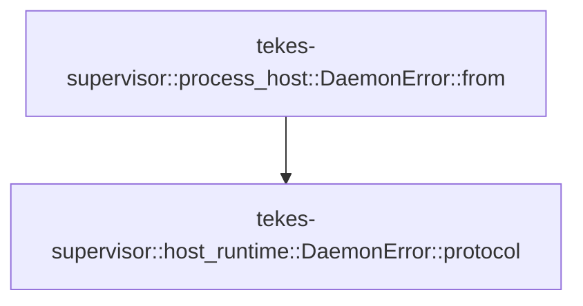

```mermaid
flowchart TD
  n0["endpoint::service::NativeEndpoint::open"]
  n1["endpoint::types::validate_session_id"]
  n2["engine::admission::AdmissionPool::new"]
  n3["profile::config::ConfigRepository::open"]
  n4["profile::resources::ResourceCatalog::from_snapshot"]
  n5["profile::scope::SessionScope::locate"]
  n6["provider::secret_store::MemorySecretStore::new"]
  n7["store::folder::ThreadStore::open"]
  n8["store::folder_events::subscribe"]
  n9["store::folder_events::canonical_root"]
  n10["tekes-supervisor::catalog::Catalog::new"]
  n11["tekes-supervisor::dynamic_bindings::resolve_worker_launch_bindings"]
  n12["tekes-supervisor::host_runtime::DaemonError::invalid_config"]
  n13["tekes-supervisor::host_runtime::DaemonError::corrupt"]
  n14["tekes-supervisor::host_runtime::DaemonError::required_broker"]
  n15["tekes-supervisor::mcp_runtime::McpRuntime::new"]
  n16["tekes-supervisor::process_host::ProductionProcessHost::client_session_roots"]
  n17["tekes-supervisor::process_host::ProductionProcessHost::client_resource_catalog"]
  n18["tekes-supervisor::process_host::ProductionProcessHost::client_tool_catalog"]
  n19["tekes-supervisor::process_host::ProductionProcessHost::run_post_ready"]
  n20["tekes-supervisor::process_host::WorkerHandshakeGuard::child_mut"]
  n21["tekes-supervisor::process_host::WorkerHandshakeGuard::take_credential_broker"]
  n22["tekes-supervisor::process_host::WorkerHandshakeGuard::wait_for_exit"]
  n23["tekes-supervisor::process_host::WorkerHandshakeGuard::drop"]
  n24["tekes-supervisor::process_host::WorkerStartReservation::drop"]
  n25["tekes-supervisor::process_host::reconcile_credential_bindings"]
  n26["tekes-supervisor::process_host::scoped_client_file_path"]
  n27["tekes-supervisor::process_host::validate_worker_binary"]
  n28["tekes-supervisor::process_host::credential_control"]
  n29["tekes-supervisor::process_host::active_material"]
  n30["tekes-supervisor::process_host::retain_prior_for_unknown_credentials"]
  n31["tekes-supervisor::process_host::ProductionProcessHost::open"]
  n32["tekes-supervisor::process_host::ProductionProcessHost::open_with_secret_store"]
  n33["tekes-supervisor::process_host::ProductionProcessHost::mcp_runtime"]
  n34["tekes-supervisor::process_host::ProductionProcessHost::credential_is_ready"]
  n35["tekes-supervisor::process_host::ProductionProcessHost::client_file_changes"]
  n36["tekes-supervisor::process_host::ProductionProcessHost::client_file_page"]
  n37["tekes-supervisor::process_host::ProductionProcessHost::session_scope"]
  n38["tekes-supervisor::process_host::ProductionProcessHost::user_agent_dir"]
  n39["tekes-supervisor::thread_card::CardWriter::spawn_from_env"]
  n40["workspace-service::file_text_page"]
  n41["workspace-service::file_byte_page"]
  n16 --> n12
  n16 --> n37
  n17 --> n4
  n17 --> n12
  n17 --> n37
  n18 --> n11
  n18 --> n12
  n18 --> n14
  n18 --> n37
  n22 --> n20
  n25 --> n14
  n25 --> n28
  n25 --> n29
  n28 --> n14
  n31 --> n6
  n31 --> n32
  n32 --> n0
  n32 --> n2
  n32 --> n3
  n32 --> n7
  n32 --> n8
  n32 --> n9
  n32 --> n10
  n32 --> n12
  n32 --> n13
  n32 --> n14
  n32 --> n15
  n32 --> n27
  n32 --> n39
  n35 --> n5
  n35 --> n37
  n36 --> n12
  n36 --> n26
  n36 --> n37
  n36 --> n40
  n36 --> n41
  n37 --> n1
  n37 --> n5
  n37 --> n12
```

```mermaid
flowchart TD
  n0["provider::secret_store::resolve_config_credentials"]
  n1["store::folder::ThreadStore::open"]
  n2["store::folder_events::arm_admission"]
  n3["store::folder_events::is_admitted"]
  n4["tekes-supervisor::boot_trace::phase"]
  n5["tekes-supervisor::endpoint_host::recover_pending_management"]
  n6["tekes-supervisor::host_runtime::DaemonError::invalid_config"]
  n7["tekes-supervisor::host_runtime::DaemonError::corrupt"]
  n8["tekes-supervisor::host_runtime::DaemonError::required_broker"]
  n9["tekes-supervisor::process_host::ProductionProcessHost::post_ready_tasks"]
  n10["tekes-supervisor::process_host::ProductionProcessHost::cleanup_stale_ephemeral"]
  n11["tekes-supervisor::process_host::ProductionProcessHost::live_sessions_for_cleanup"]
  n12["tekes-supervisor::process_host::ProductionProcessHost::run_upgrade_pass"]
  n13["tekes-supervisor::process_host::ProductionProcessHost::is_stale_ephemeral"]
  n14["tekes-supervisor::process_host::ProductionProcessHost::on_folder_event"]
  n15["tekes-supervisor::process_host::ProductionProcessHost::attach_streams"]
  n16["tekes-supervisor::process_host::ProductionProcessHost::reconcile_child_line"]
  n17["tekes-supervisor::process_host::ProductionProcessHost::publish_session_status"]
  n18["tekes-supervisor::process_host::ProductionProcessHost::start_periodic_sweep"]
  n19["tekes-supervisor::process_host::ProductionProcessHost::recover_pending_management"]
  n20["tekes-supervisor::process_host::ProductionProcessHost::refresh_live_credentials"]
  n21["tekes-supervisor::process_host::ProductionProcessHost::config_mutation_succeeded"]
  n22["tekes-supervisor::process_host::ProductionProcessHost::refresh_worker_credentials"]
  n23["tekes-supervisor::process_host::ProductionProcessHost::boot_sweep"]
  n24["tekes-supervisor::process_host::ProductionProcessHost::arm_admission"]
  n25["tekes-supervisor::process_host::ProductionProcessHost::recover_client_sessions"]
  n26["tekes-supervisor::process_host::ProductionProcessHost::ensure_verified"]
  n27["tekes-supervisor::process_host::ProductionProcessHost::hydrate"]
  n28["tekes-supervisor::process_host::ProductionProcessHost::hydrate_with"]
  n29["tekes-supervisor::process_host::ProductionProcessHost::recently_failed"]
  n30["tekes-supervisor::process_host::ProductionProcessHost::hydrate_unrecorded"]
  n31["tekes-supervisor::process_host::ProductionProcessHost::sweep_once"]
  n32["tekes-supervisor::process_host::ProductionProcessHost::sweep_session"]
  n33["tekes-supervisor::process_host::web_search_scope_ready"]
  n34["tekes-supervisor::process_host::terminate_worker"]
  n35["tekes-supervisor::process_host::reconcile_credential_bindings"]
  n36["tekes-supervisor::process_host::retain_prior_for_unknown_credentials"]
  n9 --> n4
  n9 --> n10
  n9 --> n12
  n10 --> n1
  n10 --> n3
  n10 --> n11
  n12 --> n27
  n12 --> n29
  n13 --> n3
  n19 --> n5
  n20 --> n22
  n21 --> n20
  n22 --> n0
  n22 --> n8
  n22 --> n33
  n22 --> n34
  n22 --> n35
  n22 --> n36
  n23 --> n31
  n24 --> n2
  n25 --> n6
  n25 --> n26
  n25 --> n32
  n26 --> n6
  n26 --> n7
  n26 --> n27
  n27 --> n28
  n28 --> n30
```

```mermaid
flowchart TD
  n0["engine::context::plan_context_compaction"]
  n1["schema::event::Event::from_value"]
  n2["schema::ijson::IJsonValue::parse"]
  n3["store::tail::scan_valid_prefix"]
  n4["tekes-supervisor::host_runtime::DaemonError::protocol"]
  n5["tekes-supervisor::host_runtime::DaemonError::io"]
  n6["tekes-supervisor::host_runtime::DaemonError::required_broker"]
  n7["tekes-supervisor::process_host::ProductionProcessHost::publish_session_status"]
  n8["tekes-supervisor::process_host::production_sandbox_backend"]
  n9["tekes-supervisor::process_host::ProductionProcessHost::refresh_worker_credentials"]
  n10["tekes-supervisor::process_host::ProductionProcessHost::ensure_verified"]
  n11["tekes-supervisor::process_host::spill_compaction_summary"]
  n12["tekes-supervisor::process_host::ProductionProcessHost::live_worker"]
  n13["tekes-supervisor::process_host::ProductionProcessHost::spawn_worker_at"]
  n14["tekes-supervisor::process_host::prompt_text"]
  n15["tekes-supervisor::process_host::ProductionProcessHost::refresh_limits"]
  n16["tekes-supervisor::process_host::ProductionProcessHost::preflight_mandatory_authorities"]
  n17["tekes-supervisor::process_host::ProductionProcessHost::is_mcp_only_app_sandbox_host"]
  n18["tekes-supervisor::process_host::ProductionProcessHost::freeze_tool_authority"]
  n19["tekes-supervisor::process_host::ProductionProcessHost::schedule_main"]
  n20["tekes-supervisor::process_host::ProductionProcessHost::schedule_line"]
  n21["tekes-supervisor::process_host::ProductionProcessHost::schedule_worker_at"]
  n22["tekes-supervisor::process_host::ProductionProcessHost::schedule_worker_at_with_startup"]
  n23["tekes-supervisor::process_host::ProductionProcessHost::spawn_reserved_worker"]
  n24["tekes-supervisor::process_host::ProductionProcessHost::schedule_child_from_parent"]
  n25["tekes-supervisor::process_host::ProductionProcessHost::wait_for_worker"]
  n26["tekes-supervisor::process_host::ProductionProcessHost::start_pending_workers"]
  n27["tekes-supervisor::process_host::ProductionProcessHost::has_worker_capacity"]
  n28["tekes-supervisor::process_host::ProductionProcessHost::request_provider_lease_with_liveness"]
  n29["tekes-supervisor::process_host::ProductionProcessHost::request_provider_lease_for_worker"]
  n30["tekes-supervisor::process_host::ProductionProcessHost::locked_prompt"]
  n31["tekes-supervisor::process_host::ProductionProcessHost::publish_queue_snapshot"]
  n32["tekes-supervisor::process_host::ProductionProcessHost::schedule_accepted_prompt"]
  n33["tekes-supervisor::process_host::ProductionProcessHost::locked_compact"]
  n34["tekes-supervisor::process_host::ProductionProcessHost::first_root_input"]
  n35["tekes-supervisor::process_host::ProductionProcessHost::seed_automatic_title"]
  n36["tekes-supervisor::process_host::ProductionProcessHost::try_seed_automatic_title"]
  n37["tekes-supervisor::process_host::ProductionProcessHost::spawn_automatic_title_refinement"]
  n38["tekes-supervisor::process_host::ProductionProcessHost::summary_for_manual_compaction"]
  n39["tekes-supervisor::process_host::ProductionProcessHost::publish_appended"]
  n40["tekes-supervisor::process_host::ProductionProcessHost::reset_restart_backoff"]
  n41["tekes-supervisor::process_host::ProductionProcessHost::record_spawn_failure"]
  n42["tekes-supervisor::process_host::frozen_tool_launch_policy"]
  n43["tekes-supervisor::process_host::child_dependency_admitted"]
  n44["tekes-supervisor::process_host::terminate_worker"]
  n45["tekes-supervisor::process_host::unresolved_parent_dependency"]
  n46["tekes-supervisor::process_host::line_schedule_target"]
  n47["tekes-supervisor::process_host::ledger_needs_worker"]
  n48["tekes-supervisor::process_host::internal"]
  n49["tools::runtime_backends::HelperJobLauncher::new"]
  n50["tools::runtime_backends::HelperJobLauncher::disabled"]
  n51["tools::sandbox::probe_backend"]
  n52["worker-control::encode_line"]
  n16 --> n6
  n16 --> n8
  n16 --> n17
  n16 --> n49
  n16 --> n50
  n16 --> n51
  n17 --> n5
  n17 --> n6
  n18 --> n6
  n18 --> n8
  n18 --> n17
  n18 --> n42
  n18 --> n49
  n18 --> n50
  n18 --> n51
  n19 --> n21
  n20 --> n21
  n20 --> n24
  n20 --> n45
  n20 --> n46
  n21 --> n22
  n22 --> n4
  n22 --> n6
  n22 --> n9
  n22 --> n10
  n22 --> n12
  n22 --> n15
  n22 --> n23
  n22 --> n27
  n23 --> n6
  n23 --> n7
  n23 --> n13
  n23 --> n44
  n24 --> n6
  n24 --> n9
  n24 --> n15
  n24 --> n23
  n24 --> n27
  n24 --> n43
  n25 --> n6
  n26 --> n22
  n26 --> n27
  n26 --> n47
  n29 --> n28
  n29 --> n52
  n30 --> n2
  n30 --> n14
  n30 --> n31
  n30 --> n32
  n30 --> n34
  n30 --> n35
  n30 --> n37
  n30 --> n40
  n32 --> n5
  n32 --> n41
  n33 --> n0
  n33 --> n1
  n33 --> n2
  n33 --> n11
  n33 --> n38
  n33 --> n39
  n33 --> n48
  n34 --> n3
  n35 --> n36
```

```mermaid
flowchart TD
  n0["endpoint::journal::EndpointJournal::open"]
  n1["engine::compaction_summary::admit_summary_artifact"]
  n2["engine::compaction_summary::summary_request_bytes"]
  n3["engine::compaction_summary::CompactionSummary::from_outcome"]
  n4["engine::compaction_summary::freeze_source_bundle"]
  n5["engine::context::plan_context_compaction"]
  n6["engine::lifecycle::ensure_action_at"]
  n7["engine::lifecycle::classify"]
  n8["engine::permission_mode::read_permission_mode"]
  n9["provider::compaction_summary::prepare_summary_request"]
  n10["provider::compaction_summary::summary_completion_artifact"]
  n11["provider::http::HttpRuntime::new"]
  n12["schema::event::Event::from_value"]
  n13["schema::ijson::IJsonValue::parse"]
  n14["store::tail::LockedLedger::open"]
  n15["store::tail::scan_valid_prefix"]
  n16["store::tail::read_genesis"]
  n17["tekes-supervisor::host_runtime::DaemonError::protocol"]
  n18["tekes-supervisor::host_runtime::DaemonError::corrupt"]
  n19["tekes-supervisor::host_runtime::DaemonError::required_broker"]
  n20["tekes-supervisor::process_host::ProductionProcessHost::publish_session_status"]
  n21["tekes-supervisor::process_host::now_rfc3339"]
  n22["tekes-supervisor::process_host::session_event_time_now"]
  n23["tekes-supervisor::process_host::deterministic_automatic_thread_title"]
  n24["tekes-supervisor::process_host::normalized_automatic_thread_title"]
  n25["tekes-supervisor::process_host::ProductionProcessHost::is_mcp_only_app_sandbox_host"]
  n26["tekes-supervisor::process_host::automatic_title_origin"]
  n27["tekes-supervisor::process_host::automatic_title_route"]
  n28["tekes-supervisor::process_host::ProductionProcessHost::schedule_child_from_parent"]
  n29["tekes-supervisor::process_host::session_model_route"]
  n30["tekes-supervisor::process_host::ProductionProcessHost::try_seed_automatic_title"]
  n31["tekes-supervisor::process_host::ProductionProcessHost::wait_and_seed_automatic_title"]
  n32["tekes-supervisor::process_host::ProductionProcessHost::spawn_automatic_title_refinement"]
  n33["tekes-supervisor::process_host::ProductionProcessHost::spawn_automatic_title_seed_and_refinement"]
  n34["tekes-supervisor::process_host::ProductionProcessHost::refine_automatic_title"]
  n35["tekes-supervisor::process_host::ProductionProcessHost::complete_automatic_text"]
  n36["tekes-supervisor::process_host::ProductionProcessHost::complete_automatic_terminal"]
  n37["tekes-supervisor::process_host::ProductionProcessHost::summary_for_manual_compaction"]
  n38["tekes-supervisor::process_host::ProductionProcessHost::generate_automatic_title"]
  n39["tekes-supervisor::process_host::ProductionProcessHost::current_tool_authority"]
  n40["tekes-supervisor::process_host::ProductionProcessHost::tool_authority_for_session"]
  n41["tekes-supervisor::process_host::prepare_automatic_title_request"]
  n42["tekes-supervisor::process_host::ProductionProcessHost::handle_tool_control"]
  n43["tekes-supervisor::process_host::ProductionProcessHost::handle_tool_continuation"]
  n44["tekes-supervisor::process_host::ProductionProcessHost::validate_child_proof"]
  n45["tekes-supervisor::process_host::ProductionProcessHost::publish_appended"]
  n46["tekes-supervisor::process_host::ProductionProcessHost::publish_appended_with"]
  n47["tekes-supervisor::process_host::ProductionProcessHost::publish_frame"]
  n48["tekes-supervisor::process_host::ProductionProcessHost::launch_child"]
  n49["tekes-supervisor::process_host::ProductionProcessHost::propagate_parent_stop"]
  n50["tekes-supervisor::process_host::ProductionProcessHost::cascade_stop_from"]
  n51["tekes-supervisor::process_host::terminate_worker"]
  n52["tekes-supervisor::process_host::ledger_damage_from_scan"]
  n53["tekes-supervisor::process_host::damage_under_lock"]
  n54["tekes-supervisor::process_host::line_schedule_target"]
  n55["tekes-supervisor::process_host::probe_line_lock"]
  n56["tekes-supervisor::production_tool_control::JobBrokerSupervisorAuthority::new"]
  n57["tekes-supervisor::production_tool_control::ProductionToolControlHandler::new"]
  n58["tekes-supervisor::production_tool_control::ProductionToolControlPolicy::new"]
  n59["tekes-supervisor::thread_card::journal_input"]
  n60["tekes-supervisor::thread_card::prepare"]
  n61["tekes-supervisor::tool_control::ToolControlSession::new"]
  n62["tools::runtime_backends::HelperJobLauncher::for_execution_access"]
  n63["tools::schema_registry::fixed_schema"]
  n64["worker-control::continuation::decode_tool_continuation"]
  n65["worker-control::continuation::encode_tool_continuation_result"]
  n66["worker-control::encode_line"]
  n30 --> n23
  n30 --> n26
  n30 --> n45
  n31 --> n30
  n34 --> n26
  n34 --> n38
  n34 --> n45
  n35 --> n36
  n36 --> n11
  n37 --> n1
  n37 --> n2
  n37 --> n3
  n37 --> n4
  n37 --> n5
  n37 --> n9
  n37 --> n10
  n37 --> n13
  n37 --> n15
  n37 --> n29
  n37 --> n36
  n37 --> n63
  n38 --> n24
  n38 --> n27
  n38 --> n35
  n38 --> n41
  n39 --> n40
  n40 --> n8
  n40 --> n19
  n40 --> n25
  n40 --> n62
  n42 --> n17
  n42 --> n19
  n42 --> n39
  n42 --> n56
  n42 --> n57
  n42 --> n58
  n42 --> n61
  n43 --> n17
  n43 --> n19
  n43 --> n39
  n43 --> n56
  n43 --> n57
  n43 --> n58
  n43 --> n64
  n43 --> n65
  n44 --> n16
  n44 --> n18
  n45 --> n46
  n46 --> n0
  n46 --> n15
  n46 --> n18
  n46 --> n20
  n46 --> n52
  n46 --> n53
  n46 --> n59
  n46 --> n60
  n47 --> n0
  n47 --> n15
  n47 --> n18
  n47 --> n22
  n48 --> n6
  n48 --> n7
  n48 --> n15
  n48 --> n17
  n48 --> n18
  n48 --> n21
  n48 --> n28
  n48 --> n49
  n48 --> n55
  n49 --> n12
  n49 --> n13
  n49 --> n14
  n49 --> n15
  n49 --> n17
  n49 --> n18
  n49 --> n66
  n50 --> n15
  n50 --> n18
  n50 --> n28
  n50 --> n49
  n50 --> n50
  n50 --> n51
  n50 --> n54
```

```mermaid
flowchart TD
  n0["engine::lifecycle::ensure_action_at"]
  n1["engine::lifecycle::classify"]
  n2["profile::resources::ResourceCatalog::skill_package_names"]
  n3["provider::request::endpoint_origin"]
  n4["store::tail::scan_valid_prefix"]
  n5["store::tail::read_genesis"]
  n6["tekes-supervisor::host_runtime::system_timestamp"]
  n7["tekes-supervisor::host_runtime::DaemonError::protocol"]
  n8["tekes-supervisor::host_runtime::DaemonError::io"]
  n9["tekes-supervisor::host_runtime::DaemonError::invalid_config"]
  n10["tekes-supervisor::host_runtime::DaemonError::corrupt"]
  n11["tekes-supervisor::host_runtime::DaemonError::required_broker"]
  n12["tekes-supervisor::process_host::now_rfc3339"]
  n13["tekes-supervisor::process_host::ProductionProcessHost::refresh_limits"]
  n14["tekes-supervisor::process_host::ProductionProcessHost::schedule_worker_at"]
  n15["tekes-supervisor::process_host::ProductionProcessHost::publish_appended"]
  n16["tekes-supervisor::process_host::ProductionProcessHost::reconcile_after_exit"]
  n17["tekes-supervisor::process_host::ProductionProcessHost::reset_restart_backoff"]
  n18["tekes-supervisor::process_host::ProductionProcessHost::restart_is_due"]
  n19["tekes-supervisor::process_host::ProductionProcessHost::note_restart_failure"]
  n20["tekes-supervisor::process_host::ProductionProcessHost::record_spawn_failure"]
  n21["tekes-supervisor::process_host::ProductionProcessHost::record_session_notice"]
  n22["tekes-supervisor::process_host::genesis_preset_skills"]
  n23["tekes-supervisor::process_host::missing_preset_skill_notice"]
  n24["tekes-supervisor::process_host::frozen_tool_launch_policy"]
  n25["tekes-supervisor::process_host::validator_tool_launch_policy"]
  n26["tekes-supervisor::process_host::private_validator_launch_policy"]
  n27["tekes-supervisor::process_host::web_search_scope_ready"]
  n28["tekes-supervisor::process_host::child_dependency_admitted"]
  n29["tekes-supervisor::process_host::WorkerHandle::write"]
  n30["tekes-supervisor::process_host::WorkerHandle::close_stdin"]
  n31["tekes-supervisor::process_host::WorkerHandle::wait_for_delivery"]
  n32["tekes-supervisor::process_host::WorkerHandle::receipt"]
  n33["tekes-supervisor::process_host::WorkerHandle::receipt_confirmed"]
  n34["tekes-supervisor::process_host::WorkerHandle::queue_result_confirmed"]
  n35["tekes-supervisor::process_host::worker_reader"]
  n36["tekes-supervisor::process_host::terminate_worker"]
  n37["tekes-supervisor::process_host::fail_worker"]
  n38["tekes-supervisor::process_host::accepted_but_not_confirmed_error"]
  n39["tekes-supervisor::process_host::goal_continuation_due"]
  n40["tekes-supervisor::process_host::probe_line_lock"]
  n41["tekes-supervisor::process_host::internal"]
  n42["tools::preset::ResolvedPreset::from_genesis"]
  n43["tools::runtime_backends::JobLaunchPolicy::new"]
  n44["tools::sandbox::exposed_protected_roots"]
  n45["worker-control::continuation::decode_tool_continuation"]
  n46["worker-control::durable::decode_tool_control"]
  n47["worker-control::decode_worker"]
  n48["worker-control::encode_line"]
  n16 --> n0
  n16 --> n1
  n16 --> n4
  n16 --> n10
  n16 --> n12
  n16 --> n13
  n16 --> n14
  n16 --> n15
  n16 --> n17
  n16 --> n18
  n16 --> n19
  n16 --> n39
  n16 --> n40
  n20 --> n21
  n21 --> n6
  n21 --> n15
  n22 --> n5
  n22 --> n42
  n23 --> n2
  n24 --> n9
  n24 --> n11
  n24 --> n43
  n24 --> n44
  n25 --> n4
  n25 --> n7
  n25 --> n10
  n25 --> n11
  n25 --> n26
  n26 --> n11
  n26 --> n43
  n27 --> n3
  n29 --> n8
  n31 --> n41
  n32 --> n31
  n32 --> n41
  n33 --> n31
  n33 --> n38
  n34 --> n31
  n34 --> n38
  n35 --> n7
  n35 --> n36
  n35 --> n37
  n35 --> n45
  n35 --> n46
  n35 --> n47
  n35 --> n48
```

```mermaid
flowchart TD
  n0["schema::ijson::IJsonValue::parse"]
  n1["store::card::valid_line_name"]
  n2["store::tail::scan_valid_prefix"]
  n3["tekes-supervisor::endpoint_host::ProductionRouteFailure::new"]
  n4["tekes-supervisor::process_host::prompt_text"]
  n5["tekes-supervisor::process_host::terminate_worker"]
  n6["tekes-supervisor::process_host::fail_worker"]
  n7["tekes-supervisor::process_host::capture_worker_stderr"]
  n8["tekes-supervisor::process_host::preserve_first_failure"]
  n9["tekes-supervisor::process_host::ProductionProcessHost::workspace_metadata_changed"]
  n10["tekes-supervisor::process_host::ProductionProcessHost::session_metadata_changed"]
  n11["tekes-supervisor::process_host::ProductionProcessHost::prompt"]
  n12["tekes-supervisor::process_host::ProductionProcessHost::compact"]
  n13["tekes-supervisor::process_host::ProductionProcessHost::cancel"]
  n14["tekes-supervisor::process_host::ProductionProcessHost::rename"]
  n15["tekes-supervisor::process_host::ProductionProcessHost::deliver_if_live"]
  n16["tekes-supervisor::process_host::ProductionProcessHost::ensure_after_locked_append"]
  n17["tekes-supervisor::process_host::accepted_but_not_confirmed_error"]
  n18["tekes-supervisor::process_host::cancel_stage_failure"]
  n19["tekes-supervisor::process_host::child_exited_within"]
  n20["tekes-supervisor::process_host::neutral_lifecycle"]
  n21["tekes-supervisor::process_host::ledger_damage"]
  n22["tekes-supervisor::process_host::ledger_damage_from_scan"]
  n23["tekes-supervisor::process_host::damage_under_lock"]
  n24["tekes-supervisor::process_host::child_ledger_damage"]
  n25["tekes-supervisor::process_host::next_stop_generation"]
  n26["tekes-supervisor::process_host::internal"]
  n27["worker-control::encode_line"]
  n6 --> n8
  n11 --> n4
  n11 --> n19
  n11 --> n27
  n12 --> n19
  n12 --> n27
  n13 --> n5
  n13 --> n18
  n13 --> n19
  n13 --> n25
  n13 --> n26
  n13 --> n27
  n14 --> n19
  n14 --> n27
  n15 --> n19
  n15 --> n27
  n17 --> n0
  n17 --> n3
  n18 --> n3
  n21 --> n2
  n21 --> n22
  n23 --> n21
  n24 --> n1
  n24 --> n21
  n24 --> n23
```

```mermaid
flowchart TD
  n0["endpoint::service::genesis_cwd"]
  n1["endpoint::service::genesis_preset_summary"]
  n2["endpoint::service::permission_mode_of"]
  n3["endpoint::service::last_record_updated_ms"]
  n4["endpoint::types::validate_session_id"]
  n5["provider::dialect::validate_provider"]
  n6["provider::dialect::resolve_profile"]
  n7["provider::request::endpoint_origin"]
  n8["provider::secret_store::resolve_config_credentials"]
  n9["store::folder_events::admitted_ids"]
  n10["store::tail::read_genesis"]
  n11["tekes-supervisor::host_runtime::system_timestamp"]
  n12["tekes-supervisor::process_host::ProductionProcessHost::is_stale_ephemeral"]
  n13["tekes-supervisor::process_host::ProductionProcessHost::ensure_verified"]
  n14["tekes-supervisor::process_host::ProductionProcessHost::recently_failed"]
  n15["tekes-supervisor::process_host::child_exited_within"]
  n16["tekes-supervisor::process_host::neutral_lifecycle"]
  n17["tekes-supervisor::process_host::is_single_line_ledger"]
  n18["tekes-supervisor::process_host::ProductionProcessHost::list_wait"]
  n19["tekes-supervisor::process_host::ProductionProcessHost::is_running"]
  n20["tekes-supervisor::process_host::ProductionProcessHost::catalog_item"]
  n21["tekes-supervisor::process_host::ProductionProcessHost::verify_within"]
  n22["tekes-supervisor::process_host::ProductionProcessHost::build_inventory"]
  n23["tekes-supervisor::process_host::ProductionProcessHost::inventory_items"]
  n24["tekes-supervisor::process_host::ProductionProcessHost::ensure_verified"]
  n25["tekes-supervisor::process_host::ProductionProcessHost::has_catalog"]
  n26["tekes-supervisor::process_host::ProductionProcessHost::hold_catalog"]
  n27["tekes-supervisor::process_host::ProductionProcessHost::inventory_item"]
  n28["tekes-supervisor::process_host::ProductionProcessHost::live_sessions"]
  n29["tekes-supervisor::process_host::ProductionProcessHost::reconcile_projection"]
  n30["tekes-supervisor::process_host::ProductionProcessHost::execute"]
  n31["tekes-supervisor::process_host::ProductionProcessHost::readiness"]
  n32["tekes-supervisor::process_host::ProductionProcessHost::config_mutation_succeeded"]
  n33["tekes-supervisor::process_host::ProcessToolRuntime::host"]
  n34["tekes-supervisor::process_host::ProcessToolRuntime::ensure_running"]
  n35["tekes-supervisor::process_host::ProcessToolRuntime::deliver_input"]
  n36["tekes-supervisor::process_host::ProcessToolRuntime::archive_session"]
  n37["tekes-supervisor::process_host::operation_value"]
  n38["worker-control::durable::encode_queue_transaction"]
  n20 --> n0
  n20 --> n1
  n20 --> n2
  n20 --> n3
  n20 --> n10
  n20 --> n12
  n20 --> n16
  n20 --> n17
  n20 --> n19
  n22 --> n4
  n22 --> n9
  n22 --> n14
  n22 --> n16
  n22 --> n20
  n22 --> n21
  n24 --> n13
  n30 --> n15
  n30 --> n38
  n31 --> n5
  n31 --> n6
  n31 --> n7
  n31 --> n8
  n34 --> n37
  n35 --> n11
  n35 --> n37
  n36 --> n4
  n36 --> n37
```

```mermaid
flowchart TD
  n0["engine::lifecycle::ensure_action_at"]
  n1["engine::lifecycle::classify"]
  n2["schema::ijson::IJsonValue::parse"]
  n3["schema::ijson::IJsonValue::parse_str"]
  n4["session-controls::read_goal"]
  n5["store::tail::scan_valid_prefix"]
  n6["tekes-supervisor::endpoint_host::ProductionRouteFailure::new"]
  n7["tekes-supervisor::host_runtime::system_timestamp"]
  n8["tekes-supervisor::host_runtime::DaemonError::protocol"]
  n9["tekes-supervisor::host_runtime::DaemonError::io"]
  n10["tekes-supervisor::host_runtime::DaemonError::invalid_install"]
  n11["tekes-supervisor::host_runtime::DaemonError::invalid_install_reason"]
  n12["tekes-supervisor::host_runtime::DaemonError::invalid_config"]
  n13["tekes-supervisor::host_runtime::DaemonError::corrupt"]
  n14["tekes-supervisor::process_host::now_rfc3339"]
  n15["tekes-supervisor::process_host::ProcessToolRuntime::interrupt"]
  n16["tekes-supervisor::process_host::ProcessToolRuntime::ensure_child"]
  n17["tekes-supervisor::process_host::ProcessToolRuntime::deliver_report"]
  n18["tekes-supervisor::process_host::unresolved_parent_dependency"]
  n19["tekes-supervisor::process_host::line_schedule_target"]
  n20["tekes-supervisor::process_host::operation_unavailable"]
  n21["tekes-supervisor::process_host::map_tool_archive_failure"]
  n22["tekes-supervisor::process_host::operation_value"]
  n23["tekes-supervisor::process_host::workspace_quiescence_lock_path"]
  n24["tekes-supervisor::process_host::scoped_client_file_path"]
  n25["tekes-supervisor::process_host::ledger_needs_worker"]
  n26["tekes-supervisor::process_host::goal_continuation_due"]
  n27["tekes-supervisor::process_host::probe_line_lock"]
  n28["tekes-supervisor::process_host::worker_startup_phase"]
  n29["tekes-supervisor::process_host::startup_log"]
  n30["tekes-supervisor::process_host::read_worker_hello_with_progress"]
  n31["tekes-supervisor::process_host::next_stop_generation"]
  n32["tekes-supervisor::process_host::validate_worker_binary"]
  n33["tekes-supervisor::process_host::failure"]
  n34["tekes-supervisor::process_host::internal"]
  n35["worker-control::decode_hello"]
  n15 --> n5
  n15 --> n7
  n15 --> n9
  n15 --> n20
  n15 --> n22
  n16 --> n22
  n17 --> n22
  n18 --> n5
  n18 --> n13
  n18 --> n19
  n19 --> n13
  n22 --> n2
  n24 --> n12
  n25 --> n0
  n25 --> n1
  n25 --> n5
  n25 --> n13
  n25 --> n14
  n25 --> n26
  n25 --> n27
  n26 --> n4
  n26 --> n5
  n26 --> n12
  n26 --> n13
  n27 --> n9
  n27 --> n13
  n30 --> n8
  n30 --> n9
  n30 --> n35
  n31 --> n5
  n31 --> n34
  n32 --> n10
  n32 --> n11
  n33 --> n3
  n33 --> n6
  n34 --> n33
```

# tekes-supervisor::process_host

[Package atlas](index.md) · [Source](../../src/process_host.rs)

## Declarations

Visibility is the declaration spelling; trait members and reexports require their enclosing interface. `cfg` is not evaluated.

| Symbol | Kind | Visibility | Test / cfg |
|---|---|---|---|
| [tekes-supervisor::process_host::DELIVERY_TIMEOUT](../../src/process_host.rs#L58) | const_item | `private` |  |
| [tekes-supervisor::process_host::MCP_ONLY_APP_SANDBOX_MARKER](../../src/process_host.rs#L59) | const_item | `private` |  |
| [tekes-supervisor::process_host::WORKER_HANDSHAKE_TIMEOUT](../../src/process_host.rs#L63) | const_item | `private` |  |
| [tekes-supervisor::process_host::WORKER_STARTUP_SLOW_AFTER](../../src/process_host.rs#L68) | const_item | `private` |  |
| [tekes-supervisor::process_host::WORKER_HELLO_MAX_BYTES](../../src/process_host.rs#L69) | const_item | `private` |  |
| [tekes-supervisor::process_host::MANAGEMENT_RECOVERY_SECONDS](../../src/process_host.rs#L71) | const_item | `private` |  |
| [tekes-supervisor::process_host::PERIODIC_SWEEP_INTERVAL](../../src/process_host.rs#L72) | const_item | `private` |  |
| [tekes-supervisor::process_host::SweepLedgerIdentity](../../src/process_host.rs#L77) | struct_item | `private` |  |
| [tekes-supervisor::process_host::SweepLedgerIdentity::of](../../src/process_host.rs#L84) | function_item | `private` |  |
| [tekes-supervisor::process_host::SweepLedgerScan](../../src/process_host.rs#L97) | struct_item | `private` |  |
| [tekes-supervisor::process_host::AUTOMATIC_THREAD_TITLE_MODEL_HINT](../../src/process_host.rs#L111) | const_item | `private` |  |
| [tekes-supervisor::process_host::AUTOMATIC_THREAD_TITLE_MAX_CHARS](../../src/process_host.rs#L112) | const_item | `private` |  |
| [tekes-supervisor::process_host::AUTOMATIC_THREAD_TITLE_TIMEOUT](../../src/process_host.rs#L113) | const_item | `private` |  |
| [tekes-supervisor::process_host::AUTOMATIC_THREAD_TITLE_MAX_OUTPUT_TOKENS](../../src/process_host.rs#L117) | const_item | `private` |  |
| [tekes-supervisor::process_host::COMPACTION_SUMMARY_TIMEOUT](../../src/process_host.rs#L118) | const_item | `private` |  |
| [tekes-supervisor::process_host::AUTOMATIC_THREAD_TITLE_SYSTEM](../../src/process_host.rs#L119) | const_item | `private` |  |
| [tekes-supervisor::process_host::LineLockState](../../src/process_host.rs#L122) | enum_item | `private` |  |
| [tekes-supervisor::process_host::production_sandbox_backend](../../src/process_host.rs#L127) | function_item | `private` |  |
| [tekes-supervisor::process_host::seq_ranges](../../src/process_host.rs#L138) | function_item | `private` |  |
| [tekes-supervisor::process_host::spill_compaction_summary](../../src/process_host.rs#L157) | function_item | `private` |  |
| [tekes-supervisor::process_host::now_rfc3339](../../src/process_host.rs#L174) | function_item | `private` |  |
| [tekes-supervisor::process_host::session_event_time_now](../../src/process_host.rs#L178) | function_item | `private` |  |
| [tekes-supervisor::process_host::session_event_time](../../src/process_host.rs#L182) | function_item | `private` |  |
| [tekes-supervisor::process_host::compact_title_source](../../src/process_host.rs#L192) | function_item | `private` |  |
| [tekes-supervisor::process_host::bounded_title](../../src/process_host.rs#L196) | function_item | `private` |  |
| [tekes-supervisor::process_host::deterministic_automatic_thread_title](../../src/process_host.rs#L203) | function_item | `private` |  |
| [tekes-supervisor::process_host::normalized_automatic_thread_title](../../src/process_host.rs#L207) | function_item | `private` |  |
| [tekes-supervisor::process_host::prompt_text](../../src/process_host.rs#L232) | function_item | `private` |  |
| [tekes-supervisor::process_host::automatic_title_origin](../../src/process_host.rs#L243) | function_item | `private` |  |
| [tekes-supervisor::process_host::automatic_title_route](../../src/process_host.rs#L253) | function_item | `private` |  |
| [tekes-supervisor::process_host::session_model_route](../../src/process_host.rs#L292) | function_item | `private` |  |
| [tekes-supervisor::process_host::prepare_automatic_title_request](../../src/process_host.rs#L340) | function_item | `private` |  |
| [tekes-supervisor::process_host::prepare_automatic_text_request](../../src/process_host.rs#L357) | function_item | `private` |  |
| [tekes-supervisor::process_host::accepted_stream_event](../../src/process_host.rs#L408) | function_item | `private` | test; #[cfg(test)] |
| [tekes-supervisor::process_host::ProcessToolRuntime](../../src/process_host.rs#L423) | struct_item | `private` |  |
| [tekes-supervisor::process_host::ProductionProcessHost](../../src/process_host.rs#L427) | struct_item | `pub` |  |
| [tekes-supervisor::process_host::SessionProjectionCache](../../src/process_host.rs#L489) | struct_item | `private` |  |
| [tekes-supervisor::process_host::WorkerHandle](../../src/process_host.rs#L495) | struct_item | `private` |  |
| [tekes-supervisor::process_host::WorkerHandshakeGuard](../../src/process_host.rs#L518) | struct_item | `private` |  |
| [tekes-supervisor::process_host::WorkerHandshakeGuard::child_mut](../../src/process_host.rs#L525) | function_item | `private` |  |
| [tekes-supervisor::process_host::WorkerHandshakeGuard::take_child](../../src/process_host.rs#L529) | function_item | `private` |  |
| [tekes-supervisor::process_host::WorkerHandshakeGuard::take_credential_control](../../src/process_host.rs#L533) | function_item | `private` |  |
| [tekes-supervisor::process_host::WorkerHandshakeGuard::take_credential_broker](../../src/process_host.rs#L537) | function_item | `private` |  |
| [tekes-supervisor::process_host::WorkerHandshakeGuard::wait_for_exit](../../src/process_host.rs#L541) | function_item | `private` |  |
| [tekes-supervisor::process_host::WorkerHandshakeGuard::drop](../../src/process_host.rs#L554) | function_item | `private` |  |
| [tekes-supervisor::process_host::WorkerStartReservation](../../src/process_host.rs#L568) | struct_item | `private` |  |
| [tekes-supervisor::process_host::WorkerStartReservation::drop](../../src/process_host.rs#L573) | function_item | `private` |  |
| [tekes-supervisor::process_host::PendingWorker](../../src/process_host.rs#L584) | struct_item | `private` |  |
| [tekes-supervisor::process_host::WorkerProtocolQuarantine](../../src/process_host.rs#L591) | struct_item | `private` |  |
| [tekes-supervisor::process_host::RestartBackoff](../../src/process_host.rs#L598) | struct_item | `private` |  |
| [tekes-supervisor::process_host::ScheduledWorker](../../src/process_host.rs#L605) | struct_item | `private` |  |
| [tekes-supervisor::process_host::WorkerState](../../src/process_host.rs#L611) | struct_item | `private` |  |
| [tekes-supervisor::process_host::reconcile_credential_bindings](../../src/process_host.rs#L618) | function_item | `private` |  |
| [tekes-supervisor::process_host::credential_control](../../src/process_host.rs#L722) | function_item | `private` |  |
| [tekes-supervisor::process_host::active_material](../../src/process_host.rs#L733) | function_item | `private` |  |
| [tekes-supervisor::process_host::retain_prior_for_unknown_credentials](../../src/process_host.rs#L747) | function_item | `private` |  |
| [tekes-supervisor::process_host::ProductionProcessHost::open](../../src/process_host.rs#L790) | function_item | `pub` |  |
| [tekes-supervisor::process_host::ProductionProcessHost::open_with_secret_store](../../src/process_host.rs#L805) | function_item | `pub` |  |
| [tekes-supervisor::process_host::ProductionProcessHost::mcp_runtime](../../src/process_host.rs#L907) | function_item | `pub` |  |
| [tekes-supervisor::process_host::ProductionProcessHost::credential_is_ready](../../src/process_host.rs#L914) | function_item | `pub` |  |
| [tekes-supervisor::process_host::ProductionProcessHost::client_file_changes](../../src/process_host.rs#L926) | function_item | `pub(crate)` |  |
| [tekes-supervisor::process_host::ProductionProcessHost::client_file_page](../../src/process_host.rs#L958) | function_item | `pub(crate)` |  |
| [tekes-supervisor::process_host::ProductionProcessHost::session_scope](../../src/process_host.rs#L988) | function_item | `private` |  |
| [tekes-supervisor::process_host::ProductionProcessHost::user_agent_dir](../../src/process_host.rs#L996) | function_item | `pub` |  |
| [tekes-supervisor::process_host::ProductionProcessHost::client_session_roots](../../src/process_host.rs#L1002) | function_item | `pub` |  |
| [tekes-supervisor::process_host::ProductionProcessHost::client_resource_catalog](../../src/process_host.rs#L1016) | function_item | `pub(crate)` |  |
| [tekes-supervisor::process_host::ProductionProcessHost::client_tool_catalog](../../src/process_host.rs#L1035) | function_item | `pub(crate)` |  |
| [tekes-supervisor::process_host::ProductionProcessHost::run_post_ready](../../src/process_host.rs#L1062) | function_item | `pub` |  |
| [tekes-supervisor::process_host::ProductionProcessHost::post_ready_tasks](../../src/process_host.rs#L1076) | function_item | `private` |  |
| [tekes-supervisor::process_host::ProductionProcessHost::cleanup_stale_ephemeral](../../src/process_host.rs#L1094) | function_item | `private` |  |
| [tekes-supervisor::process_host::ProductionProcessHost::live_sessions_for_cleanup](../../src/process_host.rs#L1119) | function_item | `private` |  |
| [tekes-supervisor::process_host::ProductionProcessHost::run_upgrade_pass](../../src/process_host.rs#L1132) | function_item | `private` |  |
| [tekes-supervisor::process_host::ProductionProcessHost::release_for_test](../../src/process_host.rs#L1175) | function_item | `pub(crate)` | test; #[cfg(test)] #[cfg_attr(not(target_os = "macos"), allow(dead_code))] |
| [tekes-supervisor::process_host::ProductionProcessHost::is_stale_ephemeral](../../src/process_host.rs#L1183) | function_item | `pub(crate)` |  |
| [tekes-supervisor::process_host::ProductionProcessHost::on_folder_event](../../src/process_host.rs#L1187) | function_item | `private` |  |
| [tekes-supervisor::process_host::ProductionProcessHost::attach_streams](../../src/process_host.rs#L1230) | function_item | `pub` |  |
| [tekes-supervisor::process_host::ProductionProcessHost::reconcile_child_line](../../src/process_host.rs#L1240) | function_item | `private` |  |
| [tekes-supervisor::process_host::ProductionProcessHost::publish_session_status](../../src/process_host.rs#L1258) | function_item | `private` |  |
| [tekes-supervisor::process_host::ProductionProcessHost::start_periodic_sweep](../../src/process_host.rs#L1275) | function_item | `pub` |  |
| [tekes-supervisor::process_host::ProductionProcessHost::recover_pending_management](../../src/process_host.rs#L1326) | function_item | `private` |  |
| [tekes-supervisor::process_host::ProductionProcessHost::refresh_live_credentials](../../src/process_host.rs#L1334) | function_item | `pub` |  |
| [tekes-supervisor::process_host::ProductionProcessHost::config_mutation_succeeded](../../src/process_host.rs#L1352) | function_item | `pub` |  |
| [tekes-supervisor::process_host::ProductionProcessHost::refresh_worker_credentials](../../src/process_host.rs#L1367) | function_item | `private` |  |
| [tekes-supervisor::process_host::ProductionProcessHost::boot_sweep](../../src/process_host.rs#L1406) | function_item | `pub` |  |
| [tekes-supervisor::process_host::ProductionProcessHost::arm_admission](../../src/process_host.rs#L1417) | function_item | `pub` |  |
| [tekes-supervisor::process_host::ProductionProcessHost::recover_client_sessions](../../src/process_host.rs#L1426) | function_item | `pub` |  |
| [tekes-supervisor::process_host::ProductionProcessHost::ensure_verified](../../src/process_host.rs#L1470) | function_item | `pub(crate)` |  |
| [tekes-supervisor::process_host::ProductionProcessHost::hydrate](../../src/process_host.rs#L1485) | function_item | `pub(crate)` |  |
| [tekes-supervisor::process_host::ProductionProcessHost::hydrate_with](../../src/process_host.rs#L1491) | function_item | `pub(crate)` |  |
| [tekes-supervisor::process_host::ProductionProcessHost::recently_failed](../../src/process_host.rs#L1511) | function_item | `private` |  |
| [tekes-supervisor::process_host::ProductionProcessHost::hydrate_unrecorded](../../src/process_host.rs#L1519) | function_item | `private` |  |
| [tekes-supervisor::process_host::ProductionProcessHost::repair_main_projection](../../src/process_host.rs#L1608) | function_item | `private` |  |
| [tekes-supervisor::process_host::ProductionProcessHost::periodic_sweep_once](../../src/process_host.rs#L1653) | function_item | `pub` |  |
| [tekes-supervisor::process_host::ProductionProcessHost::is_draining](../../src/process_host.rs#L1670) | function_item | `pub` |  |
| [tekes-supervisor::process_host::ProductionProcessHost::sweep_ledger_scan](../../src/process_host.rs#L1680) | function_item | `private` |  |
| [tekes-supervisor::process_host::ProductionProcessHost::sweep_once](../../src/process_host.rs#L1730) | function_item | `private` |  |
| [tekes-supervisor::process_host::ProductionProcessHost::sweep_ids](../../src/process_host.rs#L1769) | function_item | `private` |  |
| [tekes-supervisor::process_host::ProductionProcessHost::is_deferred](../../src/process_host.rs#L1798) | function_item | `private` |  |
| [tekes-supervisor::process_host::ProductionProcessHost::sweep_session](../../src/process_host.rs#L1810) | function_item | `private` |  |
| [tekes-supervisor::process_host::ProductionProcessHost::propagate_durable_stops_before_sweep](../../src/process_host.rs#L1893) | function_item | `private` |  |
| [tekes-supervisor::process_host::ProductionProcessHost::shutdown](../../src/process_host.rs#L1928) | function_item | `pub` |  |
| [tekes-supervisor::process_host::ProductionProcessHost::shutdown_with](../../src/process_host.rs#L1935) | function_item | `private` |  |
| [tekes-supervisor::process_host::ProductionProcessHost::ensure_running](../../src/process_host.rs#L2021) | function_item | `private` |  |
| [tekes-supervisor::process_host::ProductionProcessHost::live_worker](../../src/process_host.rs#L2035) | function_item | `private` |  |
| [tekes-supervisor::process_host::ProductionProcessHost::spawn_worker_at](../../src/process_host.rs#L2045) | function_item | `private` |  |
| [tekes-supervisor::process_host::ProductionProcessHost::spawn_worker_at_with_handshake_timeout](../../src/process_host.rs#L2061) | function_item | `private` |  |
| [tekes-supervisor::process_host::ProductionProcessHost::workspace_service_binary](../../src/process_host.rs#L2352) | function_item | `pub` |  |
| [tekes-supervisor::process_host::ProductionProcessHost::worker_binary_digest](../../src/process_host.rs#L2356) | function_item | `private` |  |
| [tekes-supervisor::process_host::ProductionProcessHost::refresh_limits](../../src/process_host.rs#L2361) | function_item | `private` |  |
| [tekes-supervisor::process_host::ProductionProcessHost::preflight_mandatory_authorities](../../src/process_host.rs#L2380) | function_item | `pub` |  |
| [tekes-supervisor::process_host::ProductionProcessHost::is_mcp_only_app_sandbox_host](../../src/process_host.rs#L2399) | function_item | `private` |  |
| [tekes-supervisor::process_host::ProductionProcessHost::freeze_tool_authority](../../src/process_host.rs#L2419) | function_item | `private` |  |
| [tekes-supervisor::process_host::ProductionProcessHost::schedule_main](../../src/process_host.rs#L2439) | function_item | `private` |  |
| [tekes-supervisor::process_host::ProductionProcessHost::schedule_line](../../src/process_host.rs#L2450) | function_item | `private` |  |
| [tekes-supervisor::process_host::ProductionProcessHost::schedule_worker_at](../../src/process_host.rs#L2466) | function_item | `private` |  |
| [tekes-supervisor::process_host::ProductionProcessHost::schedule_worker_at_with_startup](../../src/process_host.rs#L2477) | function_item | `private` |  |
| [tekes-supervisor::process_host::ProductionProcessHost::spawn_reserved_worker](../../src/process_host.rs#L2576) | function_item | `private` |  |
| [tekes-supervisor::process_host::ProductionProcessHost::schedule_child_from_parent](../../src/process_host.rs#L2608) | function_item | `private` |  |
| [tekes-supervisor::process_host::ProductionProcessHost::wait_for_worker](../../src/process_host.rs#L2664) | function_item | `private` |  |
| [tekes-supervisor::process_host::ProductionProcessHost::start_pending_workers](../../src/process_host.rs#L2692) | function_item | `private` |  |
| [tekes-supervisor::process_host::ProductionProcessHost::has_worker_capacity](../../src/process_host.rs#L2756) | function_item | `private` |  |
| [tekes-supervisor::process_host::ProductionProcessHost::request_provider_lease](../../src/process_host.rs#L2770) | function_item | `private` | test; #[cfg(test)] |
| [tekes-supervisor::process_host::ProductionProcessHost::request_provider_lease_with_liveness](../../src/process_host.rs#L2774) | function_item | `private` |  |
| [tekes-supervisor::process_host::ProductionProcessHost::request_provider_lease_for_worker](../../src/process_host.rs#L2817) | function_item | `private` |  |
| [tekes-supervisor::process_host::ProductionProcessHost::locked_prompt](../../src/process_host.rs#L2876) | function_item | `private` |  |
| [tekes-supervisor::process_host::ProductionProcessHost::publish_queue_snapshot](../../src/process_host.rs#L2906) | function_item | `private` |  |
| [tekes-supervisor::process_host::ProductionProcessHost::schedule_accepted_prompt](../../src/process_host.rs#L2919) | function_item | `private` |  |
| [tekes-supervisor::process_host::ProductionProcessHost::locked_compact](../../src/process_host.rs#L2948) | function_item | `private` |  |
| [tekes-supervisor::process_host::ProductionProcessHost::first_root_input](../../src/process_host.rs#L3025) | function_item | `private` |  |
| [tekes-supervisor::process_host::ProductionProcessHost::seed_automatic_title](../../src/process_host.rs#L3057) | function_item | `private` |  |
| [tekes-supervisor::process_host::ProductionProcessHost::try_seed_automatic_title](../../src/process_host.rs#L3069) | function_item | `private` |  |
| [tekes-supervisor::process_host::ProductionProcessHost::wait_and_seed_automatic_title](../../src/process_host.rs#L3097) | function_item | `private` |  |
| [tekes-supervisor::process_host::ProductionProcessHost::spawn_automatic_title_refinement](../../src/process_host.rs#L3122) | function_item | `private` |  |
| [tekes-supervisor::process_host::ProductionProcessHost::spawn_automatic_title_seed_and_refinement](../../src/process_host.rs#L3136) | function_item | `private` |  |
| [tekes-supervisor::process_host::ProductionProcessHost::refine_automatic_title](../../src/process_host.rs#L3160) | function_item | `private` |  |
| [tekes-supervisor::process_host::ProductionProcessHost::complete_automatic_text](../../src/process_host.rs#L3197) | function_item | `private` |  |
| [tekes-supervisor::process_host::ProductionProcessHost::complete_automatic_terminal](../../src/process_host.rs#L3223) | function_item | `private` |  |
| [tekes-supervisor::process_host::ProductionProcessHost::summary_for_manual_compaction](../../src/process_host.rs#L3287) | function_item | `private` |  |
| [tekes-supervisor::process_host::ProductionProcessHost::generate_automatic_title](../../src/process_host.rs#L3358) | function_item | `private` |  |
| [tekes-supervisor::process_host::ProductionProcessHost::current_tool_authority](../../src/process_host.rs#L3385) | function_item | `private` |  |
| [tekes-supervisor::process_host::ProductionProcessHost::tool_authority_for_session](../../src/process_host.rs#L3397) | function_item | `private` |  |
| [tekes-supervisor::process_host::ProductionProcessHost::handle_tool_control](../../src/process_host.rs#L3424) | function_item | `private` |  |
| [tekes-supervisor::process_host::ProductionProcessHost::handle_tool_continuation](../../src/process_host.rs#L3460) | function_item | `private` |  |
| [tekes-supervisor::process_host::ProductionProcessHost::validate_child_proof](../../src/process_host.rs#L3499) | function_item | `private` |  |
| [tekes-supervisor::process_host::ProductionProcessHost::publish_appended](../../src/process_host.rs#L3516) | function_item | `private` |  |
| [tekes-supervisor::process_host::ProductionProcessHost::publish_appended_with](../../src/process_host.rs#L3522) | function_item | `private` |  |
| [tekes-supervisor::process_host::ProductionProcessHost::publish_frame](../../src/process_host.rs#L3752) | function_item | `private` |  |
| [tekes-supervisor::process_host::ProductionProcessHost::launch_child](../../src/process_host.rs#L3897) | function_item | `private` |  |
| [tekes-supervisor::process_host::ProductionProcessHost::propagate_parent_stop](../../src/process_host.rs#L3984) | function_item | `private` |  |
| [tekes-supervisor::process_host::ProductionProcessHost::cascade_stop_from](../../src/process_host.rs#L4077) | function_item | `private` |  |
| [tekes-supervisor::process_host::ProductionProcessHost::reconcile_after_exit](../../src/process_host.rs#L4163) | function_item | `private` |  |
| [tekes-supervisor::process_host::ProductionProcessHost::reset_restart_backoff](../../src/process_host.rs#L4226) | function_item | `private` |  |
| [tekes-supervisor::process_host::ProductionProcessHost::restart_is_due](../../src/process_host.rs#L4233) | function_item | `private` |  |
| [tekes-supervisor::process_host::ProductionProcessHost::note_restart_failure](../../src/process_host.rs#L4241) | function_item | `private` |  |
| [tekes-supervisor::process_host::ProductionProcessHost::record_spawn_failure](../../src/process_host.rs#L4282) | function_item | `private` |  |
| [tekes-supervisor::process_host::ProductionProcessHost::record_session_notice](../../src/process_host.rs#L4307) | function_item | `private` |  |
| [tekes-supervisor::process_host::genesis_preset_skills](../../src/process_host.rs#L4342) | function_item | `private` |  |
| [tekes-supervisor::process_host::missing_preset_skill_notice](../../src/process_host.rs#L4353) | function_item | `private` |  |
| [tekes-supervisor::process_host::frozen_tool_launch_policy](../../src/process_host.rs#L4374) | function_item | `private` |  |
| [tekes-supervisor::process_host::validator_tool_launch_policy](../../src/process_host.rs#L4404) | function_item | `private` |  |
| [tekes-supervisor::process_host::private_validator_launch_policy](../../src/process_host.rs#L4446) | function_item | `private` |  |
| [tekes-supervisor::process_host::web_search_scope_ready](../../src/process_host.rs#L4475) | function_item | `private` |  |
| [tekes-supervisor::process_host::child_dependency_admitted](../../src/process_host.rs#L4493) | function_item | `private` |  |
| [tekes-supervisor::process_host::WorkerHandle::write](../../src/process_host.rs#L4498) | function_item | `private` |  |
| [tekes-supervisor::process_host::WorkerHandle::close_stdin](../../src/process_host.rs#L4513) | function_item | `private` |  |
| [tekes-supervisor::process_host::WorkerHandle::wait_for_delivery](../../src/process_host.rs#L4522) | function_item | `private` |  |
| [tekes-supervisor::process_host::WorkerHandle::receipt](../../src/process_host.rs#L4551) | function_item | `private` |  |
| [tekes-supervisor::process_host::WorkerHandle::receipt_confirmed](../../src/process_host.rs#L4558) | function_item | `private` |  |
| [tekes-supervisor::process_host::WorkerHandle::queue_result_confirmed](../../src/process_host.rs#L4570) | function_item | `private` |  |
| [tekes-supervisor::process_host::worker_reader](../../src/process_host.rs#L4583) | function_item | `private` |  |
| [tekes-supervisor::process_host::terminate_worker](../../src/process_host.rs#L4845) | function_item | `private` |  |
| [tekes-supervisor::process_host::fail_worker](../../src/process_host.rs#L4882) | function_item | `private` |  |
| [tekes-supervisor::process_host::capture_worker_stderr](../../src/process_host.rs#L4906) | function_item | `private` |  |
| [tekes-supervisor::process_host::capture_worker_stderr::MAX_STDERR_TAIL](../../src/process_host.rs#L4907) | const_item | `private` |  |
| [tekes-supervisor::process_host::preserve_first_failure](../../src/process_host.rs#L4925) | function_item | `private` |  |
| [tekes-supervisor::process_host::ProductionProcessHost::workspace_metadata_changed](../../src/process_host.rs#L4932) | function_item | `private` |  |
| [tekes-supervisor::process_host::ProductionProcessHost::session_metadata_changed](../../src/process_host.rs#L4947) | function_item | `private` |  |
| [tekes-supervisor::process_host::ProductionProcessHost::prompt](../../src/process_host.rs#L4951) | function_item | `private` |  |
| [tekes-supervisor::process_host::ProductionProcessHost::compact](../../src/process_host.rs#L5014) | function_item | `private` |  |
| [tekes-supervisor::process_host::ProductionProcessHost::cancel](../../src/process_host.rs#L5053) | function_item | `private` |  |
| [tekes-supervisor::process_host::ProductionProcessHost::rename](../../src/process_host.rs#L5138) | function_item | `private` |  |
| [tekes-supervisor::process_host::ProductionProcessHost::deliver_if_live](../../src/process_host.rs#L5180) | function_item | `private` |  |
| [tekes-supervisor::process_host::ProductionProcessHost::ensure_after_locked_append](../../src/process_host.rs#L5204) | function_item | `private` |  |
| [tekes-supervisor::process_host::accepted_but_not_confirmed_error](../../src/process_host.rs#L5218) | function_item | `private` |  |
| [tekes-supervisor::process_host::cancel_stage_failure](../../src/process_host.rs#L5231) | function_item | `private` |  |
| [tekes-supervisor::process_host::child_exited_within](../../src/process_host.rs#L5250) | function_item | `private` |  |
| [tekes-supervisor::process_host::neutral_lifecycle](../../src/process_host.rs#L5272) | function_item | `private` |  |
| [tekes-supervisor::process_host::ledger_damage](../../src/process_host.rs#L5295) | function_item | `private` |  |
| [tekes-supervisor::process_host::ledger_damage_from_scan](../../src/process_host.rs#L5302) | function_item | `private` |  |
| [tekes-supervisor::process_host::DamageVerdict](../../src/process_host.rs#L5311) | enum_item | `private` |  |
| [tekes-supervisor::process_host::damage_under_lock](../../src/process_host.rs#L5327) | function_item | `private` |  |
| [tekes-supervisor::process_host::child_ledger_damage](../../src/process_host.rs#L5363) | function_item | `private` |  |
| [tekes-supervisor::process_host::is_single_line_ledger](../../src/process_host.rs#L5389) | function_item | `private` |  |
| [tekes-supervisor::process_host::HYDRATE_RETRY](../../src/process_host.rs#L5402) | const_item | `private` |  |
| [tekes-supervisor::process_host::DEFAULT_LIST_WAIT](../../src/process_host.rs#L5404) | const_item | `private` |  |
| [tekes-supervisor::process_host::ProductionProcessHost::list_wait](../../src/process_host.rs#L5407) | function_item | `private` |  |
| [tekes-supervisor::process_host::ProductionProcessHost::is_running](../../src/process_host.rs#L5422) | function_item | `private` |  |
| [tekes-supervisor::process_host::ProductionProcessHost::catalog_item](../../src/process_host.rs#L5432) | function_item | `private` |  |
| [tekes-supervisor::process_host::ProductionProcessHost::verify_within](../../src/process_host.rs#L5521) | function_item | `private` |  |
| [tekes-supervisor::process_host::ProductionProcessHost::build_inventory](../../src/process_host.rs#L5586) | function_item | `private` |  |
| [tekes-supervisor::process_host::ProductionProcessHost::inventory_items](../../src/process_host.rs#L5643) | function_item | `private` |  |
| [tekes-supervisor::process_host::ProductionProcessHost::ensure_verified](../../src/process_host.rs#L5653) | function_item | `private` |  |
| [tekes-supervisor::process_host::ProductionProcessHost::has_catalog](../../src/process_host.rs#L5668) | function_item | `private` |  |
| [tekes-supervisor::process_host::ProductionProcessHost::hold_catalog](../../src/process_host.rs#L5672) | function_item | `private` |  |
| [tekes-supervisor::process_host::ProductionProcessHost::inventory_item](../../src/process_host.rs#L5728) | function_item | `private` |  |
| [tekes-supervisor::process_host::ProductionProcessHost::live_sessions](../../src/process_host.rs#L5762) | function_item | `private` |  |
| [tekes-supervisor::process_host::ProductionProcessHost::reconcile_projection](../../src/process_host.rs#L5772) | function_item | `private` |  |
| [tekes-supervisor::process_host::ProductionProcessHost::execute](../../src/process_host.rs#L5782) | function_item | `private` |  |
| [tekes-supervisor::process_host::ProductionProcessHost::readiness](../../src/process_host.rs#L5854) | function_item | `private` |  |
| [tekes-supervisor::process_host::ProductionProcessHost::config_mutation_succeeded](../../src/process_host.rs#L5931) | function_item | `private` |  |
| [tekes-supervisor::process_host::ProcessToolRuntime::host](../../src/process_host.rs#L5955) | function_item | `private` |  |
| [tekes-supervisor::process_host::ProcessToolRuntime::ensure_running](../../src/process_host.rs#L5963) | function_item | `private` |  |
| [tekes-supervisor::process_host::ProcessToolRuntime::deliver_input](../../src/process_host.rs#L5974) | function_item | `private` |  |
| [tekes-supervisor::process_host::ProcessToolRuntime::archive_session](../../src/process_host.rs#L6010) | function_item | `private` |  |
| [tekes-supervisor::process_host::ProcessToolRuntime::interrupt](../../src/process_host.rs#L6036) | function_item | `private` |  |
| [tekes-supervisor::process_host::ProcessToolRuntime::ensure_child](../../src/process_host.rs#L6118) | function_item | `private` |  |
| [tekes-supervisor::process_host::ProcessToolRuntime::deliver_report](../../src/process_host.rs#L6132) | function_item | `private` |  |
| [tekes-supervisor::process_host::unresolved_parent_dependency](../../src/process_host.rs#L6154) | function_item | `private` |  |
| [tekes-supervisor::process_host::line_schedule_target](../../src/process_host.rs#L6232) | function_item | `private` |  |
| [tekes-supervisor::process_host::operation_unavailable](../../src/process_host.rs#L6268) | function_item | `private` |  |
| [tekes-supervisor::process_host::map_tool_archive_failure](../../src/process_host.rs#L6272) | function_item | `private` |  |
| [tekes-supervisor::process_host::archive_runtime_error_tests::archive_missing_or_inactive_target_is_not_a_retryable_outage](../../src/process_host.rs#L6297) | function_item | `private` | test; #[cfg(test)] |
| [tekes-supervisor::process_host::operation_value](../../src/process_host.rs#L6325) | function_item | `private` |  |
| [tekes-supervisor::process_host::workspace_quiescence_lock_path](../../src/process_host.rs#L6333) | function_item | `pub(crate)` |  |
| [tekes-supervisor::process_host::scoped_client_file_path](../../src/process_host.rs#L6338) | function_item | `private` |  |
| [tekes-supervisor::process_host::ledger_needs_worker](../../src/process_host.rs#L6381) | function_item | `private` |  |
| [tekes-supervisor::process_host::goal_continuation_due](../../src/process_host.rs#L6399) | function_item | `private` |  |
| [tekes-supervisor::process_host::probe_line_lock](../../src/process_host.rs#L6443) | function_item | `private` |  |
| [tekes-supervisor::process_host::worker_startup_phase](../../src/process_host.rs#L6479) | function_item | `private` |  |
| [tekes-supervisor::process_host::startup_log](../../src/process_host.rs#L6493) | function_item | `private` |  |
| [tekes-supervisor::process_host::read_worker_hello](../../src/process_host.rs#L6521) | function_item | `private` | test; #[cfg(test)] |
| [tekes-supervisor::process_host::read_worker_hello_with_progress](../../src/process_host.rs#L6528) | function_item | `private` |  |
| [tekes-supervisor::process_host::next_stop_generation](../../src/process_host.rs#L6620) | function_item | `private` |  |
| [tekes-supervisor::process_host::validate_worker_binary](../../src/process_host.rs#L6639) | function_item | `private` |  |
| [tekes-supervisor::process_host::failure](../../src/process_host.rs#L6651) | function_item | `private` |  |
| [tekes-supervisor::process_host::internal](../../src/process_host.rs#L6659) | function_item | `private` |  |
| [tekes-supervisor::process_host::DaemonError::from](../../src/process_host.rs#L6664) | function_item | `private` |  |
| [tekes-supervisor::process_host::tests::client_file_scope_uses_selected_directory_and_rejects_escape](../../src/process_host.rs#L6672) | function_item | `private` | test; #[cfg(test)] |
| [tekes-supervisor::process_host::tests::deepseek_title_provider](../../src/process_host.rs#L6716) | function_item | `private` | test; #[cfg(test)] |
| [tekes-supervisor::process_host::tests::serve_title_once](../../src/process_host.rs#L6739) | function_item | `private` | test; #[cfg(test)] |
| [tekes-supervisor::process_host::tests::serve_title_response](../../src/process_host.rs#L6754) | function_item | `private` | test; #[cfg(test)] |
| [tekes-supervisor::process_host::tests::automatic_title_text_normalization_matches_the_legacy_contract](../../src/process_host.rs#L6808) | function_item | `private` | test; #[cfg(test)] |
| [tekes-supervisor::process_host::tests::automatic_title_route_finds_flash_by_hint_and_falls_back_to_any_deepseek](../../src/process_host.rs#L6831) | function_item | `private` | test; #[cfg(test)] |
| [tekes-supervisor::process_host::tests::automatic_title_route_finds_flash_by_hint_and_falls_back_to_any_deepseek::providers_with](../../src/process_host.rs#L6832) | function_item | `private` | test; #[cfg(test)] |
| [tekes-supervisor::process_host::tests::automatic_title_request_uses_configured_deepseek_adapter_and_pins_flash](../../src/process_host.rs#L6875) | function_item | `private` | test; #[cfg(test)] |
| [tekes-supervisor::process_host::tests::automatic_title_uses_the_provider_runtime_and_normalizes_its_terminal](../../src/process_host.rs#L6911) | function_item | `private` | test; #[cfg(test)] |
| [tekes-supervisor::process_host::tests::automatic_title_rejects_cut_and_failed_responses](../../src/process_host.rs#L6956) | function_item | `private` | test; #[cfg(test)] |
| [tekes-supervisor::process_host::tests::automatic_title_request_fails_closed_without_a_reasoning_off_switch](../../src/process_host.rs#L7010) | function_item | `private` | test; #[cfg(test)] |
| [tekes-supervisor::process_host::tests::locked_manual_compact_covers_settled_history_and_is_keyed_by_origin](../../src/process_host.rs#L7043) | function_item | `private` | test; #[cfg(test)] |
| [tekes-supervisor::process_host::tests::full_access_job_authority_tracks_session_mode_and_preserves_private_boundaries](../../src/process_host.rs#L7142) | function_item | `private` | test; #[cfg(test)] |
| [tekes-supervisor::process_host::tests::worker_failure_preserves_first_root_cause](../../src/process_host.rs#L7221) | function_item | `private` | test; #[cfg(test)] |
| [tekes-supervisor::process_host::tests::restart_backoff_is_reason_scoped_bounded_and_user_resettable](../../src/process_host.rs#L7231) | function_item | `private` | test; #[cfg(test)] |
| [tekes-supervisor::process_host::tests::unavailable_credential_refresh_retains_last_authoritative_generation](../../src/process_host.rs#L7274) | function_item | `private` | test; #[cfg(test)] |
| [tekes-supervisor::process_host::tests::a_missing_preset_skill_is_one_warning](../../src/process_host.rs#L7312) | function_item | `private` | test; #[cfg(test)] |
| [tekes-supervisor::process_host::tests::durable_prompt_receipt_survives_spawn_failure_and_exact_retry_deduplicates](../../src/process_host.rs#L7342) | function_item | `private` | test; #[cfg(test)] #[cfg(target_os = "macos")] |
| [tekes-supervisor::process_host::tests::session_notices](../../src/process_host.rs#L7449) | function_item | `private` | test; #[cfg(test)] #[cfg(target_os = "macos")] |
| [tekes-supervisor::process_host::tests::late_provider_frame_does_not_reopen_sealed_output](../../src/process_host.rs#L7461) | function_item | `private` | test; #[cfg(test)] #[cfg(target_os = "macos")] |
| [tekes-supervisor::process_host::tests::late_provider_frame_does_not_reopen_sealed_output::SESSION](../../src/process_host.rs#L7462) | const_item | `private` | test; #[cfg(test)] #[cfg(target_os = "macos")] |
| [tekes-supervisor::process_host::tests::eager_tool_records_published_by_doorbell_do_not_drop_later_frames](../../src/process_host.rs#L7505) | function_item | `private` | test; #[cfg(test)] #[cfg(target_os = "macos")] |
| [tekes-supervisor::process_host::tests::eager_tool_records_published_by_doorbell_do_not_drop_later_frames::SESSION](../../src/process_host.rs#L7506) | const_item | `private` | test; #[cfg(test)] #[cfg(target_os = "macos")] |
| [tekes-supervisor::process_host::tests::late_stamped_frame_does_not_reopen_sealed_output](../../src/process_host.rs#L7590) | function_item | `private` | test; #[cfg(test)] #[cfg(target_os = "macos")] |
| [tekes-supervisor::process_host::tests::late_stamped_frame_does_not_reopen_sealed_output::SESSION](../../src/process_host.rs#L7591) | const_item | `private` | test; #[cfg(test)] #[cfg(target_os = "macos")] |
| [tekes-supervisor::process_host::tests::provider_frame_reaches_transient_sink_and_is_never_journaled](../../src/process_host.rs#L7628) | function_item | `private` | test; #[cfg(test)] |
| [tekes-supervisor::process_host::tests::provider_frame_reaches_transient_sink_and_is_never_journaled::SESSION](../../src/process_host.rs#L7629) | const_item | `private` | test; #[cfg(test)] |
| [tekes-supervisor::process_host::tests::block_on_ready](../../src/process_host.rs#L7715) | function_item | `private` | test; #[cfg(test)] |
| [tekes-supervisor::process_host::tests::appended_events_are_projected_before_any_endpoint_stream_is_attached](../../src/process_host.rs#L7727) | function_item | `private` | test; #[cfg(test)] #[cfg(target_os = "macos")] |
| [tekes-supervisor::process_host::tests::opening_a_thread_repairs_a_terminal_main_tail_missing_from_the_endpoint_journal](../../src/process_host.rs#L7776) | function_item | `private` | test; #[cfg(test)] #[cfg(target_os = "macos")] |
| [tekes-supervisor::process_host::tests::opening_a_thread_repairs_a_terminal_main_tail_missing_from_the_endpoint_journal::SESSION](../../src/process_host.rs#L7777) | const_item | `private` | test; #[cfg(test)] #[cfg(target_os = "macos")] |
| [tekes-supervisor::process_host::tests::attached_streams_report_inventory_running_from_the_line_lock_on_status_frames](../../src/process_host.rs#L7836) | function_item | `private` | test; #[cfg(test)] #[cfg(target_os = "macos")] |
| [tekes-supervisor::process_host::tests::periodic_sweep_repairs_a_stale_endpoint_journal_for_live_subscribers](../../src/process_host.rs#L7904) | function_item | `private` | test; #[cfg(test)] #[cfg(target_os = "macos")] |
| [tekes-supervisor::process_host::tests::periodic_sweep_repairs_a_stale_endpoint_journal_for_live_subscribers::SESSION](../../src/process_host.rs#L7905) | const_item | `private` | test; #[cfg(test)] #[cfg(target_os = "macos")] |
| [tekes-supervisor::process_host::tests::opening_a_mux_journal_reconciles_the_semantic_tail_first](../../src/process_host.rs#L8009) | function_item | `private` | test; #[cfg(test)] #[cfg(target_os = "macos")] |
| [tekes-supervisor::process_host::tests::opening_a_mux_journal_reconciles_the_semantic_tail_first::SESSION](../../src/process_host.rs#L8010) | const_item | `private` | test; #[cfg(test)] #[cfg(target_os = "macos")] |
| [tekes-supervisor::process_host::tests::wait_for_mux_frame](../../src/process_host.rs#L8062) | function_item | `private` | test; #[cfg(test)] #[cfg(target_os = "macos")] |
| [tekes-supervisor::process_host::tests::worker_exit_path_projects_the_settled_tail_and_refreshes_inventory](../../src/process_host.rs#L8094) | function_item | `private` | test; #[cfg(test)] #[cfg(target_os = "macos")] |
| [tekes-supervisor::process_host::tests::worker_exit_path_projects_the_settled_tail_and_refreshes_inventory::SESSION](../../src/process_host.rs#L8095) | const_item | `private` | test; #[cfg(test)] #[cfg(target_os = "macos")] |
| [tekes-supervisor::process_host::tests::sweep_retries_a_projection_that_failed_on_the_doorbell](../../src/process_host.rs#L8234) | function_item | `private` | test; #[cfg(test)] #[cfg(target_os = "macos")] |
| [tekes-supervisor::process_host::tests::sweep_retries_a_projection_that_failed_on_the_doorbell::SESSION](../../src/process_host.rs#L8235) | const_item | `private` | test; #[cfg(test)] #[cfg(target_os = "macos")] |
| [tekes-supervisor::process_host::tests::live_stream_time_is_integral_epoch_milliseconds](../../src/process_host.rs#L8299) | function_item | `private` | test; #[cfg(test)] |
| [tekes-supervisor::process_host::tests::terminal_attempt_pipe_tail_is_not_a_worker_failure](../../src/process_host.rs#L8306) | function_item | `private` | test; #[cfg(test)] |
| [tekes-supervisor::process_host::tests::report_wake_targets_the_exact_nested_parent_line](../../src/process_host.rs#L8322) | function_item | `private` | test; #[cfg(test)] |
| [tekes-supervisor::process_host::tests::report_wake_rejects_parent_line_aliases_and_path_escape](../../src/process_host.rs#L8332) | function_item | `private` | test; #[cfg(test)] |
| [tekes-supervisor::process_host::tests::child_dependency_overrides_only_its_live_parent_capacity_slot](../../src/process_host.rs#L8346) | function_item | `private` | test; #[cfg(test)] |
| [tekes-supervisor::process_host::tests::periodic_sweep_is_single_flight_and_stops_at_drain](../../src/process_host.rs#L8360) | function_item | `private` | test; #[cfg(test)] |
| [tekes-supervisor::process_host::tests::sweep_isolates_one_corrupt_session_and_still_recovers_the_next](../../src/process_host.rs#L8391) | function_item | `private` | test; #[cfg(test)] #[cfg(target_os = "macos")] |
| [tekes-supervisor::process_host::tests::builtin_recovery_waits_for_explicit_request_and_is_idempotent](../../src/process_host.rs#L8397) | function_item | `private` | test; #[cfg(test)] #[cfg(target_os = "macos")] |
| [tekes-supervisor::process_host::tests::client_recovery_receipt_lists_only_verified_released_sessions](../../src/process_host.rs#L8402) | function_item | `private` | test; #[cfg(test)] |
| [tekes-supervisor::process_host::tests::check_sweep_recovery](../../src/process_host.rs#L8477) | function_item | `private` | test; #[cfg(test)] #[cfg(target_os = "macos")] |
| [tekes-supervisor::process_host::tests::sweep_scans_a_ledger_once_per_file_identity](../../src/process_host.rs#L8576) | function_item | `private` | test; #[cfg(test)] |
| [tekes-supervisor::process_host::tests::sweep_quarantines_busy_unknown_until_the_file_lock_is_free](../../src/process_host.rs#L8617) | function_item | `private` | test; #[cfg(test)] #[cfg(target_os = "macos")] |
| [tekes-supervisor::process_host::tests::ensure_existing_worker_refreshes_adjacent_secret_revocation](../../src/process_host.rs#L8684) | function_item | `private` | test; #[cfg(test)] #[cfg(target_os = "macos")] |
| [tekes-supervisor::process_host::tests::queue_recovery_is_preloaded_during_worker_negotiation](../../src/process_host.rs#L8772) | function_item | `private` | test; #[cfg(test)] #[cfg(target_os = "macos")] |
| [tekes-supervisor::process_host::tests::pending_queue_recovery_survives_an_ordinary_ensure_race](../../src/process_host.rs#L8858) | function_item | `private` | test; #[cfg(test)] #[cfg(target_os = "macos")] |
| [tekes-supervisor::process_host::tests::queue_transaction_retries_same_identity_after_confirmed_child_exit](../../src/process_host.rs#L8968) | function_item | `private` | test; #[cfg(test)] #[cfg(target_os = "macos")] |
| [tekes-supervisor::process_host::tests::queue_transaction_does_not_retry_a_live_worker_failure](../../src/process_host.rs#L9089) | function_item | `private` | test; #[cfg(test)] #[cfg(target_os = "macos")] |
| [tekes-supervisor::process_host::tests::capacity_release_starts_a_pending_queue_transaction_on_a_settled_tail](../../src/process_host.rs#L9177) | function_item | `private` | test; #[cfg(test)] #[cfg(target_os = "macos")] |
| [tekes-supervisor::process_host::tests::no_mutual_worker_protocol_is_quarantined_until_binary_bytes_change](../../src/process_host.rs#L9297) | function_item | `private` | test; #[cfg(test)] #[cfg(target_os = "macos")] |
| [tekes-supervisor::process_host::tests::shutdown_interrupts_pre_main_hello_wait](../../src/process_host.rs#L9369) | function_item | `private` | test; #[cfg(test)] |
| [tekes-supervisor::process_host::tests::cold_worker_keeps_same_pid_past_slow_threshold](../../src/process_host.rs#L9392) | function_item | `private` | test; #[cfg(test)] |
| [tekes-supervisor::process_host::tests::startup_stderr_drains_before_hello_and_logs_only_allowlisted_witnesses](../../src/process_host.rs#L9429) | function_item | `private` | test; #[cfg(test)] |
| [tekes-supervisor::process_host::tests::worker_hello_timeout_kills_waits_and_closes_the_broker](../../src/process_host.rs#L9460) | function_item | `private` | test; #[cfg(test)] #[cfg(target_os = "macos")] |
| [tekes-supervisor::process_host::tests::malformed_worker_hello_kills_waits_and_closes_the_broker](../../src/process_host.rs#L9470) | function_item | `private` | test; #[cfg(test)] #[cfg(target_os = "macos")] |
| [tekes-supervisor::process_host::tests::worker_early_eof_is_reaped_before_spawn_returns](../../src/process_host.rs#L9480) | function_item | `private` | test; #[cfg(test)] #[cfg(target_os = "macos")] |
| [tekes-supervisor::process_host::tests::worker_without_a_startup_witness_times_out_and_is_reaped](../../src/process_host.rs#L9492) | function_item | `private` | test; #[cfg(test)] #[cfg(target_os = "macos")] |
| [tekes-supervisor::process_host::tests::assert_handshake_failure_reaps_worker](../../src/process_host.rs#L9520) | function_item | `private` | test; #[cfg(test)] #[cfg(target_os = "macos")] |
| [tekes-supervisor::process_host::tests::stop_cascade_durably_gates_the_entire_unpaired_spawn_graph](../../src/process_host.rs#L9655) | function_item | `private` | test; #[cfg(test)] #[cfg(target_os = "macos")] |
| [tekes-supervisor::process_host::tests::live_root_stop_receipt_precedes_the_same_durable_cascade](../../src/process_host.rs#L9661) | function_item | `private` | test; #[cfg(test)] #[cfg(target_os = "macos")] |
| [tekes-supervisor::process_host::tests::sweep_propagates_a_durable_root_stop_before_descendant_triage](../../src/process_host.rs#L9667) | function_item | `private` | test; #[cfg(test)] #[cfg(target_os = "macos")] |
| [tekes-supervisor::process_host::tests::exercise_stop_cascade](../../src/process_host.rs#L9752) | function_item | `private` | test; #[cfg(test)] #[cfg(target_os = "macos")] |
| [tekes-supervisor::process_host::tests::max_one_worker_dependency_chain_progresses_without_admitting_unrelated_work](../../src/process_host.rs#L9879) | function_item | `private` | test; #[cfg(test)] #[cfg(target_os = "macos")] |
| [tekes-supervisor::process_host::tests::prompt_after_confirmed_worker_exit_reuses_locked_origin](../../src/process_host.rs#L10044) | function_item | `private` | test; #[cfg(test)] #[cfg(target_os = "macos")] |
| [tekes-supervisor::process_host::tests::write_test_execution_config](../../src/process_host.rs#L10116) | function_item | `private` | test; #[cfg(test)] |
| [tekes-supervisor::process_host::tests::write_canonical_test_json](../../src/process_host.rs#L10138) | function_item | `private` | test; #[cfg(test)] #[cfg_attr(not(target_os = "macos"), allow(dead_code))] |
| [tekes-supervisor::process_host::tests::real_worker_recovers_final_before_settlement_with_resume_never](../../src/process_host.rs#L10147) | function_item | `private` | test; #[cfg(test)] #[cfg(target_os = "macos")] |
| [tekes-supervisor::process_host::tests::HELD_TS](../../src/process_host.rs#L10396) | const_item | `private` | test; #[cfg(test)] |
| [tekes-supervisor::process_host::tests::held_ledger_lines](../../src/process_host.rs#L10399) | function_item | `private` | test; #[cfg(test)] |
| [tekes-supervisor::process_host::tests::held_response_line](../../src/process_host.rs#L10445) | function_item | `private` | test; #[cfg(test)] #[cfg(target_os = "macos")] |
| [tekes-supervisor::process_host::tests::held_host](../../src/process_host.rs#L10452) | function_item | `private` | test; #[cfg(test)] #[cfg_attr(not(target_os = "macos"), allow(dead_code))] |
| [tekes-supervisor::process_host::tests::publish_appended_writes_a_fresh_card_that_matches_the_inventory_scan](../../src/process_host.rs#L10486) | function_item | `private` | test; #[cfg(test)] #[cfg(target_os = "macos")] |
| [tekes-supervisor::process_host::tests::card_writer_coalesces_and_flushes_at_shutdown](../../src/process_host.rs#L10533) | function_item | `private` | test; #[cfg(test)] #[cfg(target_os = "macos")] |
| [tekes-supervisor::process_host::tests::publish_appended_fast_path_publishes_the_pending_hold_from_one_decode](../../src/process_host.rs#L10566) | function_item | `private` | test; #[cfg(test)] #[cfg(target_os = "macos")] |
| [tekes-supervisor::process_host::tests::publish_appended_with_a_grown_ledger_does_not_resurrect_a_resolved_hold](../../src/process_host.rs#L10585) | function_item | `private` | test; #[cfg(test)] #[cfg(target_os = "macos")] |
| [tekes-supervisor::process_host::tests::a_reused_session_id_does_not_inherit_the_old_actionable_high_water_mark](../../src/process_host.rs#L10619) | function_item | `private` | test; #[cfg(test)] #[cfg(target_os = "macos")] |
| [tekes-supervisor::process_host::tests::held_thread_on_disk](../../src/process_host.rs#L10663) | function_item | `private` | test; #[cfg(test)] #[cfg_attr(not(target_os = "macos"), allow(dead_code))] |
| [tekes-supervisor::process_host::tests::the_catalog_list_equals_the_scan_list_and_a_late_thread_is_a_placeholder](../../src/process_host.rs#L10680) | function_item | `private` | test; #[cfg(test)] #[cfg(target_os = "macos")] |
| [tekes-supervisor::process_host::tests::only_threads_this_process_published_or_unarchived_are_admitted](../../src/process_host.rs#L10802) | function_item | `private` | test; #[cfg(test)] #[cfg(target_os = "macos")] |
| [tekes-supervisor::process_host::tests::open_host](../../src/process_host.rs#L10831) | function_item | `private` | test; #[cfg(test)] #[cfg_attr(not(target_os = "macos"), allow(dead_code))] |
| [tekes-supervisor::process_host::tests::poll_until_ready](../../src/process_host.rs#L10854) | function_item | `private` | test; #[cfg(test)] #[cfg_attr(not(target_os = "macos"), allow(dead_code))] |
| [tekes-supervisor::process_host::tests::a_thread_published_after_the_catalog_loaded_is_listed_swept_and_blank](../../src/process_host.rs#L10873) | function_item | `private` | test; #[cfg(test)] #[cfg(target_os = "macos")] |
| [tekes-supervisor::process_host::tests::idle_rename_sweep_updates_existing_unmounted_inventory](../../src/process_host.rs#L10926) | function_item | `private` | test; #[cfg(test)] #[cfg(target_os = "macos")] |
| [tekes-supervisor::process_host::tests::idle_title_inventory_recovers_after_a_transient_line_lock](../../src/process_host.rs#L11045) | function_item | `private` | test; #[cfg(test)] #[cfg(target_os = "macos")] |
| [tekes-supervisor::process_host::tests::hydrations_run_in_parallel_and_never_hold_up_a_doorbell](../../src/process_host.rs#L11256) | function_item | `private` | test; #[cfg(test)] #[cfg(target_os = "macos")] |
| [tekes-supervisor::process_host::tests::a_complete_invalid_line_quarantines_and_is_not_rehydrated](../../src/process_host.rs#L11331) | function_item | `private` | test; #[cfg(test)] #[cfg(target_os = "macos")] |
| [tekes-supervisor::process_host::tests::damage_in_a_held_ledger_is_deferred_until_the_lock_is_free](../../src/process_host.rs#L11374) | function_item | `private` | test; #[cfg(test)] #[cfg(target_os = "macos")] |
| [tekes-supervisor::process_host::tests::a_placeholder_row_is_followed_by_the_real_row_as_an_upsert](../../src/process_host.rs#L11421) | function_item | `private` | test; #[cfg(test)] #[cfg(target_os = "macos")] |
| [tekes-supervisor::process_host::tests::a_client_unarchive_admits_the_thread_and_lists_it_again](../../src/process_host.rs#L11468) | function_item | `private` | test; #[cfg(test)] #[cfg(target_os = "macos")] |
| [tekes-supervisor::process_host::tests::shutdown_stops_workers_before_it_flushes_the_cards_of_live_threads](../../src/process_host.rs#L11500) | function_item | `private` | test; #[cfg(test)] #[cfg(target_os = "macos")] |
| [tekes-supervisor::process_host::tests::a_fold_between_card_writes_does_not_rebuild_the_card_view](../../src/process_host.rs#L11535) | function_item | `private` | test; #[cfg(test)] #[cfg(target_os = "macos")] |
| [tekes-supervisor::process_host::tests::a_complete_invalid_line_in_a_child_ledger_quarantines_the_thread](../../src/process_host.rs#L11598) | function_item | `private` | test; #[cfg(test)] #[cfg(target_os = "macos")] |
| [tekes-supervisor::process_host::tests::a_published_folder_enters_the_catalog_unread](../../src/process_host.rs#L11621) | function_item | `private` | test; #[cfg(test)] #[cfg(target_os = "macos")] |
| [tekes-supervisor::process_host::tests::the_management_recovery_tick_runs_on_an_idle_root_and_reads_no_thread](../../src/process_host.rs#L11648) | function_item | `private` | test; #[cfg(test)] #[cfg(target_os = "macos")] |
| [tekes-supervisor::process_host::tests::a_thread_that_fails_verification_is_not_retried_by_every_list](../../src/process_host.rs#L11670) | function_item | `private` | test; #[cfg(test)] #[cfg(target_os = "macos")] |
| [tekes-supervisor::process_host::tests::opening_a_thread_bypasses_the_list_backoff](../../src/process_host.rs#L11703) | function_item | `private` | test; #[cfg(test)] #[cfg(target_os = "macos")] |
| [tekes-supervisor::process_host::tests::the_list_verifies_the_newest_ledgers_first](../../src/process_host.rs#L11729) | function_item | `private` | test; #[cfg(test)] #[cfg(target_os = "macos")] |
| [tekes-supervisor::process_host::tests::the_ready_path_does_not_read_any_thread_or_archive_folder](../../src/process_host.rs#L11776) | function_item | `private` | test; #[cfg(test)] #[cfg(target_os = "macos")] |
| [tekes-supervisor::process_host::tests::the_ready_path_does_not_read_any_thread_or_archive_folder::Restore](../../src/process_host.rs#L11794) | struct_item | `private` | test; #[cfg(test)] #[cfg(target_os = "macos")] |
| [tekes-supervisor::process_host::tests::the_ready_path_does_not_read_any_thread_or_archive_folder::Restore::drop](../../src/process_host.rs#L11796) | function_item | `private` | test; #[cfg(test)] #[cfg(target_os = "macos")] |
| [tekes-supervisor::process_host::tests::a_stale_projection_cannot_overwrite_a_newer_published_actionable_set](../../src/process_host.rs#L11831) | function_item | `private` | test; #[cfg(test)] #[cfg(target_os = "macos")] |
| [tekes-supervisor::process_host::tests::publish_appended_with_a_torn_tail_keeps_the_previous_error_path](../../src/process_host.rs#L11863) | function_item | `private` | test; #[cfg(test)] #[cfg(target_os = "macos")] |
| [tekes-supervisor::process_host::tests::write_test_genesis](../../src/process_host.rs#L11878) | function_item | `private` | test; #[cfg(test)] |
| [tekes-supervisor::process_host::tests::write_test_genesis_with_identity](../../src/process_host.rs#L11883) | function_item | `private` | test; #[cfg(test)] |
| [tekes-supervisor::process_host::tests::append_test_input](../../src/process_host.rs#L11912) | function_item | `private` | test; #[cfg(test)] |
| [tekes-supervisor::process_host::tests::append_test_stop](../../src/process_host.rs#L11935) | function_item | `private` | test; #[cfg(test)] #[cfg(target_os = "macos")] |
| [tekes-supervisor::process_host::tests::write_test_spawn_line](../../src/process_host.rs#L11958) | function_item | `private` | test; #[cfg(test)] #[cfg(target_os = "macos")] |
| [tekes-supervisor::process_host::tests::write_test_child_genesis](../../src/process_host.rs#L12018) | function_item | `private` | test; #[cfg(test)] #[cfg(target_os = "macos")] |
| [tekes-supervisor::process_host::tests::write_test_events](../../src/process_host.rs#L12042) | function_item | `private` | test; #[cfg(test)] #[cfg(target_os = "macos")] |
| [tekes-supervisor::process_host::tests::CHILD_TS](../../src/process_host.rs#L12055) | const_item | `private` | test; #[cfg(test)] #[cfg_attr(not(target_os = "macos"), allow(dead_code))] |
| [tekes-supervisor::process_host::tests::write_thread_with_child](../../src/process_host.rs#L12060) | function_item | `private` | test; #[cfg(test)] #[cfg(target_os = "macos")] |
| [tekes-supervisor::process_host::tests::child_request_event](../../src/process_host.rs#L12101) | function_item | `private` | test; #[cfg(test)] #[cfg(target_os = "macos")] |
| [tekes-supervisor::process_host::tests::child_response_event](../../src/process_host.rs#L12106) | function_item | `private` | test; #[cfg(test)] #[cfg(target_os = "macos")] |
| [tekes-supervisor::process_host::tests::append_test_events](../../src/process_host.rs#L12112) | function_item | `private` | test; #[cfg(test)] #[cfg(target_os = "macos")] |
| [tekes-supervisor::process_host::tests::child_rpc_id](../../src/process_host.rs#L12125) | function_item | `private` | test; #[cfg(test)] #[cfg(target_os = "macos")] |
| [tekes-supervisor::process_host::tests::a_live_child_hold_is_in_the_baseline_of_a_verified_thread_until_it_is_answered](../../src/process_host.rs#L12140) | function_item | `private` | test; #[cfg(test)] #[cfg(target_os = "macos")] |
| [tekes-supervisor::process_host::tests::a_child_exit_announces_a_hold_no_doorbell_announced](../../src/process_host.rs#L12181) | function_item | `private` | test; #[cfg(test)] #[cfg(target_os = "macos")] |
| [tekes-supervisor::process_host::tests::a_doorbell_fold_clears_child_exactness_and_the_prefilter_finds_the_new_hold](../../src/process_host.rs#L12206) | function_item | `private` | test; #[cfg(test)] #[cfg(target_os = "macos")] |
| [tekes-supervisor::process_host::tests::actionables_recomputes_do_not_reread_unchanged_child_files](../../src/process_host.rs#L12258) | function_item | `private` | test; #[cfg(test)] #[cfg(target_os = "macos")] |
| [tekes-supervisor::process_host::tests::a_busy_stale_scratch_thread_is_removed_by_the_retry](../../src/process_host.rs#L12296) | function_item | `private` | test; #[cfg(test)] #[cfg(target_os = "macos")] |
| [tekes-supervisor::process_host::tests::hydration_removes_a_dead_processs_card_temporary](../../src/process_host.rs#L12323) | function_item | `private` | test; #[cfg(test)] #[cfg(target_os = "macos")] |
| [tekes-supervisor::process_host::tests::hold_line_lock](../../src/process_host.rs#L12341) | function_item | `private` | test; #[cfg(test)] |
| [tekes-supervisor::process_host::tests::damage_is_decided_under_the_line_lock](../../src/process_host.rs#L12355) | function_item | `private` | test; #[cfg(test)] |
| [tekes-supervisor::process_host::tests::ledger_damage_from_scan_matches_wrapper_for_ledger_shapes](../../src/process_host.rs#L12410) | function_item | `private` | test; #[cfg(test)] |
| [tekes-supervisor::process_host::tests::ledger_damage_from_scan_matches_wrapper_for_ledger_shapes::CHILD_ENV](../../src/process_host.rs#L12411) | const_item | `private` | test; #[cfg(test)] |
| [tekes-supervisor::process_host::tests::ledger_damage_from_scan_matches_wrapper_for_ledger_shapes::TEST_NAME](../../src/process_host.rs#L12412) | const_item | `private` | test; #[cfg(test)] |
| [tekes-supervisor::process_host::tests::provider_admission_waits_fairly_and_drain_denies_waiter](../../src/process_host.rs#L12491) | function_item | `private` | test; #[cfg(test)] |
| [tekes-supervisor::process_host::tests::second_prompt_receipts_while_another_worker_waits_for_saturated_provider_lease](../../src/process_host.rs#L12553) | function_item | `private` | test; #[cfg(test)] #[cfg(target_os = "macos")] |
| [tekes-supervisor::process_host::tests::shutdown_closes_worker_stdin_for_graceful_teardown_and_stops_descendants](../../src/process_host.rs#L12697) | function_item | `private` | test; #[cfg(test)] #[cfg(target_os = "macos")] |

## Imports / reexports

| Local name | Source path | Visibility |
|---|---|---|
| `BTreeMap` | `std::collections::BTreeMap` | `private` |
| `BTreeSet` | `std::collections::BTreeSet` | `private` |
| `HashMap` | `std::collections::HashMap` | `private` |
| `HashSet` | `std::collections::HashSet` | `private` |
| `VecDeque` | `std::collections::VecDeque` | `private` |
| `fs` | `std::fs` | `private` |
| `BufRead` | `std::io::BufRead` | `private` |
| `BufReader` | `std::io::BufReader` | `private` |
| `Read` | `std::io::Read` | `private` |
| `Write` | `std::io::Write` | `private` |
| `AsRawFd` | `std::os::fd::AsRawFd` | `private` |
| `MetadataExt` | `std::os::unix::fs::MetadataExt` | `private` |
| `OpenOptionsExt` | `std::os::unix::fs::OpenOptionsExt` | `private` |
| `Path` | `std::path::Path` | `private` |
| `PathBuf` | `std::path::PathBuf` | `private` |
| `Child` | `std::process::Child` | `private` |
| `ChildStdin` | `std::process::ChildStdin` | `private` |
| `AtomicBool` | `std::sync::atomic::AtomicBool` | `private` |
| `AtomicU64` | `std::sync::atomic::AtomicU64` | `private` |
| `Ordering` | `std::sync::atomic::Ordering` | `private` |
| `Arc` | `std::sync::Arc` | `private` |
| `Condvar` | `std::sync::Condvar` | `private` |
| `Mutex` | `std::sync::Mutex` | `private` |
| `TryLockError` | `std::sync::TryLockError` | `private` |
| `Weak` | `std::sync::Weak` | `private` |
| `Duration` | `std::time::Duration` | `private` |
| `Instant` | `std::time::Instant` | `private` |
| `UNIX_EPOCH` | `std::time::UNIX_EPOCH` | `private` |
| `Utc` | `chrono::Utc` | `private` |
| `AUTOMATIC_TITLE_REFINE_OPERATION` | `endpoint::AUTOMATIC_TITLE_REFINE_OPERATION` | `private` |
| `AUTOMATIC_TITLE_SEED_OPERATION` | `endpoint::AUTOMATIC_TITLE_SEED_OPERATION` | `private` |
| `AcceptedStreamFrame` | `endpoint::AcceptedStreamFrame` | `private` |
| `EndpointJournal` | `endpoint::EndpointJournal` | `private` |
| `MaterializedPrompt` | `endpoint::MaterializedPrompt` | `private` |
| `MutationReceipt` | `endpoint::MutationReceipt` | `private` |
| `NativeEndpoint` | `endpoint::NativeEndpoint` | `private` |
| `Projector` | `endpoint::Projector` | `private` |
| `SESSION_NOTICE_OPERATION` | `endpoint::SESSION_NOTICE_OPERATION` | `private` |
| `SessionInventoryItem` | `endpoint::SessionInventoryItem` | `private` |
| `SessionNotice` | `endpoint::SessionNotice` | `private` |
| `SessionNoticeSeverity` | `endpoint::SessionNoticeSeverity` | `private` |
| `AdmissionLease` | `engine::AdmissionLease` | `private` |
| `AdmissionPool` | `engine::AdmissionPool` | `private` |
| `EnsureAction` | `engine::EnsureAction` | `private` |
| `LockFacts` | `engine::LockFacts` | `private` |
| `classify` | `engine::classify` | `private` |
| `ensure_action_at` | `engine::ensure_action_at` | `private` |
| `ConfigRepository` | `profile::ConfigRepository` | `private` |
| `ConfigSnapshot` | `profile::ConfigSnapshot` | `private` |
| `DynamicToolCatalog` | `profile::DynamicToolCatalog` | `private` |
| `Block` | `schema::Block` | `private` |
| `Event` | `schema::Event` | `private` |
| `EventKind` | `schema::EventKind` | `private` |
| `IJsonValue` | `schema::IJsonValue` | `private` |
| `OriginTuple` | `schema::OriginTuple` | `private` |
| `Digest` | `sha2::Digest` | `private` |
| `Sha256` | `sha2::Sha256` | `private` |
| `AssetStore` | `store::AssetStore` | `private` |
| `LockedLedger` | `store::LockedLedger` | `private` |
| `ThreadStore` | `store::ThreadStore` | `private` |
| `scan_valid_prefix` | `store::scan_valid_prefix` | `private` |
| `ApprovalResponse` | `worker_control::ApprovalResponse` | `private` |
| `Frame` | `worker_control::Frame` | `private` |
| `FrameChannel` | `worker_control::FrameChannel` | `private` |
| `Input` | `worker_control::Input` | `private` |
| `LaunchChild` | `worker_control::LaunchChild` | `private` |
| `LaunchResult` | `worker_control::LaunchResult` | `private` |
| `Lease` | `worker_control::Lease` | `private` |
| `Meta` | `worker_control::Meta` | `private` |
| `Receipt` | `worker_control::Receipt` | `private` |
| `Reject` | `worker_control::Reject` | `private` |
| `Stop` | `worker_control::Stop` | `private` |
| `WorkerMessage` | `worker_control::WorkerMessage` | `private` |
| `decode_hello` | `worker_control::decode_hello` | `private` |
| `decode_worker` | `worker_control::decode_worker` | `private` |
| `encode_line` | `worker_control::encode_line` | `private` |
| `QueueTransaction` | `worker_control::QueueTransaction` | `private` |
| `QueueTransactionResult` | `worker_control::QueueTransactionResult` | `private` |
| `Selection` | `worker_control::Selection` | `private` |
| `WorkerStartup` | `worker_control::WorkerStartup` | `private` |
| `decode_tool_control` | `worker_control::decode_tool_control` | `private` |
| `encode_queue_transaction` | `worker_control::encode_queue_transaction` | `private` |
| `resolve_worker_launch_bindings` | `crate::dynamic_bindings::resolve_worker_launch_bindings` | `private` |
| `HoldCatalog` | `crate::endpoint_carrier::HoldCatalog` | `private` |
| `HoldRef` | `crate::endpoint_carrier::HoldRef` | `private` |
| `LiveRespondAuthority` | `crate::endpoint_carrier::LiveRespondAuthority` | `private` |
| `ProductionCarrierError` | `crate::endpoint_carrier::ProductionCarrierError` | `private` |
| `ProductionCarrierStreams` | `crate::endpoint_carrier::ProductionCarrierStreams` | `private` |
| `SessionGateError` | `crate::endpoint_carrier::SessionGateError` | `private` |
| `SupervisorSessionAuthority` | `crate::endpoint_carrier::SupervisorSessionAuthority` | `private` |
| `VerifiedHolds` | `crate::endpoint_carrier::VerifiedHolds` | `private` |
| `ProductionRouteFailure` | `crate::endpoint_host::ProductionRouteFailure` | `private` |
| `ProviderReadinessAuthority` | `crate::endpoint_host::ProviderReadinessAuthority` | `private` |
| `QueueTransactionAuthority` | `crate::endpoint_host::QueueTransactionAuthority` | `private` |
| `RuntimeModelReadiness` | `crate::endpoint_host::RuntimeModelReadiness` | `private` |
| `RuntimeProviderFailure` | `crate::endpoint_host::RuntimeProviderFailure` | `private` |
| `RuntimeProviderReadiness` | `crate::endpoint_host::RuntimeProviderReadiness` | `private` |
| `RuntimeProviderStatus` | `crate::endpoint_host::RuntimeProviderStatus` | `private` |
| `SessionDeliveryAuthority` | `crate::endpoint_host::SessionDeliveryAuthority` | `private` |
| `DaemonError` | `crate::host_runtime::DaemonError` | `private` |
| `McpRuntime` | `crate::mcp_runtime::McpRuntime` | `private` |
| `ChildLaunchProof` | `crate::production_tool_control::ChildLaunchProof` | `private` |
| `DeliveryRequest` | `crate::production_tool_control::DeliveryRequest` | `private` |
| `DynamicSupervisorAuthority` | `crate::production_tool_control::DynamicSupervisorAuthority` | `private` |
| `InterruptRequest` | `crate::production_tool_control::InterruptRequest` | `private` |
| `JobBrokerSupervisorAuthority` | `crate::production_tool_control::JobBrokerSupervisorAuthority` | `private` |
| `ParentReportProof` | `crate::production_tool_control::ParentReportProof` | `private` |
| `ProductionToolControlHandler` | `crate::production_tool_control::ProductionToolControlHandler` | `private` |
| `ProductionToolControlPolicy` | `crate::production_tool_control::ProductionToolControlPolicy` | `private` |
| `SupervisorOperationError` | `crate::production_tool_control::SupervisorOperationError` | `private` |
| `SupervisorRuntimeAuthority` | `crate::production_tool_control::SupervisorRuntimeAuthority` | `private` |
| `ToolControlSession` | `crate::tool_control::ToolControlSession` | `private` |
| `ProfiledWorkerLaunchSpec` | `crate::ProfiledWorkerLaunchSpec` | `private` |
| `launch_profiled_worker_with_secret_store_and_binding_resolver` | `crate::launch_profiled_worker_with_secret_store_and_binding_resolver` | `private` |
| `*` | `super::*` | `private` |
| `ProductionCarrierError` | `crate::endpoint_carrier::ProductionCarrierError` | `private` |
| `SessionOperationError` | `endpoint::SessionOperationError` | `private` |
| `Future` | `std::future::Future` | `private` |
| `_` | `std::io::Read` | `private` |
| `_` | `std::io::Write` | `private` |
| `TcpListener` | `std::net::TcpListener` | `private` |
| `PermissionsExt` | `std::os::unix::fs::PermissionsExt` | `private` |
| `mpsc` | `std::sync::mpsc` | `private` |
| `Context` | `std::task::Context` | `private` |
| `Poll` | `std::task::Poll` | `private` |
| `Waker` | `std::task::Waker` | `private` |
| `Value` | `serde_json::Value` | `private` |
| `json` | `serde_json::json` | `private` |
| `*` | `super::*` | `private` |

## Module declarations

| Module | Visibility | Attributes |
|---|---|---|
| `tekes-supervisor::process_host::archive_runtime_error_tests` | `private` | #[cfg(test)] |
| `tekes-supervisor::process_host::tests` | `private` | #[cfg(test)] |

## Function call graphs

Edges below are syntactically resolved calls only, including private functions. Graphs partition callers into groups of 20; they are not execution order. All unresolved sites are listed below and in the JSON inventory.

Functions 1–20: 12 direct edges

Functions 21–40: 39 direct edges

Functions 41–60: 28 direct edges

Functions 61–80: 67 direct edges

Functions 81–100: 64 direct edges

Functions 101–120: 83 direct edges

Functions 121–140: 46 direct edges

Functions 141–160: 25 direct edges

Functions 161–180: 27 direct edges

Functions 181–200: 36 direct edges

Functions 201–201: 1 direct edges

## Call sites

Includes test functions (marked in declarations). Receiver-type-required sites need type analysis/manual tracing. Calls in closures are attributed to their enclosing function; their occurrence here does not mean the closure executes immediately.

| Caller | Callee expression | Source lines | Target / classification |
|---|---|---|---|
| `DELIVERY_TIMEOUT` | `Duration::from_secs` | [58](../../src/process_host.rs#L58) | external-constructor-callback-or-unresolved |
| `WORKER_HANDSHAKE_TIMEOUT` | `Duration::from_secs` | [64](../../src/process_host.rs#L64), [66](../../src/process_host.rs#L66) | external-constructor-callback-or-unresolved |
| `WORKER_STARTUP_SLOW_AFTER` | `Duration::from_secs` | [68](../../src/process_host.rs#L68) | external-constructor-callback-or-unresolved |
| `PERIODIC_SWEEP_INTERVAL` | `Duration::from_secs` | [72](../../src/process_host.rs#L72) | external-constructor-callback-or-unresolved |
| `of` | `fs::metadata(path).map_err` | [85](../../src/process_host.rs#L85) | receiver-type-required |
| `of` | `fs::metadata` | [85](../../src/process_host.rs#L85) | external-constructor-callback-or-unresolved |
| `of` | `Ok` | [86](../../src/process_host.rs#L86) | external-constructor-callback-or-unresolved |
| `of` | `metadata.ino` | [87](../../src/process_host.rs#L87) | receiver-type-required |
| `of` | `metadata.len` | [88](../../src/process_host.rs#L88) | receiver-type-required |
| `of` | `i128::from` | [89](../../src/process_host.rs#L89), [90](../../src/process_host.rs#L90) | external-constructor-callback-or-unresolved |
| `of` | `metadata.mtime` | [89](../../src/process_host.rs#L89) | receiver-type-required |
| `of` | `metadata.mtime_nsec` | [90](../../src/process_host.rs#L90) | receiver-type-required |
| `AUTOMATIC_THREAD_TITLE_TIMEOUT` | `Duration::from_secs` | [113](../../src/process_host.rs#L113) | external-constructor-callback-or-unresolved |
| `COMPACTION_SUMMARY_TIMEOUT` | `Duration::from_secs` | [118](../../src/process_host.rs#L118) | external-constructor-callback-or-unresolved |
| `seq_ranges` | `Vec::new` | [139](../../src/process_host.rs#L139) | external-constructor-callback-or-unresolved |
| `seq_ranges` | `ranges.last_mut().and_then` | [141](../../src/process_host.rs#L141) | receiver-type-required |
| `seq_ranges` | `ranges.last_mut` | [141](../../src/process_host.rs#L141) | receiver-type-required |
| `seq_ranges` | `range.get("to").and_then` | [143](../../src/process_host.rs#L143) | receiver-type-required |
| `seq_ranges` | `range.get` | [143](../../src/process_host.rs#L143) | receiver-type-required |
| `seq_ranges` | `Some` | [144](../../src/process_host.rs#L144) | external-constructor-callback-or-unresolved |
| `seq_ranges` | `seq.saturating_sub` | [144](../../src/process_host.rs#L144) | receiver-type-required |
| `seq_ranges` | `range.insert` | [146](../../src/process_host.rs#L146) | receiver-type-required |
| `seq_ranges` | `"to".to_owned` | [146](../../src/process_host.rs#L146) | receiver-type-required |
| `seq_ranges` | `serde_json::Value::from` | [146](../../src/process_host.rs#L146) | external-constructor-callback-or-unresolved |
| `seq_ranges` | `ranges.push` | [148](../../src/process_host.rs#L148) | receiver-type-required |
| `spill_compaction_summary` | `serde_json_canonicalizer::to_vec(&serde_json::Value::String(summary.to_owned()))         .map_err` | [161](../../src/process_host.rs#L161) | receiver-type-required |
| `spill_compaction_summary` | `serde_json_canonicalizer::to_vec` | [161](../../src/process_host.rs#L161) | external-constructor-callback-or-unresolved |
| `spill_compaction_summary` | `serde_json::Value::String` | [161](../../src/process_host.rs#L161), [164](../../src/process_host.rs#L164) | external-constructor-callback-or-unresolved |
| `spill_compaction_summary` | `summary.to_owned` | [161](../../src/process_host.rs#L161), [164](../../src/process_host.rs#L164) | receiver-type-required |
| `spill_compaction_summary` | `store::StoreError::Corruption` | [162](../../src/process_host.rs#L162), [169](../../src/process_host.rs#L169) | external-constructor-callback-or-unresolved |
| `spill_compaction_summary` | `error.to_string` | [162](../../src/process_host.rs#L162) | receiver-type-required |
| `spill_compaction_summary` | `encoded.len` | [163](../../src/process_host.rs#L163) | receiver-type-required |
| `spill_compaction_summary` | `Ok` | [164](../../src/process_host.rs#L164), [171](../../src/process_host.rs#L171) | external-constructor-callback-or-unresolved |
| `spill_compaction_summary` | `ledger         .path()         .parent()         .ok_or_else` | [166](../../src/process_host.rs#L166) | receiver-type-required |
| `spill_compaction_summary` | `ledger         .path()         .parent` | [166](../../src/process_host.rs#L166) | receiver-type-required |
| `spill_compaction_summary` | `ledger         .path` | [166](../../src/process_host.rs#L166) | receiver-type-required |
| `spill_compaction_summary` | `"ledger has no folder".to_owned` | [169](../../src/process_host.rs#L169) | receiver-type-required |
| `spill_compaction_summary` | `AssetStore::new(folder.join("assets"))?.publish` | [170](../../src/process_host.rs#L170) | receiver-type-required |
| `spill_compaction_summary` | `AssetStore::new` | [170](../../src/process_host.rs#L170) | [store::asset::AssetStore::new](../../../store/src/asset.rs#L27) |
| `spill_compaction_summary` | `folder.join` | [170](../../src/process_host.rs#L170) | receiver-type-required |
| `now_rfc3339` | `Utc::now().to_rfc3339_opts` | [175](../../src/process_host.rs#L175) | receiver-type-required |
| `now_rfc3339` | `Utc::now` | [175](../../src/process_host.rs#L175) | external-constructor-callback-or-unresolved |
| `session_event_time_now` | `session_event_time` | [179](../../src/process_host.rs#L179) | [tekes-supervisor::process_host::session_event_time](../../src/process_host.rs#L182) |
| `session_event_time_now` | `std::time::SystemTime::now` | [179](../../src/process_host.rs#L179) | external-constructor-callback-or-unresolved |
| `session_event_time` | `time         .duration_since(std::time::UNIX_EPOCH)         .map_err(&#124;error&#124; DaemonError::protocol(error.to_string()))?         .as_millis` | [183](../../src/process_host.rs#L183) | receiver-type-required |
| `session_event_time` | `time         .duration_since(std::time::UNIX_EPOCH)         .map_err` | [183](../../src/process_host.rs#L183) | receiver-type-required |
| `session_event_time` | `time         .duration_since` | [183](../../src/process_host.rs#L183) | receiver-type-required |
| `session_event_time` | `DaemonError::protocol` | [185](../../src/process_host.rs#L185), [188](../../src/process_host.rs#L188) | [tekes-supervisor::host_runtime::DaemonError::protocol](../../src/host_runtime.rs#L447) |
| `session_event_time` | `error.to_string` | [185](../../src/process_host.rs#L185) | receiver-type-required |
| `session_event_time` | `u64::try_from(millis)         .map_err` | [187](../../src/process_host.rs#L187) | receiver-type-required |
| `session_event_time` | `u64::try_from` | [187](../../src/process_host.rs#L187) | external-constructor-callback-or-unresolved |
| `session_event_time` | `Ok` | [189](../../src/process_host.rs#L189) | external-constructor-callback-or-unresolved |
| `compact_title_source` | `value.split_whitespace().collect::<Vec<_>>().join` | [193](../../src/process_host.rs#L193) | receiver-type-required |
| `compact_title_source` | `value.split_whitespace().collect::<Vec<_>>` | [193](../../src/process_host.rs#L193) | receiver-type-required |
| `compact_title_source` | `value.split_whitespace` | [193](../../src/process_host.rs#L193) | receiver-type-required |
| `bounded_title` | `value         .chars()         .take(AUTOMATIC_THREAD_TITLE_MAX_CHARS)         .collect` | [197](../../src/process_host.rs#L197) | receiver-type-required |
| `bounded_title` | `value         .chars()         .take` | [197](../../src/process_host.rs#L197) | receiver-type-required |
| `bounded_title` | `value         .chars` | [197](../../src/process_host.rs#L197) | receiver-type-required |
| `deterministic_automatic_thread_title` | `bounded_title` | [204](../../src/process_host.rs#L204) | [tekes-supervisor::process_host::bounded_title](../../src/process_host.rs#L196) |
| `deterministic_automatic_thread_title` | `compact_title_source` | [204](../../src/process_host.rs#L204) | [tekes-supervisor::process_host::compact_title_source](../../src/process_host.rs#L192) |
| `normalized_automatic_thread_title` | `compact_title_source` | [208](../../src/process_host.rs#L208) | [tekes-supervisor::process_host::compact_title_source](../../src/process_host.rs#L192) |
| `normalized_automatic_thread_title` | `value.trim().to_owned` | [210](../../src/process_host.rs#L210), [220](../../src/process_host.rs#L220) | receiver-type-required |
| `normalized_automatic_thread_title` | `value.trim` | [210](../../src/process_host.rs#L210), [220](../../src/process_host.rs#L220) | receiver-type-required |
| `normalized_automatic_thread_title` | `value.chars().next` | [211](../../src/process_host.rs#L211) | receiver-type-required |
| `normalized_automatic_thread_title` | `value.chars` | [211](../../src/process_host.rs#L211), [221](../../src/process_host.rs#L221) | receiver-type-required |
| `normalized_automatic_thread_title` | `"#'\"'“‘".contains` | [214](../../src/process_host.rs#L214) | receiver-type-required |
| `normalized_automatic_thread_title` | `value.drain` | [217](../../src/process_host.rs#L217) | receiver-type-required |
| `normalized_automatic_thread_title` | `first.len_utf8` | [217](../../src/process_host.rs#L217) | receiver-type-required |
| `normalized_automatic_thread_title` | `value.chars().next_back` | [221](../../src/process_host.rs#L221) | receiver-type-required |
| `normalized_automatic_thread_title` | `"'\"'”’。.!！?？:：;；".contains` | [224](../../src/process_host.rs#L224) | receiver-type-required |
| `normalized_automatic_thread_title` | `value.truncate` | [227](../../src/process_host.rs#L227) | receiver-type-required |
| `normalized_automatic_thread_title` | `value.len` | [227](../../src/process_host.rs#L227) | receiver-type-required |
| `normalized_automatic_thread_title` | `last.len_utf8` | [227](../../src/process_host.rs#L227) | receiver-type-required |
| `normalized_automatic_thread_title` | `bounded_title` | [229](../../src/process_host.rs#L229) | [tekes-supervisor::process_host::bounded_title](../../src/process_host.rs#L196) |
| `prompt_text` | `blocks         .iter()         .filter_map(&#124;block&#124; match block {             Block::Text { text } => Some(text.as_str()),             _ => None,         })         .collect::<Vec<_>>()         .join` | [233](../../src/process_host.rs#L233) | receiver-type-required |
| `prompt_text` | `blocks         .iter()         .filter_map(&#124;block&#124; match block {             Block::Text { text } => Some(text.as_str()),             _ => None,         })         .collect::<Vec<_>>` | [233](../../src/process_host.rs#L233) | receiver-type-required |
| `prompt_text` | `blocks         .iter()         .filter_map` | [233](../../src/process_host.rs#L233) | receiver-type-required |
| `prompt_text` | `blocks         .iter` | [233](../../src/process_host.rs#L233) | receiver-type-required |
| `prompt_text` | `Some` | [236](../../src/process_host.rs#L236) | external-constructor-callback-or-unresolved |
| `prompt_text` | `text.as_str` | [236](../../src/process_host.rs#L236) | receiver-type-required |
| `automatic_title_origin` | `"host".to_owned` | [245](../../src/process_host.rs#L245) | receiver-type-required |
| `automatic_title_origin` | `"tekes-supervisor".to_owned` | [246](../../src/process_host.rs#L246) | receiver-type-required |
| `automatic_title_origin` | `session_id.to_owned` | [247](../../src/process_host.rs#L247) | receiver-type-required |
| `automatic_title_origin` | `operation.to_owned` | [248](../../src/process_host.rs#L248) | receiver-type-required |
| `automatic_title_route` | `configured.models.iter().filter` | [267](../../src/process_host.rs#L267) | receiver-type-required |
| `automatic_title_route` | `configured.models.iter` | [267](../../src/process_host.rs#L267) | receiver-type-required |
| `automatic_title_route` | `provider::resolve_profile` | [268](../../src/process_host.rs#L268) | [provider::dialect::resolve_profile](../../../provider/src/dialect.rs#L714) |
| `automatic_title_route` | `configured.clone` | [277](../../src/process_host.rs#L277) | receiver-type-required |
| `automatic_title_route` | `model.clone` | [277](../../src/process_host.rs#L277) | receiver-type-required |
| `automatic_title_route` | `model.id.contains` | [278](../../src/process_host.rs#L278) | receiver-type-required |
| `automatic_title_route` | `model.profile.contains` | [279](../../src/process_host.rs#L279) | receiver-type-required |
| `automatic_title_route` | `Ok` | [281](../../src/process_host.rs#L281) | external-constructor-callback-or-unresolved |
| `automatic_title_route` | `fallback.get_or_insert` | [283](../../src/process_host.rs#L283) | receiver-type-required |
| `automatic_title_route` | `fallback.ok_or_else` | [286](../../src/process_host.rs#L286) | receiver-type-required |
| `automatic_title_route` | `"no enabled DeepSeek model is configured".to_owned` | [286](../../src/process_host.rs#L286) | receiver-type-required |
| `session_model_route` | `session.provider.clone` | [307](../../src/process_host.rs#L307) | receiver-type-required |
| `session_model_route` | `session.model.clone` | [307](../../src/process_host.rs#L307) | receiver-type-required |
| `session_model_route` | `provider_id.clone` | [308](../../src/process_host.rs#L308) | receiver-type-required |
| `session_model_route` | `model_id.clone` | [308](../../src/process_host.rs#L308) | receiver-type-required |
| `session_model_route` | `config                 .providers                 .providers                 .iter()                 .find(&#124;configured&#124; configured.models.iter().any(&#124;model&#124; model.enabled))                 .ok_or` | [310](../../src/process_host.rs#L310) | receiver-type-required |
| `session_model_route` | `config                 .providers                 .providers                 .iter()                 .find` | [310](../../src/process_host.rs#L310) | receiver-type-required |
| `session_model_route` | `config                 .providers                 .providers                 .iter` | [310](../../src/process_host.rs#L310) | receiver-type-required |
| `session_model_route` | `configured.models.iter().any` | [314](../../src/process_host.rs#L314) | receiver-type-required |
| `session_model_route` | `configured.models.iter` | [314](../../src/process_host.rs#L314) | receiver-type-required |
| `session_model_route` | `configured                 .models                 .iter()                 .find(&#124;model&#124; model.enabled)                 .expect` | [316](../../src/process_host.rs#L316) | receiver-type-required |
| `session_model_route` | `configured                 .models                 .iter()                 .find` | [316](../../src/process_host.rs#L316) | receiver-type-required |
| `session_model_route` | `configured                 .models                 .iter` | [316](../../src/process_host.rs#L316) | receiver-type-required |
| `session_model_route` | `configured.id.clone` | [321](../../src/process_host.rs#L321) | receiver-type-required |
| `session_model_route` | `model.id.clone` | [321](../../src/process_host.rs#L321) | receiver-type-required |
| `session_model_route` | `config         .providers         .providers         .iter()         .find(&#124;configured&#124; configured.id == provider_id)         .ok_or_else` | [324](../../src/process_host.rs#L324) | receiver-type-required |
| `session_model_route` | `config         .providers         .providers         .iter()         .find` | [324](../../src/process_host.rs#L324) | receiver-type-required |
| `session_model_route` | `config         .providers         .providers         .iter` | [324](../../src/process_host.rs#L324) | receiver-type-required |
| `session_model_route` | `configured         .models         .iter()         .find(&#124;model&#124; model.enabled && model.id == model_id)         .ok_or_else` | [330](../../src/process_host.rs#L330) | receiver-type-required |
| `session_model_route` | `configured         .models         .iter()         .find` | [330](../../src/process_host.rs#L330) | receiver-type-required |
| `session_model_route` | `configured         .models         .iter` | [330](../../src/process_host.rs#L330) | receiver-type-required |
| `session_model_route` | `provider::resolve_profile(configured, model)         .map_err` | [335](../../src/process_host.rs#L335) | receiver-type-required |
| `session_model_route` | `provider::resolve_profile` | [335](../../src/process_host.rs#L335) | [provider::dialect::resolve_profile](../../../provider/src/dialect.rs#L714) |
| `session_model_route` | `Ok` | [337](../../src/process_host.rs#L337) | external-constructor-callback-or-unresolved |
| `session_model_route` | `configured.clone` | [337](../../src/process_host.rs#L337) | receiver-type-required |
| `session_model_route` | `model.clone` | [337](../../src/process_host.rs#L337) | receiver-type-required |
| `prepare_automatic_title_request` | `prepare_automatic_text_request` | [346](../../src/process_host.rs#L346) | [tekes-supervisor::process_host::prepare_automatic_text_request](../../src/process_host.rs#L357) |
| `prepare_automatic_text_request` | `IJsonValue::parse(         &serde_json_canonicalizer::to_vec(&serde_json::json!({             "controls": {                 "title_max_output_tokens": AUTOMATIC_THREAD_TITLE_MAX_OUTPUT_TOKENS,                 "reasoning_disabled": true,             },             "serializer_revision": resolved.serializer_revision,             "system": system,             "target": resolved.target,         }))         .map_err(&#124;error&#124; format!("request profile: {error}"))?,     )     .map_err` | [372](../../src/process_host.rs#L372) | receiver-type-required |
| `prepare_automatic_text_request` | `IJsonValue::parse` | [372](../../src/process_host.rs#L372), [385](../../src/process_host.rs#L385), [393](../../src/process_host.rs#L393) | [schema::ijson::IJsonValue::parse](../../../schema/src/ijson.rs#L16) |
| `prepare_automatic_text_request` | `serde_json_canonicalizer::to_vec(&serde_json::json!({             "controls": {                 "title_max_output_tokens": AUTOMATIC_THREAD_TITLE_MAX_OUTPUT_TOKENS,                 "reasoning_disabled": true,             },             "serializer_revision": resolved.serializer_revision,             "system": system,             "target": resolved.target,         }))         .map_err` | [373](../../src/process_host.rs#L373) | receiver-type-required |
| `prepare_automatic_text_request` | `serde_json_canonicalizer::to_vec` | [373](../../src/process_host.rs#L373), [386](../../src/process_host.rs#L386) | external-constructor-callback-or-unresolved |
| `prepare_automatic_text_request` | `IJsonValue::parse(         &serde_json_canonicalizer::to_vec(&serde_json::json!({             "content": [{"text": source, "type": "text"}],             "role": "user",         }))         .map_err(&#124;error&#124; format!("request input: {error}"))?,     )     .map_err` | [385](../../src/process_host.rs#L385) | receiver-type-required |
| `prepare_automatic_text_request` | `serde_json_canonicalizer::to_vec(&serde_json::json!({             "content": [{"text": source, "type": "text"}],             "role": "user",         }))         .map_err` | [386](../../src/process_host.rs#L386) | receiver-type-required |
| `prepare_automatic_text_request` | `IJsonValue::parse(b"[]").map_err` | [393](../../src/process_host.rs#L393) | receiver-type-required |
| `prepare_automatic_text_request` | `provider::prepare(&provider::PrepareInput {         attempt_id,         target: resolved.target.clone(),         endpoint: configured.endpoint.clone(),         epoch_profile,         continuation_id: None,         rendered_items: vec![rendered],         tool_catalog: tools,         stream: false,     })     .map_err` | [394](../../src/process_host.rs#L394) | receiver-type-required |
| `prepare_automatic_text_request` | `provider::prepare` | [394](../../src/process_host.rs#L394) | [provider::request::prepare](../../../provider/src/request.rs#L132) |
| `prepare_automatic_text_request` | `resolved.target.clone` | [396](../../src/process_host.rs#L396) | receiver-type-required |
| `prepare_automatic_text_request` | `configured.endpoint.clone` | [397](../../src/process_host.rs#L397) | receiver-type-required |
| `accepted_stream_event` | `Ok` | [412](../../src/process_host.rs#L412), [417](../../src/process_host.rs#L417) | external-constructor-callback-or-unresolved |
| `accepted_stream_event` | `Some` | [412](../../src/process_host.rs#L412) | external-constructor-callback-or-unresolved |
| `accepted_stream_event` | `Err` | [418](../../src/process_host.rs#L418) | external-constructor-callback-or-unresolved |
| `accepted_stream_event` | `DaemonError::protocol` | [418](../../src/process_host.rs#L418) | [tekes-supervisor::host_runtime::DaemonError::protocol](../../src/host_runtime.rs#L447) |
| `accepted_stream_event` | `error.to_string` | [418](../../src/process_host.rs#L418) | receiver-type-required |
| `child_mut` | `self.child.as_mut().expect` | [526](../../src/process_host.rs#L526) | receiver-type-required |
| `child_mut` | `self.child.as_mut` | [526](../../src/process_host.rs#L526) | receiver-type-required |
| `take_child` | `self.child.take().expect` | [530](../../src/process_host.rs#L530) | receiver-type-required |
| `take_child` | `self.child.take` | [530](../../src/process_host.rs#L530) | receiver-type-required |
| `take_credential_control` | `self.credential_control.take` | [534](../../src/process_host.rs#L534) | receiver-type-required |
| `take_credential_broker` | `self.credential_broker.take` | [538](../../src/process_host.rs#L538) | receiver-type-required |
| `wait_for_exit` | `Instant::now` | [542](../../src/process_host.rs#L542), [543](../../src/process_host.rs#L543) | external-constructor-callback-or-unresolved |
| `wait_for_exit` | `self.child_mut().try_wait` | [544](../../src/process_host.rs#L544) | receiver-type-required |
| `wait_for_exit` | `self.child_mut` | [544](../../src/process_host.rs#L544) | [tekes-supervisor::process_host::WorkerHandshakeGuard::child_mut](../../src/process_host.rs#L525) |
| `wait_for_exit` | `std::thread::sleep` | [546](../../src/process_host.rs#L546) | external-constructor-callback-or-unresolved |
| `wait_for_exit` | `Duration::from_millis` | [546](../../src/process_host.rs#L546) | external-constructor-callback-or-unresolved |
| `drop` | `self.child.take` | [555](../../src/process_host.rs#L555) | receiver-type-required |
| `drop` | `child.kill` | [556](../../src/process_host.rs#L556) | receiver-type-required |
| `drop` | `child.wait` | [557](../../src/process_host.rs#L557) | receiver-type-required |
| `drop` | `drop` | [559](../../src/process_host.rs#L559) | external-constructor-callback-or-unresolved |
| `drop` | `self.credential_control.take` | [559](../../src/process_host.rs#L559) | receiver-type-required |
| `drop` | `self.credential_broker.take` | [560](../../src/process_host.rs#L560) | receiver-type-required |
| `drop` | `join.join` | [561](../../src/process_host.rs#L561) | receiver-type-required |
| `drop` | `self.host             .starting_workers             .lock()             .unwrap_or_else(std::sync::PoisonError::into_inner)             .remove` | [574](../../src/process_host.rs#L574) | receiver-type-required |
| `drop` | `self.host             .starting_workers             .lock()             .unwrap_or_else` | [574](../../src/process_host.rs#L574) | receiver-type-required |
| `drop` | `self.host             .starting_workers             .lock` | [574](../../src/process_host.rs#L574) | receiver-type-required |
| `drop` | `self.host.workers_changed.notify_all` | [579](../../src/process_host.rs#L579) | receiver-type-required |
| `reconcile_credential_bindings` | `previous         .availability         .keys()         .chain(current.availability.keys())         .cloned()         .collect::<BTreeSet<_>>` | [623](../../src/process_host.rs#L623) | receiver-type-required |
| `reconcile_credential_bindings` | `previous         .availability         .keys()         .chain(current.availability.keys())         .cloned` | [623](../../src/process_host.rs#L623) | receiver-type-required |
| `reconcile_credential_bindings` | `previous         .availability         .keys()         .chain` | [623](../../src/process_host.rs#L623) | receiver-type-required |
| `reconcile_credential_bindings` | `previous         .availability         .keys` | [623](../../src/process_host.rs#L623) | receiver-type-required |
| `reconcile_credential_bindings` | `current.availability.keys` | [626](../../src/process_host.rs#L626) | receiver-type-required |
| `reconcile_credential_bindings` | `previous.availability.get` | [630](../../src/process_host.rs#L630) | receiver-type-required |
| `reconcile_credential_bindings` | `current.availability.get` | [631](../../src/process_host.rs#L631) | receiver-type-required |
| `reconcile_credential_bindings` | `active_material` | [642](../../src/process_host.rs#L642), [643](../../src/process_host.rs#L643), [658](../../src/process_host.rs#L658), [700](../../src/process_host.rs#L700) | [tekes-supervisor::process_host::active_material](../../src/process_host.rs#L733) |
| `reconcile_credential_bindings` | `Err` | [645](../../src/process_host.rs#L645), [713](../../src/process_host.rs#L713) | external-constructor-callback-or-unresolved |
| `reconcile_credential_bindings` | `DaemonError::required_broker` | [645](../../src/process_host.rs#L645), [659](../../src/process_host.rs#L659), [667](../../src/process_host.rs#L667), [690](../../src/process_host.rs#L690), [701](../../src/process_host.rs#L701), [709](../../src/process_host.rs#L709), [713](../../src/process_host.rs#L713) | [tekes-supervisor::host_runtime::DaemonError::required_broker](../../src/host_runtime.rs#L497) |
| `reconcile_credential_bindings` | `active_material(current, &credential_id).ok_or_else` | [658](../../src/process_host.rs#L658), [700](../../src/process_host.rs#L700) | receiver-type-required |
| `reconcile_credential_bindings` | `credential_control(worker)?                     .rotate(                         credential_id.clone(),                         after_generation.to_string(),                         material.to_owned(),                     )                     .map_err` | [661](../../src/process_host.rs#L661), [703](../../src/process_host.rs#L703) | receiver-type-required |
| `reconcile_credential_bindings` | `credential_control(worker)?                     .rotate` | [661](../../src/process_host.rs#L661), [703](../../src/process_host.rs#L703) | receiver-type-required |
| `reconcile_credential_bindings` | `credential_control` | [661](../../src/process_host.rs#L661), [688](../../src/process_host.rs#L688), [703](../../src/process_host.rs#L703) | [tekes-supervisor::process_host::credential_control](../../src/process_host.rs#L722) |
| `reconcile_credential_bindings` | `credential_id.clone` | [663](../../src/process_host.rs#L663), [689](../../src/process_host.rs#L689), [705](../../src/process_host.rs#L705) | receiver-type-required |
| `reconcile_credential_bindings` | `after_generation.to_string` | [664](../../src/process_host.rs#L664), [689](../../src/process_host.rs#L689), [706](../../src/process_host.rs#L706) | receiver-type-required |
| `reconcile_credential_bindings` | `material.to_owned` | [665](../../src/process_host.rs#L665), [707](../../src/process_host.rs#L707) | receiver-type-required |
| `reconcile_credential_bindings` | `credential_control(worker)?                     .revoke(credential_id.clone(), after_generation.to_string())                     .map_err` | [688](../../src/process_host.rs#L688) | receiver-type-required |
| `reconcile_credential_bindings` | `credential_control(worker)?                     .revoke` | [688](../../src/process_host.rs#L688) | receiver-type-required |
| `reconcile_credential_bindings` | `Ok` | [719](../../src/process_host.rs#L719) | external-constructor-callback-or-unresolved |
| `credential_control` | `worker         .credential_control         .lock()         .unwrap_or_else(std::sync::PoisonError::into_inner)         .clone()         .ok_or_else` | [725](../../src/process_host.rs#L725) | receiver-type-required |
| `credential_control` | `worker         .credential_control         .lock()         .unwrap_or_else(std::sync::PoisonError::into_inner)         .clone` | [725](../../src/process_host.rs#L725) | receiver-type-required |
| `credential_control` | `worker         .credential_control         .lock()         .unwrap_or_else` | [725](../../src/process_host.rs#L725) | receiver-type-required |
| `credential_control` | `worker         .credential_control         .lock` | [725](../../src/process_host.rs#L725) | receiver-type-required |
| `credential_control` | `DaemonError::required_broker` | [730](../../src/process_host.rs#L730) | [tekes-supervisor::host_runtime::DaemonError::required_broker](../../src/host_runtime.rs#L497) |
| `active_material` | `bindings         .active         .iter()         .filter` | [737](../../src/process_host.rs#L737) | receiver-type-required |
| `active_material` | `bindings         .active         .iter` | [737](../../src/process_host.rs#L737) | receiver-type-required |
| `active_material` | `scopes.next()?.material.as_str` | [741](../../src/process_host.rs#L741) | receiver-type-required |
| `active_material` | `scopes.next` | [741](../../src/process_host.rs#L741) | receiver-type-required |
| `active_material` | `scopes         .all(&#124;scope&#124; scope.material == material)         .then_some` | [742](../../src/process_host.rs#L742) | receiver-type-required |
| `active_material` | `scopes         .all` | [742](../../src/process_host.rs#L742) | receiver-type-required |
| `retain_prior_for_unknown_credentials` | `current         .availability         .iter()         .filter_map(&#124;(credential_id, availability)&#124; {             matches!(availability, provider::CredentialAvailability::Unavailable)                 .then_some(credential_id.clone())         })         .collect::<BTreeSet<_>>` | [751](../../src/process_host.rs#L751) | receiver-type-required |
| `retain_prior_for_unknown_credentials` | `current         .availability         .iter()         .filter_map` | [751](../../src/process_host.rs#L751) | receiver-type-required |
| `retain_prior_for_unknown_credentials` | `current         .availability         .iter` | [751](../../src/process_host.rs#L751) | receiver-type-required |
| `retain_prior_for_unknown_credentials` | `matches!(availability, provider::CredentialAvailability::Unavailable)                 .then_some` | [755](../../src/process_host.rs#L755) | receiver-type-required |
| `retain_prior_for_unknown_credentials` | `credential_id.clone` | [756](../../src/process_host.rs#L756), [765](../../src/process_host.rs#L765) | receiver-type-required |
| `retain_prior_for_unknown_credentials` | `previous.availability.get` | [760](../../src/process_host.rs#L760) | receiver-type-required |
| `retain_prior_for_unknown_credentials` | `current             .availability             .insert` | [763](../../src/process_host.rs#L763) | receiver-type-required |
| `retain_prior_for_unknown_credentials` | `prior_availability.clone` | [765](../../src/process_host.rs#L765) | receiver-type-required |
| `retain_prior_for_unknown_credentials` | `current             .active             .retain` | [766](../../src/process_host.rs#L766) | receiver-type-required |
| `retain_prior_for_unknown_credentials` | `current             .revoked             .retain` | [769](../../src/process_host.rs#L769) | receiver-type-required |
| `retain_prior_for_unknown_credentials` | `current.active.extend` | [772](../../src/process_host.rs#L772) | receiver-type-required |
| `retain_prior_for_unknown_credentials` | `previous                 .active                 .iter()                 .filter(&#124;scope&#124; scope.credential_id == credential_id)                 .cloned` | [773](../../src/process_host.rs#L773) | receiver-type-required |
| `retain_prior_for_unknown_credentials` | `previous                 .active                 .iter()                 .filter` | [773](../../src/process_host.rs#L773) | receiver-type-required |
| `retain_prior_for_unknown_credentials` | `previous                 .active                 .iter` | [773](../../src/process_host.rs#L773) | receiver-type-required |
| `retain_prior_for_unknown_credentials` | `current.revoked.extend` | [779](../../src/process_host.rs#L779) | receiver-type-required |
| `retain_prior_for_unknown_credentials` | `previous                 .revoked                 .iter()                 .filter(&#124;scope&#124; scope.credential_id == credential_id)                 .cloned` | [780](../../src/process_host.rs#L780) | receiver-type-required |
| `retain_prior_for_unknown_credentials` | `previous                 .revoked                 .iter()                 .filter` | [780](../../src/process_host.rs#L780) | receiver-type-required |
| `retain_prior_for_unknown_credentials` | `previous                 .revoked                 .iter` | [780](../../src/process_host.rs#L780) | receiver-type-required |
| `open` | `Self::open_with_secret_store` | [796](../../src/process_host.rs#L796) | [tekes-supervisor::process_host::ProductionProcessHost::open_with_secret_store](../../src/process_host.rs#L805) |
| `open` | `Arc::new` | [801](../../src/process_host.rs#L801) | external-constructor-callback-or-unresolved |
| `open` | `provider::MemorySecretStore::new` | [801](../../src/process_host.rs#L801) | [provider::secret_store::MemorySecretStore::new](../../../provider/src/secret_store.rs#L179) |
| `open_with_secret_store` | `root.as_ref().to_path_buf` | [812](../../src/process_host.rs#L812) | receiver-type-required |
| `open_with_secret_store` | `root.as_ref` | [812](../../src/process_host.rs#L812) | receiver-type-required |
| `open_with_secret_store` | `worker_binary.into` | [813](../../src/process_host.rs#L813) | receiver-type-required |
| `open_with_secret_store` | `validate_worker_binary` | [814](../../src/process_host.rs#L814) | [tekes-supervisor::process_host::validate_worker_binary](../../src/process_host.rs#L6639) |
| `open_with_secret_store` | `ConfigRepository::open(&root)             .map_err` | [815](../../src/process_host.rs#L815) | receiver-type-required |
| `open_with_secret_store` | `ConfigRepository::open` | [815](../../src/process_host.rs#L815) | [profile::config::ConfigRepository::open](../../../profile/src/config.rs#L543) |
| `open_with_secret_store` | `DaemonError::invalid_config` | [816](../../src/process_host.rs#L816) | [tekes-supervisor::host_runtime::DaemonError::invalid_config](../../src/host_runtime.rs#L489) |
| `open_with_secret_store` | `error.to_string` | [816](../../src/process_host.rs#L816), [818](../../src/process_host.rs#L818), [822](../../src/process_host.rs#L822) | receiver-type-required |
| `open_with_secret_store` | `NativeEndpoint::open(&root).map_err` | [818](../../src/process_host.rs#L818) | receiver-type-required |
| `open_with_secret_store` | `NativeEndpoint::open` | [818](../../src/process_host.rs#L818) | [endpoint::service::NativeEndpoint::open](../../../endpoint/src/service.rs#L263) |
| `open_with_secret_store` | `DaemonError::corrupt` | [818](../../src/process_host.rs#L818) | [tekes-supervisor::host_runtime::DaemonError::corrupt](../../src/host_runtime.rs#L493) |
| `open_with_secret_store` | `build.into` | [819](../../src/process_host.rs#L819) | receiver-type-required |
| `open_with_secret_store` | `Arc::new` | [820](../../src/process_host.rs#L820), [840](../../src/process_host.rs#L840), [856](../../src/process_host.rs#L856), [881](../../src/process_host.rs#L881) | external-constructor-callback-or-unresolved |
| `open_with_secret_store` | `McpRuntime::new(Arc::clone(&secret_store))                 .map_err` | [821](../../src/process_host.rs#L821) | receiver-type-required |
| `open_with_secret_store` | `McpRuntime::new` | [821](../../src/process_host.rs#L821) | [tekes-supervisor::mcp_runtime::McpRuntime::new](../../src/mcp_runtime.rs#L86) |
| `open_with_secret_store` | `Arc::clone` | [821](../../src/process_host.rs#L821) | external-constructor-callback-or-unresolved |
| `open_with_secret_store` | `DaemonError::required_broker` | [822](../../src/process_host.rs#L822) | [tekes-supervisor::host_runtime::DaemonError::required_broker](../../src/host_runtime.rs#L497) |
| `open_with_secret_store` | `root.clone` | [824](../../src/process_host.rs#L824) | receiver-type-required |
| `open_with_secret_store` | `ThreadStore::open(&root_for_catalog).map_err` | [825](../../src/process_host.rs#L825) | receiver-type-required |
| `open_with_secret_store` | `ThreadStore::open` | [825](../../src/process_host.rs#L825) | [store::folder::ThreadStore::open](../../../store/src/folder.rs#L36) |
| `open_with_secret_store` | `Arc::new_cyclic` | [826](../../src/process_host.rs#L826) | external-constructor-callback-or-unresolved |
| `open_with_secret_store` | `crate::thread_card::CardWriter::spawn_from_env` | [827](../../src/process_host.rs#L827) | [tekes-supervisor::thread_card::CardWriter::spawn_from_env](../../src/thread_card.rs#L437) |
| `open_with_secret_store` | `user_agent_dir.into` | [833](../../src/process_host.rs#L833) | receiver-type-required |
| `open_with_secret_store` | `Mutex::new` | [836](../../src/process_host.rs#L836), [837](../../src/process_host.rs#L837), [838](../../src/process_host.rs#L838), [839](../../src/process_host.rs#L839), [842](../../src/process_host.rs#L842), [843](../../src/process_host.rs#L843), [850](../../src/process_host.rs#L850), [852](../../src/process_host.rs#L852), [854](../../src/process_host.rs#L854), [856](../../src/process_host.rs#L856), [857](../../src/process_host.rs#L857), [863](../../src/process_host.rs#L863), [864](../../src/process_host.rs#L864), [865](../../src/process_host.rs#L865), [866](../../src/process_host.rs#L866), [867](../../src/process_host.rs#L867), [868](../../src/process_host.rs#L868), [869](../../src/process_host.rs#L869), [870](../../src/process_host.rs#L870), [872](../../src/process_host.rs#L872), [875](../../src/process_host.rs#L875) | external-constructor-callback-or-unresolved |
| `open_with_secret_store` | `HashMap::new` | [836](../../src/process_host.rs#L836), [842](../../src/process_host.rs#L842), [843](../../src/process_host.rs#L843), [864](../../src/process_host.rs#L864), [869](../../src/process_host.rs#L869), [872](../../src/process_host.rs#L872) | external-constructor-callback-or-unresolved |
| `open_with_secret_store` | `HashSet::new` | [837](../../src/process_host.rs#L837), [838](../../src/process_host.rs#L838), [839](../../src/process_host.rs#L839), [865](../../src/process_host.rs#L865), [866](../../src/process_host.rs#L866) | external-constructor-callback-or-unresolved |
| `open_with_secret_store` | `crate::catalog::Catalog::new` | [840](../../src/process_host.rs#L840) | [tekes-supervisor::catalog::Catalog::new](../../src/catalog.rs#L105) |
| `open_with_secret_store` | `std::sync::atomic::AtomicUsize::new` | [844](../../src/process_host.rs#L844) | external-constructor-callback-or-unresolved |
| `open_with_secret_store` | `AtomicU64::new` | [846](../../src/process_host.rs#L846), [848](../../src/process_host.rs#L848), [859](../../src/process_host.rs#L859), [860](../../src/process_host.rs#L860), [861](../../src/process_host.rs#L861) | external-constructor-callback-or-unresolved |
| `open_with_secret_store` | `Vec::new` | [850](../../src/process_host.rs#L850) | external-constructor-callback-or-unresolved |
| `open_with_secret_store` | `crate::file_observation::SessionFileObservations::default` | [853](../../src/process_host.rs#L853) | external-constructor-callback-or-unresolved |
| `open_with_secret_store` | `BTreeMap::new` | [854](../../src/process_host.rs#L854) | external-constructor-callback-or-unresolved |
| `open_with_secret_store` | `Condvar::new` | [855](../../src/process_host.rs#L855), [858](../../src/process_host.rs#L858) | external-constructor-callback-or-unresolved |
| `open_with_secret_store` | `AdmissionPool::new` | [856](../../src/process_host.rs#L856) | [engine::admission::AdmissionPool::new](../../../engine/src/admission.rs#L24) |
| `open_with_secret_store` | `VecDeque::new` | [857](../../src/process_host.rs#L857) | external-constructor-callback-or-unresolved |
| `open_with_secret_store` | `weak.clone` | [862](../../src/process_host.rs#L862) | receiver-type-required |
| `open_with_secret_store` | `BTreeSet::new` | [867](../../src/process_host.rs#L867) | external-constructor-callback-or-unresolved |
| `open_with_secret_store` | `AtomicBool::new` | [871](../../src/process_host.rs#L871), [873](../../src/process_host.rs#L873) | external-constructor-callback-or-unresolved |
| `open_with_secret_store` | `Arc::downgrade` | [879](../../src/process_host.rs#L879), [890](../../src/process_host.rs#L890) | external-constructor-callback-or-unresolved |
| `open_with_secret_store` | `store::folder_events::canonical_root` | [880](../../src/process_host.rs#L880) | [store::folder_events::canonical_root](../../../store/src/folder_events.rs#L69) |
| `open_with_secret_store` | `store::folder_events::subscribe` | [881](../../src/process_host.rs#L881) | [store::folder_events::subscribe](../../../store/src/folder_events.rs#L135) |
| `open_with_secret_store` | `events_host.upgrade` | [882](../../src/process_host.rs#L882) | receiver-type-required |
| `open_with_secret_store` | `event.root` | [885](../../src/process_host.rs#L885) | receiver-type-required |
| `open_with_secret_store` | `host.on_folder_event` | [886](../../src/process_host.rs#L886) | receiver-type-required |
| `open_with_secret_store` | `std::thread::spawn` | [891](../../src/process_host.rs#L891) | external-constructor-callback-or-unresolved |
| `open_with_secret_store` | `refresh_host.upgrade` | [892](../../src/process_host.rs#L892) | receiver-type-required |
| `open_with_secret_store` | `host.draining.load` | [893](../../src/process_host.rs#L893), [897](../../src/process_host.rs#L897) | receiver-type-required |
| `open_with_secret_store` | `std::thread::sleep` | [896](../../src/process_host.rs#L896) | external-constructor-callback-or-unresolved |
| `open_with_secret_store` | `Duration::from_secs` | [896](../../src/process_host.rs#L896) | external-constructor-callback-or-unresolved |
| `open_with_secret_store` | `host.refresh_live_credentials` | [900](../../src/process_host.rs#L900) | receiver-type-required |
| `open_with_secret_store` | `Ok` | [903](../../src/process_host.rs#L903) | external-constructor-callback-or-unresolved |
| `mcp_runtime` | `Arc::clone` | [908](../../src/process_host.rs#L908) | external-constructor-callback-or-unresolved |
| `credential_is_ready` | `Ok` | [916](../../src/process_host.rs#L916), [918](../../src/process_host.rs#L918) | external-constructor-callback-or-unresolved |
| `client_file_changes` | `self.session_scope` | [933](../../src/process_host.rs#L933) | [tekes-supervisor::process_host::ProductionProcessHost::session_scope](../../src/process_host.rs#L988) |
| `client_file_changes` | `self.root.clone` | [934](../../src/process_host.rs#L934) | receiver-type-required |
| `client_file_changes` | `session_id.to_owned` | [935](../../src/process_host.rs#L935) | receiver-type-required |
| `client_file_changes` | `self.repository.clone` | [936](../../src/process_host.rs#L936) | receiver-type-required |
| `client_file_changes` | `profile::SessionScope::locate(&root, &session)                 .and_then(&#124;scope&#124; scope.config(&repository))                 .map(&#124;config&#124; config.execution)                 .map_err` | [938](../../src/process_host.rs#L938) | receiver-type-required |
| `client_file_changes` | `profile::SessionScope::locate(&root, &session)                 .and_then(&#124;scope&#124; scope.config(&repository))                 .map` | [938](../../src/process_host.rs#L938) | receiver-type-required |
| `client_file_changes` | `profile::SessionScope::locate(&root, &session)                 .and_then` | [938](../../src/process_host.rs#L938) | receiver-type-required |
| `client_file_changes` | `profile::SessionScope::locate` | [938](../../src/process_host.rs#L938) | [profile::scope::SessionScope::locate](../../../profile/src/scope.rs#L11) |
| `client_file_changes` | `scope.config` | [939](../../src/process_host.rs#L939) | receiver-type-required |
| `client_file_changes` | `error.to_string` | [941](../../src/process_host.rs#L941) | receiver-type-required |
| `client_file_changes` | `resolve().map_err` | [943](../../src/process_host.rs#L943) | receiver-type-required |
| `client_file_changes` | `resolve` | [943](../../src/process_host.rs#L943), [949](../../src/process_host.rs#L949) | external-constructor-callback-or-unresolved |
| `client_file_changes` | `self             .file_observations             .open(session_id)             .map_err` | [944](../../src/process_host.rs#L944) | receiver-type-required |
| `client_file_changes` | `self             .file_observations             .open` | [944](../../src/process_host.rs#L944) | receiver-type-required |
| `client_file_changes` | `Ok` | [948](../../src/process_host.rs#L948), [952](../../src/process_host.rs#L952) | external-constructor-callback-or-unresolved |
| `client_file_changes` | `subscription.with_authority_check` | [948](../../src/process_host.rs#L948) | receiver-type-required |
| `client_file_changes` | `Err` | [950](../../src/process_host.rs#L950) | external-constructor-callback-or-unresolved |
| `client_file_changes` | `"Session workspace authority changed".into` | [950](../../src/process_host.rs#L950) | receiver-type-required |
| `client_file_page` | `self.session_scope` | [966](../../src/process_host.rs#L966) | [tekes-supervisor::process_host::ProductionProcessHost::session_scope](../../src/process_host.rs#L988) |
| `client_file_page` | `scope             .config(&self.repository)             .map_err` | [967](../../src/process_host.rs#L967) | receiver-type-required |
| `client_file_page` | `scope             .config` | [967](../../src/process_host.rs#L967) | receiver-type-required |
| `client_file_page` | `DaemonError::invalid_config` | [969](../../src/process_host.rs#L969), [976](../../src/process_host.rs#L976), [982](../../src/process_host.rs#L982) | [tekes-supervisor::host_runtime::DaemonError::invalid_config](../../src/host_runtime.rs#L489) |
| `client_file_page` | `error.to_string` | [969](../../src/process_host.rs#L969) | receiver-type-required |
| `client_file_page` | `scoped_client_file_path` | [970](../../src/process_host.rs#L970) | [tekes-supervisor::process_host::scoped_client_file_path](../../src/process_host.rs#L6338) |
| `client_file_page` | `self.file_observations             .register(session_id, &root, &relative)             .map_err` | [971](../../src/process_host.rs#L971) | receiver-type-required |
| `client_file_page` | `self.file_observations             .register` | [971](../../src/process_host.rs#L971) | receiver-type-required |
| `client_file_page` | `usize::try_from(offset)                 .map_err` | [975](../../src/process_host.rs#L975) | receiver-type-required |
| `client_file_page` | `usize::try_from` | [975](../../src/process_host.rs#L975) | external-constructor-callback-or-unresolved |
| `client_file_page` | `workspace_service::file_text_page` | [977](../../src/process_host.rs#L977) | [workspace-service::file_text_page](../../../workspace-service/src/lib.rs#L128) |
| `client_file_page` | `workspace_service::file_byte_page` | [979](../../src/process_host.rs#L979) | [workspace-service::file_byte_page](../../../workspace-service/src/lib.rs#L199) |
| `client_file_page` | `result.map_err` | [981](../../src/process_host.rs#L981) | receiver-type-required |
| `session_scope` | `endpoint::validate_session_id(session_id)             .map_err` | [989](../../src/process_host.rs#L989) | receiver-type-required |
| `session_scope` | `endpoint::validate_session_id` | [989](../../src/process_host.rs#L989) | [endpoint::types::validate_session_id](../../../endpoint/src/types.rs#L130) |
| `session_scope` | `DaemonError::invalid_config` | [990](../../src/process_host.rs#L990), [992](../../src/process_host.rs#L992) | [tekes-supervisor::host_runtime::DaemonError::invalid_config](../../src/host_runtime.rs#L489) |
| `session_scope` | `profile::SessionScope::locate(&self.root, session_id)             .map_err` | [991](../../src/process_host.rs#L991) | receiver-type-required |
| `session_scope` | `profile::SessionScope::locate` | [991](../../src/process_host.rs#L991) | [profile::scope::SessionScope::locate](../../../profile/src/scope.rs#L11) |
| `client_session_roots` | `self             .session_scope(session_id)?             .config(&self.repository)             .map_err` | [1003](../../src/process_host.rs#L1003) | receiver-type-required |
| `client_session_roots` | `self             .session_scope(session_id)?             .config` | [1003](../../src/process_host.rs#L1003) | receiver-type-required |
| `client_session_roots` | `self             .session_scope` | [1003](../../src/process_host.rs#L1003) | [tekes-supervisor::process_host::ProductionProcessHost::session_scope](../../src/process_host.rs#L988) |
| `client_session_roots` | `DaemonError::invalid_config` | [1006](../../src/process_host.rs#L1006) | [tekes-supervisor::host_runtime::DaemonError::invalid_config](../../src/host_runtime.rs#L489) |
| `client_session_roots` | `e.to_string` | [1006](../../src/process_host.rs#L1006) | receiver-type-required |
| `client_session_roots` | `config             .execution             .cwd             .iter()             .map(&#124;root&#124; Path::new(root).canonicalize().map_err(DaemonError::io))             .collect` | [1007](../../src/process_host.rs#L1007) | receiver-type-required |
| `client_session_roots` | `config             .execution             .cwd             .iter()             .map` | [1007](../../src/process_host.rs#L1007) | receiver-type-required |
| `client_session_roots` | `config             .execution             .cwd             .iter` | [1007](../../src/process_host.rs#L1007) | receiver-type-required |
| `client_session_roots` | `Path::new(root).canonicalize().map_err` | [1011](../../src/process_host.rs#L1011) | receiver-type-required |
| `client_session_roots` | `Path::new(root).canonicalize` | [1011](../../src/process_host.rs#L1011) | receiver-type-required |
| `client_session_roots` | `Path::new` | [1011](../../src/process_host.rs#L1011) | external-constructor-callback-or-unresolved |
| `client_resource_catalog` | `self.session_scope` | [1020](../../src/process_host.rs#L1020) | [tekes-supervisor::process_host::ProductionProcessHost::session_scope](../../src/process_host.rs#L988) |
| `client_resource_catalog` | `scope             .config(&self.repository)             .map_err` | [1021](../../src/process_host.rs#L1021) | receiver-type-required |
| `client_resource_catalog` | `scope             .config` | [1021](../../src/process_host.rs#L1021) | receiver-type-required |
| `client_resource_catalog` | `DaemonError::invalid_config` | [1023](../../src/process_host.rs#L1023), [1027](../../src/process_host.rs#L1027), [1029](../../src/process_host.rs#L1029) | [tekes-supervisor::host_runtime::DaemonError::invalid_config](../../src/host_runtime.rs#L489) |
| `client_resource_catalog` | `error.to_string` | [1023](../../src/process_host.rs#L1023), [1027](../../src/process_host.rs#L1027), [1029](../../src/process_host.rs#L1029) | receiver-type-required |
| `client_resource_catalog` | `scope             .instructions(&self.repository, &self.user_agent_dir, &config)             .and_then(&#124;resolver&#124; resolver.capture())             .map_err` | [1024](../../src/process_host.rs#L1024) | receiver-type-required |
| `client_resource_catalog` | `scope             .instructions(&self.repository, &self.user_agent_dir, &config)             .and_then` | [1024](../../src/process_host.rs#L1024) | receiver-type-required |
| `client_resource_catalog` | `scope             .instructions` | [1024](../../src/process_host.rs#L1024) | receiver-type-required |
| `client_resource_catalog` | `resolver.capture` | [1026](../../src/process_host.rs#L1026) | receiver-type-required |
| `client_resource_catalog` | `profile::ResourceCatalog::from_snapshot(&snapshot)             .map_err` | [1028](../../src/process_host.rs#L1028) | receiver-type-required |
| `client_resource_catalog` | `profile::ResourceCatalog::from_snapshot` | [1028](../../src/process_host.rs#L1028) | [profile::resources::ResourceCatalog::from_snapshot](../../../profile/src/resources.rs#L99) |
| `client_tool_catalog` | `self.session_scope` | [1039](../../src/process_host.rs#L1039) | [tekes-supervisor::process_host::ProductionProcessHost::session_scope](../../src/process_host.rs#L988) |
| `client_tool_catalog` | `scope             .config(&self.repository)             .map_err` | [1040](../../src/process_host.rs#L1040) | receiver-type-required |
| `client_tool_catalog` | `scope             .config` | [1040](../../src/process_host.rs#L1040) | receiver-type-required |
| `client_tool_catalog` | `DaemonError::invalid_config` | [1042](../../src/process_host.rs#L1042), [1046](../../src/process_host.rs#L1046) | [tekes-supervisor::host_runtime::DaemonError::invalid_config](../../src/host_runtime.rs#L489) |
| `client_tool_catalog` | `e.to_string` | [1042](../../src/process_host.rs#L1042), [1046](../../src/process_host.rs#L1046), [1050](../../src/process_host.rs#L1050), [1054](../../src/process_host.rs#L1054) | receiver-type-required |
| `client_tool_catalog` | `scope             .instructions(&self.repository, &self.user_agent_dir, &config)             .and_then(&#124;r&#124; r.capture())             .map_err` | [1043](../../src/process_host.rs#L1043) | receiver-type-required |
| `client_tool_catalog` | `scope             .instructions(&self.repository, &self.user_agent_dir, &config)             .and_then` | [1043](../../src/process_host.rs#L1043) | receiver-type-required |
| `client_tool_catalog` | `scope             .instructions` | [1043](../../src/process_host.rs#L1043) | receiver-type-required |
| `client_tool_catalog` | `r.capture` | [1045](../../src/process_host.rs#L1045) | receiver-type-required |
| `client_tool_catalog` | `self             .mcp_runtime             .prepare_session(scope.session_id(), &scope.execution().mcp)             .map_err` | [1047](../../src/process_host.rs#L1047) | receiver-type-required |
| `client_tool_catalog` | `self             .mcp_runtime             .prepare_session` | [1047](../../src/process_host.rs#L1047) | receiver-type-required |
| `client_tool_catalog` | `scope.session_id` | [1049](../../src/process_host.rs#L1049) | receiver-type-required |
| `client_tool_catalog` | `scope.execution` | [1049](../../src/process_host.rs#L1049) | receiver-type-required |
| `client_tool_catalog` | `DaemonError::required_broker` | [1050](../../src/process_host.rs#L1050), [1054](../../src/process_host.rs#L1054) | [tekes-supervisor::host_runtime::DaemonError::required_broker](../../src/host_runtime.rs#L497) |
| `client_tool_catalog` | `mcp.unavailable_tools` | [1051](../../src/process_host.rs#L1051) | receiver-type-required |
| `client_tool_catalog` | `resolve_worker_launch_bindings(&config, &instruction, None, mcp.catalog.tools, unavailable)             .map(&#124;b&#124; b.dynamic_catalog)             .map_err` | [1052](../../src/process_host.rs#L1052) | receiver-type-required |
| `client_tool_catalog` | `resolve_worker_launch_bindings(&config, &instruction, None, mcp.catalog.tools, unavailable)             .map` | [1052](../../src/process_host.rs#L1052) | receiver-type-required |
| `client_tool_catalog` | `resolve_worker_launch_bindings` | [1052](../../src/process_host.rs#L1052) | [tekes-supervisor::dynamic_bindings::resolve_worker_launch_bindings](../../src/dynamic_bindings.rs#L14) |
| `run_post_ready` | `Arc::downgrade` | [1063](../../src/process_host.rs#L1063) | external-constructor-callback-or-unresolved |
| `run_post_ready` | `std::thread::Builder::new()             .name("post-ready".to_owned())             .spawn` | [1064](../../src/process_host.rs#L1064) | receiver-type-required |
| `run_post_ready` | `std::thread::Builder::new()             .name` | [1064](../../src/process_host.rs#L1064) | receiver-type-required |
| `run_post_ready` | `std::thread::Builder::new` | [1064](../../src/process_host.rs#L1064) | external-constructor-callback-or-unresolved |
| `run_post_ready` | `"post-ready".to_owned` | [1065](../../src/process_host.rs#L1065) | receiver-type-required |
| `run_post_ready` | `host.upgrade` | [1067](../../src/process_host.rs#L1067) | receiver-type-required |
| `run_post_ready` | `host.post_ready_tasks` | [1068](../../src/process_host.rs#L1068) | receiver-type-required |
| `post_ready_tasks` | `self.catalog.ensure_loaded` | [1077](../../src/process_host.rs#L1077) | receiver-type-required |
| `post_ready_tasks` | `crate::boot_trace::phase` | [1078](../../src/process_host.rs#L1078), [1086](../../src/process_host.rs#L1086) | [tekes-supervisor::boot_trace::phase](../../src/boot_trace.rs#L60) |
| `post_ready_tasks` | `self.draining.load` | [1079](../../src/process_host.rs#L1079), [1083](../../src/process_host.rs#L1083) | receiver-type-required |
| `post_ready_tasks` | `self.cleanup_stale_ephemeral` | [1082](../../src/process_host.rs#L1082) | [tekes-supervisor::process_host::ProductionProcessHost::cleanup_stale_ephemeral](../../src/process_host.rs#L1094) |
| `post_ready_tasks` | `self.run_upgrade_pass` | [1087](../../src/process_host.rs#L1087) | [tekes-supervisor::process_host::ProductionProcessHost::run_upgrade_pass](../../src/process_host.rs#L1132) |
| `cleanup_stale_ephemeral` | `store::ThreadStore::open` | [1095](../../src/process_host.rs#L1095) | [store::folder::ThreadStore::open](../../../store/src/folder.rs#L36) |
| `cleanup_stale_ephemeral` | `self.live_sessions_for_cleanup` | [1098](../../src/process_host.rs#L1098) | [tekes-supervisor::process_host::ProductionProcessHost::live_sessions_for_cleanup](../../src/process_host.rs#L1119) |
| `cleanup_stale_ephemeral` | `threads.cleanup_stale_ephemeral` | [1099](../../src/process_host.rs#L1099) | receiver-type-required |
| `cleanup_stale_ephemeral` | `store::folder_events::is_admitted` | [1100](../../src/process_host.rs#L1100) | [store::folder_events::is_admitted](../../../store/src/folder_events.rs#L148) |
| `cleanup_stale_ephemeral` | `live.contains` | [1100](../../src/process_host.rs#L1100) | receiver-type-required |
| `cleanup_stale_ephemeral` | `self.stale_ephemeral_busy                     .store` | [1104](../../src/process_host.rs#L1104) | receiver-type-required |
| `cleanup_stale_ephemeral` | `report.busy.len` | [1105](../../src/process_host.rs#L1105) | receiver-type-required |
| `cleanup_stale_ephemeral` | `report.removed.is_empty` | [1106](../../src/process_host.rs#L1106) | receiver-type-required |
| `cleanup_stale_ephemeral` | `report.busy.is_empty` | [1106](../../src/process_host.rs#L1106) | receiver-type-required |
| `live_sessions_for_cleanup` | `self.workers             .lock()             .unwrap_or_else(std::sync::PoisonError::into_inner)             .iter()             .filter(&#124;(_, worker)&#124; worker.alive.load(Ordering::Acquire))             .map(&#124;(key, _)&#124; key.split(':').next().unwrap_or(key).to_owned())             .collect` | [1120](../../src/process_host.rs#L1120) | receiver-type-required |
| `live_sessions_for_cleanup` | `self.workers             .lock()             .unwrap_or_else(std::sync::PoisonError::into_inner)             .iter()             .filter(&#124;(_, worker)&#124; worker.alive.load(Ordering::Acquire))             .map` | [1120](../../src/process_host.rs#L1120) | receiver-type-required |
| `live_sessions_for_cleanup` | `self.workers             .lock()             .unwrap_or_else(std::sync::PoisonError::into_inner)             .iter()             .filter` | [1120](../../src/process_host.rs#L1120) | receiver-type-required |
| `live_sessions_for_cleanup` | `self.workers             .lock()             .unwrap_or_else(std::sync::PoisonError::into_inner)             .iter` | [1120](../../src/process_host.rs#L1120) | receiver-type-required |
| `live_sessions_for_cleanup` | `self.workers             .lock()             .unwrap_or_else` | [1120](../../src/process_host.rs#L1120) | receiver-type-required |
| `live_sessions_for_cleanup` | `self.workers             .lock` | [1120](../../src/process_host.rs#L1120) | receiver-type-required |
| `live_sessions_for_cleanup` | `worker.alive.load` | [1124](../../src/process_host.rs#L1124) | receiver-type-required |
| `live_sessions_for_cleanup` | `key.split(':').next().unwrap_or(key).to_owned` | [1125](../../src/process_host.rs#L1125) | receiver-type-required |
| `live_sessions_for_cleanup` | `key.split(':').next().unwrap_or` | [1125](../../src/process_host.rs#L1125) | receiver-type-required |
| `live_sessions_for_cleanup` | `key.split(':').next` | [1125](../../src/process_host.rs#L1125) | receiver-type-required |
| `live_sessions_for_cleanup` | `key.split` | [1125](../../src/process_host.rs#L1125) | receiver-type-required |
| `run_upgrade_pass` | `self.catalog.unverified` | [1133](../../src/process_host.rs#L1133) | receiver-type-required |
| `run_upgrade_pass` | `work.is_empty` | [1134](../../src/process_host.rs#L1134) | receiver-type-required |
| `run_upgrade_pass` | `Instant::now` | [1137](../../src/process_host.rs#L1137), [1140](../../src/process_host.rs#L1140), [1148](../../src/process_host.rs#L1148), [1160](../../src/process_host.rs#L1160) | external-constructor-callback-or-unresolved |
| `run_upgrade_pass` | `work.len` | [1138](../../src/process_host.rs#L1138) | receiver-type-required |
| `run_upgrade_pass` | `self.draining.load` | [1142](../../src/process_host.rs#L1142) | receiver-type-required |
| `run_upgrade_pass` | `self.recently_failed` | [1145](../../src/process_host.rs#L1145) | [tekes-supervisor::process_host::ProductionProcessHost::recently_failed](../../src/process_host.rs#L1511) |
| `run_upgrade_pass` | `self.hydrate` | [1149](../../src/process_host.rs#L1149) | [tekes-supervisor::process_host::ProductionProcessHost::hydrate](../../src/process_host.rs#L1485) |
| `run_upgrade_pass` | `last_report.elapsed` | [1155](../../src/process_host.rs#L1155) | receiver-type-required |
| `run_upgrade_pass` | `Duration::from_millis` | [1155](../../src/process_host.rs#L1155), [1164](../../src/process_host.rs#L1164) | external-constructor-callback-or-unresolved |
| `run_upgrade_pass` | `std::thread::sleep` | [1164](../../src/process_host.rs#L1164) | external-constructor-callback-or-unresolved |
| `run_upgrade_pass` | `began.elapsed().min` | [1164](../../src/process_host.rs#L1164) | receiver-type-required |
| `run_upgrade_pass` | `began.elapsed` | [1164](../../src/process_host.rs#L1164) | receiver-type-required |
| `release_for_test` | `self.released             .lock()             .unwrap_or_else(std::sync::PoisonError::into_inner)             .insert` | [1176](../../src/process_host.rs#L1176) | receiver-type-required |
| `release_for_test` | `self.released             .lock()             .unwrap_or_else` | [1176](../../src/process_host.rs#L1176) | receiver-type-required |
| `release_for_test` | `self.released             .lock` | [1176](../../src/process_host.rs#L1176) | receiver-type-required |
| `release_for_test` | `session_id.to_owned` | [1179](../../src/process_host.rs#L1179) | receiver-type-required |
| `is_stale_ephemeral` | `store::folder_events::is_admitted` | [1184](../../src/process_host.rs#L1184) | [store::folder_events::is_admitted](../../../store/src/folder_events.rs#L148) |
| `on_folder_event` | `event.id` | [1189](../../src/process_host.rs#L1189) | receiver-type-required |
| `on_folder_event` | `self.catalog.forget` | [1190](../../src/process_host.rs#L1190) | receiver-type-required |
| `on_folder_event` | `self.catalog.note_present` | [1204](../../src/process_host.rs#L1204) | receiver-type-required |
| `on_folder_event` | `self.projection_cache             .lock()             .unwrap_or_else(std::sync::PoisonError::into_inner)             .remove` | [1206](../../src/process_host.rs#L1206) | receiver-type-required |
| `on_folder_event` | `self.projection_cache             .lock()             .unwrap_or_else` | [1206](../../src/process_host.rs#L1206) | receiver-type-required |
| `on_folder_event` | `self.projection_cache             .lock` | [1206](../../src/process_host.rs#L1206) | receiver-type-required |
| `on_folder_event` | `self             .streams             .lock()             .unwrap_or_else(std::sync::PoisonError::into_inner)             .clone` | [1210](../../src/process_host.rs#L1210) | receiver-type-required |
| `on_folder_event` | `self             .streams             .lock()             .unwrap_or_else` | [1210](../../src/process_host.rs#L1210) | receiver-type-required |
| `on_folder_event` | `self             .streams             .lock` | [1210](../../src/process_host.rs#L1210) | receiver-type-required |
| `on_folder_event` | `streams.forget_session` | [1216](../../src/process_host.rs#L1216) | receiver-type-required |
| `on_folder_event` | `self.inventory_line_rechecks                 .lock()                 .unwrap_or_else(std::sync::PoisonError::into_inner)                 .remove` | [1219](../../src/process_host.rs#L1219) | receiver-type-required |
| `on_folder_event` | `self.inventory_line_rechecks                 .lock()                 .unwrap_or_else` | [1219](../../src/process_host.rs#L1219) | receiver-type-required |
| `on_folder_event` | `self.inventory_line_rechecks                 .lock` | [1219](../../src/process_host.rs#L1219) | receiver-type-required |
| `on_folder_event` | `self.released                 .lock()                 .unwrap_or_else(std::sync::PoisonError::into_inner)                 .remove` | [1223](../../src/process_host.rs#L1223) | receiver-type-required |
| `on_folder_event` | `self.released                 .lock()                 .unwrap_or_else` | [1223](../../src/process_host.rs#L1223) | receiver-type-required |
| `on_folder_event` | `self.released                 .lock` | [1223](../../src/process_host.rs#L1223) | receiver-type-required |
| `attach_streams` | `streams.attach_session_authority` | [1231](../../src/process_host.rs#L1231) | receiver-type-required |
| `attach_streams` | `self.self_weak.clone` | [1231](../../src/process_host.rs#L1231) | receiver-type-required |
| `attach_streams` | `self             .streams             .lock()             .unwrap_or_else` | [1232](../../src/process_host.rs#L1232) | receiver-type-required |
| `attach_streams` | `self             .streams             .lock` | [1232](../../src/process_host.rs#L1232) | receiver-type-required |
| `attach_streams` | `Some` | [1235](../../src/process_host.rs#L1235) | external-constructor-callback-or-unresolved |
| `reconcile_child_line` | `self             .streams             .lock()             .unwrap_or_else(std::sync::PoisonError::into_inner)             .clone` | [1241](../../src/process_host.rs#L1241) | receiver-type-required |
| `reconcile_child_line` | `self             .streams             .lock()             .unwrap_or_else` | [1241](../../src/process_host.rs#L1241) | receiver-type-required |
| `reconcile_child_line` | `self             .streams             .lock` | [1241](../../src/process_host.rs#L1241) | receiver-type-required |
| `reconcile_child_line` | `ledger.file_name().and_then` | [1247](../../src/process_host.rs#L1247) | receiver-type-required |
| `reconcile_child_line` | `ledger.file_name` | [1247](../../src/process_host.rs#L1247) | receiver-type-required |
| `reconcile_child_line` | `name.to_str` | [1247](../../src/process_host.rs#L1247) | receiver-type-required |
| `reconcile_child_line` | `streams.reconcile_actionables` | [1251](../../src/process_host.rs#L1251) | receiver-type-required |
| `reconcile_child_line` | `Some` | [1251](../../src/process_host.rs#L1251) | external-constructor-callback-or-unresolved |
| `publish_session_status` | `self             .streams             .lock()             .unwrap_or_else(std::sync::PoisonError::into_inner)             .clone` | [1259](../../src/process_host.rs#L1259) | receiver-type-required |
| `publish_session_status` | `self             .streams             .lock()             .unwrap_or_else` | [1259](../../src/process_host.rs#L1259) | receiver-type-required |
| `publish_session_status` | `self             .streams             .lock` | [1259](../../src/process_host.rs#L1259) | receiver-type-required |
| `publish_session_status` | `self.live_sessions().contains` | [1267](../../src/process_host.rs#L1267) | receiver-type-required |
| `publish_session_status` | `self.live_sessions` | [1267](../../src/process_host.rs#L1267) | receiver-type-required |
| `publish_session_status` | `streams.publish_session_status` | [1268](../../src/process_host.rs#L1268) | receiver-type-required |
| `start_periodic_sweep` | `self             .periodic_sweep_started             .compare_exchange(false, true, Ordering::AcqRel, Ordering::Acquire)             .is_err` | [1276](../../src/process_host.rs#L1276) | receiver-type-required |
| `start_periodic_sweep` | `self             .periodic_sweep_started             .compare_exchange` | [1276](../../src/process_host.rs#L1276) | receiver-type-required |
| `start_periodic_sweep` | `Arc::downgrade` | [1283](../../src/process_host.rs#L1283), [1300](../../src/process_host.rs#L1300) | external-constructor-callback-or-unresolved |
| `start_periodic_sweep` | `std::thread::spawn` | [1284](../../src/process_host.rs#L1284), [1301](../../src/process_host.rs#L1301) | external-constructor-callback-or-unresolved |
| `start_periodic_sweep` | `std::thread::sleep` | [1286](../../src/process_host.rs#L1286), [1305](../../src/process_host.rs#L1305) | external-constructor-callback-or-unresolved |
| `start_periodic_sweep` | `sweep_host.upgrade` | [1287](../../src/process_host.rs#L1287) | receiver-type-required |
| `start_periodic_sweep` | `host.draining.load` | [1290](../../src/process_host.rs#L1290), [1307](../../src/process_host.rs#L1307) | receiver-type-required |
| `start_periodic_sweep` | `host.periodic_sweep_once` | [1293](../../src/process_host.rs#L1293) | receiver-type-required |
| `start_periodic_sweep` | `endpoint::CompleteOperations::default` | [1302](../../src/process_host.rs#L1302) | external-constructor-callback-or-unresolved |
| `start_periodic_sweep` | `Duration::from_secs` | [1305](../../src/process_host.rs#L1305) | external-constructor-callback-or-unresolved |
| `start_periodic_sweep` | `recovery_host.upgrade` | [1306](../../src/process_host.rs#L1306), [1311](../../src/process_host.rs#L1311) | receiver-type-required |
| `start_periodic_sweep` | `host.recover_pending_management` | [1314](../../src/process_host.rs#L1314) | receiver-type-required |
| `start_periodic_sweep` | `host.stale_ephemeral_busy.load` | [1317](../../src/process_host.rs#L1317) | receiver-type-required |
| `start_periodic_sweep` | `host.cleanup_stale_ephemeral` | [1318](../../src/process_host.rs#L1318) | receiver-type-required |
| `recover_pending_management` | `crate::endpoint_host::recover_pending_management` | [1328](../../src/process_host.rs#L1328) | [tekes-supervisor::endpoint_host::recover_pending_management](../../src/endpoint_host.rs#L190) |
| `refresh_live_credentials` | `self             .workers             .lock()             .unwrap_or_else(std::sync::PoisonError::into_inner)             .values()             .filter(&#124;worker&#124; worker.alive.load(Ordering::Acquire))             .cloned()             .collect::<Vec<_>>` | [1335](../../src/process_host.rs#L1335) | receiver-type-required |
| `refresh_live_credentials` | `self             .workers             .lock()             .unwrap_or_else(std::sync::PoisonError::into_inner)             .values()             .filter(&#124;worker&#124; worker.alive.load(Ordering::Acquire))             .cloned` | [1335](../../src/process_host.rs#L1335) | receiver-type-required |
| `refresh_live_credentials` | `self             .workers             .lock()             .unwrap_or_else(std::sync::PoisonError::into_inner)             .values()             .filter` | [1335](../../src/process_host.rs#L1335) | receiver-type-required |
| `refresh_live_credentials` | `self             .workers             .lock()             .unwrap_or_else(std::sync::PoisonError::into_inner)             .values` | [1335](../../src/process_host.rs#L1335) | receiver-type-required |
| `refresh_live_credentials` | `self             .workers             .lock()             .unwrap_or_else` | [1335](../../src/process_host.rs#L1335) | receiver-type-required |
| `refresh_live_credentials` | `self             .workers             .lock` | [1335](../../src/process_host.rs#L1335) | receiver-type-required |
| `refresh_live_credentials` | `worker.alive.load` | [1340](../../src/process_host.rs#L1340) | receiver-type-required |
| `refresh_live_credentials` | `self.refresh_worker_credentials` | [1344](../../src/process_host.rs#L1344) | [tekes-supervisor::process_host::ProductionProcessHost::refresh_worker_credentials](../../src/process_host.rs#L1367) |
| `refresh_live_credentials` | `Ok` | [1346](../../src/process_host.rs#L1346) | external-constructor-callback-or-unresolved |
| `config_mutation_succeeded` | `self.refresh_live_credentials` | [1353](../../src/process_host.rs#L1353) | [tekes-supervisor::process_host::ProductionProcessHost::refresh_live_credentials](../../src/process_host.rs#L1334) |
| `config_mutation_succeeded` | `self             .streams             .lock()             .unwrap_or_else(std::sync::PoisonError::into_inner)             .clone` | [1354](../../src/process_host.rs#L1354) | receiver-type-required |
| `config_mutation_succeeded` | `self             .streams             .lock()             .unwrap_or_else` | [1354](../../src/process_host.rs#L1354) | receiver-type-required |
| `config_mutation_succeeded` | `self             .streams             .lock` | [1354](../../src/process_host.rs#L1354) | receiver-type-required |
| `config_mutation_succeeded` | `streams                 .refresh_all_context_projections()                 .map_err` | [1360](../../src/process_host.rs#L1360) | receiver-type-required |
| `config_mutation_succeeded` | `streams                 .refresh_all_context_projections` | [1360](../../src/process_host.rs#L1360) | receiver-type-required |
| `config_mutation_succeeded` | `Ok` | [1364](../../src/process_host.rs#L1364) | external-constructor-callback-or-unresolved |
| `refresh_worker_credentials` | `provider::resolve_config_credentials(             &worker.config_snapshot,             self.secret_store.as_ref(),         )         .map_err` | [1368](../../src/process_host.rs#L1368) | receiver-type-required |
| `refresh_worker_credentials` | `provider::resolve_config_credentials` | [1368](../../src/process_host.rs#L1368) | [provider::secret_store::resolve_config_credentials](../../../provider/src/secret_store.rs#L294) |
| `refresh_worker_credentials` | `self.secret_store.as_ref` | [1370](../../src/process_host.rs#L1370) | receiver-type-required |
| `refresh_worker_credentials` | `DaemonError::required_broker` | [1372](../../src/process_host.rs#L1372), [1380](../../src/process_host.rs#L1380) | [tekes-supervisor::host_runtime::DaemonError::required_broker](../../src/host_runtime.rs#L497) |
| `refresh_worker_credentials` | `worker             .credential_bindings             .lock()             .unwrap_or_else` | [1373](../../src/process_host.rs#L1373) | receiver-type-required |
| `refresh_worker_credentials` | `worker             .credential_bindings             .lock` | [1373](../../src/process_host.rs#L1373) | receiver-type-required |
| `refresh_worker_credentials` | `prior.as_ref` | [1377](../../src/process_host.rs#L1377) | receiver-type-required |
| `refresh_worker_credentials` | `current.availability.is_empty` | [1378](../../src/process_host.rs#L1378) | receiver-type-required |
| `refresh_worker_credentials` | `terminate_worker` | [1379](../../src/process_host.rs#L1379), [1389](../../src/process_host.rs#L1389), [1396](../../src/process_host.rs#L1396) | [tekes-supervisor::process_host::terminate_worker](../../src/process_host.rs#L4845) |
| `refresh_worker_credentials` | `Err` | [1380](../../src/process_host.rs#L1380), [1390](../../src/process_host.rs#L1390) | external-constructor-callback-or-unresolved |
| `refresh_worker_credentials` | `Some` | [1384](../../src/process_host.rs#L1384), [1395](../../src/process_host.rs#L1395), [1399](../../src/process_host.rs#L1399) | external-constructor-callback-or-unresolved |
| `refresh_worker_credentials` | `Ok` | [1385](../../src/process_host.rs#L1385), [1397](../../src/process_host.rs#L1397), [1400](../../src/process_host.rs#L1400) | external-constructor-callback-or-unresolved |
| `refresh_worker_credentials` | `retain_prior_for_unknown_credentials` | [1387](../../src/process_host.rs#L1387) | [tekes-supervisor::process_host::retain_prior_for_unknown_credentials](../../src/process_host.rs#L747) |
| `refresh_worker_credentials` | `reconcile_credential_bindings` | [1388](../../src/process_host.rs#L1388) | [tekes-supervisor::process_host::reconcile_credential_bindings](../../src/process_host.rs#L618) |
| `refresh_worker_credentials` | `web_search_scope_ready` | [1392](../../src/process_host.rs#L1392), [1393](../../src/process_host.rs#L1393) | [tekes-supervisor::process_host::web_search_scope_ready](../../src/process_host.rs#L4475) |
| `boot_sweep` | `self             .sweep_lock             .lock()             .unwrap_or_else` | [1407](../../src/process_host.rs#L1407) | receiver-type-required |
| `boot_sweep` | `self             .sweep_lock             .lock` | [1407](../../src/process_host.rs#L1407) | receiver-type-required |
| `boot_sweep` | `self.sweep_once` | [1411](../../src/process_host.rs#L1411) | [tekes-supervisor::process_host::ProductionProcessHost::sweep_once](../../src/process_host.rs#L1730) |
| `arm_admission` | `store::folder_events::arm_admission` | [1418](../../src/process_host.rs#L1418) | [store::folder_events::arm_admission](../../../store/src/folder_events.rs#L141) |
| `recover_client_sessions` | `session.is_empty` | [1428](../../src/process_host.rs#L1428) | receiver-type-required |
| `recover_client_sessions` | `session.contains` | [1429](../../src/process_host.rs#L1429) | receiver-type-required |
| `recover_client_sessions` | `self                     .root                     .join("threads")                     .join(session)                     .join("main.jsonl")                     .is_file` | [1432](../../src/process_host.rs#L1432) | receiver-type-required |
| `recover_client_sessions` | `self                     .root                     .join("threads")                     .join(session)                     .join` | [1432](../../src/process_host.rs#L1432) | receiver-type-required |
| `recover_client_sessions` | `self                     .root                     .join("threads")                     .join` | [1432](../../src/process_host.rs#L1432) | receiver-type-required |
| `recover_client_sessions` | `self                     .root                     .join` | [1432](../../src/process_host.rs#L1432) | receiver-type-required |
| `recover_client_sessions` | `Err` | [1439](../../src/process_host.rs#L1439) | external-constructor-callback-or-unresolved |
| `recover_client_sessions` | `DaemonError::invalid_config` | [1439](../../src/process_host.rs#L1439) | [tekes-supervisor::host_runtime::DaemonError::invalid_config](../../src/host_runtime.rs#L489) |
| `recover_client_sessions` | `Vec::new` | [1442](../../src/process_host.rs#L1442) | external-constructor-callback-or-unresolved |
| `recover_client_sessions` | `self.ensure_verified` | [1444](../../src/process_host.rs#L1444) | [tekes-supervisor::process_host::ProductionProcessHost::ensure_verified](../../src/process_host.rs#L1470) |
| `recover_client_sessions` | `self.released                 .lock()                 .unwrap_or_else(std::sync::PoisonError::into_inner)                 .insert` | [1449](../../src/process_host.rs#L1449) | receiver-type-required |
| `recover_client_sessions` | `self.released                 .lock()                 .unwrap_or_else` | [1449](../../src/process_host.rs#L1449) | receiver-type-required |
| `recover_client_sessions` | `self.released                 .lock` | [1449](../../src/process_host.rs#L1449) | receiver-type-required |
| `recover_client_sessions` | `session.clone` | [1452](../../src/process_host.rs#L1452), [1453](../../src/process_host.rs#L1453) | receiver-type-required |
| `recover_client_sessions` | `recovered.push` | [1453](../../src/process_host.rs#L1453) | receiver-type-required |
| `recover_client_sessions` | `self                 .sweep_lock                 .lock()                 .unwrap_or_else` | [1454](../../src/process_host.rs#L1454) | receiver-type-required |
| `recover_client_sessions` | `self                 .sweep_lock                 .lock` | [1454](../../src/process_host.rs#L1454) | receiver-type-required |
| `recover_client_sessions` | `self.sweep_session` | [1458](../../src/process_host.rs#L1458) | [tekes-supervisor::process_host::ProductionProcessHost::sweep_session](../../src/process_host.rs#L1810) |
| `recover_client_sessions` | `Ok` | [1462](../../src/process_host.rs#L1462) | external-constructor-callback-or-unresolved |
| `ensure_verified` | `self.catalog.get` | [1471](../../src/process_host.rs#L1471) | receiver-type-required |
| `ensure_verified` | `Err` | [1472](../../src/process_host.rs#L1472), [1477](../../src/process_host.rs#L1477) | external-constructor-callback-or-unresolved |
| `ensure_verified` | `DaemonError::invalid_config` | [1472](../../src/process_host.rs#L1472) | [tekes-supervisor::host_runtime::DaemonError::invalid_config](../../src/host_runtime.rs#L489) |
| `ensure_verified` | `Ok` | [1475](../../src/process_host.rs#L1475) | external-constructor-callback-or-unresolved |
| `ensure_verified` | `DaemonError::corrupt` | [1477](../../src/process_host.rs#L1477) | [tekes-supervisor::host_runtime::DaemonError::corrupt](../../src/host_runtime.rs#L493) |
| `ensure_verified` | `self.hydrate` | [1481](../../src/process_host.rs#L1481) | [tekes-supervisor::process_host::ProductionProcessHost::hydrate](../../src/process_host.rs#L1485) |
| `hydrate` | `self.hydrate_with` | [1486](../../src/process_host.rs#L1486) | [tekes-supervisor::process_host::ProductionProcessHost::hydrate_with](../../src/process_host.rs#L1491) |
| `hydrate_with` | `self.hydrate_unrecorded` | [1496](../../src/process_host.rs#L1496) | [tekes-supervisor::process_host::ProductionProcessHost::hydrate_unrecorded](../../src/process_host.rs#L1519) |
| `hydrate_with` | `self             .hydrate_failures             .lock()             .unwrap_or_else` | [1497](../../src/process_host.rs#L1497) | receiver-type-required |
| `hydrate_with` | `self             .hydrate_failures             .lock` | [1497](../../src/process_host.rs#L1497) | receiver-type-required |
| `hydrate_with` | `outcome.is_ok` | [1501](../../src/process_host.rs#L1501) | receiver-type-required |
| `hydrate_with` | `failures.remove` | [1502](../../src/process_host.rs#L1502) | receiver-type-required |
| `hydrate_with` | `failures.insert` | [1504](../../src/process_host.rs#L1504) | receiver-type-required |
| `hydrate_with` | `session_id.to_owned` | [1504](../../src/process_host.rs#L1504) | receiver-type-required |
| `hydrate_with` | `Instant::now` | [1504](../../src/process_host.rs#L1504) | external-constructor-callback-or-unresolved |
| `recently_failed` | `self.hydrate_failures             .lock()             .unwrap_or_else(std::sync::PoisonError::into_inner)             .get(session_id)             .is_some_and` | [1512](../../src/process_host.rs#L1512) | receiver-type-required |
| `recently_failed` | `self.hydrate_failures             .lock()             .unwrap_or_else(std::sync::PoisonError::into_inner)             .get` | [1512](../../src/process_host.rs#L1512) | receiver-type-required |
| `recently_failed` | `self.hydrate_failures             .lock()             .unwrap_or_else` | [1512](../../src/process_host.rs#L1512) | receiver-type-required |
| `recently_failed` | `self.hydrate_failures             .lock` | [1512](../../src/process_host.rs#L1512) | receiver-type-required |
| `recently_failed` | `at.elapsed` | [1516](../../src/process_host.rs#L1516) | receiver-type-required |
| `hydrate_unrecorded` | `self                 .hydrating                 .lock()                 .unwrap_or_else` | [1525](../../src/process_host.rs#L1525) | receiver-type-required |
| `hydrate_unrecorded` | `self                 .hydrating                 .lock` | [1525](../../src/process_host.rs#L1525) | receiver-type-required |
| `hydrate_unrecorded` | `Arc::clone` | [1529](../../src/process_host.rs#L1529) | external-constructor-callback-or-unresolved |
| `hydrate_unrecorded` | `gates.entry(session_id.to_owned()).or_default` | [1529](../../src/process_host.rs#L1529) | receiver-type-required |
| `hydrate_unrecorded` | `gates.entry` | [1529](../../src/process_host.rs#L1529) | receiver-type-required |
| `hydrate_unrecorded` | `session_id.to_owned` | [1529](../../src/process_host.rs#L1529) | receiver-type-required |
| `hydrate_unrecorded` | `gate             .lock()             .unwrap_or_else` | [1531](../../src/process_host.rs#L1531) | receiver-type-required |
| `hydrate_unrecorded` | `gate             .lock` | [1531](../../src/process_host.rs#L1531) | receiver-type-required |
| `hydrate_unrecorded` | `self.catalog.get` | [1535](../../src/process_host.rs#L1535) | receiver-type-required |
| `hydrate_unrecorded` | `Ok` | [1537](../../src/process_host.rs#L1537), [1599](../../src/process_host.rs#L1599) | external-constructor-callback-or-unresolved |
| `hydrate_unrecorded` | `Err` | [1539](../../src/process_host.rs#L1539), [1566](../../src/process_host.rs#L1566), [1591](../../src/process_host.rs#L1591) | external-constructor-callback-or-unresolved |
| `hydrate_unrecorded` | `DaemonError::corrupt` | [1539](../../src/process_host.rs#L1539), [1566](../../src/process_host.rs#L1566), [1591](../../src/process_host.rs#L1591) | [tekes-supervisor::host_runtime::DaemonError::corrupt](../../src/host_runtime.rs#L493) |
| `hydrate_unrecorded` | `self.root.join("threads").join` | [1544](../../src/process_host.rs#L1544) | receiver-type-required |
| `hydrate_unrecorded` | `self.root.join` | [1544](../../src/process_host.rs#L1544) | receiver-type-required |
| `hydrate_unrecorded` | `store::repair_thread_tails(&folder).map_err` | [1545](../../src/process_host.rs#L1545) | receiver-type-required |
| `hydrate_unrecorded` | `store::repair_thread_tails` | [1545](../../src/process_host.rs#L1545) | [store::tail::repair_thread_tails](../../../store/src/tail.rs#L676) |
| `hydrate_unrecorded` | `report             .corrupt             .iter()             .find` | [1549](../../src/process_host.rs#L1549) | receiver-type-required |
| `hydrate_unrecorded` | `report             .corrupt             .iter` | [1549](../../src/process_host.rs#L1549) | receiver-type-required |
| `hydrate_unrecorded` | `damage_under_lock` | [1552](../../src/process_host.rs#L1552) | [tekes-supervisor::process_host::damage_under_lock](../../src/process_host.rs#L5327) |
| `hydrate_unrecorded` | `folder.join` | [1552](../../src/process_host.rs#L1552) | receiver-type-required |
| `hydrate_unrecorded` | `self.catalog.mark_corrupt` | [1565](../../src/process_host.rs#L1565), [1590](../../src/process_host.rs#L1590) | receiver-type-required |
| `hydrate_unrecorded` | `self.card_writer.governor().charge` | [1575](../../src/process_host.rs#L1575) | receiver-type-required |
| `hydrate_unrecorded` | `self.card_writer.governor` | [1575](../../src/process_host.rs#L1575) | receiver-type-required |
| `hydrate_unrecorded` | `store::card::remove_stale_card_temps` | [1579](../../src/process_host.rs#L1579) | [store::card::remove_stale_card_temps](../../../store/src/card.rs#L722) |
| `hydrate_unrecorded` | `self.card_writer.reset_window` | [1583](../../src/process_host.rs#L1583) | receiver-type-required |
| `hydrate_unrecorded` | `self.hydrate_runs.fetch_add` | [1585](../../src/process_host.rs#L1585) | receiver-type-required |
| `hydrate_unrecorded` | `self.publish_appended_with` | [1586](../../src/process_host.rs#L1586) | [tekes-supervisor::process_host::ProductionProcessHost::publish_appended_with](../../src/process_host.rs#L3522) |
| `hydrate_unrecorded` | `child_ledger_damage` | [1588](../../src/process_host.rs#L1588) | [tekes-supervisor::process_host::child_ledger_damage](../../src/process_host.rs#L5363) |
| `hydrate_unrecorded` | `self.catalog.set_children` | [1595](../../src/process_host.rs#L1595) | receiver-type-required |
| `hydrate_unrecorded` | `crate::thread_card::fold_child_views` | [1597](../../src/process_host.rs#L1597) | [tekes-supervisor::thread_card::fold_child_views](../../src/thread_card.rs#L190) |
| `repair_main_projection` | `self             .projection_cache             .lock()             .unwrap_or_else(std::sync::PoisonError::into_inner)             .get(session_id)             .map` | [1609](../../src/process_host.rs#L1609) | receiver-type-required |
| `repair_main_projection` | `self             .projection_cache             .lock()             .unwrap_or_else(std::sync::PoisonError::into_inner)             .get` | [1609](../../src/process_host.rs#L1609) | receiver-type-required |
| `repair_main_projection` | `self             .projection_cache             .lock()             .unwrap_or_else` | [1609](../../src/process_host.rs#L1609) | receiver-type-required |
| `repair_main_projection` | `self             .projection_cache             .lock` | [1609](../../src/process_host.rs#L1609) | receiver-type-required |
| `repair_main_projection` | `cache.projector.processed_through().unwrap_or` | [1614](../../src/process_host.rs#L1614) | receiver-type-required |
| `repair_main_projection` | `cache.projector.processed_through` | [1614](../../src/process_host.rs#L1614) | receiver-type-required |
| `repair_main_projection` | `cached_through.is_some_and` | [1615](../../src/process_host.rs#L1615) | receiver-type-required |
| `repair_main_projection` | `self                 .context_projection_retries                 .lock()                 .unwrap_or_else(std::sync::PoisonError::into_inner)                 .contains` | [1616](../../src/process_host.rs#L1616) | receiver-type-required |
| `repair_main_projection` | `self                 .context_projection_retries                 .lock()                 .unwrap_or_else` | [1616](../../src/process_host.rs#L1616) | receiver-type-required |
| `repair_main_projection` | `self                 .context_projection_retries                 .lock` | [1616](../../src/process_host.rs#L1616) | receiver-type-required |
| `repair_main_projection` | `self.publish_appended` | [1624](../../src/process_host.rs#L1624) | [tekes-supervisor::process_host::ProductionProcessHost::publish_appended](../../src/process_host.rs#L3516) |
| `repair_main_projection` | `self.projection_repair_failures                     .lock()                     .unwrap_or_else(std::sync::PoisonError::into_inner)                     .remove` | [1626](../../src/process_host.rs#L1626) | receiver-type-required |
| `repair_main_projection` | `self.projection_repair_failures                     .lock()                     .unwrap_or_else` | [1626](../../src/process_host.rs#L1626) | receiver-type-required |
| `repair_main_projection` | `self.projection_repair_failures                     .lock` | [1626](../../src/process_host.rs#L1626) | receiver-type-required |
| `repair_main_projection` | `self                     .projection_repair_failures                     .lock()                     .unwrap_or_else(std::sync::PoisonError::into_inner)                     .insert` | [1634](../../src/process_host.rs#L1634) | receiver-type-required |
| `repair_main_projection` | `self                     .projection_repair_failures                     .lock()                     .unwrap_or_else` | [1634](../../src/process_host.rs#L1634) | receiver-type-required |
| `repair_main_projection` | `self                     .projection_repair_failures                     .lock` | [1634](../../src/process_host.rs#L1634) | receiver-type-required |
| `repair_main_projection` | `session_id.to_owned` | [1638](../../src/process_host.rs#L1638) | receiver-type-required |
| `periodic_sweep_once` | `self.draining.load` | [1654](../../src/process_host.rs#L1654), [1662](../../src/process_host.rs#L1662) | receiver-type-required |
| `periodic_sweep_once` | `Ok` | [1655](../../src/process_host.rs#L1655), [1659](../../src/process_host.rs#L1659), [1663](../../src/process_host.rs#L1663), [1666](../../src/process_host.rs#L1666) | external-constructor-callback-or-unresolved |
| `periodic_sweep_once` | `self.sweep_lock.try_lock` | [1657](../../src/process_host.rs#L1657) | receiver-type-required |
| `periodic_sweep_once` | `poisoned.into_inner` | [1660](../../src/process_host.rs#L1660) | receiver-type-required |
| `periodic_sweep_once` | `self.sweep_once` | [1665](../../src/process_host.rs#L1665) | [tekes-supervisor::process_host::ProductionProcessHost::sweep_once](../../src/process_host.rs#L1730) |
| `is_draining` | `self.draining.load` | [1671](../../src/process_host.rs#L1671) | receiver-type-required |
| `sweep_ledger_scan` | `SweepLedgerIdentity::of` | [1681](../../src/process_host.rs#L1681) | [tekes-supervisor::process_host::SweepLedgerIdentity::of](../../src/process_host.rs#L84) |
| `sweep_ledger_scan` | `self             .sweep_scans             .lock()             .unwrap_or_else(std::sync::PoisonError::into_inner)             .get(path)             .filter` | [1682](../../src/process_host.rs#L1682) | receiver-type-required |
| `sweep_ledger_scan` | `self             .sweep_scans             .lock()             .unwrap_or_else(std::sync::PoisonError::into_inner)             .get` | [1682](../../src/process_host.rs#L1682) | receiver-type-required |
| `sweep_ledger_scan` | `self             .sweep_scans             .lock()             .unwrap_or_else` | [1682](../../src/process_host.rs#L1682) | receiver-type-required |
| `sweep_ledger_scan` | `self             .sweep_scans             .lock` | [1682](../../src/process_host.rs#L1682) | receiver-type-required |
| `sweep_ledger_scan` | `Ok` | [1689](../../src/process_host.rs#L1689), [1727](../../src/process_host.rs#L1727) | external-constructor-callback-or-unresolved |
| `sweep_ledger_scan` | `Arc::clone` | [1689](../../src/process_host.rs#L1689), [1726](../../src/process_host.rs#L1726) | external-constructor-callback-or-unresolved |
| `sweep_ledger_scan` | `fs::read(path).map_err` | [1691](../../src/process_host.rs#L1691) | receiver-type-required |
| `sweep_ledger_scan` | `fs::read` | [1691](../../src/process_host.rs#L1691) | external-constructor-callback-or-unresolved |
| `sweep_ledger_scan` | `scan_valid_prefix` | [1694](../../src/process_host.rs#L1694) | [store::tail::scan_valid_prefix](../../../store/src/tail.rs#L37) |
| `sweep_ledger_scan` | `self.sweep_scans                 .lock()                 .unwrap_or_else(std::sync::PoisonError::into_inner)                 .remove` | [1696](../../src/process_host.rs#L1696) | receiver-type-required |
| `sweep_ledger_scan` | `self.sweep_scans                 .lock()                 .unwrap_or_else` | [1696](../../src/process_host.rs#L1696) | receiver-type-required |
| `sweep_ledger_scan` | `self.sweep_scans                 .lock` | [1696](../../src/process_host.rs#L1696) | receiver-type-required |
| `sweep_ledger_scan` | `Err` | [1700](../../src/process_host.rs#L1700) | external-constructor-callback-or-unresolved |
| `sweep_ledger_scan` | `DaemonError::corrupt` | [1700](../../src/process_host.rs#L1700), [1705](../../src/process_host.rs#L1705), [1708](../../src/process_host.rs#L1708) | [tekes-supervisor::host_runtime::DaemonError::corrupt](../../src/host_runtime.rs#L493) |
| `sweep_ledger_scan` | `projection             .events             .first()             .ok_or_else` | [1702](../../src/process_host.rs#L1702) | receiver-type-required |
| `sweep_ledger_scan` | `projection             .events             .first` | [1702](../../src/process_host.rs#L1702) | receiver-type-required |
| `sweep_ledger_scan` | `genesis             .string_field("thread")             .ok_or_else(&#124;&#124; DaemonError::corrupt("line genesis has no thread"))?             .to_owned` | [1706](../../src/process_host.rs#L1706) | receiver-type-required |
| `sweep_ledger_scan` | `genesis             .string_field("thread")             .ok_or_else` | [1706](../../src/process_host.rs#L1706) | receiver-type-required |
| `sweep_ledger_scan` | `genesis             .string_field` | [1706](../../src/process_host.rs#L1706) | receiver-type-required |
| `sweep_ledger_scan` | `serde_json::to_value(genesis.raw())             .map_err(&#124;error&#124; DaemonError::protocol(error.to_string()))?             .get("parent")             .and_then(&#124;parent&#124; parent.get("file"))             .and_then(serde_json::Value::as_str)             .map` | [1710](../../src/process_host.rs#L1710) | receiver-type-required |
| `sweep_ledger_scan` | `serde_json::to_value(genesis.raw())             .map_err(&#124;error&#124; DaemonError::protocol(error.to_string()))?             .get("parent")             .and_then(&#124;parent&#124; parent.get("file"))             .and_then` | [1710](../../src/process_host.rs#L1710) | receiver-type-required |
| `sweep_ledger_scan` | `serde_json::to_value(genesis.raw())             .map_err(&#124;error&#124; DaemonError::protocol(error.to_string()))?             .get("parent")             .and_then` | [1710](../../src/process_host.rs#L1710) | receiver-type-required |
| `sweep_ledger_scan` | `serde_json::to_value(genesis.raw())             .map_err(&#124;error&#124; DaemonError::protocol(error.to_string()))?             .get` | [1710](../../src/process_host.rs#L1710) | receiver-type-required |
| `sweep_ledger_scan` | `serde_json::to_value(genesis.raw())             .map_err` | [1710](../../src/process_host.rs#L1710) | receiver-type-required |
| `sweep_ledger_scan` | `serde_json::to_value` | [1710](../../src/process_host.rs#L1710) | external-constructor-callback-or-unresolved |
| `sweep_ledger_scan` | `genesis.raw` | [1710](../../src/process_host.rs#L1710) | receiver-type-required |
| `sweep_ledger_scan` | `DaemonError::protocol` | [1711](../../src/process_host.rs#L1711) | [tekes-supervisor::host_runtime::DaemonError::protocol](../../src/host_runtime.rs#L447) |
| `sweep_ledger_scan` | `error.to_string` | [1711](../../src/process_host.rs#L1711) | receiver-type-required |
| `sweep_ledger_scan` | `parent.get` | [1713](../../src/process_host.rs#L1713) | receiver-type-required |
| `sweep_ledger_scan` | `Arc::new` | [1716](../../src/process_host.rs#L1716) | external-constructor-callback-or-unresolved |
| `sweep_ledger_scan` | `self.sweep_scans             .lock()             .unwrap_or_else(std::sync::PoisonError::into_inner)             .insert` | [1723](../../src/process_host.rs#L1723) | receiver-type-required |
| `sweep_ledger_scan` | `self.sweep_scans             .lock()             .unwrap_or_else` | [1723](../../src/process_host.rs#L1723) | receiver-type-required |
| `sweep_ledger_scan` | `self.sweep_scans             .lock` | [1723](../../src/process_host.rs#L1723) | receiver-type-required |
| `sweep_ledger_scan` | `path.to_path_buf` | [1726](../../src/process_host.rs#L1726) | receiver-type-required |
| `sweep_once` | `self.sweep_ids` | [1731](../../src/process_host.rs#L1731) | [tekes-supervisor::process_host::ProductionProcessHost::sweep_ids](../../src/process_host.rs#L1769) |
| `sweep_once` | `Instant::now` | [1732](../../src/process_host.rs#L1732) | external-constructor-callback-or-unresolved |
| `sweep_once` | `self.sweep_session` | [1733](../../src/process_host.rs#L1733) | [tekes-supervisor::process_host::ProductionProcessHost::sweep_session](../../src/process_host.rs#L1810) |
| `sweep_once` | `crate::boot_trace::per_item_enabled` | [1738](../../src/process_host.rs#L1738) | [tekes-supervisor::boot_trace::per_item_enabled](../../src/boot_trace.rs#L93) |
| `sweep_once` | `started.elapsed().as_millis` | [1738](../../src/process_host.rs#L1738) | receiver-type-required |
| `sweep_once` | `started.elapsed` | [1738](../../src/process_host.rs#L1738) | receiver-type-required |
| `sweep_once` | `crate::boot_trace::detail` | [1739](../../src/process_host.rs#L1739) | [tekes-supervisor::boot_trace::detail](../../src/boot_trace.rs#L65) |
| `sweep_once` | `std::mem::take` | [1748](../../src/process_host.rs#L1748) | external-constructor-callback-or-unresolved |
| `sweep_once` | `self                 .inventory_line_rechecks                 .lock()                 .unwrap_or_else` | [1749](../../src/process_host.rs#L1749) | receiver-type-required |
| `sweep_once` | `self                 .inventory_line_rechecks                 .lock` | [1749](../../src/process_host.rs#L1749) | receiver-type-required |
| `sweep_once` | `self.is_running` | [1755](../../src/process_host.rs#L1755) | [tekes-supervisor::process_host::ProductionProcessHost::is_running](../../src/process_host.rs#L5422) |
| `sweep_once` | `self.live_sessions` | [1755](../../src/process_host.rs#L1755) | receiver-type-required |
| `sweep_once` | `self.inventory_line_rechecks                     .lock()                     .unwrap_or_else(std::sync::PoisonError::into_inner)                     .insert` | [1756](../../src/process_host.rs#L1756) | receiver-type-required |
| `sweep_once` | `self.inventory_line_rechecks                     .lock()                     .unwrap_or_else` | [1756](../../src/process_host.rs#L1756) | receiver-type-required |
| `sweep_once` | `self.inventory_line_rechecks                     .lock` | [1756](../../src/process_host.rs#L1756) | receiver-type-required |
| `sweep_once` | `self.publish_session_status` | [1761](../../src/process_host.rs#L1761) | [tekes-supervisor::process_host::ProductionProcessHost::publish_session_status](../../src/process_host.rs#L1258) |
| `sweep_once` | `Ok` | [1764](../../src/process_host.rs#L1764) | external-constructor-callback-or-unresolved |
| `sweep_ids` | `self.catalog.is_loaded` | [1770](../../src/process_host.rs#L1770) | receiver-type-required |
| `sweep_ids` | `self.catalog                 .entries_now()                 .into_iter()                 .map(&#124;(id, _)&#124; id)                 .collect::<Vec<_>>` | [1771](../../src/process_host.rs#L1771) | receiver-type-required |
| `sweep_ids` | `self.catalog                 .entries_now()                 .into_iter()                 .map` | [1771](../../src/process_host.rs#L1771) | receiver-type-required |
| `sweep_ids` | `self.catalog                 .entries_now()                 .into_iter` | [1771](../../src/process_host.rs#L1771) | receiver-type-required |
| `sweep_ids` | `self.catalog                 .entries_now` | [1771](../../src/process_host.rs#L1771) | receiver-type-required |
| `sweep_ids` | `Vec::new` | [1777](../../src/process_host.rs#L1777) | external-constructor-callback-or-unresolved |
| `sweep_ids` | `ids.extend` | [1781](../../src/process_host.rs#L1781), [1782](../../src/process_host.rs#L1782) | receiver-type-required |
| `sweep_ids` | `store::folder_events::admitted_ids` | [1781](../../src/process_host.rs#L1781) | [store::folder_events::admitted_ids](../../../store/src/folder_events.rs#L158) |
| `sweep_ids` | `self.released                 .lock()                 .unwrap_or_else(std::sync::PoisonError::into_inner)                 .iter()                 .cloned` | [1783](../../src/process_host.rs#L1783) | receiver-type-required |
| `sweep_ids` | `self.released                 .lock()                 .unwrap_or_else(std::sync::PoisonError::into_inner)                 .iter` | [1783](../../src/process_host.rs#L1783) | receiver-type-required |
| `sweep_ids` | `self.released                 .lock()                 .unwrap_or_else` | [1783](../../src/process_host.rs#L1783) | receiver-type-required |
| `sweep_ids` | `self.released                 .lock` | [1783](../../src/process_host.rs#L1783) | receiver-type-required |
| `sweep_ids` | `ids.sort` | [1789](../../src/process_host.rs#L1789) | receiver-type-required |
| `sweep_ids` | `ids.dedup` | [1790](../../src/process_host.rs#L1790) | receiver-type-required |
| `is_deferred` | `store::folder_events::is_admitted` | [1799](../../src/process_host.rs#L1799) | [store::folder_events::is_admitted](../../../store/src/folder_events.rs#L148) |
| `is_deferred` | `self                 .released                 .lock()                 .unwrap_or_else(std::sync::PoisonError::into_inner)                 .contains` | [1800](../../src/process_host.rs#L1800) | receiver-type-required |
| `is_deferred` | `self                 .released                 .lock()                 .unwrap_or_else` | [1800](../../src/process_host.rs#L1800) | receiver-type-required |
| `is_deferred` | `self                 .released                 .lock` | [1800](../../src/process_host.rs#L1800) | receiver-type-required |
| `sweep_session` | `self.catalog.get` | [1811](../../src/process_host.rs#L1811) | receiver-type-required |
| `sweep_session` | `Ok` | [1812](../../src/process_host.rs#L1812), [1815](../../src/process_host.rs#L1815), [1824](../../src/process_host.rs#L1824), [1847](../../src/process_host.rs#L1847), [1887](../../src/process_host.rs#L1887) | external-constructor-callback-or-unresolved |
| `sweep_session` | `self.is_deferred` | [1817](../../src/process_host.rs#L1817) | [tekes-supervisor::process_host::ProductionProcessHost::is_deferred](../../src/process_host.rs#L1798) |
| `sweep_session` | `entry                 .view                 .as_ref()                 .is_some_and` | [1819](../../src/process_host.rs#L1819) | receiver-type-required |
| `sweep_session` | `entry                 .view                 .as_ref` | [1819](../../src/process_host.rs#L1819) | receiver-type-required |
| `sweep_session` | `view.stop_active` | [1822](../../src/process_host.rs#L1822) | receiver-type-required |
| `sweep_session` | `self.root.join("threads").join` | [1826](../../src/process_host.rs#L1826) | receiver-type-required |
| `sweep_session` | `self.root.join` | [1826](../../src/process_host.rs#L1826) | receiver-type-required |
| `sweep_session` | `fs::read_dir(&session_dir)             .map_err(DaemonError::io)?             .collect::<Result<Vec<_>, _>>()             .map_err` | [1827](../../src/process_host.rs#L1827) | receiver-type-required |
| `sweep_session` | `fs::read_dir(&session_dir)             .map_err(DaemonError::io)?             .collect::<Result<Vec<_>, _>>` | [1827](../../src/process_host.rs#L1827) | receiver-type-required |
| `sweep_session` | `fs::read_dir(&session_dir)             .map_err` | [1827](../../src/process_host.rs#L1827) | receiver-type-required |
| `sweep_session` | `fs::read_dir` | [1827](../../src/process_host.rs#L1827) | external-constructor-callback-or-unresolved |
| `sweep_session` | `ledgers.retain` | [1831](../../src/process_host.rs#L1831) | receiver-type-required |
| `sweep_session` | `entry.file_type().is_ok_and` | [1832](../../src/process_host.rs#L1832) | receiver-type-required |
| `sweep_session` | `entry.file_type` | [1832](../../src/process_host.rs#L1832) | receiver-type-required |
| `sweep_session` | `kind.is_file` | [1832](../../src/process_host.rs#L1832) | receiver-type-required |
| `sweep_session` | `entry.path().extension().and_then` | [1833](../../src/process_host.rs#L1833) | receiver-type-required |
| `sweep_session` | `entry.path().extension` | [1833](../../src/process_host.rs#L1833) | receiver-type-required |
| `sweep_session` | `entry.path` | [1833](../../src/process_host.rs#L1833) | receiver-type-required |
| `sweep_session` | `value.to_str` | [1833](../../src/process_host.rs#L1833) | receiver-type-required |
| `sweep_session` | `Some` | [1833](../../src/process_host.rs#L1833), [1874](../../src/process_host.rs#L1874) | external-constructor-callback-or-unresolved |
| `sweep_session` | `entry                     .file_name()                     .to_str()                     .is_some_and` | [1834](../../src/process_host.rs#L1834) | receiver-type-required |
| `sweep_session` | `entry                     .file_name()                     .to_str` | [1834](../../src/process_host.rs#L1834) | receiver-type-required |
| `sweep_session` | `entry                     .file_name` | [1834](../../src/process_host.rs#L1834) | receiver-type-required |
| `sweep_session` | `ledgers.sort_by_key` | [1839](../../src/process_host.rs#L1839) | receiver-type-required |
| `sweep_session` | `entry.file_name` | [1841](../../src/process_host.rs#L1841), [1842](../../src/process_host.rs#L1842) | receiver-type-required |
| `sweep_session` | `std::ffi::OsStr::new` | [1841](../../src/process_host.rs#L1841), [1854](../../src/process_host.rs#L1854) | external-constructor-callback-or-unresolved |
| `sweep_session` | `self.propagate_durable_stops_before_sweep` | [1845](../../src/process_host.rs#L1845) | [tekes-supervisor::process_host::ProductionProcessHost::propagate_durable_stops_before_sweep](../../src/process_host.rs#L1893) |
| `sweep_session` | `ledger.path` | [1850](../../src/process_host.rs#L1850) | receiver-type-required |
| `sweep_session` | `self.sweep_ledger_scan` | [1851](../../src/process_host.rs#L1851) | [tekes-supervisor::process_host::ProductionProcessHost::sweep_ledger_scan](../../src/process_host.rs#L1680) |
| `sweep_session` | `ledger.file_name` | [1854](../../src/process_host.rs#L1854) | receiver-type-required |
| `sweep_session` | `session_id.to_owned` | [1855](../../src/process_host.rs#L1855) | receiver-type-required |
| `sweep_session` | `self                 .workers                 .lock()                 .unwrap_or_else(std::sync::PoisonError::into_inner)                 .get(&key)                 .is_some_and` | [1859](../../src/process_host.rs#L1859) | receiver-type-required |
| `sweep_session` | `self                 .workers                 .lock()                 .unwrap_or_else(std::sync::PoisonError::into_inner)                 .get` | [1859](../../src/process_host.rs#L1859) | receiver-type-required |
| `sweep_session` | `self                 .workers                 .lock()                 .unwrap_or_else` | [1859](../../src/process_host.rs#L1859) | receiver-type-required |
| `sweep_session` | `self                 .workers                 .lock` | [1859](../../src/process_host.rs#L1859) | receiver-type-required |
| `sweep_session` | `worker.alive.load` | [1864](../../src/process_host.rs#L1864) | receiver-type-required |
| `sweep_session` | `self.repair_main_projection` | [1866](../../src/process_host.rs#L1866) | [tekes-supervisor::process_host::ProductionProcessHost::repair_main_projection](../../src/process_host.rs#L1608) |
| `sweep_session` | `probe_line_lock` | [1868](../../src/process_host.rs#L1868) | [tekes-supervisor::process_host::probe_line_lock](../../src/process_host.rs#L6443) |
| `sweep_session` | `classify` | [1873](../../src/process_host.rs#L1873) | [engine::lifecycle::classify](../../../engine/src/lifecycle.rs#L84) |
| `sweep_session` | `ensure_action_at` | [1874](../../src/process_host.rs#L1874) | [engine::lifecycle::ensure_action_at](../../../engine/src/lifecycle.rs#L116) |
| `sweep_session` | `now_rfc3339` | [1874](../../src/process_host.rs#L1874) | [tekes-supervisor::process_host::now_rfc3339](../../src/process_host.rs#L174) |
| `sweep_session` | `goal_continuation_due` | [1875](../../src/process_host.rs#L1875) | [tekes-supervisor::process_host::goal_continuation_due](../../src/process_host.rs#L6399) |
| `sweep_session` | `self.restart_is_due` | [1879](../../src/process_host.rs#L1879) | [tekes-supervisor::process_host::ProductionProcessHost::restart_is_due](../../src/process_host.rs#L4233) |
| `sweep_session` | `self.refresh_limits` | [1882](../../src/process_host.rs#L1882) | [tekes-supervisor::process_host::ProductionProcessHost::refresh_limits](../../src/process_host.rs#L2361) |
| `sweep_session` | `self.schedule_worker_at` | [1883](../../src/process_host.rs#L1883) | [tekes-supervisor::process_host::ProductionProcessHost::schedule_worker_at](../../src/process_host.rs#L2466) |
| `sweep_session` | `self.note_restart_failure` | [1884](../../src/process_host.rs#L1884) | [tekes-supervisor::process_host::ProductionProcessHost::note_restart_failure](../../src/process_host.rs#L4241) |
| `sweep_session` | `error.bootstrap_code().as_bytes` | [1884](../../src/process_host.rs#L1884) | receiver-type-required |
| `sweep_session` | `error.bootstrap_code` | [1884](../../src/process_host.rs#L1884) | receiver-type-required |
| `propagate_durable_stops_before_sweep` | `self.root.join("threads").join` | [1898](../../src/process_host.rs#L1898) | receiver-type-required |
| `propagate_durable_stops_before_sweep` | `self.root.join` | [1898](../../src/process_host.rs#L1898) | receiver-type-required |
| `propagate_durable_stops_before_sweep` | `Vec::new` | [1899](../../src/process_host.rs#L1899) | external-constructor-callback-or-unresolved |
| `propagate_durable_stops_before_sweep` | `HashSet::new` | [1900](../../src/process_host.rs#L1900), [1923](../../src/process_host.rs#L1923) | external-constructor-callback-or-unresolved |
| `propagate_durable_stops_before_sweep` | `ledger.path` | [1902](../../src/process_host.rs#L1902) | receiver-type-required |
| `propagate_durable_stops_before_sweep` | `self.sweep_ledger_scan` | [1903](../../src/process_host.rs#L1903) | [tekes-supervisor::process_host::ProductionProcessHost::sweep_ledger_scan](../../src/process_host.rs#L1680) |
| `propagate_durable_stops_before_sweep` | `scan.parent_file.as_deref().map` | [1907](../../src/process_host.rs#L1907) | receiver-type-required |
| `propagate_durable_stops_before_sweep` | `scan.parent_file.as_deref` | [1907](../../src/process_host.rs#L1907) | receiver-type-required |
| `propagate_durable_stops_before_sweep` | `folder.join` | [1907](../../src/process_host.rs#L1907) | receiver-type-required |
| `propagate_durable_stops_before_sweep` | `active_paths.insert` | [1908](../../src/process_host.rs#L1908) | receiver-type-required |
| `propagate_durable_stops_before_sweep` | `path.clone` | [1908](../../src/process_host.rs#L1908) | receiver-type-required |
| `propagate_durable_stops_before_sweep` | `active.push` | [1909](../../src/process_host.rs#L1909) | receiver-type-required |
| `propagate_durable_stops_before_sweep` | `scan.line.clone` | [1909](../../src/process_host.rs#L1909) | receiver-type-required |
| `propagate_durable_stops_before_sweep` | `parent                 .as_ref()                 .is_some_and` | [1912](../../src/process_host.rs#L1912) | receiver-type-required |
| `propagate_durable_stops_before_sweep` | `parent                 .as_ref` | [1912](../../src/process_host.rs#L1912) | receiver-type-required |
| `propagate_durable_stops_before_sweep` | `active_paths.contains` | [1914](../../src/process_host.rs#L1914) | receiver-type-required |
| `propagate_durable_stops_before_sweep` | `path.file_name` | [1918](../../src/process_host.rs#L1918) | receiver-type-required |
| `propagate_durable_stops_before_sweep` | `Some` | [1918](../../src/process_host.rs#L1918) | external-constructor-callback-or-unresolved |
| `propagate_durable_stops_before_sweep` | `std::ffi::OsStr::new` | [1918](../../src/process_host.rs#L1918) | external-constructor-callback-or-unresolved |
| `propagate_durable_stops_before_sweep` | `session_id.to_owned` | [1919](../../src/process_host.rs#L1919) | receiver-type-required |
| `propagate_durable_stops_before_sweep` | `self.cascade_stop_from` | [1923](../../src/process_host.rs#L1923) | [tekes-supervisor::process_host::ProductionProcessHost::cascade_stop_from](../../src/process_host.rs#L4077) |
| `propagate_durable_stops_before_sweep` | `Ok` | [1925](../../src/process_host.rs#L1925) | external-constructor-callback-or-unresolved |
| `shutdown` | `self.shutdown_with` | [1929](../../src/process_host.rs#L1929) | [tekes-supervisor::process_host::ProductionProcessHost::shutdown_with](../../src/process_host.rs#L1935) |
| `shutdown` | `HashSet::new` | [1929](../../src/process_host.rs#L1929) | external-constructor-callback-or-unresolved |
| `shutdown_with` | `self.draining.store` | [1936](../../src/process_host.rs#L1936) | receiver-type-required |
| `shutdown_with` | `self.pending_workers             .lock()             .unwrap_or_else(std::sync::PoisonError::into_inner)             .clear` | [1937](../../src/process_host.rs#L1937) | receiver-type-required |
| `shutdown_with` | `self.pending_workers             .lock()             .unwrap_or_else` | [1937](../../src/process_host.rs#L1937) | receiver-type-required |
| `shutdown_with` | `self.pending_workers             .lock` | [1937](../../src/process_host.rs#L1937) | receiver-type-required |
| `shutdown_with` | `self.admission_changed.notify_all` | [1941](../../src/process_host.rs#L1941), [1978](../../src/process_host.rs#L1978) | receiver-type-required |
| `shutdown_with` | `self.workers_changed.notify_all` | [1942](../../src/process_host.rs#L1942) | receiver-type-required |
| `shutdown_with` | `self             .workers             .lock()             .unwrap_or_else` | [1945](../../src/process_host.rs#L1945), [1964](../../src/process_host.rs#L1964) | receiver-type-required |
| `shutdown_with` | `self             .workers             .lock` | [1945](../../src/process_host.rs#L1945), [1964](../../src/process_host.rs#L1964) | receiver-type-required |
| `shutdown_with` | `self             .starting_workers             .lock()             .unwrap_or_else(std::sync::PoisonError::into_inner)             .is_empty` | [1949](../../src/process_host.rs#L1949) | receiver-type-required |
| `shutdown_with` | `self             .starting_workers             .lock()             .unwrap_or_else` | [1949](../../src/process_host.rs#L1949) | receiver-type-required |
| `shutdown_with` | `self             .starting_workers             .lock` | [1949](../../src/process_host.rs#L1949) | receiver-type-required |
| `shutdown_with` | `self                 .workers_changed                 .wait_timeout(table, Duration::from_millis(100))                 .unwrap_or_else` | [1955](../../src/process_host.rs#L1955) | receiver-type-required |
| `shutdown_with` | `self                 .workers_changed                 .wait_timeout` | [1955](../../src/process_host.rs#L1955) | receiver-type-required |
| `shutdown_with` | `Duration::from_millis` | [1957](../../src/process_host.rs#L1957), [1996](../../src/process_host.rs#L1996) | external-constructor-callback-or-unresolved |
| `shutdown_with` | `drop` | [1961](../../src/process_host.rs#L1961) | external-constructor-callback-or-unresolved |
| `shutdown_with` | `self.live_sessions_for_cleanup` | [1962](../../src/process_host.rs#L1962) | [tekes-supervisor::process_host::ProductionProcessHost::live_sessions_for_cleanup](../../src/process_host.rs#L1119) |
| `shutdown_with` | `live_before.extend` | [1963](../../src/process_host.rs#L1963) | receiver-type-required |
| `shutdown_with` | `also_live.iter().cloned` | [1963](../../src/process_host.rs#L1963) | receiver-type-required |
| `shutdown_with` | `also_live.iter` | [1963](../../src/process_host.rs#L1963) | receiver-type-required |
| `shutdown_with` | `self             .workers             .lock()             .unwrap_or_else(std::sync::PoisonError::into_inner)             .values()             .cloned()             .collect::<Vec<_>>` | [1964](../../src/process_host.rs#L1964) | receiver-type-required |
| `shutdown_with` | `self             .workers             .lock()             .unwrap_or_else(std::sync::PoisonError::into_inner)             .values()             .cloned` | [1964](../../src/process_host.rs#L1964) | receiver-type-required |
| `shutdown_with` | `self             .workers             .lock()             .unwrap_or_else(std::sync::PoisonError::into_inner)             .values` | [1964](../../src/process_host.rs#L1964) | receiver-type-required |
| `shutdown_with` | `worker.tool_cancellation.cancel` | [1972](../../src/process_host.rs#L1972) | receiver-type-required |
| `shutdown_with` | `worker.dynamic_authority.as_ref` | [1973](../../src/process_host.rs#L1973) | receiver-type-required |
| `shutdown_with` | `authority.cancel_inflight` | [1974](../../src/process_host.rs#L1974) | receiver-type-required |
| `shutdown_with` | `worker.close_stdin` | [1976](../../src/process_host.rs#L1976) | receiver-type-required |
| `shutdown_with` | `Instant::now` | [1979](../../src/process_host.rs#L1979), [1981](../../src/process_host.rs#L1981) | external-constructor-callback-or-unresolved |
| `shutdown_with` | `Duration::from_secs` | [1979](../../src/process_host.rs#L1979) | external-constructor-callback-or-unresolved |
| `shutdown_with` | `pending.is_empty` | [1981](../../src/process_host.rs#L1981), [1995](../../src/process_host.rs#L1995) | receiver-type-required |
| `shutdown_with` | `pending.retain` | [1982](../../src/process_host.rs#L1982) | receiver-type-required |
| `shutdown_with` | `worker                     .child                     .lock()                     .unwrap_or_else` | [1983](../../src/process_host.rs#L1983) | receiver-type-required |
| `shutdown_with` | `worker                     .child                     .lock` | [1983](../../src/process_host.rs#L1983) | receiver-type-required |
| `shutdown_with` | `child.try_wait` | [1987](../../src/process_host.rs#L1987) | receiver-type-required |
| `shutdown_with` | `worker.alive.store` | [1989](../../src/process_host.rs#L1989), [2006](../../src/process_host.rs#L2006) | receiver-type-required |
| `shutdown_with` | `std::thread::sleep` | [1996](../../src/process_host.rs#L1996) | external-constructor-callback-or-unresolved |
| `shutdown_with` | `worker                 .child                 .lock()                 .unwrap_or_else` | [2000](../../src/process_host.rs#L2000) | receiver-type-required |
| `shutdown_with` | `worker                 .child                 .lock` | [2000](../../src/process_host.rs#L2000) | receiver-type-required |
| `shutdown_with` | `child.kill` | [2004](../../src/process_host.rs#L2004) | receiver-type-required |
| `shutdown_with` | `child.wait` | [2005](../../src/process_host.rs#L2005) | receiver-type-required |
| `shutdown_with` | `after_workers_stopped` | [2012](../../src/process_host.rs#L2012) | external-constructor-callback-or-unresolved |
| `shutdown_with` | `self.root.join("threads").join` | [2015](../../src/process_host.rs#L2015) | receiver-type-required |
| `shutdown_with` | `self.root.join` | [2015](../../src/process_host.rs#L2015) | receiver-type-required |
| `shutdown_with` | `self.card_writer.mark_dirty` | [2016](../../src/process_host.rs#L2016) | receiver-type-required |
| `shutdown_with` | `self.card_writer.shutdown` | [2018](../../src/process_host.rs#L2018) | receiver-type-required |
| `ensure_running` | `self.reset_restart_backoff` | [2022](../../src/process_host.rs#L2022) | [tekes-supervisor::process_host::ProductionProcessHost::reset_restart_backoff](../../src/process_host.rs#L4226) |
| `ensure_running` | `self             .root             .join("threads")             .join(session_id)             .join` | [2023](../../src/process_host.rs#L2023) | receiver-type-required |
| `ensure_running` | `self             .root             .join("threads")             .join` | [2023](../../src/process_host.rs#L2023) | receiver-type-required |
| `ensure_running` | `self             .root             .join` | [2023](../../src/process_host.rs#L2023) | receiver-type-required |
| `ensure_running` | `self.refresh_limits` | [2028](../../src/process_host.rs#L2028) | [tekes-supervisor::process_host::ProductionProcessHost::refresh_limits](../../src/process_host.rs#L2361) |
| `ensure_running` | `self.schedule_worker_at` | [2029](../../src/process_host.rs#L2029) | [tekes-supervisor::process_host::ProductionProcessHost::schedule_worker_at](../../src/process_host.rs#L2466) |
| `ensure_running` | `Ok` | [2030](../../src/process_host.rs#L2030) | external-constructor-callback-or-unresolved |
| `ensure_running` | `self.wait_for_worker` | [2032](../../src/process_host.rs#L2032) | [tekes-supervisor::process_host::ProductionProcessHost::wait_for_worker](../../src/process_host.rs#L2664) |
| `live_worker` | `self             .workers             .lock()             .unwrap_or_else(std::sync::PoisonError::into_inner)             .get(session_id)             .cloned` | [2036](../../src/process_host.rs#L2036) | receiver-type-required |
| `live_worker` | `self             .workers             .lock()             .unwrap_or_else(std::sync::PoisonError::into_inner)             .get` | [2036](../../src/process_host.rs#L2036) | receiver-type-required |
| `live_worker` | `self             .workers             .lock()             .unwrap_or_else` | [2036](../../src/process_host.rs#L2036) | receiver-type-required |
| `live_worker` | `self             .workers             .lock` | [2036](../../src/process_host.rs#L2036) | receiver-type-required |
| `live_worker` | `worker.alive.load(Ordering::Acquire).then_some` | [2042](../../src/process_host.rs#L2042) | receiver-type-required |
| `live_worker` | `worker.alive.load` | [2042](../../src/process_host.rs#L2042) | receiver-type-required |
| `spawn_worker_at` | `self.spawn_worker_at_with_handshake_timeout` | [2052](../../src/process_host.rs#L2052) | [tekes-supervisor::process_host::ProductionProcessHost::spawn_worker_at_with_handshake_timeout](../../src/process_host.rs#L2061) |
| `spawn_worker_at_with_handshake_timeout` | `self.worker_binary_digest` | [2069](../../src/process_host.rs#L2069) | [tekes-supervisor::process_host::ProductionProcessHost::worker_binary_digest](../../src/process_host.rs#L2356) |
| `spawn_worker_at_with_handshake_timeout` | `self             .protocol_quarantine             .lock()             .unwrap_or_else(std::sync::PoisonError::into_inner)             .iter()             .any` | [2070](../../src/process_host.rs#L2070) | receiver-type-required |
| `spawn_worker_at_with_handshake_timeout` | `self             .protocol_quarantine             .lock()             .unwrap_or_else(std::sync::PoisonError::into_inner)             .iter` | [2070](../../src/process_host.rs#L2070) | receiver-type-required |
| `spawn_worker_at_with_handshake_timeout` | `self             .protocol_quarantine             .lock()             .unwrap_or_else` | [2070](../../src/process_host.rs#L2070) | receiver-type-required |
| `spawn_worker_at_with_handshake_timeout` | `self             .protocol_quarantine             .lock` | [2070](../../src/process_host.rs#L2070) | receiver-type-required |
| `spawn_worker_at_with_handshake_timeout` | `Err` | [2077](../../src/process_host.rs#L2077), [2268](../../src/process_host.rs#L2268), [2270](../../src/process_host.rs#L2270) | external-constructor-callback-or-unresolved |
| `spawn_worker_at_with_handshake_timeout` | `DaemonError::protocol` | [2077](../../src/process_host.rs#L2077), [2185](../../src/process_host.rs#L2185), [2190](../../src/process_host.rs#L2190), [2195](../../src/process_host.rs#L2195), [2268](../../src/process_host.rs#L2268), [2270](../../src/process_host.rs#L2270), [2285](../../src/process_host.rs#L2285), [2311](../../src/process_host.rs#L2311) | [tekes-supervisor::host_runtime::DaemonError::protocol](../../src/host_runtime.rs#L447) |
| `spawn_worker_at_with_handshake_timeout` | `store::NamedLock::shared(workspace_quiescence_lock_path(             &self.root,             &format!("session:{session_id}"),         ))         .map_err` | [2081](../../src/process_host.rs#L2081) | receiver-type-required |
| `spawn_worker_at_with_handshake_timeout` | `store::NamedLock::shared` | [2081](../../src/process_host.rs#L2081) | [store::platform::NamedLock::shared](../../../store/src/platform.rs#L99) |
| `spawn_worker_at_with_handshake_timeout` | `workspace_quiescence_lock_path` | [2081](../../src/process_host.rs#L2081) | [tekes-supervisor::process_host::workspace_quiescence_lock_path](../../src/process_host.rs#L6333) |
| `spawn_worker_at_with_handshake_timeout` | `profile::SessionScope::for_ledger(&ledger)             .map_err` | [2086](../../src/process_host.rs#L2086) | receiver-type-required |
| `spawn_worker_at_with_handshake_timeout` | `profile::SessionScope::for_ledger` | [2086](../../src/process_host.rs#L2086) | [profile::scope::SessionScope::for_ledger](../../../profile/src/scope.rs#L25) |
| `spawn_worker_at_with_handshake_timeout` | `DaemonError::invalid_config` | [2087](../../src/process_host.rs#L2087), [2096](../../src/process_host.rs#L2096) | [tekes-supervisor::host_runtime::DaemonError::invalid_config](../../src/host_runtime.rs#L489) |
| `spawn_worker_at_with_handshake_timeout` | `error.to_string` | [2087](../../src/process_host.rs#L2087), [2096](../../src/process_host.rs#L2096), [2119](../../src/process_host.rs#L2119), [2134](../../src/process_host.rs#L2134), [2144](../../src/process_host.rs#L2144), [2270](../../src/process_host.rs#L2270), [2285](../../src/process_host.rs#L2285) | receiver-type-required |
| `spawn_worker_at_with_handshake_timeout` | `Arc::new` | [2088](../../src/process_host.rs#L2088), [2100](../../src/process_host.rs#L2100), [2198](../../src/process_host.rs#L2198), [2301](../../src/process_host.rs#L2301) | external-constructor-callback-or-unresolved |
| `spawn_worker_at_with_handshake_timeout` | `Mutex::new` | [2088](../../src/process_host.rs#L2088), [2100](../../src/process_host.rs#L2100), [2198](../../src/process_host.rs#L2198), [2303](../../src/process_host.rs#L2303), [2304](../../src/process_host.rs#L2304), [2305](../../src/process_host.rs#L2305), [2316](../../src/process_host.rs#L2316), [2317](../../src/process_host.rs#L2317), [2318](../../src/process_host.rs#L2318) | external-constructor-callback-or-unresolved |
| `spawn_worker_at_with_handshake_timeout` | `Arc::clone` | [2091](../../src/process_host.rs#L2091), [2101](../../src/process_host.rs#L2101), [2199](../../src/process_host.rs#L2199), [2324](../../src/process_host.rs#L2324) | external-constructor-callback-or-unresolved |
| `spawn_worker_at_with_handshake_timeout` | `session_controls::bound_goal_id(&self.root, session_id)             .map_err` | [2095](../../src/process_host.rs#L2095) | receiver-type-required |
| `spawn_worker_at_with_handshake_timeout` | `session_controls::bound_goal_id` | [2095](../../src/process_host.rs#L2095) | [session-controls::bound_goal_id](../../../session-controls/src/lib.rs#L352) |
| `spawn_worker_at_with_handshake_timeout` | `self.next_run.fetch_add` | [2097](../../src/process_host.rs#L2097) | receiver-type-required |
| `spawn_worker_at_with_handshake_timeout` | `crate::host_runtime::system_timestamp().map_err` | [2098](../../src/process_host.rs#L2098) | receiver-type-required |
| `spawn_worker_at_with_handshake_timeout` | `crate::host_runtime::system_timestamp` | [2098](../../src/process_host.rs#L2098) | [tekes-supervisor::host_runtime::system_timestamp](../../src/host_runtime.rs#L406) |
| `spawn_worker_at_with_handshake_timeout` | `Vec::<SessionNotice>::new` | [2100](../../src/process_host.rs#L2100) | external-constructor-callback-or-unresolved |
| `spawn_worker_at_with_handshake_timeout` | `genesis_preset_skills` | [2102](../../src/process_host.rs#L2102) | [tekes-supervisor::process_host::genesis_preset_skills](../../src/process_host.rs#L4342) |
| `spawn_worker_at_with_handshake_timeout` | `detached_scope.execution().clone` | [2103](../../src/process_host.rs#L2103) | receiver-type-required |
| `spawn_worker_at_with_handshake_timeout` | `detached_scope.execution` | [2103](../../src/process_host.rs#L2103) | receiver-type-required |
| `spawn_worker_at_with_handshake_timeout` | `launch_profiled_worker_with_secret_store_and_binding_resolver(             &self.repository,             &ProfiledWorkerLaunchSpec {                 binary: self.worker_binary.clone(),                 ledger: ledger.clone(),                 timestamp,                 run_id: run_id.clone(),                 binary_attribution: self.build.clone(),                  user_agent_dir: self.user_agent_dir.clone(),             },             self.secret_store.as_ref(),             move &#124;config, instruction&#124; {                 let mcp = mcp_runtime                     .prepare_session(&config.execution.session_id, &execution.mcp)                     .map_err(&#124;error&#124; error.to_string())?;                 *launch_notices_capture                     .lock()                     .unwrap_or_else(std::sync::PoisonError::into_inner) =                     missing_preset_skill_notice(preset_skills.as_deref(), instruction)                         .into_iter()                         .collect();                 let unavailable = mcp.unavailable_tools(&config.execution.policy.allowed_tools);                 let bindings = resolve_worker_launch_bindings(                     config,                     instruction,                     goal_id.clone(),                     mcp.catalog.tools,                     unavailable,                 )                 .map_err(&#124;error&#124; error.to_string())?;                 *mcp_routes_capture                     .lock()                     .unwrap_or_else(std::sync::PoisonError::into_inner) = Some((                     bindings.dynamic_catalog.clone(),                     mcp.authority as Arc<dyn DynamicSupervisorAuthority>,                 ));                 Ok(bindings)             },         )         .map_err` | [2104](../../src/process_host.rs#L2104) | receiver-type-required |
| `spawn_worker_at_with_handshake_timeout` | `launch_profiled_worker_with_secret_store_and_binding_resolver` | [2104](../../src/process_host.rs#L2104) | [tekes-supervisor::launch_profiled_worker_with_secret_store_and_binding_resolver](../../src/lib.rs#L198) |
| `spawn_worker_at_with_handshake_timeout` | `self.worker_binary.clone` | [2107](../../src/process_host.rs#L2107) | receiver-type-required |
| `spawn_worker_at_with_handshake_timeout` | `ledger.clone` | [2108](../../src/process_host.rs#L2108), [2328](../../src/process_host.rs#L2328) | receiver-type-required |
| `spawn_worker_at_with_handshake_timeout` | `run_id.clone` | [2110](../../src/process_host.rs#L2110) | receiver-type-required |
| `spawn_worker_at_with_handshake_timeout` | `self.build.clone` | [2111](../../src/process_host.rs#L2111) | receiver-type-required |
| `spawn_worker_at_with_handshake_timeout` | `self.user_agent_dir.clone` | [2113](../../src/process_host.rs#L2113) | receiver-type-required |
| `spawn_worker_at_with_handshake_timeout` | `self.secret_store.as_ref` | [2115](../../src/process_host.rs#L2115) | receiver-type-required |
| `spawn_worker_at_with_handshake_timeout` | `mcp_runtime                     .prepare_session(&config.execution.session_id, &execution.mcp)                     .map_err` | [2117](../../src/process_host.rs#L2117) | receiver-type-required |
| `spawn_worker_at_with_handshake_timeout` | `mcp_runtime                     .prepare_session` | [2117](../../src/process_host.rs#L2117) | receiver-type-required |
| `spawn_worker_at_with_handshake_timeout` | `launch_notices_capture                     .lock()                     .unwrap_or_else` | [2120](../../src/process_host.rs#L2120) | receiver-type-required |
| `spawn_worker_at_with_handshake_timeout` | `launch_notices_capture                     .lock` | [2120](../../src/process_host.rs#L2120) | receiver-type-required |
| `spawn_worker_at_with_handshake_timeout` | `missing_preset_skill_notice(preset_skills.as_deref(), instruction)                         .into_iter()                         .collect` | [2123](../../src/process_host.rs#L2123) | receiver-type-required |
| `spawn_worker_at_with_handshake_timeout` | `missing_preset_skill_notice(preset_skills.as_deref(), instruction)                         .into_iter` | [2123](../../src/process_host.rs#L2123) | receiver-type-required |
| `spawn_worker_at_with_handshake_timeout` | `missing_preset_skill_notice` | [2123](../../src/process_host.rs#L2123) | [tekes-supervisor::process_host::missing_preset_skill_notice](../../src/process_host.rs#L4353) |
| `spawn_worker_at_with_handshake_timeout` | `preset_skills.as_deref` | [2123](../../src/process_host.rs#L2123) | receiver-type-required |
| `spawn_worker_at_with_handshake_timeout` | `mcp.unavailable_tools` | [2126](../../src/process_host.rs#L2126) | receiver-type-required |
| `spawn_worker_at_with_handshake_timeout` | `resolve_worker_launch_bindings(                     config,                     instruction,                     goal_id.clone(),                     mcp.catalog.tools,                     unavailable,                 )                 .map_err` | [2127](../../src/process_host.rs#L2127) | receiver-type-required |
| `spawn_worker_at_with_handshake_timeout` | `resolve_worker_launch_bindings` | [2127](../../src/process_host.rs#L2127) | [tekes-supervisor::dynamic_bindings::resolve_worker_launch_bindings](../../src/dynamic_bindings.rs#L14) |
| `spawn_worker_at_with_handshake_timeout` | `goal_id.clone` | [2130](../../src/process_host.rs#L2130) | receiver-type-required |
| `spawn_worker_at_with_handshake_timeout` | `mcp_routes_capture                     .lock()                     .unwrap_or_else` | [2135](../../src/process_host.rs#L2135) | receiver-type-required |
| `spawn_worker_at_with_handshake_timeout` | `mcp_routes_capture                     .lock` | [2135](../../src/process_host.rs#L2135) | receiver-type-required |
| `spawn_worker_at_with_handshake_timeout` | `Some` | [2137](../../src/process_host.rs#L2137), [2156](../../src/process_host.rs#L2156), [2216](../../src/process_host.rs#L2216), [2230](../../src/process_host.rs#L2230), [2241](../../src/process_host.rs#L2241), [2299](../../src/process_host.rs#L2299), [2303](../../src/process_host.rs#L2303), [2346](../../src/process_host.rs#L2346) | external-constructor-callback-or-unresolved |
| `spawn_worker_at_with_handshake_timeout` | `bindings.dynamic_catalog.clone` | [2138](../../src/process_host.rs#L2138) | receiver-type-required |
| `spawn_worker_at_with_handshake_timeout` | `Ok` | [2141](../../src/process_host.rs#L2141), [2349](../../src/process_host.rs#L2349) | external-constructor-callback-or-unresolved |
| `spawn_worker_at_with_handshake_timeout` | `DaemonError::required_broker` | [2144](../../src/process_host.rs#L2144) | [tekes-supervisor::host_runtime::DaemonError::required_broker](../../src/host_runtime.rs#L497) |
| `spawn_worker_at_with_handshake_timeout` | `std::mem::take` | [2145](../../src/process_host.rs#L2145) | external-constructor-callback-or-unresolved |
| `spawn_worker_at_with_handshake_timeout` | `launch_notices                 .lock()                 .unwrap_or_else` | [2146](../../src/process_host.rs#L2146) | receiver-type-required |
| `spawn_worker_at_with_handshake_timeout` | `launch_notices                 .lock` | [2146](../../src/process_host.rs#L2146) | receiver-type-required |
| `spawn_worker_at_with_handshake_timeout` | `self.record_session_notice` | [2151](../../src/process_host.rs#L2151) | [tekes-supervisor::process_host::ProductionProcessHost::record_session_notice](../../src/process_host.rs#L4307) |
| `spawn_worker_at_with_handshake_timeout` | `Instant::now` | [2153](../../src/process_host.rs#L2153) | external-constructor-callback-or-unresolved |
| `spawn_worker_at_with_handshake_timeout` | `launch.credential_control.take` | [2157](../../src/process_host.rs#L2157) | receiver-type-required |
| `spawn_worker_at_with_handshake_timeout` | `launch.credential_broker.take` | [2158](../../src/process_host.rs#L2158) | receiver-type-required |
| `spawn_worker_at_with_handshake_timeout` | `startup_log` | [2160](../../src/process_host.rs#L2160), [2209](../../src/process_host.rs#L2209), [2223](../../src/process_host.rs#L2223), [2234](../../src/process_host.rs#L2234), [2339](../../src/process_host.rs#L2339) | [tekes-supervisor::process_host::startup_log](../../src/process_host.rs#L6493) |
| `spawn_worker_at_with_handshake_timeout` | `guard.child_mut().id` | [2163](../../src/process_host.rs#L2163), [2202](../../src/process_host.rs#L2202) | receiver-type-required |
| `spawn_worker_at_with_handshake_timeout` | `guard.child_mut` | [2163](../../src/process_host.rs#L2163), [2202](../../src/process_host.rs#L2202), [2222](../../src/process_host.rs#L2222) | receiver-type-required |
| `spawn_worker_at_with_handshake_timeout` | `self.freeze_tool_authority` | [2171](../../src/process_host.rs#L2171) | [tekes-supervisor::process_host::ProductionProcessHost::freeze_tool_authority](../../src/process_host.rs#L2419) |
| `spawn_worker_at_with_handshake_timeout` | `validator_tool_launch_policy` | [2173](../../src/process_host.rs#L2173) | [tekes-supervisor::process_host::validator_tool_launch_policy](../../src/process_host.rs#L4404) |
| `spawn_worker_at_with_handshake_timeout` | `guard             .child_mut()             .stdin             .take()             .ok_or_else` | [2181](../../src/process_host.rs#L2181) | receiver-type-required |
| `spawn_worker_at_with_handshake_timeout` | `guard             .child_mut()             .stdin             .take` | [2181](../../src/process_host.rs#L2181) | receiver-type-required |
| `spawn_worker_at_with_handshake_timeout` | `guard             .child_mut` | [2181](../../src/process_host.rs#L2181), [2186](../../src/process_host.rs#L2186), [2191](../../src/process_host.rs#L2191) | receiver-type-required |
| `spawn_worker_at_with_handshake_timeout` | `guard             .child_mut()             .stdout             .take()             .ok_or_else` | [2186](../../src/process_host.rs#L2186) | receiver-type-required |
| `spawn_worker_at_with_handshake_timeout` | `guard             .child_mut()             .stdout             .take` | [2186](../../src/process_host.rs#L2186) | receiver-type-required |
| `spawn_worker_at_with_handshake_timeout` | `guard             .child_mut()             .stderr             .take()             .ok_or_else` | [2191](../../src/process_host.rs#L2191) | receiver-type-required |
| `spawn_worker_at_with_handshake_timeout` | `guard             .child_mut()             .stderr             .take` | [2191](../../src/process_host.rs#L2191) | receiver-type-required |
| `spawn_worker_at_with_handshake_timeout` | `Vec::new` | [2198](../../src/process_host.rs#L2198) | external-constructor-callback-or-unresolved |
| `spawn_worker_at_with_handshake_timeout` | `std::thread::spawn` | [2200](../../src/process_host.rs#L2200), [2329](../../src/process_host.rs#L2329) | external-constructor-callback-or-unresolved |
| `spawn_worker_at_with_handshake_timeout` | `capture_worker_stderr` | [2200](../../src/process_host.rs#L2200) | [tekes-supervisor::process_host::capture_worker_stderr](../../src/process_host.rs#L4906) |
| `spawn_worker_at_with_handshake_timeout` | `BufReader::new` | [2200](../../src/process_host.rs#L2200), [2201](../../src/process_host.rs#L2201) | external-constructor-callback-or-unresolved |
| `spawn_worker_at_with_handshake_timeout` | `read_worker_hello_with_progress(             &mut reader,             handshake_deadline,             handshake_started + WORKER_STARTUP_SLOW_AFTER.min(handshake_timeout),             &#124;&#124; self.draining.load(Ordering::Acquire),             &#124;&#124; {                 startup_log(                     session_id,                     &run_id,                     pid,                     "waiting_for_hello",                     handshake_started,                     handshake_timeout,                     Some(&stderr_tail),                     None,                 )             },         )         .inspect_err` | [2203](../../src/process_host.rs#L2203) | receiver-type-required |
| `spawn_worker_at_with_handshake_timeout` | `read_worker_hello_with_progress` | [2203](../../src/process_host.rs#L2203) | [tekes-supervisor::process_host::read_worker_hello_with_progress](../../src/process_host.rs#L6528) |
| `spawn_worker_at_with_handshake_timeout` | `WORKER_STARTUP_SLOW_AFTER.min` | [2206](../../src/process_host.rs#L2206) | receiver-type-required |
| `spawn_worker_at_with_handshake_timeout` | `self.draining.load` | [2207](../../src/process_host.rs#L2207) | receiver-type-required |
| `spawn_worker_at_with_handshake_timeout` | `guard.child_mut().try_wait().ok().flatten` | [2222](../../src/process_host.rs#L2222) | receiver-type-required |
| `spawn_worker_at_with_handshake_timeout` | `guard.child_mut().try_wait().ok` | [2222](../../src/process_host.rs#L2222) | receiver-type-required |
| `spawn_worker_at_with_handshake_timeout` | `guard.child_mut().try_wait` | [2222](../../src/process_host.rs#L2222) | receiver-type-required |
| `spawn_worker_at_with_handshake_timeout` | `worker_control::negotiate` | [2244](../../src/process_host.rs#L2244) | [worker-control::negotiate](../../../worker-control/src/lib.rs#L276) |
| `spawn_worker_at_with_handshake_timeout` | `self.protocol_quarantine                     .lock()                     .unwrap_or_else(std::sync::PoisonError::into_inner)                     .insert` | [2251](../../src/process_host.rs#L2251) | receiver-type-required |
| `spawn_worker_at_with_handshake_timeout` | `self.protocol_quarantine                     .lock()                     .unwrap_or_else` | [2251](../../src/process_host.rs#L2251) | receiver-type-required |
| `spawn_worker_at_with_handshake_timeout` | `self.protocol_quarantine                     .lock` | [2251](../../src/process_host.rs#L2251) | receiver-type-required |
| `spawn_worker_at_with_handshake_timeout` | `encode_line` | [2259](../../src/process_host.rs#L2259), [2273](../../src/process_host.rs#L2273) | [worker-control::encode_line](../../../worker-control/src/lib.rs#L359) |
| `spawn_worker_at_with_handshake_timeout` | `"no_mutual_version".to_owned` | [2262](../../src/process_host.rs#L2262) | receiver-type-required |
| `spawn_worker_at_with_handshake_timeout` | `stdin.write_all(&reject).map_err` | [2265](../../src/process_host.rs#L2265) | receiver-type-required |
| `spawn_worker_at_with_handshake_timeout` | `stdin.write_all` | [2265](../../src/process_host.rs#L2265) | receiver-type-required |
| `spawn_worker_at_with_handshake_timeout` | `stdin.flush().map_err` | [2266](../../src/process_host.rs#L2266), [2289](../../src/process_host.rs#L2289) | receiver-type-required |
| `spawn_worker_at_with_handshake_timeout` | `stdin.flush` | [2266](../../src/process_host.rs#L2266), [2289](../../src/process_host.rs#L2289) | receiver-type-required |
| `spawn_worker_at_with_handshake_timeout` | `guard.wait_for_exit` | [2267](../../src/process_host.rs#L2267) | receiver-type-required |
| `spawn_worker_at_with_handshake_timeout` | `Duration::from_secs` | [2267](../../src/process_host.rs#L2267) | external-constructor-callback-or-unresolved |
| `spawn_worker_at_with_handshake_timeout` | `stdin             .write_all(&encode_line(                 "selected",                 &Selection {                     version: selected,                     startup: startup.map(&#124;_&#124; WorkerStartup::QueueTransaction),                 },             )?)             .map_err` | [2272](../../src/process_host.rs#L2272) | receiver-type-required |
| `spawn_worker_at_with_handshake_timeout` | `stdin             .write_all` | [2272](../../src/process_host.rs#L2272) | receiver-type-required |
| `spawn_worker_at_with_handshake_timeout` | `startup.map` | [2277](../../src/process_host.rs#L2277) | receiver-type-required |
| `spawn_worker_at_with_handshake_timeout` | `stdin                 .write_all(                     &encode_queue_transaction(transaction)                         .map_err(&#124;error&#124; DaemonError::protocol(error.to_string()))?,                 )                 .map_err` | [2282](../../src/process_host.rs#L2282) | receiver-type-required |
| `spawn_worker_at_with_handshake_timeout` | `stdin                 .write_all` | [2282](../../src/process_host.rs#L2282) | receiver-type-required |
| `spawn_worker_at_with_handshake_timeout` | `encode_queue_transaction(transaction)                         .map_err` | [2284](../../src/process_host.rs#L2284) | receiver-type-required |
| `spawn_worker_at_with_handshake_timeout` | `encode_queue_transaction` | [2284](../../src/process_host.rs#L2284) | [worker-control::durable::encode_queue_transaction](../../../worker-control/src/durable.rs#L499) |
| `spawn_worker_at_with_handshake_timeout` | `guard.take_child` | [2290](../../src/process_host.rs#L2290) | receiver-type-required |
| `spawn_worker_at_with_handshake_timeout` | `guard.take_credential_control` | [2291](../../src/process_host.rs#L2291) | receiver-type-required |
| `spawn_worker_at_with_handshake_timeout` | `guard.take_credential_broker` | [2292](../../src/process_host.rs#L2292) | receiver-type-required |
| `spawn_worker_at_with_handshake_timeout` | `mcp_routes             .lock()             .unwrap_or_else(std::sync::PoisonError::into_inner)             .take()             .map_or_else` | [2293](../../src/process_host.rs#L2293) | receiver-type-required |
| `spawn_worker_at_with_handshake_timeout` | `mcp_routes             .lock()             .unwrap_or_else(std::sync::PoisonError::into_inner)             .take` | [2293](../../src/process_host.rs#L2293) | receiver-type-required |
| `spawn_worker_at_with_handshake_timeout` | `mcp_routes             .lock()             .unwrap_or_else` | [2293](../../src/process_host.rs#L2293) | receiver-type-required |
| `spawn_worker_at_with_handshake_timeout` | `mcp_routes             .lock` | [2293](../../src/process_host.rs#L2293) | receiver-type-required |
| `spawn_worker_at_with_handshake_timeout` | `DynamicToolCatalog::default` | [2298](../../src/process_host.rs#L2298) | external-constructor-callback-or-unresolved |
| `spawn_worker_at_with_handshake_timeout` | `WorkerState::default` | [2305](../../src/process_host.rs#L2305) | external-constructor-callback-or-unresolved |
| `spawn_worker_at_with_handshake_timeout` | `Condvar::new` | [2307](../../src/process_host.rs#L2307) | external-constructor-callback-or-unresolved |
| `spawn_worker_at_with_handshake_timeout` | `AtomicBool::new` | [2308](../../src/process_host.rs#L2308) | external-constructor-callback-or-unresolved |
| `spawn_worker_at_with_handshake_timeout` | `ledger                 .parent()                 .ok_or_else(&#124;&#124; DaemonError::protocol("worker ledger has no folder"))?                 .to_path_buf` | [2309](../../src/process_host.rs#L2309) | receiver-type-required |
| `spawn_worker_at_with_handshake_timeout` | `ledger                 .parent()                 .ok_or_else` | [2309](../../src/process_host.rs#L2309) | receiver-type-required |
| `spawn_worker_at_with_handshake_timeout` | `ledger                 .parent` | [2309](../../src/process_host.rs#L2309) | receiver-type-required |
| `spawn_worker_at_with_handshake_timeout` | `launch.credential_bindings.take` | [2318](../../src/process_host.rs#L2318) | receiver-type-required |
| `spawn_worker_at_with_handshake_timeout` | `tools::CancellationToken::default` | [2322](../../src/process_host.rs#L2322) | external-constructor-callback-or-unresolved |
| `spawn_worker_at_with_handshake_timeout` | `self.self_weak.clone` | [2325](../../src/process_host.rs#L2325) | receiver-type-required |
| `spawn_worker_at_with_handshake_timeout` | `session_id.to_owned` | [2326](../../src/process_host.rs#L2326) | receiver-type-required |
| `spawn_worker_at_with_handshake_timeout` | `process_key.to_owned` | [2327](../../src/process_host.rs#L2327) | receiver-type-required |
| `spawn_worker_at_with_handshake_timeout` | `worker_reader` | [2330](../../src/process_host.rs#L2330) | [tekes-supervisor::process_host::worker_reader](../../src/process_host.rs#L4583) |
| `workspace_service_binary` | `self.worker_binary.with_file_name` | [2353](../../src/process_host.rs#L2353) | receiver-type-required |
| `worker_binary_digest` | `fs::read(&self.worker_binary).map_err` | [2357](../../src/process_host.rs#L2357) | receiver-type-required |
| `worker_binary_digest` | `fs::read` | [2357](../../src/process_host.rs#L2357) | external-constructor-callback-or-unresolved |
| `worker_binary_digest` | `Ok` | [2358](../../src/process_host.rs#L2358) | external-constructor-callback-or-unresolved |
| `worker_binary_digest` | `Sha256::digest(bytes).into` | [2358](../../src/process_host.rs#L2358) | receiver-type-required |
| `worker_binary_digest` | `Sha256::digest` | [2358](../../src/process_host.rs#L2358) | external-constructor-callback-or-unresolved |
| `refresh_limits` | `self             .repository             .settings()             .map_err` | [2362](../../src/process_host.rs#L2362) | receiver-type-required |
| `refresh_limits` | `self             .repository             .settings` | [2362](../../src/process_host.rs#L2362) | receiver-type-required |
| `refresh_limits` | `DaemonError::invalid_config` | [2365](../../src/process_host.rs#L2365) | [tekes-supervisor::host_runtime::DaemonError::invalid_config](../../src/host_runtime.rs#L489) |
| `refresh_limits` | `error.to_string` | [2365](../../src/process_host.rs#L2365) | receiver-type-required |
| `refresh_limits` | `settings.limits.as_ref` | [2366](../../src/process_host.rs#L2366) | receiver-type-required |
| `refresh_limits` | `self.max_workers.store` | [2367](../../src/process_host.rs#L2367) | receiver-type-required |
| `refresh_limits` | `limits.and_then(&#124;limits&#124; limits.max_workers).unwrap_or` | [2368](../../src/process_host.rs#L2368) | receiver-type-required |
| `refresh_limits` | `limits.and_then` | [2368](../../src/process_host.rs#L2368) | receiver-type-required |
| `refresh_limits` | `self.max_provider_leases.store` | [2371](../../src/process_host.rs#L2371) | receiver-type-required |
| `refresh_limits` | `limits                 .and_then(&#124;limits&#124; limits.max_provider_leases)                 .unwrap_or` | [2372](../../src/process_host.rs#L2372) | receiver-type-required |
| `refresh_limits` | `limits                 .and_then` | [2372](../../src/process_host.rs#L2372) | receiver-type-required |
| `refresh_limits` | `Ok` | [2377](../../src/process_host.rs#L2377) | external-constructor-callback-or-unresolved |
| `preflight_mandatory_authorities` | `self.root.join("jobs").is_dir` | [2381](../../src/process_host.rs#L2381) | receiver-type-required |
| `preflight_mandatory_authorities` | `self.root.join` | [2381](../../src/process_host.rs#L2381) | receiver-type-required |
| `preflight_mandatory_authorities` | `Err` | [2382](../../src/process_host.rs#L2382) | external-constructor-callback-or-unresolved |
| `preflight_mandatory_authorities` | `DaemonError::required_broker` | [2382](../../src/process_host.rs#L2382), [2388](../../src/process_host.rs#L2388), [2394](../../src/process_host.rs#L2394) | [tekes-supervisor::host_runtime::DaemonError::required_broker](../../src/host_runtime.rs#L497) |
| `preflight_mandatory_authorities` | `self.is_mcp_only_app_sandbox_host` | [2386](../../src/process_host.rs#L2386) | [tekes-supervisor::process_host::ProductionProcessHost::is_mcp_only_app_sandbox_host](../../src/process_host.rs#L2399) |
| `preflight_mandatory_authorities` | `tools::HelperJobLauncher::disabled(self.worker_binary.with_file_name("tekes-helper"))                 .map_err` | [2387](../../src/process_host.rs#L2387) | receiver-type-required |
| `preflight_mandatory_authorities` | `tools::HelperJobLauncher::disabled` | [2387](../../src/process_host.rs#L2387) | [tools::runtime_backends::HelperJobLauncher::disabled](../../../tools/src/runtime_backends.rs#L555) |
| `preflight_mandatory_authorities` | `self.worker_binary.with_file_name` | [2387](../../src/process_host.rs#L2387), [2391](../../src/process_host.rs#L2391) | receiver-type-required |
| `preflight_mandatory_authorities` | `error.to_string` | [2388](../../src/process_host.rs#L2388), [2394](../../src/process_host.rs#L2394) | receiver-type-required |
| `preflight_mandatory_authorities` | `tools::HelperJobLauncher::new(                 self.worker_binary.with_file_name("tekes-helper"),                 tools::probe_backend(production_sandbox_backend()),             )             .map_err` | [2390](../../src/process_host.rs#L2390) | receiver-type-required |
| `preflight_mandatory_authorities` | `tools::HelperJobLauncher::new` | [2390](../../src/process_host.rs#L2390) | [tools::runtime_backends::HelperJobLauncher::new](../../../tools/src/runtime_backends.rs#L511) |
| `preflight_mandatory_authorities` | `tools::probe_backend` | [2392](../../src/process_host.rs#L2392) | [tools::sandbox::probe_backend](../../../tools/src/sandbox.rs#L535) |
| `preflight_mandatory_authorities` | `production_sandbox_backend` | [2392](../../src/process_host.rs#L2392) | [tekes-supervisor::process_host::production_sandbox_backend](../../src/process_host.rs#L127) |
| `preflight_mandatory_authorities` | `Ok` | [2396](../../src/process_host.rs#L2396) | external-constructor-callback-or-unresolved |
| `is_mcp_only_app_sandbox_host` | `self.root.join` | [2400](../../src/process_host.rs#L2400) | receiver-type-required |
| `is_mcp_only_app_sandbox_host` | `libc::geteuid` | [2402](../../src/process_host.rs#L2402) | external-constructor-callback-or-unresolved |
| `is_mcp_only_app_sandbox_host` | `fs::symlink_metadata` | [2403](../../src/process_host.rs#L2403) | external-constructor-callback-or-unresolved |
| `is_mcp_only_app_sandbox_host` | `metadata.file_type().is_file` | [2405](../../src/process_host.rs#L2405) | receiver-type-required |
| `is_mcp_only_app_sandbox_host` | `metadata.file_type` | [2405](../../src/process_host.rs#L2405) | receiver-type-required |
| `is_mcp_only_app_sandbox_host` | `metadata.uid` | [2406](../../src/process_host.rs#L2406) | receiver-type-required |
| `is_mcp_only_app_sandbox_host` | `metadata.mode` | [2407](../../src/process_host.rs#L2407) | receiver-type-required |
| `is_mcp_only_app_sandbox_host` | `Ok` | [2409](../../src/process_host.rs#L2409), [2414](../../src/process_host.rs#L2414) | external-constructor-callback-or-unresolved |
| `is_mcp_only_app_sandbox_host` | `Err` | [2411](../../src/process_host.rs#L2411), [2415](../../src/process_host.rs#L2415) | external-constructor-callback-or-unresolved |
| `is_mcp_only_app_sandbox_host` | `DaemonError::required_broker` | [2411](../../src/process_host.rs#L2411) | [tekes-supervisor::host_runtime::DaemonError::required_broker](../../src/host_runtime.rs#L497) |
| `is_mcp_only_app_sandbox_host` | `error.kind` | [2414](../../src/process_host.rs#L2414) | receiver-type-required |
| `is_mcp_only_app_sandbox_host` | `DaemonError::io` | [2415](../../src/process_host.rs#L2415) | [tekes-supervisor::host_runtime::DaemonError::io](../../src/host_runtime.rs#L451) |
| `freeze_tool_authority` | `frozen_tool_launch_policy` | [2424](../../src/process_host.rs#L2424) | [tekes-supervisor::process_host::frozen_tool_launch_policy](../../src/process_host.rs#L4374) |
| `freeze_tool_authority` | `self.worker_binary.with_file_name` | [2425](../../src/process_host.rs#L2425) | receiver-type-required |
| `freeze_tool_authority` | `if self.is_mcp_only_app_sandbox_host()? {             tools::HelperJobLauncher::disabled(executable)         } else {             tools::HelperJobLauncher::new(                 executable,                 tools::probe_backend(production_sandbox_backend()),             )         }         .map_err` | [2426](../../src/process_host.rs#L2426) | receiver-type-required |
| `freeze_tool_authority` | `self.is_mcp_only_app_sandbox_host` | [2426](../../src/process_host.rs#L2426) | [tekes-supervisor::process_host::ProductionProcessHost::is_mcp_only_app_sandbox_host](../../src/process_host.rs#L2399) |
| `freeze_tool_authority` | `tools::HelperJobLauncher::disabled` | [2427](../../src/process_host.rs#L2427) | [tools::runtime_backends::HelperJobLauncher::disabled](../../../tools/src/runtime_backends.rs#L555) |
| `freeze_tool_authority` | `tools::HelperJobLauncher::new` | [2429](../../src/process_host.rs#L2429) | [tools::runtime_backends::HelperJobLauncher::new](../../../tools/src/runtime_backends.rs#L511) |
| `freeze_tool_authority` | `tools::probe_backend` | [2431](../../src/process_host.rs#L2431) | [tools::sandbox::probe_backend](../../../tools/src/sandbox.rs#L535) |
| `freeze_tool_authority` | `production_sandbox_backend` | [2431](../../src/process_host.rs#L2431) | [tekes-supervisor::process_host::production_sandbox_backend](../../src/process_host.rs#L127) |
| `freeze_tool_authority` | `DaemonError::required_broker` | [2434](../../src/process_host.rs#L2434) | [tekes-supervisor::host_runtime::DaemonError::required_broker](../../src/host_runtime.rs#L497) |
| `freeze_tool_authority` | `error.to_string` | [2434](../../src/process_host.rs#L2434) | receiver-type-required |
| `freeze_tool_authority` | `Arc::new` | [2435](../../src/process_host.rs#L2435) | external-constructor-callback-or-unresolved |
| `freeze_tool_authority` | `Ok` | [2436](../../src/process_host.rs#L2436) | external-constructor-callback-or-unresolved |
| `schedule_main` | `self.schedule_worker_at` | [2440](../../src/process_host.rs#L2440) | [tekes-supervisor::process_host::ProductionProcessHost::schedule_worker_at](../../src/process_host.rs#L2466) |
| `schedule_main` | `self.root                 .join("threads")                 .join(session_id)                 .join` | [2443](../../src/process_host.rs#L2443) | receiver-type-required |
| `schedule_main` | `self.root                 .join("threads")                 .join` | [2443](../../src/process_host.rs#L2443) | receiver-type-required |
| `schedule_main` | `self.root                 .join` | [2443](../../src/process_host.rs#L2443) | receiver-type-required |
| `schedule_line` | `line_schedule_target` | [2457](../../src/process_host.rs#L2457) | [tekes-supervisor::process_host::line_schedule_target](../../src/process_host.rs#L6232) |
| `schedule_line` | `unresolved_parent_dependency` | [2459](../../src/process_host.rs#L2459) | [tekes-supervisor::process_host::unresolved_parent_dependency](../../src/process_host.rs#L6154) |
| `schedule_line` | `self.schedule_child_from_parent` | [2461](../../src/process_host.rs#L2461) | [tekes-supervisor::process_host::ProductionProcessHost::schedule_child_from_parent](../../src/process_host.rs#L2608) |
| `schedule_line` | `self.schedule_worker_at` | [2463](../../src/process_host.rs#L2463) | [tekes-supervisor::process_host::ProductionProcessHost::schedule_worker_at](../../src/process_host.rs#L2466) |
| `schedule_worker_at` | `Ok` | [2472](../../src/process_host.rs#L2472) | external-constructor-callback-or-unresolved |
| `schedule_worker_at` | `self             .schedule_worker_at_with_startup` | [2472](../../src/process_host.rs#L2472) | [tekes-supervisor::process_host::ProductionProcessHost::schedule_worker_at_with_startup](../../src/process_host.rs#L2477) |
| `schedule_worker_at_with_startup` | `self.live_worker(process_key).is_none` | [2486](../../src/process_host.rs#L2486) | receiver-type-required |
| `schedule_worker_at_with_startup` | `self.live_worker` | [2486](../../src/process_host.rs#L2486) | [tekes-supervisor::process_host::ProductionProcessHost::live_worker](../../src/process_host.rs#L2035) |
| `schedule_worker_at_with_startup` | `ProductionProcessHost::ensure_verified` | [2487](../../src/process_host.rs#L2487) | [tekes-supervisor::process_host::ProductionProcessHost::ensure_verified](../../src/process_host.rs#L1470) |
| `schedule_worker_at_with_startup` | `self.refresh_limits` | [2489](../../src/process_host.rs#L2489) | [tekes-supervisor::process_host::ProductionProcessHost::refresh_limits](../../src/process_host.rs#L2361) |
| `schedule_worker_at_with_startup` | `self             .workers             .lock()             .unwrap_or_else` | [2490](../../src/process_host.rs#L2490) | receiver-type-required |
| `schedule_worker_at_with_startup` | `self             .workers             .lock` | [2490](../../src/process_host.rs#L2490) | receiver-type-required |
| `schedule_worker_at_with_startup` | `workers             .get(process_key)             .filter(&#124;worker&#124; worker.alive.load(Ordering::Acquire))             .cloned` | [2494](../../src/process_host.rs#L2494) | receiver-type-required |
| `schedule_worker_at_with_startup` | `workers             .get(process_key)             .filter` | [2494](../../src/process_host.rs#L2494) | receiver-type-required |
| `schedule_worker_at_with_startup` | `workers             .get` | [2494](../../src/process_host.rs#L2494) | receiver-type-required |
| `schedule_worker_at_with_startup` | `worker.alive.load` | [2496](../../src/process_host.rs#L2496) | receiver-type-required |
| `schedule_worker_at_with_startup` | `drop` | [2499](../../src/process_host.rs#L2499), [2567](../../src/process_host.rs#L2567) | external-constructor-callback-or-unresolved |
| `schedule_worker_at_with_startup` | `self.refresh_worker_credentials` | [2500](../../src/process_host.rs#L2500) | [tekes-supervisor::process_host::ProductionProcessHost::refresh_worker_credentials](../../src/process_host.rs#L1367) |
| `schedule_worker_at_with_startup` | `Ok` | [2501](../../src/process_host.rs#L2501), [2515](../../src/process_host.rs#L2515), [2543](../../src/process_host.rs#L2543), [2570](../../src/process_host.rs#L2570) | external-constructor-callback-or-unresolved |
| `schedule_worker_at_with_startup` | `Some` | [2502](../../src/process_host.rs#L2502), [2540](../../src/process_host.rs#L2540), [2560](../../src/process_host.rs#L2560), [2571](../../src/process_host.rs#L2571) | external-constructor-callback-or-unresolved |
| `schedule_worker_at_with_startup` | `self.draining.load` | [2506](../../src/process_host.rs#L2506) | receiver-type-required |
| `schedule_worker_at_with_startup` | `Err` | [2507](../../src/process_host.rs#L2507), [2535](../../src/process_host.rs#L2535), [2556](../../src/process_host.rs#L2556) | external-constructor-callback-or-unresolved |
| `schedule_worker_at_with_startup` | `DaemonError::required_broker` | [2507](../../src/process_host.rs#L2507) | [tekes-supervisor::host_runtime::DaemonError::required_broker](../../src/host_runtime.rs#L497) |
| `schedule_worker_at_with_startup` | `self             .starting_workers             .lock()             .unwrap_or_else(std::sync::PoisonError::into_inner)             .contains` | [2509](../../src/process_host.rs#L2509) | receiver-type-required |
| `schedule_worker_at_with_startup` | `self             .starting_workers             .lock()             .unwrap_or_else` | [2509](../../src/process_host.rs#L2509) | receiver-type-required |
| `schedule_worker_at_with_startup` | `self             .starting_workers             .lock` | [2509](../../src/process_host.rs#L2509) | receiver-type-required |
| `schedule_worker_at_with_startup` | `self.has_worker_capacity` | [2520](../../src/process_host.rs#L2520) | [tekes-supervisor::process_host::ProductionProcessHost::has_worker_capacity](../../src/process_host.rs#L2756) |
| `schedule_worker_at_with_startup` | `self                 .pending_workers                 .lock()                 .unwrap_or_else` | [2521](../../src/process_host.rs#L2521) | receiver-type-required |
| `schedule_worker_at_with_startup` | `self                 .pending_workers                 .lock` | [2521](../../src/process_host.rs#L2521) | receiver-type-required |
| `schedule_worker_at_with_startup` | `pending                 .entry(process_key.to_owned())                 .or_insert_with` | [2525](../../src/process_host.rs#L2525) | receiver-type-required |
| `schedule_worker_at_with_startup` | `pending                 .entry` | [2525](../../src/process_host.rs#L2525) | receiver-type-required |
| `schedule_worker_at_with_startup` | `process_key.to_owned` | [2526](../../src/process_host.rs#L2526), [2566](../../src/process_host.rs#L2566) | receiver-type-required |
| `schedule_worker_at_with_startup` | `session_id.to_owned` | [2528](../../src/process_host.rs#L2528) | receiver-type-required |
| `schedule_worker_at_with_startup` | `pending.startup.as_ref` | [2533](../../src/process_host.rs#L2533) | receiver-type-required |
| `schedule_worker_at_with_startup` | `DaemonError::protocol` | [2535](../../src/process_host.rs#L2535), [2556](../../src/process_host.rs#L2556) | [tekes-supervisor::host_runtime::DaemonError::protocol](../../src/host_runtime.rs#L447) |
| `schedule_worker_at_with_startup` | `startup.clone` | [2540](../../src/process_host.rs#L2540) | receiver-type-required |
| `schedule_worker_at_with_startup` | `startup.is_some` | [2545](../../src/process_host.rs#L2545) | receiver-type-required |
| `schedule_worker_at_with_startup` | `self             .pending_workers             .lock()             .unwrap_or_else(std::sync::PoisonError::into_inner)             .get(process_key)             .and_then` | [2548](../../src/process_host.rs#L2548) | receiver-type-required |
| `schedule_worker_at_with_startup` | `self             .pending_workers             .lock()             .unwrap_or_else(std::sync::PoisonError::into_inner)             .get` | [2548](../../src/process_host.rs#L2548) | receiver-type-required |
| `schedule_worker_at_with_startup` | `self             .pending_workers             .lock()             .unwrap_or_else` | [2548](../../src/process_host.rs#L2548) | receiver-type-required |
| `schedule_worker_at_with_startup` | `self             .pending_workers             .lock` | [2548](../../src/process_host.rs#L2548) | receiver-type-required |
| `schedule_worker_at_with_startup` | `pending.startup.clone` | [2553](../../src/process_host.rs#L2553) | receiver-type-required |
| `schedule_worker_at_with_startup` | `pending_startup.as_ref` | [2554](../../src/process_host.rs#L2554) | receiver-type-required |
| `schedule_worker_at_with_startup` | `self.starting_workers             .lock()             .unwrap_or_else(std::sync::PoisonError::into_inner)             .insert` | [2563](../../src/process_host.rs#L2563) | receiver-type-required |
| `schedule_worker_at_with_startup` | `self.starting_workers             .lock()             .unwrap_or_else` | [2563](../../src/process_host.rs#L2563) | receiver-type-required |
| `schedule_worker_at_with_startup` | `self.starting_workers             .lock` | [2563](../../src/process_host.rs#L2563) | receiver-type-required |
| `schedule_worker_at_with_startup` | `self.spawn_reserved_worker` | [2569](../../src/process_host.rs#L2569) | [tekes-supervisor::process_host::ProductionProcessHost::spawn_reserved_worker](../../src/process_host.rs#L2576) |
| `schedule_worker_at_with_startup` | `effective_startup.is_some` | [2572](../../src/process_host.rs#L2572) | receiver-type-required |
| `spawn_reserved_worker` | `self.spawn_worker_at` | [2584](../../src/process_host.rs#L2584) | [tekes-supervisor::process_host::ProductionProcessHost::spawn_worker_at](../../src/process_host.rs#L2045) |
| `spawn_reserved_worker` | `self             .workers             .lock()             .unwrap_or_else` | [2585](../../src/process_host.rs#L2585) | receiver-type-required |
| `spawn_reserved_worker` | `self             .workers             .lock` | [2585](../../src/process_host.rs#L2585) | receiver-type-required |
| `spawn_reserved_worker` | `self.draining.load` | [2589](../../src/process_host.rs#L2589) | receiver-type-required |
| `spawn_reserved_worker` | `drop` | [2590](../../src/process_host.rs#L2590), [2601](../../src/process_host.rs#L2601), [2602](../../src/process_host.rs#L2602) | external-constructor-callback-or-unresolved |
| `spawn_reserved_worker` | `terminate_worker` | [2591](../../src/process_host.rs#L2591) | [tekes-supervisor::process_host::terminate_worker](../../src/process_host.rs#L4845) |
| `spawn_reserved_worker` | `Err` | [2592](../../src/process_host.rs#L2592) | external-constructor-callback-or-unresolved |
| `spawn_reserved_worker` | `DaemonError::required_broker` | [2592](../../src/process_host.rs#L2592) | [tekes-supervisor::host_runtime::DaemonError::required_broker](../../src/host_runtime.rs#L497) |
| `spawn_reserved_worker` | `workers.insert` | [2594](../../src/process_host.rs#L2594) | receiver-type-required |
| `spawn_reserved_worker` | `key.to_owned` | [2594](../../src/process_host.rs#L2594) | receiver-type-required |
| `spawn_reserved_worker` | `Arc::clone` | [2594](../../src/process_host.rs#L2594) | external-constructor-callback-or-unresolved |
| `spawn_reserved_worker` | `self.pending_workers             .lock()             .unwrap_or_else(std::sync::PoisonError::into_inner)             .remove` | [2595](../../src/process_host.rs#L2595) | receiver-type-required |
| `spawn_reserved_worker` | `self.pending_workers             .lock()             .unwrap_or_else` | [2595](../../src/process_host.rs#L2595) | receiver-type-required |
| `spawn_reserved_worker` | `self.pending_workers             .lock` | [2595](../../src/process_host.rs#L2595) | receiver-type-required |
| `spawn_reserved_worker` | `self.workers_changed.notify_all` | [2603](../../src/process_host.rs#L2603) | receiver-type-required |
| `spawn_reserved_worker` | `self.publish_session_status` | [2604](../../src/process_host.rs#L2604) | [tekes-supervisor::process_host::ProductionProcessHost::publish_session_status](../../src/process_host.rs#L1258) |
| `spawn_reserved_worker` | `Ok` | [2605](../../src/process_host.rs#L2605) | external-constructor-callback-or-unresolved |
| `schedule_child_from_parent` | `self.refresh_limits` | [2615](../../src/process_host.rs#L2615) | [tekes-supervisor::process_host::ProductionProcessHost::refresh_limits](../../src/process_host.rs#L2361) |
| `schedule_child_from_parent` | `self             .workers             .lock()             .unwrap_or_else` | [2616](../../src/process_host.rs#L2616) | receiver-type-required |
| `schedule_child_from_parent` | `self             .workers             .lock` | [2616](../../src/process_host.rs#L2616) | receiver-type-required |
| `schedule_child_from_parent` | `workers             .get(child_process_key)             .filter(&#124;worker&#124; worker.alive.load(Ordering::Acquire))             .cloned` | [2620](../../src/process_host.rs#L2620) | receiver-type-required |
| `schedule_child_from_parent` | `workers             .get(child_process_key)             .filter` | [2620](../../src/process_host.rs#L2620) | receiver-type-required |
| `schedule_child_from_parent` | `workers             .get` | [2620](../../src/process_host.rs#L2620), [2640](../../src/process_host.rs#L2640) | receiver-type-required |
| `schedule_child_from_parent` | `worker.alive.load` | [2622](../../src/process_host.rs#L2622), [2642](../../src/process_host.rs#L2642) | receiver-type-required |
| `schedule_child_from_parent` | `drop` | [2625](../../src/process_host.rs#L2625), [2659](../../src/process_host.rs#L2659) | external-constructor-callback-or-unresolved |
| `schedule_child_from_parent` | `self.refresh_worker_credentials` | [2626](../../src/process_host.rs#L2626) | [tekes-supervisor::process_host::ProductionProcessHost::refresh_worker_credentials](../../src/process_host.rs#L1367) |
| `schedule_child_from_parent` | `Ok` | [2627](../../src/process_host.rs#L2627), [2638](../../src/process_host.rs#L2638), [2653](../../src/process_host.rs#L2653) | external-constructor-callback-or-unresolved |
| `schedule_child_from_parent` | `Some` | [2627](../../src/process_host.rs#L2627) | external-constructor-callback-or-unresolved |
| `schedule_child_from_parent` | `self.draining.load` | [2629](../../src/process_host.rs#L2629) | receiver-type-required |
| `schedule_child_from_parent` | `Err` | [2630](../../src/process_host.rs#L2630) | external-constructor-callback-or-unresolved |
| `schedule_child_from_parent` | `DaemonError::required_broker` | [2630](../../src/process_host.rs#L2630) | [tekes-supervisor::host_runtime::DaemonError::required_broker](../../src/host_runtime.rs#L497) |
| `schedule_child_from_parent` | `self             .starting_workers             .lock()             .unwrap_or_else(std::sync::PoisonError::into_inner)             .contains` | [2632](../../src/process_host.rs#L2632) | receiver-type-required |
| `schedule_child_from_parent` | `self             .starting_workers             .lock()             .unwrap_or_else` | [2632](../../src/process_host.rs#L2632) | receiver-type-required |
| `schedule_child_from_parent` | `self             .starting_workers             .lock` | [2632](../../src/process_host.rs#L2632) | receiver-type-required |
| `schedule_child_from_parent` | `workers             .get(parent_process_key)             .is_some_and` | [2640](../../src/process_host.rs#L2640) | receiver-type-required |
| `schedule_child_from_parent` | `child_dependency_admitted` | [2643](../../src/process_host.rs#L2643) | [tekes-supervisor::process_host::child_dependency_admitted](../../src/process_host.rs#L4493) |
| `schedule_child_from_parent` | `self.has_worker_capacity` | [2643](../../src/process_host.rs#L2643) | [tekes-supervisor::process_host::ProductionProcessHost::has_worker_capacity](../../src/process_host.rs#L2756) |
| `schedule_child_from_parent` | `self.pending_workers                 .lock()                 .unwrap_or_else(std::sync::PoisonError::into_inner)                 .entry(child_process_key.to_owned())                 .or_insert_with` | [2644](../../src/process_host.rs#L2644) | receiver-type-required |
| `schedule_child_from_parent` | `self.pending_workers                 .lock()                 .unwrap_or_else(std::sync::PoisonError::into_inner)                 .entry` | [2644](../../src/process_host.rs#L2644) | receiver-type-required |
| `schedule_child_from_parent` | `self.pending_workers                 .lock()                 .unwrap_or_else` | [2644](../../src/process_host.rs#L2644) | receiver-type-required |
| `schedule_child_from_parent` | `self.pending_workers                 .lock` | [2644](../../src/process_host.rs#L2644) | receiver-type-required |
| `schedule_child_from_parent` | `child_process_key.to_owned` | [2647](../../src/process_host.rs#L2647), [2658](../../src/process_host.rs#L2658) | receiver-type-required |
| `schedule_child_from_parent` | `session_id.to_owned` | [2649](../../src/process_host.rs#L2649) | receiver-type-required |
| `schedule_child_from_parent` | `self.starting_workers             .lock()             .unwrap_or_else(std::sync::PoisonError::into_inner)             .insert` | [2655](../../src/process_host.rs#L2655) | receiver-type-required |
| `schedule_child_from_parent` | `self.starting_workers             .lock()             .unwrap_or_else` | [2655](../../src/process_host.rs#L2655) | receiver-type-required |
| `schedule_child_from_parent` | `self.starting_workers             .lock` | [2655](../../src/process_host.rs#L2655) | receiver-type-required |
| `schedule_child_from_parent` | `self.spawn_reserved_worker(child_process_key, session_id, ledger, None)             .map` | [2660](../../src/process_host.rs#L2660) | receiver-type-required |
| `schedule_child_from_parent` | `self.spawn_reserved_worker` | [2660](../../src/process_host.rs#L2660) | [tekes-supervisor::process_host::ProductionProcessHost::spawn_reserved_worker](../../src/process_host.rs#L2576) |
| `wait_for_worker` | `Instant::now` | [2665](../../src/process_host.rs#L2665), [2680](../../src/process_host.rs#L2680) | external-constructor-callback-or-unresolved |
| `wait_for_worker` | `self             .workers             .lock()             .unwrap_or_else` | [2666](../../src/process_host.rs#L2666) | receiver-type-required |
| `wait_for_worker` | `self             .workers             .lock` | [2666](../../src/process_host.rs#L2666) | receiver-type-required |
| `wait_for_worker` | `workers                 .get(process_key)                 .filter` | [2671](../../src/process_host.rs#L2671) | receiver-type-required |
| `wait_for_worker` | `workers                 .get` | [2671](../../src/process_host.rs#L2671) | receiver-type-required |
| `wait_for_worker` | `worker.alive.load` | [2673](../../src/process_host.rs#L2673) | receiver-type-required |
| `wait_for_worker` | `Ok` | [2675](../../src/process_host.rs#L2675) | external-constructor-callback-or-unresolved |
| `wait_for_worker` | `Arc::clone` | [2675](../../src/process_host.rs#L2675) | external-constructor-callback-or-unresolved |
| `wait_for_worker` | `self.draining.load` | [2677](../../src/process_host.rs#L2677) | receiver-type-required |
| `wait_for_worker` | `Err` | [2678](../../src/process_host.rs#L2678), [2682](../../src/process_host.rs#L2682) | external-constructor-callback-or-unresolved |
| `wait_for_worker` | `DaemonError::required_broker` | [2678](../../src/process_host.rs#L2678), [2682](../../src/process_host.rs#L2682) | [tekes-supervisor::host_runtime::DaemonError::required_broker](../../src/host_runtime.rs#L497) |
| `wait_for_worker` | `self                 .workers_changed                 .wait_timeout(workers, deadline - now)                 .unwrap_or_else` | [2684](../../src/process_host.rs#L2684) | receiver-type-required |
| `wait_for_worker` | `self                 .workers_changed                 .wait_timeout` | [2684](../../src/process_host.rs#L2684) | receiver-type-required |
| `start_pending_workers` | `self.draining.load` | [2694](../../src/process_host.rs#L2694) | receiver-type-required |
| `start_pending_workers` | `self                 .workers                 .lock()                 .unwrap_or_else` | [2697](../../src/process_host.rs#L2697) | receiver-type-required |
| `start_pending_workers` | `self                 .workers                 .lock` | [2697](../../src/process_host.rs#L2697) | receiver-type-required |
| `start_pending_workers` | `self.has_worker_capacity` | [2701](../../src/process_host.rs#L2701) | [tekes-supervisor::process_host::ProductionProcessHost::has_worker_capacity](../../src/process_host.rs#L2756) |
| `start_pending_workers` | `self                     .pending_workers                     .lock()                     .unwrap_or_else` | [2705](../../src/process_host.rs#L2705) | receiver-type-required |
| `start_pending_workers` | `self                     .pending_workers                     .lock` | [2705](../../src/process_host.rs#L2705) | receiver-type-required |
| `start_pending_workers` | `self                     .starting_workers                     .lock()                     .unwrap_or_else` | [2709](../../src/process_host.rs#L2709) | receiver-type-required |
| `start_pending_workers` | `self                     .starting_workers                     .lock` | [2709](../../src/process_host.rs#L2709) | receiver-type-required |
| `start_pending_workers` | `pending.keys().find(&#124;key&#124; !starting.contains(*key)).cloned` | [2713](../../src/process_host.rs#L2713) | receiver-type-required |
| `start_pending_workers` | `pending.keys().find` | [2713](../../src/process_host.rs#L2713) | receiver-type-required |
| `start_pending_workers` | `pending.keys` | [2713](../../src/process_host.rs#L2713) | receiver-type-required |
| `start_pending_workers` | `starting.contains` | [2713](../../src/process_host.rs#L2713) | receiver-type-required |
| `start_pending_workers` | `pending.get(&key).cloned().map` | [2716](../../src/process_host.rs#L2716) | receiver-type-required |
| `start_pending_workers` | `pending.get(&key).cloned` | [2716](../../src/process_host.rs#L2716) | receiver-type-required |
| `start_pending_workers` | `pending.get` | [2716](../../src/process_host.rs#L2716) | receiver-type-required |
| `start_pending_workers` | `drop` | [2721](../../src/process_host.rs#L2721) | external-constructor-callback-or-unresolved |
| `start_pending_workers` | `pending.startup.is_some` | [2722](../../src/process_host.rs#L2722) | receiver-type-required |
| `start_pending_workers` | `ledger_needs_worker` | [2725](../../src/process_host.rs#L2725) | [tekes-supervisor::process_host::ledger_needs_worker](../../src/process_host.rs#L6381) |
| `start_pending_workers` | `self.pending_workers                     .lock()                     .unwrap_or_else(std::sync::PoisonError::into_inner)                     .remove` | [2734](../../src/process_host.rs#L2734) | receiver-type-required |
| `start_pending_workers` | `self.pending_workers                     .lock()                     .unwrap_or_else` | [2734](../../src/process_host.rs#L2734) | receiver-type-required |
| `start_pending_workers` | `self.pending_workers                     .lock` | [2734](../../src/process_host.rs#L2734) | receiver-type-required |
| `start_pending_workers` | `self.schedule_worker_at_with_startup` | [2740](../../src/process_host.rs#L2740) | [tekes-supervisor::process_host::ProductionProcessHost::schedule_worker_at_with_startup](../../src/process_host.rs#L2477) |
| `start_pending_workers` | `pending.ledger.clone` | [2743](../../src/process_host.rs#L2743) | receiver-type-required |
| `start_pending_workers` | `pending.startup.as_ref` | [2744](../../src/process_host.rs#L2744) | receiver-type-required |
| `start_pending_workers` | `scheduled.worker.is_some` | [2746](../../src/process_host.rs#L2746) | receiver-type-required |
| `has_worker_capacity` | `workers             .values()             .filter(&#124;worker&#124; worker.alive.load(Ordering::Acquire))             .count` | [2757](../../src/process_host.rs#L2757) | receiver-type-required |
| `has_worker_capacity` | `workers             .values()             .filter` | [2757](../../src/process_host.rs#L2757) | receiver-type-required |
| `has_worker_capacity` | `workers             .values` | [2757](../../src/process_host.rs#L2757) | receiver-type-required |
| `has_worker_capacity` | `worker.alive.load` | [2759](../../src/process_host.rs#L2759) | receiver-type-required |
| `has_worker_capacity` | `self             .starting_workers             .lock()             .unwrap_or_else(std::sync::PoisonError::into_inner)             .len` | [2761](../../src/process_host.rs#L2761) | receiver-type-required |
| `has_worker_capacity` | `self             .starting_workers             .lock()             .unwrap_or_else` | [2761](../../src/process_host.rs#L2761) | receiver-type-required |
| `has_worker_capacity` | `self             .starting_workers             .lock` | [2761](../../src/process_host.rs#L2761) | receiver-type-required |
| `has_worker_capacity` | `self.max_workers.load` | [2766](../../src/process_host.rs#L2766) | receiver-type-required |
| `request_provider_lease` | `self.request_provider_lease_with_liveness` | [2771](../../src/process_host.rs#L2771) | [tekes-supervisor::process_host::ProductionProcessHost::request_provider_lease_with_liveness](../../src/process_host.rs#L2774) |
| `request_provider_lease_with_liveness` | `lease.attempt.clone` | [2779](../../src/process_host.rs#L2779) | receiver-type-required |
| `request_provider_lease_with_liveness` | `self             .admission_waiters             .lock()             .unwrap_or_else` | [2780](../../src/process_host.rs#L2780) | receiver-type-required |
| `request_provider_lease_with_liveness` | `self             .admission_waiters             .lock` | [2780](../../src/process_host.rs#L2780) | receiver-type-required |
| `request_provider_lease_with_liveness` | `waiters.contains` | [2784](../../src/process_host.rs#L2784) | receiver-type-required |
| `request_provider_lease_with_liveness` | `waiters.push_back` | [2785](../../src/process_host.rs#L2785) | receiver-type-required |
| `request_provider_lease_with_liveness` | `attempt.clone` | [2785](../../src/process_host.rs#L2785) | receiver-type-required |
| `request_provider_lease_with_liveness` | `self.draining.load` | [2788](../../src/process_host.rs#L2788) | receiver-type-required |
| `request_provider_lease_with_liveness` | `is_alive` | [2788](../../src/process_host.rs#L2788) | external-constructor-callback-or-unresolved |
| `request_provider_lease_with_liveness` | `waiters.retain` | [2789](../../src/process_host.rs#L2789) | receiver-type-required |
| `request_provider_lease_with_liveness` | `self.admission_changed.notify_all` | [2790](../../src/process_host.rs#L2790), [2806](../../src/process_host.rs#L2806) | receiver-type-required |
| `request_provider_lease_with_liveness` | `waiters.front` | [2793](../../src/process_host.rs#L2793) | receiver-type-required |
| `request_provider_lease_with_liveness` | `Some` | [2793](../../src/process_host.rs#L2793) | external-constructor-callback-or-unresolved |
| `request_provider_lease_with_liveness` | `self                     .admission                     .lock()                     .unwrap_or_else` | [2795](../../src/process_host.rs#L2795) | receiver-type-required |
| `request_provider_lease_with_liveness` | `self                     .admission                     .lock` | [2795](../../src/process_host.rs#L2795) | receiver-type-required |
| `request_provider_lease_with_liveness` | `admission.is_held` | [2799](../../src/process_host.rs#L2799) | receiver-type-required |
| `request_provider_lease_with_liveness` | `admission.held_count` | [2800](../../src/process_host.rs#L2800) | receiver-type-required |
| `request_provider_lease_with_liveness` | `self.max_provider_leases.load` | [2801](../../src/process_host.rs#L2801) | receiver-type-required |
| `request_provider_lease_with_liveness` | `admission.request` | [2802](../../src/process_host.rs#L2802) | receiver-type-required |
| `request_provider_lease_with_liveness` | `lease.clone` | [2802](../../src/process_host.rs#L2802) | receiver-type-required |
| `request_provider_lease_with_liveness` | `waiters.pop_front` | [2804](../../src/process_host.rs#L2804) | receiver-type-required |
| `request_provider_lease_with_liveness` | `drop` | [2805](../../src/process_host.rs#L2805) | external-constructor-callback-or-unresolved |
| `request_provider_lease_with_liveness` | `self                 .admission_changed                 .wait(waiters)                 .unwrap_or_else` | [2810](../../src/process_host.rs#L2810) | receiver-type-required |
| `request_provider_lease_with_liveness` | `self                 .admission_changed                 .wait` | [2810](../../src/process_host.rs#L2810) | receiver-type-required |
| `request_provider_lease_for_worker` | `lease.attempt.clone` | [2818](../../src/process_host.rs#L2818) | receiver-type-required |
| `request_provider_lease_for_worker` | `handle.alive.load` | [2820](../../src/process_host.rs#L2820) | receiver-type-required |
| `request_provider_lease_for_worker` | `handle.tool_cancellation.is_cancelled` | [2820](../../src/process_host.rs#L2820) | receiver-type-required |
| `request_provider_lease_for_worker` | `self.request_provider_lease_with_liveness` | [2821](../../src/process_host.rs#L2821) | [tekes-supervisor::process_host::ProductionProcessHost::request_provider_lease_with_liveness](../../src/process_host.rs#L2774) |
| `request_provider_lease_for_worker` | `worker_active` | [2823](../../src/process_host.rs#L2823), [2842](../../src/process_host.rs#L2842) | external-constructor-callback-or-unresolved |
| `request_provider_lease_for_worker` | `handle.write` | [2824](../../src/process_host.rs#L2824), [2861](../../src/process_host.rs#L2861) | receiver-type-required |
| `request_provider_lease_for_worker` | `encode_line(                         "lease",                         &Lease {                             attempt,                             granted: false,                         },                     )                     .unwrap_or_default` | [2825](../../src/process_host.rs#L2825) | receiver-type-required |
| `request_provider_lease_for_worker` | `encode_line` | [2825](../../src/process_host.rs#L2825), [2853](../../src/process_host.rs#L2853) | [worker-control::encode_line](../../../worker-control/src/lib.rs#L359) |
| `request_provider_lease_for_worker` | `handle                 .state                 .lock()                 .unwrap_or_else` | [2838](../../src/process_host.rs#L2838), [2862](../../src/process_host.rs#L2862) | receiver-type-required |
| `request_provider_lease_for_worker` | `handle                 .state                 .lock` | [2838](../../src/process_host.rs#L2838), [2862](../../src/process_host.rs#L2862) | receiver-type-required |
| `request_provider_lease_for_worker` | `drop` | [2843](../../src/process_host.rs#L2843) | external-constructor-callback-or-unresolved |
| `request_provider_lease_for_worker` | `self.admission                     .lock()                     .unwrap_or_else(std::sync::PoisonError::into_inner)                     .settle` | [2844](../../src/process_host.rs#L2844) | receiver-type-required |
| `request_provider_lease_for_worker` | `self.admission                     .lock()                     .unwrap_or_else` | [2844](../../src/process_host.rs#L2844) | receiver-type-required |
| `request_provider_lease_for_worker` | `self.admission                     .lock` | [2844](../../src/process_host.rs#L2844) | receiver-type-required |
| `request_provider_lease_for_worker` | `self.admission_changed.notify_all` | [2848](../../src/process_host.rs#L2848), [2872](../../src/process_host.rs#L2872) | receiver-type-required |
| `request_provider_lease_for_worker` | `state.held_attempts.insert` | [2851](../../src/process_host.rs#L2851) | receiver-type-required |
| `request_provider_lease_for_worker` | `attempt.clone` | [2851](../../src/process_host.rs#L2851), [2856](../../src/process_host.rs#L2856) | receiver-type-required |
| `request_provider_lease_for_worker` | `encode_line(             "lease",             &Lease {                 attempt: attempt.clone(),                 granted: true,             },         )         .unwrap_or_default` | [2853](../../src/process_host.rs#L2853) | receiver-type-required |
| `request_provider_lease_for_worker` | `handle.write(&line).is_err` | [2861](../../src/process_host.rs#L2861) | receiver-type-required |
| `request_provider_lease_for_worker` | `handle                 .state                 .lock()                 .unwrap_or_else(std::sync::PoisonError::into_inner)                 .held_attempts                 .remove` | [2862](../../src/process_host.rs#L2862) | receiver-type-required |
| `request_provider_lease_for_worker` | `self.admission                 .lock()                 .unwrap_or_else(std::sync::PoisonError::into_inner)                 .settle` | [2868](../../src/process_host.rs#L2868) | receiver-type-required |
| `request_provider_lease_for_worker` | `self.admission                 .lock()                 .unwrap_or_else` | [2868](../../src/process_host.rs#L2868) | receiver-type-required |
| `request_provider_lease_for_worker` | `self.admission                 .lock` | [2868](../../src/process_host.rs#L2868) | receiver-type-required |
| `locked_prompt` | `IJsonValue::parse(&serde_json::to_vec(&prompt.blocks).map_err(internal)?)             .map_err` | [2884](../../src/process_host.rs#L2884) | receiver-type-required |
| `locked_prompt` | `IJsonValue::parse` | [2884](../../src/process_host.rs#L2884) | [schema::ijson::IJsonValue::parse](../../../schema/src/ijson.rs#L16) |
| `locked_prompt` | `serde_json::to_vec(&prompt.blocks).map_err` | [2884](../../src/process_host.rs#L2884) | receiver-type-required |
| `locked_prompt` | `serde_json::to_vec` | [2884](../../src/process_host.rs#L2884) | external-constructor-callback-or-unresolved |
| `locked_prompt` | `self             .endpoint             .prompt_for_endpoint(session_id, timestamp, origin, content, steer)             .map_err` | [2886](../../src/process_host.rs#L2886) | receiver-type-required |
| `locked_prompt` | `self             .endpoint             .prompt_for_endpoint` | [2886](../../src/process_host.rs#L2886) | receiver-type-required |
| `locked_prompt` | `self             .first_root_input(session_id)             .unwrap_or_else` | [2890](../../src/process_host.rs#L2890) | receiver-type-required |
| `locked_prompt` | `self             .first_root_input` | [2890](../../src/process_host.rs#L2890) | [tekes-supervisor::process_host::ProductionProcessHost::first_root_input](../../src/process_host.rs#L3025) |
| `locked_prompt` | `prompt_text` | [2892](../../src/process_host.rs#L2892) | [tekes-supervisor::process_host::prompt_text](../../src/process_host.rs#L232) |
| `locked_prompt` | `self.seed_automatic_title` | [2893](../../src/process_host.rs#L2893) | [tekes-supervisor::process_host::ProductionProcessHost::seed_automatic_title](../../src/process_host.rs#L3057) |
| `locked_prompt` | `self.reset_restart_backoff` | [2894](../../src/process_host.rs#L2894) | [tekes-supervisor::process_host::ProductionProcessHost::reset_restart_backoff](../../src/process_host.rs#L4226) |
| `locked_prompt` | `self.publish_queue_snapshot` | [2897](../../src/process_host.rs#L2897) | [tekes-supervisor::process_host::ProductionProcessHost::publish_queue_snapshot](../../src/process_host.rs#L2906) |
| `locked_prompt` | `self.schedule_accepted_prompt` | [2898](../../src/process_host.rs#L2898) | [tekes-supervisor::process_host::ProductionProcessHost::schedule_accepted_prompt](../../src/process_host.rs#L2919) |
| `locked_prompt` | `self.spawn_automatic_title_refinement` | [2901](../../src/process_host.rs#L2901) | [tekes-supervisor::process_host::ProductionProcessHost::spawn_automatic_title_refinement](../../src/process_host.rs#L3122) |
| `locked_prompt` | `session_id.to_owned` | [2901](../../src/process_host.rs#L2901) | receiver-type-required |
| `locked_prompt` | `Ok` | [2903](../../src/process_host.rs#L2903) | external-constructor-callback-or-unresolved |
| `publish_queue_snapshot` | `self             .streams             .lock()             .unwrap_or_else(std::sync::PoisonError::into_inner)             .clone` | [2907](../../src/process_host.rs#L2907) | receiver-type-required |
| `publish_queue_snapshot` | `self             .streams             .lock()             .unwrap_or_else` | [2907](../../src/process_host.rs#L2907) | receiver-type-required |
| `publish_queue_snapshot` | `self             .streams             .lock` | [2907](../../src/process_host.rs#L2907) | receiver-type-required |
| `publish_queue_snapshot` | `streams.publish_queue_snapshot` | [2913](../../src/process_host.rs#L2913) | receiver-type-required |
| `schedule_accepted_prompt` | `self.self_weak.clone` | [2920](../../src/process_host.rs#L2920) | receiver-type-required |
| `schedule_accepted_prompt` | `session_id.to_owned` | [2921](../../src/process_host.rs#L2921) | receiver-type-required |
| `schedule_accepted_prompt` | `std::thread::Builder::new()             .name("worker-start".into())             .spawn` | [2924](../../src/process_host.rs#L2924) | receiver-type-required |
| `schedule_accepted_prompt` | `std::thread::Builder::new()             .name` | [2924](../../src/process_host.rs#L2924) | receiver-type-required |
| `schedule_accepted_prompt` | `std::thread::Builder::new` | [2924](../../src/process_host.rs#L2924) | external-constructor-callback-or-unresolved |
| `schedule_accepted_prompt` | `"worker-start".into` | [2925](../../src/process_host.rs#L2925) | receiver-type-required |
| `schedule_accepted_prompt` | `owner.upgrade` | [2927](../../src/process_host.rs#L2927) | receiver-type-required |
| `schedule_accepted_prompt` | `owner.draining.load` | [2930](../../src/process_host.rs#L2930) | receiver-type-required |
| `schedule_accepted_prompt` | `owner.schedule_main` | [2933](../../src/process_host.rs#L2933) | receiver-type-required |
| `schedule_accepted_prompt` | `owner.record_spawn_failure` | [2934](../../src/process_host.rs#L2934) | receiver-type-required |
| `schedule_accepted_prompt` | `self.record_spawn_failure` | [2938](../../src/process_host.rs#L2938) | [tekes-supervisor::process_host::ProductionProcessHost::record_spawn_failure](../../src/process_host.rs#L4282) |
| `schedule_accepted_prompt` | `DaemonError::io` | [2938](../../src/process_host.rs#L2938) | [tekes-supervisor::host_runtime::DaemonError::io](../../src/host_runtime.rs#L451) |
| `locked_compact` | `std::thread::scope` | [2959](../../src/process_host.rs#L2959) | external-constructor-callback-or-unresolved |
| `locked_compact` | `scope                 .spawn(&#124;&#124; self.summary_for_manual_compaction(session_id))                 .join()                 .unwrap_or_else` | [2960](../../src/process_host.rs#L2960) | receiver-type-required |
| `locked_compact` | `scope                 .spawn(&#124;&#124; self.summary_for_manual_compaction(session_id))                 .join` | [2960](../../src/process_host.rs#L2960) | receiver-type-required |
| `locked_compact` | `scope                 .spawn` | [2960](../../src/process_host.rs#L2960) | receiver-type-required |
| `locked_compact` | `self.summary_for_manual_compaction` | [2961](../../src/process_host.rs#L2961) | [tekes-supervisor::process_host::ProductionProcessHost::summary_for_manual_compaction](../../src/process_host.rs#L3287) |
| `locked_compact` | `Err` | [2963](../../src/process_host.rs#L2963) | external-constructor-callback-or-unresolved |
| `locked_compact` | `"summary request thread panicked".to_owned` | [2963](../../src/process_host.rs#L2963) | receiver-type-required |
| `locked_compact` | `self             .endpoint             .author_keyed_with_ledger(session_id, origin, &#124;ledger&#124; {                 let (turn, plan) = {                     let projection = ledger.projection().ok_or_else(&#124;&#124; {                         store::StoreError::Corruption("empty thread ledger".to_owned())                     })?;                     let turn = projection                         .latest_turn                         .unwrap_or(0)                         .saturating_add(u64::from(                             projection.terminal_tail &#124;&#124; projection.latest_turn.is_none(),                         ));                     let plan = engine::plan_context_compaction(&projection.events, turn).map_err(                         &#124;error&#124; store::StoreError::Corruption(format!("compaction plan: {error}")),                     )?;                     (turn, plan)                 };                 let _ = turn;                 let (summary_record, summary_text) = match summary.as_ref() {                     Some(model_summary) => {                         let (record, text) =                             model_summary.apply(&plan.covers, plan.summary.clone());                         (Some(record), text)                     }                     None => (None, plan.summary.clone()),                 };                 ledger.create_checkpoint(timestamp, "manual compaction boundary")?;                 let summary = spill_compaction_summary(ledger, &summary_text)?;                 let mut value = serde_json::json!({                     "v": 1, "seq": ledger.next_seq(), "kind": "compact", "ts": timestamp,                     "covers": seq_ranges(&plan.covers), "summary": summary,                     "origin_key": origin.key, "origin_tuple": origin,                 });                 if let Some(record) = summary_record {                     value["summary_request"] = record;                 }                 let bytes = serde_json::to_vec(&value)                     .map_err(&#124;error&#124; store::StoreError::Corruption(error.to_string()))?;                 let parsed = IJsonValue::parse(&bytes)                     .map_err(&#124;error&#124; store::StoreError::Corruption(error.to_string()))?;                 Ok(Some(schema::Event::from_value(parsed)?))             })             .map_err` | [2974](../../src/process_host.rs#L2974) | receiver-type-required |
| `locked_compact` | `self             .endpoint             .author_keyed_with_ledger` | [2974](../../src/process_host.rs#L2974) | receiver-type-required |
| `locked_compact` | `ledger.projection().ok_or_else` | [2978](../../src/process_host.rs#L2978) | receiver-type-required |
| `locked_compact` | `ledger.projection` | [2978](../../src/process_host.rs#L2978) | receiver-type-required |
| `locked_compact` | `store::StoreError::Corruption` | [2979](../../src/process_host.rs#L2979), [2988](../../src/process_host.rs#L2988), [3012](../../src/process_host.rs#L3012), [3014](../../src/process_host.rs#L3014) | external-constructor-callback-or-unresolved |
| `locked_compact` | `"empty thread ledger".to_owned` | [2979](../../src/process_host.rs#L2979) | receiver-type-required |
| `locked_compact` | `projection                         .latest_turn                         .unwrap_or(0)                         .saturating_add` | [2981](../../src/process_host.rs#L2981) | receiver-type-required |
| `locked_compact` | `projection                         .latest_turn                         .unwrap_or` | [2981](../../src/process_host.rs#L2981) | receiver-type-required |
| `locked_compact` | `u64::from` | [2984](../../src/process_host.rs#L2984) | external-constructor-callback-or-unresolved |
| `locked_compact` | `projection.latest_turn.is_none` | [2985](../../src/process_host.rs#L2985) | receiver-type-required |
| `locked_compact` | `engine::plan_context_compaction(&projection.events, turn).map_err` | [2987](../../src/process_host.rs#L2987) | receiver-type-required |
| `locked_compact` | `engine::plan_context_compaction` | [2987](../../src/process_host.rs#L2987) | [engine::context::plan_context_compaction](../../../engine/src/context.rs#L106) |
| `locked_compact` | `summary.as_ref` | [2993](../../src/process_host.rs#L2993) | receiver-type-required |
| `locked_compact` | `model_summary.apply` | [2996](../../src/process_host.rs#L2996) | receiver-type-required |
| `locked_compact` | `plan.summary.clone` | [2996](../../src/process_host.rs#L2996), [2999](../../src/process_host.rs#L2999) | receiver-type-required |
| `locked_compact` | `Some` | [2997](../../src/process_host.rs#L2997), [3015](../../src/process_host.rs#L3015) | external-constructor-callback-or-unresolved |
| `locked_compact` | `ledger.create_checkpoint` | [3001](../../src/process_host.rs#L3001) | receiver-type-required |
| `locked_compact` | `spill_compaction_summary` | [3002](../../src/process_host.rs#L3002) | [tekes-supervisor::process_host::spill_compaction_summary](../../src/process_host.rs#L157) |
| `locked_compact` | `serde_json::to_vec(&value)                     .map_err` | [3011](../../src/process_host.rs#L3011) | receiver-type-required |
| `locked_compact` | `serde_json::to_vec` | [3011](../../src/process_host.rs#L3011) | external-constructor-callback-or-unresolved |
| `locked_compact` | `error.to_string` | [3012](../../src/process_host.rs#L3012), [3014](../../src/process_host.rs#L3014) | receiver-type-required |
| `locked_compact` | `IJsonValue::parse(&bytes)                     .map_err` | [3013](../../src/process_host.rs#L3013) | receiver-type-required |
| `locked_compact` | `IJsonValue::parse` | [3013](../../src/process_host.rs#L3013) | [schema::ijson::IJsonValue::parse](../../../schema/src/ijson.rs#L16) |
| `locked_compact` | `Ok` | [3015](../../src/process_host.rs#L3015), [3022](../../src/process_host.rs#L3022) | external-constructor-callback-or-unresolved |
| `locked_compact` | `schema::Event::from_value` | [3015](../../src/process_host.rs#L3015) | [schema::event::Event::from_value](../../../schema/src/event.rs#L182) |
| `locked_compact` | `appended.ok_or_else` | [3018](../../src/process_host.rs#L3018) | receiver-type-required |
| `locked_compact` | `internal` | [3018](../../src/process_host.rs#L3018) | [tekes-supervisor::process_host::internal](../../src/process_host.rs#L6659) |
| `locked_compact` | `self.publish_appended(session_id).map_err` | [3020](../../src/process_host.rs#L3020) | receiver-type-required |
| `locked_compact` | `self.publish_appended` | [3020](../../src/process_host.rs#L3020) | [tekes-supervisor::process_host::ProductionProcessHost::publish_appended](../../src/process_host.rs#L3516) |
| `first_root_input` | `self.root.join("threads").join` | [3026](../../src/process_host.rs#L3026) | receiver-type-required |
| `first_root_input` | `self.root.join` | [3026](../../src/process_host.rs#L3026) | receiver-type-required |
| `first_root_input` | `fs::read(folder.join("main.jsonl")).ok` | [3027](../../src/process_host.rs#L3027) | receiver-type-required |
| `first_root_input` | `fs::read` | [3027](../../src/process_host.rs#L3027) | external-constructor-callback-or-unresolved |
| `first_root_input` | `folder.join` | [3027](../../src/process_host.rs#L3027) | receiver-type-required |
| `first_root_input` | `scan_valid_prefix` | [3028](../../src/process_host.rs#L3028) | [store::tail::scan_valid_prefix](../../../store/src/tail.rs#L37) |
| `first_root_input` | `projection             .events             .iter()             .find(&#124;event&#124; *event.kind() == EventKind::Input)             .and_then(&#124;event&#124; serde_json::to_value(event.raw()).ok())             .and_then(&#124;event&#124; {                 event                     .get("content")                     .and_then(serde_json::Value::as_array)                     .cloned()             })             .map(&#124;blocks&#124; {                 blocks                     .iter()                     .filter_map(&#124;block&#124; {                         (block.get("type").and_then(serde_json::Value::as_str) == Some("text"))                             .then(&#124;&#124; block.get("text").and_then(serde_json::Value::as_str))                             .flatten()                     })                     .collect::<Vec<_>>()                     .join("\n")             })             .filter` | [3029](../../src/process_host.rs#L3029) | receiver-type-required |
| `first_root_input` | `projection             .events             .iter()             .find(&#124;event&#124; *event.kind() == EventKind::Input)             .and_then(&#124;event&#124; serde_json::to_value(event.raw()).ok())             .and_then(&#124;event&#124; {                 event                     .get("content")                     .and_then(serde_json::Value::as_array)                     .cloned()             })             .map` | [3029](../../src/process_host.rs#L3029) | receiver-type-required |
| `first_root_input` | `projection             .events             .iter()             .find(&#124;event&#124; *event.kind() == EventKind::Input)             .and_then(&#124;event&#124; serde_json::to_value(event.raw()).ok())             .and_then` | [3029](../../src/process_host.rs#L3029) | receiver-type-required |
| `first_root_input` | `projection             .events             .iter()             .find(&#124;event&#124; *event.kind() == EventKind::Input)             .and_then` | [3029](../../src/process_host.rs#L3029) | receiver-type-required |
| `first_root_input` | `projection             .events             .iter()             .find` | [3029](../../src/process_host.rs#L3029) | receiver-type-required |
| `first_root_input` | `projection             .events             .iter` | [3029](../../src/process_host.rs#L3029) | receiver-type-required |
| `first_root_input` | `event.kind` | [3032](../../src/process_host.rs#L3032) | receiver-type-required |
| `first_root_input` | `serde_json::to_value(event.raw()).ok` | [3033](../../src/process_host.rs#L3033) | receiver-type-required |
| `first_root_input` | `serde_json::to_value` | [3033](../../src/process_host.rs#L3033) | external-constructor-callback-or-unresolved |
| `first_root_input` | `event.raw` | [3033](../../src/process_host.rs#L3033) | receiver-type-required |
| `first_root_input` | `event                     .get("content")                     .and_then(serde_json::Value::as_array)                     .cloned` | [3035](../../src/process_host.rs#L3035) | receiver-type-required |
| `first_root_input` | `event                     .get("content")                     .and_then` | [3035](../../src/process_host.rs#L3035) | receiver-type-required |
| `first_root_input` | `event                     .get` | [3035](../../src/process_host.rs#L3035) | receiver-type-required |
| `first_root_input` | `blocks                     .iter()                     .filter_map(&#124;block&#124; {                         (block.get("type").and_then(serde_json::Value::as_str) == Some("text"))                             .then(&#124;&#124; block.get("text").and_then(serde_json::Value::as_str))                             .flatten()                     })                     .collect::<Vec<_>>()                     .join` | [3041](../../src/process_host.rs#L3041) | receiver-type-required |
| `first_root_input` | `blocks                     .iter()                     .filter_map(&#124;block&#124; {                         (block.get("type").and_then(serde_json::Value::as_str) == Some("text"))                             .then(&#124;&#124; block.get("text").and_then(serde_json::Value::as_str))                             .flatten()                     })                     .collect::<Vec<_>>` | [3041](../../src/process_host.rs#L3041) | receiver-type-required |
| `first_root_input` | `blocks                     .iter()                     .filter_map` | [3041](../../src/process_host.rs#L3041) | receiver-type-required |
| `first_root_input` | `blocks                     .iter` | [3041](../../src/process_host.rs#L3041) | receiver-type-required |
| `first_root_input` | `(block.get("type").and_then(serde_json::Value::as_str) == Some("text"))                             .then(&#124;&#124; block.get("text").and_then(serde_json::Value::as_str))                             .flatten` | [3044](../../src/process_host.rs#L3044) | receiver-type-required |
| `first_root_input` | `(block.get("type").and_then(serde_json::Value::as_str) == Some("text"))                             .then` | [3044](../../src/process_host.rs#L3044) | receiver-type-required |
| `first_root_input` | `block.get("type").and_then` | [3044](../../src/process_host.rs#L3044) | receiver-type-required |
| `first_root_input` | `block.get` | [3044](../../src/process_host.rs#L3044), [3045](../../src/process_host.rs#L3045) | receiver-type-required |
| `first_root_input` | `Some` | [3044](../../src/process_host.rs#L3044) | external-constructor-callback-or-unresolved |
| `first_root_input` | `block.get("text").and_then` | [3045](../../src/process_host.rs#L3045) | receiver-type-required |
| `first_root_input` | `value.trim().is_empty` | [3051](../../src/process_host.rs#L3051) | receiver-type-required |
| `first_root_input` | `value.trim` | [3051](../../src/process_host.rs#L3051) | receiver-type-required |
| `seed_automatic_title` | `self.try_seed_automatic_title` | [3058](../../src/process_host.rs#L3058) | [tekes-supervisor::process_host::ProductionProcessHost::try_seed_automatic_title](../../src/process_host.rs#L3069) |
| `try_seed_automatic_title` | `deterministic_automatic_thread_title` | [3075](../../src/process_host.rs#L3075) | [tekes-supervisor::process_host::deterministic_automatic_thread_title](../../src/process_host.rs#L203) |
| `try_seed_automatic_title` | `fallback.is_empty` | [3076](../../src/process_host.rs#L3076) | receiver-type-required |
| `try_seed_automatic_title` | `Ok` | [3077](../../src/process_host.rs#L3077), [3090](../../src/process_host.rs#L3090), [3092](../../src/process_host.rs#L3092) | external-constructor-callback-or-unresolved |
| `try_seed_automatic_title` | `automatic_title_origin` | [3079](../../src/process_host.rs#L3079) | [tekes-supervisor::process_host::automatic_title_origin](../../src/process_host.rs#L243) |
| `try_seed_automatic_title` | `self             .endpoint             .seed_automatic_title_if_missing` | [3080](../../src/process_host.rs#L3080) | receiver-type-required |
| `try_seed_automatic_title` | `self.publish_appended` | [3085](../../src/process_host.rs#L3085) | [tekes-supervisor::process_host::ProductionProcessHost::publish_appended](../../src/process_host.rs#L3516) |
| `try_seed_automatic_title` | `Err` | [3093](../../src/process_host.rs#L3093) | external-constructor-callback-or-unresolved |
| `wait_and_seed_automatic_title` | `self.draining.load` | [3104](../../src/process_host.rs#L3104) | receiver-type-required |
| `wait_and_seed_automatic_title` | `self.try_seed_automatic_title` | [3107](../../src/process_host.rs#L3107) | [tekes-supervisor::process_host::ProductionProcessHost::try_seed_automatic_title](../../src/process_host.rs#L3069) |
| `wait_and_seed_automatic_title` | `std::thread::sleep` | [3110](../../src/process_host.rs#L3110) | external-constructor-callback-or-unresolved |
| `wait_and_seed_automatic_title` | `Duration::from_millis` | [3110](../../src/process_host.rs#L3110) | external-constructor-callback-or-unresolved |
| `spawn_automatic_title_refinement` | `self.self_weak.clone` | [3123](../../src/process_host.rs#L3123) | receiver-type-required |
| `spawn_automatic_title_refinement` | `std::thread::spawn` | [3124](../../src/process_host.rs#L3124) | external-constructor-callback-or-unresolved |
| `spawn_automatic_title_refinement` | `owner.upgrade` | [3125](../../src/process_host.rs#L3125) | receiver-type-required |
| `spawn_automatic_title_refinement` | `owner.refine_automatic_title` | [3128](../../src/process_host.rs#L3128) | receiver-type-required |
| `spawn_automatic_title_seed_and_refinement` | `self.self_weak.clone` | [3142](../../src/process_host.rs#L3142) | receiver-type-required |
| `spawn_automatic_title_seed_and_refinement` | `std::thread::spawn` | [3143](../../src/process_host.rs#L3143) | external-constructor-callback-or-unresolved |
| `spawn_automatic_title_seed_and_refinement` | `owner.upgrade` | [3144](../../src/process_host.rs#L3144) | receiver-type-required |
| `spawn_automatic_title_seed_and_refinement` | `owner                 .first_root_input(&session_id)                 .unwrap_or` | [3147](../../src/process_host.rs#L3147) | receiver-type-required |
| `spawn_automatic_title_seed_and_refinement` | `owner                 .first_root_input` | [3147](../../src/process_host.rs#L3147) | receiver-type-required |
| `spawn_automatic_title_seed_and_refinement` | `owner.wait_and_seed_automatic_title` | [3150](../../src/process_host.rs#L3150) | receiver-type-required |
| `spawn_automatic_title_seed_and_refinement` | `owner.refine_automatic_title` | [3151](../../src/process_host.rs#L3151) | receiver-type-required |
| `refine_automatic_title` | `self.draining.load` | [3161](../../src/process_host.rs#L3161), [3172](../../src/process_host.rs#L3172) | receiver-type-required |
| `refine_automatic_title` | `Ok` | [3162](../../src/process_host.rs#L3162), [3173](../../src/process_host.rs#L3173), [3193](../../src/process_host.rs#L3193) | external-constructor-callback-or-unresolved |
| `refine_automatic_title` | `self             .endpoint             .session_config_snapshot(session_id)             .map_err` | [3164](../../src/process_host.rs#L3164) | receiver-type-required |
| `refine_automatic_title` | `self             .endpoint             .session_config_snapshot` | [3164](../../src/process_host.rs#L3164) | receiver-type-required |
| `refine_automatic_title` | `self.generate_automatic_title` | [3168](../../src/process_host.rs#L3168) | [tekes-supervisor::process_host::ProductionProcessHost::generate_automatic_title](../../src/process_host.rs#L3358) |
| `refine_automatic_title` | `automatic_title_origin` | [3169](../../src/process_host.rs#L3169) | [tekes-supervisor::process_host::automatic_title_origin](../../src/process_host.rs#L243) |
| `refine_automatic_title` | `Utc::now().to_rfc3339_opts` | [3170](../../src/process_host.rs#L3170) | receiver-type-required |
| `refine_automatic_title` | `Utc::now` | [3170](../../src/process_host.rs#L3170) | external-constructor-callback-or-unresolved |
| `refine_automatic_title` | `self                 .endpoint                 .refine_automatic_title` | [3175](../../src/process_host.rs#L3175) | receiver-type-required |
| `refine_automatic_title` | `std::thread::sleep` | [3184](../../src/process_host.rs#L3184) | external-constructor-callback-or-unresolved |
| `refine_automatic_title` | `Duration::from_millis` | [3184](../../src/process_host.rs#L3184) | external-constructor-callback-or-unresolved |
| `refine_automatic_title` | `Err` | [3186](../../src/process_host.rs#L3186) | external-constructor-callback-or-unresolved |
| `refine_automatic_title` | `receipt.is_some_and` | [3189](../../src/process_host.rs#L3189) | receiver-type-required |
| `refine_automatic_title` | `self.publish_appended(session_id)                 .map_err` | [3190](../../src/process_host.rs#L3190) | receiver-type-required |
| `refine_automatic_title` | `self.publish_appended` | [3190](../../src/process_host.rs#L3190) | [tekes-supervisor::process_host::ProductionProcessHost::publish_appended](../../src/process_host.rs#L3516) |
| `complete_automatic_text` | `self.complete_automatic_terminal` | [3204](../../src/process_host.rs#L3204) | [tekes-supervisor::process_host::ProductionProcessHost::complete_automatic_terminal](../../src/process_host.rs#L3223) |
| `complete_automatic_text` | `terminal.tool_calls.is_empty` | [3206](../../src/process_host.rs#L3206) | receiver-type-required |
| `complete_automatic_text` | `Err` | [3208](../../src/process_host.rs#L3208) | external-constructor-callback-or-unresolved |
| `complete_automatic_text` | `terminal             .content             .iter()             .filter_map(&#124;block&#124; match block {                 provider::ContentBlock::Text(text) => Some(text.as_str()),                 provider::ContentBlock::Reasoning(_) => None,             })             .collect::<Vec<_>>()             .join` | [3210](../../src/process_host.rs#L3210) | receiver-type-required |
| `complete_automatic_text` | `terminal             .content             .iter()             .filter_map(&#124;block&#124; match block {                 provider::ContentBlock::Text(text) => Some(text.as_str()),                 provider::ContentBlock::Reasoning(_) => None,             })             .collect::<Vec<_>>` | [3210](../../src/process_host.rs#L3210) | receiver-type-required |
| `complete_automatic_text` | `terminal             .content             .iter()             .filter_map` | [3210](../../src/process_host.rs#L3210) | receiver-type-required |
| `complete_automatic_text` | `terminal             .content             .iter` | [3210](../../src/process_host.rs#L3210) | receiver-type-required |
| `complete_automatic_text` | `Some` | [3214](../../src/process_host.rs#L3214) | external-constructor-callback-or-unresolved |
| `complete_automatic_text` | `text.as_str` | [3214](../../src/process_host.rs#L3214) | receiver-type-required |
| `complete_automatic_text` | `Ok` | [3219](../../src/process_host.rs#L3219) | external-constructor-callback-or-unresolved |
| `complete_automatic_terminal` | `configured             .credential_key             .as_deref()             .map(&#124;key&#124; self.secret_store.resolve(key))             .transpose()             .map_err` | [3230](../../src/process_host.rs#L3230) | receiver-type-required |
| `complete_automatic_terminal` | `configured             .credential_key             .as_deref()             .map(&#124;key&#124; self.secret_store.resolve(key))             .transpose` | [3230](../../src/process_host.rs#L3230) | receiver-type-required |
| `complete_automatic_terminal` | `configured             .credential_key             .as_deref()             .map` | [3230](../../src/process_host.rs#L3230) | receiver-type-required |
| `complete_automatic_terminal` | `configured             .credential_key             .as_deref` | [3230](../../src/process_host.rs#L3230) | receiver-type-required |
| `complete_automatic_terminal` | `self.secret_store.resolve` | [3233](../../src/process_host.rs#L3233) | receiver-type-required |
| `complete_automatic_terminal` | `credential.as_ref` | [3236](../../src/process_host.rs#L3236) | receiver-type-required |
| `complete_automatic_terminal` | `material.as_str` | [3240](../../src/process_host.rs#L3240) | receiver-type-required |
| `complete_automatic_terminal` | `Err` | [3245](../../src/process_host.rs#L3245), [3248](../../src/process_host.rs#L3248), [3276](../../src/process_host.rs#L3276) | external-constructor-callback-or-unresolved |
| `complete_automatic_terminal` | `"credential is revoked".to_owned` | [3245](../../src/process_host.rs#L3245) | receiver-type-required |
| `complete_automatic_terminal` | `"credential is missing".to_owned` | [3248](../../src/process_host.rs#L3248) | receiver-type-required |
| `complete_automatic_terminal` | `provider::HttpRuntime::new().map_err` | [3252](../../src/process_host.rs#L3252) | receiver-type-required |
| `complete_automatic_terminal` | `provider::HttpRuntime::new` | [3252](../../src/process_host.rs#L3252) | [provider::http::HttpRuntime::new](../../../provider/src/http.rs#L62) |
| `complete_automatic_terminal` | `error.to_string` | [3252](../../src/process_host.rs#L3252), [3272](../../src/process_host.rs#L3272) | receiver-type-required |
| `complete_automatic_terminal` | `Arc::new` | [3253](../../src/process_host.rs#L3253) | external-constructor-callback-or-unresolved |
| `complete_automatic_terminal` | `AtomicBool::new` | [3253](../../src/process_host.rs#L3253) | external-constructor-callback-or-unresolved |
| `complete_automatic_terminal` | `self             .automatic_title_test_redirect             .lock()             .unwrap_or_else(std::sync::PoisonError::into_inner)             .clone` | [3255](../../src/process_host.rs#L3255) | receiver-type-required |
| `complete_automatic_terminal` | `self             .automatic_title_test_redirect             .lock()             .unwrap_or_else` | [3255](../../src/process_host.rs#L3255) | receiver-type-required |
| `complete_automatic_terminal` | `self             .automatic_title_test_redirect             .lock` | [3255](../../src/process_host.rs#L3255) | receiver-type-required |
| `complete_automatic_terminal` | `runtime             .send_dialect_with_frames_and_wall_transport(                 resolved.dialect,                 prepared,                 transport_endpoint.as_deref(),                 material,                 &cancelled,                 Some(timeout),                 &#124;_&#124; Ok(()),             )             .map_err` | [3262](../../src/process_host.rs#L3262) | receiver-type-required |
| `complete_automatic_terminal` | `runtime             .send_dialect_with_frames_and_wall_transport` | [3262](../../src/process_host.rs#L3262) | receiver-type-required |
| `complete_automatic_terminal` | `transport_endpoint.as_deref` | [3266](../../src/process_host.rs#L3266) | receiver-type-required |
| `complete_automatic_terminal` | `Some` | [3269](../../src/process_host.rs#L3269) | external-constructor-callback-or-unresolved |
| `complete_automatic_terminal` | `Ok` | [3270](../../src/process_host.rs#L3270), [3274](../../src/process_host.rs#L3274) | external-constructor-callback-or-unresolved |
| `summary_for_manual_compaction` | `self             .endpoint             .session_config_snapshot(session_id)             .map_err` | [3291](../../src/process_host.rs#L3291) | receiver-type-required |
| `summary_for_manual_compaction` | `self             .endpoint             .session_config_snapshot` | [3291](../../src/process_host.rs#L3291) | receiver-type-required |
| `summary_for_manual_compaction` | `self.root.join("threads").join` | [3295](../../src/process_host.rs#L3295) | receiver-type-required |
| `summary_for_manual_compaction` | `self.root.join` | [3295](../../src/process_host.rs#L3295) | receiver-type-required |
| `summary_for_manual_compaction` | `fs::read(folder.join("main.jsonl")).map_err` | [3296](../../src/process_host.rs#L3296) | receiver-type-required |
| `summary_for_manual_compaction` | `fs::read` | [3296](../../src/process_host.rs#L3296) | external-constructor-callback-or-unresolved |
| `summary_for_manual_compaction` | `folder.join` | [3296](../../src/process_host.rs#L3296) | receiver-type-required |
| `summary_for_manual_compaction` | `error.to_string` | [3296](../../src/process_host.rs#L3296), [3307](../../src/process_host.rs#L3307), [3322](../../src/process_host.rs#L3322), [3324](../../src/process_host.rs#L3324) | receiver-type-required |
| `summary_for_manual_compaction` | `scan_valid_prefix(&bytes, schema::READER_VERSION)             .projection             .ok_or` | [3297](../../src/process_host.rs#L3297) | receiver-type-required |
| `summary_for_manual_compaction` | `scan_valid_prefix` | [3297](../../src/process_host.rs#L3297) | [store::tail::scan_valid_prefix](../../../store/src/tail.rs#L37) |
| `summary_for_manual_compaction` | `projection             .latest_turn             .unwrap_or(0)             .saturating_add` | [3300](../../src/process_host.rs#L3300) | receiver-type-required |
| `summary_for_manual_compaction` | `projection             .latest_turn             .unwrap_or` | [3300](../../src/process_host.rs#L3300) | receiver-type-required |
| `summary_for_manual_compaction` | `u64::from` | [3303](../../src/process_host.rs#L3303) | external-constructor-callback-or-unresolved |
| `summary_for_manual_compaction` | `projection.latest_turn.is_none` | [3304](../../src/process_host.rs#L3304) | receiver-type-required |
| `summary_for_manual_compaction` | `engine::plan_context_compaction(&projection.events, turn)             .map_err` | [3306](../../src/process_host.rs#L3306) | receiver-type-required |
| `summary_for_manual_compaction` | `engine::plan_context_compaction` | [3306](../../src/process_host.rs#L3306) | [engine::context::plan_context_compaction](../../../engine/src/context.rs#L106) |
| `summary_for_manual_compaction` | `plan.covers.is_empty` | [3308](../../src/process_host.rs#L3308) | receiver-type-required |
| `summary_for_manual_compaction` | `Ok` | [3309](../../src/process_host.rs#L3309), [3342](../../src/process_host.rs#L3342), [3353](../../src/process_host.rs#L3353) | external-constructor-callback-or-unresolved |
| `summary_for_manual_compaction` | `session_model_route` | [3311](../../src/process_host.rs#L3311) | [tekes-supervisor::process_host::session_model_route](../../src/process_host.rs#L292) |
| `summary_for_manual_compaction` | `engine::freeze_source_bundle` | [3312](../../src/process_host.rs#L3312) | [engine::compaction_summary::freeze_source_bundle](../../../engine/src/compaction_summary.rs#L39) |
| `summary_for_manual_compaction` | `engine::summary_request_bytes` | [3315](../../src/process_host.rs#L3315) | [engine::compaction_summary::summary_request_bytes](../../../engine/src/compaction_summary.rs#L18) |
| `summary_for_manual_compaction` | `(&#124;&#124; -> Result<_, String> {             let schema =                 tools::fixed_schema("summary_artifact").ok_or("summary_artifact schema missing")?;             let catalog = IJsonValue::parse(                 &serde_json::to_vec(&serde_json::json!([schema.model_schema()]))                     .map_err(&#124;error&#124; error.to_string())?,             )             .map_err(&#124;error&#124; error.to_string())?;             let prepared = provider::prepare_summary_request(                 &configured.endpoint,                 &resolved,                 engine::SUMMARY_SYSTEM,                 &bundle.rendered,                 catalog,                 format!("compaction-summary-{}", uuid::Uuid::new_v4()),             )?;             self.complete_automatic_terminal(                 &configured,                 &resolved,                 &prepared,                 COMPACTION_SUMMARY_TIMEOUT,             )         })` | [3317](../../src/process_host.rs#L3317) | external-constructor-callback-or-unresolved |
| `summary_for_manual_compaction` | `tools::fixed_schema("summary_artifact").ok_or` | [3319](../../src/process_host.rs#L3319) | receiver-type-required |
| `summary_for_manual_compaction` | `tools::fixed_schema` | [3319](../../src/process_host.rs#L3319) | [tools::schema_registry::fixed_schema](../../../tools/src/schema_registry.rs#L1222) |
| `summary_for_manual_compaction` | `IJsonValue::parse(                 &serde_json::to_vec(&serde_json::json!([schema.model_schema()]))                     .map_err(&#124;error&#124; error.to_string())?,             )             .map_err` | [3320](../../src/process_host.rs#L3320) | receiver-type-required |
| `summary_for_manual_compaction` | `IJsonValue::parse` | [3320](../../src/process_host.rs#L3320) | [schema::ijson::IJsonValue::parse](../../../schema/src/ijson.rs#L16) |
| `summary_for_manual_compaction` | `serde_json::to_vec(&serde_json::json!([schema.model_schema()]))                     .map_err` | [3321](../../src/process_host.rs#L3321) | receiver-type-required |
| `summary_for_manual_compaction` | `serde_json::to_vec` | [3321](../../src/process_host.rs#L3321) | external-constructor-callback-or-unresolved |
| `summary_for_manual_compaction` | `provider::prepare_summary_request` | [3325](../../src/process_host.rs#L3325) | [provider::compaction_summary::prepare_summary_request](../../../provider/src/compaction_summary.rs#L14) |
| `summary_for_manual_compaction` | `self.complete_automatic_terminal` | [3333](../../src/process_host.rs#L3333) | [tekes-supervisor::process_host::ProductionProcessHost::complete_automatic_terminal](../../src/process_host.rs#L3223) |
| `summary_for_manual_compaction` | `provider::summary_completion_artifact` | [3342](../../src/process_host.rs#L3342) | [provider::compaction_summary::summary_completion_artifact](../../../provider/src/compaction_summary.rs#L73) |
| `summary_for_manual_compaction` | `provider::ProviderCompletion::Terminal` | [3343](../../src/process_host.rs#L3343) | external-constructor-callback-or-unresolved |
| `summary_for_manual_compaction` | `artifact                         .and_then` | [3346](../../src/process_host.rs#L3346) | receiver-type-required |
| `summary_for_manual_compaction` | `engine::admit_summary_artifact` | [3347](../../src/process_host.rs#L3347) | [engine::compaction_summary::admit_summary_artifact](../../../engine/src/compaction_summary.rs#L103) |
| `summary_for_manual_compaction` | `Err` | [3351](../../src/process_host.rs#L3351) | external-constructor-callback-or-unresolved |
| `summary_for_manual_compaction` | `Some` | [3353](../../src/process_host.rs#L3353) | external-constructor-callback-or-unresolved |
| `summary_for_manual_compaction` | `engine::CompactionSummary::from_outcome` | [3353](../../src/process_host.rs#L3353) | [engine::compaction_summary::CompactionSummary::from_outcome](../../../engine/src/compaction_summary.rs#L192) |
| `generate_automatic_title` | `automatic_title_route` | [3363](../../src/process_host.rs#L3363) | [tekes-supervisor::process_host::automatic_title_route](../../src/process_host.rs#L253) |
| `generate_automatic_title` | `prepare_automatic_title_request` | [3364](../../src/process_host.rs#L3364) | [tekes-supervisor::process_host::prepare_automatic_title_request](../../src/process_host.rs#L340) |
| `generate_automatic_title` | `self.complete_automatic_text` | [3370](../../src/process_host.rs#L3370) | [tekes-supervisor::process_host::ProductionProcessHost::complete_automatic_text](../../src/process_host.rs#L3197) |
| `generate_automatic_title` | `normalized_automatic_thread_title` | [3376](../../src/process_host.rs#L3376) | [tekes-supervisor::process_host::normalized_automatic_thread_title](../../src/process_host.rs#L207) |
| `generate_automatic_title` | `title.is_empty` | [3377](../../src/process_host.rs#L3377) | receiver-type-required |
| `generate_automatic_title` | `Err` | [3378](../../src/process_host.rs#L3378) | external-constructor-callback-or-unresolved |
| `generate_automatic_title` | `"provider returned an empty title".to_owned` | [3378](../../src/process_host.rs#L3378) | receiver-type-required |
| `generate_automatic_title` | `Ok` | [3380](../../src/process_host.rs#L3380) | external-constructor-callback-or-unresolved |
| `current_tool_authority` | `self.tool_authority_for_session` | [3389](../../src/process_host.rs#L3389) | [tekes-supervisor::process_host::ProductionProcessHost::tool_authority_for_session](../../src/process_host.rs#L3397) |
| `tool_authority_for_session` | `engine::read_permission_mode` | [3404](../../src/process_host.rs#L3404) | [engine::permission_mode::read_permission_mode](../../../engine/src/permission_mode.rs#L94) |
| `tool_authority_for_session` | `mode.mode.execution_access` | [3406](../../src/process_host.rs#L3406) | receiver-type-required |
| `tool_authority_for_session` | `self.is_mcp_only_app_sandbox_host` | [3407](../../src/process_host.rs#L3407) | [tekes-supervisor::process_host::ProductionProcessHost::is_mcp_only_app_sandbox_host](../../src/process_host.rs#L2399) |
| `tool_authority_for_session` | `Ok` | [3409](../../src/process_host.rs#L3409), [3421](../../src/process_host.rs#L3421) | external-constructor-callback-or-unresolved |
| `tool_authority_for_session` | `restricted_policy.clone` | [3409](../../src/process_host.rs#L3409), [3411](../../src/process_host.rs#L3411) | receiver-type-required |
| `tool_authority_for_session` | `Arc::clone` | [3409](../../src/process_host.rs#L3409) | external-constructor-callback-or-unresolved |
| `tool_authority_for_session` | `restricted_policy.clone().full_access` | [3411](../../src/process_host.rs#L3411) | receiver-type-required |
| `tool_authority_for_session` | `tools::HelperJobLauncher::for_execution_access(             self.worker_binary.with_file_name("tekes-helper"),             tools::ProbeStatus::Unavailable {                 class: tools::ProbeFailure::Rejected,                 detail: "full access uses host execution".to_owned(),             },             tools::ExecutionAccess::FullAccess,         )         .map_err` | [3412](../../src/process_host.rs#L3412) | receiver-type-required |
| `tool_authority_for_session` | `tools::HelperJobLauncher::for_execution_access` | [3412](../../src/process_host.rs#L3412) | [tools::runtime_backends::HelperJobLauncher::for_execution_access](../../../tools/src/runtime_backends.rs#L531) |
| `tool_authority_for_session` | `self.worker_binary.with_file_name` | [3413](../../src/process_host.rs#L3413) | receiver-type-required |
| `tool_authority_for_session` | `"full access uses host execution".to_owned` | [3416](../../src/process_host.rs#L3416) | receiver-type-required |
| `tool_authority_for_session` | `DaemonError::required_broker` | [3420](../../src/process_host.rs#L3420) | [tekes-supervisor::host_runtime::DaemonError::required_broker](../../src/host_runtime.rs#L497) |
| `tool_authority_for_session` | `error.to_string` | [3420](../../src/process_host.rs#L3420) | receiver-type-required |
| `tool_authority_for_session` | `Arc::new` | [3421](../../src/process_host.rs#L3421) | external-constructor-callback-or-unresolved |
| `handle_tool_control` | `self.current_tool_authority` | [3429](../../src/process_host.rs#L3429) | [tekes-supervisor::process_host::ProductionProcessHost::current_tool_authority](../../src/process_host.rs#L3385) |
| `handle_tool_control` | `JobBrokerSupervisorAuthority::new(             self.root.join("jobs"),             64 * 1024,             launch_policy,             launcher,             handle.tool_cancellation.clone(),         )         .map_err` | [3430](../../src/process_host.rs#L3430) | receiver-type-required |
| `handle_tool_control` | `JobBrokerSupervisorAuthority::new` | [3430](../../src/process_host.rs#L3430) | [tekes-supervisor::production_tool_control::JobBrokerSupervisorAuthority::new](../../src/production_tool_control.rs#L201) |
| `handle_tool_control` | `self.root.join` | [3431](../../src/process_host.rs#L3431) | receiver-type-required |
| `handle_tool_control` | `handle.tool_cancellation.clone` | [3435](../../src/process_host.rs#L3435) | receiver-type-required |
| `handle_tool_control` | `DaemonError::required_broker` | [3437](../../src/process_host.rs#L3437) | [tekes-supervisor::host_runtime::DaemonError::required_broker](../../src/host_runtime.rs#L497) |
| `handle_tool_control` | `error.to_string` | [3437](../../src/process_host.rs#L3437), [3454](../../src/process_host.rs#L3454) | receiver-type-required |
| `handle_tool_control` | `self.self_weak.clone` | [3439](../../src/process_host.rs#L3439) | receiver-type-required |
| `handle_tool_control` | `ProductionToolControlHandler::new` | [3441](../../src/process_host.rs#L3441) | [tekes-supervisor::production_tool_control::ProductionToolControlHandler::new](../../src/production_tool_control.rs#L286) |
| `handle_tool_control` | `self.root.clone` | [3441](../../src/process_host.rs#L3441), [3447](../../src/process_host.rs#L3447) | receiver-type-required |
| `handle_tool_control` | `handle.dynamic_authority.as_ref` | [3442](../../src/process_host.rs#L3442) | receiver-type-required |
| `handle_tool_control` | `handler.with_dynamic_routes` | [3444](../../src/process_host.rs#L3444) | receiver-type-required |
| `handle_tool_control` | `handle.dynamic_catalog.clone` | [3444](../../src/process_host.rs#L3444) | receiver-type-required |
| `handle_tool_control` | `Arc::clone` | [3444](../../src/process_host.rs#L3444) | external-constructor-callback-or-unresolved |
| `handle_tool_control` | `ToolControlSession::new` | [3446](../../src/process_host.rs#L3446) | [tekes-supervisor::tool_control::ToolControlSession::new](../../src/tool_control.rs#L125) |
| `handle_tool_control` | `ProductionToolControlPolicy::new` | [3450](../../src/process_host.rs#L3450) | [tekes-supervisor::production_tool_control::ProductionToolControlPolicy::new](../../src/production_tool_control.rs#L870) |
| `handle_tool_control` | `tools::SecretScanner::default` | [3450](../../src/process_host.rs#L3450) | external-constructor-callback-or-unresolved |
| `handle_tool_control` | `session             .handle_line(line)             .map_err` | [3452](../../src/process_host.rs#L3452) | receiver-type-required |
| `handle_tool_control` | `session             .handle_line` | [3452](../../src/process_host.rs#L3452) | receiver-type-required |
| `handle_tool_control` | `DaemonError::protocol` | [3454](../../src/process_host.rs#L3454) | [tekes-supervisor::host_runtime::DaemonError::protocol](../../src/host_runtime.rs#L447) |
| `handle_tool_continuation` | `worker_control::continuation::decode_tool_continuation(line)             .map_err` | [3465](../../src/process_host.rs#L3465) | receiver-type-required |
| `handle_tool_continuation` | `worker_control::continuation::decode_tool_continuation` | [3465](../../src/process_host.rs#L3465) | [worker-control::continuation::decode_tool_continuation](../../../worker-control/src/continuation.rs#L277) |
| `handle_tool_continuation` | `DaemonError::protocol` | [3466](../../src/process_host.rs#L3466), [3469](../../src/process_host.rs#L3469), [3471](../../src/process_host.rs#L3471), [3496](../../src/process_host.rs#L3496) | [tekes-supervisor::host_runtime::DaemonError::protocol](../../src/host_runtime.rs#L447) |
| `handle_tool_continuation` | `error.to_string` | [3466](../../src/process_host.rs#L3466), [3483](../../src/process_host.rs#L3483), [3496](../../src/process_host.rs#L3496) | receiver-type-required |
| `handle_tool_continuation` | `self.root.join("threads").join` | [3467](../../src/process_host.rs#L3467) | receiver-type-required |
| `handle_tool_continuation` | `self.root.join` | [3467](../../src/process_host.rs#L3467), [3477](../../src/process_host.rs#L3477) | receiver-type-required |
| `handle_tool_continuation` | `fs::symlink_metadata(&thread_folder)             .map_err` | [3468](../../src/process_host.rs#L3468) | receiver-type-required |
| `handle_tool_continuation` | `fs::symlink_metadata` | [3468](../../src/process_host.rs#L3468) | external-constructor-callback-or-unresolved |
| `handle_tool_continuation` | `metadata.is_dir` | [3470](../../src/process_host.rs#L3470) | receiver-type-required |
| `handle_tool_continuation` | `metadata.file_type().is_symlink` | [3470](../../src/process_host.rs#L3470) | receiver-type-required |
| `handle_tool_continuation` | `metadata.file_type` | [3470](../../src/process_host.rs#L3470) | receiver-type-required |
| `handle_tool_continuation` | `Err` | [3471](../../src/process_host.rs#L3471) | external-constructor-callback-or-unresolved |
| `handle_tool_continuation` | `self.current_tool_authority` | [3475](../../src/process_host.rs#L3475) | [tekes-supervisor::process_host::ProductionProcessHost::current_tool_authority](../../src/process_host.rs#L3385) |
| `handle_tool_continuation` | `JobBrokerSupervisorAuthority::new(             self.root.join("jobs"),             64 * 1024,             launch_policy,             launcher,             handle.tool_cancellation.clone(),         )         .map_err` | [3476](../../src/process_host.rs#L3476) | receiver-type-required |
| `handle_tool_continuation` | `JobBrokerSupervisorAuthority::new` | [3476](../../src/process_host.rs#L3476) | [tekes-supervisor::production_tool_control::JobBrokerSupervisorAuthority::new](../../src/production_tool_control.rs#L201) |
| `handle_tool_continuation` | `handle.tool_cancellation.clone` | [3481](../../src/process_host.rs#L3481) | receiver-type-required |
| `handle_tool_continuation` | `DaemonError::required_broker` | [3483](../../src/process_host.rs#L3483) | [tekes-supervisor::host_runtime::DaemonError::required_broker](../../src/host_runtime.rs#L497) |
| `handle_tool_continuation` | `self.self_weak.clone` | [3485](../../src/process_host.rs#L3485) | receiver-type-required |
| `handle_tool_continuation` | `ProductionToolControlHandler::new` | [3487](../../src/process_host.rs#L3487) | [tekes-supervisor::production_tool_control::ProductionToolControlHandler::new](../../src/production_tool_control.rs#L286) |
| `handle_tool_continuation` | `self.root.clone` | [3487](../../src/process_host.rs#L3487) | receiver-type-required |
| `handle_tool_continuation` | `handle.dynamic_authority.as_ref` | [3488](../../src/process_host.rs#L3488) | receiver-type-required |
| `handle_tool_continuation` | `handler.with_dynamic_routes` | [3490](../../src/process_host.rs#L3490) | receiver-type-required |
| `handle_tool_continuation` | `handle.dynamic_catalog.clone` | [3490](../../src/process_host.rs#L3490) | receiver-type-required |
| `handle_tool_continuation` | `Arc::clone` | [3490](../../src/process_host.rs#L3490) | external-constructor-callback-or-unresolved |
| `handle_tool_continuation` | `handler.continue_task` | [3492](../../src/process_host.rs#L3492) | receiver-type-required |
| `handle_tool_continuation` | `ProductionToolControlPolicy::new(tools::SecretScanner::default())             .apply_continuation` | [3493](../../src/process_host.rs#L3493) | receiver-type-required |
| `handle_tool_continuation` | `ProductionToolControlPolicy::new` | [3493](../../src/process_host.rs#L3493) | [tekes-supervisor::production_tool_control::ProductionToolControlPolicy::new](../../src/production_tool_control.rs#L870) |
| `handle_tool_continuation` | `tools::SecretScanner::default` | [3493](../../src/process_host.rs#L3493) | external-constructor-callback-or-unresolved |
| `handle_tool_continuation` | `worker_control::continuation::encode_tool_continuation_result(&response)             .map_err` | [3495](../../src/process_host.rs#L3495) | receiver-type-required |
| `handle_tool_continuation` | `worker_control::continuation::encode_tool_continuation_result` | [3495](../../src/process_host.rs#L3495) | [worker-control::continuation::encode_tool_continuation_result](../../../worker-control/src/continuation.rs#L287) |
| `validate_child_proof` | `self             .root             .join("threads")             .join(&proof.session)             .join` | [3500](../../src/process_host.rs#L3500) | receiver-type-required |
| `validate_child_proof` | `self             .root             .join("threads")             .join` | [3500](../../src/process_host.rs#L3500) | receiver-type-required |
| `validate_child_proof` | `self             .root             .join` | [3500](../../src/process_host.rs#L3500) | receiver-type-required |
| `validate_child_proof` | `store::read_genesis(&ledger)             .map_err(DaemonError::store)?             .ok_or_else` | [3505](../../src/process_host.rs#L3505) | receiver-type-required |
| `validate_child_proof` | `store::read_genesis(&ledger)             .map_err` | [3505](../../src/process_host.rs#L3505) | receiver-type-required |
| `validate_child_proof` | `store::read_genesis` | [3505](../../src/process_host.rs#L3505) | [store::tail::read_genesis](../../../store/src/tail.rs#L86) |
| `validate_child_proof` | `DaemonError::corrupt` | [3507](../../src/process_host.rs#L3507), [3509](../../src/process_host.rs#L3509) | [tekes-supervisor::host_runtime::DaemonError::corrupt](../../src/host_runtime.rs#L493) |
| `validate_child_proof` | `genesis.string_field` | [3508](../../src/process_host.rs#L3508) | receiver-type-required |
| `validate_child_proof` | `Some` | [3508](../../src/process_host.rs#L3508) | external-constructor-callback-or-unresolved |
| `validate_child_proof` | `proof.child_line.as_str` | [3508](../../src/process_host.rs#L3508) | receiver-type-required |
| `validate_child_proof` | `Err` | [3509](../../src/process_host.rs#L3509) | external-constructor-callback-or-unresolved |
| `validate_child_proof` | `Ok` | [3513](../../src/process_host.rs#L3513) | external-constructor-callback-or-unresolved |
| `publish_appended` | `self.publish_appended_with` | [3517](../../src/process_host.rs#L3517) | [tekes-supervisor::process_host::ProductionProcessHost::publish_appended_with](../../src/process_host.rs#L3522) |
| `publish_appended_with` | `self             .streams             .lock()             .unwrap_or_else(std::sync::PoisonError::into_inner)             .clone` | [3527](../../src/process_host.rs#L3527) | receiver-type-required |
| `publish_appended_with` | `self             .streams             .lock()             .unwrap_or_else` | [3527](../../src/process_host.rs#L3527) | receiver-type-required |
| `publish_appended_with` | `self             .streams             .lock` | [3527](../../src/process_host.rs#L3527) | receiver-type-required |
| `publish_appended_with` | `self.root.join("threads").join` | [3532](../../src/process_host.rs#L3532) | receiver-type-required |
| `publish_appended_with` | `self.root.join` | [3532](../../src/process_host.rs#L3532) | receiver-type-required |
| `publish_appended_with` | `folder.join` | [3533](../../src/process_host.rs#L3533) | receiver-type-required |
| `publish_appended_with` | `fs::read(&ledger_path).map_err` | [3537](../../src/process_host.rs#L3537), [3555](../../src/process_host.rs#L3555) | receiver-type-required |
| `publish_appended_with` | `fs::read` | [3537](../../src/process_host.rs#L3537), [3555](../../src/process_host.rs#L3555) | external-constructor-callback-or-unresolved |
| `publish_appended_with` | `scan_valid_prefix` | [3538](../../src/process_host.rs#L3538), [3556](../../src/process_host.rs#L3556) | [store::tail::scan_valid_prefix](../../../store/src/tail.rs#L37) |
| `publish_appended_with` | `ledger_damage_from_scan(&bytes, &scan).is_some` | [3545](../../src/process_host.rs#L3545) | receiver-type-required |
| `publish_appended_with` | `ledger_damage_from_scan` | [3545](../../src/process_host.rs#L3545) | [tekes-supervisor::process_host::ledger_damage_from_scan](../../src/process_host.rs#L5302) |
| `publish_appended_with` | `damage_under_lock` | [3546](../../src/process_host.rs#L3546) | [tekes-supervisor::process_host::damage_under_lock](../../src/process_host.rs#L5327) |
| `publish_appended_with` | `self.catalog.mark_corrupt` | [3550](../../src/process_host.rs#L3550) | receiver-type-required |
| `publish_appended_with` | `Err` | [3551](../../src/process_host.rs#L3551), [3628](../../src/process_host.rs#L3628), [3658](../../src/process_host.rs#L3658) | external-constructor-callback-or-unresolved |
| `publish_appended_with` | `DaemonError::corrupt` | [3551](../../src/process_host.rs#L3551), [3568](../../src/process_host.rs#L3568), [3602](../../src/process_host.rs#L3602), [3606](../../src/process_host.rs#L3606) | [tekes-supervisor::host_runtime::DaemonError::corrupt](../../src/host_runtime.rs#L493) |
| `publish_appended_with` | `bytes.len` | [3560](../../src/process_host.rs#L3560) | receiver-type-required |
| `publish_appended_with` | `usize::try_from(scan.valid_bytes).unwrap_or` | [3561](../../src/process_host.rs#L3561) | receiver-type-required |
| `publish_appended_with` | `usize::try_from` | [3561](../../src/process_host.rs#L3561) | external-constructor-callback-or-unresolved |
| `publish_appended_with` | `scan.needs_repair` | [3565](../../src/process_host.rs#L3565) | receiver-type-required |
| `publish_appended_with` | `scan             .projection             .ok_or_else` | [3566](../../src/process_host.rs#L3566) | receiver-type-required |
| `publish_appended_with` | `self.card_writer.is_due` | [3569](../../src/process_host.rs#L3569) | receiver-type-required |
| `publish_appended_with` | `self.catalog.refresh_light` | [3573](../../src/process_host.rs#L3573) | receiver-type-required |
| `publish_appended_with` | `self.card_builds.fetch_add` | [3576](../../src/process_host.rs#L3576) | receiver-type-required |
| `publish_appended_with` | `crate::thread_card::prepare` | [3579](../../src/process_host.rs#L3579) | [tekes-supervisor::thread_card::prepare](../../src/thread_card.rs#L155) |
| `publish_appended_with` | `folder.clone` | [3581](../../src/process_host.rs#L3581), [3691](../../src/process_host.rs#L3691), [3712](../../src/process_host.rs#L3712), [3723](../../src/process_host.rs#L3723) | receiver-type-required |
| `publish_appended_with` | `after_decode` | [3591](../../src/process_host.rs#L3591) | external-constructor-callback-or-unresolved |
| `publish_appended_with` | `self             .projection_lock             .lock()             .unwrap_or_else` | [3597](../../src/process_host.rs#L3597) | receiver-type-required |
| `publish_appended_with` | `self             .projection_lock             .lock` | [3597](../../src/process_host.rs#L3597) | receiver-type-required |
| `publish_appended_with` | `EndpointJournal::open(&folder)             .map_err` | [3601](../../src/process_host.rs#L3601) | receiver-type-required |
| `publish_appended_with` | `EndpointJournal::open` | [3601](../../src/process_host.rs#L3601) | [endpoint::journal::EndpointJournal::open](../../../endpoint/src/journal.rs#L165) |
| `publish_appended_with` | `error.to_string` | [3602](../../src/process_host.rs#L3602), [3606](../../src/process_host.rs#L3606) | receiver-type-required |
| `publish_appended_with` | `Projector::default` | [3603](../../src/process_host.rs#L3603) | external-constructor-callback-or-unresolved |
| `publish_appended_with` | `projector             .reconcile(&projection.events, &journal)             .map_err` | [3604](../../src/process_host.rs#L3604) | receiver-type-required |
| `publish_appended_with` | `projector             .reconcile` | [3604](../../src/process_host.rs#L3604) | receiver-type-required |
| `publish_appended_with` | `fs::metadata(&ledger_path).is_ok_and` | [3612](../../src/process_host.rs#L3612) | receiver-type-required |
| `publish_appended_with` | `fs::metadata` | [3612](../../src/process_host.rs#L3612) | external-constructor-callback-or-unresolved |
| `publish_appended_with` | `metadata.len` | [3612](../../src/process_host.rs#L3612) | receiver-type-required |
| `publish_appended_with` | `ledger_unchanged` | [3615](../../src/process_host.rs#L3615), [3639](../../src/process_host.rs#L3639), [3660](../../src/process_host.rs#L3660) | external-constructor-callback-or-unresolved |
| `publish_appended_with` | `streams.reconcile_actionables_main` | [3616](../../src/process_host.rs#L3616) | receiver-type-required |
| `publish_appended_with` | `streams.reconcile_actionables` | [3618](../../src/process_host.rs#L3618) | receiver-type-required |
| `publish_appended_with` | `DaemonError::from` | [3628](../../src/process_host.rs#L3628), [3658](../../src/process_host.rs#L3658) | external-constructor-callback-or-unresolved |
| `publish_appended_with` | `streams                     .publish_durable_session_event_from_journal(session_id, &journal, event, None)                     .map_err` | [3633](../../src/process_host.rs#L3633) | receiver-type-required |
| `publish_appended_with` | `streams                     .publish_durable_session_event_from_journal` | [3633](../../src/process_host.rs#L3633) | receiver-type-required |
| `publish_appended_with` | `streams.publish_queue_projection_for_delivery` | [3640](../../src/process_host.rs#L3640) | receiver-type-required |
| `publish_appended_with` | `streams.publish_queue_snapshot` | [3647](../../src/process_host.rs#L3647) | receiver-type-required |
| `publish_appended_with` | `streams.refresh_context_projection_shared` | [3661](../../src/process_host.rs#L3661) | receiver-type-required |
| `publish_appended_with` | `streams.refresh_context_projection` | [3663](../../src/process_host.rs#L3663) | receiver-type-required |
| `publish_appended_with` | `self.context_projection_retries                         .lock()                         .unwrap_or_else(std::sync::PoisonError::into_inner)                         .remove` | [3667](../../src/process_host.rs#L3667) | receiver-type-required |
| `publish_appended_with` | `self.context_projection_retries                         .lock()                         .unwrap_or_else` | [3667](../../src/process_host.rs#L3667), [3673](../../src/process_host.rs#L3673) | receiver-type-required |
| `publish_appended_with` | `self.context_projection_retries                         .lock` | [3667](../../src/process_host.rs#L3667), [3673](../../src/process_host.rs#L3673) | receiver-type-required |
| `publish_appended_with` | `self.context_projection_retries                         .lock()                         .unwrap_or_else(std::sync::PoisonError::into_inner)                         .insert` | [3673](../../src/process_host.rs#L3673) | receiver-type-required |
| `publish_appended_with` | `session_id.to_owned` | [3676](../../src/process_host.rs#L3676), [3735](../../src/process_host.rs#L3735), [3739](../../src/process_host.rs#L3739) | receiver-type-required |
| `publish_appended_with` | `self.card_writer.mark_dirty` | [3689](../../src/process_host.rs#L3689), [3710](../../src/process_host.rs#L3710) | receiver-type-required |
| `publish_appended_with` | `crate::thread_card::journal_input` | [3692](../../src/process_host.rs#L3692), [3695](../../src/process_host.rs#L3695) | [tekes-supervisor::thread_card::journal_input](../../src/thread_card.rs#L117) |
| `publish_appended_with` | `card.with_journal` | [3698](../../src/process_host.rs#L3698) | receiver-type-required |
| `publish_appended_with` | `card.view` | [3699](../../src/process_host.rs#L3699) | receiver-type-required |
| `publish_appended_with` | `self                         .catalog                         .get(session_id)                         .and_then(&#124;entry&#124; entry.view)                         .and_then` | [3700](../../src/process_host.rs#L3700) | receiver-type-required |
| `publish_appended_with` | `self                         .catalog                         .get(session_id)                         .and_then` | [3700](../../src/process_host.rs#L3700) | receiver-type-required |
| `publish_appended_with` | `self                         .catalog                         .get` | [3700](../../src/process_host.rs#L3700) | receiver-type-required |
| `publish_appended_with` | `view.summary.title.clone` | [3704](../../src/process_host.rs#L3704) | receiver-type-required |
| `publish_appended_with` | `self.catalog.set_fresh_main` | [3706](../../src/process_host.rs#L3706) | receiver-type-required |
| `publish_appended_with` | `self.card_writer.submit` | [3708](../../src/process_host.rs#L3708) | receiver-type-required |
| `publish_appended_with` | `self.publish_session_status` | [3717](../../src/process_host.rs#L3717) | [tekes-supervisor::process_host::ProductionProcessHost::publish_session_status](../../src/process_host.rs#L1258) |
| `publish_appended_with` | `self.card_writer                         .mark_dirty` | [3722](../../src/process_host.rs#L3722) | receiver-type-required |
| `publish_appended_with` | `self             .projection_cache             .lock()             .unwrap_or_else` | [3728](../../src/process_host.rs#L3728) | receiver-type-required |
| `publish_appended_with` | `self             .projection_cache             .lock` | [3728](../../src/process_host.rs#L3728) | receiver-type-required |
| `publish_appended_with` | `projection_cache.remove` | [3732](../../src/process_host.rs#L3732) | receiver-type-required |
| `publish_appended_with` | `projection_cache.insert` | [3735](../../src/process_host.rs#L3735), [3738](../../src/process_host.rs#L3738) | receiver-type-required |
| `publish_appended_with` | `previous.map(&#124;cache&#124; cache.next_frames).unwrap_or_default` | [3743](../../src/process_host.rs#L3743) | receiver-type-required |
| `publish_appended_with` | `previous.map` | [3743](../../src/process_host.rs#L3743) | receiver-type-required |
| `publish_appended_with` | `drop` | [3748](../../src/process_host.rs#L3748) | external-constructor-callback-or-unresolved |
| `publish_appended_with` | `Ok` | [3749](../../src/process_host.rs#L3749) | external-constructor-callback-or-unresolved |
| `publish_frame` | `self             .projection_lock             .lock()             .unwrap_or_else` | [3753](../../src/process_host.rs#L3753) | receiver-type-required |
| `publish_frame` | `self             .projection_lock             .lock` | [3753](../../src/process_host.rs#L3753) | receiver-type-required |
| `publish_frame` | `self             .streams             .lock()             .unwrap_or_else(std::sync::PoisonError::into_inner)             .clone` | [3757](../../src/process_host.rs#L3757) | receiver-type-required |
| `publish_frame` | `self             .streams             .lock()             .unwrap_or_else` | [3757](../../src/process_host.rs#L3757) | receiver-type-required |
| `publish_frame` | `self             .streams             .lock` | [3757](../../src/process_host.rs#L3757) | receiver-type-required |
| `publish_frame` | `self.root.join("threads").join` | [3762](../../src/process_host.rs#L3762) | receiver-type-required |
| `publish_frame` | `self.root.join` | [3762](../../src/process_host.rs#L3762) | receiver-type-required |
| `publish_frame` | `folder.join` | [3763](../../src/process_host.rs#L3763) | receiver-type-required |
| `publish_frame` | `fs::metadata(&ledger_path).map_err(DaemonError::io)?.len` | [3764](../../src/process_host.rs#L3764) | receiver-type-required |
| `publish_frame` | `fs::metadata(&ledger_path).map_err` | [3764](../../src/process_host.rs#L3764) | receiver-type-required |
| `publish_frame` | `fs::metadata` | [3764](../../src/process_host.rs#L3764) | external-constructor-callback-or-unresolved |
| `publish_frame` | `self             .projection_cache             .lock()             .unwrap_or_else` | [3765](../../src/process_host.rs#L3765) | receiver-type-required |
| `publish_frame` | `self             .projection_cache             .lock` | [3765](../../src/process_host.rs#L3765) | receiver-type-required |
| `publish_frame` | `projection_cache.get(session_id).is_some_and` | [3769](../../src/process_host.rs#L3769) | receiver-type-required |
| `publish_frame` | `projection_cache.get` | [3769](../../src/process_host.rs#L3769) | receiver-type-required |
| `publish_frame` | `cache.next_frames.contains_key` | [3771](../../src/process_host.rs#L3771) | receiver-type-required |
| `publish_frame` | `fs::read(&ledger_path).map_err` | [3774](../../src/process_host.rs#L3774) | receiver-type-required |
| `publish_frame` | `fs::read` | [3774](../../src/process_host.rs#L3774) | external-constructor-callback-or-unresolved |
| `publish_frame` | `scan_valid_prefix(&bytes, schema::READER_VERSION)                 .projection                 .ok_or_else` | [3775](../../src/process_host.rs#L3775) | receiver-type-required |
| `publish_frame` | `scan_valid_prefix` | [3775](../../src/process_host.rs#L3775) | [store::tail::scan_valid_prefix](../../../store/src/tail.rs#L37) |
| `publish_frame` | `DaemonError::corrupt` | [3777](../../src/process_host.rs#L3777), [3779](../../src/process_host.rs#L3779), [3785](../../src/process_host.rs#L3785), [3826](../../src/process_host.rs#L3826), [3881](../../src/process_host.rs#L3881) | [tekes-supervisor::host_runtime::DaemonError::corrupt](../../src/host_runtime.rs#L493) |
| `publish_frame` | `EndpointJournal::open(&folder)                 .map_err` | [3778](../../src/process_host.rs#L3778) | receiver-type-required |
| `publish_frame` | `EndpointJournal::open` | [3778](../../src/process_host.rs#L3778) | [endpoint::journal::EndpointJournal::open](../../../endpoint/src/journal.rs#L165) |
| `publish_frame` | `error.to_string` | [3779](../../src/process_host.rs#L3779), [3785](../../src/process_host.rs#L3785), [3826](../../src/process_host.rs#L3826), [3881](../../src/process_host.rs#L3881) | receiver-type-required |
| `publish_frame` | `journal                 .records()                 .map_err(&#124;error&#124; DaemonError::corrupt(error.to_string()))?                 .iter()                 .flat_map(&#124;record&#124; record.kernel_seqs.iter().copied())                 .max()                 .unwrap_or` | [3783](../../src/process_host.rs#L3783) | receiver-type-required |
| `publish_frame` | `journal                 .records()                 .map_err(&#124;error&#124; DaemonError::corrupt(error.to_string()))?                 .iter()                 .flat_map(&#124;record&#124; record.kernel_seqs.iter().copied())                 .max` | [3783](../../src/process_host.rs#L3783) | receiver-type-required |
| `publish_frame` | `journal                 .records()                 .map_err(&#124;error&#124; DaemonError::corrupt(error.to_string()))?                 .iter()                 .flat_map` | [3783](../../src/process_host.rs#L3783) | receiver-type-required |
| `publish_frame` | `journal                 .records()                 .map_err(&#124;error&#124; DaemonError::corrupt(error.to_string()))?                 .iter` | [3783](../../src/process_host.rs#L3783) | receiver-type-required |
| `publish_frame` | `journal                 .records()                 .map_err` | [3783](../../src/process_host.rs#L3783) | receiver-type-required |
| `publish_frame` | `journal                 .records` | [3783](../../src/process_host.rs#L3783) | receiver-type-required |
| `publish_frame` | `record.kernel_seqs.iter().copied` | [3787](../../src/process_host.rs#L3787) | receiver-type-required |
| `publish_frame` | `record.kernel_seqs.iter` | [3787](../../src/process_host.rs#L3787) | receiver-type-required |
| `publish_frame` | `ledger_seq.max` | [3798](../../src/process_host.rs#L3798) | receiver-type-required |
| `publish_frame` | `projection                     .events                     .partition_point` | [3799](../../src/process_host.rs#L3799) | receiver-type-required |
| `publish_frame` | `event.seq` | [3801](../../src/process_host.rs#L3801) | receiver-type-required |
| `publish_frame` | `projection                     .events                     .iter()                     .position(&#124;event&#124; {                         event.string_field("attempt") == Some(frame.attempt.as_str())                             && matches!(                                 event.kind(),                                 EventKind::ToolCall &#124; EventKind::Output &#124; EventKind::Error                             )                     })                     .unwrap_or` | [3803](../../src/process_host.rs#L3803) | receiver-type-required |
| `publish_frame` | `projection                     .events                     .iter()                     .position` | [3803](../../src/process_host.rs#L3803) | receiver-type-required |
| `publish_frame` | `projection                     .events                     .iter` | [3803](../../src/process_host.rs#L3803) | receiver-type-required |
| `publish_frame` | `event.string_field` | [3807](../../src/process_host.rs#L3807) | receiver-type-required |
| `publish_frame` | `Some` | [3807](../../src/process_host.rs#L3807) | external-constructor-callback-or-unresolved |
| `publish_frame` | `frame.attempt.as_str` | [3807](../../src/process_host.rs#L3807) | receiver-type-required |
| `publish_frame` | `projection.events.len` | [3813](../../src/process_host.rs#L3813) | receiver-type-required |
| `publish_frame` | `prefix.last().map_or` | [3815](../../src/process_host.rs#L3815) | receiver-type-required |
| `publish_frame` | `prefix.last` | [3815](../../src/process_host.rs#L3815) | receiver-type-required |
| `publish_frame` | `Ok` | [3819](../../src/process_host.rs#L3819), [3880](../../src/process_host.rs#L3880), [3894](../../src/process_host.rs#L3894) | external-constructor-callback-or-unresolved |
| `publish_frame` | `Projector::default` | [3823](../../src/process_host.rs#L3823) | external-constructor-callback-or-unresolved |
| `publish_frame` | `projector                 .reconcile(prefix, &journal)                 .map_err` | [3824](../../src/process_host.rs#L3824) | receiver-type-required |
| `publish_frame` | `projector                 .reconcile` | [3824](../../src/process_host.rs#L3824) | receiver-type-required |
| `publish_frame` | `streams                         .publish_durable_session_event_from_journal(                             session_id, &journal, event, None,                         )                         .map_err` | [3829](../../src/process_host.rs#L3829) | receiver-type-required |
| `publish_frame` | `streams                         .publish_durable_session_event_from_journal` | [3829](../../src/process_host.rs#L3829) | receiver-type-required |
| `publish_frame` | `projection_cache                 .remove(session_id)                 .map(&#124;previous&#124; previous.next_frames)                 .unwrap_or_default` | [3836](../../src/process_host.rs#L3836) | receiver-type-required |
| `publish_frame` | `projection_cache                 .remove(session_id)                 .map` | [3836](../../src/process_host.rs#L3836) | receiver-type-required |
| `publish_frame` | `projection_cache                 .remove` | [3836](../../src/process_host.rs#L3836) | receiver-type-required |
| `publish_frame` | `projection_cache.insert` | [3840](../../src/process_host.rs#L3840) | receiver-type-required |
| `publish_frame` | `session_id.to_owned` | [3841](../../src/process_host.rs#L3841), [3888](../../src/process_host.rs#L3888) | receiver-type-required |
| `publish_frame` | `projection_cache             .get_mut(session_id)             .expect` | [3849](../../src/process_host.rs#L3849) | receiver-type-required |
| `publish_frame` | `projection_cache             .get_mut` | [3849](../../src/process_host.rs#L3849) | receiver-type-required |
| `publish_frame` | `cache.next_frames.get(&frame.attempt).copied().unwrap_or` | [3854](../../src/process_host.rs#L3854) | receiver-type-required |
| `publish_frame` | `cache.next_frames.get(&frame.attempt).copied` | [3854](../../src/process_host.rs#L3854) | receiver-type-required |
| `publish_frame` | `cache.next_frames.get` | [3854](../../src/process_host.rs#L3854) | receiver-type-required |
| `publish_frame` | `cache             .next_frames             .insert` | [3855](../../src/process_host.rs#L3855) | receiver-type-required |
| `publish_frame` | `frame.attempt.clone` | [3857](../../src/process_host.rs#L3857) | receiver-type-required |
| `publish_frame` | `next_frame.saturating_add` | [3857](../../src/process_host.rs#L3857) | receiver-type-required |
| `publish_frame` | `session_event_time_now` | [3858](../../src/process_host.rs#L3858) | [tekes-supervisor::process_host::session_event_time_now](../../src/process_host.rs#L178) |
| `publish_frame` | `match frame.channel {                 FrameChannel::Text => "text",                 FrameChannel::Reasoning => "reasoning",                 FrameChannel::Tool => "tool",                 FrameChannel::Usage => "usage",             }             .to_owned` | [3863](../../src/process_host.rs#L3863) | receiver-type-required |
| `publish_frame` | `cache.projector.stream_event` | [3876](../../src/process_host.rs#L3876) | receiver-type-required |
| `publish_frame` | `Err` | [3881](../../src/process_host.rs#L3881) | external-constructor-callback-or-unresolved |
| `publish_frame` | `streams                 .publish_session_frame(                     session_id,                     endpoint::MuxFrame::Transient {                         session_id: session_id.to_owned(),                         event: transient.clone(),                     },                 )                 .map_err` | [3884](../../src/process_host.rs#L3884) | receiver-type-required |
| `publish_frame` | `streams                 .publish_session_frame` | [3884](../../src/process_host.rs#L3884) | receiver-type-required |
| `publish_frame` | `transient.clone` | [3889](../../src/process_host.rs#L3889) | receiver-type-required |
| `launch_child` | `self.root.join("threads").join` | [3904](../../src/process_host.rs#L3904) | receiver-type-required |
| `launch_child` | `self.root.join` | [3904](../../src/process_host.rs#L3904) | receiver-type-required |
| `launch_child` | `fs::read_dir(&folder)             .map_err(DaemonError::io)?             .collect::<Result<Vec<_>, _>>()             .map_err` | [3905](../../src/process_host.rs#L3905) | receiver-type-required |
| `launch_child` | `fs::read_dir(&folder)             .map_err(DaemonError::io)?             .collect::<Result<Vec<_>, _>>` | [3905](../../src/process_host.rs#L3905) | receiver-type-required |
| `launch_child` | `fs::read_dir(&folder)             .map_err` | [3905](../../src/process_host.rs#L3905) | receiver-type-required |
| `launch_child` | `fs::read_dir` | [3905](../../src/process_host.rs#L3905) | external-constructor-callback-or-unresolved |
| `launch_child` | `ledgers.sort_by_key` | [3909](../../src/process_host.rs#L3909) | receiver-type-required |
| `launch_child` | `ledger.path` | [3911](../../src/process_host.rs#L3911) | receiver-type-required |
| `launch_child` | `ledger.file_type().map_err(DaemonError::io)?.is_file` | [3912](../../src/process_host.rs#L3912) | receiver-type-required |
| `launch_child` | `ledger.file_type().map_err` | [3912](../../src/process_host.rs#L3912) | receiver-type-required |
| `launch_child` | `ledger.file_type` | [3912](../../src/process_host.rs#L3912) | receiver-type-required |
| `launch_child` | `path.extension().and_then` | [3913](../../src/process_host.rs#L3913) | receiver-type-required |
| `launch_child` | `path.extension` | [3913](../../src/process_host.rs#L3913) | receiver-type-required |
| `launch_child` | `value.to_str` | [3913](../../src/process_host.rs#L3913), [3916](../../src/process_host.rs#L3916) | receiver-type-required |
| `launch_child` | `Some` | [3913](../../src/process_host.rs#L3913), [3928](../../src/process_host.rs#L3928), [3937](../../src/process_host.rs#L3937), [3943](../../src/process_host.rs#L3943), [3964](../../src/process_host.rs#L3964), [3980](../../src/process_host.rs#L3980) | external-constructor-callback-or-unresolved |
| `launch_child` | `path                     .file_name()                     .and_then(&#124;value&#124; value.to_str())                     .is_some_and` | [3914](../../src/process_host.rs#L3914) | receiver-type-required |
| `launch_child` | `path                     .file_name()                     .and_then` | [3914](../../src/process_host.rs#L3914) | receiver-type-required |
| `launch_child` | `path                     .file_name` | [3914](../../src/process_host.rs#L3914) | receiver-type-required |
| `launch_child` | `fs::read(&path).map_err` | [3921](../../src/process_host.rs#L3921), [3948](../../src/process_host.rs#L3948) | receiver-type-required |
| `launch_child` | `fs::read` | [3921](../../src/process_host.rs#L3921), [3948](../../src/process_host.rs#L3948) | external-constructor-callback-or-unresolved |
| `launch_child` | `scan_valid_prefix(&bytes, schema::READER_VERSION)                 .projection                 .ok_or_else` | [3922](../../src/process_host.rs#L3922), [3949](../../src/process_host.rs#L3949) | receiver-type-required |
| `launch_child` | `scan_valid_prefix` | [3922](../../src/process_host.rs#L3922), [3949](../../src/process_host.rs#L3949) | [store::tail::scan_valid_prefix](../../../store/src/tail.rs#L37) |
| `launch_child` | `DaemonError::corrupt` | [3924](../../src/process_host.rs#L3924), [3951](../../src/process_host.rs#L3951) | [tekes-supervisor::host_runtime::DaemonError::corrupt](../../src/host_runtime.rs#L493) |
| `launch_child` | `projection.events.first` | [3925](../../src/process_host.rs#L3925) | receiver-type-required |
| `launch_child` | `genesis.string_field` | [3928](../../src/process_host.rs#L3928) | receiver-type-required |
| `launch_child` | `request.child.as_str` | [3928](../../src/process_host.rs#L3928) | receiver-type-required |
| `launch_child` | `serde_json::to_value(genesis.raw())                 .map_err` | [3931](../../src/process_host.rs#L3931) | receiver-type-required |
| `launch_child` | `serde_json::to_value` | [3931](../../src/process_host.rs#L3931) | external-constructor-callback-or-unresolved |
| `launch_child` | `genesis.raw` | [3931](../../src/process_host.rs#L3931) | receiver-type-required |
| `launch_child` | `DaemonError::protocol` | [3932](../../src/process_host.rs#L3932) | [tekes-supervisor::host_runtime::DaemonError::protocol](../../src/host_runtime.rs#L447) |
| `launch_child` | `error.to_string` | [3932](../../src/process_host.rs#L3932) | receiver-type-required |
| `launch_child` | `genesis_value                 .get("parent")                 .and_then(&#124;parent&#124; parent.get("spawn_id"))                 .and_then` | [3933](../../src/process_host.rs#L3933) | receiver-type-required |
| `launch_child` | `genesis_value                 .get("parent")                 .and_then` | [3933](../../src/process_host.rs#L3933) | receiver-type-required |
| `launch_child` | `genesis_value                 .get` | [3933](../../src/process_host.rs#L3933) | receiver-type-required |
| `launch_child` | `parent.get` | [3935](../../src/process_host.rs#L3935) | receiver-type-required |
| `launch_child` | `request.spawn_id.as_str` | [3937](../../src/process_host.rs#L3937) | receiver-type-required |
| `launch_child` | `Ok` | [3939](../../src/process_host.rs#L3939), [3969](../../src/process_host.rs#L3969), [3976](../../src/process_host.rs#L3976) | external-constructor-callback-or-unresolved |
| `launch_child` | `request.child.clone` | [3940](../../src/process_host.rs#L3940), [3970](../../src/process_host.rs#L3970), [3977](../../src/process_host.rs#L3977) | receiver-type-required |
| `launch_child` | `request.spawn_id.clone` | [3941](../../src/process_host.rs#L3941), [3971](../../src/process_host.rs#L3971), [3978](../../src/process_host.rs#L3978) | receiver-type-required |
| `launch_child` | `"spawn_mismatch".to_owned` | [3943](../../src/process_host.rs#L3943) | receiver-type-required |
| `launch_child` | `self.propagate_parent_stop` | [3947](../../src/process_host.rs#L3947) | [tekes-supervisor::process_host::ProductionProcessHost::propagate_parent_stop](../../src/process_host.rs#L3984) |
| `launch_child` | `self                 .workers                 .lock()                 .unwrap_or_else(std::sync::PoisonError::into_inner)                 .get(&key)                 .is_some_and` | [3953](../../src/process_host.rs#L3953) | receiver-type-required |
| `launch_child` | `self                 .workers                 .lock()                 .unwrap_or_else(std::sync::PoisonError::into_inner)                 .get` | [3953](../../src/process_host.rs#L3953) | receiver-type-required |
| `launch_child` | `self                 .workers                 .lock()                 .unwrap_or_else` | [3953](../../src/process_host.rs#L3953) | receiver-type-required |
| `launch_child` | `self                 .workers                 .lock` | [3953](../../src/process_host.rs#L3953) | receiver-type-required |
| `launch_child` | `worker.alive.load` | [3958](../../src/process_host.rs#L3958) | receiver-type-required |
| `launch_child` | `probe_line_lock` | [3959](../../src/process_host.rs#L3959) | [tekes-supervisor::process_host::probe_line_lock](../../src/process_host.rs#L6443) |
| `launch_child` | `ensure_action_at` | [3964](../../src/process_host.rs#L3964) | [engine::lifecycle::ensure_action_at](../../../engine/src/lifecycle.rs#L116) |
| `launch_child` | `classify` | [3964](../../src/process_host.rs#L3964) | [engine::lifecycle::classify](../../../engine/src/lifecycle.rs#L84) |
| `launch_child` | `now_rfc3339` | [3964](../../src/process_host.rs#L3964) | [tekes-supervisor::process_host::now_rfc3339](../../src/process_host.rs#L174) |
| `launch_child` | `self.schedule_child_from_parent` | [3967](../../src/process_host.rs#L3967) | [tekes-supervisor::process_host::ProductionProcessHost::schedule_child_from_parent](../../src/process_host.rs#L2608) |
| `launch_child` | `"missing".to_owned` | [3980](../../src/process_host.rs#L3980) | receiver-type-required |
| `propagate_parent_stop` | `fs::read(parent_ledger).map_err` | [3991](../../src/process_host.rs#L3991) | receiver-type-required |
| `propagate_parent_stop` | `fs::read` | [3991](../../src/process_host.rs#L3991), [4017](../../src/process_host.rs#L4017) | external-constructor-callback-or-unresolved |
| `propagate_parent_stop` | `scan_valid_prefix(&parent_bytes, schema::READER_VERSION)             .projection             .ok_or_else` | [3992](../../src/process_host.rs#L3992) | receiver-type-required |
| `propagate_parent_stop` | `scan_valid_prefix` | [3992](../../src/process_host.rs#L3992), [4018](../../src/process_host.rs#L4018) | [store::tail::scan_valid_prefix](../../../store/src/tail.rs#L37) |
| `propagate_parent_stop` | `DaemonError::corrupt` | [3994](../../src/process_host.rs#L3994), [4003](../../src/process_host.rs#L4003), [4006](../../src/process_host.rs#L4006), [4013](../../src/process_host.rs#L4013), [4020](../../src/process_host.rs#L4020) | [tekes-supervisor::host_runtime::DaemonError::corrupt](../../src/host_runtime.rs#L493) |
| `propagate_parent_stop` | `Ok` | [3996](../../src/process_host.rs#L3996), [4032](../../src/process_host.rs#L4032), [4054](../../src/process_host.rs#L4054) | external-constructor-callback-or-unresolved |
| `propagate_parent_stop` | `parent             .events             .iter()             .rev()             .find(&#124;event&#124; event.kind() == &schema::EventKind::StopRequested)             .ok_or_else` | [3998](../../src/process_host.rs#L3998) | receiver-type-required |
| `propagate_parent_stop` | `parent             .events             .iter()             .rev()             .find` | [3998](../../src/process_host.rs#L3998) | receiver-type-required |
| `propagate_parent_stop` | `parent             .events             .iter()             .rev` | [3998](../../src/process_host.rs#L3998) | receiver-type-required |
| `propagate_parent_stop` | `parent             .events             .iter` | [3998](../../src/process_host.rs#L3998) | receiver-type-required |
| `propagate_parent_stop` | `event.kind` | [4002](../../src/process_host.rs#L4002), [4025](../../src/process_host.rs#L4025) | receiver-type-required |
| `propagate_parent_stop` | `stop             .integer_field("generation")             .ok_or_else` | [4004](../../src/process_host.rs#L4004) | receiver-type-required |
| `propagate_parent_stop` | `stop             .integer_field` | [4004](../../src/process_host.rs#L4004) | receiver-type-required |
| `propagate_parent_stop` | `serde_json::to_value(stop.raw())             .map_err` | [4007](../../src/process_host.rs#L4007) | receiver-type-required |
| `propagate_parent_stop` | `serde_json::to_value` | [4007](../../src/process_host.rs#L4007) | external-constructor-callback-or-unresolved |
| `propagate_parent_stop` | `stop.raw` | [4007](../../src/process_host.rs#L4007) | receiver-type-required |
| `propagate_parent_stop` | `DaemonError::protocol` | [4008](../../src/process_host.rs#L4008), [4015](../../src/process_host.rs#L4015), [4053](../../src/process_host.rs#L4053), [4069](../../src/process_host.rs#L4069), [4071](../../src/process_host.rs#L4071), [4073](../../src/process_host.rs#L4073) | [tekes-supervisor::host_runtime::DaemonError::protocol](../../src/host_runtime.rs#L447) |
| `propagate_parent_stop` | `error.to_string` | [4008](../../src/process_host.rs#L4008), [4015](../../src/process_host.rs#L4015), [4069](../../src/process_host.rs#L4069), [4071](../../src/process_host.rs#L4071), [4073](../../src/process_host.rs#L4073) | receiver-type-required |
| `propagate_parent_stop` | `serde_json::from_value(             value                 .get("origin_tuple")                 .cloned()                 .ok_or_else(&#124;&#124; DaemonError::corrupt("parent stop has no origin tuple"))?,         )         .map_err` | [4009](../../src/process_host.rs#L4009) | receiver-type-required |
| `propagate_parent_stop` | `serde_json::from_value` | [4009](../../src/process_host.rs#L4009) | external-constructor-callback-or-unresolved |
| `propagate_parent_stop` | `value                 .get("origin_tuple")                 .cloned()                 .ok_or_else` | [4010](../../src/process_host.rs#L4010) | receiver-type-required |
| `propagate_parent_stop` | `value                 .get("origin_tuple")                 .cloned` | [4010](../../src/process_host.rs#L4010) | receiver-type-required |
| `propagate_parent_stop` | `value                 .get` | [4010](../../src/process_host.rs#L4010) | receiver-type-required |
| `propagate_parent_stop` | `fs::read(child_ledger).map_err` | [4017](../../src/process_host.rs#L4017) | receiver-type-required |
| `propagate_parent_stop` | `scan_valid_prefix(&child_bytes, schema::READER_VERSION)             .projection             .ok_or_else` | [4018](../../src/process_host.rs#L4018) | receiver-type-required |
| `propagate_parent_stop` | `child             .events             .iter()             .filter_map(&#124;event&#124; {                 (event.kind() == &schema::EventKind::StopRequested)                     .then(&#124;&#124; event.integer_field("generation"))                     .flatten()             })             .max()             .unwrap_or` | [4021](../../src/process_host.rs#L4021) | receiver-type-required |
| `propagate_parent_stop` | `child             .events             .iter()             .filter_map(&#124;event&#124; {                 (event.kind() == &schema::EventKind::StopRequested)                     .then(&#124;&#124; event.integer_field("generation"))                     .flatten()             })             .max` | [4021](../../src/process_host.rs#L4021) | receiver-type-required |
| `propagate_parent_stop` | `child             .events             .iter()             .filter_map` | [4021](../../src/process_host.rs#L4021) | receiver-type-required |
| `propagate_parent_stop` | `child             .events             .iter` | [4021](../../src/process_host.rs#L4021) | receiver-type-required |
| `propagate_parent_stop` | `(event.kind() == &schema::EventKind::StopRequested)                     .then(&#124;&#124; event.integer_field("generation"))                     .flatten` | [4025](../../src/process_host.rs#L4025) | receiver-type-required |
| `propagate_parent_stop` | `(event.kind() == &schema::EventKind::StopRequested)                     .then` | [4025](../../src/process_host.rs#L4025) | receiver-type-required |
| `propagate_parent_stop` | `event.integer_field` | [4026](../../src/process_host.rs#L4026) | receiver-type-required |
| `propagate_parent_stop` | `self             .workers             .lock()             .unwrap_or_else(std::sync::PoisonError::into_inner)             .get(child_key)             .filter(&#124;worker&#124; worker.alive.load(Ordering::Acquire))             .cloned` | [4034](../../src/process_host.rs#L4034) | receiver-type-required |
| `propagate_parent_stop` | `self             .workers             .lock()             .unwrap_or_else(std::sync::PoisonError::into_inner)             .get(child_key)             .filter` | [4034](../../src/process_host.rs#L4034) | receiver-type-required |
| `propagate_parent_stop` | `self             .workers             .lock()             .unwrap_or_else(std::sync::PoisonError::into_inner)             .get` | [4034](../../src/process_host.rs#L4034) | receiver-type-required |
| `propagate_parent_stop` | `self             .workers             .lock()             .unwrap_or_else` | [4034](../../src/process_host.rs#L4034) | receiver-type-required |
| `propagate_parent_stop` | `self             .workers             .lock` | [4034](../../src/process_host.rs#L4034) | receiver-type-required |
| `propagate_parent_stop` | `worker.alive.load` | [4039](../../src/process_host.rs#L4039) | receiver-type-required |
| `propagate_parent_stop` | `worker.write` | [4043](../../src/process_host.rs#L4043) | receiver-type-required |
| `propagate_parent_stop` | `encode_line` | [4043](../../src/process_host.rs#L4043) | [worker-control::encode_line](../../../worker-control/src/lib.rs#L359) |
| `propagate_parent_stop` | `delivery.clone` | [4046](../../src/process_host.rs#L4046) | receiver-type-required |
| `propagate_parent_stop` | `worker                 .receipt(&delivery)                 .map_err` | [4051](../../src/process_host.rs#L4051) | receiver-type-required |
| `propagate_parent_stop` | `worker                 .receipt` | [4051](../../src/process_host.rs#L4051) | receiver-type-required |
| `propagate_parent_stop` | `LockedLedger::open(child_ledger, schema::READER_VERSION).map_err` | [4057](../../src/process_host.rs#L4057) | receiver-type-required |
| `propagate_parent_stop` | `LockedLedger::open` | [4057](../../src/process_host.rs#L4057) | [store::tail::LockedLedger::open](../../../store/src/tail.rs#L186) |
| `propagate_parent_stop` | `schema::Event::from_value(             IJsonValue::parse(                 &serde_json::to_vec(&serde_json::json!({                     "v":1,                     "seq":ledger.next_seq(),                     "ts":crate::host_runtime::system_timestamp().map_err(DaemonError::protocol)?,                     "kind":"stop_requested",                     "generation":generation,                     "origin_key":origin.key,                     "origin_tuple":origin,                 }))                 .map_err(&#124;error&#124; DaemonError::protocol(error.to_string()))?,             )             .map_err(&#124;error&#124; DaemonError::protocol(error.to_string()))?,         )         .map_err` | [4058](../../src/process_host.rs#L4058) | receiver-type-required |
| `propagate_parent_stop` | `schema::Event::from_value` | [4058](../../src/process_host.rs#L4058) | [schema::event::Event::from_value](../../../schema/src/event.rs#L182) |
| `propagate_parent_stop` | `IJsonValue::parse(                 &serde_json::to_vec(&serde_json::json!({                     "v":1,                     "seq":ledger.next_seq(),                     "ts":crate::host_runtime::system_timestamp().map_err(DaemonError::protocol)?,                     "kind":"stop_requested",                     "generation":generation,                     "origin_key":origin.key,                     "origin_tuple":origin,                 }))                 .map_err(&#124;error&#124; DaemonError::protocol(error.to_string()))?,             )             .map_err` | [4059](../../src/process_host.rs#L4059) | receiver-type-required |
| `propagate_parent_stop` | `IJsonValue::parse` | [4059](../../src/process_host.rs#L4059) | [schema::ijson::IJsonValue::parse](../../../schema/src/ijson.rs#L16) |
| `propagate_parent_stop` | `serde_json::to_vec(&serde_json::json!({                     "v":1,                     "seq":ledger.next_seq(),                     "ts":crate::host_runtime::system_timestamp().map_err(DaemonError::protocol)?,                     "kind":"stop_requested",                     "generation":generation,                     "origin_key":origin.key,                     "origin_tuple":origin,                 }))                 .map_err` | [4060](../../src/process_host.rs#L4060) | receiver-type-required |
| `propagate_parent_stop` | `serde_json::to_vec` | [4060](../../src/process_host.rs#L4060) | external-constructor-callback-or-unresolved |
| `propagate_parent_stop` | `ledger.append(event, true).map_err` | [4074](../../src/process_host.rs#L4074) | receiver-type-required |
| `propagate_parent_stop` | `ledger.append` | [4074](../../src/process_host.rs#L4074) | receiver-type-required |
| `cascade_stop_from` | `parent_ledger.canonicalize().map_err` | [4084](../../src/process_host.rs#L4084) | receiver-type-required |
| `cascade_stop_from` | `parent_ledger.canonicalize` | [4084](../../src/process_host.rs#L4084) | receiver-type-required |
| `cascade_stop_from` | `visited.insert` | [4085](../../src/process_host.rs#L4085) | receiver-type-required |
| `cascade_stop_from` | `Err` | [4086](../../src/process_host.rs#L4086), [4119](../../src/process_host.rs#L4119), [4133](../../src/process_host.rs#L4133) | external-constructor-callback-or-unresolved |
| `cascade_stop_from` | `DaemonError::corrupt` | [4086](../../src/process_host.rs#L4086), [4090](../../src/process_host.rs#L4090), [4094](../../src/process_host.rs#L4094), [4119](../../src/process_host.rs#L4119), [4124](../../src/process_host.rs#L4124), [4129](../../src/process_host.rs#L4129), [4133](../../src/process_host.rs#L4133) | [tekes-supervisor::host_runtime::DaemonError::corrupt](../../src/host_runtime.rs#L493) |
| `cascade_stop_from` | `parent_ledger             .parent()             .ok_or_else` | [4088](../../src/process_host.rs#L4088) | receiver-type-required |
| `cascade_stop_from` | `parent_ledger             .parent` | [4088](../../src/process_host.rs#L4088) | receiver-type-required |
| `cascade_stop_from` | `fs::read(parent_ledger).map_err` | [4091](../../src/process_host.rs#L4091) | receiver-type-required |
| `cascade_stop_from` | `fs::read` | [4091](../../src/process_host.rs#L4091), [4121](../../src/process_host.rs#L4121) | external-constructor-callback-or-unresolved |
| `cascade_stop_from` | `scan_valid_prefix(&bytes, schema::READER_VERSION)             .projection             .ok_or_else` | [4092](../../src/process_host.rs#L4092) | receiver-type-required |
| `cascade_stop_from` | `scan_valid_prefix` | [4092](../../src/process_host.rs#L4092), [4122](../../src/process_host.rs#L4122) | [store::tail::scan_valid_prefix](../../../store/src/tail.rs#L37) |
| `cascade_stop_from` | `projection             .events             .iter()             .filter(&#124;event&#124; event.kind() == &EventKind::ChildResult)             .filter_map(&#124;event&#124; event.string_field("call"))             .collect::<HashSet<_>>` | [4095](../../src/process_host.rs#L4095) | receiver-type-required |
| `cascade_stop_from` | `projection             .events             .iter()             .filter(&#124;event&#124; event.kind() == &EventKind::ChildResult)             .filter_map` | [4095](../../src/process_host.rs#L4095) | receiver-type-required |
| `cascade_stop_from` | `projection             .events             .iter()             .filter` | [4095](../../src/process_host.rs#L4095), [4101](../../src/process_host.rs#L4101) | receiver-type-required |
| `cascade_stop_from` | `projection             .events             .iter` | [4095](../../src/process_host.rs#L4095), [4101](../../src/process_host.rs#L4101) | receiver-type-required |
| `cascade_stop_from` | `event.kind` | [4098](../../src/process_host.rs#L4098), [4104](../../src/process_host.rs#L4104) | receiver-type-required |
| `cascade_stop_from` | `event.string_field` | [4099](../../src/process_host.rs#L4099), [4106](../../src/process_host.rs#L4106), [4108](../../src/process_host.rs#L4108), [4128](../../src/process_host.rs#L4128) | receiver-type-required |
| `cascade_stop_from` | `projection             .events             .iter()             .filter(&#124;event&#124; event.kind() == &EventKind::Spawn)             .filter_map(&#124;event&#124; {                 let call = event.string_field("call")?;                 (!completed_calls.contains(call))                     .then(&#124;&#124; event.string_field("child").map(str::to_owned))                     .flatten()             })             .collect::<Vec<_>>` | [4101](../../src/process_host.rs#L4101) | receiver-type-required |
| `cascade_stop_from` | `projection             .events             .iter()             .filter(&#124;event&#124; event.kind() == &EventKind::Spawn)             .filter_map` | [4101](../../src/process_host.rs#L4101) | receiver-type-required |
| `cascade_stop_from` | `(!completed_calls.contains(call))                     .then(&#124;&#124; event.string_field("child").map(str::to_owned))                     .flatten` | [4107](../../src/process_host.rs#L4107) | receiver-type-required |
| `cascade_stop_from` | `(!completed_calls.contains(call))                     .then` | [4107](../../src/process_host.rs#L4107) | receiver-type-required |
| `cascade_stop_from` | `completed_calls.contains` | [4107](../../src/process_host.rs#L4107) | receiver-type-required |
| `cascade_stop_from` | `event.string_field("child").map` | [4108](../../src/process_host.rs#L4108) | receiver-type-required |
| `cascade_stop_from` | `children.sort_by` | [4112](../../src/process_host.rs#L4112) | receiver-type-required |
| `cascade_stop_from` | `left.as_bytes().cmp` | [4112](../../src/process_host.rs#L4112) | receiver-type-required |
| `cascade_stop_from` | `left.as_bytes` | [4112](../../src/process_host.rs#L4112) | receiver-type-required |
| `cascade_stop_from` | `right.as_bytes` | [4112](../../src/process_host.rs#L4112) | receiver-type-required |
| `cascade_stop_from` | `children.dedup` | [4113](../../src/process_host.rs#L4113) | receiver-type-required |
| `cascade_stop_from` | `folder.join` | [4115](../../src/process_host.rs#L4115) | receiver-type-required |
| `cascade_stop_from` | `child_ledger.parent` | [4116](../../src/process_host.rs#L4116) | receiver-type-required |
| `cascade_stop_from` | `Some` | [4116](../../src/process_host.rs#L4116), [4117](../../src/process_host.rs#L4117) | external-constructor-callback-or-unresolved |
| `cascade_stop_from` | `child_ledger.extension().and_then` | [4117](../../src/process_host.rs#L4117) | receiver-type-required |
| `cascade_stop_from` | `child_ledger.extension` | [4117](../../src/process_host.rs#L4117) | receiver-type-required |
| `cascade_stop_from` | `v.to_str` | [4117](../../src/process_host.rs#L4117) | receiver-type-required |
| `cascade_stop_from` | `fs::read(&child_ledger).map_err` | [4121](../../src/process_host.rs#L4121) | receiver-type-required |
| `cascade_stop_from` | `scan_valid_prefix(&child_bytes, schema::READER_VERSION)                 .projection                 .ok_or_else` | [4122](../../src/process_host.rs#L4122) | receiver-type-required |
| `cascade_stop_from` | `child_projection                 .events                 .first()                 .and_then(&#124;event&#124; event.string_field("thread"))                 .ok_or_else` | [4125](../../src/process_host.rs#L4125) | receiver-type-required |
| `cascade_stop_from` | `child_projection                 .events                 .first()                 .and_then` | [4125](../../src/process_host.rs#L4125) | receiver-type-required |
| `cascade_stop_from` | `child_projection                 .events                 .first` | [4125](../../src/process_host.rs#L4125) | receiver-type-required |
| `cascade_stop_from` | `line_schedule_target` | [4131](../../src/process_host.rs#L4131) | [tekes-supervisor::process_host::line_schedule_target](../../src/process_host.rs#L6232) |
| `cascade_stop_from` | `self.propagate_parent_stop` | [4137](../../src/process_host.rs#L4137) | [tekes-supervisor::process_host::ProductionProcessHost::propagate_parent_stop](../../src/process_host.rs#L3984) |
| `cascade_stop_from` | `self.cascade_stop_from` | [4138](../../src/process_host.rs#L4138) | [tekes-supervisor::process_host::ProductionProcessHost::cascade_stop_from](../../src/process_host.rs#L4077) |
| `cascade_stop_from` | `self                 .workers                 .lock()                 .unwrap_or_else(std::sync::PoisonError::into_inner)                 .get(&child_key)                 .cloned` | [4139](../../src/process_host.rs#L4139) | receiver-type-required |
| `cascade_stop_from` | `self                 .workers                 .lock()                 .unwrap_or_else(std::sync::PoisonError::into_inner)                 .get` | [4139](../../src/process_host.rs#L4139) | receiver-type-required |
| `cascade_stop_from` | `self                 .workers                 .lock()                 .unwrap_or_else` | [4139](../../src/process_host.rs#L4139) | receiver-type-required |
| `cascade_stop_from` | `self                 .workers                 .lock` | [4139](../../src/process_host.rs#L4139) | receiver-type-required |
| `cascade_stop_from` | `terminate_worker` | [4146](../../src/process_host.rs#L4146) | [tekes-supervisor::process_host::terminate_worker](../../src/process_host.rs#L4845) |
| `cascade_stop_from` | `self.schedule_child_from_parent` | [4148](../../src/process_host.rs#L4148) | [tekes-supervisor::process_host::ProductionProcessHost::schedule_child_from_parent](../../src/process_host.rs#L2608) |
| `cascade_stop_from` | `Ok` | [4156](../../src/process_host.rs#L4156) | external-constructor-callback-or-unresolved |
| `reconcile_after_exit` | `self.draining.load` | [4170](../../src/process_host.rs#L4170) | receiver-type-required |
| `reconcile_after_exit` | `(&#124;&#124; {             if process_key == session_id {                 self.publish_appended(session_id)?;             }             self.refresh_limits(ledger)?;             let bytes = fs::read(ledger).map_err(DaemonError::io)?;             let facts = scan_valid_prefix(&bytes, schema::READER_VERSION)                 .projection                 .ok_or_else(&#124;&#124; DaemonError::corrupt("worker ledger has no projection"))?                 .lifecycle;             let lock_facts = if probe_line_lock(ledger)? == LineLockState::Busy {                 LockFacts::OTHER             } else {                 LockFacts::FREE             };             let state = classify(&facts, lock_facts);             if ensure_action_at(state, &facts, Some(&now_rfc3339())) == EnsureAction::None                 && !(process_key == session_id && goal_continuation_due(ledger)?)             {                 self.reset_restart_backoff(process_key);                 return Ok(());             }             match failure {                 Some(failure) => {                     let Some(delay) = self.note_restart_failure(process_key, session_id, failure)                     else {                         return Ok(());                     };                     std::thread::sleep(delay);                     if !self.restart_is_due(process_key) {                         return Ok(());                     }                 }                 None => self.reset_restart_backoff(process_key),             }             match self.schedule_worker_at(process_key, session_id, ledger.to_owned()) {                 Ok(Some(_)) => {}                 Ok(None) => {}                 Err(error) => {                     self.note_restart_failure(                         process_key,                         session_id,                         error.bootstrap_code().as_bytes(),                     );                 }             }             Ok::<_, DaemonError>(())         })` | [4173](../../src/process_host.rs#L4173) | external-constructor-callback-or-unresolved |
| `reconcile_after_exit` | `self.publish_appended` | [4175](../../src/process_host.rs#L4175) | [tekes-supervisor::process_host::ProductionProcessHost::publish_appended](../../src/process_host.rs#L3516) |
| `reconcile_after_exit` | `self.refresh_limits` | [4177](../../src/process_host.rs#L4177) | [tekes-supervisor::process_host::ProductionProcessHost::refresh_limits](../../src/process_host.rs#L2361) |
| `reconcile_after_exit` | `fs::read(ledger).map_err` | [4178](../../src/process_host.rs#L4178) | receiver-type-required |
| `reconcile_after_exit` | `fs::read` | [4178](../../src/process_host.rs#L4178) | external-constructor-callback-or-unresolved |
| `reconcile_after_exit` | `scan_valid_prefix(&bytes, schema::READER_VERSION)                 .projection                 .ok_or_else` | [4179](../../src/process_host.rs#L4179) | receiver-type-required |
| `reconcile_after_exit` | `scan_valid_prefix` | [4179](../../src/process_host.rs#L4179) | [store::tail::scan_valid_prefix](../../../store/src/tail.rs#L37) |
| `reconcile_after_exit` | `DaemonError::corrupt` | [4181](../../src/process_host.rs#L4181) | [tekes-supervisor::host_runtime::DaemonError::corrupt](../../src/host_runtime.rs#L493) |
| `reconcile_after_exit` | `probe_line_lock` | [4183](../../src/process_host.rs#L4183) | [tekes-supervisor::process_host::probe_line_lock](../../src/process_host.rs#L6443) |
| `reconcile_after_exit` | `classify` | [4188](../../src/process_host.rs#L4188) | [engine::lifecycle::classify](../../../engine/src/lifecycle.rs#L84) |
| `reconcile_after_exit` | `ensure_action_at` | [4189](../../src/process_host.rs#L4189) | [engine::lifecycle::ensure_action_at](../../../engine/src/lifecycle.rs#L116) |
| `reconcile_after_exit` | `Some` | [4189](../../src/process_host.rs#L4189) | external-constructor-callback-or-unresolved |
| `reconcile_after_exit` | `now_rfc3339` | [4189](../../src/process_host.rs#L4189) | [tekes-supervisor::process_host::now_rfc3339](../../src/process_host.rs#L174) |
| `reconcile_after_exit` | `goal_continuation_due` | [4190](../../src/process_host.rs#L4190) | [tekes-supervisor::process_host::goal_continuation_due](../../src/process_host.rs#L6399) |
| `reconcile_after_exit` | `self.reset_restart_backoff` | [4192](../../src/process_host.rs#L4192), [4206](../../src/process_host.rs#L4206) | [tekes-supervisor::process_host::ProductionProcessHost::reset_restart_backoff](../../src/process_host.rs#L4226) |
| `reconcile_after_exit` | `Ok` | [4193](../../src/process_host.rs#L4193), [4199](../../src/process_host.rs#L4199), [4203](../../src/process_host.rs#L4203) | external-constructor-callback-or-unresolved |
| `reconcile_after_exit` | `self.note_restart_failure` | [4197](../../src/process_host.rs#L4197), [4212](../../src/process_host.rs#L4212) | [tekes-supervisor::process_host::ProductionProcessHost::note_restart_failure](../../src/process_host.rs#L4241) |
| `reconcile_after_exit` | `std::thread::sleep` | [4201](../../src/process_host.rs#L4201) | external-constructor-callback-or-unresolved |
| `reconcile_after_exit` | `self.restart_is_due` | [4202](../../src/process_host.rs#L4202) | [tekes-supervisor::process_host::ProductionProcessHost::restart_is_due](../../src/process_host.rs#L4233) |
| `reconcile_after_exit` | `self.schedule_worker_at` | [4208](../../src/process_host.rs#L4208) | [tekes-supervisor::process_host::ProductionProcessHost::schedule_worker_at](../../src/process_host.rs#L2466) |
| `reconcile_after_exit` | `ledger.to_owned` | [4208](../../src/process_host.rs#L4208) | receiver-type-required |
| `reconcile_after_exit` | `error.bootstrap_code().as_bytes` | [4215](../../src/process_host.rs#L4215) | receiver-type-required |
| `reconcile_after_exit` | `error.bootstrap_code` | [4215](../../src/process_host.rs#L4215) | receiver-type-required |
| `reconcile_after_exit` | `Ok::<_, DaemonError>` | [4219](../../src/process_host.rs#L4219) | external-constructor-callback-or-unresolved |
| `reset_restart_backoff` | `self.restart_failures             .lock()             .unwrap_or_else(std::sync::PoisonError::into_inner)             .remove` | [4227](../../src/process_host.rs#L4227) | receiver-type-required |
| `reset_restart_backoff` | `self.restart_failures             .lock()             .unwrap_or_else` | [4227](../../src/process_host.rs#L4227) | receiver-type-required |
| `reset_restart_backoff` | `self.restart_failures             .lock` | [4227](../../src/process_host.rs#L4227) | receiver-type-required |
| `restart_is_due` | `self.restart_failures             .lock()             .unwrap_or_else(std::sync::PoisonError::into_inner)             .get(process_key)             .is_none_or` | [4234](../../src/process_host.rs#L4234) | receiver-type-required |
| `restart_is_due` | `self.restart_failures             .lock()             .unwrap_or_else(std::sync::PoisonError::into_inner)             .get` | [4234](../../src/process_host.rs#L4234) | receiver-type-required |
| `restart_is_due` | `self.restart_failures             .lock()             .unwrap_or_else` | [4234](../../src/process_host.rs#L4234) | receiver-type-required |
| `restart_is_due` | `self.restart_failures             .lock` | [4234](../../src/process_host.rs#L4234) | receiver-type-required |
| `restart_is_due` | `Instant::now` | [4238](../../src/process_host.rs#L4238) | external-constructor-callback-or-unresolved |
| `note_restart_failure` | `Sha256::digest(reason).into` | [4247](../../src/process_host.rs#L4247) | receiver-type-required |
| `note_restart_failure` | `Sha256::digest` | [4247](../../src/process_host.rs#L4247) | external-constructor-callback-or-unresolved |
| `note_restart_failure` | `self             .restart_failures             .lock()             .unwrap_or_else` | [4248](../../src/process_host.rs#L4248) | receiver-type-required |
| `note_restart_failure` | `self             .restart_failures             .lock` | [4248](../../src/process_host.rs#L4248) | receiver-type-required |
| `note_restart_failure` | `Instant::now` | [4252](../../src/process_host.rs#L4252) | external-constructor-callback-or-unresolved |
| `note_restart_failure` | `failures             .entry(process_key.to_owned())             .or_insert` | [4253](../../src/process_host.rs#L4253) | receiver-type-required |
| `note_restart_failure` | `failures             .entry` | [4253](../../src/process_host.rs#L4253) | receiver-type-required |
| `note_restart_failure` | `process_key.to_owned` | [4254](../../src/process_host.rs#L4254) | receiver-type-required |
| `note_restart_failure` | `backoff.failures.saturating_add` | [4266](../../src/process_host.rs#L4266) | receiver-type-required |
| `note_restart_failure` | `(1_u64 << backoff.failures.saturating_sub(1).min(4)).min` | [4272](../../src/process_host.rs#L4272) | receiver-type-required |
| `note_restart_failure` | `backoff.failures.saturating_sub(1).min` | [4272](../../src/process_host.rs#L4272) | receiver-type-required |
| `note_restart_failure` | `backoff.failures.saturating_sub` | [4272](../../src/process_host.rs#L4272) | receiver-type-required |
| `note_restart_failure` | `Duration::from_secs` | [4273](../../src/process_host.rs#L4273) | external-constructor-callback-or-unresolved |
| `note_restart_failure` | `Some` | [4275](../../src/process_host.rs#L4275) | external-constructor-callback-or-unresolved |
| `record_spawn_failure` | `self.record_session_notice` | [4292](../../src/process_host.rs#L4292) | [tekes-supervisor::process_host::ProductionProcessHost::record_session_notice](../../src/process_host.rs#L4307) |
| `record_spawn_failure` | `"worker_launch".to_owned` | [4297](../../src/process_host.rs#L4297) | receiver-type-required |
| `record_spawn_failure` | `operation.to_owned` | [4298](../../src/process_host.rs#L4298) | receiver-type-required |
| `record_session_notice` | `crate::host_runtime::system_timestamp` | [4308](../../src/process_host.rs#L4308) | [tekes-supervisor::host_runtime::system_timestamp](../../src/host_runtime.rs#L406) |
| `record_session_notice` | `"host".to_owned` | [4316](../../src/process_host.rs#L4316) | receiver-type-required |
| `record_session_notice` | `"tekes-supervisor".to_owned` | [4317](../../src/process_host.rs#L4317) | receiver-type-required |
| `record_session_notice` | `session_id.to_owned` | [4318](../../src/process_host.rs#L4318) | receiver-type-required |
| `record_session_notice` | `SESSION_NOTICE_OPERATION.to_owned` | [4319](../../src/process_host.rs#L4319) | receiver-type-required |
| `record_session_notice` | `self             .endpoint             .record_session_notice` | [4322](../../src/process_host.rs#L4322) | receiver-type-required |
| `record_session_notice` | `self.publish_appended` | [4327](../../src/process_host.rs#L4327) | [tekes-supervisor::process_host::ProductionProcessHost::publish_appended](../../src/process_host.rs#L3516) |
| `genesis_preset_skills` | `store::read_genesis(ledger).ok` | [4343](../../src/process_host.rs#L4343) | receiver-type-required |
| `genesis_preset_skills` | `store::read_genesis` | [4343](../../src/process_host.rs#L4343) | [store::tail::read_genesis](../../../store/src/tail.rs#L86) |
| `genesis_preset_skills` | `serde_json::to_value(genesis.raw()).ok` | [4344](../../src/process_host.rs#L4344) | receiver-type-required |
| `genesis_preset_skills` | `serde_json::to_value` | [4344](../../src/process_host.rs#L4344) | external-constructor-callback-or-unresolved |
| `genesis_preset_skills` | `genesis.raw` | [4344](../../src/process_host.rs#L4344) | receiver-type-required |
| `genesis_preset_skills` | `tools::ResolvedPreset::from_genesis(raw.get("preset")?)         .ok` | [4345](../../src/process_host.rs#L4345) | receiver-type-required |
| `genesis_preset_skills` | `tools::ResolvedPreset::from_genesis` | [4345](../../src/process_host.rs#L4345) | [tools::preset::ResolvedPreset::from_genesis](../../../tools/src/preset.rs#L855) |
| `genesis_preset_skills` | `raw.get` | [4345](../../src/process_host.rs#L4345) | receiver-type-required |
| `missing_preset_skill_notice` | `profile::ResourceCatalog::skill_package_names` | [4357](../../src/process_host.rs#L4357) | [profile::resources::ResourceCatalog::skill_package_names](../../../profile/src/resources.rs#L114) |
| `missing_preset_skill_notice` | `selected?         .iter()         .filter(&#124;name&#124; !packages.contains(name.as_str()))         .map(String::as_str)         .collect::<Vec<_>>` | [4358](../../src/process_host.rs#L4358) | receiver-type-required |
| `missing_preset_skill_notice` | `selected?         .iter()         .filter(&#124;name&#124; !packages.contains(name.as_str()))         .map` | [4358](../../src/process_host.rs#L4358) | receiver-type-required |
| `missing_preset_skill_notice` | `selected?         .iter()         .filter` | [4358](../../src/process_host.rs#L4358) | receiver-type-required |
| `missing_preset_skill_notice` | `selected?         .iter` | [4358](../../src/process_host.rs#L4358) | receiver-type-required |
| `missing_preset_skill_notice` | `packages.contains` | [4360](../../src/process_host.rs#L4360) | receiver-type-required |
| `missing_preset_skill_notice` | `name.as_str` | [4360](../../src/process_host.rs#L4360) | receiver-type-required |
| `missing_preset_skill_notice` | `(!missing.is_empty()).then` | [4363](../../src/process_host.rs#L4363) | receiver-type-required |
| `missing_preset_skill_notice` | `missing.is_empty` | [4363](../../src/process_host.rs#L4363) | receiver-type-required |
| `missing_preset_skill_notice` | `"preset_skill".to_owned` | [4365](../../src/process_host.rs#L4365) | receiver-type-required |
| `missing_preset_skill_notice` | `"worker-launch".to_owned` | [4366](../../src/process_host.rs#L4366) | receiver-type-required |
| `frozen_tool_launch_policy` | `instruction.meet_workspace_policy` | [4379](../../src/process_host.rs#L4379) | receiver-type-required |
| `frozen_tool_launch_policy` | `config         .execution_cwd()         .map(str::to_owned)         .ok_or_else` | [4380](../../src/process_host.rs#L4380) | receiver-type-required |
| `frozen_tool_launch_policy` | `config         .execution_cwd()         .map` | [4380](../../src/process_host.rs#L4380) | receiver-type-required |
| `frozen_tool_launch_policy` | `config         .execution_cwd` | [4380](../../src/process_host.rs#L4380) | receiver-type-required |
| `frozen_tool_launch_policy` | `DaemonError::invalid_config` | [4383](../../src/process_host.rs#L4383) | [tekes-supervisor::host_runtime::DaemonError::invalid_config](../../src/host_runtime.rs#L489) |
| `frozen_tool_launch_policy` | `config.execution.cwd.clone` | [4386](../../src/process_host.rs#L4386) | receiver-type-required |
| `frozen_tool_launch_policy` | `Vec::new` | [4387](../../src/process_host.rs#L4387) | external-constructor-callback-or-unresolved |
| `frozen_tool_launch_policy` | `tools::exposed_protected_roots` | [4395](../../src/process_host.rs#L4395) | [tools::sandbox::exposed_protected_roots](../../../tools/src/sandbox.rs#L215) |
| `frozen_tool_launch_policy` | `config.protected_roots` | [4396](../../src/process_host.rs#L4396) | receiver-type-required |
| `frozen_tool_launch_policy` | `tools::JobLaunchPolicy::new(execution_cwd, sandbox, effective.writable_roots)         .map_err` | [4400](../../src/process_host.rs#L4400) | receiver-type-required |
| `frozen_tool_launch_policy` | `tools::JobLaunchPolicy::new` | [4400](../../src/process_host.rs#L4400) | [tools::runtime_backends::JobLaunchPolicy::new](../../../tools/src/runtime_backends.rs#L320) |
| `frozen_tool_launch_policy` | `DaemonError::required_broker` | [4401](../../src/process_host.rs#L4401) | [tekes-supervisor::host_runtime::DaemonError::required_broker](../../src/host_runtime.rs#L497) |
| `frozen_tool_launch_policy` | `error.to_string` | [4401](../../src/process_host.rs#L4401) | receiver-type-required |
| `validator_tool_launch_policy` | `fs::read(ledger).map_err` | [4409](../../src/process_host.rs#L4409) | receiver-type-required |
| `validator_tool_launch_policy` | `fs::read` | [4409](../../src/process_host.rs#L4409) | external-constructor-callback-or-unresolved |
| `validator_tool_launch_policy` | `scan_valid_prefix(&bytes, schema::READER_VERSION)         .projection         .ok_or_else` | [4410](../../src/process_host.rs#L4410) | receiver-type-required |
| `validator_tool_launch_policy` | `scan_valid_prefix` | [4410](../../src/process_host.rs#L4410) | [store::tail::scan_valid_prefix](../../../store/src/tail.rs#L37) |
| `validator_tool_launch_policy` | `DaemonError::corrupt` | [4412](../../src/process_host.rs#L4412) | [tekes-supervisor::host_runtime::DaemonError::corrupt](../../src/host_runtime.rs#L493) |
| `validator_tool_launch_policy` | `projection         .events         .first()         .is_some_and` | [4413](../../src/process_host.rs#L4413) | receiver-type-required |
| `validator_tool_launch_policy` | `projection         .events         .first` | [4413](../../src/process_host.rs#L4413) | receiver-type-required |
| `validator_tool_launch_policy` | `genesis.has_field` | [4416](../../src/process_host.rs#L4416) | receiver-type-required |
| `validator_tool_launch_policy` | `Ok` | [4418](../../src/process_host.rs#L4418) | external-constructor-callback-or-unresolved |
| `validator_tool_launch_policy` | `ledger         .parent()         .ok_or_else(&#124;&#124; DaemonError::protocol("validator ledger has no folder"))?         .canonicalize()         .map_err` | [4420](../../src/process_host.rs#L4420) | receiver-type-required |
| `validator_tool_launch_policy` | `ledger         .parent()         .ok_or_else(&#124;&#124; DaemonError::protocol("validator ledger has no folder"))?         .canonicalize` | [4420](../../src/process_host.rs#L4420) | receiver-type-required |
| `validator_tool_launch_policy` | `ledger         .parent()         .ok_or_else` | [4420](../../src/process_host.rs#L4420) | receiver-type-required |
| `validator_tool_launch_policy` | `ledger         .parent` | [4420](../../src/process_host.rs#L4420) | receiver-type-required |
| `validator_tool_launch_policy` | `DaemonError::protocol` | [4422](../../src/process_host.rs#L4422), [4428](../../src/process_host.rs#L4428) | [tekes-supervisor::host_runtime::DaemonError::protocol](../../src/host_runtime.rs#L447) |
| `validator_tool_launch_policy` | `ledger         .file_stem()         .and_then(&#124;value&#124; value.to_str())         .ok_or_else` | [4425](../../src/process_host.rs#L4425) | receiver-type-required |
| `validator_tool_launch_policy` | `ledger         .file_stem()         .and_then` | [4425](../../src/process_host.rs#L4425) | receiver-type-required |
| `validator_tool_launch_policy` | `ledger         .file_stem` | [4425](../../src/process_host.rs#L4425) | receiver-type-required |
| `validator_tool_launch_policy` | `value.to_str` | [4427](../../src/process_host.rs#L4427) | receiver-type-required |
| `validator_tool_launch_policy` | `folder.join("validator-workspaces").join` | [4429](../../src/process_host.rs#L4429) | receiver-type-required |
| `validator_tool_launch_policy` | `folder.join` | [4429](../../src/process_host.rs#L4429) | receiver-type-required |
| `validator_tool_launch_policy` | `private         .join("scratch")         .canonicalize()         .map_err` | [4430](../../src/process_host.rs#L4430) | receiver-type-required |
| `validator_tool_launch_policy` | `private         .join("scratch")         .canonicalize` | [4430](../../src/process_host.rs#L4430) | receiver-type-required |
| `validator_tool_launch_policy` | `private         .join` | [4430](../../src/process_host.rs#L4430), [4434](../../src/process_host.rs#L4434) | receiver-type-required |
| `validator_tool_launch_policy` | `private         .join("snapshot")         .canonicalize()         .map_err` | [4434](../../src/process_host.rs#L4434) | receiver-type-required |
| `validator_tool_launch_policy` | `private         .join("snapshot")         .canonicalize` | [4434](../../src/process_host.rs#L4434) | receiver-type-required |
| `validator_tool_launch_policy` | `private.join` | [4438](../../src/process_host.rs#L4438) | receiver-type-required |
| `validator_tool_launch_policy` | `Err` | [4439](../../src/process_host.rs#L4439) | external-constructor-callback-or-unresolved |
| `validator_tool_launch_policy` | `DaemonError::required_broker` | [4439](../../src/process_host.rs#L4439) | [tekes-supervisor::host_runtime::DaemonError::required_broker](../../src/host_runtime.rs#L497) |
| `validator_tool_launch_policy` | `private_validator_launch_policy(&scratch, &snapshot, config, instruction).map` | [4443](../../src/process_host.rs#L4443) | receiver-type-required |
| `validator_tool_launch_policy` | `private_validator_launch_policy` | [4443](../../src/process_host.rs#L4443) | [tekes-supervisor::process_host::private_validator_launch_policy](../../src/process_host.rs#L4446) |
| `private_validator_launch_policy` | `scratch.to_string_lossy().into_owned` | [4452](../../src/process_host.rs#L4452) | receiver-type-required |
| `private_validator_launch_policy` | `scratch.to_string_lossy` | [4452](../../src/process_host.rs#L4452) | receiver-type-required |
| `private_validator_launch_policy` | `read_roots.extend` | [4454](../../src/process_host.rs#L4454) | receiver-type-required |
| `private_validator_launch_policy` | `config.execution.cwd.iter().cloned` | [4454](../../src/process_host.rs#L4454) | receiver-type-required |
| `private_validator_launch_policy` | `config.execution.cwd.iter` | [4454](../../src/process_host.rs#L4454) | receiver-type-required |
| `private_validator_launch_policy` | `read_roots.sort` | [4455](../../src/process_host.rs#L4455) | receiver-type-required |
| `private_validator_launch_policy` | `read_roots.dedup` | [4456](../../src/process_host.rs#L4456) | receiver-type-required |
| `private_validator_launch_policy` | `instruction.meet_workspace_policy` | [4457](../../src/process_host.rs#L4457) | receiver-type-required |
| `private_validator_launch_policy` | `Vec::new` | [4461](../../src/process_host.rs#L4461), [4469](../../src/process_host.rs#L4469) | external-constructor-callback-or-unresolved |
| `private_validator_launch_policy` | `tools::JobLaunchPolicy::new(scratch.clone(), sandbox, vec![scratch])         .map_err` | [4471](../../src/process_host.rs#L4471) | receiver-type-required |
| `private_validator_launch_policy` | `tools::JobLaunchPolicy::new` | [4471](../../src/process_host.rs#L4471) | [tools::runtime_backends::JobLaunchPolicy::new](../../../tools/src/runtime_backends.rs#L320) |
| `private_validator_launch_policy` | `scratch.clone` | [4471](../../src/process_host.rs#L4471) | receiver-type-required |
| `private_validator_launch_policy` | `DaemonError::required_broker` | [4472](../../src/process_host.rs#L4472) | [tekes-supervisor::host_runtime::DaemonError::required_broker](../../src/host_runtime.rs#L497) |
| `private_validator_launch_policy` | `error.to_string` | [4472](../../src/process_host.rs#L4472) | receiver-type-required |
| `web_search_scope_ready` | `provider::endpoint_origin` | [4482](../../src/process_host.rs#L4482) | [provider::request::endpoint_origin](../../../provider/src/request.rs#L113) |
| `web_search_scope_ready` | `bindings.active.iter().any` | [4485](../../src/process_host.rs#L4485) | receiver-type-required |
| `web_search_scope_ready` | `bindings.active.iter` | [4485](../../src/process_host.rs#L4485) | receiver-type-required |
| `write` | `self             .stdin             .lock()             .unwrap_or_else` | [4499](../../src/process_host.rs#L4499) | receiver-type-required |
| `write` | `self             .stdin             .lock` | [4499](../../src/process_host.rs#L4499) | receiver-type-required |
| `write` | `guard.as_mut` | [4503](../../src/process_host.rs#L4503) | receiver-type-required |
| `write` | `Err` | [4504](../../src/process_host.rs#L4504) | external-constructor-callback-or-unresolved |
| `write` | `DaemonError::io` | [4504](../../src/process_host.rs#L4504) | [tekes-supervisor::host_runtime::DaemonError::io](../../src/host_runtime.rs#L451) |
| `write` | `std::io::Error::new` | [4504](../../src/process_host.rs#L4504) | external-constructor-callback-or-unresolved |
| `write` | `stdin.write_all(bytes).map_err` | [4509](../../src/process_host.rs#L4509) | receiver-type-required |
| `write` | `stdin.write_all` | [4509](../../src/process_host.rs#L4509) | receiver-type-required |
| `write` | `stdin.flush().map_err` | [4510](../../src/process_host.rs#L4510) | receiver-type-required |
| `write` | `stdin.flush` | [4510](../../src/process_host.rs#L4510) | receiver-type-required |
| `close_stdin` | `drop` | [4514](../../src/process_host.rs#L4514) | external-constructor-callback-or-unresolved |
| `close_stdin` | `self.stdin                 .lock()                 .unwrap_or_else(std::sync::PoisonError::into_inner)                 .take` | [4515](../../src/process_host.rs#L4515) | receiver-type-required |
| `close_stdin` | `self.stdin                 .lock()                 .unwrap_or_else` | [4515](../../src/process_host.rs#L4515) | receiver-type-required |
| `close_stdin` | `self.stdin                 .lock` | [4515](../../src/process_host.rs#L4515) | receiver-type-required |
| `wait_for_delivery` | `Instant::now` | [4527](../../src/process_host.rs#L4527), [4539](../../src/process_host.rs#L4539) | external-constructor-callback-or-unresolved |
| `wait_for_delivery` | `self             .state             .lock()             .unwrap_or_else` | [4528](../../src/process_host.rs#L4528) | receiver-type-required |
| `wait_for_delivery` | `self             .state             .lock` | [4528](../../src/process_host.rs#L4528) | receiver-type-required |
| `wait_for_delivery` | `take` | [4533](../../src/process_host.rs#L4533) | external-constructor-callback-or-unresolved |
| `wait_for_delivery` | `Ok` | [4534](../../src/process_host.rs#L4534) | external-constructor-callback-or-unresolved |
| `wait_for_delivery` | `state.failure.as_ref` | [4536](../../src/process_host.rs#L4536) | receiver-type-required |
| `wait_for_delivery` | `Err` | [4537](../../src/process_host.rs#L4537), [4541](../../src/process_host.rs#L4541) | external-constructor-callback-or-unresolved |
| `wait_for_delivery` | `internal` | [4537](../../src/process_host.rs#L4537) | [tekes-supervisor::process_host::internal](../../src/process_host.rs#L6659) |
| `wait_for_delivery` | `on_timeout` | [4541](../../src/process_host.rs#L4541) | external-constructor-callback-or-unresolved |
| `wait_for_delivery` | `self                 .changed                 .wait_timeout(state, deadline - now)                 .unwrap_or_else` | [4543](../../src/process_host.rs#L4543) | receiver-type-required |
| `wait_for_delivery` | `self                 .changed                 .wait_timeout` | [4543](../../src/process_host.rs#L4543) | receiver-type-required |
| `receipt` | `self.wait_for_delivery` | [4552](../../src/process_host.rs#L4552) | [tekes-supervisor::process_host::WorkerHandle::wait_for_delivery](../../src/process_host.rs#L4522) |
| `receipt` | `state.receipts.remove` | [4553](../../src/process_host.rs#L4553) | receiver-type-required |
| `receipt` | `internal` | [4554](../../src/process_host.rs#L4554) | [tekes-supervisor::process_host::internal](../../src/process_host.rs#L6659) |
| `receipt_confirmed` | `self.wait_for_delivery` | [4564](../../src/process_host.rs#L4564) | [tekes-supervisor::process_host::WorkerHandle::wait_for_delivery](../../src/process_host.rs#L4522) |
| `receipt_confirmed` | `state.receipts.remove` | [4565](../../src/process_host.rs#L4565) | receiver-type-required |
| `receipt_confirmed` | `accepted_but_not_confirmed_error` | [4566](../../src/process_host.rs#L4566) | [tekes-supervisor::process_host::accepted_but_not_confirmed_error](../../src/process_host.rs#L5218) |
| `queue_result_confirmed` | `self.wait_for_delivery` | [4576](../../src/process_host.rs#L4576) | [tekes-supervisor::process_host::WorkerHandle::wait_for_delivery](../../src/process_host.rs#L4522) |
| `queue_result_confirmed` | `state.queue_results.remove` | [4577](../../src/process_host.rs#L4577) | receiver-type-required |
| `queue_result_confirmed` | `accepted_but_not_confirmed_error` | [4578](../../src/process_host.rs#L4578) | [tekes-supervisor::process_host::accepted_but_not_confirmed_error](../../src/process_host.rs#L5218) |
| `worker_reader` | `String::new` | [4591](../../src/process_host.rs#L4591) | external-constructor-callback-or-unresolved |
| `worker_reader` | `line.clear` | [4594](../../src/process_host.rs#L4594) | receiver-type-required |
| `worker_reader` | `reader.read_line` | [4595](../../src/process_host.rs#L4595) | receiver-type-required |
| `worker_reader` | `fail_worker` | [4599](../../src/process_host.rs#L4599), [4636](../../src/process_host.rs#L4636), [4713](../../src/process_host.rs#L4713), [4738](../../src/process_host.rs#L4738), [4747](../../src/process_host.rs#L4747), [4754](../../src/process_host.rs#L4754) | [tekes-supervisor::process_host::fail_worker](../../src/process_host.rs#L4882) |
| `worker_reader` | `error.to_string` | [4599](../../src/process_host.rs#L4599), [4708](../../src/process_host.rs#L4708), [4713](../../src/process_host.rs#L4713), [4738](../../src/process_host.rs#L4738), [4747](../../src/process_host.rs#L4747) | receiver-type-required |
| `worker_reader` | `decode_worker` | [4604](../../src/process_host.rs#L4604) | [worker-control::decode_worker](../../../worker-control/src/lib.rs#L330) |
| `worker_reader` | `line.as_bytes` | [4604](../../src/process_host.rs#L4604), [4720](../../src/process_host.rs#L4720), [4722](../../src/process_host.rs#L4722), [4730](../../src/process_host.rs#L4730), [4732](../../src/process_host.rs#L4732) | receiver-type-required |
| `worker_reader` | `handle                     .state                     .lock()                     .unwrap_or_else(std::sync::PoisonError::into_inner)                     .receipts                     .insert` | [4606](../../src/process_host.rs#L4606) | receiver-type-required |
| `worker_reader` | `handle                     .state                     .lock()                     .unwrap_or_else` | [4606](../../src/process_host.rs#L4606), [4615](../../src/process_host.rs#L4615) | receiver-type-required |
| `worker_reader` | `handle                     .state                     .lock` | [4606](../../src/process_host.rs#L4606), [4615](../../src/process_host.rs#L4615) | receiver-type-required |
| `worker_reader` | `receipt.delivery.clone` | [4611](../../src/process_host.rs#L4611) | receiver-type-required |
| `worker_reader` | `handle.changed.notify_all` | [4612](../../src/process_host.rs#L4612), [4621](../../src/process_host.rs#L4621) | receiver-type-required |
| `worker_reader` | `handle                     .state                     .lock()                     .unwrap_or_else(std::sync::PoisonError::into_inner)                     .queue_results                     .insert` | [4615](../../src/process_host.rs#L4615) | receiver-type-required |
| `worker_reader` | `result.delivery.clone` | [4620](../../src/process_host.rs#L4620) | receiver-type-required |
| `worker_reader` | `owner.upgrade` | [4624](../../src/process_host.rs#L4624), [4654](../../src/process_host.rs#L4654), [4671](../../src/process_host.rs#L4671), [4676](../../src/process_host.rs#L4676), [4684](../../src/process_host.rs#L4684), [4755](../../src/process_host.rs#L4755), [4788](../../src/process_host.rs#L4788) | receiver-type-required |
| `worker_reader` | `Arc::clone` | [4625](../../src/process_host.rs#L4625) | external-constructor-callback-or-unresolved |
| `worker_reader` | `std::thread::Builder::new()                         .name("provider-lease-waiter".into())                         .spawn` | [4630](../../src/process_host.rs#L4630) | receiver-type-required |
| `worker_reader` | `std::thread::Builder::new()                         .name` | [4630](../../src/process_host.rs#L4630) | receiver-type-required |
| `worker_reader` | `std::thread::Builder::new` | [4630](../../src/process_host.rs#L4630) | external-constructor-callback-or-unresolved |
| `worker_reader` | `"provider-lease-waiter".into` | [4631](../../src/process_host.rs#L4631) | receiver-type-required |
| `worker_reader` | `owner.request_provider_lease_for_worker` | [4633](../../src/process_host.rs#L4633) | receiver-type-required |
| `worker_reader` | `handle.write` | [4641](../../src/process_host.rs#L4641), [4707](../../src/process_host.rs#L4707), [4735](../../src/process_host.rs#L4735) | receiver-type-required |
| `worker_reader` | `encode_line(                             "lease",                             &Lease {                                 attempt: request.attempt,                                 granted: false,                             },                         )                         .unwrap_or_default` | [4642](../../src/process_host.rs#L4642) | receiver-type-required |
| `worker_reader` | `encode_line` | [4642](../../src/process_host.rs#L4642), [4706](../../src/process_host.rs#L4706) | [worker-control::encode_line](../../../worker-control/src/lib.rs#L359) |
| `worker_reader` | `handle                         .state                         .lock()                         .unwrap_or_else(std::sync::PoisonError::into_inner)                         .held_attempts                         .remove` | [4655](../../src/process_host.rs#L4655) | receiver-type-required |
| `worker_reader` | `handle                         .state                         .lock()                         .unwrap_or_else` | [4655](../../src/process_host.rs#L4655), [4826](../../src/process_host.rs#L4826) | receiver-type-required |
| `worker_reader` | `handle                         .state                         .lock` | [4655](../../src/process_host.rs#L4655), [4826](../../src/process_host.rs#L4826) | receiver-type-required |
| `worker_reader` | `owner                         .admission                         .lock()                         .unwrap_or_else(std::sync::PoisonError::into_inner)                         .settle` | [4661](../../src/process_host.rs#L4661) | receiver-type-required |
| `worker_reader` | `owner                         .admission                         .lock()                         .unwrap_or_else` | [4661](../../src/process_host.rs#L4661) | receiver-type-required |
| `worker_reader` | `owner                         .admission                         .lock` | [4661](../../src/process_host.rs#L4661) | receiver-type-required |
| `worker_reader` | `owner.admission_changed.notify_all` | [4666](../../src/process_host.rs#L4666), [4756](../../src/process_host.rs#L4756), [4801](../../src/process_host.rs#L4801) | receiver-type-required |
| `worker_reader` | `owner.reconcile_child_line` | [4673](../../src/process_host.rs#L4673), [4818](../../src/process_host.rs#L4818) | receiver-type-required |
| `worker_reader` | `owner.publish_appended` | [4677](../../src/process_host.rs#L4677) | receiver-type-required |
| `worker_reader` | `owner.publish_frame` | [4685](../../src/process_host.rs#L4685) | receiver-type-required |
| `worker_reader` | `owner                     .upgrade()                     .ok_or_else(&#124;&#124; DaemonError::protocol("process host was dropped"))                     .and_then` | [4691](../../src/process_host.rs#L4691) | receiver-type-required |
| `worker_reader` | `owner                     .upgrade()                     .ok_or_else` | [4691](../../src/process_host.rs#L4691) | receiver-type-required |
| `worker_reader` | `owner                     .upgrade` | [4691](../../src/process_host.rs#L4691) | receiver-type-required |
| `worker_reader` | `DaemonError::protocol` | [4693](../../src/process_host.rs#L4693), [4727](../../src/process_host.rs#L4727) | [tekes-supervisor::host_runtime::DaemonError::protocol](../../src/host_runtime.rs#L447) |
| `worker_reader` | `owner.launch_child` | [4695](../../src/process_host.rs#L4695) | receiver-type-required |
| `worker_reader` | `Some` | [4703](../../src/process_host.rs#L4703), [4825](../../src/process_host.rs#L4825) | external-constructor-callback-or-unresolved |
| `worker_reader` | `error.bootstrap_code().to_owned` | [4703](../../src/process_host.rs#L4703) | receiver-type-required |
| `worker_reader` | `error.bootstrap_code` | [4703](../../src/process_host.rs#L4703) | receiver-type-required |
| `worker_reader` | `encode_line("launch_result", &result).and_then` | [4706](../../src/process_host.rs#L4706) | receiver-type-required |
| `worker_reader` | `handle.write(&bytes).map_err` | [4707](../../src/process_host.rs#L4707) | receiver-type-required |
| `worker_reader` | `worker_control::ProtocolError::InvalidDurableControl` | [4708](../../src/process_host.rs#L4708) | external-constructor-callback-or-unresolved |
| `worker_reader` | `decode_tool_control(line.as_bytes()).is_ok` | [4720](../../src/process_host.rs#L4720) | receiver-type-required |
| `worker_reader` | `decode_tool_control` | [4720](../../src/process_host.rs#L4720) | [worker-control::durable::decode_tool_control](../../../worker-control/src/durable.rs#L474) |
| `worker_reader` | `worker_control::continuation::decode_tool_continuation(line.as_bytes())                         .is_ok` | [4722](../../src/process_host.rs#L4722) | receiver-type-required |
| `worker_reader` | `worker_control::continuation::decode_tool_continuation` | [4722](../../src/process_host.rs#L4722) | [worker-control::continuation::decode_tool_continuation](../../../worker-control/src/continuation.rs#L277) |
| `worker_reader` | `owner                         .upgrade()                         .ok_or_else(&#124;&#124; DaemonError::protocol("process host was dropped"))                         .and_then` | [4725](../../src/process_host.rs#L4725) | receiver-type-required |
| `worker_reader` | `owner                         .upgrade()                         .ok_or_else` | [4725](../../src/process_host.rs#L4725) | receiver-type-required |
| `worker_reader` | `owner                         .upgrade` | [4725](../../src/process_host.rs#L4725) | receiver-type-required |
| `worker_reader` | `owner.handle_tool_control` | [4730](../../src/process_host.rs#L4730) | receiver-type-required |
| `worker_reader` | `owner.handle_tool_continuation` | [4732](../../src/process_host.rs#L4732) | receiver-type-required |
| `worker_reader` | `result.and_then` | [4735](../../src/process_host.rs#L4735) | receiver-type-required |
| `worker_reader` | `handle.alive.store` | [4753](../../src/process_host.rs#L4753) | receiver-type-required |
| `worker_reader` | `"worker exited".to_owned` | [4754](../../src/process_host.rs#L4754) | receiver-type-required |
| `worker_reader` | `terminate_worker` | [4759](../../src/process_host.rs#L4759) | [tekes-supervisor::process_host::terminate_worker](../../src/process_host.rs#L4845) |
| `worker_reader` | `handle         .child         .lock()         .unwrap_or_else(std::sync::PoisonError::into_inner)         .wait` | [4761](../../src/process_host.rs#L4761) | receiver-type-required |
| `worker_reader` | `handle         .child         .lock()         .unwrap_or_else` | [4761](../../src/process_host.rs#L4761) | receiver-type-required |
| `worker_reader` | `handle         .child         .lock` | [4761](../../src/process_host.rs#L4761) | receiver-type-required |
| `worker_reader` | `exit_status             .as_ref()             .is_ok_and` | [4770](../../src/process_host.rs#L4770) | receiver-type-required |
| `worker_reader` | `exit_status             .as_ref` | [4770](../../src/process_host.rs#L4770) | receiver-type-required |
| `worker_reader` | `drop` | [4773](../../src/process_host.rs#L4773), [4812](../../src/process_host.rs#L4812) | external-constructor-callback-or-unresolved |
| `worker_reader` | `handle             .credential_control             .lock()             .unwrap_or_else(std::sync::PoisonError::into_inner)             .take` | [4774](../../src/process_host.rs#L4774) | receiver-type-required |
| `worker_reader` | `handle             .credential_control             .lock()             .unwrap_or_else` | [4774](../../src/process_host.rs#L4774) | receiver-type-required |
| `worker_reader` | `handle             .credential_control             .lock` | [4774](../../src/process_host.rs#L4774) | receiver-type-required |
| `worker_reader` | `handle         .credential_broker         .lock()         .unwrap_or_else(std::sync::PoisonError::into_inner)         .take` | [4780](../../src/process_host.rs#L4780) | receiver-type-required |
| `worker_reader` | `handle         .credential_broker         .lock()         .unwrap_or_else` | [4780](../../src/process_host.rs#L4780) | receiver-type-required |
| `worker_reader` | `handle         .credential_broker         .lock` | [4780](../../src/process_host.rs#L4780) | receiver-type-required |
| `worker_reader` | `join.join` | [4786](../../src/process_host.rs#L4786) | receiver-type-required |
| `worker_reader` | `std::mem::take` | [4789](../../src/process_host.rs#L4789) | external-constructor-callback-or-unresolved |
| `worker_reader` | `handle                 .state                 .lock()                 .unwrap_or_else` | [4790](../../src/process_host.rs#L4790) | receiver-type-required |
| `worker_reader` | `handle                 .state                 .lock` | [4790](../../src/process_host.rs#L4790) | receiver-type-required |
| `worker_reader` | `owner             .admission             .lock()             .unwrap_or_else(std::sync::PoisonError::into_inner)             .reap` | [4796](../../src/process_host.rs#L4796) | receiver-type-required |
| `worker_reader` | `owner             .admission             .lock()             .unwrap_or_else` | [4796](../../src/process_host.rs#L4796) | receiver-type-required |
| `worker_reader` | `owner             .admission             .lock` | [4796](../../src/process_host.rs#L4796) | receiver-type-required |
| `worker_reader` | `owner             .workers             .lock()             .unwrap_or_else` | [4802](../../src/process_host.rs#L4802) | receiver-type-required |
| `worker_reader` | `owner             .workers             .lock` | [4802](../../src/process_host.rs#L4802) | receiver-type-required |
| `worker_reader` | `workers             .get(&process_key)             .is_some_and` | [4806](../../src/process_host.rs#L4806) | receiver-type-required |
| `worker_reader` | `workers             .get` | [4806](../../src/process_host.rs#L4806) | receiver-type-required |
| `worker_reader` | `Arc::ptr_eq` | [4808](../../src/process_host.rs#L4808) | external-constructor-callback-or-unresolved |
| `worker_reader` | `workers.remove` | [4810](../../src/process_host.rs#L4810) | receiver-type-required |
| `worker_reader` | `owner.workers_changed.notify_all` | [4813](../../src/process_host.rs#L4813) | receiver-type-required |
| `worker_reader` | `owner.publish_session_status` | [4814](../../src/process_host.rs#L4814) | receiver-type-required |
| `worker_reader` | `owner.start_pending_workers` | [4820](../../src/process_host.rs#L4820) | receiver-type-required |
| `worker_reader` | `owner.draining.load` | [4821](../../src/process_host.rs#L4821) | receiver-type-required |
| `worker_reader` | `handle                         .state                         .lock()                         .unwrap_or_else(std::sync::PoisonError::into_inner)                         .failure                         .clone()                         .unwrap_or_else` | [4826](../../src/process_host.rs#L4826) | receiver-type-required |
| `worker_reader` | `handle                         .state                         .lock()                         .unwrap_or_else(std::sync::PoisonError::into_inner)                         .failure                         .clone` | [4826](../../src/process_host.rs#L4826) | receiver-type-required |
| `worker_reader` | `"worker-exit".to_owned` | [4832](../../src/process_host.rs#L4832) | receiver-type-required |
| `worker_reader` | `owner.reconcile_after_exit` | [4835](../../src/process_host.rs#L4835) | receiver-type-required |
| `worker_reader` | `failure.as_deref().map` | [4839](../../src/process_host.rs#L4839) | receiver-type-required |
| `worker_reader` | `failure.as_deref` | [4839](../../src/process_host.rs#L4839) | receiver-type-required |
| `terminate_worker` | `handle.tool_cancellation.cancel` | [4846](../../src/process_host.rs#L4846) | receiver-type-required |
| `terminate_worker` | `handle.dynamic_authority.as_ref` | [4847](../../src/process_host.rs#L4847) | receiver-type-required |
| `terminate_worker` | `authority.cancel_inflight` | [4848](../../src/process_host.rs#L4848) | receiver-type-required |
| `terminate_worker` | `handle.close_stdin` | [4850](../../src/process_host.rs#L4850) | receiver-type-required |
| `terminate_worker` | `handle         .child         .lock()         .unwrap_or_else` | [4851](../../src/process_host.rs#L4851) | receiver-type-required |
| `terminate_worker` | `handle         .child         .lock` | [4851](../../src/process_host.rs#L4851) | receiver-type-required |
| `terminate_worker` | `Instant::now` | [4855](../../src/process_host.rs#L4855), [4856](../../src/process_host.rs#L4856), [4866](../../src/process_host.rs#L4866), [4870](../../src/process_host.rs#L4870) | external-constructor-callback-or-unresolved |
| `terminate_worker` | `Duration::from_millis` | [4855](../../src/process_host.rs#L4855), [4859](../../src/process_host.rs#L4859), [4866](../../src/process_host.rs#L4866), [4871](../../src/process_host.rs#L4871) | external-constructor-callback-or-unresolved |
| `terminate_worker` | `child.try_wait` | [4857](../../src/process_host.rs#L4857), [4868](../../src/process_host.rs#L4868) | receiver-type-required |
| `terminate_worker` | `std::thread::sleep` | [4859](../../src/process_host.rs#L4859), [4871](../../src/process_host.rs#L4871) | external-constructor-callback-or-unresolved |
| `terminate_worker` | `child.id` | [4863](../../src/process_host.rs#L4863) | receiver-type-required |
| `terminate_worker` | `libc::kill` | [4865](../../src/process_host.rs#L4865) | external-constructor-callback-or-unresolved |
| `terminate_worker` | `child.kill` | [4874](../../src/process_host.rs#L4874) | receiver-type-required |
| `terminate_worker` | `child.wait` | [4875](../../src/process_host.rs#L4875) | receiver-type-required |
| `fail_worker` | `handle.tool_cancellation.cancel` | [4883](../../src/process_host.rs#L4883) | receiver-type-required |
| `fail_worker` | `handle.dynamic_authority.as_ref` | [4884](../../src/process_host.rs#L4884) | receiver-type-required |
| `fail_worker` | `authority.cancel_inflight` | [4885](../../src/process_host.rs#L4885) | receiver-type-required |
| `fail_worker` | `handle.alive.store` | [4887](../../src/process_host.rs#L4887) | receiver-type-required |
| `fail_worker` | `handle         .state         .lock()         .unwrap_or_else` | [4888](../../src/process_host.rs#L4888) | receiver-type-required |
| `fail_worker` | `handle         .state         .lock` | [4888](../../src/process_host.rs#L4888) | receiver-type-required |
| `fail_worker` | `handle         .stderr_tail         .lock()         .unwrap_or_else` | [4892](../../src/process_host.rs#L4892) | receiver-type-required |
| `fail_worker` | `handle         .stderr_tail         .lock` | [4892](../../src/process_host.rs#L4892) | receiver-type-required |
| `fail_worker` | `stderr.is_empty` | [4896](../../src/process_host.rs#L4896) | receiver-type-required |
| `fail_worker` | `preserve_first_failure` | [4901](../../src/process_host.rs#L4901) | [tekes-supervisor::process_host::preserve_first_failure](../../src/process_host.rs#L4925) |
| `fail_worker` | `drop` | [4902](../../src/process_host.rs#L4902) | external-constructor-callback-or-unresolved |
| `fail_worker` | `handle.changed.notify_all` | [4903](../../src/process_host.rs#L4903) | receiver-type-required |
| `capture_worker_stderr` | `reader.read` | [4910](../../src/process_host.rs#L4910) | receiver-type-required |
| `capture_worker_stderr` | `tail             .lock()             .unwrap_or_else` | [4914](../../src/process_host.rs#L4914) | receiver-type-required |
| `capture_worker_stderr` | `tail             .lock` | [4914](../../src/process_host.rs#L4914) | receiver-type-required |
| `capture_worker_stderr` | `tail.extend_from_slice` | [4917](../../src/process_host.rs#L4917) | receiver-type-required |
| `capture_worker_stderr` | `tail.len` | [4918](../../src/process_host.rs#L4918), [4919](../../src/process_host.rs#L4919) | receiver-type-required |
| `capture_worker_stderr` | `tail.drain` | [4920](../../src/process_host.rs#L4920) | receiver-type-required |
| `preserve_first_failure` | `failure.is_none` | [4926](../../src/process_host.rs#L4926) | receiver-type-required |
| `preserve_first_failure` | `Some` | [4927](../../src/process_host.rs#L4927) | external-constructor-callback-or-unresolved |
| `workspace_metadata_changed` | `self             .streams             .lock()             .unwrap_or_else(std::sync::PoisonError::into_inner)             .clone` | [4933](../../src/process_host.rs#L4933) | receiver-type-required |
| `workspace_metadata_changed` | `self             .streams             .lock()             .unwrap_or_else` | [4933](../../src/process_host.rs#L4933) | receiver-type-required |
| `workspace_metadata_changed` | `self             .streams             .lock` | [4933](../../src/process_host.rs#L4933) | receiver-type-required |
| `workspace_metadata_changed` | `streams.publish_workspace_changed` | [4939](../../src/process_host.rs#L4939) | receiver-type-required |
| `session_metadata_changed` | `self.publish_session_status` | [4948](../../src/process_host.rs#L4948) | receiver-type-required |
| `prompt` | `self.reset_restart_backoff` | [4959](../../src/process_host.rs#L4959) | receiver-type-required |
| `prompt` | `self.live_worker` | [4960](../../src/process_host.rs#L4960) | receiver-type-required |
| `prompt` | `origin.key.clone` | [4961](../../src/process_host.rs#L4961) | receiver-type-required |
| `prompt` | `encode_line(                 "input",                 &Input {                     delivery: delivery.clone(),                     origin: origin.clone(),                     content: prompt.blocks.clone(),                     submission: Some(                         self.endpoint                             .submission_snapshot(session_id)                             .map_err(internal)?,                     ),                     steer: Some(steer),                     assets: (!prompt.attachments.is_empty()).then(&#124;&#124; {                         prompt                             .attachments                             .iter()                             .map(&#124;attachment&#124; worker_control::AssetRef {                                 asset: attachment.attachment_id.clone(),                                 mime: attachment.media_type.as_str().to_owned(),                             })                             .collect()                     }),                 },             )             .map_err` | [4962](../../src/process_host.rs#L4962) | receiver-type-required |
| `prompt` | `encode_line` | [4962](../../src/process_host.rs#L4962) | [worker-control::encode_line](../../../worker-control/src/lib.rs#L359) |
| `prompt` | `delivery.clone` | [4965](../../src/process_host.rs#L4965) | receiver-type-required |
| `prompt` | `origin.clone` | [4966](../../src/process_host.rs#L4966) | receiver-type-required |
| `prompt` | `prompt.blocks.clone` | [4967](../../src/process_host.rs#L4967) | receiver-type-required |
| `prompt` | `Some` | [4968](../../src/process_host.rs#L4968), [4973](../../src/process_host.rs#L4973) | external-constructor-callback-or-unresolved |
| `prompt` | `self.endpoint                             .submission_snapshot(session_id)                             .map_err` | [4969](../../src/process_host.rs#L4969) | receiver-type-required |
| `prompt` | `self.endpoint                             .submission_snapshot` | [4969](../../src/process_host.rs#L4969) | receiver-type-required |
| `prompt` | `(!prompt.attachments.is_empty()).then` | [4974](../../src/process_host.rs#L4974) | receiver-type-required |
| `prompt` | `prompt.attachments.is_empty` | [4974](../../src/process_host.rs#L4974) | receiver-type-required |
| `prompt` | `prompt                             .attachments                             .iter()                             .map(&#124;attachment&#124; worker_control::AssetRef {                                 asset: attachment.attachment_id.clone(),                                 mime: attachment.media_type.as_str().to_owned(),                             })                             .collect` | [4975](../../src/process_host.rs#L4975) | receiver-type-required |
| `prompt` | `prompt                             .attachments                             .iter()                             .map` | [4975](../../src/process_host.rs#L4975) | receiver-type-required |
| `prompt` | `prompt                             .attachments                             .iter` | [4975](../../src/process_host.rs#L4975) | receiver-type-required |
| `prompt` | `attachment.attachment_id.clone` | [4979](../../src/process_host.rs#L4979) | receiver-type-required |
| `prompt` | `attachment.media_type.as_str().to_owned` | [4980](../../src/process_host.rs#L4980) | receiver-type-required |
| `prompt` | `attachment.media_type.as_str` | [4980](../../src/process_host.rs#L4980) | receiver-type-required |
| `prompt` | `worker                 .write(&line)                 .map_err(internal)                 .and_then` | [4987](../../src/process_host.rs#L4987) | receiver-type-required |
| `prompt` | `worker                 .write(&line)                 .map_err` | [4987](../../src/process_host.rs#L4987) | receiver-type-required |
| `prompt` | `worker                 .write` | [4987](../../src/process_host.rs#L4987) | receiver-type-required |
| `prompt` | `worker.receipt_confirmed` | [4990](../../src/process_host.rs#L4990) | receiver-type-required |
| `prompt` | `self.publish_queue_snapshot` | [4992](../../src/process_host.rs#L4992) | receiver-type-required |
| `prompt` | `self.spawn_automatic_title_seed_and_refinement` | [4993](../../src/process_host.rs#L4993) | receiver-type-required |
| `prompt` | `session_id.to_owned` | [4994](../../src/process_host.rs#L4994) | receiver-type-required |
| `prompt` | `timestamp.to_owned` | [4995](../../src/process_host.rs#L4995) | receiver-type-required |
| `prompt` | `prompt_text` | [4996](../../src/process_host.rs#L4996) | [tekes-supervisor::process_host::prompt_text](../../src/process_host.rs#L232) |
| `prompt` | `Ok` | [4998](../../src/process_host.rs#L4998) | external-constructor-callback-or-unresolved |
| `prompt` | `child_exited_within` | [5006](../../src/process_host.rs#L5006) | [tekes-supervisor::process_host::child_exited_within](../../src/process_host.rs#L5250) |
| `prompt` | `Duration::from_secs` | [5006](../../src/process_host.rs#L5006) | external-constructor-callback-or-unresolved |
| `prompt` | `Err` | [5007](../../src/process_host.rs#L5007) | external-constructor-callback-or-unresolved |
| `prompt` | `delivered.unwrap_err` | [5007](../../src/process_host.rs#L5007) | receiver-type-required |
| `prompt` | `worker.alive.store` | [5009](../../src/process_host.rs#L5009) | receiver-type-required |
| `prompt` | `self.locked_prompt` | [5011](../../src/process_host.rs#L5011) | receiver-type-required |
| `compact` | `self.reset_restart_backoff` | [5020](../../src/process_host.rs#L5020) | receiver-type-required |
| `compact` | `self.live_worker` | [5021](../../src/process_host.rs#L5021) | receiver-type-required |
| `compact` | `origin.key.clone` | [5022](../../src/process_host.rs#L5022) | receiver-type-required |
| `compact` | `worker                 .write(                     &encode_line(                         "compact",                         &worker_control::Compact {                             delivery: delivery.clone(),                             origin: origin.clone(),                         },                     )                     .map_err(internal)?,                 )                 .map_err(internal)                 .and_then` | [5023](../../src/process_host.rs#L5023) | receiver-type-required |
| `compact` | `worker                 .write(                     &encode_line(                         "compact",                         &worker_control::Compact {                             delivery: delivery.clone(),                             origin: origin.clone(),                         },                     )                     .map_err(internal)?,                 )                 .map_err` | [5023](../../src/process_host.rs#L5023) | receiver-type-required |
| `compact` | `worker                 .write` | [5023](../../src/process_host.rs#L5023) | receiver-type-required |
| `compact` | `encode_line(                         "compact",                         &worker_control::Compact {                             delivery: delivery.clone(),                             origin: origin.clone(),                         },                     )                     .map_err` | [5025](../../src/process_host.rs#L5025) | receiver-type-required |
| `compact` | `encode_line` | [5025](../../src/process_host.rs#L5025) | [worker-control::encode_line](../../../worker-control/src/lib.rs#L359) |
| `compact` | `delivery.clone` | [5028](../../src/process_host.rs#L5028) | receiver-type-required |
| `compact` | `origin.clone` | [5029](../../src/process_host.rs#L5029) | receiver-type-required |
| `compact` | `worker.receipt` | [5035](../../src/process_host.rs#L5035) | receiver-type-required |
| `compact` | `Ok` | [5037](../../src/process_host.rs#L5037) | external-constructor-callback-or-unresolved |
| `compact` | `child_exited_within` | [5045](../../src/process_host.rs#L5045) | [tekes-supervisor::process_host::child_exited_within](../../src/process_host.rs#L5250) |
| `compact` | `Duration::from_secs` | [5045](../../src/process_host.rs#L5045) | external-constructor-callback-or-unresolved |
| `compact` | `Err` | [5046](../../src/process_host.rs#L5046) | external-constructor-callback-or-unresolved |
| `compact` | `delivered.unwrap_err` | [5046](../../src/process_host.rs#L5046) | receiver-type-required |
| `compact` | `worker.alive.store` | [5048](../../src/process_host.rs#L5048) | receiver-type-required |
| `compact` | `self.locked_compact` | [5050](../../src/process_host.rs#L5050) | receiver-type-required |
| `cancel` | `self.reset_restart_backoff` | [5059](../../src/process_host.rs#L5059) | receiver-type-required |
| `cancel` | `Instant::now` | [5060](../../src/process_host.rs#L5060) | external-constructor-callback-or-unresolved |
| `cancel` | `self.live_worker` | [5061](../../src/process_host.rs#L5061) | receiver-type-required |
| `cancel` | `worker.tool_cancellation.cancel` | [5062](../../src/process_host.rs#L5062) | receiver-type-required |
| `cancel` | `self.admission_changed.notify_all` | [5063](../../src/process_host.rs#L5063) | receiver-type-required |
| `cancel` | `worker.dynamic_authority.as_ref` | [5064](../../src/process_host.rs#L5064) | receiver-type-required |
| `cancel` | `authority.cancel_inflight` | [5065](../../src/process_host.rs#L5065) | receiver-type-required |
| `cancel` | `origin.key.clone` | [5067](../../src/process_host.rs#L5067) | receiver-type-required |
| `cancel` | `next_stop_generation` | [5068](../../src/process_host.rs#L5068) | [tekes-supervisor::process_host::next_stop_generation](../../src/process_host.rs#L6620) |
| `cancel` | `encode_line(                 "stop",                 &Stop {                     delivery: delivery.clone(),                     origin: origin.clone(),                     generation,                 },             )             .map_err` | [5069](../../src/process_host.rs#L5069) | receiver-type-required |
| `cancel` | `encode_line` | [5069](../../src/process_host.rs#L5069) | [worker-control::encode_line](../../../worker-control/src/lib.rs#L359) |
| `cancel` | `delivery.clone` | [5072](../../src/process_host.rs#L5072) | receiver-type-required |
| `cancel` | `origin.clone` | [5073](../../src/process_host.rs#L5073) | receiver-type-required |
| `cancel` | `worker                 .write(&stop)                 .map_err(&#124;error&#124; ("stop-write", internal(error)))                 .and_then` | [5078](../../src/process_host.rs#L5078) | receiver-type-required |
| `cancel` | `worker                 .write(&stop)                 .map_err` | [5078](../../src/process_host.rs#L5078) | receiver-type-required |
| `cancel` | `worker                 .write` | [5078](../../src/process_host.rs#L5078) | receiver-type-required |
| `cancel` | `internal` | [5080](../../src/process_host.rs#L5080), [5095](../../src/process_host.rs#L5095) | [tekes-supervisor::process_host::internal](../../src/process_host.rs#L6659) |
| `cancel` | `worker                         .receipt_confirmed(&delivery, "session.cancel", &origin.key)                         .map_err` | [5082](../../src/process_host.rs#L5082) | receiver-type-required |
| `cancel` | `worker                         .receipt_confirmed` | [5082](../../src/process_host.rs#L5082) | receiver-type-required |
| `cancel` | `self                         .root                         .join("threads")                         .join(session_id)                         .join` | [5088](../../src/process_host.rs#L5088) | receiver-type-required |
| `cancel` | `self                         .root                         .join("threads")                         .join` | [5088](../../src/process_host.rs#L5088) | receiver-type-required |
| `cancel` | `self                         .root                         .join` | [5088](../../src/process_host.rs#L5088) | receiver-type-required |
| `cancel` | `self.cascade_stop_from(session_id, session_id, &ledger, &mut HashSet::new())                         .map_err` | [5093](../../src/process_host.rs#L5093) | receiver-type-required |
| `cancel` | `self.cascade_stop_from` | [5093](../../src/process_host.rs#L5093), [5130](../../src/process_host.rs#L5130) | receiver-type-required |
| `cancel` | `HashSet::new` | [5093](../../src/process_host.rs#L5093), [5130](../../src/process_host.rs#L5130) | external-constructor-callback-or-unresolved |
| `cancel` | `cancel_stage_failure` | [5095](../../src/process_host.rs#L5095), [5111](../../src/process_host.rs#L5111) | [tekes-supervisor::process_host::cancel_stage_failure](../../src/process_host.rs#L5231) |
| `cancel` | `terminate_worker` | [5097](../../src/process_host.rs#L5097) | [tekes-supervisor::process_host::terminate_worker](../../src/process_host.rs#L4845) |
| `cancel` | `Ok` | [5098](../../src/process_host.rs#L5098), [5135](../../src/process_host.rs#L5135) | external-constructor-callback-or-unresolved |
| `cancel` | `child_exited_within` | [5110](../../src/process_host.rs#L5110) | [tekes-supervisor::process_host::child_exited_within](../../src/process_host.rs#L5250) |
| `cancel` | `Duration::from_secs` | [5110](../../src/process_host.rs#L5110) | external-constructor-callback-or-unresolved |
| `cancel` | `Err` | [5111](../../src/process_host.rs#L5111) | external-constructor-callback-or-unresolved |
| `cancel` | `worker.alive.store` | [5113](../../src/process_host.rs#L5113) | receiver-type-required |
| `cancel` | `self             .endpoint             .cancel_for_endpoint(session_id, timestamp, origin)             .map_err` | [5121](../../src/process_host.rs#L5121) | receiver-type-required |
| `cancel` | `self             .endpoint             .cancel_for_endpoint` | [5121](../../src/process_host.rs#L5121) | receiver-type-required |
| `cancel` | `self             .root             .join("threads")             .join(session_id)             .join` | [5125](../../src/process_host.rs#L5125) | receiver-type-required |
| `cancel` | `self             .root             .join("threads")             .join` | [5125](../../src/process_host.rs#L5125) | receiver-type-required |
| `cancel` | `self             .root             .join` | [5125](../../src/process_host.rs#L5125) | receiver-type-required |
| `cancel` | `self.cascade_stop_from(session_id, session_id, &ledger, &mut HashSet::new())             .map_err` | [5130](../../src/process_host.rs#L5130) | receiver-type-required |
| `cancel` | `self.schedule_main` | [5132](../../src/process_host.rs#L5132) | receiver-type-required |
| `cancel` | `self.record_spawn_failure` | [5133](../../src/process_host.rs#L5133) | receiver-type-required |
| `rename` | `self.reset_restart_backoff` | [5145](../../src/process_host.rs#L5145) | receiver-type-required |
| `rename` | `self.live_worker` | [5146](../../src/process_host.rs#L5146) | receiver-type-required |
| `rename` | `origin.key.clone` | [5147](../../src/process_host.rs#L5147) | receiver-type-required |
| `rename` | `encode_line(                 "meta",                 &Meta {                     delivery: delivery.clone(),                     origin: origin.clone(),                     title: Some(title.to_owned()),                     labels: None,                 },             )             .map_err` | [5148](../../src/process_host.rs#L5148) | receiver-type-required |
| `rename` | `encode_line` | [5148](../../src/process_host.rs#L5148) | [worker-control::encode_line](../../../worker-control/src/lib.rs#L359) |
| `rename` | `delivery.clone` | [5151](../../src/process_host.rs#L5151) | receiver-type-required |
| `rename` | `origin.clone` | [5152](../../src/process_host.rs#L5152) | receiver-type-required |
| `rename` | `Some` | [5153](../../src/process_host.rs#L5153) | external-constructor-callback-or-unresolved |
| `rename` | `title.to_owned` | [5153](../../src/process_host.rs#L5153) | receiver-type-required |
| `rename` | `worker                 .write(&line)                 .map_err(internal)                 .and_then` | [5158](../../src/process_host.rs#L5158) | receiver-type-required |
| `rename` | `worker                 .write(&line)                 .map_err` | [5158](../../src/process_host.rs#L5158) | receiver-type-required |
| `rename` | `worker                 .write` | [5158](../../src/process_host.rs#L5158) | receiver-type-required |
| `rename` | `worker.receipt_confirmed` | [5161](../../src/process_host.rs#L5161) | receiver-type-required |
| `rename` | `Ok` | [5163](../../src/process_host.rs#L5163) | external-constructor-callback-or-unresolved |
| `rename` | `child_exited_within` | [5168](../../src/process_host.rs#L5168) | [tekes-supervisor::process_host::child_exited_within](../../src/process_host.rs#L5250) |
| `rename` | `Duration::from_secs` | [5168](../../src/process_host.rs#L5168) | external-constructor-callback-or-unresolved |
| `rename` | `Err` | [5169](../../src/process_host.rs#L5169) | external-constructor-callback-or-unresolved |
| `rename` | `delivered.unwrap_err` | [5169](../../src/process_host.rs#L5169) | receiver-type-required |
| `rename` | `worker.alive.store` | [5171](../../src/process_host.rs#L5171) | receiver-type-required |
| `rename` | `self.endpoint             .rename_session_for_endpoint(session_id, timestamp, origin, title)             .map_err` | [5173](../../src/process_host.rs#L5173) | receiver-type-required |
| `rename` | `self.endpoint             .rename_session_for_endpoint` | [5173](../../src/process_host.rs#L5173) | receiver-type-required |
| `deliver_if_live` | `self.live_worker` | [5185](../../src/process_host.rs#L5185) | receiver-type-required |
| `deliver_if_live` | `Ok` | [5186](../../src/process_host.rs#L5186), [5199](../../src/process_host.rs#L5199) | external-constructor-callback-or-unresolved |
| `deliver_if_live` | `encode_line("approval_response", response).map_err` | [5188](../../src/process_host.rs#L5188) | receiver-type-required |
| `deliver_if_live` | `encode_line` | [5188](../../src/process_host.rs#L5188) | [worker-control::encode_line](../../../worker-control/src/lib.rs#L359) |
| `deliver_if_live` | `worker             .write(&bytes)             .map_err(internal)             .and_then(&#124;()&#124; worker.receipt(&response.delivery))             .map` | [5189](../../src/process_host.rs#L5189) | receiver-type-required |
| `deliver_if_live` | `worker             .write(&bytes)             .map_err(internal)             .and_then` | [5189](../../src/process_host.rs#L5189) | receiver-type-required |
| `deliver_if_live` | `worker             .write(&bytes)             .map_err` | [5189](../../src/process_host.rs#L5189) | receiver-type-required |
| `deliver_if_live` | `worker             .write` | [5189](../../src/process_host.rs#L5189) | receiver-type-required |
| `deliver_if_live` | `worker.receipt` | [5192](../../src/process_host.rs#L5192) | receiver-type-required |
| `deliver_if_live` | `result.is_err` | [5194](../../src/process_host.rs#L5194) | receiver-type-required |
| `deliver_if_live` | `child_exited_within` | [5194](../../src/process_host.rs#L5194) | [tekes-supervisor::process_host::child_exited_within](../../src/process_host.rs#L5250) |
| `deliver_if_live` | `Duration::from_secs` | [5194](../../src/process_host.rs#L5194) | external-constructor-callback-or-unresolved |
| `ensure_after_locked_append` | `session_id.split_once` | [5205](../../src/process_host.rs#L5205) | receiver-type-required |
| `ensure_after_locked_append` | `self.schedule_line(session, child, &format!("{child}.jsonl"))                 .map(&#124;_&#124; ())                 .map_err` | [5206](../../src/process_host.rs#L5206) | receiver-type-required |
| `ensure_after_locked_append` | `self.schedule_line(session, child, &format!("{child}.jsonl"))                 .map` | [5206](../../src/process_host.rs#L5206) | receiver-type-required |
| `ensure_after_locked_append` | `self.schedule_line` | [5206](../../src/process_host.rs#L5206) | receiver-type-required |
| `ensure_after_locked_append` | `self.schedule_main(session_id).map(&#124;_&#124; ()).map_err` | [5210](../../src/process_host.rs#L5210) | receiver-type-required |
| `ensure_after_locked_append` | `self.schedule_main(session_id).map` | [5210](../../src/process_host.rs#L5210) | receiver-type-required |
| `ensure_after_locked_append` | `self.schedule_main` | [5210](../../src/process_host.rs#L5210) | receiver-type-required |
| `accepted_but_not_confirmed_error` | `serde_json::to_vec(&serde_json::json!({         "rpcId": rpc_id,         "operation": operation,     }))     .expect` | [5219](../../src/process_host.rs#L5219) | receiver-type-required |
| `accepted_but_not_confirmed_error` | `serde_json::to_vec` | [5219](../../src/process_host.rs#L5219) | external-constructor-callback-or-unresolved |
| `accepted_but_not_confirmed_error` | `ProductionRouteFailure::new` | [5224](../../src/process_host.rs#L5224) | [tekes-supervisor::endpoint_host::ProductionRouteFailure::new](../../src/endpoint_host.rs#L499) |
| `accepted_but_not_confirmed_error` | `IJsonValue::parse(&details).expect` | [5227](../../src/process_host.rs#L5227) | receiver-type-required |
| `accepted_but_not_confirmed_error` | `IJsonValue::parse` | [5227](../../src/process_host.rs#L5227) | [schema::ijson::IJsonValue::parse](../../../schema/src/ijson.rs#L16) |
| `cancel_stage_failure` | `ProductionRouteFailure::new` | [5239](../../src/process_host.rs#L5239) | [tekes-supervisor::endpoint_host::ProductionRouteFailure::new](../../src/endpoint_host.rs#L499) |
| `child_exited_within` | `Instant::now` | [5251](../../src/process_host.rs#L5251), [5262](../../src/process_host.rs#L5262) | external-constructor-callback-or-unresolved |
| `child_exited_within` | `child.try_lock` | [5253](../../src/process_host.rs#L5253) | receiver-type-required |
| `child_exited_within` | `child.try_wait` | [5254](../../src/process_host.rs#L5254) | receiver-type-required |
| `child_exited_within` | `std::thread::sleep` | [5265](../../src/process_host.rs#L5265) | external-constructor-callback-or-unresolved |
| `child_exited_within` | `Duration::from_millis` | [5265](../../src/process_host.rs#L5265) | external-constructor-callback-or-unresolved |
| `neutral_lifecycle` | `Vec::new` | [5280](../../src/process_host.rs#L5280), [5281](../../src/process_host.rs#L5281), [5282](../../src/process_host.rs#L5282) | external-constructor-callback-or-unresolved |
| `ledger_damage` | `scan_valid_prefix` | [5296](../../src/process_host.rs#L5296) | [store::tail::scan_valid_prefix](../../../store/src/tail.rs#L37) |
| `ledger_damage` | `ledger_damage_from_scan` | [5297](../../src/process_host.rs#L5297) | [tekes-supervisor::process_host::ledger_damage_from_scan](../../src/process_host.rs#L5302) |
| `ledger_damage_from_scan` | `usize::try_from(scan.valid_bytes).unwrap_or` | [5303](../../src/process_host.rs#L5303) | receiver-type-required |
| `ledger_damage_from_scan` | `usize::try_from` | [5303](../../src/process_host.rs#L5303) | external-constructor-callback-or-unresolved |
| `ledger_damage_from_scan` | `(scan.projection.is_none()         &#124;&#124; (scan.needs_repair() && bytes.get(valid..).is_some_and(&#124;tail&#124; tail.contains(&b'\n'))))     .then` | [5304](../../src/process_host.rs#L5304) | receiver-type-required |
| `ledger_damage_from_scan` | `scan.projection.is_none` | [5304](../../src/process_host.rs#L5304) | receiver-type-required |
| `ledger_damage_from_scan` | `scan.needs_repair` | [5305](../../src/process_host.rs#L5305) | receiver-type-required |
| `ledger_damage_from_scan` | `bytes.get(valid..).is_some_and` | [5305](../../src/process_host.rs#L5305) | receiver-type-required |
| `ledger_damage_from_scan` | `bytes.get` | [5305](../../src/process_host.rs#L5305) | receiver-type-required |
| `ledger_damage_from_scan` | `tail.contains` | [5305](../../src/process_host.rs#L5305) | receiver-type-required |
| `ledger_damage_from_scan` | `scan.first_invalid_offset.unwrap_or` | [5306](../../src/process_host.rs#L5306) | receiver-type-required |
| `damage_under_lock` | `fs::OpenOptions::new()         .read(true)         .append(true)         .custom_flags(libc::O_CLOEXEC &#124; libc::O_NOFOLLOW)         .open` | [5328](../../src/process_host.rs#L5328) | receiver-type-required |
| `damage_under_lock` | `fs::OpenOptions::new()         .read(true)         .append(true)         .custom_flags` | [5328](../../src/process_host.rs#L5328) | receiver-type-required |
| `damage_under_lock` | `fs::OpenOptions::new()         .read(true)         .append` | [5328](../../src/process_host.rs#L5328) | receiver-type-required |
| `damage_under_lock` | `fs::OpenOptions::new()         .read` | [5328](../../src/process_host.rs#L5328) | receiver-type-required |
| `damage_under_lock` | `fs::OpenOptions::new` | [5328](../../src/process_host.rs#L5328) | external-constructor-callback-or-unresolved |
| `damage_under_lock` | `libc::flock` | [5338](../../src/process_host.rs#L5338) | external-constructor-callback-or-unresolved |
| `damage_under_lock` | `file.as_raw_fd` | [5338](../../src/process_host.rs#L5338) | receiver-type-required |
| `damage_under_lock` | `std::io::Error::last_os_error().kind` | [5341](../../src/process_host.rs#L5341) | receiver-type-required |
| `damage_under_lock` | `std::io::Error::last_os_error` | [5341](../../src/process_host.rs#L5341) | external-constructor-callback-or-unresolved |
| `damage_under_lock` | `file.metadata` | [5347](../../src/process_host.rs#L5347) | receiver-type-required |
| `damage_under_lock` | `fs::metadata` | [5347](../../src/process_host.rs#L5347) | external-constructor-callback-or-unresolved |
| `damage_under_lock` | `descriptor.dev` | [5350](../../src/process_host.rs#L5350) | receiver-type-required |
| `damage_under_lock` | `pathname.dev` | [5350](../../src/process_host.rs#L5350) | receiver-type-required |
| `damage_under_lock` | `descriptor.ino` | [5350](../../src/process_host.rs#L5350) | receiver-type-required |
| `damage_under_lock` | `pathname.ino` | [5350](../../src/process_host.rs#L5350) | receiver-type-required |
| `damage_under_lock` | `fs::read` | [5353](../../src/process_host.rs#L5353) | external-constructor-callback-or-unresolved |
| `damage_under_lock` | `ledger_damage(&bytes).map_or` | [5354](../../src/process_host.rs#L5354) | receiver-type-required |
| `damage_under_lock` | `ledger_damage` | [5354](../../src/process_host.rs#L5354) | [tekes-supervisor::process_host::ledger_damage](../../src/process_host.rs#L5295) |
| `child_ledger_damage` | `fs::read_dir(folder).ok` | [5364](../../src/process_host.rs#L5364) | receiver-type-required |
| `child_ledger_damage` | `fs::read_dir` | [5364](../../src/process_host.rs#L5364) | external-constructor-callback-or-unresolved |
| `child_ledger_damage` | `entries.flatten` | [5365](../../src/process_host.rs#L5365) | receiver-type-required |
| `child_ledger_damage` | `entry.file_name().to_string_lossy().into_owned` | [5366](../../src/process_host.rs#L5366) | receiver-type-required |
| `child_ledger_damage` | `entry.file_name().to_string_lossy` | [5366](../../src/process_host.rs#L5366) | receiver-type-required |
| `child_ledger_damage` | `entry.file_name` | [5366](../../src/process_host.rs#L5366) | receiver-type-required |
| `child_ledger_damage` | `store::card::valid_line_name` | [5368](../../src/process_host.rs#L5368) | [store::card::valid_line_name](../../../store/src/card.rs#L256) |
| `child_ledger_damage` | `entry.file_type().is_ok_and` | [5369](../../src/process_host.rs#L5369) | receiver-type-required |
| `child_ledger_damage` | `entry.file_type` | [5369](../../src/process_host.rs#L5369) | receiver-type-required |
| `child_ledger_damage` | `kind.is_file` | [5369](../../src/process_host.rs#L5369) | receiver-type-required |
| `child_ledger_damage` | `fs::read` | [5373](../../src/process_host.rs#L5373) | external-constructor-callback-or-unresolved |
| `child_ledger_damage` | `entry.path` | [5373](../../src/process_host.rs#L5373), [5380](../../src/process_host.rs#L5380) | receiver-type-required |
| `child_ledger_damage` | `bytes.is_empty` | [5376](../../src/process_host.rs#L5376) | receiver-type-required |
| `child_ledger_damage` | `ledger_damage(&bytes).is_some` | [5379](../../src/process_host.rs#L5379) | receiver-type-required |
| `child_ledger_damage` | `ledger_damage` | [5379](../../src/process_host.rs#L5379) | [tekes-supervisor::process_host::ledger_damage](../../src/process_host.rs#L5295) |
| `child_ledger_damage` | `damage_under_lock` | [5380](../../src/process_host.rs#L5380) | [tekes-supervisor::process_host::damage_under_lock](../../src/process_host.rs#L5327) |
| `child_ledger_damage` | `Some` | [5382](../../src/process_host.rs#L5382) | external-constructor-callback-or-unresolved |
| `is_single_line_ledger` | `fs::File::open` | [5390](../../src/process_host.rs#L5390) | external-constructor-callback-or-unresolved |
| `is_single_line_ledger` | `BufReader::new` | [5393](../../src/process_host.rs#L5393) | external-constructor-callback-or-unresolved |
| `is_single_line_ledger` | `Vec::new` | [5394](../../src/process_host.rs#L5394) | external-constructor-callback-or-unresolved |
| `is_single_line_ledger` | `reader.read_until(b'\n', &mut first).is_err` | [5395](../../src/process_host.rs#L5395) | receiver-type-required |
| `is_single_line_ledger` | `reader.read_until` | [5395](../../src/process_host.rs#L5395) | receiver-type-required |
| `is_single_line_ledger` | `first.last` | [5395](../../src/process_host.rs#L5395) | receiver-type-required |
| `is_single_line_ledger` | `Some` | [5395](../../src/process_host.rs#L5395) | external-constructor-callback-or-unresolved |
| `is_single_line_ledger` | `reader.fill_buf().is_ok_and` | [5398](../../src/process_host.rs#L5398) | receiver-type-required |
| `is_single_line_ledger` | `reader.fill_buf` | [5398](../../src/process_host.rs#L5398) | receiver-type-required |
| `HYDRATE_RETRY` | `Duration::from_secs` | [5402](../../src/process_host.rs#L5402) | external-constructor-callback-or-unresolved |
| `DEFAULT_LIST_WAIT` | `Duration::from_millis` | [5404](../../src/process_host.rs#L5404) | external-constructor-callback-or-unresolved |
| `list_wait` | `self             .list_wait_override             .lock()             .unwrap_or_else` | [5409](../../src/process_host.rs#L5409) | receiver-type-required |
| `list_wait` | `self             .list_wait_override             .lock` | [5409](../../src/process_host.rs#L5409) | receiver-type-required |
| `list_wait` | `std::env::var("TEKES_KERNEL_LIST_COLD_WAIT_MS")             .ok()             .and_then(&#124;value&#124; value.parse::<u64>().ok())             .map_or` | [5416](../../src/process_host.rs#L5416) | receiver-type-required |
| `list_wait` | `std::env::var("TEKES_KERNEL_LIST_COLD_WAIT_MS")             .ok()             .and_then` | [5416](../../src/process_host.rs#L5416) | receiver-type-required |
| `list_wait` | `std::env::var("TEKES_KERNEL_LIST_COLD_WAIT_MS")             .ok` | [5416](../../src/process_host.rs#L5416) | receiver-type-required |
| `list_wait` | `std::env::var` | [5416](../../src/process_host.rs#L5416) | external-constructor-callback-or-unresolved |
| `list_wait` | `value.parse::<u64>().ok` | [5418](../../src/process_host.rs#L5418) | receiver-type-required |
| `list_wait` | `value.parse::<u64>` | [5418](../../src/process_host.rs#L5418) | receiver-type-required |
| `is_running` | `live.contains` | [5423](../../src/process_host.rs#L5423) | receiver-type-required |
| `is_running` | `self                 .threads                 .session_has_live_line_holder(session_id)                 .unwrap_or` | [5424](../../src/process_host.rs#L5424) | receiver-type-required |
| `is_running` | `self                 .threads                 .session_has_live_line_holder` | [5424](../../src/process_host.rs#L5424) | receiver-type-required |
| `catalog_item` | `self.root.join("threads").join` | [5438](../../src/process_host.rs#L5438) | receiver-type-required |
| `catalog_item` | `self.root.join` | [5438](../../src/process_host.rs#L5438) | receiver-type-required |
| `catalog_item` | `self.is_running` | [5439](../../src/process_host.rs#L5439) | [tekes-supervisor::process_host::ProductionProcessHost::is_running](../../src/process_host.rs#L5422) |
| `catalog_item` | `entry             .view             .as_ref()             .filter` | [5440](../../src/process_host.rs#L5440) | receiver-type-required |
| `catalog_item` | `entry             .view             .as_ref` | [5440](../../src/process_host.rs#L5440) | receiver-type-required |
| `catalog_item` | `view.main` | [5445](../../src/process_host.rs#L5445) | receiver-type-required |
| `catalog_item` | `self.is_stale_ephemeral` | [5446](../../src/process_host.rs#L5446), [5481](../../src/process_host.rs#L5481) | [tekes-supervisor::process_host::ProductionProcessHost::is_stale_ephemeral](../../src/process_host.rs#L1183) |
| `catalog_item` | `Some` | [5449](../../src/process_host.rs#L5449), [5495](../../src/process_host.rs#L5495), [5510](../../src/process_host.rs#L5510), [5511](../../src/process_host.rs#L5511) | external-constructor-callback-or-unresolved |
| `catalog_item` | `session_id.to_owned` | [5450](../../src/process_host.rs#L5450), [5496](../../src/process_host.rs#L5496) | receiver-type-required |
| `catalog_item` | `view                     .summary                     .cwd                     .clone()                     .or_else(&#124;&#124; {                         store::read_genesis(folder.join("main.jsonl"))                             .ok()                             .flatten()                             .map(&#124;g&#124; endpoint::genesis_cwd(&folder, &g))                     })                     .unwrap_or_default` | [5452](../../src/process_host.rs#L5452) | receiver-type-required |
| `catalog_item` | `view                     .summary                     .cwd                     .clone()                     .or_else` | [5452](../../src/process_host.rs#L5452) | receiver-type-required |
| `catalog_item` | `view                     .summary                     .cwd                     .clone` | [5452](../../src/process_host.rs#L5452) | receiver-type-required |
| `catalog_item` | `store::read_genesis(folder.join("main.jsonl"))                             .ok()                             .flatten()                             .map` | [5457](../../src/process_host.rs#L5457) | receiver-type-required |
| `catalog_item` | `store::read_genesis(folder.join("main.jsonl"))                             .ok()                             .flatten` | [5457](../../src/process_host.rs#L5457) | receiver-type-required |
| `catalog_item` | `store::read_genesis(folder.join("main.jsonl"))                             .ok` | [5457](../../src/process_host.rs#L5457) | receiver-type-required |
| `catalog_item` | `store::read_genesis` | [5457](../../src/process_host.rs#L5457), [5479](../../src/process_host.rs#L5479) | [store::tail::read_genesis](../../../store/src/tail.rs#L86) |
| `catalog_item` | `folder.join` | [5457](../../src/process_host.rs#L5457), [5479](../../src/process_host.rs#L5479), [5485](../../src/process_host.rs#L5485), [5487](../../src/process_host.rs#L5487), [5503](../../src/process_host.rs#L5503) | receiver-type-required |
| `catalog_item` | `endpoint::genesis_cwd` | [5460](../../src/process_host.rs#L5460), [5498](../../src/process_host.rs#L5498) | [endpoint::service::genesis_cwd](../../../endpoint/src/service.rs#L101) |
| `catalog_item` | `view.summary.title.clone` | [5464](../../src/process_host.rs#L5464) | receiver-type-required |
| `catalog_item` | `main.facts.clone` | [5470](../../src/process_host.rs#L5470) | receiver-type-required |
| `catalog_item` | `endpoint::permission_mode_of` | [5471](../../src/process_host.rs#L5471), [5506](../../src/process_host.rs#L5506) | [endpoint::service::permission_mode_of](../../../endpoint/src/service.rs#L116) |
| `catalog_item` | `view.summary.identity_profile.clone` | [5472](../../src/process_host.rs#L5472) | receiver-type-required |
| `catalog_item` | `view.summary.preset.clone` | [5473](../../src/process_host.rs#L5473) | receiver-type-required |
| `catalog_item` | `store::read_genesis(folder.join("main.jsonl")).ok` | [5479](../../src/process_host.rs#L5479) | receiver-type-required |
| `catalog_item` | `genesis.is_ephemeral_genesis` | [5480](../../src/process_host.rs#L5480) | receiver-type-required |
| `catalog_item` | `endpoint::last_record_updated_ms(&folder.join("main.jsonl"))             .unwrap_or_else` | [5485](../../src/process_host.rs#L5485) | receiver-type-required |
| `catalog_item` | `endpoint::last_record_updated_ms` | [5485](../../src/process_host.rs#L5485) | [endpoint::service::last_record_updated_ms](../../../endpoint/src/service.rs#L187) |
| `catalog_item` | `fs::metadata(folder.join("main.jsonl"))                     .and_then(&#124;metadata&#124; metadata.modified())                     .ok()                     .and_then(&#124;time&#124; time.duration_since(UNIX_EPOCH).ok())                     .map_or` | [5487](../../src/process_host.rs#L5487) | receiver-type-required |
| `catalog_item` | `fs::metadata(folder.join("main.jsonl"))                     .and_then(&#124;metadata&#124; metadata.modified())                     .ok()                     .and_then` | [5487](../../src/process_host.rs#L5487) | receiver-type-required |
| `catalog_item` | `fs::metadata(folder.join("main.jsonl"))                     .and_then(&#124;metadata&#124; metadata.modified())                     .ok` | [5487](../../src/process_host.rs#L5487) | receiver-type-required |
| `catalog_item` | `fs::metadata(folder.join("main.jsonl"))                     .and_then` | [5487](../../src/process_host.rs#L5487) | receiver-type-required |
| `catalog_item` | `fs::metadata` | [5487](../../src/process_host.rs#L5487) | external-constructor-callback-or-unresolved |
| `catalog_item` | `metadata.modified` | [5488](../../src/process_host.rs#L5488) | receiver-type-required |
| `catalog_item` | `time.duration_since(UNIX_EPOCH).ok` | [5490](../../src/process_host.rs#L5490) | receiver-type-required |
| `catalog_item` | `time.duration_since` | [5490](../../src/process_host.rs#L5490) | receiver-type-required |
| `catalog_item` | `u64::try_from(duration.as_millis()).unwrap_or` | [5492](../../src/process_host.rs#L5492) | receiver-type-required |
| `catalog_item` | `u64::try_from` | [5492](../../src/process_host.rs#L5492) | external-constructor-callback-or-unresolved |
| `catalog_item` | `duration.as_millis` | [5492](../../src/process_host.rs#L5492) | receiver-type-required |
| `catalog_item` | `is_single_line_ledger` | [5503](../../src/process_host.rs#L5503) | [tekes-supervisor::process_host::is_single_line_ledger](../../src/process_host.rs#L5389) |
| `catalog_item` | `neutral_lifecycle` | [5505](../../src/process_host.rs#L5505) | [tekes-supervisor::process_host::neutral_lifecycle](../../src/process_host.rs#L5272) |
| `catalog_item` | `endpoint::genesis_preset_summary` | [5507](../../src/process_host.rs#L5507), [5509](../../src/process_host.rs#L5509) | [endpoint::service::genesis_preset_summary](../../../endpoint/src/service.rs#L110) |
| `catalog_item` | `genesis.string_field` | [5508](../../src/process_host.rs#L5508) | receiver-type-required |
| `catalog_item` | `endpoint::genesis_preset_summary(&genesis).is_some` | [5509](../../src/process_host.rs#L5509) | receiver-type-required |
| `catalog_item` | `"coding".to_owned` | [5510](../../src/process_host.rs#L5510) | receiver-type-required |
| `catalog_item` | `profile.to_owned` | [5511](../../src/process_host.rs#L5511) | receiver-type-required |
| `verify_within` | `ids.is_empty` | [5522](../../src/process_host.rs#L5522) | receiver-type-required |
| `verify_within` | `self.self_weak.upgrade` | [5525](../../src/process_host.rs#L5525) | receiver-type-required |
| `verify_within` | `ids.len` | [5528](../../src/process_host.rs#L5528) | receiver-type-required |
| `verify_within` | `Arc::new` | [5529](../../src/process_host.rs#L5529), [5530](../../src/process_host.rs#L5530) | external-constructor-callback-or-unresolved |
| `verify_within` | `Mutex::new` | [5529](../../src/process_host.rs#L5529), [5530](../../src/process_host.rs#L5530) | external-constructor-callback-or-unresolved |
| `verify_within` | `ids.into_iter().collect::<VecDeque<_>>` | [5529](../../src/process_host.rs#L5529) | receiver-type-required |
| `verify_within` | `ids.into_iter` | [5529](../../src/process_host.rs#L5529) | receiver-type-required |
| `verify_within` | `Condvar::new` | [5530](../../src/process_host.rs#L5530) | external-constructor-callback-or-unresolved |
| `verify_within` | `std::thread::available_parallelism()             .map_or(2, std::num::NonZeroUsize::get)             .min(8)             .min` | [5531](../../src/process_host.rs#L5531) | receiver-type-required |
| `verify_within` | `std::thread::available_parallelism()             .map_or(2, std::num::NonZeroUsize::get)             .min` | [5531](../../src/process_host.rs#L5531) | receiver-type-required |
| `verify_within` | `std::thread::available_parallelism()             .map_or` | [5531](../../src/process_host.rs#L5531) | receiver-type-required |
| `verify_within` | `std::thread::available_parallelism` | [5531](../../src/process_host.rs#L5531) | external-constructor-callback-or-unresolved |
| `verify_within` | `Arc::clone` | [5537](../../src/process_host.rs#L5537) | external-constructor-callback-or-unresolved |
| `verify_within` | `std::thread::spawn` | [5538](../../src/process_host.rs#L5538) | external-constructor-callback-or-unresolved |
| `verify_within` | `queue                             .lock()                             .unwrap_or_else` | [5541](../../src/process_host.rs#L5541) | receiver-type-required |
| `verify_within` | `queue                             .lock` | [5541](../../src/process_host.rs#L5541) | receiver-type-required |
| `verify_within` | `queue.pop_front` | [5544](../../src/process_host.rs#L5544) | receiver-type-required |
| `verify_within` | `host.verify_order                                 .lock()                                 .unwrap_or_else(std::sync::PoisonError::into_inner)                                 .push` | [5548](../../src/process_host.rs#L5548) | receiver-type-required |
| `verify_within` | `host.verify_order                                 .lock()                                 .unwrap_or_else` | [5548](../../src/process_host.rs#L5548) | receiver-type-required |
| `verify_within` | `host.verify_order                                 .lock` | [5548](../../src/process_host.rs#L5548) | receiver-type-required |
| `verify_within` | `id.clone` | [5551](../../src/process_host.rs#L5551) | receiver-type-required |
| `verify_within` | `host.hydrate` | [5558](../../src/process_host.rs#L5558) | receiver-type-required |
| `verify_within` | `host.publish_session_status` | [5561](../../src/process_host.rs#L5561) | receiver-type-required |
| `verify_within` | `count                         .lock()                         .unwrap_or_else` | [5563](../../src/process_host.rs#L5563) | receiver-type-required |
| `verify_within` | `count                         .lock` | [5563](../../src/process_host.rs#L5563) | receiver-type-required |
| `verify_within` | `changed.notify_all` | [5566](../../src/process_host.rs#L5566) | receiver-type-required |
| `verify_within` | `Instant::now` | [5571](../../src/process_host.rs#L5571), [5576](../../src/process_host.rs#L5576) | external-constructor-callback-or-unresolved |
| `verify_within` | `count             .lock()             .unwrap_or_else` | [5572](../../src/process_host.rs#L5572) | receiver-type-required |
| `verify_within` | `count             .lock` | [5572](../../src/process_host.rs#L5572) | receiver-type-required |
| `verify_within` | `deadline.checked_duration_since` | [5576](../../src/process_host.rs#L5576) | receiver-type-required |
| `verify_within` | `changed                 .wait_timeout(done, remaining)                 .unwrap_or_else` | [5579](../../src/process_host.rs#L5579) | receiver-type-required |
| `verify_within` | `changed                 .wait_timeout` | [5579](../../src/process_host.rs#L5579) | receiver-type-required |
| `build_inventory` | `self.live_sessions` | [5591](../../src/process_host.rs#L5591) | receiver-type-required |
| `build_inventory` | `self.catalog.ensure_loaded` | [5592](../../src/process_host.rs#L5592) | receiver-type-required |
| `build_inventory` | `store::folder_events::admitted_ids` | [5593](../../src/process_host.rs#L5593) | [store::folder_events::admitted_ids](../../../store/src/folder_events.rs#L158) |
| `build_inventory` | `self.catalog.get` | [5594](../../src/process_host.rs#L5594) | receiver-type-required |
| `build_inventory` | `self             .catalog             .unverified()             .into_iter()             .filter(&#124;id&#124; !self.recently_failed(id))             .collect::<Vec<_>>` | [5597](../../src/process_host.rs#L5597) | receiver-type-required |
| `build_inventory` | `self             .catalog             .unverified()             .into_iter()             .filter` | [5597](../../src/process_host.rs#L5597) | receiver-type-required |
| `build_inventory` | `self             .catalog             .unverified()             .into_iter` | [5597](../../src/process_host.rs#L5597) | receiver-type-required |
| `build_inventory` | `self             .catalog             .unverified` | [5597](../../src/process_host.rs#L5597) | receiver-type-required |
| `build_inventory` | `self.recently_failed` | [5601](../../src/process_host.rs#L5601) | [tekes-supervisor::process_host::ProductionProcessHost::recently_failed](../../src/process_host.rs#L1511) |
| `build_inventory` | `self.verify_within` | [5603](../../src/process_host.rs#L5603) | [tekes-supervisor::process_host::ProductionProcessHost::verify_within](../../src/process_host.rs#L5521) |
| `build_inventory` | `self             .catalog             .entries_now()             .into_iter()             .filter_map(&#124;(id, entry)&#124; self.catalog_item(&id, &entry, &live))             .collect::<Vec<_>>` | [5604](../../src/process_host.rs#L5604) | receiver-type-required |
| `build_inventory` | `self             .catalog             .entries_now()             .into_iter()             .filter_map` | [5604](../../src/process_host.rs#L5604) | receiver-type-required |
| `build_inventory` | `self             .catalog             .entries_now()             .into_iter` | [5604](../../src/process_host.rs#L5604) | receiver-type-required |
| `build_inventory` | `self             .catalog             .entries_now` | [5604](../../src/process_host.rs#L5604) | receiver-type-required |
| `build_inventory` | `self.catalog_item` | [5608](../../src/process_host.rs#L5608) | [tekes-supervisor::process_host::ProductionProcessHost::catalog_item](../../src/process_host.rs#L5432) |
| `build_inventory` | `fs::read_dir(self.root.join("archive")).map_err` | [5611](../../src/process_host.rs#L5611) | receiver-type-required |
| `build_inventory` | `fs::read_dir` | [5611](../../src/process_host.rs#L5611) | external-constructor-callback-or-unresolved |
| `build_inventory` | `self.root.join` | [5611](../../src/process_host.rs#L5611) | receiver-type-required |
| `build_inventory` | `entry.map_err` | [5612](../../src/process_host.rs#L5612) | receiver-type-required |
| `build_inventory` | `entry.file_name().to_string_lossy().into_owned` | [5613](../../src/process_host.rs#L5613) | receiver-type-required |
| `build_inventory` | `entry.file_name().to_string_lossy` | [5613](../../src/process_host.rs#L5613) | receiver-type-required |
| `build_inventory` | `entry.file_name` | [5613](../../src/process_host.rs#L5613) | receiver-type-required |
| `build_inventory` | `entry.file_type().map_err(DaemonError::io)?.is_dir` | [5614](../../src/process_host.rs#L5614) | receiver-type-required |
| `build_inventory` | `entry.file_type().map_err` | [5614](../../src/process_host.rs#L5614) | receiver-type-required |
| `build_inventory` | `entry.file_type` | [5614](../../src/process_host.rs#L5614) | receiver-type-required |
| `build_inventory` | `endpoint::validate_session_id(&id).is_ok` | [5615](../../src/process_host.rs#L5615) | receiver-type-required |
| `build_inventory` | `endpoint::validate_session_id` | [5615](../../src/process_host.rs#L5615) | [endpoint::types::validate_session_id](../../../endpoint/src/types.rs#L130) |
| `build_inventory` | `items.push` | [5617](../../src/process_host.rs#L5617) | receiver-type-required |
| `build_inventory` | `String::new` | [5620](../../src/process_host.rs#L5620), [5629](../../src/process_host.rs#L5629) | external-constructor-callback-or-unresolved |
| `build_inventory` | `neutral_lifecycle` | [5628](../../src/process_host.rs#L5628) | [tekes-supervisor::process_host::neutral_lifecycle](../../src/process_host.rs#L5272) |
| `build_inventory` | `items.sort_by` | [5637](../../src/process_host.rs#L5637) | receiver-type-required |
| `build_inventory` | `left.session_id.as_bytes().cmp` | [5637](../../src/process_host.rs#L5637) | receiver-type-required |
| `build_inventory` | `left.session_id.as_bytes` | [5637](../../src/process_host.rs#L5637) | receiver-type-required |
| `build_inventory` | `right.session_id.as_bytes` | [5637](../../src/process_host.rs#L5637) | receiver-type-required |
| `build_inventory` | `Ok` | [5638](../../src/process_host.rs#L5638) | external-constructor-callback-or-unresolved |
| `inventory_items` | `Some` | [5647](../../src/process_host.rs#L5647) | external-constructor-callback-or-unresolved |
| `inventory_items` | `self.build_inventory(include_archived, self.list_wait())                 .map_err` | [5648](../../src/process_host.rs#L5648) | receiver-type-required |
| `inventory_items` | `self.build_inventory` | [5648](../../src/process_host.rs#L5648) | receiver-type-required |
| `inventory_items` | `self.list_wait` | [5648](../../src/process_host.rs#L5648) | receiver-type-required |
| `inventory_items` | `error.to_string` | [5649](../../src/process_host.rs#L5649) | receiver-type-required |
| `ensure_verified` | `self.live_worker(session_id).is_some` | [5655](../../src/process_host.rs#L5655) | receiver-type-required |
| `ensure_verified` | `self.live_worker` | [5655](../../src/process_host.rs#L5655) | receiver-type-required |
| `ensure_verified` | `Ok` | [5656](../../src/process_host.rs#L5656) | external-constructor-callback-or-unresolved |
| `ensure_verified` | `ProductionProcessHost::ensure_verified(self, session_id).map_err` | [5658](../../src/process_host.rs#L5658) | receiver-type-required |
| `ensure_verified` | `ProductionProcessHost::ensure_verified` | [5658](../../src/process_host.rs#L5658) | [tekes-supervisor::process_host::ProductionProcessHost::ensure_verified](../../src/process_host.rs#L1470) |
| `ensure_verified` | `error.to_string` | [5659](../../src/process_host.rs#L5659) | receiver-type-required |
| `ensure_verified` | `message.contains` | [5660](../../src/process_host.rs#L5660) | receiver-type-required |
| `ensure_verified` | `SessionGateError::Quarantined` | [5661](../../src/process_host.rs#L5661) | external-constructor-callback-or-unresolved |
| `ensure_verified` | `SessionGateError::Failed` | [5663](../../src/process_host.rs#L5663) | external-constructor-callback-or-unresolved |
| `hold_catalog` | `self.catalog.ensure_loaded` | [5674](../../src/process_host.rs#L5674) | receiver-type-required |
| `hold_catalog` | `HoldCatalog::default` | [5675](../../src/process_host.rs#L5675) | external-constructor-callback-or-unresolved |
| `hold_catalog` | `self.catalog.entries_now` | [5676](../../src/process_host.rs#L5676) | receiver-type-required |
| `hold_catalog` | `entry                 .view                 .as_ref()                 .map(&#124;view&#124; {                     view.lines                         .iter()                         .flat_map(&#124;line&#124; {                             line.holds.iter().map(&#124;hold&#124; HoldRef {                                 line: (line.file != "main.jsonl").then(&#124;&#124; line.file.clone()),                                 hold_seq: hold.hold_seq,                                 kind: if hold.kind == "question" {                                     endpoint::RequestFrameType::Question                                 } else {                                     endpoint::RequestFrameType::Approval                                 },                                 resolved: hold.resolved.is_some(),                             })                         })                         .collect::<Vec<_>>()                 })                 .unwrap_or_default` | [5677](../../src/process_host.rs#L5677) | receiver-type-required |
| `hold_catalog` | `entry                 .view                 .as_ref()                 .map` | [5677](../../src/process_host.rs#L5677) | receiver-type-required |
| `hold_catalog` | `entry                 .view                 .as_ref` | [5677](../../src/process_host.rs#L5677) | receiver-type-required |
| `hold_catalog` | `view.lines                         .iter()                         .flat_map(&#124;line&#124; {                             line.holds.iter().map(&#124;hold&#124; HoldRef {                                 line: (line.file != "main.jsonl").then(&#124;&#124; line.file.clone()),                                 hold_seq: hold.hold_seq,                                 kind: if hold.kind == "question" {                                     endpoint::RequestFrameType::Question                                 } else {                                     endpoint::RequestFrameType::Approval                                 },                                 resolved: hold.resolved.is_some(),                             })                         })                         .collect::<Vec<_>>` | [5681](../../src/process_host.rs#L5681) | receiver-type-required |
| `hold_catalog` | `view.lines                         .iter()                         .flat_map` | [5681](../../src/process_host.rs#L5681) | receiver-type-required |
| `hold_catalog` | `view.lines                         .iter` | [5681](../../src/process_host.rs#L5681) | receiver-type-required |
| `hold_catalog` | `line.holds.iter().map` | [5684](../../src/process_host.rs#L5684) | receiver-type-required |
| `hold_catalog` | `line.holds.iter` | [5684](../../src/process_host.rs#L5684) | receiver-type-required |
| `hold_catalog` | `(line.file != "main.jsonl").then` | [5685](../../src/process_host.rs#L5685) | receiver-type-required |
| `hold_catalog` | `line.file.clone` | [5685](../../src/process_host.rs#L5685) | receiver-type-required |
| `hold_catalog` | `hold.resolved.is_some` | [5692](../../src/process_host.rs#L5692) | receiver-type-required |
| `hold_catalog` | `entry.view.as_ref().is_some_and` | [5700](../../src/process_host.rs#L5700) | receiver-type-required |
| `hold_catalog` | `entry.view.as_ref` | [5700](../../src/process_host.rs#L5700) | receiver-type-required |
| `hold_catalog` | `result.children_unverified.push` | [5701](../../src/process_host.rs#L5701) | receiver-type-required |
| `hold_catalog` | `session.clone` | [5701](../../src/process_host.rs#L5701), [5716](../../src/process_host.rs#L5716) | receiver-type-required |
| `hold_catalog` | `result.verified.push` | [5703](../../src/process_host.rs#L5703), [5709](../../src/process_host.rs#L5709), [5715](../../src/process_host.rs#L5715) | receiver-type-required |
| `hold_catalog` | `result.unverified.push` | [5720](../../src/process_host.rs#L5720), [5722](../../src/process_host.rs#L5722) | receiver-type-required |
| `hold_catalog` | `Some` | [5725](../../src/process_host.rs#L5725) | external-constructor-callback-or-unresolved |
| `inventory_item` | `self.live_sessions` | [5732](../../src/process_host.rs#L5732) | receiver-type-required |
| `inventory_item` | `self.catalog.get` | [5733](../../src/process_host.rs#L5733), [5750](../../src/process_host.rs#L5750) | receiver-type-required |
| `inventory_item` | `entry.as_ref().is_some_and` | [5738](../../src/process_host.rs#L5738) | receiver-type-required |
| `inventory_item` | `entry.as_ref` | [5738](../../src/process_host.rs#L5738) | receiver-type-required |
| `inventory_item` | `self.live_worker(session_id).is_none` | [5743](../../src/process_host.rs#L5743) | receiver-type-required |
| `inventory_item` | `self.live_worker` | [5743](../../src/process_host.rs#L5743) | receiver-type-required |
| `inventory_item` | `self.hydrate` | [5745](../../src/process_host.rs#L5745) | receiver-type-required |
| `inventory_item` | `entry.and_then` | [5752](../../src/process_host.rs#L5752) | receiver-type-required |
| `inventory_item` | `self.catalog_item` | [5752](../../src/process_host.rs#L5752) | receiver-type-required |
| `inventory_item` | `item.as_ref().is_some_and` | [5753](../../src/process_host.rs#L5753) | receiver-type-required |
| `inventory_item` | `item.as_ref` | [5753](../../src/process_host.rs#L5753) | receiver-type-required |
| `inventory_item` | `live.contains` | [5753](../../src/process_host.rs#L5753) | receiver-type-required |
| `inventory_item` | `self.inventory_line_rechecks                 .lock()                 .unwrap_or_else(std::sync::PoisonError::into_inner)                 .insert` | [5754](../../src/process_host.rs#L5754) | receiver-type-required |
| `inventory_item` | `self.inventory_line_rechecks                 .lock()                 .unwrap_or_else` | [5754](../../src/process_host.rs#L5754) | receiver-type-required |
| `inventory_item` | `self.inventory_line_rechecks                 .lock` | [5754](../../src/process_host.rs#L5754) | receiver-type-required |
| `inventory_item` | `session_id.to_owned` | [5757](../../src/process_host.rs#L5757) | receiver-type-required |
| `inventory_item` | `Some` | [5759](../../src/process_host.rs#L5759) | external-constructor-callback-or-unresolved |
| `inventory_item` | `Ok` | [5759](../../src/process_host.rs#L5759) | external-constructor-callback-or-unresolved |
| `live_sessions` | `self.workers             .lock()             .unwrap_or_else(std::sync::PoisonError::into_inner)             .iter()             .filter(&#124;(_, worker)&#124; worker.alive.load(Ordering::Acquire))             .map(&#124;(key, _)&#124; key.split(':').next().unwrap_or(key).to_owned())             .collect` | [5763](../../src/process_host.rs#L5763) | receiver-type-required |
| `live_sessions` | `self.workers             .lock()             .unwrap_or_else(std::sync::PoisonError::into_inner)             .iter()             .filter(&#124;(_, worker)&#124; worker.alive.load(Ordering::Acquire))             .map` | [5763](../../src/process_host.rs#L5763) | receiver-type-required |
| `live_sessions` | `self.workers             .lock()             .unwrap_or_else(std::sync::PoisonError::into_inner)             .iter()             .filter` | [5763](../../src/process_host.rs#L5763) | receiver-type-required |
| `live_sessions` | `self.workers             .lock()             .unwrap_or_else(std::sync::PoisonError::into_inner)             .iter` | [5763](../../src/process_host.rs#L5763) | receiver-type-required |
| `live_sessions` | `self.workers             .lock()             .unwrap_or_else` | [5763](../../src/process_host.rs#L5763) | receiver-type-required |
| `live_sessions` | `self.workers             .lock` | [5763](../../src/process_host.rs#L5763) | receiver-type-required |
| `live_sessions` | `worker.alive.load` | [5767](../../src/process_host.rs#L5767) | receiver-type-required |
| `live_sessions` | `key.split(':').next().unwrap_or(key).to_owned` | [5768](../../src/process_host.rs#L5768) | receiver-type-required |
| `live_sessions` | `key.split(':').next().unwrap_or` | [5768](../../src/process_host.rs#L5768) | receiver-type-required |
| `live_sessions` | `key.split(':').next` | [5768](../../src/process_host.rs#L5768) | receiver-type-required |
| `live_sessions` | `key.split` | [5768](../../src/process_host.rs#L5768) | receiver-type-required |
| `reconcile_projection` | `self.live_worker(session_id).is_some` | [5773](../../src/process_host.rs#L5773) | receiver-type-required |
| `reconcile_projection` | `self.live_worker` | [5773](../../src/process_host.rs#L5773) | receiver-type-required |
| `reconcile_projection` | `Ok` | [5774](../../src/process_host.rs#L5774) | external-constructor-callback-or-unresolved |
| `reconcile_projection` | `self.publish_appended(session_id)             .map_err` | [5776](../../src/process_host.rs#L5776) | receiver-type-required |
| `reconcile_projection` | `self.publish_appended` | [5776](../../src/process_host.rs#L5776) | receiver-type-required |
| `reconcile_projection` | `error.to_string` | [5777](../../src/process_host.rs#L5777) | receiver-type-required |
| `execute` | `self.reset_restart_backoff` | [5787](../../src/process_host.rs#L5787) | receiver-type-required |
| `execute` | `self             .root             .join("threads")             .join(session_id)             .join` | [5788](../../src/process_host.rs#L5788) | receiver-type-required |
| `execute` | `self             .root             .join("threads")             .join` | [5788](../../src/process_host.rs#L5788) | receiver-type-required |
| `execute` | `self             .root             .join` | [5788](../../src/process_host.rs#L5788) | receiver-type-required |
| `execute` | `encode_queue_transaction(transaction).map_err` | [5793](../../src/process_host.rs#L5793) | receiver-type-required |
| `execute` | `encode_queue_transaction` | [5793](../../src/process_host.rs#L5793) | [worker-control::durable::encode_queue_transaction](../../../worker-control/src/durable.rs#L499) |
| `execute` | `self             .schedule_worker_at_with_startup(                 session_id,                 session_id,                 ledger.clone(),                 Some(transaction),             )             .map_err` | [5794](../../src/process_host.rs#L5794) | receiver-type-required |
| `execute` | `self             .schedule_worker_at_with_startup` | [5794](../../src/process_host.rs#L5794) | receiver-type-required |
| `execute` | `ledger.clone` | [5798](../../src/process_host.rs#L5798) | receiver-type-required |
| `execute` | `Some` | [5799](../../src/process_host.rs#L5799), [5833](../../src/process_host.rs#L5833) | external-constructor-callback-or-unresolved |
| `execute` | `self.wait_for_worker(session_id).map_err` | [5804](../../src/process_host.rs#L5804), [5838](../../src/process_host.rs#L5838) | receiver-type-required |
| `execute` | `self.wait_for_worker` | [5804](../../src/process_host.rs#L5804), [5838](../../src/process_host.rs#L5838) | receiver-type-required |
| `execute` | `Ok` | [5807](../../src/process_host.rs#L5807), [5819](../../src/process_host.rs#L5819) | external-constructor-callback-or-unresolved |
| `execute` | `worker.write(&bytes).map_err` | [5809](../../src/process_host.rs#L5809) | receiver-type-required |
| `execute` | `worker.write` | [5809](../../src/process_host.rs#L5809) | receiver-type-required |
| `execute` | `delivered.and_then` | [5811](../../src/process_host.rs#L5811) | receiver-type-required |
| `execute` | `worker.queue_result_confirmed` | [5812](../../src/process_host.rs#L5812) | receiver-type-required |
| `execute` | `child_exited_within` | [5824](../../src/process_host.rs#L5824) | [tekes-supervisor::process_host::child_exited_within](../../src/process_host.rs#L5250) |
| `execute` | `Duration::from_secs` | [5824](../../src/process_host.rs#L5824) | external-constructor-callback-or-unresolved |
| `execute` | `Err` | [5825](../../src/process_host.rs#L5825) | external-constructor-callback-or-unresolved |
| `execute` | `worker.alive.store` | [5827](../../src/process_host.rs#L5827) | receiver-type-required |
| `execute` | `self                     .schedule_worker_at_with_startup(                         session_id,                         session_id,                         ledger,                         Some(transaction),                     )                     .map_err` | [5828](../../src/process_host.rs#L5828) | receiver-type-required |
| `execute` | `self                     .schedule_worker_at_with_startup` | [5828](../../src/process_host.rs#L5828) | receiver-type-required |
| `execute` | `recovery_worker.write(&bytes).map_err` | [5841](../../src/process_host.rs#L5841) | receiver-type-required |
| `execute` | `recovery_worker.write` | [5841](../../src/process_host.rs#L5841) | receiver-type-required |
| `execute` | `recovery_worker.queue_result_confirmed` | [5843](../../src/process_host.rs#L5843) | receiver-type-required |
| `readiness` | `provider::resolve_config_credentials(config, self.secret_store.as_ref())             .map_err` | [5859](../../src/process_host.rs#L5859) | receiver-type-required |
| `readiness` | `provider::resolve_config_credentials` | [5859](../../src/process_host.rs#L5859) | [provider::secret_store::resolve_config_credentials](../../../provider/src/secret_store.rs#L294) |
| `readiness` | `self.secret_store.as_ref` | [5859](../../src/process_host.rs#L5859) | receiver-type-required |
| `readiness` | `Ok` | [5861](../../src/process_host.rs#L5861) | external-constructor-callback-or-unresolved |
| `readiness` | `config             .providers             .providers             .iter()             .map(&#124;configured&#124; {                 let route_misconfigured = provider::validate_provider(configured).is_err();                 let resolved_models = configured                     .models                     .iter()                     .filter(&#124;model&#124; model.enabled)                     .filter_map(&#124;model&#124; {                         provider::resolve_profile(configured, model)                             .ok()                             .map(&#124;profile&#124; (model, profile))                     })                     .collect::<Vec<_>>();                 let status = if route_misconfigured                     &#124;&#124; provider::endpoint_origin(&configured.endpoint).is_err()                     &#124;&#124; resolved_models.is_empty()                 {                     RuntimeProviderStatus::Failed {                         failure: RuntimeProviderFailure::Misconfigured,                     }                 } else if let Some(credential_id) = &configured.credential_key {                     match credentials.availability.get(credential_id) {                         Some(provider::CredentialAvailability::Active { .. }) => {                             RuntimeProviderStatus::Ready                         }                         Some(provider::CredentialAvailability::Unavailable) => {                             RuntimeProviderStatus::Failed {                                 failure: RuntimeProviderFailure::Unavailable,                             }                         }                         Some(                             provider::CredentialAvailability::Revoked { .. }                             &#124; provider::CredentialAvailability::NotFound,                         )                         &#124; None => RuntimeProviderStatus::Failed {                             failure: RuntimeProviderFailure::InvalidCredential,                         },                     }                 } else {                     RuntimeProviderStatus::Ready                 };                 RuntimeProviderReadiness {                     provider: configured.id.clone(),                     models: if status == RuntimeProviderStatus::Ready {                         resolved_models                             .into_iter()                             .map(&#124;(model, profile)&#124; RuntimeModelReadiness {                                 id: model.id.clone(),                                 efforts: profile                                     .reasoning_efforts()                                     .iter()                                     .map(&#124;value&#124; (*value).to_owned())                                     .collect(),                                 default_effort: profile                                     .default_reasoning_effort()                                     .map(str::to_owned),                             })                             .collect()                     } else {                         Vec::new()                     },                     status,                 }             })             .collect` | [5861](../../src/process_host.rs#L5861) | receiver-type-required |
| `readiness` | `config             .providers             .providers             .iter()             .map` | [5861](../../src/process_host.rs#L5861) | receiver-type-required |
| `readiness` | `config             .providers             .providers             .iter` | [5861](../../src/process_host.rs#L5861) | receiver-type-required |
| `readiness` | `provider::validate_provider(configured).is_err` | [5866](../../src/process_host.rs#L5866) | receiver-type-required |
| `readiness` | `provider::validate_provider` | [5866](../../src/process_host.rs#L5866) | [provider::dialect::validate_provider](../../../provider/src/dialect.rs#L705) |
| `readiness` | `configured                     .models                     .iter()                     .filter(&#124;model&#124; model.enabled)                     .filter_map(&#124;model&#124; {                         provider::resolve_profile(configured, model)                             .ok()                             .map(&#124;profile&#124; (model, profile))                     })                     .collect::<Vec<_>>` | [5867](../../src/process_host.rs#L5867) | receiver-type-required |
| `readiness` | `configured                     .models                     .iter()                     .filter(&#124;model&#124; model.enabled)                     .filter_map` | [5867](../../src/process_host.rs#L5867) | receiver-type-required |
| `readiness` | `configured                     .models                     .iter()                     .filter` | [5867](../../src/process_host.rs#L5867) | receiver-type-required |
| `readiness` | `configured                     .models                     .iter` | [5867](../../src/process_host.rs#L5867) | receiver-type-required |
| `readiness` | `provider::resolve_profile(configured, model)                             .ok()                             .map` | [5872](../../src/process_host.rs#L5872) | receiver-type-required |
| `readiness` | `provider::resolve_profile(configured, model)                             .ok` | [5872](../../src/process_host.rs#L5872) | receiver-type-required |
| `readiness` | `provider::resolve_profile` | [5872](../../src/process_host.rs#L5872) | [provider::dialect::resolve_profile](../../../provider/src/dialect.rs#L714) |
| `readiness` | `provider::endpoint_origin(&configured.endpoint).is_err` | [5878](../../src/process_host.rs#L5878) | receiver-type-required |
| `readiness` | `provider::endpoint_origin` | [5878](../../src/process_host.rs#L5878) | [provider::request::endpoint_origin](../../../provider/src/request.rs#L113) |
| `readiness` | `resolved_models.is_empty` | [5879](../../src/process_host.rs#L5879) | receiver-type-required |
| `readiness` | `credentials.availability.get` | [5885](../../src/process_host.rs#L5885) | receiver-type-required |
| `readiness` | `configured.id.clone` | [5906](../../src/process_host.rs#L5906) | receiver-type-required |
| `readiness` | `resolved_models                             .into_iter()                             .map(&#124;(model, profile)&#124; RuntimeModelReadiness {                                 id: model.id.clone(),                                 efforts: profile                                     .reasoning_efforts()                                     .iter()                                     .map(&#124;value&#124; (*value).to_owned())                                     .collect(),                                 default_effort: profile                                     .default_reasoning_effort()                                     .map(str::to_owned),                             })                             .collect` | [5908](../../src/process_host.rs#L5908) | receiver-type-required |
| `readiness` | `resolved_models                             .into_iter()                             .map` | [5908](../../src/process_host.rs#L5908) | receiver-type-required |
| `readiness` | `resolved_models                             .into_iter` | [5908](../../src/process_host.rs#L5908) | receiver-type-required |
| `readiness` | `model.id.clone` | [5911](../../src/process_host.rs#L5911) | receiver-type-required |
| `readiness` | `profile                                     .reasoning_efforts()                                     .iter()                                     .map(&#124;value&#124; (*value).to_owned())                                     .collect` | [5912](../../src/process_host.rs#L5912) | receiver-type-required |
| `readiness` | `profile                                     .reasoning_efforts()                                     .iter()                                     .map` | [5912](../../src/process_host.rs#L5912) | receiver-type-required |
| `readiness` | `profile                                     .reasoning_efforts()                                     .iter` | [5912](../../src/process_host.rs#L5912) | receiver-type-required |
| `readiness` | `profile                                     .reasoning_efforts` | [5912](../../src/process_host.rs#L5912) | receiver-type-required |
| `readiness` | `(*value).to_owned` | [5915](../../src/process_host.rs#L5915) | receiver-type-required |
| `readiness` | `profile                                     .default_reasoning_effort()                                     .map` | [5917](../../src/process_host.rs#L5917) | receiver-type-required |
| `readiness` | `profile                                     .default_reasoning_effort` | [5917](../../src/process_host.rs#L5917) | receiver-type-required |
| `readiness` | `Vec::new` | [5923](../../src/process_host.rs#L5923) | external-constructor-callback-or-unresolved |
| `config_mutation_succeeded` | `self.refresh_live_credentials().map_err` | [5932](../../src/process_host.rs#L5932) | receiver-type-required |
| `config_mutation_succeeded` | `self.refresh_live_credentials` | [5932](../../src/process_host.rs#L5932) | receiver-type-required |
| `config_mutation_succeeded` | `self             .streams             .lock()             .unwrap_or_else(std::sync::PoisonError::into_inner)             .clone` | [5933](../../src/process_host.rs#L5933) | receiver-type-required |
| `config_mutation_succeeded` | `self             .streams             .lock()             .unwrap_or_else` | [5933](../../src/process_host.rs#L5933) | receiver-type-required |
| `config_mutation_succeeded` | `self             .streams             .lock` | [5933](../../src/process_host.rs#L5933) | receiver-type-required |
| `config_mutation_succeeded` | `session_id.is_empty` | [5939](../../src/process_host.rs#L5939) | receiver-type-required |
| `config_mutation_succeeded` | `streams.refresh_all_context_projections` | [5940](../../src/process_host.rs#L5940) | receiver-type-required |
| `config_mutation_succeeded` | `streams.refresh_context_projection` | [5942](../../src/process_host.rs#L5942) | receiver-type-required |
| `config_mutation_succeeded` | `Ok` | [5950](../../src/process_host.rs#L5950) | external-constructor-callback-or-unresolved |
| `host` | `self.host.upgrade().ok_or_else` | [5956](../../src/process_host.rs#L5956) | receiver-type-required |
| `host` | `self.host.upgrade` | [5956](../../src/process_host.rs#L5956) | receiver-type-required |
| `host` | `SupervisorOperationError::Unavailable` | [5957](../../src/process_host.rs#L5957) | external-constructor-callback-or-unresolved |
| `host` | `"production process host was dropped".into` | [5957](../../src/process_host.rs#L5957) | receiver-type-required |
| `ensure_running` | `self.host()?             .ensure_running(session)             .map_err` | [5968](../../src/process_host.rs#L5968) | receiver-type-required |
| `ensure_running` | `self.host()?             .ensure_running` | [5968](../../src/process_host.rs#L5968) | receiver-type-required |
| `ensure_running` | `self.host` | [5968](../../src/process_host.rs#L5968) | receiver-type-required |
| `ensure_running` | `operation_value` | [5971](../../src/process_host.rs#L5971) | [tekes-supervisor::process_host::operation_value](../../src/process_host.rs#L6325) |
| `deliver_input` | `self.host` | [5978](../../src/process_host.rs#L5978) | receiver-type-required |
| `deliver_input` | `crate::host_runtime::system_timestamp().map_err` | [5980](../../src/process_host.rs#L5980) | receiver-type-required |
| `deliver_input` | `crate::host_runtime::system_timestamp` | [5980](../../src/process_host.rs#L5980) | [tekes-supervisor::host_runtime::system_timestamp](../../src/host_runtime.rs#L406) |
| `deliver_input` | `"kernel-worker".into` | [5982](../../src/process_host.rs#L5982) | receiver-type-required |
| `deliver_input` | `"context".into` | [5983](../../src/process_host.rs#L5983) | receiver-type-required |
| `deliver_input` | `request.target_session.clone` | [5984](../../src/process_host.rs#L5984) | receiver-type-required |
| `deliver_input` | `"session.prompt".into` | [5985](../../src/process_host.rs#L5985) | receiver-type-required |
| `deliver_input` | `request.request_id.clone` | [5986](../../src/process_host.rs#L5986) | receiver-type-required |
| `deliver_input` | `host             .prompt(                 &request.target_session,                 &timestamp,                 &origin,                 &MaterializedPrompt {                     blocks: vec![Block::Text {                         text: request.message.clone(),                     }],                     attachments: Vec::new(),                     files: Vec::new(),                 },                 false,             )             .map_err` | [5988](../../src/process_host.rs#L5988) | receiver-type-required |
| `deliver_input` | `host             .prompt` | [5988](../../src/process_host.rs#L5988) | receiver-type-required |
| `deliver_input` | `Vec::new` | [5997](../../src/process_host.rs#L5997), [5998](../../src/process_host.rs#L5998) | external-constructor-callback-or-unresolved |
| `deliver_input` | `SupervisorOperationError::Unavailable` | [6002](../../src/process_host.rs#L6002) | external-constructor-callback-or-unresolved |
| `deliver_input` | `operation_value` | [6003](../../src/process_host.rs#L6003) | [tekes-supervisor::process_host::operation_value](../../src/process_host.rs#L6325) |
| `archive_session` | `endpoint::validate_session_id(session)             .map_err` | [6017](../../src/process_host.rs#L6017) | receiver-type-required |
| `archive_session` | `endpoint::validate_session_id` | [6017](../../src/process_host.rs#L6017) | [endpoint::types::validate_session_id](../../../endpoint/src/types.rs#L130) |
| `archive_session` | `SupervisorOperationError::Invalid` | [6018](../../src/process_host.rs#L6018) | external-constructor-callback-or-unresolved |
| `archive_session` | `error.to_string` | [6018](../../src/process_host.rs#L6018) | receiver-type-required |
| `archive_session` | `self.host` | [6019](../../src/process_host.rs#L6019) | receiver-type-required |
| `archive_session` | `host             .streams             .lock()             .unwrap_or_else(std::sync::PoisonError::into_inner)             .clone()             .ok_or_else` | [6020](../../src/process_host.rs#L6020) | receiver-type-required |
| `archive_session` | `host             .streams             .lock()             .unwrap_or_else(std::sync::PoisonError::into_inner)             .clone` | [6020](../../src/process_host.rs#L6020) | receiver-type-required |
| `archive_session` | `host             .streams             .lock()             .unwrap_or_else` | [6020](../../src/process_host.rs#L6020) | receiver-type-required |
| `archive_session` | `host             .streams             .lock` | [6020](../../src/process_host.rs#L6020) | receiver-type-required |
| `archive_session` | `SupervisorOperationError::Unavailable` | [6026](../../src/process_host.rs#L6026) | external-constructor-callback-or-unresolved |
| `archive_session` | `"session archive carrier is not attached".to_owned` | [6027](../../src/process_host.rs#L6027) | receiver-type-required |
| `archive_session` | `streams             .archive_session(request_id, request_sha256, session, started_at)             .map_err` | [6030](../../src/process_host.rs#L6030) | receiver-type-required |
| `archive_session` | `streams             .archive_session` | [6030](../../src/process_host.rs#L6030) | receiver-type-required |
| `archive_session` | `operation_value` | [6033](../../src/process_host.rs#L6033) | [tekes-supervisor::process_host::operation_value](../../src/process_host.rs#L6325) |
| `interrupt` | `self.host` | [6040](../../src/process_host.rs#L6040) | receiver-type-required |
| `interrupt` | `host             .session_scope(&request.target_session)             .map_err` | [6045](../../src/process_host.rs#L6045) | receiver-type-required |
| `interrupt` | `host             .session_scope` | [6045](../../src/process_host.rs#L6045) | receiver-type-required |
| `interrupt` | `scope.session_folder` | [6048](../../src/process_host.rs#L6048) | receiver-type-required |
| `interrupt` | `fs::symlink_metadata(folder)             .map_err` | [6049](../../src/process_host.rs#L6049) | receiver-type-required |
| `interrupt` | `fs::symlink_metadata` | [6049](../../src/process_host.rs#L6049) | external-constructor-callback-or-unresolved |
| `interrupt` | `operation_unavailable` | [6050](../../src/process_host.rs#L6050), [6061](../../src/process_host.rs#L6061) | [tekes-supervisor::process_host::operation_unavailable](../../src/process_host.rs#L6268) |
| `interrupt` | `DaemonError::io` | [6050](../../src/process_host.rs#L6050), [6061](../../src/process_host.rs#L6061) | [tekes-supervisor::host_runtime::DaemonError::io](../../src/host_runtime.rs#L451) |
| `interrupt` | `metadata.is_dir` | [6051](../../src/process_host.rs#L6051) | receiver-type-required |
| `interrupt` | `metadata.file_type().is_symlink` | [6052](../../src/process_host.rs#L6052) | receiver-type-required |
| `interrupt` | `metadata.file_type` | [6052](../../src/process_host.rs#L6052) | receiver-type-required |
| `interrupt` | `folder.file_name().and_then` | [6053](../../src/process_host.rs#L6053) | receiver-type-required |
| `interrupt` | `folder.file_name` | [6053](../../src/process_host.rs#L6053) | receiver-type-required |
| `interrupt` | `name.to_str` | [6053](../../src/process_host.rs#L6053) | receiver-type-required |
| `interrupt` | `Some` | [6054](../../src/process_host.rs#L6054), [6071](../../src/process_host.rs#L6071), [6090](../../src/process_host.rs#L6090) | external-constructor-callback-or-unresolved |
| `interrupt` | `request.target_session.as_str` | [6054](../../src/process_host.rs#L6054), [6071](../../src/process_host.rs#L6071) | receiver-type-required |
| `interrupt` | `Err` | [6056](../../src/process_host.rs#L6056), [6073](../../src/process_host.rs#L6073) | external-constructor-callback-or-unresolved |
| `interrupt` | `SupervisorOperationError::Corruption` | [6056](../../src/process_host.rs#L6056), [6065](../../src/process_host.rs#L6065), [6073](../../src/process_host.rs#L6073), [6088](../../src/process_host.rs#L6088) | external-constructor-callback-or-unresolved |
| `interrupt` | `"interrupt target folder identity mismatch".into` | [6057](../../src/process_host.rs#L6057) | receiver-type-required |
| `interrupt` | `fs::read(folder.join("main.jsonl"))             .map_err` | [6060](../../src/process_host.rs#L6060) | receiver-type-required |
| `interrupt` | `fs::read` | [6060](../../src/process_host.rs#L6060) | external-constructor-callback-or-unresolved |
| `interrupt` | `folder.join` | [6060](../../src/process_host.rs#L6060) | receiver-type-required |
| `interrupt` | `scan_valid_prefix(&bytes, schema::READER_VERSION)             .projection             .ok_or_else` | [6062](../../src/process_host.rs#L6062) | receiver-type-required |
| `interrupt` | `scan_valid_prefix` | [6062](../../src/process_host.rs#L6062) | [store::tail::scan_valid_prefix](../../../store/src/tail.rs#L37) |
| `interrupt` | `"interrupt target has no valid prefix".into` | [6065](../../src/process_host.rs#L6065) | receiver-type-required |
| `interrupt` | `projection             .events             .first()             .and_then` | [6067](../../src/process_host.rs#L6067) | receiver-type-required |
| `interrupt` | `projection             .events             .first` | [6067](../../src/process_host.rs#L6067) | receiver-type-required |
| `interrupt` | `event.string_field` | [6070](../../src/process_host.rs#L6070) | receiver-type-required |
| `interrupt` | `"interrupt target genesis identity mismatch".into` | [6074](../../src/process_host.rs#L6074) | receiver-type-required |
| `interrupt` | `"kernel-worker".into` | [6078](../../src/process_host.rs#L6078), [6102](../../src/process_host.rs#L6102) | receiver-type-required |
| `interrupt` | `"context".into` | [6079](../../src/process_host.rs#L6079), [6103](../../src/process_host.rs#L6103) | receiver-type-required |
| `interrupt` | `request.target_session.clone` | [6080](../../src/process_host.rs#L6080), [6104](../../src/process_host.rs#L6104) | receiver-type-required |
| `interrupt` | `"cancel".into` | [6081](../../src/process_host.rs#L6081) | receiver-type-required |
| `interrupt` | `request.request_id.clone` | [6082](../../src/process_host.rs#L6082), [6106](../../src/process_host.rs#L6106) | receiver-type-required |
| `interrupt` | `event.kind` | [6085](../../src/process_host.rs#L6085) | receiver-type-required |
| `interrupt` | `event                     .origin_tuple()                     .map_err(&#124;error&#124; SupervisorOperationError::Corruption(error.to_string()))?                     .as_ref` | [6086](../../src/process_host.rs#L6086) | receiver-type-required |
| `interrupt` | `event                     .origin_tuple()                     .map_err` | [6086](../../src/process_host.rs#L6086) | receiver-type-required |
| `interrupt` | `event                     .origin_tuple` | [6086](../../src/process_host.rs#L6086) | receiver-type-required |
| `interrupt` | `error.to_string` | [6088](../../src/process_host.rs#L6088) | receiver-type-required |
| `interrupt` | `operation_value` | [6092](../../src/process_host.rs#L6092), [6111](../../src/process_host.rs#L6111) | [tekes-supervisor::process_host::operation_value](../../src/process_host.rs#L6325) |
| `interrupt` | `crate::host_runtime::system_timestamp().map_err` | [6100](../../src/process_host.rs#L6100) | receiver-type-required |
| `interrupt` | `crate::host_runtime::system_timestamp` | [6100](../../src/process_host.rs#L6100) | [tekes-supervisor::host_runtime::system_timestamp](../../src/host_runtime.rs#L406) |
| `interrupt` | `"session.cancel".into` | [6105](../../src/process_host.rs#L6105) | receiver-type-required |
| `interrupt` | `host             .cancel(&request.target_session, &timestamp, &origin)             .map_err` | [6108](../../src/process_host.rs#L6108) | receiver-type-required |
| `interrupt` | `host             .cancel` | [6108](../../src/process_host.rs#L6108) | receiver-type-required |
| `interrupt` | `SupervisorOperationError::Unavailable` | [6110](../../src/process_host.rs#L6110) | external-constructor-callback-or-unresolved |
| `ensure_child` | `self.host()?             .validate_child_proof(proof)             .map_err` | [6122](../../src/process_host.rs#L6122) | receiver-type-required |
| `ensure_child` | `self.host()?             .validate_child_proof` | [6122](../../src/process_host.rs#L6122) | receiver-type-required |
| `ensure_child` | `self.host` | [6122](../../src/process_host.rs#L6122) | receiver-type-required |
| `ensure_child` | `operation_value` | [6125](../../src/process_host.rs#L6125) | [tekes-supervisor::process_host::operation_value](../../src/process_host.rs#L6325) |
| `deliver_report` | `self.host()?             .schedule_line(&proof.session, &proof.parent_line, &proof.parent_file)             .map_err` | [6140](../../src/process_host.rs#L6140) | receiver-type-required |
| `deliver_report` | `self.host()?             .schedule_line` | [6140](../../src/process_host.rs#L6140) | receiver-type-required |
| `deliver_report` | `self.host` | [6140](../../src/process_host.rs#L6140) | receiver-type-required |
| `deliver_report` | `operation_value` | [6143](../../src/process_host.rs#L6143) | [tekes-supervisor::process_host::operation_value](../../src/process_host.rs#L6325) |
| `unresolved_parent_dependency` | `scan_valid_prefix(             &fs::read(path).map_err(DaemonError::io)?,             schema::READER_VERSION,         )         .projection         .ok_or_else` | [6161](../../src/process_host.rs#L6161) | receiver-type-required |
| `unresolved_parent_dependency` | `scan_valid_prefix` | [6161](../../src/process_host.rs#L6161) | [store::tail::scan_valid_prefix](../../../store/src/tail.rs#L37) |
| `unresolved_parent_dependency` | `fs::read(path).map_err` | [6162](../../src/process_host.rs#L6162) | receiver-type-required |
| `unresolved_parent_dependency` | `fs::read` | [6162](../../src/process_host.rs#L6162) | external-constructor-callback-or-unresolved |
| `unresolved_parent_dependency` | `DaemonError::corrupt` | [6166](../../src/process_host.rs#L6166), [6172](../../src/process_host.rs#L6172), [6174](../../src/process_host.rs#L6174), [6177](../../src/process_host.rs#L6177), [6183](../../src/process_host.rs#L6183), [6188](../../src/process_host.rs#L6188), [6192](../../src/process_host.rs#L6192), [6201](../../src/process_host.rs#L6201), [6205](../../src/process_host.rs#L6205), [6208](../../src/process_host.rs#L6208), [6213](../../src/process_host.rs#L6213), [6217](../../src/process_host.rs#L6217) | [tekes-supervisor::host_runtime::DaemonError::corrupt](../../src/host_runtime.rs#L493) |
| `unresolved_parent_dependency` | `read` | [6168](../../src/process_host.rs#L6168), [6194](../../src/process_host.rs#L6194) | external-constructor-callback-or-unresolved |
| `unresolved_parent_dependency` | `child         .events         .first()         .ok_or_else` | [6169](../../src/process_host.rs#L6169) | receiver-type-required |
| `unresolved_parent_dependency` | `child         .events         .first` | [6169](../../src/process_host.rs#L6169) | receiver-type-required |
| `unresolved_parent_dependency` | `genesis.string_field` | [6173](../../src/process_host.rs#L6173) | receiver-type-required |
| `unresolved_parent_dependency` | `Some` | [6173](../../src/process_host.rs#L6173), [6199](../../src/process_host.rs#L6199), [6215](../../src/process_host.rs#L6215), [6223](../../src/process_host.rs#L6223), [6229](../../src/process_host.rs#L6229) | external-constructor-callback-or-unresolved |
| `unresolved_parent_dependency` | `Err` | [6174](../../src/process_host.rs#L6174), [6192](../../src/process_host.rs#L6192), [6201](../../src/process_host.rs#L6201), [6217](../../src/process_host.rs#L6217) | external-constructor-callback-or-unresolved |
| `unresolved_parent_dependency` | `serde_json::to_value(genesis.raw()).map_err` | [6177](../../src/process_host.rs#L6177) | receiver-type-required |
| `unresolved_parent_dependency` | `serde_json::to_value` | [6177](../../src/process_host.rs#L6177) | external-constructor-callback-or-unresolved |
| `unresolved_parent_dependency` | `genesis.raw` | [6177](../../src/process_host.rs#L6177) | receiver-type-required |
| `unresolved_parent_dependency` | `e.to_string` | [6177](../../src/process_host.rs#L6177) | receiver-type-required |
| `unresolved_parent_dependency` | `raw.get` | [6178](../../src/process_host.rs#L6178) | receiver-type-required |
| `unresolved_parent_dependency` | `Ok` | [6179](../../src/process_host.rs#L6179), [6227](../../src/process_host.rs#L6227), [6229](../../src/process_host.rs#L6229) | external-constructor-callback-or-unresolved |
| `unresolved_parent_dependency` | `parent["file"]         .as_str()         .ok_or_else` | [6181](../../src/process_host.rs#L6181) | receiver-type-required |
| `unresolved_parent_dependency` | `parent["file"]         .as_str` | [6181](../../src/process_host.rs#L6181) | receiver-type-required |
| `unresolved_parent_dependency` | `file.strip_suffix(".jsonl")             .ok_or_else` | [6187](../../src/process_host.rs#L6187) | receiver-type-required |
| `unresolved_parent_dependency` | `file.strip_suffix` | [6187](../../src/process_host.rs#L6187) | receiver-type-required |
| `unresolved_parent_dependency` | `line_schedule_target` | [6190](../../src/process_host.rs#L6190) | [tekes-supervisor::process_host::line_schedule_target](../../src/process_host.rs#L6232) |
| `unresolved_parent_dependency` | `projection         .events         .first()         .and_then` | [6195](../../src/process_host.rs#L6195) | receiver-type-required |
| `unresolved_parent_dependency` | `projection         .events         .first` | [6195](../../src/process_host.rs#L6195) | receiver-type-required |
| `unresolved_parent_dependency` | `e.string_field` | [6198](../../src/process_host.rs#L6198), [6223](../../src/process_host.rs#L6223) | receiver-type-required |
| `unresolved_parent_dependency` | `parent["seq"]         .as_u64()         .ok_or_else` | [6203](../../src/process_host.rs#L6203) | receiver-type-required |
| `unresolved_parent_dependency` | `parent["seq"]         .as_u64` | [6203](../../src/process_host.rs#L6203) | receiver-type-required |
| `unresolved_parent_dependency` | `parent["spawn_id"]         .as_str()         .ok_or_else` | [6206](../../src/process_host.rs#L6206) | receiver-type-required |
| `unresolved_parent_dependency` | `parent["spawn_id"]         .as_str` | [6206](../../src/process_host.rs#L6206) | receiver-type-required |
| `unresolved_parent_dependency` | `projection         .events         .iter()         .find(&#124;e&#124; e.seq() == seq && e.kind() == &EventKind::Spawn)         .ok_or_else` | [6209](../../src/process_host.rs#L6209) | receiver-type-required |
| `unresolved_parent_dependency` | `projection         .events         .iter()         .find` | [6209](../../src/process_host.rs#L6209) | receiver-type-required |
| `unresolved_parent_dependency` | `projection         .events         .iter` | [6209](../../src/process_host.rs#L6209) | receiver-type-required |
| `unresolved_parent_dependency` | `e.seq` | [6212](../../src/process_host.rs#L6212), [6221](../../src/process_host.rs#L6221) | receiver-type-required |
| `unresolved_parent_dependency` | `e.kind` | [6212](../../src/process_host.rs#L6212), [6222](../../src/process_host.rs#L6222), [6224](../../src/process_host.rs#L6224) | receiver-type-required |
| `unresolved_parent_dependency` | `spawn.string_field` | [6214](../../src/process_host.rs#L6214), [6215](../../src/process_host.rs#L6215) | receiver-type-required |
| `unresolved_parent_dependency` | `child_path.file_name().and_then` | [6214](../../src/process_host.rs#L6214) | receiver-type-required |
| `unresolved_parent_dependency` | `child_path.file_name` | [6214](../../src/process_host.rs#L6214) | receiver-type-required |
| `unresolved_parent_dependency` | `n.to_str` | [6214](../../src/process_host.rs#L6214) | receiver-type-required |
| `unresolved_parent_dependency` | `spawn.turn` | [6219](../../src/process_host.rs#L6219), [6224](../../src/process_host.rs#L6224) | receiver-type-required |
| `unresolved_parent_dependency` | `projection.events.iter().any` | [6220](../../src/process_host.rs#L6220) | receiver-type-required |
| `unresolved_parent_dependency` | `projection.events.iter` | [6220](../../src/process_host.rs#L6220) | receiver-type-required |
| `unresolved_parent_dependency` | `e.turn` | [6224](../../src/process_host.rs#L6224) | receiver-type-required |
| `line_schedule_target` | `Path::new` | [6238](../../src/process_host.rs#L6238) | external-constructor-callback-or-unresolved |
| `line_schedule_target` | `file_path.file_name().and_then` | [6239](../../src/process_host.rs#L6239) | receiver-type-required |
| `line_schedule_target` | `file_path.file_name` | [6239](../../src/process_host.rs#L6239) | receiver-type-required |
| `line_schedule_target` | `name.to_str` | [6239](../../src/process_host.rs#L6239) | receiver-type-required |
| `line_schedule_target` | `Some` | [6239](../../src/process_host.rs#L6239), [6243](../../src/process_host.rs#L6243) | external-constructor-callback-or-unresolved |
| `line_schedule_target` | `file_path             .extension()             .and_then` | [6240](../../src/process_host.rs#L6240) | receiver-type-required |
| `line_schedule_target` | `file_path             .extension` | [6240](../../src/process_host.rs#L6240) | receiver-type-required |
| `line_schedule_target` | `extension.to_str` | [6242](../../src/process_host.rs#L6242) | receiver-type-required |
| `line_schedule_target` | `Err` | [6245](../../src/process_host.rs#L6245), [6249](../../src/process_host.rs#L6249), [6256](../../src/process_host.rs#L6256) | external-constructor-callback-or-unresolved |
| `line_schedule_target` | `DaemonError::corrupt` | [6245](../../src/process_host.rs#L6245), [6249](../../src/process_host.rs#L6249), [6256](../../src/process_host.rs#L6256) | [tekes-supervisor::host_runtime::DaemonError::corrupt](../../src/host_runtime.rs#L493) |
| `line_schedule_target` | `session_id.to_owned` | [6253](../../src/process_host.rs#L6253) | receiver-type-required |
| `line_schedule_target` | `Ok` | [6262](../../src/process_host.rs#L6262) | external-constructor-callback-or-unresolved |
| `line_schedule_target` | `root.join("threads").join(session_id).join` | [6264](../../src/process_host.rs#L6264) | receiver-type-required |
| `line_schedule_target` | `root.join("threads").join` | [6264](../../src/process_host.rs#L6264) | receiver-type-required |
| `line_schedule_target` | `root.join` | [6264](../../src/process_host.rs#L6264) | receiver-type-required |
| `operation_unavailable` | `SupervisorOperationError::Unavailable` | [6269](../../src/process_host.rs#L6269) | external-constructor-callback-or-unresolved |
| `operation_unavailable` | `error.to_string` | [6269](../../src/process_host.rs#L6269) | receiver-type-required |
| `map_tool_archive_failure` | `SupervisorOperationError::NotFound` | [6280](../../src/process_host.rs#L6280) | external-constructor-callback-or-unresolved |
| `map_tool_archive_failure` | `"active thread not found".to_owned` | [6280](../../src/process_host.rs#L6280) | receiver-type-required |
| `map_tool_archive_failure` | `SupervisorOperationError::Conflict` | [6285](../../src/process_host.rs#L6285) | external-constructor-callback-or-unresolved |
| `map_tool_archive_failure` | `error.to_string` | [6285](../../src/process_host.rs#L6285) | receiver-type-required |
| `map_tool_archive_failure` | `SupervisorOperationError::Unavailable` | [6286](../../src/process_host.rs#L6286) | external-constructor-callback-or-unresolved |
| `map_tool_archive_failure` | `other.to_string` | [6286](../../src/process_host.rs#L6286) | receiver-type-required |
| `archive_missing_or_inactive_target_is_not_a_retryable_outage` | `SessionOperationError::SessionNotFound` | [6299](../../src/process_host.rs#L6299) | external-constructor-callback-or-unresolved |
| `archive_missing_or_inactive_target_is_not_a_retryable_outage` | `"missing".into` | [6299](../../src/process_host.rs#L6299) | receiver-type-required |
| `archive_missing_or_inactive_target_is_not_a_retryable_outage` | `SessionOperationError::SessionArchived` | [6300](../../src/process_host.rs#L6300) | external-constructor-callback-or-unresolved |
| `archive_missing_or_inactive_target_is_not_a_retryable_outage` | `"archived".into` | [6300](../../src/process_host.rs#L6300) | receiver-type-required |
| `operation_value` | `IJsonValue::parse(         &serde_json::to_vec(&value)             .map_err(&#124;error&#124; SupervisorOperationError::Protocol(error.to_string()))?,     )     .map_err` | [6326](../../src/process_host.rs#L6326) | receiver-type-required |
| `operation_value` | `IJsonValue::parse` | [6326](../../src/process_host.rs#L6326) | [schema::ijson::IJsonValue::parse](../../../schema/src/ijson.rs#L16) |
| `operation_value` | `serde_json::to_vec(&value)             .map_err` | [6327](../../src/process_host.rs#L6327) | receiver-type-required |
| `operation_value` | `serde_json::to_vec` | [6327](../../src/process_host.rs#L6327) | external-constructor-callback-or-unresolved |
| `operation_value` | `SupervisorOperationError::Protocol` | [6328](../../src/process_host.rs#L6328), [6330](../../src/process_host.rs#L6330) | external-constructor-callback-or-unresolved |
| `operation_value` | `error.to_string` | [6328](../../src/process_host.rs#L6328), [6330](../../src/process_host.rs#L6330) | receiver-type-required |
| `workspace_quiescence_lock_path` | `Sha256::digest` | [6334](../../src/process_host.rs#L6334) | external-constructor-callback-or-unresolved |
| `workspace_quiescence_lock_path` | `workspace_id.as_bytes` | [6334](../../src/process_host.rs#L6334) | receiver-type-required |
| `workspace_quiescence_lock_path` | `root.join` | [6335](../../src/process_host.rs#L6335) | receiver-type-required |
| `scoped_client_file_path` | `Path::new` | [6342](../../src/process_host.rs#L6342), [6354](../../src/process_host.rs#L6354), [6364](../../src/process_host.rs#L6364) | external-constructor-callback-or-unresolved |
| `scoped_client_file_path` | `path.is_empty` | [6343](../../src/process_host.rs#L6343) | receiver-type-required |
| `scoped_client_file_path` | `path.contains` | [6344](../../src/process_host.rs#L6344) | receiver-type-required |
| `scoped_client_file_path` | `requested             .components()             .any` | [6345](../../src/process_host.rs#L6345) | receiver-type-required |
| `scoped_client_file_path` | `requested             .components` | [6345](../../src/process_host.rs#L6345) | receiver-type-required |
| `scoped_client_file_path` | `Err` | [6349](../../src/process_host.rs#L6349) | external-constructor-callback-or-unresolved |
| `scoped_client_file_path` | `DaemonError::invalid_config` | [6349](../../src/process_host.rs#L6349), [6363](../../src/process_host.rs#L6363), [6371](../../src/process_host.rs#L6371), [6376](../../src/process_host.rs#L6376) | [tekes-supervisor::host_runtime::DaemonError::invalid_config](../../src/host_runtime.rs#L489) |
| `scoped_client_file_path` | `workspace         .cwd         .iter()         .map(&#124;root&#124; Path::new(root).canonicalize().map_err(DaemonError::io))         .collect::<Result<Vec<_>, _>>` | [6351](../../src/process_host.rs#L6351) | receiver-type-required |
| `scoped_client_file_path` | `workspace         .cwd         .iter()         .map` | [6351](../../src/process_host.rs#L6351) | receiver-type-required |
| `scoped_client_file_path` | `workspace         .cwd         .iter` | [6351](../../src/process_host.rs#L6351) | receiver-type-required |
| `scoped_client_file_path` | `Path::new(root).canonicalize().map_err` | [6354](../../src/process_host.rs#L6354) | receiver-type-required |
| `scoped_client_file_path` | `Path::new(root).canonicalize` | [6354](../../src/process_host.rs#L6354) | receiver-type-required |
| `scoped_client_file_path` | `if requested.is_absolute() {         requested.to_owned()     } else {         let selected = workspace             .cwd             .first()             .map(String::as_str)             .ok_or_else(&#124;&#124; DaemonError::invalid_config("session has no directory"))?;         Path::new(selected).join(requested)     }     .canonicalize()     .map_err` | [6356](../../src/process_host.rs#L6356) | receiver-type-required |
| `scoped_client_file_path` | `if requested.is_absolute() {         requested.to_owned()     } else {         let selected = workspace             .cwd             .first()             .map(String::as_str)             .ok_or_else(&#124;&#124; DaemonError::invalid_config("session has no directory"))?;         Path::new(selected).join(requested)     }     .canonicalize` | [6356](../../src/process_host.rs#L6356) | receiver-type-required |
| `scoped_client_file_path` | `requested.is_absolute` | [6356](../../src/process_host.rs#L6356) | receiver-type-required |
| `scoped_client_file_path` | `requested.to_owned` | [6357](../../src/process_host.rs#L6357) | receiver-type-required |
| `scoped_client_file_path` | `workspace             .cwd             .first()             .map(String::as_str)             .ok_or_else` | [6359](../../src/process_host.rs#L6359) | receiver-type-required |
| `scoped_client_file_path` | `workspace             .cwd             .first()             .map` | [6359](../../src/process_host.rs#L6359) | receiver-type-required |
| `scoped_client_file_path` | `workspace             .cwd             .first` | [6359](../../src/process_host.rs#L6359) | receiver-type-required |
| `scoped_client_file_path` | `Path::new(selected).join` | [6364](../../src/process_host.rs#L6364) | receiver-type-required |
| `scoped_client_file_path` | `roots         .into_iter()         .find(&#124;root&#124; target.starts_with(root))         .ok_or_else` | [6368](../../src/process_host.rs#L6368) | receiver-type-required |
| `scoped_client_file_path` | `roots         .into_iter()         .find` | [6368](../../src/process_host.rs#L6368) | receiver-type-required |
| `scoped_client_file_path` | `roots         .into_iter` | [6368](../../src/process_host.rs#L6368) | receiver-type-required |
| `scoped_client_file_path` | `target.starts_with` | [6370](../../src/process_host.rs#L6370) | receiver-type-required |
| `scoped_client_file_path` | `target         .strip_prefix(&root)         .unwrap()         .to_str()         .ok_or_else(&#124;&#124; DaemonError::invalid_config("file path is not UTF-8"))?         .to_owned` | [6372](../../src/process_host.rs#L6372) | receiver-type-required |
| `scoped_client_file_path` | `target         .strip_prefix(&root)         .unwrap()         .to_str()         .ok_or_else` | [6372](../../src/process_host.rs#L6372) | receiver-type-required |
| `scoped_client_file_path` | `target         .strip_prefix(&root)         .unwrap()         .to_str` | [6372](../../src/process_host.rs#L6372) | receiver-type-required |
| `scoped_client_file_path` | `target         .strip_prefix(&root)         .unwrap` | [6372](../../src/process_host.rs#L6372) | receiver-type-required |
| `scoped_client_file_path` | `target         .strip_prefix` | [6372](../../src/process_host.rs#L6372) | receiver-type-required |
| `scoped_client_file_path` | `Ok` | [6378](../../src/process_host.rs#L6378) | external-constructor-callback-or-unresolved |
| `ledger_needs_worker` | `fs::read(ledger).map_err` | [6382](../../src/process_host.rs#L6382) | receiver-type-required |
| `ledger_needs_worker` | `fs::read` | [6382](../../src/process_host.rs#L6382) | external-constructor-callback-or-unresolved |
| `ledger_needs_worker` | `scan_valid_prefix(&bytes, schema::READER_VERSION)         .projection         .ok_or_else` | [6383](../../src/process_host.rs#L6383) | receiver-type-required |
| `ledger_needs_worker` | `scan_valid_prefix` | [6383](../../src/process_host.rs#L6383) | [store::tail::scan_valid_prefix](../../../store/src/tail.rs#L37) |
| `ledger_needs_worker` | `DaemonError::corrupt` | [6385](../../src/process_host.rs#L6385) | [tekes-supervisor::host_runtime::DaemonError::corrupt](../../src/host_runtime.rs#L493) |
| `ledger_needs_worker` | `probe_line_lock` | [6387](../../src/process_host.rs#L6387) | [tekes-supervisor::process_host::probe_line_lock](../../src/process_host.rs#L6443) |
| `ledger_needs_worker` | `Ok` | [6392](../../src/process_host.rs#L6392) | external-constructor-callback-or-unresolved |
| `ledger_needs_worker` | `ensure_action_at` | [6393](../../src/process_host.rs#L6393) | [engine::lifecycle::ensure_action_at](../../../engine/src/lifecycle.rs#L116) |
| `ledger_needs_worker` | `classify` | [6393](../../src/process_host.rs#L6393) | [engine::lifecycle::classify](../../../engine/src/lifecycle.rs#L84) |
| `ledger_needs_worker` | `Some` | [6393](../../src/process_host.rs#L6393) | external-constructor-callback-or-unresolved |
| `ledger_needs_worker` | `now_rfc3339` | [6393](../../src/process_host.rs#L6393) | [tekes-supervisor::process_host::now_rfc3339](../../src/process_host.rs#L174) |
| `ledger_needs_worker` | `goal_continuation_due` | [6395](../../src/process_host.rs#L6395) | [tekes-supervisor::process_host::goal_continuation_due](../../src/process_host.rs#L6399) |
| `goal_continuation_due` | `ledger.file_name` | [6400](../../src/process_host.rs#L6400) | receiver-type-required |
| `goal_continuation_due` | `Some` | [6400](../../src/process_host.rs#L6400), [6439](../../src/process_host.rs#L6439) | external-constructor-callback-or-unresolved |
| `goal_continuation_due` | `std::ffi::OsStr::new` | [6400](../../src/process_host.rs#L6400) | external-constructor-callback-or-unresolved |
| `goal_continuation_due` | `Ok` | [6401](../../src/process_host.rs#L6401), [6417](../../src/process_host.rs#L6417), [6420](../../src/process_host.rs#L6420), [6428](../../src/process_host.rs#L6428), [6431](../../src/process_host.rs#L6431), [6433](../../src/process_host.rs#L6433) | external-constructor-callback-or-unresolved |
| `goal_continuation_due` | `ledger         .parent()         .ok_or_else` | [6403](../../src/process_host.rs#L6403) | receiver-type-required |
| `goal_continuation_due` | `ledger         .parent` | [6403](../../src/process_host.rs#L6403) | receiver-type-required |
| `goal_continuation_due` | `DaemonError::corrupt` | [6405](../../src/process_host.rs#L6405), [6409](../../src/process_host.rs#L6409), [6413](../../src/process_host.rs#L6413), [6425](../../src/process_host.rs#L6425) | [tekes-supervisor::host_runtime::DaemonError::corrupt](../../src/host_runtime.rs#L493) |
| `goal_continuation_due` | `folder         .file_name()         .and_then(&#124;name&#124; name.to_str())         .ok_or_else` | [6406](../../src/process_host.rs#L6406) | receiver-type-required |
| `goal_continuation_due` | `folder         .file_name()         .and_then` | [6406](../../src/process_host.rs#L6406) | receiver-type-required |
| `goal_continuation_due` | `folder         .file_name` | [6406](../../src/process_host.rs#L6406) | receiver-type-required |
| `goal_continuation_due` | `name.to_str` | [6408](../../src/process_host.rs#L6408) | receiver-type-required |
| `goal_continuation_due` | `folder         .parent()         .and_then(Path::parent)         .ok_or_else` | [6410](../../src/process_host.rs#L6410) | receiver-type-required |
| `goal_continuation_due` | `folder         .parent()         .and_then` | [6410](../../src/process_host.rs#L6410) | receiver-type-required |
| `goal_continuation_due` | `folder         .parent` | [6410](../../src/process_host.rs#L6410) | receiver-type-required |
| `goal_continuation_due` | `session_controls::read_goal(root, session)         .map_err` | [6414](../../src/process_host.rs#L6414) | receiver-type-required |
| `goal_continuation_due` | `session_controls::read_goal` | [6414](../../src/process_host.rs#L6414) | [session-controls::read_goal](../../../session-controls/src/lib.rs#L366) |
| `goal_continuation_due` | `DaemonError::invalid_config` | [6415](../../src/process_host.rs#L6415) | [tekes-supervisor::host_runtime::DaemonError::invalid_config](../../src/host_runtime.rs#L489) |
| `goal_continuation_due` | `error.to_string` | [6415](../../src/process_host.rs#L6415) | receiver-type-required |
| `goal_continuation_due` | `fs::read(ledger).map_err` | [6422](../../src/process_host.rs#L6422) | receiver-type-required |
| `goal_continuation_due` | `fs::read` | [6422](../../src/process_host.rs#L6422) | external-constructor-callback-or-unresolved |
| `goal_continuation_due` | `scan_valid_prefix(&bytes, schema::READER_VERSION)         .projection         .ok_or_else` | [6423](../../src/process_host.rs#L6423) | receiver-type-required |
| `goal_continuation_due` | `scan_valid_prefix` | [6423](../../src/process_host.rs#L6423) | [store::tail::scan_valid_prefix](../../../store/src/tail.rs#L37) |
| `goal_continuation_due` | `facts.turn_open_inputs.is_empty` | [6427](../../src/process_host.rs#L6427) | receiver-type-required |
| `goal_continuation_due` | `projection         .events         .iter()         .rev()         .find(&#124;event&#124; event.kind() == &schema::EventKind::Settle)         .is_some_and` | [6433](../../src/process_host.rs#L6433) | receiver-type-required |
| `goal_continuation_due` | `projection         .events         .iter()         .rev()         .find` | [6433](../../src/process_host.rs#L6433) | receiver-type-required |
| `goal_continuation_due` | `projection         .events         .iter()         .rev` | [6433](../../src/process_host.rs#L6433) | receiver-type-required |
| `goal_continuation_due` | `projection         .events         .iter` | [6433](../../src/process_host.rs#L6433) | receiver-type-required |
| `goal_continuation_due` | `event.kind` | [6437](../../src/process_host.rs#L6437) | receiver-type-required |
| `goal_continuation_due` | `event.turn` | [6439](../../src/process_host.rs#L6439) | receiver-type-required |
| `goal_continuation_due` | `event.string_field` | [6439](../../src/process_host.rs#L6439) | receiver-type-required |
| `probe_line_lock` | `fs::OpenOptions::new()         .read(true)         .append(true)         .custom_flags(libc::O_CLOEXEC &#124; libc::O_NOFOLLOW)         .open(path)         .map_err` | [6444](../../src/process_host.rs#L6444) | receiver-type-required |
| `probe_line_lock` | `fs::OpenOptions::new()         .read(true)         .append(true)         .custom_flags(libc::O_CLOEXEC &#124; libc::O_NOFOLLOW)         .open` | [6444](../../src/process_host.rs#L6444) | receiver-type-required |
| `probe_line_lock` | `fs::OpenOptions::new()         .read(true)         .append(true)         .custom_flags` | [6444](../../src/process_host.rs#L6444) | receiver-type-required |
| `probe_line_lock` | `fs::OpenOptions::new()         .read(true)         .append` | [6444](../../src/process_host.rs#L6444) | receiver-type-required |
| `probe_line_lock` | `fs::OpenOptions::new()         .read` | [6444](../../src/process_host.rs#L6444) | receiver-type-required |
| `probe_line_lock` | `fs::OpenOptions::new` | [6444](../../src/process_host.rs#L6444) | external-constructor-callback-or-unresolved |
| `probe_line_lock` | `libc::flock` | [6452](../../src/process_host.rs#L6452), [6461](../../src/process_host.rs#L6461) | external-constructor-callback-or-unresolved |
| `probe_line_lock` | `file.as_raw_fd` | [6452](../../src/process_host.rs#L6452), [6461](../../src/process_host.rs#L6461) | receiver-type-required |
| `probe_line_lock` | `file.metadata().map_err` | [6453](../../src/process_host.rs#L6453) | receiver-type-required |
| `probe_line_lock` | `file.metadata` | [6453](../../src/process_host.rs#L6453) | receiver-type-required |
| `probe_line_lock` | `fs::metadata(path).map_err` | [6454](../../src/process_host.rs#L6454) | receiver-type-required |
| `probe_line_lock` | `fs::metadata` | [6454](../../src/process_host.rs#L6454) | external-constructor-callback-or-unresolved |
| `probe_line_lock` | `descriptor.dev` | [6455](../../src/process_host.rs#L6455) | receiver-type-required |
| `probe_line_lock` | `pathname.dev` | [6455](../../src/process_host.rs#L6455) | receiver-type-required |
| `probe_line_lock` | `descriptor.ino` | [6455](../../src/process_host.rs#L6455) | receiver-type-required |
| `probe_line_lock` | `pathname.ino` | [6455](../../src/process_host.rs#L6455) | receiver-type-required |
| `probe_line_lock` | `Err` | [6456](../../src/process_host.rs#L6456), [6462](../../src/process_host.rs#L6462), [6472](../../src/process_host.rs#L6472) | external-constructor-callback-or-unresolved |
| `probe_line_lock` | `DaemonError::corrupt` | [6456](../../src/process_host.rs#L6456) | [tekes-supervisor::host_runtime::DaemonError::corrupt](../../src/host_runtime.rs#L493) |
| `probe_line_lock` | `DaemonError::io` | [6462](../../src/process_host.rs#L6462), [6472](../../src/process_host.rs#L6472) | [tekes-supervisor::host_runtime::DaemonError::io](../../src/host_runtime.rs#L451) |
| `probe_line_lock` | `std::io::Error::last_os_error` | [6462](../../src/process_host.rs#L6462), [6466](../../src/process_host.rs#L6466) | external-constructor-callback-or-unresolved |
| `probe_line_lock` | `Ok` | [6464](../../src/process_host.rs#L6464), [6469](../../src/process_host.rs#L6469) | external-constructor-callback-or-unresolved |
| `probe_line_lock` | `error.raw_os_error` | [6467](../../src/process_host.rs#L6467) | receiver-type-required |
| `probe_line_lock` | `error.kind` | [6471](../../src/process_host.rs#L6471) | receiver-type-required |
| `worker_startup_phase` | `String::from_utf8_lossy` | [6480](../../src/process_host.rs#L6480) | external-constructor-callback-or-unresolved |
| `worker_startup_phase` | `text.lines().any` | [6485](../../src/process_host.rs#L6485) | receiver-type-required |
| `worker_startup_phase` | `text.lines` | [6485](../../src/process_host.rs#L6485) | receiver-type-required |
| `startup_log` | `tail.map` | [6503](../../src/process_host.rs#L6503) | receiver-type-required |
| `startup_log` | `tail.lock()             .unwrap_or_else` | [6504](../../src/process_host.rs#L6504) | receiver-type-required |
| `startup_log` | `tail.lock` | [6504](../../src/process_host.rs#L6504) | receiver-type-required |
| `startup_log` | `tail.as_deref().map_or` | [6507](../../src/process_host.rs#L6507) | receiver-type-required |
| `startup_log` | `tail.as_deref` | [6507](../../src/process_host.rs#L6507) | receiver-type-required |
| `startup_log` | `value.as_slice` | [6507](../../src/process_host.rs#L6507) | receiver-type-required |
| `read_worker_hello` | `read_worker_hello_with_progress` | [6525](../../src/process_host.rs#L6525) | [tekes-supervisor::process_host::read_worker_hello_with_progress](../../src/process_host.rs#L6528) |
| `read_worker_hello_with_progress` | `Vec::new` | [6535](../../src/process_host.rs#L6535) | external-constructor-callback-or-unresolved |
| `read_worker_hello_with_progress` | `cancelled` | [6538](../../src/process_host.rs#L6538) | external-constructor-callback-or-unresolved |
| `read_worker_hello_with_progress` | `Err` | [6539](../../src/process_host.rs#L6539), [6579](../../src/process_host.rs#L6579), [6586](../../src/process_host.rs#L6586), [6589](../../src/process_host.rs#L6589), [6596](../../src/process_host.rs#L6596), [6601](../../src/process_host.rs#L6601), [6607](../../src/process_host.rs#L6607) | external-constructor-callback-or-unresolved |
| `read_worker_hello_with_progress` | `DaemonError::protocol` | [6539](../../src/process_host.rs#L6539), [6579](../../src/process_host.rs#L6579), [6589](../../src/process_host.rs#L6589), [6596](../../src/process_host.rs#L6596), [6601](../../src/process_host.rs#L6601), [6607](../../src/process_host.rs#L6607), [6615](../../src/process_host.rs#L6615) | [tekes-supervisor::host_runtime::DaemonError::protocol](../../src/host_runtime.rs#L447) |
| `read_worker_hello_with_progress` | `Instant::now` | [6541](../../src/process_host.rs#L6541), [6576](../../src/process_host.rs#L6576) | external-constructor-callback-or-unresolved |
| `read_worker_hello_with_progress` | `slow` | [6543](../../src/process_host.rs#L6543) | external-constructor-callback-or-unresolved |
| `read_worker_hello_with_progress` | `if slow_reported {             deadline         } else {             slow_at.min(deadline)         }         .min` | [6546](../../src/process_host.rs#L6546) | receiver-type-required |
| `read_worker_hello_with_progress` | `slow_at.min` | [6549](../../src/process_host.rs#L6549) | receiver-type-required |
| `read_worker_hello_with_progress` | `Duration::from_millis` | [6551](../../src/process_host.rs#L6551) | external-constructor-callback-or-unresolved |
| `read_worker_hello_with_progress` | `remaining                 .as_millis()                 .saturating_add(u128::from(                     !remaining.subsec_nanos().is_multiple_of(1_000_000),                 ))                 .clamp` | [6561](../../src/process_host.rs#L6561) | receiver-type-required |
| `read_worker_hello_with_progress` | `remaining                 .as_millis()                 .saturating_add` | [6561](../../src/process_host.rs#L6561) | receiver-type-required |
| `read_worker_hello_with_progress` | `remaining                 .as_millis` | [6561](../../src/process_host.rs#L6561) | receiver-type-required |
| `read_worker_hello_with_progress` | `u128::from` | [6563](../../src/process_host.rs#L6563) | external-constructor-callback-or-unresolved |
| `read_worker_hello_with_progress` | `remaining.subsec_nanos().is_multiple_of` | [6564](../../src/process_host.rs#L6564) | receiver-type-required |
| `read_worker_hello_with_progress` | `remaining.subsec_nanos` | [6564](../../src/process_host.rs#L6564) | receiver-type-required |
| `read_worker_hello_with_progress` | `reader.get_ref().as_raw_fd` | [6569](../../src/process_host.rs#L6569) | receiver-type-required |
| `read_worker_hello_with_progress` | `reader.get_ref` | [6569](../../src/process_host.rs#L6569) | receiver-type-required |
| `read_worker_hello_with_progress` | `libc::poll` | [6574](../../src/process_host.rs#L6574) | external-constructor-callback-or-unresolved |
| `read_worker_hello_with_progress` | `std::io::Error::last_os_error` | [6582](../../src/process_host.rs#L6582) | external-constructor-callback-or-unresolved |
| `read_worker_hello_with_progress` | `error.kind` | [6583](../../src/process_host.rs#L6583) | receiver-type-required |
| `read_worker_hello_with_progress` | `DaemonError::io` | [6586](../../src/process_host.rs#L6586) | [tekes-supervisor::host_runtime::DaemonError::io](../../src/host_runtime.rs#L451) |
| `read_worker_hello_with_progress` | `reader.fill_buf().map_err` | [6594](../../src/process_host.rs#L6594) | receiver-type-required |
| `read_worker_hello_with_progress` | `reader.fill_buf` | [6594](../../src/process_host.rs#L6594) | receiver-type-required |
| `read_worker_hello_with_progress` | `available.is_empty` | [6595](../../src/process_host.rs#L6595) | receiver-type-required |
| `read_worker_hello_with_progress` | `available.iter().position` | [6598](../../src/process_host.rs#L6598) | receiver-type-required |
| `read_worker_hello_with_progress` | `available.iter` | [6598](../../src/process_host.rs#L6598) | receiver-type-required |
| `read_worker_hello_with_progress` | `line.len().saturating_add` | [6600](../../src/process_host.rs#L6600), [6606](../../src/process_host.rs#L6606) | receiver-type-required |
| `read_worker_hello_with_progress` | `line.len` | [6600](../../src/process_host.rs#L6600), [6606](../../src/process_host.rs#L6606) | receiver-type-required |
| `read_worker_hello_with_progress` | `line.extend_from_slice` | [6603](../../src/process_host.rs#L6603), [6609](../../src/process_host.rs#L6609) | receiver-type-required |
| `read_worker_hello_with_progress` | `available.len` | [6606](../../src/process_host.rs#L6606), [6610](../../src/process_host.rs#L6610) | receiver-type-required |
| `read_worker_hello_with_progress` | `reader.consume` | [6613](../../src/process_host.rs#L6613) | receiver-type-required |
| `read_worker_hello_with_progress` | `decode_hello(&line).map_err` | [6615](../../src/process_host.rs#L6615) | receiver-type-required |
| `read_worker_hello_with_progress` | `decode_hello` | [6615](../../src/process_host.rs#L6615) | [worker-control::decode_hello](../../../worker-control/src/lib.rs#L292) |
| `read_worker_hello_with_progress` | `error.to_string` | [6615](../../src/process_host.rs#L6615) | receiver-type-required |
| `next_stop_generation` | `root.join("threads").join(session_id).join` | [6621](../../src/process_host.rs#L6621) | receiver-type-required |
| `next_stop_generation` | `root.join("threads").join` | [6621](../../src/process_host.rs#L6621) | receiver-type-required |
| `next_stop_generation` | `root.join` | [6621](../../src/process_host.rs#L6621) | receiver-type-required |
| `next_stop_generation` | `fs::read(&ledger).map_err` | [6622](../../src/process_host.rs#L6622) | receiver-type-required |
| `next_stop_generation` | `fs::read` | [6622](../../src/process_host.rs#L6622) | external-constructor-callback-or-unresolved |
| `next_stop_generation` | `scan_valid_prefix(&bytes, schema::READER_VERSION)         .projection         .ok_or_else` | [6623](../../src/process_host.rs#L6623) | receiver-type-required |
| `next_stop_generation` | `scan_valid_prefix` | [6623](../../src/process_host.rs#L6623) | [store::tail::scan_valid_prefix](../../../store/src/tail.rs#L37) |
| `next_stop_generation` | `internal` | [6625](../../src/process_host.rs#L6625) | [tekes-supervisor::process_host::internal](../../src/process_host.rs#L6659) |
| `next_stop_generation` | `Ok` | [6626](../../src/process_host.rs#L6626) | external-constructor-callback-or-unresolved |
| `next_stop_generation` | `projection         .events         .iter()         .filter_map(&#124;event&#124; {             (event.kind() == &schema::EventKind::StopRequested)                 .then(&#124;&#124; event.integer_field("generation"))                 .flatten()         })         .max()         .unwrap_or(0)         .saturating_add` | [6626](../../src/process_host.rs#L6626) | receiver-type-required |
| `next_stop_generation` | `projection         .events         .iter()         .filter_map(&#124;event&#124; {             (event.kind() == &schema::EventKind::StopRequested)                 .then(&#124;&#124; event.integer_field("generation"))                 .flatten()         })         .max()         .unwrap_or` | [6626](../../src/process_host.rs#L6626) | receiver-type-required |
| `next_stop_generation` | `projection         .events         .iter()         .filter_map(&#124;event&#124; {             (event.kind() == &schema::EventKind::StopRequested)                 .then(&#124;&#124; event.integer_field("generation"))                 .flatten()         })         .max` | [6626](../../src/process_host.rs#L6626) | receiver-type-required |
| `next_stop_generation` | `projection         .events         .iter()         .filter_map` | [6626](../../src/process_host.rs#L6626) | receiver-type-required |
| `next_stop_generation` | `projection         .events         .iter` | [6626](../../src/process_host.rs#L6626) | receiver-type-required |
| `next_stop_generation` | `(event.kind() == &schema::EventKind::StopRequested)                 .then(&#124;&#124; event.integer_field("generation"))                 .flatten` | [6630](../../src/process_host.rs#L6630) | receiver-type-required |
| `next_stop_generation` | `(event.kind() == &schema::EventKind::StopRequested)                 .then` | [6630](../../src/process_host.rs#L6630) | receiver-type-required |
| `next_stop_generation` | `event.kind` | [6630](../../src/process_host.rs#L6630) | receiver-type-required |
| `next_stop_generation` | `event.integer_field` | [6631](../../src/process_host.rs#L6631) | receiver-type-required |
| `validate_worker_binary` | `fs::symlink_metadata(path)         .map_err` | [6640](../../src/process_host.rs#L6640) | receiver-type-required |
| `validate_worker_binary` | `fs::symlink_metadata` | [6640](../../src/process_host.rs#L6640) | external-constructor-callback-or-unresolved |
| `validate_worker_binary` | `DaemonError::invalid_install` | [6641](../../src/process_host.rs#L6641) | [tekes-supervisor::host_runtime::DaemonError::invalid_install](../../src/host_runtime.rs#L481) |
| `validate_worker_binary` | `path.to_path_buf` | [6641](../../src/process_host.rs#L6641) | receiver-type-required |
| `validate_worker_binary` | `metadata.file_type().is_symlink` | [6642](../../src/process_host.rs#L6642) | receiver-type-required |
| `validate_worker_binary` | `metadata.file_type` | [6642](../../src/process_host.rs#L6642) | receiver-type-required |
| `validate_worker_binary` | `metadata.file_type().is_file` | [6642](../../src/process_host.rs#L6642) | receiver-type-required |
| `validate_worker_binary` | `Err` | [6643](../../src/process_host.rs#L6643) | external-constructor-callback-or-unresolved |
| `validate_worker_binary` | `DaemonError::invalid_install_reason` | [6643](../../src/process_host.rs#L6643) | [tekes-supervisor::host_runtime::DaemonError::invalid_install_reason](../../src/host_runtime.rs#L485) |
| `validate_worker_binary` | `Ok` | [6648](../../src/process_host.rs#L6648) | external-constructor-callback-or-unresolved |
| `failure` | `ProductionRouteFailure::new` | [6652](../../src/process_host.rs#L6652) | [tekes-supervisor::endpoint_host::ProductionRouteFailure::new](../../src/endpoint_host.rs#L499) |
| `failure` | `IJsonValue::parse_str("{}").expect` | [6655](../../src/process_host.rs#L6655) | receiver-type-required |
| `failure` | `IJsonValue::parse_str` | [6655](../../src/process_host.rs#L6655) | [schema::ijson::IJsonValue::parse_str](../../../schema/src/ijson.rs#L23) |
| `internal` | `failure` | [6660](../../src/process_host.rs#L6660) | [tekes-supervisor::process_host::failure](../../src/process_host.rs#L6651) |
| `internal` | `error.to_string` | [6660](../../src/process_host.rs#L6660) | receiver-type-required |
| `from` | `DaemonError::protocol` | [6665](../../src/process_host.rs#L6665) | [tekes-supervisor::host_runtime::DaemonError::protocol](../../src/host_runtime.rs#L447) |
| `from` | `error.to_string` | [6665](../../src/process_host.rs#L6665) | receiver-type-required |
| `client_file_scope_uses_selected_directory_and_rejects_escape` | `tempfile::tempdir().unwrap` | [6673](../../src/process_host.rs#L6673), [6674](../../src/process_host.rs#L6674), [6675](../../src/process_host.rs#L6675) | receiver-type-required |
| `client_file_scope_uses_selected_directory_and_rejects_escape` | `tempfile::tempdir` | [6673](../../src/process_host.rs#L6673), [6674](../../src/process_host.rs#L6674), [6675](../../src/process_host.rs#L6675) | external-constructor-callback-or-unresolved |
| `client_file_scope_uses_selected_directory_and_rejects_escape` | `first.path` | [6676](../../src/process_host.rs#L6676) | receiver-type-required |
| `client_file_scope_uses_selected_directory_and_rejects_escape` | `selected.path` | [6676](../../src/process_host.rs#L6676), [6699](../../src/process_host.rs#L6699) | receiver-type-required |
| `client_file_scope_uses_selected_directory_and_rejects_escape` | `outside.path` | [6676](../../src/process_host.rs#L6676), [6699](../../src/process_host.rs#L6699) | receiver-type-required |
| `client_file_scope_uses_selected_directory_and_rejects_escape` | `std::fs::write(directory.join("file"), "fixture").unwrap` | [6677](../../src/process_host.rs#L6677) | receiver-type-required |
| `client_file_scope_uses_selected_directory_and_rejects_escape` | `std::fs::write` | [6677](../../src/process_host.rs#L6677) | external-constructor-callback-or-unresolved |
| `client_file_scope_uses_selected_directory_and_rejects_escape` | `directory.join` | [6677](../../src/process_host.rs#L6677) | receiver-type-required |
| `client_file_scope_uses_selected_directory_and_rejects_escape` | `serde_json::from_value(serde_json::json!({             "session_id":"s",             "cwd":[selected.path(),first.path()],"policy":{}         }))         .unwrap` | [6679](../../src/process_host.rs#L6679) | receiver-type-required |
| `client_file_scope_uses_selected_directory_and_rejects_escape` | `serde_json::from_value` | [6679](../../src/process_host.rs#L6679) | external-constructor-callback-or-unresolved |
| `client_file_scope_uses_selected_directory_and_rejects_escape` | `super::scoped_client_file_path(&execution, "file").unwrap` | [6684](../../src/process_host.rs#L6684) | receiver-type-required |
| `client_file_scope_uses_selected_directory_and_rejects_escape` | `super::scoped_client_file_path` | [6684](../../src/process_host.rs#L6684) | [tekes-supervisor::process_host::scoped_client_file_path](../../src/process_host.rs#L6338) |
| `client_file_scope_uses_selected_directory_and_rejects_escape` | `std::os::unix::fs::symlink(outside.path().join("file"), selected.path().join("escape"))             .unwrap` | [6699](../../src/process_host.rs#L6699) | receiver-type-required |
| `client_file_scope_uses_selected_directory_and_rejects_escape` | `std::os::unix::fs::symlink` | [6699](../../src/process_host.rs#L6699) | external-constructor-callback-or-unresolved |
| `client_file_scope_uses_selected_directory_and_rejects_escape` | `outside.path().join` | [6699](../../src/process_host.rs#L6699) | receiver-type-required |
| `client_file_scope_uses_selected_directory_and_rejects_escape` | `selected.path().join` | [6699](../../src/process_host.rs#L6699) | receiver-type-required |
| `deepseek_title_provider` | `"deepseek-responses".to_owned` | [6718](../../src/process_host.rs#L6718) | receiver-type-required |
| `deepseek_title_provider` | `Some` | [6719](../../src/process_host.rs#L6719), [6727](../../src/process_host.rs#L6727) | external-constructor-callback-or-unresolved |
| `deepseek_title_provider` | `"DeepSeek".to_owned` | [6719](../../src/process_host.rs#L6719) | receiver-type-required |
| `deepseek_title_provider` | `"responses".to_owned` | [6720](../../src/process_host.rs#L6720) | receiver-type-required |
| `deepseek_title_provider` | `"deepseek_responses_v1".to_owned` | [6721](../../src/process_host.rs#L6721) | receiver-type-required |
| `deepseek_title_provider` | `"deepseek".to_owned` | [6722](../../src/process_host.rs#L6722) | receiver-type-required |
| `deepseek_title_provider` | `"direct".to_owned` | [6723](../../src/process_host.rs#L6723) | receiver-type-required |
| `deepseek_title_provider` | `"deepseek-direct-responses-v4-2026-07-31+function-json-schema-strict-v1".to_owned` | [6725](../../src/process_host.rs#L6725) | receiver-type-required |
| `deepseek_title_provider` | `"https://api.deepseek.com".to_owned` | [6726](../../src/process_host.rs#L6726) | receiver-type-required |
| `deepseek_title_provider` | `"deepseek-key".to_owned` | [6727](../../src/process_host.rs#L6727) | receiver-type-required |
| `serve_title_once` | `serve_title_response` | [6740](../../src/process_host.rs#L6740) | [tekes-supervisor::process_host::tests::serve_title_response](../../src/process_host.rs#L6754) |
| `serve_title_response` | `TcpListener::bind("127.0.0.1:0").expect` | [6758](../../src/process_host.rs#L6758) | receiver-type-required |
| `serve_title_response` | `TcpListener::bind` | [6758](../../src/process_host.rs#L6758) | external-constructor-callback-or-unresolved |
| `serve_title_response` | `listener.local_addr().expect` | [6759](../../src/process_host.rs#L6759) | receiver-type-required |
| `serve_title_response` | `listener.local_addr` | [6759](../../src/process_host.rs#L6759) | receiver-type-required |
| `serve_title_response` | `serde_json::to_vec(response).expect` | [6760](../../src/process_host.rs#L6760) | receiver-type-required |
| `serve_title_response` | `serde_json::to_vec` | [6760](../../src/process_host.rs#L6760) | external-constructor-callback-or-unresolved |
| `serve_title_response` | `std::thread::spawn` | [6761](../../src/process_host.rs#L6761) | external-constructor-callback-or-unresolved |
| `serve_title_response` | `listener.accept().expect` | [6762](../../src/process_host.rs#L6762) | receiver-type-required |
| `serve_title_response` | `listener.accept` | [6762](../../src/process_host.rs#L6762) | receiver-type-required |
| `serve_title_response` | `stream                 .set_read_timeout(Some(Duration::from_secs(2)))                 .expect` | [6763](../../src/process_host.rs#L6763) | receiver-type-required |
| `serve_title_response` | `stream                 .set_read_timeout` | [6763](../../src/process_host.rs#L6763) | receiver-type-required |
| `serve_title_response` | `Some` | [6764](../../src/process_host.rs#L6764), [6787](../../src/process_host.rs#L6787) | external-constructor-callback-or-unresolved |
| `serve_title_response` | `Duration::from_secs` | [6764](../../src/process_host.rs#L6764) | external-constructor-callback-or-unresolved |
| `serve_title_response` | `Vec::new` | [6766](../../src/process_host.rs#L6766) | external-constructor-callback-or-unresolved |
| `serve_title_response` | `stream.read(&mut chunk).expect` | [6770](../../src/process_host.rs#L6770) | receiver-type-required |
| `serve_title_response` | `stream.read` | [6770](../../src/process_host.rs#L6770) | receiver-type-required |
| `serve_title_response` | `request.extend_from_slice` | [6774](../../src/process_host.rs#L6774) | receiver-type-required |
| `serve_title_response` | `expected.is_none` | [6775](../../src/process_host.rs#L6775) | receiver-type-required |
| `serve_title_response` | `request.windows(4).position` | [6776](../../src/process_host.rs#L6776) | receiver-type-required |
| `serve_title_response` | `request.windows` | [6776](../../src/process_host.rs#L6776) | receiver-type-required |
| `serve_title_response` | `String::from_utf8_lossy` | [6778](../../src/process_host.rs#L6778) | external-constructor-callback-or-unresolved |
| `serve_title_response` | `headers                         .lines()                         .find_map(&#124;line&#124; {                             line.strip_prefix("content-length: ")                                 .or_else(&#124;&#124; line.strip_prefix("Content-Length: "))                         })                         .and_then(&#124;value&#124; value.parse::<usize>().ok())                         .unwrap_or` | [6779](../../src/process_host.rs#L6779) | receiver-type-required |
| `serve_title_response` | `headers                         .lines()                         .find_map(&#124;line&#124; {                             line.strip_prefix("content-length: ")                                 .or_else(&#124;&#124; line.strip_prefix("Content-Length: "))                         })                         .and_then` | [6779](../../src/process_host.rs#L6779) | receiver-type-required |
| `serve_title_response` | `headers                         .lines()                         .find_map` | [6779](../../src/process_host.rs#L6779) | receiver-type-required |
| `serve_title_response` | `headers                         .lines` | [6779](../../src/process_host.rs#L6779) | receiver-type-required |
| `serve_title_response` | `line.strip_prefix("content-length: ")                                 .or_else` | [6782](../../src/process_host.rs#L6782) | receiver-type-required |
| `serve_title_response` | `line.strip_prefix` | [6782](../../src/process_host.rs#L6782), [6783](../../src/process_host.rs#L6783) | receiver-type-required |
| `serve_title_response` | `value.parse::<usize>().ok` | [6785](../../src/process_host.rs#L6785) | receiver-type-required |
| `serve_title_response` | `value.parse::<usize>` | [6785](../../src/process_host.rs#L6785) | receiver-type-required |
| `serve_title_response` | `expected.is_some_and` | [6789](../../src/process_host.rs#L6789) | receiver-type-required |
| `serve_title_response` | `request.len` | [6789](../../src/process_host.rs#L6789) | receiver-type-required |
| `serve_title_response` | `stream                 .write_all(header.as_bytes())                 .expect` | [6797](../../src/process_host.rs#L6797) | receiver-type-required |
| `serve_title_response` | `stream                 .write_all` | [6797](../../src/process_host.rs#L6797) | receiver-type-required |
| `serve_title_response` | `header.as_bytes` | [6798](../../src/process_host.rs#L6798) | receiver-type-required |
| `serve_title_response` | `stream.write_all(&body).expect` | [6800](../../src/process_host.rs#L6800) | receiver-type-required |
| `serve_title_response` | `stream.write_all` | [6800](../../src/process_host.rs#L6800) | receiver-type-required |
| `serve_title_response` | `stream.flush().expect` | [6801](../../src/process_host.rs#L6801) | receiver-type-required |
| `serve_title_response` | `stream.flush` | [6801](../../src/process_host.rs#L6801) | receiver-type-required |
| `automatic_title_route_finds_flash_by_hint_and_falls_back_to_any_deepseek` | `providers_with` | [6853](../../src/process_host.rs#L6853), [6861](../../src/process_host.rs#L6861), [6866](../../src/process_host.rs#L6866) | external-constructor-callback-or-unresolved |
| `automatic_title_route_finds_flash_by_hint_and_falls_back_to_any_deepseek` | `automatic_title_route(&production).expect` | [6857](../../src/process_host.rs#L6857) | receiver-type-required |
| `automatic_title_route_finds_flash_by_hint_and_falls_back_to_any_deepseek` | `automatic_title_route` | [6857](../../src/process_host.rs#L6857), [6862](../../src/process_host.rs#L6862), [6870](../../src/process_host.rs#L6870) | external-constructor-callback-or-unresolved |
| `automatic_title_route_finds_flash_by_hint_and_falls_back_to_any_deepseek` | `automatic_title_route(&renamed).expect` | [6862](../../src/process_host.rs#L6862) | receiver-type-required |
| `automatic_title_route_finds_flash_by_hint_and_falls_back_to_any_deepseek` | `automatic_title_route(&pro_only).expect` | [6870](../../src/process_host.rs#L6870) | receiver-type-required |
| `providers_with` | `deepseek_title_provider` | [6833](../../src/process_host.rs#L6833) | external-constructor-callback-or-unresolved |
| `providers_with` | `models                 .into_iter()                 .map(&#124;(id, profile_id)&#124; profile::Model {                     id: id.to_owned(),                     profile: profile_id.to_owned(),                     enabled: true,                     context_window_tokens: 200_000,                     compact_trigger_tokens: 180_000,                 })                 .collect` | [6834](../../src/process_host.rs#L6834) | receiver-type-required |
| `providers_with` | `models                 .into_iter()                 .map` | [6834](../../src/process_host.rs#L6834) | receiver-type-required |
| `providers_with` | `models                 .into_iter` | [6834](../../src/process_host.rs#L6834) | receiver-type-required |
| `providers_with` | `id.to_owned` | [6837](../../src/process_host.rs#L6837) | receiver-type-required |
| `providers_with` | `profile_id.to_owned` | [6838](../../src/process_host.rs#L6838) | receiver-type-required |
| `automatic_title_request_uses_configured_deepseek_adapter_and_pins_flash` | `automatic_title_route(&providers).expect` | [6883](../../src/process_host.rs#L6883) | receiver-type-required |
| `automatic_title_request_uses_configured_deepseek_adapter_and_pins_flash` | `automatic_title_route` | [6883](../../src/process_host.rs#L6883) | external-constructor-callback-or-unresolved |
| `automatic_title_request_uses_configured_deepseek_adapter_and_pins_flash` | `prepare_automatic_title_request(             &configured,             &resolved,             "请修复登录问题",             "automatic-title-test".to_owned(),         )         .expect` | [6886](../../src/process_host.rs#L6886) | receiver-type-required |
| `automatic_title_request_uses_configured_deepseek_adapter_and_pins_flash` | `prepare_automatic_title_request` | [6886](../../src/process_host.rs#L6886) | external-constructor-callback-or-unresolved |
| `automatic_title_request_uses_configured_deepseek_adapter_and_pins_flash` | `"automatic-title-test".to_owned` | [6890](../../src/process_host.rs#L6890) | receiver-type-required |
| `automatic_title_request_uses_configured_deepseek_adapter_and_pins_flash` | `serde_json::from_slice(&prepared.body).expect` | [6894](../../src/process_host.rs#L6894) | receiver-type-required |
| `automatic_title_request_uses_configured_deepseek_adapter_and_pins_flash` | `serde_json::from_slice` | [6894](../../src/process_host.rs#L6894) | external-constructor-callback-or-unresolved |
| `automatic_title_uses_the_provider_runtime_and_normalizes_its_terminal` | `tempfile::tempdir().expect` | [6912](../../src/process_host.rs#L6912) | receiver-type-required |
| `automatic_title_uses_the_provider_runtime_and_normalizes_its_terminal` | `tempfile::tempdir` | [6912](../../src/process_host.rs#L6912) | external-constructor-callback-or-unresolved |
| `automatic_title_uses_the_provider_runtime_and_normalizes_its_terminal` | `Arc::new` | [6913](../../src/process_host.rs#L6913) | external-constructor-callback-or-unresolved |
| `automatic_title_uses_the_provider_runtime_and_normalizes_its_terminal` | `provider::MemorySecretStore::new` | [6913](../../src/process_host.rs#L6913) | [provider::secret_store::MemorySecretStore::new](../../../provider/src/secret_store.rs#L179) |
| `automatic_title_uses_the_provider_runtime_and_normalizes_its_terminal` | `secrets             .publish(                 "deepseek-key",                 provider::SecretRecord::Active {                     generation: 1,                     material: "fixture-title-secret".to_owned(),                 },             )             .expect` | [6914](../../src/process_host.rs#L6914) | receiver-type-required |
| `automatic_title_uses_the_provider_runtime_and_normalizes_its_terminal` | `secrets             .publish` | [6914](../../src/process_host.rs#L6914) | receiver-type-required |
| `automatic_title_uses_the_provider_runtime_and_normalizes_its_terminal` | `"fixture-title-secret".to_owned` | [6919](../../src/process_host.rs#L6919) | receiver-type-required |
| `automatic_title_uses_the_provider_runtime_and_normalizes_its_terminal` | `ProductionProcessHost::open_with_secret_store(             root.path(),             std::env::current_exe().expect("test executable"),             "test-build",             root.path().join("missing-agent-home"),             secrets,         )         .expect` | [6923](../../src/process_host.rs#L6923) | receiver-type-required |
| `automatic_title_uses_the_provider_runtime_and_normalizes_its_terminal` | `ProductionProcessHost::open_with_secret_store` | [6923](../../src/process_host.rs#L6923) | external-constructor-callback-or-unresolved |
| `automatic_title_uses_the_provider_runtime_and_normalizes_its_terminal` | `root.path` | [6924](../../src/process_host.rs#L6924), [6927](../../src/process_host.rs#L6927) | receiver-type-required |
| `automatic_title_uses_the_provider_runtime_and_normalizes_its_terminal` | `std::env::current_exe().expect` | [6925](../../src/process_host.rs#L6925) | receiver-type-required |
| `automatic_title_uses_the_provider_runtime_and_normalizes_its_terminal` | `std::env::current_exe` | [6925](../../src/process_host.rs#L6925) | external-constructor-callback-or-unresolved |
| `automatic_title_uses_the_provider_runtime_and_normalizes_its_terminal` | `root.path().join` | [6927](../../src/process_host.rs#L6927) | receiver-type-required |
| `automatic_title_uses_the_provider_runtime_and_normalizes_its_terminal` | `serve_title_once` | [6931](../../src/process_host.rs#L6931) | [tekes-supervisor::process_host::tests::serve_title_once](../../src/process_host.rs#L6739) |
| `automatic_title_uses_the_provider_runtime_and_normalizes_its_terminal` | `host             .automatic_title_test_redirect             .lock()             .unwrap_or_else` | [6932](../../src/process_host.rs#L6932) | receiver-type-required |
| `automatic_title_uses_the_provider_runtime_and_normalizes_its_terminal` | `host             .automatic_title_test_redirect             .lock` | [6932](../../src/process_host.rs#L6932) | receiver-type-required |
| `automatic_title_uses_the_provider_runtime_and_normalizes_its_terminal` | `Some` | [6935](../../src/process_host.rs#L6935) | external-constructor-callback-or-unresolved |
| `automatic_title_uses_the_provider_runtime_and_normalizes_its_terminal` | `String::from_utf8(request.join().expect("title server")).expect` | [6947](../../src/process_host.rs#L6947) | receiver-type-required |
| `automatic_title_uses_the_provider_runtime_and_normalizes_its_terminal` | `String::from_utf8` | [6947](../../src/process_host.rs#L6947) | external-constructor-callback-or-unresolved |
| `automatic_title_uses_the_provider_runtime_and_normalizes_its_terminal` | `request.join().expect` | [6947](../../src/process_host.rs#L6947) | receiver-type-required |
| `automatic_title_uses_the_provider_runtime_and_normalizes_its_terminal` | `request.join` | [6947](../../src/process_host.rs#L6947) | receiver-type-required |
| `automatic_title_uses_the_provider_runtime_and_normalizes_its_terminal` | `host.shutdown` | [6950](../../src/process_host.rs#L6950) | receiver-type-required |
| `automatic_title_rejects_cut_and_failed_responses` | `tempfile::tempdir().expect` | [6957](../../src/process_host.rs#L6957) | receiver-type-required |
| `automatic_title_rejects_cut_and_failed_responses` | `tempfile::tempdir` | [6957](../../src/process_host.rs#L6957) | external-constructor-callback-or-unresolved |
| `automatic_title_rejects_cut_and_failed_responses` | `Arc::new` | [6958](../../src/process_host.rs#L6958) | external-constructor-callback-or-unresolved |
| `automatic_title_rejects_cut_and_failed_responses` | `provider::MemorySecretStore::new` | [6958](../../src/process_host.rs#L6958) | [provider::secret_store::MemorySecretStore::new](../../../provider/src/secret_store.rs#L179) |
| `automatic_title_rejects_cut_and_failed_responses` | `secrets             .publish(                 "deepseek-key",                 provider::SecretRecord::Active {                     generation: 1,                     material: "fixture-title-secret".to_owned(),                 },             )             .expect` | [6959](../../src/process_host.rs#L6959) | receiver-type-required |
| `automatic_title_rejects_cut_and_failed_responses` | `secrets             .publish` | [6959](../../src/process_host.rs#L6959) | receiver-type-required |
| `automatic_title_rejects_cut_and_failed_responses` | `"fixture-title-secret".to_owned` | [6964](../../src/process_host.rs#L6964) | receiver-type-required |
| `automatic_title_rejects_cut_and_failed_responses` | `ProductionProcessHost::open_with_secret_store(             root.path(),             std::env::current_exe().expect("test executable"),             "test-build",             root.path().join("missing-agent-home"),             secrets,         )         .expect` | [6968](../../src/process_host.rs#L6968) | receiver-type-required |
| `automatic_title_rejects_cut_and_failed_responses` | `ProductionProcessHost::open_with_secret_store` | [6968](../../src/process_host.rs#L6968) | external-constructor-callback-or-unresolved |
| `automatic_title_rejects_cut_and_failed_responses` | `root.path` | [6969](../../src/process_host.rs#L6969), [6972](../../src/process_host.rs#L6972) | receiver-type-required |
| `automatic_title_rejects_cut_and_failed_responses` | `std::env::current_exe().expect` | [6970](../../src/process_host.rs#L6970) | receiver-type-required |
| `automatic_title_rejects_cut_and_failed_responses` | `std::env::current_exe` | [6970](../../src/process_host.rs#L6970) | external-constructor-callback-or-unresolved |
| `automatic_title_rejects_cut_and_failed_responses` | `root.path().join` | [6972](../../src/process_host.rs#L6972) | receiver-type-required |
| `automatic_title_rejects_cut_and_failed_responses` | `serve_title_response` | [6994](../../src/process_host.rs#L6994) | [tekes-supervisor::process_host::tests::serve_title_response](../../src/process_host.rs#L6754) |
| `automatic_title_rejects_cut_and_failed_responses` | `host                 .automatic_title_test_redirect                 .lock()                 .unwrap_or_else` | [6995](../../src/process_host.rs#L6995) | receiver-type-required |
| `automatic_title_rejects_cut_and_failed_responses` | `host                 .automatic_title_test_redirect                 .lock` | [6995](../../src/process_host.rs#L6995) | receiver-type-required |
| `automatic_title_rejects_cut_and_failed_responses` | `Some` | [6998](../../src/process_host.rs#L6998) | external-constructor-callback-or-unresolved |
| `automatic_title_rejects_cut_and_failed_responses` | `request.join().expect` | [7004](../../src/process_host.rs#L7004) | receiver-type-required |
| `automatic_title_rejects_cut_and_failed_responses` | `request.join` | [7004](../../src/process_host.rs#L7004) | receiver-type-required |
| `automatic_title_rejects_cut_and_failed_responses` | `host.shutdown` | [7006](../../src/process_host.rs#L7006) | receiver-type-required |
| `automatic_title_request_fails_closed_without_a_reasoning_off_switch` | `"openai".to_owned` | [7012](../../src/process_host.rs#L7012), [7016](../../src/process_host.rs#L7016) | receiver-type-required |
| `automatic_title_request_fails_closed_without_a_reasoning_off_switch` | `"responses".to_owned` | [7014](../../src/process_host.rs#L7014) | receiver-type-required |
| `automatic_title_request_fails_closed_without_a_reasoning_off_switch` | `"openai_responses_v1".to_owned` | [7015](../../src/process_host.rs#L7015) | receiver-type-required |
| `automatic_title_request_fails_closed_without_a_reasoning_off_switch` | `"direct".to_owned` | [7017](../../src/process_host.rs#L7017) | receiver-type-required |
| `automatic_title_request_fails_closed_without_a_reasoning_off_switch` | `"openai-2026-08-01".to_owned` | [7018](../../src/process_host.rs#L7018) | receiver-type-required |
| `automatic_title_request_fails_closed_without_a_reasoning_off_switch` | `"https://api.openai.com/v1".to_owned` | [7019](../../src/process_host.rs#L7019) | receiver-type-required |
| `automatic_title_request_fails_closed_without_a_reasoning_off_switch` | `provider::resolve_profile(&configured, &configured.models[0]).expect` | [7030](../../src/process_host.rs#L7030) | receiver-type-required |
| `automatic_title_request_fails_closed_without_a_reasoning_off_switch` | `provider::resolve_profile` | [7030](../../src/process_host.rs#L7030) | [provider::dialect::resolve_profile](../../../provider/src/dialect.rs#L714) |
| `locked_manual_compact_covers_settled_history_and_is_keyed_by_origin` | `tempfile::tempdir().expect` | [7044](../../src/process_host.rs#L7044) | receiver-type-required |
| `locked_manual_compact_covers_settled_history_and_is_keyed_by_origin` | `tempfile::tempdir` | [7044](../../src/process_host.rs#L7044) | external-constructor-callback-or-unresolved |
| `locked_manual_compact_covers_settled_history_and_is_keyed_by_origin` | `ProductionProcessHost::open(             root.path(),             std::env::current_exe().expect("test executable"),             "test-build",             root.path().join("missing-agent-home"),         )         .expect` | [7045](../../src/process_host.rs#L7045) | receiver-type-required |
| `locked_manual_compact_covers_settled_history_and_is_keyed_by_origin` | `ProductionProcessHost::open` | [7045](../../src/process_host.rs#L7045) | external-constructor-callback-or-unresolved |
| `locked_manual_compact_covers_settled_history_and_is_keyed_by_origin` | `root.path` | [7046](../../src/process_host.rs#L7046), [7049](../../src/process_host.rs#L7049), [7053](../../src/process_host.rs#L7053) | receiver-type-required |
| `locked_manual_compact_covers_settled_history_and_is_keyed_by_origin` | `std::env::current_exe().expect` | [7047](../../src/process_host.rs#L7047) | receiver-type-required |
| `locked_manual_compact_covers_settled_history_and_is_keyed_by_origin` | `std::env::current_exe` | [7047](../../src/process_host.rs#L7047) | external-constructor-callback-or-unresolved |
| `locked_manual_compact_covers_settled_history_and_is_keyed_by_origin` | `root.path().join` | [7049](../../src/process_host.rs#L7049), [7053](../../src/process_host.rs#L7053) | receiver-type-required |
| `locked_manual_compact_covers_settled_history_and_is_keyed_by_origin` | `root.path().join("threads").join` | [7053](../../src/process_host.rs#L7053) | receiver-type-required |
| `locked_manual_compact_covers_settled_history_and_is_keyed_by_origin` | `fs::create_dir_all(folder.join("assets")).expect` | [7054](../../src/process_host.rs#L7054) | receiver-type-required |
| `locked_manual_compact_covers_settled_history_and_is_keyed_by_origin` | `fs::create_dir_all` | [7054](../../src/process_host.rs#L7054) | external-constructor-callback-or-unresolved |
| `locked_manual_compact_covers_settled_history_and_is_keyed_by_origin` | `folder.join` | [7054](../../src/process_host.rs#L7054), [7055](../../src/process_host.rs#L7055), [7056](../../src/process_host.rs#L7056), [7062](../../src/process_host.rs#L7062), [7094](../../src/process_host.rs#L7094) | receiver-type-required |
| `locked_manual_compact_covers_settled_history_and_is_keyed_by_origin` | `write_test_genesis` | [7055](../../src/process_host.rs#L7055) | [tekes-supervisor::process_host::tests::write_test_genesis](../../src/process_host.rs#L11878) |
| `locked_manual_compact_covers_settled_history_and_is_keyed_by_origin` | `AssetStore::new(folder.join("assets"))             .expect("assets")             .publish(b"system")             .expect` | [7056](../../src/process_host.rs#L7056) | receiver-type-required |
| `locked_manual_compact_covers_settled_history_and_is_keyed_by_origin` | `AssetStore::new(folder.join("assets"))             .expect("assets")             .publish` | [7056](../../src/process_host.rs#L7056) | receiver-type-required |
| `locked_manual_compact_covers_settled_history_and_is_keyed_by_origin` | `AssetStore::new(folder.join("assets"))             .expect` | [7056](../../src/process_host.rs#L7056) | receiver-type-required |
| `locked_manual_compact_covers_settled_history_and_is_keyed_by_origin` | `AssetStore::new` | [7056](../../src/process_host.rs#L7056) | external-constructor-callback-or-unresolved |
| `locked_manual_compact_covers_settled_history_and_is_keyed_by_origin` | `store::LockedLedger::open(folder.join("main.jsonl"), schema::READER_VERSION)                     .expect` | [7062](../../src/process_host.rs#L7062) | receiver-type-required |
| `locked_manual_compact_covers_settled_history_and_is_keyed_by_origin` | `store::LockedLedger::open` | [7062](../../src/process_host.rs#L7062) | [store::tail::LockedLedger::open](../../../store/src/tail.rs#L186) |
| `locked_manual_compact_covers_settled_history_and_is_keyed_by_origin` | `schema::Event::decode(&serde_json::to_vec(&value).expect("event JSON"))                     .expect` | [7076](../../src/process_host.rs#L7076) | receiver-type-required |
| `locked_manual_compact_covers_settled_history_and_is_keyed_by_origin` | `schema::Event::decode` | [7076](../../src/process_host.rs#L7076) | [schema::event::Event::decode](../../../schema/src/event.rs#L166) |
| `locked_manual_compact_covers_settled_history_and_is_keyed_by_origin` | `serde_json::to_vec(&value).expect` | [7076](../../src/process_host.rs#L7076) | receiver-type-required |
| `locked_manual_compact_covers_settled_history_and_is_keyed_by_origin` | `serde_json::to_vec` | [7076](../../src/process_host.rs#L7076) | external-constructor-callback-or-unresolved |
| `locked_manual_compact_covers_settled_history_and_is_keyed_by_origin` | `ledger                     .append_contract(event, store::BarrierContext::default())                     .expect` | [7078](../../src/process_host.rs#L7078) | receiver-type-required |
| `locked_manual_compact_covers_settled_history_and_is_keyed_by_origin` | `ledger                     .append_contract` | [7078](../../src/process_host.rs#L7078) | receiver-type-required |
| `locked_manual_compact_covers_settled_history_and_is_keyed_by_origin` | `store::BarrierContext::default` | [7079](../../src/process_host.rs#L7079) | external-constructor-callback-or-unresolved |
| `locked_manual_compact_covers_settled_history_and_is_keyed_by_origin` | `"uid:501".to_owned` | [7084](../../src/process_host.rs#L7084) | receiver-type-required |
| `locked_manual_compact_covers_settled_history_and_is_keyed_by_origin` | `"tekes-client-resource".to_owned` | [7085](../../src/process_host.rs#L7085) | receiver-type-required |
| `locked_manual_compact_covers_settled_history_and_is_keyed_by_origin` | `session.to_owned` | [7086](../../src/process_host.rs#L7086) | receiver-type-required |
| `locked_manual_compact_covers_settled_history_and_is_keyed_by_origin` | `"commands/run".to_owned` | [7087](../../src/process_host.rs#L7087) | receiver-type-required |
| `locked_manual_compact_covers_settled_history_and_is_keyed_by_origin` | `"compact-1".to_owned` | [7088](../../src/process_host.rs#L7088) | receiver-type-required |
| `locked_manual_compact_covers_settled_history_and_is_keyed_by_origin` | `host             .locked_compact(session, "2026-09-05T00:00:03.000Z", &origin)             .expect` | [7090](../../src/process_host.rs#L7090) | receiver-type-required |
| `locked_manual_compact_covers_settled_history_and_is_keyed_by_origin` | `host             .locked_compact` | [7090](../../src/process_host.rs#L7090), [7119](../../src/process_host.rs#L7119) | receiver-type-required |
| `locked_manual_compact_covers_settled_history_and_is_keyed_by_origin` | `fs::read_to_string(folder.join("main.jsonl")).expect` | [7094](../../src/process_host.rs#L7094) | receiver-type-required |
| `locked_manual_compact_covers_settled_history_and_is_keyed_by_origin` | `fs::read_to_string` | [7094](../../src/process_host.rs#L7094) | external-constructor-callback-or-unresolved |
| `locked_manual_compact_covers_settled_history_and_is_keyed_by_origin` | `ledger             .lines()             .map(&#124;line&#124; serde_json::from_str(line).expect("event"))             .collect` | [7095](../../src/process_host.rs#L7095) | receiver-type-required |
| `locked_manual_compact_covers_settled_history_and_is_keyed_by_origin` | `ledger             .lines()             .map` | [7095](../../src/process_host.rs#L7095) | receiver-type-required |
| `locked_manual_compact_covers_settled_history_and_is_keyed_by_origin` | `ledger             .lines` | [7095](../../src/process_host.rs#L7095) | receiver-type-required |
| `locked_manual_compact_covers_settled_history_and_is_keyed_by_origin` | `serde_json::from_str(line).expect` | [7097](../../src/process_host.rs#L7097) | receiver-type-required |
| `locked_manual_compact_covers_settled_history_and_is_keyed_by_origin` | `serde_json::from_str` | [7097](../../src/process_host.rs#L7097) | external-constructor-callback-or-unresolved |
| `locked_manual_compact_covers_settled_history_and_is_keyed_by_origin` | `events             .iter()             .find(&#124;event&#124; event["kind"] == "compact")             .expect` | [7099](../../src/process_host.rs#L7099) | receiver-type-required |
| `locked_manual_compact_covers_settled_history_and_is_keyed_by_origin` | `events             .iter()             .find` | [7099](../../src/process_host.rs#L7099) | receiver-type-required |
| `locked_manual_compact_covers_settled_history_and_is_keyed_by_origin` | `events             .iter` | [7099](../../src/process_host.rs#L7099) | receiver-type-required |
| `locked_manual_compact_covers_settled_history_and_is_keyed_by_origin` | `host             .locked_compact(session, "2026-09-05T00:00:04.000Z", &origin)             .expect` | [7119](../../src/process_host.rs#L7119) | receiver-type-required |
| `locked_manual_compact_covers_settled_history_and_is_keyed_by_origin` | `schema::validate_ledger(ledger.as_bytes(), schema::READER_VERSION)             .expect` | [7130](../../src/process_host.rs#L7130) | receiver-type-required |
| `locked_manual_compact_covers_settled_history_and_is_keyed_by_origin` | `schema::validate_ledger` | [7130](../../src/process_host.rs#L7130) | [schema::fold::validate_ledger](../../../schema/src/fold.rs#L1092) |
| `locked_manual_compact_covers_settled_history_and_is_keyed_by_origin` | `ledger.as_bytes` | [7130](../../src/process_host.rs#L7130) | receiver-type-required |
| `locked_manual_compact_covers_settled_history_and_is_keyed_by_origin` | `host.shutdown` | [7138](../../src/process_host.rs#L7138) | receiver-type-required |
| `full_access_job_authority_tracks_session_mode_and_preserves_private_boundaries` | `tempfile::tempdir().unwrap` | [7144](../../src/process_host.rs#L7144), [7145](../../src/process_host.rs#L7145) | receiver-type-required |
| `full_access_job_authority_tracks_session_mode_and_preserves_private_boundaries` | `tempfile::tempdir` | [7144](../../src/process_host.rs#L7144), [7145](../../src/process_host.rs#L7145) | external-constructor-callback-or-unresolved |
| `full_access_job_authority_tracks_session_mode_and_preserves_private_boundaries` | `workspace             .path()             .canonicalize()             .unwrap()             .to_string_lossy()             .into_owned` | [7146](../../src/process_host.rs#L7146) | receiver-type-required |
| `full_access_job_authority_tracks_session_mode_and_preserves_private_boundaries` | `workspace             .path()             .canonicalize()             .unwrap()             .to_string_lossy` | [7146](../../src/process_host.rs#L7146) | receiver-type-required |
| `full_access_job_authority_tracks_session_mode_and_preserves_private_boundaries` | `workspace             .path()             .canonicalize()             .unwrap` | [7146](../../src/process_host.rs#L7146) | receiver-type-required |
| `full_access_job_authority_tracks_session_mode_and_preserves_private_boundaries` | `workspace             .path()             .canonicalize` | [7146](../../src/process_host.rs#L7146) | receiver-type-required |
| `full_access_job_authority_tracks_session_mode_and_preserves_private_boundaries` | `workspace             .path` | [7146](../../src/process_host.rs#L7146) | receiver-type-required |
| `full_access_job_authority_tracks_session_mode_and_preserves_private_boundaries` | `root.path().join` | [7152](../../src/process_host.rs#L7152), [7154](../../src/process_host.rs#L7154), [7161](../../src/process_host.rs#L7161), [7179](../../src/process_host.rs#L7179), [7209](../../src/process_host.rs#L7209) | receiver-type-required |
| `full_access_job_authority_tracks_session_mode_and_preserves_private_boundaries` | `root.path` | [7152](../../src/process_host.rs#L7152), [7154](../../src/process_host.rs#L7154), [7158](../../src/process_host.rs#L7158), [7161](../../src/process_host.rs#L7161), [7179](../../src/process_host.rs#L7179), [7209](../../src/process_host.rs#L7209) | receiver-type-required |
| `full_access_job_authority_tracks_session_mode_and_preserves_private_boundaries` | `fs::write(&helper, b"fixture").unwrap` | [7153](../../src/process_host.rs#L7153) | receiver-type-required |
| `full_access_job_authority_tracks_session_mode_and_preserves_private_boundaries` | `fs::write` | [7153](../../src/process_host.rs#L7153), [7155](../../src/process_host.rs#L7155), [7206](../../src/process_host.rs#L7206), [7210](../../src/process_host.rs#L7210) | external-constructor-callback-or-unresolved |
| `full_access_job_authority_tracks_session_mode_and_preserves_private_boundaries` | `fs::write(&worker, b"#!/bin/sh\nexit 0\n").unwrap` | [7155](../../src/process_host.rs#L7155) | receiver-type-required |
| `full_access_job_authority_tracks_session_mode_and_preserves_private_boundaries` | `fs::set_permissions(&worker, fs::Permissions::from_mode(0o700)).unwrap` | [7156](../../src/process_host.rs#L7156) | receiver-type-required |
| `full_access_job_authority_tracks_session_mode_and_preserves_private_boundaries` | `fs::set_permissions` | [7156](../../src/process_host.rs#L7156), [7211](../../src/process_host.rs#L7211) | external-constructor-callback-or-unresolved |
| `full_access_job_authority_tracks_session_mode_and_preserves_private_boundaries` | `fs::Permissions::from_mode` | [7156](../../src/process_host.rs#L7156), [7211](../../src/process_host.rs#L7211) | external-constructor-callback-or-unresolved |
| `full_access_job_authority_tracks_session_mode_and_preserves_private_boundaries` | `ProductionProcessHost::open(             root.path(),             worker,             "test-build",             root.path().join("missing-agent-home"),         )         .unwrap` | [7157](../../src/process_host.rs#L7157) | receiver-type-required |
| `full_access_job_authority_tracks_session_mode_and_preserves_private_boundaries` | `ProductionProcessHost::open` | [7157](../../src/process_host.rs#L7157) | external-constructor-callback-or-unresolved |
| `full_access_job_authority_tracks_session_mode_and_preserves_private_boundaries` | `tools::JobLaunchPolicy::new(             cwd.clone(),             tools::SandboxPolicy {                 format: 1,                 read_roots: vec![cwd.clone()],                 write_roots: Vec::new(),                 network: tools::NetworkPolicy::Deny,                 allow_process: true,                 scratch: None,                 protected_roots: Vec::new(),             },             vec![cwd],         )         .unwrap` | [7164](../../src/process_host.rs#L7164) | receiver-type-required |
| `full_access_job_authority_tracks_session_mode_and_preserves_private_boundaries` | `tools::JobLaunchPolicy::new` | [7164](../../src/process_host.rs#L7164) | [tools::runtime_backends::JobLaunchPolicy::new](../../../tools/src/runtime_backends.rs#L320) |
| `full_access_job_authority_tracks_session_mode_and_preserves_private_boundaries` | `cwd.clone` | [7165](../../src/process_host.rs#L7165) | receiver-type-required |
| `full_access_job_authority_tracks_session_mode_and_preserves_private_boundaries` | `Vec::new` | [7169](../../src/process_host.rs#L7169), [7173](../../src/process_host.rs#L7173) | external-constructor-callback-or-unresolved |
| `full_access_job_authority_tracks_session_mode_and_preserves_private_boundaries` | `Arc::new` | [7178](../../src/process_host.rs#L7178) | external-constructor-callback-or-unresolved |
| `full_access_job_authority_tracks_session_mode_and_preserves_private_boundaries` | `tools::HelperJobLauncher::disabled(helper).unwrap` | [7178](../../src/process_host.rs#L7178) | receiver-type-required |
| `full_access_job_authority_tracks_session_mode_and_preserves_private_boundaries` | `tools::HelperJobLauncher::disabled` | [7178](../../src/process_host.rs#L7178) | [tools::runtime_backends::HelperJobLauncher::disabled](../../../tools/src/runtime_backends.rs#L555) |
| `full_access_job_authority_tracks_session_mode_and_preserves_private_boundaries` | `fs::create_dir_all(&folder).unwrap` | [7180](../../src/process_host.rs#L7180) | receiver-type-required |
| `full_access_job_authority_tracks_session_mode_and_preserves_private_boundaries` | `fs::create_dir_all` | [7180](../../src/process_host.rs#L7180) | external-constructor-callback-or-unresolved |
| `full_access_job_authority_tracks_session_mode_and_preserves_private_boundaries` | `host.tool_authority_for_session(&folder, private, &restricted, &launcher)                 .unwrap` | [7182](../../src/process_host.rs#L7182) | receiver-type-required |
| `full_access_job_authority_tracks_session_mode_and_preserves_private_boundaries` | `host.tool_authority_for_session` | [7182](../../src/process_host.rs#L7182) | receiver-type-required |
| `full_access_job_authority_tracks_session_mode_and_preserves_private_boundaries` | `engine::write_permission_mode(&folder, engine::PermissionMode::DangerFullAccess).unwrap` | [7186](../../src/process_host.rs#L7186), [7208](../../src/process_host.rs#L7208) | receiver-type-required |
| `full_access_job_authority_tracks_session_mode_and_preserves_private_boundaries` | `engine::write_permission_mode` | [7186](../../src/process_host.rs#L7186), [7199](../../src/process_host.rs#L7199), [7208](../../src/process_host.rs#L7208) | [engine::permission_mode::write_permission_mode](../../../engine/src/permission_mode.rs#L126) |
| `full_access_job_authority_tracks_session_mode_and_preserves_private_boundaries` | `current` | [7187](../../src/process_host.rs#L7187), [7200](../../src/process_host.rs#L7200) | external-constructor-callback-or-unresolved |
| `full_access_job_authority_tracks_session_mode_and_preserves_private_boundaries` | `engine::write_permission_mode(&folder, engine::PermissionMode::WorkspaceWrite).unwrap` | [7199](../../src/process_host.rs#L7199) | receiver-type-required |
| `full_access_job_authority_tracks_session_mode_and_preserves_private_boundaries` | `fs::write(engine::permission_mode_path(&folder), b"{").unwrap` | [7206](../../src/process_host.rs#L7206) | receiver-type-required |
| `full_access_job_authority_tracks_session_mode_and_preserves_private_boundaries` | `engine::permission_mode_path` | [7206](../../src/process_host.rs#L7206) | [engine::permission_mode::permission_mode_path](../../../engine/src/permission_mode.rs#L88) |
| `full_access_job_authority_tracks_session_mode_and_preserves_private_boundaries` | `fs::write(&marker, b"").unwrap` | [7210](../../src/process_host.rs#L7210) | receiver-type-required |
| `full_access_job_authority_tracks_session_mode_and_preserves_private_boundaries` | `fs::set_permissions(marker, fs::Permissions::from_mode(0o600)).unwrap` | [7211](../../src/process_host.rs#L7211) | receiver-type-required |
| `full_access_job_authority_tracks_session_mode_and_preserves_private_boundaries` | `host.shutdown` | [7217](../../src/process_host.rs#L7217) | receiver-type-required |
| `worker_failure_preserves_first_root_cause` | `preserve_first_failure` | [7224](../../src/process_host.rs#L7224), [7225](../../src/process_host.rs#L7225) | external-constructor-callback-or-unresolved |
| `worker_failure_preserves_first_root_cause` | `"publish frame failed".to_owned` | [7224](../../src/process_host.rs#L7224) | receiver-type-required |
| `worker_failure_preserves_first_root_cause` | `"worker exited".to_owned` | [7225](../../src/process_host.rs#L7225) | receiver-type-required |
| `restart_backoff_is_reason_scoped_bounded_and_user_resettable` | `tempfile::tempdir().expect` | [7232](../../src/process_host.rs#L7232) | receiver-type-required |
| `restart_backoff_is_reason_scoped_bounded_and_user_resettable` | `tempfile::tempdir` | [7232](../../src/process_host.rs#L7232) | external-constructor-callback-or-unresolved |
| `restart_backoff_is_reason_scoped_bounded_and_user_resettable` | `ProductionProcessHost::open(             root.path(),             std::env::current_exe().expect("test executable"),             "test-build",             root.path().join("missing-agent-home"),         )         .expect` | [7233](../../src/process_host.rs#L7233) | receiver-type-required |
| `restart_backoff_is_reason_scoped_bounded_and_user_resettable` | `ProductionProcessHost::open` | [7233](../../src/process_host.rs#L7233) | external-constructor-callback-or-unresolved |
| `restart_backoff_is_reason_scoped_bounded_and_user_resettable` | `root.path` | [7234](../../src/process_host.rs#L7234), [7237](../../src/process_host.rs#L7237) | receiver-type-required |
| `restart_backoff_is_reason_scoped_bounded_and_user_resettable` | `std::env::current_exe().expect` | [7235](../../src/process_host.rs#L7235) | receiver-type-required |
| `restart_backoff_is_reason_scoped_bounded_and_user_resettable` | `std::env::current_exe` | [7235](../../src/process_host.rs#L7235) | external-constructor-callback-or-unresolved |
| `restart_backoff_is_reason_scoped_bounded_and_user_resettable` | `root.path().join` | [7237](../../src/process_host.rs#L7237) | receiver-type-required |
| `restart_backoff_is_reason_scoped_bounded_and_user_resettable` | `host.reset_restart_backoff` | [7268](../../src/process_host.rs#L7268) | receiver-type-required |
| `restart_backoff_is_reason_scoped_bounded_and_user_resettable` | `host.shutdown` | [7270](../../src/process_host.rs#L7270) | receiver-type-required |
| `unavailable_credential_refresh_retains_last_authoritative_generation` | `"provider-key".to_owned` | [7276](../../src/process_host.rs#L7276), [7287](../../src/process_host.rs#L7287), [7297](../../src/process_host.rs#L7297) | receiver-type-required |
| `unavailable_credential_refresh_retains_last_authoritative_generation` | `"responses".to_owned` | [7277](../../src/process_host.rs#L7277) | receiver-type-required |
| `unavailable_credential_refresh_retains_last_authoritative_generation` | `"https://api.example.test".to_owned` | [7278](../../src/process_host.rs#L7278) | receiver-type-required |
| `unavailable_credential_refresh_retains_last_authoritative_generation` | `"provider".to_owned` | [7279](../../src/process_host.rs#L7279) | receiver-type-required |
| `unavailable_credential_refresh_retains_last_authoritative_generation` | `"7".to_owned` | [7280](../../src/process_host.rs#L7280) | receiver-type-required |
| `unavailable_credential_refresh_retains_last_authoritative_generation` | `"fixture-secret-never-log".to_owned` | [7281](../../src/process_host.rs#L7281) | receiver-type-required |
| `unavailable_credential_refresh_retains_last_authoritative_generation` | `Vec::new` | [7285](../../src/process_host.rs#L7285), [7294](../../src/process_host.rs#L7294), [7295](../../src/process_host.rs#L7295) | external-constructor-callback-or-unresolved |
| `unavailable_credential_refresh_retains_last_authoritative_generation` | `[(                 "provider-key".to_owned(),                 provider::CredentialAvailability::Active { generation: 7 },             )]             .into_iter()             .collect` | [7286](../../src/process_host.rs#L7286) | receiver-type-required |
| `unavailable_credential_refresh_retains_last_authoritative_generation` | `[(                 "provider-key".to_owned(),                 provider::CredentialAvailability::Active { generation: 7 },             )]             .into_iter` | [7286](../../src/process_host.rs#L7286) | receiver-type-required |
| `unavailable_credential_refresh_retains_last_authoritative_generation` | `[(                 "provider-key".to_owned(),                 provider::CredentialAvailability::Unavailable,             )]             .into_iter()             .collect` | [7296](../../src/process_host.rs#L7296) | receiver-type-required |
| `unavailable_credential_refresh_retains_last_authoritative_generation` | `[(                 "provider-key".to_owned(),                 provider::CredentialAvailability::Unavailable,             )]             .into_iter` | [7296](../../src/process_host.rs#L7296) | receiver-type-required |
| `unavailable_credential_refresh_retains_last_authoritative_generation` | `retain_prior_for_unknown_credentials` | [7304](../../src/process_host.rs#L7304) | external-constructor-callback-or-unresolved |
| `a_missing_preset_skill_is_one_warning` | `profile::EffectiveInstructions::default` | [7323](../../src/process_host.rs#L7323) | external-constructor-callback-or-unresolved |
| `a_missing_preset_skill_is_one_warning` | `missing_preset_skill_notice(Some(&selected), &instruction).expect` | [7326](../../src/process_host.rs#L7326) | receiver-type-required |
| `a_missing_preset_skill_is_one_warning` | `missing_preset_skill_notice` | [7326](../../src/process_host.rs#L7326) | external-constructor-callback-or-unresolved |
| `a_missing_preset_skill_is_one_warning` | `Some` | [7326](../../src/process_host.rs#L7326) | external-constructor-callback-or-unresolved |
| `durable_prompt_receipt_survives_spawn_failure_and_exact_retry_deduplicates` | `tempfile::tempdir().expect` | [7343](../../src/process_host.rs#L7343) | receiver-type-required |
| `durable_prompt_receipt_survives_spawn_failure_and_exact_retry_deduplicates` | `tempfile::tempdir` | [7343](../../src/process_host.rs#L7343), [7344](../../src/process_host.rs#L7344) | external-constructor-callback-or-unresolved |
| `durable_prompt_receipt_survives_spawn_failure_and_exact_retry_deduplicates` | `tempfile::tempdir().unwrap` | [7344](../../src/process_host.rs#L7344) | receiver-type-required |
| `durable_prompt_receipt_survives_spawn_failure_and_exact_retry_deduplicates` | `project_root.path().to_path_buf` | [7345](../../src/process_host.rs#L7345) | receiver-type-required |
| `durable_prompt_receipt_survives_spawn_failure_and_exact_retry_deduplicates` | `project_root.path` | [7345](../../src/process_host.rs#L7345) | receiver-type-required |
| `durable_prompt_receipt_survives_spawn_failure_and_exact_retry_deduplicates` | `fs::create_dir_all(&workspace).expect` | [7346](../../src/process_host.rs#L7346) | receiver-type-required |
| `durable_prompt_receipt_survives_spawn_failure_and_exact_retry_deduplicates` | `fs::create_dir_all` | [7346](../../src/process_host.rs#L7346), [7355](../../src/process_host.rs#L7355) | external-constructor-callback-or-unresolved |
| `durable_prompt_receipt_survives_spawn_failure_and_exact_retry_deduplicates` | `write_test_execution_config` | [7347](../../src/process_host.rs#L7347) | [tekes-supervisor::process_host::tests::write_test_execution_config](../../src/process_host.rs#L10116) |
| `durable_prompt_receipt_survives_spawn_failure_and_exact_retry_deduplicates` | `root.path` | [7348](../../src/process_host.rs#L7348), [7354](../../src/process_host.rs#L7354), [7358](../../src/process_host.rs#L7358), [7361](../../src/process_host.rs#L7361), [7365](../../src/process_host.rs#L7365), [7368](../../src/process_host.rs#L7368) | receiver-type-required |
| `durable_prompt_receipt_survives_spawn_failure_and_exact_retry_deduplicates` | `root.path().join("threads").join` | [7354](../../src/process_host.rs#L7354) | receiver-type-required |
| `durable_prompt_receipt_survives_spawn_failure_and_exact_retry_deduplicates` | `root.path().join` | [7354](../../src/process_host.rs#L7354), [7358](../../src/process_host.rs#L7358), [7361](../../src/process_host.rs#L7361), [7368](../../src/process_host.rs#L7368) | receiver-type-required |
| `durable_prompt_receipt_survives_spawn_failure_and_exact_retry_deduplicates` | `fs::create_dir_all(folder.join("assets")).expect` | [7355](../../src/process_host.rs#L7355) | receiver-type-required |
| `durable_prompt_receipt_survives_spawn_failure_and_exact_retry_deduplicates` | `folder.join` | [7355](../../src/process_host.rs#L7355), [7356](../../src/process_host.rs#L7356) | receiver-type-required |
| `durable_prompt_receipt_survives_spawn_failure_and_exact_retry_deduplicates` | `write_test_genesis` | [7357](../../src/process_host.rs#L7357) | [tekes-supervisor::process_host::tests::write_test_genesis](../../src/process_host.rs#L11878) |
| `durable_prompt_receipt_survives_spawn_failure_and_exact_retry_deduplicates` | `fs::write(&worker, b"#!/bin/sh\n/bin/sleep 1\nexit 1\n").expect` | [7359](../../src/process_host.rs#L7359) | receiver-type-required |
| `durable_prompt_receipt_survives_spawn_failure_and_exact_retry_deduplicates` | `fs::write` | [7359](../../src/process_host.rs#L7359), [7362](../../src/process_host.rs#L7362) | external-constructor-callback-or-unresolved |
| `durable_prompt_receipt_survives_spawn_failure_and_exact_retry_deduplicates` | `fs::set_permissions(&worker, fs::Permissions::from_mode(0o700)).expect` | [7360](../../src/process_host.rs#L7360) | receiver-type-required |
| `durable_prompt_receipt_survives_spawn_failure_and_exact_retry_deduplicates` | `fs::set_permissions` | [7360](../../src/process_host.rs#L7360), [7363](../../src/process_host.rs#L7363) | external-constructor-callback-or-unresolved |
| `durable_prompt_receipt_survives_spawn_failure_and_exact_retry_deduplicates` | `fs::Permissions::from_mode` | [7360](../../src/process_host.rs#L7360), [7363](../../src/process_host.rs#L7363) | external-constructor-callback-or-unresolved |
| `durable_prompt_receipt_survives_spawn_failure_and_exact_retry_deduplicates` | `fs::write(&helper, b"#!/bin/sh\nexit 0\n").expect` | [7362](../../src/process_host.rs#L7362) | receiver-type-required |
| `durable_prompt_receipt_survives_spawn_failure_and_exact_retry_deduplicates` | `fs::set_permissions(&helper, fs::Permissions::from_mode(0o700)).expect` | [7363](../../src/process_host.rs#L7363) | receiver-type-required |
| `durable_prompt_receipt_survives_spawn_failure_and_exact_retry_deduplicates` | `ProductionProcessHost::open(             root.path(),             worker,             "test-build",             root.path().join("missing-agent-home"),         )         .expect` | [7364](../../src/process_host.rs#L7364) | receiver-type-required |
| `durable_prompt_receipt_survives_spawn_failure_and_exact_retry_deduplicates` | `ProductionProcessHost::open` | [7364](../../src/process_host.rs#L7364) | external-constructor-callback-or-unresolved |
| `durable_prompt_receipt_survives_spawn_failure_and_exact_retry_deduplicates` | `"test".to_owned` | [7372](../../src/process_host.rs#L7372), [7373](../../src/process_host.rs#L7373) | receiver-type-required |
| `durable_prompt_receipt_survives_spawn_failure_and_exact_retry_deduplicates` | `session.to_owned` | [7374](../../src/process_host.rs#L7374) | receiver-type-required |
| `durable_prompt_receipt_survives_spawn_failure_and_exact_retry_deduplicates` | `"session.prompt".to_owned` | [7375](../../src/process_host.rs#L7375) | receiver-type-required |
| `durable_prompt_receipt_survives_spawn_failure_and_exact_retry_deduplicates` | `"rpc-durable-spawn-failure".to_owned` | [7376](../../src/process_host.rs#L7376) | receiver-type-required |
| `durable_prompt_receipt_survives_spawn_failure_and_exact_retry_deduplicates` | `Vec::new` | [7382](../../src/process_host.rs#L7382), [7383](../../src/process_host.rs#L7383) | external-constructor-callback-or-unresolved |
| `durable_prompt_receipt_survives_spawn_failure_and_exact_retry_deduplicates` | `Instant::now` | [7386](../../src/process_host.rs#L7386), [7398](../../src/process_host.rs#L7398), [7403](../../src/process_host.rs#L7403), [7412](../../src/process_host.rs#L7412) | external-constructor-callback-or-unresolved |
| `durable_prompt_receipt_survives_spawn_failure_and_exact_retry_deduplicates` | `host             .locked_prompt(session, "2026-08-28T00:00:01.000Z", &origin, &prompt, false)             .expect` | [7387](../../src/process_host.rs#L7387), [7390](../../src/process_host.rs#L7390) | receiver-type-required |
| `durable_prompt_receipt_survives_spawn_failure_and_exact_retry_deduplicates` | `host             .locked_prompt` | [7387](../../src/process_host.rs#L7387), [7390](../../src/process_host.rs#L7390) | receiver-type-required |
| `durable_prompt_receipt_survives_spawn_failure_and_exact_retry_deduplicates` | `Duration::from_secs` | [7398](../../src/process_host.rs#L7398), [7412](../../src/process_host.rs#L7412) | external-constructor-callback-or-unresolved |
| `durable_prompt_receipt_survives_spawn_failure_and_exact_retry_deduplicates` | `host.starting_workers.lock().unwrap().is_empty` | [7399](../../src/process_host.rs#L7399) | receiver-type-required |
| `durable_prompt_receipt_survives_spawn_failure_and_exact_retry_deduplicates` | `host.starting_workers.lock().unwrap` | [7399](../../src/process_host.rs#L7399) | receiver-type-required |
| `durable_prompt_receipt_survives_spawn_failure_and_exact_retry_deduplicates` | `host.starting_workers.lock` | [7399](../../src/process_host.rs#L7399) | receiver-type-required |
| `durable_prompt_receipt_survives_spawn_failure_and_exact_retry_deduplicates` | `std::thread::sleep` | [7401](../../src/process_host.rs#L7401), [7422](../../src/process_host.rs#L7422) | external-constructor-callback-or-unresolved |
| `durable_prompt_receipt_survives_spawn_failure_and_exact_retry_deduplicates` | `Duration::from_millis` | [7401](../../src/process_host.rs#L7401), [7422](../../src/process_host.rs#L7422) | external-constructor-callback-or-unresolved |
| `durable_prompt_receipt_survives_spawn_failure_and_exact_retry_deduplicates` | `fs::read(&ledger).expect` | [7414](../../src/process_host.rs#L7414) | receiver-type-required |
| `durable_prompt_receipt_survives_spawn_failure_and_exact_retry_deduplicates` | `fs::read` | [7414](../../src/process_host.rs#L7414) | external-constructor-callback-or-unresolved |
| `durable_prompt_receipt_survives_spawn_failure_and_exact_retry_deduplicates` | `session_notices(&bytes).is_empty` | [7415](../../src/process_host.rs#L7415) | receiver-type-required |
| `durable_prompt_receipt_survives_spawn_failure_and_exact_retry_deduplicates` | `session_notices` | [7415](../../src/process_host.rs#L7415), [7433](../../src/process_host.rs#L7433) | [tekes-supervisor::process_host::tests::session_notices](../../src/process_host.rs#L7449) |
| `durable_prompt_receipt_survives_spawn_failure_and_exact_retry_deduplicates` | `host.shutdown` | [7445](../../src/process_host.rs#L7445) | receiver-type-required |
| `session_notices` | `ledger             .split(&#124;byte&#124; *byte == b'\n')             .filter(&#124;line&#124; !line.is_empty())             .filter_map(&#124;line&#124; serde_json::from_slice::<serde_json::Value>(line).ok())             .filter(&#124;event&#124; event["kind"] == "meta")             .filter_map(&#124;event&#124; event.get("notice").cloned())             .collect` | [7450](../../src/process_host.rs#L7450) | receiver-type-required |
| `session_notices` | `ledger             .split(&#124;byte&#124; *byte == b'\n')             .filter(&#124;line&#124; !line.is_empty())             .filter_map(&#124;line&#124; serde_json::from_slice::<serde_json::Value>(line).ok())             .filter(&#124;event&#124; event["kind"] == "meta")             .filter_map` | [7450](../../src/process_host.rs#L7450) | receiver-type-required |
| `session_notices` | `ledger             .split(&#124;byte&#124; *byte == b'\n')             .filter(&#124;line&#124; !line.is_empty())             .filter_map(&#124;line&#124; serde_json::from_slice::<serde_json::Value>(line).ok())             .filter` | [7450](../../src/process_host.rs#L7450) | receiver-type-required |
| `session_notices` | `ledger             .split(&#124;byte&#124; *byte == b'\n')             .filter(&#124;line&#124; !line.is_empty())             .filter_map` | [7450](../../src/process_host.rs#L7450) | receiver-type-required |
| `session_notices` | `ledger             .split(&#124;byte&#124; *byte == b'\n')             .filter` | [7450](../../src/process_host.rs#L7450) | receiver-type-required |
| `session_notices` | `ledger             .split` | [7450](../../src/process_host.rs#L7450) | receiver-type-required |
| `session_notices` | `line.is_empty` | [7452](../../src/process_host.rs#L7452) | receiver-type-required |
| `session_notices` | `serde_json::from_slice::<serde_json::Value>(line).ok` | [7453](../../src/process_host.rs#L7453) | receiver-type-required |
| `session_notices` | `serde_json::from_slice::<serde_json::Value>` | [7453](../../src/process_host.rs#L7453) | external-constructor-callback-or-unresolved |
| `session_notices` | `event.get("notice").cloned` | [7455](../../src/process_host.rs#L7455) | receiver-type-required |
| `session_notices` | `event.get` | [7455](../../src/process_host.rs#L7455) | receiver-type-required |
| `late_provider_frame_does_not_reopen_sealed_output` | `tempfile::tempdir().unwrap` | [7463](../../src/process_host.rs#L7463) | receiver-type-required |
| `late_provider_frame_does_not_reopen_sealed_output` | `tempfile::tempdir` | [7463](../../src/process_host.rs#L7463) | external-constructor-callback-or-unresolved |
| `late_provider_frame_does_not_reopen_sealed_output` | `root.path().join("threads").join` | [7464](../../src/process_host.rs#L7464) | receiver-type-required |
| `late_provider_frame_does_not_reopen_sealed_output` | `root.path().join` | [7464](../../src/process_host.rs#L7464), [7475](../../src/process_host.rs#L7475) | receiver-type-required |
| `late_provider_frame_does_not_reopen_sealed_output` | `root.path` | [7464](../../src/process_host.rs#L7464), [7472](../../src/process_host.rs#L7472), [7475](../../src/process_host.rs#L7475) | receiver-type-required |
| `late_provider_frame_does_not_reopen_sealed_output` | `fs::create_dir_all(folder.join("assets")).unwrap` | [7465](../../src/process_host.rs#L7465) | receiver-type-required |
| `late_provider_frame_does_not_reopen_sealed_output` | `fs::create_dir_all` | [7465](../../src/process_host.rs#L7465) | external-constructor-callback-or-unresolved |
| `late_provider_frame_does_not_reopen_sealed_output` | `folder.join` | [7465](../../src/process_host.rs#L7465), [7467](../../src/process_host.rs#L7467), [7479](../../src/process_host.rs#L7479) | receiver-type-required |
| `late_provider_frame_does_not_reopen_sealed_output` | `fs::write(             folder.join("main.jsonl"),             include_str!("../../../fixtures/endpoint/projection-source.jsonl"),         )         .unwrap` | [7466](../../src/process_host.rs#L7466) | receiver-type-required |
| `late_provider_frame_does_not_reopen_sealed_output` | `fs::write` | [7466](../../src/process_host.rs#L7466) | external-constructor-callback-or-unresolved |
| `late_provider_frame_does_not_reopen_sealed_output` | `ProductionProcessHost::open(             root.path(),             std::env::current_exe().unwrap(),             "test-build",             root.path().join("missing-agent-home"),         )         .unwrap` | [7471](../../src/process_host.rs#L7471) | receiver-type-required |
| `late_provider_frame_does_not_reopen_sealed_output` | `ProductionProcessHost::open` | [7471](../../src/process_host.rs#L7471) | external-constructor-callback-or-unresolved |
| `late_provider_frame_does_not_reopen_sealed_output` | `std::env::current_exe().unwrap` | [7473](../../src/process_host.rs#L7473) | receiver-type-required |
| `late_provider_frame_does_not_reopen_sealed_output` | `std::env::current_exe` | [7473](../../src/process_host.rs#L7473) | external-constructor-callback-or-unresolved |
| `late_provider_frame_does_not_reopen_sealed_output` | `host.publish_appended(SESSION).unwrap` | [7478](../../src/process_host.rs#L7478), [7494](../../src/process_host.rs#L7494) | receiver-type-required |
| `late_provider_frame_does_not_reopen_sealed_output` | `host.publish_appended` | [7478](../../src/process_host.rs#L7478), [7494](../../src/process_host.rs#L7494) | receiver-type-required |
| `late_provider_frame_does_not_reopen_sealed_output` | `fs::read(folder.join("endpoint.jsonl")).unwrap` | [7479](../../src/process_host.rs#L7479) | receiver-type-required |
| `late_provider_frame_does_not_reopen_sealed_output` | `fs::read` | [7479](../../src/process_host.rs#L7479) | external-constructor-callback-or-unresolved |
| `late_provider_frame_does_not_reopen_sealed_output` | `host.publish_frame(             SESSION,             Frame {                 arguments_complete: None,                 ledger_seq: None,                 attempt: "a1".into(),                 channel: FrameChannel::Text,                 block: 0,                 delta: "late text".into(),                 call_id: None,                 name: None,             },         )         .unwrap` | [7480](../../src/process_host.rs#L7480) | receiver-type-required |
| `late_provider_frame_does_not_reopen_sealed_output` | `host.publish_frame` | [7480](../../src/process_host.rs#L7480) | receiver-type-required |
| `late_provider_frame_does_not_reopen_sealed_output` | `"a1".into` | [7485](../../src/process_host.rs#L7485) | receiver-type-required |
| `late_provider_frame_does_not_reopen_sealed_output` | `"late text".into` | [7488](../../src/process_host.rs#L7488) | receiver-type-required |
| `eager_tool_records_published_by_doorbell_do_not_drop_later_frames` | `tempfile::tempdir().unwrap` | [7507](../../src/process_host.rs#L7507) | receiver-type-required |
| `eager_tool_records_published_by_doorbell_do_not_drop_later_frames` | `tempfile::tempdir` | [7507](../../src/process_host.rs#L7507) | external-constructor-callback-or-unresolved |
| `eager_tool_records_published_by_doorbell_do_not_drop_later_frames` | `root.path().join("threads").join` | [7508](../../src/process_host.rs#L7508) | receiver-type-required |
| `eager_tool_records_published_by_doorbell_do_not_drop_later_frames` | `root.path().join` | [7508](../../src/process_host.rs#L7508), [7521](../../src/process_host.rs#L7521) | receiver-type-required |
| `eager_tool_records_published_by_doorbell_do_not_drop_later_frames` | `root.path` | [7508](../../src/process_host.rs#L7508), [7518](../../src/process_host.rs#L7518), [7521](../../src/process_host.rs#L7521) | receiver-type-required |
| `eager_tool_records_published_by_doorbell_do_not_drop_later_frames` | `fs::create_dir_all(folder.join("assets")).unwrap` | [7509](../../src/process_host.rs#L7509) | receiver-type-required |
| `eager_tool_records_published_by_doorbell_do_not_drop_later_frames` | `fs::create_dir_all` | [7509](../../src/process_host.rs#L7509) | external-constructor-callback-or-unresolved |
| `eager_tool_records_published_by_doorbell_do_not_drop_later_frames` | `folder.join` | [7509](../../src/process_host.rs#L7509), [7516](../../src/process_host.rs#L7516) | receiver-type-required |
| `eager_tool_records_published_by_doorbell_do_not_drop_later_frames` | `source.lines().take(6).collect::<Vec<_>>().join` | [7511](../../src/process_host.rs#L7511) | receiver-type-required |
| `eager_tool_records_published_by_doorbell_do_not_drop_later_frames` | `source.lines().take(6).collect::<Vec<_>>` | [7511](../../src/process_host.rs#L7511) | receiver-type-required |
| `eager_tool_records_published_by_doorbell_do_not_drop_later_frames` | `source.lines().take` | [7511](../../src/process_host.rs#L7511) | receiver-type-required |
| `eager_tool_records_published_by_doorbell_do_not_drop_later_frames` | `source.lines` | [7511](../../src/process_host.rs#L7511) | receiver-type-required |
| `eager_tool_records_published_by_doorbell_do_not_drop_later_frames` | `ledger.push_str` | [7512](../../src/process_host.rs#L7512), [7514](../../src/process_host.rs#L7514) | receiver-type-required |
| `eager_tool_records_published_by_doorbell_do_not_drop_later_frames` | `ledger.push` | [7513](../../src/process_host.rs#L7513), [7515](../../src/process_host.rs#L7515) | receiver-type-required |
| `eager_tool_records_published_by_doorbell_do_not_drop_later_frames` | `fs::write(folder.join("main.jsonl"), ledger).unwrap` | [7516](../../src/process_host.rs#L7516) | receiver-type-required |
| `eager_tool_records_published_by_doorbell_do_not_drop_later_frames` | `fs::write` | [7516](../../src/process_host.rs#L7516) | external-constructor-callback-or-unresolved |
| `eager_tool_records_published_by_doorbell_do_not_drop_later_frames` | `ProductionProcessHost::open(             root.path(),             std::env::current_exe().unwrap(),             "test-build",             root.path().join("missing-agent-home"),         )         .unwrap` | [7517](../../src/process_host.rs#L7517) | receiver-type-required |
| `eager_tool_records_published_by_doorbell_do_not_drop_later_frames` | `ProductionProcessHost::open` | [7517](../../src/process_host.rs#L7517) | external-constructor-callback-or-unresolved |
| `eager_tool_records_published_by_doorbell_do_not_drop_later_frames` | `std::env::current_exe().unwrap` | [7519](../../src/process_host.rs#L7519) | receiver-type-required |
| `eager_tool_records_published_by_doorbell_do_not_drop_later_frames` | `std::env::current_exe` | [7519](../../src/process_host.rs#L7519) | external-constructor-callback-or-unresolved |
| `eager_tool_records_published_by_doorbell_do_not_drop_later_frames` | `host.publish_appended(SESSION).unwrap` | [7524](../../src/process_host.rs#L7524) | receiver-type-required |
| `eager_tool_records_published_by_doorbell_do_not_drop_later_frames` | `host.publish_appended` | [7524](../../src/process_host.rs#L7524) | receiver-type-required |
| `eager_tool_records_published_by_doorbell_do_not_drop_later_frames` | `EndpointJournal::open(&folder).unwrap` | [7525](../../src/process_host.rs#L7525) | receiver-type-required |
| `eager_tool_records_published_by_doorbell_do_not_drop_later_frames` | `EndpointJournal::open` | [7525](../../src/process_host.rs#L7525) | external-constructor-callback-or-unresolved |
| `eager_tool_records_published_by_doorbell_do_not_drop_later_frames` | `host.publish_frame(             SESSION,             Frame {                 arguments_complete: None,                 ledger_seq: Some(8),                 attempt: "a1".into(),                 channel: FrameChannel::Text,                 block: 0,                 delta: "after the tool".into(),                 call_id: None,                 name: None,             },         )         .unwrap` | [7535](../../src/process_host.rs#L7535) | receiver-type-required |
| `eager_tool_records_published_by_doorbell_do_not_drop_later_frames` | `host.publish_frame` | [7535](../../src/process_host.rs#L7535), [7561](../../src/process_host.rs#L7561) | receiver-type-required |
| `eager_tool_records_published_by_doorbell_do_not_drop_later_frames` | `Some` | [7539](../../src/process_host.rs#L7539), [7565](../../src/process_host.rs#L7565) | external-constructor-callback-or-unresolved |
| `eager_tool_records_published_by_doorbell_do_not_drop_later_frames` | `"a1".into` | [7540](../../src/process_host.rs#L7540), [7566](../../src/process_host.rs#L7566) | receiver-type-required |
| `eager_tool_records_published_by_doorbell_do_not_drop_later_frames` | `"after the tool".into` | [7543](../../src/process_host.rs#L7543) | receiver-type-required |
| `eager_tool_records_published_by_doorbell_do_not_drop_later_frames` | `host.publish_frame(             SESSION,             Frame {                 arguments_complete: None,                 ledger_seq: Some(6),                 attempt: "a1".into(),                 channel: FrameChannel::Text,                 block: 1,                 delta: "stale stamp".into(),                 call_id: None,                 name: None,             },         )         .unwrap` | [7561](../../src/process_host.rs#L7561) | receiver-type-required |
| `eager_tool_records_published_by_doorbell_do_not_drop_later_frames` | `"stale stamp".into` | [7569](../../src/process_host.rs#L7569) | receiver-type-required |
| `late_stamped_frame_does_not_reopen_sealed_output` | `tempfile::tempdir().unwrap` | [7592](../../src/process_host.rs#L7592) | receiver-type-required |
| `late_stamped_frame_does_not_reopen_sealed_output` | `tempfile::tempdir` | [7592](../../src/process_host.rs#L7592) | external-constructor-callback-or-unresolved |
| `late_stamped_frame_does_not_reopen_sealed_output` | `root.path().join("threads").join` | [7593](../../src/process_host.rs#L7593) | receiver-type-required |
| `late_stamped_frame_does_not_reopen_sealed_output` | `root.path().join` | [7593](../../src/process_host.rs#L7593), [7604](../../src/process_host.rs#L7604) | receiver-type-required |
| `late_stamped_frame_does_not_reopen_sealed_output` | `root.path` | [7593](../../src/process_host.rs#L7593), [7601](../../src/process_host.rs#L7601), [7604](../../src/process_host.rs#L7604) | receiver-type-required |
| `late_stamped_frame_does_not_reopen_sealed_output` | `fs::create_dir_all(folder.join("assets")).unwrap` | [7594](../../src/process_host.rs#L7594) | receiver-type-required |
| `late_stamped_frame_does_not_reopen_sealed_output` | `fs::create_dir_all` | [7594](../../src/process_host.rs#L7594) | external-constructor-callback-or-unresolved |
| `late_stamped_frame_does_not_reopen_sealed_output` | `folder.join` | [7594](../../src/process_host.rs#L7594), [7596](../../src/process_host.rs#L7596), [7608](../../src/process_host.rs#L7608) | receiver-type-required |
| `late_stamped_frame_does_not_reopen_sealed_output` | `fs::write(             folder.join("main.jsonl"),             include_str!("../../../fixtures/endpoint/projection-source.jsonl"),         )         .unwrap` | [7595](../../src/process_host.rs#L7595) | receiver-type-required |
| `late_stamped_frame_does_not_reopen_sealed_output` | `fs::write` | [7595](../../src/process_host.rs#L7595) | external-constructor-callback-or-unresolved |
| `late_stamped_frame_does_not_reopen_sealed_output` | `ProductionProcessHost::open(             root.path(),             std::env::current_exe().unwrap(),             "test-build",             root.path().join("missing-agent-home"),         )         .unwrap` | [7600](../../src/process_host.rs#L7600) | receiver-type-required |
| `late_stamped_frame_does_not_reopen_sealed_output` | `ProductionProcessHost::open` | [7600](../../src/process_host.rs#L7600) | external-constructor-callback-or-unresolved |
| `late_stamped_frame_does_not_reopen_sealed_output` | `std::env::current_exe().unwrap` | [7602](../../src/process_host.rs#L7602) | receiver-type-required |
| `late_stamped_frame_does_not_reopen_sealed_output` | `std::env::current_exe` | [7602](../../src/process_host.rs#L7602) | external-constructor-callback-or-unresolved |
| `late_stamped_frame_does_not_reopen_sealed_output` | `host.publish_appended(SESSION).unwrap` | [7607](../../src/process_host.rs#L7607), [7623](../../src/process_host.rs#L7623) | receiver-type-required |
| `late_stamped_frame_does_not_reopen_sealed_output` | `host.publish_appended` | [7607](../../src/process_host.rs#L7607), [7623](../../src/process_host.rs#L7623) | receiver-type-required |
| `late_stamped_frame_does_not_reopen_sealed_output` | `fs::read(folder.join("endpoint.jsonl")).unwrap` | [7608](../../src/process_host.rs#L7608) | receiver-type-required |
| `late_stamped_frame_does_not_reopen_sealed_output` | `fs::read` | [7608](../../src/process_host.rs#L7608) | external-constructor-callback-or-unresolved |
| `late_stamped_frame_does_not_reopen_sealed_output` | `host.publish_frame(             SESSION,             Frame {                 arguments_complete: None,                 ledger_seq: Some(6),                 attempt: "a1".into(),                 channel: FrameChannel::Text,                 block: 0,                 delta: "late text".into(),                 call_id: None,                 name: None,             },         )         .unwrap` | [7609](../../src/process_host.rs#L7609) | receiver-type-required |
| `late_stamped_frame_does_not_reopen_sealed_output` | `host.publish_frame` | [7609](../../src/process_host.rs#L7609) | receiver-type-required |
| `late_stamped_frame_does_not_reopen_sealed_output` | `Some` | [7613](../../src/process_host.rs#L7613) | external-constructor-callback-or-unresolved |
| `late_stamped_frame_does_not_reopen_sealed_output` | `"a1".into` | [7614](../../src/process_host.rs#L7614) | receiver-type-required |
| `late_stamped_frame_does_not_reopen_sealed_output` | `"late text".into` | [7617](../../src/process_host.rs#L7617) | receiver-type-required |
| `provider_frame_reaches_transient_sink_and_is_never_journaled` | `tempfile::tempdir().expect` | [7630](../../src/process_host.rs#L7630) | receiver-type-required |
| `provider_frame_reaches_transient_sink_and_is_never_journaled` | `tempfile::tempdir` | [7630](../../src/process_host.rs#L7630) | external-constructor-callback-or-unresolved |
| `provider_frame_reaches_transient_sink_and_is_never_journaled` | `root.path().join("threads").join` | [7631](../../src/process_host.rs#L7631) | receiver-type-required |
| `provider_frame_reaches_transient_sink_and_is_never_journaled` | `root.path().join` | [7631](../../src/process_host.rs#L7631), [7641](../../src/process_host.rs#L7641) | receiver-type-required |
| `provider_frame_reaches_transient_sink_and_is_never_journaled` | `root.path` | [7631](../../src/process_host.rs#L7631), [7638](../../src/process_host.rs#L7638), [7641](../../src/process_host.rs#L7641), [7647](../../src/process_host.rs#L7647) | receiver-type-required |
| `provider_frame_reaches_transient_sink_and_is_never_journaled` | `fs::create_dir_all(folder.join("assets")).expect` | [7632](../../src/process_host.rs#L7632) | receiver-type-required |
| `provider_frame_reaches_transient_sink_and_is_never_journaled` | `fs::create_dir_all` | [7632](../../src/process_host.rs#L7632) | external-constructor-callback-or-unresolved |
| `provider_frame_reaches_transient_sink_and_is_never_journaled` | `folder.join` | [7632](../../src/process_host.rs#L7632), [7635](../../src/process_host.rs#L7635), [7664](../../src/process_host.rs#L7664) | receiver-type-required |
| `provider_frame_reaches_transient_sink_and_is_never_journaled` | `source.lines().take(6).collect::<Vec<_>>().join` | [7634](../../src/process_host.rs#L7634) | receiver-type-required |
| `provider_frame_reaches_transient_sink_and_is_never_journaled` | `source.lines().take(6).collect::<Vec<_>>` | [7634](../../src/process_host.rs#L7634) | receiver-type-required |
| `provider_frame_reaches_transient_sink_and_is_never_journaled` | `source.lines().take` | [7634](../../src/process_host.rs#L7634) | receiver-type-required |
| `provider_frame_reaches_transient_sink_and_is_never_journaled` | `source.lines` | [7634](../../src/process_host.rs#L7634) | receiver-type-required |
| `provider_frame_reaches_transient_sink_and_is_never_journaled` | `fs::write(folder.join("main.jsonl"), active_attempt).expect` | [7635](../../src/process_host.rs#L7635) | receiver-type-required |
| `provider_frame_reaches_transient_sink_and_is_never_journaled` | `fs::write` | [7635](../../src/process_host.rs#L7635), [7664](../../src/process_host.rs#L7664) | external-constructor-callback-or-unresolved |
| `provider_frame_reaches_transient_sink_and_is_never_journaled` | `ProductionProcessHost::open(             root.path(),             std::env::current_exe().expect("test executable"),             "test-build",             root.path().join("missing-agent-home"),         )         .expect` | [7637](../../src/process_host.rs#L7637) | receiver-type-required |
| `provider_frame_reaches_transient_sink_and_is_never_journaled` | `ProductionProcessHost::open` | [7637](../../src/process_host.rs#L7637) | external-constructor-callback-or-unresolved |
| `provider_frame_reaches_transient_sink_and_is_never_journaled` | `std::env::current_exe().expect` | [7639](../../src/process_host.rs#L7639) | receiver-type-required |
| `provider_frame_reaches_transient_sink_and_is_never_journaled` | `std::env::current_exe` | [7639](../../src/process_host.rs#L7639) | external-constructor-callback-or-unresolved |
| `provider_frame_reaches_transient_sink_and_is_never_journaled` | `host.publish_appended(SESSION)             .expect` | [7644](../../src/process_host.rs#L7644) | receiver-type-required |
| `provider_frame_reaches_transient_sink_and_is_never_journaled` | `host.publish_appended` | [7644](../../src/process_host.rs#L7644), [7700](../../src/process_host.rs#L7700) | receiver-type-required |
| `provider_frame_reaches_transient_sink_and_is_never_journaled` | `ProductionCarrierStreams::new` | [7647](../../src/process_host.rs#L7647) | external-constructor-callback-or-unresolved |
| `provider_frame_reaches_transient_sink_and_is_never_journaled` | `block_on_ready(endpoint::CarrierStreamHandler::open_stream(             &streams,             endpoint::StreamChannel::Mux,         ))         .expect` | [7648](../../src/process_host.rs#L7648) | receiver-type-required |
| `provider_frame_reaches_transient_sink_and_is_never_journaled` | `block_on_ready` | [7648](../../src/process_host.rs#L7648), [7657](../../src/process_host.rs#L7657), [7681](../../src/process_host.rs#L7681) | [tekes-supervisor::process_host::tests::block_on_ready](../../src/process_host.rs#L7715) |
| `provider_frame_reaches_transient_sink_and_is_never_journaled` | `endpoint::CarrierStreamHandler::open_stream` | [7648](../../src/process_host.rs#L7648) | external-constructor-callback-or-unresolved |
| `provider_frame_reaches_transient_sink_and_is_never_journaled` | `host.attach_streams` | [7653](../../src/process_host.rs#L7653) | receiver-type-required |
| `provider_frame_reaches_transient_sink_and_is_never_journaled` | `streams.clone` | [7653](../../src/process_host.rs#L7653) | receiver-type-required |
| `provider_frame_reaches_transient_sink_and_is_never_journaled` | `streams.attach_session(SESSION).expect` | [7656](../../src/process_host.rs#L7656) | receiver-type-required |
| `provider_frame_reaches_transient_sink_and_is_never_journaled` | `streams.attach_session` | [7656](../../src/process_host.rs#L7656) | receiver-type-required |
| `provider_frame_reaches_transient_sink_and_is_never_journaled` | `block_on_ready(mux.recv())             .expect("baseline item")             .expect` | [7657](../../src/process_host.rs#L7657) | receiver-type-required |
| `provider_frame_reaches_transient_sink_and_is_never_journaled` | `block_on_ready(mux.recv())             .expect` | [7657](../../src/process_host.rs#L7657), [7681](../../src/process_host.rs#L7681) | receiver-type-required |
| `provider_frame_reaches_transient_sink_and_is_never_journaled` | `mux.recv` | [7657](../../src/process_host.rs#L7657), [7681](../../src/process_host.rs#L7681) | receiver-type-required |
| `provider_frame_reaches_transient_sink_and_is_never_journaled` | `fs::write(folder.join("main.jsonl"), source).unwrap` | [7664](../../src/process_host.rs#L7664) | receiver-type-required |
| `provider_frame_reaches_transient_sink_and_is_never_journaled` | `host.publish_frame(             SESSION,             Frame {                 arguments_complete: None,                 ledger_seq: None,                 attempt: "a1".to_owned(),                 channel: FrameChannel::Reasoning,                 block: 0,                 delta: "live reasoning".to_owned(),                 call_id: None,                 name: None,             },         )         .expect` | [7666](../../src/process_host.rs#L7666) | receiver-type-required |
| `provider_frame_reaches_transient_sink_and_is_never_journaled` | `host.publish_frame` | [7666](../../src/process_host.rs#L7666) | receiver-type-required |
| `provider_frame_reaches_transient_sink_and_is_never_journaled` | `"a1".to_owned` | [7671](../../src/process_host.rs#L7671) | receiver-type-required |
| `provider_frame_reaches_transient_sink_and_is_never_journaled` | `"live reasoning".to_owned` | [7674](../../src/process_host.rs#L7674) | receiver-type-required |
| `provider_frame_reaches_transient_sink_and_is_never_journaled` | `block_on_ready(mux.recv())             .expect("transient item")             .expect` | [7681](../../src/process_host.rs#L7681) | receiver-type-required |
| `provider_frame_reaches_transient_sink_and_is_never_journaled` | `serde_json::from_slice(             &transient                 .payload                 .canonical_bytes()                 .expect("transient payload"),         )         .expect` | [7685](../../src/process_host.rs#L7685) | receiver-type-required |
| `provider_frame_reaches_transient_sink_and_is_never_journaled` | `serde_json::from_slice` | [7685](../../src/process_host.rs#L7685) | external-constructor-callback-or-unresolved |
| `provider_frame_reaches_transient_sink_and_is_never_journaled` | `transient                 .payload                 .canonical_bytes()                 .expect` | [7686](../../src/process_host.rs#L7686) | receiver-type-required |
| `provider_frame_reaches_transient_sink_and_is_never_journaled` | `transient                 .payload                 .canonical_bytes` | [7686](../../src/process_host.rs#L7686) | receiver-type-required |
| `provider_frame_reaches_transient_sink_and_is_never_journaled` | `host.publish_appended(SESSION).unwrap` | [7700](../../src/process_host.rs#L7700) | receiver-type-required |
| `provider_frame_reaches_transient_sink_and_is_never_journaled` | `EndpointJournal::open(&folder).expect` | [7701](../../src/process_host.rs#L7701) | receiver-type-required |
| `provider_frame_reaches_transient_sink_and_is_never_journaled` | `EndpointJournal::open` | [7701](../../src/process_host.rs#L7701) | external-constructor-callback-or-unresolved |
| `provider_frame_reaches_transient_sink_and_is_never_journaled` | `journal.records().unwrap` | [7702](../../src/process_host.rs#L7702) | receiver-type-required |
| `provider_frame_reaches_transient_sink_and_is_never_journaled` | `journal.records` | [7702](../../src/process_host.rs#L7702) | receiver-type-required |
| `provider_frame_reaches_transient_sink_and_is_never_journaled` | `host.shutdown` | [7712](../../src/process_host.rs#L7712) | receiver-type-required |
| `block_on_ready` | `Waker::noop` | [7716](../../src/process_host.rs#L7716) | external-constructor-callback-or-unresolved |
| `block_on_ready` | `Context::from_waker` | [7717](../../src/process_host.rs#L7717) | external-constructor-callback-or-unresolved |
| `block_on_ready` | `future.as_mut().poll` | [7719](../../src/process_host.rs#L7719) | receiver-type-required |
| `block_on_ready` | `future.as_mut` | [7719](../../src/process_host.rs#L7719) | receiver-type-required |
| `appended_events_are_projected_before_any_endpoint_stream_is_attached` | `tempfile::tempdir().expect` | [7728](../../src/process_host.rs#L7728) | receiver-type-required |
| `appended_events_are_projected_before_any_endpoint_stream_is_attached` | `tempfile::tempdir` | [7728](../../src/process_host.rs#L7728) | external-constructor-callback-or-unresolved |
| `appended_events_are_projected_before_any_endpoint_stream_is_attached` | `root.path().join("threads").join` | [7730](../../src/process_host.rs#L7730) | receiver-type-required |
| `appended_events_are_projected_before_any_endpoint_stream_is_attached` | `root.path().join` | [7730](../../src/process_host.rs#L7730), [7760](../../src/process_host.rs#L7760) | receiver-type-required |
| `appended_events_are_projected_before_any_endpoint_stream_is_attached` | `root.path` | [7730](../../src/process_host.rs#L7730), [7757](../../src/process_host.rs#L7757), [7760](../../src/process_host.rs#L7760) | receiver-type-required |
| `appended_events_are_projected_before_any_endpoint_stream_is_attached` | `fs::create_dir_all(folder.join("assets")).expect` | [7731](../../src/process_host.rs#L7731) | receiver-type-required |
| `appended_events_are_projected_before_any_endpoint_stream_is_attached` | `fs::create_dir_all` | [7731](../../src/process_host.rs#L7731) | external-constructor-callback-or-unresolved |
| `appended_events_are_projected_before_any_endpoint_stream_is_attached` | `folder.join` | [7731](../../src/process_host.rs#L7731), [7732](../../src/process_host.rs#L7732), [7733](../../src/process_host.rs#L7733), [7751](../../src/process_host.rs#L7751) | receiver-type-required |
| `appended_events_are_projected_before_any_endpoint_stream_is_attached` | `write_test_genesis` | [7732](../../src/process_host.rs#L7732) | [tekes-supervisor::process_host::tests::write_test_genesis](../../src/process_host.rs#L11878) |
| `appended_events_are_projected_before_any_endpoint_stream_is_attached` | `append_test_input` | [7733](../../src/process_host.rs#L7733) | [tekes-supervisor::process_host::tests::append_test_input](../../src/process_host.rs#L11912) |
| `appended_events_are_projected_before_any_endpoint_stream_is_attached` | `schema::Event::decode(&serde_json::to_vec(&value).expect("event JSON"))                 .expect` | [7745](../../src/process_host.rs#L7745) | receiver-type-required |
| `appended_events_are_projected_before_any_endpoint_stream_is_attached` | `schema::Event::decode` | [7745](../../src/process_host.rs#L7745) | [schema::event::Event::decode](../../../schema/src/event.rs#L166) |
| `appended_events_are_projected_before_any_endpoint_stream_is_attached` | `serde_json::to_vec(&value).expect` | [7745](../../src/process_host.rs#L7745) | receiver-type-required |
| `appended_events_are_projected_before_any_endpoint_stream_is_attached` | `serde_json::to_vec` | [7745](../../src/process_host.rs#L7745) | external-constructor-callback-or-unresolved |
| `appended_events_are_projected_before_any_endpoint_stream_is_attached` | `event.canonical_bytes().expect` | [7747](../../src/process_host.rs#L7747) | receiver-type-required |
| `appended_events_are_projected_before_any_endpoint_stream_is_attached` | `event.canonical_bytes` | [7747](../../src/process_host.rs#L7747) | receiver-type-required |
| `appended_events_are_projected_before_any_endpoint_stream_is_attached` | `bytes.push` | [7748](../../src/process_host.rs#L7748) | receiver-type-required |
| `appended_events_are_projected_before_any_endpoint_stream_is_attached` | `fs::OpenOptions::new()                 .append(true)                 .open(folder.join("main.jsonl"))                 .expect("open ledger")                 .write_all(&bytes)                 .expect` | [7749](../../src/process_host.rs#L7749) | receiver-type-required |
| `appended_events_are_projected_before_any_endpoint_stream_is_attached` | `fs::OpenOptions::new()                 .append(true)                 .open(folder.join("main.jsonl"))                 .expect("open ledger")                 .write_all` | [7749](../../src/process_host.rs#L7749) | receiver-type-required |
| `appended_events_are_projected_before_any_endpoint_stream_is_attached` | `fs::OpenOptions::new()                 .append(true)                 .open(folder.join("main.jsonl"))                 .expect` | [7749](../../src/process_host.rs#L7749) | receiver-type-required |
| `appended_events_are_projected_before_any_endpoint_stream_is_attached` | `fs::OpenOptions::new()                 .append(true)                 .open` | [7749](../../src/process_host.rs#L7749) | receiver-type-required |
| `appended_events_are_projected_before_any_endpoint_stream_is_attached` | `fs::OpenOptions::new()                 .append` | [7749](../../src/process_host.rs#L7749) | receiver-type-required |
| `appended_events_are_projected_before_any_endpoint_stream_is_attached` | `fs::OpenOptions::new` | [7749](../../src/process_host.rs#L7749) | external-constructor-callback-or-unresolved |
| `appended_events_are_projected_before_any_endpoint_stream_is_attached` | `ProductionProcessHost::open(             root.path(),             std::env::current_exe().expect("test executable"),             "test-build",             root.path().join("missing-agent-home"),         )         .expect` | [7756](../../src/process_host.rs#L7756) | receiver-type-required |
| `appended_events_are_projected_before_any_endpoint_stream_is_attached` | `ProductionProcessHost::open` | [7756](../../src/process_host.rs#L7756) | external-constructor-callback-or-unresolved |
| `appended_events_are_projected_before_any_endpoint_stream_is_attached` | `std::env::current_exe().expect` | [7758](../../src/process_host.rs#L7758) | receiver-type-required |
| `appended_events_are_projected_before_any_endpoint_stream_is_attached` | `std::env::current_exe` | [7758](../../src/process_host.rs#L7758) | external-constructor-callback-or-unresolved |
| `appended_events_are_projected_before_any_endpoint_stream_is_attached` | `host.publish_appended(session)             .expect` | [7764](../../src/process_host.rs#L7764) | receiver-type-required |
| `appended_events_are_projected_before_any_endpoint_stream_is_attached` | `host.publish_appended` | [7764](../../src/process_host.rs#L7764) | receiver-type-required |
| `appended_events_are_projected_before_any_endpoint_stream_is_attached` | `EndpointJournal::open(&folder).expect` | [7767](../../src/process_host.rs#L7767) | receiver-type-required |
| `appended_events_are_projected_before_any_endpoint_stream_is_attached` | `EndpointJournal::open` | [7767](../../src/process_host.rs#L7767) | external-constructor-callback-or-unresolved |
| `opening_a_thread_repairs_a_terminal_main_tail_missing_from_the_endpoint_journal` | `tempfile::tempdir().expect` | [7778](../../src/process_host.rs#L7778) | receiver-type-required |
| `opening_a_thread_repairs_a_terminal_main_tail_missing_from_the_endpoint_journal` | `tempfile::tempdir` | [7778](../../src/process_host.rs#L7778) | external-constructor-callback-or-unresolved |
| `opening_a_thread_repairs_a_terminal_main_tail_missing_from_the_endpoint_journal` | `root.path().join("threads").join` | [7779](../../src/process_host.rs#L7779) | receiver-type-required |
| `opening_a_thread_repairs_a_terminal_main_tail_missing_from_the_endpoint_journal` | `root.path().join` | [7779](../../src/process_host.rs#L7779), [7789](../../src/process_host.rs#L7789) | receiver-type-required |
| `opening_a_thread_repairs_a_terminal_main_tail_missing_from_the_endpoint_journal` | `root.path` | [7779](../../src/process_host.rs#L7779), [7786](../../src/process_host.rs#L7786), [7789](../../src/process_host.rs#L7789) | receiver-type-required |
| `opening_a_thread_repairs_a_terminal_main_tail_missing_from_the_endpoint_journal` | `fs::create_dir_all(folder.join("assets")).expect` | [7780](../../src/process_host.rs#L7780) | receiver-type-required |
| `opening_a_thread_repairs_a_terminal_main_tail_missing_from_the_endpoint_journal` | `fs::create_dir_all` | [7780](../../src/process_host.rs#L7780) | external-constructor-callback-or-unresolved |
| `opening_a_thread_repairs_a_terminal_main_tail_missing_from_the_endpoint_journal` | `folder.join` | [7780](../../src/process_host.rs#L7780), [7783](../../src/process_host.rs#L7783), [7808](../../src/process_host.rs#L7808) | receiver-type-required |
| `opening_a_thread_repairs_a_terminal_main_tail_missing_from_the_endpoint_journal` | `source.lines().collect::<Vec<_>>` | [7782](../../src/process_host.rs#L7782) | receiver-type-required |
| `opening_a_thread_repairs_a_terminal_main_tail_missing_from_the_endpoint_journal` | `source.lines` | [7782](../../src/process_host.rs#L7782) | receiver-type-required |
| `opening_a_thread_repairs_a_terminal_main_tail_missing_from_the_endpoint_journal` | `fs::write(folder.join("main.jsonl"), lines[..6].join("\n") + "\n")             .expect` | [7783](../../src/process_host.rs#L7783) | receiver-type-required |
| `opening_a_thread_repairs_a_terminal_main_tail_missing_from_the_endpoint_journal` | `fs::write` | [7783](../../src/process_host.rs#L7783), [7808](../../src/process_host.rs#L7808) | external-constructor-callback-or-unresolved |
| `opening_a_thread_repairs_a_terminal_main_tail_missing_from_the_endpoint_journal` | `lines[..6].join` | [7783](../../src/process_host.rs#L7783) | receiver-type-required |
| `opening_a_thread_repairs_a_terminal_main_tail_missing_from_the_endpoint_journal` | `ProductionProcessHost::open(             root.path(),             std::env::current_exe().expect("test executable"),             "test-build",             root.path().join("missing-agent-home"),         )         .expect` | [7785](../../src/process_host.rs#L7785) | receiver-type-required |
| `opening_a_thread_repairs_a_terminal_main_tail_missing_from_the_endpoint_journal` | `ProductionProcessHost::open` | [7785](../../src/process_host.rs#L7785) | external-constructor-callback-or-unresolved |
| `opening_a_thread_repairs_a_terminal_main_tail_missing_from_the_endpoint_journal` | `std::env::current_exe().expect` | [7787](../../src/process_host.rs#L7787) | receiver-type-required |
| `opening_a_thread_repairs_a_terminal_main_tail_missing_from_the_endpoint_journal` | `std::env::current_exe` | [7787](../../src/process_host.rs#L7787) | external-constructor-callback-or-unresolved |
| `opening_a_thread_repairs_a_terminal_main_tail_missing_from_the_endpoint_journal` | `host.publish_appended(SESSION)             .expect` | [7792](../../src/process_host.rs#L7792) | receiver-type-required |
| `opening_a_thread_repairs_a_terminal_main_tail_missing_from_the_endpoint_journal` | `host.publish_appended` | [7792](../../src/process_host.rs#L7792) | receiver-type-required |
| `opening_a_thread_repairs_a_terminal_main_tail_missing_from_the_endpoint_journal` | `host.publish_frame(             SESSION,             Frame {                 arguments_complete: None,                 ledger_seq: None,                 attempt: "a1".to_owned(),                 channel: FrameChannel::Text,                 block: 0,                 delta: "done".to_owned(),                 call_id: None,                 name: None,             },         )         .expect` | [7794](../../src/process_host.rs#L7794) | receiver-type-required |
| `opening_a_thread_repairs_a_terminal_main_tail_missing_from_the_endpoint_journal` | `host.publish_frame` | [7794](../../src/process_host.rs#L7794) | receiver-type-required |
| `opening_a_thread_repairs_a_terminal_main_tail_missing_from_the_endpoint_journal` | `"a1".to_owned` | [7799](../../src/process_host.rs#L7799) | receiver-type-required |
| `opening_a_thread_repairs_a_terminal_main_tail_missing_from_the_endpoint_journal` | `"done".to_owned` | [7802](../../src/process_host.rs#L7802) | receiver-type-required |
| `opening_a_thread_repairs_a_terminal_main_tail_missing_from_the_endpoint_journal` | `fs::write(folder.join("main.jsonl"), source).expect` | [7808](../../src/process_host.rs#L7808) | receiver-type-required |
| `opening_a_thread_repairs_a_terminal_main_tail_missing_from_the_endpoint_journal` | `SupervisorSessionAuthority::reconcile_projection(&*host, SESSION)             .expect` | [7812](../../src/process_host.rs#L7812) | receiver-type-required |
| `opening_a_thread_repairs_a_terminal_main_tail_missing_from_the_endpoint_journal` | `SupervisorSessionAuthority::reconcile_projection` | [7812](../../src/process_host.rs#L7812) | external-constructor-callback-or-unresolved |
| `opening_a_thread_repairs_a_terminal_main_tail_missing_from_the_endpoint_journal` | `EndpointJournal::open(&folder).expect` | [7815](../../src/process_host.rs#L7815) | receiver-type-required |
| `opening_a_thread_repairs_a_terminal_main_tail_missing_from_the_endpoint_journal` | `EndpointJournal::open` | [7815](../../src/process_host.rs#L7815) | external-constructor-callback-or-unresolved |
| `opening_a_thread_repairs_a_terminal_main_tail_missing_from_the_endpoint_journal` | `endpoint             .records()             .expect("endpoint records")             .into_iter()             .map(&#124;record&#124; record.event.event_type)             .collect::<Vec<_>>` | [7816](../../src/process_host.rs#L7816) | receiver-type-required |
| `opening_a_thread_repairs_a_terminal_main_tail_missing_from_the_endpoint_journal` | `endpoint             .records()             .expect("endpoint records")             .into_iter()             .map` | [7816](../../src/process_host.rs#L7816) | receiver-type-required |
| `opening_a_thread_repairs_a_terminal_main_tail_missing_from_the_endpoint_journal` | `endpoint             .records()             .expect("endpoint records")             .into_iter` | [7816](../../src/process_host.rs#L7816) | receiver-type-required |
| `opening_a_thread_repairs_a_terminal_main_tail_missing_from_the_endpoint_journal` | `endpoint             .records()             .expect` | [7816](../../src/process_host.rs#L7816) | receiver-type-required |
| `opening_a_thread_repairs_a_terminal_main_tail_missing_from_the_endpoint_journal` | `endpoint             .records` | [7816](../../src/process_host.rs#L7816) | receiver-type-required |
| `opening_a_thread_repairs_a_terminal_main_tail_missing_from_the_endpoint_journal` | `host.shutdown` | [7831](../../src/process_host.rs#L7831) | receiver-type-required |
| `attached_streams_report_inventory_running_from_the_line_lock_on_status_frames` | `tempfile::tempdir().expect` | [7837](../../src/process_host.rs#L7837) | receiver-type-required |
| `attached_streams_report_inventory_running_from_the_line_lock_on_status_frames` | `tempfile::tempdir` | [7837](../../src/process_host.rs#L7837) | external-constructor-callback-or-unresolved |
| `attached_streams_report_inventory_running_from_the_line_lock_on_status_frames` | `root.path().join("threads").join` | [7839](../../src/process_host.rs#L7839) | receiver-type-required |
| `attached_streams_report_inventory_running_from_the_line_lock_on_status_frames` | `root.path().join` | [7839](../../src/process_host.rs#L7839), [7841](../../src/process_host.rs#L7841), [7855](../../src/process_host.rs#L7855) | receiver-type-required |
| `attached_streams_report_inventory_running_from_the_line_lock_on_status_frames` | `root.path` | [7839](../../src/process_host.rs#L7839), [7841](../../src/process_host.rs#L7841), [7843](../../src/process_host.rs#L7843), [7852](../../src/process_host.rs#L7852), [7855](../../src/process_host.rs#L7855), [7858](../../src/process_host.rs#L7858) | receiver-type-required |
| `attached_streams_report_inventory_running_from_the_line_lock_on_status_frames` | `fs::create_dir_all(folder.join("assets")).expect` | [7840](../../src/process_host.rs#L7840) | receiver-type-required |
| `attached_streams_report_inventory_running_from_the_line_lock_on_status_frames` | `fs::create_dir_all` | [7840](../../src/process_host.rs#L7840), [7841](../../src/process_host.rs#L7841) | external-constructor-callback-or-unresolved |
| `attached_streams_report_inventory_running_from_the_line_lock_on_status_frames` | `folder.join` | [7840](../../src/process_host.rs#L7840), [7850](../../src/process_host.rs#L7850), [7874](../../src/process_host.rs#L7874) | receiver-type-required |
| `attached_streams_report_inventory_running_from_the_line_lock_on_status_frames` | `fs::create_dir_all(root.path().join("workspaces/ws")).expect` | [7841](../../src/process_host.rs#L7841) | receiver-type-required |
| `attached_streams_report_inventory_running_from_the_line_lock_on_status_frames` | `write_test_execution_config` | [7842](../../src/process_host.rs#L7842) | [tekes-supervisor::process_host::tests::write_test_execution_config](../../src/process_host.rs#L10116) |
| `attached_streams_report_inventory_running_from_the_line_lock_on_status_frames` | `write_test_genesis` | [7850](../../src/process_host.rs#L7850) | [tekes-supervisor::process_host::tests::write_test_genesis](../../src/process_host.rs#L11878) |
| `attached_streams_report_inventory_running_from_the_line_lock_on_status_frames` | `ProductionProcessHost::open(             root.path(),             std::env::current_exe().expect("test executable"),             "test-build",             root.path().join("missing-agent-home"),         )         .expect` | [7851](../../src/process_host.rs#L7851) | receiver-type-required |
| `attached_streams_report_inventory_running_from_the_line_lock_on_status_frames` | `ProductionProcessHost::open` | [7851](../../src/process_host.rs#L7851) | external-constructor-callback-or-unresolved |
| `attached_streams_report_inventory_running_from_the_line_lock_on_status_frames` | `std::env::current_exe().expect` | [7853](../../src/process_host.rs#L7853) | receiver-type-required |
| `attached_streams_report_inventory_running_from_the_line_lock_on_status_frames` | `std::env::current_exe` | [7853](../../src/process_host.rs#L7853) | external-constructor-callback-or-unresolved |
| `attached_streams_report_inventory_running_from_the_line_lock_on_status_frames` | `ProductionCarrierStreams::new` | [7858](../../src/process_host.rs#L7858) | external-constructor-callback-or-unresolved |
| `attached_streams_report_inventory_running_from_the_line_lock_on_status_frames` | `host.attach_streams` | [7859](../../src/process_host.rs#L7859) | receiver-type-required |
| `attached_streams_report_inventory_running_from_the_line_lock_on_status_frames` | `streams.clone` | [7859](../../src/process_host.rs#L7859) | receiver-type-required |
| `attached_streams_report_inventory_running_from_the_line_lock_on_status_frames` | `streams             .open_mux(1, endpoint::SessionStreamTarget::SessionInventory)             .expect` | [7860](../../src/process_host.rs#L7860) | receiver-type-required |
| `attached_streams_report_inventory_running_from_the_line_lock_on_status_frames` | `streams             .open_mux` | [7860](../../src/process_host.rs#L7860) | receiver-type-required |
| `attached_streams_report_inventory_running_from_the_line_lock_on_status_frames` | `block_on_ready(inventory.recv())                 .expect("baseline item")                 .expect` | [7864](../../src/process_host.rs#L7864) | receiver-type-required |
| `attached_streams_report_inventory_running_from_the_line_lock_on_status_frames` | `block_on_ready(inventory.recv())                 .expect` | [7864](../../src/process_host.rs#L7864) | receiver-type-required |
| `attached_streams_report_inventory_running_from_the_line_lock_on_status_frames` | `block_on_ready` | [7864](../../src/process_host.rs#L7864), [7879](../../src/process_host.rs#L7879), [7892](../../src/process_host.rs#L7892) | [tekes-supervisor::process_host::tests::block_on_ready](../../src/process_host.rs#L7715) |
| `attached_streams_report_inventory_running_from_the_line_lock_on_status_frames` | `inventory.recv` | [7864](../../src/process_host.rs#L7864), [7879](../../src/process_host.rs#L7879), [7892](../../src/process_host.rs#L7892) | receiver-type-required |
| `attached_streams_report_inventory_running_from_the_line_lock_on_status_frames` | `LockedLedger::open(folder.join("main.jsonl"), schema::READER_VERSION)             .expect` | [7874](../../src/process_host.rs#L7874) | receiver-type-required |
| `attached_streams_report_inventory_running_from_the_line_lock_on_status_frames` | `LockedLedger::open` | [7874](../../src/process_host.rs#L7874) | external-constructor-callback-or-unresolved |
| `attached_streams_report_inventory_running_from_the_line_lock_on_status_frames` | `host.publish_session_status` | [7876](../../src/process_host.rs#L7876), [7889](../../src/process_host.rs#L7889) | receiver-type-required |
| `attached_streams_report_inventory_running_from_the_line_lock_on_status_frames` | `block_on_ready(inventory.recv())             .expect("running upsert item")             .expect` | [7879](../../src/process_host.rs#L7879) | receiver-type-required |
| `attached_streams_report_inventory_running_from_the_line_lock_on_status_frames` | `block_on_ready(inventory.recv())             .expect` | [7879](../../src/process_host.rs#L7879), [7892](../../src/process_host.rs#L7892) | receiver-type-required |
| `attached_streams_report_inventory_running_from_the_line_lock_on_status_frames` | `drop` | [7888](../../src/process_host.rs#L7888) | external-constructor-callback-or-unresolved |
| `attached_streams_report_inventory_running_from_the_line_lock_on_status_frames` | `block_on_ready(inventory.recv())             .expect("idle upsert item")             .expect` | [7892](../../src/process_host.rs#L7892) | receiver-type-required |
| `attached_streams_report_inventory_running_from_the_line_lock_on_status_frames` | `host.shutdown` | [7899](../../src/process_host.rs#L7899) | receiver-type-required |
| `periodic_sweep_repairs_a_stale_endpoint_journal_for_live_subscribers` | `tempfile::tempdir().expect` | [7906](../../src/process_host.rs#L7906) | receiver-type-required |
| `periodic_sweep_repairs_a_stale_endpoint_journal_for_live_subscribers` | `tempfile::tempdir` | [7906](../../src/process_host.rs#L7906) | external-constructor-callback-or-unresolved |
| `periodic_sweep_repairs_a_stale_endpoint_journal_for_live_subscribers` | `root.path().join("threads").join` | [7907](../../src/process_host.rs#L7907) | receiver-type-required |
| `periodic_sweep_repairs_a_stale_endpoint_journal_for_live_subscribers` | `root.path().join` | [7907](../../src/process_host.rs#L7907), [7918](../../src/process_host.rs#L7918) | receiver-type-required |
| `periodic_sweep_repairs_a_stale_endpoint_journal_for_live_subscribers` | `root.path` | [7907](../../src/process_host.rs#L7907), [7915](../../src/process_host.rs#L7915), [7918](../../src/process_host.rs#L7918), [7922](../../src/process_host.rs#L7922) | receiver-type-required |
| `periodic_sweep_repairs_a_stale_endpoint_journal_for_live_subscribers` | `fs::create_dir_all(folder.join("assets")).expect` | [7908](../../src/process_host.rs#L7908) | receiver-type-required |
| `periodic_sweep_repairs_a_stale_endpoint_journal_for_live_subscribers` | `fs::create_dir_all` | [7908](../../src/process_host.rs#L7908) | external-constructor-callback-or-unresolved |
| `periodic_sweep_repairs_a_stale_endpoint_journal_for_live_subscribers` | `folder.join` | [7908](../../src/process_host.rs#L7908), [7912](../../src/process_host.rs#L7912), [7967](../../src/process_host.rs#L7967) | receiver-type-required |
| `periodic_sweep_repairs_a_stale_endpoint_journal_for_live_subscribers` | `include_str!("../../../fixtures/endpoint/projection-source.jsonl")             .replace` | [7909](../../src/process_host.rs#L7909) | receiver-type-required |
| `periodic_sweep_repairs_a_stale_endpoint_journal_for_live_subscribers` | `source.lines().collect::<Vec<_>>` | [7911](../../src/process_host.rs#L7911) | receiver-type-required |
| `periodic_sweep_repairs_a_stale_endpoint_journal_for_live_subscribers` | `source.lines` | [7911](../../src/process_host.rs#L7911) | receiver-type-required |
| `periodic_sweep_repairs_a_stale_endpoint_journal_for_live_subscribers` | `fs::write(folder.join("main.jsonl"), lines[..6].join("\n") + "\n")             .expect` | [7912](../../src/process_host.rs#L7912) | receiver-type-required |
| `periodic_sweep_repairs_a_stale_endpoint_journal_for_live_subscribers` | `fs::write` | [7912](../../src/process_host.rs#L7912), [7967](../../src/process_host.rs#L7967) | external-constructor-callback-or-unresolved |
| `periodic_sweep_repairs_a_stale_endpoint_journal_for_live_subscribers` | `lines[..6].join` | [7912](../../src/process_host.rs#L7912) | receiver-type-required |
| `periodic_sweep_repairs_a_stale_endpoint_journal_for_live_subscribers` | `ProductionProcessHost::open(             root.path(),             std::env::current_exe().expect("test executable"),             "test-build",             root.path().join("missing-agent-home"),         )         .expect` | [7914](../../src/process_host.rs#L7914) | receiver-type-required |
| `periodic_sweep_repairs_a_stale_endpoint_journal_for_live_subscribers` | `ProductionProcessHost::open` | [7914](../../src/process_host.rs#L7914) | external-constructor-callback-or-unresolved |
| `periodic_sweep_repairs_a_stale_endpoint_journal_for_live_subscribers` | `std::env::current_exe().expect` | [7916](../../src/process_host.rs#L7916) | receiver-type-required |
| `periodic_sweep_repairs_a_stale_endpoint_journal_for_live_subscribers` | `std::env::current_exe` | [7916](../../src/process_host.rs#L7916) | external-constructor-callback-or-unresolved |
| `periodic_sweep_repairs_a_stale_endpoint_journal_for_live_subscribers` | `host.release_for_test` | [7921](../../src/process_host.rs#L7921) | receiver-type-required |
| `periodic_sweep_repairs_a_stale_endpoint_journal_for_live_subscribers` | `ProductionCarrierStreams::new` | [7922](../../src/process_host.rs#L7922) | external-constructor-callback-or-unresolved |
| `periodic_sweep_repairs_a_stale_endpoint_journal_for_live_subscribers` | `host.attach_streams` | [7923](../../src/process_host.rs#L7923) | receiver-type-required |
| `periodic_sweep_repairs_a_stale_endpoint_journal_for_live_subscribers` | `streams.clone` | [7923](../../src/process_host.rs#L7923) | receiver-type-required |
| `periodic_sweep_repairs_a_stale_endpoint_journal_for_live_subscribers` | `host.publish_appended(SESSION)             .expect` | [7924](../../src/process_host.rs#L7924) | receiver-type-required |
| `periodic_sweep_repairs_a_stale_endpoint_journal_for_live_subscribers` | `host.publish_appended` | [7924](../../src/process_host.rs#L7924) | receiver-type-required |
| `periodic_sweep_repairs_a_stale_endpoint_journal_for_live_subscribers` | `host.publish_frame(             SESSION,             Frame {                 arguments_complete: None,                 ledger_seq: None,                 attempt: "a1".to_owned(),                 channel: FrameChannel::Text,                 block: 0,                 delta: "done".to_owned(),                 call_id: None,                 name: None,             },         )         .expect` | [7926](../../src/process_host.rs#L7926) | receiver-type-required |
| `periodic_sweep_repairs_a_stale_endpoint_journal_for_live_subscribers` | `host.publish_frame` | [7926](../../src/process_host.rs#L7926) | receiver-type-required |
| `periodic_sweep_repairs_a_stale_endpoint_journal_for_live_subscribers` | `"a1".to_owned` | [7931](../../src/process_host.rs#L7931) | receiver-type-required |
| `periodic_sweep_repairs_a_stale_endpoint_journal_for_live_subscribers` | `"done".to_owned` | [7934](../../src/process_host.rs#L7934) | receiver-type-required |
| `periodic_sweep_repairs_a_stale_endpoint_journal_for_live_subscribers` | `streams             .open_mux(                 1,                 endpoint::SessionStreamTarget::SessionJournal {                     address: endpoint::SessionAddress {                         session_id: SESSION.to_owned(),                     },                     max_messages: 50,                 },             )             .expect` | [7940](../../src/process_host.rs#L7940) | receiver-type-required |
| `periodic_sweep_repairs_a_stale_endpoint_journal_for_live_subscribers` | `streams             .open_mux` | [7940](../../src/process_host.rs#L7940) | receiver-type-required |
| `periodic_sweep_repairs_a_stale_endpoint_journal_for_live_subscribers` | `SESSION.to_owned` | [7945](../../src/process_host.rs#L7945) | receiver-type-required |
| `periodic_sweep_repairs_a_stale_endpoint_journal_for_live_subscribers` | `block_on_ready(journal.recv())                 .expect("snapshot item")                 .expect` | [7952](../../src/process_host.rs#L7952) | receiver-type-required |
| `periodic_sweep_repairs_a_stale_endpoint_journal_for_live_subscribers` | `block_on_ready(journal.recv())                 .expect` | [7952](../../src/process_host.rs#L7952), [7974](../../src/process_host.rs#L7974) | receiver-type-required |
| `periodic_sweep_repairs_a_stale_endpoint_journal_for_live_subscribers` | `block_on_ready` | [7952](../../src/process_host.rs#L7952), [7974](../../src/process_host.rs#L7974) | [tekes-supervisor::process_host::tests::block_on_ready](../../src/process_host.rs#L7715) |
| `periodic_sweep_repairs_a_stale_endpoint_journal_for_live_subscribers` | `journal.recv` | [7952](../../src/process_host.rs#L7952), [7974](../../src/process_host.rs#L7974) | receiver-type-required |
| `periodic_sweep_repairs_a_stale_endpoint_journal_for_live_subscribers` | `fs::write(folder.join("main.jsonl"), source).expect` | [7967](../../src/process_host.rs#L7967) | receiver-type-required |
| `periodic_sweep_repairs_a_stale_endpoint_journal_for_live_subscribers` | `Vec::new` | [7971](../../src/process_host.rs#L7971), [7972](../../src/process_host.rs#L7972) | external-constructor-callback-or-unresolved |
| `periodic_sweep_repairs_a_stale_endpoint_journal_for_live_subscribers` | `delivered.len` | [7973](../../src/process_host.rs#L7973) | receiver-type-required |
| `periodic_sweep_repairs_a_stale_endpoint_journal_for_live_subscribers` | `block_on_ready(journal.recv())                 .expect("live repair item")                 .expect` | [7974](../../src/process_host.rs#L7974) | receiver-type-required |
| `periodic_sweep_repairs_a_stale_endpoint_journal_for_live_subscribers` | `replayed.push` | [7980](../../src/process_host.rs#L7980) | receiver-type-required |
| `periodic_sweep_repairs_a_stale_endpoint_journal_for_live_subscribers` | `delivered.push` | [7982](../../src/process_host.rs#L7982) | receiver-type-required |
| `periodic_sweep_repairs_a_stale_endpoint_journal_for_live_subscribers` | `EndpointJournal::open(&folder)             .expect("endpoint journal")             .records()             .expect` | [7994](../../src/process_host.rs#L7994) | receiver-type-required |
| `periodic_sweep_repairs_a_stale_endpoint_journal_for_live_subscribers` | `EndpointJournal::open(&folder)             .expect("endpoint journal")             .records` | [7994](../../src/process_host.rs#L7994) | receiver-type-required |
| `periodic_sweep_repairs_a_stale_endpoint_journal_for_live_subscribers` | `EndpointJournal::open(&folder)             .expect` | [7994](../../src/process_host.rs#L7994) | receiver-type-required |
| `periodic_sweep_repairs_a_stale_endpoint_journal_for_live_subscribers` | `EndpointJournal::open` | [7994](../../src/process_host.rs#L7994) | external-constructor-callback-or-unresolved |
| `periodic_sweep_repairs_a_stale_endpoint_journal_for_live_subscribers` | `host.shutdown` | [8004](../../src/process_host.rs#L8004) | receiver-type-required |
| `opening_a_mux_journal_reconciles_the_semantic_tail_first` | `tempfile::tempdir().expect` | [8011](../../src/process_host.rs#L8011) | receiver-type-required |
| `opening_a_mux_journal_reconciles_the_semantic_tail_first` | `tempfile::tempdir` | [8011](../../src/process_host.rs#L8011) | external-constructor-callback-or-unresolved |
| `opening_a_mux_journal_reconciles_the_semantic_tail_first` | `root.path().join("threads").join` | [8012](../../src/process_host.rs#L8012) | receiver-type-required |
| `opening_a_mux_journal_reconciles_the_semantic_tail_first` | `root.path().join` | [8012](../../src/process_host.rs#L8012), [8021](../../src/process_host.rs#L8021) | receiver-type-required |
| `opening_a_mux_journal_reconciles_the_semantic_tail_first` | `root.path` | [8012](../../src/process_host.rs#L8012), [8018](../../src/process_host.rs#L8018), [8021](../../src/process_host.rs#L8021), [8024](../../src/process_host.rs#L8024) | receiver-type-required |
| `opening_a_mux_journal_reconciles_the_semantic_tail_first` | `fs::create_dir_all(folder.join("assets")).expect` | [8013](../../src/process_host.rs#L8013) | receiver-type-required |
| `opening_a_mux_journal_reconciles_the_semantic_tail_first` | `fs::create_dir_all` | [8013](../../src/process_host.rs#L8013) | external-constructor-callback-or-unresolved |
| `opening_a_mux_journal_reconciles_the_semantic_tail_first` | `folder.join` | [8013](../../src/process_host.rs#L8013), [8016](../../src/process_host.rs#L8016) | receiver-type-required |
| `opening_a_mux_journal_reconciles_the_semantic_tail_first` | `include_str!("../../../fixtures/endpoint/projection-source.jsonl")             .replace` | [8014](../../src/process_host.rs#L8014) | receiver-type-required |
| `opening_a_mux_journal_reconciles_the_semantic_tail_first` | `fs::write(folder.join("main.jsonl"), source).expect` | [8016](../../src/process_host.rs#L8016) | receiver-type-required |
| `opening_a_mux_journal_reconciles_the_semantic_tail_first` | `fs::write` | [8016](../../src/process_host.rs#L8016) | external-constructor-callback-or-unresolved |
| `opening_a_mux_journal_reconciles_the_semantic_tail_first` | `ProductionProcessHost::open(             root.path(),             std::env::current_exe().expect("test executable"),             "test-build",             root.path().join("missing-agent-home"),         )         .expect` | [8017](../../src/process_host.rs#L8017) | receiver-type-required |
| `opening_a_mux_journal_reconciles_the_semantic_tail_first` | `ProductionProcessHost::open` | [8017](../../src/process_host.rs#L8017) | external-constructor-callback-or-unresolved |
| `opening_a_mux_journal_reconciles_the_semantic_tail_first` | `std::env::current_exe().expect` | [8019](../../src/process_host.rs#L8019) | receiver-type-required |
| `opening_a_mux_journal_reconciles_the_semantic_tail_first` | `std::env::current_exe` | [8019](../../src/process_host.rs#L8019) | external-constructor-callback-or-unresolved |
| `opening_a_mux_journal_reconciles_the_semantic_tail_first` | `ProductionCarrierStreams::new` | [8024](../../src/process_host.rs#L8024) | external-constructor-callback-or-unresolved |
| `opening_a_mux_journal_reconciles_the_semantic_tail_first` | `host.attach_streams` | [8025](../../src/process_host.rs#L8025) | receiver-type-required |
| `opening_a_mux_journal_reconciles_the_semantic_tail_first` | `streams.clone` | [8025](../../src/process_host.rs#L8025) | receiver-type-required |
| `opening_a_mux_journal_reconciles_the_semantic_tail_first` | `streams             .open_mux(                 1,                 endpoint::SessionStreamTarget::SessionJournal {                     address: endpoint::SessionAddress {                         session_id: SESSION.to_owned(),                     },                     max_messages: 50,                 },             )             .expect` | [8026](../../src/process_host.rs#L8026) | receiver-type-required |
| `opening_a_mux_journal_reconciles_the_semantic_tail_first` | `streams             .open_mux` | [8026](../../src/process_host.rs#L8026) | receiver-type-required |
| `opening_a_mux_journal_reconciles_the_semantic_tail_first` | `SESSION.to_owned` | [8031](../../src/process_host.rs#L8031) | receiver-type-required |
| `opening_a_mux_journal_reconciles_the_semantic_tail_first` | `block_on_ready(journal.recv())                 .expect("snapshot item")                 .expect` | [8038](../../src/process_host.rs#L8038) | receiver-type-required |
| `opening_a_mux_journal_reconciles_the_semantic_tail_first` | `block_on_ready(journal.recv())                 .expect` | [8038](../../src/process_host.rs#L8038) | receiver-type-required |
| `opening_a_mux_journal_reconciles_the_semantic_tail_first` | `block_on_ready` | [8038](../../src/process_host.rs#L8038) | [tekes-supervisor::process_host::tests::block_on_ready](../../src/process_host.rs#L7715) |
| `opening_a_mux_journal_reconciles_the_semantic_tail_first` | `journal.recv` | [8038](../../src/process_host.rs#L8038) | receiver-type-required |
| `opening_a_mux_journal_reconciles_the_semantic_tail_first` | `host.shutdown` | [8056](../../src/process_host.rs#L8056) | receiver-type-required |
| `wait_for_mux_frame` | `Instant::now` | [8066](../../src/process_host.rs#L8066), [8082](../../src/process_host.rs#L8082) | external-constructor-callback-or-unresolved |
| `wait_for_mux_frame` | `Waker::noop` | [8068](../../src/process_host.rs#L8068) | external-constructor-callback-or-unresolved |
| `wait_for_mux_frame` | `Context::from_waker` | [8069](../../src/process_host.rs#L8069) | external-constructor-callback-or-unresolved |
| `wait_for_mux_frame` | `future.as_mut().poll` | [8072](../../src/process_host.rs#L8072) | receiver-type-required |
| `wait_for_mux_frame` | `future.as_mut` | [8072](../../src/process_host.rs#L8072) | receiver-type-required |
| `wait_for_mux_frame` | `Some` | [8073](../../src/process_host.rs#L8073), [8075](../../src/process_host.rs#L8075) | external-constructor-callback-or-unresolved |
| `wait_for_mux_frame` | `std::thread::sleep` | [8085](../../src/process_host.rs#L8085) | external-constructor-callback-or-unresolved |
| `wait_for_mux_frame` | `Duration::from_millis` | [8085](../../src/process_host.rs#L8085) | external-constructor-callback-or-unresolved |
| `worker_exit_path_projects_the_settled_tail_and_refreshes_inventory` | `tempfile::tempdir().expect` | [8096](../../src/process_host.rs#L8096) | receiver-type-required |
| `worker_exit_path_projects_the_settled_tail_and_refreshes_inventory` | `tempfile::tempdir` | [8096](../../src/process_host.rs#L8096), [8097](../../src/process_host.rs#L8097) | external-constructor-callback-or-unresolved |
| `worker_exit_path_projects_the_settled_tail_and_refreshes_inventory` | `tempfile::tempdir().unwrap` | [8097](../../src/process_host.rs#L8097) | receiver-type-required |
| `worker_exit_path_projects_the_settled_tail_and_refreshes_inventory` | `project_root.path().to_path_buf` | [8098](../../src/process_host.rs#L8098) | receiver-type-required |
| `worker_exit_path_projects_the_settled_tail_and_refreshes_inventory` | `project_root.path` | [8098](../../src/process_host.rs#L8098) | receiver-type-required |
| `worker_exit_path_projects_the_settled_tail_and_refreshes_inventory` | `fs::create_dir_all(&workspace).expect` | [8099](../../src/process_host.rs#L8099) | receiver-type-required |
| `worker_exit_path_projects_the_settled_tail_and_refreshes_inventory` | `fs::create_dir_all` | [8099](../../src/process_host.rs#L8099), [8100](../../src/process_host.rs#L8100), [8101](../../src/process_host.rs#L8101), [8102](../../src/process_host.rs#L8102), [8137](../../src/process_host.rs#L8137) | external-constructor-callback-or-unresolved |
| `worker_exit_path_projects_the_settled_tail_and_refreshes_inventory` | `fs::create_dir_all(root.path().join("config")).expect` | [8100](../../src/process_host.rs#L8100) | receiver-type-required |
| `worker_exit_path_projects_the_settled_tail_and_refreshes_inventory` | `root.path().join` | [8100](../../src/process_host.rs#L8100), [8101](../../src/process_host.rs#L8101), [8102](../../src/process_host.rs#L8102), [8115](../../src/process_host.rs#L8115), [8123](../../src/process_host.rs#L8123), [8132](../../src/process_host.rs#L8132), [8136](../../src/process_host.rs#L8136), [8144](../../src/process_host.rs#L8144) | receiver-type-required |
| `worker_exit_path_projects_the_settled_tail_and_refreshes_inventory` | `root.path` | [8100](../../src/process_host.rs#L8100), [8101](../../src/process_host.rs#L8101), [8102](../../src/process_host.rs#L8102), [8104](../../src/process_host.rs#L8104), [8115](../../src/process_host.rs#L8115), [8118](../../src/process_host.rs#L8118), [8123](../../src/process_host.rs#L8123), [8132](../../src/process_host.rs#L8132), [8136](../../src/process_host.rs#L8136), [8144](../../src/process_host.rs#L8144), [8147](../../src/process_host.rs#L8147) | receiver-type-required |
| `worker_exit_path_projects_the_settled_tail_and_refreshes_inventory` | `fs::create_dir_all(root.path().join("workspaces/ws")).expect` | [8101](../../src/process_host.rs#L8101) | receiver-type-required |
| `worker_exit_path_projects_the_settled_tail_and_refreshes_inventory` | `fs::create_dir_all(root.path().join("threads")).expect` | [8102](../../src/process_host.rs#L8102) | receiver-type-required |
| `worker_exit_path_projects_the_settled_tail_and_refreshes_inventory` | `write_test_execution_config` | [8103](../../src/process_host.rs#L8103) | [tekes-supervisor::process_host::tests::write_test_execution_config](../../src/process_host.rs#L10116) |
| `worker_exit_path_projects_the_settled_tail_and_refreshes_inventory` | `fs::copy(fixture, &staged_fixture).unwrap` | [8116](../../src/process_host.rs#L8116) | receiver-type-required |
| `worker_exit_path_projects_the_settled_tail_and_refreshes_inventory` | `fs::copy` | [8116](../../src/process_host.rs#L8116) | external-constructor-callback-or-unresolved |
| `worker_exit_path_projects_the_settled_tail_and_refreshes_inventory` | `test_support::bind_execution_fixture` | [8117](../../src/process_host.rs#L8117) | [test-support::bind_execution_fixture](../../../test-support/src/lib.rs#L240) |
| `worker_exit_path_projects_the_settled_tail_and_refreshes_inventory` | `ConfigRepository::open(root.path()).unwrap` | [8118](../../src/process_host.rs#L8118) | receiver-type-required |
| `worker_exit_path_projects_the_settled_tail_and_refreshes_inventory` | `ConfigRepository::open` | [8118](../../src/process_host.rs#L8118) | external-constructor-callback-or-unresolved |
| `worker_exit_path_projects_the_settled_tail_and_refreshes_inventory` | `staged_fixture.to_str().unwrap` | [8121](../../src/process_host.rs#L8121) | receiver-type-required |
| `worker_exit_path_projects_the_settled_tail_and_refreshes_inventory` | `staged_fixture.to_str` | [8121](../../src/process_host.rs#L8121) | receiver-type-required |
| `worker_exit_path_projects_the_settled_tail_and_refreshes_inventory` | `fs::write(             &bin,             format!(                 "#!/bin/sh\nLEDGER=\"$1\"\nprintf '%s\\n' '{{\"hello\":{{\"max\":2,\"min\":2,\"proto\":\"tekes-worker\"}}}}'\nIFS= read -r selected\nsleep 0.5\ncp '{fixture}' \"$LEDGER\"\nexit 0\n"             ),         )         .expect` | [8124](../../src/process_host.rs#L8124) | receiver-type-required |
| `worker_exit_path_projects_the_settled_tail_and_refreshes_inventory` | `fs::write` | [8124](../../src/process_host.rs#L8124), [8133](../../src/process_host.rs#L8133), [8140](../../src/process_host.rs#L8140) | external-constructor-callback-or-unresolved |
| `worker_exit_path_projects_the_settled_tail_and_refreshes_inventory` | `fs::set_permissions(&bin, fs::Permissions::from_mode(0o700)).expect` | [8131](../../src/process_host.rs#L8131) | receiver-type-required |
| `worker_exit_path_projects_the_settled_tail_and_refreshes_inventory` | `fs::set_permissions` | [8131](../../src/process_host.rs#L8131), [8134](../../src/process_host.rs#L8134) | external-constructor-callback-or-unresolved |
| `worker_exit_path_projects_the_settled_tail_and_refreshes_inventory` | `fs::Permissions::from_mode` | [8131](../../src/process_host.rs#L8131), [8134](../../src/process_host.rs#L8134) | external-constructor-callback-or-unresolved |
| `worker_exit_path_projects_the_settled_tail_and_refreshes_inventory` | `fs::write(&helper, b"#!/bin/sh\nexit 0\n").expect` | [8133](../../src/process_host.rs#L8133) | receiver-type-required |
| `worker_exit_path_projects_the_settled_tail_and_refreshes_inventory` | `fs::set_permissions(&helper, fs::Permissions::from_mode(0o700)).expect` | [8134](../../src/process_host.rs#L8134) | receiver-type-required |
| `worker_exit_path_projects_the_settled_tail_and_refreshes_inventory` | `root.path().join("threads").join` | [8136](../../src/process_host.rs#L8136) | receiver-type-required |
| `worker_exit_path_projects_the_settled_tail_and_refreshes_inventory` | `fs::create_dir_all(folder.join("assets")).expect` | [8137](../../src/process_host.rs#L8137) | receiver-type-required |
| `worker_exit_path_projects_the_settled_tail_and_refreshes_inventory` | `folder.join` | [8137](../../src/process_host.rs#L8137), [8140](../../src/process_host.rs#L8140) | receiver-type-required |
| `worker_exit_path_projects_the_settled_tail_and_refreshes_inventory` | `fs::read_to_string(fixture).expect` | [8138](../../src/process_host.rs#L8138) | receiver-type-required |
| `worker_exit_path_projects_the_settled_tail_and_refreshes_inventory` | `fs::read_to_string` | [8138](../../src/process_host.rs#L8138) | external-constructor-callback-or-unresolved |
| `worker_exit_path_projects_the_settled_tail_and_refreshes_inventory` | `source.lines().collect::<Vec<_>>` | [8139](../../src/process_host.rs#L8139) | receiver-type-required |
| `worker_exit_path_projects_the_settled_tail_and_refreshes_inventory` | `source.lines` | [8139](../../src/process_host.rs#L8139) | receiver-type-required |
| `worker_exit_path_projects_the_settled_tail_and_refreshes_inventory` | `fs::write(folder.join("main.jsonl"), lines[..2].join("\n") + "\n")             .expect` | [8140](../../src/process_host.rs#L8140) | receiver-type-required |
| `worker_exit_path_projects_the_settled_tail_and_refreshes_inventory` | `lines[..2].join` | [8140](../../src/process_host.rs#L8140) | receiver-type-required |
| `worker_exit_path_projects_the_settled_tail_and_refreshes_inventory` | `ProductionProcessHost::open(root.path(), &bin, "test", root.path().join(".agent"))                 .expect` | [8144](../../src/process_host.rs#L8144) | receiver-type-required |
| `worker_exit_path_projects_the_settled_tail_and_refreshes_inventory` | `ProductionProcessHost::open` | [8144](../../src/process_host.rs#L8144) | external-constructor-callback-or-unresolved |
| `worker_exit_path_projects_the_settled_tail_and_refreshes_inventory` | `host.release_for_test` | [8146](../../src/process_host.rs#L8146) | receiver-type-required |
| `worker_exit_path_projects_the_settled_tail_and_refreshes_inventory` | `ProductionCarrierStreams::new` | [8147](../../src/process_host.rs#L8147) | external-constructor-callback-or-unresolved |
| `worker_exit_path_projects_the_settled_tail_and_refreshes_inventory` | `host.attach_streams` | [8148](../../src/process_host.rs#L8148) | receiver-type-required |
| `worker_exit_path_projects_the_settled_tail_and_refreshes_inventory` | `streams.clone` | [8148](../../src/process_host.rs#L8148) | receiver-type-required |
| `worker_exit_path_projects_the_settled_tail_and_refreshes_inventory` | `streams             .open_mux(1, endpoint::SessionStreamTarget::SessionInventory)             .expect` | [8149](../../src/process_host.rs#L8149) | receiver-type-required |
| `worker_exit_path_projects_the_settled_tail_and_refreshes_inventory` | `streams             .open_mux` | [8149](../../src/process_host.rs#L8149), [8160](../../src/process_host.rs#L8160) | receiver-type-required |
| `worker_exit_path_projects_the_settled_tail_and_refreshes_inventory` | `block_on_ready(inventory.recv())                 .expect("baseline item")                 .expect` | [8153](../../src/process_host.rs#L8153) | receiver-type-required |
| `worker_exit_path_projects_the_settled_tail_and_refreshes_inventory` | `block_on_ready(inventory.recv())                 .expect` | [8153](../../src/process_host.rs#L8153) | receiver-type-required |
| `worker_exit_path_projects_the_settled_tail_and_refreshes_inventory` | `block_on_ready` | [8153](../../src/process_host.rs#L8153) | [tekes-supervisor::process_host::tests::block_on_ready](../../src/process_host.rs#L7715) |
| `worker_exit_path_projects_the_settled_tail_and_refreshes_inventory` | `inventory.recv` | [8153](../../src/process_host.rs#L8153) | receiver-type-required |
| `worker_exit_path_projects_the_settled_tail_and_refreshes_inventory` | `streams             .open_mux(                 1,                 endpoint::SessionStreamTarget::SessionJournal {                     address: endpoint::SessionAddress {                         session_id: SESSION.to_owned(),                     },                     max_messages: 50,                 },             )             .expect` | [8160](../../src/process_host.rs#L8160) | receiver-type-required |
| `worker_exit_path_projects_the_settled_tail_and_refreshes_inventory` | `SESSION.to_owned` | [8165](../../src/process_host.rs#L8165) | receiver-type-required |
| `worker_exit_path_projects_the_settled_tail_and_refreshes_inventory` | `wait_for_mux_frame` | [8182](../../src/process_host.rs#L8182), [8195](../../src/process_host.rs#L8195), [8212](../../src/process_host.rs#L8212) | [tekes-supervisor::process_host::tests::wait_for_mux_frame](../../src/process_host.rs#L8062) |
| `worker_exit_path_projects_the_settled_tail_and_refreshes_inventory` | `Duration::from_secs` | [8182](../../src/process_host.rs#L8182), [8189](../../src/process_host.rs#L8189), [8195](../../src/process_host.rs#L8195), [8206](../../src/process_host.rs#L8206) | external-constructor-callback-or-unresolved |
| `worker_exit_path_projects_the_settled_tail_and_refreshes_inventory` | `Vec::new` | [8188](../../src/process_host.rs#L8188) | external-constructor-callback-or-unresolved |
| `worker_exit_path_projects_the_settled_tail_and_refreshes_inventory` | `Instant::now` | [8189](../../src/process_host.rs#L8189), [8206](../../src/process_host.rs#L8206), [8214](../../src/process_host.rs#L8214) | external-constructor-callback-or-unresolved |
| `worker_exit_path_projects_the_settled_tail_and_refreshes_inventory` | `delivered.contains` | [8190](../../src/process_host.rs#L8190) | receiver-type-required |
| `worker_exit_path_projects_the_settled_tail_and_refreshes_inventory` | `"turn/end".to_owned` | [8190](../../src/process_host.rs#L8190) | receiver-type-required |
| `worker_exit_path_projects_the_settled_tail_and_refreshes_inventory` | `delivered.push` | [8197](../../src/process_host.rs#L8197) | receiver-type-required |
| `worker_exit_path_projects_the_settled_tail_and_refreshes_inventory` | `deadline.saturating_duration_since` | [8214](../../src/process_host.rs#L8214) | receiver-type-required |
| `worker_exit_path_projects_the_settled_tail_and_refreshes_inventory` | `host.shutdown` | [8227](../../src/process_host.rs#L8227) | receiver-type-required |
| `sweep_retries_a_projection_that_failed_on_the_doorbell` | `tempfile::tempdir().expect` | [8236](../../src/process_host.rs#L8236) | receiver-type-required |
| `sweep_retries_a_projection_that_failed_on_the_doorbell` | `tempfile::tempdir` | [8236](../../src/process_host.rs#L8236) | external-constructor-callback-or-unresolved |
| `sweep_retries_a_projection_that_failed_on_the_doorbell` | `root.path().join("threads").join` | [8237](../../src/process_host.rs#L8237) | receiver-type-required |
| `sweep_retries_a_projection_that_failed_on_the_doorbell` | `root.path().join` | [8237](../../src/process_host.rs#L8237), [8247](../../src/process_host.rs#L8247) | receiver-type-required |
| `sweep_retries_a_projection_that_failed_on_the_doorbell` | `root.path` | [8237](../../src/process_host.rs#L8237), [8244](../../src/process_host.rs#L8244), [8247](../../src/process_host.rs#L8247) | receiver-type-required |
| `sweep_retries_a_projection_that_failed_on_the_doorbell` | `fs::create_dir_all(folder.join("assets")).expect` | [8238](../../src/process_host.rs#L8238) | receiver-type-required |
| `sweep_retries_a_projection_that_failed_on_the_doorbell` | `fs::create_dir_all` | [8238](../../src/process_host.rs#L8238) | external-constructor-callback-or-unresolved |
| `sweep_retries_a_projection_that_failed_on_the_doorbell` | `folder.join` | [8238](../../src/process_host.rs#L8238), [8241](../../src/process_host.rs#L8241), [8253](../../src/process_host.rs#L8253), [8255](../../src/process_host.rs#L8255) | receiver-type-required |
| `sweep_retries_a_projection_that_failed_on_the_doorbell` | `source.lines().collect::<Vec<_>>` | [8240](../../src/process_host.rs#L8240) | receiver-type-required |
| `sweep_retries_a_projection_that_failed_on_the_doorbell` | `source.lines` | [8240](../../src/process_host.rs#L8240) | receiver-type-required |
| `sweep_retries_a_projection_that_failed_on_the_doorbell` | `fs::write(folder.join("main.jsonl"), lines[..6].join("\n") + "\n")             .expect` | [8241](../../src/process_host.rs#L8241) | receiver-type-required |
| `sweep_retries_a_projection_that_failed_on_the_doorbell` | `fs::write` | [8241](../../src/process_host.rs#L8241), [8253](../../src/process_host.rs#L8253) | external-constructor-callback-or-unresolved |
| `sweep_retries_a_projection_that_failed_on_the_doorbell` | `lines[..6].join` | [8241](../../src/process_host.rs#L8241) | receiver-type-required |
| `sweep_retries_a_projection_that_failed_on_the_doorbell` | `ProductionProcessHost::open(             root.path(),             std::env::current_exe().expect("test executable"),             "test-build",             root.path().join("missing-agent-home"),         )         .expect` | [8243](../../src/process_host.rs#L8243) | receiver-type-required |
| `sweep_retries_a_projection_that_failed_on_the_doorbell` | `ProductionProcessHost::open` | [8243](../../src/process_host.rs#L8243) | external-constructor-callback-or-unresolved |
| `sweep_retries_a_projection_that_failed_on_the_doorbell` | `std::env::current_exe().expect` | [8245](../../src/process_host.rs#L8245) | receiver-type-required |
| `sweep_retries_a_projection_that_failed_on_the_doorbell` | `std::env::current_exe` | [8245](../../src/process_host.rs#L8245) | external-constructor-callback-or-unresolved |
| `sweep_retries_a_projection_that_failed_on_the_doorbell` | `host.release_for_test` | [8250](../../src/process_host.rs#L8250) | receiver-type-required |
| `sweep_retries_a_projection_that_failed_on_the_doorbell` | `host.publish_appended(SESSION)             .expect` | [8251](../../src/process_host.rs#L8251) | receiver-type-required |
| `sweep_retries_a_projection_that_failed_on_the_doorbell` | `host.publish_appended` | [8251](../../src/process_host.rs#L8251) | receiver-type-required |
| `sweep_retries_a_projection_that_failed_on_the_doorbell` | `fs::write(folder.join("main.jsonl"), source).expect` | [8253](../../src/process_host.rs#L8253) | receiver-type-required |
| `sweep_retries_a_projection_that_failed_on_the_doorbell` | `fs::set_permissions(&journal_path, fs::Permissions::from_mode(0o400))             .expect` | [8256](../../src/process_host.rs#L8256) | receiver-type-required |
| `sweep_retries_a_projection_that_failed_on_the_doorbell` | `fs::set_permissions` | [8256](../../src/process_host.rs#L8256), [8276](../../src/process_host.rs#L8276) | external-constructor-callback-or-unresolved |
| `sweep_retries_a_projection_that_failed_on_the_doorbell` | `fs::Permissions::from_mode` | [8256](../../src/process_host.rs#L8256), [8276](../../src/process_host.rs#L8276) | external-constructor-callback-or-unresolved |
| `sweep_retries_a_projection_that_failed_on_the_doorbell` | `fs::read_to_string(&journal_path).expect` | [8270](../../src/process_host.rs#L8270) | receiver-type-required |
| `sweep_retries_a_projection_that_failed_on_the_doorbell` | `fs::read_to_string` | [8270](../../src/process_host.rs#L8270) | external-constructor-callback-or-unresolved |
| `sweep_retries_a_projection_that_failed_on_the_doorbell` | `fs::set_permissions(&journal_path, fs::Permissions::from_mode(0o644))             .expect` | [8276](../../src/process_host.rs#L8276) | receiver-type-required |
| `sweep_retries_a_projection_that_failed_on_the_doorbell` | `EndpointJournal::open(&folder)             .expect("endpoint journal")             .records()             .expect` | [8279](../../src/process_host.rs#L8279) | receiver-type-required |
| `sweep_retries_a_projection_that_failed_on_the_doorbell` | `EndpointJournal::open(&folder)             .expect("endpoint journal")             .records` | [8279](../../src/process_host.rs#L8279) | receiver-type-required |
| `sweep_retries_a_projection_that_failed_on_the_doorbell` | `EndpointJournal::open(&folder)             .expect` | [8279](../../src/process_host.rs#L8279) | receiver-type-required |
| `sweep_retries_a_projection_that_failed_on_the_doorbell` | `EndpointJournal::open` | [8279](../../src/process_host.rs#L8279) | external-constructor-callback-or-unresolved |
| `sweep_retries_a_projection_that_failed_on_the_doorbell` | `host.shutdown` | [8295](../../src/process_host.rs#L8295) | receiver-type-required |
| `live_stream_time_is_integral_epoch_milliseconds` | `Duration::from_micros` | [8300](../../src/process_host.rs#L8300) | external-constructor-callback-or-unresolved |
| `terminal_attempt_pipe_tail_is_not_a_worker_failure` | `accepted_stream_event(Err(endpoint::ProjectionError::TerminalAttempt(             "attempt-1".to_owned(),         )))         .expect` | [8307](../../src/process_host.rs#L8307) | receiver-type-required |
| `terminal_attempt_pipe_tail_is_not_a_worker_failure` | `accepted_stream_event` | [8307](../../src/process_host.rs#L8307) | external-constructor-callback-or-unresolved |
| `terminal_attempt_pipe_tail_is_not_a_worker_failure` | `Err` | [8307](../../src/process_host.rs#L8307) | external-constructor-callback-or-unresolved |
| `terminal_attempt_pipe_tail_is_not_a_worker_failure` | `endpoint::ProjectionError::TerminalAttempt` | [8307](../../src/process_host.rs#L8307) | external-constructor-callback-or-unresolved |
| `terminal_attempt_pipe_tail_is_not_a_worker_failure` | `"attempt-1".to_owned` | [8308](../../src/process_host.rs#L8308) | receiver-type-required |
| `report_wake_targets_the_exact_nested_parent_line` | `Path::new` | [8323](../../src/process_host.rs#L8323) | external-constructor-callback-or-unresolved |
| `report_wake_targets_the_exact_nested_parent_line` | `line_schedule_target(root, "session-1", "parent-child", "parent-child.jsonl")                 .expect` | [8325](../../src/process_host.rs#L8325) | receiver-type-required |
| `report_wake_targets_the_exact_nested_parent_line` | `line_schedule_target` | [8325](../../src/process_host.rs#L8325) | external-constructor-callback-or-unresolved |
| `report_wake_rejects_parent_line_aliases_and_path_escape` | `Path::new` | [8333](../../src/process_host.rs#L8333) | external-constructor-callback-or-unresolved |
| `periodic_sweep_is_single_flight_and_stops_at_drain` | `tempfile::tempdir().expect` | [8361](../../src/process_host.rs#L8361) | receiver-type-required |
| `periodic_sweep_is_single_flight_and_stops_at_drain` | `tempfile::tempdir` | [8361](../../src/process_host.rs#L8361) | external-constructor-callback-or-unresolved |
| `periodic_sweep_is_single_flight_and_stops_at_drain` | `fs::create_dir_all(root.path().join("threads")).expect` | [8362](../../src/process_host.rs#L8362) | receiver-type-required |
| `periodic_sweep_is_single_flight_and_stops_at_drain` | `fs::create_dir_all` | [8362](../../src/process_host.rs#L8362) | external-constructor-callback-or-unresolved |
| `periodic_sweep_is_single_flight_and_stops_at_drain` | `root.path().join` | [8362](../../src/process_host.rs#L8362), [8367](../../src/process_host.rs#L8367) | receiver-type-required |
| `periodic_sweep_is_single_flight_and_stops_at_drain` | `root.path` | [8362](../../src/process_host.rs#L8362), [8364](../../src/process_host.rs#L8364), [8367](../../src/process_host.rs#L8367) | receiver-type-required |
| `periodic_sweep_is_single_flight_and_stops_at_drain` | `ProductionProcessHost::open(             root.path(),             std::env::current_exe().expect("test executable"),             "test-build",             root.path().join("missing-agent-home"),         )         .expect` | [8363](../../src/process_host.rs#L8363) | receiver-type-required |
| `periodic_sweep_is_single_flight_and_stops_at_drain` | `ProductionProcessHost::open` | [8363](../../src/process_host.rs#L8363) | external-constructor-callback-or-unresolved |
| `periodic_sweep_is_single_flight_and_stops_at_drain` | `std::env::current_exe().expect` | [8365](../../src/process_host.rs#L8365) | receiver-type-required |
| `periodic_sweep_is_single_flight_and_stops_at_drain` | `std::env::current_exe` | [8365](../../src/process_host.rs#L8365) | external-constructor-callback-or-unresolved |
| `periodic_sweep_is_single_flight_and_stops_at_drain` | `host             .sweep_lock             .lock()             .unwrap_or_else` | [8371](../../src/process_host.rs#L8371) | receiver-type-required |
| `periodic_sweep_is_single_flight_and_stops_at_drain` | `host             .sweep_lock             .lock` | [8371](../../src/process_host.rs#L8371) | receiver-type-required |
| `periodic_sweep_is_single_flight_and_stops_at_drain` | `drop` | [8379](../../src/process_host.rs#L8379) | external-constructor-callback-or-unresolved |
| `periodic_sweep_is_single_flight_and_stops_at_drain` | `host.shutdown` | [8382](../../src/process_host.rs#L8382) | receiver-type-required |
| `sweep_isolates_one_corrupt_session_and_still_recovers_the_next` | `check_sweep_recovery` | [8392](../../src/process_host.rs#L8392) | [tekes-supervisor::process_host::tests::check_sweep_recovery](../../src/process_host.rs#L8477) |
| `builtin_recovery_waits_for_explicit_request_and_is_idempotent` | `check_sweep_recovery` | [8398](../../src/process_host.rs#L8398) | [tekes-supervisor::process_host::tests::check_sweep_recovery](../../src/process_host.rs#L8477) |
| `client_recovery_receipt_lists_only_verified_released_sessions` | `tempfile::tempdir().expect` | [8407](../../src/process_host.rs#L8407) | receiver-type-required |
| `client_recovery_receipt_lists_only_verified_released_sessions` | `tempfile::tempdir` | [8407](../../src/process_host.rs#L8407) | external-constructor-callback-or-unresolved |
| `client_recovery_receipt_lists_only_verified_released_sessions` | `fs::create_dir_all(root.path().join("threads").join(session).join("assets"))                 .expect` | [8411](../../src/process_host.rs#L8411) | receiver-type-required |
| `client_recovery_receipt_lists_only_verified_released_sessions` | `fs::create_dir_all` | [8411](../../src/process_host.rs#L8411) | external-constructor-callback-or-unresolved |
| `client_recovery_receipt_lists_only_verified_released_sessions` | `root.path().join("threads").join(session).join` | [8411](../../src/process_host.rs#L8411) | receiver-type-required |
| `client_recovery_receipt_lists_only_verified_released_sessions` | `root.path().join("threads").join` | [8411](../../src/process_host.rs#L8411), [8415](../../src/process_host.rs#L8415), [8420](../../src/process_host.rs#L8420) | receiver-type-required |
| `client_recovery_receipt_lists_only_verified_released_sessions` | `root.path().join` | [8411](../../src/process_host.rs#L8411), [8415](../../src/process_host.rs#L8415), [8420](../../src/process_host.rs#L8420), [8427](../../src/process_host.rs#L8427) | receiver-type-required |
| `client_recovery_receipt_lists_only_verified_released_sessions` | `root.path` | [8411](../../src/process_host.rs#L8411), [8415](../../src/process_host.rs#L8415), [8420](../../src/process_host.rs#L8420), [8424](../../src/process_host.rs#L8424), [8427](../../src/process_host.rs#L8427), [8435](../../src/process_host.rs#L8435), [8439](../../src/process_host.rs#L8439) | receiver-type-required |
| `client_recovery_receipt_lists_only_verified_released_sessions` | `fs::write(             root.path().join("threads").join(corrupt).join("main.jsonl"),             b"corrupt\n",         )         .expect` | [8414](../../src/process_host.rs#L8414) | receiver-type-required |
| `client_recovery_receipt_lists_only_verified_released_sessions` | `fs::write` | [8414](../../src/process_host.rs#L8414) | external-constructor-callback-or-unresolved |
| `client_recovery_receipt_lists_only_verified_released_sessions` | `root.path().join("threads").join(corrupt).join` | [8415](../../src/process_host.rs#L8415) | receiver-type-required |
| `client_recovery_receipt_lists_only_verified_released_sessions` | `write_test_genesis` | [8419](../../src/process_host.rs#L8419) | [tekes-supervisor::process_host::tests::write_test_genesis](../../src/process_host.rs#L11878) |
| `client_recovery_receipt_lists_only_verified_released_sessions` | `root.path().join("threads").join(healthy).join` | [8420](../../src/process_host.rs#L8420) | receiver-type-required |
| `client_recovery_receipt_lists_only_verified_released_sessions` | `ProductionProcessHost::open(             root.path(),             std::env::current_exe().expect("test executable"),             "test-build",             root.path().join(".agent"),         )         .expect` | [8423](../../src/process_host.rs#L8423) | receiver-type-required |
| `client_recovery_receipt_lists_only_verified_released_sessions` | `ProductionProcessHost::open` | [8423](../../src/process_host.rs#L8423) | external-constructor-callback-or-unresolved |
| `client_recovery_receipt_lists_only_verified_released_sessions` | `std::env::current_exe().expect` | [8425](../../src/process_host.rs#L8425) | receiver-type-required |
| `client_recovery_receipt_lists_only_verified_released_sessions` | `std::env::current_exe` | [8425](../../src/process_host.rs#L8425) | external-constructor-callback-or-unresolved |
| `client_recovery_receipt_lists_only_verified_released_sessions` | `host.arm_admission` | [8430](../../src/process_host.rs#L8430) | receiver-type-required |
| `client_recovery_receipt_lists_only_verified_released_sessions` | `EndpointCommandInputAuthority::new` | [8431](../../src/process_host.rs#L8431) | external-constructor-callback-or-unresolved |
| `client_recovery_receipt_lists_only_verified_released_sessions` | `Arc::clone` | [8432](../../src/process_host.rs#L8432), [8442](../../src/process_host.rs#L8442) | external-constructor-callback-or-unresolved |
| `client_recovery_receipt_lists_only_verified_released_sessions` | `Arc::new` | [8433](../../src/process_host.rs#L8433), [8434](../../src/process_host.rs#L8434) | external-constructor-callback-or-unresolved |
| `client_recovery_receipt_lists_only_verified_released_sessions` | `Ok` | [8433](../../src/process_host.rs#L8433) | external-constructor-callback-or-unresolved |
| `client_recovery_receipt_lists_only_verified_released_sessions` | `"2026-08-29T00:00:00.000Z".to_owned` | [8433](../../src/process_host.rs#L8433) | receiver-type-required |
| `client_recovery_receipt_lists_only_verified_released_sessions` | `SessionInputAdmissionAuthority::new` | [8434](../../src/process_host.rs#L8434) | external-constructor-callback-or-unresolved |
| `client_recovery_receipt_lists_only_verified_released_sessions` | `root.path().to_path_buf` | [8435](../../src/process_host.rs#L8435) | receiver-type-required |
| `client_recovery_receipt_lists_only_verified_released_sessions` | `ProductionClientExtensions::open(             root.path(),             profile::ResourceCatalog::default(),             commands,             Arc::clone(&host),         )         .expect` | [8438](../../src/process_host.rs#L8438) | receiver-type-required |
| `client_recovery_receipt_lists_only_verified_released_sessions` | `ProductionClientExtensions::open` | [8438](../../src/process_host.rs#L8438) | external-constructor-callback-or-unresolved |
| `client_recovery_receipt_lists_only_verified_released_sessions` | `profile::ResourceCatalog::default` | [8440](../../src/process_host.rs#L8440) | external-constructor-callback-or-unresolved |
| `client_recovery_receipt_lists_only_verified_released_sessions` | `ClientExtensionAuthority::execute(                 &extensions,                 "sessions.recover",                 &json!({"sessionIds":[corrupt, healthy]}),                 "test-client",                 rpc_id,                 false,             )             .expect` | [8449](../../src/process_host.rs#L8449) | receiver-type-required |
| `client_recovery_receipt_lists_only_verified_released_sessions` | `ClientExtensionAuthority::execute` | [8449](../../src/process_host.rs#L8449) | external-constructor-callback-or-unresolved |
| `client_recovery_receipt_lists_only_verified_released_sessions` | `host.shutdown` | [8473](../../src/process_host.rs#L8473) | receiver-type-required |
| `check_sweep_recovery` | `tempfile::tempdir().expect` | [8478](../../src/process_host.rs#L8478) | receiver-type-required |
| `check_sweep_recovery` | `tempfile::tempdir` | [8478](../../src/process_host.rs#L8478), [8479](../../src/process_host.rs#L8479) | external-constructor-callback-or-unresolved |
| `check_sweep_recovery` | `tempfile::tempdir().unwrap` | [8479](../../src/process_host.rs#L8479) | receiver-type-required |
| `check_sweep_recovery` | `project_root.path().to_path_buf` | [8480](../../src/process_host.rs#L8480) | receiver-type-required |
| `check_sweep_recovery` | `project_root.path` | [8480](../../src/process_host.rs#L8480) | receiver-type-required |
| `check_sweep_recovery` | `fs::create_dir_all(&workspace).expect` | [8481](../../src/process_host.rs#L8481) | receiver-type-required |
| `check_sweep_recovery` | `fs::create_dir_all` | [8481](../../src/process_host.rs#L8481), [8482](../../src/process_host.rs#L8482), [8483](../../src/process_host.rs#L8483), [8484](../../src/process_host.rs#L8484), [8509](../../src/process_host.rs#L8509), [8513](../../src/process_host.rs#L8513) | external-constructor-callback-or-unresolved |
| `check_sweep_recovery` | `fs::create_dir_all(root.path().join("config")).expect` | [8482](../../src/process_host.rs#L8482) | receiver-type-required |
| `check_sweep_recovery` | `root.path().join` | [8482](../../src/process_host.rs#L8482), [8483](../../src/process_host.rs#L8483), [8484](../../src/process_host.rs#L8484), [8493](../../src/process_host.rs#L8493), [8500](../../src/process_host.rs#L8500), [8505](../../src/process_host.rs#L8505), [8508](../../src/process_host.rs#L8508), [8512](../../src/process_host.rs#L8512) | receiver-type-required |
| `check_sweep_recovery` | `root.path` | [8482](../../src/process_host.rs#L8482), [8483](../../src/process_host.rs#L8483), [8484](../../src/process_host.rs#L8484), [8486](../../src/process_host.rs#L8486), [8493](../../src/process_host.rs#L8493), [8500](../../src/process_host.rs#L8500), [8505](../../src/process_host.rs#L8505), [8508](../../src/process_host.rs#L8508), [8512](../../src/process_host.rs#L8512) | receiver-type-required |
| `check_sweep_recovery` | `fs::create_dir_all(root.path().join("workspaces/ws")).expect` | [8483](../../src/process_host.rs#L8483) | receiver-type-required |
| `check_sweep_recovery` | `fs::create_dir_all(root.path().join("threads")).expect` | [8484](../../src/process_host.rs#L8484) | receiver-type-required |
| `check_sweep_recovery` | `write_test_execution_config` | [8485](../../src/process_host.rs#L8485) | [tekes-supervisor::process_host::tests::write_test_execution_config](../../src/process_host.rs#L10116) |
| `check_sweep_recovery` | `fs::write(             &bin,             b"#!/bin/sh\nprintf '%s\\n' '{\"hello\":{\"max\":2,\"min\":2,\"proto\":\"tekes-worker\"}}'\nIFS= read -r selected\nwhile IFS= read -r line; do :; done\n",         )         .expect` | [8494](../../src/process_host.rs#L8494) | receiver-type-required |
| `check_sweep_recovery` | `fs::write` | [8494](../../src/process_host.rs#L8494), [8501](../../src/process_host.rs#L8501), [8510](../../src/process_host.rs#L8510) | external-constructor-callback-or-unresolved |
| `check_sweep_recovery` | `fs::set_permissions(&bin, fs::Permissions::from_mode(0o700)).expect` | [8499](../../src/process_host.rs#L8499) | receiver-type-required |
| `check_sweep_recovery` | `fs::set_permissions` | [8499](../../src/process_host.rs#L8499), [8502](../../src/process_host.rs#L8502) | external-constructor-callback-or-unresolved |
| `check_sweep_recovery` | `fs::Permissions::from_mode` | [8499](../../src/process_host.rs#L8499), [8502](../../src/process_host.rs#L8502) | external-constructor-callback-or-unresolved |
| `check_sweep_recovery` | `fs::write(&helper, b"#!/bin/sh\nexit 0\n").expect` | [8501](../../src/process_host.rs#L8501) | receiver-type-required |
| `check_sweep_recovery` | `fs::set_permissions(&helper, fs::Permissions::from_mode(0o700)).expect` | [8502](../../src/process_host.rs#L8502) | receiver-type-required |
| `check_sweep_recovery` | `ProductionProcessHost::open(root.path(), &bin, "test", root.path().join(".agent"))                 .expect` | [8505](../../src/process_host.rs#L8505) | receiver-type-required |
| `check_sweep_recovery` | `ProductionProcessHost::open` | [8505](../../src/process_host.rs#L8505) | external-constructor-callback-or-unresolved |
| `check_sweep_recovery` | `root.path().join("threads").join` | [8508](../../src/process_host.rs#L8508), [8512](../../src/process_host.rs#L8512) | receiver-type-required |
| `check_sweep_recovery` | `fs::create_dir_all(corrupt_folder.join("assets")).expect` | [8509](../../src/process_host.rs#L8509) | receiver-type-required |
| `check_sweep_recovery` | `corrupt_folder.join` | [8509](../../src/process_host.rs#L8509), [8510](../../src/process_host.rs#L8510) | receiver-type-required |
| `check_sweep_recovery` | `fs::write(corrupt_folder.join("main.jsonl"), b"corrupt\n").expect` | [8510](../../src/process_host.rs#L8510) | receiver-type-required |
| `check_sweep_recovery` | `fs::create_dir_all(folder.join("assets")).expect` | [8513](../../src/process_host.rs#L8513) | receiver-type-required |
| `check_sweep_recovery` | `folder.join` | [8513](../../src/process_host.rs#L8513), [8514](../../src/process_host.rs#L8514), [8515](../../src/process_host.rs#L8515) | receiver-type-required |
| `check_sweep_recovery` | `write_test_genesis` | [8514](../../src/process_host.rs#L8514) | [tekes-supervisor::process_host::tests::write_test_genesis](../../src/process_host.rs#L11878) |
| `check_sweep_recovery` | `append_test_input` | [8515](../../src/process_host.rs#L8515) | [tekes-supervisor::process_host::tests::append_test_input](../../src/process_host.rs#L11912) |
| `check_sweep_recovery` | `host.boot_sweep().expect` | [8519](../../src/process_host.rs#L8519) | receiver-type-required |
| `check_sweep_recovery` | `host.boot_sweep` | [8519](../../src/process_host.rs#L8519) | receiver-type-required |
| `check_sweep_recovery` | `host.recover_client_sessions(&[session.to_owned()])                 .expect` | [8525](../../src/process_host.rs#L8525), [8534](../../src/process_host.rs#L8534) | receiver-type-required |
| `check_sweep_recovery` | `host.recover_client_sessions` | [8525](../../src/process_host.rs#L8525), [8534](../../src/process_host.rs#L8534) | receiver-type-required |
| `check_sweep_recovery` | `session.to_owned` | [8525](../../src/process_host.rs#L8525), [8534](../../src/process_host.rs#L8534), [8553](../../src/process_host.rs#L8553) | receiver-type-required |
| `check_sweep_recovery` | `host                 .workers                 .lock()                 .unwrap()                 .get(session)                 .cloned()                 .expect` | [8527](../../src/process_host.rs#L8527), [8536](../../src/process_host.rs#L8536) | receiver-type-required |
| `check_sweep_recovery` | `host                 .workers                 .lock()                 .unwrap()                 .get(session)                 .cloned` | [8527](../../src/process_host.rs#L8527), [8536](../../src/process_host.rs#L8536) | receiver-type-required |
| `check_sweep_recovery` | `host                 .workers                 .lock()                 .unwrap()                 .get` | [8527](../../src/process_host.rs#L8527), [8536](../../src/process_host.rs#L8536) | receiver-type-required |
| `check_sweep_recovery` | `host                 .workers                 .lock()                 .unwrap` | [8527](../../src/process_host.rs#L8527), [8536](../../src/process_host.rs#L8536) | receiver-type-required |
| `check_sweep_recovery` | `host                 .workers                 .lock` | [8527](../../src/process_host.rs#L8527), [8536](../../src/process_host.rs#L8536), [8558](../../src/process_host.rs#L8558) | receiver-type-required |
| `check_sweep_recovery` | `host.released                 .lock()                 .unwrap()                 .extend` | [8550](../../src/process_host.rs#L8550) | receiver-type-required |
| `check_sweep_recovery` | `host.released                 .lock()                 .unwrap` | [8550](../../src/process_host.rs#L8550) | receiver-type-required |
| `check_sweep_recovery` | `host.released                 .lock` | [8550](../../src/process_host.rs#L8550) | receiver-type-required |
| `check_sweep_recovery` | `corrupt.to_owned` | [8553](../../src/process_host.rs#L8553) | receiver-type-required |
| `check_sweep_recovery` | `host                 .workers                 .lock()                 .unwrap_or_else(std::sync::PoisonError::into_inner)                 .get(session)                 .is_some_and` | [8558](../../src/process_host.rs#L8558) | receiver-type-required |
| `check_sweep_recovery` | `host                 .workers                 .lock()                 .unwrap_or_else(std::sync::PoisonError::into_inner)                 .get` | [8558](../../src/process_host.rs#L8558) | receiver-type-required |
| `check_sweep_recovery` | `host                 .workers                 .lock()                 .unwrap_or_else` | [8558](../../src/process_host.rs#L8558) | receiver-type-required |
| `check_sweep_recovery` | `worker.alive.load` | [8563](../../src/process_host.rs#L8563) | receiver-type-required |
| `check_sweep_recovery` | `host.shutdown` | [8565](../../src/process_host.rs#L8565), [8570](../../src/process_host.rs#L8570) | receiver-type-required |
| `check_sweep_recovery` | `std::thread::sleep` | [8568](../../src/process_host.rs#L8568) | external-constructor-callback-or-unresolved |
| `check_sweep_recovery` | `Duration::from_millis` | [8568](../../src/process_host.rs#L8568) | external-constructor-callback-or-unresolved |
| `sweep_scans_a_ledger_once_per_file_identity` | `tempfile::tempdir().expect` | [8577](../../src/process_host.rs#L8577) | receiver-type-required |
| `sweep_scans_a_ledger_once_per_file_identity` | `tempfile::tempdir` | [8577](../../src/process_host.rs#L8577) | external-constructor-callback-or-unresolved |
| `sweep_scans_a_ledger_once_per_file_identity` | `fs::create_dir_all(root.path().join("config")).expect` | [8578](../../src/process_host.rs#L8578) | receiver-type-required |
| `sweep_scans_a_ledger_once_per_file_identity` | `fs::create_dir_all` | [8578](../../src/process_host.rs#L8578), [8579](../../src/process_host.rs#L8579), [8588](../../src/process_host.rs#L8588) | external-constructor-callback-or-unresolved |
| `sweep_scans_a_ledger_once_per_file_identity` | `root.path().join` | [8578](../../src/process_host.rs#L8578), [8579](../../src/process_host.rs#L8579), [8580](../../src/process_host.rs#L8580), [8584](../../src/process_host.rs#L8584), [8587](../../src/process_host.rs#L8587) | receiver-type-required |
| `sweep_scans_a_ledger_once_per_file_identity` | `root.path` | [8578](../../src/process_host.rs#L8578), [8579](../../src/process_host.rs#L8579), [8580](../../src/process_host.rs#L8580), [8584](../../src/process_host.rs#L8584), [8587](../../src/process_host.rs#L8587) | receiver-type-required |
| `sweep_scans_a_ledger_once_per_file_identity` | `fs::create_dir_all(root.path().join("threads")).expect` | [8579](../../src/process_host.rs#L8579) | receiver-type-required |
| `sweep_scans_a_ledger_once_per_file_identity` | `fs::write(&bin, b"#!/bin/sh\nexit 0\n").expect` | [8581](../../src/process_host.rs#L8581) | receiver-type-required |
| `sweep_scans_a_ledger_once_per_file_identity` | `fs::write` | [8581](../../src/process_host.rs#L8581), [8606](../../src/process_host.rs#L8606) | external-constructor-callback-or-unresolved |
| `sweep_scans_a_ledger_once_per_file_identity` | `fs::set_permissions(&bin, fs::Permissions::from_mode(0o700)).expect` | [8582](../../src/process_host.rs#L8582) | receiver-type-required |
| `sweep_scans_a_ledger_once_per_file_identity` | `fs::set_permissions` | [8582](../../src/process_host.rs#L8582) | external-constructor-callback-or-unresolved |
| `sweep_scans_a_ledger_once_per_file_identity` | `fs::Permissions::from_mode` | [8582](../../src/process_host.rs#L8582) | external-constructor-callback-or-unresolved |
| `sweep_scans_a_ledger_once_per_file_identity` | `ProductionProcessHost::open(root.path(), &bin, "test", root.path().join(".agent"))                 .expect` | [8584](../../src/process_host.rs#L8584) | receiver-type-required |
| `sweep_scans_a_ledger_once_per_file_identity` | `ProductionProcessHost::open` | [8584](../../src/process_host.rs#L8584) | external-constructor-callback-or-unresolved |
| `sweep_scans_a_ledger_once_per_file_identity` | `root.path().join("threads").join` | [8587](../../src/process_host.rs#L8587) | receiver-type-required |
| `sweep_scans_a_ledger_once_per_file_identity` | `fs::create_dir_all(&folder).expect` | [8588](../../src/process_host.rs#L8588) | receiver-type-required |
| `sweep_scans_a_ledger_once_per_file_identity` | `folder.join` | [8589](../../src/process_host.rs#L8589) | receiver-type-required |
| `sweep_scans_a_ledger_once_per_file_identity` | `write_test_genesis` | [8590](../../src/process_host.rs#L8590) | [tekes-supervisor::process_host::tests::write_test_genesis](../../src/process_host.rs#L11878) |
| `sweep_scans_a_ledger_once_per_file_identity` | `host.sweep_ledger_scan(&ledger).expect` | [8592](../../src/process_host.rs#L8592), [8593](../../src/process_host.rs#L8593), [8599](../../src/process_host.rs#L8599) | receiver-type-required |
| `sweep_scans_a_ledger_once_per_file_identity` | `host.sweep_ledger_scan` | [8592](../../src/process_host.rs#L8592), [8593](../../src/process_host.rs#L8593), [8599](../../src/process_host.rs#L8599) | receiver-type-required |
| `sweep_scans_a_ledger_once_per_file_identity` | `append_test_input` | [8598](../../src/process_host.rs#L8598) | [tekes-supervisor::process_host::tests::append_test_input](../../src/process_host.rs#L11912) |
| `sweep_scans_a_ledger_once_per_file_identity` | `fs::write(&ledger, b"corrupt\n").expect` | [8606](../../src/process_host.rs#L8606) | receiver-type-required |
| `sweep_scans_a_ledger_once_per_file_identity` | `host.shutdown` | [8612](../../src/process_host.rs#L8612) | receiver-type-required |
| `sweep_quarantines_busy_unknown_until_the_file_lock_is_free` | `tempfile::tempdir().expect` | [8618](../../src/process_host.rs#L8618) | receiver-type-required |
| `sweep_quarantines_busy_unknown_until_the_file_lock_is_free` | `tempfile::tempdir` | [8618](../../src/process_host.rs#L8618), [8619](../../src/process_host.rs#L8619) | external-constructor-callback-or-unresolved |
| `sweep_quarantines_busy_unknown_until_the_file_lock_is_free` | `tempfile::tempdir().unwrap` | [8619](../../src/process_host.rs#L8619) | receiver-type-required |
| `sweep_quarantines_busy_unknown_until_the_file_lock_is_free` | `project_root.path().to_path_buf` | [8620](../../src/process_host.rs#L8620) | receiver-type-required |
| `sweep_quarantines_busy_unknown_until_the_file_lock_is_free` | `project_root.path` | [8620](../../src/process_host.rs#L8620) | receiver-type-required |
| `sweep_quarantines_busy_unknown_until_the_file_lock_is_free` | `fs::create_dir_all(&workspace).expect` | [8621](../../src/process_host.rs#L8621) | receiver-type-required |
| `sweep_quarantines_busy_unknown_until_the_file_lock_is_free` | `fs::create_dir_all` | [8621](../../src/process_host.rs#L8621), [8622](../../src/process_host.rs#L8622), [8623](../../src/process_host.rs#L8623), [8624](../../src/process_host.rs#L8624), [8646](../../src/process_host.rs#L8646) | external-constructor-callback-or-unresolved |
| `sweep_quarantines_busy_unknown_until_the_file_lock_is_free` | `fs::create_dir_all(root.path().join("config")).expect` | [8622](../../src/process_host.rs#L8622) | receiver-type-required |
| `sweep_quarantines_busy_unknown_until_the_file_lock_is_free` | `root.path().join` | [8622](../../src/process_host.rs#L8622), [8623](../../src/process_host.rs#L8623), [8624](../../src/process_host.rs#L8624), [8633](../../src/process_host.rs#L8633), [8640](../../src/process_host.rs#L8640), [8645](../../src/process_host.rs#L8645), [8656](../../src/process_host.rs#L8656) | receiver-type-required |
| `sweep_quarantines_busy_unknown_until_the_file_lock_is_free` | `root.path` | [8622](../../src/process_host.rs#L8622), [8623](../../src/process_host.rs#L8623), [8624](../../src/process_host.rs#L8624), [8626](../../src/process_host.rs#L8626), [8633](../../src/process_host.rs#L8633), [8640](../../src/process_host.rs#L8640), [8645](../../src/process_host.rs#L8645), [8653](../../src/process_host.rs#L8653), [8656](../../src/process_host.rs#L8656) | receiver-type-required |
| `sweep_quarantines_busy_unknown_until_the_file_lock_is_free` | `fs::create_dir_all(root.path().join("workspaces/ws")).expect` | [8623](../../src/process_host.rs#L8623) | receiver-type-required |
| `sweep_quarantines_busy_unknown_until_the_file_lock_is_free` | `fs::create_dir_all(root.path().join("threads")).expect` | [8624](../../src/process_host.rs#L8624) | receiver-type-required |
| `sweep_quarantines_busy_unknown_until_the_file_lock_is_free` | `write_test_execution_config` | [8625](../../src/process_host.rs#L8625) | [tekes-supervisor::process_host::tests::write_test_execution_config](../../src/process_host.rs#L10116) |
| `sweep_quarantines_busy_unknown_until_the_file_lock_is_free` | `fs::write(             &bin,             b"#!/bin/sh\nprintf '%s\n' '{\"hello\":{\"max\":2,\"min\":2,\"proto\":\"tekes-worker\"}}'\nIFS= read -r selected\nwhile IFS= read -r line; do :; done\n",         )         .expect` | [8634](../../src/process_host.rs#L8634) | receiver-type-required |
| `sweep_quarantines_busy_unknown_until_the_file_lock_is_free` | `fs::write` | [8634](../../src/process_host.rs#L8634), [8641](../../src/process_host.rs#L8641) | external-constructor-callback-or-unresolved |
| `sweep_quarantines_busy_unknown_until_the_file_lock_is_free` | `fs::set_permissions(&bin, fs::Permissions::from_mode(0o700)).expect` | [8639](../../src/process_host.rs#L8639) | receiver-type-required |
| `sweep_quarantines_busy_unknown_until_the_file_lock_is_free` | `fs::set_permissions` | [8639](../../src/process_host.rs#L8639), [8642](../../src/process_host.rs#L8642) | external-constructor-callback-or-unresolved |
| `sweep_quarantines_busy_unknown_until_the_file_lock_is_free` | `fs::Permissions::from_mode` | [8639](../../src/process_host.rs#L8639), [8642](../../src/process_host.rs#L8642) | external-constructor-callback-or-unresolved |
| `sweep_quarantines_busy_unknown_until_the_file_lock_is_free` | `fs::write(&helper, b"#!/bin/sh\nexit 0\n").expect` | [8641](../../src/process_host.rs#L8641) | receiver-type-required |
| `sweep_quarantines_busy_unknown_until_the_file_lock_is_free` | `fs::set_permissions(&helper, fs::Permissions::from_mode(0o700)).expect` | [8642](../../src/process_host.rs#L8642) | receiver-type-required |
| `sweep_quarantines_busy_unknown_until_the_file_lock_is_free` | `root.path().join("threads").join` | [8645](../../src/process_host.rs#L8645) | receiver-type-required |
| `sweep_quarantines_busy_unknown_until_the_file_lock_is_free` | `fs::create_dir_all(folder.join("assets")).expect` | [8646](../../src/process_host.rs#L8646) | receiver-type-required |
| `sweep_quarantines_busy_unknown_until_the_file_lock_is_free` | `folder.join` | [8646](../../src/process_host.rs#L8646), [8647](../../src/process_host.rs#L8647) | receiver-type-required |
| `sweep_quarantines_busy_unknown_until_the_file_lock_is_free` | `write_test_genesis` | [8648](../../src/process_host.rs#L8648) | [tekes-supervisor::process_host::tests::write_test_genesis](../../src/process_host.rs#L11878) |
| `sweep_quarantines_busy_unknown_until_the_file_lock_is_free` | `append_test_input` | [8649](../../src/process_host.rs#L8649) | [tekes-supervisor::process_host::tests::append_test_input](../../src/process_host.rs#L11912) |
| `sweep_quarantines_busy_unknown_until_the_file_lock_is_free` | `LockedLedger::open(&ledger, schema::READER_VERSION).expect` | [8651](../../src/process_host.rs#L8651) | receiver-type-required |
| `sweep_quarantines_busy_unknown_until_the_file_lock_is_free` | `LockedLedger::open` | [8651](../../src/process_host.rs#L8651) | external-constructor-callback-or-unresolved |
| `sweep_quarantines_busy_unknown_until_the_file_lock_is_free` | `ProductionProcessHost::open(             root.path(),             &bin,             "test",             root.path().join("missing-agent-home"),         )         .expect` | [8652](../../src/process_host.rs#L8652) | receiver-type-required |
| `sweep_quarantines_busy_unknown_until_the_file_lock_is_free` | `ProductionProcessHost::open` | [8652](../../src/process_host.rs#L8652) | external-constructor-callback-or-unresolved |
| `sweep_quarantines_busy_unknown_until_the_file_lock_is_free` | `host.release_for_test` | [8659](../../src/process_host.rs#L8659) | receiver-type-required |
| `sweep_quarantines_busy_unknown_until_the_file_lock_is_free` | `drop` | [8669](../../src/process_host.rs#L8669) | external-constructor-callback-or-unresolved |
| `sweep_quarantines_busy_unknown_until_the_file_lock_is_free` | `host.shutdown` | [8679](../../src/process_host.rs#L8679) | receiver-type-required |
| `ensure_existing_worker_refreshes_adjacent_secret_revocation` | `tempfile::tempdir().expect` | [8685](../../src/process_host.rs#L8685) | receiver-type-required |
| `ensure_existing_worker_refreshes_adjacent_secret_revocation` | `tempfile::tempdir` | [8685](../../src/process_host.rs#L8685), [8686](../../src/process_host.rs#L8686) | external-constructor-callback-or-unresolved |
| `ensure_existing_worker_refreshes_adjacent_secret_revocation` | `tempfile::tempdir().unwrap` | [8686](../../src/process_host.rs#L8686) | receiver-type-required |
| `ensure_existing_worker_refreshes_adjacent_secret_revocation` | `project_root.path().to_path_buf` | [8687](../../src/process_host.rs#L8687) | receiver-type-required |
| `ensure_existing_worker_refreshes_adjacent_secret_revocation` | `project_root.path` | [8687](../../src/process_host.rs#L8687) | receiver-type-required |
| `ensure_existing_worker_refreshes_adjacent_secret_revocation` | `fs::create_dir_all(&workspace).expect` | [8688](../../src/process_host.rs#L8688) | receiver-type-required |
| `ensure_existing_worker_refreshes_adjacent_secret_revocation` | `fs::create_dir_all` | [8688](../../src/process_host.rs#L8688), [8689](../../src/process_host.rs#L8689), [8690](../../src/process_host.rs#L8690), [8725](../../src/process_host.rs#L8725) | external-constructor-callback-or-unresolved |
| `ensure_existing_worker_refreshes_adjacent_secret_revocation` | `fs::create_dir_all(root.path().join("config")).expect` | [8689](../../src/process_host.rs#L8689) | receiver-type-required |
| `ensure_existing_worker_refreshes_adjacent_secret_revocation` | `root.path().join` | [8689](../../src/process_host.rs#L8689), [8690](../../src/process_host.rs#L8690), [8700](../../src/process_host.rs#L8700), [8712](../../src/process_host.rs#L8712), [8719](../../src/process_host.rs#L8719), [8724](../../src/process_host.rs#L8724), [8741](../../src/process_host.rs#L8741) | receiver-type-required |
| `ensure_existing_worker_refreshes_adjacent_secret_revocation` | `root.path` | [8689](../../src/process_host.rs#L8689), [8690](../../src/process_host.rs#L8690), [8692](../../src/process_host.rs#L8692), [8700](../../src/process_host.rs#L8700), [8712](../../src/process_host.rs#L8712), [8719](../../src/process_host.rs#L8719), [8724](../../src/process_host.rs#L8724), [8738](../../src/process_host.rs#L8738), [8741](../../src/process_host.rs#L8741) | receiver-type-required |
| `ensure_existing_worker_refreshes_adjacent_secret_revocation` | `fs::create_dir_all(root.path().join("workspaces/ws")).expect` | [8690](../../src/process_host.rs#L8690) | receiver-type-required |
| `ensure_existing_worker_refreshes_adjacent_secret_revocation` | `write_test_execution_config` | [8691](../../src/process_host.rs#L8691) | [tekes-supervisor::process_host::tests::write_test_execution_config](../../src/process_host.rs#L10116) |
| `ensure_existing_worker_refreshes_adjacent_secret_revocation` | `write_canonical_test_json` | [8699](../../src/process_host.rs#L8699) | [tekes-supervisor::process_host::tests::write_canonical_test_json](../../src/process_host.rs#L10138) |
| `ensure_existing_worker_refreshes_adjacent_secret_revocation` | `fs::write(             &bin,             b"#!/bin/sh\nprintf '%s\\n' '{\"hello\":{\"max\":2,\"min\":2,\"proto\":\"tekes-worker\"}}'\nIFS= read -r selected\nwhile IFS= read -r line; do :; done\n",         )         .expect` | [8713](../../src/process_host.rs#L8713) | receiver-type-required |
| `ensure_existing_worker_refreshes_adjacent_secret_revocation` | `fs::write` | [8713](../../src/process_host.rs#L8713), [8720](../../src/process_host.rs#L8720) | external-constructor-callback-or-unresolved |
| `ensure_existing_worker_refreshes_adjacent_secret_revocation` | `fs::set_permissions(&bin, fs::Permissions::from_mode(0o700)).expect` | [8718](../../src/process_host.rs#L8718) | receiver-type-required |
| `ensure_existing_worker_refreshes_adjacent_secret_revocation` | `fs::set_permissions` | [8718](../../src/process_host.rs#L8718), [8721](../../src/process_host.rs#L8721) | external-constructor-callback-or-unresolved |
| `ensure_existing_worker_refreshes_adjacent_secret_revocation` | `fs::Permissions::from_mode` | [8718](../../src/process_host.rs#L8718), [8721](../../src/process_host.rs#L8721) | external-constructor-callback-or-unresolved |
| `ensure_existing_worker_refreshes_adjacent_secret_revocation` | `fs::write(&helper, b"#!/bin/sh\nexit 0\n").expect` | [8720](../../src/process_host.rs#L8720) | receiver-type-required |
| `ensure_existing_worker_refreshes_adjacent_secret_revocation` | `fs::set_permissions(&helper, fs::Permissions::from_mode(0o700)).expect` | [8721](../../src/process_host.rs#L8721) | receiver-type-required |
| `ensure_existing_worker_refreshes_adjacent_secret_revocation` | `root.path().join("threads").join` | [8724](../../src/process_host.rs#L8724) | receiver-type-required |
| `ensure_existing_worker_refreshes_adjacent_secret_revocation` | `fs::create_dir_all(folder.join("assets")).expect` | [8725](../../src/process_host.rs#L8725) | receiver-type-required |
| `ensure_existing_worker_refreshes_adjacent_secret_revocation` | `folder.join` | [8725](../../src/process_host.rs#L8725), [8726](../../src/process_host.rs#L8726), [8746](../../src/process_host.rs#L8746), [8754](../../src/process_host.rs#L8754) | receiver-type-required |
| `ensure_existing_worker_refreshes_adjacent_secret_revocation` | `write_test_genesis` | [8726](../../src/process_host.rs#L8726) | [tekes-supervisor::process_host::tests::write_test_genesis](../../src/process_host.rs#L11878) |
| `ensure_existing_worker_refreshes_adjacent_secret_revocation` | `Arc::new` | [8727](../../src/process_host.rs#L8727) | external-constructor-callback-or-unresolved |
| `ensure_existing_worker_refreshes_adjacent_secret_revocation` | `provider::MemorySecretStore::new` | [8727](../../src/process_host.rs#L8727) | [provider::secret_store::MemorySecretStore::new](../../../provider/src/secret_store.rs#L179) |
| `ensure_existing_worker_refreshes_adjacent_secret_revocation` | `store             .publish(                 "shared",                 provider::SecretRecord::Active {                     generation: 1,                     material: "fixture-secret-never-log".to_owned(),                 },             )             .expect` | [8728](../../src/process_host.rs#L8728) | receiver-type-required |
| `ensure_existing_worker_refreshes_adjacent_secret_revocation` | `store             .publish` | [8728](../../src/process_host.rs#L8728), [8750](../../src/process_host.rs#L8750) | receiver-type-required |
| `ensure_existing_worker_refreshes_adjacent_secret_revocation` | `"fixture-secret-never-log".to_owned` | [8733](../../src/process_host.rs#L8733) | receiver-type-required |
| `ensure_existing_worker_refreshes_adjacent_secret_revocation` | `ProductionProcessHost::open_with_secret_store(             root.path(),             &bin,             "test",             root.path().join(".agent"),             Arc::clone(&store) as Arc<dyn provider::SecretStore>,         )         .expect` | [8737](../../src/process_host.rs#L8737) | receiver-type-required |
| `ensure_existing_worker_refreshes_adjacent_secret_revocation` | `ProductionProcessHost::open_with_secret_store` | [8737](../../src/process_host.rs#L8737) | external-constructor-callback-or-unresolved |
| `ensure_existing_worker_refreshes_adjacent_secret_revocation` | `Arc::clone` | [8742](../../src/process_host.rs#L8742) | external-constructor-callback-or-unresolved |
| `ensure_existing_worker_refreshes_adjacent_secret_revocation` | `host             .schedule_worker_at(session, session, folder.join("main.jsonl"))             .expect("first ensure")             .expect` | [8745](../../src/process_host.rs#L8745) | receiver-type-required |
| `ensure_existing_worker_refreshes_adjacent_secret_revocation` | `host             .schedule_worker_at(session, session, folder.join("main.jsonl"))             .expect` | [8745](../../src/process_host.rs#L8745), [8753](../../src/process_host.rs#L8753) | receiver-type-required |
| `ensure_existing_worker_refreshes_adjacent_secret_revocation` | `host             .schedule_worker_at` | [8745](../../src/process_host.rs#L8745), [8753](../../src/process_host.rs#L8753) | receiver-type-required |
| `ensure_existing_worker_refreshes_adjacent_secret_revocation` | `store             .publish("shared", provider::SecretRecord::Revoked { generation: 2 })             .expect` | [8750](../../src/process_host.rs#L8750) | receiver-type-required |
| `ensure_existing_worker_refreshes_adjacent_secret_revocation` | `host             .schedule_worker_at(session, session, folder.join("main.jsonl"))             .expect("second ensure")             .expect` | [8753](../../src/process_host.rs#L8753) | receiver-type-required |
| `ensure_existing_worker_refreshes_adjacent_secret_revocation` | `host.shutdown` | [8767](../../src/process_host.rs#L8767) | receiver-type-required |
| `queue_recovery_is_preloaded_during_worker_negotiation` | `tempfile::tempdir().expect` | [8773](../../src/process_host.rs#L8773) | receiver-type-required |
| `queue_recovery_is_preloaded_during_worker_negotiation` | `tempfile::tempdir` | [8773](../../src/process_host.rs#L8773), [8774](../../src/process_host.rs#L8774) | external-constructor-callback-or-unresolved |
| `queue_recovery_is_preloaded_during_worker_negotiation` | `tempfile::tempdir().unwrap` | [8774](../../src/process_host.rs#L8774) | receiver-type-required |
| `queue_recovery_is_preloaded_during_worker_negotiation` | `project_root.path().to_path_buf` | [8775](../../src/process_host.rs#L8775) | receiver-type-required |
| `queue_recovery_is_preloaded_during_worker_negotiation` | `project_root.path` | [8775](../../src/process_host.rs#L8775) | receiver-type-required |
| `queue_recovery_is_preloaded_during_worker_negotiation` | `fs::create_dir_all(&workspace).expect` | [8776](../../src/process_host.rs#L8776) | receiver-type-required |
| `queue_recovery_is_preloaded_during_worker_negotiation` | `fs::create_dir_all` | [8776](../../src/process_host.rs#L8776), [8777](../../src/process_host.rs#L8777), [8778](../../src/process_host.rs#L8778), [8817](../../src/process_host.rs#L8817) | external-constructor-callback-or-unresolved |
| `queue_recovery_is_preloaded_during_worker_negotiation` | `fs::create_dir_all(root.path().join("config")).expect` | [8777](../../src/process_host.rs#L8777) | receiver-type-required |
| `queue_recovery_is_preloaded_during_worker_negotiation` | `root.path().join` | [8777](../../src/process_host.rs#L8777), [8778](../../src/process_host.rs#L8778), [8787](../../src/process_host.rs#L8787), [8800](../../src/process_host.rs#L8800), [8811](../../src/process_host.rs#L8811), [8816](../../src/process_host.rs#L8816), [8836](../../src/process_host.rs#L8836) | receiver-type-required |
| `queue_recovery_is_preloaded_during_worker_negotiation` | `root.path` | [8777](../../src/process_host.rs#L8777), [8778](../../src/process_host.rs#L8778), [8780](../../src/process_host.rs#L8780), [8787](../../src/process_host.rs#L8787), [8800](../../src/process_host.rs#L8800), [8811](../../src/process_host.rs#L8811), [8816](../../src/process_host.rs#L8816), [8833](../../src/process_host.rs#L8833), [8836](../../src/process_host.rs#L8836) | receiver-type-required |
| `queue_recovery_is_preloaded_during_worker_negotiation` | `fs::create_dir_all(root.path().join("workspaces/ws")).expect` | [8778](../../src/process_host.rs#L8778) | receiver-type-required |
| `queue_recovery_is_preloaded_during_worker_negotiation` | `write_test_execution_config` | [8779](../../src/process_host.rs#L8779) | [tekes-supervisor::process_host::tests::write_test_execution_config](../../src/process_host.rs#L10116) |
| `queue_recovery_is_preloaded_during_worker_negotiation` | `"rpc-queue".to_owned` | [8789](../../src/process_host.rs#L8789), [8820](../../src/process_host.rs#L8820), [8821](../../src/process_host.rs#L8821) | receiver-type-required |
| `queue_recovery_is_preloaded_during_worker_negotiation` | `String::from_utf8(             worker_control::encode_queue_transaction_result(&result).expect("queue result line"),         )         .expect` | [8796](../../src/process_host.rs#L8796) | receiver-type-required |
| `queue_recovery_is_preloaded_during_worker_negotiation` | `String::from_utf8` | [8796](../../src/process_host.rs#L8796) | external-constructor-callback-or-unresolved |
| `queue_recovery_is_preloaded_during_worker_negotiation` | `worker_control::encode_queue_transaction_result(&result).expect` | [8797](../../src/process_host.rs#L8797) | receiver-type-required |
| `queue_recovery_is_preloaded_during_worker_negotiation` | `worker_control::encode_queue_transaction_result` | [8797](../../src/process_host.rs#L8797) | [worker-control::durable::encode_queue_transaction_result](../../../worker-control/src/durable.rs#L512) |
| `queue_recovery_is_preloaded_during_worker_negotiation` | `fs::write(             &bin,             format!(                 "#!/bin/sh\nprintf '%s\\n' '{{\"hello\":{{\"max\":2,\"min\":2,\"proto\":\"tekes-worker\"}}}}'\nIFS= read -r selected\nIFS= read -r startup\nprintf '%s\\n%s\\n' \"$selected\" \"$startup\" > '{}'\nprintf '%s\\n' '{}'\nwhile IFS= read -r line; do :; done\n",                 capture.display(),                 result_line.trim_end()             ),         )         .expect` | [8801](../../src/process_host.rs#L8801) | receiver-type-required |
| `queue_recovery_is_preloaded_during_worker_negotiation` | `fs::write` | [8801](../../src/process_host.rs#L8801), [8812](../../src/process_host.rs#L8812) | external-constructor-callback-or-unresolved |
| `queue_recovery_is_preloaded_during_worker_negotiation` | `fs::set_permissions(&bin, fs::Permissions::from_mode(0o700)).expect` | [8810](../../src/process_host.rs#L8810) | receiver-type-required |
| `queue_recovery_is_preloaded_during_worker_negotiation` | `fs::set_permissions` | [8810](../../src/process_host.rs#L8810), [8813](../../src/process_host.rs#L8813) | external-constructor-callback-or-unresolved |
| `queue_recovery_is_preloaded_during_worker_negotiation` | `fs::Permissions::from_mode` | [8810](../../src/process_host.rs#L8810), [8813](../../src/process_host.rs#L8813) | external-constructor-callback-or-unresolved |
| `queue_recovery_is_preloaded_during_worker_negotiation` | `fs::write(&helper, b"#!/bin/sh\nexit 0\n").expect` | [8812](../../src/process_host.rs#L8812) | receiver-type-required |
| `queue_recovery_is_preloaded_during_worker_negotiation` | `fs::set_permissions(&helper, fs::Permissions::from_mode(0o700)).expect` | [8813](../../src/process_host.rs#L8813) | receiver-type-required |
| `queue_recovery_is_preloaded_during_worker_negotiation` | `root.path().join("threads").join` | [8816](../../src/process_host.rs#L8816) | receiver-type-required |
| `queue_recovery_is_preloaded_during_worker_negotiation` | `fs::create_dir_all(folder.join("assets")).expect` | [8817](../../src/process_host.rs#L8817) | receiver-type-required |
| `queue_recovery_is_preloaded_during_worker_negotiation` | `folder.join` | [8817](../../src/process_host.rs#L8817), [8818](../../src/process_host.rs#L8818) | receiver-type-required |
| `queue_recovery_is_preloaded_during_worker_negotiation` | `write_test_genesis` | [8818](../../src/process_host.rs#L8818) | [tekes-supervisor::process_host::tests::write_test_genesis](../../src/process_host.rs#L11878) |
| `queue_recovery_is_preloaded_during_worker_negotiation` | `"client".to_owned` | [8824](../../src/process_host.rs#L8824) | receiver-type-required |
| `queue_recovery_is_preloaded_during_worker_negotiation` | `"principal".to_owned` | [8825](../../src/process_host.rs#L8825) | receiver-type-required |
| `queue_recovery_is_preloaded_during_worker_negotiation` | `"session.updateQueue".to_owned` | [8826](../../src/process_host.rs#L8826) | receiver-type-required |
| `queue_recovery_is_preloaded_during_worker_negotiation` | `session.to_owned` | [8827](../../src/process_host.rs#L8827) | receiver-type-required |
| `queue_recovery_is_preloaded_during_worker_negotiation` | `"rpc-queue/retract".to_owned` | [8828](../../src/process_host.rs#L8828) | receiver-type-required |
| `queue_recovery_is_preloaded_during_worker_negotiation` | `ProductionProcessHost::open(             root.path(),             &bin,             "test",             root.path().join("missing-agent-home"),         )         .expect` | [8832](../../src/process_host.rs#L8832) | receiver-type-required |
| `queue_recovery_is_preloaded_during_worker_negotiation` | `ProductionProcessHost::open` | [8832](../../src/process_host.rs#L8832) | external-constructor-callback-or-unresolved |
| `queue_recovery_is_preloaded_during_worker_negotiation` | `QueueTransactionAuthority::execute(&*host, session, &transaction)             .expect` | [8839](../../src/process_host.rs#L8839) | receiver-type-required |
| `queue_recovery_is_preloaded_during_worker_negotiation` | `QueueTransactionAuthority::execute` | [8839](../../src/process_host.rs#L8839) | external-constructor-callback-or-unresolved |
| `queue_recovery_is_preloaded_during_worker_negotiation` | `fs::read(&capture).expect` | [8842](../../src/process_host.rs#L8842) | receiver-type-required |
| `queue_recovery_is_preloaded_during_worker_negotiation` | `fs::read` | [8842](../../src/process_host.rs#L8842) | external-constructor-callback-or-unresolved |
| `queue_recovery_is_preloaded_during_worker_negotiation` | `lines.split_inclusive` | [8843](../../src/process_host.rs#L8843) | receiver-type-required |
| `queue_recovery_is_preloaded_during_worker_negotiation` | `worker_control::decode_selection(lines.next().expect("selection line"))             .expect` | [8844](../../src/process_host.rs#L8844) | receiver-type-required |
| `queue_recovery_is_preloaded_during_worker_negotiation` | `worker_control::decode_selection` | [8844](../../src/process_host.rs#L8844) | [worker-control::durable::decode_selection](../../../worker-control/src/durable.rs#L493) |
| `queue_recovery_is_preloaded_during_worker_negotiation` | `lines.next().expect` | [8844](../../src/process_host.rs#L8844) | receiver-type-required |
| `queue_recovery_is_preloaded_during_worker_negotiation` | `lines.next` | [8844](../../src/process_host.rs#L8844) | receiver-type-required |
| `queue_recovery_is_preloaded_during_worker_negotiation` | `host.shutdown` | [8853](../../src/process_host.rs#L8853) | receiver-type-required |
| `pending_queue_recovery_survives_an_ordinary_ensure_race` | `tempfile::tempdir().expect` | [8859](../../src/process_host.rs#L8859) | receiver-type-required |
| `pending_queue_recovery_survives_an_ordinary_ensure_race` | `tempfile::tempdir` | [8859](../../src/process_host.rs#L8859), [8860](../../src/process_host.rs#L8860) | external-constructor-callback-or-unresolved |
| `pending_queue_recovery_survives_an_ordinary_ensure_race` | `tempfile::tempdir().unwrap` | [8860](../../src/process_host.rs#L8860) | receiver-type-required |
| `pending_queue_recovery_survives_an_ordinary_ensure_race` | `project_root.path().to_path_buf` | [8861](../../src/process_host.rs#L8861) | receiver-type-required |
| `pending_queue_recovery_survives_an_ordinary_ensure_race` | `project_root.path` | [8861](../../src/process_host.rs#L8861) | receiver-type-required |
| `pending_queue_recovery_survives_an_ordinary_ensure_race` | `fs::create_dir_all(&workspace).expect` | [8862](../../src/process_host.rs#L8862) | receiver-type-required |
| `pending_queue_recovery_survives_an_ordinary_ensure_race` | `fs::create_dir_all` | [8862](../../src/process_host.rs#L8862), [8863](../../src/process_host.rs#L8863), [8864](../../src/process_host.rs#L8864), [8865](../../src/process_host.rs#L8865), [8904](../../src/process_host.rs#L8904) | external-constructor-callback-or-unresolved |
| `pending_queue_recovery_survives_an_ordinary_ensure_race` | `fs::create_dir_all(root.path().join("config")).expect` | [8863](../../src/process_host.rs#L8863) | receiver-type-required |
| `pending_queue_recovery_survives_an_ordinary_ensure_race` | `root.path().join` | [8863](../../src/process_host.rs#L8863), [8864](../../src/process_host.rs#L8864), [8865](../../src/process_host.rs#L8865), [8874](../../src/process_host.rs#L8874), [8887](../../src/process_host.rs#L8887), [8898](../../src/process_host.rs#L8898), [8903](../../src/process_host.rs#L8903), [8924](../../src/process_host.rs#L8924) | receiver-type-required |
| `pending_queue_recovery_survives_an_ordinary_ensure_race` | `root.path` | [8863](../../src/process_host.rs#L8863), [8864](../../src/process_host.rs#L8864), [8865](../../src/process_host.rs#L8865), [8867](../../src/process_host.rs#L8867), [8874](../../src/process_host.rs#L8874), [8887](../../src/process_host.rs#L8887), [8898](../../src/process_host.rs#L8898), [8903](../../src/process_host.rs#L8903), [8921](../../src/process_host.rs#L8921), [8924](../../src/process_host.rs#L8924) | receiver-type-required |
| `pending_queue_recovery_survives_an_ordinary_ensure_race` | `fs::create_dir_all(root.path().join("workspaces/ws")).expect` | [8864](../../src/process_host.rs#L8864) | receiver-type-required |
| `pending_queue_recovery_survives_an_ordinary_ensure_race` | `fs::create_dir_all(root.path().join("threads")).expect` | [8865](../../src/process_host.rs#L8865) | receiver-type-required |
| `pending_queue_recovery_survives_an_ordinary_ensure_race` | `write_test_execution_config` | [8866](../../src/process_host.rs#L8866) | [tekes-supervisor::process_host::tests::write_test_execution_config](../../src/process_host.rs#L10116) |
| `pending_queue_recovery_survives_an_ordinary_ensure_race` | `"rpc-pending".to_owned` | [8876](../../src/process_host.rs#L8876), [8908](../../src/process_host.rs#L8908), [8909](../../src/process_host.rs#L8909) | receiver-type-required |
| `pending_queue_recovery_survives_an_ordinary_ensure_race` | `String::from_utf8(             worker_control::encode_queue_transaction_result(&result).expect("queue result line"),         )         .expect` | [8883](../../src/process_host.rs#L8883) | receiver-type-required |
| `pending_queue_recovery_survives_an_ordinary_ensure_race` | `String::from_utf8` | [8883](../../src/process_host.rs#L8883) | external-constructor-callback-or-unresolved |
| `pending_queue_recovery_survives_an_ordinary_ensure_race` | `worker_control::encode_queue_transaction_result(&result).expect` | [8884](../../src/process_host.rs#L8884) | receiver-type-required |
| `pending_queue_recovery_survives_an_ordinary_ensure_race` | `worker_control::encode_queue_transaction_result` | [8884](../../src/process_host.rs#L8884) | [worker-control::durable::encode_queue_transaction_result](../../../worker-control/src/durable.rs#L512) |
| `pending_queue_recovery_survives_an_ordinary_ensure_race` | `fs::write(             &bin,             format!(                 "#!/bin/sh\nprintf '%s\\n' '{{\"hello\":{{\"max\":2,\"min\":2,\"proto\":\"tekes-worker\"}}}}'\nIFS= read -r selected\nIFS= read -r startup\nprintf '%s\\n%s\\n' \"$selected\" \"$startup\" > '{}'\nprintf '%s\\n' '{}'\nwhile IFS= read -r line; do :; done\n",                 capture.display(),                 result_line.trim_end()             ),         )         .expect` | [8888](../../src/process_host.rs#L8888) | receiver-type-required |
| `pending_queue_recovery_survives_an_ordinary_ensure_race` | `fs::write` | [8888](../../src/process_host.rs#L8888), [8899](../../src/process_host.rs#L8899) | external-constructor-callback-or-unresolved |
| `pending_queue_recovery_survives_an_ordinary_ensure_race` | `fs::set_permissions(&bin, fs::Permissions::from_mode(0o700)).expect` | [8897](../../src/process_host.rs#L8897) | receiver-type-required |
| `pending_queue_recovery_survives_an_ordinary_ensure_race` | `fs::set_permissions` | [8897](../../src/process_host.rs#L8897), [8900](../../src/process_host.rs#L8900) | external-constructor-callback-or-unresolved |
| `pending_queue_recovery_survives_an_ordinary_ensure_race` | `fs::Permissions::from_mode` | [8897](../../src/process_host.rs#L8897), [8900](../../src/process_host.rs#L8900) | external-constructor-callback-or-unresolved |
| `pending_queue_recovery_survives_an_ordinary_ensure_race` | `fs::write(&helper, b"#!/bin/sh\nexit 0\n").expect` | [8899](../../src/process_host.rs#L8899) | receiver-type-required |
| `pending_queue_recovery_survives_an_ordinary_ensure_race` | `fs::set_permissions(&helper, fs::Permissions::from_mode(0o700)).expect` | [8900](../../src/process_host.rs#L8900) | receiver-type-required |
| `pending_queue_recovery_survives_an_ordinary_ensure_race` | `root.path().join("threads").join` | [8903](../../src/process_host.rs#L8903) | receiver-type-required |
| `pending_queue_recovery_survives_an_ordinary_ensure_race` | `fs::create_dir_all(folder.join("assets")).expect` | [8904](../../src/process_host.rs#L8904) | receiver-type-required |
| `pending_queue_recovery_survives_an_ordinary_ensure_race` | `folder.join` | [8904](../../src/process_host.rs#L8904), [8905](../../src/process_host.rs#L8905) | receiver-type-required |
| `pending_queue_recovery_survives_an_ordinary_ensure_race` | `write_test_genesis` | [8906](../../src/process_host.rs#L8906) | [tekes-supervisor::process_host::tests::write_test_genesis](../../src/process_host.rs#L11878) |
| `pending_queue_recovery_survives_an_ordinary_ensure_race` | `"client".to_owned` | [8912](../../src/process_host.rs#L8912) | receiver-type-required |
| `pending_queue_recovery_survives_an_ordinary_ensure_race` | `"principal".to_owned` | [8913](../../src/process_host.rs#L8913) | receiver-type-required |
| `pending_queue_recovery_survives_an_ordinary_ensure_race` | `"session.updateQueue".to_owned` | [8914](../../src/process_host.rs#L8914) | receiver-type-required |
| `pending_queue_recovery_survives_an_ordinary_ensure_race` | `session.to_owned` | [8915](../../src/process_host.rs#L8915), [8931](../../src/process_host.rs#L8931), [8933](../../src/process_host.rs#L8933) | receiver-type-required |
| `pending_queue_recovery_survives_an_ordinary_ensure_race` | `"rpc-pending/retract".to_owned` | [8916](../../src/process_host.rs#L8916) | receiver-type-required |
| `pending_queue_recovery_survives_an_ordinary_ensure_race` | `ProductionProcessHost::open(             root.path(),             &bin,             "test",             root.path().join("missing-agent-home"),         )         .expect` | [8920](../../src/process_host.rs#L8920) | receiver-type-required |
| `pending_queue_recovery_survives_an_ordinary_ensure_race` | `ProductionProcessHost::open` | [8920](../../src/process_host.rs#L8920) | external-constructor-callback-or-unresolved |
| `pending_queue_recovery_survives_an_ordinary_ensure_race` | `host.pending_workers             .lock()             .unwrap_or_else(std::sync::PoisonError::into_inner)             .insert` | [8927](../../src/process_host.rs#L8927) | receiver-type-required |
| `pending_queue_recovery_survives_an_ordinary_ensure_race` | `host.pending_workers             .lock()             .unwrap_or_else` | [8927](../../src/process_host.rs#L8927) | receiver-type-required |
| `pending_queue_recovery_survives_an_ordinary_ensure_race` | `host.pending_workers             .lock` | [8927](../../src/process_host.rs#L8927) | receiver-type-required |
| `pending_queue_recovery_survives_an_ordinary_ensure_race` | `ledger.clone` | [8934](../../src/process_host.rs#L8934) | receiver-type-required |
| `pending_queue_recovery_survives_an_ordinary_ensure_race` | `Some` | [8935](../../src/process_host.rs#L8935) | external-constructor-callback-or-unresolved |
| `pending_queue_recovery_survives_an_ordinary_ensure_race` | `transaction.clone` | [8935](../../src/process_host.rs#L8935) | receiver-type-required |
| `pending_queue_recovery_survives_an_ordinary_ensure_race` | `host             .schedule_worker_at(session, session, ledger)             .expect("ordinary ensure")             .expect` | [8938](../../src/process_host.rs#L8938) | receiver-type-required |
| `pending_queue_recovery_survives_an_ordinary_ensure_race` | `host             .schedule_worker_at(session, session, ledger)             .expect` | [8938](../../src/process_host.rs#L8938) | receiver-type-required |
| `pending_queue_recovery_survives_an_ordinary_ensure_race` | `host             .schedule_worker_at` | [8938](../../src/process_host.rs#L8938) | receiver-type-required |
| `pending_queue_recovery_survives_an_ordinary_ensure_race` | `fs::read(&capture).expect` | [8952](../../src/process_host.rs#L8952) | receiver-type-required |
| `pending_queue_recovery_survives_an_ordinary_ensure_race` | `fs::read` | [8952](../../src/process_host.rs#L8952) | external-constructor-callback-or-unresolved |
| `pending_queue_recovery_survives_an_ordinary_ensure_race` | `lines.split_inclusive` | [8953](../../src/process_host.rs#L8953) | receiver-type-required |
| `pending_queue_recovery_survives_an_ordinary_ensure_race` | `worker_control::decode_selection(lines.next().expect("selection line"))             .expect` | [8954](../../src/process_host.rs#L8954) | receiver-type-required |
| `pending_queue_recovery_survives_an_ordinary_ensure_race` | `worker_control::decode_selection` | [8954](../../src/process_host.rs#L8954) | [worker-control::durable::decode_selection](../../../worker-control/src/durable.rs#L493) |
| `pending_queue_recovery_survives_an_ordinary_ensure_race` | `lines.next().expect` | [8954](../../src/process_host.rs#L8954) | receiver-type-required |
| `pending_queue_recovery_survives_an_ordinary_ensure_race` | `lines.next` | [8954](../../src/process_host.rs#L8954) | receiver-type-required |
| `pending_queue_recovery_survives_an_ordinary_ensure_race` | `host.shutdown` | [8963](../../src/process_host.rs#L8963) | receiver-type-required |
| `queue_transaction_retries_same_identity_after_confirmed_child_exit` | `tempfile::tempdir().expect` | [8969](../../src/process_host.rs#L8969) | receiver-type-required |
| `queue_transaction_retries_same_identity_after_confirmed_child_exit` | `tempfile::tempdir` | [8969](../../src/process_host.rs#L8969), [8970](../../src/process_host.rs#L8970) | external-constructor-callback-or-unresolved |
| `queue_transaction_retries_same_identity_after_confirmed_child_exit` | `tempfile::tempdir().unwrap` | [8970](../../src/process_host.rs#L8970) | receiver-type-required |
| `queue_transaction_retries_same_identity_after_confirmed_child_exit` | `project_root.path().to_path_buf` | [8971](../../src/process_host.rs#L8971) | receiver-type-required |
| `queue_transaction_retries_same_identity_after_confirmed_child_exit` | `project_root.path` | [8971](../../src/process_host.rs#L8971) | receiver-type-required |
| `queue_transaction_retries_same_identity_after_confirmed_child_exit` | `fs::create_dir_all(&workspace).expect` | [8972](../../src/process_host.rs#L8972) | receiver-type-required |
| `queue_transaction_retries_same_identity_after_confirmed_child_exit` | `fs::create_dir_all` | [8972](../../src/process_host.rs#L8972), [8973](../../src/process_host.rs#L8973), [8974](../../src/process_host.rs#L8974), [9013](../../src/process_host.rs#L9013) | external-constructor-callback-or-unresolved |
| `queue_transaction_retries_same_identity_after_confirmed_child_exit` | `fs::create_dir_all(root.path().join("config")).expect` | [8973](../../src/process_host.rs#L8973) | receiver-type-required |
| `queue_transaction_retries_same_identity_after_confirmed_child_exit` | `root.path().join` | [8973](../../src/process_host.rs#L8973), [8974](../../src/process_host.rs#L8974), [8983](../../src/process_host.rs#L8983), [8996](../../src/process_host.rs#L8996), [9007](../../src/process_host.rs#L9007), [9012](../../src/process_host.rs#L9012), [9033](../../src/process_host.rs#L9033) | receiver-type-required |
| `queue_transaction_retries_same_identity_after_confirmed_child_exit` | `root.path` | [8973](../../src/process_host.rs#L8973), [8974](../../src/process_host.rs#L8974), [8976](../../src/process_host.rs#L8976), [8983](../../src/process_host.rs#L8983), [8996](../../src/process_host.rs#L8996), [9007](../../src/process_host.rs#L9007), [9012](../../src/process_host.rs#L9012), [9030](../../src/process_host.rs#L9030), [9033](../../src/process_host.rs#L9033) | receiver-type-required |
| `queue_transaction_retries_same_identity_after_confirmed_child_exit` | `fs::create_dir_all(root.path().join("workspaces/ws")).expect` | [8974](../../src/process_host.rs#L8974) | receiver-type-required |
| `queue_transaction_retries_same_identity_after_confirmed_child_exit` | `write_test_execution_config` | [8975](../../src/process_host.rs#L8975) | [tekes-supervisor::process_host::tests::write_test_execution_config](../../src/process_host.rs#L10116) |
| `queue_transaction_retries_same_identity_after_confirmed_child_exit` | `"rpc-retirement".to_owned` | [8985](../../src/process_host.rs#L8985), [9017](../../src/process_host.rs#L9017), [9018](../../src/process_host.rs#L9018) | receiver-type-required |
| `queue_transaction_retries_same_identity_after_confirmed_child_exit` | `String::from_utf8(             worker_control::encode_queue_transaction_result(&result).expect("queue result line"),         )         .expect` | [8992](../../src/process_host.rs#L8992) | receiver-type-required |
| `queue_transaction_retries_same_identity_after_confirmed_child_exit` | `String::from_utf8` | [8992](../../src/process_host.rs#L8992) | external-constructor-callback-or-unresolved |
| `queue_transaction_retries_same_identity_after_confirmed_child_exit` | `worker_control::encode_queue_transaction_result(&result).expect` | [8993](../../src/process_host.rs#L8993) | receiver-type-required |
| `queue_transaction_retries_same_identity_after_confirmed_child_exit` | `worker_control::encode_queue_transaction_result` | [8993](../../src/process_host.rs#L8993) | [worker-control::durable::encode_queue_transaction_result](../../../worker-control/src/durable.rs#L512) |
| `queue_transaction_retries_same_identity_after_confirmed_child_exit` | `fs::write(             &bin,             format!(                 "#!/bin/sh\nprintf '%s\\n' '{{\"hello\":{{\"max\":2,\"min\":2,\"proto\":\"tekes-worker\"}}}}'\nIFS= read -r selected\ncase \"$selected\" in\n  *queue-transaction*) IFS= read -r startup; printf '%s\\n' \"$startup\" > '{}'; printf '%s\\n' '{}'; while IFS= read -r line; do :; done ;;\n  *) while IFS= read -r line; do :; done ;;\nesac\n",                 captured_startup.display(),                 result_line.trim_end()             ),         )         .expect` | [8997](../../src/process_host.rs#L8997) | receiver-type-required |
| `queue_transaction_retries_same_identity_after_confirmed_child_exit` | `fs::write` | [8997](../../src/process_host.rs#L8997), [9008](../../src/process_host.rs#L9008) | external-constructor-callback-or-unresolved |
| `queue_transaction_retries_same_identity_after_confirmed_child_exit` | `fs::set_permissions(&bin, fs::Permissions::from_mode(0o700)).expect` | [9006](../../src/process_host.rs#L9006) | receiver-type-required |
| `queue_transaction_retries_same_identity_after_confirmed_child_exit` | `fs::set_permissions` | [9006](../../src/process_host.rs#L9006), [9009](../../src/process_host.rs#L9009) | external-constructor-callback-or-unresolved |
| `queue_transaction_retries_same_identity_after_confirmed_child_exit` | `fs::Permissions::from_mode` | [9006](../../src/process_host.rs#L9006), [9009](../../src/process_host.rs#L9009) | external-constructor-callback-or-unresolved |
| `queue_transaction_retries_same_identity_after_confirmed_child_exit` | `fs::write(&helper, b"#!/bin/sh\nexit 0\n").expect` | [9008](../../src/process_host.rs#L9008) | receiver-type-required |
| `queue_transaction_retries_same_identity_after_confirmed_child_exit` | `fs::set_permissions(&helper, fs::Permissions::from_mode(0o700)).expect` | [9009](../../src/process_host.rs#L9009) | receiver-type-required |
| `queue_transaction_retries_same_identity_after_confirmed_child_exit` | `root.path().join("threads").join` | [9012](../../src/process_host.rs#L9012) | receiver-type-required |
| `queue_transaction_retries_same_identity_after_confirmed_child_exit` | `fs::create_dir_all(folder.join("assets")).expect` | [9013](../../src/process_host.rs#L9013) | receiver-type-required |
| `queue_transaction_retries_same_identity_after_confirmed_child_exit` | `folder.join` | [9013](../../src/process_host.rs#L9013), [9014](../../src/process_host.rs#L9014) | receiver-type-required |
| `queue_transaction_retries_same_identity_after_confirmed_child_exit` | `write_test_genesis` | [9015](../../src/process_host.rs#L9015) | [tekes-supervisor::process_host::tests::write_test_genesis](../../src/process_host.rs#L11878) |
| `queue_transaction_retries_same_identity_after_confirmed_child_exit` | `"client".to_owned` | [9021](../../src/process_host.rs#L9021) | receiver-type-required |
| `queue_transaction_retries_same_identity_after_confirmed_child_exit` | `"principal".to_owned` | [9022](../../src/process_host.rs#L9022) | receiver-type-required |
| `queue_transaction_retries_same_identity_after_confirmed_child_exit` | `"session.updateQueue".to_owned` | [9023](../../src/process_host.rs#L9023) | receiver-type-required |
| `queue_transaction_retries_same_identity_after_confirmed_child_exit` | `session.to_owned` | [9024](../../src/process_host.rs#L9024), [9066](../../src/process_host.rs#L9066) | receiver-type-required |
| `queue_transaction_retries_same_identity_after_confirmed_child_exit` | `"rpc-retirement/retract".to_owned` | [9025](../../src/process_host.rs#L9025) | receiver-type-required |
| `queue_transaction_retries_same_identity_after_confirmed_child_exit` | `ProductionProcessHost::open(             root.path(),             &bin,             "test",             root.path().join("missing-agent-home"),         )         .expect` | [9029](../../src/process_host.rs#L9029) | receiver-type-required |
| `queue_transaction_retries_same_identity_after_confirmed_child_exit` | `ProductionProcessHost::open` | [9029](../../src/process_host.rs#L9029) | external-constructor-callback-or-unresolved |
| `queue_transaction_retries_same_identity_after_confirmed_child_exit` | `host             .schedule_worker_at(session, session, ledger)             .expect("initial worker start")             .expect` | [9036](../../src/process_host.rs#L9036) | receiver-type-required |
| `queue_transaction_retries_same_identity_after_confirmed_child_exit` | `host             .schedule_worker_at(session, session, ledger)             .expect` | [9036](../../src/process_host.rs#L9036) | receiver-type-required |
| `queue_transaction_retries_same_identity_after_confirmed_child_exit` | `host             .schedule_worker_at` | [9036](../../src/process_host.rs#L9036) | receiver-type-required |
| `queue_transaction_retries_same_identity_after_confirmed_child_exit` | `stale                 .child                 .lock()                 .unwrap_or_else` | [9041](../../src/process_host.rs#L9041) | receiver-type-required |
| `queue_transaction_retries_same_identity_after_confirmed_child_exit` | `stale                 .child                 .lock` | [9041](../../src/process_host.rs#L9041) | receiver-type-required |
| `queue_transaction_retries_same_identity_after_confirmed_child_exit` | `child.kill().expect` | [9045](../../src/process_host.rs#L9045) | receiver-type-required |
| `queue_transaction_retries_same_identity_after_confirmed_child_exit` | `child.kill` | [9045](../../src/process_host.rs#L9045) | receiver-type-required |
| `queue_transaction_retries_same_identity_after_confirmed_child_exit` | `child.wait().expect` | [9046](../../src/process_host.rs#L9046) | receiver-type-required |
| `queue_transaction_retries_same_identity_after_confirmed_child_exit` | `child.wait` | [9046](../../src/process_host.rs#L9046) | receiver-type-required |
| `queue_transaction_retries_same_identity_after_confirmed_child_exit` | `host                 .workers                 .lock()                 .unwrap_or_else` | [9052](../../src/process_host.rs#L9052) | receiver-type-required |
| `queue_transaction_retries_same_identity_after_confirmed_child_exit` | `host                 .workers                 .lock` | [9052](../../src/process_host.rs#L9052) | receiver-type-required |
| `queue_transaction_retries_same_identity_after_confirmed_child_exit` | `workers.get(session).is_some_and` | [9056](../../src/process_host.rs#L9056) | receiver-type-required |
| `queue_transaction_retries_same_identity_after_confirmed_child_exit` | `workers.get` | [9056](../../src/process_host.rs#L9056) | receiver-type-required |
| `queue_transaction_retries_same_identity_after_confirmed_child_exit` | `Arc::ptr_eq` | [9056](../../src/process_host.rs#L9056) | external-constructor-callback-or-unresolved |
| `queue_transaction_retries_same_identity_after_confirmed_child_exit` | `host                     .workers_changed                     .wait_timeout(workers, Duration::from_secs(2))                     .unwrap_or_else` | [9057](../../src/process_host.rs#L9057) | receiver-type-required |
| `queue_transaction_retries_same_identity_after_confirmed_child_exit` | `host                     .workers_changed                     .wait_timeout` | [9057](../../src/process_host.rs#L9057) | receiver-type-required |
| `queue_transaction_retries_same_identity_after_confirmed_child_exit` | `Duration::from_secs` | [9059](../../src/process_host.rs#L9059) | external-constructor-callback-or-unresolved |
| `queue_transaction_retries_same_identity_after_confirmed_child_exit` | `stale.alive.store` | [9065](../../src/process_host.rs#L9065) | receiver-type-required |
| `queue_transaction_retries_same_identity_after_confirmed_child_exit` | `workers.insert` | [9066](../../src/process_host.rs#L9066) | receiver-type-required |
| `queue_transaction_retries_same_identity_after_confirmed_child_exit` | `stale.clone` | [9066](../../src/process_host.rs#L9066) | receiver-type-required |
| `queue_transaction_retries_same_identity_after_confirmed_child_exit` | `QueueTransactionAuthority::execute(&*host, session, &transaction)             .expect` | [9069](../../src/process_host.rs#L9069) | receiver-type-required |
| `queue_transaction_retries_same_identity_after_confirmed_child_exit` | `QueueTransactionAuthority::execute` | [9069](../../src/process_host.rs#L9069) | external-constructor-callback-or-unresolved |
| `queue_transaction_retries_same_identity_after_confirmed_child_exit` | `fs::read(&captured_startup).expect` | [9072](../../src/process_host.rs#L9072) | receiver-type-required |
| `queue_transaction_retries_same_identity_after_confirmed_child_exit` | `fs::read` | [9072](../../src/process_host.rs#L9072) | external-constructor-callback-or-unresolved |
| `queue_transaction_retries_same_identity_after_confirmed_child_exit` | `worker_control::decode_queue_transaction(&captured)             .expect` | [9073](../../src/process_host.rs#L9073) | receiver-type-required |
| `queue_transaction_retries_same_identity_after_confirmed_child_exit` | `worker_control::decode_queue_transaction` | [9073](../../src/process_host.rs#L9073) | [worker-control::durable::decode_queue_transaction](../../../worker-control/src/durable.rs#L506) |
| `queue_transaction_retries_same_identity_after_confirmed_child_exit` | `host             .workers             .lock()             .unwrap_or_else(std::sync::PoisonError::into_inner)             .get(session)             .cloned()             .expect` | [9076](../../src/process_host.rs#L9076) | receiver-type-required |
| `queue_transaction_retries_same_identity_after_confirmed_child_exit` | `host             .workers             .lock()             .unwrap_or_else(std::sync::PoisonError::into_inner)             .get(session)             .cloned` | [9076](../../src/process_host.rs#L9076) | receiver-type-required |
| `queue_transaction_retries_same_identity_after_confirmed_child_exit` | `host             .workers             .lock()             .unwrap_or_else(std::sync::PoisonError::into_inner)             .get` | [9076](../../src/process_host.rs#L9076) | receiver-type-required |
| `queue_transaction_retries_same_identity_after_confirmed_child_exit` | `host             .workers             .lock()             .unwrap_or_else` | [9076](../../src/process_host.rs#L9076) | receiver-type-required |
| `queue_transaction_retries_same_identity_after_confirmed_child_exit` | `host             .workers             .lock` | [9076](../../src/process_host.rs#L9076) | receiver-type-required |
| `queue_transaction_retries_same_identity_after_confirmed_child_exit` | `host.shutdown` | [9084](../../src/process_host.rs#L9084) | receiver-type-required |
| `queue_transaction_does_not_retry_a_live_worker_failure` | `tempfile::tempdir().expect` | [9090](../../src/process_host.rs#L9090) | receiver-type-required |
| `queue_transaction_does_not_retry_a_live_worker_failure` | `tempfile::tempdir` | [9090](../../src/process_host.rs#L9090), [9091](../../src/process_host.rs#L9091) | external-constructor-callback-or-unresolved |
| `queue_transaction_does_not_retry_a_live_worker_failure` | `tempfile::tempdir().unwrap` | [9091](../../src/process_host.rs#L9091) | receiver-type-required |
| `queue_transaction_does_not_retry_a_live_worker_failure` | `project_root.path().to_path_buf` | [9092](../../src/process_host.rs#L9092) | receiver-type-required |
| `queue_transaction_does_not_retry_a_live_worker_failure` | `project_root.path` | [9092](../../src/process_host.rs#L9092) | receiver-type-required |
| `queue_transaction_does_not_retry_a_live_worker_failure` | `fs::create_dir_all(&workspace).expect` | [9093](../../src/process_host.rs#L9093) | receiver-type-required |
| `queue_transaction_does_not_retry_a_live_worker_failure` | `fs::create_dir_all` | [9093](../../src/process_host.rs#L9093), [9094](../../src/process_host.rs#L9094), [9095](../../src/process_host.rs#L9095), [9117](../../src/process_host.rs#L9117) | external-constructor-callback-or-unresolved |
| `queue_transaction_does_not_retry_a_live_worker_failure` | `fs::create_dir_all(root.path().join("config")).expect` | [9094](../../src/process_host.rs#L9094) | receiver-type-required |
| `queue_transaction_does_not_retry_a_live_worker_failure` | `root.path().join` | [9094](../../src/process_host.rs#L9094), [9095](../../src/process_host.rs#L9095), [9104](../../src/process_host.rs#L9104), [9111](../../src/process_host.rs#L9111), [9116](../../src/process_host.rs#L9116), [9137](../../src/process_host.rs#L9137) | receiver-type-required |
| `queue_transaction_does_not_retry_a_live_worker_failure` | `root.path` | [9094](../../src/process_host.rs#L9094), [9095](../../src/process_host.rs#L9095), [9097](../../src/process_host.rs#L9097), [9104](../../src/process_host.rs#L9104), [9111](../../src/process_host.rs#L9111), [9116](../../src/process_host.rs#L9116), [9134](../../src/process_host.rs#L9134), [9137](../../src/process_host.rs#L9137) | receiver-type-required |
| `queue_transaction_does_not_retry_a_live_worker_failure` | `fs::create_dir_all(root.path().join("workspaces/ws")).expect` | [9095](../../src/process_host.rs#L9095) | receiver-type-required |
| `queue_transaction_does_not_retry_a_live_worker_failure` | `write_test_execution_config` | [9096](../../src/process_host.rs#L9096) | [tekes-supervisor::process_host::tests::write_test_execution_config](../../src/process_host.rs#L10116) |
| `queue_transaction_does_not_retry_a_live_worker_failure` | `fs::write(             &bin,             b"#!/bin/sh\nprintf '%s\\n' '{\"hello\":{\"max\":2,\"min\":2,\"proto\":\"tekes-worker\"}}'\nIFS= read -r selected\nwhile IFS= read -r line; do :; done\n",         )         .expect` | [9105](../../src/process_host.rs#L9105) | receiver-type-required |
| `queue_transaction_does_not_retry_a_live_worker_failure` | `fs::write` | [9105](../../src/process_host.rs#L9105), [9112](../../src/process_host.rs#L9112) | external-constructor-callback-or-unresolved |
| `queue_transaction_does_not_retry_a_live_worker_failure` | `fs::set_permissions(&bin, fs::Permissions::from_mode(0o700)).expect` | [9110](../../src/process_host.rs#L9110) | receiver-type-required |
| `queue_transaction_does_not_retry_a_live_worker_failure` | `fs::set_permissions` | [9110](../../src/process_host.rs#L9110), [9113](../../src/process_host.rs#L9113) | external-constructor-callback-or-unresolved |
| `queue_transaction_does_not_retry_a_live_worker_failure` | `fs::Permissions::from_mode` | [9110](../../src/process_host.rs#L9110), [9113](../../src/process_host.rs#L9113) | external-constructor-callback-or-unresolved |
| `queue_transaction_does_not_retry_a_live_worker_failure` | `fs::write(&helper, b"#!/bin/sh\nexit 0\n").expect` | [9112](../../src/process_host.rs#L9112) | receiver-type-required |
| `queue_transaction_does_not_retry_a_live_worker_failure` | `fs::set_permissions(&helper, fs::Permissions::from_mode(0o700)).expect` | [9113](../../src/process_host.rs#L9113) | receiver-type-required |
| `queue_transaction_does_not_retry_a_live_worker_failure` | `root.path().join("threads").join` | [9116](../../src/process_host.rs#L9116) | receiver-type-required |
| `queue_transaction_does_not_retry_a_live_worker_failure` | `fs::create_dir_all(folder.join("assets")).expect` | [9117](../../src/process_host.rs#L9117) | receiver-type-required |
| `queue_transaction_does_not_retry_a_live_worker_failure` | `folder.join` | [9117](../../src/process_host.rs#L9117), [9118](../../src/process_host.rs#L9118) | receiver-type-required |
| `queue_transaction_does_not_retry_a_live_worker_failure` | `write_test_genesis` | [9119](../../src/process_host.rs#L9119) | [tekes-supervisor::process_host::tests::write_test_genesis](../../src/process_host.rs#L11878) |
| `queue_transaction_does_not_retry_a_live_worker_failure` | `"rpc-live-failure".to_owned` | [9121](../../src/process_host.rs#L9121), [9122](../../src/process_host.rs#L9122) | receiver-type-required |
| `queue_transaction_does_not_retry_a_live_worker_failure` | `"client".to_owned` | [9125](../../src/process_host.rs#L9125) | receiver-type-required |
| `queue_transaction_does_not_retry_a_live_worker_failure` | `"principal".to_owned` | [9126](../../src/process_host.rs#L9126) | receiver-type-required |
| `queue_transaction_does_not_retry_a_live_worker_failure` | `"session.updateQueue".to_owned` | [9127](../../src/process_host.rs#L9127) | receiver-type-required |
| `queue_transaction_does_not_retry_a_live_worker_failure` | `session.to_owned` | [9128](../../src/process_host.rs#L9128) | receiver-type-required |
| `queue_transaction_does_not_retry_a_live_worker_failure` | `"rpc-live-failure/retract".to_owned` | [9129](../../src/process_host.rs#L9129) | receiver-type-required |
| `queue_transaction_does_not_retry_a_live_worker_failure` | `ProductionProcessHost::open(             root.path(),             &bin,             "test",             root.path().join("missing-agent-home"),         )         .expect` | [9133](../../src/process_host.rs#L9133) | receiver-type-required |
| `queue_transaction_does_not_retry_a_live_worker_failure` | `ProductionProcessHost::open` | [9133](../../src/process_host.rs#L9133) | external-constructor-callback-or-unresolved |
| `queue_transaction_does_not_retry_a_live_worker_failure` | `host             .schedule_worker_at(session, session, ledger)             .expect("initial worker start")             .expect` | [9140](../../src/process_host.rs#L9140) | receiver-type-required |
| `queue_transaction_does_not_retry_a_live_worker_failure` | `host             .schedule_worker_at(session, session, ledger)             .expect` | [9140](../../src/process_host.rs#L9140) | receiver-type-required |
| `queue_transaction_does_not_retry_a_live_worker_failure` | `host             .schedule_worker_at` | [9140](../../src/process_host.rs#L9140) | receiver-type-required |
| `queue_transaction_does_not_retry_a_live_worker_failure` | `worker             .state             .lock()             .unwrap_or_else` | [9144](../../src/process_host.rs#L9144) | receiver-type-required |
| `queue_transaction_does_not_retry_a_live_worker_failure` | `worker             .state             .lock` | [9144](../../src/process_host.rs#L9144) | receiver-type-required |
| `queue_transaction_does_not_retry_a_live_worker_failure` | `Some` | [9148](../../src/process_host.rs#L9148) | external-constructor-callback-or-unresolved |
| `queue_transaction_does_not_retry_a_live_worker_failure` | `"controlled live worker failure".to_owned` | [9148](../../src/process_host.rs#L9148) | receiver-type-required |
| `queue_transaction_does_not_retry_a_live_worker_failure` | `QueueTransactionAuthority::execute(&*host, session, &transaction)             .expect_err` | [9150](../../src/process_host.rs#L9150) | receiver-type-required |
| `queue_transaction_does_not_retry_a_live_worker_failure` | `QueueTransactionAuthority::execute` | [9150](../../src/process_host.rs#L9150) | external-constructor-callback-or-unresolved |
| `queue_transaction_does_not_retry_a_live_worker_failure` | `host             .workers             .lock()             .unwrap_or_else(std::sync::PoisonError::into_inner)             .get(session)             .cloned()             .expect` | [9153](../../src/process_host.rs#L9153) | receiver-type-required |
| `queue_transaction_does_not_retry_a_live_worker_failure` | `host             .workers             .lock()             .unwrap_or_else(std::sync::PoisonError::into_inner)             .get(session)             .cloned` | [9153](../../src/process_host.rs#L9153) | receiver-type-required |
| `queue_transaction_does_not_retry_a_live_worker_failure` | `host             .workers             .lock()             .unwrap_or_else(std::sync::PoisonError::into_inner)             .get` | [9153](../../src/process_host.rs#L9153) | receiver-type-required |
| `queue_transaction_does_not_retry_a_live_worker_failure` | `host             .workers             .lock()             .unwrap_or_else` | [9153](../../src/process_host.rs#L9153) | receiver-type-required |
| `queue_transaction_does_not_retry_a_live_worker_failure` | `host             .workers             .lock` | [9153](../../src/process_host.rs#L9153) | receiver-type-required |
| `queue_transaction_does_not_retry_a_live_worker_failure` | `host.shutdown` | [9172](../../src/process_host.rs#L9172) | receiver-type-required |
| `capacity_release_starts_a_pending_queue_transaction_on_a_settled_tail` | `tempfile::tempdir().expect` | [9178](../../src/process_host.rs#L9178) | receiver-type-required |
| `capacity_release_starts_a_pending_queue_transaction_on_a_settled_tail` | `tempfile::tempdir` | [9178](../../src/process_host.rs#L9178), [9179](../../src/process_host.rs#L9179) | external-constructor-callback-or-unresolved |
| `capacity_release_starts_a_pending_queue_transaction_on_a_settled_tail` | `tempfile::tempdir().unwrap` | [9179](../../src/process_host.rs#L9179) | receiver-type-required |
| `capacity_release_starts_a_pending_queue_transaction_on_a_settled_tail` | `project_root.path().to_path_buf` | [9180](../../src/process_host.rs#L9180) | receiver-type-required |
| `capacity_release_starts_a_pending_queue_transaction_on_a_settled_tail` | `project_root.path` | [9180](../../src/process_host.rs#L9180) | receiver-type-required |
| `capacity_release_starts_a_pending_queue_transaction_on_a_settled_tail` | `fs::create_dir_all(&workspace).expect` | [9181](../../src/process_host.rs#L9181) | receiver-type-required |
| `capacity_release_starts_a_pending_queue_transaction_on_a_settled_tail` | `fs::create_dir_all` | [9181](../../src/process_host.rs#L9181), [9182](../../src/process_host.rs#L9182), [9183](../../src/process_host.rs#L9183), [9184](../../src/process_host.rs#L9184), [9229](../../src/process_host.rs#L9229) | external-constructor-callback-or-unresolved |
| `capacity_release_starts_a_pending_queue_transaction_on_a_settled_tail` | `fs::create_dir_all(root.path().join("config")).expect` | [9182](../../src/process_host.rs#L9182) | receiver-type-required |
| `capacity_release_starts_a_pending_queue_transaction_on_a_settled_tail` | `root.path().join` | [9182](../../src/process_host.rs#L9182), [9183](../../src/process_host.rs#L9183), [9184](../../src/process_host.rs#L9184), [9194](../../src/process_host.rs#L9194), [9209](../../src/process_host.rs#L9209), [9221](../../src/process_host.rs#L9221), [9228](../../src/process_host.rs#L9228), [9249](../../src/process_host.rs#L9249), [9260](../../src/process_host.rs#L9260) | receiver-type-required |
| `capacity_release_starts_a_pending_queue_transaction_on_a_settled_tail` | `root.path` | [9182](../../src/process_host.rs#L9182), [9183](../../src/process_host.rs#L9183), [9184](../../src/process_host.rs#L9184), [9186](../../src/process_host.rs#L9186), [9194](../../src/process_host.rs#L9194), [9209](../../src/process_host.rs#L9209), [9221](../../src/process_host.rs#L9221), [9228](../../src/process_host.rs#L9228), [9246](../../src/process_host.rs#L9246), [9249](../../src/process_host.rs#L9249), [9260](../../src/process_host.rs#L9260) | receiver-type-required |
| `capacity_release_starts_a_pending_queue_transaction_on_a_settled_tail` | `fs::create_dir_all(root.path().join("workspaces/ws")).expect` | [9183](../../src/process_host.rs#L9183) | receiver-type-required |
| `capacity_release_starts_a_pending_queue_transaction_on_a_settled_tail` | `fs::create_dir_all(root.path().join("threads")).expect` | [9184](../../src/process_host.rs#L9184) | receiver-type-required |
| `capacity_release_starts_a_pending_queue_transaction_on_a_settled_tail` | `write_test_execution_config` | [9185](../../src/process_host.rs#L9185) | [tekes-supervisor::process_host::tests::write_test_execution_config](../../src/process_host.rs#L10116) |
| `capacity_release_starts_a_pending_queue_transaction_on_a_settled_tail` | `write_canonical_test_json` | [9193](../../src/process_host.rs#L9193) | [tekes-supervisor::process_host::tests::write_canonical_test_json](../../src/process_host.rs#L10138) |
| `capacity_release_starts_a_pending_queue_transaction_on_a_settled_tail` | `"rpc-capacity".to_owned` | [9198](../../src/process_host.rs#L9198), [9233](../../src/process_host.rs#L9233), [9234](../../src/process_host.rs#L9234) | receiver-type-required |
| `capacity_release_starts_a_pending_queue_transaction_on_a_settled_tail` | `String::from_utf8(             worker_control::encode_queue_transaction_result(&result).expect("queue result line"),         )         .expect` | [9205](../../src/process_host.rs#L9205) | receiver-type-required |
| `capacity_release_starts_a_pending_queue_transaction_on_a_settled_tail` | `String::from_utf8` | [9205](../../src/process_host.rs#L9205) | external-constructor-callback-or-unresolved |
| `capacity_release_starts_a_pending_queue_transaction_on_a_settled_tail` | `worker_control::encode_queue_transaction_result(&result).expect` | [9206](../../src/process_host.rs#L9206) | receiver-type-required |
| `capacity_release_starts_a_pending_queue_transaction_on_a_settled_tail` | `worker_control::encode_queue_transaction_result` | [9206](../../src/process_host.rs#L9206) | [worker-control::durable::encode_queue_transaction_result](../../../worker-control/src/durable.rs#L512) |
| `capacity_release_starts_a_pending_queue_transaction_on_a_settled_tail` | `fs::write(             &bin,             format!(                 "#!/bin/sh\nprintf '%s\\n' '{{\"hello\":{{\"max\":2,\"min\":2,\"proto\":\"tekes-worker\"}}}}'\nIFS= read -r selected\ncase \"$selected\" in\n  *queue-transaction*) IFS= read -r startup; printf '%s\\n' '{}'; while IFS= read -r line; do :; done ;;\n  *) while IFS= read -r line; do :; done ;;\nesac\n",                 result_line.trim_end()             ),         )         .expect` | [9212](../../src/process_host.rs#L9212) | receiver-type-required |
| `capacity_release_starts_a_pending_queue_transaction_on_a_settled_tail` | `fs::write` | [9212](../../src/process_host.rs#L9212), [9222](../../src/process_host.rs#L9222) | external-constructor-callback-or-unresolved |
| `capacity_release_starts_a_pending_queue_transaction_on_a_settled_tail` | `fs::set_permissions(&bin, fs::Permissions::from_mode(0o700)).expect` | [9220](../../src/process_host.rs#L9220) | receiver-type-required |
| `capacity_release_starts_a_pending_queue_transaction_on_a_settled_tail` | `fs::set_permissions` | [9220](../../src/process_host.rs#L9220), [9223](../../src/process_host.rs#L9223) | external-constructor-callback-or-unresolved |
| `capacity_release_starts_a_pending_queue_transaction_on_a_settled_tail` | `fs::Permissions::from_mode` | [9220](../../src/process_host.rs#L9220), [9223](../../src/process_host.rs#L9223) | external-constructor-callback-or-unresolved |
| `capacity_release_starts_a_pending_queue_transaction_on_a_settled_tail` | `fs::write(&helper, b"#!/bin/sh\nexit 0\n").expect` | [9222](../../src/process_host.rs#L9222) | receiver-type-required |
| `capacity_release_starts_a_pending_queue_transaction_on_a_settled_tail` | `fs::set_permissions(&helper, fs::Permissions::from_mode(0o700)).expect` | [9223](../../src/process_host.rs#L9223) | receiver-type-required |
| `capacity_release_starts_a_pending_queue_transaction_on_a_settled_tail` | `root.path().join("threads").join` | [9228](../../src/process_host.rs#L9228), [9260](../../src/process_host.rs#L9260) | receiver-type-required |
| `capacity_release_starts_a_pending_queue_transaction_on_a_settled_tail` | `fs::create_dir_all(folder.join("assets")).expect` | [9229](../../src/process_host.rs#L9229) | receiver-type-required |
| `capacity_release_starts_a_pending_queue_transaction_on_a_settled_tail` | `folder.join` | [9229](../../src/process_host.rs#L9229), [9230](../../src/process_host.rs#L9230) | receiver-type-required |
| `capacity_release_starts_a_pending_queue_transaction_on_a_settled_tail` | `write_test_genesis` | [9230](../../src/process_host.rs#L9230) | [tekes-supervisor::process_host::tests::write_test_genesis](../../src/process_host.rs#L11878) |
| `capacity_release_starts_a_pending_queue_transaction_on_a_settled_tail` | `"client".to_owned` | [9237](../../src/process_host.rs#L9237) | receiver-type-required |
| `capacity_release_starts_a_pending_queue_transaction_on_a_settled_tail` | `"principal".to_owned` | [9238](../../src/process_host.rs#L9238) | receiver-type-required |
| `capacity_release_starts_a_pending_queue_transaction_on_a_settled_tail` | `"session.updateQueue".to_owned` | [9239](../../src/process_host.rs#L9239) | receiver-type-required |
| `capacity_release_starts_a_pending_queue_transaction_on_a_settled_tail` | `target.to_owned` | [9240](../../src/process_host.rs#L9240) | receiver-type-required |
| `capacity_release_starts_a_pending_queue_transaction_on_a_settled_tail` | `"rpc-capacity/retract".to_owned` | [9241](../../src/process_host.rs#L9241) | receiver-type-required |
| `capacity_release_starts_a_pending_queue_transaction_on_a_settled_tail` | `ProductionProcessHost::open(             root.path(),             &bin,             "test",             root.path().join("missing-agent-home"),         )         .expect` | [9245](../../src/process_host.rs#L9245) | receiver-type-required |
| `capacity_release_starts_a_pending_queue_transaction_on_a_settled_tail` | `ProductionProcessHost::open` | [9245](../../src/process_host.rs#L9245) | external-constructor-callback-or-unresolved |
| `capacity_release_starts_a_pending_queue_transaction_on_a_settled_tail` | `host             .schedule_main(blocker)             .expect("blocker schedule")             .expect` | [9252](../../src/process_host.rs#L9252) | receiver-type-required |
| `capacity_release_starts_a_pending_queue_transaction_on_a_settled_tail` | `host             .schedule_main(blocker)             .expect` | [9252](../../src/process_host.rs#L9252) | receiver-type-required |
| `capacity_release_starts_a_pending_queue_transaction_on_a_settled_tail` | `host             .schedule_main` | [9252](../../src/process_host.rs#L9252) | receiver-type-required |
| `capacity_release_starts_a_pending_queue_transaction_on_a_settled_tail` | `host             .schedule_worker_at_with_startup(                 target,                 target,                 root.path().join("threads").join(target).join("main.jsonl"),                 Some(&transaction),             )             .expect` | [9256](../../src/process_host.rs#L9256) | receiver-type-required |
| `capacity_release_starts_a_pending_queue_transaction_on_a_settled_tail` | `host             .schedule_worker_at_with_startup` | [9256](../../src/process_host.rs#L9256) | receiver-type-required |
| `capacity_release_starts_a_pending_queue_transaction_on_a_settled_tail` | `root.path().join("threads").join(target).join` | [9260](../../src/process_host.rs#L9260) | receiver-type-required |
| `capacity_release_starts_a_pending_queue_transaction_on_a_settled_tail` | `Some` | [9261](../../src/process_host.rs#L9261) | external-constructor-callback-or-unresolved |
| `capacity_release_starts_a_pending_queue_transaction_on_a_settled_tail` | `blocker_worker             .child             .lock()             .unwrap_or_else(std::sync::PoisonError::into_inner)             .kill()             .expect` | [9267](../../src/process_host.rs#L9267) | receiver-type-required |
| `capacity_release_starts_a_pending_queue_transaction_on_a_settled_tail` | `blocker_worker             .child             .lock()             .unwrap_or_else(std::sync::PoisonError::into_inner)             .kill` | [9267](../../src/process_host.rs#L9267) | receiver-type-required |
| `capacity_release_starts_a_pending_queue_transaction_on_a_settled_tail` | `blocker_worker             .child             .lock()             .unwrap_or_else` | [9267](../../src/process_host.rs#L9267) | receiver-type-required |
| `capacity_release_starts_a_pending_queue_transaction_on_a_settled_tail` | `blocker_worker             .child             .lock` | [9267](../../src/process_host.rs#L9267) | receiver-type-required |
| `capacity_release_starts_a_pending_queue_transaction_on_a_settled_tail` | `host.wait_for_worker(target).expect` | [9273](../../src/process_host.rs#L9273) | receiver-type-required |
| `capacity_release_starts_a_pending_queue_transaction_on_a_settled_tail` | `host.wait_for_worker` | [9273](../../src/process_host.rs#L9273) | receiver-type-required |
| `capacity_release_starts_a_pending_queue_transaction_on_a_settled_tail` | `host.shutdown` | [9292](../../src/process_host.rs#L9292) | receiver-type-required |
| `no_mutual_worker_protocol_is_quarantined_until_binary_bytes_change` | `tempfile::tempdir().expect` | [9298](../../src/process_host.rs#L9298) | receiver-type-required |
| `no_mutual_worker_protocol_is_quarantined_until_binary_bytes_change` | `tempfile::tempdir` | [9298](../../src/process_host.rs#L9298), [9299](../../src/process_host.rs#L9299) | external-constructor-callback-or-unresolved |
| `no_mutual_worker_protocol_is_quarantined_until_binary_bytes_change` | `tempfile::tempdir().unwrap` | [9299](../../src/process_host.rs#L9299) | receiver-type-required |
| `no_mutual_worker_protocol_is_quarantined_until_binary_bytes_change` | `project_root.path().to_path_buf` | [9300](../../src/process_host.rs#L9300) | receiver-type-required |
| `no_mutual_worker_protocol_is_quarantined_until_binary_bytes_change` | `project_root.path` | [9300](../../src/process_host.rs#L9300) | receiver-type-required |
| `no_mutual_worker_protocol_is_quarantined_until_binary_bytes_change` | `fs::create_dir_all(&workspace).expect` | [9301](../../src/process_host.rs#L9301) | receiver-type-required |
| `no_mutual_worker_protocol_is_quarantined_until_binary_bytes_change` | `fs::create_dir_all` | [9301](../../src/process_host.rs#L9301), [9302](../../src/process_host.rs#L9302), [9303](../../src/process_host.rs#L9303), [9304](../../src/process_host.rs#L9304), [9331](../../src/process_host.rs#L9331) | external-constructor-callback-or-unresolved |
| `no_mutual_worker_protocol_is_quarantined_until_binary_bytes_change` | `fs::create_dir_all(root.path().join("config")).expect` | [9302](../../src/process_host.rs#L9302) | receiver-type-required |
| `no_mutual_worker_protocol_is_quarantined_until_binary_bytes_change` | `root.path().join` | [9302](../../src/process_host.rs#L9302), [9303](../../src/process_host.rs#L9303), [9304](../../src/process_host.rs#L9304), [9315](../../src/process_host.rs#L9315), [9326](../../src/process_host.rs#L9326), [9330](../../src/process_host.rs#L9330), [9338](../../src/process_host.rs#L9338) | receiver-type-required |
| `no_mutual_worker_protocol_is_quarantined_until_binary_bytes_change` | `root.path` | [9302](../../src/process_host.rs#L9302), [9303](../../src/process_host.rs#L9303), [9304](../../src/process_host.rs#L9304), [9306](../../src/process_host.rs#L9306), [9315](../../src/process_host.rs#L9315), [9326](../../src/process_host.rs#L9326), [9330](../../src/process_host.rs#L9330), [9335](../../src/process_host.rs#L9335), [9338](../../src/process_host.rs#L9338) | receiver-type-required |
| `no_mutual_worker_protocol_is_quarantined_until_binary_bytes_change` | `fs::create_dir_all(root.path().join("workspaces/ws")).expect` | [9303](../../src/process_host.rs#L9303) | receiver-type-required |
| `no_mutual_worker_protocol_is_quarantined_until_binary_bytes_change` | `fs::create_dir_all(root.path().join("threads")).expect` | [9304](../../src/process_host.rs#L9304) | receiver-type-required |
| `no_mutual_worker_protocol_is_quarantined_until_binary_bytes_change` | `write_test_execution_config` | [9305](../../src/process_host.rs#L9305) | [tekes-supervisor::process_host::tests::write_test_execution_config](../../src/process_host.rs#L10116) |
| `no_mutual_worker_protocol_is_quarantined_until_binary_bytes_change` | `workspace.join` | [9313](../../src/process_host.rs#L9313), [9314](../../src/process_host.rs#L9314) | receiver-type-required |
| `no_mutual_worker_protocol_is_quarantined_until_binary_bytes_change` | `fs::write(             &bin,             format!(                 "#!/bin/sh\nprintf x >> '{}'\nprintf '%s\\n' '{{\"hello\":{{\"max\":4,\"min\":3,\"proto\":\"tekes-worker\"}}}}'\nIFS= read -r line\nprintf '%s\\n' \"$line\" > '{}'\nexit 76\n",                 launches.display(),                 reject.display(),             ),         )         .expect` | [9316](../../src/process_host.rs#L9316) | receiver-type-required |
| `no_mutual_worker_protocol_is_quarantined_until_binary_bytes_change` | `fs::write` | [9316](../../src/process_host.rs#L9316), [9327](../../src/process_host.rs#L9327) | external-constructor-callback-or-unresolved |
| `no_mutual_worker_protocol_is_quarantined_until_binary_bytes_change` | `fs::set_permissions(&bin, fs::Permissions::from_mode(0o700)).expect` | [9325](../../src/process_host.rs#L9325) | receiver-type-required |
| `no_mutual_worker_protocol_is_quarantined_until_binary_bytes_change` | `fs::set_permissions` | [9325](../../src/process_host.rs#L9325), [9328](../../src/process_host.rs#L9328) | external-constructor-callback-or-unresolved |
| `no_mutual_worker_protocol_is_quarantined_until_binary_bytes_change` | `fs::Permissions::from_mode` | [9325](../../src/process_host.rs#L9325), [9328](../../src/process_host.rs#L9328) | external-constructor-callback-or-unresolved |
| `no_mutual_worker_protocol_is_quarantined_until_binary_bytes_change` | `fs::write(&helper, b"#!/bin/sh\nexit 0\n").expect` | [9327](../../src/process_host.rs#L9327) | receiver-type-required |
| `no_mutual_worker_protocol_is_quarantined_until_binary_bytes_change` | `fs::set_permissions(&helper, fs::Permissions::from_mode(0o700)).expect` | [9328](../../src/process_host.rs#L9328) | receiver-type-required |
| `no_mutual_worker_protocol_is_quarantined_until_binary_bytes_change` | `root.path().join("threads").join` | [9330](../../src/process_host.rs#L9330) | receiver-type-required |
| `no_mutual_worker_protocol_is_quarantined_until_binary_bytes_change` | `fs::create_dir_all(folder.join("assets")).expect` | [9331](../../src/process_host.rs#L9331) | receiver-type-required |
| `no_mutual_worker_protocol_is_quarantined_until_binary_bytes_change` | `folder.join` | [9331](../../src/process_host.rs#L9331), [9332](../../src/process_host.rs#L9332) | receiver-type-required |
| `no_mutual_worker_protocol_is_quarantined_until_binary_bytes_change` | `write_test_genesis` | [9333](../../src/process_host.rs#L9333) | [tekes-supervisor::process_host::tests::write_test_genesis](../../src/process_host.rs#L11878) |
| `no_mutual_worker_protocol_is_quarantined_until_binary_bytes_change` | `ProductionProcessHost::open(             root.path(),             &bin,             "test",             root.path().join("missing-agent-home"),         )         .expect` | [9334](../../src/process_host.rs#L9334) | receiver-type-required |
| `no_mutual_worker_protocol_is_quarantined_until_binary_bytes_change` | `ProductionProcessHost::open` | [9334](../../src/process_host.rs#L9334) | external-constructor-callback-or-unresolved |
| `no_mutual_worker_protocol_is_quarantined_until_binary_bytes_change` | `host.schedule_worker_at` | [9342](../../src/process_host.rs#L9342), [9347](../../src/process_host.rs#L9347) | receiver-type-required |
| `no_mutual_worker_protocol_is_quarantined_until_binary_bytes_change` | `ledger.clone` | [9342](../../src/process_host.rs#L9342) | receiver-type-required |
| `no_mutual_worker_protocol_is_quarantined_until_binary_bytes_change` | `host.shutdown` | [9365](../../src/process_host.rs#L9365) | receiver-type-required |
| `shutdown_interrupts_pre_main_hello_wait` | `std::process::Command::new("/bin/sleep")             .arg("30")             .stdout(std::process::Stdio::piped())             .spawn()             .unwrap` | [9370](../../src/process_host.rs#L9370) | receiver-type-required |
| `shutdown_interrupts_pre_main_hello_wait` | `std::process::Command::new("/bin/sleep")             .arg("30")             .stdout(std::process::Stdio::piped())             .spawn` | [9370](../../src/process_host.rs#L9370) | receiver-type-required |
| `shutdown_interrupts_pre_main_hello_wait` | `std::process::Command::new("/bin/sleep")             .arg("30")             .stdout` | [9370](../../src/process_host.rs#L9370) | receiver-type-required |
| `shutdown_interrupts_pre_main_hello_wait` | `std::process::Command::new("/bin/sleep")             .arg` | [9370](../../src/process_host.rs#L9370) | receiver-type-required |
| `shutdown_interrupts_pre_main_hello_wait` | `std::process::Command::new` | [9370](../../src/process_host.rs#L9370) | external-constructor-callback-or-unresolved |
| `shutdown_interrupts_pre_main_hello_wait` | `std::process::Stdio::piped` | [9372](../../src/process_host.rs#L9372) | external-constructor-callback-or-unresolved |
| `shutdown_interrupts_pre_main_hello_wait` | `BufReader::new` | [9375](../../src/process_host.rs#L9375) | external-constructor-callback-or-unresolved |
| `shutdown_interrupts_pre_main_hello_wait` | `child.stdout.take().unwrap` | [9375](../../src/process_host.rs#L9375) | receiver-type-required |
| `shutdown_interrupts_pre_main_hello_wait` | `child.stdout.take` | [9375](../../src/process_host.rs#L9375) | receiver-type-required |
| `shutdown_interrupts_pre_main_hello_wait` | `Instant::now` | [9376](../../src/process_host.rs#L9376) | external-constructor-callback-or-unresolved |
| `shutdown_interrupts_pre_main_hello_wait` | `read_worker_hello_with_progress(             &mut reader,             start + WORKER_HANDSHAKE_TIMEOUT,             start + WORKER_STARTUP_SLOW_AFTER,             &#124;&#124; start.elapsed() >= Duration::from_millis(20),             &#124;&#124; {},         )         .unwrap_err` | [9377](../../src/process_host.rs#L9377) | receiver-type-required |
| `shutdown_interrupts_pre_main_hello_wait` | `read_worker_hello_with_progress` | [9377](../../src/process_host.rs#L9377) | external-constructor-callback-or-unresolved |
| `shutdown_interrupts_pre_main_hello_wait` | `start.elapsed` | [9381](../../src/process_host.rs#L9381) | receiver-type-required |
| `shutdown_interrupts_pre_main_hello_wait` | `Duration::from_millis` | [9381](../../src/process_host.rs#L9381) | external-constructor-callback-or-unresolved |
| `shutdown_interrupts_pre_main_hello_wait` | `child.kill().unwrap` | [9385](../../src/process_host.rs#L9385) | receiver-type-required |
| `shutdown_interrupts_pre_main_hello_wait` | `child.kill` | [9385](../../src/process_host.rs#L9385) | receiver-type-required |
| `shutdown_interrupts_pre_main_hello_wait` | `child.wait().unwrap` | [9386](../../src/process_host.rs#L9386) | receiver-type-required |
| `shutdown_interrupts_pre_main_hello_wait` | `child.wait` | [9386](../../src/process_host.rs#L9386) | receiver-type-required |
| `cold_worker_keeps_same_pid_past_slow_threshold` | `String::from_utf8(encode_line("hello", &worker_control::Hello::default()).unwrap())                 .unwrap` | [9395](../../src/process_host.rs#L9395) | receiver-type-required |
| `cold_worker_keeps_same_pid_past_slow_threshold` | `String::from_utf8` | [9395](../../src/process_host.rs#L9395) | external-constructor-callback-or-unresolved |
| `cold_worker_keeps_same_pid_past_slow_threshold` | `encode_line("hello", &worker_control::Hello::default()).unwrap` | [9395](../../src/process_host.rs#L9395) | receiver-type-required |
| `cold_worker_keeps_same_pid_past_slow_threshold` | `encode_line` | [9395](../../src/process_host.rs#L9395) | external-constructor-callback-or-unresolved |
| `cold_worker_keeps_same_pid_past_slow_threshold` | `worker_control::Hello::default` | [9395](../../src/process_host.rs#L9395) | external-constructor-callback-or-unresolved |
| `cold_worker_keeps_same_pid_past_slow_threshold` | `std::process::Command::new("/bin/sh")             .args([                 "-c",                 "sleep 0.15; printf '%s' \"$1\"; read ignored",                 "probe",                 &hello,             ])             .stdin(Stdio::piped())             .stdout(Stdio::piped())             .stderr(Stdio::null())             .spawn()             .unwrap` | [9397](../../src/process_host.rs#L9397) | receiver-type-required |
| `cold_worker_keeps_same_pid_past_slow_threshold` | `std::process::Command::new("/bin/sh")             .args([                 "-c",                 "sleep 0.15; printf '%s' \"$1\"; read ignored",                 "probe",                 &hello,             ])             .stdin(Stdio::piped())             .stdout(Stdio::piped())             .stderr(Stdio::null())             .spawn` | [9397](../../src/process_host.rs#L9397) | receiver-type-required |
| `cold_worker_keeps_same_pid_past_slow_threshold` | `std::process::Command::new("/bin/sh")             .args([                 "-c",                 "sleep 0.15; printf '%s' \"$1\"; read ignored",                 "probe",                 &hello,             ])             .stdin(Stdio::piped())             .stdout(Stdio::piped())             .stderr` | [9397](../../src/process_host.rs#L9397) | receiver-type-required |
| `cold_worker_keeps_same_pid_past_slow_threshold` | `std::process::Command::new("/bin/sh")             .args([                 "-c",                 "sleep 0.15; printf '%s' \"$1\"; read ignored",                 "probe",                 &hello,             ])             .stdin(Stdio::piped())             .stdout` | [9397](../../src/process_host.rs#L9397) | receiver-type-required |
| `cold_worker_keeps_same_pid_past_slow_threshold` | `std::process::Command::new("/bin/sh")             .args([                 "-c",                 "sleep 0.15; printf '%s' \"$1\"; read ignored",                 "probe",                 &hello,             ])             .stdin` | [9397](../../src/process_host.rs#L9397) | receiver-type-required |
| `cold_worker_keeps_same_pid_past_slow_threshold` | `std::process::Command::new("/bin/sh")             .args` | [9397](../../src/process_host.rs#L9397) | receiver-type-required |
| `cold_worker_keeps_same_pid_past_slow_threshold` | `std::process::Command::new` | [9397](../../src/process_host.rs#L9397) | external-constructor-callback-or-unresolved |
| `cold_worker_keeps_same_pid_past_slow_threshold` | `Stdio::piped` | [9404](../../src/process_host.rs#L9404), [9405](../../src/process_host.rs#L9405) | external-constructor-callback-or-unresolved |
| `cold_worker_keeps_same_pid_past_slow_threshold` | `Stdio::null` | [9406](../../src/process_host.rs#L9406) | external-constructor-callback-or-unresolved |
| `cold_worker_keeps_same_pid_past_slow_threshold` | `child.id` | [9409](../../src/process_host.rs#L9409) | receiver-type-required |
| `cold_worker_keeps_same_pid_past_slow_threshold` | `BufReader::new` | [9410](../../src/process_host.rs#L9410) | external-constructor-callback-or-unresolved |
| `cold_worker_keeps_same_pid_past_slow_threshold` | `child.stdout.take().unwrap` | [9410](../../src/process_host.rs#L9410) | receiver-type-required |
| `cold_worker_keeps_same_pid_past_slow_threshold` | `child.stdout.take` | [9410](../../src/process_host.rs#L9410) | receiver-type-required |
| `cold_worker_keeps_same_pid_past_slow_threshold` | `Instant::now` | [9411](../../src/process_host.rs#L9411) | external-constructor-callback-or-unresolved |
| `cold_worker_keeps_same_pid_past_slow_threshold` | `read_worker_hello_with_progress` | [9413](../../src/process_host.rs#L9413) | external-constructor-callback-or-unresolved |
| `cold_worker_keeps_same_pid_past_slow_threshold` | `Duration::from_secs` | [9415](../../src/process_host.rs#L9415) | external-constructor-callback-or-unresolved |
| `cold_worker_keeps_same_pid_past_slow_threshold` | `Duration::from_millis` | [9416](../../src/process_host.rs#L9416) | external-constructor-callback-or-unresolved |
| `cold_worker_keeps_same_pid_past_slow_threshold` | `child.kill` | [9420](../../src/process_host.rs#L9420) | receiver-type-required |
| `cold_worker_keeps_same_pid_past_slow_threshold` | `child.wait` | [9421](../../src/process_host.rs#L9421) | receiver-type-required |
| `startup_stderr_drains_before_hello_and_logs_only_allowlisted_witnesses` | `String::from_utf8(encode_line("hello", &worker_control::Hello::default()).unwrap())                 .unwrap` | [9432](../../src/process_host.rs#L9432) | receiver-type-required |
| `startup_stderr_drains_before_hello_and_logs_only_allowlisted_witnesses` | `String::from_utf8` | [9432](../../src/process_host.rs#L9432) | external-constructor-callback-or-unresolved |
| `startup_stderr_drains_before_hello_and_logs_only_allowlisted_witnesses` | `encode_line("hello", &worker_control::Hello::default()).unwrap` | [9432](../../src/process_host.rs#L9432) | receiver-type-required |
| `startup_stderr_drains_before_hello_and_logs_only_allowlisted_witnesses` | `encode_line` | [9432](../../src/process_host.rs#L9432) | external-constructor-callback-or-unresolved |
| `startup_stderr_drains_before_hello_and_logs_only_allowlisted_witnesses` | `worker_control::Hello::default` | [9432](../../src/process_host.rs#L9432) | external-constructor-callback-or-unresolved |
| `startup_stderr_drains_before_hello_and_logs_only_allowlisted_witnesses` | `std::process::Command::new("/bin/sh")             .args(["-c", "i=0; while [ $i -lt 5000 ]; do echo PRIVATE_CREDENTIAL_SENTINEL >&2; i=$((i+1)); done; echo 'tekes-worker-startup: phase=main_entered' >&2; printf '%s' \"$1\"", "probe", &hello])             .stdin(Stdio::null()).stdout(Stdio::piped()).stderr(Stdio::piped())             .spawn().unwrap` | [9434](../../src/process_host.rs#L9434) | receiver-type-required |
| `startup_stderr_drains_before_hello_and_logs_only_allowlisted_witnesses` | `std::process::Command::new("/bin/sh")             .args(["-c", "i=0; while [ $i -lt 5000 ]; do echo PRIVATE_CREDENTIAL_SENTINEL >&2; i=$((i+1)); done; echo 'tekes-worker-startup: phase=main_entered' >&2; printf '%s' \"$1\"", "probe", &hello])             .stdin(Stdio::null()).stdout(Stdio::piped()).stderr(Stdio::piped())             .spawn` | [9434](../../src/process_host.rs#L9434) | receiver-type-required |
| `startup_stderr_drains_before_hello_and_logs_only_allowlisted_witnesses` | `std::process::Command::new("/bin/sh")             .args(["-c", "i=0; while [ $i -lt 5000 ]; do echo PRIVATE_CREDENTIAL_SENTINEL >&2; i=$((i+1)); done; echo 'tekes-worker-startup: phase=main_entered' >&2; printf '%s' \"$1\"", "probe", &hello])             .stdin(Stdio::null()).stdout(Stdio::piped()).stderr` | [9434](../../src/process_host.rs#L9434) | receiver-type-required |
| `startup_stderr_drains_before_hello_and_logs_only_allowlisted_witnesses` | `std::process::Command::new("/bin/sh")             .args(["-c", "i=0; while [ $i -lt 5000 ]; do echo PRIVATE_CREDENTIAL_SENTINEL >&2; i=$((i+1)); done; echo 'tekes-worker-startup: phase=main_entered' >&2; printf '%s' \"$1\"", "probe", &hello])             .stdin(Stdio::null()).stdout` | [9434](../../src/process_host.rs#L9434) | receiver-type-required |
| `startup_stderr_drains_before_hello_and_logs_only_allowlisted_witnesses` | `std::process::Command::new("/bin/sh")             .args(["-c", "i=0; while [ $i -lt 5000 ]; do echo PRIVATE_CREDENTIAL_SENTINEL >&2; i=$((i+1)); done; echo 'tekes-worker-startup: phase=main_entered' >&2; printf '%s' \"$1\"", "probe", &hello])             .stdin` | [9434](../../src/process_host.rs#L9434) | receiver-type-required |
| `startup_stderr_drains_before_hello_and_logs_only_allowlisted_witnesses` | `std::process::Command::new("/bin/sh")             .args` | [9434](../../src/process_host.rs#L9434) | receiver-type-required |
| `startup_stderr_drains_before_hello_and_logs_only_allowlisted_witnesses` | `std::process::Command::new` | [9434](../../src/process_host.rs#L9434) | external-constructor-callback-or-unresolved |
| `startup_stderr_drains_before_hello_and_logs_only_allowlisted_witnesses` | `Stdio::null` | [9436](../../src/process_host.rs#L9436) | external-constructor-callback-or-unresolved |
| `startup_stderr_drains_before_hello_and_logs_only_allowlisted_witnesses` | `Stdio::piped` | [9436](../../src/process_host.rs#L9436) | external-constructor-callback-or-unresolved |
| `startup_stderr_drains_before_hello_and_logs_only_allowlisted_witnesses` | `Arc::new` | [9438](../../src/process_host.rs#L9438) | external-constructor-callback-or-unresolved |
| `startup_stderr_drains_before_hello_and_logs_only_allowlisted_witnesses` | `Mutex::new` | [9438](../../src/process_host.rs#L9438) | external-constructor-callback-or-unresolved |
| `startup_stderr_drains_before_hello_and_logs_only_allowlisted_witnesses` | `Vec::new` | [9438](../../src/process_host.rs#L9438) | external-constructor-callback-or-unresolved |
| `startup_stderr_drains_before_hello_and_logs_only_allowlisted_witnesses` | `Arc::clone` | [9439](../../src/process_host.rs#L9439) | external-constructor-callback-or-unresolved |
| `startup_stderr_drains_before_hello_and_logs_only_allowlisted_witnesses` | `child.stderr.take().unwrap` | [9440](../../src/process_host.rs#L9440) | receiver-type-required |
| `startup_stderr_drains_before_hello_and_logs_only_allowlisted_witnesses` | `child.stderr.take` | [9440](../../src/process_host.rs#L9440) | receiver-type-required |
| `startup_stderr_drains_before_hello_and_logs_only_allowlisted_witnesses` | `std::thread::spawn` | [9442](../../src/process_host.rs#L9442) | external-constructor-callback-or-unresolved |
| `startup_stderr_drains_before_hello_and_logs_only_allowlisted_witnesses` | `capture_worker_stderr` | [9442](../../src/process_host.rs#L9442) | external-constructor-callback-or-unresolved |
| `startup_stderr_drains_before_hello_and_logs_only_allowlisted_witnesses` | `BufReader::new` | [9442](../../src/process_host.rs#L9442), [9443](../../src/process_host.rs#L9443) | external-constructor-callback-or-unresolved |
| `startup_stderr_drains_before_hello_and_logs_only_allowlisted_witnesses` | `child.stdout.take().unwrap` | [9443](../../src/process_host.rs#L9443) | receiver-type-required |
| `startup_stderr_drains_before_hello_and_logs_only_allowlisted_witnesses` | `child.stdout.take` | [9443](../../src/process_host.rs#L9443) | receiver-type-required |
| `startup_stderr_drains_before_hello_and_logs_only_allowlisted_witnesses` | `read_worker_hello` | [9444](../../src/process_host.rs#L9444) | external-constructor-callback-or-unresolved |
| `startup_stderr_drains_before_hello_and_logs_only_allowlisted_witnesses` | `Instant::now` | [9444](../../src/process_host.rs#L9444) | external-constructor-callback-or-unresolved |
| `startup_stderr_drains_before_hello_and_logs_only_allowlisted_witnesses` | `Duration::from_secs` | [9444](../../src/process_host.rs#L9444) | external-constructor-callback-or-unresolved |
| `startup_stderr_drains_before_hello_and_logs_only_allowlisted_witnesses` | `child.kill` | [9445](../../src/process_host.rs#L9445) | receiver-type-required |
| `startup_stderr_drains_before_hello_and_logs_only_allowlisted_witnesses` | `child.wait` | [9446](../../src/process_host.rs#L9446) | receiver-type-required |
| `startup_stderr_drains_before_hello_and_logs_only_allowlisted_witnesses` | `drain.join().unwrap` | [9447](../../src/process_host.rs#L9447) | receiver-type-required |
| `startup_stderr_drains_before_hello_and_logs_only_allowlisted_witnesses` | `drain.join` | [9447](../../src/process_host.rs#L9447) | receiver-type-required |
| `startup_stderr_drains_before_hello_and_logs_only_allowlisted_witnesses` | `tail.lock().unwrap` | [9449](../../src/process_host.rs#L9449) | receiver-type-required |
| `startup_stderr_drains_before_hello_and_logs_only_allowlisted_witnesses` | `tail.lock` | [9449](../../src/process_host.rs#L9449) | receiver-type-required |
| `worker_hello_timeout_kills_waits_and_closes_the_broker` | `assert_handshake_failure_reaps_worker` | [9461](../../src/process_host.rs#L9461) | [tekes-supervisor::process_host::tests::assert_handshake_failure_reaps_worker](../../src/process_host.rs#L9520) |
| `worker_hello_timeout_kills_waits_and_closes_the_broker` | `Duration::from_secs` | [9463](../../src/process_host.rs#L9463) | external-constructor-callback-or-unresolved |
| `malformed_worker_hello_kills_waits_and_closes_the_broker` | `assert_handshake_failure_reaps_worker` | [9471](../../src/process_host.rs#L9471) | [tekes-supervisor::process_host::tests::assert_handshake_failure_reaps_worker](../../src/process_host.rs#L9520) |
| `malformed_worker_hello_kills_waits_and_closes_the_broker` | `Duration::from_secs` | [9473](../../src/process_host.rs#L9473) | external-constructor-callback-or-unresolved |
| `worker_early_eof_is_reaped_before_spawn_returns` | `assert_handshake_failure_reaps_worker` | [9481](../../src/process_host.rs#L9481) | [tekes-supervisor::process_host::tests::assert_handshake_failure_reaps_worker](../../src/process_host.rs#L9520) |
| `worker_early_eof_is_reaped_before_spawn_returns` | `Duration::from_secs` | [9483](../../src/process_host.rs#L9483) | external-constructor-callback-or-unresolved |
| `worker_without_a_startup_witness_times_out_and_is_reaped` | `std::process::Command::new("/bin/sleep")             .arg("30")             .stdin(std::process::Stdio::null())             .stdout(std::process::Stdio::piped())             .stderr(std::process::Stdio::null())             .spawn()             .expect` | [9493](../../src/process_host.rs#L9493) | receiver-type-required |
| `worker_without_a_startup_witness_times_out_and_is_reaped` | `std::process::Command::new("/bin/sleep")             .arg("30")             .stdin(std::process::Stdio::null())             .stdout(std::process::Stdio::piped())             .stderr(std::process::Stdio::null())             .spawn` | [9493](../../src/process_host.rs#L9493) | receiver-type-required |
| `worker_without_a_startup_witness_times_out_and_is_reaped` | `std::process::Command::new("/bin/sleep")             .arg("30")             .stdin(std::process::Stdio::null())             .stdout(std::process::Stdio::piped())             .stderr` | [9493](../../src/process_host.rs#L9493) | receiver-type-required |
| `worker_without_a_startup_witness_times_out_and_is_reaped` | `std::process::Command::new("/bin/sleep")             .arg("30")             .stdin(std::process::Stdio::null())             .stdout` | [9493](../../src/process_host.rs#L9493) | receiver-type-required |
| `worker_without_a_startup_witness_times_out_and_is_reaped` | `std::process::Command::new("/bin/sleep")             .arg("30")             .stdin` | [9493](../../src/process_host.rs#L9493) | receiver-type-required |
| `worker_without_a_startup_witness_times_out_and_is_reaped` | `std::process::Command::new("/bin/sleep")             .arg` | [9493](../../src/process_host.rs#L9493) | receiver-type-required |
| `worker_without_a_startup_witness_times_out_and_is_reaped` | `std::process::Command::new` | [9493](../../src/process_host.rs#L9493) | external-constructor-callback-or-unresolved |
| `worker_without_a_startup_witness_times_out_and_is_reaped` | `std::process::Stdio::null` | [9495](../../src/process_host.rs#L9495), [9497](../../src/process_host.rs#L9497) | external-constructor-callback-or-unresolved |
| `worker_without_a_startup_witness_times_out_and_is_reaped` | `std::process::Stdio::piped` | [9496](../../src/process_host.rs#L9496) | external-constructor-callback-or-unresolved |
| `worker_without_a_startup_witness_times_out_and_is_reaped` | `child.id` | [9500](../../src/process_host.rs#L9500) | receiver-type-required |
| `worker_without_a_startup_witness_times_out_and_is_reaped` | `Some` | [9502](../../src/process_host.rs#L9502) | external-constructor-callback-or-unresolved |
| `worker_without_a_startup_witness_times_out_and_is_reaped` | `BufReader::new` | [9506](../../src/process_host.rs#L9506) | external-constructor-callback-or-unresolved |
| `worker_without_a_startup_witness_times_out_and_is_reaped` | `guard.child_mut().stdout.take().unwrap` | [9506](../../src/process_host.rs#L9506) | receiver-type-required |
| `worker_without_a_startup_witness_times_out_and_is_reaped` | `guard.child_mut().stdout.take` | [9506](../../src/process_host.rs#L9506) | receiver-type-required |
| `worker_without_a_startup_witness_times_out_and_is_reaped` | `guard.child_mut` | [9506](../../src/process_host.rs#L9506) | receiver-type-required |
| `worker_without_a_startup_witness_times_out_and_is_reaped` | `read_worker_hello(&mut reader, Instant::now() + Duration::from_millis(20))             .expect_err` | [9507](../../src/process_host.rs#L9507) | receiver-type-required |
| `worker_without_a_startup_witness_times_out_and_is_reaped` | `read_worker_hello` | [9507](../../src/process_host.rs#L9507) | external-constructor-callback-or-unresolved |
| `worker_without_a_startup_witness_times_out_and_is_reaped` | `Instant::now` | [9507](../../src/process_host.rs#L9507) | external-constructor-callback-or-unresolved |
| `worker_without_a_startup_witness_times_out_and_is_reaped` | `Duration::from_millis` | [9507](../../src/process_host.rs#L9507) | external-constructor-callback-or-unresolved |
| `worker_without_a_startup_witness_times_out_and_is_reaped` | `drop` | [9510](../../src/process_host.rs#L9510) | external-constructor-callback-or-unresolved |
| `assert_handshake_failure_reaps_worker` | `tempfile::tempdir().expect` | [9525](../../src/process_host.rs#L9525) | receiver-type-required |
| `assert_handshake_failure_reaps_worker` | `tempfile::tempdir` | [9525](../../src/process_host.rs#L9525), [9526](../../src/process_host.rs#L9526) | external-constructor-callback-or-unresolved |
| `assert_handshake_failure_reaps_worker` | `tempfile::tempdir().unwrap` | [9526](../../src/process_host.rs#L9526) | receiver-type-required |
| `assert_handshake_failure_reaps_worker` | `project_root.path().to_path_buf` | [9527](../../src/process_host.rs#L9527) | receiver-type-required |
| `assert_handshake_failure_reaps_worker` | `project_root.path` | [9527](../../src/process_host.rs#L9527) | receiver-type-required |
| `assert_handshake_failure_reaps_worker` | `fs::create_dir_all(&workspace).expect` | [9528](../../src/process_host.rs#L9528) | receiver-type-required |
| `assert_handshake_failure_reaps_worker` | `fs::create_dir_all` | [9528](../../src/process_host.rs#L9528), [9529](../../src/process_host.rs#L9529), [9530](../../src/process_host.rs#L9530), [9531](../../src/process_host.rs#L9531), [9606](../../src/process_host.rs#L9606) | external-constructor-callback-or-unresolved |
| `assert_handshake_failure_reaps_worker` | `fs::create_dir_all(root.path().join("config")).expect` | [9529](../../src/process_host.rs#L9529) | receiver-type-required |
| `assert_handshake_failure_reaps_worker` | `root.path().join` | [9529](../../src/process_host.rs#L9529), [9530](../../src/process_host.rs#L9530), [9531](../../src/process_host.rs#L9531), [9542](../../src/process_host.rs#L9542), [9555](../../src/process_host.rs#L9555), [9600](../../src/process_host.rs#L9600), [9605](../../src/process_host.rs#L9605), [9623](../../src/process_host.rs#L9623) | receiver-type-required |
| `assert_handshake_failure_reaps_worker` | `root.path` | [9529](../../src/process_host.rs#L9529), [9530](../../src/process_host.rs#L9530), [9531](../../src/process_host.rs#L9531), [9533](../../src/process_host.rs#L9533), [9542](../../src/process_host.rs#L9542), [9555](../../src/process_host.rs#L9555), [9600](../../src/process_host.rs#L9600), [9605](../../src/process_host.rs#L9605), [9620](../../src/process_host.rs#L9620), [9623](../../src/process_host.rs#L9623) | receiver-type-required |
| `assert_handshake_failure_reaps_worker` | `fs::create_dir_all(root.path().join("workspaces/ws")).expect` | [9530](../../src/process_host.rs#L9530) | receiver-type-required |
| `assert_handshake_failure_reaps_worker` | `fs::create_dir_all(root.path().join("threads")).expect` | [9531](../../src/process_host.rs#L9531) | receiver-type-required |
| `assert_handshake_failure_reaps_worker` | `write_test_execution_config` | [9532](../../src/process_host.rs#L9532) | [tekes-supervisor::process_host::tests::write_test_execution_config](../../src/process_host.rs#L10116) |
| `assert_handshake_failure_reaps_worker` | `write_canonical_test_json` | [9541](../../src/process_host.rs#L9541) | [tekes-supervisor::process_host::tests::write_canonical_test_json](../../src/process_host.rs#L10138) |
| `assert_handshake_failure_reaps_worker` | `workspace.join` | [9554](../../src/process_host.rs#L9554) | receiver-type-required |
| `assert_handshake_failure_reaps_worker` | `fs::write(             &bin,             format!(                 "#!/bin/sh\nif [ \"$1\" = --fixture-preflight ]; then exit 0; fi\nprintf '%s\\n' \"$$\" > '{}'\n{behavior}\n",                 pid_file.display()             ),         )         .expect` | [9556](../../src/process_host.rs#L9556) | receiver-type-required |
| `assert_handshake_failure_reaps_worker` | `fs::write` | [9556](../../src/process_host.rs#L9556), [9601](../../src/process_host.rs#L9601) | external-constructor-callback-or-unresolved |
| `assert_handshake_failure_reaps_worker` | `fs::set_permissions(&bin, fs::Permissions::from_mode(0o700)).expect` | [9564](../../src/process_host.rs#L9564) | receiver-type-required |
| `assert_handshake_failure_reaps_worker` | `fs::set_permissions` | [9564](../../src/process_host.rs#L9564), [9602](../../src/process_host.rs#L9602) | external-constructor-callback-or-unresolved |
| `assert_handshake_failure_reaps_worker` | `fs::Permissions::from_mode` | [9564](../../src/process_host.rs#L9564), [9602](../../src/process_host.rs#L9602) | external-constructor-callback-or-unresolved |
| `assert_handshake_failure_reaps_worker` | `std::process::Command::new(&bin)             .arg("--fixture-preflight")             .env_clear()             .stdin(std::process::Stdio::null())             .stdout(std::process::Stdio::null())             .stderr(std::process::Stdio::null())             .spawn()             .expect` | [9571](../../src/process_host.rs#L9571) | receiver-type-required |
| `assert_handshake_failure_reaps_worker` | `std::process::Command::new(&bin)             .arg("--fixture-preflight")             .env_clear()             .stdin(std::process::Stdio::null())             .stdout(std::process::Stdio::null())             .stderr(std::process::Stdio::null())             .spawn` | [9571](../../src/process_host.rs#L9571) | receiver-type-required |
| `assert_handshake_failure_reaps_worker` | `std::process::Command::new(&bin)             .arg("--fixture-preflight")             .env_clear()             .stdin(std::process::Stdio::null())             .stdout(std::process::Stdio::null())             .stderr` | [9571](../../src/process_host.rs#L9571) | receiver-type-required |
| `assert_handshake_failure_reaps_worker` | `std::process::Command::new(&bin)             .arg("--fixture-preflight")             .env_clear()             .stdin(std::process::Stdio::null())             .stdout` | [9571](../../src/process_host.rs#L9571) | receiver-type-required |
| `assert_handshake_failure_reaps_worker` | `std::process::Command::new(&bin)             .arg("--fixture-preflight")             .env_clear()             .stdin` | [9571](../../src/process_host.rs#L9571) | receiver-type-required |
| `assert_handshake_failure_reaps_worker` | `std::process::Command::new(&bin)             .arg("--fixture-preflight")             .env_clear` | [9571](../../src/process_host.rs#L9571) | receiver-type-required |
| `assert_handshake_failure_reaps_worker` | `std::process::Command::new(&bin)             .arg` | [9571](../../src/process_host.rs#L9571) | receiver-type-required |
| `assert_handshake_failure_reaps_worker` | `std::process::Command::new` | [9571](../../src/process_host.rs#L9571) | external-constructor-callback-or-unresolved |
| `assert_handshake_failure_reaps_worker` | `std::process::Stdio::null` | [9574](../../src/process_host.rs#L9574), [9575](../../src/process_host.rs#L9575), [9576](../../src/process_host.rs#L9576) | external-constructor-callback-or-unresolved |
| `assert_handshake_failure_reaps_worker` | `Instant::now` | [9579](../../src/process_host.rs#L9579), [9586](../../src/process_host.rs#L9586) | external-constructor-callback-or-unresolved |
| `assert_handshake_failure_reaps_worker` | `Duration::from_secs` | [9579](../../src/process_host.rs#L9579) | external-constructor-callback-or-unresolved |
| `assert_handshake_failure_reaps_worker` | `preflight.try_wait` | [9581](../../src/process_host.rs#L9581) | receiver-type-required |
| `assert_handshake_failure_reaps_worker` | `std::thread::sleep` | [9587](../../src/process_host.rs#L9587) | external-constructor-callback-or-unresolved |
| `assert_handshake_failure_reaps_worker` | `Duration::from_millis` | [9587](../../src/process_host.rs#L9587) | external-constructor-callback-or-unresolved |
| `assert_handshake_failure_reaps_worker` | `preflight.kill` | [9590](../../src/process_host.rs#L9590) | receiver-type-required |
| `assert_handshake_failure_reaps_worker` | `preflight.wait` | [9591](../../src/process_host.rs#L9591) | receiver-type-required |
| `assert_handshake_failure_reaps_worker` | `fs::write(&helper, b"#!/bin/sh\nexit 0\n").expect` | [9601](../../src/process_host.rs#L9601) | receiver-type-required |
| `assert_handshake_failure_reaps_worker` | `fs::set_permissions(&helper, fs::Permissions::from_mode(0o700)).expect` | [9602](../../src/process_host.rs#L9602) | receiver-type-required |
| `assert_handshake_failure_reaps_worker` | `root.path().join("threads").join` | [9605](../../src/process_host.rs#L9605) | receiver-type-required |
| `assert_handshake_failure_reaps_worker` | `fs::create_dir_all(folder.join("assets")).expect` | [9606](../../src/process_host.rs#L9606) | receiver-type-required |
| `assert_handshake_failure_reaps_worker` | `folder.join` | [9606](../../src/process_host.rs#L9606), [9607](../../src/process_host.rs#L9607) | receiver-type-required |
| `assert_handshake_failure_reaps_worker` | `write_test_genesis` | [9608](../../src/process_host.rs#L9608) | [tekes-supervisor::process_host::tests::write_test_genesis](../../src/process_host.rs#L11878) |
| `assert_handshake_failure_reaps_worker` | `Arc::new` | [9609](../../src/process_host.rs#L9609) | external-constructor-callback-or-unresolved |
| `assert_handshake_failure_reaps_worker` | `provider::MemorySecretStore::new` | [9609](../../src/process_host.rs#L9609) | [provider::secret_store::MemorySecretStore::new](../../../provider/src/secret_store.rs#L179) |
| `assert_handshake_failure_reaps_worker` | `store             .publish(                 "shared",                 provider::SecretRecord::Active {                     generation: 1,                     material: "fixture-secret-never-log".to_owned(),                 },             )             .expect` | [9610](../../src/process_host.rs#L9610) | receiver-type-required |
| `assert_handshake_failure_reaps_worker` | `store             .publish` | [9610](../../src/process_host.rs#L9610) | receiver-type-required |
| `assert_handshake_failure_reaps_worker` | `"fixture-secret-never-log".to_owned` | [9615](../../src/process_host.rs#L9615) | receiver-type-required |
| `assert_handshake_failure_reaps_worker` | `ProductionProcessHost::open_with_secret_store(             root.path(),             &bin,             "test",             root.path().join("missing-agent-home"),             store as Arc<dyn provider::SecretStore>,         )         .expect` | [9619](../../src/process_host.rs#L9619) | receiver-type-required |
| `assert_handshake_failure_reaps_worker` | `ProductionProcessHost::open_with_secret_store` | [9619](../../src/process_host.rs#L9619) | external-constructor-callback-or-unresolved |
| `assert_handshake_failure_reaps_worker` | `host             .spawn_worker_at_with_handshake_timeout` | [9627](../../src/process_host.rs#L9627) | receiver-type-required |
| `assert_handshake_failure_reaps_worker` | `fs::read_to_string(&pid_file)             .expect("worker pid witness")             .trim()             .parse::<libc::pid_t>()             .expect` | [9638](../../src/process_host.rs#L9638) | receiver-type-required |
| `assert_handshake_failure_reaps_worker` | `fs::read_to_string(&pid_file)             .expect("worker pid witness")             .trim()             .parse::<libc::pid_t>` | [9638](../../src/process_host.rs#L9638) | receiver-type-required |
| `assert_handshake_failure_reaps_worker` | `fs::read_to_string(&pid_file)             .expect("worker pid witness")             .trim` | [9638](../../src/process_host.rs#L9638) | receiver-type-required |
| `assert_handshake_failure_reaps_worker` | `fs::read_to_string(&pid_file)             .expect` | [9638](../../src/process_host.rs#L9638) | receiver-type-required |
| `assert_handshake_failure_reaps_worker` | `fs::read_to_string` | [9638](../../src/process_host.rs#L9638) | external-constructor-callback-or-unresolved |
| `assert_handshake_failure_reaps_worker` | `host.shutdown` | [9650](../../src/process_host.rs#L9650) | receiver-type-required |
| `stop_cascade_durably_gates_the_entire_unpaired_spawn_graph` | `exercise_stop_cascade` | [9656](../../src/process_host.rs#L9656) | [tekes-supervisor::process_host::tests::exercise_stop_cascade](../../src/process_host.rs#L9752) |
| `live_root_stop_receipt_precedes_the_same_durable_cascade` | `exercise_stop_cascade` | [9662](../../src/process_host.rs#L9662) | [tekes-supervisor::process_host::tests::exercise_stop_cascade](../../src/process_host.rs#L9752) |
| `sweep_propagates_a_durable_root_stop_before_descendant_triage` | `tempfile::tempdir().expect` | [9668](../../src/process_host.rs#L9668) | receiver-type-required |
| `sweep_propagates_a_durable_root_stop_before_descendant_triage` | `tempfile::tempdir` | [9668](../../src/process_host.rs#L9668), [9669](../../src/process_host.rs#L9669) | external-constructor-callback-or-unresolved |
| `sweep_propagates_a_durable_root_stop_before_descendant_triage` | `tempfile::tempdir().unwrap` | [9669](../../src/process_host.rs#L9669) | receiver-type-required |
| `sweep_propagates_a_durable_root_stop_before_descendant_triage` | `project_root.path().to_path_buf` | [9670](../../src/process_host.rs#L9670) | receiver-type-required |
| `sweep_propagates_a_durable_root_stop_before_descendant_triage` | `project_root.path` | [9670](../../src/process_host.rs#L9670) | receiver-type-required |
| `sweep_propagates_a_durable_root_stop_before_descendant_triage` | `fs::create_dir_all(&workspace).expect` | [9671](../../src/process_host.rs#L9671) | receiver-type-required |
| `sweep_propagates_a_durable_root_stop_before_descendant_triage` | `fs::create_dir_all` | [9671](../../src/process_host.rs#L9671), [9672](../../src/process_host.rs#L9672), [9673](../../src/process_host.rs#L9673), [9674](../../src/process_host.rs#L9674), [9702](../../src/process_host.rs#L9702) | external-constructor-callback-or-unresolved |
| `sweep_propagates_a_durable_root_stop_before_descendant_triage` | `fs::create_dir_all(root.path().join("config")).expect` | [9672](../../src/process_host.rs#L9672) | receiver-type-required |
| `sweep_propagates_a_durable_root_stop_before_descendant_triage` | `root.path().join` | [9672](../../src/process_host.rs#L9672), [9673](../../src/process_host.rs#L9673), [9674](../../src/process_host.rs#L9674), [9684](../../src/process_host.rs#L9684), [9687](../../src/process_host.rs#L9687), [9694](../../src/process_host.rs#L9694), [9701](../../src/process_host.rs#L9701), [9729](../../src/process_host.rs#L9729) | receiver-type-required |
| `sweep_propagates_a_durable_root_stop_before_descendant_triage` | `root.path` | [9672](../../src/process_host.rs#L9672), [9673](../../src/process_host.rs#L9673), [9674](../../src/process_host.rs#L9674), [9676](../../src/process_host.rs#L9676), [9684](../../src/process_host.rs#L9684), [9687](../../src/process_host.rs#L9687), [9694](../../src/process_host.rs#L9694), [9701](../../src/process_host.rs#L9701), [9726](../../src/process_host.rs#L9726), [9729](../../src/process_host.rs#L9729) | receiver-type-required |
| `sweep_propagates_a_durable_root_stop_before_descendant_triage` | `fs::create_dir_all(root.path().join("workspaces/ws")).expect` | [9673](../../src/process_host.rs#L9673) | receiver-type-required |
| `sweep_propagates_a_durable_root_stop_before_descendant_triage` | `fs::create_dir_all(root.path().join("threads")).expect` | [9674](../../src/process_host.rs#L9674) | receiver-type-required |
| `sweep_propagates_a_durable_root_stop_before_descendant_triage` | `write_test_execution_config` | [9675](../../src/process_host.rs#L9675) | [tekes-supervisor::process_host::tests::write_test_execution_config](../../src/process_host.rs#L10116) |
| `sweep_propagates_a_durable_root_stop_before_descendant_triage` | `write_canonical_test_json` | [9683](../../src/process_host.rs#L9683) | [tekes-supervisor::process_host::tests::write_canonical_test_json](../../src/process_host.rs#L10138) |
| `sweep_propagates_a_durable_root_stop_before_descendant_triage` | `fs::write(             &bin,             b"#!/bin/sh\nprintf '%s\n' '{\"hello\":{\"max\":2,\"min\":2,\"proto\":\"tekes-worker\"}}'\nIFS= read -r selected\nwhile IFS= read -r line; do :; done\n",         )         .expect` | [9688](../../src/process_host.rs#L9688) | receiver-type-required |
| `sweep_propagates_a_durable_root_stop_before_descendant_triage` | `fs::write` | [9688](../../src/process_host.rs#L9688), [9695](../../src/process_host.rs#L9695) | external-constructor-callback-or-unresolved |
| `sweep_propagates_a_durable_root_stop_before_descendant_triage` | `fs::set_permissions(&bin, fs::Permissions::from_mode(0o700)).expect` | [9693](../../src/process_host.rs#L9693) | receiver-type-required |
| `sweep_propagates_a_durable_root_stop_before_descendant_triage` | `fs::set_permissions` | [9693](../../src/process_host.rs#L9693), [9696](../../src/process_host.rs#L9696) | external-constructor-callback-or-unresolved |
| `sweep_propagates_a_durable_root_stop_before_descendant_triage` | `fs::Permissions::from_mode` | [9693](../../src/process_host.rs#L9693), [9696](../../src/process_host.rs#L9696) | external-constructor-callback-or-unresolved |
| `sweep_propagates_a_durable_root_stop_before_descendant_triage` | `fs::write(&helper, b"#!/bin/sh\nexit 0\n").expect` | [9695](../../src/process_host.rs#L9695) | receiver-type-required |
| `sweep_propagates_a_durable_root_stop_before_descendant_triage` | `fs::set_permissions(&helper, fs::Permissions::from_mode(0o700)).expect` | [9696](../../src/process_host.rs#L9696) | receiver-type-required |
| `sweep_propagates_a_durable_root_stop_before_descendant_triage` | `root.path().join("threads").join` | [9701](../../src/process_host.rs#L9701) | receiver-type-required |
| `sweep_propagates_a_durable_root_stop_before_descendant_triage` | `fs::create_dir_all(folder.join("assets")).expect` | [9702](../../src/process_host.rs#L9702) | receiver-type-required |
| `sweep_propagates_a_durable_root_stop_before_descendant_triage` | `folder.join` | [9702](../../src/process_host.rs#L9702), [9703](../../src/process_host.rs#L9703), [9704](../../src/process_host.rs#L9704), [9705](../../src/process_host.rs#L9705) | receiver-type-required |
| `sweep_propagates_a_durable_root_stop_before_descendant_triage` | `write_test_spawn_line` | [9706](../../src/process_host.rs#L9706), [9707](../../src/process_host.rs#L9707) | [tekes-supervisor::process_host::tests::write_test_spawn_line](../../src/process_host.rs#L11958) |
| `sweep_propagates_a_durable_root_stop_before_descendant_triage` | `Some` | [9712](../../src/process_host.rs#L9712) | external-constructor-callback-or-unresolved |
| `sweep_propagates_a_durable_root_stop_before_descendant_triage` | `write_test_child_genesis` | [9716](../../src/process_host.rs#L9716) | [tekes-supervisor::process_host::tests::write_test_child_genesis](../../src/process_host.rs#L12018) |
| `sweep_propagates_a_durable_root_stop_before_descendant_triage` | `append_test_stop` | [9723](../../src/process_host.rs#L9723) | [tekes-supervisor::process_host::tests::append_test_stop](../../src/process_host.rs#L11935) |
| `sweep_propagates_a_durable_root_stop_before_descendant_triage` | `ProductionProcessHost::open(             root.path(),             &bin,             "test",             root.path().join("missing-agent-home"),         )         .expect` | [9725](../../src/process_host.rs#L9725) | receiver-type-required |
| `sweep_propagates_a_durable_root_stop_before_descendant_triage` | `ProductionProcessHost::open` | [9725](../../src/process_host.rs#L9725) | external-constructor-callback-or-unresolved |
| `sweep_propagates_a_durable_root_stop_before_descendant_triage` | `host.release_for_test` | [9732](../../src/process_host.rs#L9732) | receiver-type-required |
| `sweep_propagates_a_durable_root_stop_before_descendant_triage` | `host.boot_sweep().expect` | [9733](../../src/process_host.rs#L9733) | receiver-type-required |
| `sweep_propagates_a_durable_root_stop_before_descendant_triage` | `host.boot_sweep` | [9733](../../src/process_host.rs#L9733) | receiver-type-required |
| `sweep_propagates_a_durable_root_stop_before_descendant_triage` | `fs::read(ledger).expect` | [9736](../../src/process_host.rs#L9736) | receiver-type-required |
| `sweep_propagates_a_durable_root_stop_before_descendant_triage` | `fs::read` | [9736](../../src/process_host.rs#L9736) | external-constructor-callback-or-unresolved |
| `sweep_propagates_a_durable_root_stop_before_descendant_triage` | `scan_valid_prefix(&bytes, schema::READER_VERSION)                 .projection                 .expect` | [9737](../../src/process_host.rs#L9737) | receiver-type-required |
| `sweep_propagates_a_durable_root_stop_before_descendant_triage` | `scan_valid_prefix` | [9737](../../src/process_host.rs#L9737) | external-constructor-callback-or-unresolved |
| `sweep_propagates_a_durable_root_stop_before_descendant_triage` | `host.shutdown` | [9748](../../src/process_host.rs#L9748) | receiver-type-required |
| `exercise_stop_cascade` | `tempfile::tempdir().expect` | [9753](../../src/process_host.rs#L9753) | receiver-type-required |
| `exercise_stop_cascade` | `tempfile::tempdir` | [9753](../../src/process_host.rs#L9753), [9754](../../src/process_host.rs#L9754) | external-constructor-callback-or-unresolved |
| `exercise_stop_cascade` | `tempfile::tempdir().unwrap` | [9754](../../src/process_host.rs#L9754) | receiver-type-required |
| `exercise_stop_cascade` | `project_root.path().to_path_buf` | [9755](../../src/process_host.rs#L9755) | receiver-type-required |
| `exercise_stop_cascade` | `project_root.path` | [9755](../../src/process_host.rs#L9755) | receiver-type-required |
| `exercise_stop_cascade` | `fs::create_dir_all(&workspace).expect` | [9756](../../src/process_host.rs#L9756) | receiver-type-required |
| `exercise_stop_cascade` | `fs::create_dir_all` | [9756](../../src/process_host.rs#L9756), [9757](../../src/process_host.rs#L9757), [9758](../../src/process_host.rs#L9758), [9759](../../src/process_host.rs#L9759), [9787](../../src/process_host.rs#L9787) | external-constructor-callback-or-unresolved |
| `exercise_stop_cascade` | `fs::create_dir_all(root.path().join("config")).expect` | [9757](../../src/process_host.rs#L9757) | receiver-type-required |
| `exercise_stop_cascade` | `root.path().join` | [9757](../../src/process_host.rs#L9757), [9758](../../src/process_host.rs#L9758), [9759](../../src/process_host.rs#L9759), [9769](../../src/process_host.rs#L9769), [9772](../../src/process_host.rs#L9772), [9779](../../src/process_host.rs#L9779), [9786](../../src/process_host.rs#L9786), [9813](../../src/process_host.rs#L9813) | receiver-type-required |
| `exercise_stop_cascade` | `root.path` | [9757](../../src/process_host.rs#L9757), [9758](../../src/process_host.rs#L9758), [9759](../../src/process_host.rs#L9759), [9761](../../src/process_host.rs#L9761), [9769](../../src/process_host.rs#L9769), [9772](../../src/process_host.rs#L9772), [9779](../../src/process_host.rs#L9779), [9786](../../src/process_host.rs#L9786), [9810](../../src/process_host.rs#L9810), [9813](../../src/process_host.rs#L9813) | receiver-type-required |
| `exercise_stop_cascade` | `fs::create_dir_all(root.path().join("workspaces/ws")).expect` | [9758](../../src/process_host.rs#L9758) | receiver-type-required |
| `exercise_stop_cascade` | `fs::create_dir_all(root.path().join("threads")).expect` | [9759](../../src/process_host.rs#L9759) | receiver-type-required |
| `exercise_stop_cascade` | `write_test_execution_config` | [9760](../../src/process_host.rs#L9760) | [tekes-supervisor::process_host::tests::write_test_execution_config](../../src/process_host.rs#L10116) |
| `exercise_stop_cascade` | `write_canonical_test_json` | [9768](../../src/process_host.rs#L9768) | [tekes-supervisor::process_host::tests::write_canonical_test_json](../../src/process_host.rs#L10138) |
| `exercise_stop_cascade` | `fs::write(             &bin,             b"#!/bin/sh\nprintf '%s\\n' '{\"hello\":{\"max\":2,\"min\":2,\"proto\":\"tekes-worker\"}}'\nIFS= read -r selected\nwhile IFS= read -r line; do\n  case \"$line\" in\n    *'\"stop\"'*)\n      printf '%s\\n' '{\"generation\":1,\"kind\":\"stop_requested\",\"origin_key\":\"root-stop\",\"origin_tuple\":{\"client\":\"test\",\"key\":\"root-stop\",\"op\":\"session.cancel\",\"principal\":\"test\",\"target\":\"018f0000-0000-7000-8000-000000000109\"},\"seq\":6,\"ts\":\"2026-08-28T00:00:05.000Z\",\"v\":1}' >> \"$1\"\n      sync\n      printf '%s\\n' '{\"receipt\":{\"deduplicated\":false,\"delivery\":\"root-stop\",\"seq\":6}}'\n      ;;\n  esac\ndone\n",         )         .expect` | [9773](../../src/process_host.rs#L9773) | receiver-type-required |
| `exercise_stop_cascade` | `fs::write` | [9773](../../src/process_host.rs#L9773), [9780](../../src/process_host.rs#L9780) | external-constructor-callback-or-unresolved |
| `exercise_stop_cascade` | `fs::set_permissions(&bin, fs::Permissions::from_mode(0o700)).expect` | [9778](../../src/process_host.rs#L9778) | receiver-type-required |
| `exercise_stop_cascade` | `fs::set_permissions` | [9778](../../src/process_host.rs#L9778), [9781](../../src/process_host.rs#L9781) | external-constructor-callback-or-unresolved |
| `exercise_stop_cascade` | `fs::Permissions::from_mode` | [9778](../../src/process_host.rs#L9778), [9781](../../src/process_host.rs#L9781) | external-constructor-callback-or-unresolved |
| `exercise_stop_cascade` | `fs::write(&helper, b"#!/bin/sh\nexit 0\n").expect` | [9780](../../src/process_host.rs#L9780) | receiver-type-required |
| `exercise_stop_cascade` | `fs::set_permissions(&helper, fs::Permissions::from_mode(0o700)).expect` | [9781](../../src/process_host.rs#L9781) | receiver-type-required |
| `exercise_stop_cascade` | `root.path().join("threads").join` | [9786](../../src/process_host.rs#L9786) | receiver-type-required |
| `exercise_stop_cascade` | `fs::create_dir_all(folder.join("assets")).expect` | [9787](../../src/process_host.rs#L9787) | receiver-type-required |
| `exercise_stop_cascade` | `folder.join` | [9787](../../src/process_host.rs#L9787), [9788](../../src/process_host.rs#L9788), [9789](../../src/process_host.rs#L9789), [9790](../../src/process_host.rs#L9790) | receiver-type-required |
| `exercise_stop_cascade` | `write_test_spawn_line` | [9791](../../src/process_host.rs#L9791), [9792](../../src/process_host.rs#L9792) | [tekes-supervisor::process_host::tests::write_test_spawn_line](../../src/process_host.rs#L11958) |
| `exercise_stop_cascade` | `Some` | [9797](../../src/process_host.rs#L9797), [9817](../../src/process_host.rs#L9817) | external-constructor-callback-or-unresolved |
| `exercise_stop_cascade` | `write_test_child_genesis` | [9801](../../src/process_host.rs#L9801) | [tekes-supervisor::process_host::tests::write_test_child_genesis](../../src/process_host.rs#L12018) |
| `exercise_stop_cascade` | `ProductionProcessHost::open(             root.path(),             &bin,             "test",             root.path().join("missing-agent-home"),         )         .expect` | [9809](../../src/process_host.rs#L9809) | receiver-type-required |
| `exercise_stop_cascade` | `ProductionProcessHost::open` | [9809](../../src/process_host.rs#L9809) | external-constructor-callback-or-unresolved |
| `exercise_stop_cascade` | `host.schedule_worker_at(session, session, main.clone())                     .expect("schedule root")                     .expect` | [9818](../../src/process_host.rs#L9818) | receiver-type-required |
| `exercise_stop_cascade` | `host.schedule_worker_at(session, session, main.clone())                     .expect` | [9818](../../src/process_host.rs#L9818) | receiver-type-required |
| `exercise_stop_cascade` | `host.schedule_worker_at` | [9818](../../src/process_host.rs#L9818) | receiver-type-required |
| `exercise_stop_cascade` | `main.clone` | [9818](../../src/process_host.rs#L9818) | receiver-type-required |
| `exercise_stop_cascade` | `host             .cancel(                 session,                 "2026-08-28T00:00:05.000Z",                 &OriginTuple {                     principal: "test".to_owned(),                     client: "test".to_owned(),                     target: session.to_owned(),                     op: "session.cancel".to_owned(),                     key: "root-stop".to_owned(),                 },             )             .expect` | [9825](../../src/process_host.rs#L9825) | receiver-type-required |
| `exercise_stop_cascade` | `host             .cancel` | [9825](../../src/process_host.rs#L9825) | receiver-type-required |
| `exercise_stop_cascade` | `"test".to_owned` | [9830](../../src/process_host.rs#L9830), [9831](../../src/process_host.rs#L9831) | receiver-type-required |
| `exercise_stop_cascade` | `session.to_owned` | [9832](../../src/process_host.rs#L9832) | receiver-type-required |
| `exercise_stop_cascade` | `"session.cancel".to_owned` | [9833](../../src/process_host.rs#L9833) | receiver-type-required |
| `exercise_stop_cascade` | `"root-stop".to_owned` | [9834](../../src/process_host.rs#L9834) | receiver-type-required |
| `exercise_stop_cascade` | `fs::read(ledger).expect` | [9841](../../src/process_host.rs#L9841) | receiver-type-required |
| `exercise_stop_cascade` | `fs::read` | [9841](../../src/process_host.rs#L9841) | external-constructor-callback-or-unresolved |
| `exercise_stop_cascade` | `scan_valid_prefix(&bytes, schema::READER_VERSION)                 .projection                 .expect` | [9842](../../src/process_host.rs#L9842) | receiver-type-required |
| `exercise_stop_cascade` | `scan_valid_prefix` | [9842](../../src/process_host.rs#L9842) | external-constructor-callback-or-unresolved |
| `exercise_stop_cascade` | `host                     .workers                     .lock()                     .unwrap_or_else(std::sync::PoisonError::into_inner)                     .get(session)                     .filter(&#124;worker&#124; worker.alive.load(Ordering::Acquire))                     .is_some_and` | [9858](../../src/process_host.rs#L9858) | receiver-type-required |
| `exercise_stop_cascade` | `host                     .workers                     .lock()                     .unwrap_or_else(std::sync::PoisonError::into_inner)                     .get(session)                     .filter` | [9858](../../src/process_host.rs#L9858) | receiver-type-required |
| `exercise_stop_cascade` | `host                     .workers                     .lock()                     .unwrap_or_else(std::sync::PoisonError::into_inner)                     .get` | [9858](../../src/process_host.rs#L9858) | receiver-type-required |
| `exercise_stop_cascade` | `host                     .workers                     .lock()                     .unwrap_or_else` | [9858](../../src/process_host.rs#L9858) | receiver-type-required |
| `exercise_stop_cascade` | `host                     .workers                     .lock` | [9858](../../src/process_host.rs#L9858) | receiver-type-required |
| `exercise_stop_cascade` | `worker.alive.load` | [9863](../../src/process_host.rs#L9863) | receiver-type-required |
| `exercise_stop_cascade` | `Arc::ptr_eq` | [9864](../../src/process_host.rs#L9864) | external-constructor-callback-or-unresolved |
| `exercise_stop_cascade` | `host.shutdown` | [9866](../../src/process_host.rs#L9866), [9871](../../src/process_host.rs#L9871), [9874](../../src/process_host.rs#L9874) | receiver-type-required |
| `exercise_stop_cascade` | `std::thread::sleep` | [9869](../../src/process_host.rs#L9869) | external-constructor-callback-or-unresolved |
| `exercise_stop_cascade` | `Duration::from_millis` | [9869](../../src/process_host.rs#L9869) | external-constructor-callback-or-unresolved |
| `max_one_worker_dependency_chain_progresses_without_admitting_unrelated_work` | `tempfile::tempdir().expect` | [9880](../../src/process_host.rs#L9880) | receiver-type-required |
| `max_one_worker_dependency_chain_progresses_without_admitting_unrelated_work` | `tempfile::tempdir` | [9880](../../src/process_host.rs#L9880), [9881](../../src/process_host.rs#L9881) | external-constructor-callback-or-unresolved |
| `max_one_worker_dependency_chain_progresses_without_admitting_unrelated_work` | `tempfile::tempdir().unwrap` | [9881](../../src/process_host.rs#L9881) | receiver-type-required |
| `max_one_worker_dependency_chain_progresses_without_admitting_unrelated_work` | `project_root.path().to_path_buf` | [9882](../../src/process_host.rs#L9882) | receiver-type-required |
| `max_one_worker_dependency_chain_progresses_without_admitting_unrelated_work` | `project_root.path` | [9882](../../src/process_host.rs#L9882) | receiver-type-required |
| `max_one_worker_dependency_chain_progresses_without_admitting_unrelated_work` | `fs::create_dir_all(&workspace).expect` | [9883](../../src/process_host.rs#L9883) | receiver-type-required |
| `max_one_worker_dependency_chain_progresses_without_admitting_unrelated_work` | `fs::create_dir_all` | [9883](../../src/process_host.rs#L9883), [9884](../../src/process_host.rs#L9884), [9885](../../src/process_host.rs#L9885), [9914](../../src/process_host.rs#L9914) | external-constructor-callback-or-unresolved |
| `max_one_worker_dependency_chain_progresses_without_admitting_unrelated_work` | `fs::create_dir_all(root.path().join("config")).expect` | [9884](../../src/process_host.rs#L9884) | receiver-type-required |
| `max_one_worker_dependency_chain_progresses_without_admitting_unrelated_work` | `root.path().join` | [9884](../../src/process_host.rs#L9884), [9885](../../src/process_host.rs#L9885), [9895](../../src/process_host.rs#L9895), [9898](../../src/process_host.rs#L9898), [9905](../../src/process_host.rs#L9905), [9913](../../src/process_host.rs#L9913), [9921](../../src/process_host.rs#L9921) | receiver-type-required |
| `max_one_worker_dependency_chain_progresses_without_admitting_unrelated_work` | `root.path` | [9884](../../src/process_host.rs#L9884), [9885](../../src/process_host.rs#L9885), [9887](../../src/process_host.rs#L9887), [9895](../../src/process_host.rs#L9895), [9898](../../src/process_host.rs#L9898), [9905](../../src/process_host.rs#L9905), [9913](../../src/process_host.rs#L9913), [9921](../../src/process_host.rs#L9921) | receiver-type-required |
| `max_one_worker_dependency_chain_progresses_without_admitting_unrelated_work` | `fs::create_dir_all(root.path().join("workspaces/ws")).expect` | [9885](../../src/process_host.rs#L9885) | receiver-type-required |
| `max_one_worker_dependency_chain_progresses_without_admitting_unrelated_work` | `write_test_execution_config` | [9886](../../src/process_host.rs#L9886) | [tekes-supervisor::process_host::tests::write_test_execution_config](../../src/process_host.rs#L10116) |
| `max_one_worker_dependency_chain_progresses_without_admitting_unrelated_work` | `write_canonical_test_json` | [9894](../../src/process_host.rs#L9894) | [tekes-supervisor::process_host::tests::write_canonical_test_json](../../src/process_host.rs#L10138) |
| `max_one_worker_dependency_chain_progresses_without_admitting_unrelated_work` | `fs::write(             &bin,             b"#!/bin/sh\nprintf '%s\\n' '{\"hello\":{\"max\":2,\"min\":2,\"proto\":\"tekes-worker\"}}'\nIFS= read -r selected\nwhile IFS= read -r line; do :; done\n",         )         .expect` | [9899](../../src/process_host.rs#L9899) | receiver-type-required |
| `max_one_worker_dependency_chain_progresses_without_admitting_unrelated_work` | `fs::write` | [9899](../../src/process_host.rs#L9899), [9906](../../src/process_host.rs#L9906), [9953](../../src/process_host.rs#L9953), [9961](../../src/process_host.rs#L9961), [9974](../../src/process_host.rs#L9974) | external-constructor-callback-or-unresolved |
| `max_one_worker_dependency_chain_progresses_without_admitting_unrelated_work` | `fs::set_permissions(&bin, fs::Permissions::from_mode(0o700)).expect` | [9904](../../src/process_host.rs#L9904) | receiver-type-required |
| `max_one_worker_dependency_chain_progresses_without_admitting_unrelated_work` | `fs::set_permissions` | [9904](../../src/process_host.rs#L9904), [9907](../../src/process_host.rs#L9907) | external-constructor-callback-or-unresolved |
| `max_one_worker_dependency_chain_progresses_without_admitting_unrelated_work` | `fs::Permissions::from_mode` | [9904](../../src/process_host.rs#L9904), [9907](../../src/process_host.rs#L9907) | external-constructor-callback-or-unresolved |
| `max_one_worker_dependency_chain_progresses_without_admitting_unrelated_work` | `fs::write(&helper, b"#!/bin/sh\nexit 0\n").expect` | [9906](../../src/process_host.rs#L9906) | receiver-type-required |
| `max_one_worker_dependency_chain_progresses_without_admitting_unrelated_work` | `fs::set_permissions(&helper, fs::Permissions::from_mode(0o700)).expect` | [9907](../../src/process_host.rs#L9907) | receiver-type-required |
| `max_one_worker_dependency_chain_progresses_without_admitting_unrelated_work` | `root.path().join("threads").join` | [9913](../../src/process_host.rs#L9913) | receiver-type-required |
| `max_one_worker_dependency_chain_progresses_without_admitting_unrelated_work` | `fs::create_dir_all(folder.join("assets")).expect` | [9914](../../src/process_host.rs#L9914) | receiver-type-required |
| `max_one_worker_dependency_chain_progresses_without_admitting_unrelated_work` | `folder.join` | [9914](../../src/process_host.rs#L9914), [9915](../../src/process_host.rs#L9915), [9916](../../src/process_host.rs#L9916), [9917](../../src/process_host.rs#L9917), [9918](../../src/process_host.rs#L9918), [9923](../../src/process_host.rs#L9923), [9941](../../src/process_host.rs#L9941), [9942](../../src/process_host.rs#L9942), [9981](../../src/process_host.rs#L9981) | receiver-type-required |
| `max_one_worker_dependency_chain_progresses_without_admitting_unrelated_work` | `write_test_genesis` | [9915](../../src/process_host.rs#L9915), [9916](../../src/process_host.rs#L9916), [9917](../../src/process_host.rs#L9917), [9918](../../src/process_host.rs#L9918) | [tekes-supervisor::process_host::tests::write_test_genesis](../../src/process_host.rs#L11878) |
| `max_one_worker_dependency_chain_progresses_without_admitting_unrelated_work` | `ProductionProcessHost::open(root.path(), &bin, "test", root.path().join(".agent"))                 .expect` | [9921](../../src/process_host.rs#L9921) | receiver-type-required |
| `max_one_worker_dependency_chain_progresses_without_admitting_unrelated_work` | `ProductionProcessHost::open` | [9921](../../src/process_host.rs#L9921) | external-constructor-callback-or-unresolved |
| `max_one_worker_dependency_chain_progresses_without_admitting_unrelated_work` | `host.schedule_worker_at(session, session, folder.join("main.jsonl"))             .expect("parent schedule")             .expect` | [9923](../../src/process_host.rs#L9923) | receiver-type-required |
| `max_one_worker_dependency_chain_progresses_without_admitting_unrelated_work` | `host.schedule_worker_at(session, session, folder.join("main.jsonl"))             .expect` | [9923](../../src/process_host.rs#L9923) | receiver-type-required |
| `max_one_worker_dependency_chain_progresses_without_admitting_unrelated_work` | `host.schedule_worker_at` | [9923](../../src/process_host.rs#L9923) | receiver-type-required |
| `max_one_worker_dependency_chain_progresses_without_admitting_unrelated_work` | `append_test_input` | [9943](../../src/process_host.rs#L9943) | [tekes-supervisor::process_host::tests::append_test_input](../../src/process_host.rs#L11912) |
| `max_one_worker_dependency_chain_progresses_without_admitting_unrelated_work` | `fs::read(&parent_path).unwrap` | [9944](../../src/process_host.rs#L9944) | receiver-type-required |
| `max_one_worker_dependency_chain_progresses_without_admitting_unrelated_work` | `fs::read` | [9944](../../src/process_host.rs#L9944), [9955](../../src/process_host.rs#L9955) | external-constructor-callback-or-unresolved |
| `max_one_worker_dependency_chain_progresses_without_admitting_unrelated_work` | `Event::decode(&serde_json::to_vec(&value).unwrap()).unwrap` | [9949](../../src/process_host.rs#L9949) | receiver-type-required |
| `max_one_worker_dependency_chain_progresses_without_admitting_unrelated_work` | `Event::decode` | [9949](../../src/process_host.rs#L9949), [9958](../../src/process_host.rs#L9958), [9971](../../src/process_host.rs#L9971) | external-constructor-callback-or-unresolved |
| `max_one_worker_dependency_chain_progresses_without_admitting_unrelated_work` | `serde_json::to_vec(&value).unwrap` | [9949](../../src/process_host.rs#L9949) | receiver-type-required |
| `max_one_worker_dependency_chain_progresses_without_admitting_unrelated_work` | `serde_json::to_vec` | [9949](../../src/process_host.rs#L9949), [9958](../../src/process_host.rs#L9958), [9971](../../src/process_host.rs#L9971) | external-constructor-callback-or-unresolved |
| `max_one_worker_dependency_chain_progresses_without_admitting_unrelated_work` | `parent_bytes.extend` | [9950](../../src/process_host.rs#L9950) | receiver-type-required |
| `max_one_worker_dependency_chain_progresses_without_admitting_unrelated_work` | `event.canonical_bytes().unwrap` | [9950](../../src/process_host.rs#L9950), [9959](../../src/process_host.rs#L9959), [9972](../../src/process_host.rs#L9972) | receiver-type-required |
| `max_one_worker_dependency_chain_progresses_without_admitting_unrelated_work` | `event.canonical_bytes` | [9950](../../src/process_host.rs#L9950), [9959](../../src/process_host.rs#L9959), [9972](../../src/process_host.rs#L9972) | receiver-type-required |
| `max_one_worker_dependency_chain_progresses_without_admitting_unrelated_work` | `parent_bytes.push` | [9951](../../src/process_host.rs#L9951) | receiver-type-required |
| `max_one_worker_dependency_chain_progresses_without_admitting_unrelated_work` | `fs::write(&parent_path, &parent_bytes).unwrap` | [9953](../../src/process_host.rs#L9953) | receiver-type-required |
| `max_one_worker_dependency_chain_progresses_without_admitting_unrelated_work` | `serde_json::from_slice(&fs::read(&child_path).unwrap()).unwrap` | [9955](../../src/process_host.rs#L9955) | receiver-type-required |
| `max_one_worker_dependency_chain_progresses_without_admitting_unrelated_work` | `serde_json::from_slice` | [9955](../../src/process_host.rs#L9955) | external-constructor-callback-or-unresolved |
| `max_one_worker_dependency_chain_progresses_without_admitting_unrelated_work` | `fs::read(&child_path).unwrap` | [9955](../../src/process_host.rs#L9955) | receiver-type-required |
| `max_one_worker_dependency_chain_progresses_without_admitting_unrelated_work` | `Event::decode(&serde_json::to_vec(&child_genesis).unwrap()).unwrap` | [9958](../../src/process_host.rs#L9958), [9971](../../src/process_host.rs#L9971) | receiver-type-required |
| `max_one_worker_dependency_chain_progresses_without_admitting_unrelated_work` | `serde_json::to_vec(&child_genesis).unwrap` | [9958](../../src/process_host.rs#L9958), [9971](../../src/process_host.rs#L9971) | receiver-type-required |
| `max_one_worker_dependency_chain_progresses_without_admitting_unrelated_work` | `bytes.push` | [9960](../../src/process_host.rs#L9960), [9973](../../src/process_host.rs#L9973) | receiver-type-required |
| `max_one_worker_dependency_chain_progresses_without_admitting_unrelated_work` | `fs::write(&child_path, bytes).unwrap` | [9961](../../src/process_host.rs#L9961), [9974](../../src/process_host.rs#L9974) | receiver-type-required |
| `max_one_worker_dependency_chain_progresses_without_admitting_unrelated_work` | `host.ensure_after_locked_append(&child_key)             .expect` | [9966](../../src/process_host.rs#L9966) | receiver-type-required |
| `max_one_worker_dependency_chain_progresses_without_admitting_unrelated_work` | `host.ensure_after_locked_append` | [9966](../../src/process_host.rs#L9966) | receiver-type-required |
| `max_one_worker_dependency_chain_progresses_without_admitting_unrelated_work` | `host.schedule_child_from_parent(             &child_key,             &grandchild_key,             session,             folder.join(format!("{grandchild}.jsonl")),         )         .expect("grandchild dependency schedule")         .expect` | [9977](../../src/process_host.rs#L9977) | receiver-type-required |
| `max_one_worker_dependency_chain_progresses_without_admitting_unrelated_work` | `host.schedule_child_from_parent(             &child_key,             &grandchild_key,             session,             folder.join(format!("{grandchild}.jsonl")),         )         .expect` | [9977](../../src/process_host.rs#L9977) | receiver-type-required |
| `max_one_worker_dependency_chain_progresses_without_admitting_unrelated_work` | `host.schedule_child_from_parent` | [9977](../../src/process_host.rs#L9977) | receiver-type-required |
| `max_one_worker_dependency_chain_progresses_without_admitting_unrelated_work` | `host             .workers             .lock()             .unwrap_or_else(std::sync::PoisonError::into_inner)             .get(&grandchild_key)             .cloned()             .expect` | [10012](../../src/process_host.rs#L10012) | receiver-type-required |
| `max_one_worker_dependency_chain_progresses_without_admitting_unrelated_work` | `host             .workers             .lock()             .unwrap_or_else(std::sync::PoisonError::into_inner)             .get(&grandchild_key)             .cloned` | [10012](../../src/process_host.rs#L10012) | receiver-type-required |
| `max_one_worker_dependency_chain_progresses_without_admitting_unrelated_work` | `host             .workers             .lock()             .unwrap_or_else(std::sync::PoisonError::into_inner)             .get` | [10012](../../src/process_host.rs#L10012) | receiver-type-required |
| `max_one_worker_dependency_chain_progresses_without_admitting_unrelated_work` | `host             .workers             .lock()             .unwrap_or_else` | [10012](../../src/process_host.rs#L10012) | receiver-type-required |
| `max_one_worker_dependency_chain_progresses_without_admitting_unrelated_work` | `host             .workers             .lock` | [10012](../../src/process_host.rs#L10012) | receiver-type-required |
| `max_one_worker_dependency_chain_progresses_without_admitting_unrelated_work` | `grandchild_worker             .child             .lock()             .unwrap_or_else(std::sync::PoisonError::into_inner)             .kill()             .expect` | [10019](../../src/process_host.rs#L10019) | receiver-type-required |
| `max_one_worker_dependency_chain_progresses_without_admitting_unrelated_work` | `grandchild_worker             .child             .lock()             .unwrap_or_else(std::sync::PoisonError::into_inner)             .kill` | [10019](../../src/process_host.rs#L10019) | receiver-type-required |
| `max_one_worker_dependency_chain_progresses_without_admitting_unrelated_work` | `grandchild_worker             .child             .lock()             .unwrap_or_else` | [10019](../../src/process_host.rs#L10019) | receiver-type-required |
| `max_one_worker_dependency_chain_progresses_without_admitting_unrelated_work` | `grandchild_worker             .child             .lock` | [10019](../../src/process_host.rs#L10019) | receiver-type-required |
| `max_one_worker_dependency_chain_progresses_without_admitting_unrelated_work` | `grandchild_worker.alive.load` | [10026](../../src/process_host.rs#L10026) | receiver-type-required |
| `max_one_worker_dependency_chain_progresses_without_admitting_unrelated_work` | `std::thread::sleep` | [10029](../../src/process_host.rs#L10029) | external-constructor-callback-or-unresolved |
| `max_one_worker_dependency_chain_progresses_without_admitting_unrelated_work` | `Duration::from_millis` | [10029](../../src/process_host.rs#L10029) | external-constructor-callback-or-unresolved |
| `max_one_worker_dependency_chain_progresses_without_admitting_unrelated_work` | `host.shutdown` | [10039](../../src/process_host.rs#L10039) | receiver-type-required |
| `prompt_after_confirmed_worker_exit_reuses_locked_origin` | `tempfile::tempdir().unwrap` | [10045](../../src/process_host.rs#L10045), [10046](../../src/process_host.rs#L10046) | receiver-type-required |
| `prompt_after_confirmed_worker_exit_reuses_locked_origin` | `tempfile::tempdir` | [10045](../../src/process_host.rs#L10045), [10046](../../src/process_host.rs#L10046) | external-constructor-callback-or-unresolved |
| `prompt_after_confirmed_worker_exit_reuses_locked_origin` | `project_root.path().to_path_buf` | [10047](../../src/process_host.rs#L10047) | receiver-type-required |
| `prompt_after_confirmed_worker_exit_reuses_locked_origin` | `project_root.path` | [10047](../../src/process_host.rs#L10047) | receiver-type-required |
| `prompt_after_confirmed_worker_exit_reuses_locked_origin` | `fs::create_dir_all(&workspace).unwrap` | [10048](../../src/process_host.rs#L10048) | receiver-type-required |
| `prompt_after_confirmed_worker_exit_reuses_locked_origin` | `fs::create_dir_all` | [10048](../../src/process_host.rs#L10048), [10062](../../src/process_host.rs#L10062) | external-constructor-callback-or-unresolved |
| `prompt_after_confirmed_worker_exit_reuses_locked_origin` | `write_test_execution_config` | [10049](../../src/process_host.rs#L10049) | [tekes-supervisor::process_host::tests::write_test_execution_config](../../src/process_host.rs#L10116) |
| `prompt_after_confirmed_worker_exit_reuses_locked_origin` | `root.path` | [10050](../../src/process_host.rs#L10050), [10054](../../src/process_host.rs#L10054), [10057](../../src/process_host.rs#L10057), [10061](../../src/process_host.rs#L10061), [10066](../../src/process_host.rs#L10066) | receiver-type-required |
| `prompt_after_confirmed_worker_exit_reuses_locked_origin` | `root.path().join` | [10054](../../src/process_host.rs#L10054), [10057](../../src/process_host.rs#L10057), [10061](../../src/process_host.rs#L10061), [10066](../../src/process_host.rs#L10066) | receiver-type-required |
| `prompt_after_confirmed_worker_exit_reuses_locked_origin` | `fs::write(&bin,b"#!/bin/sh\nprintf '%s\\n' '{\"hello\":{\"max\":2,\"min\":2,\"proto\":\"tekes-worker\"}}'\nIFS= read -r selected\nexit 0\n").unwrap` | [10055](../../src/process_host.rs#L10055) | receiver-type-required |
| `prompt_after_confirmed_worker_exit_reuses_locked_origin` | `fs::write` | [10055](../../src/process_host.rs#L10055), [10058](../../src/process_host.rs#L10058) | external-constructor-callback-or-unresolved |
| `prompt_after_confirmed_worker_exit_reuses_locked_origin` | `fs::set_permissions(&bin, fs::Permissions::from_mode(0o700)).unwrap` | [10056](../../src/process_host.rs#L10056) | receiver-type-required |
| `prompt_after_confirmed_worker_exit_reuses_locked_origin` | `fs::set_permissions` | [10056](../../src/process_host.rs#L10056), [10059](../../src/process_host.rs#L10059) | external-constructor-callback-or-unresolved |
| `prompt_after_confirmed_worker_exit_reuses_locked_origin` | `fs::Permissions::from_mode` | [10056](../../src/process_host.rs#L10056), [10059](../../src/process_host.rs#L10059) | external-constructor-callback-or-unresolved |
| `prompt_after_confirmed_worker_exit_reuses_locked_origin` | `fs::write(&helper, b"#!/bin/sh\nexit 0\n").unwrap` | [10058](../../src/process_host.rs#L10058) | receiver-type-required |
| `prompt_after_confirmed_worker_exit_reuses_locked_origin` | `fs::set_permissions(&helper, fs::Permissions::from_mode(0o700)).unwrap` | [10059](../../src/process_host.rs#L10059) | receiver-type-required |
| `prompt_after_confirmed_worker_exit_reuses_locked_origin` | `root.path().join("threads").join` | [10061](../../src/process_host.rs#L10061) | receiver-type-required |
| `prompt_after_confirmed_worker_exit_reuses_locked_origin` | `fs::create_dir_all(folder.join("assets")).unwrap` | [10062](../../src/process_host.rs#L10062) | receiver-type-required |
| `prompt_after_confirmed_worker_exit_reuses_locked_origin` | `folder.join` | [10062](../../src/process_host.rs#L10062), [10063](../../src/process_host.rs#L10063) | receiver-type-required |
| `prompt_after_confirmed_worker_exit_reuses_locked_origin` | `write_test_genesis` | [10064](../../src/process_host.rs#L10064) | [tekes-supervisor::process_host::tests::write_test_genesis](../../src/process_host.rs#L11878) |
| `prompt_after_confirmed_worker_exit_reuses_locked_origin` | `ProductionProcessHost::open(root.path(), &bin, "test", root.path().join(".agent"))                 .unwrap` | [10066](../../src/process_host.rs#L10066) | receiver-type-required |
| `prompt_after_confirmed_worker_exit_reuses_locked_origin` | `ProductionProcessHost::open` | [10066](../../src/process_host.rs#L10066) | external-constructor-callback-or-unresolved |
| `prompt_after_confirmed_worker_exit_reuses_locked_origin` | `host             .spawn_worker_at(session, session, path.clone(), None)             .unwrap` | [10068](../../src/process_host.rs#L10068) | receiver-type-required |
| `prompt_after_confirmed_worker_exit_reuses_locked_origin` | `host             .spawn_worker_at` | [10068](../../src/process_host.rs#L10068) | receiver-type-required |
| `prompt_after_confirmed_worker_exit_reuses_locked_origin` | `path.clone` | [10069](../../src/process_host.rs#L10069) | receiver-type-required |
| `prompt_after_confirmed_worker_exit_reuses_locked_origin` | `worker.alive.store` | [10074](../../src/process_host.rs#L10074) | receiver-type-required |
| `prompt_after_confirmed_worker_exit_reuses_locked_origin` | `host.workers.lock().unwrap().insert` | [10075](../../src/process_host.rs#L10075) | receiver-type-required |
| `prompt_after_confirmed_worker_exit_reuses_locked_origin` | `host.workers.lock().unwrap` | [10075](../../src/process_host.rs#L10075) | receiver-type-required |
| `prompt_after_confirmed_worker_exit_reuses_locked_origin` | `host.workers.lock` | [10075](../../src/process_host.rs#L10075) | receiver-type-required |
| `prompt_after_confirmed_worker_exit_reuses_locked_origin` | `session.into` | [10075](../../src/process_host.rs#L10075), [10079](../../src/process_host.rs#L10079) | receiver-type-required |
| `prompt_after_confirmed_worker_exit_reuses_locked_origin` | `"test".into` | [10077](../../src/process_host.rs#L10077), [10078](../../src/process_host.rs#L10078) | receiver-type-required |
| `prompt_after_confirmed_worker_exit_reuses_locked_origin` | `"session.prompt".into` | [10080](../../src/process_host.rs#L10080) | receiver-type-required |
| `prompt_after_confirmed_worker_exit_reuses_locked_origin` | `"exit-input".into` | [10081](../../src/process_host.rs#L10081) | receiver-type-required |
| `prompt_after_confirmed_worker_exit_reuses_locked_origin` | `Vec::new` | [10088](../../src/process_host.rs#L10088) | external-constructor-callback-or-unresolved |
| `prompt_after_confirmed_worker_exit_reuses_locked_origin` | `SessionDeliveryAuthority::prompt(             &*host,             session,             "2026-09-04T00:00:00.000Z",             &origin,             &prompt,             false,         )         .unwrap` | [10090](../../src/process_host.rs#L10090) | receiver-type-required |
| `prompt_after_confirmed_worker_exit_reuses_locked_origin` | `SessionDeliveryAuthority::prompt` | [10090](../../src/process_host.rs#L10090) | external-constructor-callback-or-unresolved |
| `prompt_after_confirmed_worker_exit_reuses_locked_origin` | `host.shutdown` | [10099](../../src/process_host.rs#L10099) | receiver-type-required |
| `prompt_after_confirmed_worker_exit_reuses_locked_origin` | `LockedLedger::open(&path, schema::READER_VERSION).unwrap` | [10100](../../src/process_host.rs#L10100) | receiver-type-required |
| `prompt_after_confirmed_worker_exit_reuses_locked_origin` | `LockedLedger::open` | [10100](../../src/process_host.rs#L10100) | external-constructor-callback-or-unresolved |
| `prompt_after_confirmed_worker_exit_reuses_locked_origin` | `ledger.projection().unwrap` | [10101](../../src/process_host.rs#L10101) | receiver-type-required |
| `prompt_after_confirmed_worker_exit_reuses_locked_origin` | `ledger.projection` | [10101](../../src/process_host.rs#L10101) | receiver-type-required |
| `write_test_execution_config` | `scenario["policy"].clone` | [10117](../../src/process_host.rs#L10117) | receiver-type-required |
| `write_test_execution_config` | `policy             .as_object_mut()             .unwrap()             .remove("provider")             .and_then` | [10118](../../src/process_host.rs#L10118) | receiver-type-required |
| `write_test_execution_config` | `policy             .as_object_mut()             .unwrap()             .remove` | [10118](../../src/process_host.rs#L10118), [10123](../../src/process_host.rs#L10123) | receiver-type-required |
| `write_test_execution_config` | `policy             .as_object_mut()             .unwrap` | [10118](../../src/process_host.rs#L10118), [10123](../../src/process_host.rs#L10123) | receiver-type-required |
| `write_test_execution_config` | `policy             .as_object_mut` | [10118](../../src/process_host.rs#L10118), [10123](../../src/process_host.rs#L10123) | receiver-type-required |
| `write_test_execution_config` | `v.as_str().map` | [10122](../../src/process_host.rs#L10122), [10127](../../src/process_host.rs#L10127) | receiver-type-required |
| `write_test_execution_config` | `v.as_str` | [10122](../../src/process_host.rs#L10122), [10127](../../src/process_host.rs#L10127) | receiver-type-required |
| `write_test_execution_config` | `policy             .as_object_mut()             .unwrap()             .remove("model")             .and_then` | [10123](../../src/process_host.rs#L10123) | receiver-type-required |
| `write_test_execution_config` | `test_support::freeze_execution_fixture(             &ConfigRepository::open(root).unwrap(),             serde_json::from_value(scenario["cwd"].clone()).unwrap(),             Some(serde_json::from_value(policy).unwrap()),             [provider, model],         )         .unwrap` | [10128](../../src/process_host.rs#L10128) | receiver-type-required |
| `write_test_execution_config` | `test_support::freeze_execution_fixture` | [10128](../../src/process_host.rs#L10128) | [test-support::freeze_execution_fixture](../../../test-support/src/lib.rs#L197) |
| `write_test_execution_config` | `ConfigRepository::open(root).unwrap` | [10129](../../src/process_host.rs#L10129) | receiver-type-required |
| `write_test_execution_config` | `ConfigRepository::open` | [10129](../../src/process_host.rs#L10129) | external-constructor-callback-or-unresolved |
| `write_test_execution_config` | `serde_json::from_value(scenario["cwd"].clone()).unwrap` | [10130](../../src/process_host.rs#L10130) | receiver-type-required |
| `write_test_execution_config` | `serde_json::from_value` | [10130](../../src/process_host.rs#L10130), [10131](../../src/process_host.rs#L10131) | external-constructor-callback-or-unresolved |
| `write_test_execution_config` | `scenario["cwd"].clone` | [10130](../../src/process_host.rs#L10130) | receiver-type-required |
| `write_test_execution_config` | `Some` | [10131](../../src/process_host.rs#L10131) | external-constructor-callback-or-unresolved |
| `write_test_execution_config` | `serde_json::from_value(policy).unwrap` | [10131](../../src/process_host.rs#L10131) | receiver-type-required |
| `write_canonical_test_json` | `serde_json_canonicalizer::to_vec(&value).expect` | [10139](../../src/process_host.rs#L10139) | receiver-type-required |
| `write_canonical_test_json` | `serde_json_canonicalizer::to_vec` | [10139](../../src/process_host.rs#L10139) | external-constructor-callback-or-unresolved |
| `write_canonical_test_json` | `bytes.push` | [10140](../../src/process_host.rs#L10140) | receiver-type-required |
| `write_canonical_test_json` | `fs::write(path, bytes).expect` | [10141](../../src/process_host.rs#L10141) | receiver-type-required |
| `write_canonical_test_json` | `fs::write` | [10141](../../src/process_host.rs#L10141) | external-constructor-callback-or-unresolved |
| `real_worker_recovers_final_before_settlement_with_resume_never` | `boundary.contains` | [10155](../../src/process_host.rs#L10155) | receiver-type-required |
| `real_worker_recovers_final_before_settlement_with_resume_never` | `PathBuf::from` | [10158](../../src/process_host.rs#L10158) | external-constructor-callback-or-unresolved |
| `real_worker_recovers_final_before_settlement_with_resume_never` | `std::env::var("TEKES_TEST_REAL_WORKER").expect` | [10158](../../src/process_host.rs#L10158) | receiver-type-required |
| `real_worker_recovers_final_before_settlement_with_resume_never` | `std::env::var` | [10158](../../src/process_host.rs#L10158) | external-constructor-callback-or-unresolved |
| `real_worker_recovers_final_before_settlement_with_resume_never` | `tempfile::tempdir().unwrap` | [10159](../../src/process_host.rs#L10159), [10160](../../src/process_host.rs#L10160) | receiver-type-required |
| `real_worker_recovers_final_before_settlement_with_resume_never` | `tempfile::tempdir` | [10159](../../src/process_host.rs#L10159), [10160](../../src/process_host.rs#L10160) | external-constructor-callback-or-unresolved |
| `real_worker_recovers_final_before_settlement_with_resume_never` | `project_root.path().to_path_buf` | [10161](../../src/process_host.rs#L10161) | receiver-type-required |
| `real_worker_recovers_final_before_settlement_with_resume_never` | `project_root.path` | [10161](../../src/process_host.rs#L10161) | receiver-type-required |
| `real_worker_recovers_final_before_settlement_with_resume_never` | `fs::create_dir_all(&workspace).unwrap` | [10162](../../src/process_host.rs#L10162) | receiver-type-required |
| `real_worker_recovers_final_before_settlement_with_resume_never` | `fs::create_dir_all` | [10162](../../src/process_host.rs#L10162), [10170](../../src/process_host.rs#L10170) | external-constructor-callback-or-unresolved |
| `real_worker_recovers_final_before_settlement_with_resume_never` | `write_test_execution_config` | [10163](../../src/process_host.rs#L10163) | [tekes-supervisor::process_host::tests::write_test_execution_config](../../src/process_host.rs#L10116) |
| `real_worker_recovers_final_before_settlement_with_resume_never` | `root.path` | [10164](../../src/process_host.rs#L10164), [10169](../../src/process_host.rs#L10169), [10246](../../src/process_host.rs#L10246), [10249](../../src/process_host.rs#L10249) | receiver-type-required |
| `real_worker_recovers_final_before_settlement_with_resume_never` | `root.path().join("threads").join` | [10169](../../src/process_host.rs#L10169) | receiver-type-required |
| `real_worker_recovers_final_before_settlement_with_resume_never` | `root.path().join` | [10169](../../src/process_host.rs#L10169), [10249](../../src/process_host.rs#L10249) | receiver-type-required |
| `real_worker_recovers_final_before_settlement_with_resume_never` | `fs::create_dir_all(folder.join("assets")).unwrap` | [10170](../../src/process_host.rs#L10170) | receiver-type-required |
| `real_worker_recovers_final_before_settlement_with_resume_never` | `folder.join` | [10170](../../src/process_host.rs#L10170), [10171](../../src/process_host.rs#L10171), [10174](../../src/process_host.rs#L10174), [10371](../../src/process_host.rs#L10371) | receiver-type-required |
| `real_worker_recovers_final_before_settlement_with_resume_never` | `write_test_genesis` | [10172](../../src/process_host.rs#L10172) | [tekes-supervisor::process_host::tests::write_test_genesis](../../src/process_host.rs#L11878) |
| `real_worker_recovers_final_before_settlement_with_resume_never` | `append_test_input` | [10173](../../src/process_host.rs#L10173) | [tekes-supervisor::process_host::tests::append_test_input](../../src/process_host.rs#L11912) |
| `real_worker_recovers_final_before_settlement_with_resume_never` | `AssetStore::new(folder.join("assets"))                 .unwrap()                 .publish(b"{}")                 .unwrap` | [10174](../../src/process_host.rs#L10174) | receiver-type-required |
| `real_worker_recovers_final_before_settlement_with_resume_never` | `AssetStore::new(folder.join("assets"))                 .unwrap()                 .publish` | [10174](../../src/process_host.rs#L10174) | receiver-type-required |
| `real_worker_recovers_final_before_settlement_with_resume_never` | `AssetStore::new(folder.join("assets"))                 .unwrap` | [10174](../../src/process_host.rs#L10174) | receiver-type-required |
| `real_worker_recovers_final_before_settlement_with_resume_never` | `AssetStore::new` | [10174](../../src/process_host.rs#L10174) | external-constructor-callback-or-unresolved |
| `real_worker_recovers_final_before_settlement_with_resume_never` | `fs::read(&path).unwrap` | [10178](../../src/process_host.rs#L10178), [10243](../../src/process_host.rs#L10243) | receiver-type-required |
| `real_worker_recovers_final_before_settlement_with_resume_never` | `fs::read` | [10178](../../src/process_host.rs#L10178), [10243](../../src/process_host.rs#L10243) | external-constructor-callback-or-unresolved |
| `real_worker_recovers_final_before_settlement_with_resume_never` | `records                 .iter()                 .position(&#124;record&#124; record["kind"] == "output")                 .unwrap` | [10186](../../src/process_host.rs#L10186) | receiver-type-required |
| `real_worker_recovers_final_before_settlement_with_resume_never` | `records                 .iter()                 .position` | [10186](../../src/process_host.rs#L10186) | receiver-type-required |
| `real_worker_recovers_final_before_settlement_with_resume_never` | `records                 .iter` | [10186](../../src/process_host.rs#L10186) | receiver-type-required |
| `real_worker_recovers_final_before_settlement_with_resume_never` | `records.into_iter().enumerate` | [10191](../../src/process_host.rs#L10191) | receiver-type-required |
| `real_worker_recovers_final_before_settlement_with_resume_never` | `records.into_iter` | [10191](../../src/process_host.rs#L10191) | receiver-type-required |
| `real_worker_recovers_final_before_settlement_with_resume_never` | `schema::Event::decode(&serde_json::to_vec(&raw).unwrap()).unwrap` | [10195](../../src/process_host.rs#L10195), [10238](../../src/process_host.rs#L10238) | receiver-type-required |
| `real_worker_recovers_final_before_settlement_with_resume_never` | `schema::Event::decode` | [10195](../../src/process_host.rs#L10195), [10238](../../src/process_host.rs#L10238) | [schema::event::Event::decode](../../../schema/src/event.rs#L166) |
| `real_worker_recovers_final_before_settlement_with_resume_never` | `serde_json::to_vec(&raw).unwrap` | [10195](../../src/process_host.rs#L10195), [10238](../../src/process_host.rs#L10238) | receiver-type-required |
| `real_worker_recovers_final_before_settlement_with_resume_never` | `serde_json::to_vec` | [10195](../../src/process_host.rs#L10195), [10238](../../src/process_host.rs#L10238) | external-constructor-callback-or-unresolved |
| `real_worker_recovers_final_before_settlement_with_resume_never` | `bytes.extend` | [10196](../../src/process_host.rs#L10196) | receiver-type-required |
| `real_worker_recovers_final_before_settlement_with_resume_never` | `event.canonical_bytes().unwrap` | [10196](../../src/process_host.rs#L10196) | receiver-type-required |
| `real_worker_recovers_final_before_settlement_with_resume_never` | `event.canonical_bytes` | [10196](../../src/process_host.rs#L10196) | receiver-type-required |
| `real_worker_recovers_final_before_settlement_with_resume_never` | `bytes.push` | [10197](../../src/process_host.rs#L10197) | receiver-type-required |
| `real_worker_recovers_final_before_settlement_with_resume_never` | `fs::write(&path, bytes).unwrap` | [10199](../../src/process_host.rs#L10199) | receiver-type-required |
| `real_worker_recovers_final_before_settlement_with_resume_never` | `fs::write` | [10199](../../src/process_host.rs#L10199), [10212](../../src/process_host.rs#L10212) | external-constructor-callback-or-unresolved |
| `real_worker_recovers_final_before_settlement_with_resume_never` | `store::LockedLedger::open(&path, schema::READER_VERSION).unwrap` | [10201](../../src/process_host.rs#L10201), [10232](../../src/process_host.rs#L10232) | receiver-type-required |
| `real_worker_recovers_final_before_settlement_with_resume_never` | `store::LockedLedger::open` | [10201](../../src/process_host.rs#L10201), [10232](../../src/process_host.rs#L10232) | [store::tail::LockedLedger::open](../../../store/src/tail.rs#L186) |
| `real_worker_recovers_final_before_settlement_with_resume_never` | `session.into` | [10203](../../src/process_host.rs#L10203), [10204](../../src/process_host.rs#L10204) | receiver-type-required |
| `real_worker_recovers_final_before_settlement_with_resume_never` | `Default::default` | [10207](../../src/process_host.rs#L10207) | external-constructor-callback-or-unresolved |
| `real_worker_recovers_final_before_settlement_with_resume_never` | `workspace.join` | [10211](../../src/process_host.rs#L10211) | receiver-type-required |
| `real_worker_recovers_final_before_settlement_with_resume_never` | `fs::write(&artifact, b"frozen draft").unwrap` | [10212](../../src/process_host.rs#L10212) | receiver-type-required |
| `real_worker_recovers_final_before_settlement_with_resume_never` | `binding.snapshot.insert` | [10213](../../src/process_host.rs#L10213) | receiver-type-required |
| `real_worker_recovers_final_before_settlement_with_resume_never` | `artifact.to_string_lossy().into_owned` | [10214](../../src/process_host.rs#L10214) | receiver-type-required |
| `real_worker_recovers_final_before_settlement_with_resume_never` | `artifact.to_string_lossy` | [10214](../../src/process_host.rs#L10214) | receiver-type-required |
| `real_worker_recovers_final_before_settlement_with_resume_never` | `engine::begin_validation(&mut ledger, "2026-08-28T00:00:03.000Z", &binding)                         .unwrap` | [10219](../../src/process_host.rs#L10219) | receiver-type-required |
| `real_worker_recovers_final_before_settlement_with_resume_never` | `engine::begin_validation` | [10219](../../src/process_host.rs#L10219) | [engine::validation_writer::begin_validation](../../../engine/src/validation_writer.rs#L25) |
| `real_worker_recovers_final_before_settlement_with_resume_never` | `engine::commit_validation_decision(                         &mut ledger,                         "2026-08-28T00:00:04.000Z",                         candidate,                         candidate,                     )                     .unwrap` | [10222](../../src/process_host.rs#L10222) | receiver-type-required |
| `real_worker_recovers_final_before_settlement_with_resume_never` | `engine::commit_validation_decision` | [10222](../../src/process_host.rs#L10222) | [engine::validation_writer::commit_validation_decision](../../../engine/src/validation_writer.rs#L92) |
| `real_worker_recovers_final_before_settlement_with_resume_never` | `ledger                     .append(                         schema::Event::decode(&serde_json::to_vec(&raw).unwrap()).unwrap(),                         true,                     )                     .unwrap` | [10236](../../src/process_host.rs#L10236) | receiver-type-required |
| `real_worker_recovers_final_before_settlement_with_resume_never` | `ledger                     .append` | [10236](../../src/process_host.rs#L10236) | receiver-type-required |
| `real_worker_recovers_final_before_settlement_with_resume_never` | `ProductionProcessHost::open(                 root.path(),                 worker,                 "test",                 root.path().join(".agent"),             )             .unwrap` | [10245](../../src/process_host.rs#L10245) | receiver-type-required |
| `real_worker_recovers_final_before_settlement_with_resume_never` | `ProductionProcessHost::open` | [10245](../../src/process_host.rs#L10245) | external-constructor-callback-or-unresolved |
| `real_worker_recovers_final_before_settlement_with_resume_never` | `std::panic::catch_unwind` | [10252](../../src/process_host.rs#L10252) | external-constructor-callback-or-unresolved |
| `real_worker_recovers_final_before_settlement_with_resume_never` | `std::panic::AssertUnwindSafe` | [10252](../../src/process_host.rs#L10252) | external-constructor-callback-or-unresolved |
| `real_worker_recovers_final_before_settlement_with_resume_never` | `host.schedule_main(session)                     .unwrap()                     .expect` | [10253](../../src/process_host.rs#L10253) | receiver-type-required |
| `real_worker_recovers_final_before_settlement_with_resume_never` | `host.schedule_main(session)                     .unwrap` | [10253](../../src/process_host.rs#L10253) | receiver-type-required |
| `real_worker_recovers_final_before_settlement_with_resume_never` | `host.schedule_main` | [10253](../../src/process_host.rs#L10253) | receiver-type-required |
| `real_worker_recovers_final_before_settlement_with_resume_never` | `Instant::now` | [10256](../../src/process_host.rs#L10256) | external-constructor-callback-or-unresolved |
| `real_worker_recovers_final_before_settlement_with_resume_never` | `Duration::from_secs` | [10256](../../src/process_host.rs#L10256) | external-constructor-callback-or-unresolved |
| `real_worker_recovers_final_before_settlement_with_resume_never` | `fs::read_to_string(&path).unwrap` | [10258](../../src/process_host.rs#L10258) | receiver-type-required |
| `real_worker_recovers_final_before_settlement_with_resume_never` | `fs::read_to_string` | [10258](../../src/process_host.rs#L10258), [10340](../../src/process_host.rs#L10340), [10371](../../src/process_host.rs#L10371) | external-constructor-callback-or-unresolved |
| `real_worker_recovers_final_before_settlement_with_resume_never` | `text                         .lines()                         .map(&#124;line&#124; serde_json::from_str::<Value>(line).unwrap())                         .collect::<Vec<_>>` | [10259](../../src/process_host.rs#L10259) | receiver-type-required |
| `real_worker_recovers_final_before_settlement_with_resume_never` | `text                         .lines()                         .map` | [10259](../../src/process_host.rs#L10259) | receiver-type-required |
| `real_worker_recovers_final_before_settlement_with_resume_never` | `text                         .lines` | [10259](../../src/process_host.rs#L10259) | receiver-type-required |
| `real_worker_recovers_final_before_settlement_with_resume_never` | `serde_json::from_str::<Value>(line).unwrap` | [10261](../../src/process_host.rs#L10261), [10343](../../src/process_host.rs#L10343), [10374](../../src/process_host.rs#L10374) | receiver-type-required |
| `real_worker_recovers_final_before_settlement_with_resume_never` | `serde_json::from_str::<Value>` | [10261](../../src/process_host.rs#L10261), [10343](../../src/process_host.rs#L10343), [10374](../../src/process_host.rs#L10374) | external-constructor-callback-or-unresolved |
| `real_worker_recovers_final_before_settlement_with_resume_never` | `events.iter().find` | [10263](../../src/process_host.rs#L10263) | receiver-type-required |
| `real_worker_recovers_final_before_settlement_with_resume_never` | `events.iter` | [10263](../../src/process_host.rs#L10263) | receiver-type-required |
| `real_worker_recovers_final_before_settlement_with_resume_never` | `events                                 .iter()                                 .find` | [10287](../../src/process_host.rs#L10287) | receiver-type-required |
| `real_worker_recovers_final_before_settlement_with_resume_never` | `events                                 .iter` | [10287](../../src/process_host.rs#L10287) | receiver-type-required |
| `real_worker_recovers_final_before_settlement_with_resume_never` | `events                                     .iter()                                     .find(&#124;e&#124; e["kind"] == "turn_open" && e["turn"] == 2)                                     .unwrap` | [10291](../../src/process_host.rs#L10291) | receiver-type-required |
| `real_worker_recovers_final_before_settlement_with_resume_never` | `events                                     .iter()                                     .find` | [10291](../../src/process_host.rs#L10291), [10300](../../src/process_host.rs#L10300) | receiver-type-required |
| `real_worker_recovers_final_before_settlement_with_resume_never` | `events                                     .iter` | [10291](../../src/process_host.rs#L10291), [10300](../../src/process_host.rs#L10300) | receiver-type-required |
| `real_worker_recovers_final_before_settlement_with_resume_never` | `events                                     .iter()                                     .find(&#124;event&#124; {                                         event["kind"] == "input"                                             && event["origin_key"] == "queued-second"                                     })                                     .unwrap` | [10300](../../src/process_host.rs#L10300) | receiver-type-required |
| `real_worker_recovers_final_before_settlement_with_resume_never` | `std::thread::sleep` | [10326](../../src/process_host.rs#L10326) | external-constructor-callback-or-unresolved |
| `real_worker_recovers_final_before_settlement_with_resume_never` | `Duration::from_millis` | [10326](../../src/process_host.rs#L10326) | external-constructor-callback-or-unresolved |
| `real_worker_recovers_final_before_settlement_with_resume_never` | `host.shutdown` | [10329](../../src/process_host.rs#L10329) | receiver-type-required |
| `real_worker_recovers_final_before_settlement_with_resume_never` | `std::panic::resume_unwind` | [10331](../../src/process_host.rs#L10331) | external-constructor-callback-or-unresolved |
| `real_worker_recovers_final_before_settlement_with_resume_never` | `fs::read_to_string(&path)                 .unwrap()                 .lines()                 .map(&#124;line&#124; serde_json::from_str::<Value>(line).unwrap())                 .collect::<Vec<_>>` | [10340](../../src/process_host.rs#L10340) | receiver-type-required |
| `real_worker_recovers_final_before_settlement_with_resume_never` | `fs::read_to_string(&path)                 .unwrap()                 .lines()                 .map` | [10340](../../src/process_host.rs#L10340) | receiver-type-required |
| `real_worker_recovers_final_before_settlement_with_resume_never` | `fs::read_to_string(&path)                 .unwrap()                 .lines` | [10340](../../src/process_host.rs#L10340) | receiver-type-required |
| `real_worker_recovers_final_before_settlement_with_resume_never` | `fs::read_to_string(&path)                 .unwrap` | [10340](../../src/process_host.rs#L10340) | receiver-type-required |
| `real_worker_recovers_final_before_settlement_with_resume_never` | `records                     .iter()                     .find(&#124;e&#124; e["kind"] == "spawn")                     .expect` | [10366](../../src/process_host.rs#L10366) | receiver-type-required |
| `real_worker_recovers_final_before_settlement_with_resume_never` | `records                     .iter()                     .find` | [10366](../../src/process_host.rs#L10366) | receiver-type-required |
| `real_worker_recovers_final_before_settlement_with_resume_never` | `records                     .iter` | [10366](../../src/process_host.rs#L10366) | receiver-type-required |
| `real_worker_recovers_final_before_settlement_with_resume_never` | `fs::read_to_string(folder.join(spawn["child"].as_str().unwrap())).unwrap` | [10371](../../src/process_host.rs#L10371) | receiver-type-required |
| `real_worker_recovers_final_before_settlement_with_resume_never` | `spawn["child"].as_str().unwrap` | [10371](../../src/process_host.rs#L10371) | receiver-type-required |
| `real_worker_recovers_final_before_settlement_with_resume_never` | `spawn["child"].as_str` | [10371](../../src/process_host.rs#L10371) | receiver-type-required |
| `real_worker_recovers_final_before_settlement_with_resume_never` | `child                     .lines()                     .map(&#124;line&#124; serde_json::from_str::<Value>(line).unwrap())                     .collect::<Vec<_>>` | [10372](../../src/process_host.rs#L10372) | receiver-type-required |
| `real_worker_recovers_final_before_settlement_with_resume_never` | `child                     .lines()                     .map` | [10372](../../src/process_host.rs#L10372) | receiver-type-required |
| `real_worker_recovers_final_before_settlement_with_resume_never` | `child                     .lines` | [10372](../../src/process_host.rs#L10372) | receiver-type-required |
| `held_ledger_lines` | `serde_json::from_str(&lines[0]).unwrap` | [10429](../../src/process_host.rs#L10429) | receiver-type-required |
| `held_ledger_lines` | `serde_json::from_str` | [10429](../../src/process_host.rs#L10429) | external-constructor-callback-or-unresolved |
| `held_ledger_lines` | `genesis.as_object_mut().unwrap().remove` | [10430](../../src/process_host.rs#L10430) | receiver-type-required |
| `held_ledger_lines` | `genesis.as_object_mut().unwrap` | [10430](../../src/process_host.rs#L10430) | receiver-type-required |
| `held_ledger_lines` | `genesis.as_object_mut` | [10430](../../src/process_host.rs#L10430) | receiver-type-required |
| `held_ledger_lines` | `serde_json::to_value(test_support::execution_fixture()).unwrap` | [10431](../../src/process_host.rs#L10431) | receiver-type-required |
| `held_ledger_lines` | `serde_json::to_value` | [10431](../../src/process_host.rs#L10431) | external-constructor-callback-or-unresolved |
| `held_ledger_lines` | `test_support::execution_fixture` | [10431](../../src/process_host.rs#L10431) | [test-support::execution_fixture](../../../test-support/src/lib.rs#L188) |
| `held_ledger_lines` | `genesis["execution"]["cwd"].clone` | [10432](../../src/process_host.rs#L10432) | receiver-type-required |
| `held_ledger_lines` | `String::from_utf8(             schema::Event::decode(&serde_json::to_vec(&genesis).unwrap())                 .unwrap()                 .canonical_bytes()                 .unwrap(),         )         .unwrap` | [10434](../../src/process_host.rs#L10434) | receiver-type-required |
| `held_ledger_lines` | `String::from_utf8` | [10434](../../src/process_host.rs#L10434) | external-constructor-callback-or-unresolved |
| `held_ledger_lines` | `schema::Event::decode(&serde_json::to_vec(&genesis).unwrap())                 .unwrap()                 .canonical_bytes()                 .unwrap` | [10435](../../src/process_host.rs#L10435) | receiver-type-required |
| `held_ledger_lines` | `schema::Event::decode(&serde_json::to_vec(&genesis).unwrap())                 .unwrap()                 .canonical_bytes` | [10435](../../src/process_host.rs#L10435) | receiver-type-required |
| `held_ledger_lines` | `schema::Event::decode(&serde_json::to_vec(&genesis).unwrap())                 .unwrap` | [10435](../../src/process_host.rs#L10435) | receiver-type-required |
| `held_ledger_lines` | `schema::Event::decode` | [10435](../../src/process_host.rs#L10435) | [schema::event::Event::decode](../../../schema/src/event.rs#L166) |
| `held_ledger_lines` | `serde_json::to_vec(&genesis).unwrap` | [10435](../../src/process_host.rs#L10435) | receiver-type-required |
| `held_ledger_lines` | `serde_json::to_vec` | [10435](../../src/process_host.rs#L10435) | external-constructor-callback-or-unresolved |
| `held_host` | `root.join("threads").join` | [10461](../../src/process_host.rs#L10461) | receiver-type-required |
| `held_host` | `root.join` | [10461](../../src/process_host.rs#L10461), [10473](../../src/process_host.rs#L10473) | receiver-type-required |
| `held_host` | `fs::create_dir_all(folder.join("assets")).expect` | [10462](../../src/process_host.rs#L10462) | receiver-type-required |
| `held_host` | `fs::create_dir_all` | [10462](../../src/process_host.rs#L10462) | external-constructor-callback-or-unresolved |
| `held_host` | `folder.join` | [10462](../../src/process_host.rs#L10462), [10463](../../src/process_host.rs#L10463) | receiver-type-required |
| `held_host` | `fs::write(             &ledger,             held_ledger_lines(session).join("\n") + "\n" + extra,         )         .expect` | [10464](../../src/process_host.rs#L10464) | receiver-type-required |
| `held_host` | `fs::write` | [10464](../../src/process_host.rs#L10464) | external-constructor-callback-or-unresolved |
| `held_host` | `held_ledger_lines(session).join` | [10466](../../src/process_host.rs#L10466) | receiver-type-required |
| `held_host` | `held_ledger_lines` | [10466](../../src/process_host.rs#L10466) | [tekes-supervisor::process_host::tests::held_ledger_lines](../../src/process_host.rs#L10399) |
| `held_host` | `ProductionProcessHost::open(             root,             std::env::current_exe().expect("test executable"),             "test-build",             root.join("missing-agent-home"),         )         .expect` | [10469](../../src/process_host.rs#L10469) | receiver-type-required |
| `held_host` | `ProductionProcessHost::open` | [10469](../../src/process_host.rs#L10469) | external-constructor-callback-or-unresolved |
| `held_host` | `std::env::current_exe().expect` | [10471](../../src/process_host.rs#L10471) | receiver-type-required |
| `held_host` | `std::env::current_exe` | [10471](../../src/process_host.rs#L10471) | external-constructor-callback-or-unresolved |
| `held_host` | `ProductionCarrierStreams::new` | [10476](../../src/process_host.rs#L10476) | external-constructor-callback-or-unresolved |
| `held_host` | `host.attach_streams` | [10477](../../src/process_host.rs#L10477) | receiver-type-required |
| `held_host` | `streams.clone` | [10477](../../src/process_host.rs#L10477) | receiver-type-required |
| `publish_appended_writes_a_fresh_card_that_matches_the_inventory_scan` | `tempfile::tempdir().expect` | [10487](../../src/process_host.rs#L10487) | receiver-type-required |
| `publish_appended_writes_a_fresh_card_that_matches_the_inventory_scan` | `tempfile::tempdir` | [10487](../../src/process_host.rs#L10487) | external-constructor-callback-or-unresolved |
| `publish_appended_writes_a_fresh_card_that_matches_the_inventory_scan` | `held_host` | [10489](../../src/process_host.rs#L10489) | [tekes-supervisor::process_host::tests::held_host](../../src/process_host.rs#L10452) |
| `publish_appended_writes_a_fresh_card_that_matches_the_inventory_scan` | `root.path` | [10489](../../src/process_host.rs#L10489), [10492](../../src/process_host.rs#L10492), [10501](../../src/process_host.rs#L10501) | receiver-type-required |
| `publish_appended_writes_a_fresh_card_that_matches_the_inventory_scan` | `host.publish_appended(session).expect` | [10490](../../src/process_host.rs#L10490) | receiver-type-required |
| `publish_appended_writes_a_fresh_card_that_matches_the_inventory_scan` | `host.publish_appended` | [10490](../../src/process_host.rs#L10490) | receiver-type-required |
| `publish_appended_writes_a_fresh_card_that_matches_the_inventory_scan` | `host.card_writer.shutdown` | [10491](../../src/process_host.rs#L10491) | receiver-type-required |
| `publish_appended_writes_a_fresh_card_that_matches_the_inventory_scan` | `root.path().join("threads").join` | [10492](../../src/process_host.rs#L10492) | receiver-type-required |
| `publish_appended_writes_a_fresh_card_that_matches_the_inventory_scan` | `root.path().join` | [10492](../../src/process_host.rs#L10492) | receiver-type-required |
| `publish_appended_writes_a_fresh_card_that_matches_the_inventory_scan` | `store::card::read_card(&folder).expect` | [10493](../../src/process_host.rs#L10493) | receiver-type-required |
| `publish_appended_writes_a_fresh_card_that_matches_the_inventory_scan` | `store::card::read_card` | [10493](../../src/process_host.rs#L10493) | [store::card::read_card](../../../store/src/card.rs#L176) |
| `publish_appended_writes_a_fresh_card_that_matches_the_inventory_scan` | `store::card::classify(&folder, &card).expect` | [10494](../../src/process_host.rs#L10494), [10526](../../src/process_host.rs#L10526) | receiver-type-required |
| `publish_appended_writes_a_fresh_card_that_matches_the_inventory_scan` | `store::card::classify` | [10494](../../src/process_host.rs#L10494), [10526](../../src/process_host.rs#L10526) | [store::card::classify](../../../store/src/card.rs#L395) |
| `publish_appended_writes_a_fresh_card_that_matches_the_inventory_scan` | `NativeEndpoint::open(root.path())             .expect("endpoint")             .list_sessions(&HashSet::new())             .expect("scan")             .into_iter()             .find(&#124;item&#124; item.session_id == session)             .expect` | [10501](../../src/process_host.rs#L10501) | receiver-type-required |
| `publish_appended_writes_a_fresh_card_that_matches_the_inventory_scan` | `NativeEndpoint::open(root.path())             .expect("endpoint")             .list_sessions(&HashSet::new())             .expect("scan")             .into_iter()             .find` | [10501](../../src/process_host.rs#L10501) | receiver-type-required |
| `publish_appended_writes_a_fresh_card_that_matches_the_inventory_scan` | `NativeEndpoint::open(root.path())             .expect("endpoint")             .list_sessions(&HashSet::new())             .expect("scan")             .into_iter` | [10501](../../src/process_host.rs#L10501) | receiver-type-required |
| `publish_appended_writes_a_fresh_card_that_matches_the_inventory_scan` | `NativeEndpoint::open(root.path())             .expect("endpoint")             .list_sessions(&HashSet::new())             .expect` | [10501](../../src/process_host.rs#L10501) | receiver-type-required |
| `publish_appended_writes_a_fresh_card_that_matches_the_inventory_scan` | `NativeEndpoint::open(root.path())             .expect("endpoint")             .list_sessions` | [10501](../../src/process_host.rs#L10501) | receiver-type-required |
| `publish_appended_writes_a_fresh_card_that_matches_the_inventory_scan` | `NativeEndpoint::open(root.path())             .expect` | [10501](../../src/process_host.rs#L10501) | receiver-type-required |
| `publish_appended_writes_a_fresh_card_that_matches_the_inventory_scan` | `NativeEndpoint::open` | [10501](../../src/process_host.rs#L10501) | external-constructor-callback-or-unresolved |
| `publish_appended_writes_a_fresh_card_that_matches_the_inventory_scan` | `HashSet::new` | [10503](../../src/process_host.rs#L10503) | external-constructor-callback-or-unresolved |
| `publish_appended_writes_a_fresh_card_that_matches_the_inventory_scan` | `fs::OpenOptions::new()                 .append(true)                 .open(&ledger)                 .expect` | [10519](../../src/process_host.rs#L10519) | receiver-type-required |
| `publish_appended_writes_a_fresh_card_that_matches_the_inventory_scan` | `fs::OpenOptions::new()                 .append(true)                 .open` | [10519](../../src/process_host.rs#L10519) | receiver-type-required |
| `publish_appended_writes_a_fresh_card_that_matches_the_inventory_scan` | `fs::OpenOptions::new()                 .append` | [10519](../../src/process_host.rs#L10519) | receiver-type-required |
| `publish_appended_writes_a_fresh_card_that_matches_the_inventory_scan` | `fs::OpenOptions::new` | [10519](../../src/process_host.rs#L10519) | external-constructor-callback-or-unresolved |
| `publish_appended_writes_a_fresh_card_that_matches_the_inventory_scan` | `file.write_all((held_response_line(session) + "\n").as_bytes())                 .expect` | [10523](../../src/process_host.rs#L10523) | receiver-type-required |
| `publish_appended_writes_a_fresh_card_that_matches_the_inventory_scan` | `file.write_all` | [10523](../../src/process_host.rs#L10523) | receiver-type-required |
| `publish_appended_writes_a_fresh_card_that_matches_the_inventory_scan` | `(held_response_line(session) + "\n").as_bytes` | [10523](../../src/process_host.rs#L10523) | receiver-type-required |
| `publish_appended_writes_a_fresh_card_that_matches_the_inventory_scan` | `held_response_line` | [10523](../../src/process_host.rs#L10523) | [tekes-supervisor::process_host::tests::held_response_line](../../src/process_host.rs#L10445) |
| `publish_appended_writes_a_fresh_card_that_matches_the_inventory_scan` | `host.shutdown` | [10528](../../src/process_host.rs#L10528) | receiver-type-required |
| `card_writer_coalesces_and_flushes_at_shutdown` | `tempfile::tempdir().expect` | [10534](../../src/process_host.rs#L10534) | receiver-type-required |
| `card_writer_coalesces_and_flushes_at_shutdown` | `tempfile::tempdir` | [10534](../../src/process_host.rs#L10534) | external-constructor-callback-or-unresolved |
| `card_writer_coalesces_and_flushes_at_shutdown` | `held_host` | [10536](../../src/process_host.rs#L10536) | [tekes-supervisor::process_host::tests::held_host](../../src/process_host.rs#L10452) |
| `card_writer_coalesces_and_flushes_at_shutdown` | `root.path` | [10536](../../src/process_host.rs#L10536), [10549](../../src/process_host.rs#L10549) | receiver-type-required |
| `card_writer_coalesces_and_flushes_at_shutdown` | `host.publish_appended(session).expect` | [10537](../../src/process_host.rs#L10537), [10547](../../src/process_host.rs#L10547) | receiver-type-required |
| `card_writer_coalesces_and_flushes_at_shutdown` | `host.publish_appended` | [10537](../../src/process_host.rs#L10537), [10547](../../src/process_host.rs#L10547) | receiver-type-required |
| `card_writer_coalesces_and_flushes_at_shutdown` | `fs::OpenOptions::new()                 .append(true)                 .open(&ledger)                 .expect` | [10540](../../src/process_host.rs#L10540) | receiver-type-required |
| `card_writer_coalesces_and_flushes_at_shutdown` | `fs::OpenOptions::new()                 .append(true)                 .open` | [10540](../../src/process_host.rs#L10540) | receiver-type-required |
| `card_writer_coalesces_and_flushes_at_shutdown` | `fs::OpenOptions::new()                 .append` | [10540](../../src/process_host.rs#L10540) | receiver-type-required |
| `card_writer_coalesces_and_flushes_at_shutdown` | `fs::OpenOptions::new` | [10540](../../src/process_host.rs#L10540) | external-constructor-callback-or-unresolved |
| `card_writer_coalesces_and_flushes_at_shutdown` | `file.write_all((held_response_line(session) + "\n").as_bytes())                 .expect` | [10544](../../src/process_host.rs#L10544) | receiver-type-required |
| `card_writer_coalesces_and_flushes_at_shutdown` | `file.write_all` | [10544](../../src/process_host.rs#L10544) | receiver-type-required |
| `card_writer_coalesces_and_flushes_at_shutdown` | `(held_response_line(session) + "\n").as_bytes` | [10544](../../src/process_host.rs#L10544) | receiver-type-required |
| `card_writer_coalesces_and_flushes_at_shutdown` | `held_response_line` | [10544](../../src/process_host.rs#L10544) | [tekes-supervisor::process_host::tests::held_response_line](../../src/process_host.rs#L10445) |
| `card_writer_coalesces_and_flushes_at_shutdown` | `host.shutdown` | [10548](../../src/process_host.rs#L10548) | receiver-type-required |
| `card_writer_coalesces_and_flushes_at_shutdown` | `root.path().join("threads").join` | [10549](../../src/process_host.rs#L10549) | receiver-type-required |
| `card_writer_coalesces_and_flushes_at_shutdown` | `root.path().join` | [10549](../../src/process_host.rs#L10549) | receiver-type-required |
| `card_writer_coalesces_and_flushes_at_shutdown` | `store::card::read_card(&folder).expect` | [10550](../../src/process_host.rs#L10550) | receiver-type-required |
| `card_writer_coalesces_and_flushes_at_shutdown` | `store::card::read_card` | [10550](../../src/process_host.rs#L10550) | [store::card::read_card](../../../store/src/card.rs#L176) |
| `publish_appended_fast_path_publishes_the_pending_hold_from_one_decode` | `tempfile::tempdir().expect` | [10567](../../src/process_host.rs#L10567) | receiver-type-required |
| `publish_appended_fast_path_publishes_the_pending_hold_from_one_decode` | `tempfile::tempdir` | [10567](../../src/process_host.rs#L10567) | external-constructor-callback-or-unresolved |
| `publish_appended_fast_path_publishes_the_pending_hold_from_one_decode` | `held_host` | [10569](../../src/process_host.rs#L10569) | [tekes-supervisor::process_host::tests::held_host](../../src/process_host.rs#L10452) |
| `publish_appended_fast_path_publishes_the_pending_hold_from_one_decode` | `root.path` | [10569](../../src/process_host.rs#L10569) | receiver-type-required |
| `publish_appended_fast_path_publishes_the_pending_hold_from_one_decode` | `host.publish_appended(session).expect` | [10570](../../src/process_host.rs#L10570) | receiver-type-required |
| `publish_appended_fast_path_publishes_the_pending_hold_from_one_decode` | `host.publish_appended` | [10570](../../src/process_host.rs#L10570) | receiver-type-required |
| `publish_appended_fast_path_publishes_the_pending_hold_from_one_decode` | `host.shutdown` | [10576](../../src/process_host.rs#L10576) | receiver-type-required |
| `publish_appended_with_a_grown_ledger_does_not_resurrect_a_resolved_hold` | `tempfile::tempdir().expect` | [10586](../../src/process_host.rs#L10586) | receiver-type-required |
| `publish_appended_with_a_grown_ledger_does_not_resurrect_a_resolved_hold` | `tempfile::tempdir` | [10586](../../src/process_host.rs#L10586) | external-constructor-callback-or-unresolved |
| `publish_appended_with_a_grown_ledger_does_not_resurrect_a_resolved_hold` | `held_host` | [10588](../../src/process_host.rs#L10588) | [tekes-supervisor::process_host::tests::held_host](../../src/process_host.rs#L10452) |
| `publish_appended_with_a_grown_ledger_does_not_resurrect_a_resolved_hold` | `root.path` | [10588](../../src/process_host.rs#L10588) | receiver-type-required |
| `publish_appended_with_a_grown_ledger_does_not_resurrect_a_resolved_hold` | `host.publish_appended(session).expect` | [10590](../../src/process_host.rs#L10590) | receiver-type-required |
| `publish_appended_with_a_grown_ledger_does_not_resurrect_a_resolved_hold` | `host.publish_appended` | [10590](../../src/process_host.rs#L10590) | receiver-type-required |
| `publish_appended_with_a_grown_ledger_does_not_resurrect_a_resolved_hold` | `fs::OpenOptions::new()                 .append(true)                 .open(&ledger)                 .expect` | [10593](../../src/process_host.rs#L10593) | receiver-type-required |
| `publish_appended_with_a_grown_ledger_does_not_resurrect_a_resolved_hold` | `fs::OpenOptions::new()                 .append(true)                 .open` | [10593](../../src/process_host.rs#L10593) | receiver-type-required |
| `publish_appended_with_a_grown_ledger_does_not_resurrect_a_resolved_hold` | `fs::OpenOptions::new()                 .append` | [10593](../../src/process_host.rs#L10593) | receiver-type-required |
| `publish_appended_with_a_grown_ledger_does_not_resurrect_a_resolved_hold` | `fs::OpenOptions::new` | [10593](../../src/process_host.rs#L10593) | external-constructor-callback-or-unresolved |
| `publish_appended_with_a_grown_ledger_does_not_resurrect_a_resolved_hold` | `file.write_all((held_response_line(session) + "\n").as_bytes())                 .expect` | [10597](../../src/process_host.rs#L10597) | receiver-type-required |
| `publish_appended_with_a_grown_ledger_does_not_resurrect_a_resolved_hold` | `file.write_all` | [10597](../../src/process_host.rs#L10597) | receiver-type-required |
| `publish_appended_with_a_grown_ledger_does_not_resurrect_a_resolved_hold` | `(held_response_line(session) + "\n").as_bytes` | [10597](../../src/process_host.rs#L10597) | receiver-type-required |
| `publish_appended_with_a_grown_ledger_does_not_resurrect_a_resolved_hold` | `held_response_line` | [10597](../../src/process_host.rs#L10597) | [tekes-supervisor::process_host::tests::held_response_line](../../src/process_host.rs#L10445) |
| `publish_appended_with_a_grown_ledger_does_not_resurrect_a_resolved_hold` | `drop` | [10599](../../src/process_host.rs#L10599) | external-constructor-callback-or-unresolved |
| `publish_appended_with_a_grown_ledger_does_not_resurrect_a_resolved_hold` | `streams                 .reconcile_actionables(session, None)                 .expect` | [10600](../../src/process_host.rs#L10600) | receiver-type-required |
| `publish_appended_with_a_grown_ledger_does_not_resurrect_a_resolved_hold` | `streams                 .reconcile_actionables` | [10600](../../src/process_host.rs#L10600) | receiver-type-required |
| `publish_appended_with_a_grown_ledger_does_not_resurrect_a_resolved_hold` | `host.publish_appended_with(session, Some(&respond))             .expect` | [10604](../../src/process_host.rs#L10604) | receiver-type-required |
| `publish_appended_with_a_grown_ledger_does_not_resurrect_a_resolved_hold` | `host.publish_appended_with` | [10604](../../src/process_host.rs#L10604) | receiver-type-required |
| `publish_appended_with_a_grown_ledger_does_not_resurrect_a_resolved_hold` | `Some` | [10604](../../src/process_host.rs#L10604) | external-constructor-callback-or-unresolved |
| `publish_appended_with_a_grown_ledger_does_not_resurrect_a_resolved_hold` | `host.shutdown` | [10610](../../src/process_host.rs#L10610) | receiver-type-required |
| `a_reused_session_id_does_not_inherit_the_old_actionable_high_water_mark` | `tempfile::tempdir().expect` | [10620](../../src/process_host.rs#L10620) | receiver-type-required |
| `a_reused_session_id_does_not_inherit_the_old_actionable_high_water_mark` | `tempfile::tempdir` | [10620](../../src/process_host.rs#L10620) | external-constructor-callback-or-unresolved |
| `a_reused_session_id_does_not_inherit_the_old_actionable_high_water_mark` | `held_host` | [10622](../../src/process_host.rs#L10622) | [tekes-supervisor::process_host::tests::held_host](../../src/process_host.rs#L10452) |
| `a_reused_session_id_does_not_inherit_the_old_actionable_high_water_mark` | `root.path` | [10622](../../src/process_host.rs#L10622), [10642](../../src/process_host.rs#L10642), [10646](../../src/process_host.rs#L10646) | receiver-type-required |
| `a_reused_session_id_does_not_inherit_the_old_actionable_high_water_mark` | `fs::read_to_string(&ledger).expect` | [10624](../../src/process_host.rs#L10624) | receiver-type-required |
| `a_reused_session_id_does_not_inherit_the_old_actionable_high_water_mark` | `fs::read_to_string` | [10624](../../src/process_host.rs#L10624) | external-constructor-callback-or-unresolved |
| `a_reused_session_id_does_not_inherit_the_old_actionable_high_water_mark` | `text.replacen` | [10626](../../src/process_host.rs#L10626) | receiver-type-required |
| `a_reused_session_id_does_not_inherit_the_old_actionable_high_water_mark` | `fs::write(&ledger, &ephemeral).expect` | [10628](../../src/process_host.rs#L10628) | receiver-type-required |
| `a_reused_session_id_does_not_inherit_the_old_actionable_high_water_mark` | `fs::write` | [10628](../../src/process_host.rs#L10628), [10648](../../src/process_host.rs#L10648) | external-constructor-callback-or-unresolved |
| `a_reused_session_id_does_not_inherit_the_old_actionable_high_water_mark` | `fs::OpenOptions::new()                 .append(true)                 .open(&ledger)                 .expect` | [10631](../../src/process_host.rs#L10631) | receiver-type-required |
| `a_reused_session_id_does_not_inherit_the_old_actionable_high_water_mark` | `fs::OpenOptions::new()                 .append(true)                 .open` | [10631](../../src/process_host.rs#L10631) | receiver-type-required |
| `a_reused_session_id_does_not_inherit_the_old_actionable_high_water_mark` | `fs::OpenOptions::new()                 .append` | [10631](../../src/process_host.rs#L10631) | receiver-type-required |
| `a_reused_session_id_does_not_inherit_the_old_actionable_high_water_mark` | `fs::OpenOptions::new` | [10631](../../src/process_host.rs#L10631) | external-constructor-callback-or-unresolved |
| `a_reused_session_id_does_not_inherit_the_old_actionable_high_water_mark` | `file.write_all((held_response_line(session) + "\n").as_bytes())                 .expect` | [10635](../../src/process_host.rs#L10635) | receiver-type-required |
| `a_reused_session_id_does_not_inherit_the_old_actionable_high_water_mark` | `file.write_all` | [10635](../../src/process_host.rs#L10635) | receiver-type-required |
| `a_reused_session_id_does_not_inherit_the_old_actionable_high_water_mark` | `(held_response_line(session) + "\n").as_bytes` | [10635](../../src/process_host.rs#L10635) | receiver-type-required |
| `a_reused_session_id_does_not_inherit_the_old_actionable_high_water_mark` | `held_response_line` | [10635](../../src/process_host.rs#L10635) | [tekes-supervisor::process_host::tests::held_response_line](../../src/process_host.rs#L10445) |
| `a_reused_session_id_does_not_inherit_the_old_actionable_high_water_mark` | `host.publish_appended(session).expect` | [10638](../../src/process_host.rs#L10638), [10653](../../src/process_host.rs#L10653) | receiver-type-required |
| `a_reused_session_id_does_not_inherit_the_old_actionable_high_water_mark` | `host.publish_appended` | [10638](../../src/process_host.rs#L10638), [10653](../../src/process_host.rs#L10653) | receiver-type-required |
| `a_reused_session_id_does_not_inherit_the_old_actionable_high_water_mark` | `store::ThreadStore::open(root.path())             .expect("store")             .discard_ephemeral(session)             .expect` | [10642](../../src/process_host.rs#L10642) | receiver-type-required |
| `a_reused_session_id_does_not_inherit_the_old_actionable_high_water_mark` | `store::ThreadStore::open(root.path())             .expect("store")             .discard_ephemeral` | [10642](../../src/process_host.rs#L10642) | receiver-type-required |
| `a_reused_session_id_does_not_inherit_the_old_actionable_high_water_mark` | `store::ThreadStore::open(root.path())             .expect` | [10642](../../src/process_host.rs#L10642) | receiver-type-required |
| `a_reused_session_id_does_not_inherit_the_old_actionable_high_water_mark` | `store::ThreadStore::open` | [10642](../../src/process_host.rs#L10642) | [store::folder::ThreadStore::open](../../../store/src/folder.rs#L36) |
| `a_reused_session_id_does_not_inherit_the_old_actionable_high_water_mark` | `root.path().join("threads").join` | [10646](../../src/process_host.rs#L10646) | receiver-type-required |
| `a_reused_session_id_does_not_inherit_the_old_actionable_high_water_mark` | `root.path().join` | [10646](../../src/process_host.rs#L10646) | receiver-type-required |
| `a_reused_session_id_does_not_inherit_the_old_actionable_high_water_mark` | `fs::create_dir_all(folder.join("assets")).expect` | [10647](../../src/process_host.rs#L10647) | receiver-type-required |
| `a_reused_session_id_does_not_inherit_the_old_actionable_high_water_mark` | `fs::create_dir_all` | [10647](../../src/process_host.rs#L10647) | external-constructor-callback-or-unresolved |
| `a_reused_session_id_does_not_inherit_the_old_actionable_high_water_mark` | `folder.join` | [10647](../../src/process_host.rs#L10647), [10649](../../src/process_host.rs#L10649) | receiver-type-required |
| `a_reused_session_id_does_not_inherit_the_old_actionable_high_water_mark` | `fs::write(             folder.join("main.jsonl"),             held_ledger_lines(session).join("\n") + "\n",         )         .expect` | [10648](../../src/process_host.rs#L10648) | receiver-type-required |
| `a_reused_session_id_does_not_inherit_the_old_actionable_high_water_mark` | `held_ledger_lines(session).join` | [10650](../../src/process_host.rs#L10650) | receiver-type-required |
| `a_reused_session_id_does_not_inherit_the_old_actionable_high_water_mark` | `held_ledger_lines` | [10650](../../src/process_host.rs#L10650) | [tekes-supervisor::process_host::tests::held_ledger_lines](../../src/process_host.rs#L10399) |
| `a_reused_session_id_does_not_inherit_the_old_actionable_high_water_mark` | `host.shutdown` | [10659](../../src/process_host.rs#L10659) | receiver-type-required |
| `held_thread_on_disk` | `root.join("threads").join` | [10664](../../src/process_host.rs#L10664) | receiver-type-required |
| `held_thread_on_disk` | `root.join` | [10664](../../src/process_host.rs#L10664) | receiver-type-required |
| `held_thread_on_disk` | `fs::create_dir_all(folder.join("assets")).expect` | [10665](../../src/process_host.rs#L10665) | receiver-type-required |
| `held_thread_on_disk` | `fs::create_dir_all` | [10665](../../src/process_host.rs#L10665) | external-constructor-callback-or-unresolved |
| `held_thread_on_disk` | `folder.join` | [10665](../../src/process_host.rs#L10665), [10667](../../src/process_host.rs#L10667) | receiver-type-required |
| `held_thread_on_disk` | `fs::write(             folder.join("main.jsonl"),             held_ledger_lines(session).join("\n") + "\n",         )         .expect` | [10666](../../src/process_host.rs#L10666) | receiver-type-required |
| `held_thread_on_disk` | `fs::write` | [10666](../../src/process_host.rs#L10666) | external-constructor-callback-or-unresolved |
| `held_thread_on_disk` | `held_ledger_lines(session).join` | [10668](../../src/process_host.rs#L10668) | receiver-type-required |
| `held_thread_on_disk` | `held_ledger_lines` | [10668](../../src/process_host.rs#L10668) | [tekes-supervisor::process_host::tests::held_ledger_lines](../../src/process_host.rs#L10399) |
| `the_catalog_list_equals_the_scan_list_and_a_late_thread_is_a_placeholder` | `tempfile::tempdir().expect` | [10681](../../src/process_host.rs#L10681) | receiver-type-required |
| `the_catalog_list_equals_the_scan_list_and_a_late_thread_is_a_placeholder` | `tempfile::tempdir` | [10681](../../src/process_host.rs#L10681) | external-constructor-callback-or-unresolved |
| `the_catalog_list_equals_the_scan_list_and_a_late_thread_is_a_placeholder` | `(0..14)             .map(&#124;n&#124; format!("018f0000-0000-7000-8000-0000000000b{n:x}"))             .collect::<Vec<_>>` | [10682](../../src/process_host.rs#L10682) | receiver-type-required |
| `the_catalog_list_equals_the_scan_list_and_a_late_thread_is_a_placeholder` | `(0..14)             .map` | [10682](../../src/process_host.rs#L10682) | receiver-type-required |
| `the_catalog_list_equals_the_scan_list_and_a_late_thread_is_a_placeholder` | `ids.iter().enumerate` | [10685](../../src/process_host.rs#L10685) | receiver-type-required |
| `the_catalog_list_equals_the_scan_list_and_a_late_thread_is_a_placeholder` | `ids.iter` | [10685](../../src/process_host.rs#L10685) | receiver-type-required |
| `the_catalog_list_equals_the_scan_list_and_a_late_thread_is_a_placeholder` | `held_thread_on_disk` | [10689](../../src/process_host.rs#L10689), [10706](../../src/process_host.rs#L10706), [10726](../../src/process_host.rs#L10726) | [tekes-supervisor::process_host::tests::held_thread_on_disk](../../src/process_host.rs#L10663) |
| `the_catalog_list_equals_the_scan_list_and_a_late_thread_is_a_placeholder` | `root.path` | [10689](../../src/process_host.rs#L10689), [10693](../../src/process_host.rs#L10693), [10699](../../src/process_host.rs#L10699), [10706](../../src/process_host.rs#L10706), [10716](../../src/process_host.rs#L10716), [10726](../../src/process_host.rs#L10726), [10727](../../src/process_host.rs#L10727), [10730](../../src/process_host.rs#L10730), [10733](../../src/process_host.rs#L10733), [10736](../../src/process_host.rs#L10736), [10747](../../src/process_host.rs#L10747) | receiver-type-required |
| `the_catalog_list_equals_the_scan_list_and_a_late_thread_is_a_placeholder` | `root.path().join("threads").join` | [10693](../../src/process_host.rs#L10693), [10699](../../src/process_host.rs#L10699), [10716](../../src/process_host.rs#L10716) | receiver-type-required |
| `the_catalog_list_equals_the_scan_list_and_a_late_thread_is_a_placeholder` | `root.path().join` | [10693](../../src/process_host.rs#L10693), [10699](../../src/process_host.rs#L10699), [10716](../../src/process_host.rs#L10716), [10727](../../src/process_host.rs#L10727), [10730](../../src/process_host.rs#L10730) | receiver-type-required |
| `the_catalog_list_equals_the_scan_list_and_a_late_thread_is_a_placeholder` | `fs::create_dir_all(folder.join("assets")).expect` | [10694](../../src/process_host.rs#L10694), [10700](../../src/process_host.rs#L10700), [10717](../../src/process_host.rs#L10717) | receiver-type-required |
| `the_catalog_list_equals_the_scan_list_and_a_late_thread_is_a_placeholder` | `fs::create_dir_all` | [10694](../../src/process_host.rs#L10694), [10700](../../src/process_host.rs#L10700), [10717](../../src/process_host.rs#L10717), [10727](../../src/process_host.rs#L10727) | external-constructor-callback-or-unresolved |
| `the_catalog_list_equals_the_scan_list_and_a_late_thread_is_a_placeholder` | `folder.join` | [10694](../../src/process_host.rs#L10694), [10695](../../src/process_host.rs#L10695), [10700](../../src/process_host.rs#L10700), [10701](../../src/process_host.rs#L10701), [10702](../../src/process_host.rs#L10702), [10707](../../src/process_host.rs#L10707), [10709](../../src/process_host.rs#L10709), [10717](../../src/process_host.rs#L10717), [10718](../../src/process_host.rs#L10718), [10719](../../src/process_host.rs#L10719), [10720](../../src/process_host.rs#L10720) | receiver-type-required |
| `the_catalog_list_equals_the_scan_list_and_a_late_thread_is_a_placeholder` | `write_test_genesis` | [10695](../../src/process_host.rs#L10695), [10701](../../src/process_host.rs#L10701), [10718](../../src/process_host.rs#L10718) | [tekes-supervisor::process_host::tests::write_test_genesis](../../src/process_host.rs#L11878) |
| `the_catalog_list_equals_the_scan_list_and_a_late_thread_is_a_placeholder` | `append_test_input` | [10702](../../src/process_host.rs#L10702), [10719](../../src/process_host.rs#L10719) | [tekes-supervisor::process_host::tests::append_test_input](../../src/process_host.rs#L11912) |
| `the_catalog_list_equals_the_scan_list_and_a_late_thread_is_a_placeholder` | `fs::read_to_string(folder.join("main.jsonl")).expect` | [10707](../../src/process_host.rs#L10707) | receiver-type-required |
| `the_catalog_list_equals_the_scan_list_and_a_late_thread_is_a_placeholder` | `fs::read_to_string` | [10707](../../src/process_host.rs#L10707) | external-constructor-callback-or-unresolved |
| `the_catalog_list_equals_the_scan_list_and_a_late_thread_is_a_placeholder` | `fs::write(                         folder.join("main.jsonl"),                         text.replacen(r#""execution":"#, r#""ephemeral":true,"execution":"#, 1),                     )                     .expect` | [10708](../../src/process_host.rs#L10708) | receiver-type-required |
| `the_catalog_list_equals_the_scan_list_and_a_late_thread_is_a_placeholder` | `fs::write` | [10708](../../src/process_host.rs#L10708) | external-constructor-callback-or-unresolved |
| `the_catalog_list_equals_the_scan_list_and_a_late_thread_is_a_placeholder` | `text.replacen` | [10710](../../src/process_host.rs#L10710) | receiver-type-required |
| `the_catalog_list_equals_the_scan_list_and_a_late_thread_is_a_placeholder` | `append_test_stop` | [10720](../../src/process_host.rs#L10720) | [tekes-supervisor::process_host::tests::append_test_stop](../../src/process_host.rs#L11935) |
| `the_catalog_list_equals_the_scan_list_and_a_late_thread_is_a_placeholder` | `fs::create_dir_all(root.path().join("archive")).expect` | [10727](../../src/process_host.rs#L10727) | receiver-type-required |
| `the_catalog_list_equals_the_scan_list_and_a_late_thread_is_a_placeholder` | `store::move_thread_folder(             &archived_folder,             &root.path().join("archive").join(archived),         )         .expect` | [10728](../../src/process_host.rs#L10728) | receiver-type-required |
| `the_catalog_list_equals_the_scan_list_and_a_late_thread_is_a_placeholder` | `store::move_thread_folder` | [10728](../../src/process_host.rs#L10728) | [store::folder::move_thread_folder](../../../store/src/folder.rs#L986) |
| `the_catalog_list_equals_the_scan_list_and_a_late_thread_is_a_placeholder` | `root.path().join("archive").join` | [10730](../../src/process_host.rs#L10730) | receiver-type-required |
| `the_catalog_list_equals_the_scan_list_and_a_late_thread_is_a_placeholder` | `open_host` | [10733](../../src/process_host.rs#L10733) | [tekes-supervisor::process_host::tests::open_host](../../src/process_host.rs#L10831) |
| `the_catalog_list_equals_the_scan_list_and_a_late_thread_is_a_placeholder` | `host.arm_admission` | [10735](../../src/process_host.rs#L10735) | receiver-type-required |
| `the_catalog_list_equals_the_scan_list_and_a_late_thread_is_a_placeholder` | `store::folder_events::arm_admission` | [10736](../../src/process_host.rs#L10736) | [store::folder_events::arm_admission](../../../store/src/folder_events.rs#L141) |
| `the_catalog_list_equals_the_scan_list_and_a_late_thread_is_a_placeholder` | `host             .build_inventory(false, Duration::ZERO)             .expect` | [10739](../../src/process_host.rs#L10739) | receiver-type-required |
| `the_catalog_list_equals_the_scan_list_and_a_late_thread_is_a_placeholder` | `host             .build_inventory` | [10739](../../src/process_host.rs#L10739), [10744](../../src/process_host.rs#L10744) | receiver-type-required |
| `the_catalog_list_equals_the_scan_list_and_a_late_thread_is_a_placeholder` | `host             .build_inventory(true, Duration::from_secs(120))             .expect` | [10744](../../src/process_host.rs#L10744) | receiver-type-required |
| `the_catalog_list_equals_the_scan_list_and_a_late_thread_is_a_placeholder` | `Duration::from_secs` | [10745](../../src/process_host.rs#L10745) | external-constructor-callback-or-unresolved |
| `the_catalog_list_equals_the_scan_list_and_a_late_thread_is_a_placeholder` | `NativeEndpoint::open(root.path())             .expect("endpoint")             .list_sessions(&HashSet::new())             .expect` | [10747](../../src/process_host.rs#L10747) | receiver-type-required |
| `the_catalog_list_equals_the_scan_list_and_a_late_thread_is_a_placeholder` | `NativeEndpoint::open(root.path())             .expect("endpoint")             .list_sessions` | [10747](../../src/process_host.rs#L10747) | receiver-type-required |
| `the_catalog_list_equals_the_scan_list_and_a_late_thread_is_a_placeholder` | `NativeEndpoint::open(root.path())             .expect` | [10747](../../src/process_host.rs#L10747) | receiver-type-required |
| `the_catalog_list_equals_the_scan_list_and_a_late_thread_is_a_placeholder` | `NativeEndpoint::open` | [10747](../../src/process_host.rs#L10747) | external-constructor-callback-or-unresolved |
| `the_catalog_list_equals_the_scan_list_and_a_late_thread_is_a_placeholder` | `HashSet::new` | [10749](../../src/process_host.rs#L10749) | external-constructor-callback-or-unresolved |
| `the_catalog_list_equals_the_scan_list_and_a_late_thread_is_a_placeholder` | `items                 .iter()                 .filter(&#124;item&#124; !item.archived)                 .cloned()                 .collect::<Vec<_>>` | [10752](../../src/process_host.rs#L10752) | receiver-type-required |
| `the_catalog_list_equals_the_scan_list_and_a_late_thread_is_a_placeholder` | `items                 .iter()                 .filter(&#124;item&#124; !item.archived)                 .cloned` | [10752](../../src/process_host.rs#L10752) | receiver-type-required |
| `the_catalog_list_equals_the_scan_list_and_a_late_thread_is_a_placeholder` | `items                 .iter()                 .filter` | [10752](../../src/process_host.rs#L10752) | receiver-type-required |
| `the_catalog_list_equals_the_scan_list_and_a_late_thread_is_a_placeholder` | `items                 .iter` | [10752](../../src/process_host.rs#L10752) | receiver-type-required |
| `the_catalog_list_equals_the_scan_list_and_a_late_thread_is_a_placeholder` | `active` | [10758](../../src/process_host.rs#L10758) | external-constructor-callback-or-unresolved |
| `the_catalog_list_equals_the_scan_list_and_a_late_thread_is_a_placeholder` | `right             .into_iter()             .filter(&#124;item&#124; !item.ephemeral)             .collect::<Vec<_>>` | [10761](../../src/process_host.rs#L10761) | receiver-type-required |
| `the_catalog_list_equals_the_scan_list_and_a_late_thread_is_a_placeholder` | `right             .into_iter()             .filter` | [10761](../../src/process_host.rs#L10761) | receiver-type-required |
| `the_catalog_list_equals_the_scan_list_and_a_late_thread_is_a_placeholder` | `right             .into_iter` | [10761](../../src/process_host.rs#L10761) | receiver-type-required |
| `the_catalog_list_equals_the_scan_list_and_a_late_thread_is_a_placeholder` | `rows.iter()                 .map(&#124;row&#124; row.session_id.clone())                 .collect::<Vec<_>>` | [10766](../../src/process_host.rs#L10766) | receiver-type-required |
| `the_catalog_list_equals_the_scan_list_and_a_late_thread_is_a_placeholder` | `rows.iter()                 .map` | [10766](../../src/process_host.rs#L10766) | receiver-type-required |
| `the_catalog_list_equals_the_scan_list_and_a_late_thread_is_a_placeholder` | `rows.iter` | [10766](../../src/process_host.rs#L10766) | receiver-type-required |
| `the_catalog_list_equals_the_scan_list_and_a_late_thread_is_a_placeholder` | `row.session_id.clone` | [10767](../../src/process_host.rs#L10767) | receiver-type-required |
| `the_catalog_list_equals_the_scan_list_and_a_late_thread_is_a_placeholder` | `left.iter().zip` | [10771](../../src/process_host.rs#L10771) | receiver-type-required |
| `the_catalog_list_equals_the_scan_list_and_a_late_thread_is_a_placeholder` | `left.iter` | [10771](../../src/process_host.rs#L10771) | receiver-type-required |
| `the_catalog_list_equals_the_scan_list_and_a_late_thread_is_a_placeholder` | `patient             .iter()             .filter(&#124;item&#124; item.archived)             .map(&#124;item&#124; item.session_id.as_str())             .collect::<Vec<_>>` | [10774](../../src/process_host.rs#L10774) | receiver-type-required |
| `the_catalog_list_equals_the_scan_list_and_a_late_thread_is_a_placeholder` | `patient             .iter()             .filter(&#124;item&#124; item.archived)             .map` | [10774](../../src/process_host.rs#L10774) | receiver-type-required |
| `the_catalog_list_equals_the_scan_list_and_a_late_thread_is_a_placeholder` | `patient             .iter()             .filter` | [10774](../../src/process_host.rs#L10774) | receiver-type-required |
| `the_catalog_list_equals_the_scan_list_and_a_late_thread_is_a_placeholder` | `patient             .iter` | [10774](../../src/process_host.rs#L10774) | receiver-type-required |
| `the_catalog_list_equals_the_scan_list_and_a_late_thread_is_a_placeholder` | `item.session_id.as_str` | [10777](../../src/process_host.rs#L10777) | receiver-type-required |
| `the_catalog_list_equals_the_scan_list_and_a_late_thread_is_a_placeholder` | `host             .inventory_item(&ids[1])             .expect("catalog backed")             .expect("ok")             .expect` | [10781](../../src/process_host.rs#L10781) | receiver-type-required |
| `the_catalog_list_equals_the_scan_list_and_a_late_thread_is_a_placeholder` | `host             .inventory_item(&ids[1])             .expect("catalog backed")             .expect` | [10781](../../src/process_host.rs#L10781) | receiver-type-required |
| `the_catalog_list_equals_the_scan_list_and_a_late_thread_is_a_placeholder` | `host             .inventory_item(&ids[1])             .expect` | [10781](../../src/process_host.rs#L10781) | receiver-type-required |
| `the_catalog_list_equals_the_scan_list_and_a_late_thread_is_a_placeholder` | `host             .inventory_item` | [10781](../../src/process_host.rs#L10781) | receiver-type-required |
| `the_catalog_list_equals_the_scan_list_and_a_late_thread_is_a_placeholder` | `host.shutdown` | [10794](../../src/process_host.rs#L10794) | receiver-type-required |
| `only_threads_this_process_published_or_unarchived_are_admitted` | `tempfile::tempdir().expect` | [10803](../../src/process_host.rs#L10803) | receiver-type-required |
| `only_threads_this_process_published_or_unarchived_are_admitted` | `tempfile::tempdir` | [10803](../../src/process_host.rs#L10803) | external-constructor-callback-or-unresolved |
| `only_threads_this_process_published_or_unarchived_are_admitted` | `held_thread_on_disk` | [10806](../../src/process_host.rs#L10806), [10807](../../src/process_host.rs#L10807) | [tekes-supervisor::process_host::tests::held_thread_on_disk](../../src/process_host.rs#L10663) |
| `only_threads_this_process_published_or_unarchived_are_admitted` | `root.path` | [10806](../../src/process_host.rs#L10806), [10807](../../src/process_host.rs#L10807), [10808](../../src/process_host.rs#L10808), [10809](../../src/process_host.rs#L10809), [10812](../../src/process_host.rs#L10812), [10815](../../src/process_host.rs#L10815), [10821](../../src/process_host.rs#L10821) | receiver-type-required |
| `only_threads_this_process_published_or_unarchived_are_admitted` | `fs::create_dir_all(root.path().join("archive")).expect` | [10808](../../src/process_host.rs#L10808) | receiver-type-required |
| `only_threads_this_process_published_or_unarchived_are_admitted` | `fs::create_dir_all` | [10808](../../src/process_host.rs#L10808) | external-constructor-callback-or-unresolved |
| `only_threads_this_process_published_or_unarchived_are_admitted` | `root.path().join` | [10808](../../src/process_host.rs#L10808), [10809](../../src/process_host.rs#L10809), [10815](../../src/process_host.rs#L10815), [10821](../../src/process_host.rs#L10821) | receiver-type-required |
| `only_threads_this_process_published_or_unarchived_are_admitted` | `root.path().join("archive").join` | [10809](../../src/process_host.rs#L10809) | receiver-type-required |
| `only_threads_this_process_published_or_unarchived_are_admitted` | `store::move_thread_folder(&archived_folder, &in_archive).expect` | [10810](../../src/process_host.rs#L10810) | receiver-type-required |
| `only_threads_this_process_published_or_unarchived_are_admitted` | `store::move_thread_folder` | [10810](../../src/process_host.rs#L10810), [10821](../../src/process_host.rs#L10821) | [store::folder::move_thread_folder](../../../store/src/folder.rs#L986) |
| `only_threads_this_process_published_or_unarchived_are_admitted` | `ProductionProcessHost::open(             root.path(),             std::env::current_exe().expect("test executable"),             "test-build",             root.path().join("missing-agent-home"),         )         .expect` | [10811](../../src/process_host.rs#L10811) | receiver-type-required |
| `only_threads_this_process_published_or_unarchived_are_admitted` | `ProductionProcessHost::open` | [10811](../../src/process_host.rs#L10811) | external-constructor-callback-or-unresolved |
| `only_threads_this_process_published_or_unarchived_are_admitted` | `std::env::current_exe().expect` | [10813](../../src/process_host.rs#L10813) | receiver-type-required |
| `only_threads_this_process_published_or_unarchived_are_admitted` | `std::env::current_exe` | [10813](../../src/process_host.rs#L10813) | external-constructor-callback-or-unresolved |
| `only_threads_this_process_published_or_unarchived_are_admitted` | `host.arm_admission` | [10818](../../src/process_host.rs#L10818) | receiver-type-required |
| `only_threads_this_process_published_or_unarchived_are_admitted` | `store::move_thread_folder(&in_archive, &root.path().join("threads").join(archived))             .expect` | [10821](../../src/process_host.rs#L10821) | receiver-type-required |
| `only_threads_this_process_published_or_unarchived_are_admitted` | `root.path().join("threads").join` | [10821](../../src/process_host.rs#L10821) | receiver-type-required |
| `only_threads_this_process_published_or_unarchived_are_admitted` | `host.release_for_test` | [10825](../../src/process_host.rs#L10825) | receiver-type-required |
| `only_threads_this_process_published_or_unarchived_are_admitted` | `host.shutdown` | [10827](../../src/process_host.rs#L10827) | receiver-type-required |
| `open_host` | `fs::create_dir_all(root.join("workspaces/ws")).expect` | [10832](../../src/process_host.rs#L10832) | receiver-type-required |
| `open_host` | `fs::create_dir_all` | [10832](../../src/process_host.rs#L10832) | external-constructor-callback-or-unresolved |
| `open_host` | `root.join` | [10832](../../src/process_host.rs#L10832), [10845](../../src/process_host.rs#L10845) | receiver-type-required |
| `open_host` | `write_test_execution_config` | [10833](../../src/process_host.rs#L10833) | [tekes-supervisor::process_host::tests::write_test_execution_config](../../src/process_host.rs#L10116) |
| `open_host` | `ProductionProcessHost::open(             root,             std::env::current_exe().expect("test executable"),             "test-build",             root.join("missing-agent-home"),         )         .expect` | [10841](../../src/process_host.rs#L10841) | receiver-type-required |
| `open_host` | `ProductionProcessHost::open` | [10841](../../src/process_host.rs#L10841) | external-constructor-callback-or-unresolved |
| `open_host` | `std::env::current_exe().expect` | [10843](../../src/process_host.rs#L10843) | receiver-type-required |
| `open_host` | `std::env::current_exe` | [10843](../../src/process_host.rs#L10843) | external-constructor-callback-or-unresolved |
| `open_host` | `ProductionCarrierStreams::new` | [10848](../../src/process_host.rs#L10848) | external-constructor-callback-or-unresolved |
| `open_host` | `host.attach_streams` | [10849](../../src/process_host.rs#L10849) | receiver-type-required |
| `open_host` | `streams.clone` | [10849](../../src/process_host.rs#L10849) | receiver-type-required |
| `poll_until_ready` | `Waker::noop` | [10855](../../src/process_host.rs#L10855) | external-constructor-callback-or-unresolved |
| `poll_until_ready` | `Context::from_waker` | [10856](../../src/process_host.rs#L10856) | external-constructor-callback-or-unresolved |
| `poll_until_ready` | `Instant::now` | [10858](../../src/process_host.rs#L10858) | external-constructor-callback-or-unresolved |
| `poll_until_ready` | `Duration::from_secs` | [10858](../../src/process_host.rs#L10858) | external-constructor-callback-or-unresolved |
| `poll_until_ready` | `future.as_mut().poll` | [10860](../../src/process_host.rs#L10860) | receiver-type-required |
| `poll_until_ready` | `future.as_mut` | [10860](../../src/process_host.rs#L10860) | receiver-type-required |
| `poll_until_ready` | `std::thread::sleep` | [10864](../../src/process_host.rs#L10864) | external-constructor-callback-or-unresolved |
| `poll_until_ready` | `Duration::from_millis` | [10864](../../src/process_host.rs#L10864) | external-constructor-callback-or-unresolved |
| `a_thread_published_after_the_catalog_loaded_is_listed_swept_and_blank` | `tempfile::tempdir().expect` | [10874](../../src/process_host.rs#L10874) | receiver-type-required |
| `a_thread_published_after_the_catalog_loaded_is_listed_swept_and_blank` | `tempfile::tempdir` | [10874](../../src/process_host.rs#L10874) | external-constructor-callback-or-unresolved |
| `a_thread_published_after_the_catalog_loaded_is_listed_swept_and_blank` | `held_thread_on_disk` | [10877](../../src/process_host.rs#L10877) | [tekes-supervisor::process_host::tests::held_thread_on_disk](../../src/process_host.rs#L10663) |
| `a_thread_published_after_the_catalog_loaded_is_listed_swept_and_blank` | `root.path` | [10877](../../src/process_host.rs#L10877), [10878](../../src/process_host.rs#L10878), [10884](../../src/process_host.rs#L10884) | receiver-type-required |
| `a_thread_published_after_the_catalog_loaded_is_listed_swept_and_blank` | `open_host` | [10878](../../src/process_host.rs#L10878) | [tekes-supervisor::process_host::tests::open_host](../../src/process_host.rs#L10831) |
| `a_thread_published_after_the_catalog_loaded_is_listed_swept_and_blank` | `host.arm_admission` | [10879](../../src/process_host.rs#L10879) | receiver-type-required |
| `a_thread_published_after_the_catalog_loaded_is_listed_swept_and_blank` | `host.catalog.ensure_loaded` | [10880](../../src/process_host.rs#L10880) | receiver-type-required |
| `a_thread_published_after_the_catalog_loaded_is_listed_swept_and_blank` | `schema::Event::decode_canonical(held_ledger_lines(fresh)[0].as_bytes())             .expect` | [10882](../../src/process_host.rs#L10882) | receiver-type-required |
| `a_thread_published_after_the_catalog_loaded_is_listed_swept_and_blank` | `schema::Event::decode_canonical` | [10882](../../src/process_host.rs#L10882) | [schema::event::Event::decode_canonical](../../../schema/src/event.rs#L171) |
| `a_thread_published_after_the_catalog_loaded_is_listed_swept_and_blank` | `held_ledger_lines(fresh)[0].as_bytes` | [10882](../../src/process_host.rs#L10882) | receiver-type-required |
| `a_thread_published_after_the_catalog_loaded_is_listed_swept_and_blank` | `held_ledger_lines` | [10882](../../src/process_host.rs#L10882) | [tekes-supervisor::process_host::tests::held_ledger_lines](../../src/process_host.rs#L10399) |
| `a_thread_published_after_the_catalog_loaded_is_listed_swept_and_blank` | `store::ThreadStore::open(root.path())             .expect("store")             .create_thread(fresh, genesis)             .expect` | [10884](../../src/process_host.rs#L10884) | receiver-type-required |
| `a_thread_published_after_the_catalog_loaded_is_listed_swept_and_blank` | `store::ThreadStore::open(root.path())             .expect("store")             .create_thread` | [10884](../../src/process_host.rs#L10884) | receiver-type-required |
| `a_thread_published_after_the_catalog_loaded_is_listed_swept_and_blank` | `store::ThreadStore::open(root.path())             .expect` | [10884](../../src/process_host.rs#L10884) | receiver-type-required |
| `a_thread_published_after_the_catalog_loaded_is_listed_swept_and_blank` | `store::ThreadStore::open` | [10884](../../src/process_host.rs#L10884) | [store::folder::ThreadStore::open](../../../store/src/folder.rs#L36) |
| `a_thread_published_after_the_catalog_loaded_is_listed_swept_and_blank` | `host             .build_inventory(false, Duration::from_secs(60))             .expect` | [10892](../../src/process_host.rs#L10892) | receiver-type-required |
| `a_thread_published_after_the_catalog_loaded_is_listed_swept_and_blank` | `host             .build_inventory` | [10892](../../src/process_host.rs#L10892) | receiver-type-required |
| `a_thread_published_after_the_catalog_loaded_is_listed_swept_and_blank` | `Duration::from_secs` | [10893](../../src/process_host.rs#L10893) | external-constructor-callback-or-unresolved |
| `a_thread_published_after_the_catalog_loaded_is_listed_swept_and_blank` | `list             .iter()             .find(&#124;item&#124; item.session_id == fresh)             .expect` | [10895](../../src/process_host.rs#L10895) | receiver-type-required |
| `a_thread_published_after_the_catalog_loaded_is_listed_swept_and_blank` | `list             .iter()             .find` | [10895](../../src/process_host.rs#L10895) | receiver-type-required |
| `a_thread_published_after_the_catalog_loaded_is_listed_swept_and_blank` | `list             .iter` | [10895](../../src/process_host.rs#L10895) | receiver-type-required |
| `a_thread_published_after_the_catalog_loaded_is_listed_swept_and_blank` | `host             .inventory_item(fresh)             .expect("catalog backed")             .expect("ok")             .expect` | [10901](../../src/process_host.rs#L10901) | receiver-type-required |
| `a_thread_published_after_the_catalog_loaded_is_listed_swept_and_blank` | `host             .inventory_item(fresh)             .expect("catalog backed")             .expect` | [10901](../../src/process_host.rs#L10901) | receiver-type-required |
| `a_thread_published_after_the_catalog_loaded_is_listed_swept_and_blank` | `host             .inventory_item(fresh)             .expect` | [10901](../../src/process_host.rs#L10901) | receiver-type-required |
| `a_thread_published_after_the_catalog_loaded_is_listed_swept_and_blank` | `host             .inventory_item` | [10901](../../src/process_host.rs#L10901) | receiver-type-required |
| `a_thread_published_after_the_catalog_loaded_is_listed_swept_and_blank` | `streams             .open_mux(7, endpoint::SessionStreamTarget::SessionInventory)             .expect` | [10908](../../src/process_host.rs#L10908) | receiver-type-required |
| `a_thread_published_after_the_catalog_loaded_is_listed_swept_and_blank` | `streams             .open_mux` | [10908](../../src/process_host.rs#L10908) | receiver-type-required |
| `a_thread_published_after_the_catalog_loaded_is_listed_swept_and_blank` | `poll_until_ready(inventory.recv())                 .expect("baseline item")                 .expect` | [10912](../../src/process_host.rs#L10912) | receiver-type-required |
| `a_thread_published_after_the_catalog_loaded_is_listed_swept_and_blank` | `poll_until_ready(inventory.recv())                 .expect` | [10912](../../src/process_host.rs#L10912) | receiver-type-required |
| `a_thread_published_after_the_catalog_loaded_is_listed_swept_and_blank` | `poll_until_ready` | [10912](../../src/process_host.rs#L10912) | [tekes-supervisor::process_host::tests::poll_until_ready](../../src/process_host.rs#L10854) |
| `a_thread_published_after_the_catalog_loaded_is_listed_swept_and_blank` | `inventory.recv` | [10912](../../src/process_host.rs#L10912) | receiver-type-required |
| `a_thread_published_after_the_catalog_loaded_is_listed_swept_and_blank` | `host.shutdown` | [10919](../../src/process_host.rs#L10919) | receiver-type-required |
| `idle_rename_sweep_updates_existing_unmounted_inventory` | `tempfile::tempdir().expect` | [10927](../../src/process_host.rs#L10927) | receiver-type-required |
| `idle_rename_sweep_updates_existing_unmounted_inventory` | `tempfile::tempdir` | [10927](../../src/process_host.rs#L10927) | external-constructor-callback-or-unresolved |
| `idle_rename_sweep_updates_existing_unmounted_inventory` | `open_host` | [10929](../../src/process_host.rs#L10929) | [tekes-supervisor::process_host::tests::open_host](../../src/process_host.rs#L10831) |
| `idle_rename_sweep_updates_existing_unmounted_inventory` | `root.path` | [10929](../../src/process_host.rs#L10929), [10941](../../src/process_host.rs#L10941) | receiver-type-required |
| `idle_rename_sweep_updates_existing_unmounted_inventory` | `host.arm_admission` | [10930](../../src/process_host.rs#L10930) | receiver-type-required |
| `idle_rename_sweep_updates_existing_unmounted_inventory` | `streams             .open_mux(1, endpoint::SessionStreamTarget::SessionInventory)             .expect` | [10931](../../src/process_host.rs#L10931) | receiver-type-required |
| `idle_rename_sweep_updates_existing_unmounted_inventory` | `streams             .open_mux` | [10931](../../src/process_host.rs#L10931) | receiver-type-required |
| `idle_rename_sweep_updates_existing_unmounted_inventory` | `schema::Event::decode_canonical(held_ledger_lines(session)[0].as_bytes())             .expect` | [10939](../../src/process_host.rs#L10939) | receiver-type-required |
| `idle_rename_sweep_updates_existing_unmounted_inventory` | `schema::Event::decode_canonical` | [10939](../../src/process_host.rs#L10939) | [schema::event::Event::decode_canonical](../../../schema/src/event.rs#L171) |
| `idle_rename_sweep_updates_existing_unmounted_inventory` | `held_ledger_lines(session)[0].as_bytes` | [10939](../../src/process_host.rs#L10939) | receiver-type-required |
| `idle_rename_sweep_updates_existing_unmounted_inventory` | `held_ledger_lines` | [10939](../../src/process_host.rs#L10939) | [tekes-supervisor::process_host::tests::held_ledger_lines](../../src/process_host.rs#L10399) |
| `idle_rename_sweep_updates_existing_unmounted_inventory` | `store::ThreadStore::open(root.path())             .expect("store")             .create_thread(session, genesis)             .expect` | [10941](../../src/process_host.rs#L10941) | receiver-type-required |
| `idle_rename_sweep_updates_existing_unmounted_inventory` | `store::ThreadStore::open(root.path())             .expect("store")             .create_thread` | [10941](../../src/process_host.rs#L10941) | receiver-type-required |
| `idle_rename_sweep_updates_existing_unmounted_inventory` | `store::ThreadStore::open(root.path())             .expect` | [10941](../../src/process_host.rs#L10941) | receiver-type-required |
| `idle_rename_sweep_updates_existing_unmounted_inventory` | `store::ThreadStore::open` | [10941](../../src/process_host.rs#L10941) | [store::folder::ThreadStore::open](../../../store/src/folder.rs#L36) |
| `idle_rename_sweep_updates_existing_unmounted_inventory` | `host.hydrate(session).expect` | [10945](../../src/process_host.rs#L10945) | receiver-type-required |
| `idle_rename_sweep_updates_existing_unmounted_inventory` | `host.hydrate` | [10945](../../src/process_host.rs#L10945) | receiver-type-required |
| `idle_rename_sweep_updates_existing_unmounted_inventory` | `streams.attach_session(session).expect` | [10946](../../src/process_host.rs#L10946) | receiver-type-required |
| `idle_rename_sweep_updates_existing_unmounted_inventory` | `streams.attach_session` | [10946](../../src/process_host.rs#L10946) | receiver-type-required |
| `idle_rename_sweep_updates_existing_unmounted_inventory` | `["First title", "Second title"].into_iter().enumerate` | [10953](../../src/process_host.rs#L10953) | receiver-type-required |
| `idle_rename_sweep_updates_existing_unmounted_inventory` | `["First title", "Second title"].into_iter` | [10953](../../src/process_host.rs#L10953) | receiver-type-required |
| `idle_rename_sweep_updates_existing_unmounted_inventory` | `"test".into` | [10955](../../src/process_host.rs#L10955) | receiver-type-required |
| `idle_rename_sweep_updates_existing_unmounted_inventory` | `"session-endpoint".into` | [10956](../../src/process_host.rs#L10956) | receiver-type-required |
| `idle_rename_sweep_updates_existing_unmounted_inventory` | `session.into` | [10957](../../src/process_host.rs#L10957) | receiver-type-required |
| `idle_rename_sweep_updates_existing_unmounted_inventory` | `"session.rename".into` | [10958](../../src/process_host.rs#L10958) | receiver-type-required |
| `idle_rename_sweep_updates_existing_unmounted_inventory` | `host                 .rename(session, HELD_TS, &origin, title)                 .expect` | [10961](../../src/process_host.rs#L10961), [10965](../../src/process_host.rs#L10965) | receiver-type-required |
| `idle_rename_sweep_updates_existing_unmounted_inventory` | `host                 .rename` | [10961](../../src/process_host.rs#L10961), [10965](../../src/process_host.rs#L10965) | receiver-type-required |
| `idle_rename_sweep_updates_existing_unmounted_inventory` | `host.sweep_once().expect` | [10970](../../src/process_host.rs#L10970), [11032](../../src/process_host.rs#L11032) | receiver-type-required |
| `idle_rename_sweep_updates_existing_unmounted_inventory` | `host.sweep_once` | [10970](../../src/process_host.rs#L10970), [11032](../../src/process_host.rs#L11032) | receiver-type-required |
| `idle_rename_sweep_updates_existing_unmounted_inventory` | `streams                 .open_mux(                     2 + index as u64,                     endpoint::SessionStreamTarget::SessionInventory,                 )                 .expect` | [10985](../../src/process_host.rs#L10985) | receiver-type-required |
| `idle_rename_sweep_updates_existing_unmounted_inventory` | `streams                 .open_mux` | [10985](../../src/process_host.rs#L10985) | receiver-type-required |
| `idle_rename_sweep_updates_existing_unmounted_inventory` | `block_on_ready` | [10992](../../src/process_host.rs#L10992) | [tekes-supervisor::process_host::tests::block_on_ready](../../src/process_host.rs#L7715) |
| `idle_rename_sweep_updates_existing_unmounted_inventory` | `fresh.recv` | [10992](../../src/process_host.rs#L10992) | receiver-type-required |
| `idle_rename_sweep_updates_existing_unmounted_inventory` | `items                 .into_iter()                 .find(&#124;row&#124; row.session_id == session)                 .unwrap` | [10996](../../src/process_host.rs#L10996) | receiver-type-required |
| `idle_rename_sweep_updates_existing_unmounted_inventory` | `items                 .into_iter()                 .find` | [10996](../../src/process_host.rs#L10996) | receiver-type-required |
| `idle_rename_sweep_updates_existing_unmounted_inventory` | `items                 .into_iter` | [10996](../../src/process_host.rs#L10996) | receiver-type-required |
| `idle_rename_sweep_updates_existing_unmounted_inventory` | `serde_json::from_slice(                 &expected                     .projections                     .as_ref()                     .unwrap()                     .canonical_bytes()                     .unwrap(),             )             .unwrap` | [11000](../../src/process_host.rs#L11000) | receiver-type-required |
| `idle_rename_sweep_updates_existing_unmounted_inventory` | `serde_json::from_slice` | [11000](../../src/process_host.rs#L11000) | external-constructor-callback-or-unresolved |
| `idle_rename_sweep_updates_existing_unmounted_inventory` | `expected                     .projections                     .as_ref()                     .unwrap()                     .canonical_bytes()                     .unwrap` | [11001](../../src/process_host.rs#L11001) | receiver-type-required |
| `idle_rename_sweep_updates_existing_unmounted_inventory` | `expected                     .projections                     .as_ref()                     .unwrap()                     .canonical_bytes` | [11001](../../src/process_host.rs#L11001) | receiver-type-required |
| `idle_rename_sweep_updates_existing_unmounted_inventory` | `expected                     .projections                     .as_ref()                     .unwrap` | [11001](../../src/process_host.rs#L11001) | receiver-type-required |
| `idle_rename_sweep_updates_existing_unmounted_inventory` | `expected                     .projections                     .as_ref` | [11001](../../src/process_host.rs#L11001) | receiver-type-required |
| `idle_rename_sweep_updates_existing_unmounted_inventory` | `Waker::noop` | [11012](../../src/process_host.rs#L11012), [11033](../../src/process_host.rs#L11033) | external-constructor-callback-or-unresolved |
| `idle_rename_sweep_updates_existing_unmounted_inventory` | `Context::from_waker` | [11013](../../src/process_host.rs#L11013), [11034](../../src/process_host.rs#L11034) | external-constructor-callback-or-unresolved |
| `idle_rename_sweep_updates_existing_unmounted_inventory` | `next.as_mut().poll` | [11016](../../src/process_host.rs#L11016) | receiver-type-required |
| `idle_rename_sweep_updates_existing_unmounted_inventory` | `next.as_mut` | [11016](../../src/process_host.rs#L11016) | receiver-type-required |
| `idle_rename_sweep_updates_existing_unmounted_inventory` | `host.shutdown` | [11038](../../src/process_host.rs#L11038) | receiver-type-required |
| `idle_title_inventory_recovers_after_a_transient_line_lock` | `tempfile::tempdir().expect` | [11046](../../src/process_host.rs#L11046) | receiver-type-required |
| `idle_title_inventory_recovers_after_a_transient_line_lock` | `tempfile::tempdir` | [11046](../../src/process_host.rs#L11046) | external-constructor-callback-or-unresolved |
| `idle_title_inventory_recovers_after_a_transient_line_lock` | `open_host` | [11048](../../src/process_host.rs#L11048) | [tekes-supervisor::process_host::tests::open_host](../../src/process_host.rs#L10831) |
| `idle_title_inventory_recovers_after_a_transient_line_lock` | `root.path` | [11048](../../src/process_host.rs#L11048), [11060](../../src/process_host.rs#L11060), [11084](../../src/process_host.rs#L11084), [11154](../../src/process_host.rs#L11154), [11243](../../src/process_host.rs#L11243) | receiver-type-required |
| `idle_title_inventory_recovers_after_a_transient_line_lock` | `host.arm_admission` | [11049](../../src/process_host.rs#L11049) | receiver-type-required |
| `idle_title_inventory_recovers_after_a_transient_line_lock` | `streams             .open_mux(1, endpoint::SessionStreamTarget::SessionInventory)             .expect` | [11050](../../src/process_host.rs#L11050) | receiver-type-required |
| `idle_title_inventory_recovers_after_a_transient_line_lock` | `streams             .open_mux` | [11050](../../src/process_host.rs#L11050), [11113](../../src/process_host.rs#L11113) | receiver-type-required |
| `idle_title_inventory_recovers_after_a_transient_line_lock` | `schema::Event::decode_canonical(held_ledger_lines(session)[0].as_bytes())             .expect` | [11058](../../src/process_host.rs#L11058) | receiver-type-required |
| `idle_title_inventory_recovers_after_a_transient_line_lock` | `schema::Event::decode_canonical` | [11058](../../src/process_host.rs#L11058) | [schema::event::Event::decode_canonical](../../../schema/src/event.rs#L171) |
| `idle_title_inventory_recovers_after_a_transient_line_lock` | `held_ledger_lines(session)[0].as_bytes` | [11058](../../src/process_host.rs#L11058) | receiver-type-required |
| `idle_title_inventory_recovers_after_a_transient_line_lock` | `held_ledger_lines` | [11058](../../src/process_host.rs#L11058) | [tekes-supervisor::process_host::tests::held_ledger_lines](../../src/process_host.rs#L10399) |
| `idle_title_inventory_recovers_after_a_transient_line_lock` | `store::ThreadStore::open(root.path())             .expect("store")             .create_thread(session, genesis)             .expect` | [11060](../../src/process_host.rs#L11060) | receiver-type-required |
| `idle_title_inventory_recovers_after_a_transient_line_lock` | `store::ThreadStore::open(root.path())             .expect("store")             .create_thread` | [11060](../../src/process_host.rs#L11060) | receiver-type-required |
| `idle_title_inventory_recovers_after_a_transient_line_lock` | `store::ThreadStore::open(root.path())             .expect` | [11060](../../src/process_host.rs#L11060) | receiver-type-required |
| `idle_title_inventory_recovers_after_a_transient_line_lock` | `store::ThreadStore::open` | [11060](../../src/process_host.rs#L11060) | [store::folder::ThreadStore::open](../../../store/src/folder.rs#L36) |
| `idle_title_inventory_recovers_after_a_transient_line_lock` | `host.hydrate(session).expect` | [11064](../../src/process_host.rs#L11064) | receiver-type-required |
| `idle_title_inventory_recovers_after_a_transient_line_lock` | `host.hydrate` | [11064](../../src/process_host.rs#L11064) | receiver-type-required |
| `idle_title_inventory_recovers_after_a_transient_line_lock` | `streams.attach_session(session).expect` | [11065](../../src/process_host.rs#L11065) | receiver-type-required |
| `idle_title_inventory_recovers_after_a_transient_line_lock` | `streams.attach_session` | [11065](../../src/process_host.rs#L11065) | receiver-type-required |
| `idle_title_inventory_recovers_after_a_transient_line_lock` | `"test".into` | [11072](../../src/process_host.rs#L11072) | receiver-type-required |
| `idle_title_inventory_recovers_after_a_transient_line_lock` | `"session-endpoint".into` | [11073](../../src/process_host.rs#L11073) | receiver-type-required |
| `idle_title_inventory_recovers_after_a_transient_line_lock` | `session.into` | [11074](../../src/process_host.rs#L11074) | receiver-type-required |
| `idle_title_inventory_recovers_after_a_transient_line_lock` | `"session.rename".into` | [11075](../../src/process_host.rs#L11075) | receiver-type-required |
| `idle_title_inventory_recovers_after_a_transient_line_lock` | `"rename-before-transient-lock".into` | [11076](../../src/process_host.rs#L11076) | receiver-type-required |
| `idle_title_inventory_recovers_after_a_transient_line_lock` | `host.rename(session, HELD_TS, &origin, "Native topic")             .expect` | [11078](../../src/process_host.rs#L11078) | receiver-type-required |
| `idle_title_inventory_recovers_after_a_transient_line_lock` | `host.rename` | [11078](../../src/process_host.rs#L11078) | receiver-type-required |
| `idle_title_inventory_recovers_after_a_transient_line_lock` | `host.sweep_once().expect` | [11080](../../src/process_host.rs#L11080), [11097](../../src/process_host.rs#L11097), [11112](../../src/process_host.rs#L11112), [11163](../../src/process_host.rs#L11163), [11178](../../src/process_host.rs#L11178), [11212](../../src/process_host.rs#L11212), [11219](../../src/process_host.rs#L11219) | receiver-type-required |
| `idle_title_inventory_recovers_after_a_transient_line_lock` | `host.sweep_once` | [11080](../../src/process_host.rs#L11080), [11097](../../src/process_host.rs#L11097), [11112](../../src/process_host.rs#L11112), [11163](../../src/process_host.rs#L11163), [11178](../../src/process_host.rs#L11178), [11197](../../src/process_host.rs#L11197), [11212](../../src/process_host.rs#L11212), [11219](../../src/process_host.rs#L11219) | receiver-type-required |
| `idle_title_inventory_recovers_after_a_transient_line_lock` | `LockedLedger::open(             root.path().join("threads").join(session).join("main.jsonl"),             schema::READER_VERSION,         )         .expect` | [11083](../../src/process_host.rs#L11083) | receiver-type-required |
| `idle_title_inventory_recovers_after_a_transient_line_lock` | `LockedLedger::open` | [11083](../../src/process_host.rs#L11083), [11155](../../src/process_host.rs#L11155), [11164](../../src/process_host.rs#L11164), [11190](../../src/process_host.rs#L11190), [11227](../../src/process_host.rs#L11227) | external-constructor-callback-or-unresolved |
| `idle_title_inventory_recovers_after_a_transient_line_lock` | `root.path().join("threads").join(session).join` | [11084](../../src/process_host.rs#L11084), [11154](../../src/process_host.rs#L11154) | receiver-type-required |
| `idle_title_inventory_recovers_after_a_transient_line_lock` | `root.path().join("threads").join` | [11084](../../src/process_host.rs#L11084), [11154](../../src/process_host.rs#L11154) | receiver-type-required |
| `idle_title_inventory_recovers_after_a_transient_line_lock` | `root.path().join` | [11084](../../src/process_host.rs#L11084), [11154](../../src/process_host.rs#L11154) | receiver-type-required |
| `idle_title_inventory_recovers_after_a_transient_line_lock` | `block_on_ready` | [11089](../../src/process_host.rs#L11089), [11117](../../src/process_host.rs#L11117) | [tekes-supervisor::process_host::tests::block_on_ready](../../src/process_host.rs#L7715) |
| `idle_title_inventory_recovers_after_a_transient_line_lock` | `inventory.recv` | [11089](../../src/process_host.rs#L11089) | receiver-type-required |
| `idle_title_inventory_recovers_after_a_transient_line_lock` | `Waker::noop` | [11105](../../src/process_host.rs#L11105), [11133](../../src/process_host.rs#L11133), [11166](../../src/process_host.rs#L11166), [11206](../../src/process_host.rs#L11206), [11221](../../src/process_host.rs#L11221) | external-constructor-callback-or-unresolved |
| `idle_title_inventory_recovers_after_a_transient_line_lock` | `Context::from_waker` | [11106](../../src/process_host.rs#L11106), [11134](../../src/process_host.rs#L11134), [11167](../../src/process_host.rs#L11167), [11207](../../src/process_host.rs#L11207), [11222](../../src/process_host.rs#L11222) | external-constructor-callback-or-unresolved |
| `idle_title_inventory_recovers_after_a_transient_line_lock` | `drop` | [11110](../../src/process_host.rs#L11110), [11162](../../src/process_host.rs#L11162), [11177](../../src/process_host.rs#L11177), [11211](../../src/process_host.rs#L11211), [11240](../../src/process_host.rs#L11240) | external-constructor-callback-or-unresolved |
| `idle_title_inventory_recovers_after_a_transient_line_lock` | `streams             .open_mux(2, endpoint::SessionStreamTarget::SessionInventory)             .expect` | [11113](../../src/process_host.rs#L11113) | receiver-type-required |
| `idle_title_inventory_recovers_after_a_transient_line_lock` | `fresh.recv` | [11117](../../src/process_host.rs#L11117) | receiver-type-required |
| `idle_title_inventory_recovers_after_a_transient_line_lock` | `items             .into_iter()             .find(&#124;row&#124; row.session_id == session)             .unwrap` | [11121](../../src/process_host.rs#L11121) | receiver-type-required |
| `idle_title_inventory_recovers_after_a_transient_line_lock` | `items             .into_iter()             .find` | [11121](../../src/process_host.rs#L11121) | receiver-type-required |
| `idle_title_inventory_recovers_after_a_transient_line_lock` | `items             .into_iter` | [11121](../../src/process_host.rs#L11121) | receiver-type-required |
| `idle_title_inventory_recovers_after_a_transient_line_lock` | `next.as_mut().poll` | [11137](../../src/process_host.rs#L11137) | receiver-type-required |
| `idle_title_inventory_recovers_after_a_transient_line_lock` | `next.as_mut` | [11137](../../src/process_host.rs#L11137) | receiver-type-required |
| `idle_title_inventory_recovers_after_a_transient_line_lock` | `LockedLedger::open(&path, schema::READER_VERSION).unwrap` | [11155](../../src/process_host.rs#L11155), [11164](../../src/process_host.rs#L11164), [11227](../../src/process_host.rs#L11227) | receiver-type-required |
| `idle_title_inventory_recovers_after_a_transient_line_lock` | `host.publish_session_status` | [11156](../../src/process_host.rs#L11156), [11191](../../src/process_host.rs#L11191), [11228](../../src/process_host.rs#L11228) | receiver-type-required |
| `idle_title_inventory_recovers_after_a_transient_line_lock` | `path.parent().unwrap().join` | [11188](../../src/process_host.rs#L11188) | receiver-type-required |
| `idle_title_inventory_recovers_after_a_transient_line_lock` | `path.parent().unwrap` | [11188](../../src/process_host.rs#L11188), [11241](../../src/process_host.rs#L11241) | receiver-type-required |
| `idle_title_inventory_recovers_after_a_transient_line_lock` | `path.parent` | [11188](../../src/process_host.rs#L11188), [11241](../../src/process_host.rs#L11241) | receiver-type-required |
| `idle_title_inventory_recovers_after_a_transient_line_lock` | `fs::write(&child_path, format!("{}\n", held_ledger_lines(child)[0])).unwrap` | [11189](../../src/process_host.rs#L11189) | receiver-type-required |
| `idle_title_inventory_recovers_after_a_transient_line_lock` | `fs::write` | [11189](../../src/process_host.rs#L11189) | external-constructor-callback-or-unresolved |
| `idle_title_inventory_recovers_after_a_transient_line_lock` | `LockedLedger::open(&child_path, schema::READER_VERSION).unwrap` | [11190](../../src/process_host.rs#L11190) | receiver-type-required |
| `idle_title_inventory_recovers_after_a_transient_line_lock` | `host.sweep_once()             .expect` | [11197](../../src/process_host.rs#L11197) | receiver-type-required |
| `idle_title_inventory_recovers_after_a_transient_line_lock` | `fs::remove_dir_all(path.parent().unwrap()).expect` | [11241](../../src/process_host.rs#L11241) | receiver-type-required |
| `idle_title_inventory_recovers_after_a_transient_line_lock` | `fs::remove_dir_all` | [11241](../../src/process_host.rs#L11241) | external-constructor-callback-or-unresolved |
| `idle_title_inventory_recovers_after_a_transient_line_lock` | `host.on_folder_event` | [11242](../../src/process_host.rs#L11242) | receiver-type-required |
| `idle_title_inventory_recovers_after_a_transient_line_lock` | `root.path().to_path_buf` | [11243](../../src/process_host.rs#L11243) | receiver-type-required |
| `idle_title_inventory_recovers_after_a_transient_line_lock` | `session.to_owned` | [11244](../../src/process_host.rs#L11244) | receiver-type-required |
| `idle_title_inventory_recovers_after_a_transient_line_lock` | `host.shutdown` | [11248](../../src/process_host.rs#L11248) | receiver-type-required |
| `hydrations_run_in_parallel_and_never_hold_up_a_doorbell` | `tempfile::tempdir().expect` | [11257](../../src/process_host.rs#L11257) | receiver-type-required |
| `hydrations_run_in_parallel_and_never_hold_up_a_doorbell` | `tempfile::tempdir` | [11257](../../src/process_host.rs#L11257) | external-constructor-callback-or-unresolved |
| `hydrations_run_in_parallel_and_never_hold_up_a_doorbell` | `(0..8)             .map(&#124;n&#124; format!("018f0000-0000-7000-8000-0000000000f{n}"))             .collect::<Vec<_>>` | [11258](../../src/process_host.rs#L11258) | receiver-type-required |
| `hydrations_run_in_parallel_and_never_hold_up_a_doorbell` | `(0..8)             .map` | [11258](../../src/process_host.rs#L11258) | receiver-type-required |
| `hydrations_run_in_parallel_and_never_hold_up_a_doorbell` | `held_thread_on_disk` | [11262](../../src/process_host.rs#L11262), [11295](../../src/process_host.rs#L11295), [11296](../../src/process_host.rs#L11296) | [tekes-supervisor::process_host::tests::held_thread_on_disk](../../src/process_host.rs#L10663) |
| `hydrations_run_in_parallel_and_never_hold_up_a_doorbell` | `root.path` | [11262](../../src/process_host.rs#L11262), [11264](../../src/process_host.rs#L11264), [11295](../../src/process_host.rs#L11295), [11296](../../src/process_host.rs#L11296) | receiver-type-required |
| `hydrations_run_in_parallel_and_never_hold_up_a_doorbell` | `open_host` | [11264](../../src/process_host.rs#L11264) | [tekes-supervisor::process_host::tests::open_host](../../src/process_host.rs#L10831) |
| `hydrations_run_in_parallel_and_never_hold_up_a_doorbell` | `std::sync::atomic::AtomicUsize::new` | [11265](../../src/process_host.rs#L11265) | external-constructor-callback-or-unresolved |
| `hydrations_run_in_parallel_and_never_hold_up_a_doorbell` | `std::thread::scope` | [11266](../../src/process_host.rs#L11266), [11299](../../src/process_host.rs#L11299) | external-constructor-callback-or-unresolved |
| `hydrations_run_in_parallel_and_never_hold_up_a_doorbell` | `scope.spawn` | [11269](../../src/process_host.rs#L11269), [11301](../../src/process_host.rs#L11301) | receiver-type-required |
| `hydrations_run_in_parallel_and_never_hold_up_a_doorbell` | `arrived.fetch_add` | [11271](../../src/process_host.rs#L11271) | receiver-type-required |
| `hydrations_run_in_parallel_and_never_hold_up_a_doorbell` | `Instant::now` | [11272](../../src/process_host.rs#L11272), [11304](../../src/process_host.rs#L11304), [11314](../../src/process_host.rs#L11314) | external-constructor-callback-or-unresolved |
| `hydrations_run_in_parallel_and_never_hold_up_a_doorbell` | `Duration::from_secs` | [11272](../../src/process_host.rs#L11272), [11304](../../src/process_host.rs#L11304), [11314](../../src/process_host.rs#L11314) | external-constructor-callback-or-unresolved |
| `hydrations_run_in_parallel_and_never_hold_up_a_doorbell` | `arrived.load` | [11273](../../src/process_host.rs#L11273) | receiver-type-required |
| `hydrations_run_in_parallel_and_never_hold_up_a_doorbell` | `std::thread::sleep` | [11279](../../src/process_host.rs#L11279), [11307](../../src/process_host.rs#L11307), [11317](../../src/process_host.rs#L11317) | external-constructor-callback-or-unresolved |
| `hydrations_run_in_parallel_and_never_hold_up_a_doorbell` | `Duration::from_millis` | [11279](../../src/process_host.rs#L11279), [11307](../../src/process_host.rs#L11307), [11317](../../src/process_host.rs#L11317) | external-constructor-callback-or-unresolved |
| `hydrations_run_in_parallel_and_never_hold_up_a_doorbell` | `host.hydrate_with(id, Some(&rendezvous)).expect` | [11282](../../src/process_host.rs#L11282) | receiver-type-required |
| `hydrations_run_in_parallel_and_never_hold_up_a_doorbell` | `host.hydrate_with` | [11282](../../src/process_host.rs#L11282) | receiver-type-required |
| `hydrations_run_in_parallel_and_never_hold_up_a_doorbell` | `Some` | [11282](../../src/process_host.rs#L11282), [11311](../../src/process_host.rs#L11311) | external-constructor-callback-or-unresolved |
| `hydrations_run_in_parallel_and_never_hold_up_a_doorbell` | `std::sync::atomic::AtomicBool::new` | [11297](../../src/process_host.rs#L11297), [11298](../../src/process_host.rs#L11298) | external-constructor-callback-or-unresolved |
| `hydrations_run_in_parallel_and_never_hold_up_a_doorbell` | `holding.store` | [11303](../../src/process_host.rs#L11303) | receiver-type-required |
| `hydrations_run_in_parallel_and_never_hold_up_a_doorbell` | `release.load` | [11305](../../src/process_host.rs#L11305) | receiver-type-required |
| `hydrations_run_in_parallel_and_never_hold_up_a_doorbell` | `host_ref                     .hydrate_with(cold, Some(&hold))                     .expect` | [11310](../../src/process_host.rs#L11310) | receiver-type-required |
| `hydrations_run_in_parallel_and_never_hold_up_a_doorbell` | `host_ref                     .hydrate_with` | [11310](../../src/process_host.rs#L11310) | receiver-type-required |
| `hydrations_run_in_parallel_and_never_hold_up_a_doorbell` | `holding.load` | [11315](../../src/process_host.rs#L11315) | receiver-type-required |
| `hydrations_run_in_parallel_and_never_hold_up_a_doorbell` | `host.publish_appended(live)                 .expect` | [11319](../../src/process_host.rs#L11319) | receiver-type-required |
| `hydrations_run_in_parallel_and_never_hold_up_a_doorbell` | `host.publish_appended` | [11319](../../src/process_host.rs#L11319) | receiver-type-required |
| `hydrations_run_in_parallel_and_never_hold_up_a_doorbell` | `release.store` | [11321](../../src/process_host.rs#L11321) | receiver-type-required |
| `hydrations_run_in_parallel_and_never_hold_up_a_doorbell` | `slow.join().expect` | [11322](../../src/process_host.rs#L11322) | receiver-type-required |
| `hydrations_run_in_parallel_and_never_hold_up_a_doorbell` | `slow.join` | [11322](../../src/process_host.rs#L11322) | receiver-type-required |
| `hydrations_run_in_parallel_and_never_hold_up_a_doorbell` | `host.shutdown` | [11324](../../src/process_host.rs#L11324) | receiver-type-required |
| `a_complete_invalid_line_quarantines_and_is_not_rehydrated` | `tempfile::tempdir().expect` | [11332](../../src/process_host.rs#L11332) | receiver-type-required |
| `a_complete_invalid_line_quarantines_and_is_not_rehydrated` | `tempfile::tempdir` | [11332](../../src/process_host.rs#L11332) | external-constructor-callback-or-unresolved |
| `a_complete_invalid_line_quarantines_and_is_not_rehydrated` | `held_thread_on_disk` | [11335](../../src/process_host.rs#L11335), [11336](../../src/process_host.rs#L11336) | [tekes-supervisor::process_host::tests::held_thread_on_disk](../../src/process_host.rs#L10663) |
| `a_complete_invalid_line_quarantines_and_is_not_rehydrated` | `root.path` | [11335](../../src/process_host.rs#L11335), [11336](../../src/process_host.rs#L11336), [11347](../../src/process_host.rs#L11347) | receiver-type-required |
| `a_complete_invalid_line_quarantines_and_is_not_rehydrated` | `fs::OpenOptions::new()                 .append(true)                 .open(folder.join("main.jsonl"))                 .expect` | [11338](../../src/process_host.rs#L11338) | receiver-type-required |
| `a_complete_invalid_line_quarantines_and_is_not_rehydrated` | `fs::OpenOptions::new()                 .append(true)                 .open` | [11338](../../src/process_host.rs#L11338) | receiver-type-required |
| `a_complete_invalid_line_quarantines_and_is_not_rehydrated` | `fs::OpenOptions::new()                 .append` | [11338](../../src/process_host.rs#L11338) | receiver-type-required |
| `a_complete_invalid_line_quarantines_and_is_not_rehydrated` | `fs::OpenOptions::new` | [11338](../../src/process_host.rs#L11338) | external-constructor-callback-or-unresolved |
| `a_complete_invalid_line_quarantines_and_is_not_rehydrated` | `folder.join` | [11340](../../src/process_host.rs#L11340) | receiver-type-required |
| `a_complete_invalid_line_quarantines_and_is_not_rehydrated` | `ledger                 .write_all(b"{\"not\":\"an event\"}\n")                 .expect` | [11343](../../src/process_host.rs#L11343) | receiver-type-required |
| `a_complete_invalid_line_quarantines_and_is_not_rehydrated` | `ledger                 .write_all` | [11343](../../src/process_host.rs#L11343) | receiver-type-required |
| `a_complete_invalid_line_quarantines_and_is_not_rehydrated` | `open_host` | [11347](../../src/process_host.rs#L11347) | [tekes-supervisor::process_host::tests::open_host](../../src/process_host.rs#L10831) |
| `a_complete_invalid_line_quarantines_and_is_not_rehydrated` | `host.hydrate(bad).expect_err` | [11348](../../src/process_host.rs#L11348) | receiver-type-required |
| `a_complete_invalid_line_quarantines_and_is_not_rehydrated` | `host.hydrate` | [11348](../../src/process_host.rs#L11348) | receiver-type-required |
| `a_complete_invalid_line_quarantines_and_is_not_rehydrated` | `host.hydrate_runs.load` | [11354](../../src/process_host.rs#L11354) | receiver-type-required |
| `a_complete_invalid_line_quarantines_and_is_not_rehydrated` | `host                 .build_inventory(false, Duration::from_secs(60))                 .expect` | [11356](../../src/process_host.rs#L11356) | receiver-type-required |
| `a_complete_invalid_line_quarantines_and_is_not_rehydrated` | `host                 .build_inventory` | [11356](../../src/process_host.rs#L11356) | receiver-type-required |
| `a_complete_invalid_line_quarantines_and_is_not_rehydrated` | `Duration::from_secs` | [11357](../../src/process_host.rs#L11357) | external-constructor-callback-or-unresolved |
| `a_complete_invalid_line_quarantines_and_is_not_rehydrated` | `host.ensure_verified(bad).expect_err` | [11364](../../src/process_host.rs#L11364) | receiver-type-required |
| `a_complete_invalid_line_quarantines_and_is_not_rehydrated` | `host.ensure_verified` | [11364](../../src/process_host.rs#L11364) | receiver-type-required |
| `a_complete_invalid_line_quarantines_and_is_not_rehydrated` | `host.shutdown` | [11366](../../src/process_host.rs#L11366) | receiver-type-required |
| `damage_in_a_held_ledger_is_deferred_until_the_lock_is_free` | `tempfile::tempdir().expect` | [11375](../../src/process_host.rs#L11375) | receiver-type-required |
| `damage_in_a_held_ledger_is_deferred_until_the_lock_is_free` | `tempfile::tempdir` | [11375](../../src/process_host.rs#L11375) | external-constructor-callback-or-unresolved |
| `damage_in_a_held_ledger_is_deferred_until_the_lock_is_free` | `held_thread_on_disk` | [11377](../../src/process_host.rs#L11377) | [tekes-supervisor::process_host::tests::held_thread_on_disk](../../src/process_host.rs#L10663) |
| `damage_in_a_held_ledger_is_deferred_until_the_lock_is_free` | `root.path` | [11377](../../src/process_host.rs#L11377), [11384](../../src/process_host.rs#L11384), [11405](../../src/process_host.rs#L11405) | receiver-type-required |
| `damage_in_a_held_ledger_is_deferred_until_the_lock_is_free` | `fs::OpenOptions::new()             .append(true)             .open(folder.join("main.jsonl"))             .expect("ledger")             .write_all(b"{\"not\":\"an event\"}\n")             .expect` | [11378](../../src/process_host.rs#L11378) | receiver-type-required |
| `damage_in_a_held_ledger_is_deferred_until_the_lock_is_free` | `fs::OpenOptions::new()             .append(true)             .open(folder.join("main.jsonl"))             .expect("ledger")             .write_all` | [11378](../../src/process_host.rs#L11378) | receiver-type-required |
| `damage_in_a_held_ledger_is_deferred_until_the_lock_is_free` | `fs::OpenOptions::new()             .append(true)             .open(folder.join("main.jsonl"))             .expect` | [11378](../../src/process_host.rs#L11378) | receiver-type-required |
| `damage_in_a_held_ledger_is_deferred_until_the_lock_is_free` | `fs::OpenOptions::new()             .append(true)             .open` | [11378](../../src/process_host.rs#L11378) | receiver-type-required |
| `damage_in_a_held_ledger_is_deferred_until_the_lock_is_free` | `fs::OpenOptions::new()             .append` | [11378](../../src/process_host.rs#L11378) | receiver-type-required |
| `damage_in_a_held_ledger_is_deferred_until_the_lock_is_free` | `fs::OpenOptions::new` | [11378](../../src/process_host.rs#L11378), [11385](../../src/process_host.rs#L11385) | external-constructor-callback-or-unresolved |
| `damage_in_a_held_ledger_is_deferred_until_the_lock_is_free` | `folder.join` | [11380](../../src/process_host.rs#L11380), [11388](../../src/process_host.rs#L11388) | receiver-type-required |
| `damage_in_a_held_ledger_is_deferred_until_the_lock_is_free` | `open_host` | [11384](../../src/process_host.rs#L11384), [11405](../../src/process_host.rs#L11405) | [tekes-supervisor::process_host::tests::open_host](../../src/process_host.rs#L10831) |
| `damage_in_a_held_ledger_is_deferred_until_the_lock_is_free` | `fs::OpenOptions::new()             .read(true)             .append(true)             .open(folder.join("main.jsonl"))             .expect` | [11385](../../src/process_host.rs#L11385) | receiver-type-required |
| `damage_in_a_held_ledger_is_deferred_until_the_lock_is_free` | `fs::OpenOptions::new()             .read(true)             .append(true)             .open` | [11385](../../src/process_host.rs#L11385) | receiver-type-required |
| `damage_in_a_held_ledger_is_deferred_until_the_lock_is_free` | `fs::OpenOptions::new()             .read(true)             .append` | [11385](../../src/process_host.rs#L11385) | receiver-type-required |
| `damage_in_a_held_ledger_is_deferred_until_the_lock_is_free` | `fs::OpenOptions::new()             .read` | [11385](../../src/process_host.rs#L11385) | receiver-type-required |
| `damage_in_a_held_ledger_is_deferred_until_the_lock_is_free` | `hold_line_lock` | [11390](../../src/process_host.rs#L11390) | [tekes-supervisor::process_host::tests::hold_line_lock](../../src/process_host.rs#L12341) |
| `damage_in_a_held_ledger_is_deferred_until_the_lock_is_free` | `host.hydrate` | [11391](../../src/process_host.rs#L11391), [11406](../../src/process_host.rs#L11406) | receiver-type-required |
| `damage_in_a_held_ledger_is_deferred_until_the_lock_is_free` | `drop` | [11399](../../src/process_host.rs#L11399) | external-constructor-callback-or-unresolved |
| `damage_in_a_held_ledger_is_deferred_until_the_lock_is_free` | `host.shutdown` | [11400](../../src/process_host.rs#L11400), [11407](../../src/process_host.rs#L11407) | receiver-type-required |
| `damage_in_a_held_ledger_is_deferred_until_the_lock_is_free` | `outcome.is_err_and` | [11408](../../src/process_host.rs#L11408) | receiver-type-required |
| `damage_in_a_held_ledger_is_deferred_until_the_lock_is_free` | `error.to_string().contains` | [11408](../../src/process_host.rs#L11408) | receiver-type-required |
| `damage_in_a_held_ledger_is_deferred_until_the_lock_is_free` | `error.to_string` | [11408](../../src/process_host.rs#L11408) | receiver-type-required |
| `damage_in_a_held_ledger_is_deferred_until_the_lock_is_free` | `std::thread::sleep` | [11412](../../src/process_host.rs#L11412) | external-constructor-callback-or-unresolved |
| `damage_in_a_held_ledger_is_deferred_until_the_lock_is_free` | `Duration::from_millis` | [11412](../../src/process_host.rs#L11412) | external-constructor-callback-or-unresolved |
| `a_placeholder_row_is_followed_by_the_real_row_as_an_upsert` | `tempfile::tempdir().expect` | [11422](../../src/process_host.rs#L11422) | receiver-type-required |
| `a_placeholder_row_is_followed_by_the_real_row_as_an_upsert` | `tempfile::tempdir` | [11422](../../src/process_host.rs#L11422) | external-constructor-callback-or-unresolved |
| `a_placeholder_row_is_followed_by_the_real_row_as_an_upsert` | `held_thread_on_disk` | [11424](../../src/process_host.rs#L11424) | [tekes-supervisor::process_host::tests::held_thread_on_disk](../../src/process_host.rs#L10663) |
| `a_placeholder_row_is_followed_by_the_real_row_as_an_upsert` | `root.path` | [11424](../../src/process_host.rs#L11424), [11425](../../src/process_host.rs#L11425) | receiver-type-required |
| `a_placeholder_row_is_followed_by_the_real_row_as_an_upsert` | `open_host` | [11425](../../src/process_host.rs#L11425) | [tekes-supervisor::process_host::tests::open_host](../../src/process_host.rs#L10831) |
| `a_placeholder_row_is_followed_by_the_real_row_as_an_upsert` | `host             .list_wait_override             .lock()             .unwrap_or_else` | [11426](../../src/process_host.rs#L11426) | receiver-type-required |
| `a_placeholder_row_is_followed_by_the_real_row_as_an_upsert` | `host             .list_wait_override             .lock` | [11426](../../src/process_host.rs#L11426) | receiver-type-required |
| `a_placeholder_row_is_followed_by_the_real_row_as_an_upsert` | `Some` | [11429](../../src/process_host.rs#L11429) | external-constructor-callback-or-unresolved |
| `a_placeholder_row_is_followed_by_the_real_row_as_an_upsert` | `streams             .open_mux(3, endpoint::SessionStreamTarget::SessionInventory)             .expect` | [11430](../../src/process_host.rs#L11430) | receiver-type-required |
| `a_placeholder_row_is_followed_by_the_real_row_as_an_upsert` | `streams             .open_mux` | [11430](../../src/process_host.rs#L11430) | receiver-type-required |
| `a_placeholder_row_is_followed_by_the_real_row_as_an_upsert` | `poll_until_ready(inventory.recv())                 .expect("baseline item")                 .expect` | [11434](../../src/process_host.rs#L11434) | receiver-type-required |
| `a_placeholder_row_is_followed_by_the_real_row_as_an_upsert` | `poll_until_ready(inventory.recv())                 .expect` | [11434](../../src/process_host.rs#L11434), [11449](../../src/process_host.rs#L11449) | receiver-type-required |
| `a_placeholder_row_is_followed_by_the_real_row_as_an_upsert` | `poll_until_ready` | [11434](../../src/process_host.rs#L11434), [11449](../../src/process_host.rs#L11449) | [tekes-supervisor::process_host::tests::poll_until_ready](../../src/process_host.rs#L10854) |
| `a_placeholder_row_is_followed_by_the_real_row_as_an_upsert` | `inventory.recv` | [11434](../../src/process_host.rs#L11434), [11449](../../src/process_host.rs#L11449) | receiver-type-required |
| `a_placeholder_row_is_followed_by_the_real_row_as_an_upsert` | `poll_until_ready(inventory.recv())                 .expect("upsert item")                 .expect` | [11449](../../src/process_host.rs#L11449) | receiver-type-required |
| `a_placeholder_row_is_followed_by_the_real_row_as_an_upsert` | `host.shutdown` | [11461](../../src/process_host.rs#L11461) | receiver-type-required |
| `a_client_unarchive_admits_the_thread_and_lists_it_again` | `tempfile::tempdir().expect` | [11469](../../src/process_host.rs#L11469) | receiver-type-required |
| `a_client_unarchive_admits_the_thread_and_lists_it_again` | `tempfile::tempdir` | [11469](../../src/process_host.rs#L11469) | external-constructor-callback-or-unresolved |
| `a_client_unarchive_admits_the_thread_and_lists_it_again` | `held_thread_on_disk` | [11471](../../src/process_host.rs#L11471) | [tekes-supervisor::process_host::tests::held_thread_on_disk](../../src/process_host.rs#L10663) |
| `a_client_unarchive_admits_the_thread_and_lists_it_again` | `root.path` | [11471](../../src/process_host.rs#L11471), [11472](../../src/process_host.rs#L11472), [11477](../../src/process_host.rs#L11477) | receiver-type-required |
| `a_client_unarchive_admits_the_thread_and_lists_it_again` | `open_host` | [11472](../../src/process_host.rs#L11472) | [tekes-supervisor::process_host::tests::open_host](../../src/process_host.rs#L10831) |
| `a_client_unarchive_admits_the_thread_and_lists_it_again` | `host.arm_admission` | [11473](../../src/process_host.rs#L11473) | receiver-type-required |
| `a_client_unarchive_admits_the_thread_and_lists_it_again` | `host.catalog.ensure_loaded` | [11474](../../src/process_host.rs#L11474) | receiver-type-required |
| `a_client_unarchive_admits_the_thread_and_lists_it_again` | `endpoint::SessionOperations::open_sessions(root.path()).expect` | [11477](../../src/process_host.rs#L11477) | receiver-type-required |
| `a_client_unarchive_admits_the_thread_and_lists_it_again` | `endpoint::SessionOperations::open_sessions` | [11477](../../src/process_host.rs#L11477) | [endpoint::session_operations::SessionOperations::open_sessions](../../../endpoint/src/session_operations.rs#L364) |
| `a_client_unarchive_admits_the_thread_and_lists_it_again` | `"a".repeat` | [11478](../../src/process_host.rs#L11478) | receiver-type-required |
| `a_client_unarchive_admits_the_thread_and_lists_it_again` | `management             .archive_session("rpc-archive-1", &sha, session, "2026-10-12T00:00:00.000Z")             .expect` | [11479](../../src/process_host.rs#L11479) | receiver-type-required |
| `a_client_unarchive_admits_the_thread_and_lists_it_again` | `management             .archive_session` | [11479](../../src/process_host.rs#L11479) | receiver-type-required |
| `a_client_unarchive_admits_the_thread_and_lists_it_again` | `management             .unarchive_session("rpc-unarchive-1", &sha, session, "2026-10-12T00:00:00.000Z")             .expect` | [11483](../../src/process_host.rs#L11483) | receiver-type-required |
| `a_client_unarchive_admits_the_thread_and_lists_it_again` | `management             .unarchive_session` | [11483](../../src/process_host.rs#L11483) | receiver-type-required |
| `a_client_unarchive_admits_the_thread_and_lists_it_again` | `host.shutdown` | [11493](../../src/process_host.rs#L11493) | receiver-type-required |
| `shutdown_stops_workers_before_it_flushes_the_cards_of_live_threads` | `tempfile::tempdir().expect` | [11501](../../src/process_host.rs#L11501) | receiver-type-required |
| `shutdown_stops_workers_before_it_flushes_the_cards_of_live_threads` | `tempfile::tempdir` | [11501](../../src/process_host.rs#L11501) | external-constructor-callback-or-unresolved |
| `shutdown_stops_workers_before_it_flushes_the_cards_of_live_threads` | `held_host` | [11503](../../src/process_host.rs#L11503) | [tekes-supervisor::process_host::tests::held_host](../../src/process_host.rs#L10452) |
| `shutdown_stops_workers_before_it_flushes_the_cards_of_live_threads` | `root.path` | [11503](../../src/process_host.rs#L11503), [11505](../../src/process_host.rs#L11505) | receiver-type-required |
| `shutdown_stops_workers_before_it_flushes_the_cards_of_live_threads` | `host.publish_appended(session).expect` | [11504](../../src/process_host.rs#L11504) | receiver-type-required |
| `shutdown_stops_workers_before_it_flushes_the_cards_of_live_threads` | `host.publish_appended` | [11504](../../src/process_host.rs#L11504) | receiver-type-required |
| `shutdown_stops_workers_before_it_flushes_the_cards_of_live_threads` | `root.path().join("threads").join` | [11505](../../src/process_host.rs#L11505) | receiver-type-required |
| `shutdown_stops_workers_before_it_flushes_the_cards_of_live_threads` | `root.path().join` | [11505](../../src/process_host.rs#L11505) | receiver-type-required |
| `shutdown_stops_workers_before_it_flushes_the_cards_of_live_threads` | `fs::OpenOptions::new()                 .append(true)                 .open(&ledger)                 .expect` | [11507](../../src/process_host.rs#L11507) | receiver-type-required |
| `shutdown_stops_workers_before_it_flushes_the_cards_of_live_threads` | `fs::OpenOptions::new()                 .append(true)                 .open` | [11507](../../src/process_host.rs#L11507) | receiver-type-required |
| `shutdown_stops_workers_before_it_flushes_the_cards_of_live_threads` | `fs::OpenOptions::new()                 .append` | [11507](../../src/process_host.rs#L11507) | receiver-type-required |
| `shutdown_stops_workers_before_it_flushes_the_cards_of_live_threads` | `fs::OpenOptions::new` | [11507](../../src/process_host.rs#L11507) | external-constructor-callback-or-unresolved |
| `shutdown_stops_workers_before_it_flushes_the_cards_of_live_threads` | `file.write_all((held_response_line(session) + "\n").as_bytes())                 .expect` | [11511](../../src/process_host.rs#L11511) | receiver-type-required |
| `shutdown_stops_workers_before_it_flushes_the_cards_of_live_threads` | `file.write_all` | [11511](../../src/process_host.rs#L11511) | receiver-type-required |
| `shutdown_stops_workers_before_it_flushes_the_cards_of_live_threads` | `(held_response_line(session) + "\n").as_bytes` | [11511](../../src/process_host.rs#L11511) | receiver-type-required |
| `shutdown_stops_workers_before_it_flushes_the_cards_of_live_threads` | `held_response_line` | [11511](../../src/process_host.rs#L11511) | [tekes-supervisor::process_host::tests::held_response_line](../../src/process_host.rs#L10445) |
| `shutdown_stops_workers_before_it_flushes_the_cards_of_live_threads` | `host.shutdown_with` | [11514](../../src/process_host.rs#L11514) | receiver-type-required |
| `shutdown_stops_workers_before_it_flushes_the_cards_of_live_threads` | `Some` | [11515](../../src/process_host.rs#L11515) | external-constructor-callback-or-unresolved |
| `shutdown_stops_workers_before_it_flushes_the_cards_of_live_threads` | `HashSet::from` | [11516](../../src/process_host.rs#L11516) | external-constructor-callback-or-unresolved |
| `shutdown_stops_workers_before_it_flushes_the_cards_of_live_threads` | `session.to_owned` | [11516](../../src/process_host.rs#L11516) | receiver-type-required |
| `shutdown_stops_workers_before_it_flushes_the_cards_of_live_threads` | `store::card::read_card(&folder).expect` | [11518](../../src/process_host.rs#L11518) | receiver-type-required |
| `shutdown_stops_workers_before_it_flushes_the_cards_of_live_threads` | `store::card::read_card` | [11518](../../src/process_host.rs#L11518) | [store::card::read_card](../../../store/src/card.rs#L176) |
| `a_fold_between_card_writes_does_not_rebuild_the_card_view` | `tempfile::tempdir().expect` | [11536](../../src/process_host.rs#L11536) | receiver-type-required |
| `a_fold_between_card_writes_does_not_rebuild_the_card_view` | `tempfile::tempdir` | [11536](../../src/process_host.rs#L11536) | external-constructor-callback-or-unresolved |
| `a_fold_between_card_writes_does_not_rebuild_the_card_view` | `root.path().join("threads").join` | [11538](../../src/process_host.rs#L11538) | receiver-type-required |
| `a_fold_between_card_writes_does_not_rebuild_the_card_view` | `root.path().join` | [11538](../../src/process_host.rs#L11538) | receiver-type-required |
| `a_fold_between_card_writes_does_not_rebuild_the_card_view` | `root.path` | [11538](../../src/process_host.rs#L11538), [11541](../../src/process_host.rs#L11541), [11561](../../src/process_host.rs#L11561) | receiver-type-required |
| `a_fold_between_card_writes_does_not_rebuild_the_card_view` | `fs::create_dir_all(folder.join("assets")).expect` | [11539](../../src/process_host.rs#L11539) | receiver-type-required |
| `a_fold_between_card_writes_does_not_rebuild_the_card_view` | `fs::create_dir_all` | [11539](../../src/process_host.rs#L11539) | external-constructor-callback-or-unresolved |
| `a_fold_between_card_writes_does_not_rebuild_the_card_view` | `folder.join` | [11539](../../src/process_host.rs#L11539), [11540](../../src/process_host.rs#L11540), [11546](../../src/process_host.rs#L11546), [11575](../../src/process_host.rs#L11575) | receiver-type-required |
| `a_fold_between_card_writes_does_not_rebuild_the_card_view` | `write_test_genesis` | [11540](../../src/process_host.rs#L11540) | [tekes-supervisor::process_host::tests::write_test_genesis](../../src/process_host.rs#L11878) |
| `a_fold_between_card_writes_does_not_rebuild_the_card_view` | `open_host` | [11541](../../src/process_host.rs#L11541) | [tekes-supervisor::process_host::tests::open_host](../../src/process_host.rs#L10831) |
| `a_fold_between_card_writes_does_not_rebuild_the_card_view` | `host.publish_appended(session).expect` | [11542](../../src/process_host.rs#L11542), [11547](../../src/process_host.rs#L11547), [11585](../../src/process_host.rs#L11585) | receiver-type-required |
| `a_fold_between_card_writes_does_not_rebuild_the_card_view` | `host.publish_appended` | [11542](../../src/process_host.rs#L11542), [11547](../../src/process_host.rs#L11547), [11585](../../src/process_host.rs#L11585) | receiver-type-required |
| `a_fold_between_card_writes_does_not_rebuild_the_card_view` | `append_test_input` | [11546](../../src/process_host.rs#L11546) | [tekes-supervisor::process_host::tests::append_test_input](../../src/process_host.rs#L11912) |
| `a_fold_between_card_writes_does_not_rebuild_the_card_view` | `host.catalog.get(session).expect` | [11553](../../src/process_host.rs#L11553), [11587](../../src/process_host.rs#L11587) | receiver-type-required |
| `a_fold_between_card_writes_does_not_rebuild_the_card_view` | `host.catalog.get` | [11553](../../src/process_host.rs#L11553), [11587](../../src/process_host.rs#L11587) | receiver-type-required |
| `a_fold_between_card_writes_does_not_rebuild_the_card_view` | `entry             .view             .as_ref()             .and_then(&#124;view&#124; view.main())             .expect` | [11554](../../src/process_host.rs#L11554) | receiver-type-required |
| `a_fold_between_card_writes_does_not_rebuild_the_card_view` | `entry             .view             .as_ref()             .and_then` | [11554](../../src/process_host.rs#L11554) | receiver-type-required |
| `a_fold_between_card_writes_does_not_rebuild_the_card_view` | `entry             .view             .as_ref` | [11554](../../src/process_host.rs#L11554) | receiver-type-required |
| `a_fold_between_card_writes_does_not_rebuild_the_card_view` | `view.main` | [11557](../../src/process_host.rs#L11557) | receiver-type-required |
| `a_fold_between_card_writes_does_not_rebuild_the_card_view` | `NativeEndpoint::open(root.path())             .expect("endpoint")             .list_sessions(&HashSet::new())             .expect("scan")             .into_iter()             .find(&#124;item&#124; item.session_id == session)             .expect` | [11561](../../src/process_host.rs#L11561) | receiver-type-required |
| `a_fold_between_card_writes_does_not_rebuild_the_card_view` | `NativeEndpoint::open(root.path())             .expect("endpoint")             .list_sessions(&HashSet::new())             .expect("scan")             .into_iter()             .find` | [11561](../../src/process_host.rs#L11561) | receiver-type-required |
| `a_fold_between_card_writes_does_not_rebuild_the_card_view` | `NativeEndpoint::open(root.path())             .expect("endpoint")             .list_sessions(&HashSet::new())             .expect("scan")             .into_iter` | [11561](../../src/process_host.rs#L11561) | receiver-type-required |
| `a_fold_between_card_writes_does_not_rebuild_the_card_view` | `NativeEndpoint::open(root.path())             .expect("endpoint")             .list_sessions(&HashSet::new())             .expect` | [11561](../../src/process_host.rs#L11561) | receiver-type-required |
| `a_fold_between_card_writes_does_not_rebuild_the_card_view` | `NativeEndpoint::open(root.path())             .expect("endpoint")             .list_sessions` | [11561](../../src/process_host.rs#L11561) | receiver-type-required |
| `a_fold_between_card_writes_does_not_rebuild_the_card_view` | `NativeEndpoint::open(root.path())             .expect` | [11561](../../src/process_host.rs#L11561) | receiver-type-required |
| `a_fold_between_card_writes_does_not_rebuild_the_card_view` | `NativeEndpoint::open` | [11561](../../src/process_host.rs#L11561) | external-constructor-callback-or-unresolved |
| `a_fold_between_card_writes_does_not_rebuild_the_card_view` | `HashSet::new` | [11563](../../src/process_host.rs#L11563), [11568](../../src/process_host.rs#L11568) | external-constructor-callback-or-unresolved |
| `a_fold_between_card_writes_does_not_rebuild_the_card_view` | `host.catalog_item(session, &entry, &live).expect` | [11569](../../src/process_host.rs#L11569) | receiver-type-required |
| `a_fold_between_card_writes_does_not_rebuild_the_card_view` | `host.catalog_item` | [11569](../../src/process_host.rs#L11569) | receiver-type-required |
| `a_fold_between_card_writes_does_not_rebuild_the_card_view` | `fs::OpenOptions::new()                 .append(true)                 .open(folder.join("main.jsonl"))                 .expect` | [11573](../../src/process_host.rs#L11573) | receiver-type-required |
| `a_fold_between_card_writes_does_not_rebuild_the_card_view` | `fs::OpenOptions::new()                 .append(true)                 .open` | [11573](../../src/process_host.rs#L11573) | receiver-type-required |
| `a_fold_between_card_writes_does_not_rebuild_the_card_view` | `fs::OpenOptions::new()                 .append` | [11573](../../src/process_host.rs#L11573) | receiver-type-required |
| `a_fold_between_card_writes_does_not_rebuild_the_card_view` | `fs::OpenOptions::new` | [11573](../../src/process_host.rs#L11573) | external-constructor-callback-or-unresolved |
| `a_fold_between_card_writes_does_not_rebuild_the_card_view` | `ledger                 .write_all(                     (r#"{"kind":"meta","seq":3,"title":"A title","ts":"2026-08-28T00:00:02.000Z","v":1}"#.to_owned()                         + "\n")                         .as_bytes(),                 )                 .expect` | [11577](../../src/process_host.rs#L11577) | receiver-type-required |
| `a_fold_between_card_writes_does_not_rebuild_the_card_view` | `ledger                 .write_all` | [11577](../../src/process_host.rs#L11577) | receiver-type-required |
| `a_fold_between_card_writes_does_not_rebuild_the_card_view` | `(r#"{"kind":"meta","seq":3,"title":"A title","ts":"2026-08-28T00:00:02.000Z","v":1}"#.to_owned()                         + "\n")                         .as_bytes` | [11579](../../src/process_host.rs#L11579) | receiver-type-required |
| `a_fold_between_card_writes_does_not_rebuild_the_card_view` | `r#"{"kind":"meta","seq":3,"title":"A title","ts":"2026-08-28T00:00:02.000Z","v":1}"#.to_owned` | [11579](../../src/process_host.rs#L11579) | receiver-type-required |
| `a_fold_between_card_writes_does_not_rebuild_the_card_view` | `host.shutdown` | [11592](../../src/process_host.rs#L11592) | receiver-type-required |
| `a_complete_invalid_line_in_a_child_ledger_quarantines_the_thread` | `tempfile::tempdir().expect` | [11599](../../src/process_host.rs#L11599) | receiver-type-required |
| `a_complete_invalid_line_in_a_child_ledger_quarantines_the_thread` | `tempfile::tempdir` | [11599](../../src/process_host.rs#L11599) | external-constructor-callback-or-unresolved |
| `a_complete_invalid_line_in_a_child_ledger_quarantines_the_thread` | `held_thread_on_disk` | [11601](../../src/process_host.rs#L11601) | [tekes-supervisor::process_host::tests::held_thread_on_disk](../../src/process_host.rs#L10663) |
| `a_complete_invalid_line_in_a_child_ledger_quarantines_the_thread` | `root.path` | [11601](../../src/process_host.rs#L11601), [11607](../../src/process_host.rs#L11607) | receiver-type-required |
| `a_complete_invalid_line_in_a_child_ledger_quarantines_the_thread` | `fs::write(             folder.join("018f0000-0000-7000-8000-0000000000c0.jsonl"),             b"{\"not\":\"a record\"}\n",         )         .expect` | [11602](../../src/process_host.rs#L11602) | receiver-type-required |
| `a_complete_invalid_line_in_a_child_ledger_quarantines_the_thread` | `fs::write` | [11602](../../src/process_host.rs#L11602) | external-constructor-callback-or-unresolved |
| `a_complete_invalid_line_in_a_child_ledger_quarantines_the_thread` | `folder.join` | [11603](../../src/process_host.rs#L11603) | receiver-type-required |
| `a_complete_invalid_line_in_a_child_ledger_quarantines_the_thread` | `open_host` | [11607](../../src/process_host.rs#L11607) | [tekes-supervisor::process_host::tests::open_host](../../src/process_host.rs#L10831) |
| `a_complete_invalid_line_in_a_child_ledger_quarantines_the_thread` | `host.hydrate(session).expect_err` | [11608](../../src/process_host.rs#L11608) | receiver-type-required |
| `a_complete_invalid_line_in_a_child_ledger_quarantines_the_thread` | `host.hydrate` | [11608](../../src/process_host.rs#L11608) | receiver-type-required |
| `a_complete_invalid_line_in_a_child_ledger_quarantines_the_thread` | `host.shutdown` | [11614](../../src/process_host.rs#L11614) | receiver-type-required |
| `a_published_folder_enters_the_catalog_unread` | `tempfile::tempdir().expect` | [11622](../../src/process_host.rs#L11622) | receiver-type-required |
| `a_published_folder_enters_the_catalog_unread` | `tempfile::tempdir` | [11622](../../src/process_host.rs#L11622) | external-constructor-callback-or-unresolved |
| `a_published_folder_enters_the_catalog_unread` | `open_host` | [11624](../../src/process_host.rs#L11624) | [tekes-supervisor::process_host::tests::open_host](../../src/process_host.rs#L10831) |
| `a_published_folder_enters_the_catalog_unread` | `root.path` | [11624](../../src/process_host.rs#L11624), [11628](../../src/process_host.rs#L11628) | receiver-type-required |
| `a_published_folder_enters_the_catalog_unread` | `host.arm_admission` | [11625](../../src/process_host.rs#L11625) | receiver-type-required |
| `a_published_folder_enters_the_catalog_unread` | `schema::Event::decode_canonical(held_ledger_lines(session)[0].as_bytes())             .expect` | [11626](../../src/process_host.rs#L11626) | receiver-type-required |
| `a_published_folder_enters_the_catalog_unread` | `schema::Event::decode_canonical` | [11626](../../src/process_host.rs#L11626) | [schema::event::Event::decode_canonical](../../../schema/src/event.rs#L171) |
| `a_published_folder_enters_the_catalog_unread` | `held_ledger_lines(session)[0].as_bytes` | [11626](../../src/process_host.rs#L11626) | receiver-type-required |
| `a_published_folder_enters_the_catalog_unread` | `held_ledger_lines` | [11626](../../src/process_host.rs#L11626) | [tekes-supervisor::process_host::tests::held_ledger_lines](../../src/process_host.rs#L10399) |
| `a_published_folder_enters_the_catalog_unread` | `store::ThreadStore::open(root.path())             .expect("store")             .create_thread(session, genesis)             .expect` | [11628](../../src/process_host.rs#L11628) | receiver-type-required |
| `a_published_folder_enters_the_catalog_unread` | `store::ThreadStore::open(root.path())             .expect("store")             .create_thread` | [11628](../../src/process_host.rs#L11628) | receiver-type-required |
| `a_published_folder_enters_the_catalog_unread` | `store::ThreadStore::open(root.path())             .expect` | [11628](../../src/process_host.rs#L11628) | receiver-type-required |
| `a_published_folder_enters_the_catalog_unread` | `store::ThreadStore::open` | [11628](../../src/process_host.rs#L11628) | [store::folder::ThreadStore::open](../../../store/src/folder.rs#L36) |
| `a_published_folder_enters_the_catalog_unread` | `host.catalog.entries_now` | [11632](../../src/process_host.rs#L11632) | receiver-type-required |
| `a_published_folder_enters_the_catalog_unread` | `listed             .iter()             .find(&#124;(id, _)&#124; id == session)             .expect` | [11633](../../src/process_host.rs#L11633) | receiver-type-required |
| `a_published_folder_enters_the_catalog_unread` | `listed             .iter()             .find` | [11633](../../src/process_host.rs#L11633) | receiver-type-required |
| `a_published_folder_enters_the_catalog_unread` | `listed             .iter` | [11633](../../src/process_host.rs#L11633) | receiver-type-required |
| `a_published_folder_enters_the_catalog_unread` | `host.catalog.get(session).expect` | [11639](../../src/process_host.rs#L11639) | receiver-type-required |
| `a_published_folder_enters_the_catalog_unread` | `host.catalog.get` | [11639](../../src/process_host.rs#L11639) | receiver-type-required |
| `a_published_folder_enters_the_catalog_unread` | `host.shutdown` | [11641](../../src/process_host.rs#L11641) | receiver-type-required |
| `the_management_recovery_tick_runs_on_an_idle_root_and_reads_no_thread` | `tempfile::tempdir().expect` | [11650](../../src/process_host.rs#L11650) | receiver-type-required |
| `the_management_recovery_tick_runs_on_an_idle_root_and_reads_no_thread` | `tempfile::tempdir` | [11650](../../src/process_host.rs#L11650) | external-constructor-callback-or-unresolved |
| `the_management_recovery_tick_runs_on_an_idle_root_and_reads_no_thread` | `held_thread_on_disk` | [11652](../../src/process_host.rs#L11652) | [tekes-supervisor::process_host::tests::held_thread_on_disk](../../src/process_host.rs#L10663) |
| `the_management_recovery_tick_runs_on_an_idle_root_and_reads_no_thread` | `root.path` | [11652](../../src/process_host.rs#L11652), [11653](../../src/process_host.rs#L11653), [11656](../../src/process_host.rs#L11656), [11660](../../src/process_host.rs#L11660) | receiver-type-required |
| `the_management_recovery_tick_runs_on_an_idle_root_and_reads_no_thread` | `open_host` | [11653](../../src/process_host.rs#L11653) | [tekes-supervisor::process_host::tests::open_host](../../src/process_host.rs#L10831) |
| `the_management_recovery_tick_runs_on_an_idle_root_and_reads_no_thread` | `endpoint::CompleteOperations::default` | [11655](../../src/process_host.rs#L11655) | external-constructor-callback-or-unresolved |
| `the_management_recovery_tick_runs_on_an_idle_root_and_reads_no_thread` | `crate::endpoint_host::recover_pending_management(root.path(), &*host, &mut validated)             .expect` | [11656](../../src/process_host.rs#L11656) | receiver-type-required |
| `the_management_recovery_tick_runs_on_an_idle_root_and_reads_no_thread` | `crate::endpoint_host::recover_pending_management` | [11656](../../src/process_host.rs#L11656), [11660](../../src/process_host.rs#L11660) | [tekes-supervisor::endpoint_host::recover_pending_management](../../src/endpoint_host.rs#L190) |
| `the_management_recovery_tick_runs_on_an_idle_root_and_reads_no_thread` | `fs::set_permissions(&folder, fs::Permissions::from_mode(0o000)).expect` | [11658](../../src/process_host.rs#L11658) | receiver-type-required |
| `the_management_recovery_tick_runs_on_an_idle_root_and_reads_no_thread` | `fs::set_permissions` | [11658](../../src/process_host.rs#L11658), [11661](../../src/process_host.rs#L11661) | external-constructor-callback-or-unresolved |
| `the_management_recovery_tick_runs_on_an_idle_root_and_reads_no_thread` | `fs::Permissions::from_mode` | [11658](../../src/process_host.rs#L11658), [11661](../../src/process_host.rs#L11661) | external-constructor-callback-or-unresolved |
| `the_management_recovery_tick_runs_on_an_idle_root_and_reads_no_thread` | `fs::set_permissions(&folder, fs::Permissions::from_mode(0o700)).expect` | [11661](../../src/process_host.rs#L11661) | receiver-type-required |
| `the_management_recovery_tick_runs_on_an_idle_root_and_reads_no_thread` | `outcome.expect` | [11662](../../src/process_host.rs#L11662) | receiver-type-required |
| `the_management_recovery_tick_runs_on_an_idle_root_and_reads_no_thread` | `host.shutdown` | [11663](../../src/process_host.rs#L11663) | receiver-type-required |
| `a_thread_that_fails_verification_is_not_retried_by_every_list` | `tempfile::tempdir().expect` | [11671](../../src/process_host.rs#L11671) | receiver-type-required |
| `a_thread_that_fails_verification_is_not_retried_by_every_list` | `tempfile::tempdir` | [11671](../../src/process_host.rs#L11671) | external-constructor-callback-or-unresolved |
| `a_thread_that_fails_verification_is_not_retried_by_every_list` | `held_thread_on_disk` | [11673](../../src/process_host.rs#L11673) | [tekes-supervisor::process_host::tests::held_thread_on_disk](../../src/process_host.rs#L10663) |
| `a_thread_that_fails_verification_is_not_retried_by_every_list` | `root.path` | [11673](../../src/process_host.rs#L11673), [11675](../../src/process_host.rs#L11675) | receiver-type-required |
| `a_thread_that_fails_verification_is_not_retried_by_every_list` | `fs::create_dir(folder.join("endpoint.jsonl")).expect` | [11674](../../src/process_host.rs#L11674) | receiver-type-required |
| `a_thread_that_fails_verification_is_not_retried_by_every_list` | `fs::create_dir` | [11674](../../src/process_host.rs#L11674) | external-constructor-callback-or-unresolved |
| `a_thread_that_fails_verification_is_not_retried_by_every_list` | `folder.join` | [11674](../../src/process_host.rs#L11674) | receiver-type-required |
| `a_thread_that_fails_verification_is_not_retried_by_every_list` | `open_host` | [11675](../../src/process_host.rs#L11675) | [tekes-supervisor::process_host::tests::open_host](../../src/process_host.rs#L10831) |
| `a_thread_that_fails_verification_is_not_retried_by_every_list` | `host             .build_inventory(false, Duration::from_secs(30))             .expect` | [11676](../../src/process_host.rs#L11676) | receiver-type-required |
| `a_thread_that_fails_verification_is_not_retried_by_every_list` | `host             .build_inventory` | [11676](../../src/process_host.rs#L11676) | receiver-type-required |
| `a_thread_that_fails_verification_is_not_retried_by_every_list` | `Duration::from_secs` | [11677](../../src/process_host.rs#L11677), [11688](../../src/process_host.rs#L11688) | external-constructor-callback-or-unresolved |
| `a_thread_that_fails_verification_is_not_retried_by_every_list` | `host.hydrate_runs.load` | [11680](../../src/process_host.rs#L11680) | receiver-type-required |
| `a_thread_that_fails_verification_is_not_retried_by_every_list` | `host.build_inventory(false, Duration::from_secs(30))                 .expect` | [11688](../../src/process_host.rs#L11688) | receiver-type-required |
| `a_thread_that_fails_verification_is_not_retried_by_every_list` | `host.build_inventory` | [11688](../../src/process_host.rs#L11688) | receiver-type-required |
| `a_thread_that_fails_verification_is_not_retried_by_every_list` | `host.shutdown` | [11696](../../src/process_host.rs#L11696) | receiver-type-required |
| `opening_a_thread_bypasses_the_list_backoff` | `tempfile::tempdir().expect` | [11704](../../src/process_host.rs#L11704) | receiver-type-required |
| `opening_a_thread_bypasses_the_list_backoff` | `tempfile::tempdir` | [11704](../../src/process_host.rs#L11704) | external-constructor-callback-or-unresolved |
| `opening_a_thread_bypasses_the_list_backoff` | `held_thread_on_disk` | [11706](../../src/process_host.rs#L11706) | [tekes-supervisor::process_host::tests::held_thread_on_disk](../../src/process_host.rs#L10663) |
| `opening_a_thread_bypasses_the_list_backoff` | `root.path` | [11706](../../src/process_host.rs#L11706), [11708](../../src/process_host.rs#L11708) | receiver-type-required |
| `opening_a_thread_bypasses_the_list_backoff` | `fs::create_dir(folder.join("endpoint.jsonl")).expect` | [11707](../../src/process_host.rs#L11707) | receiver-type-required |
| `opening_a_thread_bypasses_the_list_backoff` | `fs::create_dir` | [11707](../../src/process_host.rs#L11707) | external-constructor-callback-or-unresolved |
| `opening_a_thread_bypasses_the_list_backoff` | `folder.join` | [11707](../../src/process_host.rs#L11707), [11714](../../src/process_host.rs#L11714) | receiver-type-required |
| `opening_a_thread_bypasses_the_list_backoff` | `open_host` | [11708](../../src/process_host.rs#L11708) | [tekes-supervisor::process_host::tests::open_host](../../src/process_host.rs#L10831) |
| `opening_a_thread_bypasses_the_list_backoff` | `host.build_inventory(false, Duration::from_secs(30))             .expect` | [11709](../../src/process_host.rs#L11709), [11715](../../src/process_host.rs#L11715) | receiver-type-required |
| `opening_a_thread_bypasses_the_list_backoff` | `host.build_inventory` | [11709](../../src/process_host.rs#L11709), [11715](../../src/process_host.rs#L11715) | receiver-type-required |
| `opening_a_thread_bypasses_the_list_backoff` | `Duration::from_secs` | [11709](../../src/process_host.rs#L11709), [11715](../../src/process_host.rs#L11715) | external-constructor-callback-or-unresolved |
| `opening_a_thread_bypasses_the_list_backoff` | `host.hydrate_runs.load` | [11711](../../src/process_host.rs#L11711) | receiver-type-required |
| `opening_a_thread_bypasses_the_list_backoff` | `fs::remove_dir(folder.join("endpoint.jsonl")).expect` | [11714](../../src/process_host.rs#L11714) | receiver-type-required |
| `opening_a_thread_bypasses_the_list_backoff` | `fs::remove_dir` | [11714](../../src/process_host.rs#L11714) | external-constructor-callback-or-unresolved |
| `opening_a_thread_bypasses_the_list_backoff` | `host.ensure_verified(broken)             .expect` | [11718](../../src/process_host.rs#L11718) | receiver-type-required |
| `opening_a_thread_bypasses_the_list_backoff` | `host.ensure_verified` | [11718](../../src/process_host.rs#L11718) | receiver-type-required |
| `opening_a_thread_bypasses_the_list_backoff` | `host.shutdown` | [11722](../../src/process_host.rs#L11722) | receiver-type-required |
| `the_list_verifies_the_newest_ledgers_first` | `tempfile::tempdir().expect` | [11730](../../src/process_host.rs#L11730) | receiver-type-required |
| `the_list_verifies_the_newest_ledgers_first` | `tempfile::tempdir` | [11730](../../src/process_host.rs#L11730) | external-constructor-callback-or-unresolved |
| `the_list_verifies_the_newest_ledgers_first` | `std::time::SystemTime::now` | [11739](../../src/process_host.rs#L11739) | external-constructor-callback-or-unresolved |
| `the_list_verifies_the_newest_ledgers_first` | `Duration::from_secs` | [11739](../../src/process_host.rs#L11739), [11746](../../src/process_host.rs#L11746), [11757](../../src/process_host.rs#L11757) | external-constructor-callback-or-unresolved |
| `the_list_verifies_the_newest_ledgers_first` | `ids.iter().enumerate` | [11740](../../src/process_host.rs#L11740) | receiver-type-required |
| `the_list_verifies_the_newest_ledgers_first` | `ids.iter` | [11740](../../src/process_host.rs#L11740) | receiver-type-required |
| `the_list_verifies_the_newest_ledgers_first` | `held_thread_on_disk` | [11741](../../src/process_host.rs#L11741) | [tekes-supervisor::process_host::tests::held_thread_on_disk](../../src/process_host.rs#L10663) |
| `the_list_verifies_the_newest_ledgers_first` | `root.path` | [11741](../../src/process_host.rs#L11741), [11749](../../src/process_host.rs#L11749) | receiver-type-required |
| `the_list_verifies_the_newest_ledgers_first` | `fs::OpenOptions::new()                 .write(true)                 .open(folder.join("main.jsonl"))                 .expect` | [11742](../../src/process_host.rs#L11742) | receiver-type-required |
| `the_list_verifies_the_newest_ledgers_first` | `fs::OpenOptions::new()                 .write(true)                 .open` | [11742](../../src/process_host.rs#L11742) | receiver-type-required |
| `the_list_verifies_the_newest_ledgers_first` | `fs::OpenOptions::new()                 .write` | [11742](../../src/process_host.rs#L11742) | receiver-type-required |
| `the_list_verifies_the_newest_ledgers_first` | `fs::OpenOptions::new` | [11742](../../src/process_host.rs#L11742) | external-constructor-callback-or-unresolved |
| `the_list_verifies_the_newest_ledgers_first` | `folder.join` | [11744](../../src/process_host.rs#L11744) | receiver-type-required |
| `the_list_verifies_the_newest_ledgers_first` | `file.set_modified(base + Duration::from_secs(1_000 * (n as u64 + 1)))                 .expect` | [11746](../../src/process_host.rs#L11746) | receiver-type-required |
| `the_list_verifies_the_newest_ledgers_first` | `file.set_modified` | [11746](../../src/process_host.rs#L11746) | receiver-type-required |
| `the_list_verifies_the_newest_ledgers_first` | `open_host` | [11749](../../src/process_host.rs#L11749) | [tekes-supervisor::process_host::tests::open_host](../../src/process_host.rs#L10831) |
| `the_list_verifies_the_newest_ledgers_first` | `host.catalog.ensure_loaded` | [11750](../../src/process_host.rs#L11750) | receiver-type-required |
| `the_list_verifies_the_newest_ledgers_first` | `ids             .iter()             .rev()             .map(ToString::to_string)             .collect::<Vec<_>>` | [11751](../../src/process_host.rs#L11751) | receiver-type-required |
| `the_list_verifies_the_newest_ledgers_first` | `ids             .iter()             .rev()             .map` | [11751](../../src/process_host.rs#L11751) | receiver-type-required |
| `the_list_verifies_the_newest_ledgers_first` | `ids             .iter()             .rev` | [11751](../../src/process_host.rs#L11751) | receiver-type-required |
| `the_list_verifies_the_newest_ledgers_first` | `ids             .iter` | [11751](../../src/process_host.rs#L11751) | receiver-type-required |
| `the_list_verifies_the_newest_ledgers_first` | `host.build_inventory(false, Duration::from_secs(30))             .expect` | [11757](../../src/process_host.rs#L11757) | receiver-type-required |
| `the_list_verifies_the_newest_ledgers_first` | `host.build_inventory` | [11757](../../src/process_host.rs#L11757) | receiver-type-required |
| `the_list_verifies_the_newest_ledgers_first` | `host.shutdown` | [11767](../../src/process_host.rs#L11767) | receiver-type-required |
| `the_ready_path_does_not_read_any_thread_or_archive_folder` | `tempfile::tempdir().expect` | [11778](../../src/process_host.rs#L11778) | receiver-type-required |
| `the_ready_path_does_not_read_any_thread_or_archive_folder` | `tempfile::tempdir` | [11778](../../src/process_host.rs#L11778) | external-constructor-callback-or-unresolved |
| `the_ready_path_does_not_read_any_thread_or_archive_folder` | `fs::canonicalize(root_dir.path()).expect` | [11779](../../src/process_host.rs#L11779) | receiver-type-required |
| `the_ready_path_does_not_read_any_thread_or_archive_folder` | `fs::canonicalize` | [11779](../../src/process_host.rs#L11779) | external-constructor-callback-or-unresolved |
| `the_ready_path_does_not_read_any_thread_or_archive_folder` | `root_dir.path` | [11779](../../src/process_host.rs#L11779) | receiver-type-required |
| `the_ready_path_does_not_read_any_thread_or_archive_folder` | `Vec::new` | [11780](../../src/process_host.rs#L11780) | external-constructor-callback-or-unresolved |
| `the_ready_path_does_not_read_any_thread_or_archive_folder` | `["threads", "archive"].into_iter().enumerate` | [11781](../../src/process_host.rs#L11781) | receiver-type-required |
| `the_ready_path_does_not_read_any_thread_or_archive_folder` | `["threads", "archive"].into_iter` | [11781](../../src/process_host.rs#L11781) | receiver-type-required |
| `the_ready_path_does_not_read_any_thread_or_archive_folder` | `root_path.join(area).join` | [11784](../../src/process_host.rs#L11784) | receiver-type-required |
| `the_ready_path_does_not_read_any_thread_or_archive_folder` | `root_path.join` | [11784](../../src/process_host.rs#L11784), [11807](../../src/process_host.rs#L11807), [11810](../../src/process_host.rs#L11810), [11816](../../src/process_host.rs#L11816) | receiver-type-required |
| `the_ready_path_does_not_read_any_thread_or_archive_folder` | `fs::create_dir_all(folder.join("assets")).expect` | [11785](../../src/process_host.rs#L11785) | receiver-type-required |
| `the_ready_path_does_not_read_any_thread_or_archive_folder` | `fs::create_dir_all` | [11785](../../src/process_host.rs#L11785) | external-constructor-callback-or-unresolved |
| `the_ready_path_does_not_read_any_thread_or_archive_folder` | `folder.join` | [11785](../../src/process_host.rs#L11785), [11787](../../src/process_host.rs#L11787) | receiver-type-required |
| `the_ready_path_does_not_read_any_thread_or_archive_folder` | `fs::write(                     folder.join("main.jsonl"),                     held_ledger_lines(&id).join("\n") + "\n",                 )                 .expect` | [11786](../../src/process_host.rs#L11786) | receiver-type-required |
| `the_ready_path_does_not_read_any_thread_or_archive_folder` | `fs::write` | [11786](../../src/process_host.rs#L11786) | external-constructor-callback-or-unresolved |
| `the_ready_path_does_not_read_any_thread_or_archive_folder` | `held_ledger_lines(&id).join` | [11788](../../src/process_host.rs#L11788) | receiver-type-required |
| `the_ready_path_does_not_read_any_thread_or_archive_folder` | `held_ledger_lines` | [11788](../../src/process_host.rs#L11788) | [tekes-supervisor::process_host::tests::held_ledger_lines](../../src/process_host.rs#L10399) |
| `the_ready_path_does_not_read_any_thread_or_archive_folder` | `locked.push` | [11791](../../src/process_host.rs#L11791) | receiver-type-required |
| `the_ready_path_does_not_read_any_thread_or_archive_folder` | `Restore` | [11802](../../src/process_host.rs#L11802) | external-constructor-callback-or-unresolved |
| `the_ready_path_does_not_read_any_thread_or_archive_folder` | `locked.clone` | [11802](../../src/process_host.rs#L11802) | receiver-type-required |
| `the_ready_path_does_not_read_any_thread_or_archive_folder` | `fs::set_permissions(folder, fs::Permissions::from_mode(0o000)).expect` | [11804](../../src/process_host.rs#L11804) | receiver-type-required |
| `the_ready_path_does_not_read_any_thread_or_archive_folder` | `fs::set_permissions` | [11804](../../src/process_host.rs#L11804), [11807](../../src/process_host.rs#L11807) | external-constructor-callback-or-unresolved |
| `the_ready_path_does_not_read_any_thread_or_archive_folder` | `fs::Permissions::from_mode` | [11804](../../src/process_host.rs#L11804), [11807](../../src/process_host.rs#L11807) | external-constructor-callback-or-unresolved |
| `the_ready_path_does_not_read_any_thread_or_archive_folder` | `fs::set_permissions(root_path.join(area), fs::Permissions::from_mode(0o700))                 .expect` | [11807](../../src/process_host.rs#L11807) | receiver-type-required |
| `the_ready_path_does_not_read_any_thread_or_archive_folder` | `crate::host_runtime::prepare_storage(&root_path.join("threads"))             .expect` | [11810](../../src/process_host.rs#L11810) | receiver-type-required |
| `the_ready_path_does_not_read_any_thread_or_archive_folder` | `crate::host_runtime::prepare_storage` | [11810](../../src/process_host.rs#L11810) | [tekes-supervisor::host_runtime::prepare_storage](../../src/host_runtime.rs#L160) |
| `the_ready_path_does_not_read_any_thread_or_archive_folder` | `ProductionProcessHost::open(             &root_path,             std::env::current_exe().expect("test executable"),             "test-build",             root_path.join("missing-agent-home"),         )         .expect` | [11812](../../src/process_host.rs#L11812) | receiver-type-required |
| `the_ready_path_does_not_read_any_thread_or_archive_folder` | `ProductionProcessHost::open` | [11812](../../src/process_host.rs#L11812) | external-constructor-callback-or-unresolved |
| `the_ready_path_does_not_read_any_thread_or_archive_folder` | `std::env::current_exe().expect` | [11814](../../src/process_host.rs#L11814) | receiver-type-required |
| `the_ready_path_does_not_read_any_thread_or_archive_folder` | `std::env::current_exe` | [11814](../../src/process_host.rs#L11814) | external-constructor-callback-or-unresolved |
| `the_ready_path_does_not_read_any_thread_or_archive_folder` | `host.arm_admission` | [11819](../../src/process_host.rs#L11819) | receiver-type-required |
| `the_ready_path_does_not_read_any_thread_or_archive_folder` | `host.shutdown` | [11824](../../src/process_host.rs#L11824) | receiver-type-required |
| `drop` | `fs::set_permissions` | [11798](../../src/process_host.rs#L11798) | external-constructor-callback-or-unresolved |
| `drop` | `fs::Permissions::from_mode` | [11798](../../src/process_host.rs#L11798) | external-constructor-callback-or-unresolved |
| `a_stale_projection_cannot_overwrite_a_newer_published_actionable_set` | `tempfile::tempdir().expect` | [11832](../../src/process_host.rs#L11832) | receiver-type-required |
| `a_stale_projection_cannot_overwrite_a_newer_published_actionable_set` | `tempfile::tempdir` | [11832](../../src/process_host.rs#L11832) | external-constructor-callback-or-unresolved |
| `a_stale_projection_cannot_overwrite_a_newer_published_actionable_set` | `held_host` | [11834](../../src/process_host.rs#L11834) | [tekes-supervisor::process_host::tests::held_host](../../src/process_host.rs#L10452) |
| `a_stale_projection_cannot_overwrite_a_newer_published_actionable_set` | `root.path` | [11834](../../src/process_host.rs#L11834) | receiver-type-required |
| `a_stale_projection_cannot_overwrite_a_newer_published_actionable_set` | `scan_valid_prefix(&fs::read(&ledger).expect("ledger"), schema::READER_VERSION)             .projection             .expect` | [11835](../../src/process_host.rs#L11835) | receiver-type-required |
| `a_stale_projection_cannot_overwrite_a_newer_published_actionable_set` | `scan_valid_prefix` | [11835](../../src/process_host.rs#L11835) | external-constructor-callback-or-unresolved |
| `a_stale_projection_cannot_overwrite_a_newer_published_actionable_set` | `fs::read(&ledger).expect` | [11835](../../src/process_host.rs#L11835) | receiver-type-required |
| `a_stale_projection_cannot_overwrite_a_newer_published_actionable_set` | `fs::read` | [11835](../../src/process_host.rs#L11835) | external-constructor-callback-or-unresolved |
| `a_stale_projection_cannot_overwrite_a_newer_published_actionable_set` | `fs::OpenOptions::new()                 .append(true)                 .open(&ledger)                 .expect` | [11840](../../src/process_host.rs#L11840) | receiver-type-required |
| `a_stale_projection_cannot_overwrite_a_newer_published_actionable_set` | `fs::OpenOptions::new()                 .append(true)                 .open` | [11840](../../src/process_host.rs#L11840) | receiver-type-required |
| `a_stale_projection_cannot_overwrite_a_newer_published_actionable_set` | `fs::OpenOptions::new()                 .append` | [11840](../../src/process_host.rs#L11840) | receiver-type-required |
| `a_stale_projection_cannot_overwrite_a_newer_published_actionable_set` | `fs::OpenOptions::new` | [11840](../../src/process_host.rs#L11840) | external-constructor-callback-or-unresolved |
| `a_stale_projection_cannot_overwrite_a_newer_published_actionable_set` | `file.write_all((held_response_line(session) + "\n").as_bytes())                 .expect` | [11844](../../src/process_host.rs#L11844) | receiver-type-required |
| `a_stale_projection_cannot_overwrite_a_newer_published_actionable_set` | `file.write_all` | [11844](../../src/process_host.rs#L11844) | receiver-type-required |
| `a_stale_projection_cannot_overwrite_a_newer_published_actionable_set` | `(held_response_line(session) + "\n").as_bytes` | [11844](../../src/process_host.rs#L11844) | receiver-type-required |
| `a_stale_projection_cannot_overwrite_a_newer_published_actionable_set` | `held_response_line` | [11844](../../src/process_host.rs#L11844) | [tekes-supervisor::process_host::tests::held_response_line](../../src/process_host.rs#L10445) |
| `a_stale_projection_cannot_overwrite_a_newer_published_actionable_set` | `host.publish_appended(session)             .expect` | [11847](../../src/process_host.rs#L11847) | receiver-type-required |
| `a_stale_projection_cannot_overwrite_a_newer_published_actionable_set` | `host.publish_appended` | [11847](../../src/process_host.rs#L11847) | receiver-type-required |
| `a_stale_projection_cannot_overwrite_a_newer_published_actionable_set` | `streams             .reconcile_actionables_main(session, &stale)             .expect` | [11851](../../src/process_host.rs#L11851) | receiver-type-required |
| `a_stale_projection_cannot_overwrite_a_newer_published_actionable_set` | `streams             .reconcile_actionables_main` | [11851](../../src/process_host.rs#L11851) | receiver-type-required |
| `a_stale_projection_cannot_overwrite_a_newer_published_actionable_set` | `host.shutdown` | [11858](../../src/process_host.rs#L11858) | receiver-type-required |
| `publish_appended_with_a_torn_tail_keeps_the_previous_error_path` | `tempfile::tempdir().expect` | [11864](../../src/process_host.rs#L11864) | receiver-type-required |
| `publish_appended_with_a_torn_tail_keeps_the_previous_error_path` | `tempfile::tempdir` | [11864](../../src/process_host.rs#L11864) | external-constructor-callback-or-unresolved |
| `publish_appended_with_a_torn_tail_keeps_the_previous_error_path` | `held_host` | [11866](../../src/process_host.rs#L11866) | [tekes-supervisor::process_host::tests::held_host](../../src/process_host.rs#L10452) |
| `publish_appended_with_a_torn_tail_keeps_the_previous_error_path` | `root.path` | [11866](../../src/process_host.rs#L11866) | receiver-type-required |
| `publish_appended_with_a_torn_tail_keeps_the_previous_error_path` | `host             .publish_appended(session)             .expect_err` | [11867](../../src/process_host.rs#L11867) | receiver-type-required |
| `publish_appended_with_a_torn_tail_keeps_the_previous_error_path` | `host             .publish_appended` | [11867](../../src/process_host.rs#L11867) | receiver-type-required |
| `publish_appended_with_a_torn_tail_keeps_the_previous_error_path` | `host.shutdown` | [11875](../../src/process_host.rs#L11875) | receiver-type-required |
| `write_test_genesis` | `write_test_genesis_with_identity` | [11879](../../src/process_host.rs#L11879) | [tekes-supervisor::process_host::tests::write_test_genesis_with_identity](../../src/process_host.rs#L11883) |
| `write_test_genesis_with_identity` | `path.parent().unwrap().parent().unwrap().parent().unwrap` | [11892](../../src/process_host.rs#L11892) | receiver-type-required |
| `write_test_genesis_with_identity` | `path.parent().unwrap().parent().unwrap().parent` | [11892](../../src/process_host.rs#L11892) | receiver-type-required |
| `write_test_genesis_with_identity` | `path.parent().unwrap().parent().unwrap` | [11892](../../src/process_host.rs#L11892) | receiver-type-required |
| `write_test_genesis_with_identity` | `path.parent().unwrap().parent` | [11892](../../src/process_host.rs#L11892) | receiver-type-required |
| `write_test_genesis_with_identity` | `path.parent().unwrap` | [11892](../../src/process_host.rs#L11892) | receiver-type-required |
| `write_test_genesis_with_identity` | `path.parent` | [11892](../../src/process_host.rs#L11892) | receiver-type-required |
| `write_test_genesis_with_identity` | `fs::read` | [11893](../../src/process_host.rs#L11893), [11896](../../src/process_host.rs#L11896) | external-constructor-callback-or-unresolved |
| `write_test_genesis_with_identity` | `root.join` | [11893](../../src/process_host.rs#L11893), [11896](../../src/process_host.rs#L11896) | receiver-type-required |
| `write_test_genesis_with_identity` | `serde_json::from_slice::<Value>(&bytes).unwrap` | [11894](../../src/process_host.rs#L11894) | receiver-type-required |
| `write_test_genesis_with_identity` | `serde_json::from_slice::<Value>` | [11894](../../src/process_host.rs#L11894) | external-constructor-callback-or-unresolved |
| `write_test_genesis_with_identity` | `serde_json::from_slice(&bytes).unwrap` | [11897](../../src/process_host.rs#L11897) | receiver-type-required |
| `write_test_genesis_with_identity` | `serde_json::from_slice` | [11897](../../src/process_host.rs#L11897) | external-constructor-callback-or-unresolved |
| `write_test_genesis_with_identity` | `genesis["execution"]["cwd"].clone` | [11901](../../src/process_host.rs#L11901) | receiver-type-required |
| `write_test_genesis_with_identity` | `schema::Event::decode(&serde_json::to_vec(&genesis).expect("genesis JSON"))             .expect` | [11905](../../src/process_host.rs#L11905) | receiver-type-required |
| `write_test_genesis_with_identity` | `schema::Event::decode` | [11905](../../src/process_host.rs#L11905) | [schema::event::Event::decode](../../../schema/src/event.rs#L166) |
| `write_test_genesis_with_identity` | `serde_json::to_vec(&genesis).expect` | [11905](../../src/process_host.rs#L11905) | receiver-type-required |
| `write_test_genesis_with_identity` | `serde_json::to_vec` | [11905](../../src/process_host.rs#L11905) | external-constructor-callback-or-unresolved |
| `write_test_genesis_with_identity` | `event.canonical_bytes().expect` | [11907](../../src/process_host.rs#L11907) | receiver-type-required |
| `write_test_genesis_with_identity` | `event.canonical_bytes` | [11907](../../src/process_host.rs#L11907) | receiver-type-required |
| `write_test_genesis_with_identity` | `bytes.push` | [11908](../../src/process_host.rs#L11908) | receiver-type-required |
| `write_test_genesis_with_identity` | `fs::write(path, bytes).expect` | [11909](../../src/process_host.rs#L11909) | receiver-type-required |
| `write_test_genesis_with_identity` | `fs::write` | [11909](../../src/process_host.rs#L11909) | external-constructor-callback-or-unresolved |
| `append_test_input` | `schema::Event::decode(             &serde_json::to_vec(&json!({                 "v":1,"seq":2,"kind":"input","ts":"2026-08-28T00:00:01.000Z",                 "content":[{"type":"text","text":"recover"}],                 "origin_key":"periodic-input",                 "origin_tuple":{"principal":"test","client":"test","target":thread,                     "op":"submit","key":"periodic-input"}             }))             .expect("input JSON"),         )         .expect` | [11913](../../src/process_host.rs#L11913) | receiver-type-required |
| `append_test_input` | `schema::Event::decode` | [11913](../../src/process_host.rs#L11913) | [schema::event::Event::decode](../../../schema/src/event.rs#L166) |
| `append_test_input` | `serde_json::to_vec(&json!({                 "v":1,"seq":2,"kind":"input","ts":"2026-08-28T00:00:01.000Z",                 "content":[{"type":"text","text":"recover"}],                 "origin_key":"periodic-input",                 "origin_tuple":{"principal":"test","client":"test","target":thread,                     "op":"submit","key":"periodic-input"}             }))             .expect` | [11914](../../src/process_host.rs#L11914) | receiver-type-required |
| `append_test_input` | `serde_json::to_vec` | [11914](../../src/process_host.rs#L11914) | external-constructor-callback-or-unresolved |
| `append_test_input` | `event.canonical_bytes().expect` | [11924](../../src/process_host.rs#L11924) | receiver-type-required |
| `append_test_input` | `event.canonical_bytes` | [11924](../../src/process_host.rs#L11924) | receiver-type-required |
| `append_test_input` | `bytes.push` | [11925](../../src/process_host.rs#L11925) | receiver-type-required |
| `append_test_input` | `fs::OpenOptions::new()             .append(true)             .open(path)             .expect("open ledger")             .write_all(&bytes)             .expect` | [11926](../../src/process_host.rs#L11926) | receiver-type-required |
| `append_test_input` | `fs::OpenOptions::new()             .append(true)             .open(path)             .expect("open ledger")             .write_all` | [11926](../../src/process_host.rs#L11926) | receiver-type-required |
| `append_test_input` | `fs::OpenOptions::new()             .append(true)             .open(path)             .expect` | [11926](../../src/process_host.rs#L11926) | receiver-type-required |
| `append_test_input` | `fs::OpenOptions::new()             .append(true)             .open` | [11926](../../src/process_host.rs#L11926) | receiver-type-required |
| `append_test_input` | `fs::OpenOptions::new()             .append` | [11926](../../src/process_host.rs#L11926) | receiver-type-required |
| `append_test_input` | `fs::OpenOptions::new` | [11926](../../src/process_host.rs#L11926) | external-constructor-callback-or-unresolved |
| `append_test_stop` | `schema::Event::decode(             &serde_json::to_vec(&json!({                 "v":1,"seq":seq,"kind":"stop_requested",                 "ts":"2026-08-28T00:00:05.000Z","generation":generation,                 "origin_key":"root-stop",                 "origin_tuple":{"principal":"test","client":"test","target":thread,                     "op":"session.cancel","key":"root-stop"}             }))             .expect("stop JSON"),         )         .expect` | [11936](../../src/process_host.rs#L11936) | receiver-type-required |
| `append_test_stop` | `schema::Event::decode` | [11936](../../src/process_host.rs#L11936) | [schema::event::Event::decode](../../../schema/src/event.rs#L166) |
| `append_test_stop` | `serde_json::to_vec(&json!({                 "v":1,"seq":seq,"kind":"stop_requested",                 "ts":"2026-08-28T00:00:05.000Z","generation":generation,                 "origin_key":"root-stop",                 "origin_tuple":{"principal":"test","client":"test","target":thread,                     "op":"session.cancel","key":"root-stop"}             }))             .expect` | [11937](../../src/process_host.rs#L11937) | receiver-type-required |
| `append_test_stop` | `serde_json::to_vec` | [11937](../../src/process_host.rs#L11937) | external-constructor-callback-or-unresolved |
| `append_test_stop` | `event.canonical_bytes().expect` | [11947](../../src/process_host.rs#L11947) | receiver-type-required |
| `append_test_stop` | `event.canonical_bytes` | [11947](../../src/process_host.rs#L11947) | receiver-type-required |
| `append_test_stop` | `bytes.push` | [11948](../../src/process_host.rs#L11948) | receiver-type-required |
| `append_test_stop` | `fs::OpenOptions::new()             .append(true)             .open(path)             .expect("open ledger")             .write_all(&bytes)             .expect` | [11949](../../src/process_host.rs#L11949) | receiver-type-required |
| `append_test_stop` | `fs::OpenOptions::new()             .append(true)             .open(path)             .expect("open ledger")             .write_all` | [11949](../../src/process_host.rs#L11949) | receiver-type-required |
| `append_test_stop` | `fs::OpenOptions::new()             .append(true)             .open(path)             .expect` | [11949](../../src/process_host.rs#L11949) | receiver-type-required |
| `append_test_stop` | `fs::OpenOptions::new()             .append(true)             .open` | [11949](../../src/process_host.rs#L11949) | receiver-type-required |
| `append_test_stop` | `fs::OpenOptions::new()             .append` | [11949](../../src/process_host.rs#L11949) | receiver-type-required |
| `append_test_stop` | `fs::OpenOptions::new` | [11949](../../src/process_host.rs#L11949) | external-constructor-callback-or-unresolved |
| `write_test_spawn_line` | `parent.is_none` | [11985](../../src/process_host.rs#L11985) | receiver-type-required |
| `write_test_spawn_line` | `events.extend` | [11986](../../src/process_host.rs#L11986) | receiver-type-required |
| `write_test_spawn_line` | `events.push` | [12004](../../src/process_host.rs#L12004), [12009](../../src/process_host.rs#L12009) | receiver-type-required |
| `write_test_spawn_line` | `write_test_events` | [12014](../../src/process_host.rs#L12014) | [tekes-supervisor::process_host::tests::write_test_events](../../src/process_host.rs#L12042) |
| `write_test_child_genesis` | `write_test_events` | [12025](../../src/process_host.rs#L12025) | [tekes-supervisor::process_host::tests::write_test_events](../../src/process_host.rs#L12042) |
| `write_test_events` | `Vec::new` | [12043](../../src/process_host.rs#L12043) | external-constructor-callback-or-unresolved |
| `write_test_events` | `schema::Event::decode(&serde_json::to_vec(&value).expect("event JSON"))                 .expect` | [12045](../../src/process_host.rs#L12045) | receiver-type-required |
| `write_test_events` | `schema::Event::decode` | [12045](../../src/process_host.rs#L12045) | [schema::event::Event::decode](../../../schema/src/event.rs#L166) |
| `write_test_events` | `serde_json::to_vec(&value).expect` | [12045](../../src/process_host.rs#L12045) | receiver-type-required |
| `write_test_events` | `serde_json::to_vec` | [12045](../../src/process_host.rs#L12045) | external-constructor-callback-or-unresolved |
| `write_test_events` | `bytes.extend_from_slice` | [12047](../../src/process_host.rs#L12047) | receiver-type-required |
| `write_test_events` | `event.canonical_bytes().expect` | [12047](../../src/process_host.rs#L12047) | receiver-type-required |
| `write_test_events` | `event.canonical_bytes` | [12047](../../src/process_host.rs#L12047) | receiver-type-required |
| `write_test_events` | `bytes.push` | [12048](../../src/process_host.rs#L12048) | receiver-type-required |
| `write_test_events` | `schema::validate_ledger(&bytes, schema::READER_VERSION).expect` | [12050](../../src/process_host.rs#L12050) | receiver-type-required |
| `write_test_events` | `schema::validate_ledger` | [12050](../../src/process_host.rs#L12050) | [schema::fold::validate_ledger](../../../schema/src/fold.rs#L1092) |
| `write_test_events` | `fs::write(path, bytes).expect` | [12051](../../src/process_host.rs#L12051) | receiver-type-required |
| `write_test_events` | `fs::write` | [12051](../../src/process_host.rs#L12051) | external-constructor-callback-or-unresolved |
| `write_thread_with_child` | `root.join("threads").join` | [12061](../../src/process_host.rs#L12061) | receiver-type-required |
| `write_thread_with_child` | `root.join` | [12061](../../src/process_host.rs#L12061) | receiver-type-required |
| `write_thread_with_child` | `fs::create_dir_all(folder.join("assets")).expect` | [12062](../../src/process_host.rs#L12062) | receiver-type-required |
| `write_thread_with_child` | `fs::create_dir_all` | [12062](../../src/process_host.rs#L12062) | external-constructor-callback-or-unresolved |
| `write_thread_with_child` | `folder.join` | [12062](../../src/process_host.rs#L12062), [12064](../../src/process_host.rs#L12064), [12095](../../src/process_host.rs#L12095) | receiver-type-required |
| `write_thread_with_child` | `write_test_spawn_line` | [12063](../../src/process_host.rs#L12063) | [tekes-supervisor::process_host::tests::write_test_spawn_line](../../src/process_host.rs#L11958) |
| `write_thread_with_child` | `events.push` | [12093](../../src/process_host.rs#L12093) | receiver-type-required |
| `write_thread_with_child` | `child_request_event` | [12093](../../src/process_host.rs#L12093) | [tekes-supervisor::process_host::tests::child_request_event](../../src/process_host.rs#L12101) |
| `write_thread_with_child` | `write_test_events` | [12096](../../src/process_host.rs#L12096) | [tekes-supervisor::process_host::tests::write_test_events](../../src/process_host.rs#L12042) |
| `append_test_events` | `fs::read(path).expect` | [12113](../../src/process_host.rs#L12113) | receiver-type-required |
| `append_test_events` | `fs::read` | [12113](../../src/process_host.rs#L12113) | external-constructor-callback-or-unresolved |
| `append_test_events` | `schema::Event::decode(&serde_json::to_vec(&value).expect("event JSON"))                 .expect` | [12115](../../src/process_host.rs#L12115) | receiver-type-required |
| `append_test_events` | `schema::Event::decode` | [12115](../../src/process_host.rs#L12115) | [schema::event::Event::decode](../../../schema/src/event.rs#L166) |
| `append_test_events` | `serde_json::to_vec(&value).expect` | [12115](../../src/process_host.rs#L12115) | receiver-type-required |
| `append_test_events` | `serde_json::to_vec` | [12115](../../src/process_host.rs#L12115) | external-constructor-callback-or-unresolved |
| `append_test_events` | `bytes.extend_from_slice` | [12117](../../src/process_host.rs#L12117) | receiver-type-required |
| `append_test_events` | `event.canonical_bytes().expect` | [12117](../../src/process_host.rs#L12117) | receiver-type-required |
| `append_test_events` | `event.canonical_bytes` | [12117](../../src/process_host.rs#L12117) | receiver-type-required |
| `append_test_events` | `bytes.push` | [12118](../../src/process_host.rs#L12118) | receiver-type-required |
| `append_test_events` | `schema::validate_ledger(&bytes, schema::READER_VERSION).expect` | [12120](../../src/process_host.rs#L12120) | receiver-type-required |
| `append_test_events` | `schema::validate_ledger` | [12120](../../src/process_host.rs#L12120) | [schema::fold::validate_ledger](../../../schema/src/fold.rs#L1092) |
| `append_test_events` | `fs::write(path, bytes).expect` | [12121](../../src/process_host.rs#L12121) | receiver-type-required |
| `append_test_events` | `fs::write` | [12121](../../src/process_host.rs#L12121) | external-constructor-callback-or-unresolved |
| `child_rpc_id` | `endpoint::derive_line_request_rpc_id` | [12126](../../src/process_host.rs#L12126) | [endpoint::requests::derive_line_request_rpc_id](../../../endpoint/src/requests.rs#L128) |
| `child_rpc_id` | `Some` | [12128](../../src/process_host.rs#L12128) | external-constructor-callback-or-unresolved |
| `a_live_child_hold_is_in_the_baseline_of_a_verified_thread_until_it_is_answered` | `tempfile::tempdir().expect` | [12141](../../src/process_host.rs#L12141) | receiver-type-required |
| `a_live_child_hold_is_in_the_baseline_of_a_verified_thread_until_it_is_answered` | `tempfile::tempdir` | [12141](../../src/process_host.rs#L12141) | external-constructor-callback-or-unresolved |
| `a_live_child_hold_is_in_the_baseline_of_a_verified_thread_until_it_is_answered` | `write_thread_with_child` | [12144](../../src/process_host.rs#L12144) | [tekes-supervisor::process_host::tests::write_thread_with_child](../../src/process_host.rs#L12060) |
| `a_live_child_hold_is_in_the_baseline_of_a_verified_thread_until_it_is_answered` | `root.path` | [12144](../../src/process_host.rs#L12144), [12145](../../src/process_host.rs#L12145) | receiver-type-required |
| `a_live_child_hold_is_in_the_baseline_of_a_verified_thread_until_it_is_answered` | `open_host` | [12145](../../src/process_host.rs#L12145) | [tekes-supervisor::process_host::tests::open_host](../../src/process_host.rs#L10831) |
| `a_live_child_hold_is_in_the_baseline_of_a_verified_thread_until_it_is_answered` | `host.hydrate(session).expect` | [12146](../../src/process_host.rs#L12146) | receiver-type-required |
| `a_live_child_hold_is_in_the_baseline_of_a_verified_thread_until_it_is_answered` | `host.hydrate` | [12146](../../src/process_host.rs#L12146) | receiver-type-required |
| `a_live_child_hold_is_in_the_baseline_of_a_verified_thread_until_it_is_answered` | `host             .catalog             .get(session)             .and_then(&#124;entry&#124; entry.view)             .expect` | [12147](../../src/process_host.rs#L12147) | receiver-type-required |
| `a_live_child_hold_is_in_the_baseline_of_a_verified_thread_until_it_is_answered` | `host             .catalog             .get(session)             .and_then` | [12147](../../src/process_host.rs#L12147) | receiver-type-required |
| `a_live_child_hold_is_in_the_baseline_of_a_verified_thread_until_it_is_answered` | `host             .catalog             .get` | [12147](../../src/process_host.rs#L12147) | receiver-type-required |
| `a_live_child_hold_is_in_the_baseline_of_a_verified_thread_until_it_is_answered` | `append_test_events` | [12156](../../src/process_host.rs#L12156), [12166](../../src/process_host.rs#L12166) | [tekes-supervisor::process_host::tests::append_test_events](../../src/process_host.rs#L12112) |
| `a_live_child_hold_is_in_the_baseline_of_a_verified_thread_until_it_is_answered` | `streams             .reconcile_actionables(session, Some(&line))             .expect` | [12158](../../src/process_host.rs#L12158), [12167](../../src/process_host.rs#L12167) | receiver-type-required |
| `a_live_child_hold_is_in_the_baseline_of_a_verified_thread_until_it_is_answered` | `streams             .reconcile_actionables` | [12158](../../src/process_host.rs#L12158), [12167](../../src/process_host.rs#L12167) | receiver-type-required |
| `a_live_child_hold_is_in_the_baseline_of_a_verified_thread_until_it_is_answered` | `Some` | [12159](../../src/process_host.rs#L12159), [12168](../../src/process_host.rs#L12168) | external-constructor-callback-or-unresolved |
| `a_live_child_hold_is_in_the_baseline_of_a_verified_thread_until_it_is_answered` | `host.shutdown` | [12174](../../src/process_host.rs#L12174) | receiver-type-required |
| `a_child_exit_announces_a_hold_no_doorbell_announced` | `tempfile::tempdir().expect` | [12182](../../src/process_host.rs#L12182) | receiver-type-required |
| `a_child_exit_announces_a_hold_no_doorbell_announced` | `tempfile::tempdir` | [12182](../../src/process_host.rs#L12182) | external-constructor-callback-or-unresolved |
| `a_child_exit_announces_a_hold_no_doorbell_announced` | `write_thread_with_child` | [12185](../../src/process_host.rs#L12185) | [tekes-supervisor::process_host::tests::write_thread_with_child](../../src/process_host.rs#L12060) |
| `a_child_exit_announces_a_hold_no_doorbell_announced` | `root.path` | [12185](../../src/process_host.rs#L12185), [12186](../../src/process_host.rs#L12186) | receiver-type-required |
| `a_child_exit_announces_a_hold_no_doorbell_announced` | `open_host` | [12186](../../src/process_host.rs#L12186) | [tekes-supervisor::process_host::tests::open_host](../../src/process_host.rs#L10831) |
| `a_child_exit_announces_a_hold_no_doorbell_announced` | `host.hydrate(session).expect` | [12187](../../src/process_host.rs#L12187) | receiver-type-required |
| `a_child_exit_announces_a_hold_no_doorbell_announced` | `host.hydrate` | [12187](../../src/process_host.rs#L12187) | receiver-type-required |
| `a_child_exit_announces_a_hold_no_doorbell_announced` | `append_test_events` | [12188](../../src/process_host.rs#L12188) | [tekes-supervisor::process_host::tests::append_test_events](../../src/process_host.rs#L12112) |
| `a_child_exit_announces_a_hold_no_doorbell_announced` | `host.reconcile_child_line` | [12193](../../src/process_host.rs#L12193) | receiver-type-required |
| `a_child_exit_announces_a_hold_no_doorbell_announced` | `host.shutdown` | [12198](../../src/process_host.rs#L12198) | receiver-type-required |
| `a_doorbell_fold_clears_child_exactness_and_the_prefilter_finds_the_new_hold` | `tempfile::tempdir().expect` | [12207](../../src/process_host.rs#L12207) | receiver-type-required |
| `a_doorbell_fold_clears_child_exactness_and_the_prefilter_finds_the_new_hold` | `tempfile::tempdir` | [12207](../../src/process_host.rs#L12207) | external-constructor-callback-or-unresolved |
| `a_doorbell_fold_clears_child_exactness_and_the_prefilter_finds_the_new_hold` | `write_thread_with_child` | [12210](../../src/process_host.rs#L12210) | [tekes-supervisor::process_host::tests::write_thread_with_child](../../src/process_host.rs#L12060) |
| `a_doorbell_fold_clears_child_exactness_and_the_prefilter_finds_the_new_hold` | `root.path` | [12210](../../src/process_host.rs#L12210), [12211](../../src/process_host.rs#L12211) | receiver-type-required |
| `a_doorbell_fold_clears_child_exactness_and_the_prefilter_finds_the_new_hold` | `open_host` | [12211](../../src/process_host.rs#L12211) | [tekes-supervisor::process_host::tests::open_host](../../src/process_host.rs#L10831) |
| `a_doorbell_fold_clears_child_exactness_and_the_prefilter_finds_the_new_hold` | `host.hydrate(session).expect` | [12212](../../src/process_host.rs#L12212) | receiver-type-required |
| `a_doorbell_fold_clears_child_exactness_and_the_prefilter_finds_the_new_hold` | `host.hydrate` | [12212](../../src/process_host.rs#L12212) | receiver-type-required |
| `a_doorbell_fold_clears_child_exactness_and_the_prefilter_finds_the_new_hold` | `append_test_events` | [12228](../../src/process_host.rs#L12228) | [tekes-supervisor::process_host::tests::append_test_events](../../src/process_host.rs#L12112) |
| `a_doorbell_fold_clears_child_exactness_and_the_prefilter_finds_the_new_hold` | `host.publish_appended(session).expect` | [12229](../../src/process_host.rs#L12229) | receiver-type-required |
| `a_doorbell_fold_clears_child_exactness_and_the_prefilter_finds_the_new_hold` | `host.publish_appended` | [12229](../../src/process_host.rs#L12229) | receiver-type-required |
| `a_doorbell_fold_clears_child_exactness_and_the_prefilter_finds_the_new_hold` | `host.shutdown` | [12250](../../src/process_host.rs#L12250) | receiver-type-required |
| `actionables_recomputes_do_not_reread_unchanged_child_files` | `tempfile::tempdir().expect` | [12259](../../src/process_host.rs#L12259) | receiver-type-required |
| `actionables_recomputes_do_not_reread_unchanged_child_files` | `tempfile::tempdir` | [12259](../../src/process_host.rs#L12259) | external-constructor-callback-or-unresolved |
| `actionables_recomputes_do_not_reread_unchanged_child_files` | `write_thread_with_child` | [12262](../../src/process_host.rs#L12262) | [tekes-supervisor::process_host::tests::write_thread_with_child](../../src/process_host.rs#L12060) |
| `actionables_recomputes_do_not_reread_unchanged_child_files` | `root.path` | [12262](../../src/process_host.rs#L12262), [12263](../../src/process_host.rs#L12263) | receiver-type-required |
| `actionables_recomputes_do_not_reread_unchanged_child_files` | `open_host` | [12263](../../src/process_host.rs#L12263) | [tekes-supervisor::process_host::tests::open_host](../../src/process_host.rs#L10831) |
| `actionables_recomputes_do_not_reread_unchanged_child_files` | `host.hydrate(session).expect` | [12264](../../src/process_host.rs#L12264) | receiver-type-required |
| `actionables_recomputes_do_not_reread_unchanged_child_files` | `host.hydrate` | [12264](../../src/process_host.rs#L12264) | receiver-type-required |
| `actionables_recomputes_do_not_reread_unchanged_child_files` | `host.publish_appended(session).expect` | [12265](../../src/process_host.rs#L12265) | receiver-type-required |
| `actionables_recomputes_do_not_reread_unchanged_child_files` | `host.publish_appended` | [12265](../../src/process_host.rs#L12265) | receiver-type-required |
| `actionables_recomputes_do_not_reread_unchanged_child_files` | `append_test_events` | [12281](../../src/process_host.rs#L12281) | [tekes-supervisor::process_host::tests::append_test_events](../../src/process_host.rs#L12112) |
| `actionables_recomputes_do_not_reread_unchanged_child_files` | `host.shutdown` | [12288](../../src/process_host.rs#L12288) | receiver-type-required |
| `a_busy_stale_scratch_thread_is_removed_by_the_retry` | `tempfile::tempdir().expect` | [12297](../../src/process_host.rs#L12297) | receiver-type-required |
| `a_busy_stale_scratch_thread_is_removed_by_the_retry` | `tempfile::tempdir` | [12297](../../src/process_host.rs#L12297) | external-constructor-callback-or-unresolved |
| `a_busy_stale_scratch_thread_is_removed_by_the_retry` | `held_thread_on_disk` | [12299](../../src/process_host.rs#L12299) | [tekes-supervisor::process_host::tests::held_thread_on_disk](../../src/process_host.rs#L10663) |
| `a_busy_stale_scratch_thread_is_removed_by_the_retry` | `root.path` | [12299](../../src/process_host.rs#L12299), [12307](../../src/process_host.rs#L12307) | receiver-type-required |
| `a_busy_stale_scratch_thread_is_removed_by_the_retry` | `folder.join` | [12300](../../src/process_host.rs#L12300) | receiver-type-required |
| `a_busy_stale_scratch_thread_is_removed_by_the_retry` | `fs::read_to_string(&ledger).expect` | [12301](../../src/process_host.rs#L12301) | receiver-type-required |
| `a_busy_stale_scratch_thread_is_removed_by_the_retry` | `fs::read_to_string` | [12301](../../src/process_host.rs#L12301) | external-constructor-callback-or-unresolved |
| `a_busy_stale_scratch_thread_is_removed_by_the_retry` | `fs::write(             &ledger,             text.replacen(r#""execution":"#, r#""ephemeral":true,"execution":"#, 1),         )         .expect` | [12302](../../src/process_host.rs#L12302) | receiver-type-required |
| `a_busy_stale_scratch_thread_is_removed_by_the_retry` | `fs::write` | [12302](../../src/process_host.rs#L12302) | external-constructor-callback-or-unresolved |
| `a_busy_stale_scratch_thread_is_removed_by_the_retry` | `text.replacen` | [12304](../../src/process_host.rs#L12304) | receiver-type-required |
| `a_busy_stale_scratch_thread_is_removed_by_the_retry` | `open_host` | [12307](../../src/process_host.rs#L12307) | [tekes-supervisor::process_host::tests::open_host](../../src/process_host.rs#L10831) |
| `a_busy_stale_scratch_thread_is_removed_by_the_retry` | `store::LockedLedger::open(ledger.clone(), schema::READER_VERSION)             .expect` | [12308](../../src/process_host.rs#L12308) | receiver-type-required |
| `a_busy_stale_scratch_thread_is_removed_by_the_retry` | `store::LockedLedger::open` | [12308](../../src/process_host.rs#L12308) | [store::tail::LockedLedger::open](../../../store/src/tail.rs#L186) |
| `a_busy_stale_scratch_thread_is_removed_by_the_retry` | `ledger.clone` | [12308](../../src/process_host.rs#L12308) | receiver-type-required |
| `a_busy_stale_scratch_thread_is_removed_by_the_retry` | `host.cleanup_stale_ephemeral` | [12310](../../src/process_host.rs#L12310), [12314](../../src/process_host.rs#L12314) | receiver-type-required |
| `a_busy_stale_scratch_thread_is_removed_by_the_retry` | `drop` | [12313](../../src/process_host.rs#L12313) | external-constructor-callback-or-unresolved |
| `a_busy_stale_scratch_thread_is_removed_by_the_retry` | `host.shutdown` | [12317](../../src/process_host.rs#L12317) | receiver-type-required |
| `hydration_removes_a_dead_processs_card_temporary` | `tempfile::tempdir().expect` | [12324](../../src/process_host.rs#L12324) | receiver-type-required |
| `hydration_removes_a_dead_processs_card_temporary` | `tempfile::tempdir` | [12324](../../src/process_host.rs#L12324) | external-constructor-callback-or-unresolved |
| `hydration_removes_a_dead_processs_card_temporary` | `held_thread_on_disk` | [12326](../../src/process_host.rs#L12326) | [tekes-supervisor::process_host::tests::held_thread_on_disk](../../src/process_host.rs#L10663) |
| `hydration_removes_a_dead_processs_card_temporary` | `root.path` | [12326](../../src/process_host.rs#L12326), [12332](../../src/process_host.rs#L12332) | receiver-type-required |
| `hydration_removes_a_dead_processs_card_temporary` | `std::process::Command::new("true").spawn().expect` | [12327](../../src/process_host.rs#L12327) | receiver-type-required |
| `hydration_removes_a_dead_processs_card_temporary` | `std::process::Command::new("true").spawn` | [12327](../../src/process_host.rs#L12327) | receiver-type-required |
| `hydration_removes_a_dead_processs_card_temporary` | `std::process::Command::new` | [12327](../../src/process_host.rs#L12327) | external-constructor-callback-or-unresolved |
| `hydration_removes_a_dead_processs_card_temporary` | `gone.id` | [12328](../../src/process_host.rs#L12328) | receiver-type-required |
| `hydration_removes_a_dead_processs_card_temporary` | `gone.wait().expect` | [12329](../../src/process_host.rs#L12329) | receiver-type-required |
| `hydration_removes_a_dead_processs_card_temporary` | `gone.wait` | [12329](../../src/process_host.rs#L12329) | receiver-type-required |
| `hydration_removes_a_dead_processs_card_temporary` | `folder.join` | [12330](../../src/process_host.rs#L12330) | receiver-type-required |
| `hydration_removes_a_dead_processs_card_temporary` | `fs::write(&stale, b"half a card").expect` | [12331](../../src/process_host.rs#L12331) | receiver-type-required |
| `hydration_removes_a_dead_processs_card_temporary` | `fs::write` | [12331](../../src/process_host.rs#L12331) | external-constructor-callback-or-unresolved |
| `hydration_removes_a_dead_processs_card_temporary` | `open_host` | [12332](../../src/process_host.rs#L12332) | [tekes-supervisor::process_host::tests::open_host](../../src/process_host.rs#L10831) |
| `hydration_removes_a_dead_processs_card_temporary` | `host.hydrate(session).expect` | [12333](../../src/process_host.rs#L12333) | receiver-type-required |
| `hydration_removes_a_dead_processs_card_temporary` | `host.hydrate` | [12333](../../src/process_host.rs#L12333) | receiver-type-required |
| `hydration_removes_a_dead_processs_card_temporary` | `host.shutdown` | [12335](../../src/process_host.rs#L12335) | receiver-type-required |
| `hold_line_lock` | `libc::flock` | [12344](../../src/process_host.rs#L12344) | external-constructor-callback-or-unresolved |
| `hold_line_lock` | `holder.as_raw_fd` | [12344](../../src/process_host.rs#L12344) | receiver-type-required |
| `hold_line_lock` | `std::thread::sleep` | [12347](../../src/process_host.rs#L12347) | external-constructor-callback-or-unresolved |
| `hold_line_lock` | `Duration::from_millis` | [12347](../../src/process_host.rs#L12347) | external-constructor-callback-or-unresolved |
| `damage_is_decided_under_the_line_lock` | `damage_under_lock` | [12360](../../src/process_host.rs#L12360) | external-constructor-callback-or-unresolved |
| `damage_is_decided_under_the_line_lock` | `std::thread::sleep` | [12364](../../src/process_host.rs#L12364) | external-constructor-callback-or-unresolved |
| `damage_is_decided_under_the_line_lock` | `Duration::from_millis` | [12364](../../src/process_host.rs#L12364) | external-constructor-callback-or-unresolved |
| `damage_is_decided_under_the_line_lock` | `tempfile::tempdir().expect` | [12368](../../src/process_host.rs#L12368) | receiver-type-required |
| `damage_is_decided_under_the_line_lock` | `tempfile::tempdir` | [12368](../../src/process_host.rs#L12368) | external-constructor-callback-or-unresolved |
| `damage_is_decided_under_the_line_lock` | `dir.path().join` | [12369](../../src/process_host.rs#L12369) | receiver-type-required |
| `damage_is_decided_under_the_line_lock` | `dir.path` | [12369](../../src/process_host.rs#L12369) | receiver-type-required |
| `damage_is_decided_under_the_line_lock` | `fs::write(&path, &good).expect` | [12374](../../src/process_host.rs#L12374) | receiver-type-required |
| `damage_is_decided_under_the_line_lock` | `fs::write` | [12374](../../src/process_host.rs#L12374), [12382](../../src/process_host.rs#L12382) | external-constructor-callback-or-unresolved |
| `damage_is_decided_under_the_line_lock` | `fs::write(&path, &damaged).expect` | [12382](../../src/process_host.rs#L12382) | receiver-type-required |
| `damage_is_decided_under_the_line_lock` | `ledger_damage(damaged.as_bytes()).expect` | [12383](../../src/process_host.rs#L12383) | receiver-type-required |
| `damage_is_decided_under_the_line_lock` | `ledger_damage` | [12383](../../src/process_host.rs#L12383) | external-constructor-callback-or-unresolved |
| `damage_is_decided_under_the_line_lock` | `damaged.as_bytes` | [12383](../../src/process_host.rs#L12383) | receiver-type-required |
| `damage_is_decided_under_the_line_lock` | `fs::OpenOptions::new()             .read(true)             .append(true)             .open(&path)             .expect` | [12390](../../src/process_host.rs#L12390) | receiver-type-required |
| `damage_is_decided_under_the_line_lock` | `fs::OpenOptions::new()             .read(true)             .append(true)             .open` | [12390](../../src/process_host.rs#L12390) | receiver-type-required |
| `damage_is_decided_under_the_line_lock` | `fs::OpenOptions::new()             .read(true)             .append` | [12390](../../src/process_host.rs#L12390) | receiver-type-required |
| `damage_is_decided_under_the_line_lock` | `fs::OpenOptions::new()             .read` | [12390](../../src/process_host.rs#L12390) | receiver-type-required |
| `damage_is_decided_under_the_line_lock` | `fs::OpenOptions::new` | [12390](../../src/process_host.rs#L12390) | external-constructor-callback-or-unresolved |
| `damage_is_decided_under_the_line_lock` | `hold_line_lock` | [12395](../../src/process_host.rs#L12395) | [tekes-supervisor::process_host::tests::hold_line_lock](../../src/process_host.rs#L12341) |
| `damage_is_decided_under_the_line_lock` | `drop` | [12397](../../src/process_host.rs#L12397) | external-constructor-callback-or-unresolved |
| `ledger_damage_from_scan_matches_wrapper_for_ledger_shapes` | `std::env::var_os(CHILD_ENV).is_none` | [12415](../../src/process_host.rs#L12415) | receiver-type-required |
| `ledger_damage_from_scan_matches_wrapper_for_ledger_shapes` | `std::env::var_os` | [12415](../../src/process_host.rs#L12415) | external-constructor-callback-or-unresolved |
| `ledger_damage_from_scan_matches_wrapper_for_ledger_shapes` | `std::process::Command::new(std::env::current_exe().expect("test executable"))                     .args(["--exact", TEST_NAME, "--nocapture"])                     .env(CHILD_ENV, "1")                     .output()                     .expect` | [12417](../../src/process_host.rs#L12417) | receiver-type-required |
| `ledger_damage_from_scan_matches_wrapper_for_ledger_shapes` | `std::process::Command::new(std::env::current_exe().expect("test executable"))                     .args(["--exact", TEST_NAME, "--nocapture"])                     .env(CHILD_ENV, "1")                     .output` | [12417](../../src/process_host.rs#L12417) | receiver-type-required |
| `ledger_damage_from_scan_matches_wrapper_for_ledger_shapes` | `std::process::Command::new(std::env::current_exe().expect("test executable"))                     .args(["--exact", TEST_NAME, "--nocapture"])                     .env` | [12417](../../src/process_host.rs#L12417) | receiver-type-required |
| `ledger_damage_from_scan_matches_wrapper_for_ledger_shapes` | `std::process::Command::new(std::env::current_exe().expect("test executable"))                     .args` | [12417](../../src/process_host.rs#L12417) | receiver-type-required |
| `ledger_damage_from_scan_matches_wrapper_for_ledger_shapes` | `std::process::Command::new` | [12417](../../src/process_host.rs#L12417) | external-constructor-callback-or-unresolved |
| `ledger_damage_from_scan_matches_wrapper_for_ledger_shapes` | `std::env::current_exe().expect` | [12417](../../src/process_host.rs#L12417) | receiver-type-required |
| `ledger_damage_from_scan_matches_wrapper_for_ledger_shapes` | `std::env::current_exe` | [12417](../../src/process_host.rs#L12417) | external-constructor-callback-or-unresolved |
| `ledger_damage_from_scan_matches_wrapper_for_ledger_shapes` | `scan_valid_prefix` | [12442](../../src/process_host.rs#L12442), [12479](../../src/process_host.rs#L12479) | external-constructor-callback-or-unresolved |
| `ledger_damage_from_scan_matches_wrapper_for_ledger_shapes` | `valid.as_bytes` | [12442](../../src/process_host.rs#L12442) | receiver-type-required |
| `ledger_damage_from_scan_matches_wrapper_for_ledger_shapes` | `schema::metrics::snapshot` | [12443](../../src/process_host.rs#L12443), [12453](../../src/process_host.rs#L12453) | [schema::metrics::snapshot](../../../schema/src/metrics.rs#L41) |
| `ledger_damage_from_scan_matches_wrapper_for_ledger_shapes` | `valid.as_str` | [12468](../../src/process_host.rs#L12468) | receiver-type-required |
| `ledger_damage_from_scan_matches_wrapper_for_ledger_shapes` | `Some` | [12469](../../src/process_host.rs#L12469), [12473](../../src/process_host.rs#L12473) | external-constructor-callback-or-unresolved |
| `ledger_damage_from_scan_matches_wrapper_for_ledger_shapes` | `complete_invalid.as_str` | [12472](../../src/process_host.rs#L12472) | receiver-type-required |
| `ledger_damage_from_scan_matches_wrapper_for_ledger_shapes` | `valid.len` | [12473](../../src/process_host.rs#L12473) | receiver-type-required |
| `ledger_damage_from_scan_matches_wrapper_for_ledger_shapes` | `torn_tail.as_str` | [12475](../../src/process_host.rs#L12475) | receiver-type-required |
| `ledger_damage_from_scan_matches_wrapper_for_ledger_shapes` | `bytes.as_bytes` | [12479](../../src/process_host.rs#L12479), [12480](../../src/process_host.rs#L12480) | receiver-type-required |
| `ledger_damage_from_scan_matches_wrapper_for_ledger_shapes` | `ledger_damage_from_scan` | [12480](../../src/process_host.rs#L12480) | external-constructor-callback-or-unresolved |
| `provider_admission_waits_fairly_and_drain_denies_waiter` | `tempfile::tempdir().expect` | [12492](../../src/process_host.rs#L12492) | receiver-type-required |
| `provider_admission_waits_fairly_and_drain_denies_waiter` | `tempfile::tempdir` | [12492](../../src/process_host.rs#L12492) | external-constructor-callback-or-unresolved |
| `provider_admission_waits_fairly_and_drain_denies_waiter` | `ProductionProcessHost::open(             root.path(),             std::env::current_exe().expect("test executable"),             "test-build",             root.path().join("missing-agent-home"),         )         .expect` | [12493](../../src/process_host.rs#L12493) | receiver-type-required |
| `provider_admission_waits_fairly_and_drain_denies_waiter` | `ProductionProcessHost::open` | [12493](../../src/process_host.rs#L12493) | external-constructor-callback-or-unresolved |
| `provider_admission_waits_fairly_and_drain_denies_waiter` | `root.path` | [12494](../../src/process_host.rs#L12494), [12497](../../src/process_host.rs#L12497) | receiver-type-required |
| `provider_admission_waits_fairly_and_drain_denies_waiter` | `std::env::current_exe().expect` | [12495](../../src/process_host.rs#L12495) | receiver-type-required |
| `provider_admission_waits_fairly_and_drain_denies_waiter` | `std::env::current_exe` | [12495](../../src/process_host.rs#L12495) | external-constructor-callback-or-unresolved |
| `provider_admission_waits_fairly_and_drain_denies_waiter` | `root.path().join` | [12497](../../src/process_host.rs#L12497) | receiver-type-required |
| `provider_admission_waits_fairly_and_drain_denies_waiter` | `host.max_provider_leases.store` | [12500](../../src/process_host.rs#L12500) | receiver-type-required |
| `provider_admission_waits_fairly_and_drain_denies_waiter` | `mpsc::channel` | [12506](../../src/process_host.rs#L12506), [12531](../../src/process_host.rs#L12531) | external-constructor-callback-or-unresolved |
| `provider_admission_waits_fairly_and_drain_denies_waiter` | `Arc::clone` | [12507](../../src/process_host.rs#L12507), [12532](../../src/process_host.rs#L12532) | external-constructor-callback-or-unresolved |
| `provider_admission_waits_fairly_and_drain_denies_waiter` | `std::thread::spawn` | [12508](../../src/process_host.rs#L12508), [12533](../../src/process_host.rs#L12533) | external-constructor-callback-or-unresolved |
| `provider_admission_waits_fairly_and_drain_denies_waiter` | `sent.send(waiter.request_provider_lease(AdmissionLease {                 attempt: "attempt-b".to_owned(),                 class: "provider".to_owned(),             }))             .expect` | [12509](../../src/process_host.rs#L12509) | receiver-type-required |
| `provider_admission_waits_fairly_and_drain_denies_waiter` | `sent.send` | [12509](../../src/process_host.rs#L12509), [12534](../../src/process_host.rs#L12534) | receiver-type-required |
| `provider_admission_waits_fairly_and_drain_denies_waiter` | `waiter.request_provider_lease` | [12509](../../src/process_host.rs#L12509), [12534](../../src/process_host.rs#L12534) | receiver-type-required |
| `provider_admission_waits_fairly_and_drain_denies_waiter` | `"attempt-b".to_owned` | [12510](../../src/process_host.rs#L12510) | receiver-type-required |
| `provider_admission_waits_fairly_and_drain_denies_waiter` | `"provider".to_owned` | [12511](../../src/process_host.rs#L12511), [12536](../../src/process_host.rs#L12536) | receiver-type-required |
| `provider_admission_waits_fairly_and_drain_denies_waiter` | `host.admission             .lock()             .unwrap_or_else(std::sync::PoisonError::into_inner)             .settle` | [12519](../../src/process_host.rs#L12519) | receiver-type-required |
| `provider_admission_waits_fairly_and_drain_denies_waiter` | `host.admission             .lock()             .unwrap_or_else` | [12519](../../src/process_host.rs#L12519) | receiver-type-required |
| `provider_admission_waits_fairly_and_drain_denies_waiter` | `host.admission             .lock` | [12519](../../src/process_host.rs#L12519) | receiver-type-required |
| `provider_admission_waits_fairly_and_drain_denies_waiter` | `host.admission_changed.notify_all` | [12523](../../src/process_host.rs#L12523), [12542](../../src/process_host.rs#L12542) | receiver-type-required |
| `provider_admission_waits_fairly_and_drain_denies_waiter` | `join.join().expect` | [12529](../../src/process_host.rs#L12529), [12548](../../src/process_host.rs#L12548) | receiver-type-required |
| `provider_admission_waits_fairly_and_drain_denies_waiter` | `join.join` | [12529](../../src/process_host.rs#L12529), [12548](../../src/process_host.rs#L12548) | receiver-type-required |
| `provider_admission_waits_fairly_and_drain_denies_waiter` | `sent.send(waiter.request_provider_lease(AdmissionLease {                 attempt: "attempt-c".to_owned(),                 class: "provider".to_owned(),             }))             .expect` | [12534](../../src/process_host.rs#L12534) | receiver-type-required |
| `provider_admission_waits_fairly_and_drain_denies_waiter` | `"attempt-c".to_owned` | [12535](../../src/process_host.rs#L12535) | receiver-type-required |
| `provider_admission_waits_fairly_and_drain_denies_waiter` | `host.draining.store` | [12541](../../src/process_host.rs#L12541) | receiver-type-required |
| `second_prompt_receipts_while_another_worker_waits_for_saturated_provider_lease` | `tempfile::tempdir().expect` | [12554](../../src/process_host.rs#L12554) | receiver-type-required |
| `second_prompt_receipts_while_another_worker_waits_for_saturated_provider_lease` | `tempfile::tempdir` | [12554](../../src/process_host.rs#L12554), [12555](../../src/process_host.rs#L12555) | external-constructor-callback-or-unresolved |
| `second_prompt_receipts_while_another_worker_waits_for_saturated_provider_lease` | `tempfile::tempdir().unwrap` | [12555](../../src/process_host.rs#L12555) | receiver-type-required |
| `second_prompt_receipts_while_another_worker_waits_for_saturated_provider_lease` | `project_root.path().to_path_buf` | [12556](../../src/process_host.rs#L12556) | receiver-type-required |
| `second_prompt_receipts_while_another_worker_waits_for_saturated_provider_lease` | `project_root.path` | [12556](../../src/process_host.rs#L12556) | receiver-type-required |
| `second_prompt_receipts_while_another_worker_waits_for_saturated_provider_lease` | `fs::create_dir_all(&workspace).expect` | [12557](../../src/process_host.rs#L12557) | receiver-type-required |
| `second_prompt_receipts_while_another_worker_waits_for_saturated_provider_lease` | `fs::create_dir_all` | [12557](../../src/process_host.rs#L12557), [12558](../../src/process_host.rs#L12558), [12559](../../src/process_host.rs#L12559), [12574](../../src/process_host.rs#L12574) | external-constructor-callback-or-unresolved |
| `second_prompt_receipts_while_another_worker_waits_for_saturated_provider_lease` | `fs::create_dir_all(root.path().join("config")).expect` | [12558](../../src/process_host.rs#L12558) | receiver-type-required |
| `second_prompt_receipts_while_another_worker_waits_for_saturated_provider_lease` | `root.path().join` | [12558](../../src/process_host.rs#L12558), [12559](../../src/process_host.rs#L12559), [12569](../../src/process_host.rs#L12569), [12573](../../src/process_host.rs#L12573), [12596](../../src/process_host.rs#L12596), [12606](../../src/process_host.rs#L12606), [12614](../../src/process_host.rs#L12614) | receiver-type-required |
| `second_prompt_receipts_while_another_worker_waits_for_saturated_provider_lease` | `root.path` | [12558](../../src/process_host.rs#L12558), [12559](../../src/process_host.rs#L12559), [12561](../../src/process_host.rs#L12561), [12569](../../src/process_host.rs#L12569), [12573](../../src/process_host.rs#L12573), [12596](../../src/process_host.rs#L12596), [12606](../../src/process_host.rs#L12606), [12611](../../src/process_host.rs#L12611), [12614](../../src/process_host.rs#L12614) | receiver-type-required |
| `second_prompt_receipts_while_another_worker_waits_for_saturated_provider_lease` | `fs::create_dir_all(root.path().join("workspaces/ws")).expect` | [12559](../../src/process_host.rs#L12559) | receiver-type-required |
| `second_prompt_receipts_while_another_worker_waits_for_saturated_provider_lease` | `write_test_execution_config` | [12560](../../src/process_host.rs#L12560) | [tekes-supervisor::process_host::tests::write_test_execution_config](../../src/process_host.rs#L10116) |
| `second_prompt_receipts_while_another_worker_waits_for_saturated_provider_lease` | `write_canonical_test_json` | [12568](../../src/process_host.rs#L12568) | [tekes-supervisor::process_host::tests::write_canonical_test_json](../../src/process_host.rs#L10138) |
| `second_prompt_receipts_while_another_worker_waits_for_saturated_provider_lease` | `root.path().join("threads").join` | [12573](../../src/process_host.rs#L12573) | receiver-type-required |
| `second_prompt_receipts_while_another_worker_waits_for_saturated_provider_lease` | `fs::create_dir_all(folder_b.join("assets")).expect` | [12574](../../src/process_host.rs#L12574) | receiver-type-required |
| `second_prompt_receipts_while_another_worker_waits_for_saturated_provider_lease` | `folder_b.join` | [12574](../../src/process_host.rs#L12574), [12575](../../src/process_host.rs#L12575) | receiver-type-required |
| `second_prompt_receipts_while_another_worker_waits_for_saturated_provider_lease` | `write_test_genesis` | [12576](../../src/process_host.rs#L12576) | [tekes-supervisor::process_host::tests::write_test_genesis](../../src/process_host.rs#L11878) |
| `second_prompt_receipts_while_another_worker_waits_for_saturated_provider_lease` | `append_test_input` | [12577](../../src/process_host.rs#L12577) | [tekes-supervisor::process_host::tests::append_test_input](../../src/process_host.rs#L11912) |
| `second_prompt_receipts_while_another_worker_waits_for_saturated_provider_lease` | `workspace.join` | [12579](../../src/process_host.rs#L12579) | receiver-type-required |
| `second_prompt_receipts_while_another_worker_waits_for_saturated_provider_lease` | `serde_json_canonicalizer::to_string(&json!({             "v": 1,             "seq": 3,             "ts": "2026-08-28T00:00:02.000Z",             "kind": "input",             "content": [{"type": "text", "text": "B2 during lease wait"}],             "origin_key": "rpc-b2",             "origin_tuple": {                 "principal": "test",                 "client": "test",                 "target": session_b,                 "op": "session.prompt",                 "key": "rpc-b2"             }         }))         .expect` | [12580](../../src/process_host.rs#L12580) | receiver-type-required |
| `second_prompt_receipts_while_another_worker_waits_for_saturated_provider_lease` | `serde_json_canonicalizer::to_string` | [12580](../../src/process_host.rs#L12580) | external-constructor-callback-or-unresolved |
| `second_prompt_receipts_while_another_worker_waits_for_saturated_provider_lease` | `fs::write(             &bin,             format!(                 "#!/bin/sh\nprintf '%s\\n' '{{\"hello\":{{\"max\":2,\"min\":2,\"proto\":\"tekes-worker\"}}}}'\nIFS= read -r selected\nprintf '%s\\n' '{{\"lease_request\":{{\"attempt\":\"attempt-b1\",\"class\":\"provider\"}}}}'\nwhile IFS= read -r line; do\n  case \"$line\" in\n    *'\"input\"'*)\n      printf '%s\\n' '{input_event}' >> \"$1\"\n      sync\n      printf '%s\\n' '{{\"receipt\":{{\"deduplicated\":false,\"delivery\":\"rpc-b2\",\"seq\":3}}}}'\n      ;;\n    *'\"lease\"'*'\"granted\":true'*)\n      printf 'GRANTED\\n' > '{witness}'\n      ;;\n  esac\ndone\n",                 witness = lease_witness.display(),             ),         )         .expect` | [12597](../../src/process_host.rs#L12597) | receiver-type-required |
| `second_prompt_receipts_while_another_worker_waits_for_saturated_provider_lease` | `fs::write` | [12597](../../src/process_host.rs#L12597), [12607](../../src/process_host.rs#L12607) | external-constructor-callback-or-unresolved |
| `second_prompt_receipts_while_another_worker_waits_for_saturated_provider_lease` | `fs::set_permissions(&bin, fs::Permissions::from_mode(0o700)).expect` | [12605](../../src/process_host.rs#L12605) | receiver-type-required |
| `second_prompt_receipts_while_another_worker_waits_for_saturated_provider_lease` | `fs::set_permissions` | [12605](../../src/process_host.rs#L12605), [12608](../../src/process_host.rs#L12608) | external-constructor-callback-or-unresolved |
| `second_prompt_receipts_while_another_worker_waits_for_saturated_provider_lease` | `fs::Permissions::from_mode` | [12605](../../src/process_host.rs#L12605), [12608](../../src/process_host.rs#L12608) | external-constructor-callback-or-unresolved |
| `second_prompt_receipts_while_another_worker_waits_for_saturated_provider_lease` | `fs::write(&helper, b"#!/bin/sh\nexit 0\n").expect` | [12607](../../src/process_host.rs#L12607) | receiver-type-required |
| `second_prompt_receipts_while_another_worker_waits_for_saturated_provider_lease` | `fs::set_permissions(&helper, fs::Permissions::from_mode(0o700)).expect` | [12608](../../src/process_host.rs#L12608) | receiver-type-required |
| `second_prompt_receipts_while_another_worker_waits_for_saturated_provider_lease` | `ProductionProcessHost::open(             root.path(),             &bin,             "test",             root.path().join("missing-agent-home"),         )         .expect` | [12610](../../src/process_host.rs#L12610) | receiver-type-required |
| `second_prompt_receipts_while_another_worker_waits_for_saturated_provider_lease` | `ProductionProcessHost::open` | [12610](../../src/process_host.rs#L12610) | external-constructor-callback-or-unresolved |
| `second_prompt_receipts_while_another_worker_waits_for_saturated_provider_lease` | `host.max_workers.store` | [12617](../../src/process_host.rs#L12617) | receiver-type-required |
| `second_prompt_receipts_while_another_worker_waits_for_saturated_provider_lease` | `host.max_provider_leases.store` | [12618](../../src/process_host.rs#L12618) | receiver-type-required |
| `second_prompt_receipts_while_another_worker_waits_for_saturated_provider_lease` | `host.schedule_worker_at(session_b, session_b, ledger_b.clone())             .expect("schedule B")             .expect` | [12630](../../src/process_host.rs#L12630) | receiver-type-required |
| `second_prompt_receipts_while_another_worker_waits_for_saturated_provider_lease` | `host.schedule_worker_at(session_b, session_b, ledger_b.clone())             .expect` | [12630](../../src/process_host.rs#L12630) | receiver-type-required |
| `second_prompt_receipts_while_another_worker_waits_for_saturated_provider_lease` | `host.schedule_worker_at` | [12630](../../src/process_host.rs#L12630) | receiver-type-required |
| `second_prompt_receipts_while_another_worker_waits_for_saturated_provider_lease` | `ledger_b.clone` | [12630](../../src/process_host.rs#L12630) | receiver-type-required |
| `second_prompt_receipts_while_another_worker_waits_for_saturated_provider_lease` | `Instant::now` | [12633](../../src/process_host.rs#L12633), [12661](../../src/process_host.rs#L12661), [12684](../../src/process_host.rs#L12684) | external-constructor-callback-or-unresolved |
| `second_prompt_receipts_while_another_worker_waits_for_saturated_provider_lease` | `Duration::from_secs` | [12633](../../src/process_host.rs#L12633), [12684](../../src/process_host.rs#L12684) | external-constructor-callback-or-unresolved |
| `second_prompt_receipts_while_another_worker_waits_for_saturated_provider_lease` | `host             .admission_waiters             .lock()             .unwrap_or_else(std::sync::PoisonError::into_inner)             .contains` | [12634](../../src/process_host.rs#L12634) | receiver-type-required |
| `second_prompt_receipts_while_another_worker_waits_for_saturated_provider_lease` | `host             .admission_waiters             .lock()             .unwrap_or_else` | [12634](../../src/process_host.rs#L12634) | receiver-type-required |
| `second_prompt_receipts_while_another_worker_waits_for_saturated_provider_lease` | `host             .admission_waiters             .lock` | [12634](../../src/process_host.rs#L12634) | receiver-type-required |
| `second_prompt_receipts_while_another_worker_waits_for_saturated_provider_lease` | `"attempt-b1".to_owned` | [12638](../../src/process_host.rs#L12638) | receiver-type-required |
| `second_prompt_receipts_while_another_worker_waits_for_saturated_provider_lease` | `std::thread::sleep` | [12644](../../src/process_host.rs#L12644), [12690](../../src/process_host.rs#L12690) | external-constructor-callback-or-unresolved |
| `second_prompt_receipts_while_another_worker_waits_for_saturated_provider_lease` | `Duration::from_millis` | [12644](../../src/process_host.rs#L12644), [12690](../../src/process_host.rs#L12690) | external-constructor-callback-or-unresolved |
| `second_prompt_receipts_while_another_worker_waits_for_saturated_provider_lease` | `"test".to_owned` | [12648](../../src/process_host.rs#L12648), [12649](../../src/process_host.rs#L12649) | receiver-type-required |
| `second_prompt_receipts_while_another_worker_waits_for_saturated_provider_lease` | `session_b.to_owned` | [12650](../../src/process_host.rs#L12650) | receiver-type-required |
| `second_prompt_receipts_while_another_worker_waits_for_saturated_provider_lease` | `"session.prompt".to_owned` | [12651](../../src/process_host.rs#L12651) | receiver-type-required |
| `second_prompt_receipts_while_another_worker_waits_for_saturated_provider_lease` | `"rpc-b2".to_owned` | [12652](../../src/process_host.rs#L12652) | receiver-type-required |
| `second_prompt_receipts_while_another_worker_waits_for_saturated_provider_lease` | `Vec::new` | [12658](../../src/process_host.rs#L12658), [12659](../../src/process_host.rs#L12659) | external-constructor-callback-or-unresolved |
| `second_prompt_receipts_while_another_worker_waits_for_saturated_provider_lease` | `host             .prompt(                 session_b,                 "2026-08-28T00:00:02.000Z",                 &origin,                 &prompt,                 false,             )             .expect` | [12662](../../src/process_host.rs#L12662) | receiver-type-required |
| `second_prompt_receipts_while_another_worker_waits_for_saturated_provider_lease` | `host             .prompt` | [12662](../../src/process_host.rs#L12662) | receiver-type-required |
| `second_prompt_receipts_while_another_worker_waits_for_saturated_provider_lease` | `host.admission             .lock()             .unwrap_or_else(std::sync::PoisonError::into_inner)             .settle` | [12679](../../src/process_host.rs#L12679) | receiver-type-required |
| `second_prompt_receipts_while_another_worker_waits_for_saturated_provider_lease` | `host.admission             .lock()             .unwrap_or_else` | [12679](../../src/process_host.rs#L12679) | receiver-type-required |
| `second_prompt_receipts_while_another_worker_waits_for_saturated_provider_lease` | `host.admission             .lock` | [12679](../../src/process_host.rs#L12679) | receiver-type-required |
| `second_prompt_receipts_while_another_worker_waits_for_saturated_provider_lease` | `host.admission_changed.notify_all` | [12683](../../src/process_host.rs#L12683) | receiver-type-required |
| `second_prompt_receipts_while_another_worker_waits_for_saturated_provider_lease` | `lease_witness.is_file` | [12685](../../src/process_host.rs#L12685) | receiver-type-required |
| `second_prompt_receipts_while_another_worker_waits_for_saturated_provider_lease` | `host.shutdown` | [12692](../../src/process_host.rs#L12692) | receiver-type-required |
| `shutdown_closes_worker_stdin_for_graceful_teardown_and_stops_descendants` | `tempfile::tempdir().expect` | [12698](../../src/process_host.rs#L12698) | receiver-type-required |
| `shutdown_closes_worker_stdin_for_graceful_teardown_and_stops_descendants` | `tempfile::tempdir` | [12698](../../src/process_host.rs#L12698), [12699](../../src/process_host.rs#L12699) | external-constructor-callback-or-unresolved |
| `shutdown_closes_worker_stdin_for_graceful_teardown_and_stops_descendants` | `tempfile::tempdir().unwrap` | [12699](../../src/process_host.rs#L12699) | receiver-type-required |
| `shutdown_closes_worker_stdin_for_graceful_teardown_and_stops_descendants` | `project_root.path().to_path_buf` | [12700](../../src/process_host.rs#L12700) | receiver-type-required |
| `shutdown_closes_worker_stdin_for_graceful_teardown_and_stops_descendants` | `project_root.path` | [12700](../../src/process_host.rs#L12700) | receiver-type-required |
| `shutdown_closes_worker_stdin_for_graceful_teardown_and_stops_descendants` | `fs::create_dir_all(&workspace).expect` | [12701](../../src/process_host.rs#L12701) | receiver-type-required |
| `shutdown_closes_worker_stdin_for_graceful_teardown_and_stops_descendants` | `fs::create_dir_all` | [12701](../../src/process_host.rs#L12701), [12702](../../src/process_host.rs#L12702), [12703](../../src/process_host.rs#L12703), [12714](../../src/process_host.rs#L12714) | external-constructor-callback-or-unresolved |
| `shutdown_closes_worker_stdin_for_graceful_teardown_and_stops_descendants` | `fs::create_dir_all(root.path().join("config")).expect` | [12702](../../src/process_host.rs#L12702) | receiver-type-required |
| `shutdown_closes_worker_stdin_for_graceful_teardown_and_stops_descendants` | `root.path().join` | [12702](../../src/process_host.rs#L12702), [12703](../../src/process_host.rs#L12703), [12713](../../src/process_host.rs#L12713), [12721](../../src/process_host.rs#L12721), [12733](../../src/process_host.rs#L12733), [12741](../../src/process_host.rs#L12741) | receiver-type-required |
| `shutdown_closes_worker_stdin_for_graceful_teardown_and_stops_descendants` | `root.path` | [12702](../../src/process_host.rs#L12702), [12703](../../src/process_host.rs#L12703), [12705](../../src/process_host.rs#L12705), [12713](../../src/process_host.rs#L12713), [12721](../../src/process_host.rs#L12721), [12733](../../src/process_host.rs#L12733), [12738](../../src/process_host.rs#L12738), [12741](../../src/process_host.rs#L12741) | receiver-type-required |
| `shutdown_closes_worker_stdin_for_graceful_teardown_and_stops_descendants` | `fs::create_dir_all(root.path().join("workspaces/ws")).expect` | [12703](../../src/process_host.rs#L12703) | receiver-type-required |
| `shutdown_closes_worker_stdin_for_graceful_teardown_and_stops_descendants` | `write_test_execution_config` | [12704](../../src/process_host.rs#L12704) | [tekes-supervisor::process_host::tests::write_test_execution_config](../../src/process_host.rs#L10116) |
| `shutdown_closes_worker_stdin_for_graceful_teardown_and_stops_descendants` | `root.path().join("threads").join` | [12713](../../src/process_host.rs#L12713) | receiver-type-required |
| `shutdown_closes_worker_stdin_for_graceful_teardown_and_stops_descendants` | `fs::create_dir_all(folder.join("assets")).expect` | [12714](../../src/process_host.rs#L12714) | receiver-type-required |
| `shutdown_closes_worker_stdin_for_graceful_teardown_and_stops_descendants` | `folder.join` | [12714](../../src/process_host.rs#L12714), [12715](../../src/process_host.rs#L12715) | receiver-type-required |
| `shutdown_closes_worker_stdin_for_graceful_teardown_and_stops_descendants` | `write_test_genesis` | [12716](../../src/process_host.rs#L12716) | [tekes-supervisor::process_host::tests::write_test_genesis](../../src/process_host.rs#L11878) |
| `shutdown_closes_worker_stdin_for_graceful_teardown_and_stops_descendants` | `workspace.join` | [12718](../../src/process_host.rs#L12718), [12719](../../src/process_host.rs#L12719), [12720](../../src/process_host.rs#L12720) | receiver-type-required |
| `shutdown_closes_worker_stdin_for_graceful_teardown_and_stops_descendants` | `fs::write(             &bin,             format!(                 "#!/bin/sh\nprintf '%s\\n' '{{\"hello\":{{\"max\":2,\"min\":2,\"proto\":\"tekes-worker\"}}}}'\nIFS= read -r selected\n(sleep 2 && printf LATE > '{late}') &\nCHILD=$!\nprintf '%s\\n%s\\n' \"$$\" \"$CHILD\" > '{started}.tmp'\nmv '{started}.tmp' '{started}'\nwhile IFS= read -r line; do :; done\nkill -TERM \"$CHILD\" 2>/dev/null &#124;&#124; true\nwait \"$CHILD\" 2>/dev/null &#124;&#124; true\nprintf 'EOF_CLEAN\\n' > '{clean}'\nexit 0\n",                 late = late_marker.display(),                 started = started.display(),                 clean = clean_teardown.display(),             ),         )         .expect` | [12722](../../src/process_host.rs#L12722) | receiver-type-required |
| `shutdown_closes_worker_stdin_for_graceful_teardown_and_stops_descendants` | `fs::write` | [12722](../../src/process_host.rs#L12722), [12734](../../src/process_host.rs#L12734) | external-constructor-callback-or-unresolved |
| `shutdown_closes_worker_stdin_for_graceful_teardown_and_stops_descendants` | `fs::set_permissions(&bin, fs::Permissions::from_mode(0o700)).expect` | [12732](../../src/process_host.rs#L12732) | receiver-type-required |
| `shutdown_closes_worker_stdin_for_graceful_teardown_and_stops_descendants` | `fs::set_permissions` | [12732](../../src/process_host.rs#L12732), [12735](../../src/process_host.rs#L12735) | external-constructor-callback-or-unresolved |
| `shutdown_closes_worker_stdin_for_graceful_teardown_and_stops_descendants` | `fs::Permissions::from_mode` | [12732](../../src/process_host.rs#L12732), [12735](../../src/process_host.rs#L12735) | external-constructor-callback-or-unresolved |
| `shutdown_closes_worker_stdin_for_graceful_teardown_and_stops_descendants` | `fs::write(&helper, b"#!/bin/sh\nexit 0\n").expect` | [12734](../../src/process_host.rs#L12734) | receiver-type-required |
| `shutdown_closes_worker_stdin_for_graceful_teardown_and_stops_descendants` | `fs::set_permissions(&helper, fs::Permissions::from_mode(0o700)).expect` | [12735](../../src/process_host.rs#L12735) | receiver-type-required |
| `shutdown_closes_worker_stdin_for_graceful_teardown_and_stops_descendants` | `ProductionProcessHost::open(             root.path(),             &bin,             "test",             root.path().join("missing-agent-home"),         )         .expect` | [12737](../../src/process_host.rs#L12737) | receiver-type-required |
| `shutdown_closes_worker_stdin_for_graceful_teardown_and_stops_descendants` | `ProductionProcessHost::open` | [12737](../../src/process_host.rs#L12737) | external-constructor-callback-or-unresolved |
| `shutdown_closes_worker_stdin_for_graceful_teardown_and_stops_descendants` | `host.schedule_worker_at(session, session, ledger)             .expect("schedule worker")             .expect` | [12744](../../src/process_host.rs#L12744) | receiver-type-required |
| `shutdown_closes_worker_stdin_for_graceful_teardown_and_stops_descendants` | `host.schedule_worker_at(session, session, ledger)             .expect` | [12744](../../src/process_host.rs#L12744) | receiver-type-required |
| `shutdown_closes_worker_stdin_for_graceful_teardown_and_stops_descendants` | `host.schedule_worker_at` | [12744](../../src/process_host.rs#L12744) | receiver-type-required |
| `shutdown_closes_worker_stdin_for_graceful_teardown_and_stops_descendants` | `Instant::now` | [12748](../../src/process_host.rs#L12748) | external-constructor-callback-or-unresolved |
| `shutdown_closes_worker_stdin_for_graceful_teardown_and_stops_descendants` | `Duration::from_secs` | [12748](../../src/process_host.rs#L12748) | external-constructor-callback-or-unresolved |
| `shutdown_closes_worker_stdin_for_graceful_teardown_and_stops_descendants` | `started.is_file` | [12749](../../src/process_host.rs#L12749) | receiver-type-required |
| `shutdown_closes_worker_stdin_for_graceful_teardown_and_stops_descendants` | `std::thread::sleep` | [12751](../../src/process_host.rs#L12751), [12772](../../src/process_host.rs#L12772) | external-constructor-callback-or-unresolved |
| `shutdown_closes_worker_stdin_for_graceful_teardown_and_stops_descendants` | `Duration::from_millis` | [12751](../../src/process_host.rs#L12751), [12772](../../src/process_host.rs#L12772) | external-constructor-callback-or-unresolved |
| `shutdown_closes_worker_stdin_for_graceful_teardown_and_stops_descendants` | `host.shutdown` | [12753](../../src/process_host.rs#L12753) | receiver-type-required |
| `shutdown_closes_worker_stdin_for_graceful_teardown_and_stops_descendants` | `fs::read_to_string(&started)             .expect("started pids")             .lines()             .map(&#124;line&#124; line.trim().parse::<libc::pid_t>().expect("pid"))             .collect` | [12759](../../src/process_host.rs#L12759) | receiver-type-required |
| `shutdown_closes_worker_stdin_for_graceful_teardown_and_stops_descendants` | `fs::read_to_string(&started)             .expect("started pids")             .lines()             .map` | [12759](../../src/process_host.rs#L12759) | receiver-type-required |
| `shutdown_closes_worker_stdin_for_graceful_teardown_and_stops_descendants` | `fs::read_to_string(&started)             .expect("started pids")             .lines` | [12759](../../src/process_host.rs#L12759) | receiver-type-required |
| `shutdown_closes_worker_stdin_for_graceful_teardown_and_stops_descendants` | `fs::read_to_string(&started)             .expect` | [12759](../../src/process_host.rs#L12759) | receiver-type-required |
| `shutdown_closes_worker_stdin_for_graceful_teardown_and_stops_descendants` | `fs::read_to_string` | [12759](../../src/process_host.rs#L12759) | external-constructor-callback-or-unresolved |
| `shutdown_closes_worker_stdin_for_graceful_teardown_and_stops_descendants` | `line.trim().parse::<libc::pid_t>().expect` | [12762](../../src/process_host.rs#L12762) | receiver-type-required |
| `shutdown_closes_worker_stdin_for_graceful_teardown_and_stops_descendants` | `line.trim().parse::<libc::pid_t>` | [12762](../../src/process_host.rs#L12762) | receiver-type-required |
| `shutdown_closes_worker_stdin_for_graceful_teardown_and_stops_descendants` | `line.trim` | [12762](../../src/process_host.rs#L12762) | receiver-type-required |
