```mermaid
flowchart TD
  n0["provider::secret_store::resolve_config_credentials"]
  n1["store::folder::ThreadStore::open"]
  n2["store::folder_events::arm_admission"]
  n3["store::folder_events::is_admitted"]
  n4["tekes-supervisor::boot_trace::phase"]
  n5["tekes-supervisor::endpoint_host::recover_pending_management"]
  n6["tekes-supervisor::host_runtime::DaemonError::invalid_config"]
  n7["tekes-supervisor::host_runtime::DaemonError::corrupt"]
  n8["tekes-supervisor::host_runtime::DaemonError::required_broker"]
  n9["tekes-supervisor::process_host::ProductionProcessHost::post_ready_tasks"]
  n10["tekes-supervisor::process_host::ProductionProcessHost::cleanup_stale_ephemeral"]
  n11["tekes-supervisor::process_host::ProductionProcessHost::live_sessions_for_cleanup"]
  n12["tekes-supervisor::process_host::ProductionProcessHost::run_upgrade_pass"]
  n13["tekes-supervisor::process_host::ProductionProcessHost::is_stale_ephemeral"]
  n14["tekes-supervisor::process_host::ProductionProcessHost::on_folder_event"]
  n15["tekes-supervisor::process_host::ProductionProcessHost::attach_streams"]
  n16["tekes-supervisor::process_host::ProductionProcessHost::reconcile_child_line"]
  n17["tekes-supervisor::process_host::ProductionProcessHost::publish_session_status"]
  n18["tekes-supervisor::process_host::ProductionProcessHost::start_periodic_sweep"]
  n19["tekes-supervisor::process_host::ProductionProcessHost::recover_pending_management"]
  n20["tekes-supervisor::process_host::ProductionProcessHost::refresh_live_credentials"]
  n21["tekes-supervisor::process_host::ProductionProcessHost::config_mutation_succeeded"]
  n22["tekes-supervisor::process_host::ProductionProcessHost::refresh_worker_credentials"]
  n23["tekes-supervisor::process_host::ProductionProcessHost::boot_sweep"]
  n24["tekes-supervisor::process_host::ProductionProcessHost::arm_admission"]
  n25["tekes-supervisor::process_host::ProductionProcessHost::recover_client_sessions"]
  n26["tekes-supervisor::process_host::ProductionProcessHost::ensure_verified"]
  n27["tekes-supervisor::process_host::ProductionProcessHost::hydrate"]
  n28["tekes-supervisor::process_host::ProductionProcessHost::hydrate_with"]
  n29["tekes-supervisor::process_host::ProductionProcessHost::recently_failed"]
  n30["tekes-supervisor::process_host::ProductionProcessHost::hydrate_unrecorded"]
  n31["tekes-supervisor::process_host::ProductionProcessHost::sweep_once"]
  n32["tekes-supervisor::process_host::ProductionProcessHost::sweep_session"]
  n33["tekes-supervisor::process_host::web_search_scope_ready"]
  n34["tekes-supervisor::process_host::terminate_worker"]
  n35["tekes-supervisor::process_host::reconcile_credential_bindings"]
  n36["tekes-supervisor::process_host::retain_prior_for_unknown_credentials"]
  n9 --> n4
  n9 --> n10
  n9 --> n12
  n10 --> n1
  n10 --> n3
  n10 --> n11
  n12 --> n27
  n12 --> n29
  n13 --> n3
  n19 --> n5
  n20 --> n22
  n21 --> n20
  n22 --> n0
  n22 --> n8
  n22 --> n33
  n22 --> n34
  n22 --> n35
  n22 --> n36
  n23 --> n31
  n24 --> n2
  n25 --> n6
  n25 --> n26
  n25 --> n32
  n26 --> n6
  n26 --> n7
  n26 --> n27
  n27 --> n28
  n28 --> n30
```

```mermaid
flowchart TD
  n0["engine::lifecycle::ensure_action_at"]
  n1["engine::lifecycle::classify"]
  n2["profile::scope::SessionScope::for_ledger"]
  n3["session-controls::bound_goal_id"]
  n4["store::card::remove_stale_card_temps"]
  n5["store::folder_events::is_admitted"]
  n6["store::folder_events::admitted_ids"]
  n7["store::platform::NamedLock::shared"]
  n8["store::tail::scan_valid_prefix"]
  n9["store::tail::repair_thread_tails"]
  n10["tekes-supervisor::boot_trace::detail"]
  n11["tekes-supervisor::boot_trace::per_item_enabled"]
  n12["tekes-supervisor::dynamic_bindings::resolve_worker_launch_bindings"]
  n13["tekes-supervisor::host_runtime::system_timestamp"]
  n14["tekes-supervisor::host_runtime::DaemonError::protocol"]
  n15["tekes-supervisor::host_runtime::DaemonError::invalid_config"]
  n16["tekes-supervisor::host_runtime::DaemonError::corrupt"]
  n17["tekes-supervisor::host_runtime::DaemonError::required_broker"]
  n18["tekes-supervisor::launch_profiled_worker_with_secret_store_and_binding_resolver"]
  n19["tekes-supervisor::process_host::ProductionProcessHost::live_sessions_for_cleanup"]
  n20["tekes-supervisor::process_host::ProductionProcessHost::recently_failed"]
  n21["tekes-supervisor::process_host::ProductionProcessHost::hydrate_unrecorded"]
  n22["tekes-supervisor::process_host::ProductionProcessHost::repair_main_projection"]
  n23["tekes-supervisor::process_host::ProductionProcessHost::periodic_sweep_once"]
  n24["tekes-supervisor::process_host::ProductionProcessHost::is_draining"]
  n25["tekes-supervisor::process_host::ProductionProcessHost::sweep_ledger_scan"]
  n26["tekes-supervisor::process_host::ProductionProcessHost::sweep_once"]
  n27["tekes-supervisor::process_host::ProductionProcessHost::sweep_ids"]
  n28["tekes-supervisor::process_host::now_rfc3339"]
  n29["tekes-supervisor::process_host::ProductionProcessHost::is_deferred"]
  n30["tekes-supervisor::process_host::ProductionProcessHost::sweep_session"]
  n31["tekes-supervisor::process_host::ProductionProcessHost::propagate_durable_stops_before_sweep"]
  n32["tekes-supervisor::process_host::ProductionProcessHost::shutdown"]
  n33["tekes-supervisor::process_host::ProductionProcessHost::shutdown_with"]
  n34["tekes-supervisor::process_host::ProductionProcessHost::ensure_running"]
  n35["tekes-supervisor::process_host::ProductionProcessHost::live_worker"]
  n36["tekes-supervisor::process_host::ProductionProcessHost::spawn_worker_at"]
  n37["tekes-supervisor::process_host::ProductionProcessHost::spawn_worker_at_with_handshake_timeout"]
  n38["tekes-supervisor::process_host::ProductionProcessHost::workspace_service_binary"]
  n39["tekes-supervisor::process_host::ProductionProcessHost::worker_binary_digest"]
  n40["tekes-supervisor::process_host::ProductionProcessHost::refresh_limits"]
  n41["tekes-supervisor::process_host::ProductionProcessHost::freeze_tool_authority"]
  n42["tekes-supervisor::process_host::ProductionProcessHost::schedule_worker_at"]
  n43["tekes-supervisor::process_host::ProductionProcessHost::wait_for_worker"]
  n44["tekes-supervisor::process_host::ProductionProcessHost::publish_appended"]
  n45["tekes-supervisor::process_host::ProductionProcessHost::publish_appended_with"]
  n46["tekes-supervisor::process_host::ProductionProcessHost::cascade_stop_from"]
  n47["tekes-supervisor::process_host::ProductionProcessHost::reset_restart_backoff"]
  n48["tekes-supervisor::process_host::ProductionProcessHost::restart_is_due"]
  n49["tekes-supervisor::process_host::ProductionProcessHost::note_restart_failure"]
  n50["tekes-supervisor::process_host::ProductionProcessHost::record_session_notice"]
  n51["tekes-supervisor::process_host::genesis_preset_skills"]
  n52["tekes-supervisor::process_host::missing_preset_skill_notice"]
  n53["tekes-supervisor::process_host::validator_tool_launch_policy"]
  n54["tekes-supervisor::process_host::worker_reader"]
  n55["tekes-supervisor::process_host::capture_worker_stderr"]
  n56["tekes-supervisor::process_host::damage_under_lock"]
  n57["tekes-supervisor::process_host::child_ledger_damage"]
  n58["tekes-supervisor::process_host::workspace_quiescence_lock_path"]
  n59["tekes-supervisor::process_host::goal_continuation_due"]
  n60["tekes-supervisor::process_host::probe_line_lock"]
  n61["tekes-supervisor::process_host::startup_log"]
  n62["tekes-supervisor::process_host::read_worker_hello_with_progress"]
  n63["tekes-supervisor::process_host::SweepLedgerIdentity::of"]
  n64["tekes-supervisor::thread_card::fold_child_views"]
  n65["worker-control::durable::encode_queue_transaction"]
  n66["worker-control::negotiate"]
  n67["worker-control::encode_line"]
  n21 --> n4
  n21 --> n9
  n21 --> n16
  n21 --> n45
  n21 --> n56
  n21 --> n57
  n21 --> n64
  n22 --> n44
  n23 --> n26
  n25 --> n8
  n25 --> n14
  n25 --> n16
  n25 --> n63
  n26 --> n10
  n26 --> n11
  n26 --> n27
  n26 --> n30
  n27 --> n6
  n29 --> n5
  n30 --> n0
  n30 --> n1
  n30 --> n22
  n30 --> n25
  n30 --> n28
  n30 --> n29
  n30 --> n31
  n30 --> n40
  n30 --> n42
  n30 --> n48
  n30 --> n49
  n30 --> n59
  n30 --> n60
  n31 --> n25
  n31 --> n46
  n32 --> n33
  n33 --> n19
  n34 --> n40
  n34 --> n42
  n34 --> n43
  n34 --> n47
  n36 --> n37
  n37 --> n2
  n37 --> n3
  n37 --> n7
  n37 --> n12
  n37 --> n13
  n37 --> n14
  n37 --> n15
  n37 --> n17
  n37 --> n18
  n37 --> n39
  n37 --> n41
  n37 --> n50
  n37 --> n51
  n37 --> n52
  n37 --> n53
  n37 --> n54
  n37 --> n55
  n37 --> n58
  n37 --> n61
  n37 --> n62
  n37 --> n65
  n37 --> n66
  n37 --> n67
  n40 --> n15
```

```mermaid
flowchart TD
  n0["engine::context::plan_context_compaction"]
  n1["schema::event::Event::from_value"]
  n2["schema::ijson::IJsonValue::parse"]
  n3["store::tail::scan_valid_prefix"]
  n4["tekes-supervisor::host_runtime::DaemonError::protocol"]
  n5["tekes-supervisor::host_runtime::DaemonError::io"]
  n6["tekes-supervisor::host_runtime::DaemonError::required_broker"]
  n7["tekes-supervisor::process_host::ProductionProcessHost::publish_session_status"]
  n8["tekes-supervisor::process_host::production_sandbox_backend"]
  n9["tekes-supervisor::process_host::ProductionProcessHost::refresh_worker_credentials"]
  n10["tekes-supervisor::process_host::ProductionProcessHost::ensure_verified"]
  n11["tekes-supervisor::process_host::spill_compaction_summary"]
  n12["tekes-supervisor::process_host::ProductionProcessHost::live_worker"]
  n13["tekes-supervisor::process_host::ProductionProcessHost::spawn_worker_at"]
  n14["tekes-supervisor::process_host::deterministic_automatic_thread_title"]
  n15["tekes-supervisor::process_host::ProductionProcessHost::refresh_limits"]
  n16["tekes-supervisor::process_host::ProductionProcessHost::preflight_mandatory_authorities"]
  n17["tekes-supervisor::process_host::prompt_text"]
  n18["tekes-supervisor::process_host::ProductionProcessHost::is_mcp_only_app_sandbox_host"]
  n19["tekes-supervisor::process_host::ProductionProcessHost::freeze_tool_authority"]
  n20["tekes-supervisor::process_host::ProductionProcessHost::schedule_main"]
  n21["tekes-supervisor::process_host::ProductionProcessHost::schedule_line"]
  n22["tekes-supervisor::process_host::ProductionProcessHost::schedule_worker_at"]
  n23["tekes-supervisor::process_host::ProductionProcessHost::schedule_worker_at_with_startup"]
  n24["tekes-supervisor::process_host::automatic_title_origin"]
  n25["tekes-supervisor::process_host::ProductionProcessHost::spawn_reserved_worker"]
  n26["tekes-supervisor::process_host::ProductionProcessHost::schedule_child_from_parent"]
  n27["tekes-supervisor::process_host::ProductionProcessHost::wait_for_worker"]
  n28["tekes-supervisor::process_host::ProductionProcessHost::start_pending_workers"]
  n29["tekes-supervisor::process_host::ProductionProcessHost::has_worker_capacity"]
  n30["tekes-supervisor::process_host::ProductionProcessHost::request_provider_lease"]
  n31["tekes-supervisor::process_host::ProductionProcessHost::locked_prompt"]
  n32["tekes-supervisor::process_host::ProductionProcessHost::publish_queue_snapshot"]
  n33["tekes-supervisor::process_host::ProductionProcessHost::schedule_accepted_prompt"]
  n34["tekes-supervisor::process_host::ProductionProcessHost::locked_compact"]
  n35["tekes-supervisor::process_host::ProductionProcessHost::first_root_input"]
  n36["tekes-supervisor::process_host::ProductionProcessHost::seed_automatic_title"]
  n37["tekes-supervisor::process_host::ProductionProcessHost::try_seed_automatic_title"]
  n38["tekes-supervisor::process_host::ProductionProcessHost::spawn_automatic_title_refinement"]
  n39["tekes-supervisor::process_host::ProductionProcessHost::summary_for_manual_compaction"]
  n40["tekes-supervisor::process_host::ProductionProcessHost::publish_appended"]
  n41["tekes-supervisor::process_host::ProductionProcessHost::reset_restart_backoff"]
  n42["tekes-supervisor::process_host::ProductionProcessHost::record_spawn_failure"]
  n43["tekes-supervisor::process_host::frozen_tool_launch_policy"]
  n44["tekes-supervisor::process_host::child_dependency_admitted"]
  n45["tekes-supervisor::process_host::terminate_worker"]
  n46["tekes-supervisor::process_host::unresolved_parent_dependency"]
  n47["tekes-supervisor::process_host::line_schedule_target"]
  n48["tekes-supervisor::process_host::ledger_needs_worker"]
  n49["tekes-supervisor::process_host::internal"]
  n50["tools::runtime_backends::HelperJobLauncher::new"]
  n51["tools::runtime_backends::HelperJobLauncher::disabled"]
  n52["tools::sandbox::probe_backend"]
  n16 --> n6
  n16 --> n8
  n16 --> n18
  n16 --> n50
  n16 --> n51
  n16 --> n52
  n18 --> n5
  n18 --> n6
  n19 --> n6
  n19 --> n8
  n19 --> n18
  n19 --> n43
  n19 --> n50
  n19 --> n51
  n19 --> n52
  n20 --> n22
  n21 --> n22
  n21 --> n26
  n21 --> n46
  n21 --> n47
  n22 --> n23
  n23 --> n4
  n23 --> n6
  n23 --> n9
  n23 --> n10
  n23 --> n12
  n23 --> n15
  n23 --> n25
  n23 --> n29
  n25 --> n6
  n25 --> n7
  n25 --> n13
  n25 --> n45
  n26 --> n6
  n26 --> n9
  n26 --> n15
  n26 --> n25
  n26 --> n29
  n26 --> n44
  n27 --> n6
  n28 --> n23
  n28 --> n29
  n28 --> n48
  n31 --> n2
  n31 --> n17
  n31 --> n32
  n31 --> n33
  n31 --> n35
  n31 --> n36
  n31 --> n38
  n31 --> n41
  n33 --> n5
  n33 --> n42
  n34 --> n0
  n34 --> n1
  n34 --> n2
  n34 --> n11
  n34 --> n39
  n34 --> n40
  n34 --> n49
  n35 --> n3
  n36 --> n37
  n37 --> n14
  n37 --> n24
  n37 --> n40
```

```mermaid
flowchart TD
  n0["endpoint::journal::EndpointJournal::open"]
  n1["engine::compaction_summary::admit_summary_artifact"]
  n2["engine::compaction_summary::summary_request_bytes"]
  n3["engine::compaction_summary::CompactionSummary::from_outcome"]
  n4["engine::compaction_summary::freeze_source_bundle"]
  n5["engine::context::plan_context_compaction"]
  n6["engine::lifecycle::ensure_action_at"]
  n7["engine::lifecycle::classify"]
  n8["engine::permission_mode::read_permission_mode"]
  n9["provider::compaction_summary::prepare_summary_request"]
  n10["provider::compaction_summary::summary_completion_artifact"]
  n11["provider::http::HttpRuntime::new"]
  n12["schema::event::Event::from_value"]
  n13["schema::ijson::IJsonValue::parse"]
  n14["store::tail::LockedLedger::open"]
  n15["store::tail::scan_valid_prefix"]
  n16["store::tail::read_genesis"]
  n17["tekes-supervisor::host_runtime::DaemonError::protocol"]
  n18["tekes-supervisor::host_runtime::DaemonError::corrupt"]
  n19["tekes-supervisor::host_runtime::DaemonError::required_broker"]
  n20["tekes-supervisor::process_host::ProductionProcessHost::publish_session_status"]
  n21["tekes-supervisor::process_host::now_rfc3339"]
  n22["tekes-supervisor::process_host::session_event_time_now"]
  n23["tekes-supervisor::process_host::normalized_automatic_thread_title"]
  n24["tekes-supervisor::process_host::ProductionProcessHost::refresh_limits"]
  n25["tekes-supervisor::process_host::ProductionProcessHost::is_mcp_only_app_sandbox_host"]
  n26["tekes-supervisor::process_host::ProductionProcessHost::schedule_worker_at"]
  n27["tekes-supervisor::process_host::automatic_title_origin"]
  n28["tekes-supervisor::process_host::automatic_title_route"]
  n29["tekes-supervisor::process_host::ProductionProcessHost::schedule_child_from_parent"]
  n30["tekes-supervisor::process_host::session_model_route"]
  n31["tekes-supervisor::process_host::ProductionProcessHost::try_seed_automatic_title"]
  n32["tekes-supervisor::process_host::ProductionProcessHost::wait_and_seed_automatic_title"]
  n33["tekes-supervisor::process_host::ProductionProcessHost::spawn_automatic_title_refinement"]
  n34["tekes-supervisor::process_host::ProductionProcessHost::spawn_automatic_title_seed_and_refinement"]
  n35["tekes-supervisor::process_host::ProductionProcessHost::refine_automatic_title"]
  n36["tekes-supervisor::process_host::ProductionProcessHost::complete_automatic_text"]
  n37["tekes-supervisor::process_host::ProductionProcessHost::complete_automatic_terminal"]
  n38["tekes-supervisor::process_host::ProductionProcessHost::summary_for_manual_compaction"]
  n39["tekes-supervisor::process_host::ProductionProcessHost::generate_automatic_title"]
  n40["tekes-supervisor::process_host::ProductionProcessHost::current_tool_authority"]
  n41["tekes-supervisor::process_host::ProductionProcessHost::tool_authority_for_session"]
  n42["tekes-supervisor::process_host::ProductionProcessHost::handle_tool_control"]
  n43["tekes-supervisor::process_host::ProductionProcessHost::handle_tool_continuation"]
  n44["tekes-supervisor::process_host::ProductionProcessHost::validate_child_proof"]
  n45["tekes-supervisor::process_host::ProductionProcessHost::publish_appended"]
  n46["tekes-supervisor::process_host::ProductionProcessHost::publish_appended_with"]
  n47["tekes-supervisor::process_host::prepare_automatic_title_request"]
  n48["tekes-supervisor::process_host::ProductionProcessHost::publish_frame"]
  n49["tekes-supervisor::process_host::ProductionProcessHost::launch_child"]
  n50["tekes-supervisor::process_host::ProductionProcessHost::propagate_parent_stop"]
  n51["tekes-supervisor::process_host::ProductionProcessHost::cascade_stop_from"]
  n52["tekes-supervisor::process_host::ProductionProcessHost::reconcile_after_exit"]
  n53["tekes-supervisor::process_host::ProductionProcessHost::reset_restart_backoff"]
  n54["tekes-supervisor::process_host::ProductionProcessHost::restart_is_due"]
  n55["tekes-supervisor::process_host::ProductionProcessHost::note_restart_failure"]
  n56["tekes-supervisor::process_host::terminate_worker"]
  n57["tekes-supervisor::process_host::ledger_damage_from_scan"]
  n58["tekes-supervisor::process_host::damage_under_lock"]
  n59["tekes-supervisor::process_host::line_schedule_target"]
  n60["tekes-supervisor::process_host::goal_continuation_due"]
  n61["tekes-supervisor::process_host::probe_line_lock"]
  n62["tekes-supervisor::production_tool_control::JobBrokerSupervisorAuthority::new"]
  n63["tekes-supervisor::production_tool_control::ProductionToolControlHandler::new"]
  n64["tekes-supervisor::production_tool_control::ProductionToolControlPolicy::new"]
  n65["tekes-supervisor::thread_card::journal_input"]
  n66["tekes-supervisor::thread_card::prepare"]
  n67["tekes-supervisor::tool_control::ToolControlSession::new"]
  n68["tools::runtime_backends::HelperJobLauncher::for_execution_access"]
  n69["tools::schema_registry::fixed_schema"]
  n70["worker-control::continuation::decode_tool_continuation"]
  n71["worker-control::continuation::encode_tool_continuation_result"]
  n72["worker-control::encode_line"]
  n32 --> n31
  n35 --> n27
  n35 --> n39
  n35 --> n45
  n36 --> n37
  n37 --> n11
  n38 --> n1
  n38 --> n2
  n38 --> n3
  n38 --> n4
  n38 --> n5
  n38 --> n9
  n38 --> n10
  n38 --> n13
  n38 --> n15
  n38 --> n30
  n38 --> n37
  n38 --> n69
  n39 --> n23
  n39 --> n28
  n39 --> n36
  n39 --> n47
  n40 --> n41
  n41 --> n8
  n41 --> n19
  n41 --> n25
  n41 --> n68
  n42 --> n17
  n42 --> n19
  n42 --> n40
  n42 --> n62
  n42 --> n63
  n42 --> n64
  n42 --> n67
  n43 --> n17
  n43 --> n19
  n43 --> n40
  n43 --> n62
  n43 --> n63
  n43 --> n64
  n43 --> n70
  n43 --> n71
  n44 --> n16
  n44 --> n18
  n45 --> n46
  n46 --> n0
  n46 --> n15
  n46 --> n18
  n46 --> n20
  n46 --> n57
  n46 --> n58
  n46 --> n65
  n46 --> n66
  n48 --> n0
  n48 --> n15
  n48 --> n18
  n48 --> n22
  n49 --> n6
  n49 --> n7
  n49 --> n15
  n49 --> n17
  n49 --> n18
  n49 --> n21
  n49 --> n29
  n49 --> n50
  n49 --> n61
  n50 --> n12
  n50 --> n13
  n50 --> n14
  n50 --> n15
  n50 --> n17
  n50 --> n18
  n50 --> n72
  n51 --> n15
  n51 --> n18
  n51 --> n29
  n51 --> n50
  n51 --> n51
  n51 --> n56
  n51 --> n59
  n52 --> n6
  n52 --> n7
  n52 --> n15
  n52 --> n18
  n52 --> n21
  n52 --> n24
  n52 --> n26
  n52 --> n45
  n52 --> n53
  n52 --> n54
  n52 --> n55
  n52 --> n60
  n52 --> n61
```

```mermaid
flowchart TD
  n0["profile::resources::ResourceCatalog::skill_package_names"]
  n1["provider::request::endpoint_origin"]
  n2["store::tail::scan_valid_prefix"]
  n3["store::tail::read_genesis"]
  n4["tekes-supervisor::host_runtime::system_timestamp"]
  n5["tekes-supervisor::host_runtime::DaemonError::protocol"]
  n6["tekes-supervisor::host_runtime::DaemonError::invalid_config"]
  n7["tekes-supervisor::host_runtime::DaemonError::corrupt"]
  n8["tekes-supervisor::host_runtime::DaemonError::required_broker"]
  n9["tekes-supervisor::process_host::ProductionProcessHost::publish_appended"]
  n10["tekes-supervisor::process_host::ProductionProcessHost::reset_restart_backoff"]
  n11["tekes-supervisor::process_host::ProductionProcessHost::restart_is_due"]
  n12["tekes-supervisor::process_host::ProductionProcessHost::note_restart_failure"]
  n13["tekes-supervisor::process_host::ProductionProcessHost::record_spawn_failure"]
  n14["tekes-supervisor::process_host::ProductionProcessHost::record_session_notice"]
  n15["tekes-supervisor::process_host::genesis_preset_skills"]
  n16["tekes-supervisor::process_host::missing_preset_skill_notice"]
  n17["tekes-supervisor::process_host::frozen_tool_launch_policy"]
  n18["tekes-supervisor::process_host::validator_tool_launch_policy"]
  n19["tekes-supervisor::process_host::private_validator_launch_policy"]
  n20["tekes-supervisor::process_host::web_search_scope_ready"]
  n21["tekes-supervisor::process_host::child_dependency_admitted"]
  n22["tekes-supervisor::process_host::WorkerHandle::write"]
  n23["tekes-supervisor::process_host::WorkerHandle::receipt"]
  n24["tekes-supervisor::process_host::WorkerHandle::queue_result"]
  n25["tekes-supervisor::process_host::worker_reader"]
  n26["tekes-supervisor::process_host::terminate_worker"]
  n27["tekes-supervisor::process_host::fail_worker"]
  n28["tekes-supervisor::process_host::capture_worker_stderr"]
  n29["tekes-supervisor::process_host::preserve_first_failure"]
  n30["tekes-supervisor::process_host::internal"]
  n31["tools::preset::ResolvedPreset::from_genesis"]
  n32["tools::runtime_backends::JobLaunchPolicy::new"]
  n33["tools::sandbox::exposed_protected_roots"]
  n34["worker-control::continuation::decode_tool_continuation"]
  n35["worker-control::durable::decode_tool_control"]
  n36["worker-control::decode_worker"]
  n37["worker-control::encode_line"]
  n13 --> n14
  n14 --> n4
  n14 --> n9
  n15 --> n3
  n15 --> n31
  n16 --> n0
  n17 --> n6
  n17 --> n8
  n17 --> n32
  n17 --> n33
  n18 --> n2
  n18 --> n5
  n18 --> n7
  n18 --> n8
  n18 --> n19
  n19 --> n8
  n19 --> n32
  n20 --> n1
  n23 --> n30
  n24 --> n30
  n25 --> n5
  n25 --> n26
  n25 --> n27
  n25 --> n34
  n25 --> n35
  n25 --> n36
  n25 --> n37
  n27 --> n29
```

```mermaid
flowchart TD
  n0["endpoint::service::genesis_cwd"]
  n1["endpoint::service::genesis_preset_summary"]
  n2["endpoint::service::permission_mode_of"]
  n3["endpoint::service::last_record_updated_ms"]
  n4["store::card::valid_line_name"]
  n5["store::tail::scan_valid_prefix"]
  n6["store::tail::read_genesis"]
  n7["tekes-supervisor::endpoint_host::ProductionRouteFailure::new"]
  n8["tekes-supervisor::process_host::ProductionProcessHost::is_stale_ephemeral"]
  n9["tekes-supervisor::process_host::prompt_text"]
  n10["tekes-supervisor::process_host::terminate_worker"]
  n11["tekes-supervisor::process_host::ProductionProcessHost::workspace_metadata_changed"]
  n12["tekes-supervisor::process_host::ProductionProcessHost::session_metadata_changed"]
  n13["tekes-supervisor::process_host::ProductionProcessHost::prompt"]
  n14["tekes-supervisor::process_host::ProductionProcessHost::compact"]
  n15["tekes-supervisor::process_host::ProductionProcessHost::cancel"]
  n16["tekes-supervisor::process_host::ProductionProcessHost::rename"]
  n17["tekes-supervisor::process_host::ProductionProcessHost::deliver_if_live"]
  n18["tekes-supervisor::process_host::ProductionProcessHost::ensure_after_locked_append"]
  n19["tekes-supervisor::process_host::cancel_stage_failure"]
  n20["tekes-supervisor::process_host::child_exited_within"]
  n21["tekes-supervisor::process_host::neutral_lifecycle"]
  n22["tekes-supervisor::process_host::ledger_damage"]
  n23["tekes-supervisor::process_host::ledger_damage_from_scan"]
  n24["tekes-supervisor::process_host::damage_under_lock"]
  n25["tekes-supervisor::process_host::child_ledger_damage"]
  n26["tekes-supervisor::process_host::is_single_line_ledger"]
  n27["tekes-supervisor::process_host::ProductionProcessHost::list_wait"]
  n28["tekes-supervisor::process_host::ProductionProcessHost::is_running"]
  n29["tekes-supervisor::process_host::ProductionProcessHost::catalog_item"]
  n30["tekes-supervisor::process_host::ProductionProcessHost::verify_within"]
  n31["tekes-supervisor::process_host::next_stop_generation"]
  n32["tekes-supervisor::process_host::internal"]
  n33["worker-control::encode_line"]
  n13 --> n9
  n13 --> n20
  n13 --> n33
  n14 --> n20
  n14 --> n33
  n15 --> n10
  n15 --> n19
  n15 --> n20
  n15 --> n31
  n15 --> n32
  n15 --> n33
  n16 --> n33
  n17 --> n20
  n17 --> n33
  n19 --> n7
  n22 --> n5
  n22 --> n23
  n24 --> n22
  n25 --> n4
  n25 --> n22
  n25 --> n24
  n29 --> n0
  n29 --> n1
  n29 --> n2
  n29 --> n3
  n29 --> n6
  n29 --> n8
  n29 --> n21
  n29 --> n26
  n29 --> n28
```

# tekes-supervisor::process_host

[Package atlas](index.md) · [Source](../../src/process_host.rs)

## Declarations

Visibility is the declaration spelling; trait members and reexports require their enclosing interface. `cfg` is not evaluated.

| Symbol | Kind | Visibility | Test / cfg |
|---|---|---|---|
| [tekes-supervisor::process_host::DELIVERY_TIMEOUT](../../src/process_host.rs#L58) | const_item | `private` |  |
| [tekes-supervisor::process_host::MCP_ONLY_APP_SANDBOX_MARKER](../../src/process_host.rs#L59) | const_item | `private` |  |
| [tekes-supervisor::process_host::WORKER_HANDSHAKE_TIMEOUT](../../src/process_host.rs#L63) | const_item | `private` |  |
| [tekes-supervisor::process_host::WORKER_STARTUP_SLOW_AFTER](../../src/process_host.rs#L68) | const_item | `private` |  |
| [tekes-supervisor::process_host::WORKER_HELLO_MAX_BYTES](../../src/process_host.rs#L69) | const_item | `private` |  |
| [tekes-supervisor::process_host::MANAGEMENT_RECOVERY_SECONDS](../../src/process_host.rs#L71) | const_item | `private` |  |
| [tekes-supervisor::process_host::PERIODIC_SWEEP_INTERVAL](../../src/process_host.rs#L72) | const_item | `private` |  |
| [tekes-supervisor::process_host::SweepLedgerIdentity](../../src/process_host.rs#L77) | struct_item | `private` |  |
| [tekes-supervisor::process_host::SweepLedgerIdentity::of](../../src/process_host.rs#L84) | function_item | `private` |  |
| [tekes-supervisor::process_host::SweepLedgerScan](../../src/process_host.rs#L97) | struct_item | `private` |  |
| [tekes-supervisor::process_host::AUTOMATIC_THREAD_TITLE_MODEL_HINT](../../src/process_host.rs#L111) | const_item | `private` |  |
| [tekes-supervisor::process_host::AUTOMATIC_THREAD_TITLE_MAX_CHARS](../../src/process_host.rs#L112) | const_item | `private` |  |
| [tekes-supervisor::process_host::AUTOMATIC_THREAD_TITLE_TIMEOUT](../../src/process_host.rs#L113) | const_item | `private` |  |
| [tekes-supervisor::process_host::AUTOMATIC_THREAD_TITLE_MAX_OUTPUT_TOKENS](../../src/process_host.rs#L117) | const_item | `private` |  |
| [tekes-supervisor::process_host::COMPACTION_SUMMARY_TIMEOUT](../../src/process_host.rs#L118) | const_item | `private` |  |
| [tekes-supervisor::process_host::AUTOMATIC_THREAD_TITLE_SYSTEM](../../src/process_host.rs#L119) | const_item | `private` |  |
| [tekes-supervisor::process_host::LineLockState](../../src/process_host.rs#L122) | enum_item | `private` |  |
| [tekes-supervisor::process_host::production_sandbox_backend](../../src/process_host.rs#L127) | function_item | `private` |  |
| [tekes-supervisor::process_host::seq_ranges](../../src/process_host.rs#L138) | function_item | `private` |  |
| [tekes-supervisor::process_host::spill_compaction_summary](../../src/process_host.rs#L157) | function_item | `private` |  |
| [tekes-supervisor::process_host::now_rfc3339](../../src/process_host.rs#L174) | function_item | `private` |  |
| [tekes-supervisor::process_host::session_event_time_now](../../src/process_host.rs#L178) | function_item | `private` |  |
| [tekes-supervisor::process_host::session_event_time](../../src/process_host.rs#L182) | function_item | `private` |  |
| [tekes-supervisor::process_host::compact_title_source](../../src/process_host.rs#L192) | function_item | `private` |  |
| [tekes-supervisor::process_host::bounded_title](../../src/process_host.rs#L196) | function_item | `private` |  |
| [tekes-supervisor::process_host::deterministic_automatic_thread_title](../../src/process_host.rs#L203) | function_item | `private` |  |
| [tekes-supervisor::process_host::normalized_automatic_thread_title](../../src/process_host.rs#L207) | function_item | `private` |  |
| [tekes-supervisor::process_host::prompt_text](../../src/process_host.rs#L232) | function_item | `private` |  |
| [tekes-supervisor::process_host::automatic_title_origin](../../src/process_host.rs#L243) | function_item | `private` |  |
| [tekes-supervisor::process_host::automatic_title_route](../../src/process_host.rs#L253) | function_item | `private` |  |
| [tekes-supervisor::process_host::session_model_route](../../src/process_host.rs#L292) | function_item | `private` |  |
| [tekes-supervisor::process_host::prepare_automatic_title_request](../../src/process_host.rs#L340) | function_item | `private` |  |
| [tekes-supervisor::process_host::prepare_automatic_text_request](../../src/process_host.rs#L357) | function_item | `private` |  |
| [tekes-supervisor::process_host::accepted_stream_event](../../src/process_host.rs#L408) | function_item | `private` | test; #[cfg(test)] |
| [tekes-supervisor::process_host::ProcessToolRuntime](../../src/process_host.rs#L423) | struct_item | `private` |  |
| [tekes-supervisor::process_host::ProductionProcessHost](../../src/process_host.rs#L427) | struct_item | `pub` |  |
| [tekes-supervisor::process_host::SessionProjectionCache](../../src/process_host.rs#L486) | struct_item | `private` |  |
| [tekes-supervisor::process_host::WorkerHandle](../../src/process_host.rs#L492) | struct_item | `private` |  |
| [tekes-supervisor::process_host::WorkerHandshakeGuard](../../src/process_host.rs#L515) | struct_item | `private` |  |
| [tekes-supervisor::process_host::WorkerHandshakeGuard::child_mut](../../src/process_host.rs#L522) | function_item | `private` |  |
| [tekes-supervisor::process_host::WorkerHandshakeGuard::take_child](../../src/process_host.rs#L526) | function_item | `private` |  |
| [tekes-supervisor::process_host::WorkerHandshakeGuard::take_credential_control](../../src/process_host.rs#L530) | function_item | `private` |  |
| [tekes-supervisor::process_host::WorkerHandshakeGuard::take_credential_broker](../../src/process_host.rs#L534) | function_item | `private` |  |
| [tekes-supervisor::process_host::WorkerHandshakeGuard::wait_for_exit](../../src/process_host.rs#L538) | function_item | `private` |  |
| [tekes-supervisor::process_host::WorkerHandshakeGuard::drop](../../src/process_host.rs#L551) | function_item | `private` |  |
| [tekes-supervisor::process_host::WorkerStartReservation](../../src/process_host.rs#L565) | struct_item | `private` |  |
| [tekes-supervisor::process_host::WorkerStartReservation::drop](../../src/process_host.rs#L570) | function_item | `private` |  |
| [tekes-supervisor::process_host::PendingWorker](../../src/process_host.rs#L581) | struct_item | `private` |  |
| [tekes-supervisor::process_host::WorkerProtocolQuarantine](../../src/process_host.rs#L588) | struct_item | `private` |  |
| [tekes-supervisor::process_host::RestartBackoff](../../src/process_host.rs#L595) | struct_item | `private` |  |
| [tekes-supervisor::process_host::ScheduledWorker](../../src/process_host.rs#L602) | struct_item | `private` |  |
| [tekes-supervisor::process_host::WorkerState](../../src/process_host.rs#L608) | struct_item | `private` |  |
| [tekes-supervisor::process_host::reconcile_credential_bindings](../../src/process_host.rs#L615) | function_item | `private` |  |
| [tekes-supervisor::process_host::credential_control](../../src/process_host.rs#L719) | function_item | `private` |  |
| [tekes-supervisor::process_host::active_material](../../src/process_host.rs#L730) | function_item | `private` |  |
| [tekes-supervisor::process_host::retain_prior_for_unknown_credentials](../../src/process_host.rs#L744) | function_item | `private` |  |
| [tekes-supervisor::process_host::ProductionProcessHost::open](../../src/process_host.rs#L787) | function_item | `pub` |  |
| [tekes-supervisor::process_host::ProductionProcessHost::open_with_secret_store](../../src/process_host.rs#L802) | function_item | `pub` |  |
| [tekes-supervisor::process_host::ProductionProcessHost::mcp_runtime](../../src/process_host.rs#L903) | function_item | `pub` |  |
| [tekes-supervisor::process_host::ProductionProcessHost::credential_is_ready](../../src/process_host.rs#L910) | function_item | `pub` |  |
| [tekes-supervisor::process_host::ProductionProcessHost::client_file_changes](../../src/process_host.rs#L922) | function_item | `pub(crate)` |  |
| [tekes-supervisor::process_host::ProductionProcessHost::client_file_page](../../src/process_host.rs#L954) | function_item | `pub(crate)` |  |
| [tekes-supervisor::process_host::ProductionProcessHost::session_scope](../../src/process_host.rs#L984) | function_item | `private` |  |
| [tekes-supervisor::process_host::ProductionProcessHost::user_agent_dir](../../src/process_host.rs#L992) | function_item | `pub` |  |
| [tekes-supervisor::process_host::ProductionProcessHost::client_session_roots](../../src/process_host.rs#L998) | function_item | `pub` |  |
| [tekes-supervisor::process_host::ProductionProcessHost::client_resource_catalog](../../src/process_host.rs#L1012) | function_item | `pub(crate)` |  |
| [tekes-supervisor::process_host::ProductionProcessHost::client_tool_catalog](../../src/process_host.rs#L1031) | function_item | `pub(crate)` |  |
| [tekes-supervisor::process_host::ProductionProcessHost::run_post_ready](../../src/process_host.rs#L1058) | function_item | `pub` |  |
| [tekes-supervisor::process_host::ProductionProcessHost::post_ready_tasks](../../src/process_host.rs#L1072) | function_item | `private` |  |
| [tekes-supervisor::process_host::ProductionProcessHost::cleanup_stale_ephemeral](../../src/process_host.rs#L1090) | function_item | `private` |  |
| [tekes-supervisor::process_host::ProductionProcessHost::live_sessions_for_cleanup](../../src/process_host.rs#L1115) | function_item | `private` |  |
| [tekes-supervisor::process_host::ProductionProcessHost::run_upgrade_pass](../../src/process_host.rs#L1128) | function_item | `private` |  |
| [tekes-supervisor::process_host::ProductionProcessHost::release_for_test](../../src/process_host.rs#L1171) | function_item | `pub(crate)` | test; #[cfg(test)] #[cfg_attr(not(target_os = "macos"), allow(dead_code))] |
| [tekes-supervisor::process_host::ProductionProcessHost::is_stale_ephemeral](../../src/process_host.rs#L1179) | function_item | `pub(crate)` |  |
| [tekes-supervisor::process_host::ProductionProcessHost::on_folder_event](../../src/process_host.rs#L1183) | function_item | `private` |  |
| [tekes-supervisor::process_host::ProductionProcessHost::attach_streams](../../src/process_host.rs#L1222) | function_item | `pub` |  |
| [tekes-supervisor::process_host::ProductionProcessHost::reconcile_child_line](../../src/process_host.rs#L1232) | function_item | `private` |  |
| [tekes-supervisor::process_host::ProductionProcessHost::publish_session_status](../../src/process_host.rs#L1250) | function_item | `private` |  |
| [tekes-supervisor::process_host::ProductionProcessHost::start_periodic_sweep](../../src/process_host.rs#L1267) | function_item | `pub` |  |
| [tekes-supervisor::process_host::ProductionProcessHost::recover_pending_management](../../src/process_host.rs#L1318) | function_item | `private` |  |
| [tekes-supervisor::process_host::ProductionProcessHost::refresh_live_credentials](../../src/process_host.rs#L1326) | function_item | `pub` |  |
| [tekes-supervisor::process_host::ProductionProcessHost::config_mutation_succeeded](../../src/process_host.rs#L1344) | function_item | `pub` |  |
| [tekes-supervisor::process_host::ProductionProcessHost::refresh_worker_credentials](../../src/process_host.rs#L1359) | function_item | `private` |  |
| [tekes-supervisor::process_host::ProductionProcessHost::boot_sweep](../../src/process_host.rs#L1398) | function_item | `pub` |  |
| [tekes-supervisor::process_host::ProductionProcessHost::arm_admission](../../src/process_host.rs#L1409) | function_item | `pub` |  |
| [tekes-supervisor::process_host::ProductionProcessHost::recover_client_sessions](../../src/process_host.rs#L1418) | function_item | `pub` |  |
| [tekes-supervisor::process_host::ProductionProcessHost::ensure_verified](../../src/process_host.rs#L1460) | function_item | `pub(crate)` |  |
| [tekes-supervisor::process_host::ProductionProcessHost::hydrate](../../src/process_host.rs#L1475) | function_item | `pub(crate)` |  |
| [tekes-supervisor::process_host::ProductionProcessHost::hydrate_with](../../src/process_host.rs#L1481) | function_item | `pub(crate)` |  |
| [tekes-supervisor::process_host::ProductionProcessHost::recently_failed](../../src/process_host.rs#L1501) | function_item | `private` |  |
| [tekes-supervisor::process_host::ProductionProcessHost::hydrate_unrecorded](../../src/process_host.rs#L1509) | function_item | `private` |  |
| [tekes-supervisor::process_host::ProductionProcessHost::repair_main_projection](../../src/process_host.rs#L1598) | function_item | `private` |  |
| [tekes-supervisor::process_host::ProductionProcessHost::periodic_sweep_once](../../src/process_host.rs#L1643) | function_item | `pub` |  |
| [tekes-supervisor::process_host::ProductionProcessHost::is_draining](../../src/process_host.rs#L1660) | function_item | `pub` |  |
| [tekes-supervisor::process_host::ProductionProcessHost::sweep_ledger_scan](../../src/process_host.rs#L1670) | function_item | `private` |  |
| [tekes-supervisor::process_host::ProductionProcessHost::sweep_once](../../src/process_host.rs#L1720) | function_item | `private` |  |
| [tekes-supervisor::process_host::ProductionProcessHost::sweep_ids](../../src/process_host.rs#L1740) | function_item | `private` |  |
| [tekes-supervisor::process_host::ProductionProcessHost::is_deferred](../../src/process_host.rs#L1769) | function_item | `private` |  |
| [tekes-supervisor::process_host::ProductionProcessHost::sweep_session](../../src/process_host.rs#L1781) | function_item | `private` |  |
| [tekes-supervisor::process_host::ProductionProcessHost::propagate_durable_stops_before_sweep](../../src/process_host.rs#L1864) | function_item | `private` |  |
| [tekes-supervisor::process_host::ProductionProcessHost::shutdown](../../src/process_host.rs#L1899) | function_item | `pub` |  |
| [tekes-supervisor::process_host::ProductionProcessHost::shutdown_with](../../src/process_host.rs#L1906) | function_item | `private` |  |
| [tekes-supervisor::process_host::ProductionProcessHost::ensure_running](../../src/process_host.rs#L1964) | function_item | `private` |  |
| [tekes-supervisor::process_host::ProductionProcessHost::live_worker](../../src/process_host.rs#L1978) | function_item | `private` |  |
| [tekes-supervisor::process_host::ProductionProcessHost::spawn_worker_at](../../src/process_host.rs#L1988) | function_item | `private` |  |
| [tekes-supervisor::process_host::ProductionProcessHost::spawn_worker_at_with_handshake_timeout](../../src/process_host.rs#L2004) | function_item | `private` |  |
| [tekes-supervisor::process_host::ProductionProcessHost::workspace_service_binary](../../src/process_host.rs#L2295) | function_item | `pub` |  |
| [tekes-supervisor::process_host::ProductionProcessHost::worker_binary_digest](../../src/process_host.rs#L2299) | function_item | `private` |  |
| [tekes-supervisor::process_host::ProductionProcessHost::refresh_limits](../../src/process_host.rs#L2304) | function_item | `private` |  |
| [tekes-supervisor::process_host::ProductionProcessHost::preflight_mandatory_authorities](../../src/process_host.rs#L2323) | function_item | `pub` |  |
| [tekes-supervisor::process_host::ProductionProcessHost::is_mcp_only_app_sandbox_host](../../src/process_host.rs#L2342) | function_item | `private` |  |
| [tekes-supervisor::process_host::ProductionProcessHost::freeze_tool_authority](../../src/process_host.rs#L2362) | function_item | `private` |  |
| [tekes-supervisor::process_host::ProductionProcessHost::schedule_main](../../src/process_host.rs#L2382) | function_item | `private` |  |
| [tekes-supervisor::process_host::ProductionProcessHost::schedule_line](../../src/process_host.rs#L2393) | function_item | `private` |  |
| [tekes-supervisor::process_host::ProductionProcessHost::schedule_worker_at](../../src/process_host.rs#L2409) | function_item | `private` |  |
| [tekes-supervisor::process_host::ProductionProcessHost::schedule_worker_at_with_startup](../../src/process_host.rs#L2420) | function_item | `private` |  |
| [tekes-supervisor::process_host::ProductionProcessHost::spawn_reserved_worker](../../src/process_host.rs#L2519) | function_item | `private` |  |
| [tekes-supervisor::process_host::ProductionProcessHost::schedule_child_from_parent](../../src/process_host.rs#L2551) | function_item | `private` |  |
| [tekes-supervisor::process_host::ProductionProcessHost::wait_for_worker](../../src/process_host.rs#L2607) | function_item | `private` |  |
| [tekes-supervisor::process_host::ProductionProcessHost::start_pending_workers](../../src/process_host.rs#L2635) | function_item | `private` |  |
| [tekes-supervisor::process_host::ProductionProcessHost::has_worker_capacity](../../src/process_host.rs#L2699) | function_item | `private` |  |
| [tekes-supervisor::process_host::ProductionProcessHost::request_provider_lease](../../src/process_host.rs#L2712) | function_item | `private` |  |
| [tekes-supervisor::process_host::ProductionProcessHost::locked_prompt](../../src/process_host.rs#L2751) | function_item | `private` |  |
| [tekes-supervisor::process_host::ProductionProcessHost::publish_queue_snapshot](../../src/process_host.rs#L2781) | function_item | `private` |  |
| [tekes-supervisor::process_host::ProductionProcessHost::schedule_accepted_prompt](../../src/process_host.rs#L2794) | function_item | `private` |  |
| [tekes-supervisor::process_host::ProductionProcessHost::locked_compact](../../src/process_host.rs#L2823) | function_item | `private` |  |
| [tekes-supervisor::process_host::ProductionProcessHost::first_root_input](../../src/process_host.rs#L2900) | function_item | `private` |  |
| [tekes-supervisor::process_host::ProductionProcessHost::seed_automatic_title](../../src/process_host.rs#L2932) | function_item | `private` |  |
| [tekes-supervisor::process_host::ProductionProcessHost::try_seed_automatic_title](../../src/process_host.rs#L2944) | function_item | `private` |  |
| [tekes-supervisor::process_host::ProductionProcessHost::wait_and_seed_automatic_title](../../src/process_host.rs#L2972) | function_item | `private` |  |
| [tekes-supervisor::process_host::ProductionProcessHost::spawn_automatic_title_refinement](../../src/process_host.rs#L2997) | function_item | `private` |  |
| [tekes-supervisor::process_host::ProductionProcessHost::spawn_automatic_title_seed_and_refinement](../../src/process_host.rs#L3011) | function_item | `private` |  |
| [tekes-supervisor::process_host::ProductionProcessHost::refine_automatic_title](../../src/process_host.rs#L3035) | function_item | `private` |  |
| [tekes-supervisor::process_host::ProductionProcessHost::complete_automatic_text](../../src/process_host.rs#L3072) | function_item | `private` |  |
| [tekes-supervisor::process_host::ProductionProcessHost::complete_automatic_terminal](../../src/process_host.rs#L3098) | function_item | `private` |  |
| [tekes-supervisor::process_host::ProductionProcessHost::summary_for_manual_compaction](../../src/process_host.rs#L3162) | function_item | `private` |  |
| [tekes-supervisor::process_host::ProductionProcessHost::generate_automatic_title](../../src/process_host.rs#L3233) | function_item | `private` |  |
| [tekes-supervisor::process_host::ProductionProcessHost::current_tool_authority](../../src/process_host.rs#L3260) | function_item | `private` |  |
| [tekes-supervisor::process_host::ProductionProcessHost::tool_authority_for_session](../../src/process_host.rs#L3272) | function_item | `private` |  |
| [tekes-supervisor::process_host::ProductionProcessHost::handle_tool_control](../../src/process_host.rs#L3299) | function_item | `private` |  |
| [tekes-supervisor::process_host::ProductionProcessHost::handle_tool_continuation](../../src/process_host.rs#L3335) | function_item | `private` |  |
| [tekes-supervisor::process_host::ProductionProcessHost::validate_child_proof](../../src/process_host.rs#L3374) | function_item | `private` |  |
| [tekes-supervisor::process_host::ProductionProcessHost::publish_appended](../../src/process_host.rs#L3391) | function_item | `private` |  |
| [tekes-supervisor::process_host::ProductionProcessHost::publish_appended_with](../../src/process_host.rs#L3397) | function_item | `private` |  |
| [tekes-supervisor::process_host::ProductionProcessHost::publish_frame](../../src/process_host.rs#L3627) | function_item | `private` |  |
| [tekes-supervisor::process_host::ProductionProcessHost::launch_child](../../src/process_host.rs#L3772) | function_item | `private` |  |
| [tekes-supervisor::process_host::ProductionProcessHost::propagate_parent_stop](../../src/process_host.rs#L3859) | function_item | `private` |  |
| [tekes-supervisor::process_host::ProductionProcessHost::cascade_stop_from](../../src/process_host.rs#L3952) | function_item | `private` |  |
| [tekes-supervisor::process_host::ProductionProcessHost::reconcile_after_exit](../../src/process_host.rs#L4038) | function_item | `private` |  |
| [tekes-supervisor::process_host::ProductionProcessHost::reset_restart_backoff](../../src/process_host.rs#L4101) | function_item | `private` |  |
| [tekes-supervisor::process_host::ProductionProcessHost::restart_is_due](../../src/process_host.rs#L4108) | function_item | `private` |  |
| [tekes-supervisor::process_host::ProductionProcessHost::note_restart_failure](../../src/process_host.rs#L4116) | function_item | `private` |  |
| [tekes-supervisor::process_host::ProductionProcessHost::record_spawn_failure](../../src/process_host.rs#L4157) | function_item | `private` |  |
| [tekes-supervisor::process_host::ProductionProcessHost::record_session_notice](../../src/process_host.rs#L4182) | function_item | `private` |  |
| [tekes-supervisor::process_host::genesis_preset_skills](../../src/process_host.rs#L4217) | function_item | `private` |  |
| [tekes-supervisor::process_host::missing_preset_skill_notice](../../src/process_host.rs#L4228) | function_item | `private` |  |
| [tekes-supervisor::process_host::frozen_tool_launch_policy](../../src/process_host.rs#L4249) | function_item | `private` |  |
| [tekes-supervisor::process_host::validator_tool_launch_policy](../../src/process_host.rs#L4279) | function_item | `private` |  |
| [tekes-supervisor::process_host::private_validator_launch_policy](../../src/process_host.rs#L4321) | function_item | `private` |  |
| [tekes-supervisor::process_host::web_search_scope_ready](../../src/process_host.rs#L4350) | function_item | `private` |  |
| [tekes-supervisor::process_host::child_dependency_admitted](../../src/process_host.rs#L4368) | function_item | `private` |  |
| [tekes-supervisor::process_host::WorkerHandle::write](../../src/process_host.rs#L4373) | function_item | `private` |  |
| [tekes-supervisor::process_host::WorkerHandle::receipt](../../src/process_host.rs#L4382) | function_item | `private` |  |
| [tekes-supervisor::process_host::WorkerHandle::queue_result](../../src/process_host.rs#L4407) | function_item | `private` |  |
| [tekes-supervisor::process_host::worker_reader](../../src/process_host.rs#L4436) | function_item | `private` |  |
| [tekes-supervisor::process_host::terminate_worker](../../src/process_host.rs#L4691) | function_item | `private` |  |
| [tekes-supervisor::process_host::fail_worker](../../src/process_host.rs#L4718) | function_item | `private` |  |
| [tekes-supervisor::process_host::capture_worker_stderr](../../src/process_host.rs#L4742) | function_item | `private` |  |
| [tekes-supervisor::process_host::capture_worker_stderr::MAX_STDERR_TAIL](../../src/process_host.rs#L4743) | const_item | `private` |  |
| [tekes-supervisor::process_host::preserve_first_failure](../../src/process_host.rs#L4761) | function_item | `private` |  |
| [tekes-supervisor::process_host::ProductionProcessHost::workspace_metadata_changed](../../src/process_host.rs#L4768) | function_item | `private` |  |
| [tekes-supervisor::process_host::ProductionProcessHost::session_metadata_changed](../../src/process_host.rs#L4783) | function_item | `private` |  |
| [tekes-supervisor::process_host::ProductionProcessHost::prompt](../../src/process_host.rs#L4787) | function_item | `private` |  |
| [tekes-supervisor::process_host::ProductionProcessHost::compact](../../src/process_host.rs#L4851) | function_item | `private` |  |
| [tekes-supervisor::process_host::ProductionProcessHost::cancel](../../src/process_host.rs#L4890) | function_item | `private` |  |
| [tekes-supervisor::process_host::ProductionProcessHost::rename](../../src/process_host.rs#L4974) | function_item | `private` |  |
| [tekes-supervisor::process_host::ProductionProcessHost::deliver_if_live](../../src/process_host.rs#L5011) | function_item | `private` |  |
| [tekes-supervisor::process_host::ProductionProcessHost::ensure_after_locked_append](../../src/process_host.rs#L5035) | function_item | `private` |  |
| [tekes-supervisor::process_host::cancel_stage_failure](../../src/process_host.rs#L5049) | function_item | `private` |  |
| [tekes-supervisor::process_host::child_exited_within](../../src/process_host.rs#L5068) | function_item | `private` |  |
| [tekes-supervisor::process_host::neutral_lifecycle](../../src/process_host.rs#L5090) | function_item | `private` |  |
| [tekes-supervisor::process_host::ledger_damage](../../src/process_host.rs#L5113) | function_item | `private` |  |
| [tekes-supervisor::process_host::ledger_damage_from_scan](../../src/process_host.rs#L5120) | function_item | `private` |  |
| [tekes-supervisor::process_host::DamageVerdict](../../src/process_host.rs#L5129) | enum_item | `private` |  |
| [tekes-supervisor::process_host::damage_under_lock](../../src/process_host.rs#L5145) | function_item | `private` |  |
| [tekes-supervisor::process_host::child_ledger_damage](../../src/process_host.rs#L5181) | function_item | `private` |  |
| [tekes-supervisor::process_host::is_single_line_ledger](../../src/process_host.rs#L5207) | function_item | `private` |  |
| [tekes-supervisor::process_host::HYDRATE_RETRY](../../src/process_host.rs#L5220) | const_item | `private` |  |
| [tekes-supervisor::process_host::DEFAULT_LIST_WAIT](../../src/process_host.rs#L5222) | const_item | `private` |  |
| [tekes-supervisor::process_host::ProductionProcessHost::list_wait](../../src/process_host.rs#L5225) | function_item | `private` |  |
| [tekes-supervisor::process_host::ProductionProcessHost::is_running](../../src/process_host.rs#L5240) | function_item | `private` |  |
| [tekes-supervisor::process_host::ProductionProcessHost::catalog_item](../../src/process_host.rs#L5250) | function_item | `private` |  |
| [tekes-supervisor::process_host::ProductionProcessHost::verify_within](../../src/process_host.rs#L5339) | function_item | `private` |  |
| [tekes-supervisor::process_host::ProductionProcessHost::build_inventory](../../src/process_host.rs#L5404) | function_item | `private` |  |
| [tekes-supervisor::process_host::ProductionProcessHost::inventory_items](../../src/process_host.rs#L5461) | function_item | `private` |  |
| [tekes-supervisor::process_host::ProductionProcessHost::ensure_verified](../../src/process_host.rs#L5471) | function_item | `private` |  |
| [tekes-supervisor::process_host::ProductionProcessHost::has_catalog](../../src/process_host.rs#L5486) | function_item | `private` |  |
| [tekes-supervisor::process_host::ProductionProcessHost::hold_catalog](../../src/process_host.rs#L5490) | function_item | `private` |  |
| [tekes-supervisor::process_host::ProductionProcessHost::inventory_item](../../src/process_host.rs#L5546) | function_item | `private` |  |
| [tekes-supervisor::process_host::ProductionProcessHost::live_sessions](../../src/process_host.rs#L5575) | function_item | `private` |  |
| [tekes-supervisor::process_host::ProductionProcessHost::reconcile_projection](../../src/process_host.rs#L5585) | function_item | `private` |  |
| [tekes-supervisor::process_host::ProductionProcessHost::execute](../../src/process_host.rs#L5595) | function_item | `private` |  |
| [tekes-supervisor::process_host::ProductionProcessHost::readiness](../../src/process_host.rs#L5656) | function_item | `private` |  |
| [tekes-supervisor::process_host::ProductionProcessHost::config_mutation_succeeded](../../src/process_host.rs#L5733) | function_item | `private` |  |
| [tekes-supervisor::process_host::ProcessToolRuntime::host](../../src/process_host.rs#L5757) | function_item | `private` |  |
| [tekes-supervisor::process_host::ProcessToolRuntime::ensure_running](../../src/process_host.rs#L5765) | function_item | `private` |  |
| [tekes-supervisor::process_host::ProcessToolRuntime::deliver_input](../../src/process_host.rs#L5776) | function_item | `private` |  |
| [tekes-supervisor::process_host::ProcessToolRuntime::archive_session](../../src/process_host.rs#L5812) | function_item | `private` |  |
| [tekes-supervisor::process_host::ProcessToolRuntime::interrupt](../../src/process_host.rs#L5838) | function_item | `private` |  |
| [tekes-supervisor::process_host::ProcessToolRuntime::ensure_child](../../src/process_host.rs#L5920) | function_item | `private` |  |
| [tekes-supervisor::process_host::ProcessToolRuntime::deliver_report](../../src/process_host.rs#L5934) | function_item | `private` |  |
| [tekes-supervisor::process_host::unresolved_parent_dependency](../../src/process_host.rs#L5956) | function_item | `private` |  |
| [tekes-supervisor::process_host::line_schedule_target](../../src/process_host.rs#L6034) | function_item | `private` |  |
| [tekes-supervisor::process_host::operation_unavailable](../../src/process_host.rs#L6070) | function_item | `private` |  |
| [tekes-supervisor::process_host::map_tool_archive_failure](../../src/process_host.rs#L6074) | function_item | `private` |  |
| [tekes-supervisor::process_host::archive_runtime_error_tests::archive_missing_or_inactive_target_is_not_a_retryable_outage](../../src/process_host.rs#L6099) | function_item | `private` | test; #[cfg(test)] |
| [tekes-supervisor::process_host::operation_value](../../src/process_host.rs#L6127) | function_item | `private` |  |
| [tekes-supervisor::process_host::workspace_quiescence_lock_path](../../src/process_host.rs#L6135) | function_item | `pub(crate)` |  |
| [tekes-supervisor::process_host::scoped_client_file_path](../../src/process_host.rs#L6140) | function_item | `private` |  |
| [tekes-supervisor::process_host::ledger_needs_worker](../../src/process_host.rs#L6183) | function_item | `private` |  |
| [tekes-supervisor::process_host::goal_continuation_due](../../src/process_host.rs#L6201) | function_item | `private` |  |
| [tekes-supervisor::process_host::probe_line_lock](../../src/process_host.rs#L6245) | function_item | `private` |  |
| [tekes-supervisor::process_host::worker_startup_phase](../../src/process_host.rs#L6281) | function_item | `private` |  |
| [tekes-supervisor::process_host::startup_log](../../src/process_host.rs#L6295) | function_item | `private` |  |
| [tekes-supervisor::process_host::read_worker_hello](../../src/process_host.rs#L6323) | function_item | `private` | test; #[cfg(test)] |
| [tekes-supervisor::process_host::read_worker_hello_with_progress](../../src/process_host.rs#L6330) | function_item | `private` |  |
| [tekes-supervisor::process_host::next_stop_generation](../../src/process_host.rs#L6422) | function_item | `private` |  |
| [tekes-supervisor::process_host::validate_worker_binary](../../src/process_host.rs#L6441) | function_item | `private` |  |
| [tekes-supervisor::process_host::failure](../../src/process_host.rs#L6453) | function_item | `private` |  |
| [tekes-supervisor::process_host::internal](../../src/process_host.rs#L6461) | function_item | `private` |  |
| [tekes-supervisor::process_host::DaemonError::from](../../src/process_host.rs#L6466) | function_item | `private` |  |
| [tekes-supervisor::process_host::tests::client_file_scope_uses_selected_directory_and_rejects_escape](../../src/process_host.rs#L6474) | function_item | `private` | test; #[cfg(test)] |
| [tekes-supervisor::process_host::tests::deepseek_title_provider](../../src/process_host.rs#L6518) | function_item | `private` | test; #[cfg(test)] |
| [tekes-supervisor::process_host::tests::serve_title_once](../../src/process_host.rs#L6541) | function_item | `private` | test; #[cfg(test)] |
| [tekes-supervisor::process_host::tests::serve_title_response](../../src/process_host.rs#L6556) | function_item | `private` | test; #[cfg(test)] |
| [tekes-supervisor::process_host::tests::automatic_title_text_normalization_matches_the_legacy_contract](../../src/process_host.rs#L6610) | function_item | `private` | test; #[cfg(test)] |
| [tekes-supervisor::process_host::tests::automatic_title_route_finds_flash_by_hint_and_falls_back_to_any_deepseek](../../src/process_host.rs#L6633) | function_item | `private` | test; #[cfg(test)] |
| [tekes-supervisor::process_host::tests::automatic_title_route_finds_flash_by_hint_and_falls_back_to_any_deepseek::providers_with](../../src/process_host.rs#L6634) | function_item | `private` | test; #[cfg(test)] |
| [tekes-supervisor::process_host::tests::automatic_title_request_uses_configured_deepseek_adapter_and_pins_flash](../../src/process_host.rs#L6677) | function_item | `private` | test; #[cfg(test)] |
| [tekes-supervisor::process_host::tests::automatic_title_uses_the_provider_runtime_and_normalizes_its_terminal](../../src/process_host.rs#L6713) | function_item | `private` | test; #[cfg(test)] |
| [tekes-supervisor::process_host::tests::automatic_title_rejects_cut_and_failed_responses](../../src/process_host.rs#L6758) | function_item | `private` | test; #[cfg(test)] |
| [tekes-supervisor::process_host::tests::automatic_title_request_fails_closed_without_a_reasoning_off_switch](../../src/process_host.rs#L6812) | function_item | `private` | test; #[cfg(test)] |
| [tekes-supervisor::process_host::tests::locked_manual_compact_covers_settled_history_and_is_keyed_by_origin](../../src/process_host.rs#L6845) | function_item | `private` | test; #[cfg(test)] |
| [tekes-supervisor::process_host::tests::full_access_job_authority_tracks_session_mode_and_preserves_private_boundaries](../../src/process_host.rs#L6944) | function_item | `private` | test; #[cfg(test)] |
| [tekes-supervisor::process_host::tests::worker_failure_preserves_first_root_cause](../../src/process_host.rs#L7023) | function_item | `private` | test; #[cfg(test)] |
| [tekes-supervisor::process_host::tests::restart_backoff_is_reason_scoped_bounded_and_user_resettable](../../src/process_host.rs#L7033) | function_item | `private` | test; #[cfg(test)] |
| [tekes-supervisor::process_host::tests::unavailable_credential_refresh_retains_last_authoritative_generation](../../src/process_host.rs#L7076) | function_item | `private` | test; #[cfg(test)] |
| [tekes-supervisor::process_host::tests::a_missing_preset_skill_is_one_warning](../../src/process_host.rs#L7114) | function_item | `private` | test; #[cfg(test)] |
| [tekes-supervisor::process_host::tests::durable_prompt_receipt_survives_spawn_failure_and_exact_retry_deduplicates](../../src/process_host.rs#L7144) | function_item | `private` | test; #[cfg(test)] #[cfg(target_os = "macos")] |
| [tekes-supervisor::process_host::tests::session_notices](../../src/process_host.rs#L7251) | function_item | `private` | test; #[cfg(test)] #[cfg(target_os = "macos")] |
| [tekes-supervisor::process_host::tests::late_provider_frame_does_not_reopen_sealed_output](../../src/process_host.rs#L7263) | function_item | `private` | test; #[cfg(test)] #[cfg(target_os = "macos")] |
| [tekes-supervisor::process_host::tests::late_provider_frame_does_not_reopen_sealed_output::SESSION](../../src/process_host.rs#L7264) | const_item | `private` | test; #[cfg(test)] #[cfg(target_os = "macos")] |
| [tekes-supervisor::process_host::tests::eager_tool_records_published_by_doorbell_do_not_drop_later_frames](../../src/process_host.rs#L7307) | function_item | `private` | test; #[cfg(test)] #[cfg(target_os = "macos")] |
| [tekes-supervisor::process_host::tests::eager_tool_records_published_by_doorbell_do_not_drop_later_frames::SESSION](../../src/process_host.rs#L7308) | const_item | `private` | test; #[cfg(test)] #[cfg(target_os = "macos")] |
| [tekes-supervisor::process_host::tests::late_stamped_frame_does_not_reopen_sealed_output](../../src/process_host.rs#L7392) | function_item | `private` | test; #[cfg(test)] #[cfg(target_os = "macos")] |
| [tekes-supervisor::process_host::tests::late_stamped_frame_does_not_reopen_sealed_output::SESSION](../../src/process_host.rs#L7393) | const_item | `private` | test; #[cfg(test)] #[cfg(target_os = "macos")] |
| [tekes-supervisor::process_host::tests::provider_frame_reaches_transient_sink_and_is_never_journaled](../../src/process_host.rs#L7430) | function_item | `private` | test; #[cfg(test)] |
| [tekes-supervisor::process_host::tests::provider_frame_reaches_transient_sink_and_is_never_journaled::SESSION](../../src/process_host.rs#L7431) | const_item | `private` | test; #[cfg(test)] |
| [tekes-supervisor::process_host::tests::block_on_ready](../../src/process_host.rs#L7517) | function_item | `private` | test; #[cfg(test)] |
| [tekes-supervisor::process_host::tests::appended_events_are_projected_before_any_endpoint_stream_is_attached](../../src/process_host.rs#L7529) | function_item | `private` | test; #[cfg(test)] #[cfg(target_os = "macos")] |
| [tekes-supervisor::process_host::tests::opening_a_thread_repairs_a_terminal_main_tail_missing_from_the_endpoint_journal](../../src/process_host.rs#L7578) | function_item | `private` | test; #[cfg(test)] #[cfg(target_os = "macos")] |
| [tekes-supervisor::process_host::tests::opening_a_thread_repairs_a_terminal_main_tail_missing_from_the_endpoint_journal::SESSION](../../src/process_host.rs#L7579) | const_item | `private` | test; #[cfg(test)] #[cfg(target_os = "macos")] |
| [tekes-supervisor::process_host::tests::attached_streams_report_inventory_running_from_the_line_lock_on_status_frames](../../src/process_host.rs#L7638) | function_item | `private` | test; #[cfg(test)] #[cfg(target_os = "macos")] |
| [tekes-supervisor::process_host::tests::periodic_sweep_repairs_a_stale_endpoint_journal_for_live_subscribers](../../src/process_host.rs#L7706) | function_item | `private` | test; #[cfg(test)] #[cfg(target_os = "macos")] |
| [tekes-supervisor::process_host::tests::periodic_sweep_repairs_a_stale_endpoint_journal_for_live_subscribers::SESSION](../../src/process_host.rs#L7707) | const_item | `private` | test; #[cfg(test)] #[cfg(target_os = "macos")] |
| [tekes-supervisor::process_host::tests::opening_a_mux_journal_reconciles_the_semantic_tail_first](../../src/process_host.rs#L7811) | function_item | `private` | test; #[cfg(test)] #[cfg(target_os = "macos")] |
| [tekes-supervisor::process_host::tests::opening_a_mux_journal_reconciles_the_semantic_tail_first::SESSION](../../src/process_host.rs#L7812) | const_item | `private` | test; #[cfg(test)] #[cfg(target_os = "macos")] |
| [tekes-supervisor::process_host::tests::wait_for_mux_frame](../../src/process_host.rs#L7864) | function_item | `private` | test; #[cfg(test)] #[cfg(target_os = "macos")] |
| [tekes-supervisor::process_host::tests::worker_exit_path_projects_the_settled_tail_and_refreshes_inventory](../../src/process_host.rs#L7896) | function_item | `private` | test; #[cfg(test)] #[cfg(target_os = "macos")] |
| [tekes-supervisor::process_host::tests::worker_exit_path_projects_the_settled_tail_and_refreshes_inventory::SESSION](../../src/process_host.rs#L7897) | const_item | `private` | test; #[cfg(test)] #[cfg(target_os = "macos")] |
| [tekes-supervisor::process_host::tests::sweep_retries_a_projection_that_failed_on_the_doorbell](../../src/process_host.rs#L8036) | function_item | `private` | test; #[cfg(test)] #[cfg(target_os = "macos")] |
| [tekes-supervisor::process_host::tests::sweep_retries_a_projection_that_failed_on_the_doorbell::SESSION](../../src/process_host.rs#L8037) | const_item | `private` | test; #[cfg(test)] #[cfg(target_os = "macos")] |
| [tekes-supervisor::process_host::tests::live_stream_time_is_integral_epoch_milliseconds](../../src/process_host.rs#L8101) | function_item | `private` | test; #[cfg(test)] |
| [tekes-supervisor::process_host::tests::terminal_attempt_pipe_tail_is_not_a_worker_failure](../../src/process_host.rs#L8108) | function_item | `private` | test; #[cfg(test)] |
| [tekes-supervisor::process_host::tests::report_wake_targets_the_exact_nested_parent_line](../../src/process_host.rs#L8124) | function_item | `private` | test; #[cfg(test)] |
| [tekes-supervisor::process_host::tests::report_wake_rejects_parent_line_aliases_and_path_escape](../../src/process_host.rs#L8134) | function_item | `private` | test; #[cfg(test)] |
| [tekes-supervisor::process_host::tests::child_dependency_overrides_only_its_live_parent_capacity_slot](../../src/process_host.rs#L8148) | function_item | `private` | test; #[cfg(test)] |
| [tekes-supervisor::process_host::tests::periodic_sweep_is_single_flight_and_stops_at_drain](../../src/process_host.rs#L8162) | function_item | `private` | test; #[cfg(test)] |
| [tekes-supervisor::process_host::tests::sweep_isolates_one_corrupt_session_and_still_recovers_the_next](../../src/process_host.rs#L8193) | function_item | `private` | test; #[cfg(test)] #[cfg(target_os = "macos")] |
| [tekes-supervisor::process_host::tests::builtin_recovery_waits_for_explicit_request_and_is_idempotent](../../src/process_host.rs#L8199) | function_item | `private` | test; #[cfg(test)] #[cfg(target_os = "macos")] |
| [tekes-supervisor::process_host::tests::check_sweep_recovery](../../src/process_host.rs#L8204) | function_item | `private` | test; #[cfg(test)] #[cfg(target_os = "macos")] |
| [tekes-supervisor::process_host::tests::sweep_scans_a_ledger_once_per_file_identity](../../src/process_host.rs#L8303) | function_item | `private` | test; #[cfg(test)] |
| [tekes-supervisor::process_host::tests::sweep_quarantines_busy_unknown_until_the_file_lock_is_free](../../src/process_host.rs#L8344) | function_item | `private` | test; #[cfg(test)] #[cfg(target_os = "macos")] |
| [tekes-supervisor::process_host::tests::ensure_existing_worker_refreshes_adjacent_secret_revocation](../../src/process_host.rs#L8411) | function_item | `private` | test; #[cfg(test)] #[cfg(target_os = "macos")] |
| [tekes-supervisor::process_host::tests::queue_recovery_is_preloaded_during_worker_negotiation](../../src/process_host.rs#L8499) | function_item | `private` | test; #[cfg(test)] #[cfg(target_os = "macos")] |
| [tekes-supervisor::process_host::tests::pending_queue_recovery_survives_an_ordinary_ensure_race](../../src/process_host.rs#L8585) | function_item | `private` | test; #[cfg(test)] #[cfg(target_os = "macos")] |
| [tekes-supervisor::process_host::tests::queue_transaction_retries_same_identity_after_confirmed_child_exit](../../src/process_host.rs#L8691) | function_item | `private` | test; #[cfg(test)] #[cfg(target_os = "macos")] |
| [tekes-supervisor::process_host::tests::queue_transaction_does_not_retry_a_live_worker_failure](../../src/process_host.rs#L8812) | function_item | `private` | test; #[cfg(test)] #[cfg(target_os = "macos")] |
| [tekes-supervisor::process_host::tests::capacity_release_starts_a_pending_queue_transaction_on_a_settled_tail](../../src/process_host.rs#L8900) | function_item | `private` | test; #[cfg(test)] #[cfg(target_os = "macos")] |
| [tekes-supervisor::process_host::tests::no_mutual_worker_protocol_is_quarantined_until_binary_bytes_change](../../src/process_host.rs#L9016) | function_item | `private` | test; #[cfg(test)] #[cfg(target_os = "macos")] |
| [tekes-supervisor::process_host::tests::shutdown_interrupts_pre_main_hello_wait](../../src/process_host.rs#L9088) | function_item | `private` | test; #[cfg(test)] |
| [tekes-supervisor::process_host::tests::cold_worker_keeps_same_pid_past_slow_threshold](../../src/process_host.rs#L9111) | function_item | `private` | test; #[cfg(test)] |
| [tekes-supervisor::process_host::tests::startup_stderr_drains_before_hello_and_logs_only_allowlisted_witnesses](../../src/process_host.rs#L9148) | function_item | `private` | test; #[cfg(test)] |
| [tekes-supervisor::process_host::tests::worker_hello_timeout_kills_waits_and_closes_the_broker](../../src/process_host.rs#L9179) | function_item | `private` | test; #[cfg(test)] #[cfg(target_os = "macos")] |
| [tekes-supervisor::process_host::tests::malformed_worker_hello_kills_waits_and_closes_the_broker](../../src/process_host.rs#L9189) | function_item | `private` | test; #[cfg(test)] #[cfg(target_os = "macos")] |
| [tekes-supervisor::process_host::tests::worker_early_eof_is_reaped_before_spawn_returns](../../src/process_host.rs#L9199) | function_item | `private` | test; #[cfg(test)] #[cfg(target_os = "macos")] |
| [tekes-supervisor::process_host::tests::worker_without_a_startup_witness_times_out_and_is_reaped](../../src/process_host.rs#L9211) | function_item | `private` | test; #[cfg(test)] #[cfg(target_os = "macos")] |
| [tekes-supervisor::process_host::tests::assert_handshake_failure_reaps_worker](../../src/process_host.rs#L9239) | function_item | `private` | test; #[cfg(test)] #[cfg(target_os = "macos")] |
| [tekes-supervisor::process_host::tests::stop_cascade_durably_gates_the_entire_unpaired_spawn_graph](../../src/process_host.rs#L9374) | function_item | `private` | test; #[cfg(test)] #[cfg(target_os = "macos")] |
| [tekes-supervisor::process_host::tests::live_root_stop_receipt_precedes_the_same_durable_cascade](../../src/process_host.rs#L9380) | function_item | `private` | test; #[cfg(test)] #[cfg(target_os = "macos")] |
| [tekes-supervisor::process_host::tests::sweep_propagates_a_durable_root_stop_before_descendant_triage](../../src/process_host.rs#L9386) | function_item | `private` | test; #[cfg(test)] #[cfg(target_os = "macos")] |
| [tekes-supervisor::process_host::tests::exercise_stop_cascade](../../src/process_host.rs#L9471) | function_item | `private` | test; #[cfg(test)] #[cfg(target_os = "macos")] |
| [tekes-supervisor::process_host::tests::max_one_worker_dependency_chain_progresses_without_admitting_unrelated_work](../../src/process_host.rs#L9598) | function_item | `private` | test; #[cfg(test)] #[cfg(target_os = "macos")] |
| [tekes-supervisor::process_host::tests::prompt_after_confirmed_worker_exit_reuses_locked_origin](../../src/process_host.rs#L9763) | function_item | `private` | test; #[cfg(test)] #[cfg(target_os = "macos")] |
| [tekes-supervisor::process_host::tests::write_test_execution_config](../../src/process_host.rs#L9835) | function_item | `private` | test; #[cfg(test)] |
| [tekes-supervisor::process_host::tests::write_canonical_test_json](../../src/process_host.rs#L9857) | function_item | `private` | test; #[cfg(test)] #[cfg_attr(not(target_os = "macos"), allow(dead_code))] |
| [tekes-supervisor::process_host::tests::real_worker_recovers_final_before_settlement_with_resume_never](../../src/process_host.rs#L9866) | function_item | `private` | test; #[cfg(test)] #[cfg(target_os = "macos")] |
| [tekes-supervisor::process_host::tests::HELD_TS](../../src/process_host.rs#L10115) | const_item | `private` | test; #[cfg(test)] |
| [tekes-supervisor::process_host::tests::held_ledger_lines](../../src/process_host.rs#L10118) | function_item | `private` | test; #[cfg(test)] |
| [tekes-supervisor::process_host::tests::held_response_line](../../src/process_host.rs#L10164) | function_item | `private` | test; #[cfg(test)] #[cfg(target_os = "macos")] |
| [tekes-supervisor::process_host::tests::held_host](../../src/process_host.rs#L10171) | function_item | `private` | test; #[cfg(test)] #[cfg_attr(not(target_os = "macos"), allow(dead_code))] |
| [tekes-supervisor::process_host::tests::publish_appended_writes_a_fresh_card_that_matches_the_inventory_scan](../../src/process_host.rs#L10205) | function_item | `private` | test; #[cfg(test)] #[cfg(target_os = "macos")] |
| [tekes-supervisor::process_host::tests::card_writer_coalesces_and_flushes_at_shutdown](../../src/process_host.rs#L10252) | function_item | `private` | test; #[cfg(test)] #[cfg(target_os = "macos")] |
| [tekes-supervisor::process_host::tests::publish_appended_fast_path_publishes_the_pending_hold_from_one_decode](../../src/process_host.rs#L10285) | function_item | `private` | test; #[cfg(test)] #[cfg(target_os = "macos")] |
| [tekes-supervisor::process_host::tests::publish_appended_with_a_grown_ledger_does_not_resurrect_a_resolved_hold](../../src/process_host.rs#L10304) | function_item | `private` | test; #[cfg(test)] #[cfg(target_os = "macos")] |
| [tekes-supervisor::process_host::tests::a_reused_session_id_does_not_inherit_the_old_actionable_high_water_mark](../../src/process_host.rs#L10338) | function_item | `private` | test; #[cfg(test)] #[cfg(target_os = "macos")] |
| [tekes-supervisor::process_host::tests::held_thread_on_disk](../../src/process_host.rs#L10382) | function_item | `private` | test; #[cfg(test)] #[cfg_attr(not(target_os = "macos"), allow(dead_code))] |
| [tekes-supervisor::process_host::tests::the_catalog_list_equals_the_scan_list_and_a_late_thread_is_a_placeholder](../../src/process_host.rs#L10399) | function_item | `private` | test; #[cfg(test)] #[cfg(target_os = "macos")] |
| [tekes-supervisor::process_host::tests::only_threads_this_process_published_or_unarchived_are_admitted](../../src/process_host.rs#L10521) | function_item | `private` | test; #[cfg(test)] #[cfg(target_os = "macos")] |
| [tekes-supervisor::process_host::tests::open_host](../../src/process_host.rs#L10550) | function_item | `private` | test; #[cfg(test)] #[cfg_attr(not(target_os = "macos"), allow(dead_code))] |
| [tekes-supervisor::process_host::tests::poll_until_ready](../../src/process_host.rs#L10573) | function_item | `private` | test; #[cfg(test)] #[cfg_attr(not(target_os = "macos"), allow(dead_code))] |
| [tekes-supervisor::process_host::tests::a_thread_published_after_the_catalog_loaded_is_listed_swept_and_blank](../../src/process_host.rs#L10592) | function_item | `private` | test; #[cfg(test)] #[cfg(target_os = "macos")] |
| [tekes-supervisor::process_host::tests::idle_rename_sweep_updates_existing_unmounted_inventory](../../src/process_host.rs#L10645) | function_item | `private` | test; #[cfg(test)] #[cfg(target_os = "macos")] |
| [tekes-supervisor::process_host::tests::hydrations_run_in_parallel_and_never_hold_up_a_doorbell](../../src/process_host.rs#L10765) | function_item | `private` | test; #[cfg(test)] #[cfg(target_os = "macos")] |
| [tekes-supervisor::process_host::tests::a_complete_invalid_line_quarantines_and_is_not_rehydrated](../../src/process_host.rs#L10840) | function_item | `private` | test; #[cfg(test)] #[cfg(target_os = "macos")] |
| [tekes-supervisor::process_host::tests::damage_in_a_held_ledger_is_deferred_until_the_lock_is_free](../../src/process_host.rs#L10883) | function_item | `private` | test; #[cfg(test)] #[cfg(target_os = "macos")] |
| [tekes-supervisor::process_host::tests::a_placeholder_row_is_followed_by_the_real_row_as_an_upsert](../../src/process_host.rs#L10930) | function_item | `private` | test; #[cfg(test)] #[cfg(target_os = "macos")] |
| [tekes-supervisor::process_host::tests::a_client_unarchive_admits_the_thread_and_lists_it_again](../../src/process_host.rs#L10977) | function_item | `private` | test; #[cfg(test)] #[cfg(target_os = "macos")] |
| [tekes-supervisor::process_host::tests::shutdown_stops_workers_before_it_flushes_the_cards_of_live_threads](../../src/process_host.rs#L11009) | function_item | `private` | test; #[cfg(test)] #[cfg(target_os = "macos")] |
| [tekes-supervisor::process_host::tests::a_fold_between_card_writes_does_not_rebuild_the_card_view](../../src/process_host.rs#L11044) | function_item | `private` | test; #[cfg(test)] #[cfg(target_os = "macos")] |
| [tekes-supervisor::process_host::tests::a_complete_invalid_line_in_a_child_ledger_quarantines_the_thread](../../src/process_host.rs#L11107) | function_item | `private` | test; #[cfg(test)] #[cfg(target_os = "macos")] |
| [tekes-supervisor::process_host::tests::a_published_folder_enters_the_catalog_unread](../../src/process_host.rs#L11130) | function_item | `private` | test; #[cfg(test)] #[cfg(target_os = "macos")] |
| [tekes-supervisor::process_host::tests::the_management_recovery_tick_runs_on_an_idle_root_and_reads_no_thread](../../src/process_host.rs#L11157) | function_item | `private` | test; #[cfg(test)] #[cfg(target_os = "macos")] |
| [tekes-supervisor::process_host::tests::a_thread_that_fails_verification_is_not_retried_by_every_list](../../src/process_host.rs#L11179) | function_item | `private` | test; #[cfg(test)] #[cfg(target_os = "macos")] |
| [tekes-supervisor::process_host::tests::opening_a_thread_bypasses_the_list_backoff](../../src/process_host.rs#L11212) | function_item | `private` | test; #[cfg(test)] #[cfg(target_os = "macos")] |
| [tekes-supervisor::process_host::tests::the_list_verifies_the_newest_ledgers_first](../../src/process_host.rs#L11238) | function_item | `private` | test; #[cfg(test)] #[cfg(target_os = "macos")] |
| [tekes-supervisor::process_host::tests::the_ready_path_does_not_read_any_thread_or_archive_folder](../../src/process_host.rs#L11285) | function_item | `private` | test; #[cfg(test)] #[cfg(target_os = "macos")] |
| [tekes-supervisor::process_host::tests::the_ready_path_does_not_read_any_thread_or_archive_folder::Restore](../../src/process_host.rs#L11303) | struct_item | `private` | test; #[cfg(test)] #[cfg(target_os = "macos")] |
| [tekes-supervisor::process_host::tests::the_ready_path_does_not_read_any_thread_or_archive_folder::Restore::drop](../../src/process_host.rs#L11305) | function_item | `private` | test; #[cfg(test)] #[cfg(target_os = "macos")] |
| [tekes-supervisor::process_host::tests::a_stale_projection_cannot_overwrite_a_newer_published_actionable_set](../../src/process_host.rs#L11340) | function_item | `private` | test; #[cfg(test)] #[cfg(target_os = "macos")] |
| [tekes-supervisor::process_host::tests::publish_appended_with_a_torn_tail_keeps_the_previous_error_path](../../src/process_host.rs#L11372) | function_item | `private` | test; #[cfg(test)] #[cfg(target_os = "macos")] |
| [tekes-supervisor::process_host::tests::write_test_genesis](../../src/process_host.rs#L11387) | function_item | `private` | test; #[cfg(test)] |
| [tekes-supervisor::process_host::tests::write_test_genesis_with_identity](../../src/process_host.rs#L11392) | function_item | `private` | test; #[cfg(test)] |
| [tekes-supervisor::process_host::tests::append_test_input](../../src/process_host.rs#L11421) | function_item | `private` | test; #[cfg(test)] |
| [tekes-supervisor::process_host::tests::append_test_stop](../../src/process_host.rs#L11444) | function_item | `private` | test; #[cfg(test)] #[cfg(target_os = "macos")] |
| [tekes-supervisor::process_host::tests::write_test_spawn_line](../../src/process_host.rs#L11467) | function_item | `private` | test; #[cfg(test)] #[cfg(target_os = "macos")] |
| [tekes-supervisor::process_host::tests::write_test_child_genesis](../../src/process_host.rs#L11527) | function_item | `private` | test; #[cfg(test)] #[cfg(target_os = "macos")] |
| [tekes-supervisor::process_host::tests::write_test_events](../../src/process_host.rs#L11551) | function_item | `private` | test; #[cfg(test)] #[cfg(target_os = "macos")] |
| [tekes-supervisor::process_host::tests::CHILD_TS](../../src/process_host.rs#L11564) | const_item | `private` | test; #[cfg(test)] #[cfg_attr(not(target_os = "macos"), allow(dead_code))] |
| [tekes-supervisor::process_host::tests::write_thread_with_child](../../src/process_host.rs#L11569) | function_item | `private` | test; #[cfg(test)] #[cfg(target_os = "macos")] |
| [tekes-supervisor::process_host::tests::child_request_event](../../src/process_host.rs#L11610) | function_item | `private` | test; #[cfg(test)] #[cfg(target_os = "macos")] |
| [tekes-supervisor::process_host::tests::child_response_event](../../src/process_host.rs#L11615) | function_item | `private` | test; #[cfg(test)] #[cfg(target_os = "macos")] |
| [tekes-supervisor::process_host::tests::append_test_events](../../src/process_host.rs#L11621) | function_item | `private` | test; #[cfg(test)] #[cfg(target_os = "macos")] |
| [tekes-supervisor::process_host::tests::child_rpc_id](../../src/process_host.rs#L11634) | function_item | `private` | test; #[cfg(test)] #[cfg(target_os = "macos")] |
| [tekes-supervisor::process_host::tests::a_live_child_hold_is_in_the_baseline_of_a_verified_thread_until_it_is_answered](../../src/process_host.rs#L11649) | function_item | `private` | test; #[cfg(test)] #[cfg(target_os = "macos")] |
| [tekes-supervisor::process_host::tests::a_child_exit_announces_a_hold_no_doorbell_announced](../../src/process_host.rs#L11690) | function_item | `private` | test; #[cfg(test)] #[cfg(target_os = "macos")] |
| [tekes-supervisor::process_host::tests::a_doorbell_fold_clears_child_exactness_and_the_prefilter_finds_the_new_hold](../../src/process_host.rs#L11715) | function_item | `private` | test; #[cfg(test)] #[cfg(target_os = "macos")] |
| [tekes-supervisor::process_host::tests::actionables_recomputes_do_not_reread_unchanged_child_files](../../src/process_host.rs#L11767) | function_item | `private` | test; #[cfg(test)] #[cfg(target_os = "macos")] |
| [tekes-supervisor::process_host::tests::a_busy_stale_scratch_thread_is_removed_by_the_retry](../../src/process_host.rs#L11805) | function_item | `private` | test; #[cfg(test)] #[cfg(target_os = "macos")] |
| [tekes-supervisor::process_host::tests::hydration_removes_a_dead_processs_card_temporary](../../src/process_host.rs#L11832) | function_item | `private` | test; #[cfg(test)] #[cfg(target_os = "macos")] |
| [tekes-supervisor::process_host::tests::hold_line_lock](../../src/process_host.rs#L11850) | function_item | `private` | test; #[cfg(test)] |
| [tekes-supervisor::process_host::tests::damage_is_decided_under_the_line_lock](../../src/process_host.rs#L11864) | function_item | `private` | test; #[cfg(test)] |
| [tekes-supervisor::process_host::tests::ledger_damage_from_scan_matches_wrapper_for_ledger_shapes](../../src/process_host.rs#L11919) | function_item | `private` | test; #[cfg(test)] |
| [tekes-supervisor::process_host::tests::ledger_damage_from_scan_matches_wrapper_for_ledger_shapes::CHILD_ENV](../../src/process_host.rs#L11920) | const_item | `private` | test; #[cfg(test)] |
| [tekes-supervisor::process_host::tests::ledger_damage_from_scan_matches_wrapper_for_ledger_shapes::TEST_NAME](../../src/process_host.rs#L11921) | const_item | `private` | test; #[cfg(test)] |
| [tekes-supervisor::process_host::tests::provider_admission_waits_fairly_and_drain_denies_waiter](../../src/process_host.rs#L12000) | function_item | `private` | test; #[cfg(test)] |

## Imports / reexports

| Local name | Source path | Visibility |
|---|---|---|
| `BTreeMap` | `std::collections::BTreeMap` | `private` |
| `BTreeSet` | `std::collections::BTreeSet` | `private` |
| `HashMap` | `std::collections::HashMap` | `private` |
| `HashSet` | `std::collections::HashSet` | `private` |
| `VecDeque` | `std::collections::VecDeque` | `private` |
| `fs` | `std::fs` | `private` |
| `BufRead` | `std::io::BufRead` | `private` |
| `BufReader` | `std::io::BufReader` | `private` |
| `Read` | `std::io::Read` | `private` |
| `Write` | `std::io::Write` | `private` |
| `AsRawFd` | `std::os::fd::AsRawFd` | `private` |
| `MetadataExt` | `std::os::unix::fs::MetadataExt` | `private` |
| `OpenOptionsExt` | `std::os::unix::fs::OpenOptionsExt` | `private` |
| `Path` | `std::path::Path` | `private` |
| `PathBuf` | `std::path::PathBuf` | `private` |
| `Child` | `std::process::Child` | `private` |
| `ChildStdin` | `std::process::ChildStdin` | `private` |
| `AtomicBool` | `std::sync::atomic::AtomicBool` | `private` |
| `AtomicU64` | `std::sync::atomic::AtomicU64` | `private` |
| `Ordering` | `std::sync::atomic::Ordering` | `private` |
| `Arc` | `std::sync::Arc` | `private` |
| `Condvar` | `std::sync::Condvar` | `private` |
| `Mutex` | `std::sync::Mutex` | `private` |
| `TryLockError` | `std::sync::TryLockError` | `private` |
| `Weak` | `std::sync::Weak` | `private` |
| `Duration` | `std::time::Duration` | `private` |
| `Instant` | `std::time::Instant` | `private` |
| `UNIX_EPOCH` | `std::time::UNIX_EPOCH` | `private` |
| `Utc` | `chrono::Utc` | `private` |
| `AUTOMATIC_TITLE_REFINE_OPERATION` | `endpoint::AUTOMATIC_TITLE_REFINE_OPERATION` | `private` |
| `AUTOMATIC_TITLE_SEED_OPERATION` | `endpoint::AUTOMATIC_TITLE_SEED_OPERATION` | `private` |
| `AcceptedStreamFrame` | `endpoint::AcceptedStreamFrame` | `private` |
| `EndpointJournal` | `endpoint::EndpointJournal` | `private` |
| `MaterializedPrompt` | `endpoint::MaterializedPrompt` | `private` |
| `MutationReceipt` | `endpoint::MutationReceipt` | `private` |
| `NativeEndpoint` | `endpoint::NativeEndpoint` | `private` |
| `Projector` | `endpoint::Projector` | `private` |
| `SESSION_NOTICE_OPERATION` | `endpoint::SESSION_NOTICE_OPERATION` | `private` |
| `SessionInventoryItem` | `endpoint::SessionInventoryItem` | `private` |
| `SessionNotice` | `endpoint::SessionNotice` | `private` |
| `SessionNoticeSeverity` | `endpoint::SessionNoticeSeverity` | `private` |
| `AdmissionLease` | `engine::AdmissionLease` | `private` |
| `AdmissionPool` | `engine::AdmissionPool` | `private` |
| `EnsureAction` | `engine::EnsureAction` | `private` |
| `LockFacts` | `engine::LockFacts` | `private` |
| `classify` | `engine::classify` | `private` |
| `ensure_action_at` | `engine::ensure_action_at` | `private` |
| `ConfigRepository` | `profile::ConfigRepository` | `private` |
| `ConfigSnapshot` | `profile::ConfigSnapshot` | `private` |
| `DynamicToolCatalog` | `profile::DynamicToolCatalog` | `private` |
| `Block` | `schema::Block` | `private` |
| `Event` | `schema::Event` | `private` |
| `EventKind` | `schema::EventKind` | `private` |
| `IJsonValue` | `schema::IJsonValue` | `private` |
| `OriginTuple` | `schema::OriginTuple` | `private` |
| `Digest` | `sha2::Digest` | `private` |
| `Sha256` | `sha2::Sha256` | `private` |
| `AssetStore` | `store::AssetStore` | `private` |
| `LockedLedger` | `store::LockedLedger` | `private` |
| `ThreadStore` | `store::ThreadStore` | `private` |
| `scan_valid_prefix` | `store::scan_valid_prefix` | `private` |
| `ApprovalResponse` | `worker_control::ApprovalResponse` | `private` |
| `Frame` | `worker_control::Frame` | `private` |
| `FrameChannel` | `worker_control::FrameChannel` | `private` |
| `Input` | `worker_control::Input` | `private` |
| `LaunchChild` | `worker_control::LaunchChild` | `private` |
| `LaunchResult` | `worker_control::LaunchResult` | `private` |
| `Lease` | `worker_control::Lease` | `private` |
| `Meta` | `worker_control::Meta` | `private` |
| `Receipt` | `worker_control::Receipt` | `private` |
| `Reject` | `worker_control::Reject` | `private` |
| `Stop` | `worker_control::Stop` | `private` |
| `WorkerMessage` | `worker_control::WorkerMessage` | `private` |
| `decode_hello` | `worker_control::decode_hello` | `private` |
| `decode_worker` | `worker_control::decode_worker` | `private` |
| `encode_line` | `worker_control::encode_line` | `private` |
| `QueueTransaction` | `worker_control::QueueTransaction` | `private` |
| `QueueTransactionResult` | `worker_control::QueueTransactionResult` | `private` |
| `Selection` | `worker_control::Selection` | `private` |
| `WorkerStartup` | `worker_control::WorkerStartup` | `private` |
| `decode_tool_control` | `worker_control::decode_tool_control` | `private` |
| `encode_queue_transaction` | `worker_control::encode_queue_transaction` | `private` |
| `resolve_worker_launch_bindings` | `crate::dynamic_bindings::resolve_worker_launch_bindings` | `private` |
| `HoldCatalog` | `crate::endpoint_carrier::HoldCatalog` | `private` |
| `HoldRef` | `crate::endpoint_carrier::HoldRef` | `private` |
| `LiveRespondAuthority` | `crate::endpoint_carrier::LiveRespondAuthority` | `private` |
| `ProductionCarrierError` | `crate::endpoint_carrier::ProductionCarrierError` | `private` |
| `ProductionCarrierStreams` | `crate::endpoint_carrier::ProductionCarrierStreams` | `private` |
| `SessionGateError` | `crate::endpoint_carrier::SessionGateError` | `private` |
| `SupervisorSessionAuthority` | `crate::endpoint_carrier::SupervisorSessionAuthority` | `private` |
| `VerifiedHolds` | `crate::endpoint_carrier::VerifiedHolds` | `private` |
| `ProductionRouteFailure` | `crate::endpoint_host::ProductionRouteFailure` | `private` |
| `ProviderReadinessAuthority` | `crate::endpoint_host::ProviderReadinessAuthority` | `private` |
| `QueueTransactionAuthority` | `crate::endpoint_host::QueueTransactionAuthority` | `private` |
| `RuntimeModelReadiness` | `crate::endpoint_host::RuntimeModelReadiness` | `private` |
| `RuntimeProviderFailure` | `crate::endpoint_host::RuntimeProviderFailure` | `private` |
| `RuntimeProviderReadiness` | `crate::endpoint_host::RuntimeProviderReadiness` | `private` |
| `RuntimeProviderStatus` | `crate::endpoint_host::RuntimeProviderStatus` | `private` |
| `SessionDeliveryAuthority` | `crate::endpoint_host::SessionDeliveryAuthority` | `private` |
| `DaemonError` | `crate::host_runtime::DaemonError` | `private` |
| `McpRuntime` | `crate::mcp_runtime::McpRuntime` | `private` |
| `ChildLaunchProof` | `crate::production_tool_control::ChildLaunchProof` | `private` |
| `DeliveryRequest` | `crate::production_tool_control::DeliveryRequest` | `private` |
| `DynamicSupervisorAuthority` | `crate::production_tool_control::DynamicSupervisorAuthority` | `private` |
| `InterruptRequest` | `crate::production_tool_control::InterruptRequest` | `private` |
| `JobBrokerSupervisorAuthority` | `crate::production_tool_control::JobBrokerSupervisorAuthority` | `private` |
| `ParentReportProof` | `crate::production_tool_control::ParentReportProof` | `private` |
| `ProductionToolControlHandler` | `crate::production_tool_control::ProductionToolControlHandler` | `private` |
| `ProductionToolControlPolicy` | `crate::production_tool_control::ProductionToolControlPolicy` | `private` |
| `SupervisorOperationError` | `crate::production_tool_control::SupervisorOperationError` | `private` |
| `SupervisorRuntimeAuthority` | `crate::production_tool_control::SupervisorRuntimeAuthority` | `private` |
| `ToolControlSession` | `crate::tool_control::ToolControlSession` | `private` |
| `ProfiledWorkerLaunchSpec` | `crate::ProfiledWorkerLaunchSpec` | `private` |
| `launch_profiled_worker_with_secret_store_and_binding_resolver` | `crate::launch_profiled_worker_with_secret_store_and_binding_resolver` | `private` |
| `*` | `super::*` | `private` |
| `ProductionCarrierError` | `crate::endpoint_carrier::ProductionCarrierError` | `private` |
| `SessionOperationError` | `endpoint::SessionOperationError` | `private` |
| `Future` | `std::future::Future` | `private` |
| `_` | `std::io::Read` | `private` |
| `_` | `std::io::Write` | `private` |
| `TcpListener` | `std::net::TcpListener` | `private` |
| `PermissionsExt` | `std::os::unix::fs::PermissionsExt` | `private` |
| `mpsc` | `std::sync::mpsc` | `private` |
| `Context` | `std::task::Context` | `private` |
| `Poll` | `std::task::Poll` | `private` |
| `Waker` | `std::task::Waker` | `private` |
| `Value` | `serde_json::Value` | `private` |
| `json` | `serde_json::json` | `private` |
| `*` | `super::*` | `private` |

## Module declarations

| Module | Visibility | Attributes |
|---|---|---|
| `tekes-supervisor::process_host::archive_runtime_error_tests` | `private` | #[cfg(test)] |
| `tekes-supervisor::process_host::tests` | `private` | #[cfg(test)] |

## Function call graphs

Edges below are syntactically resolved calls only, including private functions. Graphs partition callers into groups of 20; they are not execution order. All unresolved sites are listed below and in the JSON inventory.

Functions 1–20: 12 direct edges

Functions 21–40: 39 direct edges

Functions 41–60: 28 direct edges

Functions 61–80: 65 direct edges

Functions 81–100: 65 direct edges

Functions 101–120: 93 direct edges

Functions 121–140: 28 direct edges

Functions 141–160: 30 direct edges

Functions 161–180: 29 direct edges

Functions 181–196: 26 direct edges

```mermaid
flowchart TD
  n0["engine::lifecycle::ensure_action_at"]
  n1["engine::lifecycle::classify"]
  n2["schema::ijson::IJsonValue::parse"]
  n3["schema::ijson::IJsonValue::parse_str"]
  n4["session-controls::read_goal"]
  n5["store::tail::scan_valid_prefix"]
  n6["tekes-supervisor::endpoint_host::ProductionRouteFailure::new"]
  n7["tekes-supervisor::host_runtime::DaemonError::protocol"]
  n8["tekes-supervisor::host_runtime::DaemonError::io"]
  n9["tekes-supervisor::host_runtime::DaemonError::invalid_install"]
  n10["tekes-supervisor::host_runtime::DaemonError::invalid_install_reason"]
  n11["tekes-supervisor::host_runtime::DaemonError::invalid_config"]
  n12["tekes-supervisor::host_runtime::DaemonError::corrupt"]
  n13["tekes-supervisor::process_host::now_rfc3339"]
  n14["tekes-supervisor::process_host::operation_unavailable"]
  n15["tekes-supervisor::process_host::map_tool_archive_failure"]
  n16["tekes-supervisor::process_host::operation_value"]
  n17["tekes-supervisor::process_host::workspace_quiescence_lock_path"]
  n18["tekes-supervisor::process_host::scoped_client_file_path"]
  n19["tekes-supervisor::process_host::ledger_needs_worker"]
  n20["tekes-supervisor::process_host::goal_continuation_due"]
  n21["tekes-supervisor::process_host::probe_line_lock"]
  n22["tekes-supervisor::process_host::worker_startup_phase"]
  n23["tekes-supervisor::process_host::startup_log"]
  n24["tekes-supervisor::process_host::read_worker_hello_with_progress"]
  n25["tekes-supervisor::process_host::next_stop_generation"]
  n26["tekes-supervisor::process_host::validate_worker_binary"]
  n27["tekes-supervisor::process_host::failure"]
  n28["tekes-supervisor::process_host::internal"]
  n29["tekes-supervisor::process_host::DaemonError::from"]
  n30["worker-control::decode_hello"]
  n16 --> n2
  n18 --> n11
  n19 --> n0
  n19 --> n1
  n19 --> n5
  n19 --> n12
  n19 --> n13
  n19 --> n20
  n19 --> n21
  n20 --> n4
  n20 --> n5
  n20 --> n11
  n20 --> n12
  n21 --> n8
  n21 --> n12
  n24 --> n7
  n24 --> n8
  n24 --> n30
  n25 --> n5
  n25 --> n28
  n26 --> n9
  n26 --> n10
  n27 --> n3
  n27 --> n6
  n28 --> n27
  n29 --> n7
```

## Call sites

Includes test functions (marked in declarations). Receiver-type-required sites need type analysis/manual tracing. Calls in closures are attributed to their enclosing function; their occurrence here does not mean the closure executes immediately.

| Caller | Callee expression | Source lines | Target / classification |
|---|---|---|---|
| `DELIVERY_TIMEOUT` | `Duration::from_secs` | [58](../../src/process_host.rs#L58) | external-constructor-callback-or-unresolved |
| `WORKER_HANDSHAKE_TIMEOUT` | `Duration::from_secs` | [64](../../src/process_host.rs#L64), [66](../../src/process_host.rs#L66) | external-constructor-callback-or-unresolved |
| `WORKER_STARTUP_SLOW_AFTER` | `Duration::from_secs` | [68](../../src/process_host.rs#L68) | external-constructor-callback-or-unresolved |
| `PERIODIC_SWEEP_INTERVAL` | `Duration::from_secs` | [72](../../src/process_host.rs#L72) | external-constructor-callback-or-unresolved |
| `of` | `fs::metadata(path).map_err` | [85](../../src/process_host.rs#L85) | receiver-type-required |
| `of` | `fs::metadata` | [85](../../src/process_host.rs#L85) | external-constructor-callback-or-unresolved |
| `of` | `Ok` | [86](../../src/process_host.rs#L86) | external-constructor-callback-or-unresolved |
| `of` | `metadata.ino` | [87](../../src/process_host.rs#L87) | receiver-type-required |
| `of` | `metadata.len` | [88](../../src/process_host.rs#L88) | receiver-type-required |
| `of` | `i128::from` | [89](../../src/process_host.rs#L89), [90](../../src/process_host.rs#L90) | external-constructor-callback-or-unresolved |
| `of` | `metadata.mtime` | [89](../../src/process_host.rs#L89) | receiver-type-required |
| `of` | `metadata.mtime_nsec` | [90](../../src/process_host.rs#L90) | receiver-type-required |
| `AUTOMATIC_THREAD_TITLE_TIMEOUT` | `Duration::from_secs` | [113](../../src/process_host.rs#L113) | external-constructor-callback-or-unresolved |
| `COMPACTION_SUMMARY_TIMEOUT` | `Duration::from_secs` | [118](../../src/process_host.rs#L118) | external-constructor-callback-or-unresolved |
| `seq_ranges` | `Vec::new` | [139](../../src/process_host.rs#L139) | external-constructor-callback-or-unresolved |
| `seq_ranges` | `ranges.last_mut().and_then` | [141](../../src/process_host.rs#L141) | receiver-type-required |
| `seq_ranges` | `ranges.last_mut` | [141](../../src/process_host.rs#L141) | receiver-type-required |
| `seq_ranges` | `range.get("to").and_then` | [143](../../src/process_host.rs#L143) | receiver-type-required |
| `seq_ranges` | `range.get` | [143](../../src/process_host.rs#L143) | receiver-type-required |
| `seq_ranges` | `Some` | [144](../../src/process_host.rs#L144) | external-constructor-callback-or-unresolved |
| `seq_ranges` | `seq.saturating_sub` | [144](../../src/process_host.rs#L144) | receiver-type-required |
| `seq_ranges` | `range.insert` | [146](../../src/process_host.rs#L146) | receiver-type-required |
| `seq_ranges` | `"to".to_owned` | [146](../../src/process_host.rs#L146) | receiver-type-required |
| `seq_ranges` | `serde_json::Value::from` | [146](../../src/process_host.rs#L146) | external-constructor-callback-or-unresolved |
| `seq_ranges` | `ranges.push` | [148](../../src/process_host.rs#L148) | receiver-type-required |
| `spill_compaction_summary` | `serde_json_canonicalizer::to_vec(&serde_json::Value::String(summary.to_owned()))         .map_err` | [161](../../src/process_host.rs#L161) | receiver-type-required |
| `spill_compaction_summary` | `serde_json_canonicalizer::to_vec` | [161](../../src/process_host.rs#L161) | external-constructor-callback-or-unresolved |
| `spill_compaction_summary` | `serde_json::Value::String` | [161](../../src/process_host.rs#L161), [164](../../src/process_host.rs#L164) | external-constructor-callback-or-unresolved |
| `spill_compaction_summary` | `summary.to_owned` | [161](../../src/process_host.rs#L161), [164](../../src/process_host.rs#L164) | receiver-type-required |
| `spill_compaction_summary` | `store::StoreError::Corruption` | [162](../../src/process_host.rs#L162), [169](../../src/process_host.rs#L169) | external-constructor-callback-or-unresolved |
| `spill_compaction_summary` | `error.to_string` | [162](../../src/process_host.rs#L162) | receiver-type-required |
| `spill_compaction_summary` | `encoded.len` | [163](../../src/process_host.rs#L163) | receiver-type-required |
| `spill_compaction_summary` | `Ok` | [164](../../src/process_host.rs#L164), [171](../../src/process_host.rs#L171) | external-constructor-callback-or-unresolved |
| `spill_compaction_summary` | `ledger         .path()         .parent()         .ok_or_else` | [166](../../src/process_host.rs#L166) | receiver-type-required |
| `spill_compaction_summary` | `ledger         .path()         .parent` | [166](../../src/process_host.rs#L166) | receiver-type-required |
| `spill_compaction_summary` | `ledger         .path` | [166](../../src/process_host.rs#L166) | receiver-type-required |
| `spill_compaction_summary` | `"ledger has no folder".to_owned` | [169](../../src/process_host.rs#L169) | receiver-type-required |
| `spill_compaction_summary` | `AssetStore::new(folder.join("assets"))?.publish` | [170](../../src/process_host.rs#L170) | receiver-type-required |
| `spill_compaction_summary` | `AssetStore::new` | [170](../../src/process_host.rs#L170) | [store::asset::AssetStore::new](../../../store/src/asset.rs#L27) |
| `spill_compaction_summary` | `folder.join` | [170](../../src/process_host.rs#L170) | receiver-type-required |
| `now_rfc3339` | `Utc::now().to_rfc3339_opts` | [175](../../src/process_host.rs#L175) | receiver-type-required |
| `now_rfc3339` | `Utc::now` | [175](../../src/process_host.rs#L175) | external-constructor-callback-or-unresolved |
| `session_event_time_now` | `session_event_time` | [179](../../src/process_host.rs#L179) | [tekes-supervisor::process_host::session_event_time](../../src/process_host.rs#L182) |
| `session_event_time_now` | `std::time::SystemTime::now` | [179](../../src/process_host.rs#L179) | external-constructor-callback-or-unresolved |
| `session_event_time` | `time         .duration_since(std::time::UNIX_EPOCH)         .map_err(&#124;error&#124; DaemonError::protocol(error.to_string()))?         .as_millis` | [183](../../src/process_host.rs#L183) | receiver-type-required |
| `session_event_time` | `time         .duration_since(std::time::UNIX_EPOCH)         .map_err` | [183](../../src/process_host.rs#L183) | receiver-type-required |
| `session_event_time` | `time         .duration_since` | [183](../../src/process_host.rs#L183) | receiver-type-required |
| `session_event_time` | `DaemonError::protocol` | [185](../../src/process_host.rs#L185), [188](../../src/process_host.rs#L188) | [tekes-supervisor::host_runtime::DaemonError::protocol](../../src/host_runtime.rs#L447) |
| `session_event_time` | `error.to_string` | [185](../../src/process_host.rs#L185) | receiver-type-required |
| `session_event_time` | `u64::try_from(millis)         .map_err` | [187](../../src/process_host.rs#L187) | receiver-type-required |
| `session_event_time` | `u64::try_from` | [187](../../src/process_host.rs#L187) | external-constructor-callback-or-unresolved |
| `session_event_time` | `Ok` | [189](../../src/process_host.rs#L189) | external-constructor-callback-or-unresolved |
| `compact_title_source` | `value.split_whitespace().collect::<Vec<_>>().join` | [193](../../src/process_host.rs#L193) | receiver-type-required |
| `compact_title_source` | `value.split_whitespace().collect::<Vec<_>>` | [193](../../src/process_host.rs#L193) | receiver-type-required |
| `compact_title_source` | `value.split_whitespace` | [193](../../src/process_host.rs#L193) | receiver-type-required |
| `bounded_title` | `value         .chars()         .take(AUTOMATIC_THREAD_TITLE_MAX_CHARS)         .collect` | [197](../../src/process_host.rs#L197) | receiver-type-required |
| `bounded_title` | `value         .chars()         .take` | [197](../../src/process_host.rs#L197) | receiver-type-required |
| `bounded_title` | `value         .chars` | [197](../../src/process_host.rs#L197) | receiver-type-required |
| `deterministic_automatic_thread_title` | `bounded_title` | [204](../../src/process_host.rs#L204) | [tekes-supervisor::process_host::bounded_title](../../src/process_host.rs#L196) |
| `deterministic_automatic_thread_title` | `compact_title_source` | [204](../../src/process_host.rs#L204) | [tekes-supervisor::process_host::compact_title_source](../../src/process_host.rs#L192) |
| `normalized_automatic_thread_title` | `compact_title_source` | [208](../../src/process_host.rs#L208) | [tekes-supervisor::process_host::compact_title_source](../../src/process_host.rs#L192) |
| `normalized_automatic_thread_title` | `value.trim().to_owned` | [210](../../src/process_host.rs#L210), [220](../../src/process_host.rs#L220) | receiver-type-required |
| `normalized_automatic_thread_title` | `value.trim` | [210](../../src/process_host.rs#L210), [220](../../src/process_host.rs#L220) | receiver-type-required |
| `normalized_automatic_thread_title` | `value.chars().next` | [211](../../src/process_host.rs#L211) | receiver-type-required |
| `normalized_automatic_thread_title` | `value.chars` | [211](../../src/process_host.rs#L211), [221](../../src/process_host.rs#L221) | receiver-type-required |
| `normalized_automatic_thread_title` | `"#'\"'“‘".contains` | [214](../../src/process_host.rs#L214) | receiver-type-required |
| `normalized_automatic_thread_title` | `value.drain` | [217](../../src/process_host.rs#L217) | receiver-type-required |
| `normalized_automatic_thread_title` | `first.len_utf8` | [217](../../src/process_host.rs#L217) | receiver-type-required |
| `normalized_automatic_thread_title` | `value.chars().next_back` | [221](../../src/process_host.rs#L221) | receiver-type-required |
| `normalized_automatic_thread_title` | `"'\"'”’。.!！?？:：;；".contains` | [224](../../src/process_host.rs#L224) | receiver-type-required |
| `normalized_automatic_thread_title` | `value.truncate` | [227](../../src/process_host.rs#L227) | receiver-type-required |
| `normalized_automatic_thread_title` | `value.len` | [227](../../src/process_host.rs#L227) | receiver-type-required |
| `normalized_automatic_thread_title` | `last.len_utf8` | [227](../../src/process_host.rs#L227) | receiver-type-required |
| `normalized_automatic_thread_title` | `bounded_title` | [229](../../src/process_host.rs#L229) | [tekes-supervisor::process_host::bounded_title](../../src/process_host.rs#L196) |
| `prompt_text` | `blocks         .iter()         .filter_map(&#124;block&#124; match block {             Block::Text { text } => Some(text.as_str()),             _ => None,         })         .collect::<Vec<_>>()         .join` | [233](../../src/process_host.rs#L233) | receiver-type-required |
| `prompt_text` | `blocks         .iter()         .filter_map(&#124;block&#124; match block {             Block::Text { text } => Some(text.as_str()),             _ => None,         })         .collect::<Vec<_>>` | [233](../../src/process_host.rs#L233) | receiver-type-required |
| `prompt_text` | `blocks         .iter()         .filter_map` | [233](../../src/process_host.rs#L233) | receiver-type-required |
| `prompt_text` | `blocks         .iter` | [233](../../src/process_host.rs#L233) | receiver-type-required |
| `prompt_text` | `Some` | [236](../../src/process_host.rs#L236) | external-constructor-callback-or-unresolved |
| `prompt_text` | `text.as_str` | [236](../../src/process_host.rs#L236) | receiver-type-required |
| `automatic_title_origin` | `"host".to_owned` | [245](../../src/process_host.rs#L245) | receiver-type-required |
| `automatic_title_origin` | `"tekes-supervisor".to_owned` | [246](../../src/process_host.rs#L246) | receiver-type-required |
| `automatic_title_origin` | `session_id.to_owned` | [247](../../src/process_host.rs#L247) | receiver-type-required |
| `automatic_title_origin` | `operation.to_owned` | [248](../../src/process_host.rs#L248) | receiver-type-required |
| `automatic_title_route` | `configured.models.iter().filter` | [267](../../src/process_host.rs#L267) | receiver-type-required |
| `automatic_title_route` | `configured.models.iter` | [267](../../src/process_host.rs#L267) | receiver-type-required |
| `automatic_title_route` | `provider::resolve_profile` | [268](../../src/process_host.rs#L268) | [provider::dialect::resolve_profile](../../../provider/src/dialect.rs#L692) |
| `automatic_title_route` | `configured.clone` | [277](../../src/process_host.rs#L277) | receiver-type-required |
| `automatic_title_route` | `model.clone` | [277](../../src/process_host.rs#L277) | receiver-type-required |
| `automatic_title_route` | `model.id.contains` | [278](../../src/process_host.rs#L278) | receiver-type-required |
| `automatic_title_route` | `model.profile.contains` | [279](../../src/process_host.rs#L279) | receiver-type-required |
| `automatic_title_route` | `Ok` | [281](../../src/process_host.rs#L281) | external-constructor-callback-or-unresolved |
| `automatic_title_route` | `fallback.get_or_insert` | [283](../../src/process_host.rs#L283) | receiver-type-required |
| `automatic_title_route` | `fallback.ok_or_else` | [286](../../src/process_host.rs#L286) | receiver-type-required |
| `automatic_title_route` | `"no enabled DeepSeek model is configured".to_owned` | [286](../../src/process_host.rs#L286) | receiver-type-required |
| `session_model_route` | `session.provider.clone` | [307](../../src/process_host.rs#L307) | receiver-type-required |
| `session_model_route` | `session.model.clone` | [307](../../src/process_host.rs#L307) | receiver-type-required |
| `session_model_route` | `provider_id.clone` | [308](../../src/process_host.rs#L308) | receiver-type-required |
| `session_model_route` | `model_id.clone` | [308](../../src/process_host.rs#L308) | receiver-type-required |
| `session_model_route` | `config                 .providers                 .providers                 .iter()                 .find(&#124;configured&#124; configured.models.iter().any(&#124;model&#124; model.enabled))                 .ok_or` | [310](../../src/process_host.rs#L310) | receiver-type-required |
| `session_model_route` | `config                 .providers                 .providers                 .iter()                 .find` | [310](../../src/process_host.rs#L310) | receiver-type-required |
| `session_model_route` | `config                 .providers                 .providers                 .iter` | [310](../../src/process_host.rs#L310) | receiver-type-required |
| `session_model_route` | `configured.models.iter().any` | [314](../../src/process_host.rs#L314) | receiver-type-required |
| `session_model_route` | `configured.models.iter` | [314](../../src/process_host.rs#L314) | receiver-type-required |
| `session_model_route` | `configured                 .models                 .iter()                 .find(&#124;model&#124; model.enabled)                 .expect` | [316](../../src/process_host.rs#L316) | receiver-type-required |
| `session_model_route` | `configured                 .models                 .iter()                 .find` | [316](../../src/process_host.rs#L316) | receiver-type-required |
| `session_model_route` | `configured                 .models                 .iter` | [316](../../src/process_host.rs#L316) | receiver-type-required |
| `session_model_route` | `configured.id.clone` | [321](../../src/process_host.rs#L321) | receiver-type-required |
| `session_model_route` | `model.id.clone` | [321](../../src/process_host.rs#L321) | receiver-type-required |
| `session_model_route` | `config         .providers         .providers         .iter()         .find(&#124;configured&#124; configured.id == provider_id)         .ok_or_else` | [324](../../src/process_host.rs#L324) | receiver-type-required |
| `session_model_route` | `config         .providers         .providers         .iter()         .find` | [324](../../src/process_host.rs#L324) | receiver-type-required |
| `session_model_route` | `config         .providers         .providers         .iter` | [324](../../src/process_host.rs#L324) | receiver-type-required |
| `session_model_route` | `configured         .models         .iter()         .find(&#124;model&#124; model.enabled && model.id == model_id)         .ok_or_else` | [330](../../src/process_host.rs#L330) | receiver-type-required |
| `session_model_route` | `configured         .models         .iter()         .find` | [330](../../src/process_host.rs#L330) | receiver-type-required |
| `session_model_route` | `configured         .models         .iter` | [330](../../src/process_host.rs#L330) | receiver-type-required |
| `session_model_route` | `provider::resolve_profile(configured, model)         .map_err` | [335](../../src/process_host.rs#L335) | receiver-type-required |
| `session_model_route` | `provider::resolve_profile` | [335](../../src/process_host.rs#L335) | [provider::dialect::resolve_profile](../../../provider/src/dialect.rs#L692) |
| `session_model_route` | `Ok` | [337](../../src/process_host.rs#L337) | external-constructor-callback-or-unresolved |
| `session_model_route` | `configured.clone` | [337](../../src/process_host.rs#L337) | receiver-type-required |
| `session_model_route` | `model.clone` | [337](../../src/process_host.rs#L337) | receiver-type-required |
| `prepare_automatic_title_request` | `prepare_automatic_text_request` | [346](../../src/process_host.rs#L346) | [tekes-supervisor::process_host::prepare_automatic_text_request](../../src/process_host.rs#L357) |
| `prepare_automatic_text_request` | `IJsonValue::parse(         &serde_json_canonicalizer::to_vec(&serde_json::json!({             "controls": {                 "title_max_output_tokens": AUTOMATIC_THREAD_TITLE_MAX_OUTPUT_TOKENS,                 "reasoning_disabled": true,             },             "serializer_revision": resolved.serializer_revision,             "system": system,             "target": resolved.target,         }))         .map_err(&#124;error&#124; format!("request profile: {error}"))?,     )     .map_err` | [372](../../src/process_host.rs#L372) | receiver-type-required |
| `prepare_automatic_text_request` | `IJsonValue::parse` | [372](../../src/process_host.rs#L372), [385](../../src/process_host.rs#L385), [393](../../src/process_host.rs#L393) | [schema::ijson::IJsonValue::parse](../../../schema/src/ijson.rs#L16) |
| `prepare_automatic_text_request` | `serde_json_canonicalizer::to_vec(&serde_json::json!({             "controls": {                 "title_max_output_tokens": AUTOMATIC_THREAD_TITLE_MAX_OUTPUT_TOKENS,                 "reasoning_disabled": true,             },             "serializer_revision": resolved.serializer_revision,             "system": system,             "target": resolved.target,         }))         .map_err` | [373](../../src/process_host.rs#L373) | receiver-type-required |
| `prepare_automatic_text_request` | `serde_json_canonicalizer::to_vec` | [373](../../src/process_host.rs#L373), [386](../../src/process_host.rs#L386) | external-constructor-callback-or-unresolved |
| `prepare_automatic_text_request` | `IJsonValue::parse(         &serde_json_canonicalizer::to_vec(&serde_json::json!({             "content": [{"text": source, "type": "text"}],             "role": "user",         }))         .map_err(&#124;error&#124; format!("request input: {error}"))?,     )     .map_err` | [385](../../src/process_host.rs#L385) | receiver-type-required |
| `prepare_automatic_text_request` | `serde_json_canonicalizer::to_vec(&serde_json::json!({             "content": [{"text": source, "type": "text"}],             "role": "user",         }))         .map_err` | [386](../../src/process_host.rs#L386) | receiver-type-required |
| `prepare_automatic_text_request` | `IJsonValue::parse(b"[]").map_err` | [393](../../src/process_host.rs#L393) | receiver-type-required |
| `prepare_automatic_text_request` | `provider::prepare(&provider::PrepareInput {         attempt_id,         target: resolved.target.clone(),         endpoint: configured.endpoint.clone(),         epoch_profile,         continuation_id: None,         rendered_items: vec![rendered],         tool_catalog: tools,         stream: false,     })     .map_err` | [394](../../src/process_host.rs#L394) | receiver-type-required |
| `prepare_automatic_text_request` | `provider::prepare` | [394](../../src/process_host.rs#L394) | [provider::request::prepare](../../../provider/src/request.rs#L132) |
| `prepare_automatic_text_request` | `resolved.target.clone` | [396](../../src/process_host.rs#L396) | receiver-type-required |
| `prepare_automatic_text_request` | `configured.endpoint.clone` | [397](../../src/process_host.rs#L397) | receiver-type-required |
| `accepted_stream_event` | `Ok` | [412](../../src/process_host.rs#L412), [417](../../src/process_host.rs#L417) | external-constructor-callback-or-unresolved |
| `accepted_stream_event` | `Some` | [412](../../src/process_host.rs#L412) | external-constructor-callback-or-unresolved |
| `accepted_stream_event` | `Err` | [418](../../src/process_host.rs#L418) | external-constructor-callback-or-unresolved |
| `accepted_stream_event` | `DaemonError::protocol` | [418](../../src/process_host.rs#L418) | [tekes-supervisor::host_runtime::DaemonError::protocol](../../src/host_runtime.rs#L447) |
| `accepted_stream_event` | `error.to_string` | [418](../../src/process_host.rs#L418) | receiver-type-required |
| `child_mut` | `self.child.as_mut().expect` | [523](../../src/process_host.rs#L523) | receiver-type-required |
| `child_mut` | `self.child.as_mut` | [523](../../src/process_host.rs#L523) | receiver-type-required |
| `take_child` | `self.child.take().expect` | [527](../../src/process_host.rs#L527) | receiver-type-required |
| `take_child` | `self.child.take` | [527](../../src/process_host.rs#L527) | receiver-type-required |
| `take_credential_control` | `self.credential_control.take` | [531](../../src/process_host.rs#L531) | receiver-type-required |
| `take_credential_broker` | `self.credential_broker.take` | [535](../../src/process_host.rs#L535) | receiver-type-required |
| `wait_for_exit` | `Instant::now` | [539](../../src/process_host.rs#L539), [540](../../src/process_host.rs#L540) | external-constructor-callback-or-unresolved |
| `wait_for_exit` | `self.child_mut().try_wait` | [541](../../src/process_host.rs#L541) | receiver-type-required |
| `wait_for_exit` | `self.child_mut` | [541](../../src/process_host.rs#L541) | [tekes-supervisor::process_host::WorkerHandshakeGuard::child_mut](../../src/process_host.rs#L522) |
| `wait_for_exit` | `std::thread::sleep` | [543](../../src/process_host.rs#L543) | external-constructor-callback-or-unresolved |
| `wait_for_exit` | `Duration::from_millis` | [543](../../src/process_host.rs#L543) | external-constructor-callback-or-unresolved |
| `drop` | `self.child.take` | [552](../../src/process_host.rs#L552) | receiver-type-required |
| `drop` | `child.kill` | [553](../../src/process_host.rs#L553) | receiver-type-required |
| `drop` | `child.wait` | [554](../../src/process_host.rs#L554) | receiver-type-required |
| `drop` | `drop` | [556](../../src/process_host.rs#L556) | external-constructor-callback-or-unresolved |
| `drop` | `self.credential_control.take` | [556](../../src/process_host.rs#L556) | receiver-type-required |
| `drop` | `self.credential_broker.take` | [557](../../src/process_host.rs#L557) | receiver-type-required |
| `drop` | `join.join` | [558](../../src/process_host.rs#L558) | receiver-type-required |
| `drop` | `self.host             .starting_workers             .lock()             .unwrap_or_else(std::sync::PoisonError::into_inner)             .remove` | [571](../../src/process_host.rs#L571) | receiver-type-required |
| `drop` | `self.host             .starting_workers             .lock()             .unwrap_or_else` | [571](../../src/process_host.rs#L571) | receiver-type-required |
| `drop` | `self.host             .starting_workers             .lock` | [571](../../src/process_host.rs#L571) | receiver-type-required |
| `drop` | `self.host.workers_changed.notify_all` | [576](../../src/process_host.rs#L576) | receiver-type-required |
| `reconcile_credential_bindings` | `previous         .availability         .keys()         .chain(current.availability.keys())         .cloned()         .collect::<BTreeSet<_>>` | [620](../../src/process_host.rs#L620) | receiver-type-required |
| `reconcile_credential_bindings` | `previous         .availability         .keys()         .chain(current.availability.keys())         .cloned` | [620](../../src/process_host.rs#L620) | receiver-type-required |
| `reconcile_credential_bindings` | `previous         .availability         .keys()         .chain` | [620](../../src/process_host.rs#L620) | receiver-type-required |
| `reconcile_credential_bindings` | `previous         .availability         .keys` | [620](../../src/process_host.rs#L620) | receiver-type-required |
| `reconcile_credential_bindings` | `current.availability.keys` | [623](../../src/process_host.rs#L623) | receiver-type-required |
| `reconcile_credential_bindings` | `previous.availability.get` | [627](../../src/process_host.rs#L627) | receiver-type-required |
| `reconcile_credential_bindings` | `current.availability.get` | [628](../../src/process_host.rs#L628) | receiver-type-required |
| `reconcile_credential_bindings` | `active_material` | [639](../../src/process_host.rs#L639), [640](../../src/process_host.rs#L640), [655](../../src/process_host.rs#L655), [697](../../src/process_host.rs#L697) | [tekes-supervisor::process_host::active_material](../../src/process_host.rs#L730) |
| `reconcile_credential_bindings` | `Err` | [642](../../src/process_host.rs#L642), [710](../../src/process_host.rs#L710) | external-constructor-callback-or-unresolved |
| `reconcile_credential_bindings` | `DaemonError::required_broker` | [642](../../src/process_host.rs#L642), [656](../../src/process_host.rs#L656), [664](../../src/process_host.rs#L664), [687](../../src/process_host.rs#L687), [698](../../src/process_host.rs#L698), [706](../../src/process_host.rs#L706), [710](../../src/process_host.rs#L710) | [tekes-supervisor::host_runtime::DaemonError::required_broker](../../src/host_runtime.rs#L497) |
| `reconcile_credential_bindings` | `active_material(current, &credential_id).ok_or_else` | [655](../../src/process_host.rs#L655), [697](../../src/process_host.rs#L697) | receiver-type-required |
| `reconcile_credential_bindings` | `credential_control(worker)?                     .rotate(                         credential_id.clone(),                         after_generation.to_string(),                         material.to_owned(),                     )                     .map_err` | [658](../../src/process_host.rs#L658), [700](../../src/process_host.rs#L700) | receiver-type-required |
| `reconcile_credential_bindings` | `credential_control(worker)?                     .rotate` | [658](../../src/process_host.rs#L658), [700](../../src/process_host.rs#L700) | receiver-type-required |
| `reconcile_credential_bindings` | `credential_control` | [658](../../src/process_host.rs#L658), [685](../../src/process_host.rs#L685), [700](../../src/process_host.rs#L700) | [tekes-supervisor::process_host::credential_control](../../src/process_host.rs#L719) |
| `reconcile_credential_bindings` | `credential_id.clone` | [660](../../src/process_host.rs#L660), [686](../../src/process_host.rs#L686), [702](../../src/process_host.rs#L702) | receiver-type-required |
| `reconcile_credential_bindings` | `after_generation.to_string` | [661](../../src/process_host.rs#L661), [686](../../src/process_host.rs#L686), [703](../../src/process_host.rs#L703) | receiver-type-required |
| `reconcile_credential_bindings` | `material.to_owned` | [662](../../src/process_host.rs#L662), [704](../../src/process_host.rs#L704) | receiver-type-required |
| `reconcile_credential_bindings` | `credential_control(worker)?                     .revoke(credential_id.clone(), after_generation.to_string())                     .map_err` | [685](../../src/process_host.rs#L685) | receiver-type-required |
| `reconcile_credential_bindings` | `credential_control(worker)?                     .revoke` | [685](../../src/process_host.rs#L685) | receiver-type-required |
| `reconcile_credential_bindings` | `Ok` | [716](../../src/process_host.rs#L716) | external-constructor-callback-or-unresolved |
| `credential_control` | `worker         .credential_control         .lock()         .unwrap_or_else(std::sync::PoisonError::into_inner)         .clone()         .ok_or_else` | [722](../../src/process_host.rs#L722) | receiver-type-required |
| `credential_control` | `worker         .credential_control         .lock()         .unwrap_or_else(std::sync::PoisonError::into_inner)         .clone` | [722](../../src/process_host.rs#L722) | receiver-type-required |
| `credential_control` | `worker         .credential_control         .lock()         .unwrap_or_else` | [722](../../src/process_host.rs#L722) | receiver-type-required |
| `credential_control` | `worker         .credential_control         .lock` | [722](../../src/process_host.rs#L722) | receiver-type-required |
| `credential_control` | `DaemonError::required_broker` | [727](../../src/process_host.rs#L727) | [tekes-supervisor::host_runtime::DaemonError::required_broker](../../src/host_runtime.rs#L497) |
| `active_material` | `bindings         .active         .iter()         .filter` | [734](../../src/process_host.rs#L734) | receiver-type-required |
| `active_material` | `bindings         .active         .iter` | [734](../../src/process_host.rs#L734) | receiver-type-required |
| `active_material` | `scopes.next()?.material.as_str` | [738](../../src/process_host.rs#L738) | receiver-type-required |
| `active_material` | `scopes.next` | [738](../../src/process_host.rs#L738) | receiver-type-required |
| `active_material` | `scopes         .all(&#124;scope&#124; scope.material == material)         .then_some` | [739](../../src/process_host.rs#L739) | receiver-type-required |
| `active_material` | `scopes         .all` | [739](../../src/process_host.rs#L739) | receiver-type-required |
| `retain_prior_for_unknown_credentials` | `current         .availability         .iter()         .filter_map(&#124;(credential_id, availability)&#124; {             matches!(availability, provider::CredentialAvailability::Unavailable)                 .then_some(credential_id.clone())         })         .collect::<BTreeSet<_>>` | [748](../../src/process_host.rs#L748) | receiver-type-required |
| `retain_prior_for_unknown_credentials` | `current         .availability         .iter()         .filter_map` | [748](../../src/process_host.rs#L748) | receiver-type-required |
| `retain_prior_for_unknown_credentials` | `current         .availability         .iter` | [748](../../src/process_host.rs#L748) | receiver-type-required |
| `retain_prior_for_unknown_credentials` | `matches!(availability, provider::CredentialAvailability::Unavailable)                 .then_some` | [752](../../src/process_host.rs#L752) | receiver-type-required |
| `retain_prior_for_unknown_credentials` | `credential_id.clone` | [753](../../src/process_host.rs#L753), [762](../../src/process_host.rs#L762) | receiver-type-required |
| `retain_prior_for_unknown_credentials` | `previous.availability.get` | [757](../../src/process_host.rs#L757) | receiver-type-required |
| `retain_prior_for_unknown_credentials` | `current             .availability             .insert` | [760](../../src/process_host.rs#L760) | receiver-type-required |
| `retain_prior_for_unknown_credentials` | `prior_availability.clone` | [762](../../src/process_host.rs#L762) | receiver-type-required |
| `retain_prior_for_unknown_credentials` | `current             .active             .retain` | [763](../../src/process_host.rs#L763) | receiver-type-required |
| `retain_prior_for_unknown_credentials` | `current             .revoked             .retain` | [766](../../src/process_host.rs#L766) | receiver-type-required |
| `retain_prior_for_unknown_credentials` | `current.active.extend` | [769](../../src/process_host.rs#L769) | receiver-type-required |
| `retain_prior_for_unknown_credentials` | `previous                 .active                 .iter()                 .filter(&#124;scope&#124; scope.credential_id == credential_id)                 .cloned` | [770](../../src/process_host.rs#L770) | receiver-type-required |
| `retain_prior_for_unknown_credentials` | `previous                 .active                 .iter()                 .filter` | [770](../../src/process_host.rs#L770) | receiver-type-required |
| `retain_prior_for_unknown_credentials` | `previous                 .active                 .iter` | [770](../../src/process_host.rs#L770) | receiver-type-required |
| `retain_prior_for_unknown_credentials` | `current.revoked.extend` | [776](../../src/process_host.rs#L776) | receiver-type-required |
| `retain_prior_for_unknown_credentials` | `previous                 .revoked                 .iter()                 .filter(&#124;scope&#124; scope.credential_id == credential_id)                 .cloned` | [777](../../src/process_host.rs#L777) | receiver-type-required |
| `retain_prior_for_unknown_credentials` | `previous                 .revoked                 .iter()                 .filter` | [777](../../src/process_host.rs#L777) | receiver-type-required |
| `retain_prior_for_unknown_credentials` | `previous                 .revoked                 .iter` | [777](../../src/process_host.rs#L777) | receiver-type-required |
| `open` | `Self::open_with_secret_store` | [793](../../src/process_host.rs#L793) | [tekes-supervisor::process_host::ProductionProcessHost::open_with_secret_store](../../src/process_host.rs#L802) |
| `open` | `Arc::new` | [798](../../src/process_host.rs#L798) | external-constructor-callback-or-unresolved |
| `open` | `provider::MemorySecretStore::new` | [798](../../src/process_host.rs#L798) | [provider::secret_store::MemorySecretStore::new](../../../provider/src/secret_store.rs#L179) |
| `open_with_secret_store` | `root.as_ref().to_path_buf` | [809](../../src/process_host.rs#L809) | receiver-type-required |
| `open_with_secret_store` | `root.as_ref` | [809](../../src/process_host.rs#L809) | receiver-type-required |
| `open_with_secret_store` | `worker_binary.into` | [810](../../src/process_host.rs#L810) | receiver-type-required |
| `open_with_secret_store` | `validate_worker_binary` | [811](../../src/process_host.rs#L811) | [tekes-supervisor::process_host::validate_worker_binary](../../src/process_host.rs#L6441) |
| `open_with_secret_store` | `ConfigRepository::open(&root)             .map_err` | [812](../../src/process_host.rs#L812) | receiver-type-required |
| `open_with_secret_store` | `ConfigRepository::open` | [812](../../src/process_host.rs#L812) | [profile::config::ConfigRepository::open](../../../profile/src/config.rs#L543) |
| `open_with_secret_store` | `DaemonError::invalid_config` | [813](../../src/process_host.rs#L813) | [tekes-supervisor::host_runtime::DaemonError::invalid_config](../../src/host_runtime.rs#L489) |
| `open_with_secret_store` | `error.to_string` | [813](../../src/process_host.rs#L813), [815](../../src/process_host.rs#L815), [819](../../src/process_host.rs#L819) | receiver-type-required |
| `open_with_secret_store` | `NativeEndpoint::open(&root).map_err` | [815](../../src/process_host.rs#L815) | receiver-type-required |
| `open_with_secret_store` | `NativeEndpoint::open` | [815](../../src/process_host.rs#L815) | [endpoint::service::NativeEndpoint::open](../../../endpoint/src/service.rs#L263) |
| `open_with_secret_store` | `DaemonError::corrupt` | [815](../../src/process_host.rs#L815) | [tekes-supervisor::host_runtime::DaemonError::corrupt](../../src/host_runtime.rs#L493) |
| `open_with_secret_store` | `build.into` | [816](../../src/process_host.rs#L816) | receiver-type-required |
| `open_with_secret_store` | `Arc::new` | [817](../../src/process_host.rs#L817), [836](../../src/process_host.rs#L836), [852](../../src/process_host.rs#L852), [877](../../src/process_host.rs#L877) | external-constructor-callback-or-unresolved |
| `open_with_secret_store` | `McpRuntime::new(Arc::clone(&secret_store))                 .map_err` | [818](../../src/process_host.rs#L818) | receiver-type-required |
| `open_with_secret_store` | `McpRuntime::new` | [818](../../src/process_host.rs#L818) | [tekes-supervisor::mcp_runtime::McpRuntime::new](../../src/mcp_runtime.rs#L86) |
| `open_with_secret_store` | `Arc::clone` | [818](../../src/process_host.rs#L818) | external-constructor-callback-or-unresolved |
| `open_with_secret_store` | `DaemonError::required_broker` | [819](../../src/process_host.rs#L819) | [tekes-supervisor::host_runtime::DaemonError::required_broker](../../src/host_runtime.rs#L497) |
| `open_with_secret_store` | `root.clone` | [821](../../src/process_host.rs#L821) | receiver-type-required |
| `open_with_secret_store` | `ThreadStore::open(&root_for_catalog).map_err` | [822](../../src/process_host.rs#L822) | receiver-type-required |
| `open_with_secret_store` | `ThreadStore::open` | [822](../../src/process_host.rs#L822) | [store::folder::ThreadStore::open](../../../store/src/folder.rs#L36) |
| `open_with_secret_store` | `Arc::new_cyclic` | [823](../../src/process_host.rs#L823) | external-constructor-callback-or-unresolved |
| `open_with_secret_store` | `crate::thread_card::CardWriter::spawn_from_env` | [824](../../src/process_host.rs#L824) | [tekes-supervisor::thread_card::CardWriter::spawn_from_env](../../src/thread_card.rs#L437) |
| `open_with_secret_store` | `user_agent_dir.into` | [830](../../src/process_host.rs#L830) | receiver-type-required |
| `open_with_secret_store` | `Mutex::new` | [833](../../src/process_host.rs#L833), [834](../../src/process_host.rs#L834), [835](../../src/process_host.rs#L835), [838](../../src/process_host.rs#L838), [839](../../src/process_host.rs#L839), [846](../../src/process_host.rs#L846), [848](../../src/process_host.rs#L848), [850](../../src/process_host.rs#L850), [852](../../src/process_host.rs#L852), [853](../../src/process_host.rs#L853), [859](../../src/process_host.rs#L859), [860](../../src/process_host.rs#L860), [861](../../src/process_host.rs#L861), [862](../../src/process_host.rs#L862), [863](../../src/process_host.rs#L863), [864](../../src/process_host.rs#L864), [865](../../src/process_host.rs#L865), [866](../../src/process_host.rs#L866), [868](../../src/process_host.rs#L868), [871](../../src/process_host.rs#L871) | external-constructor-callback-or-unresolved |
| `open_with_secret_store` | `HashMap::new` | [833](../../src/process_host.rs#L833), [838](../../src/process_host.rs#L838), [839](../../src/process_host.rs#L839), [860](../../src/process_host.rs#L860), [865](../../src/process_host.rs#L865), [868](../../src/process_host.rs#L868) | external-constructor-callback-or-unresolved |
| `open_with_secret_store` | `HashSet::new` | [834](../../src/process_host.rs#L834), [835](../../src/process_host.rs#L835), [861](../../src/process_host.rs#L861), [862](../../src/process_host.rs#L862) | external-constructor-callback-or-unresolved |
| `open_with_secret_store` | `crate::catalog::Catalog::new` | [836](../../src/process_host.rs#L836) | [tekes-supervisor::catalog::Catalog::new](../../src/catalog.rs#L105) |
| `open_with_secret_store` | `std::sync::atomic::AtomicUsize::new` | [840](../../src/process_host.rs#L840) | external-constructor-callback-or-unresolved |
| `open_with_secret_store` | `AtomicU64::new` | [842](../../src/process_host.rs#L842), [844](../../src/process_host.rs#L844), [855](../../src/process_host.rs#L855), [856](../../src/process_host.rs#L856), [857](../../src/process_host.rs#L857) | external-constructor-callback-or-unresolved |
| `open_with_secret_store` | `Vec::new` | [846](../../src/process_host.rs#L846) | external-constructor-callback-or-unresolved |
| `open_with_secret_store` | `crate::file_observation::SessionFileObservations::default` | [849](../../src/process_host.rs#L849) | external-constructor-callback-or-unresolved |
| `open_with_secret_store` | `BTreeMap::new` | [850](../../src/process_host.rs#L850) | external-constructor-callback-or-unresolved |
| `open_with_secret_store` | `Condvar::new` | [851](../../src/process_host.rs#L851), [854](../../src/process_host.rs#L854) | external-constructor-callback-or-unresolved |
| `open_with_secret_store` | `AdmissionPool::new` | [852](../../src/process_host.rs#L852) | [engine::admission::AdmissionPool::new](../../../engine/src/admission.rs#L24) |
| `open_with_secret_store` | `VecDeque::new` | [853](../../src/process_host.rs#L853) | external-constructor-callback-or-unresolved |
| `open_with_secret_store` | `weak.clone` | [858](../../src/process_host.rs#L858) | receiver-type-required |
| `open_with_secret_store` | `BTreeSet::new` | [863](../../src/process_host.rs#L863) | external-constructor-callback-or-unresolved |
| `open_with_secret_store` | `AtomicBool::new` | [867](../../src/process_host.rs#L867), [869](../../src/process_host.rs#L869) | external-constructor-callback-or-unresolved |
| `open_with_secret_store` | `Arc::downgrade` | [875](../../src/process_host.rs#L875), [886](../../src/process_host.rs#L886) | external-constructor-callback-or-unresolved |
| `open_with_secret_store` | `store::folder_events::canonical_root` | [876](../../src/process_host.rs#L876) | [store::folder_events::canonical_root](../../../store/src/folder_events.rs#L69) |
| `open_with_secret_store` | `store::folder_events::subscribe` | [877](../../src/process_host.rs#L877) | [store::folder_events::subscribe](../../../store/src/folder_events.rs#L135) |
| `open_with_secret_store` | `events_host.upgrade` | [878](../../src/process_host.rs#L878) | receiver-type-required |
| `open_with_secret_store` | `event.root` | [881](../../src/process_host.rs#L881) | receiver-type-required |
| `open_with_secret_store` | `host.on_folder_event` | [882](../../src/process_host.rs#L882) | receiver-type-required |
| `open_with_secret_store` | `std::thread::spawn` | [887](../../src/process_host.rs#L887) | external-constructor-callback-or-unresolved |
| `open_with_secret_store` | `refresh_host.upgrade` | [888](../../src/process_host.rs#L888) | receiver-type-required |
| `open_with_secret_store` | `host.draining.load` | [889](../../src/process_host.rs#L889), [893](../../src/process_host.rs#L893) | receiver-type-required |
| `open_with_secret_store` | `std::thread::sleep` | [892](../../src/process_host.rs#L892) | external-constructor-callback-or-unresolved |
| `open_with_secret_store` | `Duration::from_secs` | [892](../../src/process_host.rs#L892) | external-constructor-callback-or-unresolved |
| `open_with_secret_store` | `host.refresh_live_credentials` | [896](../../src/process_host.rs#L896) | receiver-type-required |
| `open_with_secret_store` | `Ok` | [899](../../src/process_host.rs#L899) | external-constructor-callback-or-unresolved |
| `mcp_runtime` | `Arc::clone` | [904](../../src/process_host.rs#L904) | external-constructor-callback-or-unresolved |
| `credential_is_ready` | `Ok` | [912](../../src/process_host.rs#L912), [914](../../src/process_host.rs#L914) | external-constructor-callback-or-unresolved |
| `client_file_changes` | `self.session_scope` | [929](../../src/process_host.rs#L929) | [tekes-supervisor::process_host::ProductionProcessHost::session_scope](../../src/process_host.rs#L984) |
| `client_file_changes` | `self.root.clone` | [930](../../src/process_host.rs#L930) | receiver-type-required |
| `client_file_changes` | `session_id.to_owned` | [931](../../src/process_host.rs#L931) | receiver-type-required |
| `client_file_changes` | `self.repository.clone` | [932](../../src/process_host.rs#L932) | receiver-type-required |
| `client_file_changes` | `profile::SessionScope::locate(&root, &session)                 .and_then(&#124;scope&#124; scope.config(&repository))                 .map(&#124;config&#124; config.execution)                 .map_err` | [934](../../src/process_host.rs#L934) | receiver-type-required |
| `client_file_changes` | `profile::SessionScope::locate(&root, &session)                 .and_then(&#124;scope&#124; scope.config(&repository))                 .map` | [934](../../src/process_host.rs#L934) | receiver-type-required |
| `client_file_changes` | `profile::SessionScope::locate(&root, &session)                 .and_then` | [934](../../src/process_host.rs#L934) | receiver-type-required |
| `client_file_changes` | `profile::SessionScope::locate` | [934](../../src/process_host.rs#L934) | [profile::scope::SessionScope::locate](../../../profile/src/scope.rs#L11) |
| `client_file_changes` | `scope.config` | [935](../../src/process_host.rs#L935) | receiver-type-required |
| `client_file_changes` | `error.to_string` | [937](../../src/process_host.rs#L937) | receiver-type-required |
| `client_file_changes` | `resolve().map_err` | [939](../../src/process_host.rs#L939) | receiver-type-required |
| `client_file_changes` | `resolve` | [939](../../src/process_host.rs#L939), [945](../../src/process_host.rs#L945) | external-constructor-callback-or-unresolved |
| `client_file_changes` | `self             .file_observations             .open(session_id)             .map_err` | [940](../../src/process_host.rs#L940) | receiver-type-required |
| `client_file_changes` | `self             .file_observations             .open` | [940](../../src/process_host.rs#L940) | receiver-type-required |
| `client_file_changes` | `Ok` | [944](../../src/process_host.rs#L944), [948](../../src/process_host.rs#L948) | external-constructor-callback-or-unresolved |
| `client_file_changes` | `subscription.with_authority_check` | [944](../../src/process_host.rs#L944) | receiver-type-required |
| `client_file_changes` | `Err` | [946](../../src/process_host.rs#L946) | external-constructor-callback-or-unresolved |
| `client_file_changes` | `"Session workspace authority changed".into` | [946](../../src/process_host.rs#L946) | receiver-type-required |
| `client_file_page` | `self.session_scope` | [962](../../src/process_host.rs#L962) | [tekes-supervisor::process_host::ProductionProcessHost::session_scope](../../src/process_host.rs#L984) |
| `client_file_page` | `scope             .config(&self.repository)             .map_err` | [963](../../src/process_host.rs#L963) | receiver-type-required |
| `client_file_page` | `scope             .config` | [963](../../src/process_host.rs#L963) | receiver-type-required |
| `client_file_page` | `DaemonError::invalid_config` | [965](../../src/process_host.rs#L965), [972](../../src/process_host.rs#L972), [978](../../src/process_host.rs#L978) | [tekes-supervisor::host_runtime::DaemonError::invalid_config](../../src/host_runtime.rs#L489) |
| `client_file_page` | `error.to_string` | [965](../../src/process_host.rs#L965) | receiver-type-required |
| `client_file_page` | `scoped_client_file_path` | [966](../../src/process_host.rs#L966) | [tekes-supervisor::process_host::scoped_client_file_path](../../src/process_host.rs#L6140) |
| `client_file_page` | `self.file_observations             .register(session_id, &root, &relative)             .map_err` | [967](../../src/process_host.rs#L967) | receiver-type-required |
| `client_file_page` | `self.file_observations             .register` | [967](../../src/process_host.rs#L967) | receiver-type-required |
| `client_file_page` | `usize::try_from(offset)                 .map_err` | [971](../../src/process_host.rs#L971) | receiver-type-required |
| `client_file_page` | `usize::try_from` | [971](../../src/process_host.rs#L971) | external-constructor-callback-or-unresolved |
| `client_file_page` | `workspace_service::file_text_page` | [973](../../src/process_host.rs#L973) | [workspace-service::file_text_page](../../../workspace-service/src/lib.rs#L128) |
| `client_file_page` | `workspace_service::file_byte_page` | [975](../../src/process_host.rs#L975) | [workspace-service::file_byte_page](../../../workspace-service/src/lib.rs#L199) |
| `client_file_page` | `result.map_err` | [977](../../src/process_host.rs#L977) | receiver-type-required |
| `session_scope` | `endpoint::validate_session_id(session_id)             .map_err` | [985](../../src/process_host.rs#L985) | receiver-type-required |
| `session_scope` | `endpoint::validate_session_id` | [985](../../src/process_host.rs#L985) | [endpoint::types::validate_session_id](../../../endpoint/src/types.rs#L130) |
| `session_scope` | `DaemonError::invalid_config` | [986](../../src/process_host.rs#L986), [988](../../src/process_host.rs#L988) | [tekes-supervisor::host_runtime::DaemonError::invalid_config](../../src/host_runtime.rs#L489) |
| `session_scope` | `profile::SessionScope::locate(&self.root, session_id)             .map_err` | [987](../../src/process_host.rs#L987) | receiver-type-required |
| `session_scope` | `profile::SessionScope::locate` | [987](../../src/process_host.rs#L987) | [profile::scope::SessionScope::locate](../../../profile/src/scope.rs#L11) |
| `client_session_roots` | `self             .session_scope(session_id)?             .config(&self.repository)             .map_err` | [999](../../src/process_host.rs#L999) | receiver-type-required |
| `client_session_roots` | `self             .session_scope(session_id)?             .config` | [999](../../src/process_host.rs#L999) | receiver-type-required |
| `client_session_roots` | `self             .session_scope` | [999](../../src/process_host.rs#L999) | [tekes-supervisor::process_host::ProductionProcessHost::session_scope](../../src/process_host.rs#L984) |
| `client_session_roots` | `DaemonError::invalid_config` | [1002](../../src/process_host.rs#L1002) | [tekes-supervisor::host_runtime::DaemonError::invalid_config](../../src/host_runtime.rs#L489) |
| `client_session_roots` | `e.to_string` | [1002](../../src/process_host.rs#L1002) | receiver-type-required |
| `client_session_roots` | `config             .execution             .cwd             .iter()             .map(&#124;root&#124; Path::new(root).canonicalize().map_err(DaemonError::io))             .collect` | [1003](../../src/process_host.rs#L1003) | receiver-type-required |
| `client_session_roots` | `config             .execution             .cwd             .iter()             .map` | [1003](../../src/process_host.rs#L1003) | receiver-type-required |
| `client_session_roots` | `config             .execution             .cwd             .iter` | [1003](../../src/process_host.rs#L1003) | receiver-type-required |
| `client_session_roots` | `Path::new(root).canonicalize().map_err` | [1007](../../src/process_host.rs#L1007) | receiver-type-required |
| `client_session_roots` | `Path::new(root).canonicalize` | [1007](../../src/process_host.rs#L1007) | receiver-type-required |
| `client_session_roots` | `Path::new` | [1007](../../src/process_host.rs#L1007) | external-constructor-callback-or-unresolved |
| `client_resource_catalog` | `self.session_scope` | [1016](../../src/process_host.rs#L1016) | [tekes-supervisor::process_host::ProductionProcessHost::session_scope](../../src/process_host.rs#L984) |
| `client_resource_catalog` | `scope             .config(&self.repository)             .map_err` | [1017](../../src/process_host.rs#L1017) | receiver-type-required |
| `client_resource_catalog` | `scope             .config` | [1017](../../src/process_host.rs#L1017) | receiver-type-required |
| `client_resource_catalog` | `DaemonError::invalid_config` | [1019](../../src/process_host.rs#L1019), [1023](../../src/process_host.rs#L1023), [1025](../../src/process_host.rs#L1025) | [tekes-supervisor::host_runtime::DaemonError::invalid_config](../../src/host_runtime.rs#L489) |
| `client_resource_catalog` | `error.to_string` | [1019](../../src/process_host.rs#L1019), [1023](../../src/process_host.rs#L1023), [1025](../../src/process_host.rs#L1025) | receiver-type-required |
| `client_resource_catalog` | `scope             .instructions(&self.repository, &self.user_agent_dir, &config)             .and_then(&#124;resolver&#124; resolver.capture())             .map_err` | [1020](../../src/process_host.rs#L1020) | receiver-type-required |
| `client_resource_catalog` | `scope             .instructions(&self.repository, &self.user_agent_dir, &config)             .and_then` | [1020](../../src/process_host.rs#L1020) | receiver-type-required |
| `client_resource_catalog` | `scope             .instructions` | [1020](../../src/process_host.rs#L1020) | receiver-type-required |
| `client_resource_catalog` | `resolver.capture` | [1022](../../src/process_host.rs#L1022) | receiver-type-required |
| `client_resource_catalog` | `profile::ResourceCatalog::from_snapshot(&snapshot)             .map_err` | [1024](../../src/process_host.rs#L1024) | receiver-type-required |
| `client_resource_catalog` | `profile::ResourceCatalog::from_snapshot` | [1024](../../src/process_host.rs#L1024) | [profile::resources::ResourceCatalog::from_snapshot](../../../profile/src/resources.rs#L99) |
| `client_tool_catalog` | `self.session_scope` | [1035](../../src/process_host.rs#L1035) | [tekes-supervisor::process_host::ProductionProcessHost::session_scope](../../src/process_host.rs#L984) |
| `client_tool_catalog` | `scope             .config(&self.repository)             .map_err` | [1036](../../src/process_host.rs#L1036) | receiver-type-required |
| `client_tool_catalog` | `scope             .config` | [1036](../../src/process_host.rs#L1036) | receiver-type-required |
| `client_tool_catalog` | `DaemonError::invalid_config` | [1038](../../src/process_host.rs#L1038), [1042](../../src/process_host.rs#L1042) | [tekes-supervisor::host_runtime::DaemonError::invalid_config](../../src/host_runtime.rs#L489) |
| `client_tool_catalog` | `e.to_string` | [1038](../../src/process_host.rs#L1038), [1042](../../src/process_host.rs#L1042), [1046](../../src/process_host.rs#L1046), [1050](../../src/process_host.rs#L1050) | receiver-type-required |
| `client_tool_catalog` | `scope             .instructions(&self.repository, &self.user_agent_dir, &config)             .and_then(&#124;r&#124; r.capture())             .map_err` | [1039](../../src/process_host.rs#L1039) | receiver-type-required |
| `client_tool_catalog` | `scope             .instructions(&self.repository, &self.user_agent_dir, &config)             .and_then` | [1039](../../src/process_host.rs#L1039) | receiver-type-required |
| `client_tool_catalog` | `scope             .instructions` | [1039](../../src/process_host.rs#L1039) | receiver-type-required |
| `client_tool_catalog` | `r.capture` | [1041](../../src/process_host.rs#L1041) | receiver-type-required |
| `client_tool_catalog` | `self             .mcp_runtime             .prepare_session(scope.session_id(), &scope.execution().mcp)             .map_err` | [1043](../../src/process_host.rs#L1043) | receiver-type-required |
| `client_tool_catalog` | `self             .mcp_runtime             .prepare_session` | [1043](../../src/process_host.rs#L1043) | receiver-type-required |
| `client_tool_catalog` | `scope.session_id` | [1045](../../src/process_host.rs#L1045) | receiver-type-required |
| `client_tool_catalog` | `scope.execution` | [1045](../../src/process_host.rs#L1045) | receiver-type-required |
| `client_tool_catalog` | `DaemonError::required_broker` | [1046](../../src/process_host.rs#L1046), [1050](../../src/process_host.rs#L1050) | [tekes-supervisor::host_runtime::DaemonError::required_broker](../../src/host_runtime.rs#L497) |
| `client_tool_catalog` | `mcp.unavailable_tools` | [1047](../../src/process_host.rs#L1047) | receiver-type-required |
| `client_tool_catalog` | `resolve_worker_launch_bindings(&config, &instruction, None, mcp.catalog.tools, unavailable)             .map(&#124;b&#124; b.dynamic_catalog)             .map_err` | [1048](../../src/process_host.rs#L1048) | receiver-type-required |
| `client_tool_catalog` | `resolve_worker_launch_bindings(&config, &instruction, None, mcp.catalog.tools, unavailable)             .map` | [1048](../../src/process_host.rs#L1048) | receiver-type-required |
| `client_tool_catalog` | `resolve_worker_launch_bindings` | [1048](../../src/process_host.rs#L1048) | [tekes-supervisor::dynamic_bindings::resolve_worker_launch_bindings](../../src/dynamic_bindings.rs#L14) |
| `run_post_ready` | `Arc::downgrade` | [1059](../../src/process_host.rs#L1059) | external-constructor-callback-or-unresolved |
| `run_post_ready` | `std::thread::Builder::new()             .name("post-ready".to_owned())             .spawn` | [1060](../../src/process_host.rs#L1060) | receiver-type-required |
| `run_post_ready` | `std::thread::Builder::new()             .name` | [1060](../../src/process_host.rs#L1060) | receiver-type-required |
| `run_post_ready` | `std::thread::Builder::new` | [1060](../../src/process_host.rs#L1060) | external-constructor-callback-or-unresolved |
| `run_post_ready` | `"post-ready".to_owned` | [1061](../../src/process_host.rs#L1061) | receiver-type-required |
| `run_post_ready` | `host.upgrade` | [1063](../../src/process_host.rs#L1063) | receiver-type-required |
| `run_post_ready` | `host.post_ready_tasks` | [1064](../../src/process_host.rs#L1064) | receiver-type-required |
| `post_ready_tasks` | `self.catalog.ensure_loaded` | [1073](../../src/process_host.rs#L1073) | receiver-type-required |
| `post_ready_tasks` | `crate::boot_trace::phase` | [1074](../../src/process_host.rs#L1074), [1082](../../src/process_host.rs#L1082) | [tekes-supervisor::boot_trace::phase](../../src/boot_trace.rs#L60) |
| `post_ready_tasks` | `self.draining.load` | [1075](../../src/process_host.rs#L1075), [1079](../../src/process_host.rs#L1079) | receiver-type-required |
| `post_ready_tasks` | `self.cleanup_stale_ephemeral` | [1078](../../src/process_host.rs#L1078) | [tekes-supervisor::process_host::ProductionProcessHost::cleanup_stale_ephemeral](../../src/process_host.rs#L1090) |
| `post_ready_tasks` | `self.run_upgrade_pass` | [1083](../../src/process_host.rs#L1083) | [tekes-supervisor::process_host::ProductionProcessHost::run_upgrade_pass](../../src/process_host.rs#L1128) |
| `cleanup_stale_ephemeral` | `store::ThreadStore::open` | [1091](../../src/process_host.rs#L1091) | [store::folder::ThreadStore::open](../../../store/src/folder.rs#L36) |
| `cleanup_stale_ephemeral` | `self.live_sessions_for_cleanup` | [1094](../../src/process_host.rs#L1094) | [tekes-supervisor::process_host::ProductionProcessHost::live_sessions_for_cleanup](../../src/process_host.rs#L1115) |
| `cleanup_stale_ephemeral` | `threads.cleanup_stale_ephemeral` | [1095](../../src/process_host.rs#L1095) | receiver-type-required |
| `cleanup_stale_ephemeral` | `store::folder_events::is_admitted` | [1096](../../src/process_host.rs#L1096) | [store::folder_events::is_admitted](../../../store/src/folder_events.rs#L148) |
| `cleanup_stale_ephemeral` | `live.contains` | [1096](../../src/process_host.rs#L1096) | receiver-type-required |
| `cleanup_stale_ephemeral` | `self.stale_ephemeral_busy                     .store` | [1100](../../src/process_host.rs#L1100) | receiver-type-required |
| `cleanup_stale_ephemeral` | `report.busy.len` | [1101](../../src/process_host.rs#L1101) | receiver-type-required |
| `cleanup_stale_ephemeral` | `report.removed.is_empty` | [1102](../../src/process_host.rs#L1102) | receiver-type-required |
| `cleanup_stale_ephemeral` | `report.busy.is_empty` | [1102](../../src/process_host.rs#L1102) | receiver-type-required |
| `live_sessions_for_cleanup` | `self.workers             .lock()             .unwrap_or_else(std::sync::PoisonError::into_inner)             .iter()             .filter(&#124;(_, worker)&#124; worker.alive.load(Ordering::Acquire))             .map(&#124;(key, _)&#124; key.split(':').next().unwrap_or(key).to_owned())             .collect` | [1116](../../src/process_host.rs#L1116) | receiver-type-required |
| `live_sessions_for_cleanup` | `self.workers             .lock()             .unwrap_or_else(std::sync::PoisonError::into_inner)             .iter()             .filter(&#124;(_, worker)&#124; worker.alive.load(Ordering::Acquire))             .map` | [1116](../../src/process_host.rs#L1116) | receiver-type-required |
| `live_sessions_for_cleanup` | `self.workers             .lock()             .unwrap_or_else(std::sync::PoisonError::into_inner)             .iter()             .filter` | [1116](../../src/process_host.rs#L1116) | receiver-type-required |
| `live_sessions_for_cleanup` | `self.workers             .lock()             .unwrap_or_else(std::sync::PoisonError::into_inner)             .iter` | [1116](../../src/process_host.rs#L1116) | receiver-type-required |
| `live_sessions_for_cleanup` | `self.workers             .lock()             .unwrap_or_else` | [1116](../../src/process_host.rs#L1116) | receiver-type-required |
| `live_sessions_for_cleanup` | `self.workers             .lock` | [1116](../../src/process_host.rs#L1116) | receiver-type-required |
| `live_sessions_for_cleanup` | `worker.alive.load` | [1120](../../src/process_host.rs#L1120) | receiver-type-required |
| `live_sessions_for_cleanup` | `key.split(':').next().unwrap_or(key).to_owned` | [1121](../../src/process_host.rs#L1121) | receiver-type-required |
| `live_sessions_for_cleanup` | `key.split(':').next().unwrap_or` | [1121](../../src/process_host.rs#L1121) | receiver-type-required |
| `live_sessions_for_cleanup` | `key.split(':').next` | [1121](../../src/process_host.rs#L1121) | receiver-type-required |
| `live_sessions_for_cleanup` | `key.split` | [1121](../../src/process_host.rs#L1121) | receiver-type-required |
| `run_upgrade_pass` | `self.catalog.unverified` | [1129](../../src/process_host.rs#L1129) | receiver-type-required |
| `run_upgrade_pass` | `work.is_empty` | [1130](../../src/process_host.rs#L1130) | receiver-type-required |
| `run_upgrade_pass` | `Instant::now` | [1133](../../src/process_host.rs#L1133), [1136](../../src/process_host.rs#L1136), [1144](../../src/process_host.rs#L1144), [1156](../../src/process_host.rs#L1156) | external-constructor-callback-or-unresolved |
| `run_upgrade_pass` | `work.len` | [1134](../../src/process_host.rs#L1134) | receiver-type-required |
| `run_upgrade_pass` | `self.draining.load` | [1138](../../src/process_host.rs#L1138) | receiver-type-required |
| `run_upgrade_pass` | `self.recently_failed` | [1141](../../src/process_host.rs#L1141) | [tekes-supervisor::process_host::ProductionProcessHost::recently_failed](../../src/process_host.rs#L1501) |
| `run_upgrade_pass` | `self.hydrate` | [1145](../../src/process_host.rs#L1145) | [tekes-supervisor::process_host::ProductionProcessHost::hydrate](../../src/process_host.rs#L1475) |
| `run_upgrade_pass` | `last_report.elapsed` | [1151](../../src/process_host.rs#L1151) | receiver-type-required |
| `run_upgrade_pass` | `Duration::from_millis` | [1151](../../src/process_host.rs#L1151), [1160](../../src/process_host.rs#L1160) | external-constructor-callback-or-unresolved |
| `run_upgrade_pass` | `std::thread::sleep` | [1160](../../src/process_host.rs#L1160) | external-constructor-callback-or-unresolved |
| `run_upgrade_pass` | `began.elapsed().min` | [1160](../../src/process_host.rs#L1160) | receiver-type-required |
| `run_upgrade_pass` | `began.elapsed` | [1160](../../src/process_host.rs#L1160) | receiver-type-required |
| `release_for_test` | `self.released             .lock()             .unwrap_or_else(std::sync::PoisonError::into_inner)             .insert` | [1172](../../src/process_host.rs#L1172) | receiver-type-required |
| `release_for_test` | `self.released             .lock()             .unwrap_or_else` | [1172](../../src/process_host.rs#L1172) | receiver-type-required |
| `release_for_test` | `self.released             .lock` | [1172](../../src/process_host.rs#L1172) | receiver-type-required |
| `release_for_test` | `session_id.to_owned` | [1175](../../src/process_host.rs#L1175) | receiver-type-required |
| `is_stale_ephemeral` | `store::folder_events::is_admitted` | [1180](../../src/process_host.rs#L1180) | [store::folder_events::is_admitted](../../../store/src/folder_events.rs#L148) |
| `on_folder_event` | `event.id` | [1185](../../src/process_host.rs#L1185) | receiver-type-required |
| `on_folder_event` | `self.catalog.forget` | [1186](../../src/process_host.rs#L1186) | receiver-type-required |
| `on_folder_event` | `self.catalog.note_present` | [1200](../../src/process_host.rs#L1200) | receiver-type-required |
| `on_folder_event` | `self.projection_cache             .lock()             .unwrap_or_else(std::sync::PoisonError::into_inner)             .remove` | [1202](../../src/process_host.rs#L1202) | receiver-type-required |
| `on_folder_event` | `self.projection_cache             .lock()             .unwrap_or_else` | [1202](../../src/process_host.rs#L1202) | receiver-type-required |
| `on_folder_event` | `self.projection_cache             .lock` | [1202](../../src/process_host.rs#L1202) | receiver-type-required |
| `on_folder_event` | `self             .streams             .lock()             .unwrap_or_else(std::sync::PoisonError::into_inner)             .clone` | [1206](../../src/process_host.rs#L1206) | receiver-type-required |
| `on_folder_event` | `self             .streams             .lock()             .unwrap_or_else` | [1206](../../src/process_host.rs#L1206) | receiver-type-required |
| `on_folder_event` | `self             .streams             .lock` | [1206](../../src/process_host.rs#L1206) | receiver-type-required |
| `on_folder_event` | `streams.forget_session` | [1212](../../src/process_host.rs#L1212) | receiver-type-required |
| `on_folder_event` | `self.released                 .lock()                 .unwrap_or_else(std::sync::PoisonError::into_inner)                 .remove` | [1215](../../src/process_host.rs#L1215) | receiver-type-required |
| `on_folder_event` | `self.released                 .lock()                 .unwrap_or_else` | [1215](../../src/process_host.rs#L1215) | receiver-type-required |
| `on_folder_event` | `self.released                 .lock` | [1215](../../src/process_host.rs#L1215) | receiver-type-required |
| `attach_streams` | `streams.attach_session_authority` | [1223](../../src/process_host.rs#L1223) | receiver-type-required |
| `attach_streams` | `self.self_weak.clone` | [1223](../../src/process_host.rs#L1223) | receiver-type-required |
| `attach_streams` | `self             .streams             .lock()             .unwrap_or_else` | [1224](../../src/process_host.rs#L1224) | receiver-type-required |
| `attach_streams` | `self             .streams             .lock` | [1224](../../src/process_host.rs#L1224) | receiver-type-required |
| `attach_streams` | `Some` | [1227](../../src/process_host.rs#L1227) | external-constructor-callback-or-unresolved |
| `reconcile_child_line` | `self             .streams             .lock()             .unwrap_or_else(std::sync::PoisonError::into_inner)             .clone` | [1233](../../src/process_host.rs#L1233) | receiver-type-required |
| `reconcile_child_line` | `self             .streams             .lock()             .unwrap_or_else` | [1233](../../src/process_host.rs#L1233) | receiver-type-required |
| `reconcile_child_line` | `self             .streams             .lock` | [1233](../../src/process_host.rs#L1233) | receiver-type-required |
| `reconcile_child_line` | `ledger.file_name().and_then` | [1239](../../src/process_host.rs#L1239) | receiver-type-required |
| `reconcile_child_line` | `ledger.file_name` | [1239](../../src/process_host.rs#L1239) | receiver-type-required |
| `reconcile_child_line` | `name.to_str` | [1239](../../src/process_host.rs#L1239) | receiver-type-required |
| `reconcile_child_line` | `streams.reconcile_actionables` | [1243](../../src/process_host.rs#L1243) | receiver-type-required |
| `reconcile_child_line` | `Some` | [1243](../../src/process_host.rs#L1243) | external-constructor-callback-or-unresolved |
| `publish_session_status` | `self             .streams             .lock()             .unwrap_or_else(std::sync::PoisonError::into_inner)             .clone` | [1251](../../src/process_host.rs#L1251) | receiver-type-required |
| `publish_session_status` | `self             .streams             .lock()             .unwrap_or_else` | [1251](../../src/process_host.rs#L1251) | receiver-type-required |
| `publish_session_status` | `self             .streams             .lock` | [1251](../../src/process_host.rs#L1251) | receiver-type-required |
| `publish_session_status` | `self.live_sessions().contains` | [1259](../../src/process_host.rs#L1259) | receiver-type-required |
| `publish_session_status` | `self.live_sessions` | [1259](../../src/process_host.rs#L1259) | receiver-type-required |
| `publish_session_status` | `streams.publish_session_status` | [1260](../../src/process_host.rs#L1260) | receiver-type-required |
| `start_periodic_sweep` | `self             .periodic_sweep_started             .compare_exchange(false, true, Ordering::AcqRel, Ordering::Acquire)             .is_err` | [1268](../../src/process_host.rs#L1268) | receiver-type-required |
| `start_periodic_sweep` | `self             .periodic_sweep_started             .compare_exchange` | [1268](../../src/process_host.rs#L1268) | receiver-type-required |
| `start_periodic_sweep` | `Arc::downgrade` | [1275](../../src/process_host.rs#L1275), [1292](../../src/process_host.rs#L1292) | external-constructor-callback-or-unresolved |
| `start_periodic_sweep` | `std::thread::spawn` | [1276](../../src/process_host.rs#L1276), [1293](../../src/process_host.rs#L1293) | external-constructor-callback-or-unresolved |
| `start_periodic_sweep` | `std::thread::sleep` | [1278](../../src/process_host.rs#L1278), [1297](../../src/process_host.rs#L1297) | external-constructor-callback-or-unresolved |
| `start_periodic_sweep` | `sweep_host.upgrade` | [1279](../../src/process_host.rs#L1279) | receiver-type-required |
| `start_periodic_sweep` | `host.draining.load` | [1282](../../src/process_host.rs#L1282), [1299](../../src/process_host.rs#L1299) | receiver-type-required |
| `start_periodic_sweep` | `host.periodic_sweep_once` | [1285](../../src/process_host.rs#L1285) | receiver-type-required |
| `start_periodic_sweep` | `endpoint::CompleteOperations::default` | [1294](../../src/process_host.rs#L1294) | external-constructor-callback-or-unresolved |
| `start_periodic_sweep` | `Duration::from_secs` | [1297](../../src/process_host.rs#L1297) | external-constructor-callback-or-unresolved |
| `start_periodic_sweep` | `recovery_host.upgrade` | [1298](../../src/process_host.rs#L1298), [1303](../../src/process_host.rs#L1303) | receiver-type-required |
| `start_periodic_sweep` | `host.recover_pending_management` | [1306](../../src/process_host.rs#L1306) | receiver-type-required |
| `start_periodic_sweep` | `host.stale_ephemeral_busy.load` | [1309](../../src/process_host.rs#L1309) | receiver-type-required |
| `start_periodic_sweep` | `host.cleanup_stale_ephemeral` | [1310](../../src/process_host.rs#L1310) | receiver-type-required |
| `recover_pending_management` | `crate::endpoint_host::recover_pending_management` | [1320](../../src/process_host.rs#L1320) | [tekes-supervisor::endpoint_host::recover_pending_management](../../src/endpoint_host.rs#L190) |
| `refresh_live_credentials` | `self             .workers             .lock()             .unwrap_or_else(std::sync::PoisonError::into_inner)             .values()             .filter(&#124;worker&#124; worker.alive.load(Ordering::Acquire))             .cloned()             .collect::<Vec<_>>` | [1327](../../src/process_host.rs#L1327) | receiver-type-required |
| `refresh_live_credentials` | `self             .workers             .lock()             .unwrap_or_else(std::sync::PoisonError::into_inner)             .values()             .filter(&#124;worker&#124; worker.alive.load(Ordering::Acquire))             .cloned` | [1327](../../src/process_host.rs#L1327) | receiver-type-required |
| `refresh_live_credentials` | `self             .workers             .lock()             .unwrap_or_else(std::sync::PoisonError::into_inner)             .values()             .filter` | [1327](../../src/process_host.rs#L1327) | receiver-type-required |
| `refresh_live_credentials` | `self             .workers             .lock()             .unwrap_or_else(std::sync::PoisonError::into_inner)             .values` | [1327](../../src/process_host.rs#L1327) | receiver-type-required |
| `refresh_live_credentials` | `self             .workers             .lock()             .unwrap_or_else` | [1327](../../src/process_host.rs#L1327) | receiver-type-required |
| `refresh_live_credentials` | `self             .workers             .lock` | [1327](../../src/process_host.rs#L1327) | receiver-type-required |
| `refresh_live_credentials` | `worker.alive.load` | [1332](../../src/process_host.rs#L1332) | receiver-type-required |
| `refresh_live_credentials` | `self.refresh_worker_credentials` | [1336](../../src/process_host.rs#L1336) | [tekes-supervisor::process_host::ProductionProcessHost::refresh_worker_credentials](../../src/process_host.rs#L1359) |
| `refresh_live_credentials` | `Ok` | [1338](../../src/process_host.rs#L1338) | external-constructor-callback-or-unresolved |
| `config_mutation_succeeded` | `self.refresh_live_credentials` | [1345](../../src/process_host.rs#L1345) | [tekes-supervisor::process_host::ProductionProcessHost::refresh_live_credentials](../../src/process_host.rs#L1326) |
| `config_mutation_succeeded` | `self             .streams             .lock()             .unwrap_or_else(std::sync::PoisonError::into_inner)             .clone` | [1346](../../src/process_host.rs#L1346) | receiver-type-required |
| `config_mutation_succeeded` | `self             .streams             .lock()             .unwrap_or_else` | [1346](../../src/process_host.rs#L1346) | receiver-type-required |
| `config_mutation_succeeded` | `self             .streams             .lock` | [1346](../../src/process_host.rs#L1346) | receiver-type-required |
| `config_mutation_succeeded` | `streams                 .refresh_all_context_projections()                 .map_err` | [1352](../../src/process_host.rs#L1352) | receiver-type-required |
| `config_mutation_succeeded` | `streams                 .refresh_all_context_projections` | [1352](../../src/process_host.rs#L1352) | receiver-type-required |
| `config_mutation_succeeded` | `Ok` | [1356](../../src/process_host.rs#L1356) | external-constructor-callback-or-unresolved |
| `refresh_worker_credentials` | `provider::resolve_config_credentials(             &worker.config_snapshot,             self.secret_store.as_ref(),         )         .map_err` | [1360](../../src/process_host.rs#L1360) | receiver-type-required |
| `refresh_worker_credentials` | `provider::resolve_config_credentials` | [1360](../../src/process_host.rs#L1360) | [provider::secret_store::resolve_config_credentials](../../../provider/src/secret_store.rs#L294) |
| `refresh_worker_credentials` | `self.secret_store.as_ref` | [1362](../../src/process_host.rs#L1362) | receiver-type-required |
| `refresh_worker_credentials` | `DaemonError::required_broker` | [1364](../../src/process_host.rs#L1364), [1372](../../src/process_host.rs#L1372) | [tekes-supervisor::host_runtime::DaemonError::required_broker](../../src/host_runtime.rs#L497) |
| `refresh_worker_credentials` | `worker             .credential_bindings             .lock()             .unwrap_or_else` | [1365](../../src/process_host.rs#L1365) | receiver-type-required |
| `refresh_worker_credentials` | `worker             .credential_bindings             .lock` | [1365](../../src/process_host.rs#L1365) | receiver-type-required |
| `refresh_worker_credentials` | `prior.as_ref` | [1369](../../src/process_host.rs#L1369) | receiver-type-required |
| `refresh_worker_credentials` | `current.availability.is_empty` | [1370](../../src/process_host.rs#L1370) | receiver-type-required |
| `refresh_worker_credentials` | `terminate_worker` | [1371](../../src/process_host.rs#L1371), [1381](../../src/process_host.rs#L1381), [1388](../../src/process_host.rs#L1388) | [tekes-supervisor::process_host::terminate_worker](../../src/process_host.rs#L4691) |
| `refresh_worker_credentials` | `Err` | [1372](../../src/process_host.rs#L1372), [1382](../../src/process_host.rs#L1382) | external-constructor-callback-or-unresolved |
| `refresh_worker_credentials` | `Some` | [1376](../../src/process_host.rs#L1376), [1387](../../src/process_host.rs#L1387), [1391](../../src/process_host.rs#L1391) | external-constructor-callback-or-unresolved |
| `refresh_worker_credentials` | `Ok` | [1377](../../src/process_host.rs#L1377), [1389](../../src/process_host.rs#L1389), [1392](../../src/process_host.rs#L1392) | external-constructor-callback-or-unresolved |
| `refresh_worker_credentials` | `retain_prior_for_unknown_credentials` | [1379](../../src/process_host.rs#L1379) | [tekes-supervisor::process_host::retain_prior_for_unknown_credentials](../../src/process_host.rs#L744) |
| `refresh_worker_credentials` | `reconcile_credential_bindings` | [1380](../../src/process_host.rs#L1380) | [tekes-supervisor::process_host::reconcile_credential_bindings](../../src/process_host.rs#L615) |
| `refresh_worker_credentials` | `web_search_scope_ready` | [1384](../../src/process_host.rs#L1384), [1385](../../src/process_host.rs#L1385) | [tekes-supervisor::process_host::web_search_scope_ready](../../src/process_host.rs#L4350) |
| `boot_sweep` | `self             .sweep_lock             .lock()             .unwrap_or_else` | [1399](../../src/process_host.rs#L1399) | receiver-type-required |
| `boot_sweep` | `self             .sweep_lock             .lock` | [1399](../../src/process_host.rs#L1399) | receiver-type-required |
| `boot_sweep` | `self.sweep_once` | [1403](../../src/process_host.rs#L1403) | [tekes-supervisor::process_host::ProductionProcessHost::sweep_once](../../src/process_host.rs#L1720) |
| `arm_admission` | `store::folder_events::arm_admission` | [1410](../../src/process_host.rs#L1410) | [store::folder_events::arm_admission](../../../store/src/folder_events.rs#L141) |
| `recover_client_sessions` | `session.is_empty` | [1420](../../src/process_host.rs#L1420) | receiver-type-required |
| `recover_client_sessions` | `session.contains` | [1421](../../src/process_host.rs#L1421) | receiver-type-required |
| `recover_client_sessions` | `self                     .root                     .join("threads")                     .join(session)                     .join("main.jsonl")                     .is_file` | [1424](../../src/process_host.rs#L1424) | receiver-type-required |
| `recover_client_sessions` | `self                     .root                     .join("threads")                     .join(session)                     .join` | [1424](../../src/process_host.rs#L1424) | receiver-type-required |
| `recover_client_sessions` | `self                     .root                     .join("threads")                     .join` | [1424](../../src/process_host.rs#L1424) | receiver-type-required |
| `recover_client_sessions` | `self                     .root                     .join` | [1424](../../src/process_host.rs#L1424) | receiver-type-required |
| `recover_client_sessions` | `Err` | [1431](../../src/process_host.rs#L1431) | external-constructor-callback-or-unresolved |
| `recover_client_sessions` | `DaemonError::invalid_config` | [1431](../../src/process_host.rs#L1431) | [tekes-supervisor::host_runtime::DaemonError::invalid_config](../../src/host_runtime.rs#L489) |
| `recover_client_sessions` | `self.ensure_verified` | [1435](../../src/process_host.rs#L1435) | [tekes-supervisor::process_host::ProductionProcessHost::ensure_verified](../../src/process_host.rs#L1460) |
| `recover_client_sessions` | `self.released                 .lock()                 .unwrap_or_else(std::sync::PoisonError::into_inner)                 .insert` | [1440](../../src/process_host.rs#L1440) | receiver-type-required |
| `recover_client_sessions` | `self.released                 .lock()                 .unwrap_or_else` | [1440](../../src/process_host.rs#L1440) | receiver-type-required |
| `recover_client_sessions` | `self.released                 .lock` | [1440](../../src/process_host.rs#L1440) | receiver-type-required |
| `recover_client_sessions` | `session.clone` | [1443](../../src/process_host.rs#L1443) | receiver-type-required |
| `recover_client_sessions` | `self                 .sweep_lock                 .lock()                 .unwrap_or_else` | [1444](../../src/process_host.rs#L1444) | receiver-type-required |
| `recover_client_sessions` | `self                 .sweep_lock                 .lock` | [1444](../../src/process_host.rs#L1444) | receiver-type-required |
| `recover_client_sessions` | `self.sweep_session` | [1448](../../src/process_host.rs#L1448) | [tekes-supervisor::process_host::ProductionProcessHost::sweep_session](../../src/process_host.rs#L1781) |
| `recover_client_sessions` | `Ok` | [1452](../../src/process_host.rs#L1452) | external-constructor-callback-or-unresolved |
| `ensure_verified` | `self.catalog.get` | [1461](../../src/process_host.rs#L1461) | receiver-type-required |
| `ensure_verified` | `Err` | [1462](../../src/process_host.rs#L1462), [1467](../../src/process_host.rs#L1467) | external-constructor-callback-or-unresolved |
| `ensure_verified` | `DaemonError::invalid_config` | [1462](../../src/process_host.rs#L1462) | [tekes-supervisor::host_runtime::DaemonError::invalid_config](../../src/host_runtime.rs#L489) |
| `ensure_verified` | `Ok` | [1465](../../src/process_host.rs#L1465) | external-constructor-callback-or-unresolved |
| `ensure_verified` | `DaemonError::corrupt` | [1467](../../src/process_host.rs#L1467) | [tekes-supervisor::host_runtime::DaemonError::corrupt](../../src/host_runtime.rs#L493) |
| `ensure_verified` | `self.hydrate` | [1471](../../src/process_host.rs#L1471) | [tekes-supervisor::process_host::ProductionProcessHost::hydrate](../../src/process_host.rs#L1475) |
| `hydrate` | `self.hydrate_with` | [1476](../../src/process_host.rs#L1476) | [tekes-supervisor::process_host::ProductionProcessHost::hydrate_with](../../src/process_host.rs#L1481) |
| `hydrate_with` | `self.hydrate_unrecorded` | [1486](../../src/process_host.rs#L1486) | [tekes-supervisor::process_host::ProductionProcessHost::hydrate_unrecorded](../../src/process_host.rs#L1509) |
| `hydrate_with` | `self             .hydrate_failures             .lock()             .unwrap_or_else` | [1487](../../src/process_host.rs#L1487) | receiver-type-required |
| `hydrate_with` | `self             .hydrate_failures             .lock` | [1487](../../src/process_host.rs#L1487) | receiver-type-required |
| `hydrate_with` | `outcome.is_ok` | [1491](../../src/process_host.rs#L1491) | receiver-type-required |
| `hydrate_with` | `failures.remove` | [1492](../../src/process_host.rs#L1492) | receiver-type-required |
| `hydrate_with` | `failures.insert` | [1494](../../src/process_host.rs#L1494) | receiver-type-required |
| `hydrate_with` | `session_id.to_owned` | [1494](../../src/process_host.rs#L1494) | receiver-type-required |
| `hydrate_with` | `Instant::now` | [1494](../../src/process_host.rs#L1494) | external-constructor-callback-or-unresolved |
| `recently_failed` | `self.hydrate_failures             .lock()             .unwrap_or_else(std::sync::PoisonError::into_inner)             .get(session_id)             .is_some_and` | [1502](../../src/process_host.rs#L1502) | receiver-type-required |
| `recently_failed` | `self.hydrate_failures             .lock()             .unwrap_or_else(std::sync::PoisonError::into_inner)             .get` | [1502](../../src/process_host.rs#L1502) | receiver-type-required |
| `recently_failed` | `self.hydrate_failures             .lock()             .unwrap_or_else` | [1502](../../src/process_host.rs#L1502) | receiver-type-required |
| `recently_failed` | `self.hydrate_failures             .lock` | [1502](../../src/process_host.rs#L1502) | receiver-type-required |
| `recently_failed` | `at.elapsed` | [1506](../../src/process_host.rs#L1506) | receiver-type-required |
| `hydrate_unrecorded` | `self                 .hydrating                 .lock()                 .unwrap_or_else` | [1515](../../src/process_host.rs#L1515) | receiver-type-required |
| `hydrate_unrecorded` | `self                 .hydrating                 .lock` | [1515](../../src/process_host.rs#L1515) | receiver-type-required |
| `hydrate_unrecorded` | `Arc::clone` | [1519](../../src/process_host.rs#L1519) | external-constructor-callback-or-unresolved |
| `hydrate_unrecorded` | `gates.entry(session_id.to_owned()).or_default` | [1519](../../src/process_host.rs#L1519) | receiver-type-required |
| `hydrate_unrecorded` | `gates.entry` | [1519](../../src/process_host.rs#L1519) | receiver-type-required |
| `hydrate_unrecorded` | `session_id.to_owned` | [1519](../../src/process_host.rs#L1519) | receiver-type-required |
| `hydrate_unrecorded` | `gate             .lock()             .unwrap_or_else` | [1521](../../src/process_host.rs#L1521) | receiver-type-required |
| `hydrate_unrecorded` | `gate             .lock` | [1521](../../src/process_host.rs#L1521) | receiver-type-required |
| `hydrate_unrecorded` | `self.catalog.get` | [1525](../../src/process_host.rs#L1525) | receiver-type-required |
| `hydrate_unrecorded` | `Ok` | [1527](../../src/process_host.rs#L1527), [1589](../../src/process_host.rs#L1589) | external-constructor-callback-or-unresolved |
| `hydrate_unrecorded` | `Err` | [1529](../../src/process_host.rs#L1529), [1556](../../src/process_host.rs#L1556), [1581](../../src/process_host.rs#L1581) | external-constructor-callback-or-unresolved |
| `hydrate_unrecorded` | `DaemonError::corrupt` | [1529](../../src/process_host.rs#L1529), [1556](../../src/process_host.rs#L1556), [1581](../../src/process_host.rs#L1581) | [tekes-supervisor::host_runtime::DaemonError::corrupt](../../src/host_runtime.rs#L493) |
| `hydrate_unrecorded` | `self.root.join("threads").join` | [1534](../../src/process_host.rs#L1534) | receiver-type-required |
| `hydrate_unrecorded` | `self.root.join` | [1534](../../src/process_host.rs#L1534) | receiver-type-required |
| `hydrate_unrecorded` | `store::repair_thread_tails(&folder).map_err` | [1535](../../src/process_host.rs#L1535) | receiver-type-required |
| `hydrate_unrecorded` | `store::repair_thread_tails` | [1535](../../src/process_host.rs#L1535) | [store::tail::repair_thread_tails](../../../store/src/tail.rs#L676) |
| `hydrate_unrecorded` | `report             .corrupt             .iter()             .find` | [1539](../../src/process_host.rs#L1539) | receiver-type-required |
| `hydrate_unrecorded` | `report             .corrupt             .iter` | [1539](../../src/process_host.rs#L1539) | receiver-type-required |
| `hydrate_unrecorded` | `damage_under_lock` | [1542](../../src/process_host.rs#L1542) | [tekes-supervisor::process_host::damage_under_lock](../../src/process_host.rs#L5145) |
| `hydrate_unrecorded` | `folder.join` | [1542](../../src/process_host.rs#L1542) | receiver-type-required |
| `hydrate_unrecorded` | `self.catalog.mark_corrupt` | [1555](../../src/process_host.rs#L1555), [1580](../../src/process_host.rs#L1580) | receiver-type-required |
| `hydrate_unrecorded` | `self.card_writer.governor().charge` | [1565](../../src/process_host.rs#L1565) | receiver-type-required |
| `hydrate_unrecorded` | `self.card_writer.governor` | [1565](../../src/process_host.rs#L1565) | receiver-type-required |
| `hydrate_unrecorded` | `store::card::remove_stale_card_temps` | [1569](../../src/process_host.rs#L1569) | [store::card::remove_stale_card_temps](../../../store/src/card.rs#L722) |
| `hydrate_unrecorded` | `self.card_writer.reset_window` | [1573](../../src/process_host.rs#L1573) | receiver-type-required |
| `hydrate_unrecorded` | `self.hydrate_runs.fetch_add` | [1575](../../src/process_host.rs#L1575) | receiver-type-required |
| `hydrate_unrecorded` | `self.publish_appended_with` | [1576](../../src/process_host.rs#L1576) | [tekes-supervisor::process_host::ProductionProcessHost::publish_appended_with](../../src/process_host.rs#L3397) |
| `hydrate_unrecorded` | `child_ledger_damage` | [1578](../../src/process_host.rs#L1578) | [tekes-supervisor::process_host::child_ledger_damage](../../src/process_host.rs#L5181) |
| `hydrate_unrecorded` | `self.catalog.set_children` | [1585](../../src/process_host.rs#L1585) | receiver-type-required |
| `hydrate_unrecorded` | `crate::thread_card::fold_child_views` | [1587](../../src/process_host.rs#L1587) | [tekes-supervisor::thread_card::fold_child_views](../../src/thread_card.rs#L190) |
| `repair_main_projection` | `self             .projection_cache             .lock()             .unwrap_or_else(std::sync::PoisonError::into_inner)             .get(session_id)             .map` | [1599](../../src/process_host.rs#L1599) | receiver-type-required |
| `repair_main_projection` | `self             .projection_cache             .lock()             .unwrap_or_else(std::sync::PoisonError::into_inner)             .get` | [1599](../../src/process_host.rs#L1599) | receiver-type-required |
| `repair_main_projection` | `self             .projection_cache             .lock()             .unwrap_or_else` | [1599](../../src/process_host.rs#L1599) | receiver-type-required |
| `repair_main_projection` | `self             .projection_cache             .lock` | [1599](../../src/process_host.rs#L1599) | receiver-type-required |
| `repair_main_projection` | `cache.projector.processed_through().unwrap_or` | [1604](../../src/process_host.rs#L1604) | receiver-type-required |
| `repair_main_projection` | `cache.projector.processed_through` | [1604](../../src/process_host.rs#L1604) | receiver-type-required |
| `repair_main_projection` | `cached_through.is_some_and` | [1605](../../src/process_host.rs#L1605) | receiver-type-required |
| `repair_main_projection` | `self                 .context_projection_retries                 .lock()                 .unwrap_or_else(std::sync::PoisonError::into_inner)                 .contains` | [1606](../../src/process_host.rs#L1606) | receiver-type-required |
| `repair_main_projection` | `self                 .context_projection_retries                 .lock()                 .unwrap_or_else` | [1606](../../src/process_host.rs#L1606) | receiver-type-required |
| `repair_main_projection` | `self                 .context_projection_retries                 .lock` | [1606](../../src/process_host.rs#L1606) | receiver-type-required |
| `repair_main_projection` | `self.publish_appended` | [1614](../../src/process_host.rs#L1614) | [tekes-supervisor::process_host::ProductionProcessHost::publish_appended](../../src/process_host.rs#L3391) |
| `repair_main_projection` | `self.projection_repair_failures                     .lock()                     .unwrap_or_else(std::sync::PoisonError::into_inner)                     .remove` | [1616](../../src/process_host.rs#L1616) | receiver-type-required |
| `repair_main_projection` | `self.projection_repair_failures                     .lock()                     .unwrap_or_else` | [1616](../../src/process_host.rs#L1616) | receiver-type-required |
| `repair_main_projection` | `self.projection_repair_failures                     .lock` | [1616](../../src/process_host.rs#L1616) | receiver-type-required |
| `repair_main_projection` | `self                     .projection_repair_failures                     .lock()                     .unwrap_or_else(std::sync::PoisonError::into_inner)                     .insert` | [1624](../../src/process_host.rs#L1624) | receiver-type-required |
| `repair_main_projection` | `self                     .projection_repair_failures                     .lock()                     .unwrap_or_else` | [1624](../../src/process_host.rs#L1624) | receiver-type-required |
| `repair_main_projection` | `self                     .projection_repair_failures                     .lock` | [1624](../../src/process_host.rs#L1624) | receiver-type-required |
| `repair_main_projection` | `session_id.to_owned` | [1628](../../src/process_host.rs#L1628) | receiver-type-required |
| `periodic_sweep_once` | `self.draining.load` | [1644](../../src/process_host.rs#L1644), [1652](../../src/process_host.rs#L1652) | receiver-type-required |
| `periodic_sweep_once` | `Ok` | [1645](../../src/process_host.rs#L1645), [1649](../../src/process_host.rs#L1649), [1653](../../src/process_host.rs#L1653), [1656](../../src/process_host.rs#L1656) | external-constructor-callback-or-unresolved |
| `periodic_sweep_once` | `self.sweep_lock.try_lock` | [1647](../../src/process_host.rs#L1647) | receiver-type-required |
| `periodic_sweep_once` | `poisoned.into_inner` | [1650](../../src/process_host.rs#L1650) | receiver-type-required |
| `periodic_sweep_once` | `self.sweep_once` | [1655](../../src/process_host.rs#L1655) | [tekes-supervisor::process_host::ProductionProcessHost::sweep_once](../../src/process_host.rs#L1720) |
| `is_draining` | `self.draining.load` | [1661](../../src/process_host.rs#L1661) | receiver-type-required |
| `sweep_ledger_scan` | `SweepLedgerIdentity::of` | [1671](../../src/process_host.rs#L1671) | [tekes-supervisor::process_host::SweepLedgerIdentity::of](../../src/process_host.rs#L84) |
| `sweep_ledger_scan` | `self             .sweep_scans             .lock()             .unwrap_or_else(std::sync::PoisonError::into_inner)             .get(path)             .filter` | [1672](../../src/process_host.rs#L1672) | receiver-type-required |
| `sweep_ledger_scan` | `self             .sweep_scans             .lock()             .unwrap_or_else(std::sync::PoisonError::into_inner)             .get` | [1672](../../src/process_host.rs#L1672) | receiver-type-required |
| `sweep_ledger_scan` | `self             .sweep_scans             .lock()             .unwrap_or_else` | [1672](../../src/process_host.rs#L1672) | receiver-type-required |
| `sweep_ledger_scan` | `self             .sweep_scans             .lock` | [1672](../../src/process_host.rs#L1672) | receiver-type-required |
| `sweep_ledger_scan` | `Ok` | [1679](../../src/process_host.rs#L1679), [1717](../../src/process_host.rs#L1717) | external-constructor-callback-or-unresolved |
| `sweep_ledger_scan` | `Arc::clone` | [1679](../../src/process_host.rs#L1679), [1716](../../src/process_host.rs#L1716) | external-constructor-callback-or-unresolved |
| `sweep_ledger_scan` | `fs::read(path).map_err` | [1681](../../src/process_host.rs#L1681) | receiver-type-required |
| `sweep_ledger_scan` | `fs::read` | [1681](../../src/process_host.rs#L1681) | external-constructor-callback-or-unresolved |
| `sweep_ledger_scan` | `scan_valid_prefix` | [1684](../../src/process_host.rs#L1684) | [store::tail::scan_valid_prefix](../../../store/src/tail.rs#L37) |
| `sweep_ledger_scan` | `self.sweep_scans                 .lock()                 .unwrap_or_else(std::sync::PoisonError::into_inner)                 .remove` | [1686](../../src/process_host.rs#L1686) | receiver-type-required |
| `sweep_ledger_scan` | `self.sweep_scans                 .lock()                 .unwrap_or_else` | [1686](../../src/process_host.rs#L1686) | receiver-type-required |
| `sweep_ledger_scan` | `self.sweep_scans                 .lock` | [1686](../../src/process_host.rs#L1686) | receiver-type-required |
| `sweep_ledger_scan` | `Err` | [1690](../../src/process_host.rs#L1690) | external-constructor-callback-or-unresolved |
| `sweep_ledger_scan` | `DaemonError::corrupt` | [1690](../../src/process_host.rs#L1690), [1695](../../src/process_host.rs#L1695), [1698](../../src/process_host.rs#L1698) | [tekes-supervisor::host_runtime::DaemonError::corrupt](../../src/host_runtime.rs#L493) |
| `sweep_ledger_scan` | `projection             .events             .first()             .ok_or_else` | [1692](../../src/process_host.rs#L1692) | receiver-type-required |
| `sweep_ledger_scan` | `projection             .events             .first` | [1692](../../src/process_host.rs#L1692) | receiver-type-required |
| `sweep_ledger_scan` | `genesis             .string_field("thread")             .ok_or_else(&#124;&#124; DaemonError::corrupt("line genesis has no thread"))?             .to_owned` | [1696](../../src/process_host.rs#L1696) | receiver-type-required |
| `sweep_ledger_scan` | `genesis             .string_field("thread")             .ok_or_else` | [1696](../../src/process_host.rs#L1696) | receiver-type-required |
| `sweep_ledger_scan` | `genesis             .string_field` | [1696](../../src/process_host.rs#L1696) | receiver-type-required |
| `sweep_ledger_scan` | `serde_json::to_value(genesis.raw())             .map_err(&#124;error&#124; DaemonError::protocol(error.to_string()))?             .get("parent")             .and_then(&#124;parent&#124; parent.get("file"))             .and_then(serde_json::Value::as_str)             .map` | [1700](../../src/process_host.rs#L1700) | receiver-type-required |
| `sweep_ledger_scan` | `serde_json::to_value(genesis.raw())             .map_err(&#124;error&#124; DaemonError::protocol(error.to_string()))?             .get("parent")             .and_then(&#124;parent&#124; parent.get("file"))             .and_then` | [1700](../../src/process_host.rs#L1700) | receiver-type-required |
| `sweep_ledger_scan` | `serde_json::to_value(genesis.raw())             .map_err(&#124;error&#124; DaemonError::protocol(error.to_string()))?             .get("parent")             .and_then` | [1700](../../src/process_host.rs#L1700) | receiver-type-required |
| `sweep_ledger_scan` | `serde_json::to_value(genesis.raw())             .map_err(&#124;error&#124; DaemonError::protocol(error.to_string()))?             .get` | [1700](../../src/process_host.rs#L1700) | receiver-type-required |
| `sweep_ledger_scan` | `serde_json::to_value(genesis.raw())             .map_err` | [1700](../../src/process_host.rs#L1700) | receiver-type-required |
| `sweep_ledger_scan` | `serde_json::to_value` | [1700](../../src/process_host.rs#L1700) | external-constructor-callback-or-unresolved |
| `sweep_ledger_scan` | `genesis.raw` | [1700](../../src/process_host.rs#L1700) | receiver-type-required |
| `sweep_ledger_scan` | `DaemonError::protocol` | [1701](../../src/process_host.rs#L1701) | [tekes-supervisor::host_runtime::DaemonError::protocol](../../src/host_runtime.rs#L447) |
| `sweep_ledger_scan` | `error.to_string` | [1701](../../src/process_host.rs#L1701) | receiver-type-required |
| `sweep_ledger_scan` | `parent.get` | [1703](../../src/process_host.rs#L1703) | receiver-type-required |
| `sweep_ledger_scan` | `Arc::new` | [1706](../../src/process_host.rs#L1706) | external-constructor-callback-or-unresolved |
| `sweep_ledger_scan` | `self.sweep_scans             .lock()             .unwrap_or_else(std::sync::PoisonError::into_inner)             .insert` | [1713](../../src/process_host.rs#L1713) | receiver-type-required |
| `sweep_ledger_scan` | `self.sweep_scans             .lock()             .unwrap_or_else` | [1713](../../src/process_host.rs#L1713) | receiver-type-required |
| `sweep_ledger_scan` | `self.sweep_scans             .lock` | [1713](../../src/process_host.rs#L1713) | receiver-type-required |
| `sweep_ledger_scan` | `path.to_path_buf` | [1716](../../src/process_host.rs#L1716) | receiver-type-required |
| `sweep_once` | `self.sweep_ids` | [1721](../../src/process_host.rs#L1721) | [tekes-supervisor::process_host::ProductionProcessHost::sweep_ids](../../src/process_host.rs#L1740) |
| `sweep_once` | `Instant::now` | [1722](../../src/process_host.rs#L1722) | external-constructor-callback-or-unresolved |
| `sweep_once` | `self.sweep_session` | [1723](../../src/process_host.rs#L1723) | [tekes-supervisor::process_host::ProductionProcessHost::sweep_session](../../src/process_host.rs#L1781) |
| `sweep_once` | `crate::boot_trace::per_item_enabled` | [1728](../../src/process_host.rs#L1728) | [tekes-supervisor::boot_trace::per_item_enabled](../../src/boot_trace.rs#L93) |
| `sweep_once` | `started.elapsed().as_millis` | [1728](../../src/process_host.rs#L1728) | receiver-type-required |
| `sweep_once` | `started.elapsed` | [1728](../../src/process_host.rs#L1728) | receiver-type-required |
| `sweep_once` | `crate::boot_trace::detail` | [1729](../../src/process_host.rs#L1729) | [tekes-supervisor::boot_trace::detail](../../src/boot_trace.rs#L65) |
| `sweep_once` | `Ok` | [1735](../../src/process_host.rs#L1735) | external-constructor-callback-or-unresolved |
| `sweep_ids` | `self.catalog.is_loaded` | [1741](../../src/process_host.rs#L1741) | receiver-type-required |
| `sweep_ids` | `self.catalog                 .entries_now()                 .into_iter()                 .map(&#124;(id, _)&#124; id)                 .collect::<Vec<_>>` | [1742](../../src/process_host.rs#L1742) | receiver-type-required |
| `sweep_ids` | `self.catalog                 .entries_now()                 .into_iter()                 .map` | [1742](../../src/process_host.rs#L1742) | receiver-type-required |
| `sweep_ids` | `self.catalog                 .entries_now()                 .into_iter` | [1742](../../src/process_host.rs#L1742) | receiver-type-required |
| `sweep_ids` | `self.catalog                 .entries_now` | [1742](../../src/process_host.rs#L1742) | receiver-type-required |
| `sweep_ids` | `Vec::new` | [1748](../../src/process_host.rs#L1748) | external-constructor-callback-or-unresolved |
| `sweep_ids` | `ids.extend` | [1752](../../src/process_host.rs#L1752), [1753](../../src/process_host.rs#L1753) | receiver-type-required |
| `sweep_ids` | `store::folder_events::admitted_ids` | [1752](../../src/process_host.rs#L1752) | [store::folder_events::admitted_ids](../../../store/src/folder_events.rs#L158) |
| `sweep_ids` | `self.released                 .lock()                 .unwrap_or_else(std::sync::PoisonError::into_inner)                 .iter()                 .cloned` | [1754](../../src/process_host.rs#L1754) | receiver-type-required |
| `sweep_ids` | `self.released                 .lock()                 .unwrap_or_else(std::sync::PoisonError::into_inner)                 .iter` | [1754](../../src/process_host.rs#L1754) | receiver-type-required |
| `sweep_ids` | `self.released                 .lock()                 .unwrap_or_else` | [1754](../../src/process_host.rs#L1754) | receiver-type-required |
| `sweep_ids` | `self.released                 .lock` | [1754](../../src/process_host.rs#L1754) | receiver-type-required |
| `sweep_ids` | `ids.sort` | [1760](../../src/process_host.rs#L1760) | receiver-type-required |
| `sweep_ids` | `ids.dedup` | [1761](../../src/process_host.rs#L1761) | receiver-type-required |
| `is_deferred` | `store::folder_events::is_admitted` | [1770](../../src/process_host.rs#L1770) | [store::folder_events::is_admitted](../../../store/src/folder_events.rs#L148) |
| `is_deferred` | `self                 .released                 .lock()                 .unwrap_or_else(std::sync::PoisonError::into_inner)                 .contains` | [1771](../../src/process_host.rs#L1771) | receiver-type-required |
| `is_deferred` | `self                 .released                 .lock()                 .unwrap_or_else` | [1771](../../src/process_host.rs#L1771) | receiver-type-required |
| `is_deferred` | `self                 .released                 .lock` | [1771](../../src/process_host.rs#L1771) | receiver-type-required |
| `sweep_session` | `self.catalog.get` | [1782](../../src/process_host.rs#L1782) | receiver-type-required |
| `sweep_session` | `Ok` | [1783](../../src/process_host.rs#L1783), [1786](../../src/process_host.rs#L1786), [1795](../../src/process_host.rs#L1795), [1818](../../src/process_host.rs#L1818), [1858](../../src/process_host.rs#L1858) | external-constructor-callback-or-unresolved |
| `sweep_session` | `self.is_deferred` | [1788](../../src/process_host.rs#L1788) | [tekes-supervisor::process_host::ProductionProcessHost::is_deferred](../../src/process_host.rs#L1769) |
| `sweep_session` | `entry                 .view                 .as_ref()                 .is_some_and` | [1790](../../src/process_host.rs#L1790) | receiver-type-required |
| `sweep_session` | `entry                 .view                 .as_ref` | [1790](../../src/process_host.rs#L1790) | receiver-type-required |
| `sweep_session` | `view.stop_active` | [1793](../../src/process_host.rs#L1793) | receiver-type-required |
| `sweep_session` | `self.root.join("threads").join` | [1797](../../src/process_host.rs#L1797) | receiver-type-required |
| `sweep_session` | `self.root.join` | [1797](../../src/process_host.rs#L1797) | receiver-type-required |
| `sweep_session` | `fs::read_dir(&session_dir)             .map_err(DaemonError::io)?             .collect::<Result<Vec<_>, _>>()             .map_err` | [1798](../../src/process_host.rs#L1798) | receiver-type-required |
| `sweep_session` | `fs::read_dir(&session_dir)             .map_err(DaemonError::io)?             .collect::<Result<Vec<_>, _>>` | [1798](../../src/process_host.rs#L1798) | receiver-type-required |
| `sweep_session` | `fs::read_dir(&session_dir)             .map_err` | [1798](../../src/process_host.rs#L1798) | receiver-type-required |
| `sweep_session` | `fs::read_dir` | [1798](../../src/process_host.rs#L1798) | external-constructor-callback-or-unresolved |
| `sweep_session` | `ledgers.retain` | [1802](../../src/process_host.rs#L1802) | receiver-type-required |
| `sweep_session` | `entry.file_type().is_ok_and` | [1803](../../src/process_host.rs#L1803) | receiver-type-required |
| `sweep_session` | `entry.file_type` | [1803](../../src/process_host.rs#L1803) | receiver-type-required |
| `sweep_session` | `kind.is_file` | [1803](../../src/process_host.rs#L1803) | receiver-type-required |
| `sweep_session` | `entry.path().extension().and_then` | [1804](../../src/process_host.rs#L1804) | receiver-type-required |
| `sweep_session` | `entry.path().extension` | [1804](../../src/process_host.rs#L1804) | receiver-type-required |
| `sweep_session` | `entry.path` | [1804](../../src/process_host.rs#L1804) | receiver-type-required |
| `sweep_session` | `value.to_str` | [1804](../../src/process_host.rs#L1804) | receiver-type-required |
| `sweep_session` | `Some` | [1804](../../src/process_host.rs#L1804), [1845](../../src/process_host.rs#L1845) | external-constructor-callback-or-unresolved |
| `sweep_session` | `entry                     .file_name()                     .to_str()                     .is_some_and` | [1805](../../src/process_host.rs#L1805) | receiver-type-required |
| `sweep_session` | `entry                     .file_name()                     .to_str` | [1805](../../src/process_host.rs#L1805) | receiver-type-required |
| `sweep_session` | `entry                     .file_name` | [1805](../../src/process_host.rs#L1805) | receiver-type-required |
| `sweep_session` | `ledgers.sort_by_key` | [1810](../../src/process_host.rs#L1810) | receiver-type-required |
| `sweep_session` | `entry.file_name` | [1812](../../src/process_host.rs#L1812), [1813](../../src/process_host.rs#L1813) | receiver-type-required |
| `sweep_session` | `std::ffi::OsStr::new` | [1812](../../src/process_host.rs#L1812), [1825](../../src/process_host.rs#L1825) | external-constructor-callback-or-unresolved |
| `sweep_session` | `self.propagate_durable_stops_before_sweep` | [1816](../../src/process_host.rs#L1816) | [tekes-supervisor::process_host::ProductionProcessHost::propagate_durable_stops_before_sweep](../../src/process_host.rs#L1864) |
| `sweep_session` | `ledger.path` | [1821](../../src/process_host.rs#L1821) | receiver-type-required |
| `sweep_session` | `self.sweep_ledger_scan` | [1822](../../src/process_host.rs#L1822) | [tekes-supervisor::process_host::ProductionProcessHost::sweep_ledger_scan](../../src/process_host.rs#L1670) |
| `sweep_session` | `ledger.file_name` | [1825](../../src/process_host.rs#L1825) | receiver-type-required |
| `sweep_session` | `session_id.to_owned` | [1826](../../src/process_host.rs#L1826) | receiver-type-required |
| `sweep_session` | `self                 .workers                 .lock()                 .unwrap_or_else(std::sync::PoisonError::into_inner)                 .get(&key)                 .is_some_and` | [1830](../../src/process_host.rs#L1830) | receiver-type-required |
| `sweep_session` | `self                 .workers                 .lock()                 .unwrap_or_else(std::sync::PoisonError::into_inner)                 .get` | [1830](../../src/process_host.rs#L1830) | receiver-type-required |
| `sweep_session` | `self                 .workers                 .lock()                 .unwrap_or_else` | [1830](../../src/process_host.rs#L1830) | receiver-type-required |
| `sweep_session` | `self                 .workers                 .lock` | [1830](../../src/process_host.rs#L1830) | receiver-type-required |
| `sweep_session` | `worker.alive.load` | [1835](../../src/process_host.rs#L1835) | receiver-type-required |
| `sweep_session` | `self.repair_main_projection` | [1837](../../src/process_host.rs#L1837) | [tekes-supervisor::process_host::ProductionProcessHost::repair_main_projection](../../src/process_host.rs#L1598) |
| `sweep_session` | `probe_line_lock` | [1839](../../src/process_host.rs#L1839) | [tekes-supervisor::process_host::probe_line_lock](../../src/process_host.rs#L6245) |
| `sweep_session` | `classify` | [1844](../../src/process_host.rs#L1844) | [engine::lifecycle::classify](../../../engine/src/lifecycle.rs#L84) |
| `sweep_session` | `ensure_action_at` | [1845](../../src/process_host.rs#L1845) | [engine::lifecycle::ensure_action_at](../../../engine/src/lifecycle.rs#L116) |
| `sweep_session` | `now_rfc3339` | [1845](../../src/process_host.rs#L1845) | [tekes-supervisor::process_host::now_rfc3339](../../src/process_host.rs#L174) |
| `sweep_session` | `goal_continuation_due` | [1846](../../src/process_host.rs#L1846) | [tekes-supervisor::process_host::goal_continuation_due](../../src/process_host.rs#L6201) |
| `sweep_session` | `self.restart_is_due` | [1850](../../src/process_host.rs#L1850) | [tekes-supervisor::process_host::ProductionProcessHost::restart_is_due](../../src/process_host.rs#L4108) |
| `sweep_session` | `self.refresh_limits` | [1853](../../src/process_host.rs#L1853) | [tekes-supervisor::process_host::ProductionProcessHost::refresh_limits](../../src/process_host.rs#L2304) |
| `sweep_session` | `self.schedule_worker_at` | [1854](../../src/process_host.rs#L1854) | [tekes-supervisor::process_host::ProductionProcessHost::schedule_worker_at](../../src/process_host.rs#L2409) |
| `sweep_session` | `self.note_restart_failure` | [1855](../../src/process_host.rs#L1855) | [tekes-supervisor::process_host::ProductionProcessHost::note_restart_failure](../../src/process_host.rs#L4116) |
| `sweep_session` | `error.bootstrap_code().as_bytes` | [1855](../../src/process_host.rs#L1855) | receiver-type-required |
| `sweep_session` | `error.bootstrap_code` | [1855](../../src/process_host.rs#L1855) | receiver-type-required |
| `propagate_durable_stops_before_sweep` | `self.root.join("threads").join` | [1869](../../src/process_host.rs#L1869) | receiver-type-required |
| `propagate_durable_stops_before_sweep` | `self.root.join` | [1869](../../src/process_host.rs#L1869) | receiver-type-required |
| `propagate_durable_stops_before_sweep` | `Vec::new` | [1870](../../src/process_host.rs#L1870) | external-constructor-callback-or-unresolved |
| `propagate_durable_stops_before_sweep` | `HashSet::new` | [1871](../../src/process_host.rs#L1871), [1894](../../src/process_host.rs#L1894) | external-constructor-callback-or-unresolved |
| `propagate_durable_stops_before_sweep` | `ledger.path` | [1873](../../src/process_host.rs#L1873) | receiver-type-required |
| `propagate_durable_stops_before_sweep` | `self.sweep_ledger_scan` | [1874](../../src/process_host.rs#L1874) | [tekes-supervisor::process_host::ProductionProcessHost::sweep_ledger_scan](../../src/process_host.rs#L1670) |
| `propagate_durable_stops_before_sweep` | `scan.parent_file.as_deref().map` | [1878](../../src/process_host.rs#L1878) | receiver-type-required |
| `propagate_durable_stops_before_sweep` | `scan.parent_file.as_deref` | [1878](../../src/process_host.rs#L1878) | receiver-type-required |
| `propagate_durable_stops_before_sweep` | `folder.join` | [1878](../../src/process_host.rs#L1878) | receiver-type-required |
| `propagate_durable_stops_before_sweep` | `active_paths.insert` | [1879](../../src/process_host.rs#L1879) | receiver-type-required |
| `propagate_durable_stops_before_sweep` | `path.clone` | [1879](../../src/process_host.rs#L1879) | receiver-type-required |
| `propagate_durable_stops_before_sweep` | `active.push` | [1880](../../src/process_host.rs#L1880) | receiver-type-required |
| `propagate_durable_stops_before_sweep` | `scan.line.clone` | [1880](../../src/process_host.rs#L1880) | receiver-type-required |
| `propagate_durable_stops_before_sweep` | `parent                 .as_ref()                 .is_some_and` | [1883](../../src/process_host.rs#L1883) | receiver-type-required |
| `propagate_durable_stops_before_sweep` | `parent                 .as_ref` | [1883](../../src/process_host.rs#L1883) | receiver-type-required |
| `propagate_durable_stops_before_sweep` | `active_paths.contains` | [1885](../../src/process_host.rs#L1885) | receiver-type-required |
| `propagate_durable_stops_before_sweep` | `path.file_name` | [1889](../../src/process_host.rs#L1889) | receiver-type-required |
| `propagate_durable_stops_before_sweep` | `Some` | [1889](../../src/process_host.rs#L1889) | external-constructor-callback-or-unresolved |
| `propagate_durable_stops_before_sweep` | `std::ffi::OsStr::new` | [1889](../../src/process_host.rs#L1889) | external-constructor-callback-or-unresolved |
| `propagate_durable_stops_before_sweep` | `session_id.to_owned` | [1890](../../src/process_host.rs#L1890) | receiver-type-required |
| `propagate_durable_stops_before_sweep` | `self.cascade_stop_from` | [1894](../../src/process_host.rs#L1894) | [tekes-supervisor::process_host::ProductionProcessHost::cascade_stop_from](../../src/process_host.rs#L3952) |
| `propagate_durable_stops_before_sweep` | `Ok` | [1896](../../src/process_host.rs#L1896) | external-constructor-callback-or-unresolved |
| `shutdown` | `self.shutdown_with` | [1900](../../src/process_host.rs#L1900) | [tekes-supervisor::process_host::ProductionProcessHost::shutdown_with](../../src/process_host.rs#L1906) |
| `shutdown` | `HashSet::new` | [1900](../../src/process_host.rs#L1900) | external-constructor-callback-or-unresolved |
| `shutdown_with` | `self.draining.store` | [1907](../../src/process_host.rs#L1907) | receiver-type-required |
| `shutdown_with` | `self.pending_workers             .lock()             .unwrap_or_else(std::sync::PoisonError::into_inner)             .clear` | [1908](../../src/process_host.rs#L1908) | receiver-type-required |
| `shutdown_with` | `self.pending_workers             .lock()             .unwrap_or_else` | [1908](../../src/process_host.rs#L1908) | receiver-type-required |
| `shutdown_with` | `self.pending_workers             .lock` | [1908](../../src/process_host.rs#L1908) | receiver-type-required |
| `shutdown_with` | `self.admission_changed.notify_all` | [1912](../../src/process_host.rs#L1912) | receiver-type-required |
| `shutdown_with` | `self.workers_changed.notify_all` | [1913](../../src/process_host.rs#L1913) | receiver-type-required |
| `shutdown_with` | `self             .workers             .lock()             .unwrap_or_else` | [1916](../../src/process_host.rs#L1916), [1935](../../src/process_host.rs#L1935) | receiver-type-required |
| `shutdown_with` | `self             .workers             .lock` | [1916](../../src/process_host.rs#L1916), [1935](../../src/process_host.rs#L1935) | receiver-type-required |
| `shutdown_with` | `self             .starting_workers             .lock()             .unwrap_or_else(std::sync::PoisonError::into_inner)             .is_empty` | [1920](../../src/process_host.rs#L1920) | receiver-type-required |
| `shutdown_with` | `self             .starting_workers             .lock()             .unwrap_or_else` | [1920](../../src/process_host.rs#L1920) | receiver-type-required |
| `shutdown_with` | `self             .starting_workers             .lock` | [1920](../../src/process_host.rs#L1920) | receiver-type-required |
| `shutdown_with` | `self                 .workers_changed                 .wait_timeout(table, Duration::from_millis(100))                 .unwrap_or_else` | [1926](../../src/process_host.rs#L1926) | receiver-type-required |
| `shutdown_with` | `self                 .workers_changed                 .wait_timeout` | [1926](../../src/process_host.rs#L1926) | receiver-type-required |
| `shutdown_with` | `Duration::from_millis` | [1928](../../src/process_host.rs#L1928) | external-constructor-callback-or-unresolved |
| `shutdown_with` | `drop` | [1932](../../src/process_host.rs#L1932) | external-constructor-callback-or-unresolved |
| `shutdown_with` | `self.live_sessions_for_cleanup` | [1933](../../src/process_host.rs#L1933) | [tekes-supervisor::process_host::ProductionProcessHost::live_sessions_for_cleanup](../../src/process_host.rs#L1115) |
| `shutdown_with` | `live_before.extend` | [1934](../../src/process_host.rs#L1934) | receiver-type-required |
| `shutdown_with` | `also_live.iter().cloned` | [1934](../../src/process_host.rs#L1934) | receiver-type-required |
| `shutdown_with` | `also_live.iter` | [1934](../../src/process_host.rs#L1934) | receiver-type-required |
| `shutdown_with` | `self             .workers             .lock()             .unwrap_or_else(std::sync::PoisonError::into_inner)             .values()             .cloned()             .collect::<Vec<_>>` | [1935](../../src/process_host.rs#L1935) | receiver-type-required |
| `shutdown_with` | `self             .workers             .lock()             .unwrap_or_else(std::sync::PoisonError::into_inner)             .values()             .cloned` | [1935](../../src/process_host.rs#L1935) | receiver-type-required |
| `shutdown_with` | `self             .workers             .lock()             .unwrap_or_else(std::sync::PoisonError::into_inner)             .values` | [1935](../../src/process_host.rs#L1935) | receiver-type-required |
| `shutdown_with` | `worker                 .child                 .lock()                 .unwrap_or_else` | [1943](../../src/process_host.rs#L1943) | receiver-type-required |
| `shutdown_with` | `worker                 .child                 .lock` | [1943](../../src/process_host.rs#L1943) | receiver-type-required |
| `shutdown_with` | `child.kill` | [1947](../../src/process_host.rs#L1947) | receiver-type-required |
| `shutdown_with` | `child.wait` | [1948](../../src/process_host.rs#L1948) | receiver-type-required |
| `shutdown_with` | `worker.alive.store` | [1949](../../src/process_host.rs#L1949) | receiver-type-required |
| `shutdown_with` | `after_workers_stopped` | [1955](../../src/process_host.rs#L1955) | external-constructor-callback-or-unresolved |
| `shutdown_with` | `self.root.join("threads").join` | [1958](../../src/process_host.rs#L1958) | receiver-type-required |
| `shutdown_with` | `self.root.join` | [1958](../../src/process_host.rs#L1958) | receiver-type-required |
| `shutdown_with` | `self.card_writer.mark_dirty` | [1959](../../src/process_host.rs#L1959) | receiver-type-required |
| `shutdown_with` | `self.card_writer.shutdown` | [1961](../../src/process_host.rs#L1961) | receiver-type-required |
| `ensure_running` | `self.reset_restart_backoff` | [1965](../../src/process_host.rs#L1965) | [tekes-supervisor::process_host::ProductionProcessHost::reset_restart_backoff](../../src/process_host.rs#L4101) |
| `ensure_running` | `self             .root             .join("threads")             .join(session_id)             .join` | [1966](../../src/process_host.rs#L1966) | receiver-type-required |
| `ensure_running` | `self             .root             .join("threads")             .join` | [1966](../../src/process_host.rs#L1966) | receiver-type-required |
| `ensure_running` | `self             .root             .join` | [1966](../../src/process_host.rs#L1966) | receiver-type-required |
| `ensure_running` | `self.refresh_limits` | [1971](../../src/process_host.rs#L1971) | [tekes-supervisor::process_host::ProductionProcessHost::refresh_limits](../../src/process_host.rs#L2304) |
| `ensure_running` | `self.schedule_worker_at` | [1972](../../src/process_host.rs#L1972) | [tekes-supervisor::process_host::ProductionProcessHost::schedule_worker_at](../../src/process_host.rs#L2409) |
| `ensure_running` | `Ok` | [1973](../../src/process_host.rs#L1973) | external-constructor-callback-or-unresolved |
| `ensure_running` | `self.wait_for_worker` | [1975](../../src/process_host.rs#L1975) | [tekes-supervisor::process_host::ProductionProcessHost::wait_for_worker](../../src/process_host.rs#L2607) |
| `live_worker` | `self             .workers             .lock()             .unwrap_or_else(std::sync::PoisonError::into_inner)             .get(session_id)             .cloned` | [1979](../../src/process_host.rs#L1979) | receiver-type-required |
| `live_worker` | `self             .workers             .lock()             .unwrap_or_else(std::sync::PoisonError::into_inner)             .get` | [1979](../../src/process_host.rs#L1979) | receiver-type-required |
| `live_worker` | `self             .workers             .lock()             .unwrap_or_else` | [1979](../../src/process_host.rs#L1979) | receiver-type-required |
| `live_worker` | `self             .workers             .lock` | [1979](../../src/process_host.rs#L1979) | receiver-type-required |
| `live_worker` | `worker.alive.load(Ordering::Acquire).then_some` | [1985](../../src/process_host.rs#L1985) | receiver-type-required |
| `live_worker` | `worker.alive.load` | [1985](../../src/process_host.rs#L1985) | receiver-type-required |
| `spawn_worker_at` | `self.spawn_worker_at_with_handshake_timeout` | [1995](../../src/process_host.rs#L1995) | [tekes-supervisor::process_host::ProductionProcessHost::spawn_worker_at_with_handshake_timeout](../../src/process_host.rs#L2004) |
| `spawn_worker_at_with_handshake_timeout` | `self.worker_binary_digest` | [2012](../../src/process_host.rs#L2012) | [tekes-supervisor::process_host::ProductionProcessHost::worker_binary_digest](../../src/process_host.rs#L2299) |
| `spawn_worker_at_with_handshake_timeout` | `self             .protocol_quarantine             .lock()             .unwrap_or_else(std::sync::PoisonError::into_inner)             .iter()             .any` | [2013](../../src/process_host.rs#L2013) | receiver-type-required |
| `spawn_worker_at_with_handshake_timeout` | `self             .protocol_quarantine             .lock()             .unwrap_or_else(std::sync::PoisonError::into_inner)             .iter` | [2013](../../src/process_host.rs#L2013) | receiver-type-required |
| `spawn_worker_at_with_handshake_timeout` | `self             .protocol_quarantine             .lock()             .unwrap_or_else` | [2013](../../src/process_host.rs#L2013) | receiver-type-required |
| `spawn_worker_at_with_handshake_timeout` | `self             .protocol_quarantine             .lock` | [2013](../../src/process_host.rs#L2013) | receiver-type-required |
| `spawn_worker_at_with_handshake_timeout` | `Err` | [2020](../../src/process_host.rs#L2020), [2211](../../src/process_host.rs#L2211), [2213](../../src/process_host.rs#L2213) | external-constructor-callback-or-unresolved |
| `spawn_worker_at_with_handshake_timeout` | `DaemonError::protocol` | [2020](../../src/process_host.rs#L2020), [2128](../../src/process_host.rs#L2128), [2133](../../src/process_host.rs#L2133), [2138](../../src/process_host.rs#L2138), [2211](../../src/process_host.rs#L2211), [2213](../../src/process_host.rs#L2213), [2228](../../src/process_host.rs#L2228), [2254](../../src/process_host.rs#L2254) | [tekes-supervisor::host_runtime::DaemonError::protocol](../../src/host_runtime.rs#L447) |
| `spawn_worker_at_with_handshake_timeout` | `store::NamedLock::shared(workspace_quiescence_lock_path(             &self.root,             &format!("session:{session_id}"),         ))         .map_err` | [2024](../../src/process_host.rs#L2024) | receiver-type-required |
| `spawn_worker_at_with_handshake_timeout` | `store::NamedLock::shared` | [2024](../../src/process_host.rs#L2024) | [store::platform::NamedLock::shared](../../../store/src/platform.rs#L99) |
| `spawn_worker_at_with_handshake_timeout` | `workspace_quiescence_lock_path` | [2024](../../src/process_host.rs#L2024) | [tekes-supervisor::process_host::workspace_quiescence_lock_path](../../src/process_host.rs#L6135) |
| `spawn_worker_at_with_handshake_timeout` | `profile::SessionScope::for_ledger(&ledger)             .map_err` | [2029](../../src/process_host.rs#L2029) | receiver-type-required |
| `spawn_worker_at_with_handshake_timeout` | `profile::SessionScope::for_ledger` | [2029](../../src/process_host.rs#L2029) | [profile::scope::SessionScope::for_ledger](../../../profile/src/scope.rs#L25) |
| `spawn_worker_at_with_handshake_timeout` | `DaemonError::invalid_config` | [2030](../../src/process_host.rs#L2030), [2039](../../src/process_host.rs#L2039) | [tekes-supervisor::host_runtime::DaemonError::invalid_config](../../src/host_runtime.rs#L489) |
| `spawn_worker_at_with_handshake_timeout` | `error.to_string` | [2030](../../src/process_host.rs#L2030), [2039](../../src/process_host.rs#L2039), [2062](../../src/process_host.rs#L2062), [2077](../../src/process_host.rs#L2077), [2087](../../src/process_host.rs#L2087), [2213](../../src/process_host.rs#L2213), [2228](../../src/process_host.rs#L2228) | receiver-type-required |
| `spawn_worker_at_with_handshake_timeout` | `Arc::new` | [2031](../../src/process_host.rs#L2031), [2043](../../src/process_host.rs#L2043), [2141](../../src/process_host.rs#L2141), [2244](../../src/process_host.rs#L2244) | external-constructor-callback-or-unresolved |
| `spawn_worker_at_with_handshake_timeout` | `Mutex::new` | [2031](../../src/process_host.rs#L2031), [2043](../../src/process_host.rs#L2043), [2141](../../src/process_host.rs#L2141), [2246](../../src/process_host.rs#L2246), [2247](../../src/process_host.rs#L2247), [2248](../../src/process_host.rs#L2248), [2259](../../src/process_host.rs#L2259), [2260](../../src/process_host.rs#L2260), [2261](../../src/process_host.rs#L2261) | external-constructor-callback-or-unresolved |
| `spawn_worker_at_with_handshake_timeout` | `Arc::clone` | [2034](../../src/process_host.rs#L2034), [2044](../../src/process_host.rs#L2044), [2142](../../src/process_host.rs#L2142), [2267](../../src/process_host.rs#L2267) | external-constructor-callback-or-unresolved |
| `spawn_worker_at_with_handshake_timeout` | `session_controls::bound_goal_id(&self.root, session_id)             .map_err` | [2038](../../src/process_host.rs#L2038) | receiver-type-required |
| `spawn_worker_at_with_handshake_timeout` | `session_controls::bound_goal_id` | [2038](../../src/process_host.rs#L2038) | [session-controls::bound_goal_id](../../../session-controls/src/lib.rs#L352) |
| `spawn_worker_at_with_handshake_timeout` | `self.next_run.fetch_add` | [2040](../../src/process_host.rs#L2040) | receiver-type-required |
| `spawn_worker_at_with_handshake_timeout` | `crate::host_runtime::system_timestamp().map_err` | [2041](../../src/process_host.rs#L2041) | receiver-type-required |
| `spawn_worker_at_with_handshake_timeout` | `crate::host_runtime::system_timestamp` | [2041](../../src/process_host.rs#L2041) | [tekes-supervisor::host_runtime::system_timestamp](../../src/host_runtime.rs#L406) |
| `spawn_worker_at_with_handshake_timeout` | `Vec::<SessionNotice>::new` | [2043](../../src/process_host.rs#L2043) | external-constructor-callback-or-unresolved |
| `spawn_worker_at_with_handshake_timeout` | `genesis_preset_skills` | [2045](../../src/process_host.rs#L2045) | [tekes-supervisor::process_host::genesis_preset_skills](../../src/process_host.rs#L4217) |
| `spawn_worker_at_with_handshake_timeout` | `detached_scope.execution().clone` | [2046](../../src/process_host.rs#L2046) | receiver-type-required |
| `spawn_worker_at_with_handshake_timeout` | `detached_scope.execution` | [2046](../../src/process_host.rs#L2046) | receiver-type-required |
| `spawn_worker_at_with_handshake_timeout` | `launch_profiled_worker_with_secret_store_and_binding_resolver(             &self.repository,             &ProfiledWorkerLaunchSpec {                 binary: self.worker_binary.clone(),                 ledger: ledger.clone(),                 timestamp,                 run_id: run_id.clone(),                 binary_attribution: self.build.clone(),                  user_agent_dir: self.user_agent_dir.clone(),             },             self.secret_store.as_ref(),             move &#124;config, instruction&#124; {                 let mcp = mcp_runtime                     .prepare_session(&config.execution.session_id, &execution.mcp)                     .map_err(&#124;error&#124; error.to_string())?;                 *launch_notices_capture                     .lock()                     .unwrap_or_else(std::sync::PoisonError::into_inner) =                     missing_preset_skill_notice(preset_skills.as_deref(), instruction)                         .into_iter()                         .collect();                 let unavailable = mcp.unavailable_tools(&config.execution.policy.allowed_tools);                 let bindings = resolve_worker_launch_bindings(                     config,                     instruction,                     goal_id.clone(),                     mcp.catalog.tools,                     unavailable,                 )                 .map_err(&#124;error&#124; error.to_string())?;                 *mcp_routes_capture                     .lock()                     .unwrap_or_else(std::sync::PoisonError::into_inner) = Some((                     bindings.dynamic_catalog.clone(),                     mcp.authority as Arc<dyn DynamicSupervisorAuthority>,                 ));                 Ok(bindings)             },         )         .map_err` | [2047](../../src/process_host.rs#L2047) | receiver-type-required |
| `spawn_worker_at_with_handshake_timeout` | `launch_profiled_worker_with_secret_store_and_binding_resolver` | [2047](../../src/process_host.rs#L2047) | [tekes-supervisor::launch_profiled_worker_with_secret_store_and_binding_resolver](../../src/lib.rs#L198) |
| `spawn_worker_at_with_handshake_timeout` | `self.worker_binary.clone` | [2050](../../src/process_host.rs#L2050) | receiver-type-required |
| `spawn_worker_at_with_handshake_timeout` | `ledger.clone` | [2051](../../src/process_host.rs#L2051), [2271](../../src/process_host.rs#L2271) | receiver-type-required |
| `spawn_worker_at_with_handshake_timeout` | `run_id.clone` | [2053](../../src/process_host.rs#L2053) | receiver-type-required |
| `spawn_worker_at_with_handshake_timeout` | `self.build.clone` | [2054](../../src/process_host.rs#L2054) | receiver-type-required |
| `spawn_worker_at_with_handshake_timeout` | `self.user_agent_dir.clone` | [2056](../../src/process_host.rs#L2056) | receiver-type-required |
| `spawn_worker_at_with_handshake_timeout` | `self.secret_store.as_ref` | [2058](../../src/process_host.rs#L2058) | receiver-type-required |
| `spawn_worker_at_with_handshake_timeout` | `mcp_runtime                     .prepare_session(&config.execution.session_id, &execution.mcp)                     .map_err` | [2060](../../src/process_host.rs#L2060) | receiver-type-required |
| `spawn_worker_at_with_handshake_timeout` | `mcp_runtime                     .prepare_session` | [2060](../../src/process_host.rs#L2060) | receiver-type-required |
| `spawn_worker_at_with_handshake_timeout` | `launch_notices_capture                     .lock()                     .unwrap_or_else` | [2063](../../src/process_host.rs#L2063) | receiver-type-required |
| `spawn_worker_at_with_handshake_timeout` | `launch_notices_capture                     .lock` | [2063](../../src/process_host.rs#L2063) | receiver-type-required |
| `spawn_worker_at_with_handshake_timeout` | `missing_preset_skill_notice(preset_skills.as_deref(), instruction)                         .into_iter()                         .collect` | [2066](../../src/process_host.rs#L2066) | receiver-type-required |
| `spawn_worker_at_with_handshake_timeout` | `missing_preset_skill_notice(preset_skills.as_deref(), instruction)                         .into_iter` | [2066](../../src/process_host.rs#L2066) | receiver-type-required |
| `spawn_worker_at_with_handshake_timeout` | `missing_preset_skill_notice` | [2066](../../src/process_host.rs#L2066) | [tekes-supervisor::process_host::missing_preset_skill_notice](../../src/process_host.rs#L4228) |
| `spawn_worker_at_with_handshake_timeout` | `preset_skills.as_deref` | [2066](../../src/process_host.rs#L2066) | receiver-type-required |
| `spawn_worker_at_with_handshake_timeout` | `mcp.unavailable_tools` | [2069](../../src/process_host.rs#L2069) | receiver-type-required |
| `spawn_worker_at_with_handshake_timeout` | `resolve_worker_launch_bindings(                     config,                     instruction,                     goal_id.clone(),                     mcp.catalog.tools,                     unavailable,                 )                 .map_err` | [2070](../../src/process_host.rs#L2070) | receiver-type-required |
| `spawn_worker_at_with_handshake_timeout` | `resolve_worker_launch_bindings` | [2070](../../src/process_host.rs#L2070) | [tekes-supervisor::dynamic_bindings::resolve_worker_launch_bindings](../../src/dynamic_bindings.rs#L14) |
| `spawn_worker_at_with_handshake_timeout` | `goal_id.clone` | [2073](../../src/process_host.rs#L2073) | receiver-type-required |
| `spawn_worker_at_with_handshake_timeout` | `mcp_routes_capture                     .lock()                     .unwrap_or_else` | [2078](../../src/process_host.rs#L2078) | receiver-type-required |
| `spawn_worker_at_with_handshake_timeout` | `mcp_routes_capture                     .lock` | [2078](../../src/process_host.rs#L2078) | receiver-type-required |
| `spawn_worker_at_with_handshake_timeout` | `Some` | [2080](../../src/process_host.rs#L2080), [2099](../../src/process_host.rs#L2099), [2159](../../src/process_host.rs#L2159), [2173](../../src/process_host.rs#L2173), [2184](../../src/process_host.rs#L2184), [2242](../../src/process_host.rs#L2242), [2289](../../src/process_host.rs#L2289) | external-constructor-callback-or-unresolved |
| `spawn_worker_at_with_handshake_timeout` | `bindings.dynamic_catalog.clone` | [2081](../../src/process_host.rs#L2081) | receiver-type-required |
| `spawn_worker_at_with_handshake_timeout` | `Ok` | [2084](../../src/process_host.rs#L2084), [2292](../../src/process_host.rs#L2292) | external-constructor-callback-or-unresolved |
| `spawn_worker_at_with_handshake_timeout` | `DaemonError::required_broker` | [2087](../../src/process_host.rs#L2087) | [tekes-supervisor::host_runtime::DaemonError::required_broker](../../src/host_runtime.rs#L497) |
| `spawn_worker_at_with_handshake_timeout` | `std::mem::take` | [2088](../../src/process_host.rs#L2088) | external-constructor-callback-or-unresolved |
| `spawn_worker_at_with_handshake_timeout` | `launch_notices                 .lock()                 .unwrap_or_else` | [2089](../../src/process_host.rs#L2089) | receiver-type-required |
| `spawn_worker_at_with_handshake_timeout` | `launch_notices                 .lock` | [2089](../../src/process_host.rs#L2089) | receiver-type-required |
| `spawn_worker_at_with_handshake_timeout` | `self.record_session_notice` | [2094](../../src/process_host.rs#L2094) | [tekes-supervisor::process_host::ProductionProcessHost::record_session_notice](../../src/process_host.rs#L4182) |
| `spawn_worker_at_with_handshake_timeout` | `Instant::now` | [2096](../../src/process_host.rs#L2096) | external-constructor-callback-or-unresolved |
| `spawn_worker_at_with_handshake_timeout` | `launch.credential_control.take` | [2100](../../src/process_host.rs#L2100) | receiver-type-required |
| `spawn_worker_at_with_handshake_timeout` | `launch.credential_broker.take` | [2101](../../src/process_host.rs#L2101) | receiver-type-required |
| `spawn_worker_at_with_handshake_timeout` | `startup_log` | [2103](../../src/process_host.rs#L2103), [2152](../../src/process_host.rs#L2152), [2166](../../src/process_host.rs#L2166), [2177](../../src/process_host.rs#L2177), [2282](../../src/process_host.rs#L2282) | [tekes-supervisor::process_host::startup_log](../../src/process_host.rs#L6295) |
| `spawn_worker_at_with_handshake_timeout` | `guard.child_mut().id` | [2106](../../src/process_host.rs#L2106), [2145](../../src/process_host.rs#L2145) | receiver-type-required |
| `spawn_worker_at_with_handshake_timeout` | `guard.child_mut` | [2106](../../src/process_host.rs#L2106), [2145](../../src/process_host.rs#L2145), [2165](../../src/process_host.rs#L2165) | receiver-type-required |
| `spawn_worker_at_with_handshake_timeout` | `self.freeze_tool_authority` | [2114](../../src/process_host.rs#L2114) | [tekes-supervisor::process_host::ProductionProcessHost::freeze_tool_authority](../../src/process_host.rs#L2362) |
| `spawn_worker_at_with_handshake_timeout` | `validator_tool_launch_policy` | [2116](../../src/process_host.rs#L2116) | [tekes-supervisor::process_host::validator_tool_launch_policy](../../src/process_host.rs#L4279) |
| `spawn_worker_at_with_handshake_timeout` | `guard             .child_mut()             .stdin             .take()             .ok_or_else` | [2124](../../src/process_host.rs#L2124) | receiver-type-required |
| `spawn_worker_at_with_handshake_timeout` | `guard             .child_mut()             .stdin             .take` | [2124](../../src/process_host.rs#L2124) | receiver-type-required |
| `spawn_worker_at_with_handshake_timeout` | `guard             .child_mut` | [2124](../../src/process_host.rs#L2124), [2129](../../src/process_host.rs#L2129), [2134](../../src/process_host.rs#L2134) | receiver-type-required |
| `spawn_worker_at_with_handshake_timeout` | `guard             .child_mut()             .stdout             .take()             .ok_or_else` | [2129](../../src/process_host.rs#L2129) | receiver-type-required |
| `spawn_worker_at_with_handshake_timeout` | `guard             .child_mut()             .stdout             .take` | [2129](../../src/process_host.rs#L2129) | receiver-type-required |
| `spawn_worker_at_with_handshake_timeout` | `guard             .child_mut()             .stderr             .take()             .ok_or_else` | [2134](../../src/process_host.rs#L2134) | receiver-type-required |
| `spawn_worker_at_with_handshake_timeout` | `guard             .child_mut()             .stderr             .take` | [2134](../../src/process_host.rs#L2134) | receiver-type-required |
| `spawn_worker_at_with_handshake_timeout` | `Vec::new` | [2141](../../src/process_host.rs#L2141) | external-constructor-callback-or-unresolved |
| `spawn_worker_at_with_handshake_timeout` | `std::thread::spawn` | [2143](../../src/process_host.rs#L2143), [2272](../../src/process_host.rs#L2272) | external-constructor-callback-or-unresolved |
| `spawn_worker_at_with_handshake_timeout` | `capture_worker_stderr` | [2143](../../src/process_host.rs#L2143) | [tekes-supervisor::process_host::capture_worker_stderr](../../src/process_host.rs#L4742) |
| `spawn_worker_at_with_handshake_timeout` | `BufReader::new` | [2143](../../src/process_host.rs#L2143), [2144](../../src/process_host.rs#L2144) | external-constructor-callback-or-unresolved |
| `spawn_worker_at_with_handshake_timeout` | `read_worker_hello_with_progress(             &mut reader,             handshake_deadline,             handshake_started + WORKER_STARTUP_SLOW_AFTER.min(handshake_timeout),             &#124;&#124; self.draining.load(Ordering::Acquire),             &#124;&#124; {                 startup_log(                     session_id,                     &run_id,                     pid,                     "waiting_for_hello",                     handshake_started,                     handshake_timeout,                     Some(&stderr_tail),                     None,                 )             },         )         .inspect_err` | [2146](../../src/process_host.rs#L2146) | receiver-type-required |
| `spawn_worker_at_with_handshake_timeout` | `read_worker_hello_with_progress` | [2146](../../src/process_host.rs#L2146) | [tekes-supervisor::process_host::read_worker_hello_with_progress](../../src/process_host.rs#L6330) |
| `spawn_worker_at_with_handshake_timeout` | `WORKER_STARTUP_SLOW_AFTER.min` | [2149](../../src/process_host.rs#L2149) | receiver-type-required |
| `spawn_worker_at_with_handshake_timeout` | `self.draining.load` | [2150](../../src/process_host.rs#L2150) | receiver-type-required |
| `spawn_worker_at_with_handshake_timeout` | `guard.child_mut().try_wait().ok().flatten` | [2165](../../src/process_host.rs#L2165) | receiver-type-required |
| `spawn_worker_at_with_handshake_timeout` | `guard.child_mut().try_wait().ok` | [2165](../../src/process_host.rs#L2165) | receiver-type-required |
| `spawn_worker_at_with_handshake_timeout` | `guard.child_mut().try_wait` | [2165](../../src/process_host.rs#L2165) | receiver-type-required |
| `spawn_worker_at_with_handshake_timeout` | `worker_control::negotiate` | [2187](../../src/process_host.rs#L2187) | [worker-control::negotiate](../../../worker-control/src/lib.rs#L276) |
| `spawn_worker_at_with_handshake_timeout` | `self.protocol_quarantine                     .lock()                     .unwrap_or_else(std::sync::PoisonError::into_inner)                     .insert` | [2194](../../src/process_host.rs#L2194) | receiver-type-required |
| `spawn_worker_at_with_handshake_timeout` | `self.protocol_quarantine                     .lock()                     .unwrap_or_else` | [2194](../../src/process_host.rs#L2194) | receiver-type-required |
| `spawn_worker_at_with_handshake_timeout` | `self.protocol_quarantine                     .lock` | [2194](../../src/process_host.rs#L2194) | receiver-type-required |
| `spawn_worker_at_with_handshake_timeout` | `encode_line` | [2202](../../src/process_host.rs#L2202), [2216](../../src/process_host.rs#L2216) | [worker-control::encode_line](../../../worker-control/src/lib.rs#L359) |
| `spawn_worker_at_with_handshake_timeout` | `"no_mutual_version".to_owned` | [2205](../../src/process_host.rs#L2205) | receiver-type-required |
| `spawn_worker_at_with_handshake_timeout` | `stdin.write_all(&reject).map_err` | [2208](../../src/process_host.rs#L2208) | receiver-type-required |
| `spawn_worker_at_with_handshake_timeout` | `stdin.write_all` | [2208](../../src/process_host.rs#L2208) | receiver-type-required |
| `spawn_worker_at_with_handshake_timeout` | `stdin.flush().map_err` | [2209](../../src/process_host.rs#L2209), [2232](../../src/process_host.rs#L2232) | receiver-type-required |
| `spawn_worker_at_with_handshake_timeout` | `stdin.flush` | [2209](../../src/process_host.rs#L2209), [2232](../../src/process_host.rs#L2232) | receiver-type-required |
| `spawn_worker_at_with_handshake_timeout` | `guard.wait_for_exit` | [2210](../../src/process_host.rs#L2210) | receiver-type-required |
| `spawn_worker_at_with_handshake_timeout` | `Duration::from_secs` | [2210](../../src/process_host.rs#L2210) | external-constructor-callback-or-unresolved |
| `spawn_worker_at_with_handshake_timeout` | `stdin             .write_all(&encode_line(                 "selected",                 &Selection {                     version: selected,                     startup: startup.map(&#124;_&#124; WorkerStartup::QueueTransaction),                 },             )?)             .map_err` | [2215](../../src/process_host.rs#L2215) | receiver-type-required |
| `spawn_worker_at_with_handshake_timeout` | `stdin             .write_all` | [2215](../../src/process_host.rs#L2215) | receiver-type-required |
| `spawn_worker_at_with_handshake_timeout` | `startup.map` | [2220](../../src/process_host.rs#L2220) | receiver-type-required |
| `spawn_worker_at_with_handshake_timeout` | `stdin                 .write_all(                     &encode_queue_transaction(transaction)                         .map_err(&#124;error&#124; DaemonError::protocol(error.to_string()))?,                 )                 .map_err` | [2225](../../src/process_host.rs#L2225) | receiver-type-required |
| `spawn_worker_at_with_handshake_timeout` | `stdin                 .write_all` | [2225](../../src/process_host.rs#L2225) | receiver-type-required |
| `spawn_worker_at_with_handshake_timeout` | `encode_queue_transaction(transaction)                         .map_err` | [2227](../../src/process_host.rs#L2227) | receiver-type-required |
| `spawn_worker_at_with_handshake_timeout` | `encode_queue_transaction` | [2227](../../src/process_host.rs#L2227) | [worker-control::durable::encode_queue_transaction](../../../worker-control/src/durable.rs#L499) |
| `spawn_worker_at_with_handshake_timeout` | `guard.take_child` | [2233](../../src/process_host.rs#L2233) | receiver-type-required |
| `spawn_worker_at_with_handshake_timeout` | `guard.take_credential_control` | [2234](../../src/process_host.rs#L2234) | receiver-type-required |
| `spawn_worker_at_with_handshake_timeout` | `guard.take_credential_broker` | [2235](../../src/process_host.rs#L2235) | receiver-type-required |
| `spawn_worker_at_with_handshake_timeout` | `mcp_routes             .lock()             .unwrap_or_else(std::sync::PoisonError::into_inner)             .take()             .map_or_else` | [2236](../../src/process_host.rs#L2236) | receiver-type-required |
| `spawn_worker_at_with_handshake_timeout` | `mcp_routes             .lock()             .unwrap_or_else(std::sync::PoisonError::into_inner)             .take` | [2236](../../src/process_host.rs#L2236) | receiver-type-required |
| `spawn_worker_at_with_handshake_timeout` | `mcp_routes             .lock()             .unwrap_or_else` | [2236](../../src/process_host.rs#L2236) | receiver-type-required |
| `spawn_worker_at_with_handshake_timeout` | `mcp_routes             .lock` | [2236](../../src/process_host.rs#L2236) | receiver-type-required |
| `spawn_worker_at_with_handshake_timeout` | `DynamicToolCatalog::default` | [2241](../../src/process_host.rs#L2241) | external-constructor-callback-or-unresolved |
| `spawn_worker_at_with_handshake_timeout` | `WorkerState::default` | [2248](../../src/process_host.rs#L2248) | external-constructor-callback-or-unresolved |
| `spawn_worker_at_with_handshake_timeout` | `Condvar::new` | [2250](../../src/process_host.rs#L2250) | external-constructor-callback-or-unresolved |
| `spawn_worker_at_with_handshake_timeout` | `AtomicBool::new` | [2251](../../src/process_host.rs#L2251) | external-constructor-callback-or-unresolved |
| `spawn_worker_at_with_handshake_timeout` | `ledger                 .parent()                 .ok_or_else(&#124;&#124; DaemonError::protocol("worker ledger has no folder"))?                 .to_path_buf` | [2252](../../src/process_host.rs#L2252) | receiver-type-required |
| `spawn_worker_at_with_handshake_timeout` | `ledger                 .parent()                 .ok_or_else` | [2252](../../src/process_host.rs#L2252) | receiver-type-required |
| `spawn_worker_at_with_handshake_timeout` | `ledger                 .parent` | [2252](../../src/process_host.rs#L2252) | receiver-type-required |
| `spawn_worker_at_with_handshake_timeout` | `launch.credential_bindings.take` | [2261](../../src/process_host.rs#L2261) | receiver-type-required |
| `spawn_worker_at_with_handshake_timeout` | `tools::CancellationToken::default` | [2265](../../src/process_host.rs#L2265) | external-constructor-callback-or-unresolved |
| `spawn_worker_at_with_handshake_timeout` | `self.self_weak.clone` | [2268](../../src/process_host.rs#L2268) | receiver-type-required |
| `spawn_worker_at_with_handshake_timeout` | `session_id.to_owned` | [2269](../../src/process_host.rs#L2269) | receiver-type-required |
| `spawn_worker_at_with_handshake_timeout` | `process_key.to_owned` | [2270](../../src/process_host.rs#L2270) | receiver-type-required |
| `spawn_worker_at_with_handshake_timeout` | `worker_reader` | [2273](../../src/process_host.rs#L2273) | [tekes-supervisor::process_host::worker_reader](../../src/process_host.rs#L4436) |
| `workspace_service_binary` | `self.worker_binary.with_file_name` | [2296](../../src/process_host.rs#L2296) | receiver-type-required |
| `worker_binary_digest` | `fs::read(&self.worker_binary).map_err` | [2300](../../src/process_host.rs#L2300) | receiver-type-required |
| `worker_binary_digest` | `fs::read` | [2300](../../src/process_host.rs#L2300) | external-constructor-callback-or-unresolved |
| `worker_binary_digest` | `Ok` | [2301](../../src/process_host.rs#L2301) | external-constructor-callback-or-unresolved |
| `worker_binary_digest` | `Sha256::digest(bytes).into` | [2301](../../src/process_host.rs#L2301) | receiver-type-required |
| `worker_binary_digest` | `Sha256::digest` | [2301](../../src/process_host.rs#L2301) | external-constructor-callback-or-unresolved |
| `refresh_limits` | `self             .repository             .settings()             .map_err` | [2305](../../src/process_host.rs#L2305) | receiver-type-required |
| `refresh_limits` | `self             .repository             .settings` | [2305](../../src/process_host.rs#L2305) | receiver-type-required |
| `refresh_limits` | `DaemonError::invalid_config` | [2308](../../src/process_host.rs#L2308) | [tekes-supervisor::host_runtime::DaemonError::invalid_config](../../src/host_runtime.rs#L489) |
| `refresh_limits` | `error.to_string` | [2308](../../src/process_host.rs#L2308) | receiver-type-required |
| `refresh_limits` | `settings.limits.as_ref` | [2309](../../src/process_host.rs#L2309) | receiver-type-required |
| `refresh_limits` | `self.max_workers.store` | [2310](../../src/process_host.rs#L2310) | receiver-type-required |
| `refresh_limits` | `limits.and_then(&#124;limits&#124; limits.max_workers).unwrap_or` | [2311](../../src/process_host.rs#L2311) | receiver-type-required |
| `refresh_limits` | `limits.and_then` | [2311](../../src/process_host.rs#L2311) | receiver-type-required |
| `refresh_limits` | `self.max_provider_leases.store` | [2314](../../src/process_host.rs#L2314) | receiver-type-required |
| `refresh_limits` | `limits                 .and_then(&#124;limits&#124; limits.max_provider_leases)                 .unwrap_or` | [2315](../../src/process_host.rs#L2315) | receiver-type-required |
| `refresh_limits` | `limits                 .and_then` | [2315](../../src/process_host.rs#L2315) | receiver-type-required |
| `refresh_limits` | `Ok` | [2320](../../src/process_host.rs#L2320) | external-constructor-callback-or-unresolved |
| `preflight_mandatory_authorities` | `self.root.join("jobs").is_dir` | [2324](../../src/process_host.rs#L2324) | receiver-type-required |
| `preflight_mandatory_authorities` | `self.root.join` | [2324](../../src/process_host.rs#L2324) | receiver-type-required |
| `preflight_mandatory_authorities` | `Err` | [2325](../../src/process_host.rs#L2325) | external-constructor-callback-or-unresolved |
| `preflight_mandatory_authorities` | `DaemonError::required_broker` | [2325](../../src/process_host.rs#L2325), [2331](../../src/process_host.rs#L2331), [2337](../../src/process_host.rs#L2337) | [tekes-supervisor::host_runtime::DaemonError::required_broker](../../src/host_runtime.rs#L497) |
| `preflight_mandatory_authorities` | `self.is_mcp_only_app_sandbox_host` | [2329](../../src/process_host.rs#L2329) | [tekes-supervisor::process_host::ProductionProcessHost::is_mcp_only_app_sandbox_host](../../src/process_host.rs#L2342) |
| `preflight_mandatory_authorities` | `tools::HelperJobLauncher::disabled(self.worker_binary.with_file_name("tekes-helper"))                 .map_err` | [2330](../../src/process_host.rs#L2330) | receiver-type-required |
| `preflight_mandatory_authorities` | `tools::HelperJobLauncher::disabled` | [2330](../../src/process_host.rs#L2330) | [tools::runtime_backends::HelperJobLauncher::disabled](../../../tools/src/runtime_backends.rs#L555) |
| `preflight_mandatory_authorities` | `self.worker_binary.with_file_name` | [2330](../../src/process_host.rs#L2330), [2334](../../src/process_host.rs#L2334) | receiver-type-required |
| `preflight_mandatory_authorities` | `error.to_string` | [2331](../../src/process_host.rs#L2331), [2337](../../src/process_host.rs#L2337) | receiver-type-required |
| `preflight_mandatory_authorities` | `tools::HelperJobLauncher::new(                 self.worker_binary.with_file_name("tekes-helper"),                 tools::probe_backend(production_sandbox_backend()),             )             .map_err` | [2333](../../src/process_host.rs#L2333) | receiver-type-required |
| `preflight_mandatory_authorities` | `tools::HelperJobLauncher::new` | [2333](../../src/process_host.rs#L2333) | [tools::runtime_backends::HelperJobLauncher::new](../../../tools/src/runtime_backends.rs#L511) |
| `preflight_mandatory_authorities` | `tools::probe_backend` | [2335](../../src/process_host.rs#L2335) | [tools::sandbox::probe_backend](../../../tools/src/sandbox.rs#L534) |
| `preflight_mandatory_authorities` | `production_sandbox_backend` | [2335](../../src/process_host.rs#L2335) | [tekes-supervisor::process_host::production_sandbox_backend](../../src/process_host.rs#L127) |
| `preflight_mandatory_authorities` | `Ok` | [2339](../../src/process_host.rs#L2339) | external-constructor-callback-or-unresolved |
| `is_mcp_only_app_sandbox_host` | `self.root.join` | [2343](../../src/process_host.rs#L2343) | receiver-type-required |
| `is_mcp_only_app_sandbox_host` | `libc::geteuid` | [2345](../../src/process_host.rs#L2345) | external-constructor-callback-or-unresolved |
| `is_mcp_only_app_sandbox_host` | `fs::symlink_metadata` | [2346](../../src/process_host.rs#L2346) | external-constructor-callback-or-unresolved |
| `is_mcp_only_app_sandbox_host` | `metadata.file_type().is_file` | [2348](../../src/process_host.rs#L2348) | receiver-type-required |
| `is_mcp_only_app_sandbox_host` | `metadata.file_type` | [2348](../../src/process_host.rs#L2348) | receiver-type-required |
| `is_mcp_only_app_sandbox_host` | `metadata.uid` | [2349](../../src/process_host.rs#L2349) | receiver-type-required |
| `is_mcp_only_app_sandbox_host` | `metadata.mode` | [2350](../../src/process_host.rs#L2350) | receiver-type-required |
| `is_mcp_only_app_sandbox_host` | `Ok` | [2352](../../src/process_host.rs#L2352), [2357](../../src/process_host.rs#L2357) | external-constructor-callback-or-unresolved |
| `is_mcp_only_app_sandbox_host` | `Err` | [2354](../../src/process_host.rs#L2354), [2358](../../src/process_host.rs#L2358) | external-constructor-callback-or-unresolved |
| `is_mcp_only_app_sandbox_host` | `DaemonError::required_broker` | [2354](../../src/process_host.rs#L2354) | [tekes-supervisor::host_runtime::DaemonError::required_broker](../../src/host_runtime.rs#L497) |
| `is_mcp_only_app_sandbox_host` | `error.kind` | [2357](../../src/process_host.rs#L2357) | receiver-type-required |
| `is_mcp_only_app_sandbox_host` | `DaemonError::io` | [2358](../../src/process_host.rs#L2358) | [tekes-supervisor::host_runtime::DaemonError::io](../../src/host_runtime.rs#L451) |
| `freeze_tool_authority` | `frozen_tool_launch_policy` | [2367](../../src/process_host.rs#L2367) | [tekes-supervisor::process_host::frozen_tool_launch_policy](../../src/process_host.rs#L4249) |
| `freeze_tool_authority` | `self.worker_binary.with_file_name` | [2368](../../src/process_host.rs#L2368) | receiver-type-required |
| `freeze_tool_authority` | `if self.is_mcp_only_app_sandbox_host()? {             tools::HelperJobLauncher::disabled(executable)         } else {             tools::HelperJobLauncher::new(                 executable,                 tools::probe_backend(production_sandbox_backend()),             )         }         .map_err` | [2369](../../src/process_host.rs#L2369) | receiver-type-required |
| `freeze_tool_authority` | `self.is_mcp_only_app_sandbox_host` | [2369](../../src/process_host.rs#L2369) | [tekes-supervisor::process_host::ProductionProcessHost::is_mcp_only_app_sandbox_host](../../src/process_host.rs#L2342) |
| `freeze_tool_authority` | `tools::HelperJobLauncher::disabled` | [2370](../../src/process_host.rs#L2370) | [tools::runtime_backends::HelperJobLauncher::disabled](../../../tools/src/runtime_backends.rs#L555) |
| `freeze_tool_authority` | `tools::HelperJobLauncher::new` | [2372](../../src/process_host.rs#L2372) | [tools::runtime_backends::HelperJobLauncher::new](../../../tools/src/runtime_backends.rs#L511) |
| `freeze_tool_authority` | `tools::probe_backend` | [2374](../../src/process_host.rs#L2374) | [tools::sandbox::probe_backend](../../../tools/src/sandbox.rs#L534) |
| `freeze_tool_authority` | `production_sandbox_backend` | [2374](../../src/process_host.rs#L2374) | [tekes-supervisor::process_host::production_sandbox_backend](../../src/process_host.rs#L127) |
| `freeze_tool_authority` | `DaemonError::required_broker` | [2377](../../src/process_host.rs#L2377) | [tekes-supervisor::host_runtime::DaemonError::required_broker](../../src/host_runtime.rs#L497) |
| `freeze_tool_authority` | `error.to_string` | [2377](../../src/process_host.rs#L2377) | receiver-type-required |
| `freeze_tool_authority` | `Arc::new` | [2378](../../src/process_host.rs#L2378) | external-constructor-callback-or-unresolved |
| `freeze_tool_authority` | `Ok` | [2379](../../src/process_host.rs#L2379) | external-constructor-callback-or-unresolved |
| `schedule_main` | `self.schedule_worker_at` | [2383](../../src/process_host.rs#L2383) | [tekes-supervisor::process_host::ProductionProcessHost::schedule_worker_at](../../src/process_host.rs#L2409) |
| `schedule_main` | `self.root                 .join("threads")                 .join(session_id)                 .join` | [2386](../../src/process_host.rs#L2386) | receiver-type-required |
| `schedule_main` | `self.root                 .join("threads")                 .join` | [2386](../../src/process_host.rs#L2386) | receiver-type-required |
| `schedule_main` | `self.root                 .join` | [2386](../../src/process_host.rs#L2386) | receiver-type-required |
| `schedule_line` | `line_schedule_target` | [2400](../../src/process_host.rs#L2400) | [tekes-supervisor::process_host::line_schedule_target](../../src/process_host.rs#L6034) |
| `schedule_line` | `unresolved_parent_dependency` | [2402](../../src/process_host.rs#L2402) | [tekes-supervisor::process_host::unresolved_parent_dependency](../../src/process_host.rs#L5956) |
| `schedule_line` | `self.schedule_child_from_parent` | [2404](../../src/process_host.rs#L2404) | [tekes-supervisor::process_host::ProductionProcessHost::schedule_child_from_parent](../../src/process_host.rs#L2551) |
| `schedule_line` | `self.schedule_worker_at` | [2406](../../src/process_host.rs#L2406) | [tekes-supervisor::process_host::ProductionProcessHost::schedule_worker_at](../../src/process_host.rs#L2409) |
| `schedule_worker_at` | `Ok` | [2415](../../src/process_host.rs#L2415) | external-constructor-callback-or-unresolved |
| `schedule_worker_at` | `self             .schedule_worker_at_with_startup` | [2415](../../src/process_host.rs#L2415) | [tekes-supervisor::process_host::ProductionProcessHost::schedule_worker_at_with_startup](../../src/process_host.rs#L2420) |
| `schedule_worker_at_with_startup` | `self.live_worker(process_key).is_none` | [2429](../../src/process_host.rs#L2429) | receiver-type-required |
| `schedule_worker_at_with_startup` | `self.live_worker` | [2429](../../src/process_host.rs#L2429) | [tekes-supervisor::process_host::ProductionProcessHost::live_worker](../../src/process_host.rs#L1978) |
| `schedule_worker_at_with_startup` | `ProductionProcessHost::ensure_verified` | [2430](../../src/process_host.rs#L2430) | [tekes-supervisor::process_host::ProductionProcessHost::ensure_verified](../../src/process_host.rs#L1460) |
| `schedule_worker_at_with_startup` | `self.refresh_limits` | [2432](../../src/process_host.rs#L2432) | [tekes-supervisor::process_host::ProductionProcessHost::refresh_limits](../../src/process_host.rs#L2304) |
| `schedule_worker_at_with_startup` | `self             .workers             .lock()             .unwrap_or_else` | [2433](../../src/process_host.rs#L2433) | receiver-type-required |
| `schedule_worker_at_with_startup` | `self             .workers             .lock` | [2433](../../src/process_host.rs#L2433) | receiver-type-required |
| `schedule_worker_at_with_startup` | `workers             .get(process_key)             .filter(&#124;worker&#124; worker.alive.load(Ordering::Acquire))             .cloned` | [2437](../../src/process_host.rs#L2437) | receiver-type-required |
| `schedule_worker_at_with_startup` | `workers             .get(process_key)             .filter` | [2437](../../src/process_host.rs#L2437) | receiver-type-required |
| `schedule_worker_at_with_startup` | `workers             .get` | [2437](../../src/process_host.rs#L2437) | receiver-type-required |
| `schedule_worker_at_with_startup` | `worker.alive.load` | [2439](../../src/process_host.rs#L2439) | receiver-type-required |
| `schedule_worker_at_with_startup` | `drop` | [2442](../../src/process_host.rs#L2442), [2510](../../src/process_host.rs#L2510) | external-constructor-callback-or-unresolved |
| `schedule_worker_at_with_startup` | `self.refresh_worker_credentials` | [2443](../../src/process_host.rs#L2443) | [tekes-supervisor::process_host::ProductionProcessHost::refresh_worker_credentials](../../src/process_host.rs#L1359) |
| `schedule_worker_at_with_startup` | `Ok` | [2444](../../src/process_host.rs#L2444), [2458](../../src/process_host.rs#L2458), [2486](../../src/process_host.rs#L2486), [2513](../../src/process_host.rs#L2513) | external-constructor-callback-or-unresolved |
| `schedule_worker_at_with_startup` | `Some` | [2445](../../src/process_host.rs#L2445), [2483](../../src/process_host.rs#L2483), [2503](../../src/process_host.rs#L2503), [2514](../../src/process_host.rs#L2514) | external-constructor-callback-or-unresolved |
| `schedule_worker_at_with_startup` | `self.draining.load` | [2449](../../src/process_host.rs#L2449) | receiver-type-required |
| `schedule_worker_at_with_startup` | `Err` | [2450](../../src/process_host.rs#L2450), [2478](../../src/process_host.rs#L2478), [2499](../../src/process_host.rs#L2499) | external-constructor-callback-or-unresolved |
| `schedule_worker_at_with_startup` | `DaemonError::required_broker` | [2450](../../src/process_host.rs#L2450) | [tekes-supervisor::host_runtime::DaemonError::required_broker](../../src/host_runtime.rs#L497) |
| `schedule_worker_at_with_startup` | `self             .starting_workers             .lock()             .unwrap_or_else(std::sync::PoisonError::into_inner)             .contains` | [2452](../../src/process_host.rs#L2452) | receiver-type-required |
| `schedule_worker_at_with_startup` | `self             .starting_workers             .lock()             .unwrap_or_else` | [2452](../../src/process_host.rs#L2452) | receiver-type-required |
| `schedule_worker_at_with_startup` | `self             .starting_workers             .lock` | [2452](../../src/process_host.rs#L2452) | receiver-type-required |
| `schedule_worker_at_with_startup` | `self.has_worker_capacity` | [2463](../../src/process_host.rs#L2463) | [tekes-supervisor::process_host::ProductionProcessHost::has_worker_capacity](../../src/process_host.rs#L2699) |
| `schedule_worker_at_with_startup` | `self                 .pending_workers                 .lock()                 .unwrap_or_else` | [2464](../../src/process_host.rs#L2464) | receiver-type-required |
| `schedule_worker_at_with_startup` | `self                 .pending_workers                 .lock` | [2464](../../src/process_host.rs#L2464) | receiver-type-required |
| `schedule_worker_at_with_startup` | `pending                 .entry(process_key.to_owned())                 .or_insert_with` | [2468](../../src/process_host.rs#L2468) | receiver-type-required |
| `schedule_worker_at_with_startup` | `pending                 .entry` | [2468](../../src/process_host.rs#L2468) | receiver-type-required |
| `schedule_worker_at_with_startup` | `process_key.to_owned` | [2469](../../src/process_host.rs#L2469), [2509](../../src/process_host.rs#L2509) | receiver-type-required |
| `schedule_worker_at_with_startup` | `session_id.to_owned` | [2471](../../src/process_host.rs#L2471) | receiver-type-required |
| `schedule_worker_at_with_startup` | `pending.startup.as_ref` | [2476](../../src/process_host.rs#L2476) | receiver-type-required |
| `schedule_worker_at_with_startup` | `DaemonError::protocol` | [2478](../../src/process_host.rs#L2478), [2499](../../src/process_host.rs#L2499) | [tekes-supervisor::host_runtime::DaemonError::protocol](../../src/host_runtime.rs#L447) |
| `schedule_worker_at_with_startup` | `startup.clone` | [2483](../../src/process_host.rs#L2483) | receiver-type-required |
| `schedule_worker_at_with_startup` | `startup.is_some` | [2488](../../src/process_host.rs#L2488) | receiver-type-required |
| `schedule_worker_at_with_startup` | `self             .pending_workers             .lock()             .unwrap_or_else(std::sync::PoisonError::into_inner)             .get(process_key)             .and_then` | [2491](../../src/process_host.rs#L2491) | receiver-type-required |
| `schedule_worker_at_with_startup` | `self             .pending_workers             .lock()             .unwrap_or_else(std::sync::PoisonError::into_inner)             .get` | [2491](../../src/process_host.rs#L2491) | receiver-type-required |
| `schedule_worker_at_with_startup` | `self             .pending_workers             .lock()             .unwrap_or_else` | [2491](../../src/process_host.rs#L2491) | receiver-type-required |
| `schedule_worker_at_with_startup` | `self             .pending_workers             .lock` | [2491](../../src/process_host.rs#L2491) | receiver-type-required |
| `schedule_worker_at_with_startup` | `pending.startup.clone` | [2496](../../src/process_host.rs#L2496) | receiver-type-required |
| `schedule_worker_at_with_startup` | `pending_startup.as_ref` | [2497](../../src/process_host.rs#L2497) | receiver-type-required |
| `schedule_worker_at_with_startup` | `self.starting_workers             .lock()             .unwrap_or_else(std::sync::PoisonError::into_inner)             .insert` | [2506](../../src/process_host.rs#L2506) | receiver-type-required |
| `schedule_worker_at_with_startup` | `self.starting_workers             .lock()             .unwrap_or_else` | [2506](../../src/process_host.rs#L2506) | receiver-type-required |
| `schedule_worker_at_with_startup` | `self.starting_workers             .lock` | [2506](../../src/process_host.rs#L2506) | receiver-type-required |
| `schedule_worker_at_with_startup` | `self.spawn_reserved_worker` | [2512](../../src/process_host.rs#L2512) | [tekes-supervisor::process_host::ProductionProcessHost::spawn_reserved_worker](../../src/process_host.rs#L2519) |
| `schedule_worker_at_with_startup` | `effective_startup.is_some` | [2515](../../src/process_host.rs#L2515) | receiver-type-required |
| `spawn_reserved_worker` | `self.spawn_worker_at` | [2527](../../src/process_host.rs#L2527) | [tekes-supervisor::process_host::ProductionProcessHost::spawn_worker_at](../../src/process_host.rs#L1988) |
| `spawn_reserved_worker` | `self             .workers             .lock()             .unwrap_or_else` | [2528](../../src/process_host.rs#L2528) | receiver-type-required |
| `spawn_reserved_worker` | `self             .workers             .lock` | [2528](../../src/process_host.rs#L2528) | receiver-type-required |
| `spawn_reserved_worker` | `self.draining.load` | [2532](../../src/process_host.rs#L2532) | receiver-type-required |
| `spawn_reserved_worker` | `drop` | [2533](../../src/process_host.rs#L2533), [2544](../../src/process_host.rs#L2544), [2545](../../src/process_host.rs#L2545) | external-constructor-callback-or-unresolved |
| `spawn_reserved_worker` | `terminate_worker` | [2534](../../src/process_host.rs#L2534) | [tekes-supervisor::process_host::terminate_worker](../../src/process_host.rs#L4691) |
| `spawn_reserved_worker` | `Err` | [2535](../../src/process_host.rs#L2535) | external-constructor-callback-or-unresolved |
| `spawn_reserved_worker` | `DaemonError::required_broker` | [2535](../../src/process_host.rs#L2535) | [tekes-supervisor::host_runtime::DaemonError::required_broker](../../src/host_runtime.rs#L497) |
| `spawn_reserved_worker` | `workers.insert` | [2537](../../src/process_host.rs#L2537) | receiver-type-required |
| `spawn_reserved_worker` | `key.to_owned` | [2537](../../src/process_host.rs#L2537) | receiver-type-required |
| `spawn_reserved_worker` | `Arc::clone` | [2537](../../src/process_host.rs#L2537) | external-constructor-callback-or-unresolved |
| `spawn_reserved_worker` | `self.pending_workers             .lock()             .unwrap_or_else(std::sync::PoisonError::into_inner)             .remove` | [2538](../../src/process_host.rs#L2538) | receiver-type-required |
| `spawn_reserved_worker` | `self.pending_workers             .lock()             .unwrap_or_else` | [2538](../../src/process_host.rs#L2538) | receiver-type-required |
| `spawn_reserved_worker` | `self.pending_workers             .lock` | [2538](../../src/process_host.rs#L2538) | receiver-type-required |
| `spawn_reserved_worker` | `self.workers_changed.notify_all` | [2546](../../src/process_host.rs#L2546) | receiver-type-required |
| `spawn_reserved_worker` | `self.publish_session_status` | [2547](../../src/process_host.rs#L2547) | [tekes-supervisor::process_host::ProductionProcessHost::publish_session_status](../../src/process_host.rs#L1250) |
| `spawn_reserved_worker` | `Ok` | [2548](../../src/process_host.rs#L2548) | external-constructor-callback-or-unresolved |
| `schedule_child_from_parent` | `self.refresh_limits` | [2558](../../src/process_host.rs#L2558) | [tekes-supervisor::process_host::ProductionProcessHost::refresh_limits](../../src/process_host.rs#L2304) |
| `schedule_child_from_parent` | `self             .workers             .lock()             .unwrap_or_else` | [2559](../../src/process_host.rs#L2559) | receiver-type-required |
| `schedule_child_from_parent` | `self             .workers             .lock` | [2559](../../src/process_host.rs#L2559) | receiver-type-required |
| `schedule_child_from_parent` | `workers             .get(child_process_key)             .filter(&#124;worker&#124; worker.alive.load(Ordering::Acquire))             .cloned` | [2563](../../src/process_host.rs#L2563) | receiver-type-required |
| `schedule_child_from_parent` | `workers             .get(child_process_key)             .filter` | [2563](../../src/process_host.rs#L2563) | receiver-type-required |
| `schedule_child_from_parent` | `workers             .get` | [2563](../../src/process_host.rs#L2563), [2583](../../src/process_host.rs#L2583) | receiver-type-required |
| `schedule_child_from_parent` | `worker.alive.load` | [2565](../../src/process_host.rs#L2565), [2585](../../src/process_host.rs#L2585) | receiver-type-required |
| `schedule_child_from_parent` | `drop` | [2568](../../src/process_host.rs#L2568), [2602](../../src/process_host.rs#L2602) | external-constructor-callback-or-unresolved |
| `schedule_child_from_parent` | `self.refresh_worker_credentials` | [2569](../../src/process_host.rs#L2569) | [tekes-supervisor::process_host::ProductionProcessHost::refresh_worker_credentials](../../src/process_host.rs#L1359) |
| `schedule_child_from_parent` | `Ok` | [2570](../../src/process_host.rs#L2570), [2581](../../src/process_host.rs#L2581), [2596](../../src/process_host.rs#L2596) | external-constructor-callback-or-unresolved |
| `schedule_child_from_parent` | `Some` | [2570](../../src/process_host.rs#L2570) | external-constructor-callback-or-unresolved |
| `schedule_child_from_parent` | `self.draining.load` | [2572](../../src/process_host.rs#L2572) | receiver-type-required |
| `schedule_child_from_parent` | `Err` | [2573](../../src/process_host.rs#L2573) | external-constructor-callback-or-unresolved |
| `schedule_child_from_parent` | `DaemonError::required_broker` | [2573](../../src/process_host.rs#L2573) | [tekes-supervisor::host_runtime::DaemonError::required_broker](../../src/host_runtime.rs#L497) |
| `schedule_child_from_parent` | `self             .starting_workers             .lock()             .unwrap_or_else(std::sync::PoisonError::into_inner)             .contains` | [2575](../../src/process_host.rs#L2575) | receiver-type-required |
| `schedule_child_from_parent` | `self             .starting_workers             .lock()             .unwrap_or_else` | [2575](../../src/process_host.rs#L2575) | receiver-type-required |
| `schedule_child_from_parent` | `self             .starting_workers             .lock` | [2575](../../src/process_host.rs#L2575) | receiver-type-required |
| `schedule_child_from_parent` | `workers             .get(parent_process_key)             .is_some_and` | [2583](../../src/process_host.rs#L2583) | receiver-type-required |
| `schedule_child_from_parent` | `child_dependency_admitted` | [2586](../../src/process_host.rs#L2586) | [tekes-supervisor::process_host::child_dependency_admitted](../../src/process_host.rs#L4368) |
| `schedule_child_from_parent` | `self.has_worker_capacity` | [2586](../../src/process_host.rs#L2586) | [tekes-supervisor::process_host::ProductionProcessHost::has_worker_capacity](../../src/process_host.rs#L2699) |
| `schedule_child_from_parent` | `self.pending_workers                 .lock()                 .unwrap_or_else(std::sync::PoisonError::into_inner)                 .entry(child_process_key.to_owned())                 .or_insert_with` | [2587](../../src/process_host.rs#L2587) | receiver-type-required |
| `schedule_child_from_parent` | `self.pending_workers                 .lock()                 .unwrap_or_else(std::sync::PoisonError::into_inner)                 .entry` | [2587](../../src/process_host.rs#L2587) | receiver-type-required |
| `schedule_child_from_parent` | `self.pending_workers                 .lock()                 .unwrap_or_else` | [2587](../../src/process_host.rs#L2587) | receiver-type-required |
| `schedule_child_from_parent` | `self.pending_workers                 .lock` | [2587](../../src/process_host.rs#L2587) | receiver-type-required |
| `schedule_child_from_parent` | `child_process_key.to_owned` | [2590](../../src/process_host.rs#L2590), [2601](../../src/process_host.rs#L2601) | receiver-type-required |
| `schedule_child_from_parent` | `session_id.to_owned` | [2592](../../src/process_host.rs#L2592) | receiver-type-required |
| `schedule_child_from_parent` | `self.starting_workers             .lock()             .unwrap_or_else(std::sync::PoisonError::into_inner)             .insert` | [2598](../../src/process_host.rs#L2598) | receiver-type-required |
| `schedule_child_from_parent` | `self.starting_workers             .lock()             .unwrap_or_else` | [2598](../../src/process_host.rs#L2598) | receiver-type-required |
| `schedule_child_from_parent` | `self.starting_workers             .lock` | [2598](../../src/process_host.rs#L2598) | receiver-type-required |
| `schedule_child_from_parent` | `self.spawn_reserved_worker(child_process_key, session_id, ledger, None)             .map` | [2603](../../src/process_host.rs#L2603) | receiver-type-required |
| `schedule_child_from_parent` | `self.spawn_reserved_worker` | [2603](../../src/process_host.rs#L2603) | [tekes-supervisor::process_host::ProductionProcessHost::spawn_reserved_worker](../../src/process_host.rs#L2519) |
| `wait_for_worker` | `Instant::now` | [2608](../../src/process_host.rs#L2608), [2623](../../src/process_host.rs#L2623) | external-constructor-callback-or-unresolved |
| `wait_for_worker` | `self             .workers             .lock()             .unwrap_or_else` | [2609](../../src/process_host.rs#L2609) | receiver-type-required |
| `wait_for_worker` | `self             .workers             .lock` | [2609](../../src/process_host.rs#L2609) | receiver-type-required |
| `wait_for_worker` | `workers                 .get(process_key)                 .filter` | [2614](../../src/process_host.rs#L2614) | receiver-type-required |
| `wait_for_worker` | `workers                 .get` | [2614](../../src/process_host.rs#L2614) | receiver-type-required |
| `wait_for_worker` | `worker.alive.load` | [2616](../../src/process_host.rs#L2616) | receiver-type-required |
| `wait_for_worker` | `Ok` | [2618](../../src/process_host.rs#L2618) | external-constructor-callback-or-unresolved |
| `wait_for_worker` | `Arc::clone` | [2618](../../src/process_host.rs#L2618) | external-constructor-callback-or-unresolved |
| `wait_for_worker` | `self.draining.load` | [2620](../../src/process_host.rs#L2620) | receiver-type-required |
| `wait_for_worker` | `Err` | [2621](../../src/process_host.rs#L2621), [2625](../../src/process_host.rs#L2625) | external-constructor-callback-or-unresolved |
| `wait_for_worker` | `DaemonError::required_broker` | [2621](../../src/process_host.rs#L2621), [2625](../../src/process_host.rs#L2625) | [tekes-supervisor::host_runtime::DaemonError::required_broker](../../src/host_runtime.rs#L497) |
| `wait_for_worker` | `self                 .workers_changed                 .wait_timeout(workers, deadline - now)                 .unwrap_or_else` | [2627](../../src/process_host.rs#L2627) | receiver-type-required |
| `wait_for_worker` | `self                 .workers_changed                 .wait_timeout` | [2627](../../src/process_host.rs#L2627) | receiver-type-required |
| `start_pending_workers` | `self.draining.load` | [2637](../../src/process_host.rs#L2637) | receiver-type-required |
| `start_pending_workers` | `self                 .workers                 .lock()                 .unwrap_or_else` | [2640](../../src/process_host.rs#L2640) | receiver-type-required |
| `start_pending_workers` | `self                 .workers                 .lock` | [2640](../../src/process_host.rs#L2640) | receiver-type-required |
| `start_pending_workers` | `self.has_worker_capacity` | [2644](../../src/process_host.rs#L2644) | [tekes-supervisor::process_host::ProductionProcessHost::has_worker_capacity](../../src/process_host.rs#L2699) |
| `start_pending_workers` | `self                     .pending_workers                     .lock()                     .unwrap_or_else` | [2648](../../src/process_host.rs#L2648) | receiver-type-required |
| `start_pending_workers` | `self                     .pending_workers                     .lock` | [2648](../../src/process_host.rs#L2648) | receiver-type-required |
| `start_pending_workers` | `self                     .starting_workers                     .lock()                     .unwrap_or_else` | [2652](../../src/process_host.rs#L2652) | receiver-type-required |
| `start_pending_workers` | `self                     .starting_workers                     .lock` | [2652](../../src/process_host.rs#L2652) | receiver-type-required |
| `start_pending_workers` | `pending.keys().find(&#124;key&#124; !starting.contains(*key)).cloned` | [2656](../../src/process_host.rs#L2656) | receiver-type-required |
| `start_pending_workers` | `pending.keys().find` | [2656](../../src/process_host.rs#L2656) | receiver-type-required |
| `start_pending_workers` | `pending.keys` | [2656](../../src/process_host.rs#L2656) | receiver-type-required |
| `start_pending_workers` | `starting.contains` | [2656](../../src/process_host.rs#L2656) | receiver-type-required |
| `start_pending_workers` | `pending.get(&key).cloned().map` | [2659](../../src/process_host.rs#L2659) | receiver-type-required |
| `start_pending_workers` | `pending.get(&key).cloned` | [2659](../../src/process_host.rs#L2659) | receiver-type-required |
| `start_pending_workers` | `pending.get` | [2659](../../src/process_host.rs#L2659) | receiver-type-required |
| `start_pending_workers` | `drop` | [2664](../../src/process_host.rs#L2664) | external-constructor-callback-or-unresolved |
| `start_pending_workers` | `pending.startup.is_some` | [2665](../../src/process_host.rs#L2665) | receiver-type-required |
| `start_pending_workers` | `ledger_needs_worker` | [2668](../../src/process_host.rs#L2668) | [tekes-supervisor::process_host::ledger_needs_worker](../../src/process_host.rs#L6183) |
| `start_pending_workers` | `self.pending_workers                     .lock()                     .unwrap_or_else(std::sync::PoisonError::into_inner)                     .remove` | [2677](../../src/process_host.rs#L2677) | receiver-type-required |
| `start_pending_workers` | `self.pending_workers                     .lock()                     .unwrap_or_else` | [2677](../../src/process_host.rs#L2677) | receiver-type-required |
| `start_pending_workers` | `self.pending_workers                     .lock` | [2677](../../src/process_host.rs#L2677) | receiver-type-required |
| `start_pending_workers` | `self.schedule_worker_at_with_startup` | [2683](../../src/process_host.rs#L2683) | [tekes-supervisor::process_host::ProductionProcessHost::schedule_worker_at_with_startup](../../src/process_host.rs#L2420) |
| `start_pending_workers` | `pending.ledger.clone` | [2686](../../src/process_host.rs#L2686) | receiver-type-required |
| `start_pending_workers` | `pending.startup.as_ref` | [2687](../../src/process_host.rs#L2687) | receiver-type-required |
| `start_pending_workers` | `scheduled.worker.is_some` | [2689](../../src/process_host.rs#L2689) | receiver-type-required |
| `has_worker_capacity` | `workers             .values()             .filter(&#124;worker&#124; worker.alive.load(Ordering::Acquire))             .count` | [2700](../../src/process_host.rs#L2700) | receiver-type-required |
| `has_worker_capacity` | `workers             .values()             .filter` | [2700](../../src/process_host.rs#L2700) | receiver-type-required |
| `has_worker_capacity` | `workers             .values` | [2700](../../src/process_host.rs#L2700) | receiver-type-required |
| `has_worker_capacity` | `worker.alive.load` | [2702](../../src/process_host.rs#L2702) | receiver-type-required |
| `has_worker_capacity` | `self             .starting_workers             .lock()             .unwrap_or_else(std::sync::PoisonError::into_inner)             .len` | [2704](../../src/process_host.rs#L2704) | receiver-type-required |
| `has_worker_capacity` | `self             .starting_workers             .lock()             .unwrap_or_else` | [2704](../../src/process_host.rs#L2704) | receiver-type-required |
| `has_worker_capacity` | `self             .starting_workers             .lock` | [2704](../../src/process_host.rs#L2704) | receiver-type-required |
| `has_worker_capacity` | `self.max_workers.load` | [2709](../../src/process_host.rs#L2709) | receiver-type-required |
| `request_provider_lease` | `lease.attempt.clone` | [2713](../../src/process_host.rs#L2713) | receiver-type-required |
| `request_provider_lease` | `self             .admission_waiters             .lock()             .unwrap_or_else` | [2714](../../src/process_host.rs#L2714) | receiver-type-required |
| `request_provider_lease` | `self             .admission_waiters             .lock` | [2714](../../src/process_host.rs#L2714) | receiver-type-required |
| `request_provider_lease` | `waiters.contains` | [2718](../../src/process_host.rs#L2718) | receiver-type-required |
| `request_provider_lease` | `waiters.push_back` | [2719](../../src/process_host.rs#L2719) | receiver-type-required |
| `request_provider_lease` | `attempt.clone` | [2719](../../src/process_host.rs#L2719) | receiver-type-required |
| `request_provider_lease` | `self.draining.load` | [2722](../../src/process_host.rs#L2722) | receiver-type-required |
| `request_provider_lease` | `waiters.retain` | [2723](../../src/process_host.rs#L2723) | receiver-type-required |
| `request_provider_lease` | `self.admission_changed.notify_all` | [2724](../../src/process_host.rs#L2724), [2740](../../src/process_host.rs#L2740) | receiver-type-required |
| `request_provider_lease` | `waiters.front` | [2727](../../src/process_host.rs#L2727) | receiver-type-required |
| `request_provider_lease` | `Some` | [2727](../../src/process_host.rs#L2727) | external-constructor-callback-or-unresolved |
| `request_provider_lease` | `self                     .admission                     .lock()                     .unwrap_or_else` | [2729](../../src/process_host.rs#L2729) | receiver-type-required |
| `request_provider_lease` | `self                     .admission                     .lock` | [2729](../../src/process_host.rs#L2729) | receiver-type-required |
| `request_provider_lease` | `admission.is_held` | [2733](../../src/process_host.rs#L2733) | receiver-type-required |
| `request_provider_lease` | `admission.held_count` | [2734](../../src/process_host.rs#L2734) | receiver-type-required |
| `request_provider_lease` | `self.max_provider_leases.load` | [2735](../../src/process_host.rs#L2735) | receiver-type-required |
| `request_provider_lease` | `admission.request` | [2736](../../src/process_host.rs#L2736) | receiver-type-required |
| `request_provider_lease` | `lease.clone` | [2736](../../src/process_host.rs#L2736) | receiver-type-required |
| `request_provider_lease` | `waiters.pop_front` | [2738](../../src/process_host.rs#L2738) | receiver-type-required |
| `request_provider_lease` | `drop` | [2739](../../src/process_host.rs#L2739) | external-constructor-callback-or-unresolved |
| `request_provider_lease` | `self                 .admission_changed                 .wait(waiters)                 .unwrap_or_else` | [2744](../../src/process_host.rs#L2744) | receiver-type-required |
| `request_provider_lease` | `self                 .admission_changed                 .wait` | [2744](../../src/process_host.rs#L2744) | receiver-type-required |
| `locked_prompt` | `IJsonValue::parse(&serde_json::to_vec(&prompt.blocks).map_err(internal)?)             .map_err` | [2759](../../src/process_host.rs#L2759) | receiver-type-required |
| `locked_prompt` | `IJsonValue::parse` | [2759](../../src/process_host.rs#L2759) | [schema::ijson::IJsonValue::parse](../../../schema/src/ijson.rs#L16) |
| `locked_prompt` | `serde_json::to_vec(&prompt.blocks).map_err` | [2759](../../src/process_host.rs#L2759) | receiver-type-required |
| `locked_prompt` | `serde_json::to_vec` | [2759](../../src/process_host.rs#L2759) | external-constructor-callback-or-unresolved |
| `locked_prompt` | `self             .endpoint             .prompt_for_endpoint(session_id, timestamp, origin, content, steer)             .map_err` | [2761](../../src/process_host.rs#L2761) | receiver-type-required |
| `locked_prompt` | `self             .endpoint             .prompt_for_endpoint` | [2761](../../src/process_host.rs#L2761) | receiver-type-required |
| `locked_prompt` | `self             .first_root_input(session_id)             .unwrap_or_else` | [2765](../../src/process_host.rs#L2765) | receiver-type-required |
| `locked_prompt` | `self             .first_root_input` | [2765](../../src/process_host.rs#L2765) | [tekes-supervisor::process_host::ProductionProcessHost::first_root_input](../../src/process_host.rs#L2900) |
| `locked_prompt` | `prompt_text` | [2767](../../src/process_host.rs#L2767) | [tekes-supervisor::process_host::prompt_text](../../src/process_host.rs#L232) |
| `locked_prompt` | `self.seed_automatic_title` | [2768](../../src/process_host.rs#L2768) | [tekes-supervisor::process_host::ProductionProcessHost::seed_automatic_title](../../src/process_host.rs#L2932) |
| `locked_prompt` | `self.reset_restart_backoff` | [2769](../../src/process_host.rs#L2769) | [tekes-supervisor::process_host::ProductionProcessHost::reset_restart_backoff](../../src/process_host.rs#L4101) |
| `locked_prompt` | `self.publish_queue_snapshot` | [2772](../../src/process_host.rs#L2772) | [tekes-supervisor::process_host::ProductionProcessHost::publish_queue_snapshot](../../src/process_host.rs#L2781) |
| `locked_prompt` | `self.schedule_accepted_prompt` | [2773](../../src/process_host.rs#L2773) | [tekes-supervisor::process_host::ProductionProcessHost::schedule_accepted_prompt](../../src/process_host.rs#L2794) |
| `locked_prompt` | `self.spawn_automatic_title_refinement` | [2776](../../src/process_host.rs#L2776) | [tekes-supervisor::process_host::ProductionProcessHost::spawn_automatic_title_refinement](../../src/process_host.rs#L2997) |
| `locked_prompt` | `session_id.to_owned` | [2776](../../src/process_host.rs#L2776) | receiver-type-required |
| `locked_prompt` | `Ok` | [2778](../../src/process_host.rs#L2778) | external-constructor-callback-or-unresolved |
| `publish_queue_snapshot` | `self             .streams             .lock()             .unwrap_or_else(std::sync::PoisonError::into_inner)             .clone` | [2782](../../src/process_host.rs#L2782) | receiver-type-required |
| `publish_queue_snapshot` | `self             .streams             .lock()             .unwrap_or_else` | [2782](../../src/process_host.rs#L2782) | receiver-type-required |
| `publish_queue_snapshot` | `self             .streams             .lock` | [2782](../../src/process_host.rs#L2782) | receiver-type-required |
| `publish_queue_snapshot` | `streams.publish_queue_snapshot` | [2788](../../src/process_host.rs#L2788) | receiver-type-required |
| `schedule_accepted_prompt` | `self.self_weak.clone` | [2795](../../src/process_host.rs#L2795) | receiver-type-required |
| `schedule_accepted_prompt` | `session_id.to_owned` | [2796](../../src/process_host.rs#L2796) | receiver-type-required |
| `schedule_accepted_prompt` | `std::thread::Builder::new()             .name("worker-start".into())             .spawn` | [2799](../../src/process_host.rs#L2799) | receiver-type-required |
| `schedule_accepted_prompt` | `std::thread::Builder::new()             .name` | [2799](../../src/process_host.rs#L2799) | receiver-type-required |
| `schedule_accepted_prompt` | `std::thread::Builder::new` | [2799](../../src/process_host.rs#L2799) | external-constructor-callback-or-unresolved |
| `schedule_accepted_prompt` | `"worker-start".into` | [2800](../../src/process_host.rs#L2800) | receiver-type-required |
| `schedule_accepted_prompt` | `owner.upgrade` | [2802](../../src/process_host.rs#L2802) | receiver-type-required |
| `schedule_accepted_prompt` | `owner.draining.load` | [2805](../../src/process_host.rs#L2805) | receiver-type-required |
| `schedule_accepted_prompt` | `owner.schedule_main` | [2808](../../src/process_host.rs#L2808) | receiver-type-required |
| `schedule_accepted_prompt` | `owner.record_spawn_failure` | [2809](../../src/process_host.rs#L2809) | receiver-type-required |
| `schedule_accepted_prompt` | `self.record_spawn_failure` | [2813](../../src/process_host.rs#L2813) | [tekes-supervisor::process_host::ProductionProcessHost::record_spawn_failure](../../src/process_host.rs#L4157) |
| `schedule_accepted_prompt` | `DaemonError::io` | [2813](../../src/process_host.rs#L2813) | [tekes-supervisor::host_runtime::DaemonError::io](../../src/host_runtime.rs#L451) |
| `locked_compact` | `std::thread::scope` | [2834](../../src/process_host.rs#L2834) | external-constructor-callback-or-unresolved |
| `locked_compact` | `scope                 .spawn(&#124;&#124; self.summary_for_manual_compaction(session_id))                 .join()                 .unwrap_or_else` | [2835](../../src/process_host.rs#L2835) | receiver-type-required |
| `locked_compact` | `scope                 .spawn(&#124;&#124; self.summary_for_manual_compaction(session_id))                 .join` | [2835](../../src/process_host.rs#L2835) | receiver-type-required |
| `locked_compact` | `scope                 .spawn` | [2835](../../src/process_host.rs#L2835) | receiver-type-required |
| `locked_compact` | `self.summary_for_manual_compaction` | [2836](../../src/process_host.rs#L2836) | [tekes-supervisor::process_host::ProductionProcessHost::summary_for_manual_compaction](../../src/process_host.rs#L3162) |
| `locked_compact` | `Err` | [2838](../../src/process_host.rs#L2838) | external-constructor-callback-or-unresolved |
| `locked_compact` | `"summary request thread panicked".to_owned` | [2838](../../src/process_host.rs#L2838) | receiver-type-required |
| `locked_compact` | `self             .endpoint             .author_keyed_with_ledger(session_id, origin, &#124;ledger&#124; {                 let (turn, plan) = {                     let projection = ledger.projection().ok_or_else(&#124;&#124; {                         store::StoreError::Corruption("empty thread ledger".to_owned())                     })?;                     let turn = projection                         .latest_turn                         .unwrap_or(0)                         .saturating_add(u64::from(                             projection.terminal_tail &#124;&#124; projection.latest_turn.is_none(),                         ));                     let plan = engine::plan_context_compaction(&projection.events, turn).map_err(                         &#124;error&#124; store::StoreError::Corruption(format!("compaction plan: {error}")),                     )?;                     (turn, plan)                 };                 let _ = turn;                 let (summary_record, summary_text) = match summary.as_ref() {                     Some(model_summary) => {                         let (record, text) =                             model_summary.apply(&plan.covers, plan.summary.clone());                         (Some(record), text)                     }                     None => (None, plan.summary.clone()),                 };                 ledger.create_checkpoint(timestamp, "manual compaction boundary")?;                 let summary = spill_compaction_summary(ledger, &summary_text)?;                 let mut value = serde_json::json!({                     "v": 1, "seq": ledger.next_seq(), "kind": "compact", "ts": timestamp,                     "covers": seq_ranges(&plan.covers), "summary": summary,                     "origin_key": origin.key, "origin_tuple": origin,                 });                 if let Some(record) = summary_record {                     value["summary_request"] = record;                 }                 let bytes = serde_json::to_vec(&value)                     .map_err(&#124;error&#124; store::StoreError::Corruption(error.to_string()))?;                 let parsed = IJsonValue::parse(&bytes)                     .map_err(&#124;error&#124; store::StoreError::Corruption(error.to_string()))?;                 Ok(Some(schema::Event::from_value(parsed)?))             })             .map_err` | [2849](../../src/process_host.rs#L2849) | receiver-type-required |
| `locked_compact` | `self             .endpoint             .author_keyed_with_ledger` | [2849](../../src/process_host.rs#L2849) | receiver-type-required |
| `locked_compact` | `ledger.projection().ok_or_else` | [2853](../../src/process_host.rs#L2853) | receiver-type-required |
| `locked_compact` | `ledger.projection` | [2853](../../src/process_host.rs#L2853) | receiver-type-required |
| `locked_compact` | `store::StoreError::Corruption` | [2854](../../src/process_host.rs#L2854), [2863](../../src/process_host.rs#L2863), [2887](../../src/process_host.rs#L2887), [2889](../../src/process_host.rs#L2889) | external-constructor-callback-or-unresolved |
| `locked_compact` | `"empty thread ledger".to_owned` | [2854](../../src/process_host.rs#L2854) | receiver-type-required |
| `locked_compact` | `projection                         .latest_turn                         .unwrap_or(0)                         .saturating_add` | [2856](../../src/process_host.rs#L2856) | receiver-type-required |
| `locked_compact` | `projection                         .latest_turn                         .unwrap_or` | [2856](../../src/process_host.rs#L2856) | receiver-type-required |
| `locked_compact` | `u64::from` | [2859](../../src/process_host.rs#L2859) | external-constructor-callback-or-unresolved |
| `locked_compact` | `projection.latest_turn.is_none` | [2860](../../src/process_host.rs#L2860) | receiver-type-required |
| `locked_compact` | `engine::plan_context_compaction(&projection.events, turn).map_err` | [2862](../../src/process_host.rs#L2862) | receiver-type-required |
| `locked_compact` | `engine::plan_context_compaction` | [2862](../../src/process_host.rs#L2862) | [engine::context::plan_context_compaction](../../../engine/src/context.rs#L106) |
| `locked_compact` | `summary.as_ref` | [2868](../../src/process_host.rs#L2868) | receiver-type-required |
| `locked_compact` | `model_summary.apply` | [2871](../../src/process_host.rs#L2871) | receiver-type-required |
| `locked_compact` | `plan.summary.clone` | [2871](../../src/process_host.rs#L2871), [2874](../../src/process_host.rs#L2874) | receiver-type-required |
| `locked_compact` | `Some` | [2872](../../src/process_host.rs#L2872), [2890](../../src/process_host.rs#L2890) | external-constructor-callback-or-unresolved |
| `locked_compact` | `ledger.create_checkpoint` | [2876](../../src/process_host.rs#L2876) | receiver-type-required |
| `locked_compact` | `spill_compaction_summary` | [2877](../../src/process_host.rs#L2877) | [tekes-supervisor::process_host::spill_compaction_summary](../../src/process_host.rs#L157) |
| `locked_compact` | `serde_json::to_vec(&value)                     .map_err` | [2886](../../src/process_host.rs#L2886) | receiver-type-required |
| `locked_compact` | `serde_json::to_vec` | [2886](../../src/process_host.rs#L2886) | external-constructor-callback-or-unresolved |
| `locked_compact` | `error.to_string` | [2887](../../src/process_host.rs#L2887), [2889](../../src/process_host.rs#L2889) | receiver-type-required |
| `locked_compact` | `IJsonValue::parse(&bytes)                     .map_err` | [2888](../../src/process_host.rs#L2888) | receiver-type-required |
| `locked_compact` | `IJsonValue::parse` | [2888](../../src/process_host.rs#L2888) | [schema::ijson::IJsonValue::parse](../../../schema/src/ijson.rs#L16) |
| `locked_compact` | `Ok` | [2890](../../src/process_host.rs#L2890), [2897](../../src/process_host.rs#L2897) | external-constructor-callback-or-unresolved |
| `locked_compact` | `schema::Event::from_value` | [2890](../../src/process_host.rs#L2890) | [schema::event::Event::from_value](../../../schema/src/event.rs#L182) |
| `locked_compact` | `appended.ok_or_else` | [2893](../../src/process_host.rs#L2893) | receiver-type-required |
| `locked_compact` | `internal` | [2893](../../src/process_host.rs#L2893) | [tekes-supervisor::process_host::internal](../../src/process_host.rs#L6461) |
| `locked_compact` | `self.publish_appended(session_id).map_err` | [2895](../../src/process_host.rs#L2895) | receiver-type-required |
| `locked_compact` | `self.publish_appended` | [2895](../../src/process_host.rs#L2895) | [tekes-supervisor::process_host::ProductionProcessHost::publish_appended](../../src/process_host.rs#L3391) |
| `first_root_input` | `self.root.join("threads").join` | [2901](../../src/process_host.rs#L2901) | receiver-type-required |
| `first_root_input` | `self.root.join` | [2901](../../src/process_host.rs#L2901) | receiver-type-required |
| `first_root_input` | `fs::read(folder.join("main.jsonl")).ok` | [2902](../../src/process_host.rs#L2902) | receiver-type-required |
| `first_root_input` | `fs::read` | [2902](../../src/process_host.rs#L2902) | external-constructor-callback-or-unresolved |
| `first_root_input` | `folder.join` | [2902](../../src/process_host.rs#L2902) | receiver-type-required |
| `first_root_input` | `scan_valid_prefix` | [2903](../../src/process_host.rs#L2903) | [store::tail::scan_valid_prefix](../../../store/src/tail.rs#L37) |
| `first_root_input` | `projection             .events             .iter()             .find(&#124;event&#124; *event.kind() == EventKind::Input)             .and_then(&#124;event&#124; serde_json::to_value(event.raw()).ok())             .and_then(&#124;event&#124; {                 event                     .get("content")                     .and_then(serde_json::Value::as_array)                     .cloned()             })             .map(&#124;blocks&#124; {                 blocks                     .iter()                     .filter_map(&#124;block&#124; {                         (block.get("type").and_then(serde_json::Value::as_str) == Some("text"))                             .then(&#124;&#124; block.get("text").and_then(serde_json::Value::as_str))                             .flatten()                     })                     .collect::<Vec<_>>()                     .join("\n")             })             .filter` | [2904](../../src/process_host.rs#L2904) | receiver-type-required |
| `first_root_input` | `projection             .events             .iter()             .find(&#124;event&#124; *event.kind() == EventKind::Input)             .and_then(&#124;event&#124; serde_json::to_value(event.raw()).ok())             .and_then(&#124;event&#124; {                 event                     .get("content")                     .and_then(serde_json::Value::as_array)                     .cloned()             })             .map` | [2904](../../src/process_host.rs#L2904) | receiver-type-required |
| `first_root_input` | `projection             .events             .iter()             .find(&#124;event&#124; *event.kind() == EventKind::Input)             .and_then(&#124;event&#124; serde_json::to_value(event.raw()).ok())             .and_then` | [2904](../../src/process_host.rs#L2904) | receiver-type-required |
| `first_root_input` | `projection             .events             .iter()             .find(&#124;event&#124; *event.kind() == EventKind::Input)             .and_then` | [2904](../../src/process_host.rs#L2904) | receiver-type-required |
| `first_root_input` | `projection             .events             .iter()             .find` | [2904](../../src/process_host.rs#L2904) | receiver-type-required |
| `first_root_input` | `projection             .events             .iter` | [2904](../../src/process_host.rs#L2904) | receiver-type-required |
| `first_root_input` | `event.kind` | [2907](../../src/process_host.rs#L2907) | receiver-type-required |
| `first_root_input` | `serde_json::to_value(event.raw()).ok` | [2908](../../src/process_host.rs#L2908) | receiver-type-required |
| `first_root_input` | `serde_json::to_value` | [2908](../../src/process_host.rs#L2908) | external-constructor-callback-or-unresolved |
| `first_root_input` | `event.raw` | [2908](../../src/process_host.rs#L2908) | receiver-type-required |
| `first_root_input` | `event                     .get("content")                     .and_then(serde_json::Value::as_array)                     .cloned` | [2910](../../src/process_host.rs#L2910) | receiver-type-required |
| `first_root_input` | `event                     .get("content")                     .and_then` | [2910](../../src/process_host.rs#L2910) | receiver-type-required |
| `first_root_input` | `event                     .get` | [2910](../../src/process_host.rs#L2910) | receiver-type-required |
| `first_root_input` | `blocks                     .iter()                     .filter_map(&#124;block&#124; {                         (block.get("type").and_then(serde_json::Value::as_str) == Some("text"))                             .then(&#124;&#124; block.get("text").and_then(serde_json::Value::as_str))                             .flatten()                     })                     .collect::<Vec<_>>()                     .join` | [2916](../../src/process_host.rs#L2916) | receiver-type-required |
| `first_root_input` | `blocks                     .iter()                     .filter_map(&#124;block&#124; {                         (block.get("type").and_then(serde_json::Value::as_str) == Some("text"))                             .then(&#124;&#124; block.get("text").and_then(serde_json::Value::as_str))                             .flatten()                     })                     .collect::<Vec<_>>` | [2916](../../src/process_host.rs#L2916) | receiver-type-required |
| `first_root_input` | `blocks                     .iter()                     .filter_map` | [2916](../../src/process_host.rs#L2916) | receiver-type-required |
| `first_root_input` | `blocks                     .iter` | [2916](../../src/process_host.rs#L2916) | receiver-type-required |
| `first_root_input` | `(block.get("type").and_then(serde_json::Value::as_str) == Some("text"))                             .then(&#124;&#124; block.get("text").and_then(serde_json::Value::as_str))                             .flatten` | [2919](../../src/process_host.rs#L2919) | receiver-type-required |
| `first_root_input` | `(block.get("type").and_then(serde_json::Value::as_str) == Some("text"))                             .then` | [2919](../../src/process_host.rs#L2919) | receiver-type-required |
| `first_root_input` | `block.get("type").and_then` | [2919](../../src/process_host.rs#L2919) | receiver-type-required |
| `first_root_input` | `block.get` | [2919](../../src/process_host.rs#L2919), [2920](../../src/process_host.rs#L2920) | receiver-type-required |
| `first_root_input` | `Some` | [2919](../../src/process_host.rs#L2919) | external-constructor-callback-or-unresolved |
| `first_root_input` | `block.get("text").and_then` | [2920](../../src/process_host.rs#L2920) | receiver-type-required |
| `first_root_input` | `value.trim().is_empty` | [2926](../../src/process_host.rs#L2926) | receiver-type-required |
| `first_root_input` | `value.trim` | [2926](../../src/process_host.rs#L2926) | receiver-type-required |
| `seed_automatic_title` | `self.try_seed_automatic_title` | [2933](../../src/process_host.rs#L2933) | [tekes-supervisor::process_host::ProductionProcessHost::try_seed_automatic_title](../../src/process_host.rs#L2944) |
| `try_seed_automatic_title` | `deterministic_automatic_thread_title` | [2950](../../src/process_host.rs#L2950) | [tekes-supervisor::process_host::deterministic_automatic_thread_title](../../src/process_host.rs#L203) |
| `try_seed_automatic_title` | `fallback.is_empty` | [2951](../../src/process_host.rs#L2951) | receiver-type-required |
| `try_seed_automatic_title` | `Ok` | [2952](../../src/process_host.rs#L2952), [2965](../../src/process_host.rs#L2965), [2967](../../src/process_host.rs#L2967) | external-constructor-callback-or-unresolved |
| `try_seed_automatic_title` | `automatic_title_origin` | [2954](../../src/process_host.rs#L2954) | [tekes-supervisor::process_host::automatic_title_origin](../../src/process_host.rs#L243) |
| `try_seed_automatic_title` | `self             .endpoint             .seed_automatic_title_if_missing` | [2955](../../src/process_host.rs#L2955) | receiver-type-required |
| `try_seed_automatic_title` | `self.publish_appended` | [2960](../../src/process_host.rs#L2960) | [tekes-supervisor::process_host::ProductionProcessHost::publish_appended](../../src/process_host.rs#L3391) |
| `try_seed_automatic_title` | `Err` | [2968](../../src/process_host.rs#L2968) | external-constructor-callback-or-unresolved |
| `wait_and_seed_automatic_title` | `self.draining.load` | [2979](../../src/process_host.rs#L2979) | receiver-type-required |
| `wait_and_seed_automatic_title` | `self.try_seed_automatic_title` | [2982](../../src/process_host.rs#L2982) | [tekes-supervisor::process_host::ProductionProcessHost::try_seed_automatic_title](../../src/process_host.rs#L2944) |
| `wait_and_seed_automatic_title` | `std::thread::sleep` | [2985](../../src/process_host.rs#L2985) | external-constructor-callback-or-unresolved |
| `wait_and_seed_automatic_title` | `Duration::from_millis` | [2985](../../src/process_host.rs#L2985) | external-constructor-callback-or-unresolved |
| `spawn_automatic_title_refinement` | `self.self_weak.clone` | [2998](../../src/process_host.rs#L2998) | receiver-type-required |
| `spawn_automatic_title_refinement` | `std::thread::spawn` | [2999](../../src/process_host.rs#L2999) | external-constructor-callback-or-unresolved |
| `spawn_automatic_title_refinement` | `owner.upgrade` | [3000](../../src/process_host.rs#L3000) | receiver-type-required |
| `spawn_automatic_title_refinement` | `owner.refine_automatic_title` | [3003](../../src/process_host.rs#L3003) | receiver-type-required |
| `spawn_automatic_title_seed_and_refinement` | `self.self_weak.clone` | [3017](../../src/process_host.rs#L3017) | receiver-type-required |
| `spawn_automatic_title_seed_and_refinement` | `std::thread::spawn` | [3018](../../src/process_host.rs#L3018) | external-constructor-callback-or-unresolved |
| `spawn_automatic_title_seed_and_refinement` | `owner.upgrade` | [3019](../../src/process_host.rs#L3019) | receiver-type-required |
| `spawn_automatic_title_seed_and_refinement` | `owner                 .first_root_input(&session_id)                 .unwrap_or` | [3022](../../src/process_host.rs#L3022) | receiver-type-required |
| `spawn_automatic_title_seed_and_refinement` | `owner                 .first_root_input` | [3022](../../src/process_host.rs#L3022) | receiver-type-required |
| `spawn_automatic_title_seed_and_refinement` | `owner.wait_and_seed_automatic_title` | [3025](../../src/process_host.rs#L3025) | receiver-type-required |
| `spawn_automatic_title_seed_and_refinement` | `owner.refine_automatic_title` | [3026](../../src/process_host.rs#L3026) | receiver-type-required |
| `refine_automatic_title` | `self.draining.load` | [3036](../../src/process_host.rs#L3036), [3047](../../src/process_host.rs#L3047) | receiver-type-required |
| `refine_automatic_title` | `Ok` | [3037](../../src/process_host.rs#L3037), [3048](../../src/process_host.rs#L3048), [3068](../../src/process_host.rs#L3068) | external-constructor-callback-or-unresolved |
| `refine_automatic_title` | `self             .endpoint             .session_config_snapshot(session_id)             .map_err` | [3039](../../src/process_host.rs#L3039) | receiver-type-required |
| `refine_automatic_title` | `self             .endpoint             .session_config_snapshot` | [3039](../../src/process_host.rs#L3039) | receiver-type-required |
| `refine_automatic_title` | `self.generate_automatic_title` | [3043](../../src/process_host.rs#L3043) | [tekes-supervisor::process_host::ProductionProcessHost::generate_automatic_title](../../src/process_host.rs#L3233) |
| `refine_automatic_title` | `automatic_title_origin` | [3044](../../src/process_host.rs#L3044) | [tekes-supervisor::process_host::automatic_title_origin](../../src/process_host.rs#L243) |
| `refine_automatic_title` | `Utc::now().to_rfc3339_opts` | [3045](../../src/process_host.rs#L3045) | receiver-type-required |
| `refine_automatic_title` | `Utc::now` | [3045](../../src/process_host.rs#L3045) | external-constructor-callback-or-unresolved |
| `refine_automatic_title` | `self                 .endpoint                 .refine_automatic_title` | [3050](../../src/process_host.rs#L3050) | receiver-type-required |
| `refine_automatic_title` | `std::thread::sleep` | [3059](../../src/process_host.rs#L3059) | external-constructor-callback-or-unresolved |
| `refine_automatic_title` | `Duration::from_millis` | [3059](../../src/process_host.rs#L3059) | external-constructor-callback-or-unresolved |
| `refine_automatic_title` | `Err` | [3061](../../src/process_host.rs#L3061) | external-constructor-callback-or-unresolved |
| `refine_automatic_title` | `receipt.is_some_and` | [3064](../../src/process_host.rs#L3064) | receiver-type-required |
| `refine_automatic_title` | `self.publish_appended(session_id)                 .map_err` | [3065](../../src/process_host.rs#L3065) | receiver-type-required |
| `refine_automatic_title` | `self.publish_appended` | [3065](../../src/process_host.rs#L3065) | [tekes-supervisor::process_host::ProductionProcessHost::publish_appended](../../src/process_host.rs#L3391) |
| `complete_automatic_text` | `self.complete_automatic_terminal` | [3079](../../src/process_host.rs#L3079) | [tekes-supervisor::process_host::ProductionProcessHost::complete_automatic_terminal](../../src/process_host.rs#L3098) |
| `complete_automatic_text` | `terminal.tool_calls.is_empty` | [3081](../../src/process_host.rs#L3081) | receiver-type-required |
| `complete_automatic_text` | `Err` | [3083](../../src/process_host.rs#L3083) | external-constructor-callback-or-unresolved |
| `complete_automatic_text` | `terminal             .content             .iter()             .filter_map(&#124;block&#124; match block {                 provider::ContentBlock::Text(text) => Some(text.as_str()),                 provider::ContentBlock::Reasoning(_) => None,             })             .collect::<Vec<_>>()             .join` | [3085](../../src/process_host.rs#L3085) | receiver-type-required |
| `complete_automatic_text` | `terminal             .content             .iter()             .filter_map(&#124;block&#124; match block {                 provider::ContentBlock::Text(text) => Some(text.as_str()),                 provider::ContentBlock::Reasoning(_) => None,             })             .collect::<Vec<_>>` | [3085](../../src/process_host.rs#L3085) | receiver-type-required |
| `complete_automatic_text` | `terminal             .content             .iter()             .filter_map` | [3085](../../src/process_host.rs#L3085) | receiver-type-required |
| `complete_automatic_text` | `terminal             .content             .iter` | [3085](../../src/process_host.rs#L3085) | receiver-type-required |
| `complete_automatic_text` | `Some` | [3089](../../src/process_host.rs#L3089) | external-constructor-callback-or-unresolved |
| `complete_automatic_text` | `text.as_str` | [3089](../../src/process_host.rs#L3089) | receiver-type-required |
| `complete_automatic_text` | `Ok` | [3094](../../src/process_host.rs#L3094) | external-constructor-callback-or-unresolved |
| `complete_automatic_terminal` | `configured             .credential_key             .as_deref()             .map(&#124;key&#124; self.secret_store.resolve(key))             .transpose()             .map_err` | [3105](../../src/process_host.rs#L3105) | receiver-type-required |
| `complete_automatic_terminal` | `configured             .credential_key             .as_deref()             .map(&#124;key&#124; self.secret_store.resolve(key))             .transpose` | [3105](../../src/process_host.rs#L3105) | receiver-type-required |
| `complete_automatic_terminal` | `configured             .credential_key             .as_deref()             .map` | [3105](../../src/process_host.rs#L3105) | receiver-type-required |
| `complete_automatic_terminal` | `configured             .credential_key             .as_deref` | [3105](../../src/process_host.rs#L3105) | receiver-type-required |
| `complete_automatic_terminal` | `self.secret_store.resolve` | [3108](../../src/process_host.rs#L3108) | receiver-type-required |
| `complete_automatic_terminal` | `credential.as_ref` | [3111](../../src/process_host.rs#L3111) | receiver-type-required |
| `complete_automatic_terminal` | `material.as_str` | [3115](../../src/process_host.rs#L3115) | receiver-type-required |
| `complete_automatic_terminal` | `Err` | [3120](../../src/process_host.rs#L3120), [3123](../../src/process_host.rs#L3123), [3151](../../src/process_host.rs#L3151) | external-constructor-callback-or-unresolved |
| `complete_automatic_terminal` | `"credential is revoked".to_owned` | [3120](../../src/process_host.rs#L3120) | receiver-type-required |
| `complete_automatic_terminal` | `"credential is missing".to_owned` | [3123](../../src/process_host.rs#L3123) | receiver-type-required |
| `complete_automatic_terminal` | `provider::HttpRuntime::new().map_err` | [3127](../../src/process_host.rs#L3127) | receiver-type-required |
| `complete_automatic_terminal` | `provider::HttpRuntime::new` | [3127](../../src/process_host.rs#L3127) | [provider::http::HttpRuntime::new](../../../provider/src/http.rs#L62) |
| `complete_automatic_terminal` | `error.to_string` | [3127](../../src/process_host.rs#L3127), [3147](../../src/process_host.rs#L3147) | receiver-type-required |
| `complete_automatic_terminal` | `Arc::new` | [3128](../../src/process_host.rs#L3128) | external-constructor-callback-or-unresolved |
| `complete_automatic_terminal` | `AtomicBool::new` | [3128](../../src/process_host.rs#L3128) | external-constructor-callback-or-unresolved |
| `complete_automatic_terminal` | `self             .automatic_title_test_redirect             .lock()             .unwrap_or_else(std::sync::PoisonError::into_inner)             .clone` | [3130](../../src/process_host.rs#L3130) | receiver-type-required |
| `complete_automatic_terminal` | `self             .automatic_title_test_redirect             .lock()             .unwrap_or_else` | [3130](../../src/process_host.rs#L3130) | receiver-type-required |
| `complete_automatic_terminal` | `self             .automatic_title_test_redirect             .lock` | [3130](../../src/process_host.rs#L3130) | receiver-type-required |
| `complete_automatic_terminal` | `runtime             .send_dialect_with_frames_and_wall_transport(                 resolved.dialect,                 prepared,                 transport_endpoint.as_deref(),                 material,                 &cancelled,                 Some(timeout),                 &#124;_&#124; Ok(()),             )             .map_err` | [3137](../../src/process_host.rs#L3137) | receiver-type-required |
| `complete_automatic_terminal` | `runtime             .send_dialect_with_frames_and_wall_transport` | [3137](../../src/process_host.rs#L3137) | receiver-type-required |
| `complete_automatic_terminal` | `transport_endpoint.as_deref` | [3141](../../src/process_host.rs#L3141) | receiver-type-required |
| `complete_automatic_terminal` | `Some` | [3144](../../src/process_host.rs#L3144) | external-constructor-callback-or-unresolved |
| `complete_automatic_terminal` | `Ok` | [3145](../../src/process_host.rs#L3145), [3149](../../src/process_host.rs#L3149) | external-constructor-callback-or-unresolved |
| `summary_for_manual_compaction` | `self             .endpoint             .session_config_snapshot(session_id)             .map_err` | [3166](../../src/process_host.rs#L3166) | receiver-type-required |
| `summary_for_manual_compaction` | `self             .endpoint             .session_config_snapshot` | [3166](../../src/process_host.rs#L3166) | receiver-type-required |
| `summary_for_manual_compaction` | `self.root.join("threads").join` | [3170](../../src/process_host.rs#L3170) | receiver-type-required |
| `summary_for_manual_compaction` | `self.root.join` | [3170](../../src/process_host.rs#L3170) | receiver-type-required |
| `summary_for_manual_compaction` | `fs::read(folder.join("main.jsonl")).map_err` | [3171](../../src/process_host.rs#L3171) | receiver-type-required |
| `summary_for_manual_compaction` | `fs::read` | [3171](../../src/process_host.rs#L3171) | external-constructor-callback-or-unresolved |
| `summary_for_manual_compaction` | `folder.join` | [3171](../../src/process_host.rs#L3171) | receiver-type-required |
| `summary_for_manual_compaction` | `error.to_string` | [3171](../../src/process_host.rs#L3171), [3182](../../src/process_host.rs#L3182), [3197](../../src/process_host.rs#L3197), [3199](../../src/process_host.rs#L3199) | receiver-type-required |
| `summary_for_manual_compaction` | `scan_valid_prefix(&bytes, schema::READER_VERSION)             .projection             .ok_or` | [3172](../../src/process_host.rs#L3172) | receiver-type-required |
| `summary_for_manual_compaction` | `scan_valid_prefix` | [3172](../../src/process_host.rs#L3172) | [store::tail::scan_valid_prefix](../../../store/src/tail.rs#L37) |
| `summary_for_manual_compaction` | `projection             .latest_turn             .unwrap_or(0)             .saturating_add` | [3175](../../src/process_host.rs#L3175) | receiver-type-required |
| `summary_for_manual_compaction` | `projection             .latest_turn             .unwrap_or` | [3175](../../src/process_host.rs#L3175) | receiver-type-required |
| `summary_for_manual_compaction` | `u64::from` | [3178](../../src/process_host.rs#L3178) | external-constructor-callback-or-unresolved |
| `summary_for_manual_compaction` | `projection.latest_turn.is_none` | [3179](../../src/process_host.rs#L3179) | receiver-type-required |
| `summary_for_manual_compaction` | `engine::plan_context_compaction(&projection.events, turn)             .map_err` | [3181](../../src/process_host.rs#L3181) | receiver-type-required |
| `summary_for_manual_compaction` | `engine::plan_context_compaction` | [3181](../../src/process_host.rs#L3181) | [engine::context::plan_context_compaction](../../../engine/src/context.rs#L106) |
| `summary_for_manual_compaction` | `plan.covers.is_empty` | [3183](../../src/process_host.rs#L3183) | receiver-type-required |
| `summary_for_manual_compaction` | `Ok` | [3184](../../src/process_host.rs#L3184), [3217](../../src/process_host.rs#L3217), [3228](../../src/process_host.rs#L3228) | external-constructor-callback-or-unresolved |
| `summary_for_manual_compaction` | `session_model_route` | [3186](../../src/process_host.rs#L3186) | [tekes-supervisor::process_host::session_model_route](../../src/process_host.rs#L292) |
| `summary_for_manual_compaction` | `engine::freeze_source_bundle` | [3187](../../src/process_host.rs#L3187) | [engine::compaction_summary::freeze_source_bundle](../../../engine/src/compaction_summary.rs#L39) |
| `summary_for_manual_compaction` | `engine::summary_request_bytes` | [3190](../../src/process_host.rs#L3190) | [engine::compaction_summary::summary_request_bytes](../../../engine/src/compaction_summary.rs#L18) |
| `summary_for_manual_compaction` | `(&#124;&#124; -> Result<_, String> {             let schema =                 tools::fixed_schema("summary_artifact").ok_or("summary_artifact schema missing")?;             let catalog = IJsonValue::parse(                 &serde_json::to_vec(&serde_json::json!([schema.model_schema()]))                     .map_err(&#124;error&#124; error.to_string())?,             )             .map_err(&#124;error&#124; error.to_string())?;             let prepared = provider::prepare_summary_request(                 &configured.endpoint,                 &resolved,                 engine::SUMMARY_SYSTEM,                 &bundle.rendered,                 catalog,                 format!("compaction-summary-{}", uuid::Uuid::new_v4()),             )?;             self.complete_automatic_terminal(                 &configured,                 &resolved,                 &prepared,                 COMPACTION_SUMMARY_TIMEOUT,             )         })` | [3192](../../src/process_host.rs#L3192) | external-constructor-callback-or-unresolved |
| `summary_for_manual_compaction` | `tools::fixed_schema("summary_artifact").ok_or` | [3194](../../src/process_host.rs#L3194) | receiver-type-required |
| `summary_for_manual_compaction` | `tools::fixed_schema` | [3194](../../src/process_host.rs#L3194) | [tools::schema_registry::fixed_schema](../../../tools/src/schema_registry.rs#L1222) |
| `summary_for_manual_compaction` | `IJsonValue::parse(                 &serde_json::to_vec(&serde_json::json!([schema.model_schema()]))                     .map_err(&#124;error&#124; error.to_string())?,             )             .map_err` | [3195](../../src/process_host.rs#L3195) | receiver-type-required |
| `summary_for_manual_compaction` | `IJsonValue::parse` | [3195](../../src/process_host.rs#L3195) | [schema::ijson::IJsonValue::parse](../../../schema/src/ijson.rs#L16) |
| `summary_for_manual_compaction` | `serde_json::to_vec(&serde_json::json!([schema.model_schema()]))                     .map_err` | [3196](../../src/process_host.rs#L3196) | receiver-type-required |
| `summary_for_manual_compaction` | `serde_json::to_vec` | [3196](../../src/process_host.rs#L3196) | external-constructor-callback-or-unresolved |
| `summary_for_manual_compaction` | `provider::prepare_summary_request` | [3200](../../src/process_host.rs#L3200) | [provider::compaction_summary::prepare_summary_request](../../../provider/src/compaction_summary.rs#L14) |
| `summary_for_manual_compaction` | `self.complete_automatic_terminal` | [3208](../../src/process_host.rs#L3208) | [tekes-supervisor::process_host::ProductionProcessHost::complete_automatic_terminal](../../src/process_host.rs#L3098) |
| `summary_for_manual_compaction` | `provider::summary_completion_artifact` | [3217](../../src/process_host.rs#L3217) | [provider::compaction_summary::summary_completion_artifact](../../../provider/src/compaction_summary.rs#L62) |
| `summary_for_manual_compaction` | `provider::ProviderCompletion::Terminal` | [3218](../../src/process_host.rs#L3218) | external-constructor-callback-or-unresolved |
| `summary_for_manual_compaction` | `artifact                         .and_then` | [3221](../../src/process_host.rs#L3221) | receiver-type-required |
| `summary_for_manual_compaction` | `engine::admit_summary_artifact` | [3222](../../src/process_host.rs#L3222) | [engine::compaction_summary::admit_summary_artifact](../../../engine/src/compaction_summary.rs#L103) |
| `summary_for_manual_compaction` | `Err` | [3226](../../src/process_host.rs#L3226) | external-constructor-callback-or-unresolved |
| `summary_for_manual_compaction` | `Some` | [3228](../../src/process_host.rs#L3228) | external-constructor-callback-or-unresolved |
| `summary_for_manual_compaction` | `engine::CompactionSummary::from_outcome` | [3228](../../src/process_host.rs#L3228) | [engine::compaction_summary::CompactionSummary::from_outcome](../../../engine/src/compaction_summary.rs#L192) |
| `generate_automatic_title` | `automatic_title_route` | [3238](../../src/process_host.rs#L3238) | [tekes-supervisor::process_host::automatic_title_route](../../src/process_host.rs#L253) |
| `generate_automatic_title` | `prepare_automatic_title_request` | [3239](../../src/process_host.rs#L3239) | [tekes-supervisor::process_host::prepare_automatic_title_request](../../src/process_host.rs#L340) |
| `generate_automatic_title` | `self.complete_automatic_text` | [3245](../../src/process_host.rs#L3245) | [tekes-supervisor::process_host::ProductionProcessHost::complete_automatic_text](../../src/process_host.rs#L3072) |
| `generate_automatic_title` | `normalized_automatic_thread_title` | [3251](../../src/process_host.rs#L3251) | [tekes-supervisor::process_host::normalized_automatic_thread_title](../../src/process_host.rs#L207) |
| `generate_automatic_title` | `title.is_empty` | [3252](../../src/process_host.rs#L3252) | receiver-type-required |
| `generate_automatic_title` | `Err` | [3253](../../src/process_host.rs#L3253) | external-constructor-callback-or-unresolved |
| `generate_automatic_title` | `"provider returned an empty title".to_owned` | [3253](../../src/process_host.rs#L3253) | receiver-type-required |
| `generate_automatic_title` | `Ok` | [3255](../../src/process_host.rs#L3255) | external-constructor-callback-or-unresolved |
| `current_tool_authority` | `self.tool_authority_for_session` | [3264](../../src/process_host.rs#L3264) | [tekes-supervisor::process_host::ProductionProcessHost::tool_authority_for_session](../../src/process_host.rs#L3272) |
| `tool_authority_for_session` | `engine::read_permission_mode` | [3279](../../src/process_host.rs#L3279) | [engine::permission_mode::read_permission_mode](../../../engine/src/permission_mode.rs#L94) |
| `tool_authority_for_session` | `mode.mode.execution_access` | [3281](../../src/process_host.rs#L3281) | receiver-type-required |
| `tool_authority_for_session` | `self.is_mcp_only_app_sandbox_host` | [3282](../../src/process_host.rs#L3282) | [tekes-supervisor::process_host::ProductionProcessHost::is_mcp_only_app_sandbox_host](../../src/process_host.rs#L2342) |
| `tool_authority_for_session` | `Ok` | [3284](../../src/process_host.rs#L3284), [3296](../../src/process_host.rs#L3296) | external-constructor-callback-or-unresolved |
| `tool_authority_for_session` | `restricted_policy.clone` | [3284](../../src/process_host.rs#L3284), [3286](../../src/process_host.rs#L3286) | receiver-type-required |
| `tool_authority_for_session` | `Arc::clone` | [3284](../../src/process_host.rs#L3284) | external-constructor-callback-or-unresolved |
| `tool_authority_for_session` | `restricted_policy.clone().full_access` | [3286](../../src/process_host.rs#L3286) | receiver-type-required |
| `tool_authority_for_session` | `tools::HelperJobLauncher::for_execution_access(             self.worker_binary.with_file_name("tekes-helper"),             tools::ProbeStatus::Unavailable {                 class: tools::ProbeFailure::Rejected,                 detail: "full access uses host execution".to_owned(),             },             tools::ExecutionAccess::FullAccess,         )         .map_err` | [3287](../../src/process_host.rs#L3287) | receiver-type-required |
| `tool_authority_for_session` | `tools::HelperJobLauncher::for_execution_access` | [3287](../../src/process_host.rs#L3287) | [tools::runtime_backends::HelperJobLauncher::for_execution_access](../../../tools/src/runtime_backends.rs#L531) |
| `tool_authority_for_session` | `self.worker_binary.with_file_name` | [3288](../../src/process_host.rs#L3288) | receiver-type-required |
| `tool_authority_for_session` | `"full access uses host execution".to_owned` | [3291](../../src/process_host.rs#L3291) | receiver-type-required |
| `tool_authority_for_session` | `DaemonError::required_broker` | [3295](../../src/process_host.rs#L3295) | [tekes-supervisor::host_runtime::DaemonError::required_broker](../../src/host_runtime.rs#L497) |
| `tool_authority_for_session` | `error.to_string` | [3295](../../src/process_host.rs#L3295) | receiver-type-required |
| `tool_authority_for_session` | `Arc::new` | [3296](../../src/process_host.rs#L3296) | external-constructor-callback-or-unresolved |
| `handle_tool_control` | `self.current_tool_authority` | [3304](../../src/process_host.rs#L3304) | [tekes-supervisor::process_host::ProductionProcessHost::current_tool_authority](../../src/process_host.rs#L3260) |
| `handle_tool_control` | `JobBrokerSupervisorAuthority::new(             self.root.join("jobs"),             64 * 1024,             launch_policy,             launcher,             handle.tool_cancellation.clone(),         )         .map_err` | [3305](../../src/process_host.rs#L3305) | receiver-type-required |
| `handle_tool_control` | `JobBrokerSupervisorAuthority::new` | [3305](../../src/process_host.rs#L3305) | [tekes-supervisor::production_tool_control::JobBrokerSupervisorAuthority::new](../../src/production_tool_control.rs#L201) |
| `handle_tool_control` | `self.root.join` | [3306](../../src/process_host.rs#L3306) | receiver-type-required |
| `handle_tool_control` | `handle.tool_cancellation.clone` | [3310](../../src/process_host.rs#L3310) | receiver-type-required |
| `handle_tool_control` | `DaemonError::required_broker` | [3312](../../src/process_host.rs#L3312) | [tekes-supervisor::host_runtime::DaemonError::required_broker](../../src/host_runtime.rs#L497) |
| `handle_tool_control` | `error.to_string` | [3312](../../src/process_host.rs#L3312), [3329](../../src/process_host.rs#L3329) | receiver-type-required |
| `handle_tool_control` | `self.self_weak.clone` | [3314](../../src/process_host.rs#L3314) | receiver-type-required |
| `handle_tool_control` | `ProductionToolControlHandler::new` | [3316](../../src/process_host.rs#L3316) | [tekes-supervisor::production_tool_control::ProductionToolControlHandler::new](../../src/production_tool_control.rs#L286) |
| `handle_tool_control` | `self.root.clone` | [3316](../../src/process_host.rs#L3316), [3322](../../src/process_host.rs#L3322) | receiver-type-required |
| `handle_tool_control` | `handle.dynamic_authority.as_ref` | [3317](../../src/process_host.rs#L3317) | receiver-type-required |
| `handle_tool_control` | `handler.with_dynamic_routes` | [3319](../../src/process_host.rs#L3319) | receiver-type-required |
| `handle_tool_control` | `handle.dynamic_catalog.clone` | [3319](../../src/process_host.rs#L3319) | receiver-type-required |
| `handle_tool_control` | `Arc::clone` | [3319](../../src/process_host.rs#L3319) | external-constructor-callback-or-unresolved |
| `handle_tool_control` | `ToolControlSession::new` | [3321](../../src/process_host.rs#L3321) | [tekes-supervisor::tool_control::ToolControlSession::new](../../src/tool_control.rs#L125) |
| `handle_tool_control` | `ProductionToolControlPolicy::new` | [3325](../../src/process_host.rs#L3325) | [tekes-supervisor::production_tool_control::ProductionToolControlPolicy::new](../../src/production_tool_control.rs#L870) |
| `handle_tool_control` | `tools::SecretScanner::default` | [3325](../../src/process_host.rs#L3325) | external-constructor-callback-or-unresolved |
| `handle_tool_control` | `session             .handle_line(line)             .map_err` | [3327](../../src/process_host.rs#L3327) | receiver-type-required |
| `handle_tool_control` | `session             .handle_line` | [3327](../../src/process_host.rs#L3327) | receiver-type-required |
| `handle_tool_control` | `DaemonError::protocol` | [3329](../../src/process_host.rs#L3329) | [tekes-supervisor::host_runtime::DaemonError::protocol](../../src/host_runtime.rs#L447) |
| `handle_tool_continuation` | `worker_control::continuation::decode_tool_continuation(line)             .map_err` | [3340](../../src/process_host.rs#L3340) | receiver-type-required |
| `handle_tool_continuation` | `worker_control::continuation::decode_tool_continuation` | [3340](../../src/process_host.rs#L3340) | [worker-control::continuation::decode_tool_continuation](../../../worker-control/src/continuation.rs#L277) |
| `handle_tool_continuation` | `DaemonError::protocol` | [3341](../../src/process_host.rs#L3341), [3344](../../src/process_host.rs#L3344), [3346](../../src/process_host.rs#L3346), [3371](../../src/process_host.rs#L3371) | [tekes-supervisor::host_runtime::DaemonError::protocol](../../src/host_runtime.rs#L447) |
| `handle_tool_continuation` | `error.to_string` | [3341](../../src/process_host.rs#L3341), [3358](../../src/process_host.rs#L3358), [3371](../../src/process_host.rs#L3371) | receiver-type-required |
| `handle_tool_continuation` | `self.root.join("threads").join` | [3342](../../src/process_host.rs#L3342) | receiver-type-required |
| `handle_tool_continuation` | `self.root.join` | [3342](../../src/process_host.rs#L3342), [3352](../../src/process_host.rs#L3352) | receiver-type-required |
| `handle_tool_continuation` | `fs::symlink_metadata(&thread_folder)             .map_err` | [3343](../../src/process_host.rs#L3343) | receiver-type-required |
| `handle_tool_continuation` | `fs::symlink_metadata` | [3343](../../src/process_host.rs#L3343) | external-constructor-callback-or-unresolved |
| `handle_tool_continuation` | `metadata.is_dir` | [3345](../../src/process_host.rs#L3345) | receiver-type-required |
| `handle_tool_continuation` | `metadata.file_type().is_symlink` | [3345](../../src/process_host.rs#L3345) | receiver-type-required |
| `handle_tool_continuation` | `metadata.file_type` | [3345](../../src/process_host.rs#L3345) | receiver-type-required |
| `handle_tool_continuation` | `Err` | [3346](../../src/process_host.rs#L3346) | external-constructor-callback-or-unresolved |
| `handle_tool_continuation` | `self.current_tool_authority` | [3350](../../src/process_host.rs#L3350) | [tekes-supervisor::process_host::ProductionProcessHost::current_tool_authority](../../src/process_host.rs#L3260) |
| `handle_tool_continuation` | `JobBrokerSupervisorAuthority::new(             self.root.join("jobs"),             64 * 1024,             launch_policy,             launcher,             handle.tool_cancellation.clone(),         )         .map_err` | [3351](../../src/process_host.rs#L3351) | receiver-type-required |
| `handle_tool_continuation` | `JobBrokerSupervisorAuthority::new` | [3351](../../src/process_host.rs#L3351) | [tekes-supervisor::production_tool_control::JobBrokerSupervisorAuthority::new](../../src/production_tool_control.rs#L201) |
| `handle_tool_continuation` | `handle.tool_cancellation.clone` | [3356](../../src/process_host.rs#L3356) | receiver-type-required |
| `handle_tool_continuation` | `DaemonError::required_broker` | [3358](../../src/process_host.rs#L3358) | [tekes-supervisor::host_runtime::DaemonError::required_broker](../../src/host_runtime.rs#L497) |
| `handle_tool_continuation` | `self.self_weak.clone` | [3360](../../src/process_host.rs#L3360) | receiver-type-required |
| `handle_tool_continuation` | `ProductionToolControlHandler::new` | [3362](../../src/process_host.rs#L3362) | [tekes-supervisor::production_tool_control::ProductionToolControlHandler::new](../../src/production_tool_control.rs#L286) |
| `handle_tool_continuation` | `self.root.clone` | [3362](../../src/process_host.rs#L3362) | receiver-type-required |
| `handle_tool_continuation` | `handle.dynamic_authority.as_ref` | [3363](../../src/process_host.rs#L3363) | receiver-type-required |
| `handle_tool_continuation` | `handler.with_dynamic_routes` | [3365](../../src/process_host.rs#L3365) | receiver-type-required |
| `handle_tool_continuation` | `handle.dynamic_catalog.clone` | [3365](../../src/process_host.rs#L3365) | receiver-type-required |
| `handle_tool_continuation` | `Arc::clone` | [3365](../../src/process_host.rs#L3365) | external-constructor-callback-or-unresolved |
| `handle_tool_continuation` | `handler.continue_task` | [3367](../../src/process_host.rs#L3367) | receiver-type-required |
| `handle_tool_continuation` | `ProductionToolControlPolicy::new(tools::SecretScanner::default())             .apply_continuation` | [3368](../../src/process_host.rs#L3368) | receiver-type-required |
| `handle_tool_continuation` | `ProductionToolControlPolicy::new` | [3368](../../src/process_host.rs#L3368) | [tekes-supervisor::production_tool_control::ProductionToolControlPolicy::new](../../src/production_tool_control.rs#L870) |
| `handle_tool_continuation` | `tools::SecretScanner::default` | [3368](../../src/process_host.rs#L3368) | external-constructor-callback-or-unresolved |
| `handle_tool_continuation` | `worker_control::continuation::encode_tool_continuation_result(&response)             .map_err` | [3370](../../src/process_host.rs#L3370) | receiver-type-required |
| `handle_tool_continuation` | `worker_control::continuation::encode_tool_continuation_result` | [3370](../../src/process_host.rs#L3370) | [worker-control::continuation::encode_tool_continuation_result](../../../worker-control/src/continuation.rs#L287) |
| `validate_child_proof` | `self             .root             .join("threads")             .join(&proof.session)             .join` | [3375](../../src/process_host.rs#L3375) | receiver-type-required |
| `validate_child_proof` | `self             .root             .join("threads")             .join` | [3375](../../src/process_host.rs#L3375) | receiver-type-required |
| `validate_child_proof` | `self             .root             .join` | [3375](../../src/process_host.rs#L3375) | receiver-type-required |
| `validate_child_proof` | `store::read_genesis(&ledger)             .map_err(DaemonError::store)?             .ok_or_else` | [3380](../../src/process_host.rs#L3380) | receiver-type-required |
| `validate_child_proof` | `store::read_genesis(&ledger)             .map_err` | [3380](../../src/process_host.rs#L3380) | receiver-type-required |
| `validate_child_proof` | `store::read_genesis` | [3380](../../src/process_host.rs#L3380) | [store::tail::read_genesis](../../../store/src/tail.rs#L86) |
| `validate_child_proof` | `DaemonError::corrupt` | [3382](../../src/process_host.rs#L3382), [3384](../../src/process_host.rs#L3384) | [tekes-supervisor::host_runtime::DaemonError::corrupt](../../src/host_runtime.rs#L493) |
| `validate_child_proof` | `genesis.string_field` | [3383](../../src/process_host.rs#L3383) | receiver-type-required |
| `validate_child_proof` | `Some` | [3383](../../src/process_host.rs#L3383) | external-constructor-callback-or-unresolved |
| `validate_child_proof` | `proof.child_line.as_str` | [3383](../../src/process_host.rs#L3383) | receiver-type-required |
| `validate_child_proof` | `Err` | [3384](../../src/process_host.rs#L3384) | external-constructor-callback-or-unresolved |
| `validate_child_proof` | `Ok` | [3388](../../src/process_host.rs#L3388) | external-constructor-callback-or-unresolved |
| `publish_appended` | `self.publish_appended_with` | [3392](../../src/process_host.rs#L3392) | [tekes-supervisor::process_host::ProductionProcessHost::publish_appended_with](../../src/process_host.rs#L3397) |
| `publish_appended_with` | `self             .streams             .lock()             .unwrap_or_else(std::sync::PoisonError::into_inner)             .clone` | [3402](../../src/process_host.rs#L3402) | receiver-type-required |
| `publish_appended_with` | `self             .streams             .lock()             .unwrap_or_else` | [3402](../../src/process_host.rs#L3402) | receiver-type-required |
| `publish_appended_with` | `self             .streams             .lock` | [3402](../../src/process_host.rs#L3402) | receiver-type-required |
| `publish_appended_with` | `self.root.join("threads").join` | [3407](../../src/process_host.rs#L3407) | receiver-type-required |
| `publish_appended_with` | `self.root.join` | [3407](../../src/process_host.rs#L3407) | receiver-type-required |
| `publish_appended_with` | `folder.join` | [3408](../../src/process_host.rs#L3408) | receiver-type-required |
| `publish_appended_with` | `fs::read(&ledger_path).map_err` | [3412](../../src/process_host.rs#L3412), [3430](../../src/process_host.rs#L3430) | receiver-type-required |
| `publish_appended_with` | `fs::read` | [3412](../../src/process_host.rs#L3412), [3430](../../src/process_host.rs#L3430) | external-constructor-callback-or-unresolved |
| `publish_appended_with` | `scan_valid_prefix` | [3413](../../src/process_host.rs#L3413), [3431](../../src/process_host.rs#L3431) | [store::tail::scan_valid_prefix](../../../store/src/tail.rs#L37) |
| `publish_appended_with` | `ledger_damage_from_scan(&bytes, &scan).is_some` | [3420](../../src/process_host.rs#L3420) | receiver-type-required |
| `publish_appended_with` | `ledger_damage_from_scan` | [3420](../../src/process_host.rs#L3420) | [tekes-supervisor::process_host::ledger_damage_from_scan](../../src/process_host.rs#L5120) |
| `publish_appended_with` | `damage_under_lock` | [3421](../../src/process_host.rs#L3421) | [tekes-supervisor::process_host::damage_under_lock](../../src/process_host.rs#L5145) |
| `publish_appended_with` | `self.catalog.mark_corrupt` | [3425](../../src/process_host.rs#L3425) | receiver-type-required |
| `publish_appended_with` | `Err` | [3426](../../src/process_host.rs#L3426), [3503](../../src/process_host.rs#L3503), [3533](../../src/process_host.rs#L3533) | external-constructor-callback-or-unresolved |
| `publish_appended_with` | `DaemonError::corrupt` | [3426](../../src/process_host.rs#L3426), [3443](../../src/process_host.rs#L3443), [3477](../../src/process_host.rs#L3477), [3481](../../src/process_host.rs#L3481) | [tekes-supervisor::host_runtime::DaemonError::corrupt](../../src/host_runtime.rs#L493) |
| `publish_appended_with` | `bytes.len` | [3435](../../src/process_host.rs#L3435) | receiver-type-required |
| `publish_appended_with` | `usize::try_from(scan.valid_bytes).unwrap_or` | [3436](../../src/process_host.rs#L3436) | receiver-type-required |
| `publish_appended_with` | `usize::try_from` | [3436](../../src/process_host.rs#L3436) | external-constructor-callback-or-unresolved |
| `publish_appended_with` | `scan.needs_repair` | [3440](../../src/process_host.rs#L3440) | receiver-type-required |
| `publish_appended_with` | `scan             .projection             .ok_or_else` | [3441](../../src/process_host.rs#L3441) | receiver-type-required |
| `publish_appended_with` | `self.card_writer.is_due` | [3444](../../src/process_host.rs#L3444) | receiver-type-required |
| `publish_appended_with` | `self.catalog.refresh_light` | [3448](../../src/process_host.rs#L3448) | receiver-type-required |
| `publish_appended_with` | `self.card_builds.fetch_add` | [3451](../../src/process_host.rs#L3451) | receiver-type-required |
| `publish_appended_with` | `crate::thread_card::prepare` | [3454](../../src/process_host.rs#L3454) | [tekes-supervisor::thread_card::prepare](../../src/thread_card.rs#L155) |
| `publish_appended_with` | `folder.clone` | [3456](../../src/process_host.rs#L3456), [3566](../../src/process_host.rs#L3566), [3587](../../src/process_host.rs#L3587), [3598](../../src/process_host.rs#L3598) | receiver-type-required |
| `publish_appended_with` | `after_decode` | [3466](../../src/process_host.rs#L3466) | external-constructor-callback-or-unresolved |
| `publish_appended_with` | `self             .projection_lock             .lock()             .unwrap_or_else` | [3472](../../src/process_host.rs#L3472) | receiver-type-required |
| `publish_appended_with` | `self             .projection_lock             .lock` | [3472](../../src/process_host.rs#L3472) | receiver-type-required |
| `publish_appended_with` | `EndpointJournal::open(&folder)             .map_err` | [3476](../../src/process_host.rs#L3476) | receiver-type-required |
| `publish_appended_with` | `EndpointJournal::open` | [3476](../../src/process_host.rs#L3476) | [endpoint::journal::EndpointJournal::open](../../../endpoint/src/journal.rs#L165) |
| `publish_appended_with` | `error.to_string` | [3477](../../src/process_host.rs#L3477), [3481](../../src/process_host.rs#L3481) | receiver-type-required |
| `publish_appended_with` | `Projector::default` | [3478](../../src/process_host.rs#L3478) | external-constructor-callback-or-unresolved |
| `publish_appended_with` | `projector             .reconcile(&projection.events, &journal)             .map_err` | [3479](../../src/process_host.rs#L3479) | receiver-type-required |
| `publish_appended_with` | `projector             .reconcile` | [3479](../../src/process_host.rs#L3479) | receiver-type-required |
| `publish_appended_with` | `fs::metadata(&ledger_path).is_ok_and` | [3487](../../src/process_host.rs#L3487) | receiver-type-required |
| `publish_appended_with` | `fs::metadata` | [3487](../../src/process_host.rs#L3487) | external-constructor-callback-or-unresolved |
| `publish_appended_with` | `metadata.len` | [3487](../../src/process_host.rs#L3487) | receiver-type-required |
| `publish_appended_with` | `ledger_unchanged` | [3490](../../src/process_host.rs#L3490), [3514](../../src/process_host.rs#L3514), [3535](../../src/process_host.rs#L3535) | external-constructor-callback-or-unresolved |
| `publish_appended_with` | `streams.reconcile_actionables_main` | [3491](../../src/process_host.rs#L3491) | receiver-type-required |
| `publish_appended_with` | `streams.reconcile_actionables` | [3493](../../src/process_host.rs#L3493) | receiver-type-required |
| `publish_appended_with` | `DaemonError::from` | [3503](../../src/process_host.rs#L3503), [3533](../../src/process_host.rs#L3533) | external-constructor-callback-or-unresolved |
| `publish_appended_with` | `streams                     .publish_durable_session_event_from_journal(session_id, &journal, event, None)                     .map_err` | [3508](../../src/process_host.rs#L3508) | receiver-type-required |
| `publish_appended_with` | `streams                     .publish_durable_session_event_from_journal` | [3508](../../src/process_host.rs#L3508) | receiver-type-required |
| `publish_appended_with` | `streams.publish_queue_projection_for_delivery` | [3515](../../src/process_host.rs#L3515) | receiver-type-required |
| `publish_appended_with` | `streams.publish_queue_snapshot` | [3522](../../src/process_host.rs#L3522) | receiver-type-required |
| `publish_appended_with` | `streams.refresh_context_projection_shared` | [3536](../../src/process_host.rs#L3536) | receiver-type-required |
| `publish_appended_with` | `streams.refresh_context_projection` | [3538](../../src/process_host.rs#L3538) | receiver-type-required |
| `publish_appended_with` | `self.context_projection_retries                         .lock()                         .unwrap_or_else(std::sync::PoisonError::into_inner)                         .remove` | [3542](../../src/process_host.rs#L3542) | receiver-type-required |
| `publish_appended_with` | `self.context_projection_retries                         .lock()                         .unwrap_or_else` | [3542](../../src/process_host.rs#L3542), [3548](../../src/process_host.rs#L3548) | receiver-type-required |
| `publish_appended_with` | `self.context_projection_retries                         .lock` | [3542](../../src/process_host.rs#L3542), [3548](../../src/process_host.rs#L3548) | receiver-type-required |
| `publish_appended_with` | `self.context_projection_retries                         .lock()                         .unwrap_or_else(std::sync::PoisonError::into_inner)                         .insert` | [3548](../../src/process_host.rs#L3548) | receiver-type-required |
| `publish_appended_with` | `session_id.to_owned` | [3551](../../src/process_host.rs#L3551), [3610](../../src/process_host.rs#L3610), [3614](../../src/process_host.rs#L3614) | receiver-type-required |
| `publish_appended_with` | `self.card_writer.mark_dirty` | [3564](../../src/process_host.rs#L3564), [3585](../../src/process_host.rs#L3585) | receiver-type-required |
| `publish_appended_with` | `crate::thread_card::journal_input` | [3567](../../src/process_host.rs#L3567), [3570](../../src/process_host.rs#L3570) | [tekes-supervisor::thread_card::journal_input](../../src/thread_card.rs#L117) |
| `publish_appended_with` | `card.with_journal` | [3573](../../src/process_host.rs#L3573) | receiver-type-required |
| `publish_appended_with` | `card.view` | [3574](../../src/process_host.rs#L3574) | receiver-type-required |
| `publish_appended_with` | `self                         .catalog                         .get(session_id)                         .and_then(&#124;entry&#124; entry.view)                         .and_then` | [3575](../../src/process_host.rs#L3575) | receiver-type-required |
| `publish_appended_with` | `self                         .catalog                         .get(session_id)                         .and_then` | [3575](../../src/process_host.rs#L3575) | receiver-type-required |
| `publish_appended_with` | `self                         .catalog                         .get` | [3575](../../src/process_host.rs#L3575) | receiver-type-required |
| `publish_appended_with` | `view.summary.title.clone` | [3579](../../src/process_host.rs#L3579) | receiver-type-required |
| `publish_appended_with` | `self.catalog.set_fresh_main` | [3581](../../src/process_host.rs#L3581) | receiver-type-required |
| `publish_appended_with` | `self.card_writer.submit` | [3583](../../src/process_host.rs#L3583) | receiver-type-required |
| `publish_appended_with` | `self.publish_session_status` | [3592](../../src/process_host.rs#L3592) | [tekes-supervisor::process_host::ProductionProcessHost::publish_session_status](../../src/process_host.rs#L1250) |
| `publish_appended_with` | `self.card_writer                         .mark_dirty` | [3597](../../src/process_host.rs#L3597) | receiver-type-required |
| `publish_appended_with` | `self             .projection_cache             .lock()             .unwrap_or_else` | [3603](../../src/process_host.rs#L3603) | receiver-type-required |
| `publish_appended_with` | `self             .projection_cache             .lock` | [3603](../../src/process_host.rs#L3603) | receiver-type-required |
| `publish_appended_with` | `projection_cache.remove` | [3607](../../src/process_host.rs#L3607) | receiver-type-required |
| `publish_appended_with` | `projection_cache.insert` | [3610](../../src/process_host.rs#L3610), [3613](../../src/process_host.rs#L3613) | receiver-type-required |
| `publish_appended_with` | `previous.map(&#124;cache&#124; cache.next_frames).unwrap_or_default` | [3618](../../src/process_host.rs#L3618) | receiver-type-required |
| `publish_appended_with` | `previous.map` | [3618](../../src/process_host.rs#L3618) | receiver-type-required |
| `publish_appended_with` | `drop` | [3623](../../src/process_host.rs#L3623) | external-constructor-callback-or-unresolved |
| `publish_appended_with` | `Ok` | [3624](../../src/process_host.rs#L3624) | external-constructor-callback-or-unresolved |
| `publish_frame` | `self             .projection_lock             .lock()             .unwrap_or_else` | [3628](../../src/process_host.rs#L3628) | receiver-type-required |
| `publish_frame` | `self             .projection_lock             .lock` | [3628](../../src/process_host.rs#L3628) | receiver-type-required |
| `publish_frame` | `self             .streams             .lock()             .unwrap_or_else(std::sync::PoisonError::into_inner)             .clone` | [3632](../../src/process_host.rs#L3632) | receiver-type-required |
| `publish_frame` | `self             .streams             .lock()             .unwrap_or_else` | [3632](../../src/process_host.rs#L3632) | receiver-type-required |
| `publish_frame` | `self             .streams             .lock` | [3632](../../src/process_host.rs#L3632) | receiver-type-required |
| `publish_frame` | `self.root.join("threads").join` | [3637](../../src/process_host.rs#L3637) | receiver-type-required |
| `publish_frame` | `self.root.join` | [3637](../../src/process_host.rs#L3637) | receiver-type-required |
| `publish_frame` | `folder.join` | [3638](../../src/process_host.rs#L3638) | receiver-type-required |
| `publish_frame` | `fs::metadata(&ledger_path).map_err(DaemonError::io)?.len` | [3639](../../src/process_host.rs#L3639) | receiver-type-required |
| `publish_frame` | `fs::metadata(&ledger_path).map_err` | [3639](../../src/process_host.rs#L3639) | receiver-type-required |
| `publish_frame` | `fs::metadata` | [3639](../../src/process_host.rs#L3639) | external-constructor-callback-or-unresolved |
| `publish_frame` | `self             .projection_cache             .lock()             .unwrap_or_else` | [3640](../../src/process_host.rs#L3640) | receiver-type-required |
| `publish_frame` | `self             .projection_cache             .lock` | [3640](../../src/process_host.rs#L3640) | receiver-type-required |
| `publish_frame` | `projection_cache.get(session_id).is_some_and` | [3644](../../src/process_host.rs#L3644) | receiver-type-required |
| `publish_frame` | `projection_cache.get` | [3644](../../src/process_host.rs#L3644) | receiver-type-required |
| `publish_frame` | `cache.next_frames.contains_key` | [3646](../../src/process_host.rs#L3646) | receiver-type-required |
| `publish_frame` | `fs::read(&ledger_path).map_err` | [3649](../../src/process_host.rs#L3649) | receiver-type-required |
| `publish_frame` | `fs::read` | [3649](../../src/process_host.rs#L3649) | external-constructor-callback-or-unresolved |
| `publish_frame` | `scan_valid_prefix(&bytes, schema::READER_VERSION)                 .projection                 .ok_or_else` | [3650](../../src/process_host.rs#L3650) | receiver-type-required |
| `publish_frame` | `scan_valid_prefix` | [3650](../../src/process_host.rs#L3650) | [store::tail::scan_valid_prefix](../../../store/src/tail.rs#L37) |
| `publish_frame` | `DaemonError::corrupt` | [3652](../../src/process_host.rs#L3652), [3654](../../src/process_host.rs#L3654), [3660](../../src/process_host.rs#L3660), [3701](../../src/process_host.rs#L3701), [3756](../../src/process_host.rs#L3756) | [tekes-supervisor::host_runtime::DaemonError::corrupt](../../src/host_runtime.rs#L493) |
| `publish_frame` | `EndpointJournal::open(&folder)                 .map_err` | [3653](../../src/process_host.rs#L3653) | receiver-type-required |
| `publish_frame` | `EndpointJournal::open` | [3653](../../src/process_host.rs#L3653) | [endpoint::journal::EndpointJournal::open](../../../endpoint/src/journal.rs#L165) |
| `publish_frame` | `error.to_string` | [3654](../../src/process_host.rs#L3654), [3660](../../src/process_host.rs#L3660), [3701](../../src/process_host.rs#L3701), [3756](../../src/process_host.rs#L3756) | receiver-type-required |
| `publish_frame` | `journal                 .records()                 .map_err(&#124;error&#124; DaemonError::corrupt(error.to_string()))?                 .iter()                 .flat_map(&#124;record&#124; record.kernel_seqs.iter().copied())                 .max()                 .unwrap_or` | [3658](../../src/process_host.rs#L3658) | receiver-type-required |
| `publish_frame` | `journal                 .records()                 .map_err(&#124;error&#124; DaemonError::corrupt(error.to_string()))?                 .iter()                 .flat_map(&#124;record&#124; record.kernel_seqs.iter().copied())                 .max` | [3658](../../src/process_host.rs#L3658) | receiver-type-required |
| `publish_frame` | `journal                 .records()                 .map_err(&#124;error&#124; DaemonError::corrupt(error.to_string()))?                 .iter()                 .flat_map` | [3658](../../src/process_host.rs#L3658) | receiver-type-required |
| `publish_frame` | `journal                 .records()                 .map_err(&#124;error&#124; DaemonError::corrupt(error.to_string()))?                 .iter` | [3658](../../src/process_host.rs#L3658) | receiver-type-required |
| `publish_frame` | `journal                 .records()                 .map_err` | [3658](../../src/process_host.rs#L3658) | receiver-type-required |
| `publish_frame` | `journal                 .records` | [3658](../../src/process_host.rs#L3658) | receiver-type-required |
| `publish_frame` | `record.kernel_seqs.iter().copied` | [3662](../../src/process_host.rs#L3662) | receiver-type-required |
| `publish_frame` | `record.kernel_seqs.iter` | [3662](../../src/process_host.rs#L3662) | receiver-type-required |
| `publish_frame` | `ledger_seq.max` | [3673](../../src/process_host.rs#L3673) | receiver-type-required |
| `publish_frame` | `projection                     .events                     .partition_point` | [3674](../../src/process_host.rs#L3674) | receiver-type-required |
| `publish_frame` | `event.seq` | [3676](../../src/process_host.rs#L3676) | receiver-type-required |
| `publish_frame` | `projection                     .events                     .iter()                     .position(&#124;event&#124; {                         event.string_field("attempt") == Some(frame.attempt.as_str())                             && matches!(                                 event.kind(),                                 EventKind::ToolCall &#124; EventKind::Output &#124; EventKind::Error                             )                     })                     .unwrap_or` | [3678](../../src/process_host.rs#L3678) | receiver-type-required |
| `publish_frame` | `projection                     .events                     .iter()                     .position` | [3678](../../src/process_host.rs#L3678) | receiver-type-required |
| `publish_frame` | `projection                     .events                     .iter` | [3678](../../src/process_host.rs#L3678) | receiver-type-required |
| `publish_frame` | `event.string_field` | [3682](../../src/process_host.rs#L3682) | receiver-type-required |
| `publish_frame` | `Some` | [3682](../../src/process_host.rs#L3682) | external-constructor-callback-or-unresolved |
| `publish_frame` | `frame.attempt.as_str` | [3682](../../src/process_host.rs#L3682) | receiver-type-required |
| `publish_frame` | `projection.events.len` | [3688](../../src/process_host.rs#L3688) | receiver-type-required |
| `publish_frame` | `prefix.last().map_or` | [3690](../../src/process_host.rs#L3690) | receiver-type-required |
| `publish_frame` | `prefix.last` | [3690](../../src/process_host.rs#L3690) | receiver-type-required |
| `publish_frame` | `Ok` | [3694](../../src/process_host.rs#L3694), [3755](../../src/process_host.rs#L3755), [3769](../../src/process_host.rs#L3769) | external-constructor-callback-or-unresolved |
| `publish_frame` | `Projector::default` | [3698](../../src/process_host.rs#L3698) | external-constructor-callback-or-unresolved |
| `publish_frame` | `projector                 .reconcile(prefix, &journal)                 .map_err` | [3699](../../src/process_host.rs#L3699) | receiver-type-required |
| `publish_frame` | `projector                 .reconcile` | [3699](../../src/process_host.rs#L3699) | receiver-type-required |
| `publish_frame` | `streams                         .publish_durable_session_event_from_journal(                             session_id, &journal, event, None,                         )                         .map_err` | [3704](../../src/process_host.rs#L3704) | receiver-type-required |
| `publish_frame` | `streams                         .publish_durable_session_event_from_journal` | [3704](../../src/process_host.rs#L3704) | receiver-type-required |
| `publish_frame` | `projection_cache                 .remove(session_id)                 .map(&#124;previous&#124; previous.next_frames)                 .unwrap_or_default` | [3711](../../src/process_host.rs#L3711) | receiver-type-required |
| `publish_frame` | `projection_cache                 .remove(session_id)                 .map` | [3711](../../src/process_host.rs#L3711) | receiver-type-required |
| `publish_frame` | `projection_cache                 .remove` | [3711](../../src/process_host.rs#L3711) | receiver-type-required |
| `publish_frame` | `projection_cache.insert` | [3715](../../src/process_host.rs#L3715) | receiver-type-required |
| `publish_frame` | `session_id.to_owned` | [3716](../../src/process_host.rs#L3716), [3763](../../src/process_host.rs#L3763) | receiver-type-required |
| `publish_frame` | `projection_cache             .get_mut(session_id)             .expect` | [3724](../../src/process_host.rs#L3724) | receiver-type-required |
| `publish_frame` | `projection_cache             .get_mut` | [3724](../../src/process_host.rs#L3724) | receiver-type-required |
| `publish_frame` | `cache.next_frames.get(&frame.attempt).copied().unwrap_or` | [3729](../../src/process_host.rs#L3729) | receiver-type-required |
| `publish_frame` | `cache.next_frames.get(&frame.attempt).copied` | [3729](../../src/process_host.rs#L3729) | receiver-type-required |
| `publish_frame` | `cache.next_frames.get` | [3729](../../src/process_host.rs#L3729) | receiver-type-required |
| `publish_frame` | `cache             .next_frames             .insert` | [3730](../../src/process_host.rs#L3730) | receiver-type-required |
| `publish_frame` | `frame.attempt.clone` | [3732](../../src/process_host.rs#L3732) | receiver-type-required |
| `publish_frame` | `next_frame.saturating_add` | [3732](../../src/process_host.rs#L3732) | receiver-type-required |
| `publish_frame` | `session_event_time_now` | [3733](../../src/process_host.rs#L3733) | [tekes-supervisor::process_host::session_event_time_now](../../src/process_host.rs#L178) |
| `publish_frame` | `match frame.channel {                 FrameChannel::Text => "text",                 FrameChannel::Reasoning => "reasoning",                 FrameChannel::Tool => "tool",                 FrameChannel::Usage => "usage",             }             .to_owned` | [3738](../../src/process_host.rs#L3738) | receiver-type-required |
| `publish_frame` | `cache.projector.stream_event` | [3751](../../src/process_host.rs#L3751) | receiver-type-required |
| `publish_frame` | `Err` | [3756](../../src/process_host.rs#L3756) | external-constructor-callback-or-unresolved |
| `publish_frame` | `streams                 .publish_session_frame(                     session_id,                     endpoint::MuxFrame::Transient {                         session_id: session_id.to_owned(),                         event: transient.clone(),                     },                 )                 .map_err` | [3759](../../src/process_host.rs#L3759) | receiver-type-required |
| `publish_frame` | `streams                 .publish_session_frame` | [3759](../../src/process_host.rs#L3759) | receiver-type-required |
| `publish_frame` | `transient.clone` | [3764](../../src/process_host.rs#L3764) | receiver-type-required |
| `launch_child` | `self.root.join("threads").join` | [3779](../../src/process_host.rs#L3779) | receiver-type-required |
| `launch_child` | `self.root.join` | [3779](../../src/process_host.rs#L3779) | receiver-type-required |
| `launch_child` | `fs::read_dir(&folder)             .map_err(DaemonError::io)?             .collect::<Result<Vec<_>, _>>()             .map_err` | [3780](../../src/process_host.rs#L3780) | receiver-type-required |
| `launch_child` | `fs::read_dir(&folder)             .map_err(DaemonError::io)?             .collect::<Result<Vec<_>, _>>` | [3780](../../src/process_host.rs#L3780) | receiver-type-required |
| `launch_child` | `fs::read_dir(&folder)             .map_err` | [3780](../../src/process_host.rs#L3780) | receiver-type-required |
| `launch_child` | `fs::read_dir` | [3780](../../src/process_host.rs#L3780) | external-constructor-callback-or-unresolved |
| `launch_child` | `ledgers.sort_by_key` | [3784](../../src/process_host.rs#L3784) | receiver-type-required |
| `launch_child` | `ledger.path` | [3786](../../src/process_host.rs#L3786) | receiver-type-required |
| `launch_child` | `ledger.file_type().map_err(DaemonError::io)?.is_file` | [3787](../../src/process_host.rs#L3787) | receiver-type-required |
| `launch_child` | `ledger.file_type().map_err` | [3787](../../src/process_host.rs#L3787) | receiver-type-required |
| `launch_child` | `ledger.file_type` | [3787](../../src/process_host.rs#L3787) | receiver-type-required |
| `launch_child` | `path.extension().and_then` | [3788](../../src/process_host.rs#L3788) | receiver-type-required |
| `launch_child` | `path.extension` | [3788](../../src/process_host.rs#L3788) | receiver-type-required |
| `launch_child` | `value.to_str` | [3788](../../src/process_host.rs#L3788), [3791](../../src/process_host.rs#L3791) | receiver-type-required |
| `launch_child` | `Some` | [3788](../../src/process_host.rs#L3788), [3803](../../src/process_host.rs#L3803), [3812](../../src/process_host.rs#L3812), [3818](../../src/process_host.rs#L3818), [3839](../../src/process_host.rs#L3839), [3855](../../src/process_host.rs#L3855) | external-constructor-callback-or-unresolved |
| `launch_child` | `path                     .file_name()                     .and_then(&#124;value&#124; value.to_str())                     .is_some_and` | [3789](../../src/process_host.rs#L3789) | receiver-type-required |
| `launch_child` | `path                     .file_name()                     .and_then` | [3789](../../src/process_host.rs#L3789) | receiver-type-required |
| `launch_child` | `path                     .file_name` | [3789](../../src/process_host.rs#L3789) | receiver-type-required |
| `launch_child` | `fs::read(&path).map_err` | [3796](../../src/process_host.rs#L3796), [3823](../../src/process_host.rs#L3823) | receiver-type-required |
| `launch_child` | `fs::read` | [3796](../../src/process_host.rs#L3796), [3823](../../src/process_host.rs#L3823) | external-constructor-callback-or-unresolved |
| `launch_child` | `scan_valid_prefix(&bytes, schema::READER_VERSION)                 .projection                 .ok_or_else` | [3797](../../src/process_host.rs#L3797), [3824](../../src/process_host.rs#L3824) | receiver-type-required |
| `launch_child` | `scan_valid_prefix` | [3797](../../src/process_host.rs#L3797), [3824](../../src/process_host.rs#L3824) | [store::tail::scan_valid_prefix](../../../store/src/tail.rs#L37) |
| `launch_child` | `DaemonError::corrupt` | [3799](../../src/process_host.rs#L3799), [3826](../../src/process_host.rs#L3826) | [tekes-supervisor::host_runtime::DaemonError::corrupt](../../src/host_runtime.rs#L493) |
| `launch_child` | `projection.events.first` | [3800](../../src/process_host.rs#L3800) | receiver-type-required |
| `launch_child` | `genesis.string_field` | [3803](../../src/process_host.rs#L3803) | receiver-type-required |
| `launch_child` | `request.child.as_str` | [3803](../../src/process_host.rs#L3803) | receiver-type-required |
| `launch_child` | `serde_json::to_value(genesis.raw())                 .map_err` | [3806](../../src/process_host.rs#L3806) | receiver-type-required |
| `launch_child` | `serde_json::to_value` | [3806](../../src/process_host.rs#L3806) | external-constructor-callback-or-unresolved |
| `launch_child` | `genesis.raw` | [3806](../../src/process_host.rs#L3806) | receiver-type-required |
| `launch_child` | `DaemonError::protocol` | [3807](../../src/process_host.rs#L3807) | [tekes-supervisor::host_runtime::DaemonError::protocol](../../src/host_runtime.rs#L447) |
| `launch_child` | `error.to_string` | [3807](../../src/process_host.rs#L3807) | receiver-type-required |
| `launch_child` | `genesis_value                 .get("parent")                 .and_then(&#124;parent&#124; parent.get("spawn_id"))                 .and_then` | [3808](../../src/process_host.rs#L3808) | receiver-type-required |
| `launch_child` | `genesis_value                 .get("parent")                 .and_then` | [3808](../../src/process_host.rs#L3808) | receiver-type-required |
| `launch_child` | `genesis_value                 .get` | [3808](../../src/process_host.rs#L3808) | receiver-type-required |
| `launch_child` | `parent.get` | [3810](../../src/process_host.rs#L3810) | receiver-type-required |
| `launch_child` | `request.spawn_id.as_str` | [3812](../../src/process_host.rs#L3812) | receiver-type-required |
| `launch_child` | `Ok` | [3814](../../src/process_host.rs#L3814), [3844](../../src/process_host.rs#L3844), [3851](../../src/process_host.rs#L3851) | external-constructor-callback-or-unresolved |
| `launch_child` | `request.child.clone` | [3815](../../src/process_host.rs#L3815), [3845](../../src/process_host.rs#L3845), [3852](../../src/process_host.rs#L3852) | receiver-type-required |
| `launch_child` | `request.spawn_id.clone` | [3816](../../src/process_host.rs#L3816), [3846](../../src/process_host.rs#L3846), [3853](../../src/process_host.rs#L3853) | receiver-type-required |
| `launch_child` | `"spawn_mismatch".to_owned` | [3818](../../src/process_host.rs#L3818) | receiver-type-required |
| `launch_child` | `self.propagate_parent_stop` | [3822](../../src/process_host.rs#L3822) | [tekes-supervisor::process_host::ProductionProcessHost::propagate_parent_stop](../../src/process_host.rs#L3859) |
| `launch_child` | `self                 .workers                 .lock()                 .unwrap_or_else(std::sync::PoisonError::into_inner)                 .get(&key)                 .is_some_and` | [3828](../../src/process_host.rs#L3828) | receiver-type-required |
| `launch_child` | `self                 .workers                 .lock()                 .unwrap_or_else(std::sync::PoisonError::into_inner)                 .get` | [3828](../../src/process_host.rs#L3828) | receiver-type-required |
| `launch_child` | `self                 .workers                 .lock()                 .unwrap_or_else` | [3828](../../src/process_host.rs#L3828) | receiver-type-required |
| `launch_child` | `self                 .workers                 .lock` | [3828](../../src/process_host.rs#L3828) | receiver-type-required |
| `launch_child` | `worker.alive.load` | [3833](../../src/process_host.rs#L3833) | receiver-type-required |
| `launch_child` | `probe_line_lock` | [3834](../../src/process_host.rs#L3834) | [tekes-supervisor::process_host::probe_line_lock](../../src/process_host.rs#L6245) |
| `launch_child` | `ensure_action_at` | [3839](../../src/process_host.rs#L3839) | [engine::lifecycle::ensure_action_at](../../../engine/src/lifecycle.rs#L116) |
| `launch_child` | `classify` | [3839](../../src/process_host.rs#L3839) | [engine::lifecycle::classify](../../../engine/src/lifecycle.rs#L84) |
| `launch_child` | `now_rfc3339` | [3839](../../src/process_host.rs#L3839) | [tekes-supervisor::process_host::now_rfc3339](../../src/process_host.rs#L174) |
| `launch_child` | `self.schedule_child_from_parent` | [3842](../../src/process_host.rs#L3842) | [tekes-supervisor::process_host::ProductionProcessHost::schedule_child_from_parent](../../src/process_host.rs#L2551) |
| `launch_child` | `"missing".to_owned` | [3855](../../src/process_host.rs#L3855) | receiver-type-required |
| `propagate_parent_stop` | `fs::read(parent_ledger).map_err` | [3866](../../src/process_host.rs#L3866) | receiver-type-required |
| `propagate_parent_stop` | `fs::read` | [3866](../../src/process_host.rs#L3866), [3892](../../src/process_host.rs#L3892) | external-constructor-callback-or-unresolved |
| `propagate_parent_stop` | `scan_valid_prefix(&parent_bytes, schema::READER_VERSION)             .projection             .ok_or_else` | [3867](../../src/process_host.rs#L3867) | receiver-type-required |
| `propagate_parent_stop` | `scan_valid_prefix` | [3867](../../src/process_host.rs#L3867), [3893](../../src/process_host.rs#L3893) | [store::tail::scan_valid_prefix](../../../store/src/tail.rs#L37) |
| `propagate_parent_stop` | `DaemonError::corrupt` | [3869](../../src/process_host.rs#L3869), [3878](../../src/process_host.rs#L3878), [3881](../../src/process_host.rs#L3881), [3888](../../src/process_host.rs#L3888), [3895](../../src/process_host.rs#L3895) | [tekes-supervisor::host_runtime::DaemonError::corrupt](../../src/host_runtime.rs#L493) |
| `propagate_parent_stop` | `Ok` | [3871](../../src/process_host.rs#L3871), [3907](../../src/process_host.rs#L3907), [3929](../../src/process_host.rs#L3929) | external-constructor-callback-or-unresolved |
| `propagate_parent_stop` | `parent             .events             .iter()             .rev()             .find(&#124;event&#124; event.kind() == &schema::EventKind::StopRequested)             .ok_or_else` | [3873](../../src/process_host.rs#L3873) | receiver-type-required |
| `propagate_parent_stop` | `parent             .events             .iter()             .rev()             .find` | [3873](../../src/process_host.rs#L3873) | receiver-type-required |
| `propagate_parent_stop` | `parent             .events             .iter()             .rev` | [3873](../../src/process_host.rs#L3873) | receiver-type-required |
| `propagate_parent_stop` | `parent             .events             .iter` | [3873](../../src/process_host.rs#L3873) | receiver-type-required |
| `propagate_parent_stop` | `event.kind` | [3877](../../src/process_host.rs#L3877), [3900](../../src/process_host.rs#L3900) | receiver-type-required |
| `propagate_parent_stop` | `stop             .integer_field("generation")             .ok_or_else` | [3879](../../src/process_host.rs#L3879) | receiver-type-required |
| `propagate_parent_stop` | `stop             .integer_field` | [3879](../../src/process_host.rs#L3879) | receiver-type-required |
| `propagate_parent_stop` | `serde_json::to_value(stop.raw())             .map_err` | [3882](../../src/process_host.rs#L3882) | receiver-type-required |
| `propagate_parent_stop` | `serde_json::to_value` | [3882](../../src/process_host.rs#L3882) | external-constructor-callback-or-unresolved |
| `propagate_parent_stop` | `stop.raw` | [3882](../../src/process_host.rs#L3882) | receiver-type-required |
| `propagate_parent_stop` | `DaemonError::protocol` | [3883](../../src/process_host.rs#L3883), [3890](../../src/process_host.rs#L3890), [3928](../../src/process_host.rs#L3928), [3944](../../src/process_host.rs#L3944), [3946](../../src/process_host.rs#L3946), [3948](../../src/process_host.rs#L3948) | [tekes-supervisor::host_runtime::DaemonError::protocol](../../src/host_runtime.rs#L447) |
| `propagate_parent_stop` | `error.to_string` | [3883](../../src/process_host.rs#L3883), [3890](../../src/process_host.rs#L3890), [3944](../../src/process_host.rs#L3944), [3946](../../src/process_host.rs#L3946), [3948](../../src/process_host.rs#L3948) | receiver-type-required |
| `propagate_parent_stop` | `serde_json::from_value(             value                 .get("origin_tuple")                 .cloned()                 .ok_or_else(&#124;&#124; DaemonError::corrupt("parent stop has no origin tuple"))?,         )         .map_err` | [3884](../../src/process_host.rs#L3884) | receiver-type-required |
| `propagate_parent_stop` | `serde_json::from_value` | [3884](../../src/process_host.rs#L3884) | external-constructor-callback-or-unresolved |
| `propagate_parent_stop` | `value                 .get("origin_tuple")                 .cloned()                 .ok_or_else` | [3885](../../src/process_host.rs#L3885) | receiver-type-required |
| `propagate_parent_stop` | `value                 .get("origin_tuple")                 .cloned` | [3885](../../src/process_host.rs#L3885) | receiver-type-required |
| `propagate_parent_stop` | `value                 .get` | [3885](../../src/process_host.rs#L3885) | receiver-type-required |
| `propagate_parent_stop` | `fs::read(child_ledger).map_err` | [3892](../../src/process_host.rs#L3892) | receiver-type-required |
| `propagate_parent_stop` | `scan_valid_prefix(&child_bytes, schema::READER_VERSION)             .projection             .ok_or_else` | [3893](../../src/process_host.rs#L3893) | receiver-type-required |
| `propagate_parent_stop` | `child             .events             .iter()             .filter_map(&#124;event&#124; {                 (event.kind() == &schema::EventKind::StopRequested)                     .then(&#124;&#124; event.integer_field("generation"))                     .flatten()             })             .max()             .unwrap_or` | [3896](../../src/process_host.rs#L3896) | receiver-type-required |
| `propagate_parent_stop` | `child             .events             .iter()             .filter_map(&#124;event&#124; {                 (event.kind() == &schema::EventKind::StopRequested)                     .then(&#124;&#124; event.integer_field("generation"))                     .flatten()             })             .max` | [3896](../../src/process_host.rs#L3896) | receiver-type-required |
| `propagate_parent_stop` | `child             .events             .iter()             .filter_map` | [3896](../../src/process_host.rs#L3896) | receiver-type-required |
| `propagate_parent_stop` | `child             .events             .iter` | [3896](../../src/process_host.rs#L3896) | receiver-type-required |
| `propagate_parent_stop` | `(event.kind() == &schema::EventKind::StopRequested)                     .then(&#124;&#124; event.integer_field("generation"))                     .flatten` | [3900](../../src/process_host.rs#L3900) | receiver-type-required |
| `propagate_parent_stop` | `(event.kind() == &schema::EventKind::StopRequested)                     .then` | [3900](../../src/process_host.rs#L3900) | receiver-type-required |
| `propagate_parent_stop` | `event.integer_field` | [3901](../../src/process_host.rs#L3901) | receiver-type-required |
| `propagate_parent_stop` | `self             .workers             .lock()             .unwrap_or_else(std::sync::PoisonError::into_inner)             .get(child_key)             .filter(&#124;worker&#124; worker.alive.load(Ordering::Acquire))             .cloned` | [3909](../../src/process_host.rs#L3909) | receiver-type-required |
| `propagate_parent_stop` | `self             .workers             .lock()             .unwrap_or_else(std::sync::PoisonError::into_inner)             .get(child_key)             .filter` | [3909](../../src/process_host.rs#L3909) | receiver-type-required |
| `propagate_parent_stop` | `self             .workers             .lock()             .unwrap_or_else(std::sync::PoisonError::into_inner)             .get` | [3909](../../src/process_host.rs#L3909) | receiver-type-required |
| `propagate_parent_stop` | `self             .workers             .lock()             .unwrap_or_else` | [3909](../../src/process_host.rs#L3909) | receiver-type-required |
| `propagate_parent_stop` | `self             .workers             .lock` | [3909](../../src/process_host.rs#L3909) | receiver-type-required |
| `propagate_parent_stop` | `worker.alive.load` | [3914](../../src/process_host.rs#L3914) | receiver-type-required |
| `propagate_parent_stop` | `worker.write` | [3918](../../src/process_host.rs#L3918) | receiver-type-required |
| `propagate_parent_stop` | `encode_line` | [3918](../../src/process_host.rs#L3918) | [worker-control::encode_line](../../../worker-control/src/lib.rs#L359) |
| `propagate_parent_stop` | `delivery.clone` | [3921](../../src/process_host.rs#L3921) | receiver-type-required |
| `propagate_parent_stop` | `worker                 .receipt(&delivery)                 .map_err` | [3926](../../src/process_host.rs#L3926) | receiver-type-required |
| `propagate_parent_stop` | `worker                 .receipt` | [3926](../../src/process_host.rs#L3926) | receiver-type-required |
| `propagate_parent_stop` | `LockedLedger::open(child_ledger, schema::READER_VERSION).map_err` | [3932](../../src/process_host.rs#L3932) | receiver-type-required |
| `propagate_parent_stop` | `LockedLedger::open` | [3932](../../src/process_host.rs#L3932) | [store::tail::LockedLedger::open](../../../store/src/tail.rs#L186) |
| `propagate_parent_stop` | `schema::Event::from_value(             IJsonValue::parse(                 &serde_json::to_vec(&serde_json::json!({                     "v":1,                     "seq":ledger.next_seq(),                     "ts":crate::host_runtime::system_timestamp().map_err(DaemonError::protocol)?,                     "kind":"stop_requested",                     "generation":generation,                     "origin_key":origin.key,                     "origin_tuple":origin,                 }))                 .map_err(&#124;error&#124; DaemonError::protocol(error.to_string()))?,             )             .map_err(&#124;error&#124; DaemonError::protocol(error.to_string()))?,         )         .map_err` | [3933](../../src/process_host.rs#L3933) | receiver-type-required |
| `propagate_parent_stop` | `schema::Event::from_value` | [3933](../../src/process_host.rs#L3933) | [schema::event::Event::from_value](../../../schema/src/event.rs#L182) |
| `propagate_parent_stop` | `IJsonValue::parse(                 &serde_json::to_vec(&serde_json::json!({                     "v":1,                     "seq":ledger.next_seq(),                     "ts":crate::host_runtime::system_timestamp().map_err(DaemonError::protocol)?,                     "kind":"stop_requested",                     "generation":generation,                     "origin_key":origin.key,                     "origin_tuple":origin,                 }))                 .map_err(&#124;error&#124; DaemonError::protocol(error.to_string()))?,             )             .map_err` | [3934](../../src/process_host.rs#L3934) | receiver-type-required |
| `propagate_parent_stop` | `IJsonValue::parse` | [3934](../../src/process_host.rs#L3934) | [schema::ijson::IJsonValue::parse](../../../schema/src/ijson.rs#L16) |
| `propagate_parent_stop` | `serde_json::to_vec(&serde_json::json!({                     "v":1,                     "seq":ledger.next_seq(),                     "ts":crate::host_runtime::system_timestamp().map_err(DaemonError::protocol)?,                     "kind":"stop_requested",                     "generation":generation,                     "origin_key":origin.key,                     "origin_tuple":origin,                 }))                 .map_err` | [3935](../../src/process_host.rs#L3935) | receiver-type-required |
| `propagate_parent_stop` | `serde_json::to_vec` | [3935](../../src/process_host.rs#L3935) | external-constructor-callback-or-unresolved |
| `propagate_parent_stop` | `ledger.append(event, true).map_err` | [3949](../../src/process_host.rs#L3949) | receiver-type-required |
| `propagate_parent_stop` | `ledger.append` | [3949](../../src/process_host.rs#L3949) | receiver-type-required |
| `cascade_stop_from` | `parent_ledger.canonicalize().map_err` | [3959](../../src/process_host.rs#L3959) | receiver-type-required |
| `cascade_stop_from` | `parent_ledger.canonicalize` | [3959](../../src/process_host.rs#L3959) | receiver-type-required |
| `cascade_stop_from` | `visited.insert` | [3960](../../src/process_host.rs#L3960) | receiver-type-required |
| `cascade_stop_from` | `Err` | [3961](../../src/process_host.rs#L3961), [3994](../../src/process_host.rs#L3994), [4008](../../src/process_host.rs#L4008) | external-constructor-callback-or-unresolved |
| `cascade_stop_from` | `DaemonError::corrupt` | [3961](../../src/process_host.rs#L3961), [3965](../../src/process_host.rs#L3965), [3969](../../src/process_host.rs#L3969), [3994](../../src/process_host.rs#L3994), [3999](../../src/process_host.rs#L3999), [4004](../../src/process_host.rs#L4004), [4008](../../src/process_host.rs#L4008) | [tekes-supervisor::host_runtime::DaemonError::corrupt](../../src/host_runtime.rs#L493) |
| `cascade_stop_from` | `parent_ledger             .parent()             .ok_or_else` | [3963](../../src/process_host.rs#L3963) | receiver-type-required |
| `cascade_stop_from` | `parent_ledger             .parent` | [3963](../../src/process_host.rs#L3963) | receiver-type-required |
| `cascade_stop_from` | `fs::read(parent_ledger).map_err` | [3966](../../src/process_host.rs#L3966) | receiver-type-required |
| `cascade_stop_from` | `fs::read` | [3966](../../src/process_host.rs#L3966), [3996](../../src/process_host.rs#L3996) | external-constructor-callback-or-unresolved |
| `cascade_stop_from` | `scan_valid_prefix(&bytes, schema::READER_VERSION)             .projection             .ok_or_else` | [3967](../../src/process_host.rs#L3967) | receiver-type-required |
| `cascade_stop_from` | `scan_valid_prefix` | [3967](../../src/process_host.rs#L3967), [3997](../../src/process_host.rs#L3997) | [store::tail::scan_valid_prefix](../../../store/src/tail.rs#L37) |
| `cascade_stop_from` | `projection             .events             .iter()             .filter(&#124;event&#124; event.kind() == &EventKind::ChildResult)             .filter_map(&#124;event&#124; event.string_field("call"))             .collect::<HashSet<_>>` | [3970](../../src/process_host.rs#L3970) | receiver-type-required |
| `cascade_stop_from` | `projection             .events             .iter()             .filter(&#124;event&#124; event.kind() == &EventKind::ChildResult)             .filter_map` | [3970](../../src/process_host.rs#L3970) | receiver-type-required |
| `cascade_stop_from` | `projection             .events             .iter()             .filter` | [3970](../../src/process_host.rs#L3970), [3976](../../src/process_host.rs#L3976) | receiver-type-required |
| `cascade_stop_from` | `projection             .events             .iter` | [3970](../../src/process_host.rs#L3970), [3976](../../src/process_host.rs#L3976) | receiver-type-required |
| `cascade_stop_from` | `event.kind` | [3973](../../src/process_host.rs#L3973), [3979](../../src/process_host.rs#L3979) | receiver-type-required |
| `cascade_stop_from` | `event.string_field` | [3974](../../src/process_host.rs#L3974), [3981](../../src/process_host.rs#L3981), [3983](../../src/process_host.rs#L3983), [4003](../../src/process_host.rs#L4003) | receiver-type-required |
| `cascade_stop_from` | `projection             .events             .iter()             .filter(&#124;event&#124; event.kind() == &EventKind::Spawn)             .filter_map(&#124;event&#124; {                 let call = event.string_field("call")?;                 (!completed_calls.contains(call))                     .then(&#124;&#124; event.string_field("child").map(str::to_owned))                     .flatten()             })             .collect::<Vec<_>>` | [3976](../../src/process_host.rs#L3976) | receiver-type-required |
| `cascade_stop_from` | `projection             .events             .iter()             .filter(&#124;event&#124; event.kind() == &EventKind::Spawn)             .filter_map` | [3976](../../src/process_host.rs#L3976) | receiver-type-required |
| `cascade_stop_from` | `(!completed_calls.contains(call))                     .then(&#124;&#124; event.string_field("child").map(str::to_owned))                     .flatten` | [3982](../../src/process_host.rs#L3982) | receiver-type-required |
| `cascade_stop_from` | `(!completed_calls.contains(call))                     .then` | [3982](../../src/process_host.rs#L3982) | receiver-type-required |
| `cascade_stop_from` | `completed_calls.contains` | [3982](../../src/process_host.rs#L3982) | receiver-type-required |
| `cascade_stop_from` | `event.string_field("child").map` | [3983](../../src/process_host.rs#L3983) | receiver-type-required |
| `cascade_stop_from` | `children.sort_by` | [3987](../../src/process_host.rs#L3987) | receiver-type-required |
| `cascade_stop_from` | `left.as_bytes().cmp` | [3987](../../src/process_host.rs#L3987) | receiver-type-required |
| `cascade_stop_from` | `left.as_bytes` | [3987](../../src/process_host.rs#L3987) | receiver-type-required |
| `cascade_stop_from` | `right.as_bytes` | [3987](../../src/process_host.rs#L3987) | receiver-type-required |
| `cascade_stop_from` | `children.dedup` | [3988](../../src/process_host.rs#L3988) | receiver-type-required |
| `cascade_stop_from` | `folder.join` | [3990](../../src/process_host.rs#L3990) | receiver-type-required |
| `cascade_stop_from` | `child_ledger.parent` | [3991](../../src/process_host.rs#L3991) | receiver-type-required |
| `cascade_stop_from` | `Some` | [3991](../../src/process_host.rs#L3991), [3992](../../src/process_host.rs#L3992) | external-constructor-callback-or-unresolved |
| `cascade_stop_from` | `child_ledger.extension().and_then` | [3992](../../src/process_host.rs#L3992) | receiver-type-required |
| `cascade_stop_from` | `child_ledger.extension` | [3992](../../src/process_host.rs#L3992) | receiver-type-required |
| `cascade_stop_from` | `v.to_str` | [3992](../../src/process_host.rs#L3992) | receiver-type-required |
| `cascade_stop_from` | `fs::read(&child_ledger).map_err` | [3996](../../src/process_host.rs#L3996) | receiver-type-required |
| `cascade_stop_from` | `scan_valid_prefix(&child_bytes, schema::READER_VERSION)                 .projection                 .ok_or_else` | [3997](../../src/process_host.rs#L3997) | receiver-type-required |
| `cascade_stop_from` | `child_projection                 .events                 .first()                 .and_then(&#124;event&#124; event.string_field("thread"))                 .ok_or_else` | [4000](../../src/process_host.rs#L4000) | receiver-type-required |
| `cascade_stop_from` | `child_projection                 .events                 .first()                 .and_then` | [4000](../../src/process_host.rs#L4000) | receiver-type-required |
| `cascade_stop_from` | `child_projection                 .events                 .first` | [4000](../../src/process_host.rs#L4000) | receiver-type-required |
| `cascade_stop_from` | `line_schedule_target` | [4006](../../src/process_host.rs#L4006) | [tekes-supervisor::process_host::line_schedule_target](../../src/process_host.rs#L6034) |
| `cascade_stop_from` | `self.propagate_parent_stop` | [4012](../../src/process_host.rs#L4012) | [tekes-supervisor::process_host::ProductionProcessHost::propagate_parent_stop](../../src/process_host.rs#L3859) |
| `cascade_stop_from` | `self.cascade_stop_from` | [4013](../../src/process_host.rs#L4013) | [tekes-supervisor::process_host::ProductionProcessHost::cascade_stop_from](../../src/process_host.rs#L3952) |
| `cascade_stop_from` | `self                 .workers                 .lock()                 .unwrap_or_else(std::sync::PoisonError::into_inner)                 .get(&child_key)                 .cloned` | [4014](../../src/process_host.rs#L4014) | receiver-type-required |
| `cascade_stop_from` | `self                 .workers                 .lock()                 .unwrap_or_else(std::sync::PoisonError::into_inner)                 .get` | [4014](../../src/process_host.rs#L4014) | receiver-type-required |
| `cascade_stop_from` | `self                 .workers                 .lock()                 .unwrap_or_else` | [4014](../../src/process_host.rs#L4014) | receiver-type-required |
| `cascade_stop_from` | `self                 .workers                 .lock` | [4014](../../src/process_host.rs#L4014) | receiver-type-required |
| `cascade_stop_from` | `terminate_worker` | [4021](../../src/process_host.rs#L4021) | [tekes-supervisor::process_host::terminate_worker](../../src/process_host.rs#L4691) |
| `cascade_stop_from` | `self.schedule_child_from_parent` | [4023](../../src/process_host.rs#L4023) | [tekes-supervisor::process_host::ProductionProcessHost::schedule_child_from_parent](../../src/process_host.rs#L2551) |
| `cascade_stop_from` | `Ok` | [4031](../../src/process_host.rs#L4031) | external-constructor-callback-or-unresolved |
| `reconcile_after_exit` | `self.draining.load` | [4045](../../src/process_host.rs#L4045) | receiver-type-required |
| `reconcile_after_exit` | `(&#124;&#124; {             if process_key == session_id {                 self.publish_appended(session_id)?;             }             self.refresh_limits(ledger)?;             let bytes = fs::read(ledger).map_err(DaemonError::io)?;             let facts = scan_valid_prefix(&bytes, schema::READER_VERSION)                 .projection                 .ok_or_else(&#124;&#124; DaemonError::corrupt("worker ledger has no projection"))?                 .lifecycle;             let lock_facts = if probe_line_lock(ledger)? == LineLockState::Busy {                 LockFacts::OTHER             } else {                 LockFacts::FREE             };             let state = classify(&facts, lock_facts);             if ensure_action_at(state, &facts, Some(&now_rfc3339())) == EnsureAction::None                 && !(process_key == session_id && goal_continuation_due(ledger)?)             {                 self.reset_restart_backoff(process_key);                 return Ok(());             }             match failure {                 Some(failure) => {                     let Some(delay) = self.note_restart_failure(process_key, session_id, failure)                     else {                         return Ok(());                     };                     std::thread::sleep(delay);                     if !self.restart_is_due(process_key) {                         return Ok(());                     }                 }                 None => self.reset_restart_backoff(process_key),             }             match self.schedule_worker_at(process_key, session_id, ledger.to_owned()) {                 Ok(Some(_)) => {}                 Ok(None) => {}                 Err(error) => {                     self.note_restart_failure(                         process_key,                         session_id,                         error.bootstrap_code().as_bytes(),                     );                 }             }             Ok::<_, DaemonError>(())         })` | [4048](../../src/process_host.rs#L4048) | external-constructor-callback-or-unresolved |
| `reconcile_after_exit` | `self.publish_appended` | [4050](../../src/process_host.rs#L4050) | [tekes-supervisor::process_host::ProductionProcessHost::publish_appended](../../src/process_host.rs#L3391) |
| `reconcile_after_exit` | `self.refresh_limits` | [4052](../../src/process_host.rs#L4052) | [tekes-supervisor::process_host::ProductionProcessHost::refresh_limits](../../src/process_host.rs#L2304) |
| `reconcile_after_exit` | `fs::read(ledger).map_err` | [4053](../../src/process_host.rs#L4053) | receiver-type-required |
| `reconcile_after_exit` | `fs::read` | [4053](../../src/process_host.rs#L4053) | external-constructor-callback-or-unresolved |
| `reconcile_after_exit` | `scan_valid_prefix(&bytes, schema::READER_VERSION)                 .projection                 .ok_or_else` | [4054](../../src/process_host.rs#L4054) | receiver-type-required |
| `reconcile_after_exit` | `scan_valid_prefix` | [4054](../../src/process_host.rs#L4054) | [store::tail::scan_valid_prefix](../../../store/src/tail.rs#L37) |
| `reconcile_after_exit` | `DaemonError::corrupt` | [4056](../../src/process_host.rs#L4056) | [tekes-supervisor::host_runtime::DaemonError::corrupt](../../src/host_runtime.rs#L493) |
| `reconcile_after_exit` | `probe_line_lock` | [4058](../../src/process_host.rs#L4058) | [tekes-supervisor::process_host::probe_line_lock](../../src/process_host.rs#L6245) |
| `reconcile_after_exit` | `classify` | [4063](../../src/process_host.rs#L4063) | [engine::lifecycle::classify](../../../engine/src/lifecycle.rs#L84) |
| `reconcile_after_exit` | `ensure_action_at` | [4064](../../src/process_host.rs#L4064) | [engine::lifecycle::ensure_action_at](../../../engine/src/lifecycle.rs#L116) |
| `reconcile_after_exit` | `Some` | [4064](../../src/process_host.rs#L4064) | external-constructor-callback-or-unresolved |
| `reconcile_after_exit` | `now_rfc3339` | [4064](../../src/process_host.rs#L4064) | [tekes-supervisor::process_host::now_rfc3339](../../src/process_host.rs#L174) |
| `reconcile_after_exit` | `goal_continuation_due` | [4065](../../src/process_host.rs#L4065) | [tekes-supervisor::process_host::goal_continuation_due](../../src/process_host.rs#L6201) |
| `reconcile_after_exit` | `self.reset_restart_backoff` | [4067](../../src/process_host.rs#L4067), [4081](../../src/process_host.rs#L4081) | [tekes-supervisor::process_host::ProductionProcessHost::reset_restart_backoff](../../src/process_host.rs#L4101) |
| `reconcile_after_exit` | `Ok` | [4068](../../src/process_host.rs#L4068), [4074](../../src/process_host.rs#L4074), [4078](../../src/process_host.rs#L4078) | external-constructor-callback-or-unresolved |
| `reconcile_after_exit` | `self.note_restart_failure` | [4072](../../src/process_host.rs#L4072), [4087](../../src/process_host.rs#L4087) | [tekes-supervisor::process_host::ProductionProcessHost::note_restart_failure](../../src/process_host.rs#L4116) |
| `reconcile_after_exit` | `std::thread::sleep` | [4076](../../src/process_host.rs#L4076) | external-constructor-callback-or-unresolved |
| `reconcile_after_exit` | `self.restart_is_due` | [4077](../../src/process_host.rs#L4077) | [tekes-supervisor::process_host::ProductionProcessHost::restart_is_due](../../src/process_host.rs#L4108) |
| `reconcile_after_exit` | `self.schedule_worker_at` | [4083](../../src/process_host.rs#L4083) | [tekes-supervisor::process_host::ProductionProcessHost::schedule_worker_at](../../src/process_host.rs#L2409) |
| `reconcile_after_exit` | `ledger.to_owned` | [4083](../../src/process_host.rs#L4083) | receiver-type-required |
| `reconcile_after_exit` | `error.bootstrap_code().as_bytes` | [4090](../../src/process_host.rs#L4090) | receiver-type-required |
| `reconcile_after_exit` | `error.bootstrap_code` | [4090](../../src/process_host.rs#L4090) | receiver-type-required |
| `reconcile_after_exit` | `Ok::<_, DaemonError>` | [4094](../../src/process_host.rs#L4094) | external-constructor-callback-or-unresolved |
| `reset_restart_backoff` | `self.restart_failures             .lock()             .unwrap_or_else(std::sync::PoisonError::into_inner)             .remove` | [4102](../../src/process_host.rs#L4102) | receiver-type-required |
| `reset_restart_backoff` | `self.restart_failures             .lock()             .unwrap_or_else` | [4102](../../src/process_host.rs#L4102) | receiver-type-required |
| `reset_restart_backoff` | `self.restart_failures             .lock` | [4102](../../src/process_host.rs#L4102) | receiver-type-required |
| `restart_is_due` | `self.restart_failures             .lock()             .unwrap_or_else(std::sync::PoisonError::into_inner)             .get(process_key)             .is_none_or` | [4109](../../src/process_host.rs#L4109) | receiver-type-required |
| `restart_is_due` | `self.restart_failures             .lock()             .unwrap_or_else(std::sync::PoisonError::into_inner)             .get` | [4109](../../src/process_host.rs#L4109) | receiver-type-required |
| `restart_is_due` | `self.restart_failures             .lock()             .unwrap_or_else` | [4109](../../src/process_host.rs#L4109) | receiver-type-required |
| `restart_is_due` | `self.restart_failures             .lock` | [4109](../../src/process_host.rs#L4109) | receiver-type-required |
| `restart_is_due` | `Instant::now` | [4113](../../src/process_host.rs#L4113) | external-constructor-callback-or-unresolved |
| `note_restart_failure` | `Sha256::digest(reason).into` | [4122](../../src/process_host.rs#L4122) | receiver-type-required |
| `note_restart_failure` | `Sha256::digest` | [4122](../../src/process_host.rs#L4122) | external-constructor-callback-or-unresolved |
| `note_restart_failure` | `self             .restart_failures             .lock()             .unwrap_or_else` | [4123](../../src/process_host.rs#L4123) | receiver-type-required |
| `note_restart_failure` | `self             .restart_failures             .lock` | [4123](../../src/process_host.rs#L4123) | receiver-type-required |
| `note_restart_failure` | `Instant::now` | [4127](../../src/process_host.rs#L4127) | external-constructor-callback-or-unresolved |
| `note_restart_failure` | `failures             .entry(process_key.to_owned())             .or_insert` | [4128](../../src/process_host.rs#L4128) | receiver-type-required |
| `note_restart_failure` | `failures             .entry` | [4128](../../src/process_host.rs#L4128) | receiver-type-required |
| `note_restart_failure` | `process_key.to_owned` | [4129](../../src/process_host.rs#L4129) | receiver-type-required |
| `note_restart_failure` | `backoff.failures.saturating_add` | [4141](../../src/process_host.rs#L4141) | receiver-type-required |
| `note_restart_failure` | `(1_u64 << backoff.failures.saturating_sub(1).min(4)).min` | [4147](../../src/process_host.rs#L4147) | receiver-type-required |
| `note_restart_failure` | `backoff.failures.saturating_sub(1).min` | [4147](../../src/process_host.rs#L4147) | receiver-type-required |
| `note_restart_failure` | `backoff.failures.saturating_sub` | [4147](../../src/process_host.rs#L4147) | receiver-type-required |
| `note_restart_failure` | `Duration::from_secs` | [4148](../../src/process_host.rs#L4148) | external-constructor-callback-or-unresolved |
| `note_restart_failure` | `Some` | [4150](../../src/process_host.rs#L4150) | external-constructor-callback-or-unresolved |
| `record_spawn_failure` | `self.record_session_notice` | [4167](../../src/process_host.rs#L4167) | [tekes-supervisor::process_host::ProductionProcessHost::record_session_notice](../../src/process_host.rs#L4182) |
| `record_spawn_failure` | `"worker_launch".to_owned` | [4172](../../src/process_host.rs#L4172) | receiver-type-required |
| `record_spawn_failure` | `operation.to_owned` | [4173](../../src/process_host.rs#L4173) | receiver-type-required |
| `record_session_notice` | `crate::host_runtime::system_timestamp` | [4183](../../src/process_host.rs#L4183) | [tekes-supervisor::host_runtime::system_timestamp](../../src/host_runtime.rs#L406) |
| `record_session_notice` | `"host".to_owned` | [4191](../../src/process_host.rs#L4191) | receiver-type-required |
| `record_session_notice` | `"tekes-supervisor".to_owned` | [4192](../../src/process_host.rs#L4192) | receiver-type-required |
| `record_session_notice` | `session_id.to_owned` | [4193](../../src/process_host.rs#L4193) | receiver-type-required |
| `record_session_notice` | `SESSION_NOTICE_OPERATION.to_owned` | [4194](../../src/process_host.rs#L4194) | receiver-type-required |
| `record_session_notice` | `self             .endpoint             .record_session_notice` | [4197](../../src/process_host.rs#L4197) | receiver-type-required |
| `record_session_notice` | `self.publish_appended` | [4202](../../src/process_host.rs#L4202) | [tekes-supervisor::process_host::ProductionProcessHost::publish_appended](../../src/process_host.rs#L3391) |
| `genesis_preset_skills` | `store::read_genesis(ledger).ok` | [4218](../../src/process_host.rs#L4218) | receiver-type-required |
| `genesis_preset_skills` | `store::read_genesis` | [4218](../../src/process_host.rs#L4218) | [store::tail::read_genesis](../../../store/src/tail.rs#L86) |
| `genesis_preset_skills` | `serde_json::to_value(genesis.raw()).ok` | [4219](../../src/process_host.rs#L4219) | receiver-type-required |
| `genesis_preset_skills` | `serde_json::to_value` | [4219](../../src/process_host.rs#L4219) | external-constructor-callback-or-unresolved |
| `genesis_preset_skills` | `genesis.raw` | [4219](../../src/process_host.rs#L4219) | receiver-type-required |
| `genesis_preset_skills` | `tools::ResolvedPreset::from_genesis(raw.get("preset")?)         .ok` | [4220](../../src/process_host.rs#L4220) | receiver-type-required |
| `genesis_preset_skills` | `tools::ResolvedPreset::from_genesis` | [4220](../../src/process_host.rs#L4220) | [tools::preset::ResolvedPreset::from_genesis](../../../tools/src/preset.rs#L855) |
| `genesis_preset_skills` | `raw.get` | [4220](../../src/process_host.rs#L4220) | receiver-type-required |
| `missing_preset_skill_notice` | `profile::ResourceCatalog::skill_package_names` | [4232](../../src/process_host.rs#L4232) | [profile::resources::ResourceCatalog::skill_package_names](../../../profile/src/resources.rs#L114) |
| `missing_preset_skill_notice` | `selected?         .iter()         .filter(&#124;name&#124; !packages.contains(name.as_str()))         .map(String::as_str)         .collect::<Vec<_>>` | [4233](../../src/process_host.rs#L4233) | receiver-type-required |
| `missing_preset_skill_notice` | `selected?         .iter()         .filter(&#124;name&#124; !packages.contains(name.as_str()))         .map` | [4233](../../src/process_host.rs#L4233) | receiver-type-required |
| `missing_preset_skill_notice` | `selected?         .iter()         .filter` | [4233](../../src/process_host.rs#L4233) | receiver-type-required |
| `missing_preset_skill_notice` | `selected?         .iter` | [4233](../../src/process_host.rs#L4233) | receiver-type-required |
| `missing_preset_skill_notice` | `packages.contains` | [4235](../../src/process_host.rs#L4235) | receiver-type-required |
| `missing_preset_skill_notice` | `name.as_str` | [4235](../../src/process_host.rs#L4235) | receiver-type-required |
| `missing_preset_skill_notice` | `(!missing.is_empty()).then` | [4238](../../src/process_host.rs#L4238) | receiver-type-required |
| `missing_preset_skill_notice` | `missing.is_empty` | [4238](../../src/process_host.rs#L4238) | receiver-type-required |
| `missing_preset_skill_notice` | `"preset_skill".to_owned` | [4240](../../src/process_host.rs#L4240) | receiver-type-required |
| `missing_preset_skill_notice` | `"worker-launch".to_owned` | [4241](../../src/process_host.rs#L4241) | receiver-type-required |
| `frozen_tool_launch_policy` | `instruction.meet_workspace_policy` | [4254](../../src/process_host.rs#L4254) | receiver-type-required |
| `frozen_tool_launch_policy` | `config         .execution_cwd()         .map(str::to_owned)         .ok_or_else` | [4255](../../src/process_host.rs#L4255) | receiver-type-required |
| `frozen_tool_launch_policy` | `config         .execution_cwd()         .map` | [4255](../../src/process_host.rs#L4255) | receiver-type-required |
| `frozen_tool_launch_policy` | `config         .execution_cwd` | [4255](../../src/process_host.rs#L4255) | receiver-type-required |
| `frozen_tool_launch_policy` | `DaemonError::invalid_config` | [4258](../../src/process_host.rs#L4258) | [tekes-supervisor::host_runtime::DaemonError::invalid_config](../../src/host_runtime.rs#L489) |
| `frozen_tool_launch_policy` | `config.execution.cwd.clone` | [4261](../../src/process_host.rs#L4261) | receiver-type-required |
| `frozen_tool_launch_policy` | `Vec::new` | [4262](../../src/process_host.rs#L4262) | external-constructor-callback-or-unresolved |
| `frozen_tool_launch_policy` | `tools::exposed_protected_roots` | [4270](../../src/process_host.rs#L4270) | [tools::sandbox::exposed_protected_roots](../../../tools/src/sandbox.rs#L215) |
| `frozen_tool_launch_policy` | `config.protected_roots` | [4271](../../src/process_host.rs#L4271) | receiver-type-required |
| `frozen_tool_launch_policy` | `tools::JobLaunchPolicy::new(execution_cwd, sandbox, effective.writable_roots)         .map_err` | [4275](../../src/process_host.rs#L4275) | receiver-type-required |
| `frozen_tool_launch_policy` | `tools::JobLaunchPolicy::new` | [4275](../../src/process_host.rs#L4275) | [tools::runtime_backends::JobLaunchPolicy::new](../../../tools/src/runtime_backends.rs#L320) |
| `frozen_tool_launch_policy` | `DaemonError::required_broker` | [4276](../../src/process_host.rs#L4276) | [tekes-supervisor::host_runtime::DaemonError::required_broker](../../src/host_runtime.rs#L497) |
| `frozen_tool_launch_policy` | `error.to_string` | [4276](../../src/process_host.rs#L4276) | receiver-type-required |
| `validator_tool_launch_policy` | `fs::read(ledger).map_err` | [4284](../../src/process_host.rs#L4284) | receiver-type-required |
| `validator_tool_launch_policy` | `fs::read` | [4284](../../src/process_host.rs#L4284) | external-constructor-callback-or-unresolved |
| `validator_tool_launch_policy` | `scan_valid_prefix(&bytes, schema::READER_VERSION)         .projection         .ok_or_else` | [4285](../../src/process_host.rs#L4285) | receiver-type-required |
| `validator_tool_launch_policy` | `scan_valid_prefix` | [4285](../../src/process_host.rs#L4285) | [store::tail::scan_valid_prefix](../../../store/src/tail.rs#L37) |
| `validator_tool_launch_policy` | `DaemonError::corrupt` | [4287](../../src/process_host.rs#L4287) | [tekes-supervisor::host_runtime::DaemonError::corrupt](../../src/host_runtime.rs#L493) |
| `validator_tool_launch_policy` | `projection         .events         .first()         .is_some_and` | [4288](../../src/process_host.rs#L4288) | receiver-type-required |
| `validator_tool_launch_policy` | `projection         .events         .first` | [4288](../../src/process_host.rs#L4288) | receiver-type-required |
| `validator_tool_launch_policy` | `genesis.has_field` | [4291](../../src/process_host.rs#L4291) | receiver-type-required |
| `validator_tool_launch_policy` | `Ok` | [4293](../../src/process_host.rs#L4293) | external-constructor-callback-or-unresolved |
| `validator_tool_launch_policy` | `ledger         .parent()         .ok_or_else(&#124;&#124; DaemonError::protocol("validator ledger has no folder"))?         .canonicalize()         .map_err` | [4295](../../src/process_host.rs#L4295) | receiver-type-required |
| `validator_tool_launch_policy` | `ledger         .parent()         .ok_or_else(&#124;&#124; DaemonError::protocol("validator ledger has no folder"))?         .canonicalize` | [4295](../../src/process_host.rs#L4295) | receiver-type-required |
| `validator_tool_launch_policy` | `ledger         .parent()         .ok_or_else` | [4295](../../src/process_host.rs#L4295) | receiver-type-required |
| `validator_tool_launch_policy` | `ledger         .parent` | [4295](../../src/process_host.rs#L4295) | receiver-type-required |
| `validator_tool_launch_policy` | `DaemonError::protocol` | [4297](../../src/process_host.rs#L4297), [4303](../../src/process_host.rs#L4303) | [tekes-supervisor::host_runtime::DaemonError::protocol](../../src/host_runtime.rs#L447) |
| `validator_tool_launch_policy` | `ledger         .file_stem()         .and_then(&#124;value&#124; value.to_str())         .ok_or_else` | [4300](../../src/process_host.rs#L4300) | receiver-type-required |
| `validator_tool_launch_policy` | `ledger         .file_stem()         .and_then` | [4300](../../src/process_host.rs#L4300) | receiver-type-required |
| `validator_tool_launch_policy` | `ledger         .file_stem` | [4300](../../src/process_host.rs#L4300) | receiver-type-required |
| `validator_tool_launch_policy` | `value.to_str` | [4302](../../src/process_host.rs#L4302) | receiver-type-required |
| `validator_tool_launch_policy` | `folder.join("validator-workspaces").join` | [4304](../../src/process_host.rs#L4304) | receiver-type-required |
| `validator_tool_launch_policy` | `folder.join` | [4304](../../src/process_host.rs#L4304) | receiver-type-required |
| `validator_tool_launch_policy` | `private         .join("scratch")         .canonicalize()         .map_err` | [4305](../../src/process_host.rs#L4305) | receiver-type-required |
| `validator_tool_launch_policy` | `private         .join("scratch")         .canonicalize` | [4305](../../src/process_host.rs#L4305) | receiver-type-required |
| `validator_tool_launch_policy` | `private         .join` | [4305](../../src/process_host.rs#L4305), [4309](../../src/process_host.rs#L4309) | receiver-type-required |
| `validator_tool_launch_policy` | `private         .join("snapshot")         .canonicalize()         .map_err` | [4309](../../src/process_host.rs#L4309) | receiver-type-required |
| `validator_tool_launch_policy` | `private         .join("snapshot")         .canonicalize` | [4309](../../src/process_host.rs#L4309) | receiver-type-required |
| `validator_tool_launch_policy` | `private.join` | [4313](../../src/process_host.rs#L4313) | receiver-type-required |
| `validator_tool_launch_policy` | `Err` | [4314](../../src/process_host.rs#L4314) | external-constructor-callback-or-unresolved |
| `validator_tool_launch_policy` | `DaemonError::required_broker` | [4314](../../src/process_host.rs#L4314) | [tekes-supervisor::host_runtime::DaemonError::required_broker](../../src/host_runtime.rs#L497) |
| `validator_tool_launch_policy` | `private_validator_launch_policy(&scratch, &snapshot, config, instruction).map` | [4318](../../src/process_host.rs#L4318) | receiver-type-required |
| `validator_tool_launch_policy` | `private_validator_launch_policy` | [4318](../../src/process_host.rs#L4318) | [tekes-supervisor::process_host::private_validator_launch_policy](../../src/process_host.rs#L4321) |
| `private_validator_launch_policy` | `scratch.to_string_lossy().into_owned` | [4327](../../src/process_host.rs#L4327) | receiver-type-required |
| `private_validator_launch_policy` | `scratch.to_string_lossy` | [4327](../../src/process_host.rs#L4327) | receiver-type-required |
| `private_validator_launch_policy` | `read_roots.extend` | [4329](../../src/process_host.rs#L4329) | receiver-type-required |
| `private_validator_launch_policy` | `config.execution.cwd.iter().cloned` | [4329](../../src/process_host.rs#L4329) | receiver-type-required |
| `private_validator_launch_policy` | `config.execution.cwd.iter` | [4329](../../src/process_host.rs#L4329) | receiver-type-required |
| `private_validator_launch_policy` | `read_roots.sort` | [4330](../../src/process_host.rs#L4330) | receiver-type-required |
| `private_validator_launch_policy` | `read_roots.dedup` | [4331](../../src/process_host.rs#L4331) | receiver-type-required |
| `private_validator_launch_policy` | `instruction.meet_workspace_policy` | [4332](../../src/process_host.rs#L4332) | receiver-type-required |
| `private_validator_launch_policy` | `Vec::new` | [4336](../../src/process_host.rs#L4336), [4344](../../src/process_host.rs#L4344) | external-constructor-callback-or-unresolved |
| `private_validator_launch_policy` | `tools::JobLaunchPolicy::new(scratch.clone(), sandbox, vec![scratch])         .map_err` | [4346](../../src/process_host.rs#L4346) | receiver-type-required |
| `private_validator_launch_policy` | `tools::JobLaunchPolicy::new` | [4346](../../src/process_host.rs#L4346) | [tools::runtime_backends::JobLaunchPolicy::new](../../../tools/src/runtime_backends.rs#L320) |
| `private_validator_launch_policy` | `scratch.clone` | [4346](../../src/process_host.rs#L4346) | receiver-type-required |
| `private_validator_launch_policy` | `DaemonError::required_broker` | [4347](../../src/process_host.rs#L4347) | [tekes-supervisor::host_runtime::DaemonError::required_broker](../../src/host_runtime.rs#L497) |
| `private_validator_launch_policy` | `error.to_string` | [4347](../../src/process_host.rs#L4347) | receiver-type-required |
| `web_search_scope_ready` | `provider::endpoint_origin` | [4357](../../src/process_host.rs#L4357) | [provider::request::endpoint_origin](../../../provider/src/request.rs#L113) |
| `web_search_scope_ready` | `bindings.active.iter().any` | [4360](../../src/process_host.rs#L4360) | receiver-type-required |
| `web_search_scope_ready` | `bindings.active.iter` | [4360](../../src/process_host.rs#L4360) | receiver-type-required |
| `write` | `self             .stdin             .lock()             .unwrap_or_else` | [4374](../../src/process_host.rs#L4374) | receiver-type-required |
| `write` | `self             .stdin             .lock` | [4374](../../src/process_host.rs#L4374) | receiver-type-required |
| `write` | `stdin.write_all(bytes).map_err` | [4378](../../src/process_host.rs#L4378) | receiver-type-required |
| `write` | `stdin.write_all` | [4378](../../src/process_host.rs#L4378) | receiver-type-required |
| `write` | `stdin.flush().map_err` | [4379](../../src/process_host.rs#L4379) | receiver-type-required |
| `write` | `stdin.flush` | [4379](../../src/process_host.rs#L4379) | receiver-type-required |
| `receipt` | `Instant::now` | [4383](../../src/process_host.rs#L4383), [4395](../../src/process_host.rs#L4395) | external-constructor-callback-or-unresolved |
| `receipt` | `self             .state             .lock()             .unwrap_or_else` | [4384](../../src/process_host.rs#L4384) | receiver-type-required |
| `receipt` | `self             .state             .lock` | [4384](../../src/process_host.rs#L4384) | receiver-type-required |
| `receipt` | `state.receipts.remove` | [4389](../../src/process_host.rs#L4389) | receiver-type-required |
| `receipt` | `Ok` | [4390](../../src/process_host.rs#L4390) | external-constructor-callback-or-unresolved |
| `receipt` | `state.failure.as_ref` | [4392](../../src/process_host.rs#L4392) | receiver-type-required |
| `receipt` | `Err` | [4393](../../src/process_host.rs#L4393), [4397](../../src/process_host.rs#L4397) | external-constructor-callback-or-unresolved |
| `receipt` | `internal` | [4393](../../src/process_host.rs#L4393), [4397](../../src/process_host.rs#L4397) | [tekes-supervisor::process_host::internal](../../src/process_host.rs#L6461) |
| `receipt` | `self                 .changed                 .wait_timeout(state, deadline - now)                 .unwrap_or_else` | [4399](../../src/process_host.rs#L4399) | receiver-type-required |
| `receipt` | `self                 .changed                 .wait_timeout` | [4399](../../src/process_host.rs#L4399) | receiver-type-required |
| `queue_result` | `Instant::now` | [4411](../../src/process_host.rs#L4411), [4423](../../src/process_host.rs#L4423) | external-constructor-callback-or-unresolved |
| `queue_result` | `self             .state             .lock()             .unwrap_or_else` | [4412](../../src/process_host.rs#L4412) | receiver-type-required |
| `queue_result` | `self             .state             .lock` | [4412](../../src/process_host.rs#L4412) | receiver-type-required |
| `queue_result` | `state.queue_results.remove` | [4417](../../src/process_host.rs#L4417) | receiver-type-required |
| `queue_result` | `Ok` | [4418](../../src/process_host.rs#L4418) | external-constructor-callback-or-unresolved |
| `queue_result` | `state.failure.as_ref` | [4420](../../src/process_host.rs#L4420) | receiver-type-required |
| `queue_result` | `Err` | [4421](../../src/process_host.rs#L4421), [4425](../../src/process_host.rs#L4425) | external-constructor-callback-or-unresolved |
| `queue_result` | `internal` | [4421](../../src/process_host.rs#L4421), [4425](../../src/process_host.rs#L4425) | [tekes-supervisor::process_host::internal](../../src/process_host.rs#L6461) |
| `queue_result` | `self                 .changed                 .wait_timeout(state, deadline - now)                 .unwrap_or_else` | [4427](../../src/process_host.rs#L4427) | receiver-type-required |
| `queue_result` | `self                 .changed                 .wait_timeout` | [4427](../../src/process_host.rs#L4427) | receiver-type-required |
| `worker_reader` | `String::new` | [4444](../../src/process_host.rs#L4444) | external-constructor-callback-or-unresolved |
| `worker_reader` | `line.clear` | [4447](../../src/process_host.rs#L4447) | receiver-type-required |
| `worker_reader` | `reader.read_line` | [4448](../../src/process_host.rs#L4448) | receiver-type-required |
| `worker_reader` | `fail_worker` | [4452](../../src/process_host.rs#L4452), [4562](../../src/process_host.rs#L4562), [4587](../../src/process_host.rs#L4587), [4596](../../src/process_host.rs#L4596), [4603](../../src/process_host.rs#L4603) | [tekes-supervisor::process_host::fail_worker](../../src/process_host.rs#L4718) |
| `worker_reader` | `error.to_string` | [4452](../../src/process_host.rs#L4452), [4557](../../src/process_host.rs#L4557), [4562](../../src/process_host.rs#L4562), [4587](../../src/process_host.rs#L4587), [4596](../../src/process_host.rs#L4596) | receiver-type-required |
| `worker_reader` | `decode_worker` | [4457](../../src/process_host.rs#L4457) | [worker-control::decode_worker](../../../worker-control/src/lib.rs#L330) |
| `worker_reader` | `line.as_bytes` | [4457](../../src/process_host.rs#L4457), [4569](../../src/process_host.rs#L4569), [4571](../../src/process_host.rs#L4571), [4579](../../src/process_host.rs#L4579), [4581](../../src/process_host.rs#L4581) | receiver-type-required |
| `worker_reader` | `handle                     .state                     .lock()                     .unwrap_or_else(std::sync::PoisonError::into_inner)                     .receipts                     .insert` | [4459](../../src/process_host.rs#L4459) | receiver-type-required |
| `worker_reader` | `handle                     .state                     .lock()                     .unwrap_or_else` | [4459](../../src/process_host.rs#L4459), [4468](../../src/process_host.rs#L4468) | receiver-type-required |
| `worker_reader` | `handle                     .state                     .lock` | [4459](../../src/process_host.rs#L4459), [4468](../../src/process_host.rs#L4468) | receiver-type-required |
| `worker_reader` | `receipt.delivery.clone` | [4464](../../src/process_host.rs#L4464) | receiver-type-required |
| `worker_reader` | `handle.changed.notify_all` | [4465](../../src/process_host.rs#L4465), [4474](../../src/process_host.rs#L4474) | receiver-type-required |
| `worker_reader` | `handle                     .state                     .lock()                     .unwrap_or_else(std::sync::PoisonError::into_inner)                     .queue_results                     .insert` | [4468](../../src/process_host.rs#L4468) | receiver-type-required |
| `worker_reader` | `result.delivery.clone` | [4473](../../src/process_host.rs#L4473) | receiver-type-required |
| `worker_reader` | `owner.upgrade().is_some_and` | [4477](../../src/process_host.rs#L4477) | receiver-type-required |
| `worker_reader` | `owner.upgrade` | [4477](../../src/process_host.rs#L4477), [4503](../../src/process_host.rs#L4503), [4520](../../src/process_host.rs#L4520), [4525](../../src/process_host.rs#L4525), [4533](../../src/process_host.rs#L4533), [4634](../../src/process_host.rs#L4634) | receiver-type-required |
| `worker_reader` | `owner.request_provider_lease` | [4478](../../src/process_host.rs#L4478) | receiver-type-required |
| `worker_reader` | `request.attempt.clone` | [4479](../../src/process_host.rs#L4479), [4489](../../src/process_host.rs#L4489) | receiver-type-required |
| `worker_reader` | `handle                         .state                         .lock()                         .unwrap_or_else(std::sync::PoisonError::into_inner)                         .held_attempts                         .insert` | [4484](../../src/process_host.rs#L4484) | receiver-type-required |
| `worker_reader` | `handle                         .state                         .lock()                         .unwrap_or_else` | [4484](../../src/process_host.rs#L4484), [4504](../../src/process_host.rs#L4504), [4672](../../src/process_host.rs#L4672) | receiver-type-required |
| `worker_reader` | `handle                         .state                         .lock` | [4484](../../src/process_host.rs#L4484), [4504](../../src/process_host.rs#L4504), [4672](../../src/process_host.rs#L4672) | receiver-type-required |
| `worker_reader` | `handle.write` | [4491](../../src/process_host.rs#L4491), [4556](../../src/process_host.rs#L4556), [4584](../../src/process_host.rs#L4584) | receiver-type-required |
| `worker_reader` | `encode_line(                         "lease",                         &Lease {                             attempt: request.attempt,                             granted,                         },                     )                     .unwrap_or_default` | [4492](../../src/process_host.rs#L4492) | receiver-type-required |
| `worker_reader` | `encode_line` | [4492](../../src/process_host.rs#L4492), [4555](../../src/process_host.rs#L4555) | [worker-control::encode_line](../../../worker-control/src/lib.rs#L359) |
| `worker_reader` | `handle                         .state                         .lock()                         .unwrap_or_else(std::sync::PoisonError::into_inner)                         .held_attempts                         .remove` | [4504](../../src/process_host.rs#L4504) | receiver-type-required |
| `worker_reader` | `owner                         .admission                         .lock()                         .unwrap_or_else(std::sync::PoisonError::into_inner)                         .settle` | [4510](../../src/process_host.rs#L4510) | receiver-type-required |
| `worker_reader` | `owner                         .admission                         .lock()                         .unwrap_or_else` | [4510](../../src/process_host.rs#L4510) | receiver-type-required |
| `worker_reader` | `owner                         .admission                         .lock` | [4510](../../src/process_host.rs#L4510) | receiver-type-required |
| `worker_reader` | `owner.admission_changed.notify_all` | [4515](../../src/process_host.rs#L4515), [4647](../../src/process_host.rs#L4647) | receiver-type-required |
| `worker_reader` | `owner.reconcile_child_line` | [4522](../../src/process_host.rs#L4522), [4664](../../src/process_host.rs#L4664) | receiver-type-required |
| `worker_reader` | `owner.publish_appended` | [4526](../../src/process_host.rs#L4526) | receiver-type-required |
| `worker_reader` | `owner.publish_frame` | [4534](../../src/process_host.rs#L4534) | receiver-type-required |
| `worker_reader` | `owner                     .upgrade()                     .ok_or_else(&#124;&#124; DaemonError::protocol("process host was dropped"))                     .and_then` | [4540](../../src/process_host.rs#L4540) | receiver-type-required |
| `worker_reader` | `owner                     .upgrade()                     .ok_or_else` | [4540](../../src/process_host.rs#L4540) | receiver-type-required |
| `worker_reader` | `owner                     .upgrade` | [4540](../../src/process_host.rs#L4540) | receiver-type-required |
| `worker_reader` | `DaemonError::protocol` | [4542](../../src/process_host.rs#L4542), [4576](../../src/process_host.rs#L4576) | [tekes-supervisor::host_runtime::DaemonError::protocol](../../src/host_runtime.rs#L447) |
| `worker_reader` | `owner.launch_child` | [4544](../../src/process_host.rs#L4544) | receiver-type-required |
| `worker_reader` | `Some` | [4552](../../src/process_host.rs#L4552), [4671](../../src/process_host.rs#L4671) | external-constructor-callback-or-unresolved |
| `worker_reader` | `error.bootstrap_code().to_owned` | [4552](../../src/process_host.rs#L4552) | receiver-type-required |
| `worker_reader` | `error.bootstrap_code` | [4552](../../src/process_host.rs#L4552) | receiver-type-required |
| `worker_reader` | `encode_line("launch_result", &result).and_then` | [4555](../../src/process_host.rs#L4555) | receiver-type-required |
| `worker_reader` | `handle.write(&bytes).map_err` | [4556](../../src/process_host.rs#L4556) | receiver-type-required |
| `worker_reader` | `worker_control::ProtocolError::InvalidDurableControl` | [4557](../../src/process_host.rs#L4557) | external-constructor-callback-or-unresolved |
| `worker_reader` | `decode_tool_control(line.as_bytes()).is_ok` | [4569](../../src/process_host.rs#L4569) | receiver-type-required |
| `worker_reader` | `decode_tool_control` | [4569](../../src/process_host.rs#L4569) | [worker-control::durable::decode_tool_control](../../../worker-control/src/durable.rs#L474) |
| `worker_reader` | `worker_control::continuation::decode_tool_continuation(line.as_bytes())                         .is_ok` | [4571](../../src/process_host.rs#L4571) | receiver-type-required |
| `worker_reader` | `worker_control::continuation::decode_tool_continuation` | [4571](../../src/process_host.rs#L4571) | [worker-control::continuation::decode_tool_continuation](../../../worker-control/src/continuation.rs#L277) |
| `worker_reader` | `owner                         .upgrade()                         .ok_or_else(&#124;&#124; DaemonError::protocol("process host was dropped"))                         .and_then` | [4574](../../src/process_host.rs#L4574) | receiver-type-required |
| `worker_reader` | `owner                         .upgrade()                         .ok_or_else` | [4574](../../src/process_host.rs#L4574) | receiver-type-required |
| `worker_reader` | `owner                         .upgrade` | [4574](../../src/process_host.rs#L4574) | receiver-type-required |
| `worker_reader` | `owner.handle_tool_control` | [4579](../../src/process_host.rs#L4579) | receiver-type-required |
| `worker_reader` | `owner.handle_tool_continuation` | [4581](../../src/process_host.rs#L4581) | receiver-type-required |
| `worker_reader` | `result.and_then` | [4584](../../src/process_host.rs#L4584) | receiver-type-required |
| `worker_reader` | `handle.alive.store` | [4602](../../src/process_host.rs#L4602) | receiver-type-required |
| `worker_reader` | `"worker exited".to_owned` | [4603](../../src/process_host.rs#L4603) | receiver-type-required |
| `worker_reader` | `terminate_worker` | [4605](../../src/process_host.rs#L4605) | [tekes-supervisor::process_host::terminate_worker](../../src/process_host.rs#L4691) |
| `worker_reader` | `handle         .child         .lock()         .unwrap_or_else(std::sync::PoisonError::into_inner)         .wait` | [4607](../../src/process_host.rs#L4607) | receiver-type-required |
| `worker_reader` | `handle         .child         .lock()         .unwrap_or_else` | [4607](../../src/process_host.rs#L4607) | receiver-type-required |
| `worker_reader` | `handle         .child         .lock` | [4607](../../src/process_host.rs#L4607) | receiver-type-required |
| `worker_reader` | `exit_status             .as_ref()             .is_ok_and` | [4616](../../src/process_host.rs#L4616) | receiver-type-required |
| `worker_reader` | `exit_status             .as_ref` | [4616](../../src/process_host.rs#L4616) | receiver-type-required |
| `worker_reader` | `drop` | [4619](../../src/process_host.rs#L4619), [4658](../../src/process_host.rs#L4658) | external-constructor-callback-or-unresolved |
| `worker_reader` | `handle             .credential_control             .lock()             .unwrap_or_else(std::sync::PoisonError::into_inner)             .take` | [4620](../../src/process_host.rs#L4620) | receiver-type-required |
| `worker_reader` | `handle             .credential_control             .lock()             .unwrap_or_else` | [4620](../../src/process_host.rs#L4620) | receiver-type-required |
| `worker_reader` | `handle             .credential_control             .lock` | [4620](../../src/process_host.rs#L4620) | receiver-type-required |
| `worker_reader` | `handle         .credential_broker         .lock()         .unwrap_or_else(std::sync::PoisonError::into_inner)         .take` | [4626](../../src/process_host.rs#L4626) | receiver-type-required |
| `worker_reader` | `handle         .credential_broker         .lock()         .unwrap_or_else` | [4626](../../src/process_host.rs#L4626) | receiver-type-required |
| `worker_reader` | `handle         .credential_broker         .lock` | [4626](../../src/process_host.rs#L4626) | receiver-type-required |
| `worker_reader` | `join.join` | [4632](../../src/process_host.rs#L4632) | receiver-type-required |
| `worker_reader` | `std::mem::take` | [4635](../../src/process_host.rs#L4635) | external-constructor-callback-or-unresolved |
| `worker_reader` | `handle                 .state                 .lock()                 .unwrap_or_else` | [4636](../../src/process_host.rs#L4636) | receiver-type-required |
| `worker_reader` | `handle                 .state                 .lock` | [4636](../../src/process_host.rs#L4636) | receiver-type-required |
| `worker_reader` | `owner             .admission             .lock()             .unwrap_or_else(std::sync::PoisonError::into_inner)             .reap` | [4642](../../src/process_host.rs#L4642) | receiver-type-required |
| `worker_reader` | `owner             .admission             .lock()             .unwrap_or_else` | [4642](../../src/process_host.rs#L4642) | receiver-type-required |
| `worker_reader` | `owner             .admission             .lock` | [4642](../../src/process_host.rs#L4642) | receiver-type-required |
| `worker_reader` | `owner             .workers             .lock()             .unwrap_or_else` | [4648](../../src/process_host.rs#L4648) | receiver-type-required |
| `worker_reader` | `owner             .workers             .lock` | [4648](../../src/process_host.rs#L4648) | receiver-type-required |
| `worker_reader` | `workers             .get(&process_key)             .is_some_and` | [4652](../../src/process_host.rs#L4652) | receiver-type-required |
| `worker_reader` | `workers             .get` | [4652](../../src/process_host.rs#L4652) | receiver-type-required |
| `worker_reader` | `Arc::ptr_eq` | [4654](../../src/process_host.rs#L4654) | external-constructor-callback-or-unresolved |
| `worker_reader` | `workers.remove` | [4656](../../src/process_host.rs#L4656) | receiver-type-required |
| `worker_reader` | `owner.workers_changed.notify_all` | [4659](../../src/process_host.rs#L4659) | receiver-type-required |
| `worker_reader` | `owner.publish_session_status` | [4660](../../src/process_host.rs#L4660) | receiver-type-required |
| `worker_reader` | `owner.start_pending_workers` | [4666](../../src/process_host.rs#L4666) | receiver-type-required |
| `worker_reader` | `owner.draining.load` | [4667](../../src/process_host.rs#L4667) | receiver-type-required |
| `worker_reader` | `handle                         .state                         .lock()                         .unwrap_or_else(std::sync::PoisonError::into_inner)                         .failure                         .clone()                         .unwrap_or_else` | [4672](../../src/process_host.rs#L4672) | receiver-type-required |
| `worker_reader` | `handle                         .state                         .lock()                         .unwrap_or_else(std::sync::PoisonError::into_inner)                         .failure                         .clone` | [4672](../../src/process_host.rs#L4672) | receiver-type-required |
| `worker_reader` | `"worker-exit".to_owned` | [4678](../../src/process_host.rs#L4678) | receiver-type-required |
| `worker_reader` | `owner.reconcile_after_exit` | [4681](../../src/process_host.rs#L4681) | receiver-type-required |
| `worker_reader` | `failure.as_deref().map` | [4685](../../src/process_host.rs#L4685) | receiver-type-required |
| `worker_reader` | `failure.as_deref` | [4685](../../src/process_host.rs#L4685) | receiver-type-required |
| `terminate_worker` | `handle.tool_cancellation.cancel` | [4692](../../src/process_host.rs#L4692) | receiver-type-required |
| `terminate_worker` | `handle.dynamic_authority.as_ref` | [4693](../../src/process_host.rs#L4693) | receiver-type-required |
| `terminate_worker` | `authority.cancel_inflight` | [4694](../../src/process_host.rs#L4694) | receiver-type-required |
| `terminate_worker` | `handle         .child         .lock()         .unwrap_or_else` | [4696](../../src/process_host.rs#L4696) | receiver-type-required |
| `terminate_worker` | `handle         .child         .lock` | [4696](../../src/process_host.rs#L4696) | receiver-type-required |
| `terminate_worker` | `child.id` | [4700](../../src/process_host.rs#L4700) | receiver-type-required |
| `terminate_worker` | `libc::kill` | [4702](../../src/process_host.rs#L4702) | external-constructor-callback-or-unresolved |
| `terminate_worker` | `Instant::now` | [4703](../../src/process_host.rs#L4703), [4707](../../src/process_host.rs#L4707) | external-constructor-callback-or-unresolved |
| `terminate_worker` | `Duration::from_secs` | [4703](../../src/process_host.rs#L4703) | external-constructor-callback-or-unresolved |
| `terminate_worker` | `child.try_wait` | [4705](../../src/process_host.rs#L4705) | receiver-type-required |
| `terminate_worker` | `std::thread::sleep` | [4708](../../src/process_host.rs#L4708) | external-constructor-callback-or-unresolved |
| `terminate_worker` | `Duration::from_millis` | [4708](../../src/process_host.rs#L4708) | external-constructor-callback-or-unresolved |
| `terminate_worker` | `child.kill` | [4711](../../src/process_host.rs#L4711) | receiver-type-required |
| `fail_worker` | `handle.tool_cancellation.cancel` | [4719](../../src/process_host.rs#L4719) | receiver-type-required |
| `fail_worker` | `handle.dynamic_authority.as_ref` | [4720](../../src/process_host.rs#L4720) | receiver-type-required |
| `fail_worker` | `authority.cancel_inflight` | [4721](../../src/process_host.rs#L4721) | receiver-type-required |
| `fail_worker` | `handle.alive.store` | [4723](../../src/process_host.rs#L4723) | receiver-type-required |
| `fail_worker` | `handle         .state         .lock()         .unwrap_or_else` | [4724](../../src/process_host.rs#L4724) | receiver-type-required |
| `fail_worker` | `handle         .state         .lock` | [4724](../../src/process_host.rs#L4724) | receiver-type-required |
| `fail_worker` | `handle         .stderr_tail         .lock()         .unwrap_or_else` | [4728](../../src/process_host.rs#L4728) | receiver-type-required |
| `fail_worker` | `handle         .stderr_tail         .lock` | [4728](../../src/process_host.rs#L4728) | receiver-type-required |
| `fail_worker` | `stderr.is_empty` | [4732](../../src/process_host.rs#L4732) | receiver-type-required |
| `fail_worker` | `preserve_first_failure` | [4737](../../src/process_host.rs#L4737) | [tekes-supervisor::process_host::preserve_first_failure](../../src/process_host.rs#L4761) |
| `fail_worker` | `drop` | [4738](../../src/process_host.rs#L4738) | external-constructor-callback-or-unresolved |
| `fail_worker` | `handle.changed.notify_all` | [4739](../../src/process_host.rs#L4739) | receiver-type-required |
| `capture_worker_stderr` | `reader.read` | [4746](../../src/process_host.rs#L4746) | receiver-type-required |
| `capture_worker_stderr` | `tail             .lock()             .unwrap_or_else` | [4750](../../src/process_host.rs#L4750) | receiver-type-required |
| `capture_worker_stderr` | `tail             .lock` | [4750](../../src/process_host.rs#L4750) | receiver-type-required |
| `capture_worker_stderr` | `tail.extend_from_slice` | [4753](../../src/process_host.rs#L4753) | receiver-type-required |
| `capture_worker_stderr` | `tail.len` | [4754](../../src/process_host.rs#L4754), [4755](../../src/process_host.rs#L4755) | receiver-type-required |
| `capture_worker_stderr` | `tail.drain` | [4756](../../src/process_host.rs#L4756) | receiver-type-required |
| `preserve_first_failure` | `failure.is_none` | [4762](../../src/process_host.rs#L4762) | receiver-type-required |
| `preserve_first_failure` | `Some` | [4763](../../src/process_host.rs#L4763) | external-constructor-callback-or-unresolved |
| `workspace_metadata_changed` | `self             .streams             .lock()             .unwrap_or_else(std::sync::PoisonError::into_inner)             .clone` | [4769](../../src/process_host.rs#L4769) | receiver-type-required |
| `workspace_metadata_changed` | `self             .streams             .lock()             .unwrap_or_else` | [4769](../../src/process_host.rs#L4769) | receiver-type-required |
| `workspace_metadata_changed` | `self             .streams             .lock` | [4769](../../src/process_host.rs#L4769) | receiver-type-required |
| `workspace_metadata_changed` | `streams.publish_workspace_changed` | [4775](../../src/process_host.rs#L4775) | receiver-type-required |
| `session_metadata_changed` | `self.publish_session_status` | [4784](../../src/process_host.rs#L4784) | receiver-type-required |
| `prompt` | `self.reset_restart_backoff` | [4795](../../src/process_host.rs#L4795) | receiver-type-required |
| `prompt` | `self.live_worker` | [4796](../../src/process_host.rs#L4796) | receiver-type-required |
| `prompt` | `origin.key.clone` | [4797](../../src/process_host.rs#L4797) | receiver-type-required |
| `prompt` | `worker                 .write(                     &encode_line(                         "input",                         &Input {                             delivery: delivery.clone(),                             origin: origin.clone(),                             content: prompt.blocks.clone(),                             submission: Some(                                 self.endpoint                                     .submission_snapshot(session_id)                                     .map_err(internal)?,                             ),                             steer: Some(steer),                             assets: (!prompt.attachments.is_empty()).then(&#124;&#124; {                                 prompt                                     .attachments                                     .iter()                                     .map(&#124;attachment&#124; worker_control::AssetRef {                                         asset: attachment.attachment_id.clone(),                                         mime: attachment.media_type.as_str().to_owned(),                                     })                                     .collect()                             }),                         },                     )                     .map_err(internal)?,                 )                 .map_err(internal)                 .and_then` | [4798](../../src/process_host.rs#L4798) | receiver-type-required |
| `prompt` | `worker                 .write(                     &encode_line(                         "input",                         &Input {                             delivery: delivery.clone(),                             origin: origin.clone(),                             content: prompt.blocks.clone(),                             submission: Some(                                 self.endpoint                                     .submission_snapshot(session_id)                                     .map_err(internal)?,                             ),                             steer: Some(steer),                             assets: (!prompt.attachments.is_empty()).then(&#124;&#124; {                                 prompt                                     .attachments                                     .iter()                                     .map(&#124;attachment&#124; worker_control::AssetRef {                                         asset: attachment.attachment_id.clone(),                                         mime: attachment.media_type.as_str().to_owned(),                                     })                                     .collect()                             }),                         },                     )                     .map_err(internal)?,                 )                 .map_err` | [4798](../../src/process_host.rs#L4798) | receiver-type-required |
| `prompt` | `worker                 .write` | [4798](../../src/process_host.rs#L4798) | receiver-type-required |
| `prompt` | `encode_line(                         "input",                         &Input {                             delivery: delivery.clone(),                             origin: origin.clone(),                             content: prompt.blocks.clone(),                             submission: Some(                                 self.endpoint                                     .submission_snapshot(session_id)                                     .map_err(internal)?,                             ),                             steer: Some(steer),                             assets: (!prompt.attachments.is_empty()).then(&#124;&#124; {                                 prompt                                     .attachments                                     .iter()                                     .map(&#124;attachment&#124; worker_control::AssetRef {                                         asset: attachment.attachment_id.clone(),                                         mime: attachment.media_type.as_str().to_owned(),                                     })                                     .collect()                             }),                         },                     )                     .map_err` | [4800](../../src/process_host.rs#L4800) | receiver-type-required |
| `prompt` | `encode_line` | [4800](../../src/process_host.rs#L4800) | [worker-control::encode_line](../../../worker-control/src/lib.rs#L359) |
| `prompt` | `delivery.clone` | [4803](../../src/process_host.rs#L4803) | receiver-type-required |
| `prompt` | `origin.clone` | [4804](../../src/process_host.rs#L4804) | receiver-type-required |
| `prompt` | `prompt.blocks.clone` | [4805](../../src/process_host.rs#L4805) | receiver-type-required |
| `prompt` | `Some` | [4806](../../src/process_host.rs#L4806), [4811](../../src/process_host.rs#L4811) | external-constructor-callback-or-unresolved |
| `prompt` | `self.endpoint                                     .submission_snapshot(session_id)                                     .map_err` | [4807](../../src/process_host.rs#L4807) | receiver-type-required |
| `prompt` | `self.endpoint                                     .submission_snapshot` | [4807](../../src/process_host.rs#L4807) | receiver-type-required |
| `prompt` | `(!prompt.attachments.is_empty()).then` | [4812](../../src/process_host.rs#L4812) | receiver-type-required |
| `prompt` | `prompt.attachments.is_empty` | [4812](../../src/process_host.rs#L4812) | receiver-type-required |
| `prompt` | `prompt                                     .attachments                                     .iter()                                     .map(&#124;attachment&#124; worker_control::AssetRef {                                         asset: attachment.attachment_id.clone(),                                         mime: attachment.media_type.as_str().to_owned(),                                     })                                     .collect` | [4813](../../src/process_host.rs#L4813) | receiver-type-required |
| `prompt` | `prompt                                     .attachments                                     .iter()                                     .map` | [4813](../../src/process_host.rs#L4813) | receiver-type-required |
| `prompt` | `prompt                                     .attachments                                     .iter` | [4813](../../src/process_host.rs#L4813) | receiver-type-required |
| `prompt` | `attachment.attachment_id.clone` | [4817](../../src/process_host.rs#L4817) | receiver-type-required |
| `prompt` | `attachment.media_type.as_str().to_owned` | [4818](../../src/process_host.rs#L4818) | receiver-type-required |
| `prompt` | `attachment.media_type.as_str` | [4818](../../src/process_host.rs#L4818) | receiver-type-required |
| `prompt` | `worker.receipt` | [4827](../../src/process_host.rs#L4827) | receiver-type-required |
| `prompt` | `self.publish_queue_snapshot` | [4829](../../src/process_host.rs#L4829) | receiver-type-required |
| `prompt` | `self.spawn_automatic_title_seed_and_refinement` | [4830](../../src/process_host.rs#L4830) | receiver-type-required |
| `prompt` | `session_id.to_owned` | [4831](../../src/process_host.rs#L4831) | receiver-type-required |
| `prompt` | `timestamp.to_owned` | [4832](../../src/process_host.rs#L4832) | receiver-type-required |
| `prompt` | `prompt_text` | [4833](../../src/process_host.rs#L4833) | [tekes-supervisor::process_host::prompt_text](../../src/process_host.rs#L232) |
| `prompt` | `Ok` | [4835](../../src/process_host.rs#L4835) | external-constructor-callback-or-unresolved |
| `prompt` | `child_exited_within` | [4843](../../src/process_host.rs#L4843) | [tekes-supervisor::process_host::child_exited_within](../../src/process_host.rs#L5068) |
| `prompt` | `Duration::from_secs` | [4843](../../src/process_host.rs#L4843) | external-constructor-callback-or-unresolved |
| `prompt` | `Err` | [4844](../../src/process_host.rs#L4844) | external-constructor-callback-or-unresolved |
| `prompt` | `delivered.unwrap_err` | [4844](../../src/process_host.rs#L4844) | receiver-type-required |
| `prompt` | `worker.alive.store` | [4846](../../src/process_host.rs#L4846) | receiver-type-required |
| `prompt` | `self.locked_prompt` | [4848](../../src/process_host.rs#L4848) | receiver-type-required |
| `compact` | `self.reset_restart_backoff` | [4857](../../src/process_host.rs#L4857) | receiver-type-required |
| `compact` | `self.live_worker` | [4858](../../src/process_host.rs#L4858) | receiver-type-required |
| `compact` | `origin.key.clone` | [4859](../../src/process_host.rs#L4859) | receiver-type-required |
| `compact` | `worker                 .write(                     &encode_line(                         "compact",                         &worker_control::Compact {                             delivery: delivery.clone(),                             origin: origin.clone(),                         },                     )                     .map_err(internal)?,                 )                 .map_err(internal)                 .and_then` | [4860](../../src/process_host.rs#L4860) | receiver-type-required |
| `compact` | `worker                 .write(                     &encode_line(                         "compact",                         &worker_control::Compact {                             delivery: delivery.clone(),                             origin: origin.clone(),                         },                     )                     .map_err(internal)?,                 )                 .map_err` | [4860](../../src/process_host.rs#L4860) | receiver-type-required |
| `compact` | `worker                 .write` | [4860](../../src/process_host.rs#L4860) | receiver-type-required |
| `compact` | `encode_line(                         "compact",                         &worker_control::Compact {                             delivery: delivery.clone(),                             origin: origin.clone(),                         },                     )                     .map_err` | [4862](../../src/process_host.rs#L4862) | receiver-type-required |
| `compact` | `encode_line` | [4862](../../src/process_host.rs#L4862) | [worker-control::encode_line](../../../worker-control/src/lib.rs#L359) |
| `compact` | `delivery.clone` | [4865](../../src/process_host.rs#L4865) | receiver-type-required |
| `compact` | `origin.clone` | [4866](../../src/process_host.rs#L4866) | receiver-type-required |
| `compact` | `worker.receipt` | [4872](../../src/process_host.rs#L4872) | receiver-type-required |
| `compact` | `Ok` | [4874](../../src/process_host.rs#L4874) | external-constructor-callback-or-unresolved |
| `compact` | `child_exited_within` | [4882](../../src/process_host.rs#L4882) | [tekes-supervisor::process_host::child_exited_within](../../src/process_host.rs#L5068) |
| `compact` | `Duration::from_secs` | [4882](../../src/process_host.rs#L4882) | external-constructor-callback-or-unresolved |
| `compact` | `Err` | [4883](../../src/process_host.rs#L4883) | external-constructor-callback-or-unresolved |
| `compact` | `delivered.unwrap_err` | [4883](../../src/process_host.rs#L4883) | receiver-type-required |
| `compact` | `worker.alive.store` | [4885](../../src/process_host.rs#L4885) | receiver-type-required |
| `compact` | `self.locked_compact` | [4887](../../src/process_host.rs#L4887) | receiver-type-required |
| `cancel` | `self.reset_restart_backoff` | [4896](../../src/process_host.rs#L4896) | receiver-type-required |
| `cancel` | `Instant::now` | [4897](../../src/process_host.rs#L4897) | external-constructor-callback-or-unresolved |
| `cancel` | `self.live_worker` | [4898](../../src/process_host.rs#L4898) | receiver-type-required |
| `cancel` | `worker.tool_cancellation.cancel` | [4899](../../src/process_host.rs#L4899) | receiver-type-required |
| `cancel` | `worker.dynamic_authority.as_ref` | [4900](../../src/process_host.rs#L4900) | receiver-type-required |
| `cancel` | `authority.cancel_inflight` | [4901](../../src/process_host.rs#L4901) | receiver-type-required |
| `cancel` | `origin.key.clone` | [4903](../../src/process_host.rs#L4903) | receiver-type-required |
| `cancel` | `next_stop_generation` | [4904](../../src/process_host.rs#L4904) | [tekes-supervisor::process_host::next_stop_generation](../../src/process_host.rs#L6422) |
| `cancel` | `encode_line(                 "stop",                 &Stop {                     delivery: delivery.clone(),                     origin: origin.clone(),                     generation,                 },             )             .map_err` | [4905](../../src/process_host.rs#L4905) | receiver-type-required |
| `cancel` | `encode_line` | [4905](../../src/process_host.rs#L4905) | [worker-control::encode_line](../../../worker-control/src/lib.rs#L359) |
| `cancel` | `delivery.clone` | [4908](../../src/process_host.rs#L4908) | receiver-type-required |
| `cancel` | `origin.clone` | [4909](../../src/process_host.rs#L4909) | receiver-type-required |
| `cancel` | `worker                 .write(&stop)                 .map_err(&#124;error&#124; ("stop-write", internal(error)))                 .and_then` | [4914](../../src/process_host.rs#L4914) | receiver-type-required |
| `cancel` | `worker                 .write(&stop)                 .map_err` | [4914](../../src/process_host.rs#L4914) | receiver-type-required |
| `cancel` | `worker                 .write` | [4914](../../src/process_host.rs#L4914) | receiver-type-required |
| `cancel` | `internal` | [4916](../../src/process_host.rs#L4916), [4931](../../src/process_host.rs#L4931) | [tekes-supervisor::process_host::internal](../../src/process_host.rs#L6461) |
| `cancel` | `worker                         .receipt(&delivery)                         .map_err` | [4918](../../src/process_host.rs#L4918) | receiver-type-required |
| `cancel` | `worker                         .receipt` | [4918](../../src/process_host.rs#L4918) | receiver-type-required |
| `cancel` | `self                         .root                         .join("threads")                         .join(session_id)                         .join` | [4924](../../src/process_host.rs#L4924) | receiver-type-required |
| `cancel` | `self                         .root                         .join("threads")                         .join` | [4924](../../src/process_host.rs#L4924) | receiver-type-required |
| `cancel` | `self                         .root                         .join` | [4924](../../src/process_host.rs#L4924) | receiver-type-required |
| `cancel` | `self.cascade_stop_from(session_id, session_id, &ledger, &mut HashSet::new())                         .map_err` | [4929](../../src/process_host.rs#L4929) | receiver-type-required |
| `cancel` | `self.cascade_stop_from` | [4929](../../src/process_host.rs#L4929), [4966](../../src/process_host.rs#L4966) | receiver-type-required |
| `cancel` | `HashSet::new` | [4929](../../src/process_host.rs#L4929), [4966](../../src/process_host.rs#L4966) | external-constructor-callback-or-unresolved |
| `cancel` | `cancel_stage_failure` | [4931](../../src/process_host.rs#L4931), [4947](../../src/process_host.rs#L4947) | [tekes-supervisor::process_host::cancel_stage_failure](../../src/process_host.rs#L5049) |
| `cancel` | `terminate_worker` | [4933](../../src/process_host.rs#L4933) | [tekes-supervisor::process_host::terminate_worker](../../src/process_host.rs#L4691) |
| `cancel` | `Ok` | [4934](../../src/process_host.rs#L4934), [4971](../../src/process_host.rs#L4971) | external-constructor-callback-or-unresolved |
| `cancel` | `child_exited_within` | [4946](../../src/process_host.rs#L4946) | [tekes-supervisor::process_host::child_exited_within](../../src/process_host.rs#L5068) |
| `cancel` | `Duration::from_secs` | [4946](../../src/process_host.rs#L4946) | external-constructor-callback-or-unresolved |
| `cancel` | `Err` | [4947](../../src/process_host.rs#L4947) | external-constructor-callback-or-unresolved |
| `cancel` | `worker.alive.store` | [4949](../../src/process_host.rs#L4949) | receiver-type-required |
| `cancel` | `self             .endpoint             .cancel_for_endpoint(session_id, timestamp, origin)             .map_err` | [4957](../../src/process_host.rs#L4957) | receiver-type-required |
| `cancel` | `self             .endpoint             .cancel_for_endpoint` | [4957](../../src/process_host.rs#L4957) | receiver-type-required |
| `cancel` | `self             .root             .join("threads")             .join(session_id)             .join` | [4961](../../src/process_host.rs#L4961) | receiver-type-required |
| `cancel` | `self             .root             .join("threads")             .join` | [4961](../../src/process_host.rs#L4961) | receiver-type-required |
| `cancel` | `self             .root             .join` | [4961](../../src/process_host.rs#L4961) | receiver-type-required |
| `cancel` | `self.cascade_stop_from(session_id, session_id, &ledger, &mut HashSet::new())             .map_err` | [4966](../../src/process_host.rs#L4966) | receiver-type-required |
| `cancel` | `self.schedule_main` | [4968](../../src/process_host.rs#L4968) | receiver-type-required |
| `cancel` | `self.record_spawn_failure` | [4969](../../src/process_host.rs#L4969) | receiver-type-required |
| `rename` | `self.reset_restart_backoff` | [4981](../../src/process_host.rs#L4981) | receiver-type-required |
| `rename` | `self.live_worker` | [4982](../../src/process_host.rs#L4982) | receiver-type-required |
| `rename` | `origin.key.clone` | [4983](../../src/process_host.rs#L4983) | receiver-type-required |
| `rename` | `worker                 .write(                     &encode_line(                         "meta",                         &Meta {                             delivery: delivery.clone(),                             origin: origin.clone(),                             title: Some(title.to_owned()),                             labels: None,                         },                     )                     .map_err(internal)?,                 )                 .map_err` | [4984](../../src/process_host.rs#L4984) | receiver-type-required |
| `rename` | `worker                 .write` | [4984](../../src/process_host.rs#L4984) | receiver-type-required |
| `rename` | `encode_line(                         "meta",                         &Meta {                             delivery: delivery.clone(),                             origin: origin.clone(),                             title: Some(title.to_owned()),                             labels: None,                         },                     )                     .map_err` | [4986](../../src/process_host.rs#L4986) | receiver-type-required |
| `rename` | `encode_line` | [4986](../../src/process_host.rs#L4986) | [worker-control::encode_line](../../../worker-control/src/lib.rs#L359) |
| `rename` | `delivery.clone` | [4989](../../src/process_host.rs#L4989) | receiver-type-required |
| `rename` | `origin.clone` | [4990](../../src/process_host.rs#L4990) | receiver-type-required |
| `rename` | `Some` | [4991](../../src/process_host.rs#L4991) | external-constructor-callback-or-unresolved |
| `rename` | `title.to_owned` | [4991](../../src/process_host.rs#L4991) | receiver-type-required |
| `rename` | `worker.receipt` | [4998](../../src/process_host.rs#L4998) | receiver-type-required |
| `rename` | `Ok` | [4999](../../src/process_host.rs#L4999) | external-constructor-callback-or-unresolved |
| `rename` | `self.endpoint             .rename_session_for_endpoint(session_id, timestamp, origin, title)             .map_err` | [5004](../../src/process_host.rs#L5004) | receiver-type-required |
| `rename` | `self.endpoint             .rename_session_for_endpoint` | [5004](../../src/process_host.rs#L5004) | receiver-type-required |
| `deliver_if_live` | `self.live_worker` | [5016](../../src/process_host.rs#L5016) | receiver-type-required |
| `deliver_if_live` | `Ok` | [5017](../../src/process_host.rs#L5017), [5030](../../src/process_host.rs#L5030) | external-constructor-callback-or-unresolved |
| `deliver_if_live` | `encode_line("approval_response", response).map_err` | [5019](../../src/process_host.rs#L5019) | receiver-type-required |
| `deliver_if_live` | `encode_line` | [5019](../../src/process_host.rs#L5019) | [worker-control::encode_line](../../../worker-control/src/lib.rs#L359) |
| `deliver_if_live` | `worker             .write(&bytes)             .map_err(internal)             .and_then(&#124;()&#124; worker.receipt(&response.delivery))             .map` | [5020](../../src/process_host.rs#L5020) | receiver-type-required |
| `deliver_if_live` | `worker             .write(&bytes)             .map_err(internal)             .and_then` | [5020](../../src/process_host.rs#L5020) | receiver-type-required |
| `deliver_if_live` | `worker             .write(&bytes)             .map_err` | [5020](../../src/process_host.rs#L5020) | receiver-type-required |
| `deliver_if_live` | `worker             .write` | [5020](../../src/process_host.rs#L5020) | receiver-type-required |
| `deliver_if_live` | `worker.receipt` | [5023](../../src/process_host.rs#L5023) | receiver-type-required |
| `deliver_if_live` | `result.is_err` | [5025](../../src/process_host.rs#L5025) | receiver-type-required |
| `deliver_if_live` | `child_exited_within` | [5025](../../src/process_host.rs#L5025) | [tekes-supervisor::process_host::child_exited_within](../../src/process_host.rs#L5068) |
| `deliver_if_live` | `Duration::from_secs` | [5025](../../src/process_host.rs#L5025) | external-constructor-callback-or-unresolved |
| `ensure_after_locked_append` | `session_id.split_once` | [5036](../../src/process_host.rs#L5036) | receiver-type-required |
| `ensure_after_locked_append` | `self.schedule_line(session, child, &format!("{child}.jsonl"))                 .map(&#124;_&#124; ())                 .map_err` | [5037](../../src/process_host.rs#L5037) | receiver-type-required |
| `ensure_after_locked_append` | `self.schedule_line(session, child, &format!("{child}.jsonl"))                 .map` | [5037](../../src/process_host.rs#L5037) | receiver-type-required |
| `ensure_after_locked_append` | `self.schedule_line` | [5037](../../src/process_host.rs#L5037) | receiver-type-required |
| `ensure_after_locked_append` | `self.schedule_main(session_id).map(&#124;_&#124; ()).map_err` | [5041](../../src/process_host.rs#L5041) | receiver-type-required |
| `ensure_after_locked_append` | `self.schedule_main(session_id).map` | [5041](../../src/process_host.rs#L5041) | receiver-type-required |
| `ensure_after_locked_append` | `self.schedule_main` | [5041](../../src/process_host.rs#L5041) | receiver-type-required |
| `cancel_stage_failure` | `ProductionRouteFailure::new` | [5057](../../src/process_host.rs#L5057) | [tekes-supervisor::endpoint_host::ProductionRouteFailure::new](../../src/endpoint_host.rs#L499) |
| `child_exited_within` | `Instant::now` | [5069](../../src/process_host.rs#L5069), [5080](../../src/process_host.rs#L5080) | external-constructor-callback-or-unresolved |
| `child_exited_within` | `child.try_lock` | [5071](../../src/process_host.rs#L5071) | receiver-type-required |
| `child_exited_within` | `child.try_wait` | [5072](../../src/process_host.rs#L5072) | receiver-type-required |
| `child_exited_within` | `std::thread::sleep` | [5083](../../src/process_host.rs#L5083) | external-constructor-callback-or-unresolved |
| `child_exited_within` | `Duration::from_millis` | [5083](../../src/process_host.rs#L5083) | external-constructor-callback-or-unresolved |
| `neutral_lifecycle` | `Vec::new` | [5098](../../src/process_host.rs#L5098), [5099](../../src/process_host.rs#L5099), [5100](../../src/process_host.rs#L5100) | external-constructor-callback-or-unresolved |
| `ledger_damage` | `scan_valid_prefix` | [5114](../../src/process_host.rs#L5114) | [store::tail::scan_valid_prefix](../../../store/src/tail.rs#L37) |
| `ledger_damage` | `ledger_damage_from_scan` | [5115](../../src/process_host.rs#L5115) | [tekes-supervisor::process_host::ledger_damage_from_scan](../../src/process_host.rs#L5120) |
| `ledger_damage_from_scan` | `usize::try_from(scan.valid_bytes).unwrap_or` | [5121](../../src/process_host.rs#L5121) | receiver-type-required |
| `ledger_damage_from_scan` | `usize::try_from` | [5121](../../src/process_host.rs#L5121) | external-constructor-callback-or-unresolved |
| `ledger_damage_from_scan` | `(scan.projection.is_none()         &#124;&#124; (scan.needs_repair() && bytes.get(valid..).is_some_and(&#124;tail&#124; tail.contains(&b'\n'))))     .then` | [5122](../../src/process_host.rs#L5122) | receiver-type-required |
| `ledger_damage_from_scan` | `scan.projection.is_none` | [5122](../../src/process_host.rs#L5122) | receiver-type-required |
| `ledger_damage_from_scan` | `scan.needs_repair` | [5123](../../src/process_host.rs#L5123) | receiver-type-required |
| `ledger_damage_from_scan` | `bytes.get(valid..).is_some_and` | [5123](../../src/process_host.rs#L5123) | receiver-type-required |
| `ledger_damage_from_scan` | `bytes.get` | [5123](../../src/process_host.rs#L5123) | receiver-type-required |
| `ledger_damage_from_scan` | `tail.contains` | [5123](../../src/process_host.rs#L5123) | receiver-type-required |
| `ledger_damage_from_scan` | `scan.first_invalid_offset.unwrap_or` | [5124](../../src/process_host.rs#L5124) | receiver-type-required |
| `damage_under_lock` | `fs::OpenOptions::new()         .read(true)         .append(true)         .custom_flags(libc::O_CLOEXEC &#124; libc::O_NOFOLLOW)         .open` | [5146](../../src/process_host.rs#L5146) | receiver-type-required |
| `damage_under_lock` | `fs::OpenOptions::new()         .read(true)         .append(true)         .custom_flags` | [5146](../../src/process_host.rs#L5146) | receiver-type-required |
| `damage_under_lock` | `fs::OpenOptions::new()         .read(true)         .append` | [5146](../../src/process_host.rs#L5146) | receiver-type-required |
| `damage_under_lock` | `fs::OpenOptions::new()         .read` | [5146](../../src/process_host.rs#L5146) | receiver-type-required |
| `damage_under_lock` | `fs::OpenOptions::new` | [5146](../../src/process_host.rs#L5146) | external-constructor-callback-or-unresolved |
| `damage_under_lock` | `libc::flock` | [5156](../../src/process_host.rs#L5156) | external-constructor-callback-or-unresolved |
| `damage_under_lock` | `file.as_raw_fd` | [5156](../../src/process_host.rs#L5156) | receiver-type-required |
| `damage_under_lock` | `std::io::Error::last_os_error().kind` | [5159](../../src/process_host.rs#L5159) | receiver-type-required |
| `damage_under_lock` | `std::io::Error::last_os_error` | [5159](../../src/process_host.rs#L5159) | external-constructor-callback-or-unresolved |
| `damage_under_lock` | `file.metadata` | [5165](../../src/process_host.rs#L5165) | receiver-type-required |
| `damage_under_lock` | `fs::metadata` | [5165](../../src/process_host.rs#L5165) | external-constructor-callback-or-unresolved |
| `damage_under_lock` | `descriptor.dev` | [5168](../../src/process_host.rs#L5168) | receiver-type-required |
| `damage_under_lock` | `pathname.dev` | [5168](../../src/process_host.rs#L5168) | receiver-type-required |
| `damage_under_lock` | `descriptor.ino` | [5168](../../src/process_host.rs#L5168) | receiver-type-required |
| `damage_under_lock` | `pathname.ino` | [5168](../../src/process_host.rs#L5168) | receiver-type-required |
| `damage_under_lock` | `fs::read` | [5171](../../src/process_host.rs#L5171) | external-constructor-callback-or-unresolved |
| `damage_under_lock` | `ledger_damage(&bytes).map_or` | [5172](../../src/process_host.rs#L5172) | receiver-type-required |
| `damage_under_lock` | `ledger_damage` | [5172](../../src/process_host.rs#L5172) | [tekes-supervisor::process_host::ledger_damage](../../src/process_host.rs#L5113) |
| `child_ledger_damage` | `fs::read_dir(folder).ok` | [5182](../../src/process_host.rs#L5182) | receiver-type-required |
| `child_ledger_damage` | `fs::read_dir` | [5182](../../src/process_host.rs#L5182) | external-constructor-callback-or-unresolved |
| `child_ledger_damage` | `entries.flatten` | [5183](../../src/process_host.rs#L5183) | receiver-type-required |
| `child_ledger_damage` | `entry.file_name().to_string_lossy().into_owned` | [5184](../../src/process_host.rs#L5184) | receiver-type-required |
| `child_ledger_damage` | `entry.file_name().to_string_lossy` | [5184](../../src/process_host.rs#L5184) | receiver-type-required |
| `child_ledger_damage` | `entry.file_name` | [5184](../../src/process_host.rs#L5184) | receiver-type-required |
| `child_ledger_damage` | `store::card::valid_line_name` | [5186](../../src/process_host.rs#L5186) | [store::card::valid_line_name](../../../store/src/card.rs#L256) |
| `child_ledger_damage` | `entry.file_type().is_ok_and` | [5187](../../src/process_host.rs#L5187) | receiver-type-required |
| `child_ledger_damage` | `entry.file_type` | [5187](../../src/process_host.rs#L5187) | receiver-type-required |
| `child_ledger_damage` | `kind.is_file` | [5187](../../src/process_host.rs#L5187) | receiver-type-required |
| `child_ledger_damage` | `fs::read` | [5191](../../src/process_host.rs#L5191) | external-constructor-callback-or-unresolved |
| `child_ledger_damage` | `entry.path` | [5191](../../src/process_host.rs#L5191), [5198](../../src/process_host.rs#L5198) | receiver-type-required |
| `child_ledger_damage` | `bytes.is_empty` | [5194](../../src/process_host.rs#L5194) | receiver-type-required |
| `child_ledger_damage` | `ledger_damage(&bytes).is_some` | [5197](../../src/process_host.rs#L5197) | receiver-type-required |
| `child_ledger_damage` | `ledger_damage` | [5197](../../src/process_host.rs#L5197) | [tekes-supervisor::process_host::ledger_damage](../../src/process_host.rs#L5113) |
| `child_ledger_damage` | `damage_under_lock` | [5198](../../src/process_host.rs#L5198) | [tekes-supervisor::process_host::damage_under_lock](../../src/process_host.rs#L5145) |
| `child_ledger_damage` | `Some` | [5200](../../src/process_host.rs#L5200) | external-constructor-callback-or-unresolved |
| `is_single_line_ledger` | `fs::File::open` | [5208](../../src/process_host.rs#L5208) | external-constructor-callback-or-unresolved |
| `is_single_line_ledger` | `BufReader::new` | [5211](../../src/process_host.rs#L5211) | external-constructor-callback-or-unresolved |
| `is_single_line_ledger` | `Vec::new` | [5212](../../src/process_host.rs#L5212) | external-constructor-callback-or-unresolved |
| `is_single_line_ledger` | `reader.read_until(b'\n', &mut first).is_err` | [5213](../../src/process_host.rs#L5213) | receiver-type-required |
| `is_single_line_ledger` | `reader.read_until` | [5213](../../src/process_host.rs#L5213) | receiver-type-required |
| `is_single_line_ledger` | `first.last` | [5213](../../src/process_host.rs#L5213) | receiver-type-required |
| `is_single_line_ledger` | `Some` | [5213](../../src/process_host.rs#L5213) | external-constructor-callback-or-unresolved |
| `is_single_line_ledger` | `reader.fill_buf().is_ok_and` | [5216](../../src/process_host.rs#L5216) | receiver-type-required |
| `is_single_line_ledger` | `reader.fill_buf` | [5216](../../src/process_host.rs#L5216) | receiver-type-required |
| `HYDRATE_RETRY` | `Duration::from_secs` | [5220](../../src/process_host.rs#L5220) | external-constructor-callback-or-unresolved |
| `DEFAULT_LIST_WAIT` | `Duration::from_millis` | [5222](../../src/process_host.rs#L5222) | external-constructor-callback-or-unresolved |
| `list_wait` | `self             .list_wait_override             .lock()             .unwrap_or_else` | [5227](../../src/process_host.rs#L5227) | receiver-type-required |
| `list_wait` | `self             .list_wait_override             .lock` | [5227](../../src/process_host.rs#L5227) | receiver-type-required |
| `list_wait` | `std::env::var("TEKES_KERNEL_LIST_COLD_WAIT_MS")             .ok()             .and_then(&#124;value&#124; value.parse::<u64>().ok())             .map_or` | [5234](../../src/process_host.rs#L5234) | receiver-type-required |
| `list_wait` | `std::env::var("TEKES_KERNEL_LIST_COLD_WAIT_MS")             .ok()             .and_then` | [5234](../../src/process_host.rs#L5234) | receiver-type-required |
| `list_wait` | `std::env::var("TEKES_KERNEL_LIST_COLD_WAIT_MS")             .ok` | [5234](../../src/process_host.rs#L5234) | receiver-type-required |
| `list_wait` | `std::env::var` | [5234](../../src/process_host.rs#L5234) | external-constructor-callback-or-unresolved |
| `list_wait` | `value.parse::<u64>().ok` | [5236](../../src/process_host.rs#L5236) | receiver-type-required |
| `list_wait` | `value.parse::<u64>` | [5236](../../src/process_host.rs#L5236) | receiver-type-required |
| `is_running` | `live.contains` | [5241](../../src/process_host.rs#L5241) | receiver-type-required |
| `is_running` | `self                 .threads                 .session_has_live_line_holder(session_id)                 .unwrap_or` | [5242](../../src/process_host.rs#L5242) | receiver-type-required |
| `is_running` | `self                 .threads                 .session_has_live_line_holder` | [5242](../../src/process_host.rs#L5242) | receiver-type-required |
| `catalog_item` | `self.root.join("threads").join` | [5256](../../src/process_host.rs#L5256) | receiver-type-required |
| `catalog_item` | `self.root.join` | [5256](../../src/process_host.rs#L5256) | receiver-type-required |
| `catalog_item` | `self.is_running` | [5257](../../src/process_host.rs#L5257) | [tekes-supervisor::process_host::ProductionProcessHost::is_running](../../src/process_host.rs#L5240) |
| `catalog_item` | `entry             .view             .as_ref()             .filter` | [5258](../../src/process_host.rs#L5258) | receiver-type-required |
| `catalog_item` | `entry             .view             .as_ref` | [5258](../../src/process_host.rs#L5258) | receiver-type-required |
| `catalog_item` | `view.main` | [5263](../../src/process_host.rs#L5263) | receiver-type-required |
| `catalog_item` | `self.is_stale_ephemeral` | [5264](../../src/process_host.rs#L5264), [5299](../../src/process_host.rs#L5299) | [tekes-supervisor::process_host::ProductionProcessHost::is_stale_ephemeral](../../src/process_host.rs#L1179) |
| `catalog_item` | `Some` | [5267](../../src/process_host.rs#L5267), [5313](../../src/process_host.rs#L5313), [5328](../../src/process_host.rs#L5328), [5329](../../src/process_host.rs#L5329) | external-constructor-callback-or-unresolved |
| `catalog_item` | `session_id.to_owned` | [5268](../../src/process_host.rs#L5268), [5314](../../src/process_host.rs#L5314) | receiver-type-required |
| `catalog_item` | `view                     .summary                     .cwd                     .clone()                     .or_else(&#124;&#124; {                         store::read_genesis(folder.join("main.jsonl"))                             .ok()                             .flatten()                             .map(&#124;g&#124; endpoint::genesis_cwd(&folder, &g))                     })                     .unwrap_or_default` | [5270](../../src/process_host.rs#L5270) | receiver-type-required |
| `catalog_item` | `view                     .summary                     .cwd                     .clone()                     .or_else` | [5270](../../src/process_host.rs#L5270) | receiver-type-required |
| `catalog_item` | `view                     .summary                     .cwd                     .clone` | [5270](../../src/process_host.rs#L5270) | receiver-type-required |
| `catalog_item` | `store::read_genesis(folder.join("main.jsonl"))                             .ok()                             .flatten()                             .map` | [5275](../../src/process_host.rs#L5275) | receiver-type-required |
| `catalog_item` | `store::read_genesis(folder.join("main.jsonl"))                             .ok()                             .flatten` | [5275](../../src/process_host.rs#L5275) | receiver-type-required |
| `catalog_item` | `store::read_genesis(folder.join("main.jsonl"))                             .ok` | [5275](../../src/process_host.rs#L5275) | receiver-type-required |
| `catalog_item` | `store::read_genesis` | [5275](../../src/process_host.rs#L5275), [5297](../../src/process_host.rs#L5297) | [store::tail::read_genesis](../../../store/src/tail.rs#L86) |
| `catalog_item` | `folder.join` | [5275](../../src/process_host.rs#L5275), [5297](../../src/process_host.rs#L5297), [5303](../../src/process_host.rs#L5303), [5305](../../src/process_host.rs#L5305), [5321](../../src/process_host.rs#L5321) | receiver-type-required |
| `catalog_item` | `endpoint::genesis_cwd` | [5278](../../src/process_host.rs#L5278), [5316](../../src/process_host.rs#L5316) | [endpoint::service::genesis_cwd](../../../endpoint/src/service.rs#L101) |
| `catalog_item` | `view.summary.title.clone` | [5282](../../src/process_host.rs#L5282) | receiver-type-required |
| `catalog_item` | `main.facts.clone` | [5288](../../src/process_host.rs#L5288) | receiver-type-required |
| `catalog_item` | `endpoint::permission_mode_of` | [5289](../../src/process_host.rs#L5289), [5324](../../src/process_host.rs#L5324) | [endpoint::service::permission_mode_of](../../../endpoint/src/service.rs#L116) |
| `catalog_item` | `view.summary.identity_profile.clone` | [5290](../../src/process_host.rs#L5290) | receiver-type-required |
| `catalog_item` | `view.summary.preset.clone` | [5291](../../src/process_host.rs#L5291) | receiver-type-required |
| `catalog_item` | `store::read_genesis(folder.join("main.jsonl")).ok` | [5297](../../src/process_host.rs#L5297) | receiver-type-required |
| `catalog_item` | `genesis.is_ephemeral_genesis` | [5298](../../src/process_host.rs#L5298) | receiver-type-required |
| `catalog_item` | `endpoint::last_record_updated_ms(&folder.join("main.jsonl"))             .unwrap_or_else` | [5303](../../src/process_host.rs#L5303) | receiver-type-required |
| `catalog_item` | `endpoint::last_record_updated_ms` | [5303](../../src/process_host.rs#L5303) | [endpoint::service::last_record_updated_ms](../../../endpoint/src/service.rs#L187) |
| `catalog_item` | `fs::metadata(folder.join("main.jsonl"))                     .and_then(&#124;metadata&#124; metadata.modified())                     .ok()                     .and_then(&#124;time&#124; time.duration_since(UNIX_EPOCH).ok())                     .map_or` | [5305](../../src/process_host.rs#L5305) | receiver-type-required |
| `catalog_item` | `fs::metadata(folder.join("main.jsonl"))                     .and_then(&#124;metadata&#124; metadata.modified())                     .ok()                     .and_then` | [5305](../../src/process_host.rs#L5305) | receiver-type-required |
| `catalog_item` | `fs::metadata(folder.join("main.jsonl"))                     .and_then(&#124;metadata&#124; metadata.modified())                     .ok` | [5305](../../src/process_host.rs#L5305) | receiver-type-required |
| `catalog_item` | `fs::metadata(folder.join("main.jsonl"))                     .and_then` | [5305](../../src/process_host.rs#L5305) | receiver-type-required |
| `catalog_item` | `fs::metadata` | [5305](../../src/process_host.rs#L5305) | external-constructor-callback-or-unresolved |
| `catalog_item` | `metadata.modified` | [5306](../../src/process_host.rs#L5306) | receiver-type-required |
| `catalog_item` | `time.duration_since(UNIX_EPOCH).ok` | [5308](../../src/process_host.rs#L5308) | receiver-type-required |
| `catalog_item` | `time.duration_since` | [5308](../../src/process_host.rs#L5308) | receiver-type-required |
| `catalog_item` | `u64::try_from(duration.as_millis()).unwrap_or` | [5310](../../src/process_host.rs#L5310) | receiver-type-required |
| `catalog_item` | `u64::try_from` | [5310](../../src/process_host.rs#L5310) | external-constructor-callback-or-unresolved |
| `catalog_item` | `duration.as_millis` | [5310](../../src/process_host.rs#L5310) | receiver-type-required |
| `catalog_item` | `is_single_line_ledger` | [5321](../../src/process_host.rs#L5321) | [tekes-supervisor::process_host::is_single_line_ledger](../../src/process_host.rs#L5207) |
| `catalog_item` | `neutral_lifecycle` | [5323](../../src/process_host.rs#L5323) | [tekes-supervisor::process_host::neutral_lifecycle](../../src/process_host.rs#L5090) |
| `catalog_item` | `endpoint::genesis_preset_summary` | [5325](../../src/process_host.rs#L5325), [5327](../../src/process_host.rs#L5327) | [endpoint::service::genesis_preset_summary](../../../endpoint/src/service.rs#L110) |
| `catalog_item` | `genesis.string_field` | [5326](../../src/process_host.rs#L5326) | receiver-type-required |
| `catalog_item` | `endpoint::genesis_preset_summary(&genesis).is_some` | [5327](../../src/process_host.rs#L5327) | receiver-type-required |
| `catalog_item` | `"coding".to_owned` | [5328](../../src/process_host.rs#L5328) | receiver-type-required |
| `catalog_item` | `profile.to_owned` | [5329](../../src/process_host.rs#L5329) | receiver-type-required |
| `verify_within` | `ids.is_empty` | [5340](../../src/process_host.rs#L5340) | receiver-type-required |
| `verify_within` | `self.self_weak.upgrade` | [5343](../../src/process_host.rs#L5343) | receiver-type-required |
| `verify_within` | `ids.len` | [5346](../../src/process_host.rs#L5346) | receiver-type-required |
| `verify_within` | `Arc::new` | [5347](../../src/process_host.rs#L5347), [5348](../../src/process_host.rs#L5348) | external-constructor-callback-or-unresolved |
| `verify_within` | `Mutex::new` | [5347](../../src/process_host.rs#L5347), [5348](../../src/process_host.rs#L5348) | external-constructor-callback-or-unresolved |
| `verify_within` | `ids.into_iter().collect::<VecDeque<_>>` | [5347](../../src/process_host.rs#L5347) | receiver-type-required |
| `verify_within` | `ids.into_iter` | [5347](../../src/process_host.rs#L5347) | receiver-type-required |
| `verify_within` | `Condvar::new` | [5348](../../src/process_host.rs#L5348) | external-constructor-callback-or-unresolved |
| `verify_within` | `std::thread::available_parallelism()             .map_or(2, std::num::NonZeroUsize::get)             .min(8)             .min` | [5349](../../src/process_host.rs#L5349) | receiver-type-required |
| `verify_within` | `std::thread::available_parallelism()             .map_or(2, std::num::NonZeroUsize::get)             .min` | [5349](../../src/process_host.rs#L5349) | receiver-type-required |
| `verify_within` | `std::thread::available_parallelism()             .map_or` | [5349](../../src/process_host.rs#L5349) | receiver-type-required |
| `verify_within` | `std::thread::available_parallelism` | [5349](../../src/process_host.rs#L5349) | external-constructor-callback-or-unresolved |
| `verify_within` | `Arc::clone` | [5355](../../src/process_host.rs#L5355) | external-constructor-callback-or-unresolved |
| `verify_within` | `std::thread::spawn` | [5356](../../src/process_host.rs#L5356) | external-constructor-callback-or-unresolved |
| `verify_within` | `queue                             .lock()                             .unwrap_or_else` | [5359](../../src/process_host.rs#L5359) | receiver-type-required |
| `verify_within` | `queue                             .lock` | [5359](../../src/process_host.rs#L5359) | receiver-type-required |
| `verify_within` | `queue.pop_front` | [5362](../../src/process_host.rs#L5362) | receiver-type-required |
| `verify_within` | `host.verify_order                                 .lock()                                 .unwrap_or_else(std::sync::PoisonError::into_inner)                                 .push` | [5366](../../src/process_host.rs#L5366) | receiver-type-required |
| `verify_within` | `host.verify_order                                 .lock()                                 .unwrap_or_else` | [5366](../../src/process_host.rs#L5366) | receiver-type-required |
| `verify_within` | `host.verify_order                                 .lock` | [5366](../../src/process_host.rs#L5366) | receiver-type-required |
| `verify_within` | `id.clone` | [5369](../../src/process_host.rs#L5369) | receiver-type-required |
| `verify_within` | `host.hydrate` | [5376](../../src/process_host.rs#L5376) | receiver-type-required |
| `verify_within` | `host.publish_session_status` | [5379](../../src/process_host.rs#L5379) | receiver-type-required |
| `verify_within` | `count                         .lock()                         .unwrap_or_else` | [5381](../../src/process_host.rs#L5381) | receiver-type-required |
| `verify_within` | `count                         .lock` | [5381](../../src/process_host.rs#L5381) | receiver-type-required |
| `verify_within` | `changed.notify_all` | [5384](../../src/process_host.rs#L5384) | receiver-type-required |
| `verify_within` | `Instant::now` | [5389](../../src/process_host.rs#L5389), [5394](../../src/process_host.rs#L5394) | external-constructor-callback-or-unresolved |
| `verify_within` | `count             .lock()             .unwrap_or_else` | [5390](../../src/process_host.rs#L5390) | receiver-type-required |
| `verify_within` | `count             .lock` | [5390](../../src/process_host.rs#L5390) | receiver-type-required |
| `verify_within` | `deadline.checked_duration_since` | [5394](../../src/process_host.rs#L5394) | receiver-type-required |
| `verify_within` | `changed                 .wait_timeout(done, remaining)                 .unwrap_or_else` | [5397](../../src/process_host.rs#L5397) | receiver-type-required |
| `verify_within` | `changed                 .wait_timeout` | [5397](../../src/process_host.rs#L5397) | receiver-type-required |
| `build_inventory` | `self.live_sessions` | [5409](../../src/process_host.rs#L5409) | receiver-type-required |
| `build_inventory` | `self.catalog.ensure_loaded` | [5410](../../src/process_host.rs#L5410) | receiver-type-required |
| `build_inventory` | `store::folder_events::admitted_ids` | [5411](../../src/process_host.rs#L5411) | [store::folder_events::admitted_ids](../../../store/src/folder_events.rs#L158) |
| `build_inventory` | `self.catalog.get` | [5412](../../src/process_host.rs#L5412) | receiver-type-required |
| `build_inventory` | `self             .catalog             .unverified()             .into_iter()             .filter(&#124;id&#124; !self.recently_failed(id))             .collect::<Vec<_>>` | [5415](../../src/process_host.rs#L5415) | receiver-type-required |
| `build_inventory` | `self             .catalog             .unverified()             .into_iter()             .filter` | [5415](../../src/process_host.rs#L5415) | receiver-type-required |
| `build_inventory` | `self             .catalog             .unverified()             .into_iter` | [5415](../../src/process_host.rs#L5415) | receiver-type-required |
| `build_inventory` | `self             .catalog             .unverified` | [5415](../../src/process_host.rs#L5415) | receiver-type-required |
| `build_inventory` | `self.recently_failed` | [5419](../../src/process_host.rs#L5419) | [tekes-supervisor::process_host::ProductionProcessHost::recently_failed](../../src/process_host.rs#L1501) |
| `build_inventory` | `self.verify_within` | [5421](../../src/process_host.rs#L5421) | [tekes-supervisor::process_host::ProductionProcessHost::verify_within](../../src/process_host.rs#L5339) |
| `build_inventory` | `self             .catalog             .entries_now()             .into_iter()             .filter_map(&#124;(id, entry)&#124; self.catalog_item(&id, &entry, &live))             .collect::<Vec<_>>` | [5422](../../src/process_host.rs#L5422) | receiver-type-required |
| `build_inventory` | `self             .catalog             .entries_now()             .into_iter()             .filter_map` | [5422](../../src/process_host.rs#L5422) | receiver-type-required |
| `build_inventory` | `self             .catalog             .entries_now()             .into_iter` | [5422](../../src/process_host.rs#L5422) | receiver-type-required |
| `build_inventory` | `self             .catalog             .entries_now` | [5422](../../src/process_host.rs#L5422) | receiver-type-required |
| `build_inventory` | `self.catalog_item` | [5426](../../src/process_host.rs#L5426) | [tekes-supervisor::process_host::ProductionProcessHost::catalog_item](../../src/process_host.rs#L5250) |
| `build_inventory` | `fs::read_dir(self.root.join("archive")).map_err` | [5429](../../src/process_host.rs#L5429) | receiver-type-required |
| `build_inventory` | `fs::read_dir` | [5429](../../src/process_host.rs#L5429) | external-constructor-callback-or-unresolved |
| `build_inventory` | `self.root.join` | [5429](../../src/process_host.rs#L5429) | receiver-type-required |
| `build_inventory` | `entry.map_err` | [5430](../../src/process_host.rs#L5430) | receiver-type-required |
| `build_inventory` | `entry.file_name().to_string_lossy().into_owned` | [5431](../../src/process_host.rs#L5431) | receiver-type-required |
| `build_inventory` | `entry.file_name().to_string_lossy` | [5431](../../src/process_host.rs#L5431) | receiver-type-required |
| `build_inventory` | `entry.file_name` | [5431](../../src/process_host.rs#L5431) | receiver-type-required |
| `build_inventory` | `entry.file_type().map_err(DaemonError::io)?.is_dir` | [5432](../../src/process_host.rs#L5432) | receiver-type-required |
| `build_inventory` | `entry.file_type().map_err` | [5432](../../src/process_host.rs#L5432) | receiver-type-required |
| `build_inventory` | `entry.file_type` | [5432](../../src/process_host.rs#L5432) | receiver-type-required |
| `build_inventory` | `endpoint::validate_session_id(&id).is_ok` | [5433](../../src/process_host.rs#L5433) | receiver-type-required |
| `build_inventory` | `endpoint::validate_session_id` | [5433](../../src/process_host.rs#L5433) | [endpoint::types::validate_session_id](../../../endpoint/src/types.rs#L130) |
| `build_inventory` | `items.push` | [5435](../../src/process_host.rs#L5435) | receiver-type-required |
| `build_inventory` | `String::new` | [5438](../../src/process_host.rs#L5438), [5447](../../src/process_host.rs#L5447) | external-constructor-callback-or-unresolved |
| `build_inventory` | `neutral_lifecycle` | [5446](../../src/process_host.rs#L5446) | [tekes-supervisor::process_host::neutral_lifecycle](../../src/process_host.rs#L5090) |
| `build_inventory` | `items.sort_by` | [5455](../../src/process_host.rs#L5455) | receiver-type-required |
| `build_inventory` | `left.session_id.as_bytes().cmp` | [5455](../../src/process_host.rs#L5455) | receiver-type-required |
| `build_inventory` | `left.session_id.as_bytes` | [5455](../../src/process_host.rs#L5455) | receiver-type-required |
| `build_inventory` | `right.session_id.as_bytes` | [5455](../../src/process_host.rs#L5455) | receiver-type-required |
| `build_inventory` | `Ok` | [5456](../../src/process_host.rs#L5456) | external-constructor-callback-or-unresolved |
| `inventory_items` | `Some` | [5465](../../src/process_host.rs#L5465) | external-constructor-callback-or-unresolved |
| `inventory_items` | `self.build_inventory(include_archived, self.list_wait())                 .map_err` | [5466](../../src/process_host.rs#L5466) | receiver-type-required |
| `inventory_items` | `self.build_inventory` | [5466](../../src/process_host.rs#L5466) | receiver-type-required |
| `inventory_items` | `self.list_wait` | [5466](../../src/process_host.rs#L5466) | receiver-type-required |
| `inventory_items` | `error.to_string` | [5467](../../src/process_host.rs#L5467) | receiver-type-required |
| `ensure_verified` | `self.live_worker(session_id).is_some` | [5473](../../src/process_host.rs#L5473) | receiver-type-required |
| `ensure_verified` | `self.live_worker` | [5473](../../src/process_host.rs#L5473) | receiver-type-required |
| `ensure_verified` | `Ok` | [5474](../../src/process_host.rs#L5474) | external-constructor-callback-or-unresolved |
| `ensure_verified` | `ProductionProcessHost::ensure_verified(self, session_id).map_err` | [5476](../../src/process_host.rs#L5476) | receiver-type-required |
| `ensure_verified` | `ProductionProcessHost::ensure_verified` | [5476](../../src/process_host.rs#L5476) | [tekes-supervisor::process_host::ProductionProcessHost::ensure_verified](../../src/process_host.rs#L1460) |
| `ensure_verified` | `error.to_string` | [5477](../../src/process_host.rs#L5477) | receiver-type-required |
| `ensure_verified` | `message.contains` | [5478](../../src/process_host.rs#L5478) | receiver-type-required |
| `ensure_verified` | `SessionGateError::Quarantined` | [5479](../../src/process_host.rs#L5479) | external-constructor-callback-or-unresolved |
| `ensure_verified` | `SessionGateError::Failed` | [5481](../../src/process_host.rs#L5481) | external-constructor-callback-or-unresolved |
| `hold_catalog` | `self.catalog.ensure_loaded` | [5492](../../src/process_host.rs#L5492) | receiver-type-required |
| `hold_catalog` | `HoldCatalog::default` | [5493](../../src/process_host.rs#L5493) | external-constructor-callback-or-unresolved |
| `hold_catalog` | `self.catalog.entries_now` | [5494](../../src/process_host.rs#L5494) | receiver-type-required |
| `hold_catalog` | `entry                 .view                 .as_ref()                 .map(&#124;view&#124; {                     view.lines                         .iter()                         .flat_map(&#124;line&#124; {                             line.holds.iter().map(&#124;hold&#124; HoldRef {                                 line: (line.file != "main.jsonl").then(&#124;&#124; line.file.clone()),                                 hold_seq: hold.hold_seq,                                 kind: if hold.kind == "question" {                                     endpoint::RequestFrameType::Question                                 } else {                                     endpoint::RequestFrameType::Approval                                 },                                 resolved: hold.resolved.is_some(),                             })                         })                         .collect::<Vec<_>>()                 })                 .unwrap_or_default` | [5495](../../src/process_host.rs#L5495) | receiver-type-required |
| `hold_catalog` | `entry                 .view                 .as_ref()                 .map` | [5495](../../src/process_host.rs#L5495) | receiver-type-required |
| `hold_catalog` | `entry                 .view                 .as_ref` | [5495](../../src/process_host.rs#L5495) | receiver-type-required |
| `hold_catalog` | `view.lines                         .iter()                         .flat_map(&#124;line&#124; {                             line.holds.iter().map(&#124;hold&#124; HoldRef {                                 line: (line.file != "main.jsonl").then(&#124;&#124; line.file.clone()),                                 hold_seq: hold.hold_seq,                                 kind: if hold.kind == "question" {                                     endpoint::RequestFrameType::Question                                 } else {                                     endpoint::RequestFrameType::Approval                                 },                                 resolved: hold.resolved.is_some(),                             })                         })                         .collect::<Vec<_>>` | [5499](../../src/process_host.rs#L5499) | receiver-type-required |
| `hold_catalog` | `view.lines                         .iter()                         .flat_map` | [5499](../../src/process_host.rs#L5499) | receiver-type-required |
| `hold_catalog` | `view.lines                         .iter` | [5499](../../src/process_host.rs#L5499) | receiver-type-required |
| `hold_catalog` | `line.holds.iter().map` | [5502](../../src/process_host.rs#L5502) | receiver-type-required |
| `hold_catalog` | `line.holds.iter` | [5502](../../src/process_host.rs#L5502) | receiver-type-required |
| `hold_catalog` | `(line.file != "main.jsonl").then` | [5503](../../src/process_host.rs#L5503) | receiver-type-required |
| `hold_catalog` | `line.file.clone` | [5503](../../src/process_host.rs#L5503) | receiver-type-required |
| `hold_catalog` | `hold.resolved.is_some` | [5510](../../src/process_host.rs#L5510) | receiver-type-required |
| `hold_catalog` | `entry.view.as_ref().is_some_and` | [5518](../../src/process_host.rs#L5518) | receiver-type-required |
| `hold_catalog` | `entry.view.as_ref` | [5518](../../src/process_host.rs#L5518) | receiver-type-required |
| `hold_catalog` | `result.children_unverified.push` | [5519](../../src/process_host.rs#L5519) | receiver-type-required |
| `hold_catalog` | `session.clone` | [5519](../../src/process_host.rs#L5519), [5534](../../src/process_host.rs#L5534) | receiver-type-required |
| `hold_catalog` | `result.verified.push` | [5521](../../src/process_host.rs#L5521), [5527](../../src/process_host.rs#L5527), [5533](../../src/process_host.rs#L5533) | receiver-type-required |
| `hold_catalog` | `result.unverified.push` | [5538](../../src/process_host.rs#L5538), [5540](../../src/process_host.rs#L5540) | receiver-type-required |
| `hold_catalog` | `Some` | [5543](../../src/process_host.rs#L5543) | external-constructor-callback-or-unresolved |
| `inventory_item` | `self.live_sessions` | [5550](../../src/process_host.rs#L5550) | receiver-type-required |
| `inventory_item` | `self.catalog.get` | [5551](../../src/process_host.rs#L5551), [5568](../../src/process_host.rs#L5568) | receiver-type-required |
| `inventory_item` | `entry.as_ref().is_some_and` | [5556](../../src/process_host.rs#L5556) | receiver-type-required |
| `inventory_item` | `entry.as_ref` | [5556](../../src/process_host.rs#L5556) | receiver-type-required |
| `inventory_item` | `self.live_worker(session_id).is_none` | [5561](../../src/process_host.rs#L5561) | receiver-type-required |
| `inventory_item` | `self.live_worker` | [5561](../../src/process_host.rs#L5561) | receiver-type-required |
| `inventory_item` | `self.hydrate` | [5563](../../src/process_host.rs#L5563) | receiver-type-required |
| `inventory_item` | `Some` | [5570](../../src/process_host.rs#L5570) | external-constructor-callback-or-unresolved |
| `inventory_item` | `Ok` | [5570](../../src/process_host.rs#L5570) | external-constructor-callback-or-unresolved |
| `inventory_item` | `entry.and_then` | [5570](../../src/process_host.rs#L5570) | receiver-type-required |
| `inventory_item` | `self.catalog_item` | [5571](../../src/process_host.rs#L5571) | receiver-type-required |
| `live_sessions` | `self.workers             .lock()             .unwrap_or_else(std::sync::PoisonError::into_inner)             .iter()             .filter(&#124;(_, worker)&#124; worker.alive.load(Ordering::Acquire))             .map(&#124;(key, _)&#124; key.split(':').next().unwrap_or(key).to_owned())             .collect` | [5576](../../src/process_host.rs#L5576) | receiver-type-required |
| `live_sessions` | `self.workers             .lock()             .unwrap_or_else(std::sync::PoisonError::into_inner)             .iter()             .filter(&#124;(_, worker)&#124; worker.alive.load(Ordering::Acquire))             .map` | [5576](../../src/process_host.rs#L5576) | receiver-type-required |
| `live_sessions` | `self.workers             .lock()             .unwrap_or_else(std::sync::PoisonError::into_inner)             .iter()             .filter` | [5576](../../src/process_host.rs#L5576) | receiver-type-required |
| `live_sessions` | `self.workers             .lock()             .unwrap_or_else(std::sync::PoisonError::into_inner)             .iter` | [5576](../../src/process_host.rs#L5576) | receiver-type-required |
| `live_sessions` | `self.workers             .lock()             .unwrap_or_else` | [5576](../../src/process_host.rs#L5576) | receiver-type-required |
| `live_sessions` | `self.workers             .lock` | [5576](../../src/process_host.rs#L5576) | receiver-type-required |
| `live_sessions` | `worker.alive.load` | [5580](../../src/process_host.rs#L5580) | receiver-type-required |
| `live_sessions` | `key.split(':').next().unwrap_or(key).to_owned` | [5581](../../src/process_host.rs#L5581) | receiver-type-required |
| `live_sessions` | `key.split(':').next().unwrap_or` | [5581](../../src/process_host.rs#L5581) | receiver-type-required |
| `live_sessions` | `key.split(':').next` | [5581](../../src/process_host.rs#L5581) | receiver-type-required |
| `live_sessions` | `key.split` | [5581](../../src/process_host.rs#L5581) | receiver-type-required |
| `reconcile_projection` | `self.live_worker(session_id).is_some` | [5586](../../src/process_host.rs#L5586) | receiver-type-required |
| `reconcile_projection` | `self.live_worker` | [5586](../../src/process_host.rs#L5586) | receiver-type-required |
| `reconcile_projection` | `Ok` | [5587](../../src/process_host.rs#L5587) | external-constructor-callback-or-unresolved |
| `reconcile_projection` | `self.publish_appended(session_id)             .map_err` | [5589](../../src/process_host.rs#L5589) | receiver-type-required |
| `reconcile_projection` | `self.publish_appended` | [5589](../../src/process_host.rs#L5589) | receiver-type-required |
| `reconcile_projection` | `error.to_string` | [5590](../../src/process_host.rs#L5590) | receiver-type-required |
| `execute` | `self.reset_restart_backoff` | [5600](../../src/process_host.rs#L5600) | receiver-type-required |
| `execute` | `self             .root             .join("threads")             .join(session_id)             .join` | [5601](../../src/process_host.rs#L5601) | receiver-type-required |
| `execute` | `self             .root             .join("threads")             .join` | [5601](../../src/process_host.rs#L5601) | receiver-type-required |
| `execute` | `self             .root             .join` | [5601](../../src/process_host.rs#L5601) | receiver-type-required |
| `execute` | `encode_queue_transaction(transaction).map_err` | [5606](../../src/process_host.rs#L5606) | receiver-type-required |
| `execute` | `encode_queue_transaction` | [5606](../../src/process_host.rs#L5606) | [worker-control::durable::encode_queue_transaction](../../../worker-control/src/durable.rs#L499) |
| `execute` | `self             .schedule_worker_at_with_startup(                 session_id,                 session_id,                 ledger.clone(),                 Some(transaction),             )             .map_err` | [5607](../../src/process_host.rs#L5607) | receiver-type-required |
| `execute` | `self             .schedule_worker_at_with_startup` | [5607](../../src/process_host.rs#L5607) | receiver-type-required |
| `execute` | `ledger.clone` | [5611](../../src/process_host.rs#L5611) | receiver-type-required |
| `execute` | `Some` | [5612](../../src/process_host.rs#L5612), [5639](../../src/process_host.rs#L5639) | external-constructor-callback-or-unresolved |
| `execute` | `self.wait_for_worker(session_id).map_err` | [5617](../../src/process_host.rs#L5617), [5644](../../src/process_host.rs#L5644) | receiver-type-required |
| `execute` | `self.wait_for_worker` | [5617](../../src/process_host.rs#L5617), [5644](../../src/process_host.rs#L5644) | receiver-type-required |
| `execute` | `Ok` | [5620](../../src/process_host.rs#L5620), [5625](../../src/process_host.rs#L5625) | external-constructor-callback-or-unresolved |
| `execute` | `worker.write(&bytes).map_err` | [5622](../../src/process_host.rs#L5622) | receiver-type-required |
| `execute` | `worker.write` | [5622](../../src/process_host.rs#L5622) | receiver-type-required |
| `execute` | `delivered.and_then` | [5624](../../src/process_host.rs#L5624) | receiver-type-required |
| `execute` | `worker.queue_result` | [5624](../../src/process_host.rs#L5624) | receiver-type-required |
| `execute` | `child_exited_within` | [5630](../../src/process_host.rs#L5630) | [tekes-supervisor::process_host::child_exited_within](../../src/process_host.rs#L5068) |
| `execute` | `Duration::from_secs` | [5630](../../src/process_host.rs#L5630) | external-constructor-callback-or-unresolved |
| `execute` | `Err` | [5631](../../src/process_host.rs#L5631) | external-constructor-callback-or-unresolved |
| `execute` | `worker.alive.store` | [5633](../../src/process_host.rs#L5633) | receiver-type-required |
| `execute` | `self                     .schedule_worker_at_with_startup(                         session_id,                         session_id,                         ledger,                         Some(transaction),                     )                     .map_err` | [5634](../../src/process_host.rs#L5634) | receiver-type-required |
| `execute` | `self                     .schedule_worker_at_with_startup` | [5634](../../src/process_host.rs#L5634) | receiver-type-required |
| `execute` | `recovery_worker.write(&bytes).map_err` | [5647](../../src/process_host.rs#L5647) | receiver-type-required |
| `execute` | `recovery_worker.write` | [5647](../../src/process_host.rs#L5647) | receiver-type-required |
| `execute` | `recovery_worker.queue_result` | [5649](../../src/process_host.rs#L5649) | receiver-type-required |
| `readiness` | `provider::resolve_config_credentials(config, self.secret_store.as_ref())             .map_err` | [5661](../../src/process_host.rs#L5661) | receiver-type-required |
| `readiness` | `provider::resolve_config_credentials` | [5661](../../src/process_host.rs#L5661) | [provider::secret_store::resolve_config_credentials](../../../provider/src/secret_store.rs#L294) |
| `readiness` | `self.secret_store.as_ref` | [5661](../../src/process_host.rs#L5661) | receiver-type-required |
| `readiness` | `Ok` | [5663](../../src/process_host.rs#L5663) | external-constructor-callback-or-unresolved |
| `readiness` | `config             .providers             .providers             .iter()             .map(&#124;configured&#124; {                 let route_misconfigured = provider::validate_provider(configured).is_err();                 let resolved_models = configured                     .models                     .iter()                     .filter(&#124;model&#124; model.enabled)                     .filter_map(&#124;model&#124; {                         provider::resolve_profile(configured, model)                             .ok()                             .map(&#124;profile&#124; (model, profile))                     })                     .collect::<Vec<_>>();                 let status = if route_misconfigured                     &#124;&#124; provider::endpoint_origin(&configured.endpoint).is_err()                     &#124;&#124; resolved_models.is_empty()                 {                     RuntimeProviderStatus::Failed {                         failure: RuntimeProviderFailure::Misconfigured,                     }                 } else if let Some(credential_id) = &configured.credential_key {                     match credentials.availability.get(credential_id) {                         Some(provider::CredentialAvailability::Active { .. }) => {                             RuntimeProviderStatus::Ready                         }                         Some(provider::CredentialAvailability::Unavailable) => {                             RuntimeProviderStatus::Failed {                                 failure: RuntimeProviderFailure::Unavailable,                             }                         }                         Some(                             provider::CredentialAvailability::Revoked { .. }                             &#124; provider::CredentialAvailability::NotFound,                         )                         &#124; None => RuntimeProviderStatus::Failed {                             failure: RuntimeProviderFailure::InvalidCredential,                         },                     }                 } else {                     RuntimeProviderStatus::Ready                 };                 RuntimeProviderReadiness {                     provider: configured.id.clone(),                     models: if status == RuntimeProviderStatus::Ready {                         resolved_models                             .into_iter()                             .map(&#124;(model, profile)&#124; RuntimeModelReadiness {                                 id: model.id.clone(),                                 efforts: profile                                     .reasoning_efforts()                                     .iter()                                     .map(&#124;value&#124; (*value).to_owned())                                     .collect(),                                 default_effort: profile                                     .default_reasoning_effort()                                     .map(str::to_owned),                             })                             .collect()                     } else {                         Vec::new()                     },                     status,                 }             })             .collect` | [5663](../../src/process_host.rs#L5663) | receiver-type-required |
| `readiness` | `config             .providers             .providers             .iter()             .map` | [5663](../../src/process_host.rs#L5663) | receiver-type-required |
| `readiness` | `config             .providers             .providers             .iter` | [5663](../../src/process_host.rs#L5663) | receiver-type-required |
| `readiness` | `provider::validate_provider(configured).is_err` | [5668](../../src/process_host.rs#L5668) | receiver-type-required |
| `readiness` | `provider::validate_provider` | [5668](../../src/process_host.rs#L5668) | [provider::dialect::validate_provider](../../../provider/src/dialect.rs#L683) |
| `readiness` | `configured                     .models                     .iter()                     .filter(&#124;model&#124; model.enabled)                     .filter_map(&#124;model&#124; {                         provider::resolve_profile(configured, model)                             .ok()                             .map(&#124;profile&#124; (model, profile))                     })                     .collect::<Vec<_>>` | [5669](../../src/process_host.rs#L5669) | receiver-type-required |
| `readiness` | `configured                     .models                     .iter()                     .filter(&#124;model&#124; model.enabled)                     .filter_map` | [5669](../../src/process_host.rs#L5669) | receiver-type-required |
| `readiness` | `configured                     .models                     .iter()                     .filter` | [5669](../../src/process_host.rs#L5669) | receiver-type-required |
| `readiness` | `configured                     .models                     .iter` | [5669](../../src/process_host.rs#L5669) | receiver-type-required |
| `readiness` | `provider::resolve_profile(configured, model)                             .ok()                             .map` | [5674](../../src/process_host.rs#L5674) | receiver-type-required |
| `readiness` | `provider::resolve_profile(configured, model)                             .ok` | [5674](../../src/process_host.rs#L5674) | receiver-type-required |
| `readiness` | `provider::resolve_profile` | [5674](../../src/process_host.rs#L5674) | [provider::dialect::resolve_profile](../../../provider/src/dialect.rs#L692) |
| `readiness` | `provider::endpoint_origin(&configured.endpoint).is_err` | [5680](../../src/process_host.rs#L5680) | receiver-type-required |
| `readiness` | `provider::endpoint_origin` | [5680](../../src/process_host.rs#L5680) | [provider::request::endpoint_origin](../../../provider/src/request.rs#L113) |
| `readiness` | `resolved_models.is_empty` | [5681](../../src/process_host.rs#L5681) | receiver-type-required |
| `readiness` | `credentials.availability.get` | [5687](../../src/process_host.rs#L5687) | receiver-type-required |
| `readiness` | `configured.id.clone` | [5708](../../src/process_host.rs#L5708) | receiver-type-required |
| `readiness` | `resolved_models                             .into_iter()                             .map(&#124;(model, profile)&#124; RuntimeModelReadiness {                                 id: model.id.clone(),                                 efforts: profile                                     .reasoning_efforts()                                     .iter()                                     .map(&#124;value&#124; (*value).to_owned())                                     .collect(),                                 default_effort: profile                                     .default_reasoning_effort()                                     .map(str::to_owned),                             })                             .collect` | [5710](../../src/process_host.rs#L5710) | receiver-type-required |
| `readiness` | `resolved_models                             .into_iter()                             .map` | [5710](../../src/process_host.rs#L5710) | receiver-type-required |
| `readiness` | `resolved_models                             .into_iter` | [5710](../../src/process_host.rs#L5710) | receiver-type-required |
| `readiness` | `model.id.clone` | [5713](../../src/process_host.rs#L5713) | receiver-type-required |
| `readiness` | `profile                                     .reasoning_efforts()                                     .iter()                                     .map(&#124;value&#124; (*value).to_owned())                                     .collect` | [5714](../../src/process_host.rs#L5714) | receiver-type-required |
| `readiness` | `profile                                     .reasoning_efforts()                                     .iter()                                     .map` | [5714](../../src/process_host.rs#L5714) | receiver-type-required |
| `readiness` | `profile                                     .reasoning_efforts()                                     .iter` | [5714](../../src/process_host.rs#L5714) | receiver-type-required |
| `readiness` | `profile                                     .reasoning_efforts` | [5714](../../src/process_host.rs#L5714) | receiver-type-required |
| `readiness` | `(*value).to_owned` | [5717](../../src/process_host.rs#L5717) | receiver-type-required |
| `readiness` | `profile                                     .default_reasoning_effort()                                     .map` | [5719](../../src/process_host.rs#L5719) | receiver-type-required |
| `readiness` | `profile                                     .default_reasoning_effort` | [5719](../../src/process_host.rs#L5719) | receiver-type-required |
| `readiness` | `Vec::new` | [5725](../../src/process_host.rs#L5725) | external-constructor-callback-or-unresolved |
| `config_mutation_succeeded` | `self.refresh_live_credentials().map_err` | [5734](../../src/process_host.rs#L5734) | receiver-type-required |
| `config_mutation_succeeded` | `self.refresh_live_credentials` | [5734](../../src/process_host.rs#L5734) | receiver-type-required |
| `config_mutation_succeeded` | `self             .streams             .lock()             .unwrap_or_else(std::sync::PoisonError::into_inner)             .clone` | [5735](../../src/process_host.rs#L5735) | receiver-type-required |
| `config_mutation_succeeded` | `self             .streams             .lock()             .unwrap_or_else` | [5735](../../src/process_host.rs#L5735) | receiver-type-required |
| `config_mutation_succeeded` | `self             .streams             .lock` | [5735](../../src/process_host.rs#L5735) | receiver-type-required |
| `config_mutation_succeeded` | `session_id.is_empty` | [5741](../../src/process_host.rs#L5741) | receiver-type-required |
| `config_mutation_succeeded` | `streams.refresh_all_context_projections` | [5742](../../src/process_host.rs#L5742) | receiver-type-required |
| `config_mutation_succeeded` | `streams.refresh_context_projection` | [5744](../../src/process_host.rs#L5744) | receiver-type-required |
| `config_mutation_succeeded` | `Ok` | [5752](../../src/process_host.rs#L5752) | external-constructor-callback-or-unresolved |
| `host` | `self.host.upgrade().ok_or_else` | [5758](../../src/process_host.rs#L5758) | receiver-type-required |
| `host` | `self.host.upgrade` | [5758](../../src/process_host.rs#L5758) | receiver-type-required |
| `host` | `SupervisorOperationError::Unavailable` | [5759](../../src/process_host.rs#L5759) | external-constructor-callback-or-unresolved |
| `host` | `"production process host was dropped".into` | [5759](../../src/process_host.rs#L5759) | receiver-type-required |
| `ensure_running` | `self.host()?             .ensure_running(session)             .map_err` | [5770](../../src/process_host.rs#L5770) | receiver-type-required |
| `ensure_running` | `self.host()?             .ensure_running` | [5770](../../src/process_host.rs#L5770) | receiver-type-required |
| `ensure_running` | `self.host` | [5770](../../src/process_host.rs#L5770) | receiver-type-required |
| `ensure_running` | `operation_value` | [5773](../../src/process_host.rs#L5773) | [tekes-supervisor::process_host::operation_value](../../src/process_host.rs#L6127) |
| `deliver_input` | `self.host` | [5780](../../src/process_host.rs#L5780) | receiver-type-required |
| `deliver_input` | `crate::host_runtime::system_timestamp().map_err` | [5782](../../src/process_host.rs#L5782) | receiver-type-required |
| `deliver_input` | `crate::host_runtime::system_timestamp` | [5782](../../src/process_host.rs#L5782) | [tekes-supervisor::host_runtime::system_timestamp](../../src/host_runtime.rs#L406) |
| `deliver_input` | `"kernel-worker".into` | [5784](../../src/process_host.rs#L5784) | receiver-type-required |
| `deliver_input` | `"context".into` | [5785](../../src/process_host.rs#L5785) | receiver-type-required |
| `deliver_input` | `request.target_session.clone` | [5786](../../src/process_host.rs#L5786) | receiver-type-required |
| `deliver_input` | `"session.prompt".into` | [5787](../../src/process_host.rs#L5787) | receiver-type-required |
| `deliver_input` | `request.request_id.clone` | [5788](../../src/process_host.rs#L5788) | receiver-type-required |
| `deliver_input` | `host             .prompt(                 &request.target_session,                 &timestamp,                 &origin,                 &MaterializedPrompt {                     blocks: vec![Block::Text {                         text: request.message.clone(),                     }],                     attachments: Vec::new(),                     files: Vec::new(),                 },                 false,             )             .map_err` | [5790](../../src/process_host.rs#L5790) | receiver-type-required |
| `deliver_input` | `host             .prompt` | [5790](../../src/process_host.rs#L5790) | receiver-type-required |
| `deliver_input` | `Vec::new` | [5799](../../src/process_host.rs#L5799), [5800](../../src/process_host.rs#L5800) | external-constructor-callback-or-unresolved |
| `deliver_input` | `SupervisorOperationError::Unavailable` | [5804](../../src/process_host.rs#L5804) | external-constructor-callback-or-unresolved |
| `deliver_input` | `operation_value` | [5805](../../src/process_host.rs#L5805) | [tekes-supervisor::process_host::operation_value](../../src/process_host.rs#L6127) |
| `archive_session` | `endpoint::validate_session_id(session)             .map_err` | [5819](../../src/process_host.rs#L5819) | receiver-type-required |
| `archive_session` | `endpoint::validate_session_id` | [5819](../../src/process_host.rs#L5819) | [endpoint::types::validate_session_id](../../../endpoint/src/types.rs#L130) |
| `archive_session` | `SupervisorOperationError::Invalid` | [5820](../../src/process_host.rs#L5820) | external-constructor-callback-or-unresolved |
| `archive_session` | `error.to_string` | [5820](../../src/process_host.rs#L5820) | receiver-type-required |
| `archive_session` | `self.host` | [5821](../../src/process_host.rs#L5821) | receiver-type-required |
| `archive_session` | `host             .streams             .lock()             .unwrap_or_else(std::sync::PoisonError::into_inner)             .clone()             .ok_or_else` | [5822](../../src/process_host.rs#L5822) | receiver-type-required |
| `archive_session` | `host             .streams             .lock()             .unwrap_or_else(std::sync::PoisonError::into_inner)             .clone` | [5822](../../src/process_host.rs#L5822) | receiver-type-required |
| `archive_session` | `host             .streams             .lock()             .unwrap_or_else` | [5822](../../src/process_host.rs#L5822) | receiver-type-required |
| `archive_session` | `host             .streams             .lock` | [5822](../../src/process_host.rs#L5822) | receiver-type-required |
| `archive_session` | `SupervisorOperationError::Unavailable` | [5828](../../src/process_host.rs#L5828) | external-constructor-callback-or-unresolved |
| `archive_session` | `"session archive carrier is not attached".to_owned` | [5829](../../src/process_host.rs#L5829) | receiver-type-required |
| `archive_session` | `streams             .archive_session(request_id, request_sha256, session, started_at)             .map_err` | [5832](../../src/process_host.rs#L5832) | receiver-type-required |
| `archive_session` | `streams             .archive_session` | [5832](../../src/process_host.rs#L5832) | receiver-type-required |
| `archive_session` | `operation_value` | [5835](../../src/process_host.rs#L5835) | [tekes-supervisor::process_host::operation_value](../../src/process_host.rs#L6127) |
| `interrupt` | `self.host` | [5842](../../src/process_host.rs#L5842) | receiver-type-required |
| `interrupt` | `host             .session_scope(&request.target_session)             .map_err` | [5847](../../src/process_host.rs#L5847) | receiver-type-required |
| `interrupt` | `host             .session_scope` | [5847](../../src/process_host.rs#L5847) | receiver-type-required |
| `interrupt` | `scope.session_folder` | [5850](../../src/process_host.rs#L5850) | receiver-type-required |
| `interrupt` | `fs::symlink_metadata(folder)             .map_err` | [5851](../../src/process_host.rs#L5851) | receiver-type-required |
| `interrupt` | `fs::symlink_metadata` | [5851](../../src/process_host.rs#L5851) | external-constructor-callback-or-unresolved |
| `interrupt` | `operation_unavailable` | [5852](../../src/process_host.rs#L5852), [5863](../../src/process_host.rs#L5863) | [tekes-supervisor::process_host::operation_unavailable](../../src/process_host.rs#L6070) |
| `interrupt` | `DaemonError::io` | [5852](../../src/process_host.rs#L5852), [5863](../../src/process_host.rs#L5863) | [tekes-supervisor::host_runtime::DaemonError::io](../../src/host_runtime.rs#L451) |
| `interrupt` | `metadata.is_dir` | [5853](../../src/process_host.rs#L5853) | receiver-type-required |
| `interrupt` | `metadata.file_type().is_symlink` | [5854](../../src/process_host.rs#L5854) | receiver-type-required |
| `interrupt` | `metadata.file_type` | [5854](../../src/process_host.rs#L5854) | receiver-type-required |
| `interrupt` | `folder.file_name().and_then` | [5855](../../src/process_host.rs#L5855) | receiver-type-required |
| `interrupt` | `folder.file_name` | [5855](../../src/process_host.rs#L5855) | receiver-type-required |
| `interrupt` | `name.to_str` | [5855](../../src/process_host.rs#L5855) | receiver-type-required |
| `interrupt` | `Some` | [5856](../../src/process_host.rs#L5856), [5873](../../src/process_host.rs#L5873), [5892](../../src/process_host.rs#L5892) | external-constructor-callback-or-unresolved |
| `interrupt` | `request.target_session.as_str` | [5856](../../src/process_host.rs#L5856), [5873](../../src/process_host.rs#L5873) | receiver-type-required |
| `interrupt` | `Err` | [5858](../../src/process_host.rs#L5858), [5875](../../src/process_host.rs#L5875) | external-constructor-callback-or-unresolved |
| `interrupt` | `SupervisorOperationError::Corruption` | [5858](../../src/process_host.rs#L5858), [5867](../../src/process_host.rs#L5867), [5875](../../src/process_host.rs#L5875), [5890](../../src/process_host.rs#L5890) | external-constructor-callback-or-unresolved |
| `interrupt` | `"interrupt target folder identity mismatch".into` | [5859](../../src/process_host.rs#L5859) | receiver-type-required |
| `interrupt` | `fs::read(folder.join("main.jsonl"))             .map_err` | [5862](../../src/process_host.rs#L5862) | receiver-type-required |
| `interrupt` | `fs::read` | [5862](../../src/process_host.rs#L5862) | external-constructor-callback-or-unresolved |
| `interrupt` | `folder.join` | [5862](../../src/process_host.rs#L5862) | receiver-type-required |
| `interrupt` | `scan_valid_prefix(&bytes, schema::READER_VERSION)             .projection             .ok_or_else` | [5864](../../src/process_host.rs#L5864) | receiver-type-required |
| `interrupt` | `scan_valid_prefix` | [5864](../../src/process_host.rs#L5864) | [store::tail::scan_valid_prefix](../../../store/src/tail.rs#L37) |
| `interrupt` | `"interrupt target has no valid prefix".into` | [5867](../../src/process_host.rs#L5867) | receiver-type-required |
| `interrupt` | `projection             .events             .first()             .and_then` | [5869](../../src/process_host.rs#L5869) | receiver-type-required |
| `interrupt` | `projection             .events             .first` | [5869](../../src/process_host.rs#L5869) | receiver-type-required |
| `interrupt` | `event.string_field` | [5872](../../src/process_host.rs#L5872) | receiver-type-required |
| `interrupt` | `"interrupt target genesis identity mismatch".into` | [5876](../../src/process_host.rs#L5876) | receiver-type-required |
| `interrupt` | `"kernel-worker".into` | [5880](../../src/process_host.rs#L5880), [5904](../../src/process_host.rs#L5904) | receiver-type-required |
| `interrupt` | `"context".into` | [5881](../../src/process_host.rs#L5881), [5905](../../src/process_host.rs#L5905) | receiver-type-required |
| `interrupt` | `request.target_session.clone` | [5882](../../src/process_host.rs#L5882), [5906](../../src/process_host.rs#L5906) | receiver-type-required |
| `interrupt` | `"cancel".into` | [5883](../../src/process_host.rs#L5883) | receiver-type-required |
| `interrupt` | `request.request_id.clone` | [5884](../../src/process_host.rs#L5884), [5908](../../src/process_host.rs#L5908) | receiver-type-required |
| `interrupt` | `event.kind` | [5887](../../src/process_host.rs#L5887) | receiver-type-required |
| `interrupt` | `event                     .origin_tuple()                     .map_err(&#124;error&#124; SupervisorOperationError::Corruption(error.to_string()))?                     .as_ref` | [5888](../../src/process_host.rs#L5888) | receiver-type-required |
| `interrupt` | `event                     .origin_tuple()                     .map_err` | [5888](../../src/process_host.rs#L5888) | receiver-type-required |
| `interrupt` | `event                     .origin_tuple` | [5888](../../src/process_host.rs#L5888) | receiver-type-required |
| `interrupt` | `error.to_string` | [5890](../../src/process_host.rs#L5890) | receiver-type-required |
| `interrupt` | `operation_value` | [5894](../../src/process_host.rs#L5894), [5913](../../src/process_host.rs#L5913) | [tekes-supervisor::process_host::operation_value](../../src/process_host.rs#L6127) |
| `interrupt` | `crate::host_runtime::system_timestamp().map_err` | [5902](../../src/process_host.rs#L5902) | receiver-type-required |
| `interrupt` | `crate::host_runtime::system_timestamp` | [5902](../../src/process_host.rs#L5902) | [tekes-supervisor::host_runtime::system_timestamp](../../src/host_runtime.rs#L406) |
| `interrupt` | `"session.cancel".into` | [5907](../../src/process_host.rs#L5907) | receiver-type-required |
| `interrupt` | `host             .cancel(&request.target_session, &timestamp, &origin)             .map_err` | [5910](../../src/process_host.rs#L5910) | receiver-type-required |
| `interrupt` | `host             .cancel` | [5910](../../src/process_host.rs#L5910) | receiver-type-required |
| `interrupt` | `SupervisorOperationError::Unavailable` | [5912](../../src/process_host.rs#L5912) | external-constructor-callback-or-unresolved |
| `ensure_child` | `self.host()?             .validate_child_proof(proof)             .map_err` | [5924](../../src/process_host.rs#L5924) | receiver-type-required |
| `ensure_child` | `self.host()?             .validate_child_proof` | [5924](../../src/process_host.rs#L5924) | receiver-type-required |
| `ensure_child` | `self.host` | [5924](../../src/process_host.rs#L5924) | receiver-type-required |
| `ensure_child` | `operation_value` | [5927](../../src/process_host.rs#L5927) | [tekes-supervisor::process_host::operation_value](../../src/process_host.rs#L6127) |
| `deliver_report` | `self.host()?             .schedule_line(&proof.session, &proof.parent_line, &proof.parent_file)             .map_err` | [5942](../../src/process_host.rs#L5942) | receiver-type-required |
| `deliver_report` | `self.host()?             .schedule_line` | [5942](../../src/process_host.rs#L5942) | receiver-type-required |
| `deliver_report` | `self.host` | [5942](../../src/process_host.rs#L5942) | receiver-type-required |
| `deliver_report` | `operation_value` | [5945](../../src/process_host.rs#L5945) | [tekes-supervisor::process_host::operation_value](../../src/process_host.rs#L6127) |
| `unresolved_parent_dependency` | `scan_valid_prefix(             &fs::read(path).map_err(DaemonError::io)?,             schema::READER_VERSION,         )         .projection         .ok_or_else` | [5963](../../src/process_host.rs#L5963) | receiver-type-required |
| `unresolved_parent_dependency` | `scan_valid_prefix` | [5963](../../src/process_host.rs#L5963) | [store::tail::scan_valid_prefix](../../../store/src/tail.rs#L37) |
| `unresolved_parent_dependency` | `fs::read(path).map_err` | [5964](../../src/process_host.rs#L5964) | receiver-type-required |
| `unresolved_parent_dependency` | `fs::read` | [5964](../../src/process_host.rs#L5964) | external-constructor-callback-or-unresolved |
| `unresolved_parent_dependency` | `DaemonError::corrupt` | [5968](../../src/process_host.rs#L5968), [5974](../../src/process_host.rs#L5974), [5976](../../src/process_host.rs#L5976), [5979](../../src/process_host.rs#L5979), [5985](../../src/process_host.rs#L5985), [5990](../../src/process_host.rs#L5990), [5994](../../src/process_host.rs#L5994), [6003](../../src/process_host.rs#L6003), [6007](../../src/process_host.rs#L6007), [6010](../../src/process_host.rs#L6010), [6015](../../src/process_host.rs#L6015), [6019](../../src/process_host.rs#L6019) | [tekes-supervisor::host_runtime::DaemonError::corrupt](../../src/host_runtime.rs#L493) |
| `unresolved_parent_dependency` | `read` | [5970](../../src/process_host.rs#L5970), [5996](../../src/process_host.rs#L5996) | external-constructor-callback-or-unresolved |
| `unresolved_parent_dependency` | `child         .events         .first()         .ok_or_else` | [5971](../../src/process_host.rs#L5971) | receiver-type-required |
| `unresolved_parent_dependency` | `child         .events         .first` | [5971](../../src/process_host.rs#L5971) | receiver-type-required |
| `unresolved_parent_dependency` | `genesis.string_field` | [5975](../../src/process_host.rs#L5975) | receiver-type-required |
| `unresolved_parent_dependency` | `Some` | [5975](../../src/process_host.rs#L5975), [6001](../../src/process_host.rs#L6001), [6017](../../src/process_host.rs#L6017), [6025](../../src/process_host.rs#L6025), [6031](../../src/process_host.rs#L6031) | external-constructor-callback-or-unresolved |
| `unresolved_parent_dependency` | `Err` | [5976](../../src/process_host.rs#L5976), [5994](../../src/process_host.rs#L5994), [6003](../../src/process_host.rs#L6003), [6019](../../src/process_host.rs#L6019) | external-constructor-callback-or-unresolved |
| `unresolved_parent_dependency` | `serde_json::to_value(genesis.raw()).map_err` | [5979](../../src/process_host.rs#L5979) | receiver-type-required |
| `unresolved_parent_dependency` | `serde_json::to_value` | [5979](../../src/process_host.rs#L5979) | external-constructor-callback-or-unresolved |
| `unresolved_parent_dependency` | `genesis.raw` | [5979](../../src/process_host.rs#L5979) | receiver-type-required |
| `unresolved_parent_dependency` | `e.to_string` | [5979](../../src/process_host.rs#L5979) | receiver-type-required |
| `unresolved_parent_dependency` | `raw.get` | [5980](../../src/process_host.rs#L5980) | receiver-type-required |
| `unresolved_parent_dependency` | `Ok` | [5981](../../src/process_host.rs#L5981), [6029](../../src/process_host.rs#L6029), [6031](../../src/process_host.rs#L6031) | external-constructor-callback-or-unresolved |
| `unresolved_parent_dependency` | `parent["file"]         .as_str()         .ok_or_else` | [5983](../../src/process_host.rs#L5983) | receiver-type-required |
| `unresolved_parent_dependency` | `parent["file"]         .as_str` | [5983](../../src/process_host.rs#L5983) | receiver-type-required |
| `unresolved_parent_dependency` | `file.strip_suffix(".jsonl")             .ok_or_else` | [5989](../../src/process_host.rs#L5989) | receiver-type-required |
| `unresolved_parent_dependency` | `file.strip_suffix` | [5989](../../src/process_host.rs#L5989) | receiver-type-required |
| `unresolved_parent_dependency` | `line_schedule_target` | [5992](../../src/process_host.rs#L5992) | [tekes-supervisor::process_host::line_schedule_target](../../src/process_host.rs#L6034) |
| `unresolved_parent_dependency` | `projection         .events         .first()         .and_then` | [5997](../../src/process_host.rs#L5997) | receiver-type-required |
| `unresolved_parent_dependency` | `projection         .events         .first` | [5997](../../src/process_host.rs#L5997) | receiver-type-required |
| `unresolved_parent_dependency` | `e.string_field` | [6000](../../src/process_host.rs#L6000), [6025](../../src/process_host.rs#L6025) | receiver-type-required |
| `unresolved_parent_dependency` | `parent["seq"]         .as_u64()         .ok_or_else` | [6005](../../src/process_host.rs#L6005) | receiver-type-required |
| `unresolved_parent_dependency` | `parent["seq"]         .as_u64` | [6005](../../src/process_host.rs#L6005) | receiver-type-required |
| `unresolved_parent_dependency` | `parent["spawn_id"]         .as_str()         .ok_or_else` | [6008](../../src/process_host.rs#L6008) | receiver-type-required |
| `unresolved_parent_dependency` | `parent["spawn_id"]         .as_str` | [6008](../../src/process_host.rs#L6008) | receiver-type-required |
| `unresolved_parent_dependency` | `projection         .events         .iter()         .find(&#124;e&#124; e.seq() == seq && e.kind() == &EventKind::Spawn)         .ok_or_else` | [6011](../../src/process_host.rs#L6011) | receiver-type-required |
| `unresolved_parent_dependency` | `projection         .events         .iter()         .find` | [6011](../../src/process_host.rs#L6011) | receiver-type-required |
| `unresolved_parent_dependency` | `projection         .events         .iter` | [6011](../../src/process_host.rs#L6011) | receiver-type-required |
| `unresolved_parent_dependency` | `e.seq` | [6014](../../src/process_host.rs#L6014), [6023](../../src/process_host.rs#L6023) | receiver-type-required |
| `unresolved_parent_dependency` | `e.kind` | [6014](../../src/process_host.rs#L6014), [6024](../../src/process_host.rs#L6024), [6026](../../src/process_host.rs#L6026) | receiver-type-required |
| `unresolved_parent_dependency` | `spawn.string_field` | [6016](../../src/process_host.rs#L6016), [6017](../../src/process_host.rs#L6017) | receiver-type-required |
| `unresolved_parent_dependency` | `child_path.file_name().and_then` | [6016](../../src/process_host.rs#L6016) | receiver-type-required |
| `unresolved_parent_dependency` | `child_path.file_name` | [6016](../../src/process_host.rs#L6016) | receiver-type-required |
| `unresolved_parent_dependency` | `n.to_str` | [6016](../../src/process_host.rs#L6016) | receiver-type-required |
| `unresolved_parent_dependency` | `spawn.turn` | [6021](../../src/process_host.rs#L6021), [6026](../../src/process_host.rs#L6026) | receiver-type-required |
| `unresolved_parent_dependency` | `projection.events.iter().any` | [6022](../../src/process_host.rs#L6022) | receiver-type-required |
| `unresolved_parent_dependency` | `projection.events.iter` | [6022](../../src/process_host.rs#L6022) | receiver-type-required |
| `unresolved_parent_dependency` | `e.turn` | [6026](../../src/process_host.rs#L6026) | receiver-type-required |
| `line_schedule_target` | `Path::new` | [6040](../../src/process_host.rs#L6040) | external-constructor-callback-or-unresolved |
| `line_schedule_target` | `file_path.file_name().and_then` | [6041](../../src/process_host.rs#L6041) | receiver-type-required |
| `line_schedule_target` | `file_path.file_name` | [6041](../../src/process_host.rs#L6041) | receiver-type-required |
| `line_schedule_target` | `name.to_str` | [6041](../../src/process_host.rs#L6041) | receiver-type-required |
| `line_schedule_target` | `Some` | [6041](../../src/process_host.rs#L6041), [6045](../../src/process_host.rs#L6045) | external-constructor-callback-or-unresolved |
| `line_schedule_target` | `file_path             .extension()             .and_then` | [6042](../../src/process_host.rs#L6042) | receiver-type-required |
| `line_schedule_target` | `file_path             .extension` | [6042](../../src/process_host.rs#L6042) | receiver-type-required |
| `line_schedule_target` | `extension.to_str` | [6044](../../src/process_host.rs#L6044) | receiver-type-required |
| `line_schedule_target` | `Err` | [6047](../../src/process_host.rs#L6047), [6051](../../src/process_host.rs#L6051), [6058](../../src/process_host.rs#L6058) | external-constructor-callback-or-unresolved |
| `line_schedule_target` | `DaemonError::corrupt` | [6047](../../src/process_host.rs#L6047), [6051](../../src/process_host.rs#L6051), [6058](../../src/process_host.rs#L6058) | [tekes-supervisor::host_runtime::DaemonError::corrupt](../../src/host_runtime.rs#L493) |
| `line_schedule_target` | `session_id.to_owned` | [6055](../../src/process_host.rs#L6055) | receiver-type-required |
| `line_schedule_target` | `Ok` | [6064](../../src/process_host.rs#L6064) | external-constructor-callback-or-unresolved |
| `line_schedule_target` | `root.join("threads").join(session_id).join` | [6066](../../src/process_host.rs#L6066) | receiver-type-required |
| `line_schedule_target` | `root.join("threads").join` | [6066](../../src/process_host.rs#L6066) | receiver-type-required |
| `line_schedule_target` | `root.join` | [6066](../../src/process_host.rs#L6066) | receiver-type-required |
| `operation_unavailable` | `SupervisorOperationError::Unavailable` | [6071](../../src/process_host.rs#L6071) | external-constructor-callback-or-unresolved |
| `operation_unavailable` | `error.to_string` | [6071](../../src/process_host.rs#L6071) | receiver-type-required |
| `map_tool_archive_failure` | `SupervisorOperationError::NotFound` | [6082](../../src/process_host.rs#L6082) | external-constructor-callback-or-unresolved |
| `map_tool_archive_failure` | `"active thread not found".to_owned` | [6082](../../src/process_host.rs#L6082) | receiver-type-required |
| `map_tool_archive_failure` | `SupervisorOperationError::Conflict` | [6087](../../src/process_host.rs#L6087) | external-constructor-callback-or-unresolved |
| `map_tool_archive_failure` | `error.to_string` | [6087](../../src/process_host.rs#L6087) | receiver-type-required |
| `map_tool_archive_failure` | `SupervisorOperationError::Unavailable` | [6088](../../src/process_host.rs#L6088) | external-constructor-callback-or-unresolved |
| `map_tool_archive_failure` | `other.to_string` | [6088](../../src/process_host.rs#L6088) | receiver-type-required |
| `archive_missing_or_inactive_target_is_not_a_retryable_outage` | `SessionOperationError::SessionNotFound` | [6101](../../src/process_host.rs#L6101) | external-constructor-callback-or-unresolved |
| `archive_missing_or_inactive_target_is_not_a_retryable_outage` | `"missing".into` | [6101](../../src/process_host.rs#L6101) | receiver-type-required |
| `archive_missing_or_inactive_target_is_not_a_retryable_outage` | `SessionOperationError::SessionArchived` | [6102](../../src/process_host.rs#L6102) | external-constructor-callback-or-unresolved |
| `archive_missing_or_inactive_target_is_not_a_retryable_outage` | `"archived".into` | [6102](../../src/process_host.rs#L6102) | receiver-type-required |
| `operation_value` | `IJsonValue::parse(         &serde_json::to_vec(&value)             .map_err(&#124;error&#124; SupervisorOperationError::Protocol(error.to_string()))?,     )     .map_err` | [6128](../../src/process_host.rs#L6128) | receiver-type-required |
| `operation_value` | `IJsonValue::parse` | [6128](../../src/process_host.rs#L6128) | [schema::ijson::IJsonValue::parse](../../../schema/src/ijson.rs#L16) |
| `operation_value` | `serde_json::to_vec(&value)             .map_err` | [6129](../../src/process_host.rs#L6129) | receiver-type-required |
| `operation_value` | `serde_json::to_vec` | [6129](../../src/process_host.rs#L6129) | external-constructor-callback-or-unresolved |
| `operation_value` | `SupervisorOperationError::Protocol` | [6130](../../src/process_host.rs#L6130), [6132](../../src/process_host.rs#L6132) | external-constructor-callback-or-unresolved |
| `operation_value` | `error.to_string` | [6130](../../src/process_host.rs#L6130), [6132](../../src/process_host.rs#L6132) | receiver-type-required |
| `workspace_quiescence_lock_path` | `Sha256::digest` | [6136](../../src/process_host.rs#L6136) | external-constructor-callback-or-unresolved |
| `workspace_quiescence_lock_path` | `workspace_id.as_bytes` | [6136](../../src/process_host.rs#L6136) | receiver-type-required |
| `workspace_quiescence_lock_path` | `root.join` | [6137](../../src/process_host.rs#L6137) | receiver-type-required |
| `scoped_client_file_path` | `Path::new` | [6144](../../src/process_host.rs#L6144), [6156](../../src/process_host.rs#L6156), [6166](../../src/process_host.rs#L6166) | external-constructor-callback-or-unresolved |
| `scoped_client_file_path` | `path.is_empty` | [6145](../../src/process_host.rs#L6145) | receiver-type-required |
| `scoped_client_file_path` | `path.contains` | [6146](../../src/process_host.rs#L6146) | receiver-type-required |
| `scoped_client_file_path` | `requested             .components()             .any` | [6147](../../src/process_host.rs#L6147) | receiver-type-required |
| `scoped_client_file_path` | `requested             .components` | [6147](../../src/process_host.rs#L6147) | receiver-type-required |
| `scoped_client_file_path` | `Err` | [6151](../../src/process_host.rs#L6151) | external-constructor-callback-or-unresolved |
| `scoped_client_file_path` | `DaemonError::invalid_config` | [6151](../../src/process_host.rs#L6151), [6165](../../src/process_host.rs#L6165), [6173](../../src/process_host.rs#L6173), [6178](../../src/process_host.rs#L6178) | [tekes-supervisor::host_runtime::DaemonError::invalid_config](../../src/host_runtime.rs#L489) |
| `scoped_client_file_path` | `workspace         .cwd         .iter()         .map(&#124;root&#124; Path::new(root).canonicalize().map_err(DaemonError::io))         .collect::<Result<Vec<_>, _>>` | [6153](../../src/process_host.rs#L6153) | receiver-type-required |
| `scoped_client_file_path` | `workspace         .cwd         .iter()         .map` | [6153](../../src/process_host.rs#L6153) | receiver-type-required |
| `scoped_client_file_path` | `workspace         .cwd         .iter` | [6153](../../src/process_host.rs#L6153) | receiver-type-required |
| `scoped_client_file_path` | `Path::new(root).canonicalize().map_err` | [6156](../../src/process_host.rs#L6156) | receiver-type-required |
| `scoped_client_file_path` | `Path::new(root).canonicalize` | [6156](../../src/process_host.rs#L6156) | receiver-type-required |
| `scoped_client_file_path` | `if requested.is_absolute() {         requested.to_owned()     } else {         let selected = workspace             .cwd             .first()             .map(String::as_str)             .ok_or_else(&#124;&#124; DaemonError::invalid_config("session has no directory"))?;         Path::new(selected).join(requested)     }     .canonicalize()     .map_err` | [6158](../../src/process_host.rs#L6158) | receiver-type-required |
| `scoped_client_file_path` | `if requested.is_absolute() {         requested.to_owned()     } else {         let selected = workspace             .cwd             .first()             .map(String::as_str)             .ok_or_else(&#124;&#124; DaemonError::invalid_config("session has no directory"))?;         Path::new(selected).join(requested)     }     .canonicalize` | [6158](../../src/process_host.rs#L6158) | receiver-type-required |
| `scoped_client_file_path` | `requested.is_absolute` | [6158](../../src/process_host.rs#L6158) | receiver-type-required |
| `scoped_client_file_path` | `requested.to_owned` | [6159](../../src/process_host.rs#L6159) | receiver-type-required |
| `scoped_client_file_path` | `workspace             .cwd             .first()             .map(String::as_str)             .ok_or_else` | [6161](../../src/process_host.rs#L6161) | receiver-type-required |
| `scoped_client_file_path` | `workspace             .cwd             .first()             .map` | [6161](../../src/process_host.rs#L6161) | receiver-type-required |
| `scoped_client_file_path` | `workspace             .cwd             .first` | [6161](../../src/process_host.rs#L6161) | receiver-type-required |
| `scoped_client_file_path` | `Path::new(selected).join` | [6166](../../src/process_host.rs#L6166) | receiver-type-required |
| `scoped_client_file_path` | `roots         .into_iter()         .find(&#124;root&#124; target.starts_with(root))         .ok_or_else` | [6170](../../src/process_host.rs#L6170) | receiver-type-required |
| `scoped_client_file_path` | `roots         .into_iter()         .find` | [6170](../../src/process_host.rs#L6170) | receiver-type-required |
| `scoped_client_file_path` | `roots         .into_iter` | [6170](../../src/process_host.rs#L6170) | receiver-type-required |
| `scoped_client_file_path` | `target.starts_with` | [6172](../../src/process_host.rs#L6172) | receiver-type-required |
| `scoped_client_file_path` | `target         .strip_prefix(&root)         .unwrap()         .to_str()         .ok_or_else(&#124;&#124; DaemonError::invalid_config("file path is not UTF-8"))?         .to_owned` | [6174](../../src/process_host.rs#L6174) | receiver-type-required |
| `scoped_client_file_path` | `target         .strip_prefix(&root)         .unwrap()         .to_str()         .ok_or_else` | [6174](../../src/process_host.rs#L6174) | receiver-type-required |
| `scoped_client_file_path` | `target         .strip_prefix(&root)         .unwrap()         .to_str` | [6174](../../src/process_host.rs#L6174) | receiver-type-required |
| `scoped_client_file_path` | `target         .strip_prefix(&root)         .unwrap` | [6174](../../src/process_host.rs#L6174) | receiver-type-required |
| `scoped_client_file_path` | `target         .strip_prefix` | [6174](../../src/process_host.rs#L6174) | receiver-type-required |
| `scoped_client_file_path` | `Ok` | [6180](../../src/process_host.rs#L6180) | external-constructor-callback-or-unresolved |
| `ledger_needs_worker` | `fs::read(ledger).map_err` | [6184](../../src/process_host.rs#L6184) | receiver-type-required |
| `ledger_needs_worker` | `fs::read` | [6184](../../src/process_host.rs#L6184) | external-constructor-callback-or-unresolved |
| `ledger_needs_worker` | `scan_valid_prefix(&bytes, schema::READER_VERSION)         .projection         .ok_or_else` | [6185](../../src/process_host.rs#L6185) | receiver-type-required |
| `ledger_needs_worker` | `scan_valid_prefix` | [6185](../../src/process_host.rs#L6185) | [store::tail::scan_valid_prefix](../../../store/src/tail.rs#L37) |
| `ledger_needs_worker` | `DaemonError::corrupt` | [6187](../../src/process_host.rs#L6187) | [tekes-supervisor::host_runtime::DaemonError::corrupt](../../src/host_runtime.rs#L493) |
| `ledger_needs_worker` | `probe_line_lock` | [6189](../../src/process_host.rs#L6189) | [tekes-supervisor::process_host::probe_line_lock](../../src/process_host.rs#L6245) |
| `ledger_needs_worker` | `Ok` | [6194](../../src/process_host.rs#L6194) | external-constructor-callback-or-unresolved |
| `ledger_needs_worker` | `ensure_action_at` | [6195](../../src/process_host.rs#L6195) | [engine::lifecycle::ensure_action_at](../../../engine/src/lifecycle.rs#L116) |
| `ledger_needs_worker` | `classify` | [6195](../../src/process_host.rs#L6195) | [engine::lifecycle::classify](../../../engine/src/lifecycle.rs#L84) |
| `ledger_needs_worker` | `Some` | [6195](../../src/process_host.rs#L6195) | external-constructor-callback-or-unresolved |
| `ledger_needs_worker` | `now_rfc3339` | [6195](../../src/process_host.rs#L6195) | [tekes-supervisor::process_host::now_rfc3339](../../src/process_host.rs#L174) |
| `ledger_needs_worker` | `goal_continuation_due` | [6197](../../src/process_host.rs#L6197) | [tekes-supervisor::process_host::goal_continuation_due](../../src/process_host.rs#L6201) |
| `goal_continuation_due` | `ledger.file_name` | [6202](../../src/process_host.rs#L6202) | receiver-type-required |
| `goal_continuation_due` | `Some` | [6202](../../src/process_host.rs#L6202), [6241](../../src/process_host.rs#L6241) | external-constructor-callback-or-unresolved |
| `goal_continuation_due` | `std::ffi::OsStr::new` | [6202](../../src/process_host.rs#L6202) | external-constructor-callback-or-unresolved |
| `goal_continuation_due` | `Ok` | [6203](../../src/process_host.rs#L6203), [6219](../../src/process_host.rs#L6219), [6222](../../src/process_host.rs#L6222), [6230](../../src/process_host.rs#L6230), [6233](../../src/process_host.rs#L6233), [6235](../../src/process_host.rs#L6235) | external-constructor-callback-or-unresolved |
| `goal_continuation_due` | `ledger         .parent()         .ok_or_else` | [6205](../../src/process_host.rs#L6205) | receiver-type-required |
| `goal_continuation_due` | `ledger         .parent` | [6205](../../src/process_host.rs#L6205) | receiver-type-required |
| `goal_continuation_due` | `DaemonError::corrupt` | [6207](../../src/process_host.rs#L6207), [6211](../../src/process_host.rs#L6211), [6215](../../src/process_host.rs#L6215), [6227](../../src/process_host.rs#L6227) | [tekes-supervisor::host_runtime::DaemonError::corrupt](../../src/host_runtime.rs#L493) |
| `goal_continuation_due` | `folder         .file_name()         .and_then(&#124;name&#124; name.to_str())         .ok_or_else` | [6208](../../src/process_host.rs#L6208) | receiver-type-required |
| `goal_continuation_due` | `folder         .file_name()         .and_then` | [6208](../../src/process_host.rs#L6208) | receiver-type-required |
| `goal_continuation_due` | `folder         .file_name` | [6208](../../src/process_host.rs#L6208) | receiver-type-required |
| `goal_continuation_due` | `name.to_str` | [6210](../../src/process_host.rs#L6210) | receiver-type-required |
| `goal_continuation_due` | `folder         .parent()         .and_then(Path::parent)         .ok_or_else` | [6212](../../src/process_host.rs#L6212) | receiver-type-required |
| `goal_continuation_due` | `folder         .parent()         .and_then` | [6212](../../src/process_host.rs#L6212) | receiver-type-required |
| `goal_continuation_due` | `folder         .parent` | [6212](../../src/process_host.rs#L6212) | receiver-type-required |
| `goal_continuation_due` | `session_controls::read_goal(root, session)         .map_err` | [6216](../../src/process_host.rs#L6216) | receiver-type-required |
| `goal_continuation_due` | `session_controls::read_goal` | [6216](../../src/process_host.rs#L6216) | [session-controls::read_goal](../../../session-controls/src/lib.rs#L366) |
| `goal_continuation_due` | `DaemonError::invalid_config` | [6217](../../src/process_host.rs#L6217) | [tekes-supervisor::host_runtime::DaemonError::invalid_config](../../src/host_runtime.rs#L489) |
| `goal_continuation_due` | `error.to_string` | [6217](../../src/process_host.rs#L6217) | receiver-type-required |
| `goal_continuation_due` | `fs::read(ledger).map_err` | [6224](../../src/process_host.rs#L6224) | receiver-type-required |
| `goal_continuation_due` | `fs::read` | [6224](../../src/process_host.rs#L6224) | external-constructor-callback-or-unresolved |
| `goal_continuation_due` | `scan_valid_prefix(&bytes, schema::READER_VERSION)         .projection         .ok_or_else` | [6225](../../src/process_host.rs#L6225) | receiver-type-required |
| `goal_continuation_due` | `scan_valid_prefix` | [6225](../../src/process_host.rs#L6225) | [store::tail::scan_valid_prefix](../../../store/src/tail.rs#L37) |
| `goal_continuation_due` | `facts.turn_open_inputs.is_empty` | [6229](../../src/process_host.rs#L6229) | receiver-type-required |
| `goal_continuation_due` | `projection         .events         .iter()         .rev()         .find(&#124;event&#124; event.kind() == &schema::EventKind::Settle)         .is_some_and` | [6235](../../src/process_host.rs#L6235) | receiver-type-required |
| `goal_continuation_due` | `projection         .events         .iter()         .rev()         .find` | [6235](../../src/process_host.rs#L6235) | receiver-type-required |
| `goal_continuation_due` | `projection         .events         .iter()         .rev` | [6235](../../src/process_host.rs#L6235) | receiver-type-required |
| `goal_continuation_due` | `projection         .events         .iter` | [6235](../../src/process_host.rs#L6235) | receiver-type-required |
| `goal_continuation_due` | `event.kind` | [6239](../../src/process_host.rs#L6239) | receiver-type-required |
| `goal_continuation_due` | `event.turn` | [6241](../../src/process_host.rs#L6241) | receiver-type-required |
| `goal_continuation_due` | `event.string_field` | [6241](../../src/process_host.rs#L6241) | receiver-type-required |
| `probe_line_lock` | `fs::OpenOptions::new()         .read(true)         .append(true)         .custom_flags(libc::O_CLOEXEC &#124; libc::O_NOFOLLOW)         .open(path)         .map_err` | [6246](../../src/process_host.rs#L6246) | receiver-type-required |
| `probe_line_lock` | `fs::OpenOptions::new()         .read(true)         .append(true)         .custom_flags(libc::O_CLOEXEC &#124; libc::O_NOFOLLOW)         .open` | [6246](../../src/process_host.rs#L6246) | receiver-type-required |
| `probe_line_lock` | `fs::OpenOptions::new()         .read(true)         .append(true)         .custom_flags` | [6246](../../src/process_host.rs#L6246) | receiver-type-required |
| `probe_line_lock` | `fs::OpenOptions::new()         .read(true)         .append` | [6246](../../src/process_host.rs#L6246) | receiver-type-required |
| `probe_line_lock` | `fs::OpenOptions::new()         .read` | [6246](../../src/process_host.rs#L6246) | receiver-type-required |
| `probe_line_lock` | `fs::OpenOptions::new` | [6246](../../src/process_host.rs#L6246) | external-constructor-callback-or-unresolved |
| `probe_line_lock` | `libc::flock` | [6254](../../src/process_host.rs#L6254), [6263](../../src/process_host.rs#L6263) | external-constructor-callback-or-unresolved |
| `probe_line_lock` | `file.as_raw_fd` | [6254](../../src/process_host.rs#L6254), [6263](../../src/process_host.rs#L6263) | receiver-type-required |
| `probe_line_lock` | `file.metadata().map_err` | [6255](../../src/process_host.rs#L6255) | receiver-type-required |
| `probe_line_lock` | `file.metadata` | [6255](../../src/process_host.rs#L6255) | receiver-type-required |
| `probe_line_lock` | `fs::metadata(path).map_err` | [6256](../../src/process_host.rs#L6256) | receiver-type-required |
| `probe_line_lock` | `fs::metadata` | [6256](../../src/process_host.rs#L6256) | external-constructor-callback-or-unresolved |
| `probe_line_lock` | `descriptor.dev` | [6257](../../src/process_host.rs#L6257) | receiver-type-required |
| `probe_line_lock` | `pathname.dev` | [6257](../../src/process_host.rs#L6257) | receiver-type-required |
| `probe_line_lock` | `descriptor.ino` | [6257](../../src/process_host.rs#L6257) | receiver-type-required |
| `probe_line_lock` | `pathname.ino` | [6257](../../src/process_host.rs#L6257) | receiver-type-required |
| `probe_line_lock` | `Err` | [6258](../../src/process_host.rs#L6258), [6264](../../src/process_host.rs#L6264), [6274](../../src/process_host.rs#L6274) | external-constructor-callback-or-unresolved |
| `probe_line_lock` | `DaemonError::corrupt` | [6258](../../src/process_host.rs#L6258) | [tekes-supervisor::host_runtime::DaemonError::corrupt](../../src/host_runtime.rs#L493) |
| `probe_line_lock` | `DaemonError::io` | [6264](../../src/process_host.rs#L6264), [6274](../../src/process_host.rs#L6274) | [tekes-supervisor::host_runtime::DaemonError::io](../../src/host_runtime.rs#L451) |
| `probe_line_lock` | `std::io::Error::last_os_error` | [6264](../../src/process_host.rs#L6264), [6268](../../src/process_host.rs#L6268) | external-constructor-callback-or-unresolved |
| `probe_line_lock` | `Ok` | [6266](../../src/process_host.rs#L6266), [6271](../../src/process_host.rs#L6271) | external-constructor-callback-or-unresolved |
| `probe_line_lock` | `error.raw_os_error` | [6269](../../src/process_host.rs#L6269) | receiver-type-required |
| `probe_line_lock` | `error.kind` | [6273](../../src/process_host.rs#L6273) | receiver-type-required |
| `worker_startup_phase` | `String::from_utf8_lossy` | [6282](../../src/process_host.rs#L6282) | external-constructor-callback-or-unresolved |
| `worker_startup_phase` | `text.lines().any` | [6287](../../src/process_host.rs#L6287) | receiver-type-required |
| `worker_startup_phase` | `text.lines` | [6287](../../src/process_host.rs#L6287) | receiver-type-required |
| `startup_log` | `tail.map` | [6305](../../src/process_host.rs#L6305) | receiver-type-required |
| `startup_log` | `tail.lock()             .unwrap_or_else` | [6306](../../src/process_host.rs#L6306) | receiver-type-required |
| `startup_log` | `tail.lock` | [6306](../../src/process_host.rs#L6306) | receiver-type-required |
| `startup_log` | `tail.as_deref().map_or` | [6309](../../src/process_host.rs#L6309) | receiver-type-required |
| `startup_log` | `tail.as_deref` | [6309](../../src/process_host.rs#L6309) | receiver-type-required |
| `startup_log` | `value.as_slice` | [6309](../../src/process_host.rs#L6309) | receiver-type-required |
| `read_worker_hello` | `read_worker_hello_with_progress` | [6327](../../src/process_host.rs#L6327) | [tekes-supervisor::process_host::read_worker_hello_with_progress](../../src/process_host.rs#L6330) |
| `read_worker_hello_with_progress` | `Vec::new` | [6337](../../src/process_host.rs#L6337) | external-constructor-callback-or-unresolved |
| `read_worker_hello_with_progress` | `cancelled` | [6340](../../src/process_host.rs#L6340) | external-constructor-callback-or-unresolved |
| `read_worker_hello_with_progress` | `Err` | [6341](../../src/process_host.rs#L6341), [6381](../../src/process_host.rs#L6381), [6388](../../src/process_host.rs#L6388), [6391](../../src/process_host.rs#L6391), [6398](../../src/process_host.rs#L6398), [6403](../../src/process_host.rs#L6403), [6409](../../src/process_host.rs#L6409) | external-constructor-callback-or-unresolved |
| `read_worker_hello_with_progress` | `DaemonError::protocol` | [6341](../../src/process_host.rs#L6341), [6381](../../src/process_host.rs#L6381), [6391](../../src/process_host.rs#L6391), [6398](../../src/process_host.rs#L6398), [6403](../../src/process_host.rs#L6403), [6409](../../src/process_host.rs#L6409), [6417](../../src/process_host.rs#L6417) | [tekes-supervisor::host_runtime::DaemonError::protocol](../../src/host_runtime.rs#L447) |
| `read_worker_hello_with_progress` | `Instant::now` | [6343](../../src/process_host.rs#L6343), [6378](../../src/process_host.rs#L6378) | external-constructor-callback-or-unresolved |
| `read_worker_hello_with_progress` | `slow` | [6345](../../src/process_host.rs#L6345) | external-constructor-callback-or-unresolved |
| `read_worker_hello_with_progress` | `if slow_reported {             deadline         } else {             slow_at.min(deadline)         }         .min` | [6348](../../src/process_host.rs#L6348) | receiver-type-required |
| `read_worker_hello_with_progress` | `slow_at.min` | [6351](../../src/process_host.rs#L6351) | receiver-type-required |
| `read_worker_hello_with_progress` | `Duration::from_millis` | [6353](../../src/process_host.rs#L6353) | external-constructor-callback-or-unresolved |
| `read_worker_hello_with_progress` | `remaining                 .as_millis()                 .saturating_add(u128::from(                     !remaining.subsec_nanos().is_multiple_of(1_000_000),                 ))                 .clamp` | [6363](../../src/process_host.rs#L6363) | receiver-type-required |
| `read_worker_hello_with_progress` | `remaining                 .as_millis()                 .saturating_add` | [6363](../../src/process_host.rs#L6363) | receiver-type-required |
| `read_worker_hello_with_progress` | `remaining                 .as_millis` | [6363](../../src/process_host.rs#L6363) | receiver-type-required |
| `read_worker_hello_with_progress` | `u128::from` | [6365](../../src/process_host.rs#L6365) | external-constructor-callback-or-unresolved |
| `read_worker_hello_with_progress` | `remaining.subsec_nanos().is_multiple_of` | [6366](../../src/process_host.rs#L6366) | receiver-type-required |
| `read_worker_hello_with_progress` | `remaining.subsec_nanos` | [6366](../../src/process_host.rs#L6366) | receiver-type-required |
| `read_worker_hello_with_progress` | `reader.get_ref().as_raw_fd` | [6371](../../src/process_host.rs#L6371) | receiver-type-required |
| `read_worker_hello_with_progress` | `reader.get_ref` | [6371](../../src/process_host.rs#L6371) | receiver-type-required |
| `read_worker_hello_with_progress` | `libc::poll` | [6376](../../src/process_host.rs#L6376) | external-constructor-callback-or-unresolved |
| `read_worker_hello_with_progress` | `std::io::Error::last_os_error` | [6384](../../src/process_host.rs#L6384) | external-constructor-callback-or-unresolved |
| `read_worker_hello_with_progress` | `error.kind` | [6385](../../src/process_host.rs#L6385) | receiver-type-required |
| `read_worker_hello_with_progress` | `DaemonError::io` | [6388](../../src/process_host.rs#L6388) | [tekes-supervisor::host_runtime::DaemonError::io](../../src/host_runtime.rs#L451) |
| `read_worker_hello_with_progress` | `reader.fill_buf().map_err` | [6396](../../src/process_host.rs#L6396) | receiver-type-required |
| `read_worker_hello_with_progress` | `reader.fill_buf` | [6396](../../src/process_host.rs#L6396) | receiver-type-required |
| `read_worker_hello_with_progress` | `available.is_empty` | [6397](../../src/process_host.rs#L6397) | receiver-type-required |
| `read_worker_hello_with_progress` | `available.iter().position` | [6400](../../src/process_host.rs#L6400) | receiver-type-required |
| `read_worker_hello_with_progress` | `available.iter` | [6400](../../src/process_host.rs#L6400) | receiver-type-required |
| `read_worker_hello_with_progress` | `line.len().saturating_add` | [6402](../../src/process_host.rs#L6402), [6408](../../src/process_host.rs#L6408) | receiver-type-required |
| `read_worker_hello_with_progress` | `line.len` | [6402](../../src/process_host.rs#L6402), [6408](../../src/process_host.rs#L6408) | receiver-type-required |
| `read_worker_hello_with_progress` | `line.extend_from_slice` | [6405](../../src/process_host.rs#L6405), [6411](../../src/process_host.rs#L6411) | receiver-type-required |
| `read_worker_hello_with_progress` | `available.len` | [6408](../../src/process_host.rs#L6408), [6412](../../src/process_host.rs#L6412) | receiver-type-required |
| `read_worker_hello_with_progress` | `reader.consume` | [6415](../../src/process_host.rs#L6415) | receiver-type-required |
| `read_worker_hello_with_progress` | `decode_hello(&line).map_err` | [6417](../../src/process_host.rs#L6417) | receiver-type-required |
| `read_worker_hello_with_progress` | `decode_hello` | [6417](../../src/process_host.rs#L6417) | [worker-control::decode_hello](../../../worker-control/src/lib.rs#L292) |
| `read_worker_hello_with_progress` | `error.to_string` | [6417](../../src/process_host.rs#L6417) | receiver-type-required |
| `next_stop_generation` | `root.join("threads").join(session_id).join` | [6423](../../src/process_host.rs#L6423) | receiver-type-required |
| `next_stop_generation` | `root.join("threads").join` | [6423](../../src/process_host.rs#L6423) | receiver-type-required |
| `next_stop_generation` | `root.join` | [6423](../../src/process_host.rs#L6423) | receiver-type-required |
| `next_stop_generation` | `fs::read(&ledger).map_err` | [6424](../../src/process_host.rs#L6424) | receiver-type-required |
| `next_stop_generation` | `fs::read` | [6424](../../src/process_host.rs#L6424) | external-constructor-callback-or-unresolved |
| `next_stop_generation` | `scan_valid_prefix(&bytes, schema::READER_VERSION)         .projection         .ok_or_else` | [6425](../../src/process_host.rs#L6425) | receiver-type-required |
| `next_stop_generation` | `scan_valid_prefix` | [6425](../../src/process_host.rs#L6425) | [store::tail::scan_valid_prefix](../../../store/src/tail.rs#L37) |
| `next_stop_generation` | `internal` | [6427](../../src/process_host.rs#L6427) | [tekes-supervisor::process_host::internal](../../src/process_host.rs#L6461) |
| `next_stop_generation` | `Ok` | [6428](../../src/process_host.rs#L6428) | external-constructor-callback-or-unresolved |
| `next_stop_generation` | `projection         .events         .iter()         .filter_map(&#124;event&#124; {             (event.kind() == &schema::EventKind::StopRequested)                 .then(&#124;&#124; event.integer_field("generation"))                 .flatten()         })         .max()         .unwrap_or(0)         .saturating_add` | [6428](../../src/process_host.rs#L6428) | receiver-type-required |
| `next_stop_generation` | `projection         .events         .iter()         .filter_map(&#124;event&#124; {             (event.kind() == &schema::EventKind::StopRequested)                 .then(&#124;&#124; event.integer_field("generation"))                 .flatten()         })         .max()         .unwrap_or` | [6428](../../src/process_host.rs#L6428) | receiver-type-required |
| `next_stop_generation` | `projection         .events         .iter()         .filter_map(&#124;event&#124; {             (event.kind() == &schema::EventKind::StopRequested)                 .then(&#124;&#124; event.integer_field("generation"))                 .flatten()         })         .max` | [6428](../../src/process_host.rs#L6428) | receiver-type-required |
| `next_stop_generation` | `projection         .events         .iter()         .filter_map` | [6428](../../src/process_host.rs#L6428) | receiver-type-required |
| `next_stop_generation` | `projection         .events         .iter` | [6428](../../src/process_host.rs#L6428) | receiver-type-required |
| `next_stop_generation` | `(event.kind() == &schema::EventKind::StopRequested)                 .then(&#124;&#124; event.integer_field("generation"))                 .flatten` | [6432](../../src/process_host.rs#L6432) | receiver-type-required |
| `next_stop_generation` | `(event.kind() == &schema::EventKind::StopRequested)                 .then` | [6432](../../src/process_host.rs#L6432) | receiver-type-required |
| `next_stop_generation` | `event.kind` | [6432](../../src/process_host.rs#L6432) | receiver-type-required |
| `next_stop_generation` | `event.integer_field` | [6433](../../src/process_host.rs#L6433) | receiver-type-required |
| `validate_worker_binary` | `fs::symlink_metadata(path)         .map_err` | [6442](../../src/process_host.rs#L6442) | receiver-type-required |
| `validate_worker_binary` | `fs::symlink_metadata` | [6442](../../src/process_host.rs#L6442) | external-constructor-callback-or-unresolved |
| `validate_worker_binary` | `DaemonError::invalid_install` | [6443](../../src/process_host.rs#L6443) | [tekes-supervisor::host_runtime::DaemonError::invalid_install](../../src/host_runtime.rs#L481) |
| `validate_worker_binary` | `path.to_path_buf` | [6443](../../src/process_host.rs#L6443) | receiver-type-required |
| `validate_worker_binary` | `metadata.file_type().is_symlink` | [6444](../../src/process_host.rs#L6444) | receiver-type-required |
| `validate_worker_binary` | `metadata.file_type` | [6444](../../src/process_host.rs#L6444) | receiver-type-required |
| `validate_worker_binary` | `metadata.file_type().is_file` | [6444](../../src/process_host.rs#L6444) | receiver-type-required |
| `validate_worker_binary` | `Err` | [6445](../../src/process_host.rs#L6445) | external-constructor-callback-or-unresolved |
| `validate_worker_binary` | `DaemonError::invalid_install_reason` | [6445](../../src/process_host.rs#L6445) | [tekes-supervisor::host_runtime::DaemonError::invalid_install_reason](../../src/host_runtime.rs#L485) |
| `validate_worker_binary` | `Ok` | [6450](../../src/process_host.rs#L6450) | external-constructor-callback-or-unresolved |
| `failure` | `ProductionRouteFailure::new` | [6454](../../src/process_host.rs#L6454) | [tekes-supervisor::endpoint_host::ProductionRouteFailure::new](../../src/endpoint_host.rs#L499) |
| `failure` | `IJsonValue::parse_str("{}").expect` | [6457](../../src/process_host.rs#L6457) | receiver-type-required |
| `failure` | `IJsonValue::parse_str` | [6457](../../src/process_host.rs#L6457) | [schema::ijson::IJsonValue::parse_str](../../../schema/src/ijson.rs#L23) |
| `internal` | `failure` | [6462](../../src/process_host.rs#L6462) | [tekes-supervisor::process_host::failure](../../src/process_host.rs#L6453) |
| `internal` | `error.to_string` | [6462](../../src/process_host.rs#L6462) | receiver-type-required |
| `from` | `DaemonError::protocol` | [6467](../../src/process_host.rs#L6467) | [tekes-supervisor::host_runtime::DaemonError::protocol](../../src/host_runtime.rs#L447) |
| `from` | `error.to_string` | [6467](../../src/process_host.rs#L6467) | receiver-type-required |
| `client_file_scope_uses_selected_directory_and_rejects_escape` | `tempfile::tempdir().unwrap` | [6475](../../src/process_host.rs#L6475), [6476](../../src/process_host.rs#L6476), [6477](../../src/process_host.rs#L6477) | receiver-type-required |
| `client_file_scope_uses_selected_directory_and_rejects_escape` | `tempfile::tempdir` | [6475](../../src/process_host.rs#L6475), [6476](../../src/process_host.rs#L6476), [6477](../../src/process_host.rs#L6477) | external-constructor-callback-or-unresolved |
| `client_file_scope_uses_selected_directory_and_rejects_escape` | `first.path` | [6478](../../src/process_host.rs#L6478) | receiver-type-required |
| `client_file_scope_uses_selected_directory_and_rejects_escape` | `selected.path` | [6478](../../src/process_host.rs#L6478), [6501](../../src/process_host.rs#L6501) | receiver-type-required |
| `client_file_scope_uses_selected_directory_and_rejects_escape` | `outside.path` | [6478](../../src/process_host.rs#L6478), [6501](../../src/process_host.rs#L6501) | receiver-type-required |
| `client_file_scope_uses_selected_directory_and_rejects_escape` | `std::fs::write(directory.join("file"), "fixture").unwrap` | [6479](../../src/process_host.rs#L6479) | receiver-type-required |
| `client_file_scope_uses_selected_directory_and_rejects_escape` | `std::fs::write` | [6479](../../src/process_host.rs#L6479) | external-constructor-callback-or-unresolved |
| `client_file_scope_uses_selected_directory_and_rejects_escape` | `directory.join` | [6479](../../src/process_host.rs#L6479) | receiver-type-required |
| `client_file_scope_uses_selected_directory_and_rejects_escape` | `serde_json::from_value(serde_json::json!({             "session_id":"s",             "cwd":[selected.path(),first.path()],"policy":{}         }))         .unwrap` | [6481](../../src/process_host.rs#L6481) | receiver-type-required |
| `client_file_scope_uses_selected_directory_and_rejects_escape` | `serde_json::from_value` | [6481](../../src/process_host.rs#L6481) | external-constructor-callback-or-unresolved |
| `client_file_scope_uses_selected_directory_and_rejects_escape` | `super::scoped_client_file_path(&execution, "file").unwrap` | [6486](../../src/process_host.rs#L6486) | receiver-type-required |
| `client_file_scope_uses_selected_directory_and_rejects_escape` | `super::scoped_client_file_path` | [6486](../../src/process_host.rs#L6486) | [tekes-supervisor::process_host::scoped_client_file_path](../../src/process_host.rs#L6140) |
| `client_file_scope_uses_selected_directory_and_rejects_escape` | `std::os::unix::fs::symlink(outside.path().join("file"), selected.path().join("escape"))             .unwrap` | [6501](../../src/process_host.rs#L6501) | receiver-type-required |
| `client_file_scope_uses_selected_directory_and_rejects_escape` | `std::os::unix::fs::symlink` | [6501](../../src/process_host.rs#L6501) | external-constructor-callback-or-unresolved |
| `client_file_scope_uses_selected_directory_and_rejects_escape` | `outside.path().join` | [6501](../../src/process_host.rs#L6501) | receiver-type-required |
| `client_file_scope_uses_selected_directory_and_rejects_escape` | `selected.path().join` | [6501](../../src/process_host.rs#L6501) | receiver-type-required |
| `deepseek_title_provider` | `"deepseek-responses".to_owned` | [6520](../../src/process_host.rs#L6520) | receiver-type-required |
| `deepseek_title_provider` | `Some` | [6521](../../src/process_host.rs#L6521), [6529](../../src/process_host.rs#L6529) | external-constructor-callback-or-unresolved |
| `deepseek_title_provider` | `"DeepSeek".to_owned` | [6521](../../src/process_host.rs#L6521) | receiver-type-required |
| `deepseek_title_provider` | `"responses".to_owned` | [6522](../../src/process_host.rs#L6522) | receiver-type-required |
| `deepseek_title_provider` | `"deepseek_responses_v1".to_owned` | [6523](../../src/process_host.rs#L6523) | receiver-type-required |
| `deepseek_title_provider` | `"deepseek".to_owned` | [6524](../../src/process_host.rs#L6524) | receiver-type-required |
| `deepseek_title_provider` | `"direct".to_owned` | [6525](../../src/process_host.rs#L6525) | receiver-type-required |
| `deepseek_title_provider` | `"deepseek-direct-responses-v4-2026-07-31+function-json-schema-strict-v1".to_owned` | [6527](../../src/process_host.rs#L6527) | receiver-type-required |
| `deepseek_title_provider` | `"https://api.deepseek.com".to_owned` | [6528](../../src/process_host.rs#L6528) | receiver-type-required |
| `deepseek_title_provider` | `"deepseek-key".to_owned` | [6529](../../src/process_host.rs#L6529) | receiver-type-required |
| `serve_title_once` | `serve_title_response` | [6542](../../src/process_host.rs#L6542) | [tekes-supervisor::process_host::tests::serve_title_response](../../src/process_host.rs#L6556) |
| `serve_title_response` | `TcpListener::bind("127.0.0.1:0").expect` | [6560](../../src/process_host.rs#L6560) | receiver-type-required |
| `serve_title_response` | `TcpListener::bind` | [6560](../../src/process_host.rs#L6560) | external-constructor-callback-or-unresolved |
| `serve_title_response` | `listener.local_addr().expect` | [6561](../../src/process_host.rs#L6561) | receiver-type-required |
| `serve_title_response` | `listener.local_addr` | [6561](../../src/process_host.rs#L6561) | receiver-type-required |
| `serve_title_response` | `serde_json::to_vec(response).expect` | [6562](../../src/process_host.rs#L6562) | receiver-type-required |
| `serve_title_response` | `serde_json::to_vec` | [6562](../../src/process_host.rs#L6562) | external-constructor-callback-or-unresolved |
| `serve_title_response` | `std::thread::spawn` | [6563](../../src/process_host.rs#L6563) | external-constructor-callback-or-unresolved |
| `serve_title_response` | `listener.accept().expect` | [6564](../../src/process_host.rs#L6564) | receiver-type-required |
| `serve_title_response` | `listener.accept` | [6564](../../src/process_host.rs#L6564) | receiver-type-required |
| `serve_title_response` | `stream                 .set_read_timeout(Some(Duration::from_secs(2)))                 .expect` | [6565](../../src/process_host.rs#L6565) | receiver-type-required |
| `serve_title_response` | `stream                 .set_read_timeout` | [6565](../../src/process_host.rs#L6565) | receiver-type-required |
| `serve_title_response` | `Some` | [6566](../../src/process_host.rs#L6566), [6589](../../src/process_host.rs#L6589) | external-constructor-callback-or-unresolved |
| `serve_title_response` | `Duration::from_secs` | [6566](../../src/process_host.rs#L6566) | external-constructor-callback-or-unresolved |
| `serve_title_response` | `Vec::new` | [6568](../../src/process_host.rs#L6568) | external-constructor-callback-or-unresolved |
| `serve_title_response` | `stream.read(&mut chunk).expect` | [6572](../../src/process_host.rs#L6572) | receiver-type-required |
| `serve_title_response` | `stream.read` | [6572](../../src/process_host.rs#L6572) | receiver-type-required |
| `serve_title_response` | `request.extend_from_slice` | [6576](../../src/process_host.rs#L6576) | receiver-type-required |
| `serve_title_response` | `expected.is_none` | [6577](../../src/process_host.rs#L6577) | receiver-type-required |
| `serve_title_response` | `request.windows(4).position` | [6578](../../src/process_host.rs#L6578) | receiver-type-required |
| `serve_title_response` | `request.windows` | [6578](../../src/process_host.rs#L6578) | receiver-type-required |
| `serve_title_response` | `String::from_utf8_lossy` | [6580](../../src/process_host.rs#L6580) | external-constructor-callback-or-unresolved |
| `serve_title_response` | `headers                         .lines()                         .find_map(&#124;line&#124; {                             line.strip_prefix("content-length: ")                                 .or_else(&#124;&#124; line.strip_prefix("Content-Length: "))                         })                         .and_then(&#124;value&#124; value.parse::<usize>().ok())                         .unwrap_or` | [6581](../../src/process_host.rs#L6581) | receiver-type-required |
| `serve_title_response` | `headers                         .lines()                         .find_map(&#124;line&#124; {                             line.strip_prefix("content-length: ")                                 .or_else(&#124;&#124; line.strip_prefix("Content-Length: "))                         })                         .and_then` | [6581](../../src/process_host.rs#L6581) | receiver-type-required |
| `serve_title_response` | `headers                         .lines()                         .find_map` | [6581](../../src/process_host.rs#L6581) | receiver-type-required |
| `serve_title_response` | `headers                         .lines` | [6581](../../src/process_host.rs#L6581) | receiver-type-required |
| `serve_title_response` | `line.strip_prefix("content-length: ")                                 .or_else` | [6584](../../src/process_host.rs#L6584) | receiver-type-required |
| `serve_title_response` | `line.strip_prefix` | [6584](../../src/process_host.rs#L6584), [6585](../../src/process_host.rs#L6585) | receiver-type-required |
| `serve_title_response` | `value.parse::<usize>().ok` | [6587](../../src/process_host.rs#L6587) | receiver-type-required |
| `serve_title_response` | `value.parse::<usize>` | [6587](../../src/process_host.rs#L6587) | receiver-type-required |
| `serve_title_response` | `expected.is_some_and` | [6591](../../src/process_host.rs#L6591) | receiver-type-required |
| `serve_title_response` | `request.len` | [6591](../../src/process_host.rs#L6591) | receiver-type-required |
| `serve_title_response` | `stream                 .write_all(header.as_bytes())                 .expect` | [6599](../../src/process_host.rs#L6599) | receiver-type-required |
| `serve_title_response` | `stream                 .write_all` | [6599](../../src/process_host.rs#L6599) | receiver-type-required |
| `serve_title_response` | `header.as_bytes` | [6600](../../src/process_host.rs#L6600) | receiver-type-required |
| `serve_title_response` | `stream.write_all(&body).expect` | [6602](../../src/process_host.rs#L6602) | receiver-type-required |
| `serve_title_response` | `stream.write_all` | [6602](../../src/process_host.rs#L6602) | receiver-type-required |
| `serve_title_response` | `stream.flush().expect` | [6603](../../src/process_host.rs#L6603) | receiver-type-required |
| `serve_title_response` | `stream.flush` | [6603](../../src/process_host.rs#L6603) | receiver-type-required |
| `automatic_title_route_finds_flash_by_hint_and_falls_back_to_any_deepseek` | `providers_with` | [6655](../../src/process_host.rs#L6655), [6663](../../src/process_host.rs#L6663), [6668](../../src/process_host.rs#L6668) | external-constructor-callback-or-unresolved |
| `automatic_title_route_finds_flash_by_hint_and_falls_back_to_any_deepseek` | `automatic_title_route(&production).expect` | [6659](../../src/process_host.rs#L6659) | receiver-type-required |
| `automatic_title_route_finds_flash_by_hint_and_falls_back_to_any_deepseek` | `automatic_title_route` | [6659](../../src/process_host.rs#L6659), [6664](../../src/process_host.rs#L6664), [6672](../../src/process_host.rs#L6672) | external-constructor-callback-or-unresolved |
| `automatic_title_route_finds_flash_by_hint_and_falls_back_to_any_deepseek` | `automatic_title_route(&renamed).expect` | [6664](../../src/process_host.rs#L6664) | receiver-type-required |
| `automatic_title_route_finds_flash_by_hint_and_falls_back_to_any_deepseek` | `automatic_title_route(&pro_only).expect` | [6672](../../src/process_host.rs#L6672) | receiver-type-required |
| `providers_with` | `deepseek_title_provider` | [6635](../../src/process_host.rs#L6635) | external-constructor-callback-or-unresolved |
| `providers_with` | `models                 .into_iter()                 .map(&#124;(id, profile_id)&#124; profile::Model {                     id: id.to_owned(),                     profile: profile_id.to_owned(),                     enabled: true,                     context_window_tokens: 200_000,                     compact_trigger_tokens: 180_000,                 })                 .collect` | [6636](../../src/process_host.rs#L6636) | receiver-type-required |
| `providers_with` | `models                 .into_iter()                 .map` | [6636](../../src/process_host.rs#L6636) | receiver-type-required |
| `providers_with` | `models                 .into_iter` | [6636](../../src/process_host.rs#L6636) | receiver-type-required |
| `providers_with` | `id.to_owned` | [6639](../../src/process_host.rs#L6639) | receiver-type-required |
| `providers_with` | `profile_id.to_owned` | [6640](../../src/process_host.rs#L6640) | receiver-type-required |
| `automatic_title_request_uses_configured_deepseek_adapter_and_pins_flash` | `automatic_title_route(&providers).expect` | [6685](../../src/process_host.rs#L6685) | receiver-type-required |
| `automatic_title_request_uses_configured_deepseek_adapter_and_pins_flash` | `automatic_title_route` | [6685](../../src/process_host.rs#L6685) | external-constructor-callback-or-unresolved |
| `automatic_title_request_uses_configured_deepseek_adapter_and_pins_flash` | `prepare_automatic_title_request(             &configured,             &resolved,             "请修复登录问题",             "automatic-title-test".to_owned(),         )         .expect` | [6688](../../src/process_host.rs#L6688) | receiver-type-required |
| `automatic_title_request_uses_configured_deepseek_adapter_and_pins_flash` | `prepare_automatic_title_request` | [6688](../../src/process_host.rs#L6688) | external-constructor-callback-or-unresolved |
| `automatic_title_request_uses_configured_deepseek_adapter_and_pins_flash` | `"automatic-title-test".to_owned` | [6692](../../src/process_host.rs#L6692) | receiver-type-required |
| `automatic_title_request_uses_configured_deepseek_adapter_and_pins_flash` | `serde_json::from_slice(&prepared.body).expect` | [6696](../../src/process_host.rs#L6696) | receiver-type-required |
| `automatic_title_request_uses_configured_deepseek_adapter_and_pins_flash` | `serde_json::from_slice` | [6696](../../src/process_host.rs#L6696) | external-constructor-callback-or-unresolved |
| `automatic_title_uses_the_provider_runtime_and_normalizes_its_terminal` | `tempfile::tempdir().expect` | [6714](../../src/process_host.rs#L6714) | receiver-type-required |
| `automatic_title_uses_the_provider_runtime_and_normalizes_its_terminal` | `tempfile::tempdir` | [6714](../../src/process_host.rs#L6714) | external-constructor-callback-or-unresolved |
| `automatic_title_uses_the_provider_runtime_and_normalizes_its_terminal` | `Arc::new` | [6715](../../src/process_host.rs#L6715) | external-constructor-callback-or-unresolved |
| `automatic_title_uses_the_provider_runtime_and_normalizes_its_terminal` | `provider::MemorySecretStore::new` | [6715](../../src/process_host.rs#L6715) | [provider::secret_store::MemorySecretStore::new](../../../provider/src/secret_store.rs#L179) |
| `automatic_title_uses_the_provider_runtime_and_normalizes_its_terminal` | `secrets             .publish(                 "deepseek-key",                 provider::SecretRecord::Active {                     generation: 1,                     material: "fixture-title-secret".to_owned(),                 },             )             .expect` | [6716](../../src/process_host.rs#L6716) | receiver-type-required |
| `automatic_title_uses_the_provider_runtime_and_normalizes_its_terminal` | `secrets             .publish` | [6716](../../src/process_host.rs#L6716) | receiver-type-required |
| `automatic_title_uses_the_provider_runtime_and_normalizes_its_terminal` | `"fixture-title-secret".to_owned` | [6721](../../src/process_host.rs#L6721) | receiver-type-required |
| `automatic_title_uses_the_provider_runtime_and_normalizes_its_terminal` | `ProductionProcessHost::open_with_secret_store(             root.path(),             std::env::current_exe().expect("test executable"),             "test-build",             root.path().join("missing-agent-home"),             secrets,         )         .expect` | [6725](../../src/process_host.rs#L6725) | receiver-type-required |
| `automatic_title_uses_the_provider_runtime_and_normalizes_its_terminal` | `ProductionProcessHost::open_with_secret_store` | [6725](../../src/process_host.rs#L6725) | external-constructor-callback-or-unresolved |
| `automatic_title_uses_the_provider_runtime_and_normalizes_its_terminal` | `root.path` | [6726](../../src/process_host.rs#L6726), [6729](../../src/process_host.rs#L6729) | receiver-type-required |
| `automatic_title_uses_the_provider_runtime_and_normalizes_its_terminal` | `std::env::current_exe().expect` | [6727](../../src/process_host.rs#L6727) | receiver-type-required |
| `automatic_title_uses_the_provider_runtime_and_normalizes_its_terminal` | `std::env::current_exe` | [6727](../../src/process_host.rs#L6727) | external-constructor-callback-or-unresolved |
| `automatic_title_uses_the_provider_runtime_and_normalizes_its_terminal` | `root.path().join` | [6729](../../src/process_host.rs#L6729) | receiver-type-required |
| `automatic_title_uses_the_provider_runtime_and_normalizes_its_terminal` | `serve_title_once` | [6733](../../src/process_host.rs#L6733) | [tekes-supervisor::process_host::tests::serve_title_once](../../src/process_host.rs#L6541) |
| `automatic_title_uses_the_provider_runtime_and_normalizes_its_terminal` | `host             .automatic_title_test_redirect             .lock()             .unwrap_or_else` | [6734](../../src/process_host.rs#L6734) | receiver-type-required |
| `automatic_title_uses_the_provider_runtime_and_normalizes_its_terminal` | `host             .automatic_title_test_redirect             .lock` | [6734](../../src/process_host.rs#L6734) | receiver-type-required |
| `automatic_title_uses_the_provider_runtime_and_normalizes_its_terminal` | `Some` | [6737](../../src/process_host.rs#L6737) | external-constructor-callback-or-unresolved |
| `automatic_title_uses_the_provider_runtime_and_normalizes_its_terminal` | `String::from_utf8(request.join().expect("title server")).expect` | [6749](../../src/process_host.rs#L6749) | receiver-type-required |
| `automatic_title_uses_the_provider_runtime_and_normalizes_its_terminal` | `String::from_utf8` | [6749](../../src/process_host.rs#L6749) | external-constructor-callback-or-unresolved |
| `automatic_title_uses_the_provider_runtime_and_normalizes_its_terminal` | `request.join().expect` | [6749](../../src/process_host.rs#L6749) | receiver-type-required |
| `automatic_title_uses_the_provider_runtime_and_normalizes_its_terminal` | `request.join` | [6749](../../src/process_host.rs#L6749) | receiver-type-required |
| `automatic_title_uses_the_provider_runtime_and_normalizes_its_terminal` | `host.shutdown` | [6752](../../src/process_host.rs#L6752) | receiver-type-required |
| `automatic_title_rejects_cut_and_failed_responses` | `tempfile::tempdir().expect` | [6759](../../src/process_host.rs#L6759) | receiver-type-required |
| `automatic_title_rejects_cut_and_failed_responses` | `tempfile::tempdir` | [6759](../../src/process_host.rs#L6759) | external-constructor-callback-or-unresolved |
| `automatic_title_rejects_cut_and_failed_responses` | `Arc::new` | [6760](../../src/process_host.rs#L6760) | external-constructor-callback-or-unresolved |
| `automatic_title_rejects_cut_and_failed_responses` | `provider::MemorySecretStore::new` | [6760](../../src/process_host.rs#L6760) | [provider::secret_store::MemorySecretStore::new](../../../provider/src/secret_store.rs#L179) |
| `automatic_title_rejects_cut_and_failed_responses` | `secrets             .publish(                 "deepseek-key",                 provider::SecretRecord::Active {                     generation: 1,                     material: "fixture-title-secret".to_owned(),                 },             )             .expect` | [6761](../../src/process_host.rs#L6761) | receiver-type-required |
| `automatic_title_rejects_cut_and_failed_responses` | `secrets             .publish` | [6761](../../src/process_host.rs#L6761) | receiver-type-required |
| `automatic_title_rejects_cut_and_failed_responses` | `"fixture-title-secret".to_owned` | [6766](../../src/process_host.rs#L6766) | receiver-type-required |
| `automatic_title_rejects_cut_and_failed_responses` | `ProductionProcessHost::open_with_secret_store(             root.path(),             std::env::current_exe().expect("test executable"),             "test-build",             root.path().join("missing-agent-home"),             secrets,         )         .expect` | [6770](../../src/process_host.rs#L6770) | receiver-type-required |
| `automatic_title_rejects_cut_and_failed_responses` | `ProductionProcessHost::open_with_secret_store` | [6770](../../src/process_host.rs#L6770) | external-constructor-callback-or-unresolved |
| `automatic_title_rejects_cut_and_failed_responses` | `root.path` | [6771](../../src/process_host.rs#L6771), [6774](../../src/process_host.rs#L6774) | receiver-type-required |
| `automatic_title_rejects_cut_and_failed_responses` | `std::env::current_exe().expect` | [6772](../../src/process_host.rs#L6772) | receiver-type-required |
| `automatic_title_rejects_cut_and_failed_responses` | `std::env::current_exe` | [6772](../../src/process_host.rs#L6772) | external-constructor-callback-or-unresolved |
| `automatic_title_rejects_cut_and_failed_responses` | `root.path().join` | [6774](../../src/process_host.rs#L6774) | receiver-type-required |
| `automatic_title_rejects_cut_and_failed_responses` | `serve_title_response` | [6796](../../src/process_host.rs#L6796) | [tekes-supervisor::process_host::tests::serve_title_response](../../src/process_host.rs#L6556) |
| `automatic_title_rejects_cut_and_failed_responses` | `host                 .automatic_title_test_redirect                 .lock()                 .unwrap_or_else` | [6797](../../src/process_host.rs#L6797) | receiver-type-required |
| `automatic_title_rejects_cut_and_failed_responses` | `host                 .automatic_title_test_redirect                 .lock` | [6797](../../src/process_host.rs#L6797) | receiver-type-required |
| `automatic_title_rejects_cut_and_failed_responses` | `Some` | [6800](../../src/process_host.rs#L6800) | external-constructor-callback-or-unresolved |
| `automatic_title_rejects_cut_and_failed_responses` | `request.join().expect` | [6806](../../src/process_host.rs#L6806) | receiver-type-required |
| `automatic_title_rejects_cut_and_failed_responses` | `request.join` | [6806](../../src/process_host.rs#L6806) | receiver-type-required |
| `automatic_title_rejects_cut_and_failed_responses` | `host.shutdown` | [6808](../../src/process_host.rs#L6808) | receiver-type-required |
| `automatic_title_request_fails_closed_without_a_reasoning_off_switch` | `"openai".to_owned` | [6814](../../src/process_host.rs#L6814), [6818](../../src/process_host.rs#L6818) | receiver-type-required |
| `automatic_title_request_fails_closed_without_a_reasoning_off_switch` | `"responses".to_owned` | [6816](../../src/process_host.rs#L6816) | receiver-type-required |
| `automatic_title_request_fails_closed_without_a_reasoning_off_switch` | `"openai_responses_v1".to_owned` | [6817](../../src/process_host.rs#L6817) | receiver-type-required |
| `automatic_title_request_fails_closed_without_a_reasoning_off_switch` | `"direct".to_owned` | [6819](../../src/process_host.rs#L6819) | receiver-type-required |
| `automatic_title_request_fails_closed_without_a_reasoning_off_switch` | `"openai-2026-08-01".to_owned` | [6820](../../src/process_host.rs#L6820) | receiver-type-required |
| `automatic_title_request_fails_closed_without_a_reasoning_off_switch` | `"https://api.openai.com/v1".to_owned` | [6821](../../src/process_host.rs#L6821) | receiver-type-required |
| `automatic_title_request_fails_closed_without_a_reasoning_off_switch` | `provider::resolve_profile(&configured, &configured.models[0]).expect` | [6832](../../src/process_host.rs#L6832) | receiver-type-required |
| `automatic_title_request_fails_closed_without_a_reasoning_off_switch` | `provider::resolve_profile` | [6832](../../src/process_host.rs#L6832) | [provider::dialect::resolve_profile](../../../provider/src/dialect.rs#L692) |
| `locked_manual_compact_covers_settled_history_and_is_keyed_by_origin` | `tempfile::tempdir().expect` | [6846](../../src/process_host.rs#L6846) | receiver-type-required |
| `locked_manual_compact_covers_settled_history_and_is_keyed_by_origin` | `tempfile::tempdir` | [6846](../../src/process_host.rs#L6846) | external-constructor-callback-or-unresolved |
| `locked_manual_compact_covers_settled_history_and_is_keyed_by_origin` | `ProductionProcessHost::open(             root.path(),             std::env::current_exe().expect("test executable"),             "test-build",             root.path().join("missing-agent-home"),         )         .expect` | [6847](../../src/process_host.rs#L6847) | receiver-type-required |
| `locked_manual_compact_covers_settled_history_and_is_keyed_by_origin` | `ProductionProcessHost::open` | [6847](../../src/process_host.rs#L6847) | external-constructor-callback-or-unresolved |
| `locked_manual_compact_covers_settled_history_and_is_keyed_by_origin` | `root.path` | [6848](../../src/process_host.rs#L6848), [6851](../../src/process_host.rs#L6851), [6855](../../src/process_host.rs#L6855) | receiver-type-required |
| `locked_manual_compact_covers_settled_history_and_is_keyed_by_origin` | `std::env::current_exe().expect` | [6849](../../src/process_host.rs#L6849) | receiver-type-required |
| `locked_manual_compact_covers_settled_history_and_is_keyed_by_origin` | `std::env::current_exe` | [6849](../../src/process_host.rs#L6849) | external-constructor-callback-or-unresolved |
| `locked_manual_compact_covers_settled_history_and_is_keyed_by_origin` | `root.path().join` | [6851](../../src/process_host.rs#L6851), [6855](../../src/process_host.rs#L6855) | receiver-type-required |
| `locked_manual_compact_covers_settled_history_and_is_keyed_by_origin` | `root.path().join("threads").join` | [6855](../../src/process_host.rs#L6855) | receiver-type-required |
| `locked_manual_compact_covers_settled_history_and_is_keyed_by_origin` | `fs::create_dir_all(folder.join("assets")).expect` | [6856](../../src/process_host.rs#L6856) | receiver-type-required |
| `locked_manual_compact_covers_settled_history_and_is_keyed_by_origin` | `fs::create_dir_all` | [6856](../../src/process_host.rs#L6856) | external-constructor-callback-or-unresolved |
| `locked_manual_compact_covers_settled_history_and_is_keyed_by_origin` | `folder.join` | [6856](../../src/process_host.rs#L6856), [6857](../../src/process_host.rs#L6857), [6858](../../src/process_host.rs#L6858), [6864](../../src/process_host.rs#L6864), [6896](../../src/process_host.rs#L6896) | receiver-type-required |
| `locked_manual_compact_covers_settled_history_and_is_keyed_by_origin` | `write_test_genesis` | [6857](../../src/process_host.rs#L6857) | [tekes-supervisor::process_host::tests::write_test_genesis](../../src/process_host.rs#L11387) |
| `locked_manual_compact_covers_settled_history_and_is_keyed_by_origin` | `AssetStore::new(folder.join("assets"))             .expect("assets")             .publish(b"system")             .expect` | [6858](../../src/process_host.rs#L6858) | receiver-type-required |
| `locked_manual_compact_covers_settled_history_and_is_keyed_by_origin` | `AssetStore::new(folder.join("assets"))             .expect("assets")             .publish` | [6858](../../src/process_host.rs#L6858) | receiver-type-required |
| `locked_manual_compact_covers_settled_history_and_is_keyed_by_origin` | `AssetStore::new(folder.join("assets"))             .expect` | [6858](../../src/process_host.rs#L6858) | receiver-type-required |
| `locked_manual_compact_covers_settled_history_and_is_keyed_by_origin` | `AssetStore::new` | [6858](../../src/process_host.rs#L6858) | external-constructor-callback-or-unresolved |
| `locked_manual_compact_covers_settled_history_and_is_keyed_by_origin` | `store::LockedLedger::open(folder.join("main.jsonl"), schema::READER_VERSION)                     .expect` | [6864](../../src/process_host.rs#L6864) | receiver-type-required |
| `locked_manual_compact_covers_settled_history_and_is_keyed_by_origin` | `store::LockedLedger::open` | [6864](../../src/process_host.rs#L6864) | [store::tail::LockedLedger::open](../../../store/src/tail.rs#L186) |
| `locked_manual_compact_covers_settled_history_and_is_keyed_by_origin` | `schema::Event::decode(&serde_json::to_vec(&value).expect("event JSON"))                     .expect` | [6878](../../src/process_host.rs#L6878) | receiver-type-required |
| `locked_manual_compact_covers_settled_history_and_is_keyed_by_origin` | `schema::Event::decode` | [6878](../../src/process_host.rs#L6878) | [schema::event::Event::decode](../../../schema/src/event.rs#L166) |
| `locked_manual_compact_covers_settled_history_and_is_keyed_by_origin` | `serde_json::to_vec(&value).expect` | [6878](../../src/process_host.rs#L6878) | receiver-type-required |
| `locked_manual_compact_covers_settled_history_and_is_keyed_by_origin` | `serde_json::to_vec` | [6878](../../src/process_host.rs#L6878) | external-constructor-callback-or-unresolved |
| `locked_manual_compact_covers_settled_history_and_is_keyed_by_origin` | `ledger                     .append_contract(event, store::BarrierContext::default())                     .expect` | [6880](../../src/process_host.rs#L6880) | receiver-type-required |
| `locked_manual_compact_covers_settled_history_and_is_keyed_by_origin` | `ledger                     .append_contract` | [6880](../../src/process_host.rs#L6880) | receiver-type-required |
| `locked_manual_compact_covers_settled_history_and_is_keyed_by_origin` | `store::BarrierContext::default` | [6881](../../src/process_host.rs#L6881) | external-constructor-callback-or-unresolved |
| `locked_manual_compact_covers_settled_history_and_is_keyed_by_origin` | `"uid:501".to_owned` | [6886](../../src/process_host.rs#L6886) | receiver-type-required |
| `locked_manual_compact_covers_settled_history_and_is_keyed_by_origin` | `"tekes-client-resource".to_owned` | [6887](../../src/process_host.rs#L6887) | receiver-type-required |
| `locked_manual_compact_covers_settled_history_and_is_keyed_by_origin` | `session.to_owned` | [6888](../../src/process_host.rs#L6888) | receiver-type-required |
| `locked_manual_compact_covers_settled_history_and_is_keyed_by_origin` | `"commands/run".to_owned` | [6889](../../src/process_host.rs#L6889) | receiver-type-required |
| `locked_manual_compact_covers_settled_history_and_is_keyed_by_origin` | `"compact-1".to_owned` | [6890](../../src/process_host.rs#L6890) | receiver-type-required |
| `locked_manual_compact_covers_settled_history_and_is_keyed_by_origin` | `host             .locked_compact(session, "2026-09-05T00:00:03.000Z", &origin)             .expect` | [6892](../../src/process_host.rs#L6892) | receiver-type-required |
| `locked_manual_compact_covers_settled_history_and_is_keyed_by_origin` | `host             .locked_compact` | [6892](../../src/process_host.rs#L6892), [6921](../../src/process_host.rs#L6921) | receiver-type-required |
| `locked_manual_compact_covers_settled_history_and_is_keyed_by_origin` | `fs::read_to_string(folder.join("main.jsonl")).expect` | [6896](../../src/process_host.rs#L6896) | receiver-type-required |
| `locked_manual_compact_covers_settled_history_and_is_keyed_by_origin` | `fs::read_to_string` | [6896](../../src/process_host.rs#L6896) | external-constructor-callback-or-unresolved |
| `locked_manual_compact_covers_settled_history_and_is_keyed_by_origin` | `ledger             .lines()             .map(&#124;line&#124; serde_json::from_str(line).expect("event"))             .collect` | [6897](../../src/process_host.rs#L6897) | receiver-type-required |
| `locked_manual_compact_covers_settled_history_and_is_keyed_by_origin` | `ledger             .lines()             .map` | [6897](../../src/process_host.rs#L6897) | receiver-type-required |
| `locked_manual_compact_covers_settled_history_and_is_keyed_by_origin` | `ledger             .lines` | [6897](../../src/process_host.rs#L6897) | receiver-type-required |
| `locked_manual_compact_covers_settled_history_and_is_keyed_by_origin` | `serde_json::from_str(line).expect` | [6899](../../src/process_host.rs#L6899) | receiver-type-required |
| `locked_manual_compact_covers_settled_history_and_is_keyed_by_origin` | `serde_json::from_str` | [6899](../../src/process_host.rs#L6899) | external-constructor-callback-or-unresolved |
| `locked_manual_compact_covers_settled_history_and_is_keyed_by_origin` | `events             .iter()             .find(&#124;event&#124; event["kind"] == "compact")             .expect` | [6901](../../src/process_host.rs#L6901) | receiver-type-required |
| `locked_manual_compact_covers_settled_history_and_is_keyed_by_origin` | `events             .iter()             .find` | [6901](../../src/process_host.rs#L6901) | receiver-type-required |
| `locked_manual_compact_covers_settled_history_and_is_keyed_by_origin` | `events             .iter` | [6901](../../src/process_host.rs#L6901) | receiver-type-required |
| `locked_manual_compact_covers_settled_history_and_is_keyed_by_origin` | `host             .locked_compact(session, "2026-09-05T00:00:04.000Z", &origin)             .expect` | [6921](../../src/process_host.rs#L6921) | receiver-type-required |
| `locked_manual_compact_covers_settled_history_and_is_keyed_by_origin` | `schema::validate_ledger(ledger.as_bytes(), schema::READER_VERSION)             .expect` | [6932](../../src/process_host.rs#L6932) | receiver-type-required |
| `locked_manual_compact_covers_settled_history_and_is_keyed_by_origin` | `schema::validate_ledger` | [6932](../../src/process_host.rs#L6932) | [schema::fold::validate_ledger](../../../schema/src/fold.rs#L1092) |
| `locked_manual_compact_covers_settled_history_and_is_keyed_by_origin` | `ledger.as_bytes` | [6932](../../src/process_host.rs#L6932) | receiver-type-required |
| `locked_manual_compact_covers_settled_history_and_is_keyed_by_origin` | `host.shutdown` | [6940](../../src/process_host.rs#L6940) | receiver-type-required |
| `full_access_job_authority_tracks_session_mode_and_preserves_private_boundaries` | `tempfile::tempdir().unwrap` | [6946](../../src/process_host.rs#L6946), [6947](../../src/process_host.rs#L6947) | receiver-type-required |
| `full_access_job_authority_tracks_session_mode_and_preserves_private_boundaries` | `tempfile::tempdir` | [6946](../../src/process_host.rs#L6946), [6947](../../src/process_host.rs#L6947) | external-constructor-callback-or-unresolved |
| `full_access_job_authority_tracks_session_mode_and_preserves_private_boundaries` | `workspace             .path()             .canonicalize()             .unwrap()             .to_string_lossy()             .into_owned` | [6948](../../src/process_host.rs#L6948) | receiver-type-required |
| `full_access_job_authority_tracks_session_mode_and_preserves_private_boundaries` | `workspace             .path()             .canonicalize()             .unwrap()             .to_string_lossy` | [6948](../../src/process_host.rs#L6948) | receiver-type-required |
| `full_access_job_authority_tracks_session_mode_and_preserves_private_boundaries` | `workspace             .path()             .canonicalize()             .unwrap` | [6948](../../src/process_host.rs#L6948) | receiver-type-required |
| `full_access_job_authority_tracks_session_mode_and_preserves_private_boundaries` | `workspace             .path()             .canonicalize` | [6948](../../src/process_host.rs#L6948) | receiver-type-required |
| `full_access_job_authority_tracks_session_mode_and_preserves_private_boundaries` | `workspace             .path` | [6948](../../src/process_host.rs#L6948) | receiver-type-required |
| `full_access_job_authority_tracks_session_mode_and_preserves_private_boundaries` | `root.path().join` | [6954](../../src/process_host.rs#L6954), [6956](../../src/process_host.rs#L6956), [6963](../../src/process_host.rs#L6963), [6981](../../src/process_host.rs#L6981), [7011](../../src/process_host.rs#L7011) | receiver-type-required |
| `full_access_job_authority_tracks_session_mode_and_preserves_private_boundaries` | `root.path` | [6954](../../src/process_host.rs#L6954), [6956](../../src/process_host.rs#L6956), [6960](../../src/process_host.rs#L6960), [6963](../../src/process_host.rs#L6963), [6981](../../src/process_host.rs#L6981), [7011](../../src/process_host.rs#L7011) | receiver-type-required |
| `full_access_job_authority_tracks_session_mode_and_preserves_private_boundaries` | `fs::write(&helper, b"fixture").unwrap` | [6955](../../src/process_host.rs#L6955) | receiver-type-required |
| `full_access_job_authority_tracks_session_mode_and_preserves_private_boundaries` | `fs::write` | [6955](../../src/process_host.rs#L6955), [6957](../../src/process_host.rs#L6957), [7008](../../src/process_host.rs#L7008), [7012](../../src/process_host.rs#L7012) | external-constructor-callback-or-unresolved |
| `full_access_job_authority_tracks_session_mode_and_preserves_private_boundaries` | `fs::write(&worker, b"#!/bin/sh\nexit 0\n").unwrap` | [6957](../../src/process_host.rs#L6957) | receiver-type-required |
| `full_access_job_authority_tracks_session_mode_and_preserves_private_boundaries` | `fs::set_permissions(&worker, fs::Permissions::from_mode(0o700)).unwrap` | [6958](../../src/process_host.rs#L6958) | receiver-type-required |
| `full_access_job_authority_tracks_session_mode_and_preserves_private_boundaries` | `fs::set_permissions` | [6958](../../src/process_host.rs#L6958), [7013](../../src/process_host.rs#L7013) | external-constructor-callback-or-unresolved |
| `full_access_job_authority_tracks_session_mode_and_preserves_private_boundaries` | `fs::Permissions::from_mode` | [6958](../../src/process_host.rs#L6958), [7013](../../src/process_host.rs#L7013) | external-constructor-callback-or-unresolved |
| `full_access_job_authority_tracks_session_mode_and_preserves_private_boundaries` | `ProductionProcessHost::open(             root.path(),             worker,             "test-build",             root.path().join("missing-agent-home"),         )         .unwrap` | [6959](../../src/process_host.rs#L6959) | receiver-type-required |
| `full_access_job_authority_tracks_session_mode_and_preserves_private_boundaries` | `ProductionProcessHost::open` | [6959](../../src/process_host.rs#L6959) | external-constructor-callback-or-unresolved |
| `full_access_job_authority_tracks_session_mode_and_preserves_private_boundaries` | `tools::JobLaunchPolicy::new(             cwd.clone(),             tools::SandboxPolicy {                 format: 1,                 read_roots: vec![cwd.clone()],                 write_roots: Vec::new(),                 network: tools::NetworkPolicy::Deny,                 allow_process: true,                 scratch: None,                 protected_roots: Vec::new(),             },             vec![cwd],         )         .unwrap` | [6966](../../src/process_host.rs#L6966) | receiver-type-required |
| `full_access_job_authority_tracks_session_mode_and_preserves_private_boundaries` | `tools::JobLaunchPolicy::new` | [6966](../../src/process_host.rs#L6966) | [tools::runtime_backends::JobLaunchPolicy::new](../../../tools/src/runtime_backends.rs#L320) |
| `full_access_job_authority_tracks_session_mode_and_preserves_private_boundaries` | `cwd.clone` | [6967](../../src/process_host.rs#L6967) | receiver-type-required |
| `full_access_job_authority_tracks_session_mode_and_preserves_private_boundaries` | `Vec::new` | [6971](../../src/process_host.rs#L6971), [6975](../../src/process_host.rs#L6975) | external-constructor-callback-or-unresolved |
| `full_access_job_authority_tracks_session_mode_and_preserves_private_boundaries` | `Arc::new` | [6980](../../src/process_host.rs#L6980) | external-constructor-callback-or-unresolved |
| `full_access_job_authority_tracks_session_mode_and_preserves_private_boundaries` | `tools::HelperJobLauncher::disabled(helper).unwrap` | [6980](../../src/process_host.rs#L6980) | receiver-type-required |
| `full_access_job_authority_tracks_session_mode_and_preserves_private_boundaries` | `tools::HelperJobLauncher::disabled` | [6980](../../src/process_host.rs#L6980) | [tools::runtime_backends::HelperJobLauncher::disabled](../../../tools/src/runtime_backends.rs#L555) |
| `full_access_job_authority_tracks_session_mode_and_preserves_private_boundaries` | `fs::create_dir_all(&folder).unwrap` | [6982](../../src/process_host.rs#L6982) | receiver-type-required |
| `full_access_job_authority_tracks_session_mode_and_preserves_private_boundaries` | `fs::create_dir_all` | [6982](../../src/process_host.rs#L6982) | external-constructor-callback-or-unresolved |
| `full_access_job_authority_tracks_session_mode_and_preserves_private_boundaries` | `host.tool_authority_for_session(&folder, private, &restricted, &launcher)                 .unwrap` | [6984](../../src/process_host.rs#L6984) | receiver-type-required |
| `full_access_job_authority_tracks_session_mode_and_preserves_private_boundaries` | `host.tool_authority_for_session` | [6984](../../src/process_host.rs#L6984) | receiver-type-required |
| `full_access_job_authority_tracks_session_mode_and_preserves_private_boundaries` | `engine::write_permission_mode(&folder, engine::PermissionMode::DangerFullAccess).unwrap` | [6988](../../src/process_host.rs#L6988), [7010](../../src/process_host.rs#L7010) | receiver-type-required |
| `full_access_job_authority_tracks_session_mode_and_preserves_private_boundaries` | `engine::write_permission_mode` | [6988](../../src/process_host.rs#L6988), [7001](../../src/process_host.rs#L7001), [7010](../../src/process_host.rs#L7010) | [engine::permission_mode::write_permission_mode](../../../engine/src/permission_mode.rs#L126) |
| `full_access_job_authority_tracks_session_mode_and_preserves_private_boundaries` | `current` | [6989](../../src/process_host.rs#L6989), [7002](../../src/process_host.rs#L7002) | external-constructor-callback-or-unresolved |
| `full_access_job_authority_tracks_session_mode_and_preserves_private_boundaries` | `engine::write_permission_mode(&folder, engine::PermissionMode::WorkspaceWrite).unwrap` | [7001](../../src/process_host.rs#L7001) | receiver-type-required |
| `full_access_job_authority_tracks_session_mode_and_preserves_private_boundaries` | `fs::write(engine::permission_mode_path(&folder), b"{").unwrap` | [7008](../../src/process_host.rs#L7008) | receiver-type-required |
| `full_access_job_authority_tracks_session_mode_and_preserves_private_boundaries` | `engine::permission_mode_path` | [7008](../../src/process_host.rs#L7008) | [engine::permission_mode::permission_mode_path](../../../engine/src/permission_mode.rs#L88) |
| `full_access_job_authority_tracks_session_mode_and_preserves_private_boundaries` | `fs::write(&marker, b"").unwrap` | [7012](../../src/process_host.rs#L7012) | receiver-type-required |
| `full_access_job_authority_tracks_session_mode_and_preserves_private_boundaries` | `fs::set_permissions(marker, fs::Permissions::from_mode(0o600)).unwrap` | [7013](../../src/process_host.rs#L7013) | receiver-type-required |
| `full_access_job_authority_tracks_session_mode_and_preserves_private_boundaries` | `host.shutdown` | [7019](../../src/process_host.rs#L7019) | receiver-type-required |
| `worker_failure_preserves_first_root_cause` | `preserve_first_failure` | [7026](../../src/process_host.rs#L7026), [7027](../../src/process_host.rs#L7027) | external-constructor-callback-or-unresolved |
| `worker_failure_preserves_first_root_cause` | `"publish frame failed".to_owned` | [7026](../../src/process_host.rs#L7026) | receiver-type-required |
| `worker_failure_preserves_first_root_cause` | `"worker exited".to_owned` | [7027](../../src/process_host.rs#L7027) | receiver-type-required |
| `restart_backoff_is_reason_scoped_bounded_and_user_resettable` | `tempfile::tempdir().expect` | [7034](../../src/process_host.rs#L7034) | receiver-type-required |
| `restart_backoff_is_reason_scoped_bounded_and_user_resettable` | `tempfile::tempdir` | [7034](../../src/process_host.rs#L7034) | external-constructor-callback-or-unresolved |
| `restart_backoff_is_reason_scoped_bounded_and_user_resettable` | `ProductionProcessHost::open(             root.path(),             std::env::current_exe().expect("test executable"),             "test-build",             root.path().join("missing-agent-home"),         )         .expect` | [7035](../../src/process_host.rs#L7035) | receiver-type-required |
| `restart_backoff_is_reason_scoped_bounded_and_user_resettable` | `ProductionProcessHost::open` | [7035](../../src/process_host.rs#L7035) | external-constructor-callback-or-unresolved |
| `restart_backoff_is_reason_scoped_bounded_and_user_resettable` | `root.path` | [7036](../../src/process_host.rs#L7036), [7039](../../src/process_host.rs#L7039) | receiver-type-required |
| `restart_backoff_is_reason_scoped_bounded_and_user_resettable` | `std::env::current_exe().expect` | [7037](../../src/process_host.rs#L7037) | receiver-type-required |
| `restart_backoff_is_reason_scoped_bounded_and_user_resettable` | `std::env::current_exe` | [7037](../../src/process_host.rs#L7037) | external-constructor-callback-or-unresolved |
| `restart_backoff_is_reason_scoped_bounded_and_user_resettable` | `root.path().join` | [7039](../../src/process_host.rs#L7039) | receiver-type-required |
| `restart_backoff_is_reason_scoped_bounded_and_user_resettable` | `host.reset_restart_backoff` | [7070](../../src/process_host.rs#L7070) | receiver-type-required |
| `restart_backoff_is_reason_scoped_bounded_and_user_resettable` | `host.shutdown` | [7072](../../src/process_host.rs#L7072) | receiver-type-required |
| `unavailable_credential_refresh_retains_last_authoritative_generation` | `"provider-key".to_owned` | [7078](../../src/process_host.rs#L7078), [7089](../../src/process_host.rs#L7089), [7099](../../src/process_host.rs#L7099) | receiver-type-required |
| `unavailable_credential_refresh_retains_last_authoritative_generation` | `"responses".to_owned` | [7079](../../src/process_host.rs#L7079) | receiver-type-required |
| `unavailable_credential_refresh_retains_last_authoritative_generation` | `"https://api.example.test".to_owned` | [7080](../../src/process_host.rs#L7080) | receiver-type-required |
| `unavailable_credential_refresh_retains_last_authoritative_generation` | `"provider".to_owned` | [7081](../../src/process_host.rs#L7081) | receiver-type-required |
| `unavailable_credential_refresh_retains_last_authoritative_generation` | `"7".to_owned` | [7082](../../src/process_host.rs#L7082) | receiver-type-required |
| `unavailable_credential_refresh_retains_last_authoritative_generation` | `"fixture-secret-never-log".to_owned` | [7083](../../src/process_host.rs#L7083) | receiver-type-required |
| `unavailable_credential_refresh_retains_last_authoritative_generation` | `Vec::new` | [7087](../../src/process_host.rs#L7087), [7096](../../src/process_host.rs#L7096), [7097](../../src/process_host.rs#L7097) | external-constructor-callback-or-unresolved |
| `unavailable_credential_refresh_retains_last_authoritative_generation` | `[(                 "provider-key".to_owned(),                 provider::CredentialAvailability::Active { generation: 7 },             )]             .into_iter()             .collect` | [7088](../../src/process_host.rs#L7088) | receiver-type-required |
| `unavailable_credential_refresh_retains_last_authoritative_generation` | `[(                 "provider-key".to_owned(),                 provider::CredentialAvailability::Active { generation: 7 },             )]             .into_iter` | [7088](../../src/process_host.rs#L7088) | receiver-type-required |
| `unavailable_credential_refresh_retains_last_authoritative_generation` | `[(                 "provider-key".to_owned(),                 provider::CredentialAvailability::Unavailable,             )]             .into_iter()             .collect` | [7098](../../src/process_host.rs#L7098) | receiver-type-required |
| `unavailable_credential_refresh_retains_last_authoritative_generation` | `[(                 "provider-key".to_owned(),                 provider::CredentialAvailability::Unavailable,             )]             .into_iter` | [7098](../../src/process_host.rs#L7098) | receiver-type-required |
| `unavailable_credential_refresh_retains_last_authoritative_generation` | `retain_prior_for_unknown_credentials` | [7106](../../src/process_host.rs#L7106) | external-constructor-callback-or-unresolved |
| `a_missing_preset_skill_is_one_warning` | `profile::EffectiveInstructions::default` | [7125](../../src/process_host.rs#L7125) | external-constructor-callback-or-unresolved |
| `a_missing_preset_skill_is_one_warning` | `missing_preset_skill_notice(Some(&selected), &instruction).expect` | [7128](../../src/process_host.rs#L7128) | receiver-type-required |
| `a_missing_preset_skill_is_one_warning` | `missing_preset_skill_notice` | [7128](../../src/process_host.rs#L7128) | external-constructor-callback-or-unresolved |
| `a_missing_preset_skill_is_one_warning` | `Some` | [7128](../../src/process_host.rs#L7128) | external-constructor-callback-or-unresolved |
| `durable_prompt_receipt_survives_spawn_failure_and_exact_retry_deduplicates` | `tempfile::tempdir().expect` | [7145](../../src/process_host.rs#L7145) | receiver-type-required |
| `durable_prompt_receipt_survives_spawn_failure_and_exact_retry_deduplicates` | `tempfile::tempdir` | [7145](../../src/process_host.rs#L7145), [7146](../../src/process_host.rs#L7146) | external-constructor-callback-or-unresolved |
| `durable_prompt_receipt_survives_spawn_failure_and_exact_retry_deduplicates` | `tempfile::tempdir().unwrap` | [7146](../../src/process_host.rs#L7146) | receiver-type-required |
| `durable_prompt_receipt_survives_spawn_failure_and_exact_retry_deduplicates` | `project_root.path().to_path_buf` | [7147](../../src/process_host.rs#L7147) | receiver-type-required |
| `durable_prompt_receipt_survives_spawn_failure_and_exact_retry_deduplicates` | `project_root.path` | [7147](../../src/process_host.rs#L7147) | receiver-type-required |
| `durable_prompt_receipt_survives_spawn_failure_and_exact_retry_deduplicates` | `fs::create_dir_all(&workspace).expect` | [7148](../../src/process_host.rs#L7148) | receiver-type-required |
| `durable_prompt_receipt_survives_spawn_failure_and_exact_retry_deduplicates` | `fs::create_dir_all` | [7148](../../src/process_host.rs#L7148), [7157](../../src/process_host.rs#L7157) | external-constructor-callback-or-unresolved |
| `durable_prompt_receipt_survives_spawn_failure_and_exact_retry_deduplicates` | `write_test_execution_config` | [7149](../../src/process_host.rs#L7149) | [tekes-supervisor::process_host::tests::write_test_execution_config](../../src/process_host.rs#L9835) |
| `durable_prompt_receipt_survives_spawn_failure_and_exact_retry_deduplicates` | `root.path` | [7150](../../src/process_host.rs#L7150), [7156](../../src/process_host.rs#L7156), [7160](../../src/process_host.rs#L7160), [7163](../../src/process_host.rs#L7163), [7167](../../src/process_host.rs#L7167), [7170](../../src/process_host.rs#L7170) | receiver-type-required |
| `durable_prompt_receipt_survives_spawn_failure_and_exact_retry_deduplicates` | `root.path().join("threads").join` | [7156](../../src/process_host.rs#L7156) | receiver-type-required |
| `durable_prompt_receipt_survives_spawn_failure_and_exact_retry_deduplicates` | `root.path().join` | [7156](../../src/process_host.rs#L7156), [7160](../../src/process_host.rs#L7160), [7163](../../src/process_host.rs#L7163), [7170](../../src/process_host.rs#L7170) | receiver-type-required |
| `durable_prompt_receipt_survives_spawn_failure_and_exact_retry_deduplicates` | `fs::create_dir_all(folder.join("assets")).expect` | [7157](../../src/process_host.rs#L7157) | receiver-type-required |
| `durable_prompt_receipt_survives_spawn_failure_and_exact_retry_deduplicates` | `folder.join` | [7157](../../src/process_host.rs#L7157), [7158](../../src/process_host.rs#L7158) | receiver-type-required |
| `durable_prompt_receipt_survives_spawn_failure_and_exact_retry_deduplicates` | `write_test_genesis` | [7159](../../src/process_host.rs#L7159) | [tekes-supervisor::process_host::tests::write_test_genesis](../../src/process_host.rs#L11387) |
| `durable_prompt_receipt_survives_spawn_failure_and_exact_retry_deduplicates` | `fs::write(&worker, b"#!/bin/sh\n/bin/sleep 1\nexit 1\n").expect` | [7161](../../src/process_host.rs#L7161) | receiver-type-required |
| `durable_prompt_receipt_survives_spawn_failure_and_exact_retry_deduplicates` | `fs::write` | [7161](../../src/process_host.rs#L7161), [7164](../../src/process_host.rs#L7164) | external-constructor-callback-or-unresolved |
| `durable_prompt_receipt_survives_spawn_failure_and_exact_retry_deduplicates` | `fs::set_permissions(&worker, fs::Permissions::from_mode(0o700)).expect` | [7162](../../src/process_host.rs#L7162) | receiver-type-required |
| `durable_prompt_receipt_survives_spawn_failure_and_exact_retry_deduplicates` | `fs::set_permissions` | [7162](../../src/process_host.rs#L7162), [7165](../../src/process_host.rs#L7165) | external-constructor-callback-or-unresolved |
| `durable_prompt_receipt_survives_spawn_failure_and_exact_retry_deduplicates` | `fs::Permissions::from_mode` | [7162](../../src/process_host.rs#L7162), [7165](../../src/process_host.rs#L7165) | external-constructor-callback-or-unresolved |
| `durable_prompt_receipt_survives_spawn_failure_and_exact_retry_deduplicates` | `fs::write(&helper, b"#!/bin/sh\nexit 0\n").expect` | [7164](../../src/process_host.rs#L7164) | receiver-type-required |
| `durable_prompt_receipt_survives_spawn_failure_and_exact_retry_deduplicates` | `fs::set_permissions(&helper, fs::Permissions::from_mode(0o700)).expect` | [7165](../../src/process_host.rs#L7165) | receiver-type-required |
| `durable_prompt_receipt_survives_spawn_failure_and_exact_retry_deduplicates` | `ProductionProcessHost::open(             root.path(),             worker,             "test-build",             root.path().join("missing-agent-home"),         )         .expect` | [7166](../../src/process_host.rs#L7166) | receiver-type-required |
| `durable_prompt_receipt_survives_spawn_failure_and_exact_retry_deduplicates` | `ProductionProcessHost::open` | [7166](../../src/process_host.rs#L7166) | external-constructor-callback-or-unresolved |
| `durable_prompt_receipt_survives_spawn_failure_and_exact_retry_deduplicates` | `"test".to_owned` | [7174](../../src/process_host.rs#L7174), [7175](../../src/process_host.rs#L7175) | receiver-type-required |
| `durable_prompt_receipt_survives_spawn_failure_and_exact_retry_deduplicates` | `session.to_owned` | [7176](../../src/process_host.rs#L7176) | receiver-type-required |
| `durable_prompt_receipt_survives_spawn_failure_and_exact_retry_deduplicates` | `"session.prompt".to_owned` | [7177](../../src/process_host.rs#L7177) | receiver-type-required |
| `durable_prompt_receipt_survives_spawn_failure_and_exact_retry_deduplicates` | `"rpc-durable-spawn-failure".to_owned` | [7178](../../src/process_host.rs#L7178) | receiver-type-required |
| `durable_prompt_receipt_survives_spawn_failure_and_exact_retry_deduplicates` | `Vec::new` | [7184](../../src/process_host.rs#L7184), [7185](../../src/process_host.rs#L7185) | external-constructor-callback-or-unresolved |
| `durable_prompt_receipt_survives_spawn_failure_and_exact_retry_deduplicates` | `Instant::now` | [7188](../../src/process_host.rs#L7188), [7200](../../src/process_host.rs#L7200), [7205](../../src/process_host.rs#L7205), [7214](../../src/process_host.rs#L7214) | external-constructor-callback-or-unresolved |
| `durable_prompt_receipt_survives_spawn_failure_and_exact_retry_deduplicates` | `host             .locked_prompt(session, "2026-08-28T00:00:01.000Z", &origin, &prompt, false)             .expect` | [7189](../../src/process_host.rs#L7189), [7192](../../src/process_host.rs#L7192) | receiver-type-required |
| `durable_prompt_receipt_survives_spawn_failure_and_exact_retry_deduplicates` | `host             .locked_prompt` | [7189](../../src/process_host.rs#L7189), [7192](../../src/process_host.rs#L7192) | receiver-type-required |
| `durable_prompt_receipt_survives_spawn_failure_and_exact_retry_deduplicates` | `Duration::from_secs` | [7200](../../src/process_host.rs#L7200), [7214](../../src/process_host.rs#L7214) | external-constructor-callback-or-unresolved |
| `durable_prompt_receipt_survives_spawn_failure_and_exact_retry_deduplicates` | `host.starting_workers.lock().unwrap().is_empty` | [7201](../../src/process_host.rs#L7201) | receiver-type-required |
| `durable_prompt_receipt_survives_spawn_failure_and_exact_retry_deduplicates` | `host.starting_workers.lock().unwrap` | [7201](../../src/process_host.rs#L7201) | receiver-type-required |
| `durable_prompt_receipt_survives_spawn_failure_and_exact_retry_deduplicates` | `host.starting_workers.lock` | [7201](../../src/process_host.rs#L7201) | receiver-type-required |
| `durable_prompt_receipt_survives_spawn_failure_and_exact_retry_deduplicates` | `std::thread::sleep` | [7203](../../src/process_host.rs#L7203), [7224](../../src/process_host.rs#L7224) | external-constructor-callback-or-unresolved |
| `durable_prompt_receipt_survives_spawn_failure_and_exact_retry_deduplicates` | `Duration::from_millis` | [7203](../../src/process_host.rs#L7203), [7224](../../src/process_host.rs#L7224) | external-constructor-callback-or-unresolved |
| `durable_prompt_receipt_survives_spawn_failure_and_exact_retry_deduplicates` | `fs::read(&ledger).expect` | [7216](../../src/process_host.rs#L7216) | receiver-type-required |
| `durable_prompt_receipt_survives_spawn_failure_and_exact_retry_deduplicates` | `fs::read` | [7216](../../src/process_host.rs#L7216) | external-constructor-callback-or-unresolved |
| `durable_prompt_receipt_survives_spawn_failure_and_exact_retry_deduplicates` | `session_notices(&bytes).is_empty` | [7217](../../src/process_host.rs#L7217) | receiver-type-required |
| `durable_prompt_receipt_survives_spawn_failure_and_exact_retry_deduplicates` | `session_notices` | [7217](../../src/process_host.rs#L7217), [7235](../../src/process_host.rs#L7235) | [tekes-supervisor::process_host::tests::session_notices](../../src/process_host.rs#L7251) |
| `durable_prompt_receipt_survives_spawn_failure_and_exact_retry_deduplicates` | `host.shutdown` | [7247](../../src/process_host.rs#L7247) | receiver-type-required |
| `session_notices` | `ledger             .split(&#124;byte&#124; *byte == b'\n')             .filter(&#124;line&#124; !line.is_empty())             .filter_map(&#124;line&#124; serde_json::from_slice::<serde_json::Value>(line).ok())             .filter(&#124;event&#124; event["kind"] == "meta")             .filter_map(&#124;event&#124; event.get("notice").cloned())             .collect` | [7252](../../src/process_host.rs#L7252) | receiver-type-required |
| `session_notices` | `ledger             .split(&#124;byte&#124; *byte == b'\n')             .filter(&#124;line&#124; !line.is_empty())             .filter_map(&#124;line&#124; serde_json::from_slice::<serde_json::Value>(line).ok())             .filter(&#124;event&#124; event["kind"] == "meta")             .filter_map` | [7252](../../src/process_host.rs#L7252) | receiver-type-required |
| `session_notices` | `ledger             .split(&#124;byte&#124; *byte == b'\n')             .filter(&#124;line&#124; !line.is_empty())             .filter_map(&#124;line&#124; serde_json::from_slice::<serde_json::Value>(line).ok())             .filter` | [7252](../../src/process_host.rs#L7252) | receiver-type-required |
| `session_notices` | `ledger             .split(&#124;byte&#124; *byte == b'\n')             .filter(&#124;line&#124; !line.is_empty())             .filter_map` | [7252](../../src/process_host.rs#L7252) | receiver-type-required |
| `session_notices` | `ledger             .split(&#124;byte&#124; *byte == b'\n')             .filter` | [7252](../../src/process_host.rs#L7252) | receiver-type-required |
| `session_notices` | `ledger             .split` | [7252](../../src/process_host.rs#L7252) | receiver-type-required |
| `session_notices` | `line.is_empty` | [7254](../../src/process_host.rs#L7254) | receiver-type-required |
| `session_notices` | `serde_json::from_slice::<serde_json::Value>(line).ok` | [7255](../../src/process_host.rs#L7255) | receiver-type-required |
| `session_notices` | `serde_json::from_slice::<serde_json::Value>` | [7255](../../src/process_host.rs#L7255) | external-constructor-callback-or-unresolved |
| `session_notices` | `event.get("notice").cloned` | [7257](../../src/process_host.rs#L7257) | receiver-type-required |
| `session_notices` | `event.get` | [7257](../../src/process_host.rs#L7257) | receiver-type-required |
| `late_provider_frame_does_not_reopen_sealed_output` | `tempfile::tempdir().unwrap` | [7265](../../src/process_host.rs#L7265) | receiver-type-required |
| `late_provider_frame_does_not_reopen_sealed_output` | `tempfile::tempdir` | [7265](../../src/process_host.rs#L7265) | external-constructor-callback-or-unresolved |
| `late_provider_frame_does_not_reopen_sealed_output` | `root.path().join("threads").join` | [7266](../../src/process_host.rs#L7266) | receiver-type-required |
| `late_provider_frame_does_not_reopen_sealed_output` | `root.path().join` | [7266](../../src/process_host.rs#L7266), [7277](../../src/process_host.rs#L7277) | receiver-type-required |
| `late_provider_frame_does_not_reopen_sealed_output` | `root.path` | [7266](../../src/process_host.rs#L7266), [7274](../../src/process_host.rs#L7274), [7277](../../src/process_host.rs#L7277) | receiver-type-required |
| `late_provider_frame_does_not_reopen_sealed_output` | `fs::create_dir_all(folder.join("assets")).unwrap` | [7267](../../src/process_host.rs#L7267) | receiver-type-required |
| `late_provider_frame_does_not_reopen_sealed_output` | `fs::create_dir_all` | [7267](../../src/process_host.rs#L7267) | external-constructor-callback-or-unresolved |
| `late_provider_frame_does_not_reopen_sealed_output` | `folder.join` | [7267](../../src/process_host.rs#L7267), [7269](../../src/process_host.rs#L7269), [7281](../../src/process_host.rs#L7281) | receiver-type-required |
| `late_provider_frame_does_not_reopen_sealed_output` | `fs::write(             folder.join("main.jsonl"),             include_str!("../../../fixtures/endpoint/projection-source.jsonl"),         )         .unwrap` | [7268](../../src/process_host.rs#L7268) | receiver-type-required |
| `late_provider_frame_does_not_reopen_sealed_output` | `fs::write` | [7268](../../src/process_host.rs#L7268) | external-constructor-callback-or-unresolved |
| `late_provider_frame_does_not_reopen_sealed_output` | `ProductionProcessHost::open(             root.path(),             std::env::current_exe().unwrap(),             "test-build",             root.path().join("missing-agent-home"),         )         .unwrap` | [7273](../../src/process_host.rs#L7273) | receiver-type-required |
| `late_provider_frame_does_not_reopen_sealed_output` | `ProductionProcessHost::open` | [7273](../../src/process_host.rs#L7273) | external-constructor-callback-or-unresolved |
| `late_provider_frame_does_not_reopen_sealed_output` | `std::env::current_exe().unwrap` | [7275](../../src/process_host.rs#L7275) | receiver-type-required |
| `late_provider_frame_does_not_reopen_sealed_output` | `std::env::current_exe` | [7275](../../src/process_host.rs#L7275) | external-constructor-callback-or-unresolved |
| `late_provider_frame_does_not_reopen_sealed_output` | `host.publish_appended(SESSION).unwrap` | [7280](../../src/process_host.rs#L7280), [7296](../../src/process_host.rs#L7296) | receiver-type-required |
| `late_provider_frame_does_not_reopen_sealed_output` | `host.publish_appended` | [7280](../../src/process_host.rs#L7280), [7296](../../src/process_host.rs#L7296) | receiver-type-required |
| `late_provider_frame_does_not_reopen_sealed_output` | `fs::read(folder.join("endpoint.jsonl")).unwrap` | [7281](../../src/process_host.rs#L7281) | receiver-type-required |
| `late_provider_frame_does_not_reopen_sealed_output` | `fs::read` | [7281](../../src/process_host.rs#L7281) | external-constructor-callback-or-unresolved |
| `late_provider_frame_does_not_reopen_sealed_output` | `host.publish_frame(             SESSION,             Frame {                 arguments_complete: None,                 ledger_seq: None,                 attempt: "a1".into(),                 channel: FrameChannel::Text,                 block: 0,                 delta: "late text".into(),                 call_id: None,                 name: None,             },         )         .unwrap` | [7282](../../src/process_host.rs#L7282) | receiver-type-required |
| `late_provider_frame_does_not_reopen_sealed_output` | `host.publish_frame` | [7282](../../src/process_host.rs#L7282) | receiver-type-required |
| `late_provider_frame_does_not_reopen_sealed_output` | `"a1".into` | [7287](../../src/process_host.rs#L7287) | receiver-type-required |
| `late_provider_frame_does_not_reopen_sealed_output` | `"late text".into` | [7290](../../src/process_host.rs#L7290) | receiver-type-required |
| `eager_tool_records_published_by_doorbell_do_not_drop_later_frames` | `tempfile::tempdir().unwrap` | [7309](../../src/process_host.rs#L7309) | receiver-type-required |
| `eager_tool_records_published_by_doorbell_do_not_drop_later_frames` | `tempfile::tempdir` | [7309](../../src/process_host.rs#L7309) | external-constructor-callback-or-unresolved |
| `eager_tool_records_published_by_doorbell_do_not_drop_later_frames` | `root.path().join("threads").join` | [7310](../../src/process_host.rs#L7310) | receiver-type-required |
| `eager_tool_records_published_by_doorbell_do_not_drop_later_frames` | `root.path().join` | [7310](../../src/process_host.rs#L7310), [7323](../../src/process_host.rs#L7323) | receiver-type-required |
| `eager_tool_records_published_by_doorbell_do_not_drop_later_frames` | `root.path` | [7310](../../src/process_host.rs#L7310), [7320](../../src/process_host.rs#L7320), [7323](../../src/process_host.rs#L7323) | receiver-type-required |
| `eager_tool_records_published_by_doorbell_do_not_drop_later_frames` | `fs::create_dir_all(folder.join("assets")).unwrap` | [7311](../../src/process_host.rs#L7311) | receiver-type-required |
| `eager_tool_records_published_by_doorbell_do_not_drop_later_frames` | `fs::create_dir_all` | [7311](../../src/process_host.rs#L7311) | external-constructor-callback-or-unresolved |
| `eager_tool_records_published_by_doorbell_do_not_drop_later_frames` | `folder.join` | [7311](../../src/process_host.rs#L7311), [7318](../../src/process_host.rs#L7318) | receiver-type-required |
| `eager_tool_records_published_by_doorbell_do_not_drop_later_frames` | `source.lines().take(6).collect::<Vec<_>>().join` | [7313](../../src/process_host.rs#L7313) | receiver-type-required |
| `eager_tool_records_published_by_doorbell_do_not_drop_later_frames` | `source.lines().take(6).collect::<Vec<_>>` | [7313](../../src/process_host.rs#L7313) | receiver-type-required |
| `eager_tool_records_published_by_doorbell_do_not_drop_later_frames` | `source.lines().take` | [7313](../../src/process_host.rs#L7313) | receiver-type-required |
| `eager_tool_records_published_by_doorbell_do_not_drop_later_frames` | `source.lines` | [7313](../../src/process_host.rs#L7313) | receiver-type-required |
| `eager_tool_records_published_by_doorbell_do_not_drop_later_frames` | `ledger.push_str` | [7314](../../src/process_host.rs#L7314), [7316](../../src/process_host.rs#L7316) | receiver-type-required |
| `eager_tool_records_published_by_doorbell_do_not_drop_later_frames` | `ledger.push` | [7315](../../src/process_host.rs#L7315), [7317](../../src/process_host.rs#L7317) | receiver-type-required |
| `eager_tool_records_published_by_doorbell_do_not_drop_later_frames` | `fs::write(folder.join("main.jsonl"), ledger).unwrap` | [7318](../../src/process_host.rs#L7318) | receiver-type-required |
| `eager_tool_records_published_by_doorbell_do_not_drop_later_frames` | `fs::write` | [7318](../../src/process_host.rs#L7318) | external-constructor-callback-or-unresolved |
| `eager_tool_records_published_by_doorbell_do_not_drop_later_frames` | `ProductionProcessHost::open(             root.path(),             std::env::current_exe().unwrap(),             "test-build",             root.path().join("missing-agent-home"),         )         .unwrap` | [7319](../../src/process_host.rs#L7319) | receiver-type-required |
| `eager_tool_records_published_by_doorbell_do_not_drop_later_frames` | `ProductionProcessHost::open` | [7319](../../src/process_host.rs#L7319) | external-constructor-callback-or-unresolved |
| `eager_tool_records_published_by_doorbell_do_not_drop_later_frames` | `std::env::current_exe().unwrap` | [7321](../../src/process_host.rs#L7321) | receiver-type-required |
| `eager_tool_records_published_by_doorbell_do_not_drop_later_frames` | `std::env::current_exe` | [7321](../../src/process_host.rs#L7321) | external-constructor-callback-or-unresolved |
| `eager_tool_records_published_by_doorbell_do_not_drop_later_frames` | `host.publish_appended(SESSION).unwrap` | [7326](../../src/process_host.rs#L7326) | receiver-type-required |
| `eager_tool_records_published_by_doorbell_do_not_drop_later_frames` | `host.publish_appended` | [7326](../../src/process_host.rs#L7326) | receiver-type-required |
| `eager_tool_records_published_by_doorbell_do_not_drop_later_frames` | `EndpointJournal::open(&folder).unwrap` | [7327](../../src/process_host.rs#L7327) | receiver-type-required |
| `eager_tool_records_published_by_doorbell_do_not_drop_later_frames` | `EndpointJournal::open` | [7327](../../src/process_host.rs#L7327) | external-constructor-callback-or-unresolved |
| `eager_tool_records_published_by_doorbell_do_not_drop_later_frames` | `host.publish_frame(             SESSION,             Frame {                 arguments_complete: None,                 ledger_seq: Some(8),                 attempt: "a1".into(),                 channel: FrameChannel::Text,                 block: 0,                 delta: "after the tool".into(),                 call_id: None,                 name: None,             },         )         .unwrap` | [7337](../../src/process_host.rs#L7337) | receiver-type-required |
| `eager_tool_records_published_by_doorbell_do_not_drop_later_frames` | `host.publish_frame` | [7337](../../src/process_host.rs#L7337), [7363](../../src/process_host.rs#L7363) | receiver-type-required |
| `eager_tool_records_published_by_doorbell_do_not_drop_later_frames` | `Some` | [7341](../../src/process_host.rs#L7341), [7367](../../src/process_host.rs#L7367) | external-constructor-callback-or-unresolved |
| `eager_tool_records_published_by_doorbell_do_not_drop_later_frames` | `"a1".into` | [7342](../../src/process_host.rs#L7342), [7368](../../src/process_host.rs#L7368) | receiver-type-required |
| `eager_tool_records_published_by_doorbell_do_not_drop_later_frames` | `"after the tool".into` | [7345](../../src/process_host.rs#L7345) | receiver-type-required |
| `eager_tool_records_published_by_doorbell_do_not_drop_later_frames` | `host.publish_frame(             SESSION,             Frame {                 arguments_complete: None,                 ledger_seq: Some(6),                 attempt: "a1".into(),                 channel: FrameChannel::Text,                 block: 1,                 delta: "stale stamp".into(),                 call_id: None,                 name: None,             },         )         .unwrap` | [7363](../../src/process_host.rs#L7363) | receiver-type-required |
| `eager_tool_records_published_by_doorbell_do_not_drop_later_frames` | `"stale stamp".into` | [7371](../../src/process_host.rs#L7371) | receiver-type-required |
| `late_stamped_frame_does_not_reopen_sealed_output` | `tempfile::tempdir().unwrap` | [7394](../../src/process_host.rs#L7394) | receiver-type-required |
| `late_stamped_frame_does_not_reopen_sealed_output` | `tempfile::tempdir` | [7394](../../src/process_host.rs#L7394) | external-constructor-callback-or-unresolved |
| `late_stamped_frame_does_not_reopen_sealed_output` | `root.path().join("threads").join` | [7395](../../src/process_host.rs#L7395) | receiver-type-required |
| `late_stamped_frame_does_not_reopen_sealed_output` | `root.path().join` | [7395](../../src/process_host.rs#L7395), [7406](../../src/process_host.rs#L7406) | receiver-type-required |
| `late_stamped_frame_does_not_reopen_sealed_output` | `root.path` | [7395](../../src/process_host.rs#L7395), [7403](../../src/process_host.rs#L7403), [7406](../../src/process_host.rs#L7406) | receiver-type-required |
| `late_stamped_frame_does_not_reopen_sealed_output` | `fs::create_dir_all(folder.join("assets")).unwrap` | [7396](../../src/process_host.rs#L7396) | receiver-type-required |
| `late_stamped_frame_does_not_reopen_sealed_output` | `fs::create_dir_all` | [7396](../../src/process_host.rs#L7396) | external-constructor-callback-or-unresolved |
| `late_stamped_frame_does_not_reopen_sealed_output` | `folder.join` | [7396](../../src/process_host.rs#L7396), [7398](../../src/process_host.rs#L7398), [7410](../../src/process_host.rs#L7410) | receiver-type-required |
| `late_stamped_frame_does_not_reopen_sealed_output` | `fs::write(             folder.join("main.jsonl"),             include_str!("../../../fixtures/endpoint/projection-source.jsonl"),         )         .unwrap` | [7397](../../src/process_host.rs#L7397) | receiver-type-required |
| `late_stamped_frame_does_not_reopen_sealed_output` | `fs::write` | [7397](../../src/process_host.rs#L7397) | external-constructor-callback-or-unresolved |
| `late_stamped_frame_does_not_reopen_sealed_output` | `ProductionProcessHost::open(             root.path(),             std::env::current_exe().unwrap(),             "test-build",             root.path().join("missing-agent-home"),         )         .unwrap` | [7402](../../src/process_host.rs#L7402) | receiver-type-required |
| `late_stamped_frame_does_not_reopen_sealed_output` | `ProductionProcessHost::open` | [7402](../../src/process_host.rs#L7402) | external-constructor-callback-or-unresolved |
| `late_stamped_frame_does_not_reopen_sealed_output` | `std::env::current_exe().unwrap` | [7404](../../src/process_host.rs#L7404) | receiver-type-required |
| `late_stamped_frame_does_not_reopen_sealed_output` | `std::env::current_exe` | [7404](../../src/process_host.rs#L7404) | external-constructor-callback-or-unresolved |
| `late_stamped_frame_does_not_reopen_sealed_output` | `host.publish_appended(SESSION).unwrap` | [7409](../../src/process_host.rs#L7409), [7425](../../src/process_host.rs#L7425) | receiver-type-required |
| `late_stamped_frame_does_not_reopen_sealed_output` | `host.publish_appended` | [7409](../../src/process_host.rs#L7409), [7425](../../src/process_host.rs#L7425) | receiver-type-required |
| `late_stamped_frame_does_not_reopen_sealed_output` | `fs::read(folder.join("endpoint.jsonl")).unwrap` | [7410](../../src/process_host.rs#L7410) | receiver-type-required |
| `late_stamped_frame_does_not_reopen_sealed_output` | `fs::read` | [7410](../../src/process_host.rs#L7410) | external-constructor-callback-or-unresolved |
| `late_stamped_frame_does_not_reopen_sealed_output` | `host.publish_frame(             SESSION,             Frame {                 arguments_complete: None,                 ledger_seq: Some(6),                 attempt: "a1".into(),                 channel: FrameChannel::Text,                 block: 0,                 delta: "late text".into(),                 call_id: None,                 name: None,             },         )         .unwrap` | [7411](../../src/process_host.rs#L7411) | receiver-type-required |
| `late_stamped_frame_does_not_reopen_sealed_output` | `host.publish_frame` | [7411](../../src/process_host.rs#L7411) | receiver-type-required |
| `late_stamped_frame_does_not_reopen_sealed_output` | `Some` | [7415](../../src/process_host.rs#L7415) | external-constructor-callback-or-unresolved |
| `late_stamped_frame_does_not_reopen_sealed_output` | `"a1".into` | [7416](../../src/process_host.rs#L7416) | receiver-type-required |
| `late_stamped_frame_does_not_reopen_sealed_output` | `"late text".into` | [7419](../../src/process_host.rs#L7419) | receiver-type-required |
| `provider_frame_reaches_transient_sink_and_is_never_journaled` | `tempfile::tempdir().expect` | [7432](../../src/process_host.rs#L7432) | receiver-type-required |
| `provider_frame_reaches_transient_sink_and_is_never_journaled` | `tempfile::tempdir` | [7432](../../src/process_host.rs#L7432) | external-constructor-callback-or-unresolved |
| `provider_frame_reaches_transient_sink_and_is_never_journaled` | `root.path().join("threads").join` | [7433](../../src/process_host.rs#L7433) | receiver-type-required |
| `provider_frame_reaches_transient_sink_and_is_never_journaled` | `root.path().join` | [7433](../../src/process_host.rs#L7433), [7443](../../src/process_host.rs#L7443) | receiver-type-required |
| `provider_frame_reaches_transient_sink_and_is_never_journaled` | `root.path` | [7433](../../src/process_host.rs#L7433), [7440](../../src/process_host.rs#L7440), [7443](../../src/process_host.rs#L7443), [7449](../../src/process_host.rs#L7449) | receiver-type-required |
| `provider_frame_reaches_transient_sink_and_is_never_journaled` | `fs::create_dir_all(folder.join("assets")).expect` | [7434](../../src/process_host.rs#L7434) | receiver-type-required |
| `provider_frame_reaches_transient_sink_and_is_never_journaled` | `fs::create_dir_all` | [7434](../../src/process_host.rs#L7434) | external-constructor-callback-or-unresolved |
| `provider_frame_reaches_transient_sink_and_is_never_journaled` | `folder.join` | [7434](../../src/process_host.rs#L7434), [7437](../../src/process_host.rs#L7437), [7466](../../src/process_host.rs#L7466) | receiver-type-required |
| `provider_frame_reaches_transient_sink_and_is_never_journaled` | `source.lines().take(6).collect::<Vec<_>>().join` | [7436](../../src/process_host.rs#L7436) | receiver-type-required |
| `provider_frame_reaches_transient_sink_and_is_never_journaled` | `source.lines().take(6).collect::<Vec<_>>` | [7436](../../src/process_host.rs#L7436) | receiver-type-required |
| `provider_frame_reaches_transient_sink_and_is_never_journaled` | `source.lines().take` | [7436](../../src/process_host.rs#L7436) | receiver-type-required |
| `provider_frame_reaches_transient_sink_and_is_never_journaled` | `source.lines` | [7436](../../src/process_host.rs#L7436) | receiver-type-required |
| `provider_frame_reaches_transient_sink_and_is_never_journaled` | `fs::write(folder.join("main.jsonl"), active_attempt).expect` | [7437](../../src/process_host.rs#L7437) | receiver-type-required |
| `provider_frame_reaches_transient_sink_and_is_never_journaled` | `fs::write` | [7437](../../src/process_host.rs#L7437), [7466](../../src/process_host.rs#L7466) | external-constructor-callback-or-unresolved |
| `provider_frame_reaches_transient_sink_and_is_never_journaled` | `ProductionProcessHost::open(             root.path(),             std::env::current_exe().expect("test executable"),             "test-build",             root.path().join("missing-agent-home"),         )         .expect` | [7439](../../src/process_host.rs#L7439) | receiver-type-required |
| `provider_frame_reaches_transient_sink_and_is_never_journaled` | `ProductionProcessHost::open` | [7439](../../src/process_host.rs#L7439) | external-constructor-callback-or-unresolved |
| `provider_frame_reaches_transient_sink_and_is_never_journaled` | `std::env::current_exe().expect` | [7441](../../src/process_host.rs#L7441) | receiver-type-required |
| `provider_frame_reaches_transient_sink_and_is_never_journaled` | `std::env::current_exe` | [7441](../../src/process_host.rs#L7441) | external-constructor-callback-or-unresolved |
| `provider_frame_reaches_transient_sink_and_is_never_journaled` | `host.publish_appended(SESSION)             .expect` | [7446](../../src/process_host.rs#L7446) | receiver-type-required |
| `provider_frame_reaches_transient_sink_and_is_never_journaled` | `host.publish_appended` | [7446](../../src/process_host.rs#L7446), [7502](../../src/process_host.rs#L7502) | receiver-type-required |
| `provider_frame_reaches_transient_sink_and_is_never_journaled` | `ProductionCarrierStreams::new` | [7449](../../src/process_host.rs#L7449) | external-constructor-callback-or-unresolved |
| `provider_frame_reaches_transient_sink_and_is_never_journaled` | `block_on_ready(endpoint::CarrierStreamHandler::open_stream(             &streams,             endpoint::StreamChannel::Mux,         ))         .expect` | [7450](../../src/process_host.rs#L7450) | receiver-type-required |
| `provider_frame_reaches_transient_sink_and_is_never_journaled` | `block_on_ready` | [7450](../../src/process_host.rs#L7450), [7459](../../src/process_host.rs#L7459), [7483](../../src/process_host.rs#L7483) | [tekes-supervisor::process_host::tests::block_on_ready](../../src/process_host.rs#L7517) |
| `provider_frame_reaches_transient_sink_and_is_never_journaled` | `endpoint::CarrierStreamHandler::open_stream` | [7450](../../src/process_host.rs#L7450) | external-constructor-callback-or-unresolved |
| `provider_frame_reaches_transient_sink_and_is_never_journaled` | `host.attach_streams` | [7455](../../src/process_host.rs#L7455) | receiver-type-required |
| `provider_frame_reaches_transient_sink_and_is_never_journaled` | `streams.clone` | [7455](../../src/process_host.rs#L7455) | receiver-type-required |
| `provider_frame_reaches_transient_sink_and_is_never_journaled` | `streams.attach_session(SESSION).expect` | [7458](../../src/process_host.rs#L7458) | receiver-type-required |
| `provider_frame_reaches_transient_sink_and_is_never_journaled` | `streams.attach_session` | [7458](../../src/process_host.rs#L7458) | receiver-type-required |
| `provider_frame_reaches_transient_sink_and_is_never_journaled` | `block_on_ready(mux.recv())             .expect("baseline item")             .expect` | [7459](../../src/process_host.rs#L7459) | receiver-type-required |
| `provider_frame_reaches_transient_sink_and_is_never_journaled` | `block_on_ready(mux.recv())             .expect` | [7459](../../src/process_host.rs#L7459), [7483](../../src/process_host.rs#L7483) | receiver-type-required |
| `provider_frame_reaches_transient_sink_and_is_never_journaled` | `mux.recv` | [7459](../../src/process_host.rs#L7459), [7483](../../src/process_host.rs#L7483) | receiver-type-required |
| `provider_frame_reaches_transient_sink_and_is_never_journaled` | `fs::write(folder.join("main.jsonl"), source).unwrap` | [7466](../../src/process_host.rs#L7466) | receiver-type-required |
| `provider_frame_reaches_transient_sink_and_is_never_journaled` | `host.publish_frame(             SESSION,             Frame {                 arguments_complete: None,                 ledger_seq: None,                 attempt: "a1".to_owned(),                 channel: FrameChannel::Reasoning,                 block: 0,                 delta: "live reasoning".to_owned(),                 call_id: None,                 name: None,             },         )         .expect` | [7468](../../src/process_host.rs#L7468) | receiver-type-required |
| `provider_frame_reaches_transient_sink_and_is_never_journaled` | `host.publish_frame` | [7468](../../src/process_host.rs#L7468) | receiver-type-required |
| `provider_frame_reaches_transient_sink_and_is_never_journaled` | `"a1".to_owned` | [7473](../../src/process_host.rs#L7473) | receiver-type-required |
| `provider_frame_reaches_transient_sink_and_is_never_journaled` | `"live reasoning".to_owned` | [7476](../../src/process_host.rs#L7476) | receiver-type-required |
| `provider_frame_reaches_transient_sink_and_is_never_journaled` | `block_on_ready(mux.recv())             .expect("transient item")             .expect` | [7483](../../src/process_host.rs#L7483) | receiver-type-required |
| `provider_frame_reaches_transient_sink_and_is_never_journaled` | `serde_json::from_slice(             &transient                 .payload                 .canonical_bytes()                 .expect("transient payload"),         )         .expect` | [7487](../../src/process_host.rs#L7487) | receiver-type-required |
| `provider_frame_reaches_transient_sink_and_is_never_journaled` | `serde_json::from_slice` | [7487](../../src/process_host.rs#L7487) | external-constructor-callback-or-unresolved |
| `provider_frame_reaches_transient_sink_and_is_never_journaled` | `transient                 .payload                 .canonical_bytes()                 .expect` | [7488](../../src/process_host.rs#L7488) | receiver-type-required |
| `provider_frame_reaches_transient_sink_and_is_never_journaled` | `transient                 .payload                 .canonical_bytes` | [7488](../../src/process_host.rs#L7488) | receiver-type-required |
| `provider_frame_reaches_transient_sink_and_is_never_journaled` | `host.publish_appended(SESSION).unwrap` | [7502](../../src/process_host.rs#L7502) | receiver-type-required |
| `provider_frame_reaches_transient_sink_and_is_never_journaled` | `EndpointJournal::open(&folder).expect` | [7503](../../src/process_host.rs#L7503) | receiver-type-required |
| `provider_frame_reaches_transient_sink_and_is_never_journaled` | `EndpointJournal::open` | [7503](../../src/process_host.rs#L7503) | external-constructor-callback-or-unresolved |
| `provider_frame_reaches_transient_sink_and_is_never_journaled` | `journal.records().unwrap` | [7504](../../src/process_host.rs#L7504) | receiver-type-required |
| `provider_frame_reaches_transient_sink_and_is_never_journaled` | `journal.records` | [7504](../../src/process_host.rs#L7504) | receiver-type-required |
| `provider_frame_reaches_transient_sink_and_is_never_journaled` | `host.shutdown` | [7514](../../src/process_host.rs#L7514) | receiver-type-required |
| `block_on_ready` | `Waker::noop` | [7518](../../src/process_host.rs#L7518) | external-constructor-callback-or-unresolved |
| `block_on_ready` | `Context::from_waker` | [7519](../../src/process_host.rs#L7519) | external-constructor-callback-or-unresolved |
| `block_on_ready` | `future.as_mut().poll` | [7521](../../src/process_host.rs#L7521) | receiver-type-required |
| `block_on_ready` | `future.as_mut` | [7521](../../src/process_host.rs#L7521) | receiver-type-required |
| `appended_events_are_projected_before_any_endpoint_stream_is_attached` | `tempfile::tempdir().expect` | [7530](../../src/process_host.rs#L7530) | receiver-type-required |
| `appended_events_are_projected_before_any_endpoint_stream_is_attached` | `tempfile::tempdir` | [7530](../../src/process_host.rs#L7530) | external-constructor-callback-or-unresolved |
| `appended_events_are_projected_before_any_endpoint_stream_is_attached` | `root.path().join("threads").join` | [7532](../../src/process_host.rs#L7532) | receiver-type-required |
| `appended_events_are_projected_before_any_endpoint_stream_is_attached` | `root.path().join` | [7532](../../src/process_host.rs#L7532), [7562](../../src/process_host.rs#L7562) | receiver-type-required |
| `appended_events_are_projected_before_any_endpoint_stream_is_attached` | `root.path` | [7532](../../src/process_host.rs#L7532), [7559](../../src/process_host.rs#L7559), [7562](../../src/process_host.rs#L7562) | receiver-type-required |
| `appended_events_are_projected_before_any_endpoint_stream_is_attached` | `fs::create_dir_all(folder.join("assets")).expect` | [7533](../../src/process_host.rs#L7533) | receiver-type-required |
| `appended_events_are_projected_before_any_endpoint_stream_is_attached` | `fs::create_dir_all` | [7533](../../src/process_host.rs#L7533) | external-constructor-callback-or-unresolved |
| `appended_events_are_projected_before_any_endpoint_stream_is_attached` | `folder.join` | [7533](../../src/process_host.rs#L7533), [7534](../../src/process_host.rs#L7534), [7535](../../src/process_host.rs#L7535), [7553](../../src/process_host.rs#L7553) | receiver-type-required |
| `appended_events_are_projected_before_any_endpoint_stream_is_attached` | `write_test_genesis` | [7534](../../src/process_host.rs#L7534) | [tekes-supervisor::process_host::tests::write_test_genesis](../../src/process_host.rs#L11387) |
| `appended_events_are_projected_before_any_endpoint_stream_is_attached` | `append_test_input` | [7535](../../src/process_host.rs#L7535) | [tekes-supervisor::process_host::tests::append_test_input](../../src/process_host.rs#L11421) |
| `appended_events_are_projected_before_any_endpoint_stream_is_attached` | `schema::Event::decode(&serde_json::to_vec(&value).expect("event JSON"))                 .expect` | [7547](../../src/process_host.rs#L7547) | receiver-type-required |
| `appended_events_are_projected_before_any_endpoint_stream_is_attached` | `schema::Event::decode` | [7547](../../src/process_host.rs#L7547) | [schema::event::Event::decode](../../../schema/src/event.rs#L166) |
| `appended_events_are_projected_before_any_endpoint_stream_is_attached` | `serde_json::to_vec(&value).expect` | [7547](../../src/process_host.rs#L7547) | receiver-type-required |
| `appended_events_are_projected_before_any_endpoint_stream_is_attached` | `serde_json::to_vec` | [7547](../../src/process_host.rs#L7547) | external-constructor-callback-or-unresolved |
| `appended_events_are_projected_before_any_endpoint_stream_is_attached` | `event.canonical_bytes().expect` | [7549](../../src/process_host.rs#L7549) | receiver-type-required |
| `appended_events_are_projected_before_any_endpoint_stream_is_attached` | `event.canonical_bytes` | [7549](../../src/process_host.rs#L7549) | receiver-type-required |
| `appended_events_are_projected_before_any_endpoint_stream_is_attached` | `bytes.push` | [7550](../../src/process_host.rs#L7550) | receiver-type-required |
| `appended_events_are_projected_before_any_endpoint_stream_is_attached` | `fs::OpenOptions::new()                 .append(true)                 .open(folder.join("main.jsonl"))                 .expect("open ledger")                 .write_all(&bytes)                 .expect` | [7551](../../src/process_host.rs#L7551) | receiver-type-required |
| `appended_events_are_projected_before_any_endpoint_stream_is_attached` | `fs::OpenOptions::new()                 .append(true)                 .open(folder.join("main.jsonl"))                 .expect("open ledger")                 .write_all` | [7551](../../src/process_host.rs#L7551) | receiver-type-required |
| `appended_events_are_projected_before_any_endpoint_stream_is_attached` | `fs::OpenOptions::new()                 .append(true)                 .open(folder.join("main.jsonl"))                 .expect` | [7551](../../src/process_host.rs#L7551) | receiver-type-required |
| `appended_events_are_projected_before_any_endpoint_stream_is_attached` | `fs::OpenOptions::new()                 .append(true)                 .open` | [7551](../../src/process_host.rs#L7551) | receiver-type-required |
| `appended_events_are_projected_before_any_endpoint_stream_is_attached` | `fs::OpenOptions::new()                 .append` | [7551](../../src/process_host.rs#L7551) | receiver-type-required |
| `appended_events_are_projected_before_any_endpoint_stream_is_attached` | `fs::OpenOptions::new` | [7551](../../src/process_host.rs#L7551) | external-constructor-callback-or-unresolved |
| `appended_events_are_projected_before_any_endpoint_stream_is_attached` | `ProductionProcessHost::open(             root.path(),             std::env::current_exe().expect("test executable"),             "test-build",             root.path().join("missing-agent-home"),         )         .expect` | [7558](../../src/process_host.rs#L7558) | receiver-type-required |
| `appended_events_are_projected_before_any_endpoint_stream_is_attached` | `ProductionProcessHost::open` | [7558](../../src/process_host.rs#L7558) | external-constructor-callback-or-unresolved |
| `appended_events_are_projected_before_any_endpoint_stream_is_attached` | `std::env::current_exe().expect` | [7560](../../src/process_host.rs#L7560) | receiver-type-required |
| `appended_events_are_projected_before_any_endpoint_stream_is_attached` | `std::env::current_exe` | [7560](../../src/process_host.rs#L7560) | external-constructor-callback-or-unresolved |
| `appended_events_are_projected_before_any_endpoint_stream_is_attached` | `host.publish_appended(session)             .expect` | [7566](../../src/process_host.rs#L7566) | receiver-type-required |
| `appended_events_are_projected_before_any_endpoint_stream_is_attached` | `host.publish_appended` | [7566](../../src/process_host.rs#L7566) | receiver-type-required |
| `appended_events_are_projected_before_any_endpoint_stream_is_attached` | `EndpointJournal::open(&folder).expect` | [7569](../../src/process_host.rs#L7569) | receiver-type-required |
| `appended_events_are_projected_before_any_endpoint_stream_is_attached` | `EndpointJournal::open` | [7569](../../src/process_host.rs#L7569) | external-constructor-callback-or-unresolved |
| `opening_a_thread_repairs_a_terminal_main_tail_missing_from_the_endpoint_journal` | `tempfile::tempdir().expect` | [7580](../../src/process_host.rs#L7580) | receiver-type-required |
| `opening_a_thread_repairs_a_terminal_main_tail_missing_from_the_endpoint_journal` | `tempfile::tempdir` | [7580](../../src/process_host.rs#L7580) | external-constructor-callback-or-unresolved |
| `opening_a_thread_repairs_a_terminal_main_tail_missing_from_the_endpoint_journal` | `root.path().join("threads").join` | [7581](../../src/process_host.rs#L7581) | receiver-type-required |
| `opening_a_thread_repairs_a_terminal_main_tail_missing_from_the_endpoint_journal` | `root.path().join` | [7581](../../src/process_host.rs#L7581), [7591](../../src/process_host.rs#L7591) | receiver-type-required |
| `opening_a_thread_repairs_a_terminal_main_tail_missing_from_the_endpoint_journal` | `root.path` | [7581](../../src/process_host.rs#L7581), [7588](../../src/process_host.rs#L7588), [7591](../../src/process_host.rs#L7591) | receiver-type-required |
| `opening_a_thread_repairs_a_terminal_main_tail_missing_from_the_endpoint_journal` | `fs::create_dir_all(folder.join("assets")).expect` | [7582](../../src/process_host.rs#L7582) | receiver-type-required |
| `opening_a_thread_repairs_a_terminal_main_tail_missing_from_the_endpoint_journal` | `fs::create_dir_all` | [7582](../../src/process_host.rs#L7582) | external-constructor-callback-or-unresolved |
| `opening_a_thread_repairs_a_terminal_main_tail_missing_from_the_endpoint_journal` | `folder.join` | [7582](../../src/process_host.rs#L7582), [7585](../../src/process_host.rs#L7585), [7610](../../src/process_host.rs#L7610) | receiver-type-required |
| `opening_a_thread_repairs_a_terminal_main_tail_missing_from_the_endpoint_journal` | `source.lines().collect::<Vec<_>>` | [7584](../../src/process_host.rs#L7584) | receiver-type-required |
| `opening_a_thread_repairs_a_terminal_main_tail_missing_from_the_endpoint_journal` | `source.lines` | [7584](../../src/process_host.rs#L7584) | receiver-type-required |
| `opening_a_thread_repairs_a_terminal_main_tail_missing_from_the_endpoint_journal` | `fs::write(folder.join("main.jsonl"), lines[..6].join("\n") + "\n")             .expect` | [7585](../../src/process_host.rs#L7585) | receiver-type-required |
| `opening_a_thread_repairs_a_terminal_main_tail_missing_from_the_endpoint_journal` | `fs::write` | [7585](../../src/process_host.rs#L7585), [7610](../../src/process_host.rs#L7610) | external-constructor-callback-or-unresolved |
| `opening_a_thread_repairs_a_terminal_main_tail_missing_from_the_endpoint_journal` | `lines[..6].join` | [7585](../../src/process_host.rs#L7585) | receiver-type-required |
| `opening_a_thread_repairs_a_terminal_main_tail_missing_from_the_endpoint_journal` | `ProductionProcessHost::open(             root.path(),             std::env::current_exe().expect("test executable"),             "test-build",             root.path().join("missing-agent-home"),         )         .expect` | [7587](../../src/process_host.rs#L7587) | receiver-type-required |
| `opening_a_thread_repairs_a_terminal_main_tail_missing_from_the_endpoint_journal` | `ProductionProcessHost::open` | [7587](../../src/process_host.rs#L7587) | external-constructor-callback-or-unresolved |
| `opening_a_thread_repairs_a_terminal_main_tail_missing_from_the_endpoint_journal` | `std::env::current_exe().expect` | [7589](../../src/process_host.rs#L7589) | receiver-type-required |
| `opening_a_thread_repairs_a_terminal_main_tail_missing_from_the_endpoint_journal` | `std::env::current_exe` | [7589](../../src/process_host.rs#L7589) | external-constructor-callback-or-unresolved |
| `opening_a_thread_repairs_a_terminal_main_tail_missing_from_the_endpoint_journal` | `host.publish_appended(SESSION)             .expect` | [7594](../../src/process_host.rs#L7594) | receiver-type-required |
| `opening_a_thread_repairs_a_terminal_main_tail_missing_from_the_endpoint_journal` | `host.publish_appended` | [7594](../../src/process_host.rs#L7594) | receiver-type-required |
| `opening_a_thread_repairs_a_terminal_main_tail_missing_from_the_endpoint_journal` | `host.publish_frame(             SESSION,             Frame {                 arguments_complete: None,                 ledger_seq: None,                 attempt: "a1".to_owned(),                 channel: FrameChannel::Text,                 block: 0,                 delta: "done".to_owned(),                 call_id: None,                 name: None,             },         )         .expect` | [7596](../../src/process_host.rs#L7596) | receiver-type-required |
| `opening_a_thread_repairs_a_terminal_main_tail_missing_from_the_endpoint_journal` | `host.publish_frame` | [7596](../../src/process_host.rs#L7596) | receiver-type-required |
| `opening_a_thread_repairs_a_terminal_main_tail_missing_from_the_endpoint_journal` | `"a1".to_owned` | [7601](../../src/process_host.rs#L7601) | receiver-type-required |
| `opening_a_thread_repairs_a_terminal_main_tail_missing_from_the_endpoint_journal` | `"done".to_owned` | [7604](../../src/process_host.rs#L7604) | receiver-type-required |
| `opening_a_thread_repairs_a_terminal_main_tail_missing_from_the_endpoint_journal` | `fs::write(folder.join("main.jsonl"), source).expect` | [7610](../../src/process_host.rs#L7610) | receiver-type-required |
| `opening_a_thread_repairs_a_terminal_main_tail_missing_from_the_endpoint_journal` | `SupervisorSessionAuthority::reconcile_projection(&*host, SESSION)             .expect` | [7614](../../src/process_host.rs#L7614) | receiver-type-required |
| `opening_a_thread_repairs_a_terminal_main_tail_missing_from_the_endpoint_journal` | `SupervisorSessionAuthority::reconcile_projection` | [7614](../../src/process_host.rs#L7614) | external-constructor-callback-or-unresolved |
| `opening_a_thread_repairs_a_terminal_main_tail_missing_from_the_endpoint_journal` | `EndpointJournal::open(&folder).expect` | [7617](../../src/process_host.rs#L7617) | receiver-type-required |
| `opening_a_thread_repairs_a_terminal_main_tail_missing_from_the_endpoint_journal` | `EndpointJournal::open` | [7617](../../src/process_host.rs#L7617) | external-constructor-callback-or-unresolved |
| `opening_a_thread_repairs_a_terminal_main_tail_missing_from_the_endpoint_journal` | `endpoint             .records()             .expect("endpoint records")             .into_iter()             .map(&#124;record&#124; record.event.event_type)             .collect::<Vec<_>>` | [7618](../../src/process_host.rs#L7618) | receiver-type-required |
| `opening_a_thread_repairs_a_terminal_main_tail_missing_from_the_endpoint_journal` | `endpoint             .records()             .expect("endpoint records")             .into_iter()             .map` | [7618](../../src/process_host.rs#L7618) | receiver-type-required |
| `opening_a_thread_repairs_a_terminal_main_tail_missing_from_the_endpoint_journal` | `endpoint             .records()             .expect("endpoint records")             .into_iter` | [7618](../../src/process_host.rs#L7618) | receiver-type-required |
| `opening_a_thread_repairs_a_terminal_main_tail_missing_from_the_endpoint_journal` | `endpoint             .records()             .expect` | [7618](../../src/process_host.rs#L7618) | receiver-type-required |
| `opening_a_thread_repairs_a_terminal_main_tail_missing_from_the_endpoint_journal` | `endpoint             .records` | [7618](../../src/process_host.rs#L7618) | receiver-type-required |
| `opening_a_thread_repairs_a_terminal_main_tail_missing_from_the_endpoint_journal` | `host.shutdown` | [7633](../../src/process_host.rs#L7633) | receiver-type-required |
| `attached_streams_report_inventory_running_from_the_line_lock_on_status_frames` | `tempfile::tempdir().expect` | [7639](../../src/process_host.rs#L7639) | receiver-type-required |
| `attached_streams_report_inventory_running_from_the_line_lock_on_status_frames` | `tempfile::tempdir` | [7639](../../src/process_host.rs#L7639) | external-constructor-callback-or-unresolved |
| `attached_streams_report_inventory_running_from_the_line_lock_on_status_frames` | `root.path().join("threads").join` | [7641](../../src/process_host.rs#L7641) | receiver-type-required |
| `attached_streams_report_inventory_running_from_the_line_lock_on_status_frames` | `root.path().join` | [7641](../../src/process_host.rs#L7641), [7643](../../src/process_host.rs#L7643), [7657](../../src/process_host.rs#L7657) | receiver-type-required |
| `attached_streams_report_inventory_running_from_the_line_lock_on_status_frames` | `root.path` | [7641](../../src/process_host.rs#L7641), [7643](../../src/process_host.rs#L7643), [7645](../../src/process_host.rs#L7645), [7654](../../src/process_host.rs#L7654), [7657](../../src/process_host.rs#L7657), [7660](../../src/process_host.rs#L7660) | receiver-type-required |
| `attached_streams_report_inventory_running_from_the_line_lock_on_status_frames` | `fs::create_dir_all(folder.join("assets")).expect` | [7642](../../src/process_host.rs#L7642) | receiver-type-required |
| `attached_streams_report_inventory_running_from_the_line_lock_on_status_frames` | `fs::create_dir_all` | [7642](../../src/process_host.rs#L7642), [7643](../../src/process_host.rs#L7643) | external-constructor-callback-or-unresolved |
| `attached_streams_report_inventory_running_from_the_line_lock_on_status_frames` | `folder.join` | [7642](../../src/process_host.rs#L7642), [7652](../../src/process_host.rs#L7652), [7676](../../src/process_host.rs#L7676) | receiver-type-required |
| `attached_streams_report_inventory_running_from_the_line_lock_on_status_frames` | `fs::create_dir_all(root.path().join("workspaces/ws")).expect` | [7643](../../src/process_host.rs#L7643) | receiver-type-required |
| `attached_streams_report_inventory_running_from_the_line_lock_on_status_frames` | `write_test_execution_config` | [7644](../../src/process_host.rs#L7644) | [tekes-supervisor::process_host::tests::write_test_execution_config](../../src/process_host.rs#L9835) |
| `attached_streams_report_inventory_running_from_the_line_lock_on_status_frames` | `write_test_genesis` | [7652](../../src/process_host.rs#L7652) | [tekes-supervisor::process_host::tests::write_test_genesis](../../src/process_host.rs#L11387) |
| `attached_streams_report_inventory_running_from_the_line_lock_on_status_frames` | `ProductionProcessHost::open(             root.path(),             std::env::current_exe().expect("test executable"),             "test-build",             root.path().join("missing-agent-home"),         )         .expect` | [7653](../../src/process_host.rs#L7653) | receiver-type-required |
| `attached_streams_report_inventory_running_from_the_line_lock_on_status_frames` | `ProductionProcessHost::open` | [7653](../../src/process_host.rs#L7653) | external-constructor-callback-or-unresolved |
| `attached_streams_report_inventory_running_from_the_line_lock_on_status_frames` | `std::env::current_exe().expect` | [7655](../../src/process_host.rs#L7655) | receiver-type-required |
| `attached_streams_report_inventory_running_from_the_line_lock_on_status_frames` | `std::env::current_exe` | [7655](../../src/process_host.rs#L7655) | external-constructor-callback-or-unresolved |
| `attached_streams_report_inventory_running_from_the_line_lock_on_status_frames` | `ProductionCarrierStreams::new` | [7660](../../src/process_host.rs#L7660) | external-constructor-callback-or-unresolved |
| `attached_streams_report_inventory_running_from_the_line_lock_on_status_frames` | `host.attach_streams` | [7661](../../src/process_host.rs#L7661) | receiver-type-required |
| `attached_streams_report_inventory_running_from_the_line_lock_on_status_frames` | `streams.clone` | [7661](../../src/process_host.rs#L7661) | receiver-type-required |
| `attached_streams_report_inventory_running_from_the_line_lock_on_status_frames` | `streams             .open_mux(1, endpoint::SessionStreamTarget::SessionInventory)             .expect` | [7662](../../src/process_host.rs#L7662) | receiver-type-required |
| `attached_streams_report_inventory_running_from_the_line_lock_on_status_frames` | `streams             .open_mux` | [7662](../../src/process_host.rs#L7662) | receiver-type-required |
| `attached_streams_report_inventory_running_from_the_line_lock_on_status_frames` | `block_on_ready(inventory.recv())                 .expect("baseline item")                 .expect` | [7666](../../src/process_host.rs#L7666) | receiver-type-required |
| `attached_streams_report_inventory_running_from_the_line_lock_on_status_frames` | `block_on_ready(inventory.recv())                 .expect` | [7666](../../src/process_host.rs#L7666) | receiver-type-required |
| `attached_streams_report_inventory_running_from_the_line_lock_on_status_frames` | `block_on_ready` | [7666](../../src/process_host.rs#L7666), [7681](../../src/process_host.rs#L7681), [7694](../../src/process_host.rs#L7694) | [tekes-supervisor::process_host::tests::block_on_ready](../../src/process_host.rs#L7517) |
| `attached_streams_report_inventory_running_from_the_line_lock_on_status_frames` | `inventory.recv` | [7666](../../src/process_host.rs#L7666), [7681](../../src/process_host.rs#L7681), [7694](../../src/process_host.rs#L7694) | receiver-type-required |
| `attached_streams_report_inventory_running_from_the_line_lock_on_status_frames` | `LockedLedger::open(folder.join("main.jsonl"), schema::READER_VERSION)             .expect` | [7676](../../src/process_host.rs#L7676) | receiver-type-required |
| `attached_streams_report_inventory_running_from_the_line_lock_on_status_frames` | `LockedLedger::open` | [7676](../../src/process_host.rs#L7676) | external-constructor-callback-or-unresolved |
| `attached_streams_report_inventory_running_from_the_line_lock_on_status_frames` | `host.publish_session_status` | [7678](../../src/process_host.rs#L7678), [7691](../../src/process_host.rs#L7691) | receiver-type-required |
| `attached_streams_report_inventory_running_from_the_line_lock_on_status_frames` | `block_on_ready(inventory.recv())             .expect("running upsert item")             .expect` | [7681](../../src/process_host.rs#L7681) | receiver-type-required |
| `attached_streams_report_inventory_running_from_the_line_lock_on_status_frames` | `block_on_ready(inventory.recv())             .expect` | [7681](../../src/process_host.rs#L7681), [7694](../../src/process_host.rs#L7694) | receiver-type-required |
| `attached_streams_report_inventory_running_from_the_line_lock_on_status_frames` | `drop` | [7690](../../src/process_host.rs#L7690) | external-constructor-callback-or-unresolved |
| `attached_streams_report_inventory_running_from_the_line_lock_on_status_frames` | `block_on_ready(inventory.recv())             .expect("idle upsert item")             .expect` | [7694](../../src/process_host.rs#L7694) | receiver-type-required |
| `attached_streams_report_inventory_running_from_the_line_lock_on_status_frames` | `host.shutdown` | [7701](../../src/process_host.rs#L7701) | receiver-type-required |
| `periodic_sweep_repairs_a_stale_endpoint_journal_for_live_subscribers` | `tempfile::tempdir().expect` | [7708](../../src/process_host.rs#L7708) | receiver-type-required |
| `periodic_sweep_repairs_a_stale_endpoint_journal_for_live_subscribers` | `tempfile::tempdir` | [7708](../../src/process_host.rs#L7708) | external-constructor-callback-or-unresolved |
| `periodic_sweep_repairs_a_stale_endpoint_journal_for_live_subscribers` | `root.path().join("threads").join` | [7709](../../src/process_host.rs#L7709) | receiver-type-required |
| `periodic_sweep_repairs_a_stale_endpoint_journal_for_live_subscribers` | `root.path().join` | [7709](../../src/process_host.rs#L7709), [7720](../../src/process_host.rs#L7720) | receiver-type-required |
| `periodic_sweep_repairs_a_stale_endpoint_journal_for_live_subscribers` | `root.path` | [7709](../../src/process_host.rs#L7709), [7717](../../src/process_host.rs#L7717), [7720](../../src/process_host.rs#L7720), [7724](../../src/process_host.rs#L7724) | receiver-type-required |
| `periodic_sweep_repairs_a_stale_endpoint_journal_for_live_subscribers` | `fs::create_dir_all(folder.join("assets")).expect` | [7710](../../src/process_host.rs#L7710) | receiver-type-required |
| `periodic_sweep_repairs_a_stale_endpoint_journal_for_live_subscribers` | `fs::create_dir_all` | [7710](../../src/process_host.rs#L7710) | external-constructor-callback-or-unresolved |
| `periodic_sweep_repairs_a_stale_endpoint_journal_for_live_subscribers` | `folder.join` | [7710](../../src/process_host.rs#L7710), [7714](../../src/process_host.rs#L7714), [7769](../../src/process_host.rs#L7769) | receiver-type-required |
| `periodic_sweep_repairs_a_stale_endpoint_journal_for_live_subscribers` | `include_str!("../../../fixtures/endpoint/projection-source.jsonl")             .replace` | [7711](../../src/process_host.rs#L7711) | receiver-type-required |
| `periodic_sweep_repairs_a_stale_endpoint_journal_for_live_subscribers` | `source.lines().collect::<Vec<_>>` | [7713](../../src/process_host.rs#L7713) | receiver-type-required |
| `periodic_sweep_repairs_a_stale_endpoint_journal_for_live_subscribers` | `source.lines` | [7713](../../src/process_host.rs#L7713) | receiver-type-required |
| `periodic_sweep_repairs_a_stale_endpoint_journal_for_live_subscribers` | `fs::write(folder.join("main.jsonl"), lines[..6].join("\n") + "\n")             .expect` | [7714](../../src/process_host.rs#L7714) | receiver-type-required |
| `periodic_sweep_repairs_a_stale_endpoint_journal_for_live_subscribers` | `fs::write` | [7714](../../src/process_host.rs#L7714), [7769](../../src/process_host.rs#L7769) | external-constructor-callback-or-unresolved |
| `periodic_sweep_repairs_a_stale_endpoint_journal_for_live_subscribers` | `lines[..6].join` | [7714](../../src/process_host.rs#L7714) | receiver-type-required |
| `periodic_sweep_repairs_a_stale_endpoint_journal_for_live_subscribers` | `ProductionProcessHost::open(             root.path(),             std::env::current_exe().expect("test executable"),             "test-build",             root.path().join("missing-agent-home"),         )         .expect` | [7716](../../src/process_host.rs#L7716) | receiver-type-required |
| `periodic_sweep_repairs_a_stale_endpoint_journal_for_live_subscribers` | `ProductionProcessHost::open` | [7716](../../src/process_host.rs#L7716) | external-constructor-callback-or-unresolved |
| `periodic_sweep_repairs_a_stale_endpoint_journal_for_live_subscribers` | `std::env::current_exe().expect` | [7718](../../src/process_host.rs#L7718) | receiver-type-required |
| `periodic_sweep_repairs_a_stale_endpoint_journal_for_live_subscribers` | `std::env::current_exe` | [7718](../../src/process_host.rs#L7718) | external-constructor-callback-or-unresolved |
| `periodic_sweep_repairs_a_stale_endpoint_journal_for_live_subscribers` | `host.release_for_test` | [7723](../../src/process_host.rs#L7723) | receiver-type-required |
| `periodic_sweep_repairs_a_stale_endpoint_journal_for_live_subscribers` | `ProductionCarrierStreams::new` | [7724](../../src/process_host.rs#L7724) | external-constructor-callback-or-unresolved |
| `periodic_sweep_repairs_a_stale_endpoint_journal_for_live_subscribers` | `host.attach_streams` | [7725](../../src/process_host.rs#L7725) | receiver-type-required |
| `periodic_sweep_repairs_a_stale_endpoint_journal_for_live_subscribers` | `streams.clone` | [7725](../../src/process_host.rs#L7725) | receiver-type-required |
| `periodic_sweep_repairs_a_stale_endpoint_journal_for_live_subscribers` | `host.publish_appended(SESSION)             .expect` | [7726](../../src/process_host.rs#L7726) | receiver-type-required |
| `periodic_sweep_repairs_a_stale_endpoint_journal_for_live_subscribers` | `host.publish_appended` | [7726](../../src/process_host.rs#L7726) | receiver-type-required |
| `periodic_sweep_repairs_a_stale_endpoint_journal_for_live_subscribers` | `host.publish_frame(             SESSION,             Frame {                 arguments_complete: None,                 ledger_seq: None,                 attempt: "a1".to_owned(),                 channel: FrameChannel::Text,                 block: 0,                 delta: "done".to_owned(),                 call_id: None,                 name: None,             },         )         .expect` | [7728](../../src/process_host.rs#L7728) | receiver-type-required |
| `periodic_sweep_repairs_a_stale_endpoint_journal_for_live_subscribers` | `host.publish_frame` | [7728](../../src/process_host.rs#L7728) | receiver-type-required |
| `periodic_sweep_repairs_a_stale_endpoint_journal_for_live_subscribers` | `"a1".to_owned` | [7733](../../src/process_host.rs#L7733) | receiver-type-required |
| `periodic_sweep_repairs_a_stale_endpoint_journal_for_live_subscribers` | `"done".to_owned` | [7736](../../src/process_host.rs#L7736) | receiver-type-required |
| `periodic_sweep_repairs_a_stale_endpoint_journal_for_live_subscribers` | `streams             .open_mux(                 1,                 endpoint::SessionStreamTarget::SessionJournal {                     address: endpoint::SessionAddress {                         session_id: SESSION.to_owned(),                     },                     max_messages: 50,                 },             )             .expect` | [7742](../../src/process_host.rs#L7742) | receiver-type-required |
| `periodic_sweep_repairs_a_stale_endpoint_journal_for_live_subscribers` | `streams             .open_mux` | [7742](../../src/process_host.rs#L7742) | receiver-type-required |
| `periodic_sweep_repairs_a_stale_endpoint_journal_for_live_subscribers` | `SESSION.to_owned` | [7747](../../src/process_host.rs#L7747) | receiver-type-required |
| `periodic_sweep_repairs_a_stale_endpoint_journal_for_live_subscribers` | `block_on_ready(journal.recv())                 .expect("snapshot item")                 .expect` | [7754](../../src/process_host.rs#L7754) | receiver-type-required |
| `periodic_sweep_repairs_a_stale_endpoint_journal_for_live_subscribers` | `block_on_ready(journal.recv())                 .expect` | [7754](../../src/process_host.rs#L7754), [7776](../../src/process_host.rs#L7776) | receiver-type-required |
| `periodic_sweep_repairs_a_stale_endpoint_journal_for_live_subscribers` | `block_on_ready` | [7754](../../src/process_host.rs#L7754), [7776](../../src/process_host.rs#L7776) | [tekes-supervisor::process_host::tests::block_on_ready](../../src/process_host.rs#L7517) |
| `periodic_sweep_repairs_a_stale_endpoint_journal_for_live_subscribers` | `journal.recv` | [7754](../../src/process_host.rs#L7754), [7776](../../src/process_host.rs#L7776) | receiver-type-required |
| `periodic_sweep_repairs_a_stale_endpoint_journal_for_live_subscribers` | `fs::write(folder.join("main.jsonl"), source).expect` | [7769](../../src/process_host.rs#L7769) | receiver-type-required |
| `periodic_sweep_repairs_a_stale_endpoint_journal_for_live_subscribers` | `Vec::new` | [7773](../../src/process_host.rs#L7773), [7774](../../src/process_host.rs#L7774) | external-constructor-callback-or-unresolved |
| `periodic_sweep_repairs_a_stale_endpoint_journal_for_live_subscribers` | `delivered.len` | [7775](../../src/process_host.rs#L7775) | receiver-type-required |
| `periodic_sweep_repairs_a_stale_endpoint_journal_for_live_subscribers` | `block_on_ready(journal.recv())                 .expect("live repair item")                 .expect` | [7776](../../src/process_host.rs#L7776) | receiver-type-required |
| `periodic_sweep_repairs_a_stale_endpoint_journal_for_live_subscribers` | `replayed.push` | [7782](../../src/process_host.rs#L7782) | receiver-type-required |
| `periodic_sweep_repairs_a_stale_endpoint_journal_for_live_subscribers` | `delivered.push` | [7784](../../src/process_host.rs#L7784) | receiver-type-required |
| `periodic_sweep_repairs_a_stale_endpoint_journal_for_live_subscribers` | `EndpointJournal::open(&folder)             .expect("endpoint journal")             .records()             .expect` | [7796](../../src/process_host.rs#L7796) | receiver-type-required |
| `periodic_sweep_repairs_a_stale_endpoint_journal_for_live_subscribers` | `EndpointJournal::open(&folder)             .expect("endpoint journal")             .records` | [7796](../../src/process_host.rs#L7796) | receiver-type-required |
| `periodic_sweep_repairs_a_stale_endpoint_journal_for_live_subscribers` | `EndpointJournal::open(&folder)             .expect` | [7796](../../src/process_host.rs#L7796) | receiver-type-required |
| `periodic_sweep_repairs_a_stale_endpoint_journal_for_live_subscribers` | `EndpointJournal::open` | [7796](../../src/process_host.rs#L7796) | external-constructor-callback-or-unresolved |
| `periodic_sweep_repairs_a_stale_endpoint_journal_for_live_subscribers` | `host.shutdown` | [7806](../../src/process_host.rs#L7806) | receiver-type-required |
| `opening_a_mux_journal_reconciles_the_semantic_tail_first` | `tempfile::tempdir().expect` | [7813](../../src/process_host.rs#L7813) | receiver-type-required |
| `opening_a_mux_journal_reconciles_the_semantic_tail_first` | `tempfile::tempdir` | [7813](../../src/process_host.rs#L7813) | external-constructor-callback-or-unresolved |
| `opening_a_mux_journal_reconciles_the_semantic_tail_first` | `root.path().join("threads").join` | [7814](../../src/process_host.rs#L7814) | receiver-type-required |
| `opening_a_mux_journal_reconciles_the_semantic_tail_first` | `root.path().join` | [7814](../../src/process_host.rs#L7814), [7823](../../src/process_host.rs#L7823) | receiver-type-required |
| `opening_a_mux_journal_reconciles_the_semantic_tail_first` | `root.path` | [7814](../../src/process_host.rs#L7814), [7820](../../src/process_host.rs#L7820), [7823](../../src/process_host.rs#L7823), [7826](../../src/process_host.rs#L7826) | receiver-type-required |
| `opening_a_mux_journal_reconciles_the_semantic_tail_first` | `fs::create_dir_all(folder.join("assets")).expect` | [7815](../../src/process_host.rs#L7815) | receiver-type-required |
| `opening_a_mux_journal_reconciles_the_semantic_tail_first` | `fs::create_dir_all` | [7815](../../src/process_host.rs#L7815) | external-constructor-callback-or-unresolved |
| `opening_a_mux_journal_reconciles_the_semantic_tail_first` | `folder.join` | [7815](../../src/process_host.rs#L7815), [7818](../../src/process_host.rs#L7818) | receiver-type-required |
| `opening_a_mux_journal_reconciles_the_semantic_tail_first` | `include_str!("../../../fixtures/endpoint/projection-source.jsonl")             .replace` | [7816](../../src/process_host.rs#L7816) | receiver-type-required |
| `opening_a_mux_journal_reconciles_the_semantic_tail_first` | `fs::write(folder.join("main.jsonl"), source).expect` | [7818](../../src/process_host.rs#L7818) | receiver-type-required |
| `opening_a_mux_journal_reconciles_the_semantic_tail_first` | `fs::write` | [7818](../../src/process_host.rs#L7818) | external-constructor-callback-or-unresolved |
| `opening_a_mux_journal_reconciles_the_semantic_tail_first` | `ProductionProcessHost::open(             root.path(),             std::env::current_exe().expect("test executable"),             "test-build",             root.path().join("missing-agent-home"),         )         .expect` | [7819](../../src/process_host.rs#L7819) | receiver-type-required |
| `opening_a_mux_journal_reconciles_the_semantic_tail_first` | `ProductionProcessHost::open` | [7819](../../src/process_host.rs#L7819) | external-constructor-callback-or-unresolved |
| `opening_a_mux_journal_reconciles_the_semantic_tail_first` | `std::env::current_exe().expect` | [7821](../../src/process_host.rs#L7821) | receiver-type-required |
| `opening_a_mux_journal_reconciles_the_semantic_tail_first` | `std::env::current_exe` | [7821](../../src/process_host.rs#L7821) | external-constructor-callback-or-unresolved |
| `opening_a_mux_journal_reconciles_the_semantic_tail_first` | `ProductionCarrierStreams::new` | [7826](../../src/process_host.rs#L7826) | external-constructor-callback-or-unresolved |
| `opening_a_mux_journal_reconciles_the_semantic_tail_first` | `host.attach_streams` | [7827](../../src/process_host.rs#L7827) | receiver-type-required |
| `opening_a_mux_journal_reconciles_the_semantic_tail_first` | `streams.clone` | [7827](../../src/process_host.rs#L7827) | receiver-type-required |
| `opening_a_mux_journal_reconciles_the_semantic_tail_first` | `streams             .open_mux(                 1,                 endpoint::SessionStreamTarget::SessionJournal {                     address: endpoint::SessionAddress {                         session_id: SESSION.to_owned(),                     },                     max_messages: 50,                 },             )             .expect` | [7828](../../src/process_host.rs#L7828) | receiver-type-required |
| `opening_a_mux_journal_reconciles_the_semantic_tail_first` | `streams             .open_mux` | [7828](../../src/process_host.rs#L7828) | receiver-type-required |
| `opening_a_mux_journal_reconciles_the_semantic_tail_first` | `SESSION.to_owned` | [7833](../../src/process_host.rs#L7833) | receiver-type-required |
| `opening_a_mux_journal_reconciles_the_semantic_tail_first` | `block_on_ready(journal.recv())                 .expect("snapshot item")                 .expect` | [7840](../../src/process_host.rs#L7840) | receiver-type-required |
| `opening_a_mux_journal_reconciles_the_semantic_tail_first` | `block_on_ready(journal.recv())                 .expect` | [7840](../../src/process_host.rs#L7840) | receiver-type-required |
| `opening_a_mux_journal_reconciles_the_semantic_tail_first` | `block_on_ready` | [7840](../../src/process_host.rs#L7840) | [tekes-supervisor::process_host::tests::block_on_ready](../../src/process_host.rs#L7517) |
| `opening_a_mux_journal_reconciles_the_semantic_tail_first` | `journal.recv` | [7840](../../src/process_host.rs#L7840) | receiver-type-required |
| `opening_a_mux_journal_reconciles_the_semantic_tail_first` | `host.shutdown` | [7858](../../src/process_host.rs#L7858) | receiver-type-required |
| `wait_for_mux_frame` | `Instant::now` | [7868](../../src/process_host.rs#L7868), [7884](../../src/process_host.rs#L7884) | external-constructor-callback-or-unresolved |
| `wait_for_mux_frame` | `Waker::noop` | [7870](../../src/process_host.rs#L7870) | external-constructor-callback-or-unresolved |
| `wait_for_mux_frame` | `Context::from_waker` | [7871](../../src/process_host.rs#L7871) | external-constructor-callback-or-unresolved |
| `wait_for_mux_frame` | `future.as_mut().poll` | [7874](../../src/process_host.rs#L7874) | receiver-type-required |
| `wait_for_mux_frame` | `future.as_mut` | [7874](../../src/process_host.rs#L7874) | receiver-type-required |
| `wait_for_mux_frame` | `Some` | [7875](../../src/process_host.rs#L7875), [7877](../../src/process_host.rs#L7877) | external-constructor-callback-or-unresolved |
| `wait_for_mux_frame` | `std::thread::sleep` | [7887](../../src/process_host.rs#L7887) | external-constructor-callback-or-unresolved |
| `wait_for_mux_frame` | `Duration::from_millis` | [7887](../../src/process_host.rs#L7887) | external-constructor-callback-or-unresolved |
| `worker_exit_path_projects_the_settled_tail_and_refreshes_inventory` | `tempfile::tempdir().expect` | [7898](../../src/process_host.rs#L7898) | receiver-type-required |
| `worker_exit_path_projects_the_settled_tail_and_refreshes_inventory` | `tempfile::tempdir` | [7898](../../src/process_host.rs#L7898), [7899](../../src/process_host.rs#L7899) | external-constructor-callback-or-unresolved |
| `worker_exit_path_projects_the_settled_tail_and_refreshes_inventory` | `tempfile::tempdir().unwrap` | [7899](../../src/process_host.rs#L7899) | receiver-type-required |
| `worker_exit_path_projects_the_settled_tail_and_refreshes_inventory` | `project_root.path().to_path_buf` | [7900](../../src/process_host.rs#L7900) | receiver-type-required |
| `worker_exit_path_projects_the_settled_tail_and_refreshes_inventory` | `project_root.path` | [7900](../../src/process_host.rs#L7900) | receiver-type-required |
| `worker_exit_path_projects_the_settled_tail_and_refreshes_inventory` | `fs::create_dir_all(&workspace).expect` | [7901](../../src/process_host.rs#L7901) | receiver-type-required |
| `worker_exit_path_projects_the_settled_tail_and_refreshes_inventory` | `fs::create_dir_all` | [7901](../../src/process_host.rs#L7901), [7902](../../src/process_host.rs#L7902), [7903](../../src/process_host.rs#L7903), [7904](../../src/process_host.rs#L7904), [7939](../../src/process_host.rs#L7939) | external-constructor-callback-or-unresolved |
| `worker_exit_path_projects_the_settled_tail_and_refreshes_inventory` | `fs::create_dir_all(root.path().join("config")).expect` | [7902](../../src/process_host.rs#L7902) | receiver-type-required |
| `worker_exit_path_projects_the_settled_tail_and_refreshes_inventory` | `root.path().join` | [7902](../../src/process_host.rs#L7902), [7903](../../src/process_host.rs#L7903), [7904](../../src/process_host.rs#L7904), [7917](../../src/process_host.rs#L7917), [7925](../../src/process_host.rs#L7925), [7934](../../src/process_host.rs#L7934), [7938](../../src/process_host.rs#L7938), [7946](../../src/process_host.rs#L7946) | receiver-type-required |
| `worker_exit_path_projects_the_settled_tail_and_refreshes_inventory` | `root.path` | [7902](../../src/process_host.rs#L7902), [7903](../../src/process_host.rs#L7903), [7904](../../src/process_host.rs#L7904), [7906](../../src/process_host.rs#L7906), [7917](../../src/process_host.rs#L7917), [7920](../../src/process_host.rs#L7920), [7925](../../src/process_host.rs#L7925), [7934](../../src/process_host.rs#L7934), [7938](../../src/process_host.rs#L7938), [7946](../../src/process_host.rs#L7946), [7949](../../src/process_host.rs#L7949) | receiver-type-required |
| `worker_exit_path_projects_the_settled_tail_and_refreshes_inventory` | `fs::create_dir_all(root.path().join("workspaces/ws")).expect` | [7903](../../src/process_host.rs#L7903) | receiver-type-required |
| `worker_exit_path_projects_the_settled_tail_and_refreshes_inventory` | `fs::create_dir_all(root.path().join("threads")).expect` | [7904](../../src/process_host.rs#L7904) | receiver-type-required |
| `worker_exit_path_projects_the_settled_tail_and_refreshes_inventory` | `write_test_execution_config` | [7905](../../src/process_host.rs#L7905) | [tekes-supervisor::process_host::tests::write_test_execution_config](../../src/process_host.rs#L9835) |
| `worker_exit_path_projects_the_settled_tail_and_refreshes_inventory` | `fs::copy(fixture, &staged_fixture).unwrap` | [7918](../../src/process_host.rs#L7918) | receiver-type-required |
| `worker_exit_path_projects_the_settled_tail_and_refreshes_inventory` | `fs::copy` | [7918](../../src/process_host.rs#L7918) | external-constructor-callback-or-unresolved |
| `worker_exit_path_projects_the_settled_tail_and_refreshes_inventory` | `test_support::bind_execution_fixture` | [7919](../../src/process_host.rs#L7919) | [test-support::bind_execution_fixture](../../../test-support/src/lib.rs#L240) |
| `worker_exit_path_projects_the_settled_tail_and_refreshes_inventory` | `ConfigRepository::open(root.path()).unwrap` | [7920](../../src/process_host.rs#L7920) | receiver-type-required |
| `worker_exit_path_projects_the_settled_tail_and_refreshes_inventory` | `ConfigRepository::open` | [7920](../../src/process_host.rs#L7920) | external-constructor-callback-or-unresolved |
| `worker_exit_path_projects_the_settled_tail_and_refreshes_inventory` | `staged_fixture.to_str().unwrap` | [7923](../../src/process_host.rs#L7923) | receiver-type-required |
| `worker_exit_path_projects_the_settled_tail_and_refreshes_inventory` | `staged_fixture.to_str` | [7923](../../src/process_host.rs#L7923) | receiver-type-required |
| `worker_exit_path_projects_the_settled_tail_and_refreshes_inventory` | `fs::write(             &bin,             format!(                 "#!/bin/sh\nLEDGER=\"$1\"\nprintf '%s\\n' '{{\"hello\":{{\"max\":2,\"min\":2,\"proto\":\"tekes-worker\"}}}}'\nIFS= read -r selected\nsleep 0.5\ncp '{fixture}' \"$LEDGER\"\nexit 0\n"             ),         )         .expect` | [7926](../../src/process_host.rs#L7926) | receiver-type-required |
| `worker_exit_path_projects_the_settled_tail_and_refreshes_inventory` | `fs::write` | [7926](../../src/process_host.rs#L7926), [7935](../../src/process_host.rs#L7935), [7942](../../src/process_host.rs#L7942) | external-constructor-callback-or-unresolved |
| `worker_exit_path_projects_the_settled_tail_and_refreshes_inventory` | `fs::set_permissions(&bin, fs::Permissions::from_mode(0o700)).expect` | [7933](../../src/process_host.rs#L7933) | receiver-type-required |
| `worker_exit_path_projects_the_settled_tail_and_refreshes_inventory` | `fs::set_permissions` | [7933](../../src/process_host.rs#L7933), [7936](../../src/process_host.rs#L7936) | external-constructor-callback-or-unresolved |
| `worker_exit_path_projects_the_settled_tail_and_refreshes_inventory` | `fs::Permissions::from_mode` | [7933](../../src/process_host.rs#L7933), [7936](../../src/process_host.rs#L7936) | external-constructor-callback-or-unresolved |
| `worker_exit_path_projects_the_settled_tail_and_refreshes_inventory` | `fs::write(&helper, b"#!/bin/sh\nexit 0\n").expect` | [7935](../../src/process_host.rs#L7935) | receiver-type-required |
| `worker_exit_path_projects_the_settled_tail_and_refreshes_inventory` | `fs::set_permissions(&helper, fs::Permissions::from_mode(0o700)).expect` | [7936](../../src/process_host.rs#L7936) | receiver-type-required |
| `worker_exit_path_projects_the_settled_tail_and_refreshes_inventory` | `root.path().join("threads").join` | [7938](../../src/process_host.rs#L7938) | receiver-type-required |
| `worker_exit_path_projects_the_settled_tail_and_refreshes_inventory` | `fs::create_dir_all(folder.join("assets")).expect` | [7939](../../src/process_host.rs#L7939) | receiver-type-required |
| `worker_exit_path_projects_the_settled_tail_and_refreshes_inventory` | `folder.join` | [7939](../../src/process_host.rs#L7939), [7942](../../src/process_host.rs#L7942) | receiver-type-required |
| `worker_exit_path_projects_the_settled_tail_and_refreshes_inventory` | `fs::read_to_string(fixture).expect` | [7940](../../src/process_host.rs#L7940) | receiver-type-required |
| `worker_exit_path_projects_the_settled_tail_and_refreshes_inventory` | `fs::read_to_string` | [7940](../../src/process_host.rs#L7940) | external-constructor-callback-or-unresolved |
| `worker_exit_path_projects_the_settled_tail_and_refreshes_inventory` | `source.lines().collect::<Vec<_>>` | [7941](../../src/process_host.rs#L7941) | receiver-type-required |
| `worker_exit_path_projects_the_settled_tail_and_refreshes_inventory` | `source.lines` | [7941](../../src/process_host.rs#L7941) | receiver-type-required |
| `worker_exit_path_projects_the_settled_tail_and_refreshes_inventory` | `fs::write(folder.join("main.jsonl"), lines[..2].join("\n") + "\n")             .expect` | [7942](../../src/process_host.rs#L7942) | receiver-type-required |
| `worker_exit_path_projects_the_settled_tail_and_refreshes_inventory` | `lines[..2].join` | [7942](../../src/process_host.rs#L7942) | receiver-type-required |
| `worker_exit_path_projects_the_settled_tail_and_refreshes_inventory` | `ProductionProcessHost::open(root.path(), &bin, "test", root.path().join(".agent"))                 .expect` | [7946](../../src/process_host.rs#L7946) | receiver-type-required |
| `worker_exit_path_projects_the_settled_tail_and_refreshes_inventory` | `ProductionProcessHost::open` | [7946](../../src/process_host.rs#L7946) | external-constructor-callback-or-unresolved |
| `worker_exit_path_projects_the_settled_tail_and_refreshes_inventory` | `host.release_for_test` | [7948](../../src/process_host.rs#L7948) | receiver-type-required |
| `worker_exit_path_projects_the_settled_tail_and_refreshes_inventory` | `ProductionCarrierStreams::new` | [7949](../../src/process_host.rs#L7949) | external-constructor-callback-or-unresolved |
| `worker_exit_path_projects_the_settled_tail_and_refreshes_inventory` | `host.attach_streams` | [7950](../../src/process_host.rs#L7950) | receiver-type-required |
| `worker_exit_path_projects_the_settled_tail_and_refreshes_inventory` | `streams.clone` | [7950](../../src/process_host.rs#L7950) | receiver-type-required |
| `worker_exit_path_projects_the_settled_tail_and_refreshes_inventory` | `streams             .open_mux(1, endpoint::SessionStreamTarget::SessionInventory)             .expect` | [7951](../../src/process_host.rs#L7951) | receiver-type-required |
| `worker_exit_path_projects_the_settled_tail_and_refreshes_inventory` | `streams             .open_mux` | [7951](../../src/process_host.rs#L7951), [7962](../../src/process_host.rs#L7962) | receiver-type-required |
| `worker_exit_path_projects_the_settled_tail_and_refreshes_inventory` | `block_on_ready(inventory.recv())                 .expect("baseline item")                 .expect` | [7955](../../src/process_host.rs#L7955) | receiver-type-required |
| `worker_exit_path_projects_the_settled_tail_and_refreshes_inventory` | `block_on_ready(inventory.recv())                 .expect` | [7955](../../src/process_host.rs#L7955) | receiver-type-required |
| `worker_exit_path_projects_the_settled_tail_and_refreshes_inventory` | `block_on_ready` | [7955](../../src/process_host.rs#L7955) | [tekes-supervisor::process_host::tests::block_on_ready](../../src/process_host.rs#L7517) |
| `worker_exit_path_projects_the_settled_tail_and_refreshes_inventory` | `inventory.recv` | [7955](../../src/process_host.rs#L7955) | receiver-type-required |
| `worker_exit_path_projects_the_settled_tail_and_refreshes_inventory` | `streams             .open_mux(                 1,                 endpoint::SessionStreamTarget::SessionJournal {                     address: endpoint::SessionAddress {                         session_id: SESSION.to_owned(),                     },                     max_messages: 50,                 },             )             .expect` | [7962](../../src/process_host.rs#L7962) | receiver-type-required |
| `worker_exit_path_projects_the_settled_tail_and_refreshes_inventory` | `SESSION.to_owned` | [7967](../../src/process_host.rs#L7967) | receiver-type-required |
| `worker_exit_path_projects_the_settled_tail_and_refreshes_inventory` | `wait_for_mux_frame` | [7984](../../src/process_host.rs#L7984), [7997](../../src/process_host.rs#L7997), [8014](../../src/process_host.rs#L8014) | [tekes-supervisor::process_host::tests::wait_for_mux_frame](../../src/process_host.rs#L7864) |
| `worker_exit_path_projects_the_settled_tail_and_refreshes_inventory` | `Duration::from_secs` | [7984](../../src/process_host.rs#L7984), [7991](../../src/process_host.rs#L7991), [7997](../../src/process_host.rs#L7997), [8008](../../src/process_host.rs#L8008) | external-constructor-callback-or-unresolved |
| `worker_exit_path_projects_the_settled_tail_and_refreshes_inventory` | `Vec::new` | [7990](../../src/process_host.rs#L7990) | external-constructor-callback-or-unresolved |
| `worker_exit_path_projects_the_settled_tail_and_refreshes_inventory` | `Instant::now` | [7991](../../src/process_host.rs#L7991), [8008](../../src/process_host.rs#L8008), [8016](../../src/process_host.rs#L8016) | external-constructor-callback-or-unresolved |
| `worker_exit_path_projects_the_settled_tail_and_refreshes_inventory` | `delivered.contains` | [7992](../../src/process_host.rs#L7992) | receiver-type-required |
| `worker_exit_path_projects_the_settled_tail_and_refreshes_inventory` | `"turn/end".to_owned` | [7992](../../src/process_host.rs#L7992) | receiver-type-required |
| `worker_exit_path_projects_the_settled_tail_and_refreshes_inventory` | `delivered.push` | [7999](../../src/process_host.rs#L7999) | receiver-type-required |
| `worker_exit_path_projects_the_settled_tail_and_refreshes_inventory` | `deadline.saturating_duration_since` | [8016](../../src/process_host.rs#L8016) | receiver-type-required |
| `worker_exit_path_projects_the_settled_tail_and_refreshes_inventory` | `host.shutdown` | [8029](../../src/process_host.rs#L8029) | receiver-type-required |
| `sweep_retries_a_projection_that_failed_on_the_doorbell` | `tempfile::tempdir().expect` | [8038](../../src/process_host.rs#L8038) | receiver-type-required |
| `sweep_retries_a_projection_that_failed_on_the_doorbell` | `tempfile::tempdir` | [8038](../../src/process_host.rs#L8038) | external-constructor-callback-or-unresolved |
| `sweep_retries_a_projection_that_failed_on_the_doorbell` | `root.path().join("threads").join` | [8039](../../src/process_host.rs#L8039) | receiver-type-required |
| `sweep_retries_a_projection_that_failed_on_the_doorbell` | `root.path().join` | [8039](../../src/process_host.rs#L8039), [8049](../../src/process_host.rs#L8049) | receiver-type-required |
| `sweep_retries_a_projection_that_failed_on_the_doorbell` | `root.path` | [8039](../../src/process_host.rs#L8039), [8046](../../src/process_host.rs#L8046), [8049](../../src/process_host.rs#L8049) | receiver-type-required |
| `sweep_retries_a_projection_that_failed_on_the_doorbell` | `fs::create_dir_all(folder.join("assets")).expect` | [8040](../../src/process_host.rs#L8040) | receiver-type-required |
| `sweep_retries_a_projection_that_failed_on_the_doorbell` | `fs::create_dir_all` | [8040](../../src/process_host.rs#L8040) | external-constructor-callback-or-unresolved |
| `sweep_retries_a_projection_that_failed_on_the_doorbell` | `folder.join` | [8040](../../src/process_host.rs#L8040), [8043](../../src/process_host.rs#L8043), [8055](../../src/process_host.rs#L8055), [8057](../../src/process_host.rs#L8057) | receiver-type-required |
| `sweep_retries_a_projection_that_failed_on_the_doorbell` | `source.lines().collect::<Vec<_>>` | [8042](../../src/process_host.rs#L8042) | receiver-type-required |
| `sweep_retries_a_projection_that_failed_on_the_doorbell` | `source.lines` | [8042](../../src/process_host.rs#L8042) | receiver-type-required |
| `sweep_retries_a_projection_that_failed_on_the_doorbell` | `fs::write(folder.join("main.jsonl"), lines[..6].join("\n") + "\n")             .expect` | [8043](../../src/process_host.rs#L8043) | receiver-type-required |
| `sweep_retries_a_projection_that_failed_on_the_doorbell` | `fs::write` | [8043](../../src/process_host.rs#L8043), [8055](../../src/process_host.rs#L8055) | external-constructor-callback-or-unresolved |
| `sweep_retries_a_projection_that_failed_on_the_doorbell` | `lines[..6].join` | [8043](../../src/process_host.rs#L8043) | receiver-type-required |
| `sweep_retries_a_projection_that_failed_on_the_doorbell` | `ProductionProcessHost::open(             root.path(),             std::env::current_exe().expect("test executable"),             "test-build",             root.path().join("missing-agent-home"),         )         .expect` | [8045](../../src/process_host.rs#L8045) | receiver-type-required |
| `sweep_retries_a_projection_that_failed_on_the_doorbell` | `ProductionProcessHost::open` | [8045](../../src/process_host.rs#L8045) | external-constructor-callback-or-unresolved |
| `sweep_retries_a_projection_that_failed_on_the_doorbell` | `std::env::current_exe().expect` | [8047](../../src/process_host.rs#L8047) | receiver-type-required |
| `sweep_retries_a_projection_that_failed_on_the_doorbell` | `std::env::current_exe` | [8047](../../src/process_host.rs#L8047) | external-constructor-callback-or-unresolved |
| `sweep_retries_a_projection_that_failed_on_the_doorbell` | `host.release_for_test` | [8052](../../src/process_host.rs#L8052) | receiver-type-required |
| `sweep_retries_a_projection_that_failed_on_the_doorbell` | `host.publish_appended(SESSION)             .expect` | [8053](../../src/process_host.rs#L8053) | receiver-type-required |
| `sweep_retries_a_projection_that_failed_on_the_doorbell` | `host.publish_appended` | [8053](../../src/process_host.rs#L8053) | receiver-type-required |
| `sweep_retries_a_projection_that_failed_on_the_doorbell` | `fs::write(folder.join("main.jsonl"), source).expect` | [8055](../../src/process_host.rs#L8055) | receiver-type-required |
| `sweep_retries_a_projection_that_failed_on_the_doorbell` | `fs::set_permissions(&journal_path, fs::Permissions::from_mode(0o400))             .expect` | [8058](../../src/process_host.rs#L8058) | receiver-type-required |
| `sweep_retries_a_projection_that_failed_on_the_doorbell` | `fs::set_permissions` | [8058](../../src/process_host.rs#L8058), [8078](../../src/process_host.rs#L8078) | external-constructor-callback-or-unresolved |
| `sweep_retries_a_projection_that_failed_on_the_doorbell` | `fs::Permissions::from_mode` | [8058](../../src/process_host.rs#L8058), [8078](../../src/process_host.rs#L8078) | external-constructor-callback-or-unresolved |
| `sweep_retries_a_projection_that_failed_on_the_doorbell` | `fs::read_to_string(&journal_path).expect` | [8072](../../src/process_host.rs#L8072) | receiver-type-required |
| `sweep_retries_a_projection_that_failed_on_the_doorbell` | `fs::read_to_string` | [8072](../../src/process_host.rs#L8072) | external-constructor-callback-or-unresolved |
| `sweep_retries_a_projection_that_failed_on_the_doorbell` | `fs::set_permissions(&journal_path, fs::Permissions::from_mode(0o644))             .expect` | [8078](../../src/process_host.rs#L8078) | receiver-type-required |
| `sweep_retries_a_projection_that_failed_on_the_doorbell` | `EndpointJournal::open(&folder)             .expect("endpoint journal")             .records()             .expect` | [8081](../../src/process_host.rs#L8081) | receiver-type-required |
| `sweep_retries_a_projection_that_failed_on_the_doorbell` | `EndpointJournal::open(&folder)             .expect("endpoint journal")             .records` | [8081](../../src/process_host.rs#L8081) | receiver-type-required |
| `sweep_retries_a_projection_that_failed_on_the_doorbell` | `EndpointJournal::open(&folder)             .expect` | [8081](../../src/process_host.rs#L8081) | receiver-type-required |
| `sweep_retries_a_projection_that_failed_on_the_doorbell` | `EndpointJournal::open` | [8081](../../src/process_host.rs#L8081) | external-constructor-callback-or-unresolved |
| `sweep_retries_a_projection_that_failed_on_the_doorbell` | `host.shutdown` | [8097](../../src/process_host.rs#L8097) | receiver-type-required |
| `live_stream_time_is_integral_epoch_milliseconds` | `Duration::from_micros` | [8102](../../src/process_host.rs#L8102) | external-constructor-callback-or-unresolved |
| `terminal_attempt_pipe_tail_is_not_a_worker_failure` | `accepted_stream_event(Err(endpoint::ProjectionError::TerminalAttempt(             "attempt-1".to_owned(),         )))         .expect` | [8109](../../src/process_host.rs#L8109) | receiver-type-required |
| `terminal_attempt_pipe_tail_is_not_a_worker_failure` | `accepted_stream_event` | [8109](../../src/process_host.rs#L8109) | external-constructor-callback-or-unresolved |
| `terminal_attempt_pipe_tail_is_not_a_worker_failure` | `Err` | [8109](../../src/process_host.rs#L8109) | external-constructor-callback-or-unresolved |
| `terminal_attempt_pipe_tail_is_not_a_worker_failure` | `endpoint::ProjectionError::TerminalAttempt` | [8109](../../src/process_host.rs#L8109) | external-constructor-callback-or-unresolved |
| `terminal_attempt_pipe_tail_is_not_a_worker_failure` | `"attempt-1".to_owned` | [8110](../../src/process_host.rs#L8110) | receiver-type-required |
| `report_wake_targets_the_exact_nested_parent_line` | `Path::new` | [8125](../../src/process_host.rs#L8125) | external-constructor-callback-or-unresolved |
| `report_wake_targets_the_exact_nested_parent_line` | `line_schedule_target(root, "session-1", "parent-child", "parent-child.jsonl")                 .expect` | [8127](../../src/process_host.rs#L8127) | receiver-type-required |
| `report_wake_targets_the_exact_nested_parent_line` | `line_schedule_target` | [8127](../../src/process_host.rs#L8127) | external-constructor-callback-or-unresolved |
| `report_wake_rejects_parent_line_aliases_and_path_escape` | `Path::new` | [8135](../../src/process_host.rs#L8135) | external-constructor-callback-or-unresolved |
| `periodic_sweep_is_single_flight_and_stops_at_drain` | `tempfile::tempdir().expect` | [8163](../../src/process_host.rs#L8163) | receiver-type-required |
| `periodic_sweep_is_single_flight_and_stops_at_drain` | `tempfile::tempdir` | [8163](../../src/process_host.rs#L8163) | external-constructor-callback-or-unresolved |
| `periodic_sweep_is_single_flight_and_stops_at_drain` | `fs::create_dir_all(root.path().join("threads")).expect` | [8164](../../src/process_host.rs#L8164) | receiver-type-required |
| `periodic_sweep_is_single_flight_and_stops_at_drain` | `fs::create_dir_all` | [8164](../../src/process_host.rs#L8164) | external-constructor-callback-or-unresolved |
| `periodic_sweep_is_single_flight_and_stops_at_drain` | `root.path().join` | [8164](../../src/process_host.rs#L8164), [8169](../../src/process_host.rs#L8169) | receiver-type-required |
| `periodic_sweep_is_single_flight_and_stops_at_drain` | `root.path` | [8164](../../src/process_host.rs#L8164), [8166](../../src/process_host.rs#L8166), [8169](../../src/process_host.rs#L8169) | receiver-type-required |
| `periodic_sweep_is_single_flight_and_stops_at_drain` | `ProductionProcessHost::open(             root.path(),             std::env::current_exe().expect("test executable"),             "test-build",             root.path().join("missing-agent-home"),         )         .expect` | [8165](../../src/process_host.rs#L8165) | receiver-type-required |
| `periodic_sweep_is_single_flight_and_stops_at_drain` | `ProductionProcessHost::open` | [8165](../../src/process_host.rs#L8165) | external-constructor-callback-or-unresolved |
| `periodic_sweep_is_single_flight_and_stops_at_drain` | `std::env::current_exe().expect` | [8167](../../src/process_host.rs#L8167) | receiver-type-required |
| `periodic_sweep_is_single_flight_and_stops_at_drain` | `std::env::current_exe` | [8167](../../src/process_host.rs#L8167) | external-constructor-callback-or-unresolved |
| `periodic_sweep_is_single_flight_and_stops_at_drain` | `host             .sweep_lock             .lock()             .unwrap_or_else` | [8173](../../src/process_host.rs#L8173) | receiver-type-required |
| `periodic_sweep_is_single_flight_and_stops_at_drain` | `host             .sweep_lock             .lock` | [8173](../../src/process_host.rs#L8173) | receiver-type-required |
| `periodic_sweep_is_single_flight_and_stops_at_drain` | `drop` | [8181](../../src/process_host.rs#L8181) | external-constructor-callback-or-unresolved |
| `periodic_sweep_is_single_flight_and_stops_at_drain` | `host.shutdown` | [8184](../../src/process_host.rs#L8184) | receiver-type-required |
| `sweep_isolates_one_corrupt_session_and_still_recovers_the_next` | `check_sweep_recovery` | [8194](../../src/process_host.rs#L8194) | [tekes-supervisor::process_host::tests::check_sweep_recovery](../../src/process_host.rs#L8204) |
| `builtin_recovery_waits_for_explicit_request_and_is_idempotent` | `check_sweep_recovery` | [8200](../../src/process_host.rs#L8200) | [tekes-supervisor::process_host::tests::check_sweep_recovery](../../src/process_host.rs#L8204) |
| `check_sweep_recovery` | `tempfile::tempdir().expect` | [8205](../../src/process_host.rs#L8205) | receiver-type-required |
| `check_sweep_recovery` | `tempfile::tempdir` | [8205](../../src/process_host.rs#L8205), [8206](../../src/process_host.rs#L8206) | external-constructor-callback-or-unresolved |
| `check_sweep_recovery` | `tempfile::tempdir().unwrap` | [8206](../../src/process_host.rs#L8206) | receiver-type-required |
| `check_sweep_recovery` | `project_root.path().to_path_buf` | [8207](../../src/process_host.rs#L8207) | receiver-type-required |
| `check_sweep_recovery` | `project_root.path` | [8207](../../src/process_host.rs#L8207) | receiver-type-required |
| `check_sweep_recovery` | `fs::create_dir_all(&workspace).expect` | [8208](../../src/process_host.rs#L8208) | receiver-type-required |
| `check_sweep_recovery` | `fs::create_dir_all` | [8208](../../src/process_host.rs#L8208), [8209](../../src/process_host.rs#L8209), [8210](../../src/process_host.rs#L8210), [8211](../../src/process_host.rs#L8211), [8236](../../src/process_host.rs#L8236), [8240](../../src/process_host.rs#L8240) | external-constructor-callback-or-unresolved |
| `check_sweep_recovery` | `fs::create_dir_all(root.path().join("config")).expect` | [8209](../../src/process_host.rs#L8209) | receiver-type-required |
| `check_sweep_recovery` | `root.path().join` | [8209](../../src/process_host.rs#L8209), [8210](../../src/process_host.rs#L8210), [8211](../../src/process_host.rs#L8211), [8220](../../src/process_host.rs#L8220), [8227](../../src/process_host.rs#L8227), [8232](../../src/process_host.rs#L8232), [8235](../../src/process_host.rs#L8235), [8239](../../src/process_host.rs#L8239) | receiver-type-required |
| `check_sweep_recovery` | `root.path` | [8209](../../src/process_host.rs#L8209), [8210](../../src/process_host.rs#L8210), [8211](../../src/process_host.rs#L8211), [8213](../../src/process_host.rs#L8213), [8220](../../src/process_host.rs#L8220), [8227](../../src/process_host.rs#L8227), [8232](../../src/process_host.rs#L8232), [8235](../../src/process_host.rs#L8235), [8239](../../src/process_host.rs#L8239) | receiver-type-required |
| `check_sweep_recovery` | `fs::create_dir_all(root.path().join("workspaces/ws")).expect` | [8210](../../src/process_host.rs#L8210) | receiver-type-required |
| `check_sweep_recovery` | `fs::create_dir_all(root.path().join("threads")).expect` | [8211](../../src/process_host.rs#L8211) | receiver-type-required |
| `check_sweep_recovery` | `write_test_execution_config` | [8212](../../src/process_host.rs#L8212) | [tekes-supervisor::process_host::tests::write_test_execution_config](../../src/process_host.rs#L9835) |
| `check_sweep_recovery` | `fs::write(             &bin,             b"#!/bin/sh\nprintf '%s\\n' '{\"hello\":{\"max\":2,\"min\":2,\"proto\":\"tekes-worker\"}}'\nIFS= read -r selected\nwhile IFS= read -r line; do :; done\n",         )         .expect` | [8221](../../src/process_host.rs#L8221) | receiver-type-required |
| `check_sweep_recovery` | `fs::write` | [8221](../../src/process_host.rs#L8221), [8228](../../src/process_host.rs#L8228), [8237](../../src/process_host.rs#L8237) | external-constructor-callback-or-unresolved |
| `check_sweep_recovery` | `fs::set_permissions(&bin, fs::Permissions::from_mode(0o700)).expect` | [8226](../../src/process_host.rs#L8226) | receiver-type-required |
| `check_sweep_recovery` | `fs::set_permissions` | [8226](../../src/process_host.rs#L8226), [8229](../../src/process_host.rs#L8229) | external-constructor-callback-or-unresolved |
| `check_sweep_recovery` | `fs::Permissions::from_mode` | [8226](../../src/process_host.rs#L8226), [8229](../../src/process_host.rs#L8229) | external-constructor-callback-or-unresolved |
| `check_sweep_recovery` | `fs::write(&helper, b"#!/bin/sh\nexit 0\n").expect` | [8228](../../src/process_host.rs#L8228) | receiver-type-required |
| `check_sweep_recovery` | `fs::set_permissions(&helper, fs::Permissions::from_mode(0o700)).expect` | [8229](../../src/process_host.rs#L8229) | receiver-type-required |
| `check_sweep_recovery` | `ProductionProcessHost::open(root.path(), &bin, "test", root.path().join(".agent"))                 .expect` | [8232](../../src/process_host.rs#L8232) | receiver-type-required |
| `check_sweep_recovery` | `ProductionProcessHost::open` | [8232](../../src/process_host.rs#L8232) | external-constructor-callback-or-unresolved |
| `check_sweep_recovery` | `root.path().join("threads").join` | [8235](../../src/process_host.rs#L8235), [8239](../../src/process_host.rs#L8239) | receiver-type-required |
| `check_sweep_recovery` | `fs::create_dir_all(corrupt_folder.join("assets")).expect` | [8236](../../src/process_host.rs#L8236) | receiver-type-required |
| `check_sweep_recovery` | `corrupt_folder.join` | [8236](../../src/process_host.rs#L8236), [8237](../../src/process_host.rs#L8237) | receiver-type-required |
| `check_sweep_recovery` | `fs::write(corrupt_folder.join("main.jsonl"), b"corrupt\n").expect` | [8237](../../src/process_host.rs#L8237) | receiver-type-required |
| `check_sweep_recovery` | `fs::create_dir_all(folder.join("assets")).expect` | [8240](../../src/process_host.rs#L8240) | receiver-type-required |
| `check_sweep_recovery` | `folder.join` | [8240](../../src/process_host.rs#L8240), [8241](../../src/process_host.rs#L8241), [8242](../../src/process_host.rs#L8242) | receiver-type-required |
| `check_sweep_recovery` | `write_test_genesis` | [8241](../../src/process_host.rs#L8241) | [tekes-supervisor::process_host::tests::write_test_genesis](../../src/process_host.rs#L11387) |
| `check_sweep_recovery` | `append_test_input` | [8242](../../src/process_host.rs#L8242) | [tekes-supervisor::process_host::tests::append_test_input](../../src/process_host.rs#L11421) |
| `check_sweep_recovery` | `host.boot_sweep().expect` | [8246](../../src/process_host.rs#L8246) | receiver-type-required |
| `check_sweep_recovery` | `host.boot_sweep` | [8246](../../src/process_host.rs#L8246) | receiver-type-required |
| `check_sweep_recovery` | `host.recover_client_sessions(&[session.to_owned()])                 .expect` | [8252](../../src/process_host.rs#L8252), [8261](../../src/process_host.rs#L8261) | receiver-type-required |
| `check_sweep_recovery` | `host.recover_client_sessions` | [8252](../../src/process_host.rs#L8252), [8261](../../src/process_host.rs#L8261) | receiver-type-required |
| `check_sweep_recovery` | `session.to_owned` | [8252](../../src/process_host.rs#L8252), [8261](../../src/process_host.rs#L8261), [8280](../../src/process_host.rs#L8280) | receiver-type-required |
| `check_sweep_recovery` | `host                 .workers                 .lock()                 .unwrap()                 .get(session)                 .cloned()                 .expect` | [8254](../../src/process_host.rs#L8254), [8263](../../src/process_host.rs#L8263) | receiver-type-required |
| `check_sweep_recovery` | `host                 .workers                 .lock()                 .unwrap()                 .get(session)                 .cloned` | [8254](../../src/process_host.rs#L8254), [8263](../../src/process_host.rs#L8263) | receiver-type-required |
| `check_sweep_recovery` | `host                 .workers                 .lock()                 .unwrap()                 .get` | [8254](../../src/process_host.rs#L8254), [8263](../../src/process_host.rs#L8263) | receiver-type-required |
| `check_sweep_recovery` | `host                 .workers                 .lock()                 .unwrap` | [8254](../../src/process_host.rs#L8254), [8263](../../src/process_host.rs#L8263) | receiver-type-required |
| `check_sweep_recovery` | `host                 .workers                 .lock` | [8254](../../src/process_host.rs#L8254), [8263](../../src/process_host.rs#L8263), [8285](../../src/process_host.rs#L8285) | receiver-type-required |
| `check_sweep_recovery` | `host.released                 .lock()                 .unwrap()                 .extend` | [8277](../../src/process_host.rs#L8277) | receiver-type-required |
| `check_sweep_recovery` | `host.released                 .lock()                 .unwrap` | [8277](../../src/process_host.rs#L8277) | receiver-type-required |
| `check_sweep_recovery` | `host.released                 .lock` | [8277](../../src/process_host.rs#L8277) | receiver-type-required |
| `check_sweep_recovery` | `corrupt.to_owned` | [8280](../../src/process_host.rs#L8280) | receiver-type-required |
| `check_sweep_recovery` | `host                 .workers                 .lock()                 .unwrap_or_else(std::sync::PoisonError::into_inner)                 .get(session)                 .is_some_and` | [8285](../../src/process_host.rs#L8285) | receiver-type-required |
| `check_sweep_recovery` | `host                 .workers                 .lock()                 .unwrap_or_else(std::sync::PoisonError::into_inner)                 .get` | [8285](../../src/process_host.rs#L8285) | receiver-type-required |
| `check_sweep_recovery` | `host                 .workers                 .lock()                 .unwrap_or_else` | [8285](../../src/process_host.rs#L8285) | receiver-type-required |
| `check_sweep_recovery` | `worker.alive.load` | [8290](../../src/process_host.rs#L8290) | receiver-type-required |
| `check_sweep_recovery` | `host.shutdown` | [8292](../../src/process_host.rs#L8292), [8297](../../src/process_host.rs#L8297) | receiver-type-required |
| `check_sweep_recovery` | `std::thread::sleep` | [8295](../../src/process_host.rs#L8295) | external-constructor-callback-or-unresolved |
| `check_sweep_recovery` | `Duration::from_millis` | [8295](../../src/process_host.rs#L8295) | external-constructor-callback-or-unresolved |
| `sweep_scans_a_ledger_once_per_file_identity` | `tempfile::tempdir().expect` | [8304](../../src/process_host.rs#L8304) | receiver-type-required |
| `sweep_scans_a_ledger_once_per_file_identity` | `tempfile::tempdir` | [8304](../../src/process_host.rs#L8304) | external-constructor-callback-or-unresolved |
| `sweep_scans_a_ledger_once_per_file_identity` | `fs::create_dir_all(root.path().join("config")).expect` | [8305](../../src/process_host.rs#L8305) | receiver-type-required |
| `sweep_scans_a_ledger_once_per_file_identity` | `fs::create_dir_all` | [8305](../../src/process_host.rs#L8305), [8306](../../src/process_host.rs#L8306), [8315](../../src/process_host.rs#L8315) | external-constructor-callback-or-unresolved |
| `sweep_scans_a_ledger_once_per_file_identity` | `root.path().join` | [8305](../../src/process_host.rs#L8305), [8306](../../src/process_host.rs#L8306), [8307](../../src/process_host.rs#L8307), [8311](../../src/process_host.rs#L8311), [8314](../../src/process_host.rs#L8314) | receiver-type-required |
| `sweep_scans_a_ledger_once_per_file_identity` | `root.path` | [8305](../../src/process_host.rs#L8305), [8306](../../src/process_host.rs#L8306), [8307](../../src/process_host.rs#L8307), [8311](../../src/process_host.rs#L8311), [8314](../../src/process_host.rs#L8314) | receiver-type-required |
| `sweep_scans_a_ledger_once_per_file_identity` | `fs::create_dir_all(root.path().join("threads")).expect` | [8306](../../src/process_host.rs#L8306) | receiver-type-required |
| `sweep_scans_a_ledger_once_per_file_identity` | `fs::write(&bin, b"#!/bin/sh\nexit 0\n").expect` | [8308](../../src/process_host.rs#L8308) | receiver-type-required |
| `sweep_scans_a_ledger_once_per_file_identity` | `fs::write` | [8308](../../src/process_host.rs#L8308), [8333](../../src/process_host.rs#L8333) | external-constructor-callback-or-unresolved |
| `sweep_scans_a_ledger_once_per_file_identity` | `fs::set_permissions(&bin, fs::Permissions::from_mode(0o700)).expect` | [8309](../../src/process_host.rs#L8309) | receiver-type-required |
| `sweep_scans_a_ledger_once_per_file_identity` | `fs::set_permissions` | [8309](../../src/process_host.rs#L8309) | external-constructor-callback-or-unresolved |
| `sweep_scans_a_ledger_once_per_file_identity` | `fs::Permissions::from_mode` | [8309](../../src/process_host.rs#L8309) | external-constructor-callback-or-unresolved |
| `sweep_scans_a_ledger_once_per_file_identity` | `ProductionProcessHost::open(root.path(), &bin, "test", root.path().join(".agent"))                 .expect` | [8311](../../src/process_host.rs#L8311) | receiver-type-required |
| `sweep_scans_a_ledger_once_per_file_identity` | `ProductionProcessHost::open` | [8311](../../src/process_host.rs#L8311) | external-constructor-callback-or-unresolved |
| `sweep_scans_a_ledger_once_per_file_identity` | `root.path().join("threads").join` | [8314](../../src/process_host.rs#L8314) | receiver-type-required |
| `sweep_scans_a_ledger_once_per_file_identity` | `fs::create_dir_all(&folder).expect` | [8315](../../src/process_host.rs#L8315) | receiver-type-required |
| `sweep_scans_a_ledger_once_per_file_identity` | `folder.join` | [8316](../../src/process_host.rs#L8316) | receiver-type-required |
| `sweep_scans_a_ledger_once_per_file_identity` | `write_test_genesis` | [8317](../../src/process_host.rs#L8317) | [tekes-supervisor::process_host::tests::write_test_genesis](../../src/process_host.rs#L11387) |
| `sweep_scans_a_ledger_once_per_file_identity` | `host.sweep_ledger_scan(&ledger).expect` | [8319](../../src/process_host.rs#L8319), [8320](../../src/process_host.rs#L8320), [8326](../../src/process_host.rs#L8326) | receiver-type-required |
| `sweep_scans_a_ledger_once_per_file_identity` | `host.sweep_ledger_scan` | [8319](../../src/process_host.rs#L8319), [8320](../../src/process_host.rs#L8320), [8326](../../src/process_host.rs#L8326) | receiver-type-required |
| `sweep_scans_a_ledger_once_per_file_identity` | `append_test_input` | [8325](../../src/process_host.rs#L8325) | [tekes-supervisor::process_host::tests::append_test_input](../../src/process_host.rs#L11421) |
| `sweep_scans_a_ledger_once_per_file_identity` | `fs::write(&ledger, b"corrupt\n").expect` | [8333](../../src/process_host.rs#L8333) | receiver-type-required |
| `sweep_scans_a_ledger_once_per_file_identity` | `host.shutdown` | [8339](../../src/process_host.rs#L8339) | receiver-type-required |
| `sweep_quarantines_busy_unknown_until_the_file_lock_is_free` | `tempfile::tempdir().expect` | [8345](../../src/process_host.rs#L8345) | receiver-type-required |
| `sweep_quarantines_busy_unknown_until_the_file_lock_is_free` | `tempfile::tempdir` | [8345](../../src/process_host.rs#L8345), [8346](../../src/process_host.rs#L8346) | external-constructor-callback-or-unresolved |
| `sweep_quarantines_busy_unknown_until_the_file_lock_is_free` | `tempfile::tempdir().unwrap` | [8346](../../src/process_host.rs#L8346) | receiver-type-required |
| `sweep_quarantines_busy_unknown_until_the_file_lock_is_free` | `project_root.path().to_path_buf` | [8347](../../src/process_host.rs#L8347) | receiver-type-required |
| `sweep_quarantines_busy_unknown_until_the_file_lock_is_free` | `project_root.path` | [8347](../../src/process_host.rs#L8347) | receiver-type-required |
| `sweep_quarantines_busy_unknown_until_the_file_lock_is_free` | `fs::create_dir_all(&workspace).expect` | [8348](../../src/process_host.rs#L8348) | receiver-type-required |
| `sweep_quarantines_busy_unknown_until_the_file_lock_is_free` | `fs::create_dir_all` | [8348](../../src/process_host.rs#L8348), [8349](../../src/process_host.rs#L8349), [8350](../../src/process_host.rs#L8350), [8351](../../src/process_host.rs#L8351), [8373](../../src/process_host.rs#L8373) | external-constructor-callback-or-unresolved |
| `sweep_quarantines_busy_unknown_until_the_file_lock_is_free` | `fs::create_dir_all(root.path().join("config")).expect` | [8349](../../src/process_host.rs#L8349) | receiver-type-required |
| `sweep_quarantines_busy_unknown_until_the_file_lock_is_free` | `root.path().join` | [8349](../../src/process_host.rs#L8349), [8350](../../src/process_host.rs#L8350), [8351](../../src/process_host.rs#L8351), [8360](../../src/process_host.rs#L8360), [8367](../../src/process_host.rs#L8367), [8372](../../src/process_host.rs#L8372), [8383](../../src/process_host.rs#L8383) | receiver-type-required |
| `sweep_quarantines_busy_unknown_until_the_file_lock_is_free` | `root.path` | [8349](../../src/process_host.rs#L8349), [8350](../../src/process_host.rs#L8350), [8351](../../src/process_host.rs#L8351), [8353](../../src/process_host.rs#L8353), [8360](../../src/process_host.rs#L8360), [8367](../../src/process_host.rs#L8367), [8372](../../src/process_host.rs#L8372), [8380](../../src/process_host.rs#L8380), [8383](../../src/process_host.rs#L8383) | receiver-type-required |
| `sweep_quarantines_busy_unknown_until_the_file_lock_is_free` | `fs::create_dir_all(root.path().join("workspaces/ws")).expect` | [8350](../../src/process_host.rs#L8350) | receiver-type-required |
| `sweep_quarantines_busy_unknown_until_the_file_lock_is_free` | `fs::create_dir_all(root.path().join("threads")).expect` | [8351](../../src/process_host.rs#L8351) | receiver-type-required |
| `sweep_quarantines_busy_unknown_until_the_file_lock_is_free` | `write_test_execution_config` | [8352](../../src/process_host.rs#L8352) | [tekes-supervisor::process_host::tests::write_test_execution_config](../../src/process_host.rs#L9835) |
| `sweep_quarantines_busy_unknown_until_the_file_lock_is_free` | `fs::write(             &bin,             b"#!/bin/sh\nprintf '%s\n' '{\"hello\":{\"max\":2,\"min\":2,\"proto\":\"tekes-worker\"}}'\nIFS= read -r selected\nwhile IFS= read -r line; do :; done\n",         )         .expect` | [8361](../../src/process_host.rs#L8361) | receiver-type-required |
| `sweep_quarantines_busy_unknown_until_the_file_lock_is_free` | `fs::write` | [8361](../../src/process_host.rs#L8361), [8368](../../src/process_host.rs#L8368) | external-constructor-callback-or-unresolved |
| `sweep_quarantines_busy_unknown_until_the_file_lock_is_free` | `fs::set_permissions(&bin, fs::Permissions::from_mode(0o700)).expect` | [8366](../../src/process_host.rs#L8366) | receiver-type-required |
| `sweep_quarantines_busy_unknown_until_the_file_lock_is_free` | `fs::set_permissions` | [8366](../../src/process_host.rs#L8366), [8369](../../src/process_host.rs#L8369) | external-constructor-callback-or-unresolved |
| `sweep_quarantines_busy_unknown_until_the_file_lock_is_free` | `fs::Permissions::from_mode` | [8366](../../src/process_host.rs#L8366), [8369](../../src/process_host.rs#L8369) | external-constructor-callback-or-unresolved |
| `sweep_quarantines_busy_unknown_until_the_file_lock_is_free` | `fs::write(&helper, b"#!/bin/sh\nexit 0\n").expect` | [8368](../../src/process_host.rs#L8368) | receiver-type-required |
| `sweep_quarantines_busy_unknown_until_the_file_lock_is_free` | `fs::set_permissions(&helper, fs::Permissions::from_mode(0o700)).expect` | [8369](../../src/process_host.rs#L8369) | receiver-type-required |
| `sweep_quarantines_busy_unknown_until_the_file_lock_is_free` | `root.path().join("threads").join` | [8372](../../src/process_host.rs#L8372) | receiver-type-required |
| `sweep_quarantines_busy_unknown_until_the_file_lock_is_free` | `fs::create_dir_all(folder.join("assets")).expect` | [8373](../../src/process_host.rs#L8373) | receiver-type-required |
| `sweep_quarantines_busy_unknown_until_the_file_lock_is_free` | `folder.join` | [8373](../../src/process_host.rs#L8373), [8374](../../src/process_host.rs#L8374) | receiver-type-required |
| `sweep_quarantines_busy_unknown_until_the_file_lock_is_free` | `write_test_genesis` | [8375](../../src/process_host.rs#L8375) | [tekes-supervisor::process_host::tests::write_test_genesis](../../src/process_host.rs#L11387) |
| `sweep_quarantines_busy_unknown_until_the_file_lock_is_free` | `append_test_input` | [8376](../../src/process_host.rs#L8376) | [tekes-supervisor::process_host::tests::append_test_input](../../src/process_host.rs#L11421) |
| `sweep_quarantines_busy_unknown_until_the_file_lock_is_free` | `LockedLedger::open(&ledger, schema::READER_VERSION).expect` | [8378](../../src/process_host.rs#L8378) | receiver-type-required |
| `sweep_quarantines_busy_unknown_until_the_file_lock_is_free` | `LockedLedger::open` | [8378](../../src/process_host.rs#L8378) | external-constructor-callback-or-unresolved |
| `sweep_quarantines_busy_unknown_until_the_file_lock_is_free` | `ProductionProcessHost::open(             root.path(),             &bin,             "test",             root.path().join("missing-agent-home"),         )         .expect` | [8379](../../src/process_host.rs#L8379) | receiver-type-required |
| `sweep_quarantines_busy_unknown_until_the_file_lock_is_free` | `ProductionProcessHost::open` | [8379](../../src/process_host.rs#L8379) | external-constructor-callback-or-unresolved |
| `sweep_quarantines_busy_unknown_until_the_file_lock_is_free` | `host.release_for_test` | [8386](../../src/process_host.rs#L8386) | receiver-type-required |
| `sweep_quarantines_busy_unknown_until_the_file_lock_is_free` | `drop` | [8396](../../src/process_host.rs#L8396) | external-constructor-callback-or-unresolved |
| `sweep_quarantines_busy_unknown_until_the_file_lock_is_free` | `host.shutdown` | [8406](../../src/process_host.rs#L8406) | receiver-type-required |
| `ensure_existing_worker_refreshes_adjacent_secret_revocation` | `tempfile::tempdir().expect` | [8412](../../src/process_host.rs#L8412) | receiver-type-required |
| `ensure_existing_worker_refreshes_adjacent_secret_revocation` | `tempfile::tempdir` | [8412](../../src/process_host.rs#L8412), [8413](../../src/process_host.rs#L8413) | external-constructor-callback-or-unresolved |
| `ensure_existing_worker_refreshes_adjacent_secret_revocation` | `tempfile::tempdir().unwrap` | [8413](../../src/process_host.rs#L8413) | receiver-type-required |
| `ensure_existing_worker_refreshes_adjacent_secret_revocation` | `project_root.path().to_path_buf` | [8414](../../src/process_host.rs#L8414) | receiver-type-required |
| `ensure_existing_worker_refreshes_adjacent_secret_revocation` | `project_root.path` | [8414](../../src/process_host.rs#L8414) | receiver-type-required |
| `ensure_existing_worker_refreshes_adjacent_secret_revocation` | `fs::create_dir_all(&workspace).expect` | [8415](../../src/process_host.rs#L8415) | receiver-type-required |
| `ensure_existing_worker_refreshes_adjacent_secret_revocation` | `fs::create_dir_all` | [8415](../../src/process_host.rs#L8415), [8416](../../src/process_host.rs#L8416), [8417](../../src/process_host.rs#L8417), [8452](../../src/process_host.rs#L8452) | external-constructor-callback-or-unresolved |
| `ensure_existing_worker_refreshes_adjacent_secret_revocation` | `fs::create_dir_all(root.path().join("config")).expect` | [8416](../../src/process_host.rs#L8416) | receiver-type-required |
| `ensure_existing_worker_refreshes_adjacent_secret_revocation` | `root.path().join` | [8416](../../src/process_host.rs#L8416), [8417](../../src/process_host.rs#L8417), [8427](../../src/process_host.rs#L8427), [8439](../../src/process_host.rs#L8439), [8446](../../src/process_host.rs#L8446), [8451](../../src/process_host.rs#L8451), [8468](../../src/process_host.rs#L8468) | receiver-type-required |
| `ensure_existing_worker_refreshes_adjacent_secret_revocation` | `root.path` | [8416](../../src/process_host.rs#L8416), [8417](../../src/process_host.rs#L8417), [8419](../../src/process_host.rs#L8419), [8427](../../src/process_host.rs#L8427), [8439](../../src/process_host.rs#L8439), [8446](../../src/process_host.rs#L8446), [8451](../../src/process_host.rs#L8451), [8465](../../src/process_host.rs#L8465), [8468](../../src/process_host.rs#L8468) | receiver-type-required |
| `ensure_existing_worker_refreshes_adjacent_secret_revocation` | `fs::create_dir_all(root.path().join("workspaces/ws")).expect` | [8417](../../src/process_host.rs#L8417) | receiver-type-required |
| `ensure_existing_worker_refreshes_adjacent_secret_revocation` | `write_test_execution_config` | [8418](../../src/process_host.rs#L8418) | [tekes-supervisor::process_host::tests::write_test_execution_config](../../src/process_host.rs#L9835) |
| `ensure_existing_worker_refreshes_adjacent_secret_revocation` | `write_canonical_test_json` | [8426](../../src/process_host.rs#L8426) | [tekes-supervisor::process_host::tests::write_canonical_test_json](../../src/process_host.rs#L9857) |
| `ensure_existing_worker_refreshes_adjacent_secret_revocation` | `fs::write(             &bin,             b"#!/bin/sh\nprintf '%s\\n' '{\"hello\":{\"max\":2,\"min\":2,\"proto\":\"tekes-worker\"}}'\nIFS= read -r selected\nwhile IFS= read -r line; do :; done\n",         )         .expect` | [8440](../../src/process_host.rs#L8440) | receiver-type-required |
| `ensure_existing_worker_refreshes_adjacent_secret_revocation` | `fs::write` | [8440](../../src/process_host.rs#L8440), [8447](../../src/process_host.rs#L8447) | external-constructor-callback-or-unresolved |
| `ensure_existing_worker_refreshes_adjacent_secret_revocation` | `fs::set_permissions(&bin, fs::Permissions::from_mode(0o700)).expect` | [8445](../../src/process_host.rs#L8445) | receiver-type-required |
| `ensure_existing_worker_refreshes_adjacent_secret_revocation` | `fs::set_permissions` | [8445](../../src/process_host.rs#L8445), [8448](../../src/process_host.rs#L8448) | external-constructor-callback-or-unresolved |
| `ensure_existing_worker_refreshes_adjacent_secret_revocation` | `fs::Permissions::from_mode` | [8445](../../src/process_host.rs#L8445), [8448](../../src/process_host.rs#L8448) | external-constructor-callback-or-unresolved |
| `ensure_existing_worker_refreshes_adjacent_secret_revocation` | `fs::write(&helper, b"#!/bin/sh\nexit 0\n").expect` | [8447](../../src/process_host.rs#L8447) | receiver-type-required |
| `ensure_existing_worker_refreshes_adjacent_secret_revocation` | `fs::set_permissions(&helper, fs::Permissions::from_mode(0o700)).expect` | [8448](../../src/process_host.rs#L8448) | receiver-type-required |
| `ensure_existing_worker_refreshes_adjacent_secret_revocation` | `root.path().join("threads").join` | [8451](../../src/process_host.rs#L8451) | receiver-type-required |
| `ensure_existing_worker_refreshes_adjacent_secret_revocation` | `fs::create_dir_all(folder.join("assets")).expect` | [8452](../../src/process_host.rs#L8452) | receiver-type-required |
| `ensure_existing_worker_refreshes_adjacent_secret_revocation` | `folder.join` | [8452](../../src/process_host.rs#L8452), [8453](../../src/process_host.rs#L8453), [8473](../../src/process_host.rs#L8473), [8481](../../src/process_host.rs#L8481) | receiver-type-required |
| `ensure_existing_worker_refreshes_adjacent_secret_revocation` | `write_test_genesis` | [8453](../../src/process_host.rs#L8453) | [tekes-supervisor::process_host::tests::write_test_genesis](../../src/process_host.rs#L11387) |
| `ensure_existing_worker_refreshes_adjacent_secret_revocation` | `Arc::new` | [8454](../../src/process_host.rs#L8454) | external-constructor-callback-or-unresolved |
| `ensure_existing_worker_refreshes_adjacent_secret_revocation` | `provider::MemorySecretStore::new` | [8454](../../src/process_host.rs#L8454) | [provider::secret_store::MemorySecretStore::new](../../../provider/src/secret_store.rs#L179) |
| `ensure_existing_worker_refreshes_adjacent_secret_revocation` | `store             .publish(                 "shared",                 provider::SecretRecord::Active {                     generation: 1,                     material: "fixture-secret-never-log".to_owned(),                 },             )             .expect` | [8455](../../src/process_host.rs#L8455) | receiver-type-required |
| `ensure_existing_worker_refreshes_adjacent_secret_revocation` | `store             .publish` | [8455](../../src/process_host.rs#L8455), [8477](../../src/process_host.rs#L8477) | receiver-type-required |
| `ensure_existing_worker_refreshes_adjacent_secret_revocation` | `"fixture-secret-never-log".to_owned` | [8460](../../src/process_host.rs#L8460) | receiver-type-required |
| `ensure_existing_worker_refreshes_adjacent_secret_revocation` | `ProductionProcessHost::open_with_secret_store(             root.path(),             &bin,             "test",             root.path().join(".agent"),             Arc::clone(&store) as Arc<dyn provider::SecretStore>,         )         .expect` | [8464](../../src/process_host.rs#L8464) | receiver-type-required |
| `ensure_existing_worker_refreshes_adjacent_secret_revocation` | `ProductionProcessHost::open_with_secret_store` | [8464](../../src/process_host.rs#L8464) | external-constructor-callback-or-unresolved |
| `ensure_existing_worker_refreshes_adjacent_secret_revocation` | `Arc::clone` | [8469](../../src/process_host.rs#L8469) | external-constructor-callback-or-unresolved |
| `ensure_existing_worker_refreshes_adjacent_secret_revocation` | `host             .schedule_worker_at(session, session, folder.join("main.jsonl"))             .expect("first ensure")             .expect` | [8472](../../src/process_host.rs#L8472) | receiver-type-required |
| `ensure_existing_worker_refreshes_adjacent_secret_revocation` | `host             .schedule_worker_at(session, session, folder.join("main.jsonl"))             .expect` | [8472](../../src/process_host.rs#L8472), [8480](../../src/process_host.rs#L8480) | receiver-type-required |
| `ensure_existing_worker_refreshes_adjacent_secret_revocation` | `host             .schedule_worker_at` | [8472](../../src/process_host.rs#L8472), [8480](../../src/process_host.rs#L8480) | receiver-type-required |
| `ensure_existing_worker_refreshes_adjacent_secret_revocation` | `store             .publish("shared", provider::SecretRecord::Revoked { generation: 2 })             .expect` | [8477](../../src/process_host.rs#L8477) | receiver-type-required |
| `ensure_existing_worker_refreshes_adjacent_secret_revocation` | `host             .schedule_worker_at(session, session, folder.join("main.jsonl"))             .expect("second ensure")             .expect` | [8480](../../src/process_host.rs#L8480) | receiver-type-required |
| `ensure_existing_worker_refreshes_adjacent_secret_revocation` | `host.shutdown` | [8494](../../src/process_host.rs#L8494) | receiver-type-required |
| `queue_recovery_is_preloaded_during_worker_negotiation` | `tempfile::tempdir().expect` | [8500](../../src/process_host.rs#L8500) | receiver-type-required |
| `queue_recovery_is_preloaded_during_worker_negotiation` | `tempfile::tempdir` | [8500](../../src/process_host.rs#L8500), [8501](../../src/process_host.rs#L8501) | external-constructor-callback-or-unresolved |
| `queue_recovery_is_preloaded_during_worker_negotiation` | `tempfile::tempdir().unwrap` | [8501](../../src/process_host.rs#L8501) | receiver-type-required |
| `queue_recovery_is_preloaded_during_worker_negotiation` | `project_root.path().to_path_buf` | [8502](../../src/process_host.rs#L8502) | receiver-type-required |
| `queue_recovery_is_preloaded_during_worker_negotiation` | `project_root.path` | [8502](../../src/process_host.rs#L8502) | receiver-type-required |
| `queue_recovery_is_preloaded_during_worker_negotiation` | `fs::create_dir_all(&workspace).expect` | [8503](../../src/process_host.rs#L8503) | receiver-type-required |
| `queue_recovery_is_preloaded_during_worker_negotiation` | `fs::create_dir_all` | [8503](../../src/process_host.rs#L8503), [8504](../../src/process_host.rs#L8504), [8505](../../src/process_host.rs#L8505), [8544](../../src/process_host.rs#L8544) | external-constructor-callback-or-unresolved |
| `queue_recovery_is_preloaded_during_worker_negotiation` | `fs::create_dir_all(root.path().join("config")).expect` | [8504](../../src/process_host.rs#L8504) | receiver-type-required |
| `queue_recovery_is_preloaded_during_worker_negotiation` | `root.path().join` | [8504](../../src/process_host.rs#L8504), [8505](../../src/process_host.rs#L8505), [8514](../../src/process_host.rs#L8514), [8527](../../src/process_host.rs#L8527), [8538](../../src/process_host.rs#L8538), [8543](../../src/process_host.rs#L8543), [8563](../../src/process_host.rs#L8563) | receiver-type-required |
| `queue_recovery_is_preloaded_during_worker_negotiation` | `root.path` | [8504](../../src/process_host.rs#L8504), [8505](../../src/process_host.rs#L8505), [8507](../../src/process_host.rs#L8507), [8514](../../src/process_host.rs#L8514), [8527](../../src/process_host.rs#L8527), [8538](../../src/process_host.rs#L8538), [8543](../../src/process_host.rs#L8543), [8560](../../src/process_host.rs#L8560), [8563](../../src/process_host.rs#L8563) | receiver-type-required |
| `queue_recovery_is_preloaded_during_worker_negotiation` | `fs::create_dir_all(root.path().join("workspaces/ws")).expect` | [8505](../../src/process_host.rs#L8505) | receiver-type-required |
| `queue_recovery_is_preloaded_during_worker_negotiation` | `write_test_execution_config` | [8506](../../src/process_host.rs#L8506) | [tekes-supervisor::process_host::tests::write_test_execution_config](../../src/process_host.rs#L9835) |
| `queue_recovery_is_preloaded_during_worker_negotiation` | `"rpc-queue".to_owned` | [8516](../../src/process_host.rs#L8516), [8547](../../src/process_host.rs#L8547), [8548](../../src/process_host.rs#L8548) | receiver-type-required |
| `queue_recovery_is_preloaded_during_worker_negotiation` | `String::from_utf8(             worker_control::encode_queue_transaction_result(&result).expect("queue result line"),         )         .expect` | [8523](../../src/process_host.rs#L8523) | receiver-type-required |
| `queue_recovery_is_preloaded_during_worker_negotiation` | `String::from_utf8` | [8523](../../src/process_host.rs#L8523) | external-constructor-callback-or-unresolved |
| `queue_recovery_is_preloaded_during_worker_negotiation` | `worker_control::encode_queue_transaction_result(&result).expect` | [8524](../../src/process_host.rs#L8524) | receiver-type-required |
| `queue_recovery_is_preloaded_during_worker_negotiation` | `worker_control::encode_queue_transaction_result` | [8524](../../src/process_host.rs#L8524) | [worker-control::durable::encode_queue_transaction_result](../../../worker-control/src/durable.rs#L512) |
| `queue_recovery_is_preloaded_during_worker_negotiation` | `fs::write(             &bin,             format!(                 "#!/bin/sh\nprintf '%s\\n' '{{\"hello\":{{\"max\":2,\"min\":2,\"proto\":\"tekes-worker\"}}}}'\nIFS= read -r selected\nIFS= read -r startup\nprintf '%s\\n%s\\n' \"$selected\" \"$startup\" > '{}'\nprintf '%s\\n' '{}'\nwhile IFS= read -r line; do :; done\n",                 capture.display(),                 result_line.trim_end()             ),         )         .expect` | [8528](../../src/process_host.rs#L8528) | receiver-type-required |
| `queue_recovery_is_preloaded_during_worker_negotiation` | `fs::write` | [8528](../../src/process_host.rs#L8528), [8539](../../src/process_host.rs#L8539) | external-constructor-callback-or-unresolved |
| `queue_recovery_is_preloaded_during_worker_negotiation` | `fs::set_permissions(&bin, fs::Permissions::from_mode(0o700)).expect` | [8537](../../src/process_host.rs#L8537) | receiver-type-required |
| `queue_recovery_is_preloaded_during_worker_negotiation` | `fs::set_permissions` | [8537](../../src/process_host.rs#L8537), [8540](../../src/process_host.rs#L8540) | external-constructor-callback-or-unresolved |
| `queue_recovery_is_preloaded_during_worker_negotiation` | `fs::Permissions::from_mode` | [8537](../../src/process_host.rs#L8537), [8540](../../src/process_host.rs#L8540) | external-constructor-callback-or-unresolved |
| `queue_recovery_is_preloaded_during_worker_negotiation` | `fs::write(&helper, b"#!/bin/sh\nexit 0\n").expect` | [8539](../../src/process_host.rs#L8539) | receiver-type-required |
| `queue_recovery_is_preloaded_during_worker_negotiation` | `fs::set_permissions(&helper, fs::Permissions::from_mode(0o700)).expect` | [8540](../../src/process_host.rs#L8540) | receiver-type-required |
| `queue_recovery_is_preloaded_during_worker_negotiation` | `root.path().join("threads").join` | [8543](../../src/process_host.rs#L8543) | receiver-type-required |
| `queue_recovery_is_preloaded_during_worker_negotiation` | `fs::create_dir_all(folder.join("assets")).expect` | [8544](../../src/process_host.rs#L8544) | receiver-type-required |
| `queue_recovery_is_preloaded_during_worker_negotiation` | `folder.join` | [8544](../../src/process_host.rs#L8544), [8545](../../src/process_host.rs#L8545) | receiver-type-required |
| `queue_recovery_is_preloaded_during_worker_negotiation` | `write_test_genesis` | [8545](../../src/process_host.rs#L8545) | [tekes-supervisor::process_host::tests::write_test_genesis](../../src/process_host.rs#L11387) |
| `queue_recovery_is_preloaded_during_worker_negotiation` | `"client".to_owned` | [8551](../../src/process_host.rs#L8551) | receiver-type-required |
| `queue_recovery_is_preloaded_during_worker_negotiation` | `"principal".to_owned` | [8552](../../src/process_host.rs#L8552) | receiver-type-required |
| `queue_recovery_is_preloaded_during_worker_negotiation` | `"session.updateQueue".to_owned` | [8553](../../src/process_host.rs#L8553) | receiver-type-required |
| `queue_recovery_is_preloaded_during_worker_negotiation` | `session.to_owned` | [8554](../../src/process_host.rs#L8554) | receiver-type-required |
| `queue_recovery_is_preloaded_during_worker_negotiation` | `"rpc-queue/retract".to_owned` | [8555](../../src/process_host.rs#L8555) | receiver-type-required |
| `queue_recovery_is_preloaded_during_worker_negotiation` | `ProductionProcessHost::open(             root.path(),             &bin,             "test",             root.path().join("missing-agent-home"),         )         .expect` | [8559](../../src/process_host.rs#L8559) | receiver-type-required |
| `queue_recovery_is_preloaded_during_worker_negotiation` | `ProductionProcessHost::open` | [8559](../../src/process_host.rs#L8559) | external-constructor-callback-or-unresolved |
| `queue_recovery_is_preloaded_during_worker_negotiation` | `QueueTransactionAuthority::execute(&*host, session, &transaction)             .expect` | [8566](../../src/process_host.rs#L8566) | receiver-type-required |
| `queue_recovery_is_preloaded_during_worker_negotiation` | `QueueTransactionAuthority::execute` | [8566](../../src/process_host.rs#L8566) | external-constructor-callback-or-unresolved |
| `queue_recovery_is_preloaded_during_worker_negotiation` | `fs::read(&capture).expect` | [8569](../../src/process_host.rs#L8569) | receiver-type-required |
| `queue_recovery_is_preloaded_during_worker_negotiation` | `fs::read` | [8569](../../src/process_host.rs#L8569) | external-constructor-callback-or-unresolved |
| `queue_recovery_is_preloaded_during_worker_negotiation` | `lines.split_inclusive` | [8570](../../src/process_host.rs#L8570) | receiver-type-required |
| `queue_recovery_is_preloaded_during_worker_negotiation` | `worker_control::decode_selection(lines.next().expect("selection line"))             .expect` | [8571](../../src/process_host.rs#L8571) | receiver-type-required |
| `queue_recovery_is_preloaded_during_worker_negotiation` | `worker_control::decode_selection` | [8571](../../src/process_host.rs#L8571) | [worker-control::durable::decode_selection](../../../worker-control/src/durable.rs#L493) |
| `queue_recovery_is_preloaded_during_worker_negotiation` | `lines.next().expect` | [8571](../../src/process_host.rs#L8571) | receiver-type-required |
| `queue_recovery_is_preloaded_during_worker_negotiation` | `lines.next` | [8571](../../src/process_host.rs#L8571) | receiver-type-required |
| `queue_recovery_is_preloaded_during_worker_negotiation` | `host.shutdown` | [8580](../../src/process_host.rs#L8580) | receiver-type-required |
| `pending_queue_recovery_survives_an_ordinary_ensure_race` | `tempfile::tempdir().expect` | [8586](../../src/process_host.rs#L8586) | receiver-type-required |
| `pending_queue_recovery_survives_an_ordinary_ensure_race` | `tempfile::tempdir` | [8586](../../src/process_host.rs#L8586), [8587](../../src/process_host.rs#L8587) | external-constructor-callback-or-unresolved |
| `pending_queue_recovery_survives_an_ordinary_ensure_race` | `tempfile::tempdir().unwrap` | [8587](../../src/process_host.rs#L8587) | receiver-type-required |
| `pending_queue_recovery_survives_an_ordinary_ensure_race` | `project_root.path().to_path_buf` | [8588](../../src/process_host.rs#L8588) | receiver-type-required |
| `pending_queue_recovery_survives_an_ordinary_ensure_race` | `project_root.path` | [8588](../../src/process_host.rs#L8588) | receiver-type-required |
| `pending_queue_recovery_survives_an_ordinary_ensure_race` | `fs::create_dir_all(&workspace).expect` | [8589](../../src/process_host.rs#L8589) | receiver-type-required |
| `pending_queue_recovery_survives_an_ordinary_ensure_race` | `fs::create_dir_all` | [8589](../../src/process_host.rs#L8589), [8590](../../src/process_host.rs#L8590), [8591](../../src/process_host.rs#L8591), [8592](../../src/process_host.rs#L8592), [8631](../../src/process_host.rs#L8631) | external-constructor-callback-or-unresolved |
| `pending_queue_recovery_survives_an_ordinary_ensure_race` | `fs::create_dir_all(root.path().join("config")).expect` | [8590](../../src/process_host.rs#L8590) | receiver-type-required |
| `pending_queue_recovery_survives_an_ordinary_ensure_race` | `root.path().join` | [8590](../../src/process_host.rs#L8590), [8591](../../src/process_host.rs#L8591), [8592](../../src/process_host.rs#L8592), [8601](../../src/process_host.rs#L8601), [8614](../../src/process_host.rs#L8614), [8625](../../src/process_host.rs#L8625), [8630](../../src/process_host.rs#L8630), [8651](../../src/process_host.rs#L8651) | receiver-type-required |
| `pending_queue_recovery_survives_an_ordinary_ensure_race` | `root.path` | [8590](../../src/process_host.rs#L8590), [8591](../../src/process_host.rs#L8591), [8592](../../src/process_host.rs#L8592), [8594](../../src/process_host.rs#L8594), [8601](../../src/process_host.rs#L8601), [8614](../../src/process_host.rs#L8614), [8625](../../src/process_host.rs#L8625), [8630](../../src/process_host.rs#L8630), [8648](../../src/process_host.rs#L8648), [8651](../../src/process_host.rs#L8651) | receiver-type-required |
| `pending_queue_recovery_survives_an_ordinary_ensure_race` | `fs::create_dir_all(root.path().join("workspaces/ws")).expect` | [8591](../../src/process_host.rs#L8591) | receiver-type-required |
| `pending_queue_recovery_survives_an_ordinary_ensure_race` | `fs::create_dir_all(root.path().join("threads")).expect` | [8592](../../src/process_host.rs#L8592) | receiver-type-required |
| `pending_queue_recovery_survives_an_ordinary_ensure_race` | `write_test_execution_config` | [8593](../../src/process_host.rs#L8593) | [tekes-supervisor::process_host::tests::write_test_execution_config](../../src/process_host.rs#L9835) |
| `pending_queue_recovery_survives_an_ordinary_ensure_race` | `"rpc-pending".to_owned` | [8603](../../src/process_host.rs#L8603), [8635](../../src/process_host.rs#L8635), [8636](../../src/process_host.rs#L8636) | receiver-type-required |
| `pending_queue_recovery_survives_an_ordinary_ensure_race` | `String::from_utf8(             worker_control::encode_queue_transaction_result(&result).expect("queue result line"),         )         .expect` | [8610](../../src/process_host.rs#L8610) | receiver-type-required |
| `pending_queue_recovery_survives_an_ordinary_ensure_race` | `String::from_utf8` | [8610](../../src/process_host.rs#L8610) | external-constructor-callback-or-unresolved |
| `pending_queue_recovery_survives_an_ordinary_ensure_race` | `worker_control::encode_queue_transaction_result(&result).expect` | [8611](../../src/process_host.rs#L8611) | receiver-type-required |
| `pending_queue_recovery_survives_an_ordinary_ensure_race` | `worker_control::encode_queue_transaction_result` | [8611](../../src/process_host.rs#L8611) | [worker-control::durable::encode_queue_transaction_result](../../../worker-control/src/durable.rs#L512) |
| `pending_queue_recovery_survives_an_ordinary_ensure_race` | `fs::write(             &bin,             format!(                 "#!/bin/sh\nprintf '%s\\n' '{{\"hello\":{{\"max\":2,\"min\":2,\"proto\":\"tekes-worker\"}}}}'\nIFS= read -r selected\nIFS= read -r startup\nprintf '%s\\n%s\\n' \"$selected\" \"$startup\" > '{}'\nprintf '%s\\n' '{}'\nwhile IFS= read -r line; do :; done\n",                 capture.display(),                 result_line.trim_end()             ),         )         .expect` | [8615](../../src/process_host.rs#L8615) | receiver-type-required |
| `pending_queue_recovery_survives_an_ordinary_ensure_race` | `fs::write` | [8615](../../src/process_host.rs#L8615), [8626](../../src/process_host.rs#L8626) | external-constructor-callback-or-unresolved |
| `pending_queue_recovery_survives_an_ordinary_ensure_race` | `fs::set_permissions(&bin, fs::Permissions::from_mode(0o700)).expect` | [8624](../../src/process_host.rs#L8624) | receiver-type-required |
| `pending_queue_recovery_survives_an_ordinary_ensure_race` | `fs::set_permissions` | [8624](../../src/process_host.rs#L8624), [8627](../../src/process_host.rs#L8627) | external-constructor-callback-or-unresolved |
| `pending_queue_recovery_survives_an_ordinary_ensure_race` | `fs::Permissions::from_mode` | [8624](../../src/process_host.rs#L8624), [8627](../../src/process_host.rs#L8627) | external-constructor-callback-or-unresolved |
| `pending_queue_recovery_survives_an_ordinary_ensure_race` | `fs::write(&helper, b"#!/bin/sh\nexit 0\n").expect` | [8626](../../src/process_host.rs#L8626) | receiver-type-required |
| `pending_queue_recovery_survives_an_ordinary_ensure_race` | `fs::set_permissions(&helper, fs::Permissions::from_mode(0o700)).expect` | [8627](../../src/process_host.rs#L8627) | receiver-type-required |
| `pending_queue_recovery_survives_an_ordinary_ensure_race` | `root.path().join("threads").join` | [8630](../../src/process_host.rs#L8630) | receiver-type-required |
| `pending_queue_recovery_survives_an_ordinary_ensure_race` | `fs::create_dir_all(folder.join("assets")).expect` | [8631](../../src/process_host.rs#L8631) | receiver-type-required |
| `pending_queue_recovery_survives_an_ordinary_ensure_race` | `folder.join` | [8631](../../src/process_host.rs#L8631), [8632](../../src/process_host.rs#L8632) | receiver-type-required |
| `pending_queue_recovery_survives_an_ordinary_ensure_race` | `write_test_genesis` | [8633](../../src/process_host.rs#L8633) | [tekes-supervisor::process_host::tests::write_test_genesis](../../src/process_host.rs#L11387) |
| `pending_queue_recovery_survives_an_ordinary_ensure_race` | `"client".to_owned` | [8639](../../src/process_host.rs#L8639) | receiver-type-required |
| `pending_queue_recovery_survives_an_ordinary_ensure_race` | `"principal".to_owned` | [8640](../../src/process_host.rs#L8640) | receiver-type-required |
| `pending_queue_recovery_survives_an_ordinary_ensure_race` | `"session.updateQueue".to_owned` | [8641](../../src/process_host.rs#L8641) | receiver-type-required |
| `pending_queue_recovery_survives_an_ordinary_ensure_race` | `session.to_owned` | [8642](../../src/process_host.rs#L8642), [8658](../../src/process_host.rs#L8658), [8660](../../src/process_host.rs#L8660) | receiver-type-required |
| `pending_queue_recovery_survives_an_ordinary_ensure_race` | `"rpc-pending/retract".to_owned` | [8643](../../src/process_host.rs#L8643) | receiver-type-required |
| `pending_queue_recovery_survives_an_ordinary_ensure_race` | `ProductionProcessHost::open(             root.path(),             &bin,             "test",             root.path().join("missing-agent-home"),         )         .expect` | [8647](../../src/process_host.rs#L8647) | receiver-type-required |
| `pending_queue_recovery_survives_an_ordinary_ensure_race` | `ProductionProcessHost::open` | [8647](../../src/process_host.rs#L8647) | external-constructor-callback-or-unresolved |
| `pending_queue_recovery_survives_an_ordinary_ensure_race` | `host.pending_workers             .lock()             .unwrap_or_else(std::sync::PoisonError::into_inner)             .insert` | [8654](../../src/process_host.rs#L8654) | receiver-type-required |
| `pending_queue_recovery_survives_an_ordinary_ensure_race` | `host.pending_workers             .lock()             .unwrap_or_else` | [8654](../../src/process_host.rs#L8654) | receiver-type-required |
| `pending_queue_recovery_survives_an_ordinary_ensure_race` | `host.pending_workers             .lock` | [8654](../../src/process_host.rs#L8654) | receiver-type-required |
| `pending_queue_recovery_survives_an_ordinary_ensure_race` | `ledger.clone` | [8661](../../src/process_host.rs#L8661) | receiver-type-required |
| `pending_queue_recovery_survives_an_ordinary_ensure_race` | `Some` | [8662](../../src/process_host.rs#L8662) | external-constructor-callback-or-unresolved |
| `pending_queue_recovery_survives_an_ordinary_ensure_race` | `transaction.clone` | [8662](../../src/process_host.rs#L8662) | receiver-type-required |
| `pending_queue_recovery_survives_an_ordinary_ensure_race` | `host             .schedule_worker_at(session, session, ledger)             .expect("ordinary ensure")             .expect` | [8665](../../src/process_host.rs#L8665) | receiver-type-required |
| `pending_queue_recovery_survives_an_ordinary_ensure_race` | `host             .schedule_worker_at(session, session, ledger)             .expect` | [8665](../../src/process_host.rs#L8665) | receiver-type-required |
| `pending_queue_recovery_survives_an_ordinary_ensure_race` | `host             .schedule_worker_at` | [8665](../../src/process_host.rs#L8665) | receiver-type-required |
| `pending_queue_recovery_survives_an_ordinary_ensure_race` | `fs::read(&capture).expect` | [8675](../../src/process_host.rs#L8675) | receiver-type-required |
| `pending_queue_recovery_survives_an_ordinary_ensure_race` | `fs::read` | [8675](../../src/process_host.rs#L8675) | external-constructor-callback-or-unresolved |
| `pending_queue_recovery_survives_an_ordinary_ensure_race` | `lines.split_inclusive` | [8676](../../src/process_host.rs#L8676) | receiver-type-required |
| `pending_queue_recovery_survives_an_ordinary_ensure_race` | `worker_control::decode_selection(lines.next().expect("selection line"))             .expect` | [8677](../../src/process_host.rs#L8677) | receiver-type-required |
| `pending_queue_recovery_survives_an_ordinary_ensure_race` | `worker_control::decode_selection` | [8677](../../src/process_host.rs#L8677) | [worker-control::durable::decode_selection](../../../worker-control/src/durable.rs#L493) |
| `pending_queue_recovery_survives_an_ordinary_ensure_race` | `lines.next().expect` | [8677](../../src/process_host.rs#L8677) | receiver-type-required |
| `pending_queue_recovery_survives_an_ordinary_ensure_race` | `lines.next` | [8677](../../src/process_host.rs#L8677) | receiver-type-required |
| `pending_queue_recovery_survives_an_ordinary_ensure_race` | `host.shutdown` | [8686](../../src/process_host.rs#L8686) | receiver-type-required |
| `queue_transaction_retries_same_identity_after_confirmed_child_exit` | `tempfile::tempdir().expect` | [8692](../../src/process_host.rs#L8692) | receiver-type-required |
| `queue_transaction_retries_same_identity_after_confirmed_child_exit` | `tempfile::tempdir` | [8692](../../src/process_host.rs#L8692), [8693](../../src/process_host.rs#L8693) | external-constructor-callback-or-unresolved |
| `queue_transaction_retries_same_identity_after_confirmed_child_exit` | `tempfile::tempdir().unwrap` | [8693](../../src/process_host.rs#L8693) | receiver-type-required |
| `queue_transaction_retries_same_identity_after_confirmed_child_exit` | `project_root.path().to_path_buf` | [8694](../../src/process_host.rs#L8694) | receiver-type-required |
| `queue_transaction_retries_same_identity_after_confirmed_child_exit` | `project_root.path` | [8694](../../src/process_host.rs#L8694) | receiver-type-required |
| `queue_transaction_retries_same_identity_after_confirmed_child_exit` | `fs::create_dir_all(&workspace).expect` | [8695](../../src/process_host.rs#L8695) | receiver-type-required |
| `queue_transaction_retries_same_identity_after_confirmed_child_exit` | `fs::create_dir_all` | [8695](../../src/process_host.rs#L8695), [8696](../../src/process_host.rs#L8696), [8697](../../src/process_host.rs#L8697), [8736](../../src/process_host.rs#L8736) | external-constructor-callback-or-unresolved |
| `queue_transaction_retries_same_identity_after_confirmed_child_exit` | `fs::create_dir_all(root.path().join("config")).expect` | [8696](../../src/process_host.rs#L8696) | receiver-type-required |
| `queue_transaction_retries_same_identity_after_confirmed_child_exit` | `root.path().join` | [8696](../../src/process_host.rs#L8696), [8697](../../src/process_host.rs#L8697), [8706](../../src/process_host.rs#L8706), [8719](../../src/process_host.rs#L8719), [8730](../../src/process_host.rs#L8730), [8735](../../src/process_host.rs#L8735), [8756](../../src/process_host.rs#L8756) | receiver-type-required |
| `queue_transaction_retries_same_identity_after_confirmed_child_exit` | `root.path` | [8696](../../src/process_host.rs#L8696), [8697](../../src/process_host.rs#L8697), [8699](../../src/process_host.rs#L8699), [8706](../../src/process_host.rs#L8706), [8719](../../src/process_host.rs#L8719), [8730](../../src/process_host.rs#L8730), [8735](../../src/process_host.rs#L8735), [8753](../../src/process_host.rs#L8753), [8756](../../src/process_host.rs#L8756) | receiver-type-required |
| `queue_transaction_retries_same_identity_after_confirmed_child_exit` | `fs::create_dir_all(root.path().join("workspaces/ws")).expect` | [8697](../../src/process_host.rs#L8697) | receiver-type-required |
| `queue_transaction_retries_same_identity_after_confirmed_child_exit` | `write_test_execution_config` | [8698](../../src/process_host.rs#L8698) | [tekes-supervisor::process_host::tests::write_test_execution_config](../../src/process_host.rs#L9835) |
| `queue_transaction_retries_same_identity_after_confirmed_child_exit` | `"rpc-retirement".to_owned` | [8708](../../src/process_host.rs#L8708), [8740](../../src/process_host.rs#L8740), [8741](../../src/process_host.rs#L8741) | receiver-type-required |
| `queue_transaction_retries_same_identity_after_confirmed_child_exit` | `String::from_utf8(             worker_control::encode_queue_transaction_result(&result).expect("queue result line"),         )         .expect` | [8715](../../src/process_host.rs#L8715) | receiver-type-required |
| `queue_transaction_retries_same_identity_after_confirmed_child_exit` | `String::from_utf8` | [8715](../../src/process_host.rs#L8715) | external-constructor-callback-or-unresolved |
| `queue_transaction_retries_same_identity_after_confirmed_child_exit` | `worker_control::encode_queue_transaction_result(&result).expect` | [8716](../../src/process_host.rs#L8716) | receiver-type-required |
| `queue_transaction_retries_same_identity_after_confirmed_child_exit` | `worker_control::encode_queue_transaction_result` | [8716](../../src/process_host.rs#L8716) | [worker-control::durable::encode_queue_transaction_result](../../../worker-control/src/durable.rs#L512) |
| `queue_transaction_retries_same_identity_after_confirmed_child_exit` | `fs::write(             &bin,             format!(                 "#!/bin/sh\nprintf '%s\\n' '{{\"hello\":{{\"max\":2,\"min\":2,\"proto\":\"tekes-worker\"}}}}'\nIFS= read -r selected\ncase \"$selected\" in\n  *queue-transaction*) IFS= read -r startup; printf '%s\\n' \"$startup\" > '{}'; printf '%s\\n' '{}'; while IFS= read -r line; do :; done ;;\n  *) while IFS= read -r line; do :; done ;;\nesac\n",                 captured_startup.display(),                 result_line.trim_end()             ),         )         .expect` | [8720](../../src/process_host.rs#L8720) | receiver-type-required |
| `queue_transaction_retries_same_identity_after_confirmed_child_exit` | `fs::write` | [8720](../../src/process_host.rs#L8720), [8731](../../src/process_host.rs#L8731) | external-constructor-callback-or-unresolved |
| `queue_transaction_retries_same_identity_after_confirmed_child_exit` | `fs::set_permissions(&bin, fs::Permissions::from_mode(0o700)).expect` | [8729](../../src/process_host.rs#L8729) | receiver-type-required |
| `queue_transaction_retries_same_identity_after_confirmed_child_exit` | `fs::set_permissions` | [8729](../../src/process_host.rs#L8729), [8732](../../src/process_host.rs#L8732) | external-constructor-callback-or-unresolved |
| `queue_transaction_retries_same_identity_after_confirmed_child_exit` | `fs::Permissions::from_mode` | [8729](../../src/process_host.rs#L8729), [8732](../../src/process_host.rs#L8732) | external-constructor-callback-or-unresolved |
| `queue_transaction_retries_same_identity_after_confirmed_child_exit` | `fs::write(&helper, b"#!/bin/sh\nexit 0\n").expect` | [8731](../../src/process_host.rs#L8731) | receiver-type-required |
| `queue_transaction_retries_same_identity_after_confirmed_child_exit` | `fs::set_permissions(&helper, fs::Permissions::from_mode(0o700)).expect` | [8732](../../src/process_host.rs#L8732) | receiver-type-required |
| `queue_transaction_retries_same_identity_after_confirmed_child_exit` | `root.path().join("threads").join` | [8735](../../src/process_host.rs#L8735) | receiver-type-required |
| `queue_transaction_retries_same_identity_after_confirmed_child_exit` | `fs::create_dir_all(folder.join("assets")).expect` | [8736](../../src/process_host.rs#L8736) | receiver-type-required |
| `queue_transaction_retries_same_identity_after_confirmed_child_exit` | `folder.join` | [8736](../../src/process_host.rs#L8736), [8737](../../src/process_host.rs#L8737) | receiver-type-required |
| `queue_transaction_retries_same_identity_after_confirmed_child_exit` | `write_test_genesis` | [8738](../../src/process_host.rs#L8738) | [tekes-supervisor::process_host::tests::write_test_genesis](../../src/process_host.rs#L11387) |
| `queue_transaction_retries_same_identity_after_confirmed_child_exit` | `"client".to_owned` | [8744](../../src/process_host.rs#L8744) | receiver-type-required |
| `queue_transaction_retries_same_identity_after_confirmed_child_exit` | `"principal".to_owned` | [8745](../../src/process_host.rs#L8745) | receiver-type-required |
| `queue_transaction_retries_same_identity_after_confirmed_child_exit` | `"session.updateQueue".to_owned` | [8746](../../src/process_host.rs#L8746) | receiver-type-required |
| `queue_transaction_retries_same_identity_after_confirmed_child_exit` | `session.to_owned` | [8747](../../src/process_host.rs#L8747), [8789](../../src/process_host.rs#L8789) | receiver-type-required |
| `queue_transaction_retries_same_identity_after_confirmed_child_exit` | `"rpc-retirement/retract".to_owned` | [8748](../../src/process_host.rs#L8748) | receiver-type-required |
| `queue_transaction_retries_same_identity_after_confirmed_child_exit` | `ProductionProcessHost::open(             root.path(),             &bin,             "test",             root.path().join("missing-agent-home"),         )         .expect` | [8752](../../src/process_host.rs#L8752) | receiver-type-required |
| `queue_transaction_retries_same_identity_after_confirmed_child_exit` | `ProductionProcessHost::open` | [8752](../../src/process_host.rs#L8752) | external-constructor-callback-or-unresolved |
| `queue_transaction_retries_same_identity_after_confirmed_child_exit` | `host             .schedule_worker_at(session, session, ledger)             .expect("initial worker start")             .expect` | [8759](../../src/process_host.rs#L8759) | receiver-type-required |
| `queue_transaction_retries_same_identity_after_confirmed_child_exit` | `host             .schedule_worker_at(session, session, ledger)             .expect` | [8759](../../src/process_host.rs#L8759) | receiver-type-required |
| `queue_transaction_retries_same_identity_after_confirmed_child_exit` | `host             .schedule_worker_at` | [8759](../../src/process_host.rs#L8759) | receiver-type-required |
| `queue_transaction_retries_same_identity_after_confirmed_child_exit` | `stale                 .child                 .lock()                 .unwrap_or_else` | [8764](../../src/process_host.rs#L8764) | receiver-type-required |
| `queue_transaction_retries_same_identity_after_confirmed_child_exit` | `stale                 .child                 .lock` | [8764](../../src/process_host.rs#L8764) | receiver-type-required |
| `queue_transaction_retries_same_identity_after_confirmed_child_exit` | `child.kill().expect` | [8768](../../src/process_host.rs#L8768) | receiver-type-required |
| `queue_transaction_retries_same_identity_after_confirmed_child_exit` | `child.kill` | [8768](../../src/process_host.rs#L8768) | receiver-type-required |
| `queue_transaction_retries_same_identity_after_confirmed_child_exit` | `child.wait().expect` | [8769](../../src/process_host.rs#L8769) | receiver-type-required |
| `queue_transaction_retries_same_identity_after_confirmed_child_exit` | `child.wait` | [8769](../../src/process_host.rs#L8769) | receiver-type-required |
| `queue_transaction_retries_same_identity_after_confirmed_child_exit` | `host                 .workers                 .lock()                 .unwrap_or_else` | [8775](../../src/process_host.rs#L8775) | receiver-type-required |
| `queue_transaction_retries_same_identity_after_confirmed_child_exit` | `host                 .workers                 .lock` | [8775](../../src/process_host.rs#L8775) | receiver-type-required |
| `queue_transaction_retries_same_identity_after_confirmed_child_exit` | `workers.get(session).is_some_and` | [8779](../../src/process_host.rs#L8779) | receiver-type-required |
| `queue_transaction_retries_same_identity_after_confirmed_child_exit` | `workers.get` | [8779](../../src/process_host.rs#L8779) | receiver-type-required |
| `queue_transaction_retries_same_identity_after_confirmed_child_exit` | `Arc::ptr_eq` | [8779](../../src/process_host.rs#L8779) | external-constructor-callback-or-unresolved |
| `queue_transaction_retries_same_identity_after_confirmed_child_exit` | `host                     .workers_changed                     .wait_timeout(workers, Duration::from_secs(2))                     .unwrap_or_else` | [8780](../../src/process_host.rs#L8780) | receiver-type-required |
| `queue_transaction_retries_same_identity_after_confirmed_child_exit` | `host                     .workers_changed                     .wait_timeout` | [8780](../../src/process_host.rs#L8780) | receiver-type-required |
| `queue_transaction_retries_same_identity_after_confirmed_child_exit` | `Duration::from_secs` | [8782](../../src/process_host.rs#L8782) | external-constructor-callback-or-unresolved |
| `queue_transaction_retries_same_identity_after_confirmed_child_exit` | `stale.alive.store` | [8788](../../src/process_host.rs#L8788) | receiver-type-required |
| `queue_transaction_retries_same_identity_after_confirmed_child_exit` | `workers.insert` | [8789](../../src/process_host.rs#L8789) | receiver-type-required |
| `queue_transaction_retries_same_identity_after_confirmed_child_exit` | `stale.clone` | [8789](../../src/process_host.rs#L8789) | receiver-type-required |
| `queue_transaction_retries_same_identity_after_confirmed_child_exit` | `QueueTransactionAuthority::execute(&*host, session, &transaction)             .expect` | [8792](../../src/process_host.rs#L8792) | receiver-type-required |
| `queue_transaction_retries_same_identity_after_confirmed_child_exit` | `QueueTransactionAuthority::execute` | [8792](../../src/process_host.rs#L8792) | external-constructor-callback-or-unresolved |
| `queue_transaction_retries_same_identity_after_confirmed_child_exit` | `fs::read(&captured_startup).expect` | [8795](../../src/process_host.rs#L8795) | receiver-type-required |
| `queue_transaction_retries_same_identity_after_confirmed_child_exit` | `fs::read` | [8795](../../src/process_host.rs#L8795) | external-constructor-callback-or-unresolved |
| `queue_transaction_retries_same_identity_after_confirmed_child_exit` | `worker_control::decode_queue_transaction(&captured)             .expect` | [8796](../../src/process_host.rs#L8796) | receiver-type-required |
| `queue_transaction_retries_same_identity_after_confirmed_child_exit` | `worker_control::decode_queue_transaction` | [8796](../../src/process_host.rs#L8796) | [worker-control::durable::decode_queue_transaction](../../../worker-control/src/durable.rs#L506) |
| `queue_transaction_retries_same_identity_after_confirmed_child_exit` | `host             .workers             .lock()             .unwrap_or_else(std::sync::PoisonError::into_inner)             .get(session)             .cloned()             .expect` | [8799](../../src/process_host.rs#L8799) | receiver-type-required |
| `queue_transaction_retries_same_identity_after_confirmed_child_exit` | `host             .workers             .lock()             .unwrap_or_else(std::sync::PoisonError::into_inner)             .get(session)             .cloned` | [8799](../../src/process_host.rs#L8799) | receiver-type-required |
| `queue_transaction_retries_same_identity_after_confirmed_child_exit` | `host             .workers             .lock()             .unwrap_or_else(std::sync::PoisonError::into_inner)             .get` | [8799](../../src/process_host.rs#L8799) | receiver-type-required |
| `queue_transaction_retries_same_identity_after_confirmed_child_exit` | `host             .workers             .lock()             .unwrap_or_else` | [8799](../../src/process_host.rs#L8799) | receiver-type-required |
| `queue_transaction_retries_same_identity_after_confirmed_child_exit` | `host             .workers             .lock` | [8799](../../src/process_host.rs#L8799) | receiver-type-required |
| `queue_transaction_retries_same_identity_after_confirmed_child_exit` | `host.shutdown` | [8807](../../src/process_host.rs#L8807) | receiver-type-required |
| `queue_transaction_does_not_retry_a_live_worker_failure` | `tempfile::tempdir().expect` | [8813](../../src/process_host.rs#L8813) | receiver-type-required |
| `queue_transaction_does_not_retry_a_live_worker_failure` | `tempfile::tempdir` | [8813](../../src/process_host.rs#L8813), [8814](../../src/process_host.rs#L8814) | external-constructor-callback-or-unresolved |
| `queue_transaction_does_not_retry_a_live_worker_failure` | `tempfile::tempdir().unwrap` | [8814](../../src/process_host.rs#L8814) | receiver-type-required |
| `queue_transaction_does_not_retry_a_live_worker_failure` | `project_root.path().to_path_buf` | [8815](../../src/process_host.rs#L8815) | receiver-type-required |
| `queue_transaction_does_not_retry_a_live_worker_failure` | `project_root.path` | [8815](../../src/process_host.rs#L8815) | receiver-type-required |
| `queue_transaction_does_not_retry_a_live_worker_failure` | `fs::create_dir_all(&workspace).expect` | [8816](../../src/process_host.rs#L8816) | receiver-type-required |
| `queue_transaction_does_not_retry_a_live_worker_failure` | `fs::create_dir_all` | [8816](../../src/process_host.rs#L8816), [8817](../../src/process_host.rs#L8817), [8818](../../src/process_host.rs#L8818), [8840](../../src/process_host.rs#L8840) | external-constructor-callback-or-unresolved |
| `queue_transaction_does_not_retry_a_live_worker_failure` | `fs::create_dir_all(root.path().join("config")).expect` | [8817](../../src/process_host.rs#L8817) | receiver-type-required |
| `queue_transaction_does_not_retry_a_live_worker_failure` | `root.path().join` | [8817](../../src/process_host.rs#L8817), [8818](../../src/process_host.rs#L8818), [8827](../../src/process_host.rs#L8827), [8834](../../src/process_host.rs#L8834), [8839](../../src/process_host.rs#L8839), [8860](../../src/process_host.rs#L8860) | receiver-type-required |
| `queue_transaction_does_not_retry_a_live_worker_failure` | `root.path` | [8817](../../src/process_host.rs#L8817), [8818](../../src/process_host.rs#L8818), [8820](../../src/process_host.rs#L8820), [8827](../../src/process_host.rs#L8827), [8834](../../src/process_host.rs#L8834), [8839](../../src/process_host.rs#L8839), [8857](../../src/process_host.rs#L8857), [8860](../../src/process_host.rs#L8860) | receiver-type-required |
| `queue_transaction_does_not_retry_a_live_worker_failure` | `fs::create_dir_all(root.path().join("workspaces/ws")).expect` | [8818](../../src/process_host.rs#L8818) | receiver-type-required |
| `queue_transaction_does_not_retry_a_live_worker_failure` | `write_test_execution_config` | [8819](../../src/process_host.rs#L8819) | [tekes-supervisor::process_host::tests::write_test_execution_config](../../src/process_host.rs#L9835) |
| `queue_transaction_does_not_retry_a_live_worker_failure` | `fs::write(             &bin,             b"#!/bin/sh\nprintf '%s\\n' '{\"hello\":{\"max\":2,\"min\":2,\"proto\":\"tekes-worker\"}}'\nIFS= read -r selected\nwhile IFS= read -r line; do :; done\n",         )         .expect` | [8828](../../src/process_host.rs#L8828) | receiver-type-required |
| `queue_transaction_does_not_retry_a_live_worker_failure` | `fs::write` | [8828](../../src/process_host.rs#L8828), [8835](../../src/process_host.rs#L8835) | external-constructor-callback-or-unresolved |
| `queue_transaction_does_not_retry_a_live_worker_failure` | `fs::set_permissions(&bin, fs::Permissions::from_mode(0o700)).expect` | [8833](../../src/process_host.rs#L8833) | receiver-type-required |
| `queue_transaction_does_not_retry_a_live_worker_failure` | `fs::set_permissions` | [8833](../../src/process_host.rs#L8833), [8836](../../src/process_host.rs#L8836) | external-constructor-callback-or-unresolved |
| `queue_transaction_does_not_retry_a_live_worker_failure` | `fs::Permissions::from_mode` | [8833](../../src/process_host.rs#L8833), [8836](../../src/process_host.rs#L8836) | external-constructor-callback-or-unresolved |
| `queue_transaction_does_not_retry_a_live_worker_failure` | `fs::write(&helper, b"#!/bin/sh\nexit 0\n").expect` | [8835](../../src/process_host.rs#L8835) | receiver-type-required |
| `queue_transaction_does_not_retry_a_live_worker_failure` | `fs::set_permissions(&helper, fs::Permissions::from_mode(0o700)).expect` | [8836](../../src/process_host.rs#L8836) | receiver-type-required |
| `queue_transaction_does_not_retry_a_live_worker_failure` | `root.path().join("threads").join` | [8839](../../src/process_host.rs#L8839) | receiver-type-required |
| `queue_transaction_does_not_retry_a_live_worker_failure` | `fs::create_dir_all(folder.join("assets")).expect` | [8840](../../src/process_host.rs#L8840) | receiver-type-required |
| `queue_transaction_does_not_retry_a_live_worker_failure` | `folder.join` | [8840](../../src/process_host.rs#L8840), [8841](../../src/process_host.rs#L8841) | receiver-type-required |
| `queue_transaction_does_not_retry_a_live_worker_failure` | `write_test_genesis` | [8842](../../src/process_host.rs#L8842) | [tekes-supervisor::process_host::tests::write_test_genesis](../../src/process_host.rs#L11387) |
| `queue_transaction_does_not_retry_a_live_worker_failure` | `"rpc-live-failure".to_owned` | [8844](../../src/process_host.rs#L8844), [8845](../../src/process_host.rs#L8845) | receiver-type-required |
| `queue_transaction_does_not_retry_a_live_worker_failure` | `"client".to_owned` | [8848](../../src/process_host.rs#L8848) | receiver-type-required |
| `queue_transaction_does_not_retry_a_live_worker_failure` | `"principal".to_owned` | [8849](../../src/process_host.rs#L8849) | receiver-type-required |
| `queue_transaction_does_not_retry_a_live_worker_failure` | `"session.updateQueue".to_owned` | [8850](../../src/process_host.rs#L8850) | receiver-type-required |
| `queue_transaction_does_not_retry_a_live_worker_failure` | `session.to_owned` | [8851](../../src/process_host.rs#L8851) | receiver-type-required |
| `queue_transaction_does_not_retry_a_live_worker_failure` | `"rpc-live-failure/retract".to_owned` | [8852](../../src/process_host.rs#L8852) | receiver-type-required |
| `queue_transaction_does_not_retry_a_live_worker_failure` | `ProductionProcessHost::open(             root.path(),             &bin,             "test",             root.path().join("missing-agent-home"),         )         .expect` | [8856](../../src/process_host.rs#L8856) | receiver-type-required |
| `queue_transaction_does_not_retry_a_live_worker_failure` | `ProductionProcessHost::open` | [8856](../../src/process_host.rs#L8856) | external-constructor-callback-or-unresolved |
| `queue_transaction_does_not_retry_a_live_worker_failure` | `host             .schedule_worker_at(session, session, ledger)             .expect("initial worker start")             .expect` | [8863](../../src/process_host.rs#L8863) | receiver-type-required |
| `queue_transaction_does_not_retry_a_live_worker_failure` | `host             .schedule_worker_at(session, session, ledger)             .expect` | [8863](../../src/process_host.rs#L8863) | receiver-type-required |
| `queue_transaction_does_not_retry_a_live_worker_failure` | `host             .schedule_worker_at` | [8863](../../src/process_host.rs#L8863) | receiver-type-required |
| `queue_transaction_does_not_retry_a_live_worker_failure` | `worker             .state             .lock()             .unwrap_or_else` | [8867](../../src/process_host.rs#L8867) | receiver-type-required |
| `queue_transaction_does_not_retry_a_live_worker_failure` | `worker             .state             .lock` | [8867](../../src/process_host.rs#L8867) | receiver-type-required |
| `queue_transaction_does_not_retry_a_live_worker_failure` | `Some` | [8871](../../src/process_host.rs#L8871) | external-constructor-callback-or-unresolved |
| `queue_transaction_does_not_retry_a_live_worker_failure` | `"controlled live worker failure".to_owned` | [8871](../../src/process_host.rs#L8871) | receiver-type-required |
| `queue_transaction_does_not_retry_a_live_worker_failure` | `QueueTransactionAuthority::execute(&*host, session, &transaction)             .expect_err` | [8873](../../src/process_host.rs#L8873) | receiver-type-required |
| `queue_transaction_does_not_retry_a_live_worker_failure` | `QueueTransactionAuthority::execute` | [8873](../../src/process_host.rs#L8873) | external-constructor-callback-or-unresolved |
| `queue_transaction_does_not_retry_a_live_worker_failure` | `host             .workers             .lock()             .unwrap_or_else(std::sync::PoisonError::into_inner)             .get(session)             .cloned()             .expect` | [8876](../../src/process_host.rs#L8876) | receiver-type-required |
| `queue_transaction_does_not_retry_a_live_worker_failure` | `host             .workers             .lock()             .unwrap_or_else(std::sync::PoisonError::into_inner)             .get(session)             .cloned` | [8876](../../src/process_host.rs#L8876) | receiver-type-required |
| `queue_transaction_does_not_retry_a_live_worker_failure` | `host             .workers             .lock()             .unwrap_or_else(std::sync::PoisonError::into_inner)             .get` | [8876](../../src/process_host.rs#L8876) | receiver-type-required |
| `queue_transaction_does_not_retry_a_live_worker_failure` | `host             .workers             .lock()             .unwrap_or_else` | [8876](../../src/process_host.rs#L8876) | receiver-type-required |
| `queue_transaction_does_not_retry_a_live_worker_failure` | `host             .workers             .lock` | [8876](../../src/process_host.rs#L8876) | receiver-type-required |
| `queue_transaction_does_not_retry_a_live_worker_failure` | `host.shutdown` | [8895](../../src/process_host.rs#L8895) | receiver-type-required |
| `capacity_release_starts_a_pending_queue_transaction_on_a_settled_tail` | `tempfile::tempdir().expect` | [8901](../../src/process_host.rs#L8901) | receiver-type-required |
| `capacity_release_starts_a_pending_queue_transaction_on_a_settled_tail` | `tempfile::tempdir` | [8901](../../src/process_host.rs#L8901), [8902](../../src/process_host.rs#L8902) | external-constructor-callback-or-unresolved |
| `capacity_release_starts_a_pending_queue_transaction_on_a_settled_tail` | `tempfile::tempdir().unwrap` | [8902](../../src/process_host.rs#L8902) | receiver-type-required |
| `capacity_release_starts_a_pending_queue_transaction_on_a_settled_tail` | `project_root.path().to_path_buf` | [8903](../../src/process_host.rs#L8903) | receiver-type-required |
| `capacity_release_starts_a_pending_queue_transaction_on_a_settled_tail` | `project_root.path` | [8903](../../src/process_host.rs#L8903) | receiver-type-required |
| `capacity_release_starts_a_pending_queue_transaction_on_a_settled_tail` | `fs::create_dir_all(&workspace).expect` | [8904](../../src/process_host.rs#L8904) | receiver-type-required |
| `capacity_release_starts_a_pending_queue_transaction_on_a_settled_tail` | `fs::create_dir_all` | [8904](../../src/process_host.rs#L8904), [8905](../../src/process_host.rs#L8905), [8906](../../src/process_host.rs#L8906), [8907](../../src/process_host.rs#L8907), [8952](../../src/process_host.rs#L8952) | external-constructor-callback-or-unresolved |
| `capacity_release_starts_a_pending_queue_transaction_on_a_settled_tail` | `fs::create_dir_all(root.path().join("config")).expect` | [8905](../../src/process_host.rs#L8905) | receiver-type-required |
| `capacity_release_starts_a_pending_queue_transaction_on_a_settled_tail` | `root.path().join` | [8905](../../src/process_host.rs#L8905), [8906](../../src/process_host.rs#L8906), [8907](../../src/process_host.rs#L8907), [8917](../../src/process_host.rs#L8917), [8932](../../src/process_host.rs#L8932), [8944](../../src/process_host.rs#L8944), [8951](../../src/process_host.rs#L8951), [8972](../../src/process_host.rs#L8972), [8983](../../src/process_host.rs#L8983) | receiver-type-required |
| `capacity_release_starts_a_pending_queue_transaction_on_a_settled_tail` | `root.path` | [8905](../../src/process_host.rs#L8905), [8906](../../src/process_host.rs#L8906), [8907](../../src/process_host.rs#L8907), [8909](../../src/process_host.rs#L8909), [8917](../../src/process_host.rs#L8917), [8932](../../src/process_host.rs#L8932), [8944](../../src/process_host.rs#L8944), [8951](../../src/process_host.rs#L8951), [8969](../../src/process_host.rs#L8969), [8972](../../src/process_host.rs#L8972), [8983](../../src/process_host.rs#L8983) | receiver-type-required |
| `capacity_release_starts_a_pending_queue_transaction_on_a_settled_tail` | `fs::create_dir_all(root.path().join("workspaces/ws")).expect` | [8906](../../src/process_host.rs#L8906) | receiver-type-required |
| `capacity_release_starts_a_pending_queue_transaction_on_a_settled_tail` | `fs::create_dir_all(root.path().join("threads")).expect` | [8907](../../src/process_host.rs#L8907) | receiver-type-required |
| `capacity_release_starts_a_pending_queue_transaction_on_a_settled_tail` | `write_test_execution_config` | [8908](../../src/process_host.rs#L8908) | [tekes-supervisor::process_host::tests::write_test_execution_config](../../src/process_host.rs#L9835) |
| `capacity_release_starts_a_pending_queue_transaction_on_a_settled_tail` | `write_canonical_test_json` | [8916](../../src/process_host.rs#L8916) | [tekes-supervisor::process_host::tests::write_canonical_test_json](../../src/process_host.rs#L9857) |
| `capacity_release_starts_a_pending_queue_transaction_on_a_settled_tail` | `"rpc-capacity".to_owned` | [8921](../../src/process_host.rs#L8921), [8956](../../src/process_host.rs#L8956), [8957](../../src/process_host.rs#L8957) | receiver-type-required |
| `capacity_release_starts_a_pending_queue_transaction_on_a_settled_tail` | `String::from_utf8(             worker_control::encode_queue_transaction_result(&result).expect("queue result line"),         )         .expect` | [8928](../../src/process_host.rs#L8928) | receiver-type-required |
| `capacity_release_starts_a_pending_queue_transaction_on_a_settled_tail` | `String::from_utf8` | [8928](../../src/process_host.rs#L8928) | external-constructor-callback-or-unresolved |
| `capacity_release_starts_a_pending_queue_transaction_on_a_settled_tail` | `worker_control::encode_queue_transaction_result(&result).expect` | [8929](../../src/process_host.rs#L8929) | receiver-type-required |
| `capacity_release_starts_a_pending_queue_transaction_on_a_settled_tail` | `worker_control::encode_queue_transaction_result` | [8929](../../src/process_host.rs#L8929) | [worker-control::durable::encode_queue_transaction_result](../../../worker-control/src/durable.rs#L512) |
| `capacity_release_starts_a_pending_queue_transaction_on_a_settled_tail` | `fs::write(             &bin,             format!(                 "#!/bin/sh\nprintf '%s\\n' '{{\"hello\":{{\"max\":2,\"min\":2,\"proto\":\"tekes-worker\"}}}}'\nIFS= read -r selected\ncase \"$selected\" in\n  *queue-transaction*) IFS= read -r startup; printf '%s\\n' '{}'; while IFS= read -r line; do :; done ;;\n  *) while IFS= read -r line; do :; done ;;\nesac\n",                 result_line.trim_end()             ),         )         .expect` | [8935](../../src/process_host.rs#L8935) | receiver-type-required |
| `capacity_release_starts_a_pending_queue_transaction_on_a_settled_tail` | `fs::write` | [8935](../../src/process_host.rs#L8935), [8945](../../src/process_host.rs#L8945) | external-constructor-callback-or-unresolved |
| `capacity_release_starts_a_pending_queue_transaction_on_a_settled_tail` | `fs::set_permissions(&bin, fs::Permissions::from_mode(0o700)).expect` | [8943](../../src/process_host.rs#L8943) | receiver-type-required |
| `capacity_release_starts_a_pending_queue_transaction_on_a_settled_tail` | `fs::set_permissions` | [8943](../../src/process_host.rs#L8943), [8946](../../src/process_host.rs#L8946) | external-constructor-callback-or-unresolved |
| `capacity_release_starts_a_pending_queue_transaction_on_a_settled_tail` | `fs::Permissions::from_mode` | [8943](../../src/process_host.rs#L8943), [8946](../../src/process_host.rs#L8946) | external-constructor-callback-or-unresolved |
| `capacity_release_starts_a_pending_queue_transaction_on_a_settled_tail` | `fs::write(&helper, b"#!/bin/sh\nexit 0\n").expect` | [8945](../../src/process_host.rs#L8945) | receiver-type-required |
| `capacity_release_starts_a_pending_queue_transaction_on_a_settled_tail` | `fs::set_permissions(&helper, fs::Permissions::from_mode(0o700)).expect` | [8946](../../src/process_host.rs#L8946) | receiver-type-required |
| `capacity_release_starts_a_pending_queue_transaction_on_a_settled_tail` | `root.path().join("threads").join` | [8951](../../src/process_host.rs#L8951), [8983](../../src/process_host.rs#L8983) | receiver-type-required |
| `capacity_release_starts_a_pending_queue_transaction_on_a_settled_tail` | `fs::create_dir_all(folder.join("assets")).expect` | [8952](../../src/process_host.rs#L8952) | receiver-type-required |
| `capacity_release_starts_a_pending_queue_transaction_on_a_settled_tail` | `folder.join` | [8952](../../src/process_host.rs#L8952), [8953](../../src/process_host.rs#L8953) | receiver-type-required |
| `capacity_release_starts_a_pending_queue_transaction_on_a_settled_tail` | `write_test_genesis` | [8953](../../src/process_host.rs#L8953) | [tekes-supervisor::process_host::tests::write_test_genesis](../../src/process_host.rs#L11387) |
| `capacity_release_starts_a_pending_queue_transaction_on_a_settled_tail` | `"client".to_owned` | [8960](../../src/process_host.rs#L8960) | receiver-type-required |
| `capacity_release_starts_a_pending_queue_transaction_on_a_settled_tail` | `"principal".to_owned` | [8961](../../src/process_host.rs#L8961) | receiver-type-required |
| `capacity_release_starts_a_pending_queue_transaction_on_a_settled_tail` | `"session.updateQueue".to_owned` | [8962](../../src/process_host.rs#L8962) | receiver-type-required |
| `capacity_release_starts_a_pending_queue_transaction_on_a_settled_tail` | `target.to_owned` | [8963](../../src/process_host.rs#L8963) | receiver-type-required |
| `capacity_release_starts_a_pending_queue_transaction_on_a_settled_tail` | `"rpc-capacity/retract".to_owned` | [8964](../../src/process_host.rs#L8964) | receiver-type-required |
| `capacity_release_starts_a_pending_queue_transaction_on_a_settled_tail` | `ProductionProcessHost::open(             root.path(),             &bin,             "test",             root.path().join("missing-agent-home"),         )         .expect` | [8968](../../src/process_host.rs#L8968) | receiver-type-required |
| `capacity_release_starts_a_pending_queue_transaction_on_a_settled_tail` | `ProductionProcessHost::open` | [8968](../../src/process_host.rs#L8968) | external-constructor-callback-or-unresolved |
| `capacity_release_starts_a_pending_queue_transaction_on_a_settled_tail` | `host             .schedule_main(blocker)             .expect("blocker schedule")             .expect` | [8975](../../src/process_host.rs#L8975) | receiver-type-required |
| `capacity_release_starts_a_pending_queue_transaction_on_a_settled_tail` | `host             .schedule_main(blocker)             .expect` | [8975](../../src/process_host.rs#L8975) | receiver-type-required |
| `capacity_release_starts_a_pending_queue_transaction_on_a_settled_tail` | `host             .schedule_main` | [8975](../../src/process_host.rs#L8975) | receiver-type-required |
| `capacity_release_starts_a_pending_queue_transaction_on_a_settled_tail` | `host             .schedule_worker_at_with_startup(                 target,                 target,                 root.path().join("threads").join(target).join("main.jsonl"),                 Some(&transaction),             )             .expect` | [8979](../../src/process_host.rs#L8979) | receiver-type-required |
| `capacity_release_starts_a_pending_queue_transaction_on_a_settled_tail` | `host             .schedule_worker_at_with_startup` | [8979](../../src/process_host.rs#L8979) | receiver-type-required |
| `capacity_release_starts_a_pending_queue_transaction_on_a_settled_tail` | `root.path().join("threads").join(target).join` | [8983](../../src/process_host.rs#L8983) | receiver-type-required |
| `capacity_release_starts_a_pending_queue_transaction_on_a_settled_tail` | `Some` | [8984](../../src/process_host.rs#L8984) | external-constructor-callback-or-unresolved |
| `capacity_release_starts_a_pending_queue_transaction_on_a_settled_tail` | `blocker_worker             .child             .lock()             .unwrap_or_else(std::sync::PoisonError::into_inner)             .kill()             .expect` | [8990](../../src/process_host.rs#L8990) | receiver-type-required |
| `capacity_release_starts_a_pending_queue_transaction_on_a_settled_tail` | `blocker_worker             .child             .lock()             .unwrap_or_else(std::sync::PoisonError::into_inner)             .kill` | [8990](../../src/process_host.rs#L8990) | receiver-type-required |
| `capacity_release_starts_a_pending_queue_transaction_on_a_settled_tail` | `blocker_worker             .child             .lock()             .unwrap_or_else` | [8990](../../src/process_host.rs#L8990) | receiver-type-required |
| `capacity_release_starts_a_pending_queue_transaction_on_a_settled_tail` | `blocker_worker             .child             .lock` | [8990](../../src/process_host.rs#L8990) | receiver-type-required |
| `capacity_release_starts_a_pending_queue_transaction_on_a_settled_tail` | `host.wait_for_worker(target).expect` | [8996](../../src/process_host.rs#L8996) | receiver-type-required |
| `capacity_release_starts_a_pending_queue_transaction_on_a_settled_tail` | `host.wait_for_worker` | [8996](../../src/process_host.rs#L8996) | receiver-type-required |
| `capacity_release_starts_a_pending_queue_transaction_on_a_settled_tail` | `host.shutdown` | [9011](../../src/process_host.rs#L9011) | receiver-type-required |
| `no_mutual_worker_protocol_is_quarantined_until_binary_bytes_change` | `tempfile::tempdir().expect` | [9017](../../src/process_host.rs#L9017) | receiver-type-required |
| `no_mutual_worker_protocol_is_quarantined_until_binary_bytes_change` | `tempfile::tempdir` | [9017](../../src/process_host.rs#L9017), [9018](../../src/process_host.rs#L9018) | external-constructor-callback-or-unresolved |
| `no_mutual_worker_protocol_is_quarantined_until_binary_bytes_change` | `tempfile::tempdir().unwrap` | [9018](../../src/process_host.rs#L9018) | receiver-type-required |
| `no_mutual_worker_protocol_is_quarantined_until_binary_bytes_change` | `project_root.path().to_path_buf` | [9019](../../src/process_host.rs#L9019) | receiver-type-required |
| `no_mutual_worker_protocol_is_quarantined_until_binary_bytes_change` | `project_root.path` | [9019](../../src/process_host.rs#L9019) | receiver-type-required |
| `no_mutual_worker_protocol_is_quarantined_until_binary_bytes_change` | `fs::create_dir_all(&workspace).expect` | [9020](../../src/process_host.rs#L9020) | receiver-type-required |
| `no_mutual_worker_protocol_is_quarantined_until_binary_bytes_change` | `fs::create_dir_all` | [9020](../../src/process_host.rs#L9020), [9021](../../src/process_host.rs#L9021), [9022](../../src/process_host.rs#L9022), [9023](../../src/process_host.rs#L9023), [9050](../../src/process_host.rs#L9050) | external-constructor-callback-or-unresolved |
| `no_mutual_worker_protocol_is_quarantined_until_binary_bytes_change` | `fs::create_dir_all(root.path().join("config")).expect` | [9021](../../src/process_host.rs#L9021) | receiver-type-required |
| `no_mutual_worker_protocol_is_quarantined_until_binary_bytes_change` | `root.path().join` | [9021](../../src/process_host.rs#L9021), [9022](../../src/process_host.rs#L9022), [9023](../../src/process_host.rs#L9023), [9034](../../src/process_host.rs#L9034), [9045](../../src/process_host.rs#L9045), [9049](../../src/process_host.rs#L9049), [9057](../../src/process_host.rs#L9057) | receiver-type-required |
| `no_mutual_worker_protocol_is_quarantined_until_binary_bytes_change` | `root.path` | [9021](../../src/process_host.rs#L9021), [9022](../../src/process_host.rs#L9022), [9023](../../src/process_host.rs#L9023), [9025](../../src/process_host.rs#L9025), [9034](../../src/process_host.rs#L9034), [9045](../../src/process_host.rs#L9045), [9049](../../src/process_host.rs#L9049), [9054](../../src/process_host.rs#L9054), [9057](../../src/process_host.rs#L9057) | receiver-type-required |
| `no_mutual_worker_protocol_is_quarantined_until_binary_bytes_change` | `fs::create_dir_all(root.path().join("workspaces/ws")).expect` | [9022](../../src/process_host.rs#L9022) | receiver-type-required |
| `no_mutual_worker_protocol_is_quarantined_until_binary_bytes_change` | `fs::create_dir_all(root.path().join("threads")).expect` | [9023](../../src/process_host.rs#L9023) | receiver-type-required |
| `no_mutual_worker_protocol_is_quarantined_until_binary_bytes_change` | `write_test_execution_config` | [9024](../../src/process_host.rs#L9024) | [tekes-supervisor::process_host::tests::write_test_execution_config](../../src/process_host.rs#L9835) |
| `no_mutual_worker_protocol_is_quarantined_until_binary_bytes_change` | `workspace.join` | [9032](../../src/process_host.rs#L9032), [9033](../../src/process_host.rs#L9033) | receiver-type-required |
| `no_mutual_worker_protocol_is_quarantined_until_binary_bytes_change` | `fs::write(             &bin,             format!(                 "#!/bin/sh\nprintf x >> '{}'\nprintf '%s\\n' '{{\"hello\":{{\"max\":4,\"min\":3,\"proto\":\"tekes-worker\"}}}}'\nIFS= read -r line\nprintf '%s\\n' \"$line\" > '{}'\nexit 76\n",                 launches.display(),                 reject.display(),             ),         )         .expect` | [9035](../../src/process_host.rs#L9035) | receiver-type-required |
| `no_mutual_worker_protocol_is_quarantined_until_binary_bytes_change` | `fs::write` | [9035](../../src/process_host.rs#L9035), [9046](../../src/process_host.rs#L9046) | external-constructor-callback-or-unresolved |
| `no_mutual_worker_protocol_is_quarantined_until_binary_bytes_change` | `fs::set_permissions(&bin, fs::Permissions::from_mode(0o700)).expect` | [9044](../../src/process_host.rs#L9044) | receiver-type-required |
| `no_mutual_worker_protocol_is_quarantined_until_binary_bytes_change` | `fs::set_permissions` | [9044](../../src/process_host.rs#L9044), [9047](../../src/process_host.rs#L9047) | external-constructor-callback-or-unresolved |
| `no_mutual_worker_protocol_is_quarantined_until_binary_bytes_change` | `fs::Permissions::from_mode` | [9044](../../src/process_host.rs#L9044), [9047](../../src/process_host.rs#L9047) | external-constructor-callback-or-unresolved |
| `no_mutual_worker_protocol_is_quarantined_until_binary_bytes_change` | `fs::write(&helper, b"#!/bin/sh\nexit 0\n").expect` | [9046](../../src/process_host.rs#L9046) | receiver-type-required |
| `no_mutual_worker_protocol_is_quarantined_until_binary_bytes_change` | `fs::set_permissions(&helper, fs::Permissions::from_mode(0o700)).expect` | [9047](../../src/process_host.rs#L9047) | receiver-type-required |
| `no_mutual_worker_protocol_is_quarantined_until_binary_bytes_change` | `root.path().join("threads").join` | [9049](../../src/process_host.rs#L9049) | receiver-type-required |
| `no_mutual_worker_protocol_is_quarantined_until_binary_bytes_change` | `fs::create_dir_all(folder.join("assets")).expect` | [9050](../../src/process_host.rs#L9050) | receiver-type-required |
| `no_mutual_worker_protocol_is_quarantined_until_binary_bytes_change` | `folder.join` | [9050](../../src/process_host.rs#L9050), [9051](../../src/process_host.rs#L9051) | receiver-type-required |
| `no_mutual_worker_protocol_is_quarantined_until_binary_bytes_change` | `write_test_genesis` | [9052](../../src/process_host.rs#L9052) | [tekes-supervisor::process_host::tests::write_test_genesis](../../src/process_host.rs#L11387) |
| `no_mutual_worker_protocol_is_quarantined_until_binary_bytes_change` | `ProductionProcessHost::open(             root.path(),             &bin,             "test",             root.path().join("missing-agent-home"),         )         .expect` | [9053](../../src/process_host.rs#L9053) | receiver-type-required |
| `no_mutual_worker_protocol_is_quarantined_until_binary_bytes_change` | `ProductionProcessHost::open` | [9053](../../src/process_host.rs#L9053) | external-constructor-callback-or-unresolved |
| `no_mutual_worker_protocol_is_quarantined_until_binary_bytes_change` | `host.schedule_worker_at` | [9061](../../src/process_host.rs#L9061), [9066](../../src/process_host.rs#L9066) | receiver-type-required |
| `no_mutual_worker_protocol_is_quarantined_until_binary_bytes_change` | `ledger.clone` | [9061](../../src/process_host.rs#L9061) | receiver-type-required |
| `no_mutual_worker_protocol_is_quarantined_until_binary_bytes_change` | `host.shutdown` | [9084](../../src/process_host.rs#L9084) | receiver-type-required |
| `shutdown_interrupts_pre_main_hello_wait` | `std::process::Command::new("/bin/sleep")             .arg("30")             .stdout(std::process::Stdio::piped())             .spawn()             .unwrap` | [9089](../../src/process_host.rs#L9089) | receiver-type-required |
| `shutdown_interrupts_pre_main_hello_wait` | `std::process::Command::new("/bin/sleep")             .arg("30")             .stdout(std::process::Stdio::piped())             .spawn` | [9089](../../src/process_host.rs#L9089) | receiver-type-required |
| `shutdown_interrupts_pre_main_hello_wait` | `std::process::Command::new("/bin/sleep")             .arg("30")             .stdout` | [9089](../../src/process_host.rs#L9089) | receiver-type-required |
| `shutdown_interrupts_pre_main_hello_wait` | `std::process::Command::new("/bin/sleep")             .arg` | [9089](../../src/process_host.rs#L9089) | receiver-type-required |
| `shutdown_interrupts_pre_main_hello_wait` | `std::process::Command::new` | [9089](../../src/process_host.rs#L9089) | external-constructor-callback-or-unresolved |
| `shutdown_interrupts_pre_main_hello_wait` | `std::process::Stdio::piped` | [9091](../../src/process_host.rs#L9091) | external-constructor-callback-or-unresolved |
| `shutdown_interrupts_pre_main_hello_wait` | `BufReader::new` | [9094](../../src/process_host.rs#L9094) | external-constructor-callback-or-unresolved |
| `shutdown_interrupts_pre_main_hello_wait` | `child.stdout.take().unwrap` | [9094](../../src/process_host.rs#L9094) | receiver-type-required |
| `shutdown_interrupts_pre_main_hello_wait` | `child.stdout.take` | [9094](../../src/process_host.rs#L9094) | receiver-type-required |
| `shutdown_interrupts_pre_main_hello_wait` | `Instant::now` | [9095](../../src/process_host.rs#L9095) | external-constructor-callback-or-unresolved |
| `shutdown_interrupts_pre_main_hello_wait` | `read_worker_hello_with_progress(             &mut reader,             start + WORKER_HANDSHAKE_TIMEOUT,             start + WORKER_STARTUP_SLOW_AFTER,             &#124;&#124; start.elapsed() >= Duration::from_millis(20),             &#124;&#124; {},         )         .unwrap_err` | [9096](../../src/process_host.rs#L9096) | receiver-type-required |
| `shutdown_interrupts_pre_main_hello_wait` | `read_worker_hello_with_progress` | [9096](../../src/process_host.rs#L9096) | external-constructor-callback-or-unresolved |
| `shutdown_interrupts_pre_main_hello_wait` | `start.elapsed` | [9100](../../src/process_host.rs#L9100) | receiver-type-required |
| `shutdown_interrupts_pre_main_hello_wait` | `Duration::from_millis` | [9100](../../src/process_host.rs#L9100) | external-constructor-callback-or-unresolved |
| `shutdown_interrupts_pre_main_hello_wait` | `child.kill().unwrap` | [9104](../../src/process_host.rs#L9104) | receiver-type-required |
| `shutdown_interrupts_pre_main_hello_wait` | `child.kill` | [9104](../../src/process_host.rs#L9104) | receiver-type-required |
| `shutdown_interrupts_pre_main_hello_wait` | `child.wait().unwrap` | [9105](../../src/process_host.rs#L9105) | receiver-type-required |
| `shutdown_interrupts_pre_main_hello_wait` | `child.wait` | [9105](../../src/process_host.rs#L9105) | receiver-type-required |
| `cold_worker_keeps_same_pid_past_slow_threshold` | `String::from_utf8(encode_line("hello", &worker_control::Hello::default()).unwrap())                 .unwrap` | [9114](../../src/process_host.rs#L9114) | receiver-type-required |
| `cold_worker_keeps_same_pid_past_slow_threshold` | `String::from_utf8` | [9114](../../src/process_host.rs#L9114) | external-constructor-callback-or-unresolved |
| `cold_worker_keeps_same_pid_past_slow_threshold` | `encode_line("hello", &worker_control::Hello::default()).unwrap` | [9114](../../src/process_host.rs#L9114) | receiver-type-required |
| `cold_worker_keeps_same_pid_past_slow_threshold` | `encode_line` | [9114](../../src/process_host.rs#L9114) | external-constructor-callback-or-unresolved |
| `cold_worker_keeps_same_pid_past_slow_threshold` | `worker_control::Hello::default` | [9114](../../src/process_host.rs#L9114) | external-constructor-callback-or-unresolved |
| `cold_worker_keeps_same_pid_past_slow_threshold` | `std::process::Command::new("/bin/sh")             .args([                 "-c",                 "sleep 0.15; printf '%s' \"$1\"; read ignored",                 "probe",                 &hello,             ])             .stdin(Stdio::piped())             .stdout(Stdio::piped())             .stderr(Stdio::null())             .spawn()             .unwrap` | [9116](../../src/process_host.rs#L9116) | receiver-type-required |
| `cold_worker_keeps_same_pid_past_slow_threshold` | `std::process::Command::new("/bin/sh")             .args([                 "-c",                 "sleep 0.15; printf '%s' \"$1\"; read ignored",                 "probe",                 &hello,             ])             .stdin(Stdio::piped())             .stdout(Stdio::piped())             .stderr(Stdio::null())             .spawn` | [9116](../../src/process_host.rs#L9116) | receiver-type-required |
| `cold_worker_keeps_same_pid_past_slow_threshold` | `std::process::Command::new("/bin/sh")             .args([                 "-c",                 "sleep 0.15; printf '%s' \"$1\"; read ignored",                 "probe",                 &hello,             ])             .stdin(Stdio::piped())             .stdout(Stdio::piped())             .stderr` | [9116](../../src/process_host.rs#L9116) | receiver-type-required |
| `cold_worker_keeps_same_pid_past_slow_threshold` | `std::process::Command::new("/bin/sh")             .args([                 "-c",                 "sleep 0.15; printf '%s' \"$1\"; read ignored",                 "probe",                 &hello,             ])             .stdin(Stdio::piped())             .stdout` | [9116](../../src/process_host.rs#L9116) | receiver-type-required |
| `cold_worker_keeps_same_pid_past_slow_threshold` | `std::process::Command::new("/bin/sh")             .args([                 "-c",                 "sleep 0.15; printf '%s' \"$1\"; read ignored",                 "probe",                 &hello,             ])             .stdin` | [9116](../../src/process_host.rs#L9116) | receiver-type-required |
| `cold_worker_keeps_same_pid_past_slow_threshold` | `std::process::Command::new("/bin/sh")             .args` | [9116](../../src/process_host.rs#L9116) | receiver-type-required |
| `cold_worker_keeps_same_pid_past_slow_threshold` | `std::process::Command::new` | [9116](../../src/process_host.rs#L9116) | external-constructor-callback-or-unresolved |
| `cold_worker_keeps_same_pid_past_slow_threshold` | `Stdio::piped` | [9123](../../src/process_host.rs#L9123), [9124](../../src/process_host.rs#L9124) | external-constructor-callback-or-unresolved |
| `cold_worker_keeps_same_pid_past_slow_threshold` | `Stdio::null` | [9125](../../src/process_host.rs#L9125) | external-constructor-callback-or-unresolved |
| `cold_worker_keeps_same_pid_past_slow_threshold` | `child.id` | [9128](../../src/process_host.rs#L9128) | receiver-type-required |
| `cold_worker_keeps_same_pid_past_slow_threshold` | `BufReader::new` | [9129](../../src/process_host.rs#L9129) | external-constructor-callback-or-unresolved |
| `cold_worker_keeps_same_pid_past_slow_threshold` | `child.stdout.take().unwrap` | [9129](../../src/process_host.rs#L9129) | receiver-type-required |
| `cold_worker_keeps_same_pid_past_slow_threshold` | `child.stdout.take` | [9129](../../src/process_host.rs#L9129) | receiver-type-required |
| `cold_worker_keeps_same_pid_past_slow_threshold` | `Instant::now` | [9130](../../src/process_host.rs#L9130) | external-constructor-callback-or-unresolved |
| `cold_worker_keeps_same_pid_past_slow_threshold` | `read_worker_hello_with_progress` | [9132](../../src/process_host.rs#L9132) | external-constructor-callback-or-unresolved |
| `cold_worker_keeps_same_pid_past_slow_threshold` | `Duration::from_secs` | [9134](../../src/process_host.rs#L9134) | external-constructor-callback-or-unresolved |
| `cold_worker_keeps_same_pid_past_slow_threshold` | `Duration::from_millis` | [9135](../../src/process_host.rs#L9135) | external-constructor-callback-or-unresolved |
| `cold_worker_keeps_same_pid_past_slow_threshold` | `child.kill` | [9139](../../src/process_host.rs#L9139) | receiver-type-required |
| `cold_worker_keeps_same_pid_past_slow_threshold` | `child.wait` | [9140](../../src/process_host.rs#L9140) | receiver-type-required |
| `startup_stderr_drains_before_hello_and_logs_only_allowlisted_witnesses` | `String::from_utf8(encode_line("hello", &worker_control::Hello::default()).unwrap())                 .unwrap` | [9151](../../src/process_host.rs#L9151) | receiver-type-required |
| `startup_stderr_drains_before_hello_and_logs_only_allowlisted_witnesses` | `String::from_utf8` | [9151](../../src/process_host.rs#L9151) | external-constructor-callback-or-unresolved |
| `startup_stderr_drains_before_hello_and_logs_only_allowlisted_witnesses` | `encode_line("hello", &worker_control::Hello::default()).unwrap` | [9151](../../src/process_host.rs#L9151) | receiver-type-required |
| `startup_stderr_drains_before_hello_and_logs_only_allowlisted_witnesses` | `encode_line` | [9151](../../src/process_host.rs#L9151) | external-constructor-callback-or-unresolved |
| `startup_stderr_drains_before_hello_and_logs_only_allowlisted_witnesses` | `worker_control::Hello::default` | [9151](../../src/process_host.rs#L9151) | external-constructor-callback-or-unresolved |
| `startup_stderr_drains_before_hello_and_logs_only_allowlisted_witnesses` | `std::process::Command::new("/bin/sh")             .args(["-c", "i=0; while [ $i -lt 5000 ]; do echo PRIVATE_CREDENTIAL_SENTINEL >&2; i=$((i+1)); done; echo 'tekes-worker-startup: phase=main_entered' >&2; printf '%s' \"$1\"", "probe", &hello])             .stdin(Stdio::null()).stdout(Stdio::piped()).stderr(Stdio::piped())             .spawn().unwrap` | [9153](../../src/process_host.rs#L9153) | receiver-type-required |
| `startup_stderr_drains_before_hello_and_logs_only_allowlisted_witnesses` | `std::process::Command::new("/bin/sh")             .args(["-c", "i=0; while [ $i -lt 5000 ]; do echo PRIVATE_CREDENTIAL_SENTINEL >&2; i=$((i+1)); done; echo 'tekes-worker-startup: phase=main_entered' >&2; printf '%s' \"$1\"", "probe", &hello])             .stdin(Stdio::null()).stdout(Stdio::piped()).stderr(Stdio::piped())             .spawn` | [9153](../../src/process_host.rs#L9153) | receiver-type-required |
| `startup_stderr_drains_before_hello_and_logs_only_allowlisted_witnesses` | `std::process::Command::new("/bin/sh")             .args(["-c", "i=0; while [ $i -lt 5000 ]; do echo PRIVATE_CREDENTIAL_SENTINEL >&2; i=$((i+1)); done; echo 'tekes-worker-startup: phase=main_entered' >&2; printf '%s' \"$1\"", "probe", &hello])             .stdin(Stdio::null()).stdout(Stdio::piped()).stderr` | [9153](../../src/process_host.rs#L9153) | receiver-type-required |
| `startup_stderr_drains_before_hello_and_logs_only_allowlisted_witnesses` | `std::process::Command::new("/bin/sh")             .args(["-c", "i=0; while [ $i -lt 5000 ]; do echo PRIVATE_CREDENTIAL_SENTINEL >&2; i=$((i+1)); done; echo 'tekes-worker-startup: phase=main_entered' >&2; printf '%s' \"$1\"", "probe", &hello])             .stdin(Stdio::null()).stdout` | [9153](../../src/process_host.rs#L9153) | receiver-type-required |
| `startup_stderr_drains_before_hello_and_logs_only_allowlisted_witnesses` | `std::process::Command::new("/bin/sh")             .args(["-c", "i=0; while [ $i -lt 5000 ]; do echo PRIVATE_CREDENTIAL_SENTINEL >&2; i=$((i+1)); done; echo 'tekes-worker-startup: phase=main_entered' >&2; printf '%s' \"$1\"", "probe", &hello])             .stdin` | [9153](../../src/process_host.rs#L9153) | receiver-type-required |
| `startup_stderr_drains_before_hello_and_logs_only_allowlisted_witnesses` | `std::process::Command::new("/bin/sh")             .args` | [9153](../../src/process_host.rs#L9153) | receiver-type-required |
| `startup_stderr_drains_before_hello_and_logs_only_allowlisted_witnesses` | `std::process::Command::new` | [9153](../../src/process_host.rs#L9153) | external-constructor-callback-or-unresolved |
| `startup_stderr_drains_before_hello_and_logs_only_allowlisted_witnesses` | `Stdio::null` | [9155](../../src/process_host.rs#L9155) | external-constructor-callback-or-unresolved |
| `startup_stderr_drains_before_hello_and_logs_only_allowlisted_witnesses` | `Stdio::piped` | [9155](../../src/process_host.rs#L9155) | external-constructor-callback-or-unresolved |
| `startup_stderr_drains_before_hello_and_logs_only_allowlisted_witnesses` | `Arc::new` | [9157](../../src/process_host.rs#L9157) | external-constructor-callback-or-unresolved |
| `startup_stderr_drains_before_hello_and_logs_only_allowlisted_witnesses` | `Mutex::new` | [9157](../../src/process_host.rs#L9157) | external-constructor-callback-or-unresolved |
| `startup_stderr_drains_before_hello_and_logs_only_allowlisted_witnesses` | `Vec::new` | [9157](../../src/process_host.rs#L9157) | external-constructor-callback-or-unresolved |
| `startup_stderr_drains_before_hello_and_logs_only_allowlisted_witnesses` | `Arc::clone` | [9158](../../src/process_host.rs#L9158) | external-constructor-callback-or-unresolved |
| `startup_stderr_drains_before_hello_and_logs_only_allowlisted_witnesses` | `child.stderr.take().unwrap` | [9159](../../src/process_host.rs#L9159) | receiver-type-required |
| `startup_stderr_drains_before_hello_and_logs_only_allowlisted_witnesses` | `child.stderr.take` | [9159](../../src/process_host.rs#L9159) | receiver-type-required |
| `startup_stderr_drains_before_hello_and_logs_only_allowlisted_witnesses` | `std::thread::spawn` | [9161](../../src/process_host.rs#L9161) | external-constructor-callback-or-unresolved |
| `startup_stderr_drains_before_hello_and_logs_only_allowlisted_witnesses` | `capture_worker_stderr` | [9161](../../src/process_host.rs#L9161) | external-constructor-callback-or-unresolved |
| `startup_stderr_drains_before_hello_and_logs_only_allowlisted_witnesses` | `BufReader::new` | [9161](../../src/process_host.rs#L9161), [9162](../../src/process_host.rs#L9162) | external-constructor-callback-or-unresolved |
| `startup_stderr_drains_before_hello_and_logs_only_allowlisted_witnesses` | `child.stdout.take().unwrap` | [9162](../../src/process_host.rs#L9162) | receiver-type-required |
| `startup_stderr_drains_before_hello_and_logs_only_allowlisted_witnesses` | `child.stdout.take` | [9162](../../src/process_host.rs#L9162) | receiver-type-required |
| `startup_stderr_drains_before_hello_and_logs_only_allowlisted_witnesses` | `read_worker_hello` | [9163](../../src/process_host.rs#L9163) | external-constructor-callback-or-unresolved |
| `startup_stderr_drains_before_hello_and_logs_only_allowlisted_witnesses` | `Instant::now` | [9163](../../src/process_host.rs#L9163) | external-constructor-callback-or-unresolved |
| `startup_stderr_drains_before_hello_and_logs_only_allowlisted_witnesses` | `Duration::from_secs` | [9163](../../src/process_host.rs#L9163) | external-constructor-callback-or-unresolved |
| `startup_stderr_drains_before_hello_and_logs_only_allowlisted_witnesses` | `child.kill` | [9164](../../src/process_host.rs#L9164) | receiver-type-required |
| `startup_stderr_drains_before_hello_and_logs_only_allowlisted_witnesses` | `child.wait` | [9165](../../src/process_host.rs#L9165) | receiver-type-required |
| `startup_stderr_drains_before_hello_and_logs_only_allowlisted_witnesses` | `drain.join().unwrap` | [9166](../../src/process_host.rs#L9166) | receiver-type-required |
| `startup_stderr_drains_before_hello_and_logs_only_allowlisted_witnesses` | `drain.join` | [9166](../../src/process_host.rs#L9166) | receiver-type-required |
| `startup_stderr_drains_before_hello_and_logs_only_allowlisted_witnesses` | `tail.lock().unwrap` | [9168](../../src/process_host.rs#L9168) | receiver-type-required |
| `startup_stderr_drains_before_hello_and_logs_only_allowlisted_witnesses` | `tail.lock` | [9168](../../src/process_host.rs#L9168) | receiver-type-required |
| `worker_hello_timeout_kills_waits_and_closes_the_broker` | `assert_handshake_failure_reaps_worker` | [9180](../../src/process_host.rs#L9180) | [tekes-supervisor::process_host::tests::assert_handshake_failure_reaps_worker](../../src/process_host.rs#L9239) |
| `worker_hello_timeout_kills_waits_and_closes_the_broker` | `Duration::from_secs` | [9182](../../src/process_host.rs#L9182) | external-constructor-callback-or-unresolved |
| `malformed_worker_hello_kills_waits_and_closes_the_broker` | `assert_handshake_failure_reaps_worker` | [9190](../../src/process_host.rs#L9190) | [tekes-supervisor::process_host::tests::assert_handshake_failure_reaps_worker](../../src/process_host.rs#L9239) |
| `malformed_worker_hello_kills_waits_and_closes_the_broker` | `Duration::from_secs` | [9192](../../src/process_host.rs#L9192) | external-constructor-callback-or-unresolved |
| `worker_early_eof_is_reaped_before_spawn_returns` | `assert_handshake_failure_reaps_worker` | [9200](../../src/process_host.rs#L9200) | [tekes-supervisor::process_host::tests::assert_handshake_failure_reaps_worker](../../src/process_host.rs#L9239) |
| `worker_early_eof_is_reaped_before_spawn_returns` | `Duration::from_secs` | [9202](../../src/process_host.rs#L9202) | external-constructor-callback-or-unresolved |
| `worker_without_a_startup_witness_times_out_and_is_reaped` | `std::process::Command::new("/bin/sleep")             .arg("30")             .stdin(std::process::Stdio::null())             .stdout(std::process::Stdio::piped())             .stderr(std::process::Stdio::null())             .spawn()             .expect` | [9212](../../src/process_host.rs#L9212) | receiver-type-required |
| `worker_without_a_startup_witness_times_out_and_is_reaped` | `std::process::Command::new("/bin/sleep")             .arg("30")             .stdin(std::process::Stdio::null())             .stdout(std::process::Stdio::piped())             .stderr(std::process::Stdio::null())             .spawn` | [9212](../../src/process_host.rs#L9212) | receiver-type-required |
| `worker_without_a_startup_witness_times_out_and_is_reaped` | `std::process::Command::new("/bin/sleep")             .arg("30")             .stdin(std::process::Stdio::null())             .stdout(std::process::Stdio::piped())             .stderr` | [9212](../../src/process_host.rs#L9212) | receiver-type-required |
| `worker_without_a_startup_witness_times_out_and_is_reaped` | `std::process::Command::new("/bin/sleep")             .arg("30")             .stdin(std::process::Stdio::null())             .stdout` | [9212](../../src/process_host.rs#L9212) | receiver-type-required |
| `worker_without_a_startup_witness_times_out_and_is_reaped` | `std::process::Command::new("/bin/sleep")             .arg("30")             .stdin` | [9212](../../src/process_host.rs#L9212) | receiver-type-required |
| `worker_without_a_startup_witness_times_out_and_is_reaped` | `std::process::Command::new("/bin/sleep")             .arg` | [9212](../../src/process_host.rs#L9212) | receiver-type-required |
| `worker_without_a_startup_witness_times_out_and_is_reaped` | `std::process::Command::new` | [9212](../../src/process_host.rs#L9212) | external-constructor-callback-or-unresolved |
| `worker_without_a_startup_witness_times_out_and_is_reaped` | `std::process::Stdio::null` | [9214](../../src/process_host.rs#L9214), [9216](../../src/process_host.rs#L9216) | external-constructor-callback-or-unresolved |
| `worker_without_a_startup_witness_times_out_and_is_reaped` | `std::process::Stdio::piped` | [9215](../../src/process_host.rs#L9215) | external-constructor-callback-or-unresolved |
| `worker_without_a_startup_witness_times_out_and_is_reaped` | `child.id` | [9219](../../src/process_host.rs#L9219) | receiver-type-required |
| `worker_without_a_startup_witness_times_out_and_is_reaped` | `Some` | [9221](../../src/process_host.rs#L9221) | external-constructor-callback-or-unresolved |
| `worker_without_a_startup_witness_times_out_and_is_reaped` | `BufReader::new` | [9225](../../src/process_host.rs#L9225) | external-constructor-callback-or-unresolved |
| `worker_without_a_startup_witness_times_out_and_is_reaped` | `guard.child_mut().stdout.take().unwrap` | [9225](../../src/process_host.rs#L9225) | receiver-type-required |
| `worker_without_a_startup_witness_times_out_and_is_reaped` | `guard.child_mut().stdout.take` | [9225](../../src/process_host.rs#L9225) | receiver-type-required |
| `worker_without_a_startup_witness_times_out_and_is_reaped` | `guard.child_mut` | [9225](../../src/process_host.rs#L9225) | receiver-type-required |
| `worker_without_a_startup_witness_times_out_and_is_reaped` | `read_worker_hello(&mut reader, Instant::now() + Duration::from_millis(20))             .expect_err` | [9226](../../src/process_host.rs#L9226) | receiver-type-required |
| `worker_without_a_startup_witness_times_out_and_is_reaped` | `read_worker_hello` | [9226](../../src/process_host.rs#L9226) | external-constructor-callback-or-unresolved |
| `worker_without_a_startup_witness_times_out_and_is_reaped` | `Instant::now` | [9226](../../src/process_host.rs#L9226) | external-constructor-callback-or-unresolved |
| `worker_without_a_startup_witness_times_out_and_is_reaped` | `Duration::from_millis` | [9226](../../src/process_host.rs#L9226) | external-constructor-callback-or-unresolved |
| `worker_without_a_startup_witness_times_out_and_is_reaped` | `drop` | [9229](../../src/process_host.rs#L9229) | external-constructor-callback-or-unresolved |
| `assert_handshake_failure_reaps_worker` | `tempfile::tempdir().expect` | [9244](../../src/process_host.rs#L9244) | receiver-type-required |
| `assert_handshake_failure_reaps_worker` | `tempfile::tempdir` | [9244](../../src/process_host.rs#L9244), [9245](../../src/process_host.rs#L9245) | external-constructor-callback-or-unresolved |
| `assert_handshake_failure_reaps_worker` | `tempfile::tempdir().unwrap` | [9245](../../src/process_host.rs#L9245) | receiver-type-required |
| `assert_handshake_failure_reaps_worker` | `project_root.path().to_path_buf` | [9246](../../src/process_host.rs#L9246) | receiver-type-required |
| `assert_handshake_failure_reaps_worker` | `project_root.path` | [9246](../../src/process_host.rs#L9246) | receiver-type-required |
| `assert_handshake_failure_reaps_worker` | `fs::create_dir_all(&workspace).expect` | [9247](../../src/process_host.rs#L9247) | receiver-type-required |
| `assert_handshake_failure_reaps_worker` | `fs::create_dir_all` | [9247](../../src/process_host.rs#L9247), [9248](../../src/process_host.rs#L9248), [9249](../../src/process_host.rs#L9249), [9250](../../src/process_host.rs#L9250), [9325](../../src/process_host.rs#L9325) | external-constructor-callback-or-unresolved |
| `assert_handshake_failure_reaps_worker` | `fs::create_dir_all(root.path().join("config")).expect` | [9248](../../src/process_host.rs#L9248) | receiver-type-required |
| `assert_handshake_failure_reaps_worker` | `root.path().join` | [9248](../../src/process_host.rs#L9248), [9249](../../src/process_host.rs#L9249), [9250](../../src/process_host.rs#L9250), [9261](../../src/process_host.rs#L9261), [9274](../../src/process_host.rs#L9274), [9319](../../src/process_host.rs#L9319), [9324](../../src/process_host.rs#L9324), [9342](../../src/process_host.rs#L9342) | receiver-type-required |
| `assert_handshake_failure_reaps_worker` | `root.path` | [9248](../../src/process_host.rs#L9248), [9249](../../src/process_host.rs#L9249), [9250](../../src/process_host.rs#L9250), [9252](../../src/process_host.rs#L9252), [9261](../../src/process_host.rs#L9261), [9274](../../src/process_host.rs#L9274), [9319](../../src/process_host.rs#L9319), [9324](../../src/process_host.rs#L9324), [9339](../../src/process_host.rs#L9339), [9342](../../src/process_host.rs#L9342) | receiver-type-required |
| `assert_handshake_failure_reaps_worker` | `fs::create_dir_all(root.path().join("workspaces/ws")).expect` | [9249](../../src/process_host.rs#L9249) | receiver-type-required |
| `assert_handshake_failure_reaps_worker` | `fs::create_dir_all(root.path().join("threads")).expect` | [9250](../../src/process_host.rs#L9250) | receiver-type-required |
| `assert_handshake_failure_reaps_worker` | `write_test_execution_config` | [9251](../../src/process_host.rs#L9251) | [tekes-supervisor::process_host::tests::write_test_execution_config](../../src/process_host.rs#L9835) |
| `assert_handshake_failure_reaps_worker` | `write_canonical_test_json` | [9260](../../src/process_host.rs#L9260) | [tekes-supervisor::process_host::tests::write_canonical_test_json](../../src/process_host.rs#L9857) |
| `assert_handshake_failure_reaps_worker` | `workspace.join` | [9273](../../src/process_host.rs#L9273) | receiver-type-required |
| `assert_handshake_failure_reaps_worker` | `fs::write(             &bin,             format!(                 "#!/bin/sh\nif [ \"$1\" = --fixture-preflight ]; then exit 0; fi\nprintf '%s\\n' \"$$\" > '{}'\n{behavior}\n",                 pid_file.display()             ),         )         .expect` | [9275](../../src/process_host.rs#L9275) | receiver-type-required |
| `assert_handshake_failure_reaps_worker` | `fs::write` | [9275](../../src/process_host.rs#L9275), [9320](../../src/process_host.rs#L9320) | external-constructor-callback-or-unresolved |
| `assert_handshake_failure_reaps_worker` | `fs::set_permissions(&bin, fs::Permissions::from_mode(0o700)).expect` | [9283](../../src/process_host.rs#L9283) | receiver-type-required |
| `assert_handshake_failure_reaps_worker` | `fs::set_permissions` | [9283](../../src/process_host.rs#L9283), [9321](../../src/process_host.rs#L9321) | external-constructor-callback-or-unresolved |
| `assert_handshake_failure_reaps_worker` | `fs::Permissions::from_mode` | [9283](../../src/process_host.rs#L9283), [9321](../../src/process_host.rs#L9321) | external-constructor-callback-or-unresolved |
| `assert_handshake_failure_reaps_worker` | `std::process::Command::new(&bin)             .arg("--fixture-preflight")             .env_clear()             .stdin(std::process::Stdio::null())             .stdout(std::process::Stdio::null())             .stderr(std::process::Stdio::null())             .spawn()             .expect` | [9290](../../src/process_host.rs#L9290) | receiver-type-required |
| `assert_handshake_failure_reaps_worker` | `std::process::Command::new(&bin)             .arg("--fixture-preflight")             .env_clear()             .stdin(std::process::Stdio::null())             .stdout(std::process::Stdio::null())             .stderr(std::process::Stdio::null())             .spawn` | [9290](../../src/process_host.rs#L9290) | receiver-type-required |
| `assert_handshake_failure_reaps_worker` | `std::process::Command::new(&bin)             .arg("--fixture-preflight")             .env_clear()             .stdin(std::process::Stdio::null())             .stdout(std::process::Stdio::null())             .stderr` | [9290](../../src/process_host.rs#L9290) | receiver-type-required |
| `assert_handshake_failure_reaps_worker` | `std::process::Command::new(&bin)             .arg("--fixture-preflight")             .env_clear()             .stdin(std::process::Stdio::null())             .stdout` | [9290](../../src/process_host.rs#L9290) | receiver-type-required |
| `assert_handshake_failure_reaps_worker` | `std::process::Command::new(&bin)             .arg("--fixture-preflight")             .env_clear()             .stdin` | [9290](../../src/process_host.rs#L9290) | receiver-type-required |
| `assert_handshake_failure_reaps_worker` | `std::process::Command::new(&bin)             .arg("--fixture-preflight")             .env_clear` | [9290](../../src/process_host.rs#L9290) | receiver-type-required |
| `assert_handshake_failure_reaps_worker` | `std::process::Command::new(&bin)             .arg` | [9290](../../src/process_host.rs#L9290) | receiver-type-required |
| `assert_handshake_failure_reaps_worker` | `std::process::Command::new` | [9290](../../src/process_host.rs#L9290) | external-constructor-callback-or-unresolved |
| `assert_handshake_failure_reaps_worker` | `std::process::Stdio::null` | [9293](../../src/process_host.rs#L9293), [9294](../../src/process_host.rs#L9294), [9295](../../src/process_host.rs#L9295) | external-constructor-callback-or-unresolved |
| `assert_handshake_failure_reaps_worker` | `Instant::now` | [9298](../../src/process_host.rs#L9298), [9305](../../src/process_host.rs#L9305) | external-constructor-callback-or-unresolved |
| `assert_handshake_failure_reaps_worker` | `Duration::from_secs` | [9298](../../src/process_host.rs#L9298) | external-constructor-callback-or-unresolved |
| `assert_handshake_failure_reaps_worker` | `preflight.try_wait` | [9300](../../src/process_host.rs#L9300) | receiver-type-required |
| `assert_handshake_failure_reaps_worker` | `std::thread::sleep` | [9306](../../src/process_host.rs#L9306) | external-constructor-callback-or-unresolved |
| `assert_handshake_failure_reaps_worker` | `Duration::from_millis` | [9306](../../src/process_host.rs#L9306) | external-constructor-callback-or-unresolved |
| `assert_handshake_failure_reaps_worker` | `preflight.kill` | [9309](../../src/process_host.rs#L9309) | receiver-type-required |
| `assert_handshake_failure_reaps_worker` | `preflight.wait` | [9310](../../src/process_host.rs#L9310) | receiver-type-required |
| `assert_handshake_failure_reaps_worker` | `fs::write(&helper, b"#!/bin/sh\nexit 0\n").expect` | [9320](../../src/process_host.rs#L9320) | receiver-type-required |
| `assert_handshake_failure_reaps_worker` | `fs::set_permissions(&helper, fs::Permissions::from_mode(0o700)).expect` | [9321](../../src/process_host.rs#L9321) | receiver-type-required |
| `assert_handshake_failure_reaps_worker` | `root.path().join("threads").join` | [9324](../../src/process_host.rs#L9324) | receiver-type-required |
| `assert_handshake_failure_reaps_worker` | `fs::create_dir_all(folder.join("assets")).expect` | [9325](../../src/process_host.rs#L9325) | receiver-type-required |
| `assert_handshake_failure_reaps_worker` | `folder.join` | [9325](../../src/process_host.rs#L9325), [9326](../../src/process_host.rs#L9326) | receiver-type-required |
| `assert_handshake_failure_reaps_worker` | `write_test_genesis` | [9327](../../src/process_host.rs#L9327) | [tekes-supervisor::process_host::tests::write_test_genesis](../../src/process_host.rs#L11387) |
| `assert_handshake_failure_reaps_worker` | `Arc::new` | [9328](../../src/process_host.rs#L9328) | external-constructor-callback-or-unresolved |
| `assert_handshake_failure_reaps_worker` | `provider::MemorySecretStore::new` | [9328](../../src/process_host.rs#L9328) | [provider::secret_store::MemorySecretStore::new](../../../provider/src/secret_store.rs#L179) |
| `assert_handshake_failure_reaps_worker` | `store             .publish(                 "shared",                 provider::SecretRecord::Active {                     generation: 1,                     material: "fixture-secret-never-log".to_owned(),                 },             )             .expect` | [9329](../../src/process_host.rs#L9329) | receiver-type-required |
| `assert_handshake_failure_reaps_worker` | `store             .publish` | [9329](../../src/process_host.rs#L9329) | receiver-type-required |
| `assert_handshake_failure_reaps_worker` | `"fixture-secret-never-log".to_owned` | [9334](../../src/process_host.rs#L9334) | receiver-type-required |
| `assert_handshake_failure_reaps_worker` | `ProductionProcessHost::open_with_secret_store(             root.path(),             &bin,             "test",             root.path().join("missing-agent-home"),             store as Arc<dyn provider::SecretStore>,         )         .expect` | [9338](../../src/process_host.rs#L9338) | receiver-type-required |
| `assert_handshake_failure_reaps_worker` | `ProductionProcessHost::open_with_secret_store` | [9338](../../src/process_host.rs#L9338) | external-constructor-callback-or-unresolved |
| `assert_handshake_failure_reaps_worker` | `host             .spawn_worker_at_with_handshake_timeout` | [9346](../../src/process_host.rs#L9346) | receiver-type-required |
| `assert_handshake_failure_reaps_worker` | `fs::read_to_string(&pid_file)             .expect("worker pid witness")             .trim()             .parse::<libc::pid_t>()             .expect` | [9357](../../src/process_host.rs#L9357) | receiver-type-required |
| `assert_handshake_failure_reaps_worker` | `fs::read_to_string(&pid_file)             .expect("worker pid witness")             .trim()             .parse::<libc::pid_t>` | [9357](../../src/process_host.rs#L9357) | receiver-type-required |
| `assert_handshake_failure_reaps_worker` | `fs::read_to_string(&pid_file)             .expect("worker pid witness")             .trim` | [9357](../../src/process_host.rs#L9357) | receiver-type-required |
| `assert_handshake_failure_reaps_worker` | `fs::read_to_string(&pid_file)             .expect` | [9357](../../src/process_host.rs#L9357) | receiver-type-required |
| `assert_handshake_failure_reaps_worker` | `fs::read_to_string` | [9357](../../src/process_host.rs#L9357) | external-constructor-callback-or-unresolved |
| `assert_handshake_failure_reaps_worker` | `host.shutdown` | [9369](../../src/process_host.rs#L9369) | receiver-type-required |
| `stop_cascade_durably_gates_the_entire_unpaired_spawn_graph` | `exercise_stop_cascade` | [9375](../../src/process_host.rs#L9375) | [tekes-supervisor::process_host::tests::exercise_stop_cascade](../../src/process_host.rs#L9471) |
| `live_root_stop_receipt_precedes_the_same_durable_cascade` | `exercise_stop_cascade` | [9381](../../src/process_host.rs#L9381) | [tekes-supervisor::process_host::tests::exercise_stop_cascade](../../src/process_host.rs#L9471) |
| `sweep_propagates_a_durable_root_stop_before_descendant_triage` | `tempfile::tempdir().expect` | [9387](../../src/process_host.rs#L9387) | receiver-type-required |
| `sweep_propagates_a_durable_root_stop_before_descendant_triage` | `tempfile::tempdir` | [9387](../../src/process_host.rs#L9387), [9388](../../src/process_host.rs#L9388) | external-constructor-callback-or-unresolved |
| `sweep_propagates_a_durable_root_stop_before_descendant_triage` | `tempfile::tempdir().unwrap` | [9388](../../src/process_host.rs#L9388) | receiver-type-required |
| `sweep_propagates_a_durable_root_stop_before_descendant_triage` | `project_root.path().to_path_buf` | [9389](../../src/process_host.rs#L9389) | receiver-type-required |
| `sweep_propagates_a_durable_root_stop_before_descendant_triage` | `project_root.path` | [9389](../../src/process_host.rs#L9389) | receiver-type-required |
| `sweep_propagates_a_durable_root_stop_before_descendant_triage` | `fs::create_dir_all(&workspace).expect` | [9390](../../src/process_host.rs#L9390) | receiver-type-required |
| `sweep_propagates_a_durable_root_stop_before_descendant_triage` | `fs::create_dir_all` | [9390](../../src/process_host.rs#L9390), [9391](../../src/process_host.rs#L9391), [9392](../../src/process_host.rs#L9392), [9393](../../src/process_host.rs#L9393), [9421](../../src/process_host.rs#L9421) | external-constructor-callback-or-unresolved |
| `sweep_propagates_a_durable_root_stop_before_descendant_triage` | `fs::create_dir_all(root.path().join("config")).expect` | [9391](../../src/process_host.rs#L9391) | receiver-type-required |
| `sweep_propagates_a_durable_root_stop_before_descendant_triage` | `root.path().join` | [9391](../../src/process_host.rs#L9391), [9392](../../src/process_host.rs#L9392), [9393](../../src/process_host.rs#L9393), [9403](../../src/process_host.rs#L9403), [9406](../../src/process_host.rs#L9406), [9413](../../src/process_host.rs#L9413), [9420](../../src/process_host.rs#L9420), [9448](../../src/process_host.rs#L9448) | receiver-type-required |
| `sweep_propagates_a_durable_root_stop_before_descendant_triage` | `root.path` | [9391](../../src/process_host.rs#L9391), [9392](../../src/process_host.rs#L9392), [9393](../../src/process_host.rs#L9393), [9395](../../src/process_host.rs#L9395), [9403](../../src/process_host.rs#L9403), [9406](../../src/process_host.rs#L9406), [9413](../../src/process_host.rs#L9413), [9420](../../src/process_host.rs#L9420), [9445](../../src/process_host.rs#L9445), [9448](../../src/process_host.rs#L9448) | receiver-type-required |
| `sweep_propagates_a_durable_root_stop_before_descendant_triage` | `fs::create_dir_all(root.path().join("workspaces/ws")).expect` | [9392](../../src/process_host.rs#L9392) | receiver-type-required |
| `sweep_propagates_a_durable_root_stop_before_descendant_triage` | `fs::create_dir_all(root.path().join("threads")).expect` | [9393](../../src/process_host.rs#L9393) | receiver-type-required |
| `sweep_propagates_a_durable_root_stop_before_descendant_triage` | `write_test_execution_config` | [9394](../../src/process_host.rs#L9394) | [tekes-supervisor::process_host::tests::write_test_execution_config](../../src/process_host.rs#L9835) |
| `sweep_propagates_a_durable_root_stop_before_descendant_triage` | `write_canonical_test_json` | [9402](../../src/process_host.rs#L9402) | [tekes-supervisor::process_host::tests::write_canonical_test_json](../../src/process_host.rs#L9857) |
| `sweep_propagates_a_durable_root_stop_before_descendant_triage` | `fs::write(             &bin,             b"#!/bin/sh\nprintf '%s\n' '{\"hello\":{\"max\":2,\"min\":2,\"proto\":\"tekes-worker\"}}'\nIFS= read -r selected\nwhile IFS= read -r line; do :; done\n",         )         .expect` | [9407](../../src/process_host.rs#L9407) | receiver-type-required |
| `sweep_propagates_a_durable_root_stop_before_descendant_triage` | `fs::write` | [9407](../../src/process_host.rs#L9407), [9414](../../src/process_host.rs#L9414) | external-constructor-callback-or-unresolved |
| `sweep_propagates_a_durable_root_stop_before_descendant_triage` | `fs::set_permissions(&bin, fs::Permissions::from_mode(0o700)).expect` | [9412](../../src/process_host.rs#L9412) | receiver-type-required |
| `sweep_propagates_a_durable_root_stop_before_descendant_triage` | `fs::set_permissions` | [9412](../../src/process_host.rs#L9412), [9415](../../src/process_host.rs#L9415) | external-constructor-callback-or-unresolved |
| `sweep_propagates_a_durable_root_stop_before_descendant_triage` | `fs::Permissions::from_mode` | [9412](../../src/process_host.rs#L9412), [9415](../../src/process_host.rs#L9415) | external-constructor-callback-or-unresolved |
| `sweep_propagates_a_durable_root_stop_before_descendant_triage` | `fs::write(&helper, b"#!/bin/sh\nexit 0\n").expect` | [9414](../../src/process_host.rs#L9414) | receiver-type-required |
| `sweep_propagates_a_durable_root_stop_before_descendant_triage` | `fs::set_permissions(&helper, fs::Permissions::from_mode(0o700)).expect` | [9415](../../src/process_host.rs#L9415) | receiver-type-required |
| `sweep_propagates_a_durable_root_stop_before_descendant_triage` | `root.path().join("threads").join` | [9420](../../src/process_host.rs#L9420) | receiver-type-required |
| `sweep_propagates_a_durable_root_stop_before_descendant_triage` | `fs::create_dir_all(folder.join("assets")).expect` | [9421](../../src/process_host.rs#L9421) | receiver-type-required |
| `sweep_propagates_a_durable_root_stop_before_descendant_triage` | `folder.join` | [9421](../../src/process_host.rs#L9421), [9422](../../src/process_host.rs#L9422), [9423](../../src/process_host.rs#L9423), [9424](../../src/process_host.rs#L9424) | receiver-type-required |
| `sweep_propagates_a_durable_root_stop_before_descendant_triage` | `write_test_spawn_line` | [9425](../../src/process_host.rs#L9425), [9426](../../src/process_host.rs#L9426) | [tekes-supervisor::process_host::tests::write_test_spawn_line](../../src/process_host.rs#L11467) |
| `sweep_propagates_a_durable_root_stop_before_descendant_triage` | `Some` | [9431](../../src/process_host.rs#L9431) | external-constructor-callback-or-unresolved |
| `sweep_propagates_a_durable_root_stop_before_descendant_triage` | `write_test_child_genesis` | [9435](../../src/process_host.rs#L9435) | [tekes-supervisor::process_host::tests::write_test_child_genesis](../../src/process_host.rs#L11527) |
| `sweep_propagates_a_durable_root_stop_before_descendant_triage` | `append_test_stop` | [9442](../../src/process_host.rs#L9442) | [tekes-supervisor::process_host::tests::append_test_stop](../../src/process_host.rs#L11444) |
| `sweep_propagates_a_durable_root_stop_before_descendant_triage` | `ProductionProcessHost::open(             root.path(),             &bin,             "test",             root.path().join("missing-agent-home"),         )         .expect` | [9444](../../src/process_host.rs#L9444) | receiver-type-required |
| `sweep_propagates_a_durable_root_stop_before_descendant_triage` | `ProductionProcessHost::open` | [9444](../../src/process_host.rs#L9444) | external-constructor-callback-or-unresolved |
| `sweep_propagates_a_durable_root_stop_before_descendant_triage` | `host.release_for_test` | [9451](../../src/process_host.rs#L9451) | receiver-type-required |
| `sweep_propagates_a_durable_root_stop_before_descendant_triage` | `host.boot_sweep().expect` | [9452](../../src/process_host.rs#L9452) | receiver-type-required |
| `sweep_propagates_a_durable_root_stop_before_descendant_triage` | `host.boot_sweep` | [9452](../../src/process_host.rs#L9452) | receiver-type-required |
| `sweep_propagates_a_durable_root_stop_before_descendant_triage` | `fs::read(ledger).expect` | [9455](../../src/process_host.rs#L9455) | receiver-type-required |
| `sweep_propagates_a_durable_root_stop_before_descendant_triage` | `fs::read` | [9455](../../src/process_host.rs#L9455) | external-constructor-callback-or-unresolved |
| `sweep_propagates_a_durable_root_stop_before_descendant_triage` | `scan_valid_prefix(&bytes, schema::READER_VERSION)                 .projection                 .expect` | [9456](../../src/process_host.rs#L9456) | receiver-type-required |
| `sweep_propagates_a_durable_root_stop_before_descendant_triage` | `scan_valid_prefix` | [9456](../../src/process_host.rs#L9456) | external-constructor-callback-or-unresolved |
| `sweep_propagates_a_durable_root_stop_before_descendant_triage` | `host.shutdown` | [9467](../../src/process_host.rs#L9467) | receiver-type-required |
| `exercise_stop_cascade` | `tempfile::tempdir().expect` | [9472](../../src/process_host.rs#L9472) | receiver-type-required |
| `exercise_stop_cascade` | `tempfile::tempdir` | [9472](../../src/process_host.rs#L9472), [9473](../../src/process_host.rs#L9473) | external-constructor-callback-or-unresolved |
| `exercise_stop_cascade` | `tempfile::tempdir().unwrap` | [9473](../../src/process_host.rs#L9473) | receiver-type-required |
| `exercise_stop_cascade` | `project_root.path().to_path_buf` | [9474](../../src/process_host.rs#L9474) | receiver-type-required |
| `exercise_stop_cascade` | `project_root.path` | [9474](../../src/process_host.rs#L9474) | receiver-type-required |
| `exercise_stop_cascade` | `fs::create_dir_all(&workspace).expect` | [9475](../../src/process_host.rs#L9475) | receiver-type-required |
| `exercise_stop_cascade` | `fs::create_dir_all` | [9475](../../src/process_host.rs#L9475), [9476](../../src/process_host.rs#L9476), [9477](../../src/process_host.rs#L9477), [9478](../../src/process_host.rs#L9478), [9506](../../src/process_host.rs#L9506) | external-constructor-callback-or-unresolved |
| `exercise_stop_cascade` | `fs::create_dir_all(root.path().join("config")).expect` | [9476](../../src/process_host.rs#L9476) | receiver-type-required |
| `exercise_stop_cascade` | `root.path().join` | [9476](../../src/process_host.rs#L9476), [9477](../../src/process_host.rs#L9477), [9478](../../src/process_host.rs#L9478), [9488](../../src/process_host.rs#L9488), [9491](../../src/process_host.rs#L9491), [9498](../../src/process_host.rs#L9498), [9505](../../src/process_host.rs#L9505), [9532](../../src/process_host.rs#L9532) | receiver-type-required |
| `exercise_stop_cascade` | `root.path` | [9476](../../src/process_host.rs#L9476), [9477](../../src/process_host.rs#L9477), [9478](../../src/process_host.rs#L9478), [9480](../../src/process_host.rs#L9480), [9488](../../src/process_host.rs#L9488), [9491](../../src/process_host.rs#L9491), [9498](../../src/process_host.rs#L9498), [9505](../../src/process_host.rs#L9505), [9529](../../src/process_host.rs#L9529), [9532](../../src/process_host.rs#L9532) | receiver-type-required |
| `exercise_stop_cascade` | `fs::create_dir_all(root.path().join("workspaces/ws")).expect` | [9477](../../src/process_host.rs#L9477) | receiver-type-required |
| `exercise_stop_cascade` | `fs::create_dir_all(root.path().join("threads")).expect` | [9478](../../src/process_host.rs#L9478) | receiver-type-required |
| `exercise_stop_cascade` | `write_test_execution_config` | [9479](../../src/process_host.rs#L9479) | [tekes-supervisor::process_host::tests::write_test_execution_config](../../src/process_host.rs#L9835) |
| `exercise_stop_cascade` | `write_canonical_test_json` | [9487](../../src/process_host.rs#L9487) | [tekes-supervisor::process_host::tests::write_canonical_test_json](../../src/process_host.rs#L9857) |
| `exercise_stop_cascade` | `fs::write(             &bin,             b"#!/bin/sh\nprintf '%s\\n' '{\"hello\":{\"max\":2,\"min\":2,\"proto\":\"tekes-worker\"}}'\nIFS= read -r selected\nwhile IFS= read -r line; do\n  case \"$line\" in\n    *'\"stop\"'*)\n      printf '%s\\n' '{\"generation\":1,\"kind\":\"stop_requested\",\"origin_key\":\"root-stop\",\"origin_tuple\":{\"client\":\"test\",\"key\":\"root-stop\",\"op\":\"session.cancel\",\"principal\":\"test\",\"target\":\"018f0000-0000-7000-8000-000000000109\"},\"seq\":6,\"ts\":\"2026-08-28T00:00:05.000Z\",\"v\":1}' >> \"$1\"\n      sync\n      printf '%s\\n' '{\"receipt\":{\"deduplicated\":false,\"delivery\":\"root-stop\",\"seq\":6}}'\n      ;;\n  esac\ndone\n",         )         .expect` | [9492](../../src/process_host.rs#L9492) | receiver-type-required |
| `exercise_stop_cascade` | `fs::write` | [9492](../../src/process_host.rs#L9492), [9499](../../src/process_host.rs#L9499) | external-constructor-callback-or-unresolved |
| `exercise_stop_cascade` | `fs::set_permissions(&bin, fs::Permissions::from_mode(0o700)).expect` | [9497](../../src/process_host.rs#L9497) | receiver-type-required |
| `exercise_stop_cascade` | `fs::set_permissions` | [9497](../../src/process_host.rs#L9497), [9500](../../src/process_host.rs#L9500) | external-constructor-callback-or-unresolved |
| `exercise_stop_cascade` | `fs::Permissions::from_mode` | [9497](../../src/process_host.rs#L9497), [9500](../../src/process_host.rs#L9500) | external-constructor-callback-or-unresolved |
| `exercise_stop_cascade` | `fs::write(&helper, b"#!/bin/sh\nexit 0\n").expect` | [9499](../../src/process_host.rs#L9499) | receiver-type-required |
| `exercise_stop_cascade` | `fs::set_permissions(&helper, fs::Permissions::from_mode(0o700)).expect` | [9500](../../src/process_host.rs#L9500) | receiver-type-required |
| `exercise_stop_cascade` | `root.path().join("threads").join` | [9505](../../src/process_host.rs#L9505) | receiver-type-required |
| `exercise_stop_cascade` | `fs::create_dir_all(folder.join("assets")).expect` | [9506](../../src/process_host.rs#L9506) | receiver-type-required |
| `exercise_stop_cascade` | `folder.join` | [9506](../../src/process_host.rs#L9506), [9507](../../src/process_host.rs#L9507), [9508](../../src/process_host.rs#L9508), [9509](../../src/process_host.rs#L9509) | receiver-type-required |
| `exercise_stop_cascade` | `write_test_spawn_line` | [9510](../../src/process_host.rs#L9510), [9511](../../src/process_host.rs#L9511) | [tekes-supervisor::process_host::tests::write_test_spawn_line](../../src/process_host.rs#L11467) |
| `exercise_stop_cascade` | `Some` | [9516](../../src/process_host.rs#L9516), [9536](../../src/process_host.rs#L9536) | external-constructor-callback-or-unresolved |
| `exercise_stop_cascade` | `write_test_child_genesis` | [9520](../../src/process_host.rs#L9520) | [tekes-supervisor::process_host::tests::write_test_child_genesis](../../src/process_host.rs#L11527) |
| `exercise_stop_cascade` | `ProductionProcessHost::open(             root.path(),             &bin,             "test",             root.path().join("missing-agent-home"),         )         .expect` | [9528](../../src/process_host.rs#L9528) | receiver-type-required |
| `exercise_stop_cascade` | `ProductionProcessHost::open` | [9528](../../src/process_host.rs#L9528) | external-constructor-callback-or-unresolved |
| `exercise_stop_cascade` | `host.schedule_worker_at(session, session, main.clone())                     .expect("schedule root")                     .expect` | [9537](../../src/process_host.rs#L9537) | receiver-type-required |
| `exercise_stop_cascade` | `host.schedule_worker_at(session, session, main.clone())                     .expect` | [9537](../../src/process_host.rs#L9537) | receiver-type-required |
| `exercise_stop_cascade` | `host.schedule_worker_at` | [9537](../../src/process_host.rs#L9537) | receiver-type-required |
| `exercise_stop_cascade` | `main.clone` | [9537](../../src/process_host.rs#L9537) | receiver-type-required |
| `exercise_stop_cascade` | `host             .cancel(                 session,                 "2026-08-28T00:00:05.000Z",                 &OriginTuple {                     principal: "test".to_owned(),                     client: "test".to_owned(),                     target: session.to_owned(),                     op: "session.cancel".to_owned(),                     key: "root-stop".to_owned(),                 },             )             .expect` | [9544](../../src/process_host.rs#L9544) | receiver-type-required |
| `exercise_stop_cascade` | `host             .cancel` | [9544](../../src/process_host.rs#L9544) | receiver-type-required |
| `exercise_stop_cascade` | `"test".to_owned` | [9549](../../src/process_host.rs#L9549), [9550](../../src/process_host.rs#L9550) | receiver-type-required |
| `exercise_stop_cascade` | `session.to_owned` | [9551](../../src/process_host.rs#L9551) | receiver-type-required |
| `exercise_stop_cascade` | `"session.cancel".to_owned` | [9552](../../src/process_host.rs#L9552) | receiver-type-required |
| `exercise_stop_cascade` | `"root-stop".to_owned` | [9553](../../src/process_host.rs#L9553) | receiver-type-required |
| `exercise_stop_cascade` | `fs::read(ledger).expect` | [9560](../../src/process_host.rs#L9560) | receiver-type-required |
| `exercise_stop_cascade` | `fs::read` | [9560](../../src/process_host.rs#L9560) | external-constructor-callback-or-unresolved |
| `exercise_stop_cascade` | `scan_valid_prefix(&bytes, schema::READER_VERSION)                 .projection                 .expect` | [9561](../../src/process_host.rs#L9561) | receiver-type-required |
| `exercise_stop_cascade` | `scan_valid_prefix` | [9561](../../src/process_host.rs#L9561) | external-constructor-callback-or-unresolved |
| `exercise_stop_cascade` | `host                     .workers                     .lock()                     .unwrap_or_else(std::sync::PoisonError::into_inner)                     .get(session)                     .filter(&#124;worker&#124; worker.alive.load(Ordering::Acquire))                     .is_some_and` | [9577](../../src/process_host.rs#L9577) | receiver-type-required |
| `exercise_stop_cascade` | `host                     .workers                     .lock()                     .unwrap_or_else(std::sync::PoisonError::into_inner)                     .get(session)                     .filter` | [9577](../../src/process_host.rs#L9577) | receiver-type-required |
| `exercise_stop_cascade` | `host                     .workers                     .lock()                     .unwrap_or_else(std::sync::PoisonError::into_inner)                     .get` | [9577](../../src/process_host.rs#L9577) | receiver-type-required |
| `exercise_stop_cascade` | `host                     .workers                     .lock()                     .unwrap_or_else` | [9577](../../src/process_host.rs#L9577) | receiver-type-required |
| `exercise_stop_cascade` | `host                     .workers                     .lock` | [9577](../../src/process_host.rs#L9577) | receiver-type-required |
| `exercise_stop_cascade` | `worker.alive.load` | [9582](../../src/process_host.rs#L9582) | receiver-type-required |
| `exercise_stop_cascade` | `Arc::ptr_eq` | [9583](../../src/process_host.rs#L9583) | external-constructor-callback-or-unresolved |
| `exercise_stop_cascade` | `host.shutdown` | [9585](../../src/process_host.rs#L9585), [9590](../../src/process_host.rs#L9590), [9593](../../src/process_host.rs#L9593) | receiver-type-required |
| `exercise_stop_cascade` | `std::thread::sleep` | [9588](../../src/process_host.rs#L9588) | external-constructor-callback-or-unresolved |
| `exercise_stop_cascade` | `Duration::from_millis` | [9588](../../src/process_host.rs#L9588) | external-constructor-callback-or-unresolved |
| `max_one_worker_dependency_chain_progresses_without_admitting_unrelated_work` | `tempfile::tempdir().expect` | [9599](../../src/process_host.rs#L9599) | receiver-type-required |
| `max_one_worker_dependency_chain_progresses_without_admitting_unrelated_work` | `tempfile::tempdir` | [9599](../../src/process_host.rs#L9599), [9600](../../src/process_host.rs#L9600) | external-constructor-callback-or-unresolved |
| `max_one_worker_dependency_chain_progresses_without_admitting_unrelated_work` | `tempfile::tempdir().unwrap` | [9600](../../src/process_host.rs#L9600) | receiver-type-required |
| `max_one_worker_dependency_chain_progresses_without_admitting_unrelated_work` | `project_root.path().to_path_buf` | [9601](../../src/process_host.rs#L9601) | receiver-type-required |
| `max_one_worker_dependency_chain_progresses_without_admitting_unrelated_work` | `project_root.path` | [9601](../../src/process_host.rs#L9601) | receiver-type-required |
| `max_one_worker_dependency_chain_progresses_without_admitting_unrelated_work` | `fs::create_dir_all(&workspace).expect` | [9602](../../src/process_host.rs#L9602) | receiver-type-required |
| `max_one_worker_dependency_chain_progresses_without_admitting_unrelated_work` | `fs::create_dir_all` | [9602](../../src/process_host.rs#L9602), [9603](../../src/process_host.rs#L9603), [9604](../../src/process_host.rs#L9604), [9633](../../src/process_host.rs#L9633) | external-constructor-callback-or-unresolved |
| `max_one_worker_dependency_chain_progresses_without_admitting_unrelated_work` | `fs::create_dir_all(root.path().join("config")).expect` | [9603](../../src/process_host.rs#L9603) | receiver-type-required |
| `max_one_worker_dependency_chain_progresses_without_admitting_unrelated_work` | `root.path().join` | [9603](../../src/process_host.rs#L9603), [9604](../../src/process_host.rs#L9604), [9614](../../src/process_host.rs#L9614), [9617](../../src/process_host.rs#L9617), [9624](../../src/process_host.rs#L9624), [9632](../../src/process_host.rs#L9632), [9640](../../src/process_host.rs#L9640) | receiver-type-required |
| `max_one_worker_dependency_chain_progresses_without_admitting_unrelated_work` | `root.path` | [9603](../../src/process_host.rs#L9603), [9604](../../src/process_host.rs#L9604), [9606](../../src/process_host.rs#L9606), [9614](../../src/process_host.rs#L9614), [9617](../../src/process_host.rs#L9617), [9624](../../src/process_host.rs#L9624), [9632](../../src/process_host.rs#L9632), [9640](../../src/process_host.rs#L9640) | receiver-type-required |
| `max_one_worker_dependency_chain_progresses_without_admitting_unrelated_work` | `fs::create_dir_all(root.path().join("workspaces/ws")).expect` | [9604](../../src/process_host.rs#L9604) | receiver-type-required |
| `max_one_worker_dependency_chain_progresses_without_admitting_unrelated_work` | `write_test_execution_config` | [9605](../../src/process_host.rs#L9605) | [tekes-supervisor::process_host::tests::write_test_execution_config](../../src/process_host.rs#L9835) |
| `max_one_worker_dependency_chain_progresses_without_admitting_unrelated_work` | `write_canonical_test_json` | [9613](../../src/process_host.rs#L9613) | [tekes-supervisor::process_host::tests::write_canonical_test_json](../../src/process_host.rs#L9857) |
| `max_one_worker_dependency_chain_progresses_without_admitting_unrelated_work` | `fs::write(             &bin,             b"#!/bin/sh\nprintf '%s\\n' '{\"hello\":{\"max\":2,\"min\":2,\"proto\":\"tekes-worker\"}}'\nIFS= read -r selected\nwhile IFS= read -r line; do :; done\n",         )         .expect` | [9618](../../src/process_host.rs#L9618) | receiver-type-required |
| `max_one_worker_dependency_chain_progresses_without_admitting_unrelated_work` | `fs::write` | [9618](../../src/process_host.rs#L9618), [9625](../../src/process_host.rs#L9625), [9672](../../src/process_host.rs#L9672), [9680](../../src/process_host.rs#L9680), [9693](../../src/process_host.rs#L9693) | external-constructor-callback-or-unresolved |
| `max_one_worker_dependency_chain_progresses_without_admitting_unrelated_work` | `fs::set_permissions(&bin, fs::Permissions::from_mode(0o700)).expect` | [9623](../../src/process_host.rs#L9623) | receiver-type-required |
| `max_one_worker_dependency_chain_progresses_without_admitting_unrelated_work` | `fs::set_permissions` | [9623](../../src/process_host.rs#L9623), [9626](../../src/process_host.rs#L9626) | external-constructor-callback-or-unresolved |
| `max_one_worker_dependency_chain_progresses_without_admitting_unrelated_work` | `fs::Permissions::from_mode` | [9623](../../src/process_host.rs#L9623), [9626](../../src/process_host.rs#L9626) | external-constructor-callback-or-unresolved |
| `max_one_worker_dependency_chain_progresses_without_admitting_unrelated_work` | `fs::write(&helper, b"#!/bin/sh\nexit 0\n").expect` | [9625](../../src/process_host.rs#L9625) | receiver-type-required |
| `max_one_worker_dependency_chain_progresses_without_admitting_unrelated_work` | `fs::set_permissions(&helper, fs::Permissions::from_mode(0o700)).expect` | [9626](../../src/process_host.rs#L9626) | receiver-type-required |
| `max_one_worker_dependency_chain_progresses_without_admitting_unrelated_work` | `root.path().join("threads").join` | [9632](../../src/process_host.rs#L9632) | receiver-type-required |
| `max_one_worker_dependency_chain_progresses_without_admitting_unrelated_work` | `fs::create_dir_all(folder.join("assets")).expect` | [9633](../../src/process_host.rs#L9633) | receiver-type-required |
| `max_one_worker_dependency_chain_progresses_without_admitting_unrelated_work` | `folder.join` | [9633](../../src/process_host.rs#L9633), [9634](../../src/process_host.rs#L9634), [9635](../../src/process_host.rs#L9635), [9636](../../src/process_host.rs#L9636), [9637](../../src/process_host.rs#L9637), [9642](../../src/process_host.rs#L9642), [9660](../../src/process_host.rs#L9660), [9661](../../src/process_host.rs#L9661), [9700](../../src/process_host.rs#L9700) | receiver-type-required |
| `max_one_worker_dependency_chain_progresses_without_admitting_unrelated_work` | `write_test_genesis` | [9634](../../src/process_host.rs#L9634), [9635](../../src/process_host.rs#L9635), [9636](../../src/process_host.rs#L9636), [9637](../../src/process_host.rs#L9637) | [tekes-supervisor::process_host::tests::write_test_genesis](../../src/process_host.rs#L11387) |
| `max_one_worker_dependency_chain_progresses_without_admitting_unrelated_work` | `ProductionProcessHost::open(root.path(), &bin, "test", root.path().join(".agent"))                 .expect` | [9640](../../src/process_host.rs#L9640) | receiver-type-required |
| `max_one_worker_dependency_chain_progresses_without_admitting_unrelated_work` | `ProductionProcessHost::open` | [9640](../../src/process_host.rs#L9640) | external-constructor-callback-or-unresolved |
| `max_one_worker_dependency_chain_progresses_without_admitting_unrelated_work` | `host.schedule_worker_at(session, session, folder.join("main.jsonl"))             .expect("parent schedule")             .expect` | [9642](../../src/process_host.rs#L9642) | receiver-type-required |
| `max_one_worker_dependency_chain_progresses_without_admitting_unrelated_work` | `host.schedule_worker_at(session, session, folder.join("main.jsonl"))             .expect` | [9642](../../src/process_host.rs#L9642) | receiver-type-required |
| `max_one_worker_dependency_chain_progresses_without_admitting_unrelated_work` | `host.schedule_worker_at` | [9642](../../src/process_host.rs#L9642) | receiver-type-required |
| `max_one_worker_dependency_chain_progresses_without_admitting_unrelated_work` | `append_test_input` | [9662](../../src/process_host.rs#L9662) | [tekes-supervisor::process_host::tests::append_test_input](../../src/process_host.rs#L11421) |
| `max_one_worker_dependency_chain_progresses_without_admitting_unrelated_work` | `fs::read(&parent_path).unwrap` | [9663](../../src/process_host.rs#L9663) | receiver-type-required |
| `max_one_worker_dependency_chain_progresses_without_admitting_unrelated_work` | `fs::read` | [9663](../../src/process_host.rs#L9663), [9674](../../src/process_host.rs#L9674) | external-constructor-callback-or-unresolved |
| `max_one_worker_dependency_chain_progresses_without_admitting_unrelated_work` | `Event::decode(&serde_json::to_vec(&value).unwrap()).unwrap` | [9668](../../src/process_host.rs#L9668) | receiver-type-required |
| `max_one_worker_dependency_chain_progresses_without_admitting_unrelated_work` | `Event::decode` | [9668](../../src/process_host.rs#L9668), [9677](../../src/process_host.rs#L9677), [9690](../../src/process_host.rs#L9690) | external-constructor-callback-or-unresolved |
| `max_one_worker_dependency_chain_progresses_without_admitting_unrelated_work` | `serde_json::to_vec(&value).unwrap` | [9668](../../src/process_host.rs#L9668) | receiver-type-required |
| `max_one_worker_dependency_chain_progresses_without_admitting_unrelated_work` | `serde_json::to_vec` | [9668](../../src/process_host.rs#L9668), [9677](../../src/process_host.rs#L9677), [9690](../../src/process_host.rs#L9690) | external-constructor-callback-or-unresolved |
| `max_one_worker_dependency_chain_progresses_without_admitting_unrelated_work` | `parent_bytes.extend` | [9669](../../src/process_host.rs#L9669) | receiver-type-required |
| `max_one_worker_dependency_chain_progresses_without_admitting_unrelated_work` | `event.canonical_bytes().unwrap` | [9669](../../src/process_host.rs#L9669), [9678](../../src/process_host.rs#L9678), [9691](../../src/process_host.rs#L9691) | receiver-type-required |
| `max_one_worker_dependency_chain_progresses_without_admitting_unrelated_work` | `event.canonical_bytes` | [9669](../../src/process_host.rs#L9669), [9678](../../src/process_host.rs#L9678), [9691](../../src/process_host.rs#L9691) | receiver-type-required |
| `max_one_worker_dependency_chain_progresses_without_admitting_unrelated_work` | `parent_bytes.push` | [9670](../../src/process_host.rs#L9670) | receiver-type-required |
| `max_one_worker_dependency_chain_progresses_without_admitting_unrelated_work` | `fs::write(&parent_path, &parent_bytes).unwrap` | [9672](../../src/process_host.rs#L9672) | receiver-type-required |
| `max_one_worker_dependency_chain_progresses_without_admitting_unrelated_work` | `serde_json::from_slice(&fs::read(&child_path).unwrap()).unwrap` | [9674](../../src/process_host.rs#L9674) | receiver-type-required |
| `max_one_worker_dependency_chain_progresses_without_admitting_unrelated_work` | `serde_json::from_slice` | [9674](../../src/process_host.rs#L9674) | external-constructor-callback-or-unresolved |
| `max_one_worker_dependency_chain_progresses_without_admitting_unrelated_work` | `fs::read(&child_path).unwrap` | [9674](../../src/process_host.rs#L9674) | receiver-type-required |
| `max_one_worker_dependency_chain_progresses_without_admitting_unrelated_work` | `Event::decode(&serde_json::to_vec(&child_genesis).unwrap()).unwrap` | [9677](../../src/process_host.rs#L9677), [9690](../../src/process_host.rs#L9690) | receiver-type-required |
| `max_one_worker_dependency_chain_progresses_without_admitting_unrelated_work` | `serde_json::to_vec(&child_genesis).unwrap` | [9677](../../src/process_host.rs#L9677), [9690](../../src/process_host.rs#L9690) | receiver-type-required |
| `max_one_worker_dependency_chain_progresses_without_admitting_unrelated_work` | `bytes.push` | [9679](../../src/process_host.rs#L9679), [9692](../../src/process_host.rs#L9692) | receiver-type-required |
| `max_one_worker_dependency_chain_progresses_without_admitting_unrelated_work` | `fs::write(&child_path, bytes).unwrap` | [9680](../../src/process_host.rs#L9680), [9693](../../src/process_host.rs#L9693) | receiver-type-required |
| `max_one_worker_dependency_chain_progresses_without_admitting_unrelated_work` | `host.ensure_after_locked_append(&child_key)             .expect` | [9685](../../src/process_host.rs#L9685) | receiver-type-required |
| `max_one_worker_dependency_chain_progresses_without_admitting_unrelated_work` | `host.ensure_after_locked_append` | [9685](../../src/process_host.rs#L9685) | receiver-type-required |
| `max_one_worker_dependency_chain_progresses_without_admitting_unrelated_work` | `host.schedule_child_from_parent(             &child_key,             &grandchild_key,             session,             folder.join(format!("{grandchild}.jsonl")),         )         .expect("grandchild dependency schedule")         .expect` | [9696](../../src/process_host.rs#L9696) | receiver-type-required |
| `max_one_worker_dependency_chain_progresses_without_admitting_unrelated_work` | `host.schedule_child_from_parent(             &child_key,             &grandchild_key,             session,             folder.join(format!("{grandchild}.jsonl")),         )         .expect` | [9696](../../src/process_host.rs#L9696) | receiver-type-required |
| `max_one_worker_dependency_chain_progresses_without_admitting_unrelated_work` | `host.schedule_child_from_parent` | [9696](../../src/process_host.rs#L9696) | receiver-type-required |
| `max_one_worker_dependency_chain_progresses_without_admitting_unrelated_work` | `host             .workers             .lock()             .unwrap_or_else(std::sync::PoisonError::into_inner)             .get(&grandchild_key)             .cloned()             .expect` | [9731](../../src/process_host.rs#L9731) | receiver-type-required |
| `max_one_worker_dependency_chain_progresses_without_admitting_unrelated_work` | `host             .workers             .lock()             .unwrap_or_else(std::sync::PoisonError::into_inner)             .get(&grandchild_key)             .cloned` | [9731](../../src/process_host.rs#L9731) | receiver-type-required |
| `max_one_worker_dependency_chain_progresses_without_admitting_unrelated_work` | `host             .workers             .lock()             .unwrap_or_else(std::sync::PoisonError::into_inner)             .get` | [9731](../../src/process_host.rs#L9731) | receiver-type-required |
| `max_one_worker_dependency_chain_progresses_without_admitting_unrelated_work` | `host             .workers             .lock()             .unwrap_or_else` | [9731](../../src/process_host.rs#L9731) | receiver-type-required |
| `max_one_worker_dependency_chain_progresses_without_admitting_unrelated_work` | `host             .workers             .lock` | [9731](../../src/process_host.rs#L9731) | receiver-type-required |
| `max_one_worker_dependency_chain_progresses_without_admitting_unrelated_work` | `grandchild_worker             .child             .lock()             .unwrap_or_else(std::sync::PoisonError::into_inner)             .kill()             .expect` | [9738](../../src/process_host.rs#L9738) | receiver-type-required |
| `max_one_worker_dependency_chain_progresses_without_admitting_unrelated_work` | `grandchild_worker             .child             .lock()             .unwrap_or_else(std::sync::PoisonError::into_inner)             .kill` | [9738](../../src/process_host.rs#L9738) | receiver-type-required |
| `max_one_worker_dependency_chain_progresses_without_admitting_unrelated_work` | `grandchild_worker             .child             .lock()             .unwrap_or_else` | [9738](../../src/process_host.rs#L9738) | receiver-type-required |
| `max_one_worker_dependency_chain_progresses_without_admitting_unrelated_work` | `grandchild_worker             .child             .lock` | [9738](../../src/process_host.rs#L9738) | receiver-type-required |
| `max_one_worker_dependency_chain_progresses_without_admitting_unrelated_work` | `grandchild_worker.alive.load` | [9745](../../src/process_host.rs#L9745) | receiver-type-required |
| `max_one_worker_dependency_chain_progresses_without_admitting_unrelated_work` | `std::thread::sleep` | [9748](../../src/process_host.rs#L9748) | external-constructor-callback-or-unresolved |
| `max_one_worker_dependency_chain_progresses_without_admitting_unrelated_work` | `Duration::from_millis` | [9748](../../src/process_host.rs#L9748) | external-constructor-callback-or-unresolved |
| `max_one_worker_dependency_chain_progresses_without_admitting_unrelated_work` | `host.shutdown` | [9758](../../src/process_host.rs#L9758) | receiver-type-required |
| `prompt_after_confirmed_worker_exit_reuses_locked_origin` | `tempfile::tempdir().unwrap` | [9764](../../src/process_host.rs#L9764), [9765](../../src/process_host.rs#L9765) | receiver-type-required |
| `prompt_after_confirmed_worker_exit_reuses_locked_origin` | `tempfile::tempdir` | [9764](../../src/process_host.rs#L9764), [9765](../../src/process_host.rs#L9765) | external-constructor-callback-or-unresolved |
| `prompt_after_confirmed_worker_exit_reuses_locked_origin` | `project_root.path().to_path_buf` | [9766](../../src/process_host.rs#L9766) | receiver-type-required |
| `prompt_after_confirmed_worker_exit_reuses_locked_origin` | `project_root.path` | [9766](../../src/process_host.rs#L9766) | receiver-type-required |
| `prompt_after_confirmed_worker_exit_reuses_locked_origin` | `fs::create_dir_all(&workspace).unwrap` | [9767](../../src/process_host.rs#L9767) | receiver-type-required |
| `prompt_after_confirmed_worker_exit_reuses_locked_origin` | `fs::create_dir_all` | [9767](../../src/process_host.rs#L9767), [9781](../../src/process_host.rs#L9781) | external-constructor-callback-or-unresolved |
| `prompt_after_confirmed_worker_exit_reuses_locked_origin` | `write_test_execution_config` | [9768](../../src/process_host.rs#L9768) | [tekes-supervisor::process_host::tests::write_test_execution_config](../../src/process_host.rs#L9835) |
| `prompt_after_confirmed_worker_exit_reuses_locked_origin` | `root.path` | [9769](../../src/process_host.rs#L9769), [9773](../../src/process_host.rs#L9773), [9776](../../src/process_host.rs#L9776), [9780](../../src/process_host.rs#L9780), [9785](../../src/process_host.rs#L9785) | receiver-type-required |
| `prompt_after_confirmed_worker_exit_reuses_locked_origin` | `root.path().join` | [9773](../../src/process_host.rs#L9773), [9776](../../src/process_host.rs#L9776), [9780](../../src/process_host.rs#L9780), [9785](../../src/process_host.rs#L9785) | receiver-type-required |
| `prompt_after_confirmed_worker_exit_reuses_locked_origin` | `fs::write(&bin,b"#!/bin/sh\nprintf '%s\\n' '{\"hello\":{\"max\":2,\"min\":2,\"proto\":\"tekes-worker\"}}'\nIFS= read -r selected\nexit 0\n").unwrap` | [9774](../../src/process_host.rs#L9774) | receiver-type-required |
| `prompt_after_confirmed_worker_exit_reuses_locked_origin` | `fs::write` | [9774](../../src/process_host.rs#L9774), [9777](../../src/process_host.rs#L9777) | external-constructor-callback-or-unresolved |
| `prompt_after_confirmed_worker_exit_reuses_locked_origin` | `fs::set_permissions(&bin, fs::Permissions::from_mode(0o700)).unwrap` | [9775](../../src/process_host.rs#L9775) | receiver-type-required |
| `prompt_after_confirmed_worker_exit_reuses_locked_origin` | `fs::set_permissions` | [9775](../../src/process_host.rs#L9775), [9778](../../src/process_host.rs#L9778) | external-constructor-callback-or-unresolved |
| `prompt_after_confirmed_worker_exit_reuses_locked_origin` | `fs::Permissions::from_mode` | [9775](../../src/process_host.rs#L9775), [9778](../../src/process_host.rs#L9778) | external-constructor-callback-or-unresolved |
| `prompt_after_confirmed_worker_exit_reuses_locked_origin` | `fs::write(&helper, b"#!/bin/sh\nexit 0\n").unwrap` | [9777](../../src/process_host.rs#L9777) | receiver-type-required |
| `prompt_after_confirmed_worker_exit_reuses_locked_origin` | `fs::set_permissions(&helper, fs::Permissions::from_mode(0o700)).unwrap` | [9778](../../src/process_host.rs#L9778) | receiver-type-required |
| `prompt_after_confirmed_worker_exit_reuses_locked_origin` | `root.path().join("threads").join` | [9780](../../src/process_host.rs#L9780) | receiver-type-required |
| `prompt_after_confirmed_worker_exit_reuses_locked_origin` | `fs::create_dir_all(folder.join("assets")).unwrap` | [9781](../../src/process_host.rs#L9781) | receiver-type-required |
| `prompt_after_confirmed_worker_exit_reuses_locked_origin` | `folder.join` | [9781](../../src/process_host.rs#L9781), [9782](../../src/process_host.rs#L9782) | receiver-type-required |
| `prompt_after_confirmed_worker_exit_reuses_locked_origin` | `write_test_genesis` | [9783](../../src/process_host.rs#L9783) | [tekes-supervisor::process_host::tests::write_test_genesis](../../src/process_host.rs#L11387) |
| `prompt_after_confirmed_worker_exit_reuses_locked_origin` | `ProductionProcessHost::open(root.path(), &bin, "test", root.path().join(".agent"))                 .unwrap` | [9785](../../src/process_host.rs#L9785) | receiver-type-required |
| `prompt_after_confirmed_worker_exit_reuses_locked_origin` | `ProductionProcessHost::open` | [9785](../../src/process_host.rs#L9785) | external-constructor-callback-or-unresolved |
| `prompt_after_confirmed_worker_exit_reuses_locked_origin` | `host             .spawn_worker_at(session, session, path.clone(), None)             .unwrap` | [9787](../../src/process_host.rs#L9787) | receiver-type-required |
| `prompt_after_confirmed_worker_exit_reuses_locked_origin` | `host             .spawn_worker_at` | [9787](../../src/process_host.rs#L9787) | receiver-type-required |
| `prompt_after_confirmed_worker_exit_reuses_locked_origin` | `path.clone` | [9788](../../src/process_host.rs#L9788) | receiver-type-required |
| `prompt_after_confirmed_worker_exit_reuses_locked_origin` | `worker.alive.store` | [9793](../../src/process_host.rs#L9793) | receiver-type-required |
| `prompt_after_confirmed_worker_exit_reuses_locked_origin` | `host.workers.lock().unwrap().insert` | [9794](../../src/process_host.rs#L9794) | receiver-type-required |
| `prompt_after_confirmed_worker_exit_reuses_locked_origin` | `host.workers.lock().unwrap` | [9794](../../src/process_host.rs#L9794) | receiver-type-required |
| `prompt_after_confirmed_worker_exit_reuses_locked_origin` | `host.workers.lock` | [9794](../../src/process_host.rs#L9794) | receiver-type-required |
| `prompt_after_confirmed_worker_exit_reuses_locked_origin` | `session.into` | [9794](../../src/process_host.rs#L9794), [9798](../../src/process_host.rs#L9798) | receiver-type-required |
| `prompt_after_confirmed_worker_exit_reuses_locked_origin` | `"test".into` | [9796](../../src/process_host.rs#L9796), [9797](../../src/process_host.rs#L9797) | receiver-type-required |
| `prompt_after_confirmed_worker_exit_reuses_locked_origin` | `"session.prompt".into` | [9799](../../src/process_host.rs#L9799) | receiver-type-required |
| `prompt_after_confirmed_worker_exit_reuses_locked_origin` | `"exit-input".into` | [9800](../../src/process_host.rs#L9800) | receiver-type-required |
| `prompt_after_confirmed_worker_exit_reuses_locked_origin` | `Vec::new` | [9807](../../src/process_host.rs#L9807) | external-constructor-callback-or-unresolved |
| `prompt_after_confirmed_worker_exit_reuses_locked_origin` | `SessionDeliveryAuthority::prompt(             &*host,             session,             "2026-09-04T00:00:00.000Z",             &origin,             &prompt,             false,         )         .unwrap` | [9809](../../src/process_host.rs#L9809) | receiver-type-required |
| `prompt_after_confirmed_worker_exit_reuses_locked_origin` | `SessionDeliveryAuthority::prompt` | [9809](../../src/process_host.rs#L9809) | external-constructor-callback-or-unresolved |
| `prompt_after_confirmed_worker_exit_reuses_locked_origin` | `host.shutdown` | [9818](../../src/process_host.rs#L9818) | receiver-type-required |
| `prompt_after_confirmed_worker_exit_reuses_locked_origin` | `LockedLedger::open(&path, schema::READER_VERSION).unwrap` | [9819](../../src/process_host.rs#L9819) | receiver-type-required |
| `prompt_after_confirmed_worker_exit_reuses_locked_origin` | `LockedLedger::open` | [9819](../../src/process_host.rs#L9819) | external-constructor-callback-or-unresolved |
| `prompt_after_confirmed_worker_exit_reuses_locked_origin` | `ledger.projection().unwrap` | [9820](../../src/process_host.rs#L9820) | receiver-type-required |
| `prompt_after_confirmed_worker_exit_reuses_locked_origin` | `ledger.projection` | [9820](../../src/process_host.rs#L9820) | receiver-type-required |
| `write_test_execution_config` | `scenario["policy"].clone` | [9836](../../src/process_host.rs#L9836) | receiver-type-required |
| `write_test_execution_config` | `policy             .as_object_mut()             .unwrap()             .remove("provider")             .and_then` | [9837](../../src/process_host.rs#L9837) | receiver-type-required |
| `write_test_execution_config` | `policy             .as_object_mut()             .unwrap()             .remove` | [9837](../../src/process_host.rs#L9837), [9842](../../src/process_host.rs#L9842) | receiver-type-required |
| `write_test_execution_config` | `policy             .as_object_mut()             .unwrap` | [9837](../../src/process_host.rs#L9837), [9842](../../src/process_host.rs#L9842) | receiver-type-required |
| `write_test_execution_config` | `policy             .as_object_mut` | [9837](../../src/process_host.rs#L9837), [9842](../../src/process_host.rs#L9842) | receiver-type-required |
| `write_test_execution_config` | `v.as_str().map` | [9841](../../src/process_host.rs#L9841), [9846](../../src/process_host.rs#L9846) | receiver-type-required |
| `write_test_execution_config` | `v.as_str` | [9841](../../src/process_host.rs#L9841), [9846](../../src/process_host.rs#L9846) | receiver-type-required |
| `write_test_execution_config` | `policy             .as_object_mut()             .unwrap()             .remove("model")             .and_then` | [9842](../../src/process_host.rs#L9842) | receiver-type-required |
| `write_test_execution_config` | `test_support::freeze_execution_fixture(             &ConfigRepository::open(root).unwrap(),             serde_json::from_value(scenario["cwd"].clone()).unwrap(),             Some(serde_json::from_value(policy).unwrap()),             [provider, model],         )         .unwrap` | [9847](../../src/process_host.rs#L9847) | receiver-type-required |
| `write_test_execution_config` | `test_support::freeze_execution_fixture` | [9847](../../src/process_host.rs#L9847) | [test-support::freeze_execution_fixture](../../../test-support/src/lib.rs#L197) |
| `write_test_execution_config` | `ConfigRepository::open(root).unwrap` | [9848](../../src/process_host.rs#L9848) | receiver-type-required |
| `write_test_execution_config` | `ConfigRepository::open` | [9848](../../src/process_host.rs#L9848) | external-constructor-callback-or-unresolved |
| `write_test_execution_config` | `serde_json::from_value(scenario["cwd"].clone()).unwrap` | [9849](../../src/process_host.rs#L9849) | receiver-type-required |
| `write_test_execution_config` | `serde_json::from_value` | [9849](../../src/process_host.rs#L9849), [9850](../../src/process_host.rs#L9850) | external-constructor-callback-or-unresolved |
| `write_test_execution_config` | `scenario["cwd"].clone` | [9849](../../src/process_host.rs#L9849) | receiver-type-required |
| `write_test_execution_config` | `Some` | [9850](../../src/process_host.rs#L9850) | external-constructor-callback-or-unresolved |
| `write_test_execution_config` | `serde_json::from_value(policy).unwrap` | [9850](../../src/process_host.rs#L9850) | receiver-type-required |
| `write_canonical_test_json` | `serde_json_canonicalizer::to_vec(&value).expect` | [9858](../../src/process_host.rs#L9858) | receiver-type-required |
| `write_canonical_test_json` | `serde_json_canonicalizer::to_vec` | [9858](../../src/process_host.rs#L9858) | external-constructor-callback-or-unresolved |
| `write_canonical_test_json` | `bytes.push` | [9859](../../src/process_host.rs#L9859) | receiver-type-required |
| `write_canonical_test_json` | `fs::write(path, bytes).expect` | [9860](../../src/process_host.rs#L9860) | receiver-type-required |
| `write_canonical_test_json` | `fs::write` | [9860](../../src/process_host.rs#L9860) | external-constructor-callback-or-unresolved |
| `real_worker_recovers_final_before_settlement_with_resume_never` | `boundary.contains` | [9874](../../src/process_host.rs#L9874) | receiver-type-required |
| `real_worker_recovers_final_before_settlement_with_resume_never` | `PathBuf::from` | [9877](../../src/process_host.rs#L9877) | external-constructor-callback-or-unresolved |
| `real_worker_recovers_final_before_settlement_with_resume_never` | `std::env::var("TEKES_TEST_REAL_WORKER").expect` | [9877](../../src/process_host.rs#L9877) | receiver-type-required |
| `real_worker_recovers_final_before_settlement_with_resume_never` | `std::env::var` | [9877](../../src/process_host.rs#L9877) | external-constructor-callback-or-unresolved |
| `real_worker_recovers_final_before_settlement_with_resume_never` | `tempfile::tempdir().unwrap` | [9878](../../src/process_host.rs#L9878), [9879](../../src/process_host.rs#L9879) | receiver-type-required |
| `real_worker_recovers_final_before_settlement_with_resume_never` | `tempfile::tempdir` | [9878](../../src/process_host.rs#L9878), [9879](../../src/process_host.rs#L9879) | external-constructor-callback-or-unresolved |
| `real_worker_recovers_final_before_settlement_with_resume_never` | `project_root.path().to_path_buf` | [9880](../../src/process_host.rs#L9880) | receiver-type-required |
| `real_worker_recovers_final_before_settlement_with_resume_never` | `project_root.path` | [9880](../../src/process_host.rs#L9880) | receiver-type-required |
| `real_worker_recovers_final_before_settlement_with_resume_never` | `fs::create_dir_all(&workspace).unwrap` | [9881](../../src/process_host.rs#L9881) | receiver-type-required |
| `real_worker_recovers_final_before_settlement_with_resume_never` | `fs::create_dir_all` | [9881](../../src/process_host.rs#L9881), [9889](../../src/process_host.rs#L9889) | external-constructor-callback-or-unresolved |
| `real_worker_recovers_final_before_settlement_with_resume_never` | `write_test_execution_config` | [9882](../../src/process_host.rs#L9882) | [tekes-supervisor::process_host::tests::write_test_execution_config](../../src/process_host.rs#L9835) |
| `real_worker_recovers_final_before_settlement_with_resume_never` | `root.path` | [9883](../../src/process_host.rs#L9883), [9888](../../src/process_host.rs#L9888), [9965](../../src/process_host.rs#L9965), [9968](../../src/process_host.rs#L9968) | receiver-type-required |
| `real_worker_recovers_final_before_settlement_with_resume_never` | `root.path().join("threads").join` | [9888](../../src/process_host.rs#L9888) | receiver-type-required |
| `real_worker_recovers_final_before_settlement_with_resume_never` | `root.path().join` | [9888](../../src/process_host.rs#L9888), [9968](../../src/process_host.rs#L9968) | receiver-type-required |
| `real_worker_recovers_final_before_settlement_with_resume_never` | `fs::create_dir_all(folder.join("assets")).unwrap` | [9889](../../src/process_host.rs#L9889) | receiver-type-required |
| `real_worker_recovers_final_before_settlement_with_resume_never` | `folder.join` | [9889](../../src/process_host.rs#L9889), [9890](../../src/process_host.rs#L9890), [9893](../../src/process_host.rs#L9893), [10090](../../src/process_host.rs#L10090) | receiver-type-required |
| `real_worker_recovers_final_before_settlement_with_resume_never` | `write_test_genesis` | [9891](../../src/process_host.rs#L9891) | [tekes-supervisor::process_host::tests::write_test_genesis](../../src/process_host.rs#L11387) |
| `real_worker_recovers_final_before_settlement_with_resume_never` | `append_test_input` | [9892](../../src/process_host.rs#L9892) | [tekes-supervisor::process_host::tests::append_test_input](../../src/process_host.rs#L11421) |
| `real_worker_recovers_final_before_settlement_with_resume_never` | `AssetStore::new(folder.join("assets"))                 .unwrap()                 .publish(b"{}")                 .unwrap` | [9893](../../src/process_host.rs#L9893) | receiver-type-required |
| `real_worker_recovers_final_before_settlement_with_resume_never` | `AssetStore::new(folder.join("assets"))                 .unwrap()                 .publish` | [9893](../../src/process_host.rs#L9893) | receiver-type-required |
| `real_worker_recovers_final_before_settlement_with_resume_never` | `AssetStore::new(folder.join("assets"))                 .unwrap` | [9893](../../src/process_host.rs#L9893) | receiver-type-required |
| `real_worker_recovers_final_before_settlement_with_resume_never` | `AssetStore::new` | [9893](../../src/process_host.rs#L9893) | external-constructor-callback-or-unresolved |
| `real_worker_recovers_final_before_settlement_with_resume_never` | `fs::read(&path).unwrap` | [9897](../../src/process_host.rs#L9897), [9962](../../src/process_host.rs#L9962) | receiver-type-required |
| `real_worker_recovers_final_before_settlement_with_resume_never` | `fs::read` | [9897](../../src/process_host.rs#L9897), [9962](../../src/process_host.rs#L9962) | external-constructor-callback-or-unresolved |
| `real_worker_recovers_final_before_settlement_with_resume_never` | `records                 .iter()                 .position(&#124;record&#124; record["kind"] == "output")                 .unwrap` | [9905](../../src/process_host.rs#L9905) | receiver-type-required |
| `real_worker_recovers_final_before_settlement_with_resume_never` | `records                 .iter()                 .position` | [9905](../../src/process_host.rs#L9905) | receiver-type-required |
| `real_worker_recovers_final_before_settlement_with_resume_never` | `records                 .iter` | [9905](../../src/process_host.rs#L9905) | receiver-type-required |
| `real_worker_recovers_final_before_settlement_with_resume_never` | `records.into_iter().enumerate` | [9910](../../src/process_host.rs#L9910) | receiver-type-required |
| `real_worker_recovers_final_before_settlement_with_resume_never` | `records.into_iter` | [9910](../../src/process_host.rs#L9910) | receiver-type-required |
| `real_worker_recovers_final_before_settlement_with_resume_never` | `schema::Event::decode(&serde_json::to_vec(&raw).unwrap()).unwrap` | [9914](../../src/process_host.rs#L9914), [9957](../../src/process_host.rs#L9957) | receiver-type-required |
| `real_worker_recovers_final_before_settlement_with_resume_never` | `schema::Event::decode` | [9914](../../src/process_host.rs#L9914), [9957](../../src/process_host.rs#L9957) | [schema::event::Event::decode](../../../schema/src/event.rs#L166) |
| `real_worker_recovers_final_before_settlement_with_resume_never` | `serde_json::to_vec(&raw).unwrap` | [9914](../../src/process_host.rs#L9914), [9957](../../src/process_host.rs#L9957) | receiver-type-required |
| `real_worker_recovers_final_before_settlement_with_resume_never` | `serde_json::to_vec` | [9914](../../src/process_host.rs#L9914), [9957](../../src/process_host.rs#L9957) | external-constructor-callback-or-unresolved |
| `real_worker_recovers_final_before_settlement_with_resume_never` | `bytes.extend` | [9915](../../src/process_host.rs#L9915) | receiver-type-required |
| `real_worker_recovers_final_before_settlement_with_resume_never` | `event.canonical_bytes().unwrap` | [9915](../../src/process_host.rs#L9915) | receiver-type-required |
| `real_worker_recovers_final_before_settlement_with_resume_never` | `event.canonical_bytes` | [9915](../../src/process_host.rs#L9915) | receiver-type-required |
| `real_worker_recovers_final_before_settlement_with_resume_never` | `bytes.push` | [9916](../../src/process_host.rs#L9916) | receiver-type-required |
| `real_worker_recovers_final_before_settlement_with_resume_never` | `fs::write(&path, bytes).unwrap` | [9918](../../src/process_host.rs#L9918) | receiver-type-required |
| `real_worker_recovers_final_before_settlement_with_resume_never` | `fs::write` | [9918](../../src/process_host.rs#L9918), [9931](../../src/process_host.rs#L9931) | external-constructor-callback-or-unresolved |
| `real_worker_recovers_final_before_settlement_with_resume_never` | `store::LockedLedger::open(&path, schema::READER_VERSION).unwrap` | [9920](../../src/process_host.rs#L9920), [9951](../../src/process_host.rs#L9951) | receiver-type-required |
| `real_worker_recovers_final_before_settlement_with_resume_never` | `store::LockedLedger::open` | [9920](../../src/process_host.rs#L9920), [9951](../../src/process_host.rs#L9951) | [store::tail::LockedLedger::open](../../../store/src/tail.rs#L186) |
| `real_worker_recovers_final_before_settlement_with_resume_never` | `session.into` | [9922](../../src/process_host.rs#L9922), [9923](../../src/process_host.rs#L9923) | receiver-type-required |
| `real_worker_recovers_final_before_settlement_with_resume_never` | `Default::default` | [9926](../../src/process_host.rs#L9926) | external-constructor-callback-or-unresolved |
| `real_worker_recovers_final_before_settlement_with_resume_never` | `workspace.join` | [9930](../../src/process_host.rs#L9930) | receiver-type-required |
| `real_worker_recovers_final_before_settlement_with_resume_never` | `fs::write(&artifact, b"frozen draft").unwrap` | [9931](../../src/process_host.rs#L9931) | receiver-type-required |
| `real_worker_recovers_final_before_settlement_with_resume_never` | `binding.snapshot.insert` | [9932](../../src/process_host.rs#L9932) | receiver-type-required |
| `real_worker_recovers_final_before_settlement_with_resume_never` | `artifact.to_string_lossy().into_owned` | [9933](../../src/process_host.rs#L9933) | receiver-type-required |
| `real_worker_recovers_final_before_settlement_with_resume_never` | `artifact.to_string_lossy` | [9933](../../src/process_host.rs#L9933) | receiver-type-required |
| `real_worker_recovers_final_before_settlement_with_resume_never` | `engine::begin_validation(&mut ledger, "2026-08-28T00:00:03.000Z", &binding)                         .unwrap` | [9938](../../src/process_host.rs#L9938) | receiver-type-required |
| `real_worker_recovers_final_before_settlement_with_resume_never` | `engine::begin_validation` | [9938](../../src/process_host.rs#L9938) | [engine::validation_writer::begin_validation](../../../engine/src/validation_writer.rs#L25) |
| `real_worker_recovers_final_before_settlement_with_resume_never` | `engine::commit_validation_decision(                         &mut ledger,                         "2026-08-28T00:00:04.000Z",                         candidate,                         candidate,                     )                     .unwrap` | [9941](../../src/process_host.rs#L9941) | receiver-type-required |
| `real_worker_recovers_final_before_settlement_with_resume_never` | `engine::commit_validation_decision` | [9941](../../src/process_host.rs#L9941) | [engine::validation_writer::commit_validation_decision](../../../engine/src/validation_writer.rs#L92) |
| `real_worker_recovers_final_before_settlement_with_resume_never` | `ledger                     .append(                         schema::Event::decode(&serde_json::to_vec(&raw).unwrap()).unwrap(),                         true,                     )                     .unwrap` | [9955](../../src/process_host.rs#L9955) | receiver-type-required |
| `real_worker_recovers_final_before_settlement_with_resume_never` | `ledger                     .append` | [9955](../../src/process_host.rs#L9955) | receiver-type-required |
| `real_worker_recovers_final_before_settlement_with_resume_never` | `ProductionProcessHost::open(                 root.path(),                 worker,                 "test",                 root.path().join(".agent"),             )             .unwrap` | [9964](../../src/process_host.rs#L9964) | receiver-type-required |
| `real_worker_recovers_final_before_settlement_with_resume_never` | `ProductionProcessHost::open` | [9964](../../src/process_host.rs#L9964) | external-constructor-callback-or-unresolved |
| `real_worker_recovers_final_before_settlement_with_resume_never` | `std::panic::catch_unwind` | [9971](../../src/process_host.rs#L9971) | external-constructor-callback-or-unresolved |
| `real_worker_recovers_final_before_settlement_with_resume_never` | `std::panic::AssertUnwindSafe` | [9971](../../src/process_host.rs#L9971) | external-constructor-callback-or-unresolved |
| `real_worker_recovers_final_before_settlement_with_resume_never` | `host.schedule_main(session)                     .unwrap()                     .expect` | [9972](../../src/process_host.rs#L9972) | receiver-type-required |
| `real_worker_recovers_final_before_settlement_with_resume_never` | `host.schedule_main(session)                     .unwrap` | [9972](../../src/process_host.rs#L9972) | receiver-type-required |
| `real_worker_recovers_final_before_settlement_with_resume_never` | `host.schedule_main` | [9972](../../src/process_host.rs#L9972) | receiver-type-required |
| `real_worker_recovers_final_before_settlement_with_resume_never` | `Instant::now` | [9975](../../src/process_host.rs#L9975) | external-constructor-callback-or-unresolved |
| `real_worker_recovers_final_before_settlement_with_resume_never` | `Duration::from_secs` | [9975](../../src/process_host.rs#L9975) | external-constructor-callback-or-unresolved |
| `real_worker_recovers_final_before_settlement_with_resume_never` | `fs::read_to_string(&path).unwrap` | [9977](../../src/process_host.rs#L9977) | receiver-type-required |
| `real_worker_recovers_final_before_settlement_with_resume_never` | `fs::read_to_string` | [9977](../../src/process_host.rs#L9977), [10059](../../src/process_host.rs#L10059), [10090](../../src/process_host.rs#L10090) | external-constructor-callback-or-unresolved |
| `real_worker_recovers_final_before_settlement_with_resume_never` | `text                         .lines()                         .map(&#124;line&#124; serde_json::from_str::<Value>(line).unwrap())                         .collect::<Vec<_>>` | [9978](../../src/process_host.rs#L9978) | receiver-type-required |
| `real_worker_recovers_final_before_settlement_with_resume_never` | `text                         .lines()                         .map` | [9978](../../src/process_host.rs#L9978) | receiver-type-required |
| `real_worker_recovers_final_before_settlement_with_resume_never` | `text                         .lines` | [9978](../../src/process_host.rs#L9978) | receiver-type-required |
| `real_worker_recovers_final_before_settlement_with_resume_never` | `serde_json::from_str::<Value>(line).unwrap` | [9980](../../src/process_host.rs#L9980), [10062](../../src/process_host.rs#L10062), [10093](../../src/process_host.rs#L10093) | receiver-type-required |
| `real_worker_recovers_final_before_settlement_with_resume_never` | `serde_json::from_str::<Value>` | [9980](../../src/process_host.rs#L9980), [10062](../../src/process_host.rs#L10062), [10093](../../src/process_host.rs#L10093) | external-constructor-callback-or-unresolved |
| `real_worker_recovers_final_before_settlement_with_resume_never` | `events.iter().find` | [9982](../../src/process_host.rs#L9982) | receiver-type-required |
| `real_worker_recovers_final_before_settlement_with_resume_never` | `events.iter` | [9982](../../src/process_host.rs#L9982) | receiver-type-required |
| `real_worker_recovers_final_before_settlement_with_resume_never` | `events                                 .iter()                                 .find` | [10006](../../src/process_host.rs#L10006) | receiver-type-required |
| `real_worker_recovers_final_before_settlement_with_resume_never` | `events                                 .iter` | [10006](../../src/process_host.rs#L10006) | receiver-type-required |
| `real_worker_recovers_final_before_settlement_with_resume_never` | `events                                     .iter()                                     .find(&#124;e&#124; e["kind"] == "turn_open" && e["turn"] == 2)                                     .unwrap` | [10010](../../src/process_host.rs#L10010) | receiver-type-required |
| `real_worker_recovers_final_before_settlement_with_resume_never` | `events                                     .iter()                                     .find` | [10010](../../src/process_host.rs#L10010), [10019](../../src/process_host.rs#L10019) | receiver-type-required |
| `real_worker_recovers_final_before_settlement_with_resume_never` | `events                                     .iter` | [10010](../../src/process_host.rs#L10010), [10019](../../src/process_host.rs#L10019) | receiver-type-required |
| `real_worker_recovers_final_before_settlement_with_resume_never` | `events                                     .iter()                                     .find(&#124;event&#124; {                                         event["kind"] == "input"                                             && event["origin_key"] == "queued-second"                                     })                                     .unwrap` | [10019](../../src/process_host.rs#L10019) | receiver-type-required |
| `real_worker_recovers_final_before_settlement_with_resume_never` | `std::thread::sleep` | [10045](../../src/process_host.rs#L10045) | external-constructor-callback-or-unresolved |
| `real_worker_recovers_final_before_settlement_with_resume_never` | `Duration::from_millis` | [10045](../../src/process_host.rs#L10045) | external-constructor-callback-or-unresolved |
| `real_worker_recovers_final_before_settlement_with_resume_never` | `host.shutdown` | [10048](../../src/process_host.rs#L10048) | receiver-type-required |
| `real_worker_recovers_final_before_settlement_with_resume_never` | `std::panic::resume_unwind` | [10050](../../src/process_host.rs#L10050) | external-constructor-callback-or-unresolved |
| `real_worker_recovers_final_before_settlement_with_resume_never` | `fs::read_to_string(&path)                 .unwrap()                 .lines()                 .map(&#124;line&#124; serde_json::from_str::<Value>(line).unwrap())                 .collect::<Vec<_>>` | [10059](../../src/process_host.rs#L10059) | receiver-type-required |
| `real_worker_recovers_final_before_settlement_with_resume_never` | `fs::read_to_string(&path)                 .unwrap()                 .lines()                 .map` | [10059](../../src/process_host.rs#L10059) | receiver-type-required |
| `real_worker_recovers_final_before_settlement_with_resume_never` | `fs::read_to_string(&path)                 .unwrap()                 .lines` | [10059](../../src/process_host.rs#L10059) | receiver-type-required |
| `real_worker_recovers_final_before_settlement_with_resume_never` | `fs::read_to_string(&path)                 .unwrap` | [10059](../../src/process_host.rs#L10059) | receiver-type-required |
| `real_worker_recovers_final_before_settlement_with_resume_never` | `records                     .iter()                     .find(&#124;e&#124; e["kind"] == "spawn")                     .expect` | [10085](../../src/process_host.rs#L10085) | receiver-type-required |
| `real_worker_recovers_final_before_settlement_with_resume_never` | `records                     .iter()                     .find` | [10085](../../src/process_host.rs#L10085) | receiver-type-required |
| `real_worker_recovers_final_before_settlement_with_resume_never` | `records                     .iter` | [10085](../../src/process_host.rs#L10085) | receiver-type-required |
| `real_worker_recovers_final_before_settlement_with_resume_never` | `fs::read_to_string(folder.join(spawn["child"].as_str().unwrap())).unwrap` | [10090](../../src/process_host.rs#L10090) | receiver-type-required |
| `real_worker_recovers_final_before_settlement_with_resume_never` | `spawn["child"].as_str().unwrap` | [10090](../../src/process_host.rs#L10090) | receiver-type-required |
| `real_worker_recovers_final_before_settlement_with_resume_never` | `spawn["child"].as_str` | [10090](../../src/process_host.rs#L10090) | receiver-type-required |
| `real_worker_recovers_final_before_settlement_with_resume_never` | `child                     .lines()                     .map(&#124;line&#124; serde_json::from_str::<Value>(line).unwrap())                     .collect::<Vec<_>>` | [10091](../../src/process_host.rs#L10091) | receiver-type-required |
| `real_worker_recovers_final_before_settlement_with_resume_never` | `child                     .lines()                     .map` | [10091](../../src/process_host.rs#L10091) | receiver-type-required |
| `real_worker_recovers_final_before_settlement_with_resume_never` | `child                     .lines` | [10091](../../src/process_host.rs#L10091) | receiver-type-required |
| `held_ledger_lines` | `serde_json::from_str(&lines[0]).unwrap` | [10148](../../src/process_host.rs#L10148) | receiver-type-required |
| `held_ledger_lines` | `serde_json::from_str` | [10148](../../src/process_host.rs#L10148) | external-constructor-callback-or-unresolved |
| `held_ledger_lines` | `genesis.as_object_mut().unwrap().remove` | [10149](../../src/process_host.rs#L10149) | receiver-type-required |
| `held_ledger_lines` | `genesis.as_object_mut().unwrap` | [10149](../../src/process_host.rs#L10149) | receiver-type-required |
| `held_ledger_lines` | `genesis.as_object_mut` | [10149](../../src/process_host.rs#L10149) | receiver-type-required |
| `held_ledger_lines` | `serde_json::to_value(test_support::execution_fixture()).unwrap` | [10150](../../src/process_host.rs#L10150) | receiver-type-required |
| `held_ledger_lines` | `serde_json::to_value` | [10150](../../src/process_host.rs#L10150) | external-constructor-callback-or-unresolved |
| `held_ledger_lines` | `test_support::execution_fixture` | [10150](../../src/process_host.rs#L10150) | [test-support::execution_fixture](../../../test-support/src/lib.rs#L188) |
| `held_ledger_lines` | `genesis["execution"]["cwd"].clone` | [10151](../../src/process_host.rs#L10151) | receiver-type-required |
| `held_ledger_lines` | `String::from_utf8(             schema::Event::decode(&serde_json::to_vec(&genesis).unwrap())                 .unwrap()                 .canonical_bytes()                 .unwrap(),         )         .unwrap` | [10153](../../src/process_host.rs#L10153) | receiver-type-required |
| `held_ledger_lines` | `String::from_utf8` | [10153](../../src/process_host.rs#L10153) | external-constructor-callback-or-unresolved |
| `held_ledger_lines` | `schema::Event::decode(&serde_json::to_vec(&genesis).unwrap())                 .unwrap()                 .canonical_bytes()                 .unwrap` | [10154](../../src/process_host.rs#L10154) | receiver-type-required |
| `held_ledger_lines` | `schema::Event::decode(&serde_json::to_vec(&genesis).unwrap())                 .unwrap()                 .canonical_bytes` | [10154](../../src/process_host.rs#L10154) | receiver-type-required |
| `held_ledger_lines` | `schema::Event::decode(&serde_json::to_vec(&genesis).unwrap())                 .unwrap` | [10154](../../src/process_host.rs#L10154) | receiver-type-required |
| `held_ledger_lines` | `schema::Event::decode` | [10154](../../src/process_host.rs#L10154) | [schema::event::Event::decode](../../../schema/src/event.rs#L166) |
| `held_ledger_lines` | `serde_json::to_vec(&genesis).unwrap` | [10154](../../src/process_host.rs#L10154) | receiver-type-required |
| `held_ledger_lines` | `serde_json::to_vec` | [10154](../../src/process_host.rs#L10154) | external-constructor-callback-or-unresolved |
| `held_host` | `root.join("threads").join` | [10180](../../src/process_host.rs#L10180) | receiver-type-required |
| `held_host` | `root.join` | [10180](../../src/process_host.rs#L10180), [10192](../../src/process_host.rs#L10192) | receiver-type-required |
| `held_host` | `fs::create_dir_all(folder.join("assets")).expect` | [10181](../../src/process_host.rs#L10181) | receiver-type-required |
| `held_host` | `fs::create_dir_all` | [10181](../../src/process_host.rs#L10181) | external-constructor-callback-or-unresolved |
| `held_host` | `folder.join` | [10181](../../src/process_host.rs#L10181), [10182](../../src/process_host.rs#L10182) | receiver-type-required |
| `held_host` | `fs::write(             &ledger,             held_ledger_lines(session).join("\n") + "\n" + extra,         )         .expect` | [10183](../../src/process_host.rs#L10183) | receiver-type-required |
| `held_host` | `fs::write` | [10183](../../src/process_host.rs#L10183) | external-constructor-callback-or-unresolved |
| `held_host` | `held_ledger_lines(session).join` | [10185](../../src/process_host.rs#L10185) | receiver-type-required |
| `held_host` | `held_ledger_lines` | [10185](../../src/process_host.rs#L10185) | [tekes-supervisor::process_host::tests::held_ledger_lines](../../src/process_host.rs#L10118) |
| `held_host` | `ProductionProcessHost::open(             root,             std::env::current_exe().expect("test executable"),             "test-build",             root.join("missing-agent-home"),         )         .expect` | [10188](../../src/process_host.rs#L10188) | receiver-type-required |
| `held_host` | `ProductionProcessHost::open` | [10188](../../src/process_host.rs#L10188) | external-constructor-callback-or-unresolved |
| `held_host` | `std::env::current_exe().expect` | [10190](../../src/process_host.rs#L10190) | receiver-type-required |
| `held_host` | `std::env::current_exe` | [10190](../../src/process_host.rs#L10190) | external-constructor-callback-or-unresolved |
| `held_host` | `ProductionCarrierStreams::new` | [10195](../../src/process_host.rs#L10195) | external-constructor-callback-or-unresolved |
| `held_host` | `host.attach_streams` | [10196](../../src/process_host.rs#L10196) | receiver-type-required |
| `held_host` | `streams.clone` | [10196](../../src/process_host.rs#L10196) | receiver-type-required |
| `publish_appended_writes_a_fresh_card_that_matches_the_inventory_scan` | `tempfile::tempdir().expect` | [10206](../../src/process_host.rs#L10206) | receiver-type-required |
| `publish_appended_writes_a_fresh_card_that_matches_the_inventory_scan` | `tempfile::tempdir` | [10206](../../src/process_host.rs#L10206) | external-constructor-callback-or-unresolved |
| `publish_appended_writes_a_fresh_card_that_matches_the_inventory_scan` | `held_host` | [10208](../../src/process_host.rs#L10208) | [tekes-supervisor::process_host::tests::held_host](../../src/process_host.rs#L10171) |
| `publish_appended_writes_a_fresh_card_that_matches_the_inventory_scan` | `root.path` | [10208](../../src/process_host.rs#L10208), [10211](../../src/process_host.rs#L10211), [10220](../../src/process_host.rs#L10220) | receiver-type-required |
| `publish_appended_writes_a_fresh_card_that_matches_the_inventory_scan` | `host.publish_appended(session).expect` | [10209](../../src/process_host.rs#L10209) | receiver-type-required |
| `publish_appended_writes_a_fresh_card_that_matches_the_inventory_scan` | `host.publish_appended` | [10209](../../src/process_host.rs#L10209) | receiver-type-required |
| `publish_appended_writes_a_fresh_card_that_matches_the_inventory_scan` | `host.card_writer.shutdown` | [10210](../../src/process_host.rs#L10210) | receiver-type-required |
| `publish_appended_writes_a_fresh_card_that_matches_the_inventory_scan` | `root.path().join("threads").join` | [10211](../../src/process_host.rs#L10211) | receiver-type-required |
| `publish_appended_writes_a_fresh_card_that_matches_the_inventory_scan` | `root.path().join` | [10211](../../src/process_host.rs#L10211) | receiver-type-required |
| `publish_appended_writes_a_fresh_card_that_matches_the_inventory_scan` | `store::card::read_card(&folder).expect` | [10212](../../src/process_host.rs#L10212) | receiver-type-required |
| `publish_appended_writes_a_fresh_card_that_matches_the_inventory_scan` | `store::card::read_card` | [10212](../../src/process_host.rs#L10212) | [store::card::read_card](../../../store/src/card.rs#L176) |
| `publish_appended_writes_a_fresh_card_that_matches_the_inventory_scan` | `store::card::classify(&folder, &card).expect` | [10213](../../src/process_host.rs#L10213), [10245](../../src/process_host.rs#L10245) | receiver-type-required |
| `publish_appended_writes_a_fresh_card_that_matches_the_inventory_scan` | `store::card::classify` | [10213](../../src/process_host.rs#L10213), [10245](../../src/process_host.rs#L10245) | [store::card::classify](../../../store/src/card.rs#L395) |
| `publish_appended_writes_a_fresh_card_that_matches_the_inventory_scan` | `NativeEndpoint::open(root.path())             .expect("endpoint")             .list_sessions(&HashSet::new())             .expect("scan")             .into_iter()             .find(&#124;item&#124; item.session_id == session)             .expect` | [10220](../../src/process_host.rs#L10220) | receiver-type-required |
| `publish_appended_writes_a_fresh_card_that_matches_the_inventory_scan` | `NativeEndpoint::open(root.path())             .expect("endpoint")             .list_sessions(&HashSet::new())             .expect("scan")             .into_iter()             .find` | [10220](../../src/process_host.rs#L10220) | receiver-type-required |
| `publish_appended_writes_a_fresh_card_that_matches_the_inventory_scan` | `NativeEndpoint::open(root.path())             .expect("endpoint")             .list_sessions(&HashSet::new())             .expect("scan")             .into_iter` | [10220](../../src/process_host.rs#L10220) | receiver-type-required |
| `publish_appended_writes_a_fresh_card_that_matches_the_inventory_scan` | `NativeEndpoint::open(root.path())             .expect("endpoint")             .list_sessions(&HashSet::new())             .expect` | [10220](../../src/process_host.rs#L10220) | receiver-type-required |
| `publish_appended_writes_a_fresh_card_that_matches_the_inventory_scan` | `NativeEndpoint::open(root.path())             .expect("endpoint")             .list_sessions` | [10220](../../src/process_host.rs#L10220) | receiver-type-required |
| `publish_appended_writes_a_fresh_card_that_matches_the_inventory_scan` | `NativeEndpoint::open(root.path())             .expect` | [10220](../../src/process_host.rs#L10220) | receiver-type-required |
| `publish_appended_writes_a_fresh_card_that_matches_the_inventory_scan` | `NativeEndpoint::open` | [10220](../../src/process_host.rs#L10220) | external-constructor-callback-or-unresolved |
| `publish_appended_writes_a_fresh_card_that_matches_the_inventory_scan` | `HashSet::new` | [10222](../../src/process_host.rs#L10222) | external-constructor-callback-or-unresolved |
| `publish_appended_writes_a_fresh_card_that_matches_the_inventory_scan` | `fs::OpenOptions::new()                 .append(true)                 .open(&ledger)                 .expect` | [10238](../../src/process_host.rs#L10238) | receiver-type-required |
| `publish_appended_writes_a_fresh_card_that_matches_the_inventory_scan` | `fs::OpenOptions::new()                 .append(true)                 .open` | [10238](../../src/process_host.rs#L10238) | receiver-type-required |
| `publish_appended_writes_a_fresh_card_that_matches_the_inventory_scan` | `fs::OpenOptions::new()                 .append` | [10238](../../src/process_host.rs#L10238) | receiver-type-required |
| `publish_appended_writes_a_fresh_card_that_matches_the_inventory_scan` | `fs::OpenOptions::new` | [10238](../../src/process_host.rs#L10238) | external-constructor-callback-or-unresolved |
| `publish_appended_writes_a_fresh_card_that_matches_the_inventory_scan` | `file.write_all((held_response_line(session) + "\n").as_bytes())                 .expect` | [10242](../../src/process_host.rs#L10242) | receiver-type-required |
| `publish_appended_writes_a_fresh_card_that_matches_the_inventory_scan` | `file.write_all` | [10242](../../src/process_host.rs#L10242) | receiver-type-required |
| `publish_appended_writes_a_fresh_card_that_matches_the_inventory_scan` | `(held_response_line(session) + "\n").as_bytes` | [10242](../../src/process_host.rs#L10242) | receiver-type-required |
| `publish_appended_writes_a_fresh_card_that_matches_the_inventory_scan` | `held_response_line` | [10242](../../src/process_host.rs#L10242) | [tekes-supervisor::process_host::tests::held_response_line](../../src/process_host.rs#L10164) |
| `publish_appended_writes_a_fresh_card_that_matches_the_inventory_scan` | `host.shutdown` | [10247](../../src/process_host.rs#L10247) | receiver-type-required |
| `card_writer_coalesces_and_flushes_at_shutdown` | `tempfile::tempdir().expect` | [10253](../../src/process_host.rs#L10253) | receiver-type-required |
| `card_writer_coalesces_and_flushes_at_shutdown` | `tempfile::tempdir` | [10253](../../src/process_host.rs#L10253) | external-constructor-callback-or-unresolved |
| `card_writer_coalesces_and_flushes_at_shutdown` | `held_host` | [10255](../../src/process_host.rs#L10255) | [tekes-supervisor::process_host::tests::held_host](../../src/process_host.rs#L10171) |
| `card_writer_coalesces_and_flushes_at_shutdown` | `root.path` | [10255](../../src/process_host.rs#L10255), [10268](../../src/process_host.rs#L10268) | receiver-type-required |
| `card_writer_coalesces_and_flushes_at_shutdown` | `host.publish_appended(session).expect` | [10256](../../src/process_host.rs#L10256), [10266](../../src/process_host.rs#L10266) | receiver-type-required |
| `card_writer_coalesces_and_flushes_at_shutdown` | `host.publish_appended` | [10256](../../src/process_host.rs#L10256), [10266](../../src/process_host.rs#L10266) | receiver-type-required |
| `card_writer_coalesces_and_flushes_at_shutdown` | `fs::OpenOptions::new()                 .append(true)                 .open(&ledger)                 .expect` | [10259](../../src/process_host.rs#L10259) | receiver-type-required |
| `card_writer_coalesces_and_flushes_at_shutdown` | `fs::OpenOptions::new()                 .append(true)                 .open` | [10259](../../src/process_host.rs#L10259) | receiver-type-required |
| `card_writer_coalesces_and_flushes_at_shutdown` | `fs::OpenOptions::new()                 .append` | [10259](../../src/process_host.rs#L10259) | receiver-type-required |
| `card_writer_coalesces_and_flushes_at_shutdown` | `fs::OpenOptions::new` | [10259](../../src/process_host.rs#L10259) | external-constructor-callback-or-unresolved |
| `card_writer_coalesces_and_flushes_at_shutdown` | `file.write_all((held_response_line(session) + "\n").as_bytes())                 .expect` | [10263](../../src/process_host.rs#L10263) | receiver-type-required |
| `card_writer_coalesces_and_flushes_at_shutdown` | `file.write_all` | [10263](../../src/process_host.rs#L10263) | receiver-type-required |
| `card_writer_coalesces_and_flushes_at_shutdown` | `(held_response_line(session) + "\n").as_bytes` | [10263](../../src/process_host.rs#L10263) | receiver-type-required |
| `card_writer_coalesces_and_flushes_at_shutdown` | `held_response_line` | [10263](../../src/process_host.rs#L10263) | [tekes-supervisor::process_host::tests::held_response_line](../../src/process_host.rs#L10164) |
| `card_writer_coalesces_and_flushes_at_shutdown` | `host.shutdown` | [10267](../../src/process_host.rs#L10267) | receiver-type-required |
| `card_writer_coalesces_and_flushes_at_shutdown` | `root.path().join("threads").join` | [10268](../../src/process_host.rs#L10268) | receiver-type-required |
| `card_writer_coalesces_and_flushes_at_shutdown` | `root.path().join` | [10268](../../src/process_host.rs#L10268) | receiver-type-required |
| `card_writer_coalesces_and_flushes_at_shutdown` | `store::card::read_card(&folder).expect` | [10269](../../src/process_host.rs#L10269) | receiver-type-required |
| `card_writer_coalesces_and_flushes_at_shutdown` | `store::card::read_card` | [10269](../../src/process_host.rs#L10269) | [store::card::read_card](../../../store/src/card.rs#L176) |
| `publish_appended_fast_path_publishes_the_pending_hold_from_one_decode` | `tempfile::tempdir().expect` | [10286](../../src/process_host.rs#L10286) | receiver-type-required |
| `publish_appended_fast_path_publishes_the_pending_hold_from_one_decode` | `tempfile::tempdir` | [10286](../../src/process_host.rs#L10286) | external-constructor-callback-or-unresolved |
| `publish_appended_fast_path_publishes_the_pending_hold_from_one_decode` | `held_host` | [10288](../../src/process_host.rs#L10288) | [tekes-supervisor::process_host::tests::held_host](../../src/process_host.rs#L10171) |
| `publish_appended_fast_path_publishes_the_pending_hold_from_one_decode` | `root.path` | [10288](../../src/process_host.rs#L10288) | receiver-type-required |
| `publish_appended_fast_path_publishes_the_pending_hold_from_one_decode` | `host.publish_appended(session).expect` | [10289](../../src/process_host.rs#L10289) | receiver-type-required |
| `publish_appended_fast_path_publishes_the_pending_hold_from_one_decode` | `host.publish_appended` | [10289](../../src/process_host.rs#L10289) | receiver-type-required |
| `publish_appended_fast_path_publishes_the_pending_hold_from_one_decode` | `host.shutdown` | [10295](../../src/process_host.rs#L10295) | receiver-type-required |
| `publish_appended_with_a_grown_ledger_does_not_resurrect_a_resolved_hold` | `tempfile::tempdir().expect` | [10305](../../src/process_host.rs#L10305) | receiver-type-required |
| `publish_appended_with_a_grown_ledger_does_not_resurrect_a_resolved_hold` | `tempfile::tempdir` | [10305](../../src/process_host.rs#L10305) | external-constructor-callback-or-unresolved |
| `publish_appended_with_a_grown_ledger_does_not_resurrect_a_resolved_hold` | `held_host` | [10307](../../src/process_host.rs#L10307) | [tekes-supervisor::process_host::tests::held_host](../../src/process_host.rs#L10171) |
| `publish_appended_with_a_grown_ledger_does_not_resurrect_a_resolved_hold` | `root.path` | [10307](../../src/process_host.rs#L10307) | receiver-type-required |
| `publish_appended_with_a_grown_ledger_does_not_resurrect_a_resolved_hold` | `host.publish_appended(session).expect` | [10309](../../src/process_host.rs#L10309) | receiver-type-required |
| `publish_appended_with_a_grown_ledger_does_not_resurrect_a_resolved_hold` | `host.publish_appended` | [10309](../../src/process_host.rs#L10309) | receiver-type-required |
| `publish_appended_with_a_grown_ledger_does_not_resurrect_a_resolved_hold` | `fs::OpenOptions::new()                 .append(true)                 .open(&ledger)                 .expect` | [10312](../../src/process_host.rs#L10312) | receiver-type-required |
| `publish_appended_with_a_grown_ledger_does_not_resurrect_a_resolved_hold` | `fs::OpenOptions::new()                 .append(true)                 .open` | [10312](../../src/process_host.rs#L10312) | receiver-type-required |
| `publish_appended_with_a_grown_ledger_does_not_resurrect_a_resolved_hold` | `fs::OpenOptions::new()                 .append` | [10312](../../src/process_host.rs#L10312) | receiver-type-required |
| `publish_appended_with_a_grown_ledger_does_not_resurrect_a_resolved_hold` | `fs::OpenOptions::new` | [10312](../../src/process_host.rs#L10312) | external-constructor-callback-or-unresolved |
| `publish_appended_with_a_grown_ledger_does_not_resurrect_a_resolved_hold` | `file.write_all((held_response_line(session) + "\n").as_bytes())                 .expect` | [10316](../../src/process_host.rs#L10316) | receiver-type-required |
| `publish_appended_with_a_grown_ledger_does_not_resurrect_a_resolved_hold` | `file.write_all` | [10316](../../src/process_host.rs#L10316) | receiver-type-required |
| `publish_appended_with_a_grown_ledger_does_not_resurrect_a_resolved_hold` | `(held_response_line(session) + "\n").as_bytes` | [10316](../../src/process_host.rs#L10316) | receiver-type-required |
| `publish_appended_with_a_grown_ledger_does_not_resurrect_a_resolved_hold` | `held_response_line` | [10316](../../src/process_host.rs#L10316) | [tekes-supervisor::process_host::tests::held_response_line](../../src/process_host.rs#L10164) |
| `publish_appended_with_a_grown_ledger_does_not_resurrect_a_resolved_hold` | `drop` | [10318](../../src/process_host.rs#L10318) | external-constructor-callback-or-unresolved |
| `publish_appended_with_a_grown_ledger_does_not_resurrect_a_resolved_hold` | `streams                 .reconcile_actionables(session, None)                 .expect` | [10319](../../src/process_host.rs#L10319) | receiver-type-required |
| `publish_appended_with_a_grown_ledger_does_not_resurrect_a_resolved_hold` | `streams                 .reconcile_actionables` | [10319](../../src/process_host.rs#L10319) | receiver-type-required |
| `publish_appended_with_a_grown_ledger_does_not_resurrect_a_resolved_hold` | `host.publish_appended_with(session, Some(&respond))             .expect` | [10323](../../src/process_host.rs#L10323) | receiver-type-required |
| `publish_appended_with_a_grown_ledger_does_not_resurrect_a_resolved_hold` | `host.publish_appended_with` | [10323](../../src/process_host.rs#L10323) | receiver-type-required |
| `publish_appended_with_a_grown_ledger_does_not_resurrect_a_resolved_hold` | `Some` | [10323](../../src/process_host.rs#L10323) | external-constructor-callback-or-unresolved |
| `publish_appended_with_a_grown_ledger_does_not_resurrect_a_resolved_hold` | `host.shutdown` | [10329](../../src/process_host.rs#L10329) | receiver-type-required |
| `a_reused_session_id_does_not_inherit_the_old_actionable_high_water_mark` | `tempfile::tempdir().expect` | [10339](../../src/process_host.rs#L10339) | receiver-type-required |
| `a_reused_session_id_does_not_inherit_the_old_actionable_high_water_mark` | `tempfile::tempdir` | [10339](../../src/process_host.rs#L10339) | external-constructor-callback-or-unresolved |
| `a_reused_session_id_does_not_inherit_the_old_actionable_high_water_mark` | `held_host` | [10341](../../src/process_host.rs#L10341) | [tekes-supervisor::process_host::tests::held_host](../../src/process_host.rs#L10171) |
| `a_reused_session_id_does_not_inherit_the_old_actionable_high_water_mark` | `root.path` | [10341](../../src/process_host.rs#L10341), [10361](../../src/process_host.rs#L10361), [10365](../../src/process_host.rs#L10365) | receiver-type-required |
| `a_reused_session_id_does_not_inherit_the_old_actionable_high_water_mark` | `fs::read_to_string(&ledger).expect` | [10343](../../src/process_host.rs#L10343) | receiver-type-required |
| `a_reused_session_id_does_not_inherit_the_old_actionable_high_water_mark` | `fs::read_to_string` | [10343](../../src/process_host.rs#L10343) | external-constructor-callback-or-unresolved |
| `a_reused_session_id_does_not_inherit_the_old_actionable_high_water_mark` | `text.replacen` | [10345](../../src/process_host.rs#L10345) | receiver-type-required |
| `a_reused_session_id_does_not_inherit_the_old_actionable_high_water_mark` | `fs::write(&ledger, &ephemeral).expect` | [10347](../../src/process_host.rs#L10347) | receiver-type-required |
| `a_reused_session_id_does_not_inherit_the_old_actionable_high_water_mark` | `fs::write` | [10347](../../src/process_host.rs#L10347), [10367](../../src/process_host.rs#L10367) | external-constructor-callback-or-unresolved |
| `a_reused_session_id_does_not_inherit_the_old_actionable_high_water_mark` | `fs::OpenOptions::new()                 .append(true)                 .open(&ledger)                 .expect` | [10350](../../src/process_host.rs#L10350) | receiver-type-required |
| `a_reused_session_id_does_not_inherit_the_old_actionable_high_water_mark` | `fs::OpenOptions::new()                 .append(true)                 .open` | [10350](../../src/process_host.rs#L10350) | receiver-type-required |
| `a_reused_session_id_does_not_inherit_the_old_actionable_high_water_mark` | `fs::OpenOptions::new()                 .append` | [10350](../../src/process_host.rs#L10350) | receiver-type-required |
| `a_reused_session_id_does_not_inherit_the_old_actionable_high_water_mark` | `fs::OpenOptions::new` | [10350](../../src/process_host.rs#L10350) | external-constructor-callback-or-unresolved |
| `a_reused_session_id_does_not_inherit_the_old_actionable_high_water_mark` | `file.write_all((held_response_line(session) + "\n").as_bytes())                 .expect` | [10354](../../src/process_host.rs#L10354) | receiver-type-required |
| `a_reused_session_id_does_not_inherit_the_old_actionable_high_water_mark` | `file.write_all` | [10354](../../src/process_host.rs#L10354) | receiver-type-required |
| `a_reused_session_id_does_not_inherit_the_old_actionable_high_water_mark` | `(held_response_line(session) + "\n").as_bytes` | [10354](../../src/process_host.rs#L10354) | receiver-type-required |
| `a_reused_session_id_does_not_inherit_the_old_actionable_high_water_mark` | `held_response_line` | [10354](../../src/process_host.rs#L10354) | [tekes-supervisor::process_host::tests::held_response_line](../../src/process_host.rs#L10164) |
| `a_reused_session_id_does_not_inherit_the_old_actionable_high_water_mark` | `host.publish_appended(session).expect` | [10357](../../src/process_host.rs#L10357), [10372](../../src/process_host.rs#L10372) | receiver-type-required |
| `a_reused_session_id_does_not_inherit_the_old_actionable_high_water_mark` | `host.publish_appended` | [10357](../../src/process_host.rs#L10357), [10372](../../src/process_host.rs#L10372) | receiver-type-required |
| `a_reused_session_id_does_not_inherit_the_old_actionable_high_water_mark` | `store::ThreadStore::open(root.path())             .expect("store")             .discard_ephemeral(session)             .expect` | [10361](../../src/process_host.rs#L10361) | receiver-type-required |
| `a_reused_session_id_does_not_inherit_the_old_actionable_high_water_mark` | `store::ThreadStore::open(root.path())             .expect("store")             .discard_ephemeral` | [10361](../../src/process_host.rs#L10361) | receiver-type-required |
| `a_reused_session_id_does_not_inherit_the_old_actionable_high_water_mark` | `store::ThreadStore::open(root.path())             .expect` | [10361](../../src/process_host.rs#L10361) | receiver-type-required |
| `a_reused_session_id_does_not_inherit_the_old_actionable_high_water_mark` | `store::ThreadStore::open` | [10361](../../src/process_host.rs#L10361) | [store::folder::ThreadStore::open](../../../store/src/folder.rs#L36) |
| `a_reused_session_id_does_not_inherit_the_old_actionable_high_water_mark` | `root.path().join("threads").join` | [10365](../../src/process_host.rs#L10365) | receiver-type-required |
| `a_reused_session_id_does_not_inherit_the_old_actionable_high_water_mark` | `root.path().join` | [10365](../../src/process_host.rs#L10365) | receiver-type-required |
| `a_reused_session_id_does_not_inherit_the_old_actionable_high_water_mark` | `fs::create_dir_all(folder.join("assets")).expect` | [10366](../../src/process_host.rs#L10366) | receiver-type-required |
| `a_reused_session_id_does_not_inherit_the_old_actionable_high_water_mark` | `fs::create_dir_all` | [10366](../../src/process_host.rs#L10366) | external-constructor-callback-or-unresolved |
| `a_reused_session_id_does_not_inherit_the_old_actionable_high_water_mark` | `folder.join` | [10366](../../src/process_host.rs#L10366), [10368](../../src/process_host.rs#L10368) | receiver-type-required |
| `a_reused_session_id_does_not_inherit_the_old_actionable_high_water_mark` | `fs::write(             folder.join("main.jsonl"),             held_ledger_lines(session).join("\n") + "\n",         )         .expect` | [10367](../../src/process_host.rs#L10367) | receiver-type-required |
| `a_reused_session_id_does_not_inherit_the_old_actionable_high_water_mark` | `held_ledger_lines(session).join` | [10369](../../src/process_host.rs#L10369) | receiver-type-required |
| `a_reused_session_id_does_not_inherit_the_old_actionable_high_water_mark` | `held_ledger_lines` | [10369](../../src/process_host.rs#L10369) | [tekes-supervisor::process_host::tests::held_ledger_lines](../../src/process_host.rs#L10118) |
| `a_reused_session_id_does_not_inherit_the_old_actionable_high_water_mark` | `host.shutdown` | [10378](../../src/process_host.rs#L10378) | receiver-type-required |
| `held_thread_on_disk` | `root.join("threads").join` | [10383](../../src/process_host.rs#L10383) | receiver-type-required |
| `held_thread_on_disk` | `root.join` | [10383](../../src/process_host.rs#L10383) | receiver-type-required |
| `held_thread_on_disk` | `fs::create_dir_all(folder.join("assets")).expect` | [10384](../../src/process_host.rs#L10384) | receiver-type-required |
| `held_thread_on_disk` | `fs::create_dir_all` | [10384](../../src/process_host.rs#L10384) | external-constructor-callback-or-unresolved |
| `held_thread_on_disk` | `folder.join` | [10384](../../src/process_host.rs#L10384), [10386](../../src/process_host.rs#L10386) | receiver-type-required |
| `held_thread_on_disk` | `fs::write(             folder.join("main.jsonl"),             held_ledger_lines(session).join("\n") + "\n",         )         .expect` | [10385](../../src/process_host.rs#L10385) | receiver-type-required |
| `held_thread_on_disk` | `fs::write` | [10385](../../src/process_host.rs#L10385) | external-constructor-callback-or-unresolved |
| `held_thread_on_disk` | `held_ledger_lines(session).join` | [10387](../../src/process_host.rs#L10387) | receiver-type-required |
| `held_thread_on_disk` | `held_ledger_lines` | [10387](../../src/process_host.rs#L10387) | [tekes-supervisor::process_host::tests::held_ledger_lines](../../src/process_host.rs#L10118) |
| `the_catalog_list_equals_the_scan_list_and_a_late_thread_is_a_placeholder` | `tempfile::tempdir().expect` | [10400](../../src/process_host.rs#L10400) | receiver-type-required |
| `the_catalog_list_equals_the_scan_list_and_a_late_thread_is_a_placeholder` | `tempfile::tempdir` | [10400](../../src/process_host.rs#L10400) | external-constructor-callback-or-unresolved |
| `the_catalog_list_equals_the_scan_list_and_a_late_thread_is_a_placeholder` | `(0..14)             .map(&#124;n&#124; format!("018f0000-0000-7000-8000-0000000000b{n:x}"))             .collect::<Vec<_>>` | [10401](../../src/process_host.rs#L10401) | receiver-type-required |
| `the_catalog_list_equals_the_scan_list_and_a_late_thread_is_a_placeholder` | `(0..14)             .map` | [10401](../../src/process_host.rs#L10401) | receiver-type-required |
| `the_catalog_list_equals_the_scan_list_and_a_late_thread_is_a_placeholder` | `ids.iter().enumerate` | [10404](../../src/process_host.rs#L10404) | receiver-type-required |
| `the_catalog_list_equals_the_scan_list_and_a_late_thread_is_a_placeholder` | `ids.iter` | [10404](../../src/process_host.rs#L10404) | receiver-type-required |
| `the_catalog_list_equals_the_scan_list_and_a_late_thread_is_a_placeholder` | `held_thread_on_disk` | [10408](../../src/process_host.rs#L10408), [10425](../../src/process_host.rs#L10425), [10445](../../src/process_host.rs#L10445) | [tekes-supervisor::process_host::tests::held_thread_on_disk](../../src/process_host.rs#L10382) |
| `the_catalog_list_equals_the_scan_list_and_a_late_thread_is_a_placeholder` | `root.path` | [10408](../../src/process_host.rs#L10408), [10412](../../src/process_host.rs#L10412), [10418](../../src/process_host.rs#L10418), [10425](../../src/process_host.rs#L10425), [10435](../../src/process_host.rs#L10435), [10445](../../src/process_host.rs#L10445), [10446](../../src/process_host.rs#L10446), [10449](../../src/process_host.rs#L10449), [10452](../../src/process_host.rs#L10452), [10455](../../src/process_host.rs#L10455), [10466](../../src/process_host.rs#L10466) | receiver-type-required |
| `the_catalog_list_equals_the_scan_list_and_a_late_thread_is_a_placeholder` | `root.path().join("threads").join` | [10412](../../src/process_host.rs#L10412), [10418](../../src/process_host.rs#L10418), [10435](../../src/process_host.rs#L10435) | receiver-type-required |
| `the_catalog_list_equals_the_scan_list_and_a_late_thread_is_a_placeholder` | `root.path().join` | [10412](../../src/process_host.rs#L10412), [10418](../../src/process_host.rs#L10418), [10435](../../src/process_host.rs#L10435), [10446](../../src/process_host.rs#L10446), [10449](../../src/process_host.rs#L10449) | receiver-type-required |
| `the_catalog_list_equals_the_scan_list_and_a_late_thread_is_a_placeholder` | `fs::create_dir_all(folder.join("assets")).expect` | [10413](../../src/process_host.rs#L10413), [10419](../../src/process_host.rs#L10419), [10436](../../src/process_host.rs#L10436) | receiver-type-required |
| `the_catalog_list_equals_the_scan_list_and_a_late_thread_is_a_placeholder` | `fs::create_dir_all` | [10413](../../src/process_host.rs#L10413), [10419](../../src/process_host.rs#L10419), [10436](../../src/process_host.rs#L10436), [10446](../../src/process_host.rs#L10446) | external-constructor-callback-or-unresolved |
| `the_catalog_list_equals_the_scan_list_and_a_late_thread_is_a_placeholder` | `folder.join` | [10413](../../src/process_host.rs#L10413), [10414](../../src/process_host.rs#L10414), [10419](../../src/process_host.rs#L10419), [10420](../../src/process_host.rs#L10420), [10421](../../src/process_host.rs#L10421), [10426](../../src/process_host.rs#L10426), [10428](../../src/process_host.rs#L10428), [10436](../../src/process_host.rs#L10436), [10437](../../src/process_host.rs#L10437), [10438](../../src/process_host.rs#L10438), [10439](../../src/process_host.rs#L10439) | receiver-type-required |
| `the_catalog_list_equals_the_scan_list_and_a_late_thread_is_a_placeholder` | `write_test_genesis` | [10414](../../src/process_host.rs#L10414), [10420](../../src/process_host.rs#L10420), [10437](../../src/process_host.rs#L10437) | [tekes-supervisor::process_host::tests::write_test_genesis](../../src/process_host.rs#L11387) |
| `the_catalog_list_equals_the_scan_list_and_a_late_thread_is_a_placeholder` | `append_test_input` | [10421](../../src/process_host.rs#L10421), [10438](../../src/process_host.rs#L10438) | [tekes-supervisor::process_host::tests::append_test_input](../../src/process_host.rs#L11421) |
| `the_catalog_list_equals_the_scan_list_and_a_late_thread_is_a_placeholder` | `fs::read_to_string(folder.join("main.jsonl")).expect` | [10426](../../src/process_host.rs#L10426) | receiver-type-required |
| `the_catalog_list_equals_the_scan_list_and_a_late_thread_is_a_placeholder` | `fs::read_to_string` | [10426](../../src/process_host.rs#L10426) | external-constructor-callback-or-unresolved |
| `the_catalog_list_equals_the_scan_list_and_a_late_thread_is_a_placeholder` | `fs::write(                         folder.join("main.jsonl"),                         text.replacen(r#""execution":"#, r#""ephemeral":true,"execution":"#, 1),                     )                     .expect` | [10427](../../src/process_host.rs#L10427) | receiver-type-required |
| `the_catalog_list_equals_the_scan_list_and_a_late_thread_is_a_placeholder` | `fs::write` | [10427](../../src/process_host.rs#L10427) | external-constructor-callback-or-unresolved |
| `the_catalog_list_equals_the_scan_list_and_a_late_thread_is_a_placeholder` | `text.replacen` | [10429](../../src/process_host.rs#L10429) | receiver-type-required |
| `the_catalog_list_equals_the_scan_list_and_a_late_thread_is_a_placeholder` | `append_test_stop` | [10439](../../src/process_host.rs#L10439) | [tekes-supervisor::process_host::tests::append_test_stop](../../src/process_host.rs#L11444) |
| `the_catalog_list_equals_the_scan_list_and_a_late_thread_is_a_placeholder` | `fs::create_dir_all(root.path().join("archive")).expect` | [10446](../../src/process_host.rs#L10446) | receiver-type-required |
| `the_catalog_list_equals_the_scan_list_and_a_late_thread_is_a_placeholder` | `store::move_thread_folder(             &archived_folder,             &root.path().join("archive").join(archived),         )         .expect` | [10447](../../src/process_host.rs#L10447) | receiver-type-required |
| `the_catalog_list_equals_the_scan_list_and_a_late_thread_is_a_placeholder` | `store::move_thread_folder` | [10447](../../src/process_host.rs#L10447) | [store::folder::move_thread_folder](../../../store/src/folder.rs#L986) |
| `the_catalog_list_equals_the_scan_list_and_a_late_thread_is_a_placeholder` | `root.path().join("archive").join` | [10449](../../src/process_host.rs#L10449) | receiver-type-required |
| `the_catalog_list_equals_the_scan_list_and_a_late_thread_is_a_placeholder` | `open_host` | [10452](../../src/process_host.rs#L10452) | [tekes-supervisor::process_host::tests::open_host](../../src/process_host.rs#L10550) |
| `the_catalog_list_equals_the_scan_list_and_a_late_thread_is_a_placeholder` | `host.arm_admission` | [10454](../../src/process_host.rs#L10454) | receiver-type-required |
| `the_catalog_list_equals_the_scan_list_and_a_late_thread_is_a_placeholder` | `store::folder_events::arm_admission` | [10455](../../src/process_host.rs#L10455) | [store::folder_events::arm_admission](../../../store/src/folder_events.rs#L141) |
| `the_catalog_list_equals_the_scan_list_and_a_late_thread_is_a_placeholder` | `host             .build_inventory(false, Duration::ZERO)             .expect` | [10458](../../src/process_host.rs#L10458) | receiver-type-required |
| `the_catalog_list_equals_the_scan_list_and_a_late_thread_is_a_placeholder` | `host             .build_inventory` | [10458](../../src/process_host.rs#L10458), [10463](../../src/process_host.rs#L10463) | receiver-type-required |
| `the_catalog_list_equals_the_scan_list_and_a_late_thread_is_a_placeholder` | `host             .build_inventory(true, Duration::from_secs(120))             .expect` | [10463](../../src/process_host.rs#L10463) | receiver-type-required |
| `the_catalog_list_equals_the_scan_list_and_a_late_thread_is_a_placeholder` | `Duration::from_secs` | [10464](../../src/process_host.rs#L10464) | external-constructor-callback-or-unresolved |
| `the_catalog_list_equals_the_scan_list_and_a_late_thread_is_a_placeholder` | `NativeEndpoint::open(root.path())             .expect("endpoint")             .list_sessions(&HashSet::new())             .expect` | [10466](../../src/process_host.rs#L10466) | receiver-type-required |
| `the_catalog_list_equals_the_scan_list_and_a_late_thread_is_a_placeholder` | `NativeEndpoint::open(root.path())             .expect("endpoint")             .list_sessions` | [10466](../../src/process_host.rs#L10466) | receiver-type-required |
| `the_catalog_list_equals_the_scan_list_and_a_late_thread_is_a_placeholder` | `NativeEndpoint::open(root.path())             .expect` | [10466](../../src/process_host.rs#L10466) | receiver-type-required |
| `the_catalog_list_equals_the_scan_list_and_a_late_thread_is_a_placeholder` | `NativeEndpoint::open` | [10466](../../src/process_host.rs#L10466) | external-constructor-callback-or-unresolved |
| `the_catalog_list_equals_the_scan_list_and_a_late_thread_is_a_placeholder` | `HashSet::new` | [10468](../../src/process_host.rs#L10468) | external-constructor-callback-or-unresolved |
| `the_catalog_list_equals_the_scan_list_and_a_late_thread_is_a_placeholder` | `items                 .iter()                 .filter(&#124;item&#124; !item.archived)                 .cloned()                 .collect::<Vec<_>>` | [10471](../../src/process_host.rs#L10471) | receiver-type-required |
| `the_catalog_list_equals_the_scan_list_and_a_late_thread_is_a_placeholder` | `items                 .iter()                 .filter(&#124;item&#124; !item.archived)                 .cloned` | [10471](../../src/process_host.rs#L10471) | receiver-type-required |
| `the_catalog_list_equals_the_scan_list_and_a_late_thread_is_a_placeholder` | `items                 .iter()                 .filter` | [10471](../../src/process_host.rs#L10471) | receiver-type-required |
| `the_catalog_list_equals_the_scan_list_and_a_late_thread_is_a_placeholder` | `items                 .iter` | [10471](../../src/process_host.rs#L10471) | receiver-type-required |
| `the_catalog_list_equals_the_scan_list_and_a_late_thread_is_a_placeholder` | `active` | [10477](../../src/process_host.rs#L10477) | external-constructor-callback-or-unresolved |
| `the_catalog_list_equals_the_scan_list_and_a_late_thread_is_a_placeholder` | `right             .into_iter()             .filter(&#124;item&#124; !item.ephemeral)             .collect::<Vec<_>>` | [10480](../../src/process_host.rs#L10480) | receiver-type-required |
| `the_catalog_list_equals_the_scan_list_and_a_late_thread_is_a_placeholder` | `right             .into_iter()             .filter` | [10480](../../src/process_host.rs#L10480) | receiver-type-required |
| `the_catalog_list_equals_the_scan_list_and_a_late_thread_is_a_placeholder` | `right             .into_iter` | [10480](../../src/process_host.rs#L10480) | receiver-type-required |
| `the_catalog_list_equals_the_scan_list_and_a_late_thread_is_a_placeholder` | `rows.iter()                 .map(&#124;row&#124; row.session_id.clone())                 .collect::<Vec<_>>` | [10485](../../src/process_host.rs#L10485) | receiver-type-required |
| `the_catalog_list_equals_the_scan_list_and_a_late_thread_is_a_placeholder` | `rows.iter()                 .map` | [10485](../../src/process_host.rs#L10485) | receiver-type-required |
| `the_catalog_list_equals_the_scan_list_and_a_late_thread_is_a_placeholder` | `rows.iter` | [10485](../../src/process_host.rs#L10485) | receiver-type-required |
| `the_catalog_list_equals_the_scan_list_and_a_late_thread_is_a_placeholder` | `row.session_id.clone` | [10486](../../src/process_host.rs#L10486) | receiver-type-required |
| `the_catalog_list_equals_the_scan_list_and_a_late_thread_is_a_placeholder` | `left.iter().zip` | [10490](../../src/process_host.rs#L10490) | receiver-type-required |
| `the_catalog_list_equals_the_scan_list_and_a_late_thread_is_a_placeholder` | `left.iter` | [10490](../../src/process_host.rs#L10490) | receiver-type-required |
| `the_catalog_list_equals_the_scan_list_and_a_late_thread_is_a_placeholder` | `patient             .iter()             .filter(&#124;item&#124; item.archived)             .map(&#124;item&#124; item.session_id.as_str())             .collect::<Vec<_>>` | [10493](../../src/process_host.rs#L10493) | receiver-type-required |
| `the_catalog_list_equals_the_scan_list_and_a_late_thread_is_a_placeholder` | `patient             .iter()             .filter(&#124;item&#124; item.archived)             .map` | [10493](../../src/process_host.rs#L10493) | receiver-type-required |
| `the_catalog_list_equals_the_scan_list_and_a_late_thread_is_a_placeholder` | `patient             .iter()             .filter` | [10493](../../src/process_host.rs#L10493) | receiver-type-required |
| `the_catalog_list_equals_the_scan_list_and_a_late_thread_is_a_placeholder` | `patient             .iter` | [10493](../../src/process_host.rs#L10493) | receiver-type-required |
| `the_catalog_list_equals_the_scan_list_and_a_late_thread_is_a_placeholder` | `item.session_id.as_str` | [10496](../../src/process_host.rs#L10496) | receiver-type-required |
| `the_catalog_list_equals_the_scan_list_and_a_late_thread_is_a_placeholder` | `host             .inventory_item(&ids[1])             .expect("catalog backed")             .expect("ok")             .expect` | [10500](../../src/process_host.rs#L10500) | receiver-type-required |
| `the_catalog_list_equals_the_scan_list_and_a_late_thread_is_a_placeholder` | `host             .inventory_item(&ids[1])             .expect("catalog backed")             .expect` | [10500](../../src/process_host.rs#L10500) | receiver-type-required |
| `the_catalog_list_equals_the_scan_list_and_a_late_thread_is_a_placeholder` | `host             .inventory_item(&ids[1])             .expect` | [10500](../../src/process_host.rs#L10500) | receiver-type-required |
| `the_catalog_list_equals_the_scan_list_and_a_late_thread_is_a_placeholder` | `host             .inventory_item` | [10500](../../src/process_host.rs#L10500) | receiver-type-required |
| `the_catalog_list_equals_the_scan_list_and_a_late_thread_is_a_placeholder` | `host.shutdown` | [10513](../../src/process_host.rs#L10513) | receiver-type-required |
| `only_threads_this_process_published_or_unarchived_are_admitted` | `tempfile::tempdir().expect` | [10522](../../src/process_host.rs#L10522) | receiver-type-required |
| `only_threads_this_process_published_or_unarchived_are_admitted` | `tempfile::tempdir` | [10522](../../src/process_host.rs#L10522) | external-constructor-callback-or-unresolved |
| `only_threads_this_process_published_or_unarchived_are_admitted` | `held_thread_on_disk` | [10525](../../src/process_host.rs#L10525), [10526](../../src/process_host.rs#L10526) | [tekes-supervisor::process_host::tests::held_thread_on_disk](../../src/process_host.rs#L10382) |
| `only_threads_this_process_published_or_unarchived_are_admitted` | `root.path` | [10525](../../src/process_host.rs#L10525), [10526](../../src/process_host.rs#L10526), [10527](../../src/process_host.rs#L10527), [10528](../../src/process_host.rs#L10528), [10531](../../src/process_host.rs#L10531), [10534](../../src/process_host.rs#L10534), [10540](../../src/process_host.rs#L10540) | receiver-type-required |
| `only_threads_this_process_published_or_unarchived_are_admitted` | `fs::create_dir_all(root.path().join("archive")).expect` | [10527](../../src/process_host.rs#L10527) | receiver-type-required |
| `only_threads_this_process_published_or_unarchived_are_admitted` | `fs::create_dir_all` | [10527](../../src/process_host.rs#L10527) | external-constructor-callback-or-unresolved |
| `only_threads_this_process_published_or_unarchived_are_admitted` | `root.path().join` | [10527](../../src/process_host.rs#L10527), [10528](../../src/process_host.rs#L10528), [10534](../../src/process_host.rs#L10534), [10540](../../src/process_host.rs#L10540) | receiver-type-required |
| `only_threads_this_process_published_or_unarchived_are_admitted` | `root.path().join("archive").join` | [10528](../../src/process_host.rs#L10528) | receiver-type-required |
| `only_threads_this_process_published_or_unarchived_are_admitted` | `store::move_thread_folder(&archived_folder, &in_archive).expect` | [10529](../../src/process_host.rs#L10529) | receiver-type-required |
| `only_threads_this_process_published_or_unarchived_are_admitted` | `store::move_thread_folder` | [10529](../../src/process_host.rs#L10529), [10540](../../src/process_host.rs#L10540) | [store::folder::move_thread_folder](../../../store/src/folder.rs#L986) |
| `only_threads_this_process_published_or_unarchived_are_admitted` | `ProductionProcessHost::open(             root.path(),             std::env::current_exe().expect("test executable"),             "test-build",             root.path().join("missing-agent-home"),         )         .expect` | [10530](../../src/process_host.rs#L10530) | receiver-type-required |
| `only_threads_this_process_published_or_unarchived_are_admitted` | `ProductionProcessHost::open` | [10530](../../src/process_host.rs#L10530) | external-constructor-callback-or-unresolved |
| `only_threads_this_process_published_or_unarchived_are_admitted` | `std::env::current_exe().expect` | [10532](../../src/process_host.rs#L10532) | receiver-type-required |
| `only_threads_this_process_published_or_unarchived_are_admitted` | `std::env::current_exe` | [10532](../../src/process_host.rs#L10532) | external-constructor-callback-or-unresolved |
| `only_threads_this_process_published_or_unarchived_are_admitted` | `host.arm_admission` | [10537](../../src/process_host.rs#L10537) | receiver-type-required |
| `only_threads_this_process_published_or_unarchived_are_admitted` | `store::move_thread_folder(&in_archive, &root.path().join("threads").join(archived))             .expect` | [10540](../../src/process_host.rs#L10540) | receiver-type-required |
| `only_threads_this_process_published_or_unarchived_are_admitted` | `root.path().join("threads").join` | [10540](../../src/process_host.rs#L10540) | receiver-type-required |
| `only_threads_this_process_published_or_unarchived_are_admitted` | `host.release_for_test` | [10544](../../src/process_host.rs#L10544) | receiver-type-required |
| `only_threads_this_process_published_or_unarchived_are_admitted` | `host.shutdown` | [10546](../../src/process_host.rs#L10546) | receiver-type-required |
| `open_host` | `fs::create_dir_all(root.join("workspaces/ws")).expect` | [10551](../../src/process_host.rs#L10551) | receiver-type-required |
| `open_host` | `fs::create_dir_all` | [10551](../../src/process_host.rs#L10551) | external-constructor-callback-or-unresolved |
| `open_host` | `root.join` | [10551](../../src/process_host.rs#L10551), [10564](../../src/process_host.rs#L10564) | receiver-type-required |
| `open_host` | `write_test_execution_config` | [10552](../../src/process_host.rs#L10552) | [tekes-supervisor::process_host::tests::write_test_execution_config](../../src/process_host.rs#L9835) |
| `open_host` | `ProductionProcessHost::open(             root,             std::env::current_exe().expect("test executable"),             "test-build",             root.join("missing-agent-home"),         )         .expect` | [10560](../../src/process_host.rs#L10560) | receiver-type-required |
| `open_host` | `ProductionProcessHost::open` | [10560](../../src/process_host.rs#L10560) | external-constructor-callback-or-unresolved |
| `open_host` | `std::env::current_exe().expect` | [10562](../../src/process_host.rs#L10562) | receiver-type-required |
| `open_host` | `std::env::current_exe` | [10562](../../src/process_host.rs#L10562) | external-constructor-callback-or-unresolved |
| `open_host` | `ProductionCarrierStreams::new` | [10567](../../src/process_host.rs#L10567) | external-constructor-callback-or-unresolved |
| `open_host` | `host.attach_streams` | [10568](../../src/process_host.rs#L10568) | receiver-type-required |
| `open_host` | `streams.clone` | [10568](../../src/process_host.rs#L10568) | receiver-type-required |
| `poll_until_ready` | `Waker::noop` | [10574](../../src/process_host.rs#L10574) | external-constructor-callback-or-unresolved |
| `poll_until_ready` | `Context::from_waker` | [10575](../../src/process_host.rs#L10575) | external-constructor-callback-or-unresolved |
| `poll_until_ready` | `Instant::now` | [10577](../../src/process_host.rs#L10577) | external-constructor-callback-or-unresolved |
| `poll_until_ready` | `Duration::from_secs` | [10577](../../src/process_host.rs#L10577) | external-constructor-callback-or-unresolved |
| `poll_until_ready` | `future.as_mut().poll` | [10579](../../src/process_host.rs#L10579) | receiver-type-required |
| `poll_until_ready` | `future.as_mut` | [10579](../../src/process_host.rs#L10579) | receiver-type-required |
| `poll_until_ready` | `std::thread::sleep` | [10583](../../src/process_host.rs#L10583) | external-constructor-callback-or-unresolved |
| `poll_until_ready` | `Duration::from_millis` | [10583](../../src/process_host.rs#L10583) | external-constructor-callback-or-unresolved |
| `a_thread_published_after_the_catalog_loaded_is_listed_swept_and_blank` | `tempfile::tempdir().expect` | [10593](../../src/process_host.rs#L10593) | receiver-type-required |
| `a_thread_published_after_the_catalog_loaded_is_listed_swept_and_blank` | `tempfile::tempdir` | [10593](../../src/process_host.rs#L10593) | external-constructor-callback-or-unresolved |
| `a_thread_published_after_the_catalog_loaded_is_listed_swept_and_blank` | `held_thread_on_disk` | [10596](../../src/process_host.rs#L10596) | [tekes-supervisor::process_host::tests::held_thread_on_disk](../../src/process_host.rs#L10382) |
| `a_thread_published_after_the_catalog_loaded_is_listed_swept_and_blank` | `root.path` | [10596](../../src/process_host.rs#L10596), [10597](../../src/process_host.rs#L10597), [10603](../../src/process_host.rs#L10603) | receiver-type-required |
| `a_thread_published_after_the_catalog_loaded_is_listed_swept_and_blank` | `open_host` | [10597](../../src/process_host.rs#L10597) | [tekes-supervisor::process_host::tests::open_host](../../src/process_host.rs#L10550) |
| `a_thread_published_after_the_catalog_loaded_is_listed_swept_and_blank` | `host.arm_admission` | [10598](../../src/process_host.rs#L10598) | receiver-type-required |
| `a_thread_published_after_the_catalog_loaded_is_listed_swept_and_blank` | `host.catalog.ensure_loaded` | [10599](../../src/process_host.rs#L10599) | receiver-type-required |
| `a_thread_published_after_the_catalog_loaded_is_listed_swept_and_blank` | `schema::Event::decode_canonical(held_ledger_lines(fresh)[0].as_bytes())             .expect` | [10601](../../src/process_host.rs#L10601) | receiver-type-required |
| `a_thread_published_after_the_catalog_loaded_is_listed_swept_and_blank` | `schema::Event::decode_canonical` | [10601](../../src/process_host.rs#L10601) | [schema::event::Event::decode_canonical](../../../schema/src/event.rs#L171) |
| `a_thread_published_after_the_catalog_loaded_is_listed_swept_and_blank` | `held_ledger_lines(fresh)[0].as_bytes` | [10601](../../src/process_host.rs#L10601) | receiver-type-required |
| `a_thread_published_after_the_catalog_loaded_is_listed_swept_and_blank` | `held_ledger_lines` | [10601](../../src/process_host.rs#L10601) | [tekes-supervisor::process_host::tests::held_ledger_lines](../../src/process_host.rs#L10118) |
| `a_thread_published_after_the_catalog_loaded_is_listed_swept_and_blank` | `store::ThreadStore::open(root.path())             .expect("store")             .create_thread(fresh, genesis)             .expect` | [10603](../../src/process_host.rs#L10603) | receiver-type-required |
| `a_thread_published_after_the_catalog_loaded_is_listed_swept_and_blank` | `store::ThreadStore::open(root.path())             .expect("store")             .create_thread` | [10603](../../src/process_host.rs#L10603) | receiver-type-required |
| `a_thread_published_after_the_catalog_loaded_is_listed_swept_and_blank` | `store::ThreadStore::open(root.path())             .expect` | [10603](../../src/process_host.rs#L10603) | receiver-type-required |
| `a_thread_published_after_the_catalog_loaded_is_listed_swept_and_blank` | `store::ThreadStore::open` | [10603](../../src/process_host.rs#L10603) | [store::folder::ThreadStore::open](../../../store/src/folder.rs#L36) |
| `a_thread_published_after_the_catalog_loaded_is_listed_swept_and_blank` | `host             .build_inventory(false, Duration::from_secs(60))             .expect` | [10611](../../src/process_host.rs#L10611) | receiver-type-required |
| `a_thread_published_after_the_catalog_loaded_is_listed_swept_and_blank` | `host             .build_inventory` | [10611](../../src/process_host.rs#L10611) | receiver-type-required |
| `a_thread_published_after_the_catalog_loaded_is_listed_swept_and_blank` | `Duration::from_secs` | [10612](../../src/process_host.rs#L10612) | external-constructor-callback-or-unresolved |
| `a_thread_published_after_the_catalog_loaded_is_listed_swept_and_blank` | `list             .iter()             .find(&#124;item&#124; item.session_id == fresh)             .expect` | [10614](../../src/process_host.rs#L10614) | receiver-type-required |
| `a_thread_published_after_the_catalog_loaded_is_listed_swept_and_blank` | `list             .iter()             .find` | [10614](../../src/process_host.rs#L10614) | receiver-type-required |
| `a_thread_published_after_the_catalog_loaded_is_listed_swept_and_blank` | `list             .iter` | [10614](../../src/process_host.rs#L10614) | receiver-type-required |
| `a_thread_published_after_the_catalog_loaded_is_listed_swept_and_blank` | `host             .inventory_item(fresh)             .expect("catalog backed")             .expect("ok")             .expect` | [10620](../../src/process_host.rs#L10620) | receiver-type-required |
| `a_thread_published_after_the_catalog_loaded_is_listed_swept_and_blank` | `host             .inventory_item(fresh)             .expect("catalog backed")             .expect` | [10620](../../src/process_host.rs#L10620) | receiver-type-required |
| `a_thread_published_after_the_catalog_loaded_is_listed_swept_and_blank` | `host             .inventory_item(fresh)             .expect` | [10620](../../src/process_host.rs#L10620) | receiver-type-required |
| `a_thread_published_after_the_catalog_loaded_is_listed_swept_and_blank` | `host             .inventory_item` | [10620](../../src/process_host.rs#L10620) | receiver-type-required |
| `a_thread_published_after_the_catalog_loaded_is_listed_swept_and_blank` | `streams             .open_mux(7, endpoint::SessionStreamTarget::SessionInventory)             .expect` | [10627](../../src/process_host.rs#L10627) | receiver-type-required |
| `a_thread_published_after_the_catalog_loaded_is_listed_swept_and_blank` | `streams             .open_mux` | [10627](../../src/process_host.rs#L10627) | receiver-type-required |
| `a_thread_published_after_the_catalog_loaded_is_listed_swept_and_blank` | `poll_until_ready(inventory.recv())                 .expect("baseline item")                 .expect` | [10631](../../src/process_host.rs#L10631) | receiver-type-required |
| `a_thread_published_after_the_catalog_loaded_is_listed_swept_and_blank` | `poll_until_ready(inventory.recv())                 .expect` | [10631](../../src/process_host.rs#L10631) | receiver-type-required |
| `a_thread_published_after_the_catalog_loaded_is_listed_swept_and_blank` | `poll_until_ready` | [10631](../../src/process_host.rs#L10631) | [tekes-supervisor::process_host::tests::poll_until_ready](../../src/process_host.rs#L10573) |
| `a_thread_published_after_the_catalog_loaded_is_listed_swept_and_blank` | `inventory.recv` | [10631](../../src/process_host.rs#L10631) | receiver-type-required |
| `a_thread_published_after_the_catalog_loaded_is_listed_swept_and_blank` | `host.shutdown` | [10638](../../src/process_host.rs#L10638) | receiver-type-required |
| `idle_rename_sweep_updates_existing_unmounted_inventory` | `tempfile::tempdir().expect` | [10646](../../src/process_host.rs#L10646) | receiver-type-required |
| `idle_rename_sweep_updates_existing_unmounted_inventory` | `tempfile::tempdir` | [10646](../../src/process_host.rs#L10646) | external-constructor-callback-or-unresolved |
| `idle_rename_sweep_updates_existing_unmounted_inventory` | `open_host` | [10648](../../src/process_host.rs#L10648) | [tekes-supervisor::process_host::tests::open_host](../../src/process_host.rs#L10550) |
| `idle_rename_sweep_updates_existing_unmounted_inventory` | `root.path` | [10648](../../src/process_host.rs#L10648), [10660](../../src/process_host.rs#L10660) | receiver-type-required |
| `idle_rename_sweep_updates_existing_unmounted_inventory` | `host.arm_admission` | [10649](../../src/process_host.rs#L10649) | receiver-type-required |
| `idle_rename_sweep_updates_existing_unmounted_inventory` | `streams             .open_mux(1, endpoint::SessionStreamTarget::SessionInventory)             .expect` | [10650](../../src/process_host.rs#L10650) | receiver-type-required |
| `idle_rename_sweep_updates_existing_unmounted_inventory` | `streams             .open_mux` | [10650](../../src/process_host.rs#L10650) | receiver-type-required |
| `idle_rename_sweep_updates_existing_unmounted_inventory` | `schema::Event::decode_canonical(held_ledger_lines(session)[0].as_bytes())             .expect` | [10658](../../src/process_host.rs#L10658) | receiver-type-required |
| `idle_rename_sweep_updates_existing_unmounted_inventory` | `schema::Event::decode_canonical` | [10658](../../src/process_host.rs#L10658) | [schema::event::Event::decode_canonical](../../../schema/src/event.rs#L171) |
| `idle_rename_sweep_updates_existing_unmounted_inventory` | `held_ledger_lines(session)[0].as_bytes` | [10658](../../src/process_host.rs#L10658) | receiver-type-required |
| `idle_rename_sweep_updates_existing_unmounted_inventory` | `held_ledger_lines` | [10658](../../src/process_host.rs#L10658) | [tekes-supervisor::process_host::tests::held_ledger_lines](../../src/process_host.rs#L10118) |
| `idle_rename_sweep_updates_existing_unmounted_inventory` | `store::ThreadStore::open(root.path())             .expect("store")             .create_thread(session, genesis)             .expect` | [10660](../../src/process_host.rs#L10660) | receiver-type-required |
| `idle_rename_sweep_updates_existing_unmounted_inventory` | `store::ThreadStore::open(root.path())             .expect("store")             .create_thread` | [10660](../../src/process_host.rs#L10660) | receiver-type-required |
| `idle_rename_sweep_updates_existing_unmounted_inventory` | `store::ThreadStore::open(root.path())             .expect` | [10660](../../src/process_host.rs#L10660) | receiver-type-required |
| `idle_rename_sweep_updates_existing_unmounted_inventory` | `store::ThreadStore::open` | [10660](../../src/process_host.rs#L10660) | [store::folder::ThreadStore::open](../../../store/src/folder.rs#L36) |
| `idle_rename_sweep_updates_existing_unmounted_inventory` | `host.hydrate(session).expect` | [10664](../../src/process_host.rs#L10664) | receiver-type-required |
| `idle_rename_sweep_updates_existing_unmounted_inventory` | `host.hydrate` | [10664](../../src/process_host.rs#L10664) | receiver-type-required |
| `idle_rename_sweep_updates_existing_unmounted_inventory` | `streams.attach_session(session).expect` | [10665](../../src/process_host.rs#L10665) | receiver-type-required |
| `idle_rename_sweep_updates_existing_unmounted_inventory` | `streams.attach_session` | [10665](../../src/process_host.rs#L10665) | receiver-type-required |
| `idle_rename_sweep_updates_existing_unmounted_inventory` | `["First title", "Second title"].into_iter().enumerate` | [10672](../../src/process_host.rs#L10672) | receiver-type-required |
| `idle_rename_sweep_updates_existing_unmounted_inventory` | `["First title", "Second title"].into_iter` | [10672](../../src/process_host.rs#L10672) | receiver-type-required |
| `idle_rename_sweep_updates_existing_unmounted_inventory` | `"test".into` | [10674](../../src/process_host.rs#L10674) | receiver-type-required |
| `idle_rename_sweep_updates_existing_unmounted_inventory` | `"session-endpoint".into` | [10675](../../src/process_host.rs#L10675) | receiver-type-required |
| `idle_rename_sweep_updates_existing_unmounted_inventory` | `session.into` | [10676](../../src/process_host.rs#L10676) | receiver-type-required |
| `idle_rename_sweep_updates_existing_unmounted_inventory` | `"session.rename".into` | [10677](../../src/process_host.rs#L10677) | receiver-type-required |
| `idle_rename_sweep_updates_existing_unmounted_inventory` | `host                 .rename(session, HELD_TS, &origin, title)                 .expect` | [10680](../../src/process_host.rs#L10680), [10684](../../src/process_host.rs#L10684) | receiver-type-required |
| `idle_rename_sweep_updates_existing_unmounted_inventory` | `host                 .rename` | [10680](../../src/process_host.rs#L10680), [10684](../../src/process_host.rs#L10684) | receiver-type-required |
| `idle_rename_sweep_updates_existing_unmounted_inventory` | `host.sweep_once().expect` | [10689](../../src/process_host.rs#L10689), [10751](../../src/process_host.rs#L10751) | receiver-type-required |
| `idle_rename_sweep_updates_existing_unmounted_inventory` | `host.sweep_once` | [10689](../../src/process_host.rs#L10689), [10751](../../src/process_host.rs#L10751) | receiver-type-required |
| `idle_rename_sweep_updates_existing_unmounted_inventory` | `streams                 .open_mux(                     2 + index as u64,                     endpoint::SessionStreamTarget::SessionInventory,                 )                 .expect` | [10704](../../src/process_host.rs#L10704) | receiver-type-required |
| `idle_rename_sweep_updates_existing_unmounted_inventory` | `streams                 .open_mux` | [10704](../../src/process_host.rs#L10704) | receiver-type-required |
| `idle_rename_sweep_updates_existing_unmounted_inventory` | `block_on_ready` | [10711](../../src/process_host.rs#L10711) | [tekes-supervisor::process_host::tests::block_on_ready](../../src/process_host.rs#L7517) |
| `idle_rename_sweep_updates_existing_unmounted_inventory` | `fresh.recv` | [10711](../../src/process_host.rs#L10711) | receiver-type-required |
| `idle_rename_sweep_updates_existing_unmounted_inventory` | `items                 .into_iter()                 .find(&#124;row&#124; row.session_id == session)                 .unwrap` | [10715](../../src/process_host.rs#L10715) | receiver-type-required |
| `idle_rename_sweep_updates_existing_unmounted_inventory` | `items                 .into_iter()                 .find` | [10715](../../src/process_host.rs#L10715) | receiver-type-required |
| `idle_rename_sweep_updates_existing_unmounted_inventory` | `items                 .into_iter` | [10715](../../src/process_host.rs#L10715) | receiver-type-required |
| `idle_rename_sweep_updates_existing_unmounted_inventory` | `serde_json::from_slice(                 &expected                     .projections                     .as_ref()                     .unwrap()                     .canonical_bytes()                     .unwrap(),             )             .unwrap` | [10719](../../src/process_host.rs#L10719) | receiver-type-required |
| `idle_rename_sweep_updates_existing_unmounted_inventory` | `serde_json::from_slice` | [10719](../../src/process_host.rs#L10719) | external-constructor-callback-or-unresolved |
| `idle_rename_sweep_updates_existing_unmounted_inventory` | `expected                     .projections                     .as_ref()                     .unwrap()                     .canonical_bytes()                     .unwrap` | [10720](../../src/process_host.rs#L10720) | receiver-type-required |
| `idle_rename_sweep_updates_existing_unmounted_inventory` | `expected                     .projections                     .as_ref()                     .unwrap()                     .canonical_bytes` | [10720](../../src/process_host.rs#L10720) | receiver-type-required |
| `idle_rename_sweep_updates_existing_unmounted_inventory` | `expected                     .projections                     .as_ref()                     .unwrap` | [10720](../../src/process_host.rs#L10720) | receiver-type-required |
| `idle_rename_sweep_updates_existing_unmounted_inventory` | `expected                     .projections                     .as_ref` | [10720](../../src/process_host.rs#L10720) | receiver-type-required |
| `idle_rename_sweep_updates_existing_unmounted_inventory` | `Waker::noop` | [10731](../../src/process_host.rs#L10731), [10752](../../src/process_host.rs#L10752) | external-constructor-callback-or-unresolved |
| `idle_rename_sweep_updates_existing_unmounted_inventory` | `Context::from_waker` | [10732](../../src/process_host.rs#L10732), [10753](../../src/process_host.rs#L10753) | external-constructor-callback-or-unresolved |
| `idle_rename_sweep_updates_existing_unmounted_inventory` | `next.as_mut().poll` | [10735](../../src/process_host.rs#L10735) | receiver-type-required |
| `idle_rename_sweep_updates_existing_unmounted_inventory` | `next.as_mut` | [10735](../../src/process_host.rs#L10735) | receiver-type-required |
| `idle_rename_sweep_updates_existing_unmounted_inventory` | `host.shutdown` | [10757](../../src/process_host.rs#L10757) | receiver-type-required |
| `hydrations_run_in_parallel_and_never_hold_up_a_doorbell` | `tempfile::tempdir().expect` | [10766](../../src/process_host.rs#L10766) | receiver-type-required |
| `hydrations_run_in_parallel_and_never_hold_up_a_doorbell` | `tempfile::tempdir` | [10766](../../src/process_host.rs#L10766) | external-constructor-callback-or-unresolved |
| `hydrations_run_in_parallel_and_never_hold_up_a_doorbell` | `(0..8)             .map(&#124;n&#124; format!("018f0000-0000-7000-8000-0000000000f{n}"))             .collect::<Vec<_>>` | [10767](../../src/process_host.rs#L10767) | receiver-type-required |
| `hydrations_run_in_parallel_and_never_hold_up_a_doorbell` | `(0..8)             .map` | [10767](../../src/process_host.rs#L10767) | receiver-type-required |
| `hydrations_run_in_parallel_and_never_hold_up_a_doorbell` | `held_thread_on_disk` | [10771](../../src/process_host.rs#L10771), [10804](../../src/process_host.rs#L10804), [10805](../../src/process_host.rs#L10805) | [tekes-supervisor::process_host::tests::held_thread_on_disk](../../src/process_host.rs#L10382) |
| `hydrations_run_in_parallel_and_never_hold_up_a_doorbell` | `root.path` | [10771](../../src/process_host.rs#L10771), [10773](../../src/process_host.rs#L10773), [10804](../../src/process_host.rs#L10804), [10805](../../src/process_host.rs#L10805) | receiver-type-required |
| `hydrations_run_in_parallel_and_never_hold_up_a_doorbell` | `open_host` | [10773](../../src/process_host.rs#L10773) | [tekes-supervisor::process_host::tests::open_host](../../src/process_host.rs#L10550) |
| `hydrations_run_in_parallel_and_never_hold_up_a_doorbell` | `std::sync::atomic::AtomicUsize::new` | [10774](../../src/process_host.rs#L10774) | external-constructor-callback-or-unresolved |
| `hydrations_run_in_parallel_and_never_hold_up_a_doorbell` | `std::thread::scope` | [10775](../../src/process_host.rs#L10775), [10808](../../src/process_host.rs#L10808) | external-constructor-callback-or-unresolved |
| `hydrations_run_in_parallel_and_never_hold_up_a_doorbell` | `scope.spawn` | [10778](../../src/process_host.rs#L10778), [10810](../../src/process_host.rs#L10810) | receiver-type-required |
| `hydrations_run_in_parallel_and_never_hold_up_a_doorbell` | `arrived.fetch_add` | [10780](../../src/process_host.rs#L10780) | receiver-type-required |
| `hydrations_run_in_parallel_and_never_hold_up_a_doorbell` | `Instant::now` | [10781](../../src/process_host.rs#L10781), [10813](../../src/process_host.rs#L10813), [10823](../../src/process_host.rs#L10823) | external-constructor-callback-or-unresolved |
| `hydrations_run_in_parallel_and_never_hold_up_a_doorbell` | `Duration::from_secs` | [10781](../../src/process_host.rs#L10781), [10813](../../src/process_host.rs#L10813), [10823](../../src/process_host.rs#L10823) | external-constructor-callback-or-unresolved |
| `hydrations_run_in_parallel_and_never_hold_up_a_doorbell` | `arrived.load` | [10782](../../src/process_host.rs#L10782) | receiver-type-required |
| `hydrations_run_in_parallel_and_never_hold_up_a_doorbell` | `std::thread::sleep` | [10788](../../src/process_host.rs#L10788), [10816](../../src/process_host.rs#L10816), [10826](../../src/process_host.rs#L10826) | external-constructor-callback-or-unresolved |
| `hydrations_run_in_parallel_and_never_hold_up_a_doorbell` | `Duration::from_millis` | [10788](../../src/process_host.rs#L10788), [10816](../../src/process_host.rs#L10816), [10826](../../src/process_host.rs#L10826) | external-constructor-callback-or-unresolved |
| `hydrations_run_in_parallel_and_never_hold_up_a_doorbell` | `host.hydrate_with(id, Some(&rendezvous)).expect` | [10791](../../src/process_host.rs#L10791) | receiver-type-required |
| `hydrations_run_in_parallel_and_never_hold_up_a_doorbell` | `host.hydrate_with` | [10791](../../src/process_host.rs#L10791) | receiver-type-required |
| `hydrations_run_in_parallel_and_never_hold_up_a_doorbell` | `Some` | [10791](../../src/process_host.rs#L10791), [10820](../../src/process_host.rs#L10820) | external-constructor-callback-or-unresolved |
| `hydrations_run_in_parallel_and_never_hold_up_a_doorbell` | `std::sync::atomic::AtomicBool::new` | [10806](../../src/process_host.rs#L10806), [10807](../../src/process_host.rs#L10807) | external-constructor-callback-or-unresolved |
| `hydrations_run_in_parallel_and_never_hold_up_a_doorbell` | `holding.store` | [10812](../../src/process_host.rs#L10812) | receiver-type-required |
| `hydrations_run_in_parallel_and_never_hold_up_a_doorbell` | `release.load` | [10814](../../src/process_host.rs#L10814) | receiver-type-required |
| `hydrations_run_in_parallel_and_never_hold_up_a_doorbell` | `host_ref                     .hydrate_with(cold, Some(&hold))                     .expect` | [10819](../../src/process_host.rs#L10819) | receiver-type-required |
| `hydrations_run_in_parallel_and_never_hold_up_a_doorbell` | `host_ref                     .hydrate_with` | [10819](../../src/process_host.rs#L10819) | receiver-type-required |
| `hydrations_run_in_parallel_and_never_hold_up_a_doorbell` | `holding.load` | [10824](../../src/process_host.rs#L10824) | receiver-type-required |
| `hydrations_run_in_parallel_and_never_hold_up_a_doorbell` | `host.publish_appended(live)                 .expect` | [10828](../../src/process_host.rs#L10828) | receiver-type-required |
| `hydrations_run_in_parallel_and_never_hold_up_a_doorbell` | `host.publish_appended` | [10828](../../src/process_host.rs#L10828) | receiver-type-required |
| `hydrations_run_in_parallel_and_never_hold_up_a_doorbell` | `release.store` | [10830](../../src/process_host.rs#L10830) | receiver-type-required |
| `hydrations_run_in_parallel_and_never_hold_up_a_doorbell` | `slow.join().expect` | [10831](../../src/process_host.rs#L10831) | receiver-type-required |
| `hydrations_run_in_parallel_and_never_hold_up_a_doorbell` | `slow.join` | [10831](../../src/process_host.rs#L10831) | receiver-type-required |
| `hydrations_run_in_parallel_and_never_hold_up_a_doorbell` | `host.shutdown` | [10833](../../src/process_host.rs#L10833) | receiver-type-required |
| `a_complete_invalid_line_quarantines_and_is_not_rehydrated` | `tempfile::tempdir().expect` | [10841](../../src/process_host.rs#L10841) | receiver-type-required |
| `a_complete_invalid_line_quarantines_and_is_not_rehydrated` | `tempfile::tempdir` | [10841](../../src/process_host.rs#L10841) | external-constructor-callback-or-unresolved |
| `a_complete_invalid_line_quarantines_and_is_not_rehydrated` | `held_thread_on_disk` | [10844](../../src/process_host.rs#L10844), [10845](../../src/process_host.rs#L10845) | [tekes-supervisor::process_host::tests::held_thread_on_disk](../../src/process_host.rs#L10382) |
| `a_complete_invalid_line_quarantines_and_is_not_rehydrated` | `root.path` | [10844](../../src/process_host.rs#L10844), [10845](../../src/process_host.rs#L10845), [10856](../../src/process_host.rs#L10856) | receiver-type-required |
| `a_complete_invalid_line_quarantines_and_is_not_rehydrated` | `fs::OpenOptions::new()                 .append(true)                 .open(folder.join("main.jsonl"))                 .expect` | [10847](../../src/process_host.rs#L10847) | receiver-type-required |
| `a_complete_invalid_line_quarantines_and_is_not_rehydrated` | `fs::OpenOptions::new()                 .append(true)                 .open` | [10847](../../src/process_host.rs#L10847) | receiver-type-required |
| `a_complete_invalid_line_quarantines_and_is_not_rehydrated` | `fs::OpenOptions::new()                 .append` | [10847](../../src/process_host.rs#L10847) | receiver-type-required |
| `a_complete_invalid_line_quarantines_and_is_not_rehydrated` | `fs::OpenOptions::new` | [10847](../../src/process_host.rs#L10847) | external-constructor-callback-or-unresolved |
| `a_complete_invalid_line_quarantines_and_is_not_rehydrated` | `folder.join` | [10849](../../src/process_host.rs#L10849) | receiver-type-required |
| `a_complete_invalid_line_quarantines_and_is_not_rehydrated` | `ledger                 .write_all(b"{\"not\":\"an event\"}\n")                 .expect` | [10852](../../src/process_host.rs#L10852) | receiver-type-required |
| `a_complete_invalid_line_quarantines_and_is_not_rehydrated` | `ledger                 .write_all` | [10852](../../src/process_host.rs#L10852) | receiver-type-required |
| `a_complete_invalid_line_quarantines_and_is_not_rehydrated` | `open_host` | [10856](../../src/process_host.rs#L10856) | [tekes-supervisor::process_host::tests::open_host](../../src/process_host.rs#L10550) |
| `a_complete_invalid_line_quarantines_and_is_not_rehydrated` | `host.hydrate(bad).expect_err` | [10857](../../src/process_host.rs#L10857) | receiver-type-required |
| `a_complete_invalid_line_quarantines_and_is_not_rehydrated` | `host.hydrate` | [10857](../../src/process_host.rs#L10857) | receiver-type-required |
| `a_complete_invalid_line_quarantines_and_is_not_rehydrated` | `host.hydrate_runs.load` | [10863](../../src/process_host.rs#L10863) | receiver-type-required |
| `a_complete_invalid_line_quarantines_and_is_not_rehydrated` | `host                 .build_inventory(false, Duration::from_secs(60))                 .expect` | [10865](../../src/process_host.rs#L10865) | receiver-type-required |
| `a_complete_invalid_line_quarantines_and_is_not_rehydrated` | `host                 .build_inventory` | [10865](../../src/process_host.rs#L10865) | receiver-type-required |
| `a_complete_invalid_line_quarantines_and_is_not_rehydrated` | `Duration::from_secs` | [10866](../../src/process_host.rs#L10866) | external-constructor-callback-or-unresolved |
| `a_complete_invalid_line_quarantines_and_is_not_rehydrated` | `host.ensure_verified(bad).expect_err` | [10873](../../src/process_host.rs#L10873) | receiver-type-required |
| `a_complete_invalid_line_quarantines_and_is_not_rehydrated` | `host.ensure_verified` | [10873](../../src/process_host.rs#L10873) | receiver-type-required |
| `a_complete_invalid_line_quarantines_and_is_not_rehydrated` | `host.shutdown` | [10875](../../src/process_host.rs#L10875) | receiver-type-required |
| `damage_in_a_held_ledger_is_deferred_until_the_lock_is_free` | `tempfile::tempdir().expect` | [10884](../../src/process_host.rs#L10884) | receiver-type-required |
| `damage_in_a_held_ledger_is_deferred_until_the_lock_is_free` | `tempfile::tempdir` | [10884](../../src/process_host.rs#L10884) | external-constructor-callback-or-unresolved |
| `damage_in_a_held_ledger_is_deferred_until_the_lock_is_free` | `held_thread_on_disk` | [10886](../../src/process_host.rs#L10886) | [tekes-supervisor::process_host::tests::held_thread_on_disk](../../src/process_host.rs#L10382) |
| `damage_in_a_held_ledger_is_deferred_until_the_lock_is_free` | `root.path` | [10886](../../src/process_host.rs#L10886), [10893](../../src/process_host.rs#L10893), [10914](../../src/process_host.rs#L10914) | receiver-type-required |
| `damage_in_a_held_ledger_is_deferred_until_the_lock_is_free` | `fs::OpenOptions::new()             .append(true)             .open(folder.join("main.jsonl"))             .expect("ledger")             .write_all(b"{\"not\":\"an event\"}\n")             .expect` | [10887](../../src/process_host.rs#L10887) | receiver-type-required |
| `damage_in_a_held_ledger_is_deferred_until_the_lock_is_free` | `fs::OpenOptions::new()             .append(true)             .open(folder.join("main.jsonl"))             .expect("ledger")             .write_all` | [10887](../../src/process_host.rs#L10887) | receiver-type-required |
| `damage_in_a_held_ledger_is_deferred_until_the_lock_is_free` | `fs::OpenOptions::new()             .append(true)             .open(folder.join("main.jsonl"))             .expect` | [10887](../../src/process_host.rs#L10887) | receiver-type-required |
| `damage_in_a_held_ledger_is_deferred_until_the_lock_is_free` | `fs::OpenOptions::new()             .append(true)             .open` | [10887](../../src/process_host.rs#L10887) | receiver-type-required |
| `damage_in_a_held_ledger_is_deferred_until_the_lock_is_free` | `fs::OpenOptions::new()             .append` | [10887](../../src/process_host.rs#L10887) | receiver-type-required |
| `damage_in_a_held_ledger_is_deferred_until_the_lock_is_free` | `fs::OpenOptions::new` | [10887](../../src/process_host.rs#L10887), [10894](../../src/process_host.rs#L10894) | external-constructor-callback-or-unresolved |
| `damage_in_a_held_ledger_is_deferred_until_the_lock_is_free` | `folder.join` | [10889](../../src/process_host.rs#L10889), [10897](../../src/process_host.rs#L10897) | receiver-type-required |
| `damage_in_a_held_ledger_is_deferred_until_the_lock_is_free` | `open_host` | [10893](../../src/process_host.rs#L10893), [10914](../../src/process_host.rs#L10914) | [tekes-supervisor::process_host::tests::open_host](../../src/process_host.rs#L10550) |
| `damage_in_a_held_ledger_is_deferred_until_the_lock_is_free` | `fs::OpenOptions::new()             .read(true)             .append(true)             .open(folder.join("main.jsonl"))             .expect` | [10894](../../src/process_host.rs#L10894) | receiver-type-required |
| `damage_in_a_held_ledger_is_deferred_until_the_lock_is_free` | `fs::OpenOptions::new()             .read(true)             .append(true)             .open` | [10894](../../src/process_host.rs#L10894) | receiver-type-required |
| `damage_in_a_held_ledger_is_deferred_until_the_lock_is_free` | `fs::OpenOptions::new()             .read(true)             .append` | [10894](../../src/process_host.rs#L10894) | receiver-type-required |
| `damage_in_a_held_ledger_is_deferred_until_the_lock_is_free` | `fs::OpenOptions::new()             .read` | [10894](../../src/process_host.rs#L10894) | receiver-type-required |
| `damage_in_a_held_ledger_is_deferred_until_the_lock_is_free` | `hold_line_lock` | [10899](../../src/process_host.rs#L10899) | [tekes-supervisor::process_host::tests::hold_line_lock](../../src/process_host.rs#L11850) |
| `damage_in_a_held_ledger_is_deferred_until_the_lock_is_free` | `host.hydrate` | [10900](../../src/process_host.rs#L10900), [10915](../../src/process_host.rs#L10915) | receiver-type-required |
| `damage_in_a_held_ledger_is_deferred_until_the_lock_is_free` | `drop` | [10908](../../src/process_host.rs#L10908) | external-constructor-callback-or-unresolved |
| `damage_in_a_held_ledger_is_deferred_until_the_lock_is_free` | `host.shutdown` | [10909](../../src/process_host.rs#L10909), [10916](../../src/process_host.rs#L10916) | receiver-type-required |
| `damage_in_a_held_ledger_is_deferred_until_the_lock_is_free` | `outcome.is_err_and` | [10917](../../src/process_host.rs#L10917) | receiver-type-required |
| `damage_in_a_held_ledger_is_deferred_until_the_lock_is_free` | `error.to_string().contains` | [10917](../../src/process_host.rs#L10917) | receiver-type-required |
| `damage_in_a_held_ledger_is_deferred_until_the_lock_is_free` | `error.to_string` | [10917](../../src/process_host.rs#L10917) | receiver-type-required |
| `damage_in_a_held_ledger_is_deferred_until_the_lock_is_free` | `std::thread::sleep` | [10921](../../src/process_host.rs#L10921) | external-constructor-callback-or-unresolved |
| `damage_in_a_held_ledger_is_deferred_until_the_lock_is_free` | `Duration::from_millis` | [10921](../../src/process_host.rs#L10921) | external-constructor-callback-or-unresolved |
| `a_placeholder_row_is_followed_by_the_real_row_as_an_upsert` | `tempfile::tempdir().expect` | [10931](../../src/process_host.rs#L10931) | receiver-type-required |
| `a_placeholder_row_is_followed_by_the_real_row_as_an_upsert` | `tempfile::tempdir` | [10931](../../src/process_host.rs#L10931) | external-constructor-callback-or-unresolved |
| `a_placeholder_row_is_followed_by_the_real_row_as_an_upsert` | `held_thread_on_disk` | [10933](../../src/process_host.rs#L10933) | [tekes-supervisor::process_host::tests::held_thread_on_disk](../../src/process_host.rs#L10382) |
| `a_placeholder_row_is_followed_by_the_real_row_as_an_upsert` | `root.path` | [10933](../../src/process_host.rs#L10933), [10934](../../src/process_host.rs#L10934) | receiver-type-required |
| `a_placeholder_row_is_followed_by_the_real_row_as_an_upsert` | `open_host` | [10934](../../src/process_host.rs#L10934) | [tekes-supervisor::process_host::tests::open_host](../../src/process_host.rs#L10550) |
| `a_placeholder_row_is_followed_by_the_real_row_as_an_upsert` | `host             .list_wait_override             .lock()             .unwrap_or_else` | [10935](../../src/process_host.rs#L10935) | receiver-type-required |
| `a_placeholder_row_is_followed_by_the_real_row_as_an_upsert` | `host             .list_wait_override             .lock` | [10935](../../src/process_host.rs#L10935) | receiver-type-required |
| `a_placeholder_row_is_followed_by_the_real_row_as_an_upsert` | `Some` | [10938](../../src/process_host.rs#L10938) | external-constructor-callback-or-unresolved |
| `a_placeholder_row_is_followed_by_the_real_row_as_an_upsert` | `streams             .open_mux(3, endpoint::SessionStreamTarget::SessionInventory)             .expect` | [10939](../../src/process_host.rs#L10939) | receiver-type-required |
| `a_placeholder_row_is_followed_by_the_real_row_as_an_upsert` | `streams             .open_mux` | [10939](../../src/process_host.rs#L10939) | receiver-type-required |
| `a_placeholder_row_is_followed_by_the_real_row_as_an_upsert` | `poll_until_ready(inventory.recv())                 .expect("baseline item")                 .expect` | [10943](../../src/process_host.rs#L10943) | receiver-type-required |
| `a_placeholder_row_is_followed_by_the_real_row_as_an_upsert` | `poll_until_ready(inventory.recv())                 .expect` | [10943](../../src/process_host.rs#L10943), [10958](../../src/process_host.rs#L10958) | receiver-type-required |
| `a_placeholder_row_is_followed_by_the_real_row_as_an_upsert` | `poll_until_ready` | [10943](../../src/process_host.rs#L10943), [10958](../../src/process_host.rs#L10958) | [tekes-supervisor::process_host::tests::poll_until_ready](../../src/process_host.rs#L10573) |
| `a_placeholder_row_is_followed_by_the_real_row_as_an_upsert` | `inventory.recv` | [10943](../../src/process_host.rs#L10943), [10958](../../src/process_host.rs#L10958) | receiver-type-required |
| `a_placeholder_row_is_followed_by_the_real_row_as_an_upsert` | `poll_until_ready(inventory.recv())                 .expect("upsert item")                 .expect` | [10958](../../src/process_host.rs#L10958) | receiver-type-required |
| `a_placeholder_row_is_followed_by_the_real_row_as_an_upsert` | `host.shutdown` | [10970](../../src/process_host.rs#L10970) | receiver-type-required |
| `a_client_unarchive_admits_the_thread_and_lists_it_again` | `tempfile::tempdir().expect` | [10978](../../src/process_host.rs#L10978) | receiver-type-required |
| `a_client_unarchive_admits_the_thread_and_lists_it_again` | `tempfile::tempdir` | [10978](../../src/process_host.rs#L10978) | external-constructor-callback-or-unresolved |
| `a_client_unarchive_admits_the_thread_and_lists_it_again` | `held_thread_on_disk` | [10980](../../src/process_host.rs#L10980) | [tekes-supervisor::process_host::tests::held_thread_on_disk](../../src/process_host.rs#L10382) |
| `a_client_unarchive_admits_the_thread_and_lists_it_again` | `root.path` | [10980](../../src/process_host.rs#L10980), [10981](../../src/process_host.rs#L10981), [10986](../../src/process_host.rs#L10986) | receiver-type-required |
| `a_client_unarchive_admits_the_thread_and_lists_it_again` | `open_host` | [10981](../../src/process_host.rs#L10981) | [tekes-supervisor::process_host::tests::open_host](../../src/process_host.rs#L10550) |
| `a_client_unarchive_admits_the_thread_and_lists_it_again` | `host.arm_admission` | [10982](../../src/process_host.rs#L10982) | receiver-type-required |
| `a_client_unarchive_admits_the_thread_and_lists_it_again` | `host.catalog.ensure_loaded` | [10983](../../src/process_host.rs#L10983) | receiver-type-required |
| `a_client_unarchive_admits_the_thread_and_lists_it_again` | `endpoint::SessionOperations::open_sessions(root.path()).expect` | [10986](../../src/process_host.rs#L10986) | receiver-type-required |
| `a_client_unarchive_admits_the_thread_and_lists_it_again` | `endpoint::SessionOperations::open_sessions` | [10986](../../src/process_host.rs#L10986) | [endpoint::session_operations::SessionOperations::open_sessions](../../../endpoint/src/session_operations.rs#L364) |
| `a_client_unarchive_admits_the_thread_and_lists_it_again` | `"a".repeat` | [10987](../../src/process_host.rs#L10987) | receiver-type-required |
| `a_client_unarchive_admits_the_thread_and_lists_it_again` | `management             .archive_session("rpc-archive-1", &sha, session, "2026-10-12T00:00:00.000Z")             .expect` | [10988](../../src/process_host.rs#L10988) | receiver-type-required |
| `a_client_unarchive_admits_the_thread_and_lists_it_again` | `management             .archive_session` | [10988](../../src/process_host.rs#L10988) | receiver-type-required |
| `a_client_unarchive_admits_the_thread_and_lists_it_again` | `management             .unarchive_session("rpc-unarchive-1", &sha, session, "2026-10-12T00:00:00.000Z")             .expect` | [10992](../../src/process_host.rs#L10992) | receiver-type-required |
| `a_client_unarchive_admits_the_thread_and_lists_it_again` | `management             .unarchive_session` | [10992](../../src/process_host.rs#L10992) | receiver-type-required |
| `a_client_unarchive_admits_the_thread_and_lists_it_again` | `host.shutdown` | [11002](../../src/process_host.rs#L11002) | receiver-type-required |
| `shutdown_stops_workers_before_it_flushes_the_cards_of_live_threads` | `tempfile::tempdir().expect` | [11010](../../src/process_host.rs#L11010) | receiver-type-required |
| `shutdown_stops_workers_before_it_flushes_the_cards_of_live_threads` | `tempfile::tempdir` | [11010](../../src/process_host.rs#L11010) | external-constructor-callback-or-unresolved |
| `shutdown_stops_workers_before_it_flushes_the_cards_of_live_threads` | `held_host` | [11012](../../src/process_host.rs#L11012) | [tekes-supervisor::process_host::tests::held_host](../../src/process_host.rs#L10171) |
| `shutdown_stops_workers_before_it_flushes_the_cards_of_live_threads` | `root.path` | [11012](../../src/process_host.rs#L11012), [11014](../../src/process_host.rs#L11014) | receiver-type-required |
| `shutdown_stops_workers_before_it_flushes_the_cards_of_live_threads` | `host.publish_appended(session).expect` | [11013](../../src/process_host.rs#L11013) | receiver-type-required |
| `shutdown_stops_workers_before_it_flushes_the_cards_of_live_threads` | `host.publish_appended` | [11013](../../src/process_host.rs#L11013) | receiver-type-required |
| `shutdown_stops_workers_before_it_flushes_the_cards_of_live_threads` | `root.path().join("threads").join` | [11014](../../src/process_host.rs#L11014) | receiver-type-required |
| `shutdown_stops_workers_before_it_flushes_the_cards_of_live_threads` | `root.path().join` | [11014](../../src/process_host.rs#L11014) | receiver-type-required |
| `shutdown_stops_workers_before_it_flushes_the_cards_of_live_threads` | `fs::OpenOptions::new()                 .append(true)                 .open(&ledger)                 .expect` | [11016](../../src/process_host.rs#L11016) | receiver-type-required |
| `shutdown_stops_workers_before_it_flushes_the_cards_of_live_threads` | `fs::OpenOptions::new()                 .append(true)                 .open` | [11016](../../src/process_host.rs#L11016) | receiver-type-required |
| `shutdown_stops_workers_before_it_flushes_the_cards_of_live_threads` | `fs::OpenOptions::new()                 .append` | [11016](../../src/process_host.rs#L11016) | receiver-type-required |
| `shutdown_stops_workers_before_it_flushes_the_cards_of_live_threads` | `fs::OpenOptions::new` | [11016](../../src/process_host.rs#L11016) | external-constructor-callback-or-unresolved |
| `shutdown_stops_workers_before_it_flushes_the_cards_of_live_threads` | `file.write_all((held_response_line(session) + "\n").as_bytes())                 .expect` | [11020](../../src/process_host.rs#L11020) | receiver-type-required |
| `shutdown_stops_workers_before_it_flushes_the_cards_of_live_threads` | `file.write_all` | [11020](../../src/process_host.rs#L11020) | receiver-type-required |
| `shutdown_stops_workers_before_it_flushes_the_cards_of_live_threads` | `(held_response_line(session) + "\n").as_bytes` | [11020](../../src/process_host.rs#L11020) | receiver-type-required |
| `shutdown_stops_workers_before_it_flushes_the_cards_of_live_threads` | `held_response_line` | [11020](../../src/process_host.rs#L11020) | [tekes-supervisor::process_host::tests::held_response_line](../../src/process_host.rs#L10164) |
| `shutdown_stops_workers_before_it_flushes_the_cards_of_live_threads` | `host.shutdown_with` | [11023](../../src/process_host.rs#L11023) | receiver-type-required |
| `shutdown_stops_workers_before_it_flushes_the_cards_of_live_threads` | `Some` | [11024](../../src/process_host.rs#L11024) | external-constructor-callback-or-unresolved |
| `shutdown_stops_workers_before_it_flushes_the_cards_of_live_threads` | `HashSet::from` | [11025](../../src/process_host.rs#L11025) | external-constructor-callback-or-unresolved |
| `shutdown_stops_workers_before_it_flushes_the_cards_of_live_threads` | `session.to_owned` | [11025](../../src/process_host.rs#L11025) | receiver-type-required |
| `shutdown_stops_workers_before_it_flushes_the_cards_of_live_threads` | `store::card::read_card(&folder).expect` | [11027](../../src/process_host.rs#L11027) | receiver-type-required |
| `shutdown_stops_workers_before_it_flushes_the_cards_of_live_threads` | `store::card::read_card` | [11027](../../src/process_host.rs#L11027) | [store::card::read_card](../../../store/src/card.rs#L176) |
| `a_fold_between_card_writes_does_not_rebuild_the_card_view` | `tempfile::tempdir().expect` | [11045](../../src/process_host.rs#L11045) | receiver-type-required |
| `a_fold_between_card_writes_does_not_rebuild_the_card_view` | `tempfile::tempdir` | [11045](../../src/process_host.rs#L11045) | external-constructor-callback-or-unresolved |
| `a_fold_between_card_writes_does_not_rebuild_the_card_view` | `root.path().join("threads").join` | [11047](../../src/process_host.rs#L11047) | receiver-type-required |
| `a_fold_between_card_writes_does_not_rebuild_the_card_view` | `root.path().join` | [11047](../../src/process_host.rs#L11047) | receiver-type-required |
| `a_fold_between_card_writes_does_not_rebuild_the_card_view` | `root.path` | [11047](../../src/process_host.rs#L11047), [11050](../../src/process_host.rs#L11050), [11070](../../src/process_host.rs#L11070) | receiver-type-required |
| `a_fold_between_card_writes_does_not_rebuild_the_card_view` | `fs::create_dir_all(folder.join("assets")).expect` | [11048](../../src/process_host.rs#L11048) | receiver-type-required |
| `a_fold_between_card_writes_does_not_rebuild_the_card_view` | `fs::create_dir_all` | [11048](../../src/process_host.rs#L11048) | external-constructor-callback-or-unresolved |
| `a_fold_between_card_writes_does_not_rebuild_the_card_view` | `folder.join` | [11048](../../src/process_host.rs#L11048), [11049](../../src/process_host.rs#L11049), [11055](../../src/process_host.rs#L11055), [11084](../../src/process_host.rs#L11084) | receiver-type-required |
| `a_fold_between_card_writes_does_not_rebuild_the_card_view` | `write_test_genesis` | [11049](../../src/process_host.rs#L11049) | [tekes-supervisor::process_host::tests::write_test_genesis](../../src/process_host.rs#L11387) |
| `a_fold_between_card_writes_does_not_rebuild_the_card_view` | `open_host` | [11050](../../src/process_host.rs#L11050) | [tekes-supervisor::process_host::tests::open_host](../../src/process_host.rs#L10550) |
| `a_fold_between_card_writes_does_not_rebuild_the_card_view` | `host.publish_appended(session).expect` | [11051](../../src/process_host.rs#L11051), [11056](../../src/process_host.rs#L11056), [11094](../../src/process_host.rs#L11094) | receiver-type-required |
| `a_fold_between_card_writes_does_not_rebuild_the_card_view` | `host.publish_appended` | [11051](../../src/process_host.rs#L11051), [11056](../../src/process_host.rs#L11056), [11094](../../src/process_host.rs#L11094) | receiver-type-required |
| `a_fold_between_card_writes_does_not_rebuild_the_card_view` | `append_test_input` | [11055](../../src/process_host.rs#L11055) | [tekes-supervisor::process_host::tests::append_test_input](../../src/process_host.rs#L11421) |
| `a_fold_between_card_writes_does_not_rebuild_the_card_view` | `host.catalog.get(session).expect` | [11062](../../src/process_host.rs#L11062), [11096](../../src/process_host.rs#L11096) | receiver-type-required |
| `a_fold_between_card_writes_does_not_rebuild_the_card_view` | `host.catalog.get` | [11062](../../src/process_host.rs#L11062), [11096](../../src/process_host.rs#L11096) | receiver-type-required |
| `a_fold_between_card_writes_does_not_rebuild_the_card_view` | `entry             .view             .as_ref()             .and_then(&#124;view&#124; view.main())             .expect` | [11063](../../src/process_host.rs#L11063) | receiver-type-required |
| `a_fold_between_card_writes_does_not_rebuild_the_card_view` | `entry             .view             .as_ref()             .and_then` | [11063](../../src/process_host.rs#L11063) | receiver-type-required |
| `a_fold_between_card_writes_does_not_rebuild_the_card_view` | `entry             .view             .as_ref` | [11063](../../src/process_host.rs#L11063) | receiver-type-required |
| `a_fold_between_card_writes_does_not_rebuild_the_card_view` | `view.main` | [11066](../../src/process_host.rs#L11066) | receiver-type-required |
| `a_fold_between_card_writes_does_not_rebuild_the_card_view` | `NativeEndpoint::open(root.path())             .expect("endpoint")             .list_sessions(&HashSet::new())             .expect("scan")             .into_iter()             .find(&#124;item&#124; item.session_id == session)             .expect` | [11070](../../src/process_host.rs#L11070) | receiver-type-required |
| `a_fold_between_card_writes_does_not_rebuild_the_card_view` | `NativeEndpoint::open(root.path())             .expect("endpoint")             .list_sessions(&HashSet::new())             .expect("scan")             .into_iter()             .find` | [11070](../../src/process_host.rs#L11070) | receiver-type-required |
| `a_fold_between_card_writes_does_not_rebuild_the_card_view` | `NativeEndpoint::open(root.path())             .expect("endpoint")             .list_sessions(&HashSet::new())             .expect("scan")             .into_iter` | [11070](../../src/process_host.rs#L11070) | receiver-type-required |
| `a_fold_between_card_writes_does_not_rebuild_the_card_view` | `NativeEndpoint::open(root.path())             .expect("endpoint")             .list_sessions(&HashSet::new())             .expect` | [11070](../../src/process_host.rs#L11070) | receiver-type-required |
| `a_fold_between_card_writes_does_not_rebuild_the_card_view` | `NativeEndpoint::open(root.path())             .expect("endpoint")             .list_sessions` | [11070](../../src/process_host.rs#L11070) | receiver-type-required |
| `a_fold_between_card_writes_does_not_rebuild_the_card_view` | `NativeEndpoint::open(root.path())             .expect` | [11070](../../src/process_host.rs#L11070) | receiver-type-required |
| `a_fold_between_card_writes_does_not_rebuild_the_card_view` | `NativeEndpoint::open` | [11070](../../src/process_host.rs#L11070) | external-constructor-callback-or-unresolved |
| `a_fold_between_card_writes_does_not_rebuild_the_card_view` | `HashSet::new` | [11072](../../src/process_host.rs#L11072), [11077](../../src/process_host.rs#L11077) | external-constructor-callback-or-unresolved |
| `a_fold_between_card_writes_does_not_rebuild_the_card_view` | `host.catalog_item(session, &entry, &live).expect` | [11078](../../src/process_host.rs#L11078) | receiver-type-required |
| `a_fold_between_card_writes_does_not_rebuild_the_card_view` | `host.catalog_item` | [11078](../../src/process_host.rs#L11078) | receiver-type-required |
| `a_fold_between_card_writes_does_not_rebuild_the_card_view` | `fs::OpenOptions::new()                 .append(true)                 .open(folder.join("main.jsonl"))                 .expect` | [11082](../../src/process_host.rs#L11082) | receiver-type-required |
| `a_fold_between_card_writes_does_not_rebuild_the_card_view` | `fs::OpenOptions::new()                 .append(true)                 .open` | [11082](../../src/process_host.rs#L11082) | receiver-type-required |
| `a_fold_between_card_writes_does_not_rebuild_the_card_view` | `fs::OpenOptions::new()                 .append` | [11082](../../src/process_host.rs#L11082) | receiver-type-required |
| `a_fold_between_card_writes_does_not_rebuild_the_card_view` | `fs::OpenOptions::new` | [11082](../../src/process_host.rs#L11082) | external-constructor-callback-or-unresolved |
| `a_fold_between_card_writes_does_not_rebuild_the_card_view` | `ledger                 .write_all(                     (r#"{"kind":"meta","seq":3,"title":"A title","ts":"2026-08-28T00:00:02.000Z","v":1}"#.to_owned()                         + "\n")                         .as_bytes(),                 )                 .expect` | [11086](../../src/process_host.rs#L11086) | receiver-type-required |
| `a_fold_between_card_writes_does_not_rebuild_the_card_view` | `ledger                 .write_all` | [11086](../../src/process_host.rs#L11086) | receiver-type-required |
| `a_fold_between_card_writes_does_not_rebuild_the_card_view` | `(r#"{"kind":"meta","seq":3,"title":"A title","ts":"2026-08-28T00:00:02.000Z","v":1}"#.to_owned()                         + "\n")                         .as_bytes` | [11088](../../src/process_host.rs#L11088) | receiver-type-required |
| `a_fold_between_card_writes_does_not_rebuild_the_card_view` | `r#"{"kind":"meta","seq":3,"title":"A title","ts":"2026-08-28T00:00:02.000Z","v":1}"#.to_owned` | [11088](../../src/process_host.rs#L11088) | receiver-type-required |
| `a_fold_between_card_writes_does_not_rebuild_the_card_view` | `host.shutdown` | [11101](../../src/process_host.rs#L11101) | receiver-type-required |
| `a_complete_invalid_line_in_a_child_ledger_quarantines_the_thread` | `tempfile::tempdir().expect` | [11108](../../src/process_host.rs#L11108) | receiver-type-required |
| `a_complete_invalid_line_in_a_child_ledger_quarantines_the_thread` | `tempfile::tempdir` | [11108](../../src/process_host.rs#L11108) | external-constructor-callback-or-unresolved |
| `a_complete_invalid_line_in_a_child_ledger_quarantines_the_thread` | `held_thread_on_disk` | [11110](../../src/process_host.rs#L11110) | [tekes-supervisor::process_host::tests::held_thread_on_disk](../../src/process_host.rs#L10382) |
| `a_complete_invalid_line_in_a_child_ledger_quarantines_the_thread` | `root.path` | [11110](../../src/process_host.rs#L11110), [11116](../../src/process_host.rs#L11116) | receiver-type-required |
| `a_complete_invalid_line_in_a_child_ledger_quarantines_the_thread` | `fs::write(             folder.join("018f0000-0000-7000-8000-0000000000c0.jsonl"),             b"{\"not\":\"a record\"}\n",         )         .expect` | [11111](../../src/process_host.rs#L11111) | receiver-type-required |
| `a_complete_invalid_line_in_a_child_ledger_quarantines_the_thread` | `fs::write` | [11111](../../src/process_host.rs#L11111) | external-constructor-callback-or-unresolved |
| `a_complete_invalid_line_in_a_child_ledger_quarantines_the_thread` | `folder.join` | [11112](../../src/process_host.rs#L11112) | receiver-type-required |
| `a_complete_invalid_line_in_a_child_ledger_quarantines_the_thread` | `open_host` | [11116](../../src/process_host.rs#L11116) | [tekes-supervisor::process_host::tests::open_host](../../src/process_host.rs#L10550) |
| `a_complete_invalid_line_in_a_child_ledger_quarantines_the_thread` | `host.hydrate(session).expect_err` | [11117](../../src/process_host.rs#L11117) | receiver-type-required |
| `a_complete_invalid_line_in_a_child_ledger_quarantines_the_thread` | `host.hydrate` | [11117](../../src/process_host.rs#L11117) | receiver-type-required |
| `a_complete_invalid_line_in_a_child_ledger_quarantines_the_thread` | `host.shutdown` | [11123](../../src/process_host.rs#L11123) | receiver-type-required |
| `a_published_folder_enters_the_catalog_unread` | `tempfile::tempdir().expect` | [11131](../../src/process_host.rs#L11131) | receiver-type-required |
| `a_published_folder_enters_the_catalog_unread` | `tempfile::tempdir` | [11131](../../src/process_host.rs#L11131) | external-constructor-callback-or-unresolved |
| `a_published_folder_enters_the_catalog_unread` | `open_host` | [11133](../../src/process_host.rs#L11133) | [tekes-supervisor::process_host::tests::open_host](../../src/process_host.rs#L10550) |
| `a_published_folder_enters_the_catalog_unread` | `root.path` | [11133](../../src/process_host.rs#L11133), [11137](../../src/process_host.rs#L11137) | receiver-type-required |
| `a_published_folder_enters_the_catalog_unread` | `host.arm_admission` | [11134](../../src/process_host.rs#L11134) | receiver-type-required |
| `a_published_folder_enters_the_catalog_unread` | `schema::Event::decode_canonical(held_ledger_lines(session)[0].as_bytes())             .expect` | [11135](../../src/process_host.rs#L11135) | receiver-type-required |
| `a_published_folder_enters_the_catalog_unread` | `schema::Event::decode_canonical` | [11135](../../src/process_host.rs#L11135) | [schema::event::Event::decode_canonical](../../../schema/src/event.rs#L171) |
| `a_published_folder_enters_the_catalog_unread` | `held_ledger_lines(session)[0].as_bytes` | [11135](../../src/process_host.rs#L11135) | receiver-type-required |
| `a_published_folder_enters_the_catalog_unread` | `held_ledger_lines` | [11135](../../src/process_host.rs#L11135) | [tekes-supervisor::process_host::tests::held_ledger_lines](../../src/process_host.rs#L10118) |
| `a_published_folder_enters_the_catalog_unread` | `store::ThreadStore::open(root.path())             .expect("store")             .create_thread(session, genesis)             .expect` | [11137](../../src/process_host.rs#L11137) | receiver-type-required |
| `a_published_folder_enters_the_catalog_unread` | `store::ThreadStore::open(root.path())             .expect("store")             .create_thread` | [11137](../../src/process_host.rs#L11137) | receiver-type-required |
| `a_published_folder_enters_the_catalog_unread` | `store::ThreadStore::open(root.path())             .expect` | [11137](../../src/process_host.rs#L11137) | receiver-type-required |
| `a_published_folder_enters_the_catalog_unread` | `store::ThreadStore::open` | [11137](../../src/process_host.rs#L11137) | [store::folder::ThreadStore::open](../../../store/src/folder.rs#L36) |
| `a_published_folder_enters_the_catalog_unread` | `host.catalog.entries_now` | [11141](../../src/process_host.rs#L11141) | receiver-type-required |
| `a_published_folder_enters_the_catalog_unread` | `listed             .iter()             .find(&#124;(id, _)&#124; id == session)             .expect` | [11142](../../src/process_host.rs#L11142) | receiver-type-required |
| `a_published_folder_enters_the_catalog_unread` | `listed             .iter()             .find` | [11142](../../src/process_host.rs#L11142) | receiver-type-required |
| `a_published_folder_enters_the_catalog_unread` | `listed             .iter` | [11142](../../src/process_host.rs#L11142) | receiver-type-required |
| `a_published_folder_enters_the_catalog_unread` | `host.catalog.get(session).expect` | [11148](../../src/process_host.rs#L11148) | receiver-type-required |
| `a_published_folder_enters_the_catalog_unread` | `host.catalog.get` | [11148](../../src/process_host.rs#L11148) | receiver-type-required |
| `a_published_folder_enters_the_catalog_unread` | `host.shutdown` | [11150](../../src/process_host.rs#L11150) | receiver-type-required |
| `the_management_recovery_tick_runs_on_an_idle_root_and_reads_no_thread` | `tempfile::tempdir().expect` | [11159](../../src/process_host.rs#L11159) | receiver-type-required |
| `the_management_recovery_tick_runs_on_an_idle_root_and_reads_no_thread` | `tempfile::tempdir` | [11159](../../src/process_host.rs#L11159) | external-constructor-callback-or-unresolved |
| `the_management_recovery_tick_runs_on_an_idle_root_and_reads_no_thread` | `held_thread_on_disk` | [11161](../../src/process_host.rs#L11161) | [tekes-supervisor::process_host::tests::held_thread_on_disk](../../src/process_host.rs#L10382) |
| `the_management_recovery_tick_runs_on_an_idle_root_and_reads_no_thread` | `root.path` | [11161](../../src/process_host.rs#L11161), [11162](../../src/process_host.rs#L11162), [11165](../../src/process_host.rs#L11165), [11169](../../src/process_host.rs#L11169) | receiver-type-required |
| `the_management_recovery_tick_runs_on_an_idle_root_and_reads_no_thread` | `open_host` | [11162](../../src/process_host.rs#L11162) | [tekes-supervisor::process_host::tests::open_host](../../src/process_host.rs#L10550) |
| `the_management_recovery_tick_runs_on_an_idle_root_and_reads_no_thread` | `endpoint::CompleteOperations::default` | [11164](../../src/process_host.rs#L11164) | external-constructor-callback-or-unresolved |
| `the_management_recovery_tick_runs_on_an_idle_root_and_reads_no_thread` | `crate::endpoint_host::recover_pending_management(root.path(), &*host, &mut validated)             .expect` | [11165](../../src/process_host.rs#L11165) | receiver-type-required |
| `the_management_recovery_tick_runs_on_an_idle_root_and_reads_no_thread` | `crate::endpoint_host::recover_pending_management` | [11165](../../src/process_host.rs#L11165), [11169](../../src/process_host.rs#L11169) | [tekes-supervisor::endpoint_host::recover_pending_management](../../src/endpoint_host.rs#L190) |
| `the_management_recovery_tick_runs_on_an_idle_root_and_reads_no_thread` | `fs::set_permissions(&folder, fs::Permissions::from_mode(0o000)).expect` | [11167](../../src/process_host.rs#L11167) | receiver-type-required |
| `the_management_recovery_tick_runs_on_an_idle_root_and_reads_no_thread` | `fs::set_permissions` | [11167](../../src/process_host.rs#L11167), [11170](../../src/process_host.rs#L11170) | external-constructor-callback-or-unresolved |
| `the_management_recovery_tick_runs_on_an_idle_root_and_reads_no_thread` | `fs::Permissions::from_mode` | [11167](../../src/process_host.rs#L11167), [11170](../../src/process_host.rs#L11170) | external-constructor-callback-or-unresolved |
| `the_management_recovery_tick_runs_on_an_idle_root_and_reads_no_thread` | `fs::set_permissions(&folder, fs::Permissions::from_mode(0o700)).expect` | [11170](../../src/process_host.rs#L11170) | receiver-type-required |
| `the_management_recovery_tick_runs_on_an_idle_root_and_reads_no_thread` | `outcome.expect` | [11171](../../src/process_host.rs#L11171) | receiver-type-required |
| `the_management_recovery_tick_runs_on_an_idle_root_and_reads_no_thread` | `host.shutdown` | [11172](../../src/process_host.rs#L11172) | receiver-type-required |
| `a_thread_that_fails_verification_is_not_retried_by_every_list` | `tempfile::tempdir().expect` | [11180](../../src/process_host.rs#L11180) | receiver-type-required |
| `a_thread_that_fails_verification_is_not_retried_by_every_list` | `tempfile::tempdir` | [11180](../../src/process_host.rs#L11180) | external-constructor-callback-or-unresolved |
| `a_thread_that_fails_verification_is_not_retried_by_every_list` | `held_thread_on_disk` | [11182](../../src/process_host.rs#L11182) | [tekes-supervisor::process_host::tests::held_thread_on_disk](../../src/process_host.rs#L10382) |
| `a_thread_that_fails_verification_is_not_retried_by_every_list` | `root.path` | [11182](../../src/process_host.rs#L11182), [11184](../../src/process_host.rs#L11184) | receiver-type-required |
| `a_thread_that_fails_verification_is_not_retried_by_every_list` | `fs::create_dir(folder.join("endpoint.jsonl")).expect` | [11183](../../src/process_host.rs#L11183) | receiver-type-required |
| `a_thread_that_fails_verification_is_not_retried_by_every_list` | `fs::create_dir` | [11183](../../src/process_host.rs#L11183) | external-constructor-callback-or-unresolved |
| `a_thread_that_fails_verification_is_not_retried_by_every_list` | `folder.join` | [11183](../../src/process_host.rs#L11183) | receiver-type-required |
| `a_thread_that_fails_verification_is_not_retried_by_every_list` | `open_host` | [11184](../../src/process_host.rs#L11184) | [tekes-supervisor::process_host::tests::open_host](../../src/process_host.rs#L10550) |
| `a_thread_that_fails_verification_is_not_retried_by_every_list` | `host             .build_inventory(false, Duration::from_secs(30))             .expect` | [11185](../../src/process_host.rs#L11185) | receiver-type-required |
| `a_thread_that_fails_verification_is_not_retried_by_every_list` | `host             .build_inventory` | [11185](../../src/process_host.rs#L11185) | receiver-type-required |
| `a_thread_that_fails_verification_is_not_retried_by_every_list` | `Duration::from_secs` | [11186](../../src/process_host.rs#L11186), [11197](../../src/process_host.rs#L11197) | external-constructor-callback-or-unresolved |
| `a_thread_that_fails_verification_is_not_retried_by_every_list` | `host.hydrate_runs.load` | [11189](../../src/process_host.rs#L11189) | receiver-type-required |
| `a_thread_that_fails_verification_is_not_retried_by_every_list` | `host.build_inventory(false, Duration::from_secs(30))                 .expect` | [11197](../../src/process_host.rs#L11197) | receiver-type-required |
| `a_thread_that_fails_verification_is_not_retried_by_every_list` | `host.build_inventory` | [11197](../../src/process_host.rs#L11197) | receiver-type-required |
| `a_thread_that_fails_verification_is_not_retried_by_every_list` | `host.shutdown` | [11205](../../src/process_host.rs#L11205) | receiver-type-required |
| `opening_a_thread_bypasses_the_list_backoff` | `tempfile::tempdir().expect` | [11213](../../src/process_host.rs#L11213) | receiver-type-required |
| `opening_a_thread_bypasses_the_list_backoff` | `tempfile::tempdir` | [11213](../../src/process_host.rs#L11213) | external-constructor-callback-or-unresolved |
| `opening_a_thread_bypasses_the_list_backoff` | `held_thread_on_disk` | [11215](../../src/process_host.rs#L11215) | [tekes-supervisor::process_host::tests::held_thread_on_disk](../../src/process_host.rs#L10382) |
| `opening_a_thread_bypasses_the_list_backoff` | `root.path` | [11215](../../src/process_host.rs#L11215), [11217](../../src/process_host.rs#L11217) | receiver-type-required |
| `opening_a_thread_bypasses_the_list_backoff` | `fs::create_dir(folder.join("endpoint.jsonl")).expect` | [11216](../../src/process_host.rs#L11216) | receiver-type-required |
| `opening_a_thread_bypasses_the_list_backoff` | `fs::create_dir` | [11216](../../src/process_host.rs#L11216) | external-constructor-callback-or-unresolved |
| `opening_a_thread_bypasses_the_list_backoff` | `folder.join` | [11216](../../src/process_host.rs#L11216), [11223](../../src/process_host.rs#L11223) | receiver-type-required |
| `opening_a_thread_bypasses_the_list_backoff` | `open_host` | [11217](../../src/process_host.rs#L11217) | [tekes-supervisor::process_host::tests::open_host](../../src/process_host.rs#L10550) |
| `opening_a_thread_bypasses_the_list_backoff` | `host.build_inventory(false, Duration::from_secs(30))             .expect` | [11218](../../src/process_host.rs#L11218), [11224](../../src/process_host.rs#L11224) | receiver-type-required |
| `opening_a_thread_bypasses_the_list_backoff` | `host.build_inventory` | [11218](../../src/process_host.rs#L11218), [11224](../../src/process_host.rs#L11224) | receiver-type-required |
| `opening_a_thread_bypasses_the_list_backoff` | `Duration::from_secs` | [11218](../../src/process_host.rs#L11218), [11224](../../src/process_host.rs#L11224) | external-constructor-callback-or-unresolved |
| `opening_a_thread_bypasses_the_list_backoff` | `host.hydrate_runs.load` | [11220](../../src/process_host.rs#L11220) | receiver-type-required |
| `opening_a_thread_bypasses_the_list_backoff` | `fs::remove_dir(folder.join("endpoint.jsonl")).expect` | [11223](../../src/process_host.rs#L11223) | receiver-type-required |
| `opening_a_thread_bypasses_the_list_backoff` | `fs::remove_dir` | [11223](../../src/process_host.rs#L11223) | external-constructor-callback-or-unresolved |
| `opening_a_thread_bypasses_the_list_backoff` | `host.ensure_verified(broken)             .expect` | [11227](../../src/process_host.rs#L11227) | receiver-type-required |
| `opening_a_thread_bypasses_the_list_backoff` | `host.ensure_verified` | [11227](../../src/process_host.rs#L11227) | receiver-type-required |
| `opening_a_thread_bypasses_the_list_backoff` | `host.shutdown` | [11231](../../src/process_host.rs#L11231) | receiver-type-required |
| `the_list_verifies_the_newest_ledgers_first` | `tempfile::tempdir().expect` | [11239](../../src/process_host.rs#L11239) | receiver-type-required |
| `the_list_verifies_the_newest_ledgers_first` | `tempfile::tempdir` | [11239](../../src/process_host.rs#L11239) | external-constructor-callback-or-unresolved |
| `the_list_verifies_the_newest_ledgers_first` | `std::time::SystemTime::now` | [11248](../../src/process_host.rs#L11248) | external-constructor-callback-or-unresolved |
| `the_list_verifies_the_newest_ledgers_first` | `Duration::from_secs` | [11248](../../src/process_host.rs#L11248), [11255](../../src/process_host.rs#L11255), [11266](../../src/process_host.rs#L11266) | external-constructor-callback-or-unresolved |
| `the_list_verifies_the_newest_ledgers_first` | `ids.iter().enumerate` | [11249](../../src/process_host.rs#L11249) | receiver-type-required |
| `the_list_verifies_the_newest_ledgers_first` | `ids.iter` | [11249](../../src/process_host.rs#L11249) | receiver-type-required |
| `the_list_verifies_the_newest_ledgers_first` | `held_thread_on_disk` | [11250](../../src/process_host.rs#L11250) | [tekes-supervisor::process_host::tests::held_thread_on_disk](../../src/process_host.rs#L10382) |
| `the_list_verifies_the_newest_ledgers_first` | `root.path` | [11250](../../src/process_host.rs#L11250), [11258](../../src/process_host.rs#L11258) | receiver-type-required |
| `the_list_verifies_the_newest_ledgers_first` | `fs::OpenOptions::new()                 .write(true)                 .open(folder.join("main.jsonl"))                 .expect` | [11251](../../src/process_host.rs#L11251) | receiver-type-required |
| `the_list_verifies_the_newest_ledgers_first` | `fs::OpenOptions::new()                 .write(true)                 .open` | [11251](../../src/process_host.rs#L11251) | receiver-type-required |
| `the_list_verifies_the_newest_ledgers_first` | `fs::OpenOptions::new()                 .write` | [11251](../../src/process_host.rs#L11251) | receiver-type-required |
| `the_list_verifies_the_newest_ledgers_first` | `fs::OpenOptions::new` | [11251](../../src/process_host.rs#L11251) | external-constructor-callback-or-unresolved |
| `the_list_verifies_the_newest_ledgers_first` | `folder.join` | [11253](../../src/process_host.rs#L11253) | receiver-type-required |
| `the_list_verifies_the_newest_ledgers_first` | `file.set_modified(base + Duration::from_secs(1_000 * (n as u64 + 1)))                 .expect` | [11255](../../src/process_host.rs#L11255) | receiver-type-required |
| `the_list_verifies_the_newest_ledgers_first` | `file.set_modified` | [11255](../../src/process_host.rs#L11255) | receiver-type-required |
| `the_list_verifies_the_newest_ledgers_first` | `open_host` | [11258](../../src/process_host.rs#L11258) | [tekes-supervisor::process_host::tests::open_host](../../src/process_host.rs#L10550) |
| `the_list_verifies_the_newest_ledgers_first` | `host.catalog.ensure_loaded` | [11259](../../src/process_host.rs#L11259) | receiver-type-required |
| `the_list_verifies_the_newest_ledgers_first` | `ids             .iter()             .rev()             .map(ToString::to_string)             .collect::<Vec<_>>` | [11260](../../src/process_host.rs#L11260) | receiver-type-required |
| `the_list_verifies_the_newest_ledgers_first` | `ids             .iter()             .rev()             .map` | [11260](../../src/process_host.rs#L11260) | receiver-type-required |
| `the_list_verifies_the_newest_ledgers_first` | `ids             .iter()             .rev` | [11260](../../src/process_host.rs#L11260) | receiver-type-required |
| `the_list_verifies_the_newest_ledgers_first` | `ids             .iter` | [11260](../../src/process_host.rs#L11260) | receiver-type-required |
| `the_list_verifies_the_newest_ledgers_first` | `host.build_inventory(false, Duration::from_secs(30))             .expect` | [11266](../../src/process_host.rs#L11266) | receiver-type-required |
| `the_list_verifies_the_newest_ledgers_first` | `host.build_inventory` | [11266](../../src/process_host.rs#L11266) | receiver-type-required |
| `the_list_verifies_the_newest_ledgers_first` | `host.shutdown` | [11276](../../src/process_host.rs#L11276) | receiver-type-required |
| `the_ready_path_does_not_read_any_thread_or_archive_folder` | `tempfile::tempdir().expect` | [11287](../../src/process_host.rs#L11287) | receiver-type-required |
| `the_ready_path_does_not_read_any_thread_or_archive_folder` | `tempfile::tempdir` | [11287](../../src/process_host.rs#L11287) | external-constructor-callback-or-unresolved |
| `the_ready_path_does_not_read_any_thread_or_archive_folder` | `fs::canonicalize(root_dir.path()).expect` | [11288](../../src/process_host.rs#L11288) | receiver-type-required |
| `the_ready_path_does_not_read_any_thread_or_archive_folder` | `fs::canonicalize` | [11288](../../src/process_host.rs#L11288) | external-constructor-callback-or-unresolved |
| `the_ready_path_does_not_read_any_thread_or_archive_folder` | `root_dir.path` | [11288](../../src/process_host.rs#L11288) | receiver-type-required |
| `the_ready_path_does_not_read_any_thread_or_archive_folder` | `Vec::new` | [11289](../../src/process_host.rs#L11289) | external-constructor-callback-or-unresolved |
| `the_ready_path_does_not_read_any_thread_or_archive_folder` | `["threads", "archive"].into_iter().enumerate` | [11290](../../src/process_host.rs#L11290) | receiver-type-required |
| `the_ready_path_does_not_read_any_thread_or_archive_folder` | `["threads", "archive"].into_iter` | [11290](../../src/process_host.rs#L11290) | receiver-type-required |
| `the_ready_path_does_not_read_any_thread_or_archive_folder` | `root_path.join(area).join` | [11293](../../src/process_host.rs#L11293) | receiver-type-required |
| `the_ready_path_does_not_read_any_thread_or_archive_folder` | `root_path.join` | [11293](../../src/process_host.rs#L11293), [11316](../../src/process_host.rs#L11316), [11319](../../src/process_host.rs#L11319), [11325](../../src/process_host.rs#L11325) | receiver-type-required |
| `the_ready_path_does_not_read_any_thread_or_archive_folder` | `fs::create_dir_all(folder.join("assets")).expect` | [11294](../../src/process_host.rs#L11294) | receiver-type-required |
| `the_ready_path_does_not_read_any_thread_or_archive_folder` | `fs::create_dir_all` | [11294](../../src/process_host.rs#L11294) | external-constructor-callback-or-unresolved |
| `the_ready_path_does_not_read_any_thread_or_archive_folder` | `folder.join` | [11294](../../src/process_host.rs#L11294), [11296](../../src/process_host.rs#L11296) | receiver-type-required |
| `the_ready_path_does_not_read_any_thread_or_archive_folder` | `fs::write(                     folder.join("main.jsonl"),                     held_ledger_lines(&id).join("\n") + "\n",                 )                 .expect` | [11295](../../src/process_host.rs#L11295) | receiver-type-required |
| `the_ready_path_does_not_read_any_thread_or_archive_folder` | `fs::write` | [11295](../../src/process_host.rs#L11295) | external-constructor-callback-or-unresolved |
| `the_ready_path_does_not_read_any_thread_or_archive_folder` | `held_ledger_lines(&id).join` | [11297](../../src/process_host.rs#L11297) | receiver-type-required |
| `the_ready_path_does_not_read_any_thread_or_archive_folder` | `held_ledger_lines` | [11297](../../src/process_host.rs#L11297) | [tekes-supervisor::process_host::tests::held_ledger_lines](../../src/process_host.rs#L10118) |
| `the_ready_path_does_not_read_any_thread_or_archive_folder` | `locked.push` | [11300](../../src/process_host.rs#L11300) | receiver-type-required |
| `the_ready_path_does_not_read_any_thread_or_archive_folder` | `Restore` | [11311](../../src/process_host.rs#L11311) | external-constructor-callback-or-unresolved |
| `the_ready_path_does_not_read_any_thread_or_archive_folder` | `locked.clone` | [11311](../../src/process_host.rs#L11311) | receiver-type-required |
| `the_ready_path_does_not_read_any_thread_or_archive_folder` | `fs::set_permissions(folder, fs::Permissions::from_mode(0o000)).expect` | [11313](../../src/process_host.rs#L11313) | receiver-type-required |
| `the_ready_path_does_not_read_any_thread_or_archive_folder` | `fs::set_permissions` | [11313](../../src/process_host.rs#L11313), [11316](../../src/process_host.rs#L11316) | external-constructor-callback-or-unresolved |
| `the_ready_path_does_not_read_any_thread_or_archive_folder` | `fs::Permissions::from_mode` | [11313](../../src/process_host.rs#L11313), [11316](../../src/process_host.rs#L11316) | external-constructor-callback-or-unresolved |
| `the_ready_path_does_not_read_any_thread_or_archive_folder` | `fs::set_permissions(root_path.join(area), fs::Permissions::from_mode(0o700))                 .expect` | [11316](../../src/process_host.rs#L11316) | receiver-type-required |
| `the_ready_path_does_not_read_any_thread_or_archive_folder` | `crate::host_runtime::prepare_storage(&root_path.join("threads"))             .expect` | [11319](../../src/process_host.rs#L11319) | receiver-type-required |
| `the_ready_path_does_not_read_any_thread_or_archive_folder` | `crate::host_runtime::prepare_storage` | [11319](../../src/process_host.rs#L11319) | [tekes-supervisor::host_runtime::prepare_storage](../../src/host_runtime.rs#L160) |
| `the_ready_path_does_not_read_any_thread_or_archive_folder` | `ProductionProcessHost::open(             &root_path,             std::env::current_exe().expect("test executable"),             "test-build",             root_path.join("missing-agent-home"),         )         .expect` | [11321](../../src/process_host.rs#L11321) | receiver-type-required |
| `the_ready_path_does_not_read_any_thread_or_archive_folder` | `ProductionProcessHost::open` | [11321](../../src/process_host.rs#L11321) | external-constructor-callback-or-unresolved |
| `the_ready_path_does_not_read_any_thread_or_archive_folder` | `std::env::current_exe().expect` | [11323](../../src/process_host.rs#L11323) | receiver-type-required |
| `the_ready_path_does_not_read_any_thread_or_archive_folder` | `std::env::current_exe` | [11323](../../src/process_host.rs#L11323) | external-constructor-callback-or-unresolved |
| `the_ready_path_does_not_read_any_thread_or_archive_folder` | `host.arm_admission` | [11328](../../src/process_host.rs#L11328) | receiver-type-required |
| `the_ready_path_does_not_read_any_thread_or_archive_folder` | `host.shutdown` | [11333](../../src/process_host.rs#L11333) | receiver-type-required |
| `drop` | `fs::set_permissions` | [11307](../../src/process_host.rs#L11307) | external-constructor-callback-or-unresolved |
| `drop` | `fs::Permissions::from_mode` | [11307](../../src/process_host.rs#L11307) | external-constructor-callback-or-unresolved |
| `a_stale_projection_cannot_overwrite_a_newer_published_actionable_set` | `tempfile::tempdir().expect` | [11341](../../src/process_host.rs#L11341) | receiver-type-required |
| `a_stale_projection_cannot_overwrite_a_newer_published_actionable_set` | `tempfile::tempdir` | [11341](../../src/process_host.rs#L11341) | external-constructor-callback-or-unresolved |
| `a_stale_projection_cannot_overwrite_a_newer_published_actionable_set` | `held_host` | [11343](../../src/process_host.rs#L11343) | [tekes-supervisor::process_host::tests::held_host](../../src/process_host.rs#L10171) |
| `a_stale_projection_cannot_overwrite_a_newer_published_actionable_set` | `root.path` | [11343](../../src/process_host.rs#L11343) | receiver-type-required |
| `a_stale_projection_cannot_overwrite_a_newer_published_actionable_set` | `scan_valid_prefix(&fs::read(&ledger).expect("ledger"), schema::READER_VERSION)             .projection             .expect` | [11344](../../src/process_host.rs#L11344) | receiver-type-required |
| `a_stale_projection_cannot_overwrite_a_newer_published_actionable_set` | `scan_valid_prefix` | [11344](../../src/process_host.rs#L11344) | external-constructor-callback-or-unresolved |
| `a_stale_projection_cannot_overwrite_a_newer_published_actionable_set` | `fs::read(&ledger).expect` | [11344](../../src/process_host.rs#L11344) | receiver-type-required |
| `a_stale_projection_cannot_overwrite_a_newer_published_actionable_set` | `fs::read` | [11344](../../src/process_host.rs#L11344) | external-constructor-callback-or-unresolved |
| `a_stale_projection_cannot_overwrite_a_newer_published_actionable_set` | `fs::OpenOptions::new()                 .append(true)                 .open(&ledger)                 .expect` | [11349](../../src/process_host.rs#L11349) | receiver-type-required |
| `a_stale_projection_cannot_overwrite_a_newer_published_actionable_set` | `fs::OpenOptions::new()                 .append(true)                 .open` | [11349](../../src/process_host.rs#L11349) | receiver-type-required |
| `a_stale_projection_cannot_overwrite_a_newer_published_actionable_set` | `fs::OpenOptions::new()                 .append` | [11349](../../src/process_host.rs#L11349) | receiver-type-required |
| `a_stale_projection_cannot_overwrite_a_newer_published_actionable_set` | `fs::OpenOptions::new` | [11349](../../src/process_host.rs#L11349) | external-constructor-callback-or-unresolved |
| `a_stale_projection_cannot_overwrite_a_newer_published_actionable_set` | `file.write_all((held_response_line(session) + "\n").as_bytes())                 .expect` | [11353](../../src/process_host.rs#L11353) | receiver-type-required |
| `a_stale_projection_cannot_overwrite_a_newer_published_actionable_set` | `file.write_all` | [11353](../../src/process_host.rs#L11353) | receiver-type-required |
| `a_stale_projection_cannot_overwrite_a_newer_published_actionable_set` | `(held_response_line(session) + "\n").as_bytes` | [11353](../../src/process_host.rs#L11353) | receiver-type-required |
| `a_stale_projection_cannot_overwrite_a_newer_published_actionable_set` | `held_response_line` | [11353](../../src/process_host.rs#L11353) | [tekes-supervisor::process_host::tests::held_response_line](../../src/process_host.rs#L10164) |
| `a_stale_projection_cannot_overwrite_a_newer_published_actionable_set` | `host.publish_appended(session)             .expect` | [11356](../../src/process_host.rs#L11356) | receiver-type-required |
| `a_stale_projection_cannot_overwrite_a_newer_published_actionable_set` | `host.publish_appended` | [11356](../../src/process_host.rs#L11356) | receiver-type-required |
| `a_stale_projection_cannot_overwrite_a_newer_published_actionable_set` | `streams             .reconcile_actionables_main(session, &stale)             .expect` | [11360](../../src/process_host.rs#L11360) | receiver-type-required |
| `a_stale_projection_cannot_overwrite_a_newer_published_actionable_set` | `streams             .reconcile_actionables_main` | [11360](../../src/process_host.rs#L11360) | receiver-type-required |
| `a_stale_projection_cannot_overwrite_a_newer_published_actionable_set` | `host.shutdown` | [11367](../../src/process_host.rs#L11367) | receiver-type-required |
| `publish_appended_with_a_torn_tail_keeps_the_previous_error_path` | `tempfile::tempdir().expect` | [11373](../../src/process_host.rs#L11373) | receiver-type-required |
| `publish_appended_with_a_torn_tail_keeps_the_previous_error_path` | `tempfile::tempdir` | [11373](../../src/process_host.rs#L11373) | external-constructor-callback-or-unresolved |
| `publish_appended_with_a_torn_tail_keeps_the_previous_error_path` | `held_host` | [11375](../../src/process_host.rs#L11375) | [tekes-supervisor::process_host::tests::held_host](../../src/process_host.rs#L10171) |
| `publish_appended_with_a_torn_tail_keeps_the_previous_error_path` | `root.path` | [11375](../../src/process_host.rs#L11375) | receiver-type-required |
| `publish_appended_with_a_torn_tail_keeps_the_previous_error_path` | `host             .publish_appended(session)             .expect_err` | [11376](../../src/process_host.rs#L11376) | receiver-type-required |
| `publish_appended_with_a_torn_tail_keeps_the_previous_error_path` | `host             .publish_appended` | [11376](../../src/process_host.rs#L11376) | receiver-type-required |
| `publish_appended_with_a_torn_tail_keeps_the_previous_error_path` | `host.shutdown` | [11384](../../src/process_host.rs#L11384) | receiver-type-required |
| `write_test_genesis` | `write_test_genesis_with_identity` | [11388](../../src/process_host.rs#L11388) | [tekes-supervisor::process_host::tests::write_test_genesis_with_identity](../../src/process_host.rs#L11392) |
| `write_test_genesis_with_identity` | `path.parent().unwrap().parent().unwrap().parent().unwrap` | [11401](../../src/process_host.rs#L11401) | receiver-type-required |
| `write_test_genesis_with_identity` | `path.parent().unwrap().parent().unwrap().parent` | [11401](../../src/process_host.rs#L11401) | receiver-type-required |
| `write_test_genesis_with_identity` | `path.parent().unwrap().parent().unwrap` | [11401](../../src/process_host.rs#L11401) | receiver-type-required |
| `write_test_genesis_with_identity` | `path.parent().unwrap().parent` | [11401](../../src/process_host.rs#L11401) | receiver-type-required |
| `write_test_genesis_with_identity` | `path.parent().unwrap` | [11401](../../src/process_host.rs#L11401) | receiver-type-required |
| `write_test_genesis_with_identity` | `path.parent` | [11401](../../src/process_host.rs#L11401) | receiver-type-required |
| `write_test_genesis_with_identity` | `fs::read` | [11402](../../src/process_host.rs#L11402), [11405](../../src/process_host.rs#L11405) | external-constructor-callback-or-unresolved |
| `write_test_genesis_with_identity` | `root.join` | [11402](../../src/process_host.rs#L11402), [11405](../../src/process_host.rs#L11405) | receiver-type-required |
| `write_test_genesis_with_identity` | `serde_json::from_slice::<Value>(&bytes).unwrap` | [11403](../../src/process_host.rs#L11403) | receiver-type-required |
| `write_test_genesis_with_identity` | `serde_json::from_slice::<Value>` | [11403](../../src/process_host.rs#L11403) | external-constructor-callback-or-unresolved |
| `write_test_genesis_with_identity` | `serde_json::from_slice(&bytes).unwrap` | [11406](../../src/process_host.rs#L11406) | receiver-type-required |
| `write_test_genesis_with_identity` | `serde_json::from_slice` | [11406](../../src/process_host.rs#L11406) | external-constructor-callback-or-unresolved |
| `write_test_genesis_with_identity` | `genesis["execution"]["cwd"].clone` | [11410](../../src/process_host.rs#L11410) | receiver-type-required |
| `write_test_genesis_with_identity` | `schema::Event::decode(&serde_json::to_vec(&genesis).expect("genesis JSON"))             .expect` | [11414](../../src/process_host.rs#L11414) | receiver-type-required |
| `write_test_genesis_with_identity` | `schema::Event::decode` | [11414](../../src/process_host.rs#L11414) | [schema::event::Event::decode](../../../schema/src/event.rs#L166) |
| `write_test_genesis_with_identity` | `serde_json::to_vec(&genesis).expect` | [11414](../../src/process_host.rs#L11414) | receiver-type-required |
| `write_test_genesis_with_identity` | `serde_json::to_vec` | [11414](../../src/process_host.rs#L11414) | external-constructor-callback-or-unresolved |
| `write_test_genesis_with_identity` | `event.canonical_bytes().expect` | [11416](../../src/process_host.rs#L11416) | receiver-type-required |
| `write_test_genesis_with_identity` | `event.canonical_bytes` | [11416](../../src/process_host.rs#L11416) | receiver-type-required |
| `write_test_genesis_with_identity` | `bytes.push` | [11417](../../src/process_host.rs#L11417) | receiver-type-required |
| `write_test_genesis_with_identity` | `fs::write(path, bytes).expect` | [11418](../../src/process_host.rs#L11418) | receiver-type-required |
| `write_test_genesis_with_identity` | `fs::write` | [11418](../../src/process_host.rs#L11418) | external-constructor-callback-or-unresolved |
| `append_test_input` | `schema::Event::decode(             &serde_json::to_vec(&json!({                 "v":1,"seq":2,"kind":"input","ts":"2026-08-28T00:00:01.000Z",                 "content":[{"type":"text","text":"recover"}],                 "origin_key":"periodic-input",                 "origin_tuple":{"principal":"test","client":"test","target":thread,                     "op":"submit","key":"periodic-input"}             }))             .expect("input JSON"),         )         .expect` | [11422](../../src/process_host.rs#L11422) | receiver-type-required |
| `append_test_input` | `schema::Event::decode` | [11422](../../src/process_host.rs#L11422) | [schema::event::Event::decode](../../../schema/src/event.rs#L166) |
| `append_test_input` | `serde_json::to_vec(&json!({                 "v":1,"seq":2,"kind":"input","ts":"2026-08-28T00:00:01.000Z",                 "content":[{"type":"text","text":"recover"}],                 "origin_key":"periodic-input",                 "origin_tuple":{"principal":"test","client":"test","target":thread,                     "op":"submit","key":"periodic-input"}             }))             .expect` | [11423](../../src/process_host.rs#L11423) | receiver-type-required |
| `append_test_input` | `serde_json::to_vec` | [11423](../../src/process_host.rs#L11423) | external-constructor-callback-or-unresolved |
| `append_test_input` | `event.canonical_bytes().expect` | [11433](../../src/process_host.rs#L11433) | receiver-type-required |
| `append_test_input` | `event.canonical_bytes` | [11433](../../src/process_host.rs#L11433) | receiver-type-required |
| `append_test_input` | `bytes.push` | [11434](../../src/process_host.rs#L11434) | receiver-type-required |
| `append_test_input` | `fs::OpenOptions::new()             .append(true)             .open(path)             .expect("open ledger")             .write_all(&bytes)             .expect` | [11435](../../src/process_host.rs#L11435) | receiver-type-required |
| `append_test_input` | `fs::OpenOptions::new()             .append(true)             .open(path)             .expect("open ledger")             .write_all` | [11435](../../src/process_host.rs#L11435) | receiver-type-required |
| `append_test_input` | `fs::OpenOptions::new()             .append(true)             .open(path)             .expect` | [11435](../../src/process_host.rs#L11435) | receiver-type-required |
| `append_test_input` | `fs::OpenOptions::new()             .append(true)             .open` | [11435](../../src/process_host.rs#L11435) | receiver-type-required |
| `append_test_input` | `fs::OpenOptions::new()             .append` | [11435](../../src/process_host.rs#L11435) | receiver-type-required |
| `append_test_input` | `fs::OpenOptions::new` | [11435](../../src/process_host.rs#L11435) | external-constructor-callback-or-unresolved |
| `append_test_stop` | `schema::Event::decode(             &serde_json::to_vec(&json!({                 "v":1,"seq":seq,"kind":"stop_requested",                 "ts":"2026-08-28T00:00:05.000Z","generation":generation,                 "origin_key":"root-stop",                 "origin_tuple":{"principal":"test","client":"test","target":thread,                     "op":"session.cancel","key":"root-stop"}             }))             .expect("stop JSON"),         )         .expect` | [11445](../../src/process_host.rs#L11445) | receiver-type-required |
| `append_test_stop` | `schema::Event::decode` | [11445](../../src/process_host.rs#L11445) | [schema::event::Event::decode](../../../schema/src/event.rs#L166) |
| `append_test_stop` | `serde_json::to_vec(&json!({                 "v":1,"seq":seq,"kind":"stop_requested",                 "ts":"2026-08-28T00:00:05.000Z","generation":generation,                 "origin_key":"root-stop",                 "origin_tuple":{"principal":"test","client":"test","target":thread,                     "op":"session.cancel","key":"root-stop"}             }))             .expect` | [11446](../../src/process_host.rs#L11446) | receiver-type-required |
| `append_test_stop` | `serde_json::to_vec` | [11446](../../src/process_host.rs#L11446) | external-constructor-callback-or-unresolved |
| `append_test_stop` | `event.canonical_bytes().expect` | [11456](../../src/process_host.rs#L11456) | receiver-type-required |
| `append_test_stop` | `event.canonical_bytes` | [11456](../../src/process_host.rs#L11456) | receiver-type-required |
| `append_test_stop` | `bytes.push` | [11457](../../src/process_host.rs#L11457) | receiver-type-required |
| `append_test_stop` | `fs::OpenOptions::new()             .append(true)             .open(path)             .expect("open ledger")             .write_all(&bytes)             .expect` | [11458](../../src/process_host.rs#L11458) | receiver-type-required |
| `append_test_stop` | `fs::OpenOptions::new()             .append(true)             .open(path)             .expect("open ledger")             .write_all` | [11458](../../src/process_host.rs#L11458) | receiver-type-required |
| `append_test_stop` | `fs::OpenOptions::new()             .append(true)             .open(path)             .expect` | [11458](../../src/process_host.rs#L11458) | receiver-type-required |
| `append_test_stop` | `fs::OpenOptions::new()             .append(true)             .open` | [11458](../../src/process_host.rs#L11458) | receiver-type-required |
| `append_test_stop` | `fs::OpenOptions::new()             .append` | [11458](../../src/process_host.rs#L11458) | receiver-type-required |
| `append_test_stop` | `fs::OpenOptions::new` | [11458](../../src/process_host.rs#L11458) | external-constructor-callback-or-unresolved |
| `write_test_spawn_line` | `parent.is_none` | [11494](../../src/process_host.rs#L11494) | receiver-type-required |
| `write_test_spawn_line` | `events.extend` | [11495](../../src/process_host.rs#L11495) | receiver-type-required |
| `write_test_spawn_line` | `events.push` | [11513](../../src/process_host.rs#L11513), [11518](../../src/process_host.rs#L11518) | receiver-type-required |
| `write_test_spawn_line` | `write_test_events` | [11523](../../src/process_host.rs#L11523) | [tekes-supervisor::process_host::tests::write_test_events](../../src/process_host.rs#L11551) |
| `write_test_child_genesis` | `write_test_events` | [11534](../../src/process_host.rs#L11534) | [tekes-supervisor::process_host::tests::write_test_events](../../src/process_host.rs#L11551) |
| `write_test_events` | `Vec::new` | [11552](../../src/process_host.rs#L11552) | external-constructor-callback-or-unresolved |
| `write_test_events` | `schema::Event::decode(&serde_json::to_vec(&value).expect("event JSON"))                 .expect` | [11554](../../src/process_host.rs#L11554) | receiver-type-required |
| `write_test_events` | `schema::Event::decode` | [11554](../../src/process_host.rs#L11554) | [schema::event::Event::decode](../../../schema/src/event.rs#L166) |
| `write_test_events` | `serde_json::to_vec(&value).expect` | [11554](../../src/process_host.rs#L11554) | receiver-type-required |
| `write_test_events` | `serde_json::to_vec` | [11554](../../src/process_host.rs#L11554) | external-constructor-callback-or-unresolved |
| `write_test_events` | `bytes.extend_from_slice` | [11556](../../src/process_host.rs#L11556) | receiver-type-required |
| `write_test_events` | `event.canonical_bytes().expect` | [11556](../../src/process_host.rs#L11556) | receiver-type-required |
| `write_test_events` | `event.canonical_bytes` | [11556](../../src/process_host.rs#L11556) | receiver-type-required |
| `write_test_events` | `bytes.push` | [11557](../../src/process_host.rs#L11557) | receiver-type-required |
| `write_test_events` | `schema::validate_ledger(&bytes, schema::READER_VERSION).expect` | [11559](../../src/process_host.rs#L11559) | receiver-type-required |
| `write_test_events` | `schema::validate_ledger` | [11559](../../src/process_host.rs#L11559) | [schema::fold::validate_ledger](../../../schema/src/fold.rs#L1092) |
| `write_test_events` | `fs::write(path, bytes).expect` | [11560](../../src/process_host.rs#L11560) | receiver-type-required |
| `write_test_events` | `fs::write` | [11560](../../src/process_host.rs#L11560) | external-constructor-callback-or-unresolved |
| `write_thread_with_child` | `root.join("threads").join` | [11570](../../src/process_host.rs#L11570) | receiver-type-required |
| `write_thread_with_child` | `root.join` | [11570](../../src/process_host.rs#L11570) | receiver-type-required |
| `write_thread_with_child` | `fs::create_dir_all(folder.join("assets")).expect` | [11571](../../src/process_host.rs#L11571) | receiver-type-required |
| `write_thread_with_child` | `fs::create_dir_all` | [11571](../../src/process_host.rs#L11571) | external-constructor-callback-or-unresolved |
| `write_thread_with_child` | `folder.join` | [11571](../../src/process_host.rs#L11571), [11573](../../src/process_host.rs#L11573), [11604](../../src/process_host.rs#L11604) | receiver-type-required |
| `write_thread_with_child` | `write_test_spawn_line` | [11572](../../src/process_host.rs#L11572) | [tekes-supervisor::process_host::tests::write_test_spawn_line](../../src/process_host.rs#L11467) |
| `write_thread_with_child` | `events.push` | [11602](../../src/process_host.rs#L11602) | receiver-type-required |
| `write_thread_with_child` | `child_request_event` | [11602](../../src/process_host.rs#L11602) | [tekes-supervisor::process_host::tests::child_request_event](../../src/process_host.rs#L11610) |
| `write_thread_with_child` | `write_test_events` | [11605](../../src/process_host.rs#L11605) | [tekes-supervisor::process_host::tests::write_test_events](../../src/process_host.rs#L11551) |
| `append_test_events` | `fs::read(path).expect` | [11622](../../src/process_host.rs#L11622) | receiver-type-required |
| `append_test_events` | `fs::read` | [11622](../../src/process_host.rs#L11622) | external-constructor-callback-or-unresolved |
| `append_test_events` | `schema::Event::decode(&serde_json::to_vec(&value).expect("event JSON"))                 .expect` | [11624](../../src/process_host.rs#L11624) | receiver-type-required |
| `append_test_events` | `schema::Event::decode` | [11624](../../src/process_host.rs#L11624) | [schema::event::Event::decode](../../../schema/src/event.rs#L166) |
| `append_test_events` | `serde_json::to_vec(&value).expect` | [11624](../../src/process_host.rs#L11624) | receiver-type-required |
| `append_test_events` | `serde_json::to_vec` | [11624](../../src/process_host.rs#L11624) | external-constructor-callback-or-unresolved |
| `append_test_events` | `bytes.extend_from_slice` | [11626](../../src/process_host.rs#L11626) | receiver-type-required |
| `append_test_events` | `event.canonical_bytes().expect` | [11626](../../src/process_host.rs#L11626) | receiver-type-required |
| `append_test_events` | `event.canonical_bytes` | [11626](../../src/process_host.rs#L11626) | receiver-type-required |
| `append_test_events` | `bytes.push` | [11627](../../src/process_host.rs#L11627) | receiver-type-required |
| `append_test_events` | `schema::validate_ledger(&bytes, schema::READER_VERSION).expect` | [11629](../../src/process_host.rs#L11629) | receiver-type-required |
| `append_test_events` | `schema::validate_ledger` | [11629](../../src/process_host.rs#L11629) | [schema::fold::validate_ledger](../../../schema/src/fold.rs#L1092) |
| `append_test_events` | `fs::write(path, bytes).expect` | [11630](../../src/process_host.rs#L11630) | receiver-type-required |
| `append_test_events` | `fs::write` | [11630](../../src/process_host.rs#L11630) | external-constructor-callback-or-unresolved |
| `child_rpc_id` | `endpoint::derive_line_request_rpc_id` | [11635](../../src/process_host.rs#L11635) | [endpoint::requests::derive_line_request_rpc_id](../../../endpoint/src/requests.rs#L128) |
| `child_rpc_id` | `Some` | [11637](../../src/process_host.rs#L11637) | external-constructor-callback-or-unresolved |
| `a_live_child_hold_is_in_the_baseline_of_a_verified_thread_until_it_is_answered` | `tempfile::tempdir().expect` | [11650](../../src/process_host.rs#L11650) | receiver-type-required |
| `a_live_child_hold_is_in_the_baseline_of_a_verified_thread_until_it_is_answered` | `tempfile::tempdir` | [11650](../../src/process_host.rs#L11650) | external-constructor-callback-or-unresolved |
| `a_live_child_hold_is_in_the_baseline_of_a_verified_thread_until_it_is_answered` | `write_thread_with_child` | [11653](../../src/process_host.rs#L11653) | [tekes-supervisor::process_host::tests::write_thread_with_child](../../src/process_host.rs#L11569) |
| `a_live_child_hold_is_in_the_baseline_of_a_verified_thread_until_it_is_answered` | `root.path` | [11653](../../src/process_host.rs#L11653), [11654](../../src/process_host.rs#L11654) | receiver-type-required |
| `a_live_child_hold_is_in_the_baseline_of_a_verified_thread_until_it_is_answered` | `open_host` | [11654](../../src/process_host.rs#L11654) | [tekes-supervisor::process_host::tests::open_host](../../src/process_host.rs#L10550) |
| `a_live_child_hold_is_in_the_baseline_of_a_verified_thread_until_it_is_answered` | `host.hydrate(session).expect` | [11655](../../src/process_host.rs#L11655) | receiver-type-required |
| `a_live_child_hold_is_in_the_baseline_of_a_verified_thread_until_it_is_answered` | `host.hydrate` | [11655](../../src/process_host.rs#L11655) | receiver-type-required |
| `a_live_child_hold_is_in_the_baseline_of_a_verified_thread_until_it_is_answered` | `host             .catalog             .get(session)             .and_then(&#124;entry&#124; entry.view)             .expect` | [11656](../../src/process_host.rs#L11656) | receiver-type-required |
| `a_live_child_hold_is_in_the_baseline_of_a_verified_thread_until_it_is_answered` | `host             .catalog             .get(session)             .and_then` | [11656](../../src/process_host.rs#L11656) | receiver-type-required |
| `a_live_child_hold_is_in_the_baseline_of_a_verified_thread_until_it_is_answered` | `host             .catalog             .get` | [11656](../../src/process_host.rs#L11656) | receiver-type-required |
| `a_live_child_hold_is_in_the_baseline_of_a_verified_thread_until_it_is_answered` | `append_test_events` | [11665](../../src/process_host.rs#L11665), [11675](../../src/process_host.rs#L11675) | [tekes-supervisor::process_host::tests::append_test_events](../../src/process_host.rs#L11621) |
| `a_live_child_hold_is_in_the_baseline_of_a_verified_thread_until_it_is_answered` | `streams             .reconcile_actionables(session, Some(&line))             .expect` | [11667](../../src/process_host.rs#L11667), [11676](../../src/process_host.rs#L11676) | receiver-type-required |
| `a_live_child_hold_is_in_the_baseline_of_a_verified_thread_until_it_is_answered` | `streams             .reconcile_actionables` | [11667](../../src/process_host.rs#L11667), [11676](../../src/process_host.rs#L11676) | receiver-type-required |
| `a_live_child_hold_is_in_the_baseline_of_a_verified_thread_until_it_is_answered` | `Some` | [11668](../../src/process_host.rs#L11668), [11677](../../src/process_host.rs#L11677) | external-constructor-callback-or-unresolved |
| `a_live_child_hold_is_in_the_baseline_of_a_verified_thread_until_it_is_answered` | `host.shutdown` | [11683](../../src/process_host.rs#L11683) | receiver-type-required |
| `a_child_exit_announces_a_hold_no_doorbell_announced` | `tempfile::tempdir().expect` | [11691](../../src/process_host.rs#L11691) | receiver-type-required |
| `a_child_exit_announces_a_hold_no_doorbell_announced` | `tempfile::tempdir` | [11691](../../src/process_host.rs#L11691) | external-constructor-callback-or-unresolved |
| `a_child_exit_announces_a_hold_no_doorbell_announced` | `write_thread_with_child` | [11694](../../src/process_host.rs#L11694) | [tekes-supervisor::process_host::tests::write_thread_with_child](../../src/process_host.rs#L11569) |
| `a_child_exit_announces_a_hold_no_doorbell_announced` | `root.path` | [11694](../../src/process_host.rs#L11694), [11695](../../src/process_host.rs#L11695) | receiver-type-required |
| `a_child_exit_announces_a_hold_no_doorbell_announced` | `open_host` | [11695](../../src/process_host.rs#L11695) | [tekes-supervisor::process_host::tests::open_host](../../src/process_host.rs#L10550) |
| `a_child_exit_announces_a_hold_no_doorbell_announced` | `host.hydrate(session).expect` | [11696](../../src/process_host.rs#L11696) | receiver-type-required |
| `a_child_exit_announces_a_hold_no_doorbell_announced` | `host.hydrate` | [11696](../../src/process_host.rs#L11696) | receiver-type-required |
| `a_child_exit_announces_a_hold_no_doorbell_announced` | `append_test_events` | [11697](../../src/process_host.rs#L11697) | [tekes-supervisor::process_host::tests::append_test_events](../../src/process_host.rs#L11621) |
| `a_child_exit_announces_a_hold_no_doorbell_announced` | `host.reconcile_child_line` | [11702](../../src/process_host.rs#L11702) | receiver-type-required |
| `a_child_exit_announces_a_hold_no_doorbell_announced` | `host.shutdown` | [11707](../../src/process_host.rs#L11707) | receiver-type-required |
| `a_doorbell_fold_clears_child_exactness_and_the_prefilter_finds_the_new_hold` | `tempfile::tempdir().expect` | [11716](../../src/process_host.rs#L11716) | receiver-type-required |
| `a_doorbell_fold_clears_child_exactness_and_the_prefilter_finds_the_new_hold` | `tempfile::tempdir` | [11716](../../src/process_host.rs#L11716) | external-constructor-callback-or-unresolved |
| `a_doorbell_fold_clears_child_exactness_and_the_prefilter_finds_the_new_hold` | `write_thread_with_child` | [11719](../../src/process_host.rs#L11719) | [tekes-supervisor::process_host::tests::write_thread_with_child](../../src/process_host.rs#L11569) |
| `a_doorbell_fold_clears_child_exactness_and_the_prefilter_finds_the_new_hold` | `root.path` | [11719](../../src/process_host.rs#L11719), [11720](../../src/process_host.rs#L11720) | receiver-type-required |
| `a_doorbell_fold_clears_child_exactness_and_the_prefilter_finds_the_new_hold` | `open_host` | [11720](../../src/process_host.rs#L11720) | [tekes-supervisor::process_host::tests::open_host](../../src/process_host.rs#L10550) |
| `a_doorbell_fold_clears_child_exactness_and_the_prefilter_finds_the_new_hold` | `host.hydrate(session).expect` | [11721](../../src/process_host.rs#L11721) | receiver-type-required |
| `a_doorbell_fold_clears_child_exactness_and_the_prefilter_finds_the_new_hold` | `host.hydrate` | [11721](../../src/process_host.rs#L11721) | receiver-type-required |
| `a_doorbell_fold_clears_child_exactness_and_the_prefilter_finds_the_new_hold` | `append_test_events` | [11737](../../src/process_host.rs#L11737) | [tekes-supervisor::process_host::tests::append_test_events](../../src/process_host.rs#L11621) |
| `a_doorbell_fold_clears_child_exactness_and_the_prefilter_finds_the_new_hold` | `host.publish_appended(session).expect` | [11738](../../src/process_host.rs#L11738) | receiver-type-required |
| `a_doorbell_fold_clears_child_exactness_and_the_prefilter_finds_the_new_hold` | `host.publish_appended` | [11738](../../src/process_host.rs#L11738) | receiver-type-required |
| `a_doorbell_fold_clears_child_exactness_and_the_prefilter_finds_the_new_hold` | `host.shutdown` | [11759](../../src/process_host.rs#L11759) | receiver-type-required |
| `actionables_recomputes_do_not_reread_unchanged_child_files` | `tempfile::tempdir().expect` | [11768](../../src/process_host.rs#L11768) | receiver-type-required |
| `actionables_recomputes_do_not_reread_unchanged_child_files` | `tempfile::tempdir` | [11768](../../src/process_host.rs#L11768) | external-constructor-callback-or-unresolved |
| `actionables_recomputes_do_not_reread_unchanged_child_files` | `write_thread_with_child` | [11771](../../src/process_host.rs#L11771) | [tekes-supervisor::process_host::tests::write_thread_with_child](../../src/process_host.rs#L11569) |
| `actionables_recomputes_do_not_reread_unchanged_child_files` | `root.path` | [11771](../../src/process_host.rs#L11771), [11772](../../src/process_host.rs#L11772) | receiver-type-required |
| `actionables_recomputes_do_not_reread_unchanged_child_files` | `open_host` | [11772](../../src/process_host.rs#L11772) | [tekes-supervisor::process_host::tests::open_host](../../src/process_host.rs#L10550) |
| `actionables_recomputes_do_not_reread_unchanged_child_files` | `host.hydrate(session).expect` | [11773](../../src/process_host.rs#L11773) | receiver-type-required |
| `actionables_recomputes_do_not_reread_unchanged_child_files` | `host.hydrate` | [11773](../../src/process_host.rs#L11773) | receiver-type-required |
| `actionables_recomputes_do_not_reread_unchanged_child_files` | `host.publish_appended(session).expect` | [11774](../../src/process_host.rs#L11774) | receiver-type-required |
| `actionables_recomputes_do_not_reread_unchanged_child_files` | `host.publish_appended` | [11774](../../src/process_host.rs#L11774) | receiver-type-required |
| `actionables_recomputes_do_not_reread_unchanged_child_files` | `append_test_events` | [11790](../../src/process_host.rs#L11790) | [tekes-supervisor::process_host::tests::append_test_events](../../src/process_host.rs#L11621) |
| `actionables_recomputes_do_not_reread_unchanged_child_files` | `host.shutdown` | [11797](../../src/process_host.rs#L11797) | receiver-type-required |
| `a_busy_stale_scratch_thread_is_removed_by_the_retry` | `tempfile::tempdir().expect` | [11806](../../src/process_host.rs#L11806) | receiver-type-required |
| `a_busy_stale_scratch_thread_is_removed_by_the_retry` | `tempfile::tempdir` | [11806](../../src/process_host.rs#L11806) | external-constructor-callback-or-unresolved |
| `a_busy_stale_scratch_thread_is_removed_by_the_retry` | `held_thread_on_disk` | [11808](../../src/process_host.rs#L11808) | [tekes-supervisor::process_host::tests::held_thread_on_disk](../../src/process_host.rs#L10382) |
| `a_busy_stale_scratch_thread_is_removed_by_the_retry` | `root.path` | [11808](../../src/process_host.rs#L11808), [11816](../../src/process_host.rs#L11816) | receiver-type-required |
| `a_busy_stale_scratch_thread_is_removed_by_the_retry` | `folder.join` | [11809](../../src/process_host.rs#L11809) | receiver-type-required |
| `a_busy_stale_scratch_thread_is_removed_by_the_retry` | `fs::read_to_string(&ledger).expect` | [11810](../../src/process_host.rs#L11810) | receiver-type-required |
| `a_busy_stale_scratch_thread_is_removed_by_the_retry` | `fs::read_to_string` | [11810](../../src/process_host.rs#L11810) | external-constructor-callback-or-unresolved |
| `a_busy_stale_scratch_thread_is_removed_by_the_retry` | `fs::write(             &ledger,             text.replacen(r#""execution":"#, r#""ephemeral":true,"execution":"#, 1),         )         .expect` | [11811](../../src/process_host.rs#L11811) | receiver-type-required |
| `a_busy_stale_scratch_thread_is_removed_by_the_retry` | `fs::write` | [11811](../../src/process_host.rs#L11811) | external-constructor-callback-or-unresolved |
| `a_busy_stale_scratch_thread_is_removed_by_the_retry` | `text.replacen` | [11813](../../src/process_host.rs#L11813) | receiver-type-required |
| `a_busy_stale_scratch_thread_is_removed_by_the_retry` | `open_host` | [11816](../../src/process_host.rs#L11816) | [tekes-supervisor::process_host::tests::open_host](../../src/process_host.rs#L10550) |
| `a_busy_stale_scratch_thread_is_removed_by_the_retry` | `store::LockedLedger::open(ledger.clone(), schema::READER_VERSION)             .expect` | [11817](../../src/process_host.rs#L11817) | receiver-type-required |
| `a_busy_stale_scratch_thread_is_removed_by_the_retry` | `store::LockedLedger::open` | [11817](../../src/process_host.rs#L11817) | [store::tail::LockedLedger::open](../../../store/src/tail.rs#L186) |
| `a_busy_stale_scratch_thread_is_removed_by_the_retry` | `ledger.clone` | [11817](../../src/process_host.rs#L11817) | receiver-type-required |
| `a_busy_stale_scratch_thread_is_removed_by_the_retry` | `host.cleanup_stale_ephemeral` | [11819](../../src/process_host.rs#L11819), [11823](../../src/process_host.rs#L11823) | receiver-type-required |
| `a_busy_stale_scratch_thread_is_removed_by_the_retry` | `drop` | [11822](../../src/process_host.rs#L11822) | external-constructor-callback-or-unresolved |
| `a_busy_stale_scratch_thread_is_removed_by_the_retry` | `host.shutdown` | [11826](../../src/process_host.rs#L11826) | receiver-type-required |
| `hydration_removes_a_dead_processs_card_temporary` | `tempfile::tempdir().expect` | [11833](../../src/process_host.rs#L11833) | receiver-type-required |
| `hydration_removes_a_dead_processs_card_temporary` | `tempfile::tempdir` | [11833](../../src/process_host.rs#L11833) | external-constructor-callback-or-unresolved |
| `hydration_removes_a_dead_processs_card_temporary` | `held_thread_on_disk` | [11835](../../src/process_host.rs#L11835) | [tekes-supervisor::process_host::tests::held_thread_on_disk](../../src/process_host.rs#L10382) |
| `hydration_removes_a_dead_processs_card_temporary` | `root.path` | [11835](../../src/process_host.rs#L11835), [11841](../../src/process_host.rs#L11841) | receiver-type-required |
| `hydration_removes_a_dead_processs_card_temporary` | `std::process::Command::new("true").spawn().expect` | [11836](../../src/process_host.rs#L11836) | receiver-type-required |
| `hydration_removes_a_dead_processs_card_temporary` | `std::process::Command::new("true").spawn` | [11836](../../src/process_host.rs#L11836) | receiver-type-required |
| `hydration_removes_a_dead_processs_card_temporary` | `std::process::Command::new` | [11836](../../src/process_host.rs#L11836) | external-constructor-callback-or-unresolved |
| `hydration_removes_a_dead_processs_card_temporary` | `gone.id` | [11837](../../src/process_host.rs#L11837) | receiver-type-required |
| `hydration_removes_a_dead_processs_card_temporary` | `gone.wait().expect` | [11838](../../src/process_host.rs#L11838) | receiver-type-required |
| `hydration_removes_a_dead_processs_card_temporary` | `gone.wait` | [11838](../../src/process_host.rs#L11838) | receiver-type-required |
| `hydration_removes_a_dead_processs_card_temporary` | `folder.join` | [11839](../../src/process_host.rs#L11839) | receiver-type-required |
| `hydration_removes_a_dead_processs_card_temporary` | `fs::write(&stale, b"half a card").expect` | [11840](../../src/process_host.rs#L11840) | receiver-type-required |
| `hydration_removes_a_dead_processs_card_temporary` | `fs::write` | [11840](../../src/process_host.rs#L11840) | external-constructor-callback-or-unresolved |
| `hydration_removes_a_dead_processs_card_temporary` | `open_host` | [11841](../../src/process_host.rs#L11841) | [tekes-supervisor::process_host::tests::open_host](../../src/process_host.rs#L10550) |
| `hydration_removes_a_dead_processs_card_temporary` | `host.hydrate(session).expect` | [11842](../../src/process_host.rs#L11842) | receiver-type-required |
| `hydration_removes_a_dead_processs_card_temporary` | `host.hydrate` | [11842](../../src/process_host.rs#L11842) | receiver-type-required |
| `hydration_removes_a_dead_processs_card_temporary` | `host.shutdown` | [11844](../../src/process_host.rs#L11844) | receiver-type-required |
| `hold_line_lock` | `libc::flock` | [11853](../../src/process_host.rs#L11853) | external-constructor-callback-or-unresolved |
| `hold_line_lock` | `holder.as_raw_fd` | [11853](../../src/process_host.rs#L11853) | receiver-type-required |
| `hold_line_lock` | `std::thread::sleep` | [11856](../../src/process_host.rs#L11856) | external-constructor-callback-or-unresolved |
| `hold_line_lock` | `Duration::from_millis` | [11856](../../src/process_host.rs#L11856) | external-constructor-callback-or-unresolved |
| `damage_is_decided_under_the_line_lock` | `damage_under_lock` | [11869](../../src/process_host.rs#L11869) | external-constructor-callback-or-unresolved |
| `damage_is_decided_under_the_line_lock` | `std::thread::sleep` | [11873](../../src/process_host.rs#L11873) | external-constructor-callback-or-unresolved |
| `damage_is_decided_under_the_line_lock` | `Duration::from_millis` | [11873](../../src/process_host.rs#L11873) | external-constructor-callback-or-unresolved |
| `damage_is_decided_under_the_line_lock` | `tempfile::tempdir().expect` | [11877](../../src/process_host.rs#L11877) | receiver-type-required |
| `damage_is_decided_under_the_line_lock` | `tempfile::tempdir` | [11877](../../src/process_host.rs#L11877) | external-constructor-callback-or-unresolved |
| `damage_is_decided_under_the_line_lock` | `dir.path().join` | [11878](../../src/process_host.rs#L11878) | receiver-type-required |
| `damage_is_decided_under_the_line_lock` | `dir.path` | [11878](../../src/process_host.rs#L11878) | receiver-type-required |
| `damage_is_decided_under_the_line_lock` | `fs::write(&path, &good).expect` | [11883](../../src/process_host.rs#L11883) | receiver-type-required |
| `damage_is_decided_under_the_line_lock` | `fs::write` | [11883](../../src/process_host.rs#L11883), [11891](../../src/process_host.rs#L11891) | external-constructor-callback-or-unresolved |
| `damage_is_decided_under_the_line_lock` | `fs::write(&path, &damaged).expect` | [11891](../../src/process_host.rs#L11891) | receiver-type-required |
| `damage_is_decided_under_the_line_lock` | `ledger_damage(damaged.as_bytes()).expect` | [11892](../../src/process_host.rs#L11892) | receiver-type-required |
| `damage_is_decided_under_the_line_lock` | `ledger_damage` | [11892](../../src/process_host.rs#L11892) | external-constructor-callback-or-unresolved |
| `damage_is_decided_under_the_line_lock` | `damaged.as_bytes` | [11892](../../src/process_host.rs#L11892) | receiver-type-required |
| `damage_is_decided_under_the_line_lock` | `fs::OpenOptions::new()             .read(true)             .append(true)             .open(&path)             .expect` | [11899](../../src/process_host.rs#L11899) | receiver-type-required |
| `damage_is_decided_under_the_line_lock` | `fs::OpenOptions::new()             .read(true)             .append(true)             .open` | [11899](../../src/process_host.rs#L11899) | receiver-type-required |
| `damage_is_decided_under_the_line_lock` | `fs::OpenOptions::new()             .read(true)             .append` | [11899](../../src/process_host.rs#L11899) | receiver-type-required |
| `damage_is_decided_under_the_line_lock` | `fs::OpenOptions::new()             .read` | [11899](../../src/process_host.rs#L11899) | receiver-type-required |
| `damage_is_decided_under_the_line_lock` | `fs::OpenOptions::new` | [11899](../../src/process_host.rs#L11899) | external-constructor-callback-or-unresolved |
| `damage_is_decided_under_the_line_lock` | `hold_line_lock` | [11904](../../src/process_host.rs#L11904) | [tekes-supervisor::process_host::tests::hold_line_lock](../../src/process_host.rs#L11850) |
| `damage_is_decided_under_the_line_lock` | `drop` | [11906](../../src/process_host.rs#L11906) | external-constructor-callback-or-unresolved |
| `ledger_damage_from_scan_matches_wrapper_for_ledger_shapes` | `std::env::var_os(CHILD_ENV).is_none` | [11924](../../src/process_host.rs#L11924) | receiver-type-required |
| `ledger_damage_from_scan_matches_wrapper_for_ledger_shapes` | `std::env::var_os` | [11924](../../src/process_host.rs#L11924) | external-constructor-callback-or-unresolved |
| `ledger_damage_from_scan_matches_wrapper_for_ledger_shapes` | `std::process::Command::new(std::env::current_exe().expect("test executable"))                     .args(["--exact", TEST_NAME, "--nocapture"])                     .env(CHILD_ENV, "1")                     .output()                     .expect` | [11926](../../src/process_host.rs#L11926) | receiver-type-required |
| `ledger_damage_from_scan_matches_wrapper_for_ledger_shapes` | `std::process::Command::new(std::env::current_exe().expect("test executable"))                     .args(["--exact", TEST_NAME, "--nocapture"])                     .env(CHILD_ENV, "1")                     .output` | [11926](../../src/process_host.rs#L11926) | receiver-type-required |
| `ledger_damage_from_scan_matches_wrapper_for_ledger_shapes` | `std::process::Command::new(std::env::current_exe().expect("test executable"))                     .args(["--exact", TEST_NAME, "--nocapture"])                     .env` | [11926](../../src/process_host.rs#L11926) | receiver-type-required |
| `ledger_damage_from_scan_matches_wrapper_for_ledger_shapes` | `std::process::Command::new(std::env::current_exe().expect("test executable"))                     .args` | [11926](../../src/process_host.rs#L11926) | receiver-type-required |
| `ledger_damage_from_scan_matches_wrapper_for_ledger_shapes` | `std::process::Command::new` | [11926](../../src/process_host.rs#L11926) | external-constructor-callback-or-unresolved |
| `ledger_damage_from_scan_matches_wrapper_for_ledger_shapes` | `std::env::current_exe().expect` | [11926](../../src/process_host.rs#L11926) | receiver-type-required |
| `ledger_damage_from_scan_matches_wrapper_for_ledger_shapes` | `std::env::current_exe` | [11926](../../src/process_host.rs#L11926) | external-constructor-callback-or-unresolved |
| `ledger_damage_from_scan_matches_wrapper_for_ledger_shapes` | `scan_valid_prefix` | [11951](../../src/process_host.rs#L11951), [11988](../../src/process_host.rs#L11988) | external-constructor-callback-or-unresolved |
| `ledger_damage_from_scan_matches_wrapper_for_ledger_shapes` | `valid.as_bytes` | [11951](../../src/process_host.rs#L11951) | receiver-type-required |
| `ledger_damage_from_scan_matches_wrapper_for_ledger_shapes` | `schema::metrics::snapshot` | [11952](../../src/process_host.rs#L11952), [11962](../../src/process_host.rs#L11962) | [schema::metrics::snapshot](../../../schema/src/metrics.rs#L41) |
| `ledger_damage_from_scan_matches_wrapper_for_ledger_shapes` | `valid.as_str` | [11977](../../src/process_host.rs#L11977) | receiver-type-required |
| `ledger_damage_from_scan_matches_wrapper_for_ledger_shapes` | `Some` | [11978](../../src/process_host.rs#L11978), [11982](../../src/process_host.rs#L11982) | external-constructor-callback-or-unresolved |
| `ledger_damage_from_scan_matches_wrapper_for_ledger_shapes` | `complete_invalid.as_str` | [11981](../../src/process_host.rs#L11981) | receiver-type-required |
| `ledger_damage_from_scan_matches_wrapper_for_ledger_shapes` | `valid.len` | [11982](../../src/process_host.rs#L11982) | receiver-type-required |
| `ledger_damage_from_scan_matches_wrapper_for_ledger_shapes` | `torn_tail.as_str` | [11984](../../src/process_host.rs#L11984) | receiver-type-required |
| `ledger_damage_from_scan_matches_wrapper_for_ledger_shapes` | `bytes.as_bytes` | [11988](../../src/process_host.rs#L11988), [11989](../../src/process_host.rs#L11989) | receiver-type-required |
| `ledger_damage_from_scan_matches_wrapper_for_ledger_shapes` | `ledger_damage_from_scan` | [11989](../../src/process_host.rs#L11989) | external-constructor-callback-or-unresolved |
| `provider_admission_waits_fairly_and_drain_denies_waiter` | `tempfile::tempdir().expect` | [12001](../../src/process_host.rs#L12001) | receiver-type-required |
| `provider_admission_waits_fairly_and_drain_denies_waiter` | `tempfile::tempdir` | [12001](../../src/process_host.rs#L12001) | external-constructor-callback-or-unresolved |
| `provider_admission_waits_fairly_and_drain_denies_waiter` | `ProductionProcessHost::open(             root.path(),             std::env::current_exe().expect("test executable"),             "test-build",             root.path().join("missing-agent-home"),         )         .expect` | [12002](../../src/process_host.rs#L12002) | receiver-type-required |
| `provider_admission_waits_fairly_and_drain_denies_waiter` | `ProductionProcessHost::open` | [12002](../../src/process_host.rs#L12002) | external-constructor-callback-or-unresolved |
| `provider_admission_waits_fairly_and_drain_denies_waiter` | `root.path` | [12003](../../src/process_host.rs#L12003), [12006](../../src/process_host.rs#L12006) | receiver-type-required |
| `provider_admission_waits_fairly_and_drain_denies_waiter` | `std::env::current_exe().expect` | [12004](../../src/process_host.rs#L12004) | receiver-type-required |
| `provider_admission_waits_fairly_and_drain_denies_waiter` | `std::env::current_exe` | [12004](../../src/process_host.rs#L12004) | external-constructor-callback-or-unresolved |
| `provider_admission_waits_fairly_and_drain_denies_waiter` | `root.path().join` | [12006](../../src/process_host.rs#L12006) | receiver-type-required |
| `provider_admission_waits_fairly_and_drain_denies_waiter` | `host.max_provider_leases.store` | [12009](../../src/process_host.rs#L12009) | receiver-type-required |
| `provider_admission_waits_fairly_and_drain_denies_waiter` | `mpsc::channel` | [12015](../../src/process_host.rs#L12015), [12040](../../src/process_host.rs#L12040) | external-constructor-callback-or-unresolved |
| `provider_admission_waits_fairly_and_drain_denies_waiter` | `Arc::clone` | [12016](../../src/process_host.rs#L12016), [12041](../../src/process_host.rs#L12041) | external-constructor-callback-or-unresolved |
| `provider_admission_waits_fairly_and_drain_denies_waiter` | `std::thread::spawn` | [12017](../../src/process_host.rs#L12017), [12042](../../src/process_host.rs#L12042) | external-constructor-callback-or-unresolved |
| `provider_admission_waits_fairly_and_drain_denies_waiter` | `sent.send(waiter.request_provider_lease(AdmissionLease {                 attempt: "attempt-b".to_owned(),                 class: "provider".to_owned(),             }))             .expect` | [12018](../../src/process_host.rs#L12018) | receiver-type-required |
| `provider_admission_waits_fairly_and_drain_denies_waiter` | `sent.send` | [12018](../../src/process_host.rs#L12018), [12043](../../src/process_host.rs#L12043) | receiver-type-required |
| `provider_admission_waits_fairly_and_drain_denies_waiter` | `waiter.request_provider_lease` | [12018](../../src/process_host.rs#L12018), [12043](../../src/process_host.rs#L12043) | receiver-type-required |
| `provider_admission_waits_fairly_and_drain_denies_waiter` | `"attempt-b".to_owned` | [12019](../../src/process_host.rs#L12019) | receiver-type-required |
| `provider_admission_waits_fairly_and_drain_denies_waiter` | `"provider".to_owned` | [12020](../../src/process_host.rs#L12020), [12045](../../src/process_host.rs#L12045) | receiver-type-required |
| `provider_admission_waits_fairly_and_drain_denies_waiter` | `host.admission             .lock()             .unwrap_or_else(std::sync::PoisonError::into_inner)             .settle` | [12028](../../src/process_host.rs#L12028) | receiver-type-required |
| `provider_admission_waits_fairly_and_drain_denies_waiter` | `host.admission             .lock()             .unwrap_or_else` | [12028](../../src/process_host.rs#L12028) | receiver-type-required |
| `provider_admission_waits_fairly_and_drain_denies_waiter` | `host.admission             .lock` | [12028](../../src/process_host.rs#L12028) | receiver-type-required |
| `provider_admission_waits_fairly_and_drain_denies_waiter` | `host.admission_changed.notify_all` | [12032](../../src/process_host.rs#L12032), [12051](../../src/process_host.rs#L12051) | receiver-type-required |
| `provider_admission_waits_fairly_and_drain_denies_waiter` | `join.join().expect` | [12038](../../src/process_host.rs#L12038), [12057](../../src/process_host.rs#L12057) | receiver-type-required |
| `provider_admission_waits_fairly_and_drain_denies_waiter` | `join.join` | [12038](../../src/process_host.rs#L12038), [12057](../../src/process_host.rs#L12057) | receiver-type-required |
| `provider_admission_waits_fairly_and_drain_denies_waiter` | `sent.send(waiter.request_provider_lease(AdmissionLease {                 attempt: "attempt-c".to_owned(),                 class: "provider".to_owned(),             }))             .expect` | [12043](../../src/process_host.rs#L12043) | receiver-type-required |
| `provider_admission_waits_fairly_and_drain_denies_waiter` | `"attempt-c".to_owned` | [12044](../../src/process_host.rs#L12044) | receiver-type-required |
| `provider_admission_waits_fairly_and_drain_denies_waiter` | `host.draining.store` | [12050](../../src/process_host.rs#L12050) | receiver-type-required |
