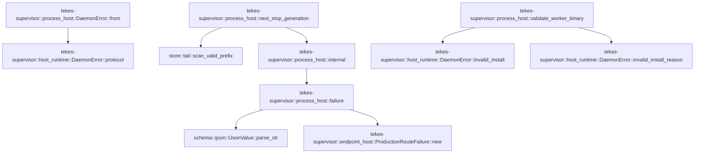

```mermaid
flowchart TD
  n0["endpoint::service::NativeEndpoint::open"]
  n1["endpoint::types::validate_session_id"]
  n2["engine::admission::AdmissionPool::new"]
  n3["profile::config::ConfigRepository::open"]
  n4["profile::scope::workspace_instructions"]
  n5["profile::scope::SessionScope::locate"]
  n6["provider::secret_store::MemorySecretStore::new"]
  n7["schedule::ScheduleAuthority::open"]
  n8["store::folder::ThreadStore::open"]
  n9["store::folder_events::subscribe"]
  n10["store::folder_events::canonical_root"]
  n11["tekes-supervisor::catalog::Catalog::new"]
  n12["tekes-supervisor::dynamic_bindings::resolve_worker_launch_bindings"]
  n13["tekes-supervisor::host_runtime::DaemonError::invalid_config"]
  n14["tekes-supervisor::host_runtime::DaemonError::corrupt"]
  n15["tekes-supervisor::host_runtime::DaemonError::required_broker"]
  n16["tekes-supervisor::mcp_runtime::McpRuntime::open_production_authorities_with_mutation"]
  n17["tekes-supervisor::process_host::ProductionProcessHost::workspace_policy_published"]
  n18["tekes-supervisor::process_host::ProductionProcessHost::workspace_policy_recovered"]
  n19["tekes-supervisor::process_host::ProductionProcessHost::plugin_store"]
  n20["tekes-supervisor::process_host::ProductionProcessHost::client_file_changes"]
  n21["tekes-supervisor::process_host::ProductionProcessHost::client_file_page"]
  n22["tekes-supervisor::process_host::ProductionProcessHost::session_scope"]
  n23["tekes-supervisor::process_host::ProductionProcessHost::user_agent_dir"]
  n24["tekes-supervisor::process_host::mcp_failure_is_required"]
  n25["tekes-supervisor::process_host::required_mcp_failure_reason"]
  n26["tekes-supervisor::process_host::PolicyCandidateError::new"]
  n27["tekes-supervisor::process_host::terminate_worker"]
  n28["tekes-supervisor::process_host::WorkerHandshakeGuard::child_mut"]
  n29["tekes-supervisor::process_host::WorkerHandshakeGuard::take_credential_broker"]
  n30["tekes-supervisor::process_host::WorkerHandshakeGuard::wait_for_exit"]
  n31["tekes-supervisor::process_host::WorkerHandshakeGuard::drop"]
  n32["tekes-supervisor::process_host::reconcile_credential_bindings"]
  n33["tekes-supervisor::process_host::scoped_client_file_path"]
  n34["tekes-supervisor::process_host::validate_worker_binary"]
  n35["tekes-supervisor::process_host::credential_control"]
  n36["tekes-supervisor::process_host::active_material"]
  n37["tekes-supervisor::process_host::retain_prior_for_unknown_credentials"]
  n38["tekes-supervisor::process_host::ProductionProcessHost::open"]
  n39["tekes-supervisor::process_host::ProductionProcessHost::open_with_secret_store"]
  n40["tekes-supervisor::process_host::ProductionProcessHost::open_with_secret_authorities"]
  n41["tekes-supervisor::process_host::ProductionProcessHost::mcp_runtime"]
  n42["tekes-supervisor::process_host::ProductionProcessHost::credential_is_ready"]
  n43["tekes-supervisor::process_host::ProductionProcessHost::validate_workspace_policy_candidate"]
  n44["tekes-supervisor::thread_card::CardWriter::spawn_from_env"]
  n45["tools::builtin::BuiltinManifest::compiled"]
  n46["workspace-service::file_text_page"]
  n47["workspace-service::file_byte_page"]
  n17 --> n13
  n17 --> n27
  n18 --> n27
  n20 --> n22
  n21 --> n13
  n21 --> n22
  n21 --> n33
  n21 --> n46
  n21 --> n47
  n22 --> n1
  n22 --> n5
  n22 --> n13
  n30 --> n28
  n32 --> n15
  n32 --> n35
  n32 --> n36
  n35 --> n15
  n38 --> n6
  n38 --> n39
  n39 --> n40
  n40 --> n0
  n40 --> n2
  n40 --> n3
  n40 --> n7
  n40 --> n8
  n40 --> n9
  n40 --> n10
  n40 --> n11
  n40 --> n13
  n40 --> n14
  n40 --> n15
  n40 --> n16
  n40 --> n34
  n40 --> n44
  n43 --> n4
  n43 --> n12
  n43 --> n24
  n43 --> n25
  n43 --> n26
  n43 --> n45
```

```mermaid
flowchart TD
  n0["endpoint::management::ManagementStore::open_light_at"]
  n1["engine::lifecycle::classify"]
  n2["profile::resources::ResourceCatalog::from_snapshot"]
  n3["profile::scope::workspace_instructions"]
  n4["store::folder::ThreadStore::open"]
  n5["store::folder_events::is_admitted"]
  n6["store::tail::scan_valid_prefix"]
  n7["tekes-supervisor::boot_trace::phase"]
  n8["tekes-supervisor::dynamic_bindings::resolve_worker_launch_bindings"]
  n9["tekes-supervisor::host_runtime::DaemonError::protocol"]
  n10["tekes-supervisor::host_runtime::DaemonError::invalid_config"]
  n11["tekes-supervisor::host_runtime::DaemonError::corrupt"]
  n12["tekes-supervisor::host_runtime::DaemonError::required_broker"]
  n13["tekes-supervisor::process_host::ProductionProcessHost::session_scope"]
  n14["tekes-supervisor::process_host::ProductionProcessHost::client_session_roots"]
  n15["tekes-supervisor::process_host::ProductionProcessHost::client_resource_catalog"]
  n16["tekes-supervisor::process_host::ProductionProcessHost::client_tool_catalog"]
  n17["tekes-supervisor::process_host::ProductionProcessHost::schedule_authority"]
  n18["tekes-supervisor::process_host::ProductionProcessHost::start_schedule_timer"]
  n19["tekes-supervisor::process_host::ProductionProcessHost::schedule_failure"]
  n20["tekes-supervisor::process_host::ProductionProcessHost::schedule_has_work"]
  n21["tekes-supervisor::process_host::ProductionProcessHost::drive_schedule"]
  n22["tekes-supervisor::process_host::ProductionProcessHost::execute_schedule_claim"]
  n23["tekes-supervisor::process_host::ProductionProcessHost::reconcile_schedule_statuses"]
  n24["tekes-supervisor::process_host::ProductionProcessHost::run_post_ready"]
  n25["tekes-supervisor::process_host::ProductionProcessHost::post_ready_tasks"]
  n26["tekes-supervisor::process_host::ProductionProcessHost::cleanup_stale_ephemeral"]
  n27["tekes-supervisor::process_host::ProductionProcessHost::live_sessions_for_cleanup"]
  n28["tekes-supervisor::process_host::ProductionProcessHost::run_upgrade_pass"]
  n29["tekes-supervisor::process_host::ProductionProcessHost::is_stale_ephemeral"]
  n30["tekes-supervisor::process_host::ProductionProcessHost::on_folder_event"]
  n31["tekes-supervisor::process_host::ProductionProcessHost::attach_streams"]
  n32["tekes-supervisor::process_host::ProductionProcessHost::reconcile_child_line"]
  n33["tekes-supervisor::process_host::ProductionProcessHost::publish_session_status"]
  n34["tekes-supervisor::process_host::ProductionProcessHost::hydrate"]
  n35["tekes-supervisor::process_host::ProductionProcessHost::recently_failed"]
  n36["tekes-supervisor::process_host::ProductionProcessHost::live_worker"]
  n37["tekes-supervisor::process_host::mcp_failure_is_required"]
  n38["tekes-supervisor::process_host::probe_line_lock"]
  n14 --> n10
  n14 --> n13
  n15 --> n2
  n15 --> n10
  n15 --> n13
  n16 --> n3
  n16 --> n8
  n16 --> n10
  n16 --> n12
  n16 --> n13
  n16 --> n37
  n18 --> n20
  n18 --> n21
  n20 --> n11
  n21 --> n11
  n21 --> n22
  n21 --> n23
  n22 --> n0
  n22 --> n9
  n22 --> n11
  n23 --> n1
  n23 --> n6
  n23 --> n11
  n23 --> n36
  n23 --> n38
  n25 --> n7
  n25 --> n18
  n25 --> n26
  n25 --> n28
  n26 --> n4
  n26 --> n5
  n26 --> n27
  n28 --> n34
  n28 --> n35
  n29 --> n5
```

```mermaid
flowchart TD
  n0["provider::secret_store::resolve_config_credentials"]
  n1["store::card::remove_stale_card_temps"]
  n2["store::folder_events::arm_admission"]
  n3["store::folder_events::is_admitted"]
  n4["store::folder_events::admitted_ids"]
  n5["store::tail::scan_valid_prefix"]
  n6["store::tail::repair_thread_tails"]
  n7["tekes-supervisor::boot_trace::detail"]
  n8["tekes-supervisor::boot_trace::per_item_enabled"]
  n9["tekes-supervisor::endpoint_host::recover_pending_management"]
  n10["tekes-supervisor::host_runtime::DaemonError::protocol"]
  n11["tekes-supervisor::host_runtime::DaemonError::invalid_config"]
  n12["tekes-supervisor::host_runtime::DaemonError::corrupt"]
  n13["tekes-supervisor::host_runtime::DaemonError::required_broker"]
  n14["tekes-supervisor::process_host::ProductionProcessHost::start_periodic_sweep"]
  n15["tekes-supervisor::process_host::ProductionProcessHost::recover_pending_management"]
  n16["tekes-supervisor::process_host::ProductionProcessHost::refresh_live_credentials"]
  n17["tekes-supervisor::process_host::ProductionProcessHost::config_mutation_succeeded"]
  n18["tekes-supervisor::process_host::ProductionProcessHost::refresh_worker_credentials"]
  n19["tekes-supervisor::process_host::ProductionProcessHost::boot_sweep"]
  n20["tekes-supervisor::process_host::ProductionProcessHost::arm_admission"]
  n21["tekes-supervisor::process_host::ProductionProcessHost::recover_client_sessions"]
  n22["tekes-supervisor::process_host::ProductionProcessHost::ensure_verified"]
  n23["tekes-supervisor::process_host::ProductionProcessHost::hydrate"]
  n24["tekes-supervisor::process_host::ProductionProcessHost::hydrate_with"]
  n25["tekes-supervisor::process_host::ProductionProcessHost::recently_failed"]
  n26["tekes-supervisor::process_host::ProductionProcessHost::hydrate_unrecorded"]
  n27["tekes-supervisor::process_host::ProductionProcessHost::repair_main_projection"]
  n28["tekes-supervisor::process_host::ProductionProcessHost::periodic_sweep_once"]
  n29["tekes-supervisor::process_host::ProductionProcessHost::is_draining"]
  n30["tekes-supervisor::process_host::ProductionProcessHost::sweep_ledger_scan"]
  n31["tekes-supervisor::process_host::ProductionProcessHost::sweep_once"]
  n32["tekes-supervisor::process_host::ProductionProcessHost::sweep_ids"]
  n33["tekes-supervisor::process_host::ProductionProcessHost::is_deferred"]
  n34["tekes-supervisor::process_host::ProductionProcessHost::sweep_session"]
  n35["tekes-supervisor::process_host::ProductionProcessHost::publish_appended"]
  n36["tekes-supervisor::process_host::ProductionProcessHost::publish_appended_with"]
  n37["tekes-supervisor::process_host::web_search_scope_ready"]
  n38["tekes-supervisor::process_host::terminate_worker"]
  n39["tekes-supervisor::process_host::damage_under_lock"]
  n40["tekes-supervisor::process_host::child_ledger_damage"]
  n41["tekes-supervisor::process_host::reconcile_credential_bindings"]
  n42["tekes-supervisor::process_host::retain_prior_for_unknown_credentials"]
  n43["tekes-supervisor::process_host::SweepLedgerIdentity::of"]
  n44["tekes-supervisor::thread_card::fold_child_views"]
  n15 --> n9
  n16 --> n18
  n17 --> n16
  n18 --> n0
  n18 --> n13
  n18 --> n37
  n18 --> n38
  n18 --> n41
  n18 --> n42
  n19 --> n31
  n20 --> n2
  n21 --> n11
  n21 --> n22
  n21 --> n34
  n22 --> n11
  n22 --> n12
  n22 --> n23
  n23 --> n24
  n24 --> n26
  n26 --> n1
  n26 --> n6
  n26 --> n12
  n26 --> n36
  n26 --> n39
  n26 --> n40
  n26 --> n44
  n27 --> n35
  n28 --> n31
  n30 --> n5
  n30 --> n10
  n30 --> n12
  n30 --> n43
  n31 --> n7
  n31 --> n8
  n31 --> n32
  n31 --> n34
  n32 --> n4
  n33 --> n3
```

```mermaid
flowchart TD
  n0["engine::lifecycle::ensure_action_at"]
  n1["engine::lifecycle::classify"]
  n2["session-controls::bound_goal_id"]
  n3["store::platform::NamedLock::shared"]
  n4["tekes-supervisor::dynamic_bindings::resolve_worker_launch_bindings"]
  n5["tekes-supervisor::host_runtime::system_timestamp"]
  n6["tekes-supervisor::host_runtime::DaemonError::protocol"]
  n7["tekes-supervisor::host_runtime::DaemonError::io"]
  n8["tekes-supervisor::host_runtime::DaemonError::invalid_config"]
  n9["tekes-supervisor::host_runtime::DaemonError::required_broker"]
  n10["tekes-supervisor::launch_profiled_worker_with_secret_store_and_binding_resolver"]
  n11["tekes-supervisor::process_host::production_sandbox_backend"]
  n12["tekes-supervisor::process_host::ProductionProcessHost::live_sessions_for_cleanup"]
  n13["tekes-supervisor::process_host::now_rfc3339"]
  n14["tekes-supervisor::process_host::ProductionProcessHost::publish_session_status"]
  n15["tekes-supervisor::process_host::ProductionProcessHost::refresh_worker_credentials"]
  n16["tekes-supervisor::process_host::ProductionProcessHost::ensure_verified"]
  n17["tekes-supervisor::process_host::ProductionProcessHost::repair_main_projection"]
  n18["tekes-supervisor::process_host::ProductionProcessHost::sweep_ledger_scan"]
  n19["tekes-supervisor::process_host::ProductionProcessHost::is_deferred"]
  n20["tekes-supervisor::process_host::ProductionProcessHost::sweep_session"]
  n21["tekes-supervisor::process_host::ProductionProcessHost::propagate_durable_stops_before_sweep"]
  n22["tekes-supervisor::process_host::ProductionProcessHost::shutdown"]
  n23["tekes-supervisor::process_host::ProductionProcessHost::shutdown_with"]
  n24["tekes-supervisor::process_host::ProductionProcessHost::ensure_running"]
  n25["tekes-supervisor::process_host::ProductionProcessHost::live_worker"]
  n26["tekes-supervisor::process_host::ProductionProcessHost::spawn_worker_at"]
  n27["tekes-supervisor::process_host::ProductionProcessHost::spawn_worker_at_with_handshake_timeout"]
  n28["tekes-supervisor::process_host::ProductionProcessHost::workspace_service_binary"]
  n29["tekes-supervisor::process_host::ProductionProcessHost::worker_binary_digest"]
  n30["tekes-supervisor::process_host::ProductionProcessHost::refresh_limits"]
  n31["tekes-supervisor::process_host::ProductionProcessHost::preflight_mandatory_authorities"]
  n32["tekes-supervisor::process_host::ProductionProcessHost::is_mcp_only_app_sandbox_host"]
  n33["tekes-supervisor::process_host::ProductionProcessHost::freeze_tool_authority"]
  n34["tekes-supervisor::process_host::ProductionProcessHost::schedule_main"]
  n35["tekes-supervisor::process_host::ProductionProcessHost::schedule_line"]
  n36["tekes-supervisor::process_host::ProductionProcessHost::schedule_worker_at"]
  n37["tekes-supervisor::process_host::ProductionProcessHost::schedule_worker_at_with_startup"]
  n38["tekes-supervisor::process_host::ProductionProcessHost::schedule_child_from_parent"]
  n39["tekes-supervisor::process_host::ProductionProcessHost::wait_for_worker"]
  n40["tekes-supervisor::process_host::ProductionProcessHost::has_worker_capacity"]
  n41["tekes-supervisor::process_host::ProductionProcessHost::cascade_stop_from"]
  n42["tekes-supervisor::process_host::ProductionProcessHost::reset_restart_backoff"]
  n43["tekes-supervisor::process_host::ProductionProcessHost::restart_is_due"]
  n44["tekes-supervisor::process_host::ProductionProcessHost::note_restart_failure"]
  n45["tekes-supervisor::process_host::ProductionProcessHost::record_session_notice"]
  n46["tekes-supervisor::process_host::genesis_preset_skills"]
  n47["tekes-supervisor::process_host::missing_preset_skill_notice"]
  n48["tekes-supervisor::process_host::mcp_launch_notices"]
  n49["tekes-supervisor::process_host::frozen_tool_launch_policy"]
  n50["tekes-supervisor::process_host::validator_tool_launch_policy"]
  n51["tekes-supervisor::process_host::mcp_failure_is_required"]
  n52["tekes-supervisor::process_host::child_dependency_admitted"]
  n53["tekes-supervisor::process_host::worker_reader"]
  n54["tekes-supervisor::process_host::worker_stderr_reader"]
  n55["tekes-supervisor::process_host::unresolved_parent_dependency"]
  n56["tekes-supervisor::process_host::line_schedule_target"]
  n57["tekes-supervisor::process_host::workspace_quiescence_lock_path"]
  n58["tekes-supervisor::process_host::workspace_id"]
  n59["tekes-supervisor::process_host::session_workspace_binding"]
  n60["tekes-supervisor::process_host::goal_continuation_due"]
  n61["tekes-supervisor::process_host::probe_line_lock"]
  n62["tekes-supervisor::process_host::read_worker_hello"]
  n63["tools::runtime_backends::HelperJobLauncher::new"]
  n64["tools::runtime_backends::HelperJobLauncher::disabled"]
  n65["tools::sandbox::probe_backend"]
  n66["worker-control::durable::encode_queue_transaction"]
  n67["worker-control::negotiate"]
  n68["worker-control::encode_line"]
  n20 --> n0
  n20 --> n1
  n20 --> n13
  n20 --> n17
  n20 --> n18
  n20 --> n19
  n20 --> n21
  n20 --> n30
  n20 --> n36
  n20 --> n43
  n20 --> n44
  n20 --> n60
  n20 --> n61
  n21 --> n18
  n21 --> n41
  n22 --> n23
  n23 --> n12
  n24 --> n30
  n24 --> n36
  n24 --> n39
  n24 --> n42
  n26 --> n27
  n27 --> n2
  n27 --> n3
  n27 --> n4
  n27 --> n5
  n27 --> n6
  n27 --> n8
  n27 --> n9
  n27 --> n10
  n27 --> n29
  n27 --> n33
  n27 --> n45
  n27 --> n46
  n27 --> n47
  n27 --> n48
  n27 --> n50
  n27 --> n51
  n27 --> n53
  n27 --> n54
  n27 --> n57
  n27 --> n59
  n27 --> n62
  n27 --> n66
  n27 --> n67
  n27 --> n68
  n30 --> n8
  n30 --> n58
  n31 --> n9
  n31 --> n11
  n31 --> n32
  n31 --> n63
  n31 --> n64
  n31 --> n65
  n32 --> n7
  n32 --> n9
  n33 --> n9
  n33 --> n11
  n33 --> n32
  n33 --> n49
  n33 --> n63
  n33 --> n64
  n33 --> n65
  n34 --> n36
  n35 --> n36
  n35 --> n38
  n35 --> n55
  n35 --> n56
  n36 --> n37
  n37 --> n6
  n37 --> n14
  n37 --> n15
  n37 --> n16
  n37 --> n25
  n37 --> n26
  n37 --> n30
  n37 --> n40
  n38 --> n14
  n38 --> n15
  n38 --> n26
  n38 --> n30
  n38 --> n40
  n38 --> n52
  n39 --> n9
```

```mermaid
flowchart TD
  n0["engine::compaction_summary::admit_summary_artifact"]
  n1["engine::compaction_summary::summary_request_bytes"]
  n2["engine::compaction_summary::CompactionSummary::from_outcome"]
  n3["engine::compaction_summary::freeze_source_bundle"]
  n4["engine::context::plan_context_compaction"]
  n5["provider::compaction_summary::prepare_summary_request"]
  n6["provider::compaction_summary::summary_completion_artifact"]
  n7["provider::http::HttpRuntime::new"]
  n8["schema::event::Event::from_value"]
  n9["schema::ijson::IJsonValue::parse"]
  n10["store::tail::scan_valid_prefix"]
  n11["store::tail::read_genesis"]
  n12["tekes-supervisor::host_runtime::DaemonError::protocol"]
  n13["tekes-supervisor::host_runtime::DaemonError::corrupt"]
  n14["tekes-supervisor::host_runtime::DaemonError::required_broker"]
  n15["tekes-supervisor::process_host::spill_compaction_summary"]
  n16["tekes-supervisor::process_host::ProductionProcessHost::publish_session_status"]
  n17["tekes-supervisor::process_host::deterministic_automatic_thread_title"]
  n18["tekes-supervisor::process_host::normalized_automatic_thread_title"]
  n19["tekes-supervisor::process_host::prompt_text"]
  n20["tekes-supervisor::process_host::automatic_title_origin"]
  n21["tekes-supervisor::process_host::ProductionProcessHost::spawn_worker_at"]
  n22["tekes-supervisor::process_host::automatic_title_route"]
  n23["tekes-supervisor::process_host::ProductionProcessHost::schedule_main"]
  n24["tekes-supervisor::process_host::session_model_route"]
  n25["tekes-supervisor::process_host::ProductionProcessHost::start_pending_workers"]
  n26["tekes-supervisor::process_host::ProductionProcessHost::has_worker_capacity"]
  n27["tekes-supervisor::process_host::ProductionProcessHost::request_provider_lease"]
  n28["tekes-supervisor::process_host::ProductionProcessHost::locked_prompt"]
  n29["tekes-supervisor::process_host::ProductionProcessHost::locked_compact"]
  n30["tekes-supervisor::process_host::ProductionProcessHost::first_root_input"]
  n31["tekes-supervisor::process_host::ProductionProcessHost::seed_automatic_title"]
  n32["tekes-supervisor::process_host::ProductionProcessHost::try_seed_automatic_title"]
  n33["tekes-supervisor::process_host::ProductionProcessHost::wait_and_seed_automatic_title"]
  n34["tekes-supervisor::process_host::ProductionProcessHost::spawn_automatic_title_refinement"]
  n35["tekes-supervisor::process_host::ProductionProcessHost::spawn_automatic_title_seed_and_refinement"]
  n36["tekes-supervisor::process_host::ProductionProcessHost::refine_automatic_title"]
  n37["tekes-supervisor::process_host::prepare_automatic_title_request"]
  n38["tekes-supervisor::process_host::ProductionProcessHost::complete_automatic_text"]
  n39["tekes-supervisor::process_host::ProductionProcessHost::complete_automatic_terminal"]
  n40["tekes-supervisor::process_host::ProductionProcessHost::summary_for_manual_compaction"]
  n41["tekes-supervisor::process_host::ProductionProcessHost::generate_automatic_title"]
  n42["tekes-supervisor::process_host::ProductionProcessHost::handle_tool_control"]
  n43["tekes-supervisor::process_host::ProductionProcessHost::handle_tool_continuation"]
  n44["tekes-supervisor::process_host::ProductionProcessHost::validate_child_proof"]
  n45["tekes-supervisor::process_host::ProductionProcessHost::publish_appended"]
  n46["tekes-supervisor::process_host::ProductionProcessHost::publish_appended_with"]
  n47["tekes-supervisor::process_host::ProductionProcessHost::reset_restart_backoff"]
  n48["tekes-supervisor::process_host::ProductionProcessHost::record_spawn_failure"]
  n49["tekes-supervisor::process_host::ledger_needs_worker"]
  n50["tekes-supervisor::process_host::internal"]
  n51["tekes-supervisor::production_tool_control::JobBrokerSupervisorAuthority::new"]
  n52["tekes-supervisor::production_tool_control::ProductionToolControlHandler::new"]
  n53["tekes-supervisor::production_tool_control::ProductionToolControlPolicy::new"]
  n54["tekes-supervisor::tool_control::ToolControlSession::new"]
  n55["tools::schema_registry::fixed_schema"]
  n56["worker-control::continuation::decode_tool_continuation"]
  n57["worker-control::continuation::encode_tool_continuation_result"]
  n25 --> n16
  n25 --> n21
  n25 --> n26
  n25 --> n49
  n28 --> n9
  n28 --> n19
  n28 --> n23
  n28 --> n30
  n28 --> n31
  n28 --> n34
  n28 --> n47
  n28 --> n48
  n29 --> n4
  n29 --> n8
  n29 --> n9
  n29 --> n15
  n29 --> n40
  n29 --> n45
  n29 --> n50
  n30 --> n10
  n31 --> n32
  n32 --> n17
  n32 --> n20
  n32 --> n45
  n33 --> n32
  n36 --> n20
  n36 --> n41
  n36 --> n45
  n38 --> n39
  n39 --> n7
  n40 --> n0
  n40 --> n1
  n40 --> n2
  n40 --> n3
  n40 --> n4
  n40 --> n5
  n40 --> n6
  n40 --> n9
  n40 --> n10
  n40 --> n24
  n40 --> n39
  n40 --> n55
  n41 --> n18
  n41 --> n22
  n41 --> n37
  n41 --> n38
  n42 --> n12
  n42 --> n14
  n42 --> n51
  n42 --> n52
  n42 --> n53
  n42 --> n54
  n43 --> n12
  n43 --> n14
  n43 --> n51
  n43 --> n52
  n43 --> n53
  n43 --> n56
  n43 --> n57
  n44 --> n11
  n44 --> n13
  n45 --> n46
```

```mermaid
flowchart TD
  n0["endpoint::journal::EndpointJournal::open"]
  n1["engine::lifecycle::ensure_action_at"]
  n2["engine::lifecycle::classify"]
  n3["mcp::projection::project_name"]
  n4["profile::resources::ResourceCatalog::skill_package_names"]
  n5["provider::request::endpoint_origin"]
  n6["schema::event::Event::from_value"]
  n7["schema::ijson::IJsonValue::parse"]
  n8["store::tail::LockedLedger::open"]
  n9["store::tail::scan_valid_prefix"]
  n10["store::tail::read_genesis"]
  n11["tekes-supervisor::host_runtime::system_timestamp"]
  n12["tekes-supervisor::host_runtime::DaemonError::protocol"]
  n13["tekes-supervisor::host_runtime::DaemonError::invalid_config"]
  n14["tekes-supervisor::host_runtime::DaemonError::corrupt"]
  n15["tekes-supervisor::host_runtime::DaemonError::required_broker"]
  n16["tekes-supervisor::process_host::now_rfc3339"]
  n17["tekes-supervisor::process_host::session_event_time_now"]
  n18["tekes-supervisor::process_host::ProductionProcessHost::refresh_limits"]
  n19["tekes-supervisor::process_host::ProductionProcessHost::schedule_worker_at"]
  n20["tekes-supervisor::process_host::ProductionProcessHost::schedule_child_from_parent"]
  n21["tekes-supervisor::process_host::ProductionProcessHost::publish_appended"]
  n22["tekes-supervisor::process_host::ProductionProcessHost::publish_appended_with"]
  n23["tekes-supervisor::process_host::ProductionProcessHost::publish_frame"]
  n24["tekes-supervisor::process_host::ProductionProcessHost::launch_child"]
  n25["tekes-supervisor::process_host::ProductionProcessHost::propagate_parent_stop"]
  n26["tekes-supervisor::process_host::ProductionProcessHost::cascade_stop_from"]
  n27["tekes-supervisor::process_host::ProductionProcessHost::reconcile_after_exit"]
  n28["tekes-supervisor::process_host::ProductionProcessHost::reset_restart_backoff"]
  n29["tekes-supervisor::process_host::ProductionProcessHost::restart_is_due"]
  n30["tekes-supervisor::process_host::ProductionProcessHost::note_restart_failure"]
  n31["tekes-supervisor::process_host::ProductionProcessHost::record_spawn_failure"]
  n32["tekes-supervisor::process_host::ProductionProcessHost::record_session_notice"]
  n33["tekes-supervisor::process_host::genesis_preset_skills"]
  n34["tekes-supervisor::process_host::missing_preset_skill_notice"]
  n35["tekes-supervisor::process_host::mcp_launch_notices"]
  n36["tekes-supervisor::process_host::frozen_tool_launch_policy"]
  n37["tekes-supervisor::process_host::validator_tool_launch_policy"]
  n38["tekes-supervisor::process_host::private_validator_launch_policy"]
  n39["tekes-supervisor::process_host::web_search_scope_ready"]
  n40["tekes-supervisor::process_host::mcp_failure_is_required"]
  n41["tekes-supervisor::process_host::required_mcp_failure_reason"]
  n42["tekes-supervisor::process_host::terminate_worker"]
  n43["tekes-supervisor::process_host::ledger_damage"]
  n44["tekes-supervisor::process_host::damage_under_lock"]
  n45["tekes-supervisor::process_host::line_schedule_target"]
  n46["tekes-supervisor::process_host::goal_continuation_due"]
  n47["tekes-supervisor::process_host::probe_line_lock"]
  n48["tekes-supervisor::thread_card::journal_input"]
  n49["tekes-supervisor::thread_card::prepare"]
  n50["tools::preset::ResolvedPreset::from_genesis"]
  n51["tools::runtime_backends::JobLaunchPolicy::new"]
  n52["tools::sandbox::kernel_protected_roots"]
  n53["tools::sandbox::exposed_protected_roots"]
  n54["worker-control::encode_line"]
  n22 --> n0
  n22 --> n9
  n22 --> n14
  n22 --> n43
  n22 --> n44
  n22 --> n48
  n22 --> n49
  n23 --> n0
  n23 --> n9
  n23 --> n14
  n23 --> n17
  n24 --> n1
  n24 --> n2
  n24 --> n9
  n24 --> n12
  n24 --> n14
  n24 --> n16
  n24 --> n20
  n24 --> n25
  n24 --> n47
  n25 --> n6
  n25 --> n7
  n25 --> n8
  n25 --> n9
  n25 --> n12
  n25 --> n14
  n25 --> n54
  n26 --> n9
  n26 --> n14
  n26 --> n20
  n26 --> n25
  n26 --> n26
  n26 --> n42
  n26 --> n45
  n27 --> n1
  n27 --> n2
  n27 --> n9
  n27 --> n14
  n27 --> n16
  n27 --> n18
  n27 --> n19
  n27 --> n21
  n27 --> n28
  n27 --> n29
  n27 --> n30
  n27 --> n46
  n27 --> n47
  n31 --> n32
  n32 --> n11
  n32 --> n21
  n33 --> n10
  n33 --> n50
  n34 --> n4
  n36 --> n13
  n36 --> n15
  n36 --> n51
  n36 --> n52
  n36 --> n53
  n37 --> n9
  n37 --> n12
  n37 --> n14
  n37 --> n15
  n37 --> n38
  n38 --> n15
  n38 --> n51
  n39 --> n5
  n40 --> n3
  n41 --> n40
```

```mermaid
flowchart TD
  n0["endpoint::service::genesis_preset_summary"]
  n1["endpoint::service::permission_mode_of"]
  n2["endpoint::service::last_record_updated_ms"]
  n3["endpoint::types::validate_session_id"]
  n4["store::card::valid_line_name"]
  n5["store::folder_events::admitted_ids"]
  n6["store::tail::scan_valid_prefix"]
  n7["store::tail::read_genesis"]
  n8["tekes-supervisor::endpoint_host::ProductionRouteFailure::new"]
  n9["tekes-supervisor::process_host::ProductionProcessHost::is_stale_ephemeral"]
  n10["tekes-supervisor::process_host::ProductionProcessHost::ensure_verified"]
  n11["tekes-supervisor::process_host::ProductionProcessHost::recently_failed"]
  n12["tekes-supervisor::process_host::cancel_stage_failure"]
  n13["tekes-supervisor::process_host::child_exited_within"]
  n14["tekes-supervisor::process_host::neutral_lifecycle"]
  n15["tekes-supervisor::process_host::ledger_damage"]
  n16["tekes-supervisor::process_host::damage_under_lock"]
  n17["tekes-supervisor::process_host::child_ledger_damage"]
  n18["tekes-supervisor::process_host::is_single_line_ledger"]
  n19["tekes-supervisor::process_host::ProductionProcessHost::list_wait"]
  n20["tekes-supervisor::process_host::ProductionProcessHost::is_running"]
  n21["tekes-supervisor::process_host::ProductionProcessHost::catalog_item"]
  n22["tekes-supervisor::process_host::ProductionProcessHost::verify_within"]
  n23["tekes-supervisor::process_host::ProductionProcessHost::build_inventory"]
  n24["tekes-supervisor::process_host::ProductionProcessHost::inventory_items"]
  n25["tekes-supervisor::process_host::ProductionProcessHost::ensure_verified"]
  n26["tekes-supervisor::process_host::ProductionProcessHost::has_catalog"]
  n27["tekes-supervisor::process_host::ProductionProcessHost::hold_catalog"]
  n28["tekes-supervisor::process_host::ProductionProcessHost::inventory_item"]
  n29["tekes-supervisor::process_host::ProductionProcessHost::live_sessions"]
  n30["tekes-supervisor::process_host::ProductionProcessHost::reconcile_projection"]
  n31["tekes-supervisor::process_host::ProductionProcessHost::execute"]
  n32["worker-control::durable::encode_queue_transaction"]
  n12 --> n8
  n15 --> n6
  n16 --> n15
  n17 --> n4
  n17 --> n15
  n17 --> n16
  n21 --> n0
  n21 --> n1
  n21 --> n2
  n21 --> n7
  n21 --> n9
  n21 --> n14
  n21 --> n18
  n21 --> n20
  n23 --> n3
  n23 --> n5
  n23 --> n11
  n23 --> n14
  n23 --> n21
  n23 --> n22
  n25 --> n10
  n31 --> n32
```

```mermaid
flowchart TD
  n0["engine::lifecycle::ensure_action_at"]
  n1["engine::lifecycle::classify"]
  n2["profile::scope::SessionScope::for_ledger"]
  n3["provider::dialect::validate_provider"]
  n4["provider::dialect::resolve_profile"]
  n5["provider::request::endpoint_origin"]
  n6["provider::secret_store::resolve_config_credentials"]
  n7["schema::ijson::IJsonValue::parse"]
  n8["session-controls::read_goal"]
  n9["store::tail::scan_valid_prefix"]
  n10["tekes-supervisor::host_runtime::system_timestamp"]
  n11["tekes-supervisor::host_runtime::DaemonError::protocol"]
  n12["tekes-supervisor::host_runtime::DaemonError::io"]
  n13["tekes-supervisor::host_runtime::DaemonError::store"]
  n14["tekes-supervisor::host_runtime::DaemonError::invalid_config"]
  n15["tekes-supervisor::host_runtime::DaemonError::corrupt"]
  n16["tekes-supervisor::process_host::now_rfc3339"]
  n17["tekes-supervisor::process_host::ProductionProcessHost::readiness"]
  n18["tekes-supervisor::process_host::ProductionProcessHost::config_mutation_succeeded"]
  n19["tekes-supervisor::process_host::ProcessToolRuntime::host"]
  n20["tekes-supervisor::process_host::ProcessToolRuntime::ensure_running"]
  n21["tekes-supervisor::process_host::ProcessToolRuntime::deliver_input"]
  n22["tekes-supervisor::process_host::ProcessToolRuntime::interrupt"]
  n23["tekes-supervisor::process_host::ProcessToolRuntime::ensure_child"]
  n24["tekes-supervisor::process_host::ProcessToolRuntime::deliver_report"]
  n25["tekes-supervisor::process_host::unresolved_parent_dependency"]
  n26["tekes-supervisor::process_host::line_schedule_target"]
  n27["tekes-supervisor::process_host::operation_unavailable"]
  n28["tekes-supervisor::process_host::operation_value"]
  n29["tekes-supervisor::process_host::workspace_quiescence_lock_path"]
  n30["tekes-supervisor::process_host::workspace_id"]
  n31["tekes-supervisor::process_host::scoped_client_file_path"]
  n32["tekes-supervisor::process_host::session_workspace_binding"]
  n33["tekes-supervisor::process_host::ledger_needs_worker"]
  n34["tekes-supervisor::process_host::goal_continuation_due"]
  n35["tekes-supervisor::process_host::probe_line_lock"]
  n36["tekes-supervisor::process_host::read_worker_hello"]
  n37["worker-control::decode_hello"]
  n17 --> n3
  n17 --> n4
  n17 --> n5
  n17 --> n6
  n20 --> n28
  n21 --> n10
  n21 --> n28
  n22 --> n9
  n22 --> n10
  n22 --> n12
  n22 --> n27
  n22 --> n28
  n23 --> n28
  n24 --> n28
  n25 --> n9
  n25 --> n15
  n25 --> n26
  n26 --> n15
  n28 --> n7
  n30 --> n32
  n31 --> n14
  n32 --> n2
  n32 --> n13
  n32 --> n15
  n33 --> n0
  n33 --> n1
  n33 --> n9
  n33 --> n15
  n33 --> n16
  n33 --> n34
  n33 --> n35
  n34 --> n8
  n34 --> n9
  n34 --> n14
  n34 --> n15
  n35 --> n12
  n35 --> n15
  n36 --> n11
  n36 --> n12
  n36 --> n37
```

# tekes-supervisor::process_host

[Package atlas](index.md) · [Source](../../src/process_host.rs)

## Declarations

Visibility is the declaration spelling; trait members and reexports require their enclosing interface. `cfg` is not evaluated.

| Symbol | Kind | Visibility | Test / cfg |
|---|---|---|---|
| [tekes-supervisor::process_host::DELIVERY_TIMEOUT](../../src/process_host.rs#L62) | const_item | `private` |  |
| [tekes-supervisor::process_host::MCP_ONLY_APP_SANDBOX_MARKER](../../src/process_host.rs#L63) | const_item | `private` |  |
| [tekes-supervisor::process_host::WORKER_HANDSHAKE_TIMEOUT](../../src/process_host.rs#L64) | const_item | `private` |  |
| [tekes-supervisor::process_host::WORKER_HELLO_MAX_BYTES](../../src/process_host.rs#L65) | const_item | `private` |  |
| [tekes-supervisor::process_host::MANAGEMENT_RECOVERY_SECONDS](../../src/process_host.rs#L67) | const_item | `private` |  |
| [tekes-supervisor::process_host::PERIODIC_SWEEP_INTERVAL](../../src/process_host.rs#L68) | const_item | `private` |  |
| [tekes-supervisor::process_host::SweepLedgerIdentity](../../src/process_host.rs#L73) | struct_item | `private` |  |
| [tekes-supervisor::process_host::SweepLedgerIdentity::of](../../src/process_host.rs#L80) | function_item | `private` |  |
| [tekes-supervisor::process_host::SweepLedgerScan](../../src/process_host.rs#L93) | struct_item | `private` |  |
| [tekes-supervisor::process_host::AUTOMATIC_THREAD_TITLE_MODEL_HINT](../../src/process_host.rs#L107) | const_item | `private` |  |
| [tekes-supervisor::process_host::AUTOMATIC_THREAD_TITLE_MAX_CHARS](../../src/process_host.rs#L108) | const_item | `private` |  |
| [tekes-supervisor::process_host::AUTOMATIC_THREAD_TITLE_TIMEOUT](../../src/process_host.rs#L109) | const_item | `private` |  |
| [tekes-supervisor::process_host::AUTOMATIC_THREAD_TITLE_MAX_OUTPUT_TOKENS](../../src/process_host.rs#L113) | const_item | `private` |  |
| [tekes-supervisor::process_host::COMPACTION_SUMMARY_TIMEOUT](../../src/process_host.rs#L114) | const_item | `private` |  |
| [tekes-supervisor::process_host::AUTOMATIC_THREAD_TITLE_SYSTEM](../../src/process_host.rs#L115) | const_item | `private` |  |
| [tekes-supervisor::process_host::LineLockState](../../src/process_host.rs#L118) | enum_item | `private` |  |
| [tekes-supervisor::process_host::production_sandbox_backend](../../src/process_host.rs#L123) | function_item | `private` |  |
| [tekes-supervisor::process_host::seq_ranges](../../src/process_host.rs#L134) | function_item | `private` |  |
| [tekes-supervisor::process_host::spill_compaction_summary](../../src/process_host.rs#L153) | function_item | `private` |  |
| [tekes-supervisor::process_host::now_rfc3339](../../src/process_host.rs#L170) | function_item | `private` |  |
| [tekes-supervisor::process_host::session_event_time_now](../../src/process_host.rs#L174) | function_item | `private` |  |
| [tekes-supervisor::process_host::session_event_time](../../src/process_host.rs#L178) | function_item | `private` |  |
| [tekes-supervisor::process_host::compact_title_source](../../src/process_host.rs#L188) | function_item | `private` |  |
| [tekes-supervisor::process_host::bounded_title](../../src/process_host.rs#L192) | function_item | `private` |  |
| [tekes-supervisor::process_host::deterministic_automatic_thread_title](../../src/process_host.rs#L199) | function_item | `private` |  |
| [tekes-supervisor::process_host::normalized_automatic_thread_title](../../src/process_host.rs#L203) | function_item | `private` |  |
| [tekes-supervisor::process_host::prompt_text](../../src/process_host.rs#L228) | function_item | `private` |  |
| [tekes-supervisor::process_host::automatic_title_origin](../../src/process_host.rs#L239) | function_item | `private` |  |
| [tekes-supervisor::process_host::automatic_title_route](../../src/process_host.rs#L249) | function_item | `private` |  |
| [tekes-supervisor::process_host::session_model_route](../../src/process_host.rs#L288) | function_item | `private` |  |
| [tekes-supervisor::process_host::prepare_automatic_title_request](../../src/process_host.rs#L336) | function_item | `private` |  |
| [tekes-supervisor::process_host::prepare_automatic_text_request](../../src/process_host.rs#L353) | function_item | `private` |  |
| [tekes-supervisor::process_host::accepted_stream_event](../../src/process_host.rs#L404) | function_item | `private` | test; #[cfg(test)] |
| [tekes-supervisor::process_host::ProcessToolRuntime](../../src/process_host.rs#L419) | struct_item | `private` |  |
| [tekes-supervisor::process_host::ProductionProcessHost](../../src/process_host.rs#L423) | struct_item | `pub` |  |
| [tekes-supervisor::process_host::SessionProjectionCache](../../src/process_host.rs#L485) | struct_item | `private` |  |
| [tekes-supervisor::process_host::WorkerHandle](../../src/process_host.rs#L491) | struct_item | `private` |  |
| [tekes-supervisor::process_host::WorkerHandshakeGuard](../../src/process_host.rs#L512) | struct_item | `private` |  |
| [tekes-supervisor::process_host::WorkerHandshakeGuard::child_mut](../../src/process_host.rs#L519) | function_item | `private` |  |
| [tekes-supervisor::process_host::WorkerHandshakeGuard::take_child](../../src/process_host.rs#L523) | function_item | `private` |  |
| [tekes-supervisor::process_host::WorkerHandshakeGuard::take_credential_control](../../src/process_host.rs#L527) | function_item | `private` |  |
| [tekes-supervisor::process_host::WorkerHandshakeGuard::take_credential_broker](../../src/process_host.rs#L531) | function_item | `private` |  |
| [tekes-supervisor::process_host::WorkerHandshakeGuard::wait_for_exit](../../src/process_host.rs#L535) | function_item | `private` |  |
| [tekes-supervisor::process_host::WorkerHandshakeGuard::drop](../../src/process_host.rs#L548) | function_item | `private` |  |
| [tekes-supervisor::process_host::PendingWorker](../../src/process_host.rs#L561) | struct_item | `private` |  |
| [tekes-supervisor::process_host::WorkerProtocolQuarantine](../../src/process_host.rs#L568) | struct_item | `private` |  |
| [tekes-supervisor::process_host::RestartBackoff](../../src/process_host.rs#L575) | struct_item | `private` |  |
| [tekes-supervisor::process_host::ScheduledWorker](../../src/process_host.rs#L582) | struct_item | `private` |  |
| [tekes-supervisor::process_host::WorkerState](../../src/process_host.rs#L588) | struct_item | `private` |  |
| [tekes-supervisor::process_host::reconcile_credential_bindings](../../src/process_host.rs#L595) | function_item | `private` |  |
| [tekes-supervisor::process_host::credential_control](../../src/process_host.rs#L699) | function_item | `private` |  |
| [tekes-supervisor::process_host::active_material](../../src/process_host.rs#L710) | function_item | `private` |  |
| [tekes-supervisor::process_host::retain_prior_for_unknown_credentials](../../src/process_host.rs#L724) | function_item | `private` |  |
| [tekes-supervisor::process_host::ProductionProcessHost::open](../../src/process_host.rs#L767) | function_item | `pub` |  |
| [tekes-supervisor::process_host::ProductionProcessHost::open_with_secret_store](../../src/process_host.rs#L782) | function_item | `pub` |  |
| [tekes-supervisor::process_host::ProductionProcessHost::open_with_secret_authorities](../../src/process_host.rs#L802) | function_item | `pub` |  |
| [tekes-supervisor::process_host::ProductionProcessHost::mcp_runtime](../../src/process_host.rs#L914) | function_item | `pub` |  |
| [tekes-supervisor::process_host::ProductionProcessHost::credential_is_ready](../../src/process_host.rs#L921) | function_item | `pub` |  |
| [tekes-supervisor::process_host::ProductionProcessHost::validate_workspace_policy_candidate](../../src/process_host.rs#L942) | function_item | `pub` |  |
| [tekes-supervisor::process_host::ProductionProcessHost::workspace_policy_published](../../src/process_host.rs#L1041) | function_item | `pub` |  |
| [tekes-supervisor::process_host::ProductionProcessHost::workspace_policy_recovered](../../src/process_host.rs#L1070) | function_item | `pub` |  |
| [tekes-supervisor::process_host::ProductionProcessHost::plugin_store](../../src/process_host.rs#L1085) | function_item | `pub(crate)` |  |
| [tekes-supervisor::process_host::ProductionProcessHost::client_file_changes](../../src/process_host.rs#L1091) | function_item | `pub(crate)` |  |
| [tekes-supervisor::process_host::ProductionProcessHost::client_file_page](../../src/process_host.rs#L1118) | function_item | `pub(crate)` |  |
| [tekes-supervisor::process_host::ProductionProcessHost::session_scope](../../src/process_host.rs#L1148) | function_item | `private` |  |
| [tekes-supervisor::process_host::ProductionProcessHost::user_agent_dir](../../src/process_host.rs#L1156) | function_item | `pub` |  |
| [tekes-supervisor::process_host::ProductionProcessHost::client_session_roots](../../src/process_host.rs#L1162) | function_item | `pub` |  |
| [tekes-supervisor::process_host::ProductionProcessHost::client_resource_catalog](../../src/process_host.rs#L1183) | function_item | `pub(crate)` |  |
| [tekes-supervisor::process_host::ProductionProcessHost::client_tool_catalog](../../src/process_host.rs#L1202) | function_item | `pub(crate)` |  |
| [tekes-supervisor::process_host::ProductionProcessHost::schedule_authority](../../src/process_host.rs#L1257) | function_item | `pub` |  |
| [tekes-supervisor::process_host::ProductionProcessHost::start_schedule_timer](../../src/process_host.rs#L1264) | function_item | `pub` |  |
| [tekes-supervisor::process_host::ProductionProcessHost::schedule_failure](../../src/process_host.rs#L1361) | function_item | `pub` |  |
| [tekes-supervisor::process_host::ProductionProcessHost::schedule_has_work](../../src/process_host.rs#L1368) | function_item | `private` |  |
| [tekes-supervisor::process_host::ProductionProcessHost::drive_schedule](../../src/process_host.rs#L1379) | function_item | `private` |  |
| [tekes-supervisor::process_host::ProductionProcessHost::execute_schedule_claim](../../src/process_host.rs#L1393) | function_item | `private` |  |
| [tekes-supervisor::process_host::ProductionProcessHost::reconcile_schedule_statuses](../../src/process_host.rs#L1467) | function_item | `private` |  |
| [tekes-supervisor::process_host::ProductionProcessHost::run_post_ready](../../src/process_host.rs#L1544) | function_item | `pub` |  |
| [tekes-supervisor::process_host::ProductionProcessHost::post_ready_tasks](../../src/process_host.rs#L1558) | function_item | `private` |  |
| [tekes-supervisor::process_host::ProductionProcessHost::cleanup_stale_ephemeral](../../src/process_host.rs#L1579) | function_item | `private` |  |
| [tekes-supervisor::process_host::ProductionProcessHost::live_sessions_for_cleanup](../../src/process_host.rs#L1604) | function_item | `private` |  |
| [tekes-supervisor::process_host::ProductionProcessHost::run_upgrade_pass](../../src/process_host.rs#L1617) | function_item | `private` |  |
| [tekes-supervisor::process_host::ProductionProcessHost::release_for_test](../../src/process_host.rs#L1660) | function_item | `pub(crate)` | test; #[cfg(test)] #[cfg_attr(not(target_os = "macos"), allow(dead_code))] |
| [tekes-supervisor::process_host::ProductionProcessHost::is_stale_ephemeral](../../src/process_host.rs#L1668) | function_item | `pub(crate)` |  |
| [tekes-supervisor::process_host::ProductionProcessHost::on_folder_event](../../src/process_host.rs#L1672) | function_item | `private` |  |
| [tekes-supervisor::process_host::ProductionProcessHost::attach_streams](../../src/process_host.rs#L1711) | function_item | `pub` |  |
| [tekes-supervisor::process_host::ProductionProcessHost::reconcile_child_line](../../src/process_host.rs#L1721) | function_item | `private` |  |
| [tekes-supervisor::process_host::ProductionProcessHost::publish_session_status](../../src/process_host.rs#L1740) | function_item | `private` |  |
| [tekes-supervisor::process_host::ProductionProcessHost::start_periodic_sweep](../../src/process_host.rs#L1757) | function_item | `pub` |  |
| [tekes-supervisor::process_host::ProductionProcessHost::recover_pending_management](../../src/process_host.rs#L1808) | function_item | `private` |  |
| [tekes-supervisor::process_host::ProductionProcessHost::refresh_live_credentials](../../src/process_host.rs#L1816) | function_item | `pub` |  |
| [tekes-supervisor::process_host::ProductionProcessHost::config_mutation_succeeded](../../src/process_host.rs#L1834) | function_item | `pub` |  |
| [tekes-supervisor::process_host::ProductionProcessHost::refresh_worker_credentials](../../src/process_host.rs#L1849) | function_item | `private` |  |
| [tekes-supervisor::process_host::ProductionProcessHost::boot_sweep](../../src/process_host.rs#L1888) | function_item | `pub` |  |
| [tekes-supervisor::process_host::ProductionProcessHost::arm_admission](../../src/process_host.rs#L1899) | function_item | `pub` |  |
| [tekes-supervisor::process_host::ProductionProcessHost::recover_client_sessions](../../src/process_host.rs#L1908) | function_item | `pub` |  |
| [tekes-supervisor::process_host::ProductionProcessHost::ensure_verified](../../src/process_host.rs#L1950) | function_item | `pub(crate)` |  |
| [tekes-supervisor::process_host::ProductionProcessHost::hydrate](../../src/process_host.rs#L1965) | function_item | `pub(crate)` |  |
| [tekes-supervisor::process_host::ProductionProcessHost::hydrate_with](../../src/process_host.rs#L1971) | function_item | `pub(crate)` |  |
| [tekes-supervisor::process_host::ProductionProcessHost::recently_failed](../../src/process_host.rs#L1991) | function_item | `private` |  |
| [tekes-supervisor::process_host::ProductionProcessHost::hydrate_unrecorded](../../src/process_host.rs#L1999) | function_item | `private` |  |
| [tekes-supervisor::process_host::ProductionProcessHost::repair_main_projection](../../src/process_host.rs#L2088) | function_item | `private` |  |
| [tekes-supervisor::process_host::ProductionProcessHost::periodic_sweep_once](../../src/process_host.rs#L2133) | function_item | `pub` |  |
| [tekes-supervisor::process_host::ProductionProcessHost::is_draining](../../src/process_host.rs#L2150) | function_item | `pub` |  |
| [tekes-supervisor::process_host::ProductionProcessHost::sweep_ledger_scan](../../src/process_host.rs#L2160) | function_item | `private` |  |
| [tekes-supervisor::process_host::ProductionProcessHost::sweep_once](../../src/process_host.rs#L2210) | function_item | `private` |  |
| [tekes-supervisor::process_host::ProductionProcessHost::sweep_ids](../../src/process_host.rs#L2230) | function_item | `private` |  |
| [tekes-supervisor::process_host::ProductionProcessHost::is_deferred](../../src/process_host.rs#L2259) | function_item | `private` |  |
| [tekes-supervisor::process_host::ProductionProcessHost::sweep_session](../../src/process_host.rs#L2271) | function_item | `private` |  |
| [tekes-supervisor::process_host::ProductionProcessHost::propagate_durable_stops_before_sweep](../../src/process_host.rs#L2354) | function_item | `private` |  |
| [tekes-supervisor::process_host::ProductionProcessHost::shutdown](../../src/process_host.rs#L2389) | function_item | `pub` |  |
| [tekes-supervisor::process_host::ProductionProcessHost::shutdown_with](../../src/process_host.rs#L2396) | function_item | `private` |  |
| [tekes-supervisor::process_host::ProductionProcessHost::ensure_running](../../src/process_host.rs#L2435) | function_item | `private` |  |
| [tekes-supervisor::process_host::ProductionProcessHost::live_worker](../../src/process_host.rs#L2449) | function_item | `private` |  |
| [tekes-supervisor::process_host::ProductionProcessHost::spawn_worker_at](../../src/process_host.rs#L2459) | function_item | `private` |  |
| [tekes-supervisor::process_host::ProductionProcessHost::spawn_worker_at_with_handshake_timeout](../../src/process_host.rs#L2475) | function_item | `private` |  |
| [tekes-supervisor::process_host::ProductionProcessHost::workspace_service_binary](../../src/process_host.rs#L2708) | function_item | `pub` |  |
| [tekes-supervisor::process_host::ProductionProcessHost::worker_binary_digest](../../src/process_host.rs#L2712) | function_item | `private` |  |
| [tekes-supervisor::process_host::ProductionProcessHost::refresh_limits](../../src/process_host.rs#L2717) | function_item | `private` |  |
| [tekes-supervisor::process_host::ProductionProcessHost::preflight_mandatory_authorities](../../src/process_host.rs#L2737) | function_item | `pub` |  |
| [tekes-supervisor::process_host::ProductionProcessHost::is_mcp_only_app_sandbox_host](../../src/process_host.rs#L2756) | function_item | `private` |  |
| [tekes-supervisor::process_host::ProductionProcessHost::freeze_tool_authority](../../src/process_host.rs#L2776) | function_item | `private` |  |
| [tekes-supervisor::process_host::ProductionProcessHost::schedule_main](../../src/process_host.rs#L2796) | function_item | `private` |  |
| [tekes-supervisor::process_host::ProductionProcessHost::schedule_line](../../src/process_host.rs#L2807) | function_item | `private` |  |
| [tekes-supervisor::process_host::ProductionProcessHost::schedule_worker_at](../../src/process_host.rs#L2823) | function_item | `private` |  |
| [tekes-supervisor::process_host::ProductionProcessHost::schedule_worker_at_with_startup](../../src/process_host.rs#L2834) | function_item | `private` |  |
| [tekes-supervisor::process_host::ProductionProcessHost::schedule_child_from_parent](../../src/process_host.rs#L2921) | function_item | `private` |  |
| [tekes-supervisor::process_host::ProductionProcessHost::wait_for_worker](../../src/process_host.rs#L2969) | function_item | `private` |  |
| [tekes-supervisor::process_host::ProductionProcessHost::start_pending_workers](../../src/process_host.rs#L2997) | function_item | `private` |  |
| [tekes-supervisor::process_host::ProductionProcessHost::has_worker_capacity](../../src/process_host.rs#L3064) | function_item | `private` |  |
| [tekes-supervisor::process_host::ProductionProcessHost::request_provider_lease](../../src/process_host.rs#L3072) | function_item | `private` |  |
| [tekes-supervisor::process_host::ProductionProcessHost::locked_prompt](../../src/process_host.rs#L3111) | function_item | `private` |  |
| [tekes-supervisor::process_host::ProductionProcessHost::locked_compact](../../src/process_host.rs#L3145) | function_item | `private` |  |
| [tekes-supervisor::process_host::ProductionProcessHost::first_root_input](../../src/process_host.rs#L3222) | function_item | `private` |  |
| [tekes-supervisor::process_host::ProductionProcessHost::seed_automatic_title](../../src/process_host.rs#L3254) | function_item | `private` |  |
| [tekes-supervisor::process_host::ProductionProcessHost::try_seed_automatic_title](../../src/process_host.rs#L3266) | function_item | `private` |  |
| [tekes-supervisor::process_host::ProductionProcessHost::wait_and_seed_automatic_title](../../src/process_host.rs#L3294) | function_item | `private` |  |
| [tekes-supervisor::process_host::ProductionProcessHost::spawn_automatic_title_refinement](../../src/process_host.rs#L3319) | function_item | `private` |  |
| [tekes-supervisor::process_host::ProductionProcessHost::spawn_automatic_title_seed_and_refinement](../../src/process_host.rs#L3333) | function_item | `private` |  |
| [tekes-supervisor::process_host::ProductionProcessHost::refine_automatic_title](../../src/process_host.rs#L3357) | function_item | `private` |  |
| [tekes-supervisor::process_host::ProductionProcessHost::complete_automatic_text](../../src/process_host.rs#L3394) | function_item | `private` |  |
| [tekes-supervisor::process_host::ProductionProcessHost::complete_automatic_terminal](../../src/process_host.rs#L3420) | function_item | `private` |  |
| [tekes-supervisor::process_host::ProductionProcessHost::summary_for_manual_compaction](../../src/process_host.rs#L3484) | function_item | `private` |  |
| [tekes-supervisor::process_host::ProductionProcessHost::generate_automatic_title](../../src/process_host.rs#L3555) | function_item | `private` |  |
| [tekes-supervisor::process_host::ProductionProcessHost::handle_tool_control](../../src/process_host.rs#L3580) | function_item | `private` |  |
| [tekes-supervisor::process_host::ProductionProcessHost::handle_tool_continuation](../../src/process_host.rs#L3615) | function_item | `private` |  |
| [tekes-supervisor::process_host::ProductionProcessHost::validate_child_proof](../../src/process_host.rs#L3653) | function_item | `private` |  |
| [tekes-supervisor::process_host::ProductionProcessHost::publish_appended](../../src/process_host.rs#L3670) | function_item | `private` |  |
| [tekes-supervisor::process_host::ProductionProcessHost::publish_appended_with](../../src/process_host.rs#L3676) | function_item | `private` |  |
| [tekes-supervisor::process_host::ProductionProcessHost::publish_frame](../../src/process_host.rs#L3875) | function_item | `private` |  |
| [tekes-supervisor::process_host::ProductionProcessHost::launch_child](../../src/process_host.rs#L4020) | function_item | `private` |  |
| [tekes-supervisor::process_host::ProductionProcessHost::propagate_parent_stop](../../src/process_host.rs#L4107) | function_item | `private` |  |
| [tekes-supervisor::process_host::ProductionProcessHost::cascade_stop_from](../../src/process_host.rs#L4200) | function_item | `private` |  |
| [tekes-supervisor::process_host::ProductionProcessHost::reconcile_after_exit](../../src/process_host.rs#L4286) | function_item | `private` |  |
| [tekes-supervisor::process_host::ProductionProcessHost::reset_restart_backoff](../../src/process_host.rs#L4349) | function_item | `private` |  |
| [tekes-supervisor::process_host::ProductionProcessHost::restart_is_due](../../src/process_host.rs#L4356) | function_item | `private` |  |
| [tekes-supervisor::process_host::ProductionProcessHost::note_restart_failure](../../src/process_host.rs#L4364) | function_item | `private` |  |
| [tekes-supervisor::process_host::ProductionProcessHost::record_spawn_failure](../../src/process_host.rs#L4405) | function_item | `private` |  |
| [tekes-supervisor::process_host::ProductionProcessHost::record_session_notice](../../src/process_host.rs#L4430) | function_item | `private` |  |
| [tekes-supervisor::process_host::MAX_NOTICE_TOOLS](../../src/process_host.rs#L4468) | const_item | `private` |  |
| [tekes-supervisor::process_host::genesis_preset_skills](../../src/process_host.rs#L4471) | function_item | `private` |  |
| [tekes-supervisor::process_host::missing_preset_skill_notice](../../src/process_host.rs#L4482) | function_item | `private` |  |
| [tekes-supervisor::process_host::mcp_launch_notices](../../src/process_host.rs#L4503) | function_item | `private` |  |
| [tekes-supervisor::process_host::frozen_tool_launch_policy](../../src/process_host.rs#L4581) | function_item | `private` |  |
| [tekes-supervisor::process_host::validator_tool_launch_policy](../../src/process_host.rs#L4611) | function_item | `private` |  |
| [tekes-supervisor::process_host::private_validator_launch_policy](../../src/process_host.rs#L4653) | function_item | `private` |  |
| [tekes-supervisor::process_host::web_search_scope_ready](../../src/process_host.rs#L4682) | function_item | `private` |  |
| [tekes-supervisor::process_host::mcp_failure_is_required](../../src/process_host.rs#L4700) | function_item | `private` |  |
| [tekes-supervisor::process_host::required_mcp_failure_reason](../../src/process_host.rs#L4716) | function_item | `private` |  |
| [tekes-supervisor::process_host::bounded_name_list](../../src/process_host.rs#L4732) | function_item | `private` |  |
| [tekes-supervisor::process_host::bounded_name_list::LISTED](../../src/process_host.rs#L4733) | const_item | `private` |  |
| [tekes-supervisor::process_host::PolicyCandidateError](../../src/process_host.rs#L4756) | struct_item | `pub` |  |
| [tekes-supervisor::process_host::PolicyCandidateError::new](../../src/process_host.rs#L4762) | function_item | `private` |  |
| [tekes-supervisor::process_host::PolicyCandidateError::fmt](../../src/process_host.rs#L4771) | function_item | `private` |  |
| [tekes-supervisor::process_host::PolicyCandidateCause](../../src/process_host.rs#L4779) | enum_item | `pub` |  |
| [tekes-supervisor::process_host::PolicyCandidateCause::code](../../src/process_host.rs#L4794) | function_item | `pub` |  |
| [tekes-supervisor::process_host::child_dependency_admitted](../../src/process_host.rs#L4804) | function_item | `private` |  |
| [tekes-supervisor::process_host::WorkerHandle::write](../../src/process_host.rs#L4809) | function_item | `private` |  |
| [tekes-supervisor::process_host::WorkerHandle::receipt](../../src/process_host.rs#L4818) | function_item | `private` |  |
| [tekes-supervisor::process_host::WorkerHandle::queue_result](../../src/process_host.rs#L4843) | function_item | `private` |  |
| [tekes-supervisor::process_host::worker_reader](../../src/process_host.rs#L4872) | function_item | `private` |  |
| [tekes-supervisor::process_host::terminate_worker](../../src/process_host.rs#L5127) | function_item | `private` |  |
| [tekes-supervisor::process_host::fail_worker](../../src/process_host.rs#L5154) | function_item | `private` |  |
| [tekes-supervisor::process_host::worker_stderr_reader](../../src/process_host.rs#L5178) | function_item | `private` |  |
| [tekes-supervisor::process_host::worker_stderr_reader::MAX_STDERR_TAIL](../../src/process_host.rs#L5179) | const_item | `private` |  |
| [tekes-supervisor::process_host::preserve_first_failure](../../src/process_host.rs#L5198) | function_item | `private` |  |
| [tekes-supervisor::process_host::ProductionProcessHost::session_metadata_changed](../../src/process_host.rs#L5205) | function_item | `private` |  |
| [tekes-supervisor::process_host::ProductionProcessHost::prompt](../../src/process_host.rs#L5209) | function_item | `private` |  |
| [tekes-supervisor::process_host::ProductionProcessHost::compact](../../src/process_host.rs#L5272) | function_item | `private` |  |
| [tekes-supervisor::process_host::ProductionProcessHost::cancel](../../src/process_host.rs#L5311) | function_item | `private` |  |
| [tekes-supervisor::process_host::ProductionProcessHost::rename](../../src/process_host.rs#L5395) | function_item | `private` |  |
| [tekes-supervisor::process_host::ProductionProcessHost::deliver_if_live](../../src/process_host.rs#L5432) | function_item | `private` |  |
| [tekes-supervisor::process_host::ProductionProcessHost::ensure_after_locked_append](../../src/process_host.rs#L5456) | function_item | `private` |  |
| [tekes-supervisor::process_host::cancel_stage_failure](../../src/process_host.rs#L5470) | function_item | `private` |  |
| [tekes-supervisor::process_host::child_exited_within](../../src/process_host.rs#L5489) | function_item | `private` |  |
| [tekes-supervisor::process_host::neutral_lifecycle](../../src/process_host.rs#L5511) | function_item | `private` |  |
| [tekes-supervisor::process_host::ledger_damage](../../src/process_host.rs#L5534) | function_item | `private` |  |
| [tekes-supervisor::process_host::DamageVerdict](../../src/process_host.rs#L5544) | enum_item | `private` |  |
| [tekes-supervisor::process_host::damage_under_lock](../../src/process_host.rs#L5560) | function_item | `private` |  |
| [tekes-supervisor::process_host::child_ledger_damage](../../src/process_host.rs#L5596) | function_item | `private` |  |
| [tekes-supervisor::process_host::is_single_line_ledger](../../src/process_host.rs#L5622) | function_item | `private` |  |
| [tekes-supervisor::process_host::HYDRATE_RETRY](../../src/process_host.rs#L5635) | const_item | `private` |  |
| [tekes-supervisor::process_host::DEFAULT_LIST_WAIT](../../src/process_host.rs#L5637) | const_item | `private` |  |
| [tekes-supervisor::process_host::ProductionProcessHost::list_wait](../../src/process_host.rs#L5640) | function_item | `private` |  |
| [tekes-supervisor::process_host::ProductionProcessHost::is_running](../../src/process_host.rs#L5655) | function_item | `private` |  |
| [tekes-supervisor::process_host::ProductionProcessHost::catalog_item](../../src/process_host.rs#L5665) | function_item | `private` |  |
| [tekes-supervisor::process_host::ProductionProcessHost::verify_within](../../src/process_host.rs#L5741) | function_item | `private` |  |
| [tekes-supervisor::process_host::ProductionProcessHost::build_inventory](../../src/process_host.rs#L5806) | function_item | `private` |  |
| [tekes-supervisor::process_host::ProductionProcessHost::inventory_items](../../src/process_host.rs#L5861) | function_item | `private` |  |
| [tekes-supervisor::process_host::ProductionProcessHost::ensure_verified](../../src/process_host.rs#L5871) | function_item | `private` |  |
| [tekes-supervisor::process_host::ProductionProcessHost::has_catalog](../../src/process_host.rs#L5886) | function_item | `private` |  |
| [tekes-supervisor::process_host::ProductionProcessHost::hold_catalog](../../src/process_host.rs#L5890) | function_item | `private` |  |
| [tekes-supervisor::process_host::ProductionProcessHost::inventory_item](../../src/process_host.rs#L5946) | function_item | `private` |  |
| [tekes-supervisor::process_host::ProductionProcessHost::live_sessions](../../src/process_host.rs#L5975) | function_item | `private` |  |
| [tekes-supervisor::process_host::ProductionProcessHost::reconcile_projection](../../src/process_host.rs#L5985) | function_item | `private` |  |
| [tekes-supervisor::process_host::ProductionProcessHost::execute](../../src/process_host.rs#L5995) | function_item | `private` |  |
| [tekes-supervisor::process_host::ProductionProcessHost::readiness](../../src/process_host.rs#L6023) | function_item | `private` |  |
| [tekes-supervisor::process_host::ProductionProcessHost::config_mutation_succeeded](../../src/process_host.rs#L6100) | function_item | `private` |  |
| [tekes-supervisor::process_host::ProcessToolRuntime::host](../../src/process_host.rs#L6124) | function_item | `private` |  |
| [tekes-supervisor::process_host::ProcessToolRuntime::ensure_running](../../src/process_host.rs#L6132) | function_item | `private` |  |
| [tekes-supervisor::process_host::ProcessToolRuntime::deliver_input](../../src/process_host.rs#L6143) | function_item | `private` |  |
| [tekes-supervisor::process_host::ProcessToolRuntime::interrupt](../../src/process_host.rs#L6179) | function_item | `private` |  |
| [tekes-supervisor::process_host::ProcessToolRuntime::ensure_child](../../src/process_host.rs#L6261) | function_item | `private` |  |
| [tekes-supervisor::process_host::ProcessToolRuntime::deliver_report](../../src/process_host.rs#L6275) | function_item | `private` |  |
| [tekes-supervisor::process_host::unresolved_parent_dependency](../../src/process_host.rs#L6297) | function_item | `private` |  |
| [tekes-supervisor::process_host::line_schedule_target](../../src/process_host.rs#L6375) | function_item | `private` |  |
| [tekes-supervisor::process_host::operation_unavailable](../../src/process_host.rs#L6411) | function_item | `private` |  |
| [tekes-supervisor::process_host::operation_value](../../src/process_host.rs#L6415) | function_item | `private` |  |
| [tekes-supervisor::process_host::workspace_quiescence_lock_path](../../src/process_host.rs#L6423) | function_item | `pub(crate)` |  |
| [tekes-supervisor::process_host::workspace_id](../../src/process_host.rs#L6428) | function_item | `private` |  |
| [tekes-supervisor::process_host::scoped_client_file_path](../../src/process_host.rs#L6432) | function_item | `private` |  |
| [tekes-supervisor::process_host::session_workspace_binding](../../src/process_host.rs#L6475) | function_item | `private` |  |
| [tekes-supervisor::process_host::ledger_needs_worker](../../src/process_host.rs#L6488) | function_item | `private` |  |
| [tekes-supervisor::process_host::goal_continuation_due](../../src/process_host.rs#L6506) | function_item | `private` |  |
| [tekes-supervisor::process_host::probe_line_lock](../../src/process_host.rs#L6550) | function_item | `private` |  |
| [tekes-supervisor::process_host::read_worker_hello](../../src/process_host.rs#L6584) | function_item | `private` |  |
| [tekes-supervisor::process_host::next_stop_generation](../../src/process_host.rs#L6656) | function_item | `private` |  |
| [tekes-supervisor::process_host::validate_worker_binary](../../src/process_host.rs#L6675) | function_item | `private` |  |
| [tekes-supervisor::process_host::failure](../../src/process_host.rs#L6687) | function_item | `private` |  |
| [tekes-supervisor::process_host::internal](../../src/process_host.rs#L6695) | function_item | `private` |  |
| [tekes-supervisor::process_host::DaemonError::from](../../src/process_host.rs#L6700) | function_item | `private` |  |
| [tekes-supervisor::process_host::tests::client_file_scope_uses_selected_directory_and_rejects_escape](../../src/process_host.rs#L6708) | function_item | `private` | test; #[cfg(test)] |
| [tekes-supervisor::process_host::tests::deepseek_title_provider](../../src/process_host.rs#L6752) | function_item | `private` | test; #[cfg(test)] |
| [tekes-supervisor::process_host::tests::serve_title_once](../../src/process_host.rs#L6775) | function_item | `private` | test; #[cfg(test)] |
| [tekes-supervisor::process_host::tests::serve_title_response](../../src/process_host.rs#L6790) | function_item | `private` | test; #[cfg(test)] |
| [tekes-supervisor::process_host::tests::automatic_title_text_normalization_matches_the_legacy_contract](../../src/process_host.rs#L6844) | function_item | `private` | test; #[cfg(test)] |
| [tekes-supervisor::process_host::tests::automatic_title_route_finds_flash_by_hint_and_falls_back_to_any_deepseek](../../src/process_host.rs#L6867) | function_item | `private` | test; #[cfg(test)] |
| [tekes-supervisor::process_host::tests::automatic_title_route_finds_flash_by_hint_and_falls_back_to_any_deepseek::providers_with](../../src/process_host.rs#L6868) | function_item | `private` | test; #[cfg(test)] |
| [tekes-supervisor::process_host::tests::automatic_title_request_uses_configured_deepseek_adapter_and_pins_flash](../../src/process_host.rs#L6911) | function_item | `private` | test; #[cfg(test)] |
| [tekes-supervisor::process_host::tests::automatic_title_uses_the_provider_runtime_and_normalizes_its_terminal](../../src/process_host.rs#L6947) | function_item | `private` | test; #[cfg(test)] |
| [tekes-supervisor::process_host::tests::automatic_title_rejects_cut_and_failed_responses](../../src/process_host.rs#L6992) | function_item | `private` | test; #[cfg(test)] |
| [tekes-supervisor::process_host::tests::automatic_title_request_fails_closed_without_a_reasoning_off_switch](../../src/process_host.rs#L7046) | function_item | `private` | test; #[cfg(test)] |
| [tekes-supervisor::process_host::tests::locked_manual_compact_covers_settled_history_and_is_keyed_by_origin](../../src/process_host.rs#L7079) | function_item | `private` | test; #[cfg(test)] |
| [tekes-supervisor::process_host::tests::worker_failure_preserves_first_root_cause](../../src/process_host.rs#L7178) | function_item | `private` | test; #[cfg(test)] |
| [tekes-supervisor::process_host::tests::restart_backoff_is_reason_scoped_bounded_and_user_resettable](../../src/process_host.rs#L7188) | function_item | `private` | test; #[cfg(test)] |
| [tekes-supervisor::process_host::tests::unavailable_credential_refresh_retains_last_authoritative_generation](../../src/process_host.rs#L7231) | function_item | `private` | test; #[cfg(test)] |
| [tekes-supervisor::process_host::tests::a_missing_preset_skill_is_one_warning](../../src/process_host.rs#L7269) | function_item | `private` | test; #[cfg(test)] |
| [tekes-supervisor::process_host::tests::mcp_launch_notices_name_the_skipped_server_and_its_reason](../../src/process_host.rs#L7298) | function_item | `private` | test; #[cfg(test)] |
| [tekes-supervisor::process_host::tests::refused_tools_produce_one_bounded_notice_per_healthy_server](../../src/process_host.rs#L7340) | function_item | `private` | test; #[cfg(test)] |
| [tekes-supervisor::process_host::tests::write_catalog_server](../../src/process_host.rs#L7381) | function_item | `private` | test; #[cfg(test)] #[cfg(target_os = "macos")] |
| [tekes-supervisor::process_host::tests::launch_notice_for_policy](../../src/process_host.rs#L7397) | function_item | `private` | test; #[cfg(test)] #[cfg(target_os = "macos")] |
| [tekes-supervisor::process_host::tests::a_policy_set_accepts_never_breaks_the_launch_binding](../../src/process_host.rs#L7486) | function_item | `private` | test; #[cfg(test)] #[cfg(target_os = "macos")] |
| [tekes-supervisor::process_host::tests::unavailable_mcp_server_fails_launch_only_when_policy_names_its_tools](../../src/process_host.rs#L7532) | function_item | `private` | test; #[cfg(test)] |
| [tekes-supervisor::process_host::tests::durable_prompt_receipt_survives_spawn_failure_and_exact_retry_deduplicates](../../src/process_host.rs#L7555) | function_item | `private` | test; #[cfg(test)] #[cfg(target_os = "macos")] |
| [tekes-supervisor::process_host::tests::broken_mcp_registry_degrades_the_launch_and_warns_in_the_session](../../src/process_host.rs#L7640) | function_item | `private` | test; #[cfg(test)] #[cfg(target_os = "macos")] |
| [tekes-supervisor::process_host::tests::session_notices](../../src/process_host.rs#L7707) | function_item | `private` | test; #[cfg(test)] #[cfg(target_os = "macos")] |
| [tekes-supervisor::process_host::tests::late_provider_frame_does_not_reopen_sealed_output](../../src/process_host.rs#L7719) | function_item | `private` | test; #[cfg(test)] #[cfg(target_os = "macos")] |
| [tekes-supervisor::process_host::tests::late_provider_frame_does_not_reopen_sealed_output::SESSION](../../src/process_host.rs#L7720) | const_item | `private` | test; #[cfg(test)] #[cfg(target_os = "macos")] |
| [tekes-supervisor::process_host::tests::eager_tool_records_published_by_doorbell_do_not_drop_later_frames](../../src/process_host.rs#L7763) | function_item | `private` | test; #[cfg(test)] #[cfg(target_os = "macos")] |
| [tekes-supervisor::process_host::tests::eager_tool_records_published_by_doorbell_do_not_drop_later_frames::SESSION](../../src/process_host.rs#L7764) | const_item | `private` | test; #[cfg(test)] #[cfg(target_os = "macos")] |
| [tekes-supervisor::process_host::tests::late_stamped_frame_does_not_reopen_sealed_output](../../src/process_host.rs#L7848) | function_item | `private` | test; #[cfg(test)] #[cfg(target_os = "macos")] |
| [tekes-supervisor::process_host::tests::late_stamped_frame_does_not_reopen_sealed_output::SESSION](../../src/process_host.rs#L7849) | const_item | `private` | test; #[cfg(test)] #[cfg(target_os = "macos")] |
| [tekes-supervisor::process_host::tests::provider_frame_reaches_transient_sink_and_is_never_journaled](../../src/process_host.rs#L7886) | function_item | `private` | test; #[cfg(test)] |
| [tekes-supervisor::process_host::tests::provider_frame_reaches_transient_sink_and_is_never_journaled::SESSION](../../src/process_host.rs#L7887) | const_item | `private` | test; #[cfg(test)] |
| [tekes-supervisor::process_host::tests::block_on_ready](../../src/process_host.rs#L7973) | function_item | `private` | test; #[cfg(test)] |
| [tekes-supervisor::process_host::tests::appended_events_are_projected_before_any_endpoint_stream_is_attached](../../src/process_host.rs#L7985) | function_item | `private` | test; #[cfg(test)] #[cfg(target_os = "macos")] |
| [tekes-supervisor::process_host::tests::opening_a_thread_repairs_a_terminal_main_tail_missing_from_the_endpoint_journal](../../src/process_host.rs#L8034) | function_item | `private` | test; #[cfg(test)] #[cfg(target_os = "macos")] |
| [tekes-supervisor::process_host::tests::opening_a_thread_repairs_a_terminal_main_tail_missing_from_the_endpoint_journal::SESSION](../../src/process_host.rs#L8035) | const_item | `private` | test; #[cfg(test)] #[cfg(target_os = "macos")] |
| [tekes-supervisor::process_host::tests::attached_streams_report_inventory_running_from_the_line_lock_on_status_frames](../../src/process_host.rs#L8094) | function_item | `private` | test; #[cfg(test)] #[cfg(target_os = "macos")] |
| [tekes-supervisor::process_host::tests::periodic_sweep_repairs_a_stale_endpoint_journal_for_live_subscribers](../../src/process_host.rs#L8162) | function_item | `private` | test; #[cfg(test)] #[cfg(target_os = "macos")] |
| [tekes-supervisor::process_host::tests::periodic_sweep_repairs_a_stale_endpoint_journal_for_live_subscribers::SESSION](../../src/process_host.rs#L8163) | const_item | `private` | test; #[cfg(test)] #[cfg(target_os = "macos")] |
| [tekes-supervisor::process_host::tests::opening_a_mux_journal_reconciles_the_semantic_tail_first](../../src/process_host.rs#L8267) | function_item | `private` | test; #[cfg(test)] #[cfg(target_os = "macos")] |
| [tekes-supervisor::process_host::tests::opening_a_mux_journal_reconciles_the_semantic_tail_first::SESSION](../../src/process_host.rs#L8268) | const_item | `private` | test; #[cfg(test)] #[cfg(target_os = "macos")] |
| [tekes-supervisor::process_host::tests::wait_for_mux_frame](../../src/process_host.rs#L8320) | function_item | `private` | test; #[cfg(test)] #[cfg(target_os = "macos")] |
| [tekes-supervisor::process_host::tests::worker_exit_path_projects_the_settled_tail_and_refreshes_inventory](../../src/process_host.rs#L8352) | function_item | `private` | test; #[cfg(test)] #[cfg(target_os = "macos")] |
| [tekes-supervisor::process_host::tests::worker_exit_path_projects_the_settled_tail_and_refreshes_inventory::SESSION](../../src/process_host.rs#L8353) | const_item | `private` | test; #[cfg(test)] #[cfg(target_os = "macos")] |
| [tekes-supervisor::process_host::tests::sweep_retries_a_projection_that_failed_on_the_doorbell](../../src/process_host.rs#L8484) | function_item | `private` | test; #[cfg(test)] #[cfg(target_os = "macos")] |
| [tekes-supervisor::process_host::tests::sweep_retries_a_projection_that_failed_on_the_doorbell::SESSION](../../src/process_host.rs#L8485) | const_item | `private` | test; #[cfg(test)] #[cfg(target_os = "macos")] |
| [tekes-supervisor::process_host::tests::live_stream_time_is_integral_epoch_milliseconds](../../src/process_host.rs#L8549) | function_item | `private` | test; #[cfg(test)] |
| [tekes-supervisor::process_host::tests::terminal_attempt_pipe_tail_is_not_a_worker_failure](../../src/process_host.rs#L8556) | function_item | `private` | test; #[cfg(test)] |
| [tekes-supervisor::process_host::tests::tool_launch_policy_uses_selected_folder_without_dropping_other_roots](../../src/process_host.rs#L8572) | function_item | `private` | test; #[cfg(test)] |
| [tekes-supervisor::process_host::tests::report_wake_targets_the_exact_nested_parent_line](../../src/process_host.rs#L8664) | function_item | `private` | test; #[cfg(test)] |
| [tekes-supervisor::process_host::tests::report_wake_rejects_parent_line_aliases_and_path_escape](../../src/process_host.rs#L8674) | function_item | `private` | test; #[cfg(test)] |
| [tekes-supervisor::process_host::tests::child_dependency_overrides_only_its_live_parent_capacity_slot](../../src/process_host.rs#L8688) | function_item | `private` | test; #[cfg(test)] |
| [tekes-supervisor::process_host::tests::slice14c_gate_103_production_claim_uses_management_and_delivery_authorities](../../src/process_host.rs#L8703) | function_item | `private` | test; #[cfg(test)] #[cfg(target_os = "macos")] |
| [tekes-supervisor::process_host::tests::periodic_sweep_is_single_flight_and_stops_at_drain](../../src/process_host.rs#L8812) | function_item | `private` | test; #[cfg(test)] |
| [tekes-supervisor::process_host::tests::sweep_isolates_one_corrupt_session_and_still_recovers_the_next](../../src/process_host.rs#L8843) | function_item | `private` | test; #[cfg(test)] #[cfg(target_os = "macos")] |
| [tekes-supervisor::process_host::tests::builtin_recovery_waits_for_explicit_request_and_is_idempotent](../../src/process_host.rs#L8849) | function_item | `private` | test; #[cfg(test)] #[cfg(target_os = "macos")] |
| [tekes-supervisor::process_host::tests::check_sweep_recovery](../../src/process_host.rs#L8854) | function_item | `private` | test; #[cfg(test)] #[cfg(target_os = "macos")] |
| [tekes-supervisor::process_host::tests::sweep_scans_a_ledger_once_per_file_identity](../../src/process_host.rs#L8952) | function_item | `private` | test; #[cfg(test)] |
| [tekes-supervisor::process_host::tests::sweep_quarantines_busy_unknown_until_the_file_lock_is_free](../../src/process_host.rs#L8993) | function_item | `private` | test; #[cfg(test)] #[cfg(target_os = "macos")] |
| [tekes-supervisor::process_host::tests::ensure_existing_worker_refreshes_adjacent_secret_revocation](../../src/process_host.rs#L9059) | function_item | `private` | test; #[cfg(test)] #[cfg(target_os = "macos")] |
| [tekes-supervisor::process_host::tests::queue_recovery_is_preloaded_during_worker_negotiation](../../src/process_host.rs#L9146) | function_item | `private` | test; #[cfg(test)] #[cfg(target_os = "macos")] |
| [tekes-supervisor::process_host::tests::pending_queue_recovery_survives_an_ordinary_ensure_race](../../src/process_host.rs#L9231) | function_item | `private` | test; #[cfg(test)] #[cfg(target_os = "macos")] |
| [tekes-supervisor::process_host::tests::capacity_release_starts_a_pending_queue_transaction_on_a_settled_tail](../../src/process_host.rs#L9336) | function_item | `private` | test; #[cfg(test)] #[cfg(target_os = "macos")] |
| [tekes-supervisor::process_host::tests::no_mutual_worker_protocol_is_quarantined_until_binary_bytes_change](../../src/process_host.rs#L9451) | function_item | `private` | test; #[cfg(test)] #[cfg(target_os = "macos")] |
| [tekes-supervisor::process_host::tests::worker_hello_timeout_kills_waits_and_closes_the_broker](../../src/process_host.rs#L9523) | function_item | `private` | test; #[cfg(test)] #[cfg(target_os = "macos")] |
| [tekes-supervisor::process_host::tests::malformed_worker_hello_kills_waits_and_closes_the_broker](../../src/process_host.rs#L9533) | function_item | `private` | test; #[cfg(test)] #[cfg(target_os = "macos")] |
| [tekes-supervisor::process_host::tests::worker_early_eof_is_reaped_before_spawn_returns](../../src/process_host.rs#L9543) | function_item | `private` | test; #[cfg(test)] #[cfg(target_os = "macos")] |
| [tekes-supervisor::process_host::tests::worker_without_a_startup_witness_times_out_and_is_reaped](../../src/process_host.rs#L9555) | function_item | `private` | test; #[cfg(test)] #[cfg(target_os = "macos")] |
| [tekes-supervisor::process_host::tests::assert_handshake_failure_reaps_worker](../../src/process_host.rs#L9583) | function_item | `private` | test; #[cfg(test)] #[cfg(target_os = "macos")] |
| [tekes-supervisor::process_host::tests::stop_cascade_durably_gates_the_entire_unpaired_spawn_graph](../../src/process_host.rs#L9717) | function_item | `private` | test; #[cfg(test)] #[cfg(target_os = "macos")] |
| [tekes-supervisor::process_host::tests::live_root_stop_receipt_precedes_the_same_durable_cascade](../../src/process_host.rs#L9723) | function_item | `private` | test; #[cfg(test)] #[cfg(target_os = "macos")] |
| [tekes-supervisor::process_host::tests::sweep_propagates_a_durable_root_stop_before_descendant_triage](../../src/process_host.rs#L9729) | function_item | `private` | test; #[cfg(test)] #[cfg(target_os = "macos")] |
| [tekes-supervisor::process_host::tests::exercise_stop_cascade](../../src/process_host.rs#L9813) | function_item | `private` | test; #[cfg(test)] #[cfg(target_os = "macos")] |
| [tekes-supervisor::process_host::tests::max_one_worker_dependency_chain_progresses_without_admitting_unrelated_work](../../src/process_host.rs#L9939) | function_item | `private` | test; #[cfg(test)] #[cfg(target_os = "macos")] |
| [tekes-supervisor::process_host::tests::prompt_after_confirmed_worker_exit_reuses_locked_origin](../../src/process_host.rs#L10103) | function_item | `private` | test; #[cfg(test)] #[cfg(target_os = "macos")] |
| [tekes-supervisor::process_host::tests::write_canonical_test_json](../../src/process_host.rs#L10174) | function_item | `private` | test; #[cfg(test)] #[cfg_attr(not(target_os = "macos"), allow(dead_code))] |
| [tekes-supervisor::process_host::tests::real_worker_recovers_final_before_settlement_with_resume_never](../../src/process_host.rs#L10183) | function_item | `private` | test; #[cfg(test)] #[cfg(target_os = "macos")] |
| [tekes-supervisor::process_host::tests::HELD_TS](../../src/process_host.rs#L10432) | const_item | `private` | test; #[cfg(test)] |
| [tekes-supervisor::process_host::tests::held_ledger_lines](../../src/process_host.rs#L10435) | function_item | `private` | test; #[cfg(test)] |
| [tekes-supervisor::process_host::tests::held_response_line](../../src/process_host.rs#L10468) | function_item | `private` | test; #[cfg(test)] #[cfg_attr(not(target_os = "macos"), allow(dead_code))] |
| [tekes-supervisor::process_host::tests::held_host](../../src/process_host.rs#L10475) | function_item | `private` | test; #[cfg(test)] #[cfg_attr(not(target_os = "macos"), allow(dead_code))] |
| [tekes-supervisor::process_host::tests::publish_appended_writes_a_fresh_card_that_matches_the_inventory_scan](../../src/process_host.rs#L10509) | function_item | `private` | test; #[cfg(test)] #[cfg(target_os = "macos")] |
| [tekes-supervisor::process_host::tests::card_writer_coalesces_and_flushes_at_shutdown](../../src/process_host.rs#L10557) | function_item | `private` | test; #[cfg(test)] #[cfg(target_os = "macos")] |
| [tekes-supervisor::process_host::tests::publish_appended_fast_path_publishes_the_pending_hold_from_one_decode](../../src/process_host.rs#L10590) | function_item | `private` | test; #[cfg(test)] #[cfg(target_os = "macos")] |
| [tekes-supervisor::process_host::tests::publish_appended_with_a_grown_ledger_does_not_resurrect_a_resolved_hold](../../src/process_host.rs#L10609) | function_item | `private` | test; #[cfg(test)] #[cfg(target_os = "macos")] |
| [tekes-supervisor::process_host::tests::a_reused_session_id_does_not_inherit_the_old_actionable_high_water_mark](../../src/process_host.rs#L10643) | function_item | `private` | test; #[cfg(test)] #[cfg(target_os = "macos")] |
| [tekes-supervisor::process_host::tests::held_thread_on_disk](../../src/process_host.rs#L10687) | function_item | `private` | test; #[cfg(test)] #[cfg_attr(not(target_os = "macos"), allow(dead_code))] |
| [tekes-supervisor::process_host::tests::the_catalog_list_equals_the_scan_list_and_a_late_thread_is_a_placeholder](../../src/process_host.rs#L10704) | function_item | `private` | test; #[cfg(test)] #[cfg(target_os = "macos")] |
| [tekes-supervisor::process_host::tests::only_threads_this_process_published_or_unarchived_are_admitted](../../src/process_host.rs#L10826) | function_item | `private` | test; #[cfg(test)] #[cfg(target_os = "macos")] |
| [tekes-supervisor::process_host::tests::open_host](../../src/process_host.rs#L10855) | function_item | `private` | test; #[cfg(test)] #[cfg_attr(not(target_os = "macos"), allow(dead_code))] |
| [tekes-supervisor::process_host::tests::poll_until_ready](../../src/process_host.rs#L10878) | function_item | `private` | test; #[cfg(test)] #[cfg_attr(not(target_os = "macos"), allow(dead_code))] |
| [tekes-supervisor::process_host::tests::a_thread_published_after_the_catalog_loaded_is_listed_swept_and_blank](../../src/process_host.rs#L10897) | function_item | `private` | test; #[cfg(test)] #[cfg(target_os = "macos")] |
| [tekes-supervisor::process_host::tests::hydrations_run_in_parallel_and_never_hold_up_a_doorbell](../../src/process_host.rs#L10952) | function_item | `private` | test; #[cfg(test)] #[cfg(target_os = "macos")] |
| [tekes-supervisor::process_host::tests::a_complete_invalid_line_quarantines_and_is_not_rehydrated](../../src/process_host.rs#L11027) | function_item | `private` | test; #[cfg(test)] #[cfg(target_os = "macos")] |
| [tekes-supervisor::process_host::tests::damage_in_a_held_ledger_is_deferred_until_the_lock_is_free](../../src/process_host.rs#L11070) | function_item | `private` | test; #[cfg(test)] #[cfg(target_os = "macos")] |
| [tekes-supervisor::process_host::tests::a_placeholder_row_is_followed_by_the_real_row_as_an_upsert](../../src/process_host.rs#L11117) | function_item | `private` | test; #[cfg(test)] #[cfg(target_os = "macos")] |
| [tekes-supervisor::process_host::tests::a_client_unarchive_admits_the_thread_and_lists_it_again](../../src/process_host.rs#L11164) | function_item | `private` | test; #[cfg(test)] #[cfg(target_os = "macos")] |
| [tekes-supervisor::process_host::tests::shutdown_stops_workers_before_it_flushes_the_cards_of_live_threads](../../src/process_host.rs#L11195) | function_item | `private` | test; #[cfg(test)] #[cfg(target_os = "macos")] |
| [tekes-supervisor::process_host::tests::a_fold_between_card_writes_does_not_rebuild_the_card_view](../../src/process_host.rs#L11230) | function_item | `private` | test; #[cfg(test)] #[cfg(target_os = "macos")] |
| [tekes-supervisor::process_host::tests::a_complete_invalid_line_in_a_child_ledger_quarantines_the_thread](../../src/process_host.rs#L11293) | function_item | `private` | test; #[cfg(test)] #[cfg(target_os = "macos")] |
| [tekes-supervisor::process_host::tests::a_published_folder_enters_the_catalog_unread](../../src/process_host.rs#L11316) | function_item | `private` | test; #[cfg(test)] #[cfg(target_os = "macos")] |
| [tekes-supervisor::process_host::tests::the_management_recovery_tick_runs_on_an_idle_root_and_reads_no_thread](../../src/process_host.rs#L11343) | function_item | `private` | test; #[cfg(test)] #[cfg(target_os = "macos")] |
| [tekes-supervisor::process_host::tests::a_thread_that_fails_verification_is_not_retried_by_every_list](../../src/process_host.rs#L11365) | function_item | `private` | test; #[cfg(test)] #[cfg(target_os = "macos")] |
| [tekes-supervisor::process_host::tests::opening_a_thread_bypasses_the_list_backoff](../../src/process_host.rs#L11398) | function_item | `private` | test; #[cfg(test)] #[cfg(target_os = "macos")] |
| [tekes-supervisor::process_host::tests::the_list_verifies_the_newest_ledgers_first](../../src/process_host.rs#L11424) | function_item | `private` | test; #[cfg(test)] #[cfg(target_os = "macos")] |
| [tekes-supervisor::process_host::tests::the_ready_path_does_not_read_any_thread_or_archive_folder](../../src/process_host.rs#L11471) | function_item | `private` | test; #[cfg(test)] #[cfg(target_os = "macos")] |
| [tekes-supervisor::process_host::tests::the_ready_path_does_not_read_any_thread_or_archive_folder::Restore](../../src/process_host.rs#L11489) | struct_item | `private` | test; #[cfg(test)] #[cfg(target_os = "macos")] |
| [tekes-supervisor::process_host::tests::the_ready_path_does_not_read_any_thread_or_archive_folder::Restore::drop](../../src/process_host.rs#L11491) | function_item | `private` | test; #[cfg(test)] #[cfg(target_os = "macos")] |
| [tekes-supervisor::process_host::tests::a_stale_projection_cannot_overwrite_a_newer_published_actionable_set](../../src/process_host.rs#L11526) | function_item | `private` | test; #[cfg(test)] #[cfg(target_os = "macos")] |
| [tekes-supervisor::process_host::tests::publish_appended_with_a_torn_tail_keeps_the_previous_error_path](../../src/process_host.rs#L11558) | function_item | `private` | test; #[cfg(test)] #[cfg(target_os = "macos")] |
| [tekes-supervisor::process_host::tests::write_test_genesis](../../src/process_host.rs#L11573) | function_item | `private` | test; #[cfg(test)] |
| [tekes-supervisor::process_host::tests::write_test_genesis_with_identity](../../src/process_host.rs#L11579) | function_item | `private` | test; #[cfg(test)] |
| [tekes-supervisor::process_host::tests::append_test_input](../../src/process_host.rs#L11597) | function_item | `private` | test; #[cfg(test)] |
| [tekes-supervisor::process_host::tests::append_test_stop](../../src/process_host.rs#L11620) | function_item | `private` | test; #[cfg(test)] #[cfg(target_os = "macos")] |
| [tekes-supervisor::process_host::tests::write_test_spawn_line](../../src/process_host.rs#L11643) | function_item | `private` | test; #[cfg(test)] #[cfg(target_os = "macos")] |
| [tekes-supervisor::process_host::tests::write_test_child_genesis](../../src/process_host.rs#L11702) | function_item | `private` | test; #[cfg(test)] #[cfg(target_os = "macos")] |
| [tekes-supervisor::process_host::tests::write_test_events](../../src/process_host.rs#L11725) | function_item | `private` | test; #[cfg(test)] #[cfg(target_os = "macos")] |
| [tekes-supervisor::process_host::tests::CHILD_TS](../../src/process_host.rs#L11738) | const_item | `private` | test; #[cfg(test)] #[cfg_attr(not(target_os = "macos"), allow(dead_code))] |
| [tekes-supervisor::process_host::tests::write_thread_with_child](../../src/process_host.rs#L11743) | function_item | `private` | test; #[cfg(test)] #[cfg(target_os = "macos")] |
| [tekes-supervisor::process_host::tests::child_request_event](../../src/process_host.rs#L11784) | function_item | `private` | test; #[cfg(test)] #[cfg(target_os = "macos")] |
| [tekes-supervisor::process_host::tests::child_response_event](../../src/process_host.rs#L11789) | function_item | `private` | test; #[cfg(test)] #[cfg(target_os = "macos")] |
| [tekes-supervisor::process_host::tests::append_test_events](../../src/process_host.rs#L11795) | function_item | `private` | test; #[cfg(test)] #[cfg(target_os = "macos")] |
| [tekes-supervisor::process_host::tests::child_rpc_id](../../src/process_host.rs#L11808) | function_item | `private` | test; #[cfg(test)] #[cfg(target_os = "macos")] |
| [tekes-supervisor::process_host::tests::a_live_child_hold_is_in_the_baseline_of_a_verified_thread_until_it_is_answered](../../src/process_host.rs#L11823) | function_item | `private` | test; #[cfg(test)] #[cfg(target_os = "macos")] |
| [tekes-supervisor::process_host::tests::a_child_exit_announces_a_hold_no_doorbell_announced](../../src/process_host.rs#L11864) | function_item | `private` | test; #[cfg(test)] #[cfg(target_os = "macos")] |
| [tekes-supervisor::process_host::tests::a_doorbell_fold_clears_child_exactness_and_the_prefilter_finds_the_new_hold](../../src/process_host.rs#L11889) | function_item | `private` | test; #[cfg(test)] #[cfg(target_os = "macos")] |
| [tekes-supervisor::process_host::tests::actionables_recomputes_do_not_reread_unchanged_child_files](../../src/process_host.rs#L11941) | function_item | `private` | test; #[cfg(test)] #[cfg(target_os = "macos")] |
| [tekes-supervisor::process_host::tests::a_busy_stale_scratch_thread_is_removed_by_the_retry](../../src/process_host.rs#L11979) | function_item | `private` | test; #[cfg(test)] #[cfg(target_os = "macos")] |
| [tekes-supervisor::process_host::tests::hydration_removes_a_dead_processs_card_temporary](../../src/process_host.rs#L12006) | function_item | `private` | test; #[cfg(test)] #[cfg(target_os = "macos")] |
| [tekes-supervisor::process_host::tests::hold_line_lock](../../src/process_host.rs#L12024) | function_item | `private` | test; #[cfg(test)] |
| [tekes-supervisor::process_host::tests::damage_is_decided_under_the_line_lock](../../src/process_host.rs#L12038) | function_item | `private` | test; #[cfg(test)] |
| [tekes-supervisor::process_host::tests::provider_admission_waits_fairly_and_drain_denies_waiter](../../src/process_host.rs#L12093) | function_item | `private` | test; #[cfg(test)] |

## Imports / reexports

| Local name | Source path | Visibility |
|---|---|---|
| `BTreeMap` | `std::collections::BTreeMap` | `private` |
| `BTreeSet` | `std::collections::BTreeSet` | `private` |
| `HashMap` | `std::collections::HashMap` | `private` |
| `HashSet` | `std::collections::HashSet` | `private` |
| `VecDeque` | `std::collections::VecDeque` | `private` |
| `_` | `std::fmt::Write` | `private` |
| `fs` | `std::fs` | `private` |
| `BufRead` | `std::io::BufRead` | `private` |
| `BufReader` | `std::io::BufReader` | `private` |
| `Read` | `std::io::Read` | `private` |
| `Write` | `std::io::Write` | `private` |
| `AsRawFd` | `std::os::fd::AsRawFd` | `private` |
| `MetadataExt` | `std::os::unix::fs::MetadataExt` | `private` |
| `OpenOptionsExt` | `std::os::unix::fs::OpenOptionsExt` | `private` |
| `Path` | `std::path::Path` | `private` |
| `PathBuf` | `std::path::PathBuf` | `private` |
| `Child` | `std::process::Child` | `private` |
| `ChildStdin` | `std::process::ChildStdin` | `private` |
| `AtomicBool` | `std::sync::atomic::AtomicBool` | `private` |
| `AtomicU64` | `std::sync::atomic::AtomicU64` | `private` |
| `Ordering` | `std::sync::atomic::Ordering` | `private` |
| `Arc` | `std::sync::Arc` | `private` |
| `Condvar` | `std::sync::Condvar` | `private` |
| `Mutex` | `std::sync::Mutex` | `private` |
| `TryLockError` | `std::sync::TryLockError` | `private` |
| `Weak` | `std::sync::Weak` | `private` |
| `Duration` | `std::time::Duration` | `private` |
| `Instant` | `std::time::Instant` | `private` |
| `UNIX_EPOCH` | `std::time::UNIX_EPOCH` | `private` |
| `DateTime` | `chrono::DateTime` | `private` |
| `Utc` | `chrono::Utc` | `private` |
| `AUTOMATIC_TITLE_REFINE_OPERATION` | `endpoint::AUTOMATIC_TITLE_REFINE_OPERATION` | `private` |
| `AUTOMATIC_TITLE_SEED_OPERATION` | `endpoint::AUTOMATIC_TITLE_SEED_OPERATION` | `private` |
| `AcceptedStreamFrame` | `endpoint::AcceptedStreamFrame` | `private` |
| `EndpointJournal` | `endpoint::EndpointJournal` | `private` |
| `ManagementStore` | `endpoint::ManagementStore` | `private` |
| `MaterializedPrompt` | `endpoint::MaterializedPrompt` | `private` |
| `MutationReceipt` | `endpoint::MutationReceipt` | `private` |
| `NativeEndpoint` | `endpoint::NativeEndpoint` | `private` |
| `Projector` | `endpoint::Projector` | `private` |
| `SESSION_NOTICE_OPERATION` | `endpoint::SESSION_NOTICE_OPERATION` | `private` |
| `SessionCreateOperation` | `endpoint::SessionCreateOperation` | `private` |
| `SessionInventoryItem` | `endpoint::SessionInventoryItem` | `private` |
| `SessionNotice` | `endpoint::SessionNotice` | `private` |
| `SessionNoticeSeverity` | `endpoint::SessionNoticeSeverity` | `private` |
| `AdmissionLease` | `engine::AdmissionLease` | `private` |
| `AdmissionPool` | `engine::AdmissionPool` | `private` |
| `EnsureAction` | `engine::EnsureAction` | `private` |
| `LockFacts` | `engine::LockFacts` | `private` |
| `TailState` | `engine::TailState` | `private` |
| `classify` | `engine::classify` | `private` |
| `ensure_action_at` | `engine::ensure_action_at` | `private` |
| `MacOsNativeHelperVerifier` | `plugins::MacOsNativeHelperVerifier` | `private` |
| `PluginStore` | `plugins::PluginStore` | `private` |
| `ConfigRepository` | `profile::ConfigRepository` | `private` |
| `ConfigSnapshot` | `profile::ConfigSnapshot` | `private` |
| `DynamicToolCatalog` | `profile::DynamicToolCatalog` | `private` |
| `Block` | `schema::Block` | `private` |
| `Event` | `schema::Event` | `private` |
| `EventKind` | `schema::EventKind` | `private` |
| `IJsonValue` | `schema::IJsonValue` | `private` |
| `OriginTuple` | `schema::OriginTuple` | `private` |
| `Digest` | `sha2::Digest` | `private` |
| `Sha256` | `sha2::Sha256` | `private` |
| `AssetStore` | `store::AssetStore` | `private` |
| `LockedLedger` | `store::LockedLedger` | `private` |
| `ThreadStore` | `store::ThreadStore` | `private` |
| `scan_valid_prefix` | `store::scan_valid_prefix` | `private` |
| `ApprovalResponse` | `worker_control::ApprovalResponse` | `private` |
| `Frame` | `worker_control::Frame` | `private` |
| `FrameChannel` | `worker_control::FrameChannel` | `private` |
| `Input` | `worker_control::Input` | `private` |
| `LaunchChild` | `worker_control::LaunchChild` | `private` |
| `LaunchResult` | `worker_control::LaunchResult` | `private` |
| `Lease` | `worker_control::Lease` | `private` |
| `Meta` | `worker_control::Meta` | `private` |
| `Receipt` | `worker_control::Receipt` | `private` |
| `Reject` | `worker_control::Reject` | `private` |
| `Stop` | `worker_control::Stop` | `private` |
| `WorkerMessage` | `worker_control::WorkerMessage` | `private` |
| `decode_hello` | `worker_control::decode_hello` | `private` |
| `decode_worker` | `worker_control::decode_worker` | `private` |
| `encode_line` | `worker_control::encode_line` | `private` |
| `QueueTransaction` | `worker_control::QueueTransaction` | `private` |
| `QueueTransactionResult` | `worker_control::QueueTransactionResult` | `private` |
| `Selection` | `worker_control::Selection` | `private` |
| `WorkerStartup` | `worker_control::WorkerStartup` | `private` |
| `decode_tool_control` | `worker_control::decode_tool_control` | `private` |
| `encode_queue_transaction` | `worker_control::encode_queue_transaction` | `private` |
| `resolve_worker_launch_bindings` | `crate::dynamic_bindings::resolve_worker_launch_bindings` | `private` |
| `HoldCatalog` | `crate::endpoint_carrier::HoldCatalog` | `private` |
| `HoldRef` | `crate::endpoint_carrier::HoldRef` | `private` |
| `LiveRespondAuthority` | `crate::endpoint_carrier::LiveRespondAuthority` | `private` |
| `ProductionCarrierError` | `crate::endpoint_carrier::ProductionCarrierError` | `private` |
| `ProductionCarrierStreams` | `crate::endpoint_carrier::ProductionCarrierStreams` | `private` |
| `SessionGateError` | `crate::endpoint_carrier::SessionGateError` | `private` |
| `SupervisorSessionAuthority` | `crate::endpoint_carrier::SupervisorSessionAuthority` | `private` |
| `VerifiedHolds` | `crate::endpoint_carrier::VerifiedHolds` | `private` |
| `ProductionRouteFailure` | `crate::endpoint_host::ProductionRouteFailure` | `private` |
| `ProviderReadinessAuthority` | `crate::endpoint_host::ProviderReadinessAuthority` | `private` |
| `QueueTransactionAuthority` | `crate::endpoint_host::QueueTransactionAuthority` | `private` |
| `RuntimeModelReadiness` | `crate::endpoint_host::RuntimeModelReadiness` | `private` |
| `RuntimeProviderFailure` | `crate::endpoint_host::RuntimeProviderFailure` | `private` |
| `RuntimeProviderReadiness` | `crate::endpoint_host::RuntimeProviderReadiness` | `private` |
| `RuntimeProviderStatus` | `crate::endpoint_host::RuntimeProviderStatus` | `private` |
| `SessionDeliveryAuthority` | `crate::endpoint_host::SessionDeliveryAuthority` | `private` |
| `DaemonError` | `crate::host_runtime::DaemonError` | `private` |
| `McpRuntime` | `crate::mcp_runtime::McpRuntime` | `private` |
| `ChildLaunchProof` | `crate::production_tool_control::ChildLaunchProof` | `private` |
| `DeliveryRequest` | `crate::production_tool_control::DeliveryRequest` | `private` |
| `DynamicSupervisorAuthority` | `crate::production_tool_control::DynamicSupervisorAuthority` | `private` |
| `InterruptRequest` | `crate::production_tool_control::InterruptRequest` | `private` |
| `JobBrokerSupervisorAuthority` | `crate::production_tool_control::JobBrokerSupervisorAuthority` | `private` |
| `ParentReportProof` | `crate::production_tool_control::ParentReportProof` | `private` |
| `ProductionToolControlHandler` | `crate::production_tool_control::ProductionToolControlHandler` | `private` |
| `ProductionToolControlPolicy` | `crate::production_tool_control::ProductionToolControlPolicy` | `private` |
| `SupervisorOperationError` | `crate::production_tool_control::SupervisorOperationError` | `private` |
| `SupervisorRuntimeAuthority` | `crate::production_tool_control::SupervisorRuntimeAuthority` | `private` |
| `ToolControlSession` | `crate::tool_control::ToolControlSession` | `private` |
| `ProfiledWorkerLaunchSpec` | `crate::ProfiledWorkerLaunchSpec` | `private` |
| `launch_profiled_worker_with_secret_store_and_binding_resolver` | `crate::launch_profiled_worker_with_secret_store_and_binding_resolver` | `private` |
| `Future` | `std::future::Future` | `private` |
| `_` | `std::io::Read` | `private` |
| `_` | `std::io::Write` | `private` |
| `TcpListener` | `std::net::TcpListener` | `private` |
| `PermissionsExt` | `std::os::unix::fs::PermissionsExt` | `private` |
| `mpsc` | `std::sync::mpsc` | `private` |
| `Context` | `std::task::Context` | `private` |
| `Poll` | `std::task::Poll` | `private` |
| `Waker` | `std::task::Waker` | `private` |
| `Value` | `serde_json::Value` | `private` |
| `json` | `serde_json::json` | `private` |
| `*` | `super::*` | `private` |

## Module declarations

| Module | Visibility | Attributes |
|---|---|---|
| `tekes-supervisor::process_host::tests` | `private` | #[cfg(test)] |

## Function call graphs

Edges below are syntactically resolved calls only, including private functions. Graphs partition callers into groups of 20; they are not execution order. All unresolved sites are listed below and in the JSON inventory.

Functions 1–20: 12 direct edges

Functions 21–40: 40 direct edges

Functions 41–60: 35 direct edges

Functions 61–80: 38 direct edges

Functions 81–100: 84 direct edges

Functions 101–120: 62 direct edges

Functions 121–140: 68 direct edges

Functions 141–160: 24 direct edges

Functions 161–180: 22 direct edges

Functions 181–200: 40 direct edges

Functions 201–205: 8 direct edges

## Call sites

Includes test functions (marked in declarations). Receiver-type-required sites need type analysis/manual tracing. Calls in closures are attributed to their enclosing function; their occurrence here does not mean the closure executes immediately.

| Caller | Callee expression | Source lines | Target / classification |
|---|---|---|---|
| `DELIVERY_TIMEOUT` | `Duration::from_secs` | [62](../../src/process_host.rs#L62) | external-constructor-callback-or-unresolved |
| `WORKER_HANDSHAKE_TIMEOUT` | `Duration::from_secs` | [64](../../src/process_host.rs#L64) | external-constructor-callback-or-unresolved |
| `PERIODIC_SWEEP_INTERVAL` | `Duration::from_secs` | [68](../../src/process_host.rs#L68) | external-constructor-callback-or-unresolved |
| `of` | `fs::metadata(path).map_err` | [81](../../src/process_host.rs#L81) | receiver-type-required |
| `of` | `fs::metadata` | [81](../../src/process_host.rs#L81) | external-constructor-callback-or-unresolved |
| `of` | `Ok` | [82](../../src/process_host.rs#L82) | external-constructor-callback-or-unresolved |
| `of` | `metadata.ino` | [83](../../src/process_host.rs#L83) | receiver-type-required |
| `of` | `metadata.len` | [84](../../src/process_host.rs#L84) | receiver-type-required |
| `of` | `i128::from` | [85](../../src/process_host.rs#L85), [86](../../src/process_host.rs#L86) | external-constructor-callback-or-unresolved |
| `of` | `metadata.mtime` | [85](../../src/process_host.rs#L85) | receiver-type-required |
| `of` | `metadata.mtime_nsec` | [86](../../src/process_host.rs#L86) | receiver-type-required |
| `AUTOMATIC_THREAD_TITLE_TIMEOUT` | `Duration::from_secs` | [109](../../src/process_host.rs#L109) | external-constructor-callback-or-unresolved |
| `COMPACTION_SUMMARY_TIMEOUT` | `Duration::from_secs` | [114](../../src/process_host.rs#L114) | external-constructor-callback-or-unresolved |
| `seq_ranges` | `Vec::new` | [135](../../src/process_host.rs#L135) | external-constructor-callback-or-unresolved |
| `seq_ranges` | `ranges.last_mut().and_then` | [137](../../src/process_host.rs#L137) | receiver-type-required |
| `seq_ranges` | `ranges.last_mut` | [137](../../src/process_host.rs#L137) | receiver-type-required |
| `seq_ranges` | `range.get("to").and_then` | [139](../../src/process_host.rs#L139) | receiver-type-required |
| `seq_ranges` | `range.get` | [139](../../src/process_host.rs#L139) | receiver-type-required |
| `seq_ranges` | `Some` | [140](../../src/process_host.rs#L140) | external-constructor-callback-or-unresolved |
| `seq_ranges` | `seq.saturating_sub` | [140](../../src/process_host.rs#L140) | receiver-type-required |
| `seq_ranges` | `range.insert` | [142](../../src/process_host.rs#L142) | receiver-type-required |
| `seq_ranges` | `"to".to_owned` | [142](../../src/process_host.rs#L142) | receiver-type-required |
| `seq_ranges` | `serde_json::Value::from` | [142](../../src/process_host.rs#L142) | external-constructor-callback-or-unresolved |
| `seq_ranges` | `ranges.push` | [144](../../src/process_host.rs#L144) | receiver-type-required |
| `spill_compaction_summary` | `serde_json_canonicalizer::to_vec(&serde_json::Value::String(summary.to_owned()))         .map_err` | [157](../../src/process_host.rs#L157) | receiver-type-required |
| `spill_compaction_summary` | `serde_json_canonicalizer::to_vec` | [157](../../src/process_host.rs#L157) | external-constructor-callback-or-unresolved |
| `spill_compaction_summary` | `serde_json::Value::String` | [157](../../src/process_host.rs#L157), [160](../../src/process_host.rs#L160) | external-constructor-callback-or-unresolved |
| `spill_compaction_summary` | `summary.to_owned` | [157](../../src/process_host.rs#L157), [160](../../src/process_host.rs#L160) | receiver-type-required |
| `spill_compaction_summary` | `store::StoreError::Corruption` | [158](../../src/process_host.rs#L158), [165](../../src/process_host.rs#L165) | external-constructor-callback-or-unresolved |
| `spill_compaction_summary` | `error.to_string` | [158](../../src/process_host.rs#L158) | receiver-type-required |
| `spill_compaction_summary` | `encoded.len` | [159](../../src/process_host.rs#L159) | receiver-type-required |
| `spill_compaction_summary` | `Ok` | [160](../../src/process_host.rs#L160), [167](../../src/process_host.rs#L167) | external-constructor-callback-or-unresolved |
| `spill_compaction_summary` | `ledger         .path()         .parent()         .ok_or_else` | [162](../../src/process_host.rs#L162) | receiver-type-required |
| `spill_compaction_summary` | `ledger         .path()         .parent` | [162](../../src/process_host.rs#L162) | receiver-type-required |
| `spill_compaction_summary` | `ledger         .path` | [162](../../src/process_host.rs#L162) | receiver-type-required |
| `spill_compaction_summary` | `"ledger has no folder".to_owned` | [165](../../src/process_host.rs#L165) | receiver-type-required |
| `spill_compaction_summary` | `AssetStore::new(folder.join("assets"))?.publish` | [166](../../src/process_host.rs#L166) | receiver-type-required |
| `spill_compaction_summary` | `AssetStore::new` | [166](../../src/process_host.rs#L166) | [store::asset::AssetStore::new](../../../store/src/asset.rs#L27) |
| `spill_compaction_summary` | `folder.join` | [166](../../src/process_host.rs#L166) | receiver-type-required |
| `now_rfc3339` | `Utc::now().to_rfc3339_opts` | [171](../../src/process_host.rs#L171) | receiver-type-required |
| `now_rfc3339` | `Utc::now` | [171](../../src/process_host.rs#L171) | external-constructor-callback-or-unresolved |
| `session_event_time_now` | `session_event_time` | [175](../../src/process_host.rs#L175) | [tekes-supervisor::process_host::session_event_time](../../src/process_host.rs#L178) |
| `session_event_time_now` | `std::time::SystemTime::now` | [175](../../src/process_host.rs#L175) | external-constructor-callback-or-unresolved |
| `session_event_time` | `time         .duration_since(std::time::UNIX_EPOCH)         .map_err(&#124;error&#124; DaemonError::protocol(error.to_string()))?         .as_millis` | [179](../../src/process_host.rs#L179) | receiver-type-required |
| `session_event_time` | `time         .duration_since(std::time::UNIX_EPOCH)         .map_err` | [179](../../src/process_host.rs#L179) | receiver-type-required |
| `session_event_time` | `time         .duration_since` | [179](../../src/process_host.rs#L179) | receiver-type-required |
| `session_event_time` | `DaemonError::protocol` | [181](../../src/process_host.rs#L181), [184](../../src/process_host.rs#L184) | [tekes-supervisor::host_runtime::DaemonError::protocol](../../src/host_runtime.rs#L542) |
| `session_event_time` | `error.to_string` | [181](../../src/process_host.rs#L181) | receiver-type-required |
| `session_event_time` | `u64::try_from(millis)         .map_err` | [183](../../src/process_host.rs#L183) | receiver-type-required |
| `session_event_time` | `u64::try_from` | [183](../../src/process_host.rs#L183) | external-constructor-callback-or-unresolved |
| `session_event_time` | `Ok` | [185](../../src/process_host.rs#L185) | external-constructor-callback-or-unresolved |
| `compact_title_source` | `value.split_whitespace().collect::<Vec<_>>().join` | [189](../../src/process_host.rs#L189) | receiver-type-required |
| `compact_title_source` | `value.split_whitespace().collect::<Vec<_>>` | [189](../../src/process_host.rs#L189) | receiver-type-required |
| `compact_title_source` | `value.split_whitespace` | [189](../../src/process_host.rs#L189) | receiver-type-required |
| `bounded_title` | `value         .chars()         .take(AUTOMATIC_THREAD_TITLE_MAX_CHARS)         .collect` | [193](../../src/process_host.rs#L193) | receiver-type-required |
| `bounded_title` | `value         .chars()         .take` | [193](../../src/process_host.rs#L193) | receiver-type-required |
| `bounded_title` | `value         .chars` | [193](../../src/process_host.rs#L193) | receiver-type-required |
| `deterministic_automatic_thread_title` | `bounded_title` | [200](../../src/process_host.rs#L200) | [tekes-supervisor::process_host::bounded_title](../../src/process_host.rs#L192) |
| `deterministic_automatic_thread_title` | `compact_title_source` | [200](../../src/process_host.rs#L200) | [tekes-supervisor::process_host::compact_title_source](../../src/process_host.rs#L188) |
| `normalized_automatic_thread_title` | `compact_title_source` | [204](../../src/process_host.rs#L204) | [tekes-supervisor::process_host::compact_title_source](../../src/process_host.rs#L188) |
| `normalized_automatic_thread_title` | `value.trim().to_owned` | [206](../../src/process_host.rs#L206), [216](../../src/process_host.rs#L216) | receiver-type-required |
| `normalized_automatic_thread_title` | `value.trim` | [206](../../src/process_host.rs#L206), [216](../../src/process_host.rs#L216) | receiver-type-required |
| `normalized_automatic_thread_title` | `value.chars().next` | [207](../../src/process_host.rs#L207) | receiver-type-required |
| `normalized_automatic_thread_title` | `value.chars` | [207](../../src/process_host.rs#L207), [217](../../src/process_host.rs#L217) | receiver-type-required |
| `normalized_automatic_thread_title` | `"#'\"'“‘".contains` | [210](../../src/process_host.rs#L210) | receiver-type-required |
| `normalized_automatic_thread_title` | `value.drain` | [213](../../src/process_host.rs#L213) | receiver-type-required |
| `normalized_automatic_thread_title` | `first.len_utf8` | [213](../../src/process_host.rs#L213) | receiver-type-required |
| `normalized_automatic_thread_title` | `value.chars().next_back` | [217](../../src/process_host.rs#L217) | receiver-type-required |
| `normalized_automatic_thread_title` | `"'\"'”’。.!！?？:：;；".contains` | [220](../../src/process_host.rs#L220) | receiver-type-required |
| `normalized_automatic_thread_title` | `value.truncate` | [223](../../src/process_host.rs#L223) | receiver-type-required |
| `normalized_automatic_thread_title` | `value.len` | [223](../../src/process_host.rs#L223) | receiver-type-required |
| `normalized_automatic_thread_title` | `last.len_utf8` | [223](../../src/process_host.rs#L223) | receiver-type-required |
| `normalized_automatic_thread_title` | `bounded_title` | [225](../../src/process_host.rs#L225) | [tekes-supervisor::process_host::bounded_title](../../src/process_host.rs#L192) |
| `prompt_text` | `blocks         .iter()         .filter_map(&#124;block&#124; match block {             Block::Text { text } => Some(text.as_str()),             _ => None,         })         .collect::<Vec<_>>()         .join` | [229](../../src/process_host.rs#L229) | receiver-type-required |
| `prompt_text` | `blocks         .iter()         .filter_map(&#124;block&#124; match block {             Block::Text { text } => Some(text.as_str()),             _ => None,         })         .collect::<Vec<_>>` | [229](../../src/process_host.rs#L229) | receiver-type-required |
| `prompt_text` | `blocks         .iter()         .filter_map` | [229](../../src/process_host.rs#L229) | receiver-type-required |
| `prompt_text` | `blocks         .iter` | [229](../../src/process_host.rs#L229) | receiver-type-required |
| `prompt_text` | `Some` | [232](../../src/process_host.rs#L232) | external-constructor-callback-or-unresolved |
| `prompt_text` | `text.as_str` | [232](../../src/process_host.rs#L232) | receiver-type-required |
| `automatic_title_origin` | `"host".to_owned` | [241](../../src/process_host.rs#L241) | receiver-type-required |
| `automatic_title_origin` | `"tekes-supervisor".to_owned` | [242](../../src/process_host.rs#L242) | receiver-type-required |
| `automatic_title_origin` | `session_id.to_owned` | [243](../../src/process_host.rs#L243) | receiver-type-required |
| `automatic_title_origin` | `operation.to_owned` | [244](../../src/process_host.rs#L244) | receiver-type-required |
| `automatic_title_route` | `configured.models.iter().filter` | [263](../../src/process_host.rs#L263) | receiver-type-required |
| `automatic_title_route` | `configured.models.iter` | [263](../../src/process_host.rs#L263) | receiver-type-required |
| `automatic_title_route` | `provider::resolve_profile` | [264](../../src/process_host.rs#L264) | [provider::dialect::resolve_profile](../../../provider/src/dialect.rs#L692) |
| `automatic_title_route` | `configured.clone` | [273](../../src/process_host.rs#L273) | receiver-type-required |
| `automatic_title_route` | `model.clone` | [273](../../src/process_host.rs#L273) | receiver-type-required |
| `automatic_title_route` | `model.id.contains` | [274](../../src/process_host.rs#L274) | receiver-type-required |
| `automatic_title_route` | `model.profile.contains` | [275](../../src/process_host.rs#L275) | receiver-type-required |
| `automatic_title_route` | `Ok` | [277](../../src/process_host.rs#L277) | external-constructor-callback-or-unresolved |
| `automatic_title_route` | `fallback.get_or_insert` | [279](../../src/process_host.rs#L279) | receiver-type-required |
| `automatic_title_route` | `fallback.ok_or_else` | [282](../../src/process_host.rs#L282) | receiver-type-required |
| `automatic_title_route` | `"no enabled DeepSeek model is configured".to_owned` | [282](../../src/process_host.rs#L282) | receiver-type-required |
| `session_model_route` | `session.provider.clone` | [303](../../src/process_host.rs#L303) | receiver-type-required |
| `session_model_route` | `session.model.clone` | [303](../../src/process_host.rs#L303) | receiver-type-required |
| `session_model_route` | `provider_id.clone` | [304](../../src/process_host.rs#L304) | receiver-type-required |
| `session_model_route` | `model_id.clone` | [304](../../src/process_host.rs#L304) | receiver-type-required |
| `session_model_route` | `config                 .providers                 .providers                 .iter()                 .find(&#124;configured&#124; configured.models.iter().any(&#124;model&#124; model.enabled))                 .ok_or` | [306](../../src/process_host.rs#L306) | receiver-type-required |
| `session_model_route` | `config                 .providers                 .providers                 .iter()                 .find` | [306](../../src/process_host.rs#L306) | receiver-type-required |
| `session_model_route` | `config                 .providers                 .providers                 .iter` | [306](../../src/process_host.rs#L306) | receiver-type-required |
| `session_model_route` | `configured.models.iter().any` | [310](../../src/process_host.rs#L310) | receiver-type-required |
| `session_model_route` | `configured.models.iter` | [310](../../src/process_host.rs#L310) | receiver-type-required |
| `session_model_route` | `configured                 .models                 .iter()                 .find(&#124;model&#124; model.enabled)                 .expect` | [312](../../src/process_host.rs#L312) | receiver-type-required |
| `session_model_route` | `configured                 .models                 .iter()                 .find` | [312](../../src/process_host.rs#L312) | receiver-type-required |
| `session_model_route` | `configured                 .models                 .iter` | [312](../../src/process_host.rs#L312) | receiver-type-required |
| `session_model_route` | `configured.id.clone` | [317](../../src/process_host.rs#L317) | receiver-type-required |
| `session_model_route` | `model.id.clone` | [317](../../src/process_host.rs#L317) | receiver-type-required |
| `session_model_route` | `config         .providers         .providers         .iter()         .find(&#124;configured&#124; configured.id == provider_id)         .ok_or_else` | [320](../../src/process_host.rs#L320) | receiver-type-required |
| `session_model_route` | `config         .providers         .providers         .iter()         .find` | [320](../../src/process_host.rs#L320) | receiver-type-required |
| `session_model_route` | `config         .providers         .providers         .iter` | [320](../../src/process_host.rs#L320) | receiver-type-required |
| `session_model_route` | `configured         .models         .iter()         .find(&#124;model&#124; model.enabled && model.id == model_id)         .ok_or_else` | [326](../../src/process_host.rs#L326) | receiver-type-required |
| `session_model_route` | `configured         .models         .iter()         .find` | [326](../../src/process_host.rs#L326) | receiver-type-required |
| `session_model_route` | `configured         .models         .iter` | [326](../../src/process_host.rs#L326) | receiver-type-required |
| `session_model_route` | `provider::resolve_profile(configured, model)         .map_err` | [331](../../src/process_host.rs#L331) | receiver-type-required |
| `session_model_route` | `provider::resolve_profile` | [331](../../src/process_host.rs#L331) | [provider::dialect::resolve_profile](../../../provider/src/dialect.rs#L692) |
| `session_model_route` | `Ok` | [333](../../src/process_host.rs#L333) | external-constructor-callback-or-unresolved |
| `session_model_route` | `configured.clone` | [333](../../src/process_host.rs#L333) | receiver-type-required |
| `session_model_route` | `model.clone` | [333](../../src/process_host.rs#L333) | receiver-type-required |
| `prepare_automatic_title_request` | `prepare_automatic_text_request` | [342](../../src/process_host.rs#L342) | [tekes-supervisor::process_host::prepare_automatic_text_request](../../src/process_host.rs#L353) |
| `prepare_automatic_text_request` | `IJsonValue::parse(         &serde_json_canonicalizer::to_vec(&serde_json::json!({             "controls": {                 "title_max_output_tokens": AUTOMATIC_THREAD_TITLE_MAX_OUTPUT_TOKENS,                 "reasoning_disabled": true,             },             "serializer_revision": resolved.serializer_revision,             "system": system,             "target": resolved.target,         }))         .map_err(&#124;error&#124; format!("request profile: {error}"))?,     )     .map_err` | [368](../../src/process_host.rs#L368) | receiver-type-required |
| `prepare_automatic_text_request` | `IJsonValue::parse` | [368](../../src/process_host.rs#L368), [381](../../src/process_host.rs#L381), [389](../../src/process_host.rs#L389) | [schema::ijson::IJsonValue::parse](../../../schema/src/ijson.rs#L16) |
| `prepare_automatic_text_request` | `serde_json_canonicalizer::to_vec(&serde_json::json!({             "controls": {                 "title_max_output_tokens": AUTOMATIC_THREAD_TITLE_MAX_OUTPUT_TOKENS,                 "reasoning_disabled": true,             },             "serializer_revision": resolved.serializer_revision,             "system": system,             "target": resolved.target,         }))         .map_err` | [369](../../src/process_host.rs#L369) | receiver-type-required |
| `prepare_automatic_text_request` | `serde_json_canonicalizer::to_vec` | [369](../../src/process_host.rs#L369), [382](../../src/process_host.rs#L382) | external-constructor-callback-or-unresolved |
| `prepare_automatic_text_request` | `IJsonValue::parse(         &serde_json_canonicalizer::to_vec(&serde_json::json!({             "content": [{"text": source, "type": "text"}],             "role": "user",         }))         .map_err(&#124;error&#124; format!("request input: {error}"))?,     )     .map_err` | [381](../../src/process_host.rs#L381) | receiver-type-required |
| `prepare_automatic_text_request` | `serde_json_canonicalizer::to_vec(&serde_json::json!({             "content": [{"text": source, "type": "text"}],             "role": "user",         }))         .map_err` | [382](../../src/process_host.rs#L382) | receiver-type-required |
| `prepare_automatic_text_request` | `IJsonValue::parse(b"[]").map_err` | [389](../../src/process_host.rs#L389) | receiver-type-required |
| `prepare_automatic_text_request` | `provider::prepare(&provider::PrepareInput {         attempt_id,         target: resolved.target.clone(),         endpoint: configured.endpoint.clone(),         epoch_profile,         continuation_id: None,         rendered_items: vec![rendered],         tool_catalog: tools,         stream: false,     })     .map_err` | [390](../../src/process_host.rs#L390) | receiver-type-required |
| `prepare_automatic_text_request` | `provider::prepare` | [390](../../src/process_host.rs#L390) | [provider::request::prepare](../../../provider/src/request.rs#L132) |
| `prepare_automatic_text_request` | `resolved.target.clone` | [392](../../src/process_host.rs#L392) | receiver-type-required |
| `prepare_automatic_text_request` | `configured.endpoint.clone` | [393](../../src/process_host.rs#L393) | receiver-type-required |
| `accepted_stream_event` | `Ok` | [408](../../src/process_host.rs#L408), [413](../../src/process_host.rs#L413) | external-constructor-callback-or-unresolved |
| `accepted_stream_event` | `Some` | [408](../../src/process_host.rs#L408) | external-constructor-callback-or-unresolved |
| `accepted_stream_event` | `Err` | [414](../../src/process_host.rs#L414) | external-constructor-callback-or-unresolved |
| `accepted_stream_event` | `DaemonError::protocol` | [414](../../src/process_host.rs#L414) | [tekes-supervisor::host_runtime::DaemonError::protocol](../../src/host_runtime.rs#L542) |
| `accepted_stream_event` | `error.to_string` | [414](../../src/process_host.rs#L414) | receiver-type-required |
| `child_mut` | `self.child.as_mut().expect` | [520](../../src/process_host.rs#L520) | receiver-type-required |
| `child_mut` | `self.child.as_mut` | [520](../../src/process_host.rs#L520) | receiver-type-required |
| `take_child` | `self.child.take().expect` | [524](../../src/process_host.rs#L524) | receiver-type-required |
| `take_child` | `self.child.take` | [524](../../src/process_host.rs#L524) | receiver-type-required |
| `take_credential_control` | `self.credential_control.take` | [528](../../src/process_host.rs#L528) | receiver-type-required |
| `take_credential_broker` | `self.credential_broker.take` | [532](../../src/process_host.rs#L532) | receiver-type-required |
| `wait_for_exit` | `Instant::now` | [536](../../src/process_host.rs#L536), [537](../../src/process_host.rs#L537) | external-constructor-callback-or-unresolved |
| `wait_for_exit` | `self.child_mut().try_wait` | [538](../../src/process_host.rs#L538) | receiver-type-required |
| `wait_for_exit` | `self.child_mut` | [538](../../src/process_host.rs#L538) | [tekes-supervisor::process_host::WorkerHandshakeGuard::child_mut](../../src/process_host.rs#L519) |
| `wait_for_exit` | `std::thread::sleep` | [540](../../src/process_host.rs#L540) | external-constructor-callback-or-unresolved |
| `wait_for_exit` | `Duration::from_millis` | [540](../../src/process_host.rs#L540) | external-constructor-callback-or-unresolved |
| `drop` | `self.child.take` | [549](../../src/process_host.rs#L549) | receiver-type-required |
| `drop` | `child.kill` | [550](../../src/process_host.rs#L550) | receiver-type-required |
| `drop` | `child.wait` | [551](../../src/process_host.rs#L551) | receiver-type-required |
| `drop` | `drop` | [553](../../src/process_host.rs#L553) | external-constructor-callback-or-unresolved |
| `drop` | `self.credential_control.take` | [553](../../src/process_host.rs#L553) | receiver-type-required |
| `drop` | `self.credential_broker.take` | [554](../../src/process_host.rs#L554) | receiver-type-required |
| `drop` | `join.join` | [555](../../src/process_host.rs#L555) | receiver-type-required |
| `reconcile_credential_bindings` | `previous         .availability         .keys()         .chain(current.availability.keys())         .cloned()         .collect::<BTreeSet<_>>` | [600](../../src/process_host.rs#L600) | receiver-type-required |
| `reconcile_credential_bindings` | `previous         .availability         .keys()         .chain(current.availability.keys())         .cloned` | [600](../../src/process_host.rs#L600) | receiver-type-required |
| `reconcile_credential_bindings` | `previous         .availability         .keys()         .chain` | [600](../../src/process_host.rs#L600) | receiver-type-required |
| `reconcile_credential_bindings` | `previous         .availability         .keys` | [600](../../src/process_host.rs#L600) | receiver-type-required |
| `reconcile_credential_bindings` | `current.availability.keys` | [603](../../src/process_host.rs#L603) | receiver-type-required |
| `reconcile_credential_bindings` | `previous.availability.get` | [607](../../src/process_host.rs#L607) | receiver-type-required |
| `reconcile_credential_bindings` | `current.availability.get` | [608](../../src/process_host.rs#L608) | receiver-type-required |
| `reconcile_credential_bindings` | `active_material` | [619](../../src/process_host.rs#L619), [620](../../src/process_host.rs#L620), [635](../../src/process_host.rs#L635), [677](../../src/process_host.rs#L677) | [tekes-supervisor::process_host::active_material](../../src/process_host.rs#L710) |
| `reconcile_credential_bindings` | `Err` | [622](../../src/process_host.rs#L622), [690](../../src/process_host.rs#L690) | external-constructor-callback-or-unresolved |
| `reconcile_credential_bindings` | `DaemonError::required_broker` | [622](../../src/process_host.rs#L622), [636](../../src/process_host.rs#L636), [644](../../src/process_host.rs#L644), [667](../../src/process_host.rs#L667), [678](../../src/process_host.rs#L678), [686](../../src/process_host.rs#L686), [690](../../src/process_host.rs#L690) | [tekes-supervisor::host_runtime::DaemonError::required_broker](../../src/host_runtime.rs#L592) |
| `reconcile_credential_bindings` | `active_material(current, &credential_id).ok_or_else` | [635](../../src/process_host.rs#L635), [677](../../src/process_host.rs#L677) | receiver-type-required |
| `reconcile_credential_bindings` | `credential_control(worker)?                     .rotate(                         credential_id.clone(),                         after_generation.to_string(),                         material.to_owned(),                     )                     .map_err` | [638](../../src/process_host.rs#L638), [680](../../src/process_host.rs#L680) | receiver-type-required |
| `reconcile_credential_bindings` | `credential_control(worker)?                     .rotate` | [638](../../src/process_host.rs#L638), [680](../../src/process_host.rs#L680) | receiver-type-required |
| `reconcile_credential_bindings` | `credential_control` | [638](../../src/process_host.rs#L638), [665](../../src/process_host.rs#L665), [680](../../src/process_host.rs#L680) | [tekes-supervisor::process_host::credential_control](../../src/process_host.rs#L699) |
| `reconcile_credential_bindings` | `credential_id.clone` | [640](../../src/process_host.rs#L640), [666](../../src/process_host.rs#L666), [682](../../src/process_host.rs#L682) | receiver-type-required |
| `reconcile_credential_bindings` | `after_generation.to_string` | [641](../../src/process_host.rs#L641), [666](../../src/process_host.rs#L666), [683](../../src/process_host.rs#L683) | receiver-type-required |
| `reconcile_credential_bindings` | `material.to_owned` | [642](../../src/process_host.rs#L642), [684](../../src/process_host.rs#L684) | receiver-type-required |
| `reconcile_credential_bindings` | `credential_control(worker)?                     .revoke(credential_id.clone(), after_generation.to_string())                     .map_err` | [665](../../src/process_host.rs#L665) | receiver-type-required |
| `reconcile_credential_bindings` | `credential_control(worker)?                     .revoke` | [665](../../src/process_host.rs#L665) | receiver-type-required |
| `reconcile_credential_bindings` | `Ok` | [696](../../src/process_host.rs#L696) | external-constructor-callback-or-unresolved |
| `credential_control` | `worker         .credential_control         .lock()         .unwrap_or_else(std::sync::PoisonError::into_inner)         .clone()         .ok_or_else` | [702](../../src/process_host.rs#L702) | receiver-type-required |
| `credential_control` | `worker         .credential_control         .lock()         .unwrap_or_else(std::sync::PoisonError::into_inner)         .clone` | [702](../../src/process_host.rs#L702) | receiver-type-required |
| `credential_control` | `worker         .credential_control         .lock()         .unwrap_or_else` | [702](../../src/process_host.rs#L702) | receiver-type-required |
| `credential_control` | `worker         .credential_control         .lock` | [702](../../src/process_host.rs#L702) | receiver-type-required |
| `credential_control` | `DaemonError::required_broker` | [707](../../src/process_host.rs#L707) | [tekes-supervisor::host_runtime::DaemonError::required_broker](../../src/host_runtime.rs#L592) |
| `active_material` | `bindings         .active         .iter()         .filter` | [714](../../src/process_host.rs#L714) | receiver-type-required |
| `active_material` | `bindings         .active         .iter` | [714](../../src/process_host.rs#L714) | receiver-type-required |
| `active_material` | `scopes.next()?.material.as_str` | [718](../../src/process_host.rs#L718) | receiver-type-required |
| `active_material` | `scopes.next` | [718](../../src/process_host.rs#L718) | receiver-type-required |
| `active_material` | `scopes         .all(&#124;scope&#124; scope.material == material)         .then_some` | [719](../../src/process_host.rs#L719) | receiver-type-required |
| `active_material` | `scopes         .all` | [719](../../src/process_host.rs#L719) | receiver-type-required |
| `retain_prior_for_unknown_credentials` | `current         .availability         .iter()         .filter_map(&#124;(credential_id, availability)&#124; {             matches!(availability, provider::CredentialAvailability::Unavailable)                 .then_some(credential_id.clone())         })         .collect::<BTreeSet<_>>` | [728](../../src/process_host.rs#L728) | receiver-type-required |
| `retain_prior_for_unknown_credentials` | `current         .availability         .iter()         .filter_map` | [728](../../src/process_host.rs#L728) | receiver-type-required |
| `retain_prior_for_unknown_credentials` | `current         .availability         .iter` | [728](../../src/process_host.rs#L728) | receiver-type-required |
| `retain_prior_for_unknown_credentials` | `matches!(availability, provider::CredentialAvailability::Unavailable)                 .then_some` | [732](../../src/process_host.rs#L732) | receiver-type-required |
| `retain_prior_for_unknown_credentials` | `credential_id.clone` | [733](../../src/process_host.rs#L733), [742](../../src/process_host.rs#L742) | receiver-type-required |
| `retain_prior_for_unknown_credentials` | `previous.availability.get` | [737](../../src/process_host.rs#L737) | receiver-type-required |
| `retain_prior_for_unknown_credentials` | `current             .availability             .insert` | [740](../../src/process_host.rs#L740) | receiver-type-required |
| `retain_prior_for_unknown_credentials` | `prior_availability.clone` | [742](../../src/process_host.rs#L742) | receiver-type-required |
| `retain_prior_for_unknown_credentials` | `current             .active             .retain` | [743](../../src/process_host.rs#L743) | receiver-type-required |
| `retain_prior_for_unknown_credentials` | `current             .revoked             .retain` | [746](../../src/process_host.rs#L746) | receiver-type-required |
| `retain_prior_for_unknown_credentials` | `current.active.extend` | [749](../../src/process_host.rs#L749) | receiver-type-required |
| `retain_prior_for_unknown_credentials` | `previous                 .active                 .iter()                 .filter(&#124;scope&#124; scope.credential_id == credential_id)                 .cloned` | [750](../../src/process_host.rs#L750) | receiver-type-required |
| `retain_prior_for_unknown_credentials` | `previous                 .active                 .iter()                 .filter` | [750](../../src/process_host.rs#L750) | receiver-type-required |
| `retain_prior_for_unknown_credentials` | `previous                 .active                 .iter` | [750](../../src/process_host.rs#L750) | receiver-type-required |
| `retain_prior_for_unknown_credentials` | `current.revoked.extend` | [756](../../src/process_host.rs#L756) | receiver-type-required |
| `retain_prior_for_unknown_credentials` | `previous                 .revoked                 .iter()                 .filter(&#124;scope&#124; scope.credential_id == credential_id)                 .cloned` | [757](../../src/process_host.rs#L757) | receiver-type-required |
| `retain_prior_for_unknown_credentials` | `previous                 .revoked                 .iter()                 .filter` | [757](../../src/process_host.rs#L757) | receiver-type-required |
| `retain_prior_for_unknown_credentials` | `previous                 .revoked                 .iter` | [757](../../src/process_host.rs#L757) | receiver-type-required |
| `open` | `Self::open_with_secret_store` | [773](../../src/process_host.rs#L773) | [tekes-supervisor::process_host::ProductionProcessHost::open_with_secret_store](../../src/process_host.rs#L782) |
| `open` | `Arc::new` | [778](../../src/process_host.rs#L778) | external-constructor-callback-or-unresolved |
| `open` | `provider::MemorySecretStore::new` | [778](../../src/process_host.rs#L778) | [provider::secret_store::MemorySecretStore::new](../../../provider/src/secret_store.rs#L179) |
| `open_with_secret_store` | `Self::open_with_secret_authorities` | [789](../../src/process_host.rs#L789) | [tekes-supervisor::process_host::ProductionProcessHost::open_with_secret_authorities](../../src/process_host.rs#L802) |
| `open_with_secret_authorities` | `root.as_ref().to_path_buf` | [810](../../src/process_host.rs#L810) | receiver-type-required |
| `open_with_secret_authorities` | `root.as_ref` | [810](../../src/process_host.rs#L810) | receiver-type-required |
| `open_with_secret_authorities` | `worker_binary.into` | [811](../../src/process_host.rs#L811) | receiver-type-required |
| `open_with_secret_authorities` | `validate_worker_binary` | [812](../../src/process_host.rs#L812) | [tekes-supervisor::process_host::validate_worker_binary](../../src/process_host.rs#L6675) |
| `open_with_secret_authorities` | `ConfigRepository::open(&root)             .map_err` | [813](../../src/process_host.rs#L813) | receiver-type-required |
| `open_with_secret_authorities` | `ConfigRepository::open` | [813](../../src/process_host.rs#L813) | [profile::config::ConfigRepository::open](../../../profile/src/config.rs#L802) |
| `open_with_secret_authorities` | `DaemonError::invalid_config` | [814](../../src/process_host.rs#L814) | [tekes-supervisor::host_runtime::DaemonError::invalid_config](../../src/host_runtime.rs#L584) |
| `open_with_secret_authorities` | `error.to_string` | [814](../../src/process_host.rs#L814), [816](../../src/process_host.rs#L816), [818](../../src/process_host.rs#L818), [827](../../src/process_host.rs#L827) | receiver-type-required |
| `open_with_secret_authorities` | `NativeEndpoint::open(&root).map_err` | [816](../../src/process_host.rs#L816) | receiver-type-required |
| `open_with_secret_authorities` | `NativeEndpoint::open` | [816](../../src/process_host.rs#L816) | [endpoint::service::NativeEndpoint::open](../../../endpoint/src/service.rs#L263) |
| `open_with_secret_authorities` | `DaemonError::corrupt` | [816](../../src/process_host.rs#L816), [818](../../src/process_host.rs#L818) | [tekes-supervisor::host_runtime::DaemonError::corrupt](../../src/host_runtime.rs#L588) |
| `open_with_secret_authorities` | `schedule::ScheduleAuthority::open(&root)             .map_err` | [817](../../src/process_host.rs#L817) | receiver-type-required |
| `open_with_secret_authorities` | `schedule::ScheduleAuthority::open` | [817](../../src/process_host.rs#L817) | [schedule::ScheduleAuthority::open](../../../schedule/src/lib.rs#L216) |
| `open_with_secret_authorities` | `build.into` | [819](../../src/process_host.rs#L819) | receiver-type-required |
| `open_with_secret_authorities` | `McpRuntime::open_production_authorities_with_mutation(             root.join("config"),             root.join("plugins"),             &build,             Arc::clone(&secret_store),             secret_mutation,         )         .map_err` | [820](../../src/process_host.rs#L820) | receiver-type-required |
| `open_with_secret_authorities` | `McpRuntime::open_production_authorities_with_mutation` | [820](../../src/process_host.rs#L820) | [tekes-supervisor::mcp_runtime::McpRuntime::open_production_authorities_with_mutation](../../src/mcp_runtime.rs#L293) |
| `open_with_secret_authorities` | `root.join` | [821](../../src/process_host.rs#L821), [822](../../src/process_host.rs#L822) | receiver-type-required |
| `open_with_secret_authorities` | `Arc::clone` | [824](../../src/process_host.rs#L824) | external-constructor-callback-or-unresolved |
| `open_with_secret_authorities` | `DaemonError::required_broker` | [827](../../src/process_host.rs#L827) | [tekes-supervisor::host_runtime::DaemonError::required_broker](../../src/host_runtime.rs#L592) |
| `open_with_secret_authorities` | `Arc::new` | [828](../../src/process_host.rs#L828), [845](../../src/process_host.rs#L845), [861](../../src/process_host.rs#L861), [888](../../src/process_host.rs#L888) | external-constructor-callback-or-unresolved |
| `open_with_secret_authorities` | `root.clone` | [829](../../src/process_host.rs#L829) | receiver-type-required |
| `open_with_secret_authorities` | `ThreadStore::open(&root_for_catalog).map_err` | [830](../../src/process_host.rs#L830) | receiver-type-required |
| `open_with_secret_authorities` | `ThreadStore::open` | [830](../../src/process_host.rs#L830) | [store::folder::ThreadStore::open](../../../store/src/folder.rs#L36) |
| `open_with_secret_authorities` | `Arc::new_cyclic` | [831](../../src/process_host.rs#L831) | external-constructor-callback-or-unresolved |
| `open_with_secret_authorities` | `crate::thread_card::CardWriter::spawn_from_env` | [832](../../src/process_host.rs#L832) | [tekes-supervisor::thread_card::CardWriter::spawn_from_env](../../src/thread_card.rs#L431) |
| `open_with_secret_authorities` | `user_agent_dir.into` | [838](../../src/process_host.rs#L838) | receiver-type-required |
| `open_with_secret_authorities` | `Mutex::new` | [843](../../src/process_host.rs#L843), [844](../../src/process_host.rs#L844), [847](../../src/process_host.rs#L847), [848](../../src/process_host.rs#L848), [855](../../src/process_host.rs#L855), [857](../../src/process_host.rs#L857), [859](../../src/process_host.rs#L859), [861](../../src/process_host.rs#L861), [862](../../src/process_host.rs#L862), [868](../../src/process_host.rs#L868), [869](../../src/process_host.rs#L869), [870](../../src/process_host.rs#L870), [871](../../src/process_host.rs#L871), [872](../../src/process_host.rs#L872), [873](../../src/process_host.rs#L873), [874](../../src/process_host.rs#L874), [875](../../src/process_host.rs#L875), [878](../../src/process_host.rs#L878), [879](../../src/process_host.rs#L879), [882](../../src/process_host.rs#L882) | external-constructor-callback-or-unresolved |
| `open_with_secret_authorities` | `HashMap::new` | [843](../../src/process_host.rs#L843), [847](../../src/process_host.rs#L847), [848](../../src/process_host.rs#L848), [869](../../src/process_host.rs#L869), [874](../../src/process_host.rs#L874), [879](../../src/process_host.rs#L879) | external-constructor-callback-or-unresolved |
| `open_with_secret_authorities` | `HashSet::new` | [844](../../src/process_host.rs#L844), [870](../../src/process_host.rs#L870), [871](../../src/process_host.rs#L871) | external-constructor-callback-or-unresolved |
| `open_with_secret_authorities` | `crate::catalog::Catalog::new` | [845](../../src/process_host.rs#L845) | [tekes-supervisor::catalog::Catalog::new](../../src/catalog.rs#L105) |
| `open_with_secret_authorities` | `std::sync::atomic::AtomicUsize::new` | [849](../../src/process_host.rs#L849) | external-constructor-callback-or-unresolved |
| `open_with_secret_authorities` | `AtomicU64::new` | [851](../../src/process_host.rs#L851), [853](../../src/process_host.rs#L853), [864](../../src/process_host.rs#L864), [865](../../src/process_host.rs#L865), [866](../../src/process_host.rs#L866) | external-constructor-callback-or-unresolved |
| `open_with_secret_authorities` | `Vec::new` | [855](../../src/process_host.rs#L855) | external-constructor-callback-or-unresolved |
| `open_with_secret_authorities` | `crate::file_observation::SessionFileObservations::default` | [858](../../src/process_host.rs#L858) | external-constructor-callback-or-unresolved |
| `open_with_secret_authorities` | `BTreeMap::new` | [859](../../src/process_host.rs#L859) | external-constructor-callback-or-unresolved |
| `open_with_secret_authorities` | `Condvar::new` | [860](../../src/process_host.rs#L860), [863](../../src/process_host.rs#L863) | external-constructor-callback-or-unresolved |
| `open_with_secret_authorities` | `AdmissionPool::new` | [861](../../src/process_host.rs#L861) | [engine::admission::AdmissionPool::new](../../../engine/src/admission.rs#L24) |
| `open_with_secret_authorities` | `VecDeque::new` | [862](../../src/process_host.rs#L862) | external-constructor-callback-or-unresolved |
| `open_with_secret_authorities` | `weak.clone` | [867](../../src/process_host.rs#L867) | receiver-type-required |
| `open_with_secret_authorities` | `BTreeSet::new` | [872](../../src/process_host.rs#L872) | external-constructor-callback-or-unresolved |
| `open_with_secret_authorities` | `AtomicBool::new` | [876](../../src/process_host.rs#L876), [877](../../src/process_host.rs#L877), [880](../../src/process_host.rs#L880) | external-constructor-callback-or-unresolved |
| `open_with_secret_authorities` | `Arc::downgrade` | [886](../../src/process_host.rs#L886), [897](../../src/process_host.rs#L897) | external-constructor-callback-or-unresolved |
| `open_with_secret_authorities` | `store::folder_events::canonical_root` | [887](../../src/process_host.rs#L887) | [store::folder_events::canonical_root](../../../store/src/folder_events.rs#L69) |
| `open_with_secret_authorities` | `store::folder_events::subscribe` | [888](../../src/process_host.rs#L888) | [store::folder_events::subscribe](../../../store/src/folder_events.rs#L135) |
| `open_with_secret_authorities` | `events_host.upgrade` | [889](../../src/process_host.rs#L889) | receiver-type-required |
| `open_with_secret_authorities` | `event.root` | [892](../../src/process_host.rs#L892) | receiver-type-required |
| `open_with_secret_authorities` | `host.on_folder_event` | [893](../../src/process_host.rs#L893) | receiver-type-required |
| `open_with_secret_authorities` | `std::thread::spawn` | [898](../../src/process_host.rs#L898) | external-constructor-callback-or-unresolved |
| `open_with_secret_authorities` | `refresh_host.upgrade` | [899](../../src/process_host.rs#L899) | receiver-type-required |
| `open_with_secret_authorities` | `host.draining.load` | [900](../../src/process_host.rs#L900), [904](../../src/process_host.rs#L904) | receiver-type-required |
| `open_with_secret_authorities` | `std::thread::sleep` | [903](../../src/process_host.rs#L903) | external-constructor-callback-or-unresolved |
| `open_with_secret_authorities` | `Duration::from_secs` | [903](../../src/process_host.rs#L903) | external-constructor-callback-or-unresolved |
| `open_with_secret_authorities` | `host.refresh_live_credentials` | [907](../../src/process_host.rs#L907) | receiver-type-required |
| `open_with_secret_authorities` | `Ok` | [910](../../src/process_host.rs#L910) | external-constructor-callback-or-unresolved |
| `mcp_runtime` | `Arc::clone` | [915](../../src/process_host.rs#L915) | external-constructor-callback-or-unresolved |
| `credential_is_ready` | `Ok` | [923](../../src/process_host.rs#L923), [925](../../src/process_host.rs#L925) | external-constructor-callback-or-unresolved |
| `validate_workspace_policy_candidate` | `self             .repository             .resolve(workspace_id)             .map_err` | [948](../../src/process_host.rs#L948) | receiver-type-required |
| `validate_workspace_policy_candidate` | `self             .repository             .resolve` | [948](../../src/process_host.rs#L948) | receiver-type-required |
| `validate_workspace_policy_candidate` | `PolicyCandidateError::new` | [951](../../src/process_host.rs#L951), [960](../../src/process_host.rs#L960), [969](../../src/process_host.rs#L969), [994](../../src/process_host.rs#L994), [1005](../../src/process_host.rs#L1005), [1007](../../src/process_host.rs#L1007), [1026](../../src/process_host.rs#L1026) | [tekes-supervisor::process_host::PolicyCandidateError::new](../../src/process_host.rs#L4762) |
| `validate_workspace_policy_candidate` | `policy.clone` | [952](../../src/process_host.rs#L952) | receiver-type-required |
| `validate_workspace_policy_candidate` | `profile::workspace_instructions(             &self.repository,             workspace_id,             &self.user_agent_dir,             &config,         )         .and_then(&#124;resolver&#124; resolver.capture())         .map_err` | [953](../../src/process_host.rs#L953) | receiver-type-required |
| `validate_workspace_policy_candidate` | `profile::workspace_instructions(             &self.repository,             workspace_id,             &self.user_agent_dir,             &config,         )         .and_then` | [953](../../src/process_host.rs#L953) | receiver-type-required |
| `validate_workspace_policy_candidate` | `profile::workspace_instructions` | [953](../../src/process_host.rs#L953) | [profile::scope::workspace_instructions](../../../profile/src/scope.rs#L220) |
| `validate_workspace_policy_candidate` | `resolver.capture` | [959](../../src/process_host.rs#L959) | receiver-type-required |
| `validate_workspace_policy_candidate` | `instruction.meet_workspace_policy` | [961](../../src/process_host.rs#L961) | receiver-type-required |
| `validate_workspace_policy_candidate` | `effective.allowed_tools.iter().collect::<BTreeSet<_>>` | [963](../../src/process_host.rs#L963) | receiver-type-required |
| `validate_workspace_policy_candidate` | `effective.allowed_tools.iter` | [963](../../src/process_host.rs#L963) | receiver-type-required |
| `validate_workspace_policy_candidate` | `policy.allowed_tools.iter().collect::<BTreeSet<_>>` | [964](../../src/process_host.rs#L964) | receiver-type-required |
| `validate_workspace_policy_candidate` | `policy.allowed_tools.iter` | [964](../../src/process_host.rs#L964) | receiver-type-required |
| `validate_workspace_policy_candidate` | `effective.writable_roots.iter().collect::<BTreeSet<_>>` | [965](../../src/process_host.rs#L965) | receiver-type-required |
| `validate_workspace_policy_candidate` | `effective.writable_roots.iter` | [965](../../src/process_host.rs#L965) | receiver-type-required |
| `validate_workspace_policy_candidate` | `policy.writable_roots.iter().collect::<BTreeSet<_>>` | [966](../../src/process_host.rs#L966) | receiver-type-required |
| `validate_workspace_policy_candidate` | `policy.writable_roots.iter` | [966](../../src/process_host.rs#L966) | receiver-type-required |
| `validate_workspace_policy_candidate` | `Err` | [969](../../src/process_host.rs#L969), [1007](../../src/process_host.rs#L1007), [1026](../../src/process_host.rs#L1026) | external-constructor-callback-or-unresolved |
| `validate_workspace_policy_candidate` | `policy             .allowed_tools             .iter()             .cloned()             .collect::<BTreeSet<_>>` | [975](../../src/process_host.rs#L975) | receiver-type-required |
| `validate_workspace_policy_candidate` | `policy             .allowed_tools             .iter()             .cloned` | [975](../../src/process_host.rs#L975) | receiver-type-required |
| `validate_workspace_policy_candidate` | `policy             .allowed_tools             .iter` | [975](../../src/process_host.rs#L975) | receiver-type-required |
| `validate_workspace_policy_candidate` | `tools::BuiltinManifest::compiled()             .tools             .into_iter()             .map(&#124;tool&#124; tool.name)             .collect::<BTreeSet<_>>` | [980](../../src/process_host.rs#L980) | receiver-type-required |
| `validate_workspace_policy_candidate` | `tools::BuiltinManifest::compiled()             .tools             .into_iter()             .map` | [980](../../src/process_host.rs#L980) | receiver-type-required |
| `validate_workspace_policy_candidate` | `tools::BuiltinManifest::compiled()             .tools             .into_iter` | [980](../../src/process_host.rs#L980) | receiver-type-required |
| `validate_workspace_policy_candidate` | `tools::BuiltinManifest::compiled` | [980](../../src/process_host.rs#L980) | [tools::builtin::BuiltinManifest::compiled](../../../tools/src/builtin.rs#L315) |
| `validate_workspace_policy_candidate` | `config.clone` | [985](../../src/process_host.rs#L985) | receiver-type-required |
| `validate_workspace_policy_candidate` | `discovery_config.workspace.policy.allowed_tools.clear` | [986](../../src/process_host.rs#L986) | receiver-type-required |
| `validate_workspace_policy_candidate` | `resolve_worker_launch_bindings(             &discovery_config,             &instruction,             None,             Vec::new(),             Vec::new(),         )         .map_err` | [987](../../src/process_host.rs#L987) | receiver-type-required |
| `validate_workspace_policy_candidate` | `resolve_worker_launch_bindings` | [987](../../src/process_host.rs#L987) | [tekes-supervisor::dynamic_bindings::resolve_worker_launch_bindings](../../src/dynamic_bindings.rs#L14) |
| `validate_workspace_policy_candidate` | `Vec::new` | [991](../../src/process_host.rs#L991), [992](../../src/process_host.rs#L992) | external-constructor-callback-or-unresolved |
| `validate_workspace_policy_candidate` | `available.extend` | [995](../../src/process_host.rs#L995), [1012](../../src/process_host.rs#L1012) | receiver-type-required |
| `validate_workspace_policy_candidate` | `bindings                 .dynamic_catalog                 .tools                 .into_iter()                 .map` | [996](../../src/process_host.rs#L996) | receiver-type-required |
| `validate_workspace_policy_candidate` | `bindings                 .dynamic_catalog                 .tools                 .into_iter` | [996](../../src/process_host.rs#L996) | receiver-type-required |
| `validate_workspace_policy_candidate` | `self             .mcp_runtime             .prepare_workspace(workspace_id)             .map_err` | [1002](../../src/process_host.rs#L1002) | receiver-type-required |
| `validate_workspace_policy_candidate` | `self             .mcp_runtime             .prepare_workspace` | [1002](../../src/process_host.rs#L1002) | receiver-type-required |
| `validate_workspace_policy_candidate` | `mcp_failure_is_required` | [1006](../../src/process_host.rs#L1006) | [tekes-supervisor::process_host::mcp_failure_is_required](../../src/process_host.rs#L4700) |
| `validate_workspace_policy_candidate` | `required_mcp_failure_reason` | [1009](../../src/process_host.rs#L1009) | [tekes-supervisor::process_host::required_mcp_failure_reason](../../src/process_host.rs#L4716) |
| `validate_workspace_policy_candidate` | `mcp.catalog.tools.iter().map` | [1012](../../src/process_host.rs#L1012) | receiver-type-required |
| `validate_workspace_policy_candidate` | `mcp.catalog.tools.iter` | [1012](../../src/process_host.rs#L1012) | receiver-type-required |
| `validate_workspace_policy_candidate` | `tool.name.clone` | [1012](../../src/process_host.rs#L1012) | receiver-type-required |
| `validate_workspace_policy_candidate` | `mcp.refused_allowed_tools` | [1016](../../src/process_host.rs#L1016) | receiver-type-required |
| `validate_workspace_policy_candidate` | `unavailable             .iter()             .filter_map(&#124;refused&#124; refused.refusal.name.clone())             .collect::<BTreeSet<_>>` | [1017](../../src/process_host.rs#L1017) | receiver-type-required |
| `validate_workspace_policy_candidate` | `unavailable             .iter()             .filter_map` | [1017](../../src/process_host.rs#L1017) | receiver-type-required |
| `validate_workspace_policy_candidate` | `unavailable             .iter` | [1017](../../src/process_host.rs#L1017) | receiver-type-required |
| `validate_workspace_policy_candidate` | `refused.refusal.name.clone` | [1019](../../src/process_host.rs#L1019) | receiver-type-required |
| `validate_workspace_policy_candidate` | `requested             .iter()             .filter(&#124;name&#124; !available.contains(*name) && !excused.contains(*name))             .collect::<Vec<_>>` | [1021](../../src/process_host.rs#L1021) | receiver-type-required |
| `validate_workspace_policy_candidate` | `requested             .iter()             .filter` | [1021](../../src/process_host.rs#L1021) | receiver-type-required |
| `validate_workspace_policy_candidate` | `requested             .iter` | [1021](../../src/process_host.rs#L1021) | receiver-type-required |
| `validate_workspace_policy_candidate` | `available.contains` | [1023](../../src/process_host.rs#L1023) | receiver-type-required |
| `validate_workspace_policy_candidate` | `excused.contains` | [1023](../../src/process_host.rs#L1023) | receiver-type-required |
| `validate_workspace_policy_candidate` | `unknown.is_empty` | [1025](../../src/process_host.rs#L1025) | receiver-type-required |
| `validate_workspace_policy_candidate` | `Ok` | [1034](../../src/process_host.rs#L1034) | external-constructor-callback-or-unresolved |
| `workspace_policy_published` | `self             .repository             .resolve(workspace_id)             .map_err` | [1046](../../src/process_host.rs#L1046) | receiver-type-required |
| `workspace_policy_published` | `self             .repository             .resolve` | [1046](../../src/process_host.rs#L1046) | receiver-type-required |
| `workspace_policy_published` | `DaemonError::invalid_config` | [1049](../../src/process_host.rs#L1049) | [tekes-supervisor::host_runtime::DaemonError::invalid_config](../../src/host_runtime.rs#L584) |
| `workspace_policy_published` | `error.to_string` | [1049](../../src/process_host.rs#L1049) | receiver-type-required |
| `workspace_policy_published` | `current.requires_respawn_from` | [1050](../../src/process_host.rs#L1050) | receiver-type-required |
| `workspace_policy_published` | `self                 .workers                 .lock()                 .unwrap_or_else(std::sync::PoisonError::into_inner)                 .values()                 .filter(&#124;worker&#124; worker.config_snapshot.workspace.id == workspace_id)                 .cloned()                 .collect::<Vec<_>>` | [1051](../../src/process_host.rs#L1051) | receiver-type-required |
| `workspace_policy_published` | `self                 .workers                 .lock()                 .unwrap_or_else(std::sync::PoisonError::into_inner)                 .values()                 .filter(&#124;worker&#124; worker.config_snapshot.workspace.id == workspace_id)                 .cloned` | [1051](../../src/process_host.rs#L1051) | receiver-type-required |
| `workspace_policy_published` | `self                 .workers                 .lock()                 .unwrap_or_else(std::sync::PoisonError::into_inner)                 .values()                 .filter` | [1051](../../src/process_host.rs#L1051) | receiver-type-required |
| `workspace_policy_published` | `self                 .workers                 .lock()                 .unwrap_or_else(std::sync::PoisonError::into_inner)                 .values` | [1051](../../src/process_host.rs#L1051) | receiver-type-required |
| `workspace_policy_published` | `self                 .workers                 .lock()                 .unwrap_or_else` | [1051](../../src/process_host.rs#L1051) | receiver-type-required |
| `workspace_policy_published` | `self                 .workers                 .lock` | [1051](../../src/process_host.rs#L1051) | receiver-type-required |
| `workspace_policy_published` | `terminate_worker` | [1060](../../src/process_host.rs#L1060) | [tekes-supervisor::process_host::terminate_worker](../../src/process_host.rs#L5127) |
| `workspace_policy_published` | `Ok` | [1063](../../src/process_host.rs#L1063) | external-constructor-callback-or-unresolved |
| `workspace_policy_recovered` | `self             .workers             .lock()             .unwrap_or_else(std::sync::PoisonError::into_inner)             .values()             .filter(&#124;worker&#124; worker.config_snapshot.workspace.id == workspace_id)             .cloned()             .collect::<Vec<_>>` | [1071](../../src/process_host.rs#L1071) | receiver-type-required |
| `workspace_policy_recovered` | `self             .workers             .lock()             .unwrap_or_else(std::sync::PoisonError::into_inner)             .values()             .filter(&#124;worker&#124; worker.config_snapshot.workspace.id == workspace_id)             .cloned` | [1071](../../src/process_host.rs#L1071) | receiver-type-required |
| `workspace_policy_recovered` | `self             .workers             .lock()             .unwrap_or_else(std::sync::PoisonError::into_inner)             .values()             .filter` | [1071](../../src/process_host.rs#L1071) | receiver-type-required |
| `workspace_policy_recovered` | `self             .workers             .lock()             .unwrap_or_else(std::sync::PoisonError::into_inner)             .values` | [1071](../../src/process_host.rs#L1071) | receiver-type-required |
| `workspace_policy_recovered` | `self             .workers             .lock()             .unwrap_or_else` | [1071](../../src/process_host.rs#L1071) | receiver-type-required |
| `workspace_policy_recovered` | `self             .workers             .lock` | [1071](../../src/process_host.rs#L1071) | receiver-type-required |
| `workspace_policy_recovered` | `terminate_worker` | [1080](../../src/process_host.rs#L1080) | [tekes-supervisor::process_host::terminate_worker](../../src/process_host.rs#L5127) |
| `plugin_store` | `self.plugin_store.clone` | [1088](../../src/process_host.rs#L1088) | receiver-type-required |
| `client_file_changes` | `self.session_scope` | [1095](../../src/process_host.rs#L1095) | [tekes-supervisor::process_host::ProductionProcessHost::session_scope](../../src/process_host.rs#L1148) |
| `client_file_changes` | `self.repository.clone` | [1096](../../src/process_host.rs#L1096) | receiver-type-required |
| `client_file_changes` | `scope                 .config(&repository)                 .map(&#124;config&#124; config.workspace)                 .map_err` | [1098](../../src/process_host.rs#L1098) | receiver-type-required |
| `client_file_changes` | `scope                 .config(&repository)                 .map` | [1098](../../src/process_host.rs#L1098) | receiver-type-required |
| `client_file_changes` | `scope                 .config` | [1098](../../src/process_host.rs#L1098) | receiver-type-required |
| `client_file_changes` | `error.to_string` | [1101](../../src/process_host.rs#L1101) | receiver-type-required |
| `client_file_changes` | `resolve().map_err` | [1103](../../src/process_host.rs#L1103) | receiver-type-required |
| `client_file_changes` | `resolve` | [1103](../../src/process_host.rs#L1103), [1109](../../src/process_host.rs#L1109) | external-constructor-callback-or-unresolved |
| `client_file_changes` | `self             .file_observations             .open(session_id)             .map_err` | [1104](../../src/process_host.rs#L1104) | receiver-type-required |
| `client_file_changes` | `self             .file_observations             .open` | [1104](../../src/process_host.rs#L1104) | receiver-type-required |
| `client_file_changes` | `Ok` | [1108](../../src/process_host.rs#L1108), [1112](../../src/process_host.rs#L1112) | external-constructor-callback-or-unresolved |
| `client_file_changes` | `subscription.with_authority_check` | [1108](../../src/process_host.rs#L1108) | receiver-type-required |
| `client_file_changes` | `Err` | [1110](../../src/process_host.rs#L1110) | external-constructor-callback-or-unresolved |
| `client_file_changes` | `"Session workspace authority changed".into` | [1110](../../src/process_host.rs#L1110) | receiver-type-required |
| `client_file_page` | `self.session_scope` | [1126](../../src/process_host.rs#L1126) | [tekes-supervisor::process_host::ProductionProcessHost::session_scope](../../src/process_host.rs#L1148) |
| `client_file_page` | `scope             .config(&self.repository)             .map_err` | [1127](../../src/process_host.rs#L1127) | receiver-type-required |
| `client_file_page` | `scope             .config` | [1127](../../src/process_host.rs#L1127) | receiver-type-required |
| `client_file_page` | `DaemonError::invalid_config` | [1129](../../src/process_host.rs#L1129), [1136](../../src/process_host.rs#L1136), [1142](../../src/process_host.rs#L1142) | [tekes-supervisor::host_runtime::DaemonError::invalid_config](../../src/host_runtime.rs#L584) |
| `client_file_page` | `error.to_string` | [1129](../../src/process_host.rs#L1129) | receiver-type-required |
| `client_file_page` | `scoped_client_file_path` | [1130](../../src/process_host.rs#L1130) | [tekes-supervisor::process_host::scoped_client_file_path](../../src/process_host.rs#L6432) |
| `client_file_page` | `self.file_observations             .register(session_id, &root, &relative)             .map_err` | [1131](../../src/process_host.rs#L1131) | receiver-type-required |
| `client_file_page` | `self.file_observations             .register` | [1131](../../src/process_host.rs#L1131) | receiver-type-required |
| `client_file_page` | `usize::try_from(offset)                 .map_err` | [1135](../../src/process_host.rs#L1135) | receiver-type-required |
| `client_file_page` | `usize::try_from` | [1135](../../src/process_host.rs#L1135) | external-constructor-callback-or-unresolved |
| `client_file_page` | `workspace_service::file_text_page` | [1137](../../src/process_host.rs#L1137) | [workspace-service::file_text_page](../../../workspace-service/src/lib.rs#L128) |
| `client_file_page` | `workspace_service::file_byte_page` | [1139](../../src/process_host.rs#L1139) | [workspace-service::file_byte_page](../../../workspace-service/src/lib.rs#L199) |
| `client_file_page` | `result.map_err` | [1141](../../src/process_host.rs#L1141) | receiver-type-required |
| `session_scope` | `endpoint::validate_session_id(session_id)             .map_err` | [1149](../../src/process_host.rs#L1149) | receiver-type-required |
| `session_scope` | `endpoint::validate_session_id` | [1149](../../src/process_host.rs#L1149) | [endpoint::types::validate_session_id](../../../endpoint/src/types.rs#L130) |
| `session_scope` | `DaemonError::invalid_config` | [1150](../../src/process_host.rs#L1150), [1152](../../src/process_host.rs#L1152) | [tekes-supervisor::host_runtime::DaemonError::invalid_config](../../src/host_runtime.rs#L584) |
| `session_scope` | `profile::SessionScope::locate(&self.root, session_id)             .map_err` | [1151](../../src/process_host.rs#L1151) | receiver-type-required |
| `session_scope` | `profile::SessionScope::locate` | [1151](../../src/process_host.rs#L1151) | [profile::scope::SessionScope::locate](../../../profile/src/scope.rs#L32) |
| `client_session_roots` | `self.session_scope` | [1163](../../src/process_host.rs#L1163) | [tekes-supervisor::process_host::ProductionProcessHost::session_scope](../../src/process_host.rs#L1148) |
| `client_session_roots` | `scope             .config(&self.repository)             .map_err` | [1164](../../src/process_host.rs#L1164) | receiver-type-required |
| `client_session_roots` | `scope             .config` | [1164](../../src/process_host.rs#L1164) | receiver-type-required |
| `client_session_roots` | `DaemonError::invalid_config` | [1166](../../src/process_host.rs#L1166) | [tekes-supervisor::host_runtime::DaemonError::invalid_config](../../src/host_runtime.rs#L584) |
| `client_session_roots` | `error.to_string` | [1166](../../src/process_host.rs#L1166) | receiver-type-required |
| `client_session_roots` | `workspace.selected_cwd.as_deref` | [1168](../../src/process_host.rs#L1168) | receiver-type-required |
| `client_session_roots` | `selected             .into_iter()             .chain(                 workspace                     .cwd                     .iter()                     .map(String::as_str)                     .filter(&#124;root&#124; Some(*root) != selected),             )             .map(&#124;root&#124; Path::new(root).canonicalize().map_err(DaemonError::io))             .collect` | [1169](../../src/process_host.rs#L1169) | receiver-type-required |
| `client_session_roots` | `selected             .into_iter()             .chain(                 workspace                     .cwd                     .iter()                     .map(String::as_str)                     .filter(&#124;root&#124; Some(*root) != selected),             )             .map` | [1169](../../src/process_host.rs#L1169) | receiver-type-required |
| `client_session_roots` | `selected             .into_iter()             .chain` | [1169](../../src/process_host.rs#L1169) | receiver-type-required |
| `client_session_roots` | `selected             .into_iter` | [1169](../../src/process_host.rs#L1169) | receiver-type-required |
| `client_session_roots` | `workspace                     .cwd                     .iter()                     .map(String::as_str)                     .filter` | [1172](../../src/process_host.rs#L1172) | receiver-type-required |
| `client_session_roots` | `workspace                     .cwd                     .iter()                     .map` | [1172](../../src/process_host.rs#L1172) | receiver-type-required |
| `client_session_roots` | `workspace                     .cwd                     .iter` | [1172](../../src/process_host.rs#L1172) | receiver-type-required |
| `client_session_roots` | `Some` | [1176](../../src/process_host.rs#L1176) | external-constructor-callback-or-unresolved |
| `client_session_roots` | `Path::new(root).canonicalize().map_err` | [1178](../../src/process_host.rs#L1178) | receiver-type-required |
| `client_session_roots` | `Path::new(root).canonicalize` | [1178](../../src/process_host.rs#L1178) | receiver-type-required |
| `client_session_roots` | `Path::new` | [1178](../../src/process_host.rs#L1178) | external-constructor-callback-or-unresolved |
| `client_resource_catalog` | `self.session_scope` | [1187](../../src/process_host.rs#L1187) | [tekes-supervisor::process_host::ProductionProcessHost::session_scope](../../src/process_host.rs#L1148) |
| `client_resource_catalog` | `scope             .config(&self.repository)             .map_err` | [1188](../../src/process_host.rs#L1188) | receiver-type-required |
| `client_resource_catalog` | `scope             .config` | [1188](../../src/process_host.rs#L1188) | receiver-type-required |
| `client_resource_catalog` | `DaemonError::invalid_config` | [1190](../../src/process_host.rs#L1190), [1194](../../src/process_host.rs#L1194), [1196](../../src/process_host.rs#L1196) | [tekes-supervisor::host_runtime::DaemonError::invalid_config](../../src/host_runtime.rs#L584) |
| `client_resource_catalog` | `error.to_string` | [1190](../../src/process_host.rs#L1190), [1194](../../src/process_host.rs#L1194), [1196](../../src/process_host.rs#L1196) | receiver-type-required |
| `client_resource_catalog` | `scope             .instructions(&self.repository, &self.user_agent_dir, &config)             .and_then(&#124;resolver&#124; resolver.capture())             .map_err` | [1191](../../src/process_host.rs#L1191) | receiver-type-required |
| `client_resource_catalog` | `scope             .instructions(&self.repository, &self.user_agent_dir, &config)             .and_then` | [1191](../../src/process_host.rs#L1191) | receiver-type-required |
| `client_resource_catalog` | `scope             .instructions` | [1191](../../src/process_host.rs#L1191) | receiver-type-required |
| `client_resource_catalog` | `resolver.capture` | [1193](../../src/process_host.rs#L1193) | receiver-type-required |
| `client_resource_catalog` | `profile::ResourceCatalog::from_snapshot(&snapshot)             .map_err` | [1195](../../src/process_host.rs#L1195) | receiver-type-required |
| `client_resource_catalog` | `profile::ResourceCatalog::from_snapshot` | [1195](../../src/process_host.rs#L1195) | [profile::resources::ResourceCatalog::from_snapshot](../../../profile/src/resources.rs#L98) |
| `client_tool_catalog` | `session_id             .map(&#124;session_id&#124; self.session_scope(session_id))             .transpose` | [1209](../../src/process_host.rs#L1209) | receiver-type-required |
| `client_tool_catalog` | `session_id             .map` | [1209](../../src/process_host.rs#L1209) | receiver-type-required |
| `client_tool_catalog` | `self.session_scope` | [1210](../../src/process_host.rs#L1210) | [tekes-supervisor::process_host::ProductionProcessHost::session_scope](../../src/process_host.rs#L1148) |
| `client_tool_catalog` | `scope             .as_ref()             .is_some_and` | [1212](../../src/process_host.rs#L1212) | receiver-type-required |
| `client_tool_catalog` | `scope             .as_ref` | [1212](../../src/process_host.rs#L1212) | receiver-type-required |
| `client_tool_catalog` | `scope.workspace_id` | [1214](../../src/process_host.rs#L1214) | receiver-type-required |
| `client_tool_catalog` | `Err` | [1216](../../src/process_host.rs#L1216), [1238](../../src/process_host.rs#L1238) | external-constructor-callback-or-unresolved |
| `client_tool_catalog` | `DaemonError::invalid_config` | [1216](../../src/process_host.rs#L1216), [1224](../../src/process_host.rs#L1224), [1232](../../src/process_host.rs#L1232) | [tekes-supervisor::host_runtime::DaemonError::invalid_config](../../src/host_runtime.rs#L584) |
| `client_tool_catalog` | `match &scope {             Some(scope) => scope.config(&self.repository),             None => self.repository.resolve(workspace_id),         }         .map_err` | [1220](../../src/process_host.rs#L1220) | receiver-type-required |
| `client_tool_catalog` | `scope.config` | [1221](../../src/process_host.rs#L1221) | receiver-type-required |
| `client_tool_catalog` | `self.repository.resolve` | [1222](../../src/process_host.rs#L1222) | receiver-type-required |
| `client_tool_catalog` | `error.to_string` | [1224](../../src/process_host.rs#L1224), [1232](../../src/process_host.rs#L1232), [1236](../../src/process_host.rs#L1236), [1250](../../src/process_host.rs#L1250) | receiver-type-required |
| `client_tool_catalog` | `profile::workspace_instructions(             &self.repository,             workspace_id,             &self.user_agent_dir,             &config,         )         .and_then(&#124;resolver&#124; resolver.capture())         .map_err` | [1225](../../src/process_host.rs#L1225) | receiver-type-required |
| `client_tool_catalog` | `profile::workspace_instructions(             &self.repository,             workspace_id,             &self.user_agent_dir,             &config,         )         .and_then` | [1225](../../src/process_host.rs#L1225) | receiver-type-required |
| `client_tool_catalog` | `profile::workspace_instructions` | [1225](../../src/process_host.rs#L1225) | [profile::scope::workspace_instructions](../../../profile/src/scope.rs#L220) |
| `client_tool_catalog` | `resolver.capture` | [1231](../../src/process_host.rs#L1231) | receiver-type-required |
| `client_tool_catalog` | `self             .mcp_runtime             .prepare_workspace(workspace_id)             .map_err` | [1233](../../src/process_host.rs#L1233) | receiver-type-required |
| `client_tool_catalog` | `self             .mcp_runtime             .prepare_workspace` | [1233](../../src/process_host.rs#L1233) | receiver-type-required |
| `client_tool_catalog` | `DaemonError::required_broker` | [1236](../../src/process_host.rs#L1236), [1238](../../src/process_host.rs#L1238), [1250](../../src/process_host.rs#L1250) | [tekes-supervisor::host_runtime::DaemonError::required_broker](../../src/host_runtime.rs#L592) |
| `client_tool_catalog` | `mcp_failure_is_required` | [1237](../../src/process_host.rs#L1237) | [tekes-supervisor::process_host::mcp_failure_is_required](../../src/process_host.rs#L4700) |
| `client_tool_catalog` | `mcp.refused_allowed_tool_names` | [1242](../../src/process_host.rs#L1242) | receiver-type-required |
| `client_tool_catalog` | `resolve_worker_launch_bindings(             &config,             &instruction,             None,             mcp.catalog.tools,             unavailable,         )         .map_err` | [1243](../../src/process_host.rs#L1243) | receiver-type-required |
| `client_tool_catalog` | `resolve_worker_launch_bindings` | [1243](../../src/process_host.rs#L1243) | [tekes-supervisor::dynamic_bindings::resolve_worker_launch_bindings](../../src/dynamic_bindings.rs#L14) |
| `client_tool_catalog` | `Ok` | [1251](../../src/process_host.rs#L1251) | external-constructor-callback-or-unresolved |
| `start_schedule_timer` | `self.schedule_timer_started.swap` | [1265](../../src/process_host.rs#L1265) | receiver-type-required |
| `start_schedule_timer` | `Ok` | [1266](../../src/process_host.rs#L1266), [1278](../../src/process_host.rs#L1278), [1357](../../src/process_host.rs#L1357) | external-constructor-callback-or-unresolved |
| `start_schedule_timer` | `self             .schedule_failure             .lock()             .unwrap_or_else` | [1268](../../src/process_host.rs#L1268) | receiver-type-required |
| `start_schedule_timer` | `self             .schedule_failure             .lock` | [1268](../../src/process_host.rs#L1268) | receiver-type-required |
| `start_schedule_timer` | `self.drive_schedule` | [1272](../../src/process_host.rs#L1272) | [tekes-supervisor::process_host::ProductionProcessHost::drive_schedule](../../src/process_host.rs#L1379) |
| `start_schedule_timer` | `Utc::now` | [1272](../../src/process_host.rs#L1272), [1292](../../src/process_host.rs#L1292) | external-constructor-callback-or-unresolved |
| `start_schedule_timer` | `self.schedule_timer_started.store` | [1273](../../src/process_host.rs#L1273), [1277](../../src/process_host.rs#L1277) | receiver-type-required |
| `start_schedule_timer` | `Err` | [1274](../../src/process_host.rs#L1274) | external-constructor-callback-or-unresolved |
| `start_schedule_timer` | `self.schedule_has_work` | [1276](../../src/process_host.rs#L1276) | [tekes-supervisor::process_host::ProductionProcessHost::schedule_has_work](../../src/process_host.rs#L1368) |
| `start_schedule_timer` | `self.self_weak.clone` | [1280](../../src/process_host.rs#L1280) | receiver-type-required |
| `start_schedule_timer` | `std::thread::spawn` | [1281](../../src/process_host.rs#L1281) | external-constructor-callback-or-unresolved |
| `start_schedule_timer` | `host.upgrade` | [1282](../../src/process_host.rs#L1282) | receiver-type-required |
| `start_schedule_timer` | `host.draining.load` | [1283](../../src/process_host.rs#L1283), [1288](../../src/process_host.rs#L1288) | receiver-type-required |
| `start_schedule_timer` | `host.schedule_timer_started.store` | [1284](../../src/process_host.rs#L1284), [1289](../../src/process_host.rs#L1289), [1315](../../src/process_host.rs#L1315), [1351](../../src/process_host.rs#L1351) | receiver-type-required |
| `start_schedule_timer` | `std::thread::sleep` | [1287](../../src/process_host.rs#L1287) | external-constructor-callback-or-unresolved |
| `start_schedule_timer` | `Duration::from_secs` | [1287](../../src/process_host.rs#L1287) | external-constructor-callback-or-unresolved |
| `start_schedule_timer` | `host.drive_schedule` | [1292](../../src/process_host.rs#L1292) | receiver-type-required |
| `start_schedule_timer` | `host                             .schedule_failure                             .lock()                             .unwrap_or_else` | [1294](../../src/process_host.rs#L1294), [1304](../../src/process_host.rs#L1304), [1346](../../src/process_host.rs#L1346) | receiver-type-required |
| `start_schedule_timer` | `host                             .schedule_failure                             .lock` | [1294](../../src/process_host.rs#L1294), [1304](../../src/process_host.rs#L1304), [1346](../../src/process_host.rs#L1346) | receiver-type-required |
| `start_schedule_timer` | `Some` | [1308](../../src/process_host.rs#L1308), [1340](../../src/process_host.rs#L1340), [1350](../../src/process_host.rs#L1350) | external-constructor-callback-or-unresolved |
| `start_schedule_timer` | `error.to_string` | [1308](../../src/process_host.rs#L1308), [1340](../../src/process_host.rs#L1340), [1350](../../src/process_host.rs#L1350) | receiver-type-required |
| `start_schedule_timer` | `host.schedule_has_work` | [1312](../../src/process_host.rs#L1312), [1320](../../src/process_host.rs#L1320) | receiver-type-required |
| `start_schedule_timer` | `host                                     .schedule_timer_started                                     .compare_exchange(                                         false,                                         true,                                         Ordering::AcqRel,                                         Ordering::Acquire,                                     )                                     .is_ok` | [1322](../../src/process_host.rs#L1322) | receiver-type-required |
| `start_schedule_timer` | `host                                     .schedule_timer_started                                     .compare_exchange` | [1322](../../src/process_host.rs#L1322) | receiver-type-required |
| `start_schedule_timer` | `host                                     .schedule_failure                                     .lock()                                     .unwrap_or_else` | [1336](../../src/process_host.rs#L1336) | receiver-type-required |
| `start_schedule_timer` | `host                                     .schedule_failure                                     .lock` | [1336](../../src/process_host.rs#L1336) | receiver-type-required |
| `schedule_failure` | `self.schedule_failure             .lock()             .unwrap_or_else(std::sync::PoisonError::into_inner)             .clone` | [1362](../../src/process_host.rs#L1362) | receiver-type-required |
| `schedule_failure` | `self.schedule_failure             .lock()             .unwrap_or_else` | [1362](../../src/process_host.rs#L1362) | receiver-type-required |
| `schedule_failure` | `self.schedule_failure             .lock` | [1362](../../src/process_host.rs#L1362) | receiver-type-required |
| `schedule_has_work` | `self.schedule             .list(None)             .map(&#124;tasks&#124; {                 tasks                     .into_iter()                     .any(&#124;task&#124; task.definition.enabled &#124;&#124; task.last_status.is_active())             })             .map_err` | [1369](../../src/process_host.rs#L1369) | receiver-type-required |
| `schedule_has_work` | `self.schedule             .list(None)             .map` | [1369](../../src/process_host.rs#L1369) | receiver-type-required |
| `schedule_has_work` | `self.schedule             .list` | [1369](../../src/process_host.rs#L1369) | receiver-type-required |
| `schedule_has_work` | `tasks                     .into_iter()                     .any` | [1372](../../src/process_host.rs#L1372) | receiver-type-required |
| `schedule_has_work` | `tasks                     .into_iter` | [1372](../../src/process_host.rs#L1372) | receiver-type-required |
| `schedule_has_work` | `task.last_status.is_active` | [1374](../../src/process_host.rs#L1374) | receiver-type-required |
| `schedule_has_work` | `DaemonError::corrupt` | [1376](../../src/process_host.rs#L1376) | [tekes-supervisor::host_runtime::DaemonError::corrupt](../../src/host_runtime.rs#L588) |
| `schedule_has_work` | `error.to_string` | [1376](../../src/process_host.rs#L1376) | receiver-type-required |
| `drive_schedule` | `self.reconcile_schedule_statuses` | [1380](../../src/process_host.rs#L1380) | [tekes-supervisor::process_host::ProductionProcessHost::reconcile_schedule_statuses](../../src/process_host.rs#L1467) |
| `drive_schedule` | `if startup {             self.schedule.recover(now)         } else {             self.schedule.poll_due(now)         }         .map_err` | [1381](../../src/process_host.rs#L1381) | receiver-type-required |
| `drive_schedule` | `self.schedule.recover` | [1382](../../src/process_host.rs#L1382) | receiver-type-required |
| `drive_schedule` | `self.schedule.poll_due` | [1384](../../src/process_host.rs#L1384) | receiver-type-required |
| `drive_schedule` | `DaemonError::corrupt` | [1386](../../src/process_host.rs#L1386) | [tekes-supervisor::host_runtime::DaemonError::corrupt](../../src/host_runtime.rs#L588) |
| `drive_schedule` | `error.to_string` | [1386](../../src/process_host.rs#L1386) | receiver-type-required |
| `drive_schedule` | `self.execute_schedule_claim` | [1388](../../src/process_host.rs#L1388) | [tekes-supervisor::process_host::ProductionProcessHost::execute_schedule_claim](../../src/process_host.rs#L1393) |
| `drive_schedule` | `Ok` | [1390](../../src/process_host.rs#L1390) | external-constructor-callback-or-unresolved |
| `execute_schedule_claim` | `DateTime::parse_from_rfc3339(&claim.scheduled_for)             .map_err(&#124;error&#124; DaemonError::corrupt(error.to_string()))?             .with_timezone(&Utc)             .to_rfc3339_opts` | [1401](../../src/process_host.rs#L1401) | receiver-type-required |
| `execute_schedule_claim` | `DateTime::parse_from_rfc3339(&claim.scheduled_for)             .map_err(&#124;error&#124; DaemonError::corrupt(error.to_string()))?             .with_timezone` | [1401](../../src/process_host.rs#L1401) | receiver-type-required |
| `execute_schedule_claim` | `DateTime::parse_from_rfc3339(&claim.scheduled_for)             .map_err` | [1401](../../src/process_host.rs#L1401) | receiver-type-required |
| `execute_schedule_claim` | `DateTime::parse_from_rfc3339` | [1401](../../src/process_host.rs#L1401) | external-constructor-callback-or-unresolved |
| `execute_schedule_claim` | `DaemonError::corrupt` | [1402](../../src/process_host.rs#L1402), [1415](../../src/process_host.rs#L1415), [1432](../../src/process_host.rs#L1432), [1463](../../src/process_host.rs#L1463) | [tekes-supervisor::host_runtime::DaemonError::corrupt](../../src/host_runtime.rs#L588) |
| `execute_schedule_claim` | `error.to_string` | [1402](../../src/process_host.rs#L1402), [1406](../../src/process_host.rs#L1406), [1415](../../src/process_host.rs#L1415), [1432](../../src/process_host.rs#L1432), [1463](../../src/process_host.rs#L1463) | receiver-type-required |
| `execute_schedule_claim` | `serde_json_canonicalizer::to_vec(claim)             .map_err` | [1405](../../src/process_host.rs#L1405) | receiver-type-required |
| `execute_schedule_claim` | `serde_json_canonicalizer::to_vec` | [1405](../../src/process_host.rs#L1405) | external-constructor-callback-or-unresolved |
| `execute_schedule_claim` | `DaemonError::protocol` | [1406](../../src/process_host.rs#L1406), [1454](../../src/process_host.rs#L1454) | [tekes-supervisor::host_runtime::DaemonError::protocol](../../src/host_runtime.rs#L542) |
| `execute_schedule_claim` | `Sha256::digest(&request_bytes).iter().fold` | [1407](../../src/process_host.rs#L1407) | receiver-type-required |
| `execute_schedule_claim` | `Sha256::digest(&request_bytes).iter` | [1407](../../src/process_host.rs#L1407) | receiver-type-required |
| `execute_schedule_claim` | `Sha256::digest` | [1407](../../src/process_host.rs#L1407) | external-constructor-callback-or-unresolved |
| `execute_schedule_claim` | `String::with_capacity` | [1408](../../src/process_host.rs#L1408) | external-constructor-callback-or-unresolved |
| `execute_schedule_claim` | `write!(output, "{byte:02x}").expect` | [1410](../../src/process_host.rs#L1410) | receiver-type-required |
| `execute_schedule_claim` | `ManagementStore::open_light_at(&self.root, &timestamp)             .map_err` | [1414](../../src/process_host.rs#L1414) | receiver-type-required |
| `execute_schedule_claim` | `ManagementStore::open_light_at` | [1414](../../src/process_host.rs#L1414) | [endpoint::management::ManagementStore::open_light_at](../../../endpoint/src/management.rs#L540) |
| `execute_schedule_claim` | `management             .create_session(SessionCreateOperation {                 environment: None,                 rpc_id: &claim.claim_id,                 request_sha256: &request_sha256,                 requested_session_id: None,                 workspace_id: Some(&claim.definition.workspace_id),                 cwd: None,                 identity_profile: None,                 preset: None,                 preset_mcp: None,                 preset_models: None,                 user_agent_dir: &self.user_agent_dir,                 started_at: &timestamp,                 principal: "schedule",             })             .map_err` | [1416](../../src/process_host.rs#L1416) | receiver-type-required |
| `execute_schedule_claim` | `management             .create_session` | [1416](../../src/process_host.rs#L1416) | receiver-type-required |
| `execute_schedule_claim` | `Some` | [1422](../../src/process_host.rs#L1422) | external-constructor-callback-or-unresolved |
| `execute_schedule_claim` | `"schedule".to_owned` | [1434](../../src/process_host.rs#L1434), [1435](../../src/process_host.rs#L1435) | receiver-type-required |
| `execute_schedule_claim` | `session_id.clone` | [1436](../../src/process_host.rs#L1436) | receiver-type-required |
| `execute_schedule_claim` | `"session.prompt".to_owned` | [1437](../../src/process_host.rs#L1437) | receiver-type-required |
| `execute_schedule_claim` | `claim.claim_id.clone` | [1438](../../src/process_host.rs#L1438) | receiver-type-required |
| `execute_schedule_claim` | `SessionDeliveryAuthority::prompt(             self,             &session_id,             &timestamp,             &origin,             &MaterializedPrompt {                 blocks: vec![Block::Text {                     text: claim.definition.prompt.clone(),                 }],                 attachments: Vec::new(),                 files: Vec::new(),             },             false,         )         .map_err` | [1440](../../src/process_host.rs#L1440) | receiver-type-required |
| `execute_schedule_claim` | `SessionDeliveryAuthority::prompt` | [1440](../../src/process_host.rs#L1440) | external-constructor-callback-or-unresolved |
| `execute_schedule_claim` | `Vec::new` | [1449](../../src/process_host.rs#L1449), [1450](../../src/process_host.rs#L1450) | external-constructor-callback-or-unresolved |
| `execute_schedule_claim` | `self.schedule             .bind_launch(                 &claim.task_id,                 &claim.claim_id,                 &session_id,                 receipt.seq,                 now,             )             .map_err` | [1455](../../src/process_host.rs#L1455) | receiver-type-required |
| `execute_schedule_claim` | `self.schedule             .bind_launch` | [1455](../../src/process_host.rs#L1455) | receiver-type-required |
| `execute_schedule_claim` | `Ok` | [1464](../../src/process_host.rs#L1464) | external-constructor-callback-or-unresolved |
| `reconcile_schedule_statuses` | `self             .schedule             .list(None)             .map_err` | [1468](../../src/process_host.rs#L1468) | receiver-type-required |
| `reconcile_schedule_statuses` | `self             .schedule             .list` | [1468](../../src/process_host.rs#L1468) | receiver-type-required |
| `reconcile_schedule_statuses` | `DaemonError::corrupt` | [1471](../../src/process_host.rs#L1471), [1482](../../src/process_host.rs#L1482), [1494](../../src/process_host.rs#L1494), [1512](../../src/process_host.rs#L1512), [1522](../../src/process_host.rs#L1522), [1533](../../src/process_host.rs#L1533) | [tekes-supervisor::host_runtime::DaemonError::corrupt](../../src/host_runtime.rs#L588) |
| `reconcile_schedule_statuses` | `error.to_string` | [1471](../../src/process_host.rs#L1471), [1533](../../src/process_host.rs#L1533) | receiver-type-required |
| `reconcile_schedule_statuses` | `tasks.into_iter().filter` | [1472](../../src/process_host.rs#L1472) | receiver-type-required |
| `reconcile_schedule_statuses` | `tasks.into_iter` | [1472](../../src/process_host.rs#L1472) | receiver-type-required |
| `reconcile_schedule_statuses` | `task.active_claim_id.as_deref` | [1479](../../src/process_host.rs#L1479) | receiver-type-required |
| `reconcile_schedule_statuses` | `task.last_session_id.as_deref` | [1480](../../src/process_host.rs#L1480) | receiver-type-required |
| `reconcile_schedule_statuses` | `Err` | [1482](../../src/process_host.rs#L1482), [1522](../../src/process_host.rs#L1522) | external-constructor-callback-or-unresolved |
| `reconcile_schedule_statuses` | `self.root.join("threads").join` | [1486](../../src/process_host.rs#L1486) | receiver-type-required |
| `reconcile_schedule_statuses` | `self.root.join` | [1486](../../src/process_host.rs#L1486), [1487](../../src/process_host.rs#L1487) | receiver-type-required |
| `reconcile_schedule_statuses` | `self.root.join("archive").join` | [1487](../../src/process_host.rs#L1487) | receiver-type-required |
| `reconcile_schedule_statuses` | `active.is_dir` | [1488](../../src/process_host.rs#L1488) | receiver-type-required |
| `reconcile_schedule_statuses` | `folder.join` | [1489](../../src/process_host.rs#L1489) | receiver-type-required |
| `reconcile_schedule_statuses` | `fs::read(&ledger).map_err` | [1490](../../src/process_host.rs#L1490) | receiver-type-required |
| `reconcile_schedule_statuses` | `fs::read` | [1490](../../src/process_host.rs#L1490) | external-constructor-callback-or-unresolved |
| `reconcile_schedule_statuses` | `scan_valid_prefix` | [1491](../../src/process_host.rs#L1491) | [store::tail::scan_valid_prefix](../../../store/src/tail.rs#L37) |
| `reconcile_schedule_statuses` | `scan                 .projection                 .ok_or_else` | [1492](../../src/process_host.rs#L1492) | receiver-type-required |
| `reconcile_schedule_statuses` | `self.live_worker(session_id).is_some` | [1495](../../src/process_host.rs#L1495) | receiver-type-required |
| `reconcile_schedule_statuses` | `self.live_worker` | [1495](../../src/process_host.rs#L1495) | [tekes-supervisor::process_host::ProductionProcessHost::live_worker](../../src/process_host.rs#L2449) |
| `reconcile_schedule_statuses` | `probe_line_lock` | [1496](../../src/process_host.rs#L1496) | [tekes-supervisor::process_host::probe_line_lock](../../src/process_host.rs#L6550) |
| `reconcile_schedule_statuses` | `classify` | [1502](../../src/process_host.rs#L1502) | [engine::lifecycle::classify](../../../engine/src/lifecycle.rs#L84) |
| `reconcile_schedule_statuses` | `projection                         .events                         .iter()                         .rev()                         .find(&#124;event&#124; matches!(event.kind(), EventKind::Settle))                         .ok_or_else` | [1506](../../src/process_host.rs#L1506) | receiver-type-required |
| `reconcile_schedule_statuses` | `projection                         .events                         .iter()                         .rev()                         .find` | [1506](../../src/process_host.rs#L1506) | receiver-type-required |
| `reconcile_schedule_statuses` | `projection                         .events                         .iter()                         .rev` | [1506](../../src/process_host.rs#L1506) | receiver-type-required |
| `reconcile_schedule_statuses` | `projection                         .events                         .iter` | [1506](../../src/process_host.rs#L1506) | receiver-type-required |
| `reconcile_schedule_statuses` | `settle.string_field` | [1514](../../src/process_host.rs#L1514), [1519](../../src/process_host.rs#L1519) | receiver-type-required |
| `reconcile_schedule_statuses` | `settle.string_field("reason").map` | [1519](../../src/process_host.rs#L1519) | receiver-type-required |
| `reconcile_schedule_statuses` | `self.schedule                     .record_status(&task.definition.id, claim_id, status, error, now)                     .map_err` | [1531](../../src/process_host.rs#L1531) | receiver-type-required |
| `reconcile_schedule_statuses` | `self.schedule                     .record_status` | [1531](../../src/process_host.rs#L1531) | receiver-type-required |
| `reconcile_schedule_statuses` | `Ok` | [1536](../../src/process_host.rs#L1536) | external-constructor-callback-or-unresolved |
| `run_post_ready` | `Arc::downgrade` | [1545](../../src/process_host.rs#L1545) | external-constructor-callback-or-unresolved |
| `run_post_ready` | `std::thread::Builder::new()             .name("post-ready".to_owned())             .spawn` | [1546](../../src/process_host.rs#L1546) | receiver-type-required |
| `run_post_ready` | `std::thread::Builder::new()             .name` | [1546](../../src/process_host.rs#L1546) | receiver-type-required |
| `run_post_ready` | `std::thread::Builder::new` | [1546](../../src/process_host.rs#L1546) | external-constructor-callback-or-unresolved |
| `run_post_ready` | `"post-ready".to_owned` | [1547](../../src/process_host.rs#L1547) | receiver-type-required |
| `run_post_ready` | `host.upgrade` | [1549](../../src/process_host.rs#L1549) | receiver-type-required |
| `run_post_ready` | `host.post_ready_tasks` | [1550](../../src/process_host.rs#L1550) | receiver-type-required |
| `post_ready_tasks` | `self.catalog.ensure_loaded` | [1559](../../src/process_host.rs#L1559) | receiver-type-required |
| `post_ready_tasks` | `crate::boot_trace::phase` | [1560](../../src/process_host.rs#L1560), [1571](../../src/process_host.rs#L1571) | [tekes-supervisor::boot_trace::phase](../../src/boot_trace.rs#L60) |
| `post_ready_tasks` | `self.draining.load` | [1561](../../src/process_host.rs#L1561), [1565](../../src/process_host.rs#L1565) | receiver-type-required |
| `post_ready_tasks` | `self.cleanup_stale_ephemeral` | [1564](../../src/process_host.rs#L1564) | [tekes-supervisor::process_host::ProductionProcessHost::cleanup_stale_ephemeral](../../src/process_host.rs#L1579) |
| `post_ready_tasks` | `self.start_schedule_timer` | [1568](../../src/process_host.rs#L1568) | [tekes-supervisor::process_host::ProductionProcessHost::start_schedule_timer](../../src/process_host.rs#L1264) |
| `post_ready_tasks` | `self.run_upgrade_pass` | [1572](../../src/process_host.rs#L1572) | [tekes-supervisor::process_host::ProductionProcessHost::run_upgrade_pass](../../src/process_host.rs#L1617) |
| `cleanup_stale_ephemeral` | `store::ThreadStore::open` | [1580](../../src/process_host.rs#L1580) | [store::folder::ThreadStore::open](../../../store/src/folder.rs#L36) |
| `cleanup_stale_ephemeral` | `self.live_sessions_for_cleanup` | [1583](../../src/process_host.rs#L1583) | [tekes-supervisor::process_host::ProductionProcessHost::live_sessions_for_cleanup](../../src/process_host.rs#L1604) |
| `cleanup_stale_ephemeral` | `threads.cleanup_stale_ephemeral` | [1584](../../src/process_host.rs#L1584) | receiver-type-required |
| `cleanup_stale_ephemeral` | `store::folder_events::is_admitted` | [1585](../../src/process_host.rs#L1585) | [store::folder_events::is_admitted](../../../store/src/folder_events.rs#L148) |
| `cleanup_stale_ephemeral` | `live.contains` | [1585](../../src/process_host.rs#L1585) | receiver-type-required |
| `cleanup_stale_ephemeral` | `self.stale_ephemeral_busy                     .store` | [1589](../../src/process_host.rs#L1589) | receiver-type-required |
| `cleanup_stale_ephemeral` | `report.busy.len` | [1590](../../src/process_host.rs#L1590) | receiver-type-required |
| `cleanup_stale_ephemeral` | `report.removed.is_empty` | [1591](../../src/process_host.rs#L1591) | receiver-type-required |
| `cleanup_stale_ephemeral` | `report.busy.is_empty` | [1591](../../src/process_host.rs#L1591) | receiver-type-required |
| `live_sessions_for_cleanup` | `self.workers             .lock()             .unwrap_or_else(std::sync::PoisonError::into_inner)             .iter()             .filter(&#124;(_, worker)&#124; worker.alive.load(Ordering::Acquire))             .map(&#124;(key, _)&#124; key.split(':').next().unwrap_or(key).to_owned())             .collect` | [1605](../../src/process_host.rs#L1605) | receiver-type-required |
| `live_sessions_for_cleanup` | `self.workers             .lock()             .unwrap_or_else(std::sync::PoisonError::into_inner)             .iter()             .filter(&#124;(_, worker)&#124; worker.alive.load(Ordering::Acquire))             .map` | [1605](../../src/process_host.rs#L1605) | receiver-type-required |
| `live_sessions_for_cleanup` | `self.workers             .lock()             .unwrap_or_else(std::sync::PoisonError::into_inner)             .iter()             .filter` | [1605](../../src/process_host.rs#L1605) | receiver-type-required |
| `live_sessions_for_cleanup` | `self.workers             .lock()             .unwrap_or_else(std::sync::PoisonError::into_inner)             .iter` | [1605](../../src/process_host.rs#L1605) | receiver-type-required |
| `live_sessions_for_cleanup` | `self.workers             .lock()             .unwrap_or_else` | [1605](../../src/process_host.rs#L1605) | receiver-type-required |
| `live_sessions_for_cleanup` | `self.workers             .lock` | [1605](../../src/process_host.rs#L1605) | receiver-type-required |
| `live_sessions_for_cleanup` | `worker.alive.load` | [1609](../../src/process_host.rs#L1609) | receiver-type-required |
| `live_sessions_for_cleanup` | `key.split(':').next().unwrap_or(key).to_owned` | [1610](../../src/process_host.rs#L1610) | receiver-type-required |
| `live_sessions_for_cleanup` | `key.split(':').next().unwrap_or` | [1610](../../src/process_host.rs#L1610) | receiver-type-required |
| `live_sessions_for_cleanup` | `key.split(':').next` | [1610](../../src/process_host.rs#L1610) | receiver-type-required |
| `live_sessions_for_cleanup` | `key.split` | [1610](../../src/process_host.rs#L1610) | receiver-type-required |
| `run_upgrade_pass` | `self.catalog.unverified` | [1618](../../src/process_host.rs#L1618) | receiver-type-required |
| `run_upgrade_pass` | `work.is_empty` | [1619](../../src/process_host.rs#L1619) | receiver-type-required |
| `run_upgrade_pass` | `Instant::now` | [1622](../../src/process_host.rs#L1622), [1625](../../src/process_host.rs#L1625), [1633](../../src/process_host.rs#L1633), [1645](../../src/process_host.rs#L1645) | external-constructor-callback-or-unresolved |
| `run_upgrade_pass` | `work.len` | [1623](../../src/process_host.rs#L1623) | receiver-type-required |
| `run_upgrade_pass` | `self.draining.load` | [1627](../../src/process_host.rs#L1627) | receiver-type-required |
| `run_upgrade_pass` | `self.recently_failed` | [1630](../../src/process_host.rs#L1630) | [tekes-supervisor::process_host::ProductionProcessHost::recently_failed](../../src/process_host.rs#L1991) |
| `run_upgrade_pass` | `self.hydrate` | [1634](../../src/process_host.rs#L1634) | [tekes-supervisor::process_host::ProductionProcessHost::hydrate](../../src/process_host.rs#L1965) |
| `run_upgrade_pass` | `last_report.elapsed` | [1640](../../src/process_host.rs#L1640) | receiver-type-required |
| `run_upgrade_pass` | `Duration::from_millis` | [1640](../../src/process_host.rs#L1640), [1649](../../src/process_host.rs#L1649) | external-constructor-callback-or-unresolved |
| `run_upgrade_pass` | `std::thread::sleep` | [1649](../../src/process_host.rs#L1649) | external-constructor-callback-or-unresolved |
| `run_upgrade_pass` | `began.elapsed().min` | [1649](../../src/process_host.rs#L1649) | receiver-type-required |
| `run_upgrade_pass` | `began.elapsed` | [1649](../../src/process_host.rs#L1649) | receiver-type-required |
| `release_for_test` | `self.released             .lock()             .unwrap_or_else(std::sync::PoisonError::into_inner)             .insert` | [1661](../../src/process_host.rs#L1661) | receiver-type-required |
| `release_for_test` | `self.released             .lock()             .unwrap_or_else` | [1661](../../src/process_host.rs#L1661) | receiver-type-required |
| `release_for_test` | `self.released             .lock` | [1661](../../src/process_host.rs#L1661) | receiver-type-required |
| `release_for_test` | `session_id.to_owned` | [1664](../../src/process_host.rs#L1664) | receiver-type-required |
| `is_stale_ephemeral` | `store::folder_events::is_admitted` | [1669](../../src/process_host.rs#L1669) | [store::folder_events::is_admitted](../../../store/src/folder_events.rs#L148) |
| `on_folder_event` | `event.id` | [1674](../../src/process_host.rs#L1674) | receiver-type-required |
| `on_folder_event` | `self.catalog.forget` | [1675](../../src/process_host.rs#L1675) | receiver-type-required |
| `on_folder_event` | `self.catalog.note_present` | [1689](../../src/process_host.rs#L1689) | receiver-type-required |
| `on_folder_event` | `self.projection_cache             .lock()             .unwrap_or_else(std::sync::PoisonError::into_inner)             .remove` | [1691](../../src/process_host.rs#L1691) | receiver-type-required |
| `on_folder_event` | `self.projection_cache             .lock()             .unwrap_or_else` | [1691](../../src/process_host.rs#L1691) | receiver-type-required |
| `on_folder_event` | `self.projection_cache             .lock` | [1691](../../src/process_host.rs#L1691) | receiver-type-required |
| `on_folder_event` | `self             .streams             .lock()             .unwrap_or_else(std::sync::PoisonError::into_inner)             .clone` | [1695](../../src/process_host.rs#L1695) | receiver-type-required |
| `on_folder_event` | `self             .streams             .lock()             .unwrap_or_else` | [1695](../../src/process_host.rs#L1695) | receiver-type-required |
| `on_folder_event` | `self             .streams             .lock` | [1695](../../src/process_host.rs#L1695) | receiver-type-required |
| `on_folder_event` | `streams.forget_session` | [1701](../../src/process_host.rs#L1701) | receiver-type-required |
| `on_folder_event` | `self.released                 .lock()                 .unwrap_or_else(std::sync::PoisonError::into_inner)                 .remove` | [1704](../../src/process_host.rs#L1704) | receiver-type-required |
| `on_folder_event` | `self.released                 .lock()                 .unwrap_or_else` | [1704](../../src/process_host.rs#L1704) | receiver-type-required |
| `on_folder_event` | `self.released                 .lock` | [1704](../../src/process_host.rs#L1704) | receiver-type-required |
| `attach_streams` | `streams.attach_session_authority` | [1712](../../src/process_host.rs#L1712) | receiver-type-required |
| `attach_streams` | `self.self_weak.clone` | [1712](../../src/process_host.rs#L1712) | receiver-type-required |
| `attach_streams` | `self             .streams             .lock()             .unwrap_or_else` | [1713](../../src/process_host.rs#L1713) | receiver-type-required |
| `attach_streams` | `self             .streams             .lock` | [1713](../../src/process_host.rs#L1713) | receiver-type-required |
| `attach_streams` | `Some` | [1716](../../src/process_host.rs#L1716) | external-constructor-callback-or-unresolved |
| `reconcile_child_line` | `self             .streams             .lock()             .unwrap_or_else(std::sync::PoisonError::into_inner)             .clone` | [1722](../../src/process_host.rs#L1722) | receiver-type-required |
| `reconcile_child_line` | `self             .streams             .lock()             .unwrap_or_else` | [1722](../../src/process_host.rs#L1722) | receiver-type-required |
| `reconcile_child_line` | `self             .streams             .lock` | [1722](../../src/process_host.rs#L1722) | receiver-type-required |
| `reconcile_child_line` | `ledger.file_name().and_then` | [1728](../../src/process_host.rs#L1728) | receiver-type-required |
| `reconcile_child_line` | `ledger.file_name` | [1728](../../src/process_host.rs#L1728) | receiver-type-required |
| `reconcile_child_line` | `name.to_str` | [1728](../../src/process_host.rs#L1728) | receiver-type-required |
| `reconcile_child_line` | `streams.reconcile_actionables` | [1732](../../src/process_host.rs#L1732) | receiver-type-required |
| `reconcile_child_line` | `Some` | [1732](../../src/process_host.rs#L1732) | external-constructor-callback-or-unresolved |
| `publish_session_status` | `self             .streams             .lock()             .unwrap_or_else(std::sync::PoisonError::into_inner)             .clone` | [1741](../../src/process_host.rs#L1741) | receiver-type-required |
| `publish_session_status` | `self             .streams             .lock()             .unwrap_or_else` | [1741](../../src/process_host.rs#L1741) | receiver-type-required |
| `publish_session_status` | `self             .streams             .lock` | [1741](../../src/process_host.rs#L1741) | receiver-type-required |
| `publish_session_status` | `self.live_sessions().contains` | [1749](../../src/process_host.rs#L1749) | receiver-type-required |
| `publish_session_status` | `self.live_sessions` | [1749](../../src/process_host.rs#L1749) | receiver-type-required |
| `publish_session_status` | `streams.publish_session_status` | [1750](../../src/process_host.rs#L1750) | receiver-type-required |
| `start_periodic_sweep` | `self             .periodic_sweep_started             .compare_exchange(false, true, Ordering::AcqRel, Ordering::Acquire)             .is_err` | [1758](../../src/process_host.rs#L1758) | receiver-type-required |
| `start_periodic_sweep` | `self             .periodic_sweep_started             .compare_exchange` | [1758](../../src/process_host.rs#L1758) | receiver-type-required |
| `start_periodic_sweep` | `Arc::downgrade` | [1765](../../src/process_host.rs#L1765), [1782](../../src/process_host.rs#L1782) | external-constructor-callback-or-unresolved |
| `start_periodic_sweep` | `std::thread::spawn` | [1766](../../src/process_host.rs#L1766), [1783](../../src/process_host.rs#L1783) | external-constructor-callback-or-unresolved |
| `start_periodic_sweep` | `std::thread::sleep` | [1768](../../src/process_host.rs#L1768), [1787](../../src/process_host.rs#L1787) | external-constructor-callback-or-unresolved |
| `start_periodic_sweep` | `sweep_host.upgrade` | [1769](../../src/process_host.rs#L1769) | receiver-type-required |
| `start_periodic_sweep` | `host.draining.load` | [1772](../../src/process_host.rs#L1772), [1789](../../src/process_host.rs#L1789) | receiver-type-required |
| `start_periodic_sweep` | `host.periodic_sweep_once` | [1775](../../src/process_host.rs#L1775) | receiver-type-required |
| `start_periodic_sweep` | `endpoint::CompleteOperations::default` | [1784](../../src/process_host.rs#L1784) | external-constructor-callback-or-unresolved |
| `start_periodic_sweep` | `Duration::from_secs` | [1787](../../src/process_host.rs#L1787) | external-constructor-callback-or-unresolved |
| `start_periodic_sweep` | `recovery_host.upgrade` | [1788](../../src/process_host.rs#L1788), [1793](../../src/process_host.rs#L1793) | receiver-type-required |
| `start_periodic_sweep` | `host.recover_pending_management` | [1796](../../src/process_host.rs#L1796) | receiver-type-required |
| `start_periodic_sweep` | `host.stale_ephemeral_busy.load` | [1799](../../src/process_host.rs#L1799) | receiver-type-required |
| `start_periodic_sweep` | `host.cleanup_stale_ephemeral` | [1800](../../src/process_host.rs#L1800) | receiver-type-required |
| `recover_pending_management` | `crate::endpoint_host::recover_pending_management` | [1810](../../src/process_host.rs#L1810) | [tekes-supervisor::endpoint_host::recover_pending_management](../../src/endpoint_host.rs#L197) |
| `refresh_live_credentials` | `self             .workers             .lock()             .unwrap_or_else(std::sync::PoisonError::into_inner)             .values()             .filter(&#124;worker&#124; worker.alive.load(Ordering::Acquire))             .cloned()             .collect::<Vec<_>>` | [1817](../../src/process_host.rs#L1817) | receiver-type-required |
| `refresh_live_credentials` | `self             .workers             .lock()             .unwrap_or_else(std::sync::PoisonError::into_inner)             .values()             .filter(&#124;worker&#124; worker.alive.load(Ordering::Acquire))             .cloned` | [1817](../../src/process_host.rs#L1817) | receiver-type-required |
| `refresh_live_credentials` | `self             .workers             .lock()             .unwrap_or_else(std::sync::PoisonError::into_inner)             .values()             .filter` | [1817](../../src/process_host.rs#L1817) | receiver-type-required |
| `refresh_live_credentials` | `self             .workers             .lock()             .unwrap_or_else(std::sync::PoisonError::into_inner)             .values` | [1817](../../src/process_host.rs#L1817) | receiver-type-required |
| `refresh_live_credentials` | `self             .workers             .lock()             .unwrap_or_else` | [1817](../../src/process_host.rs#L1817) | receiver-type-required |
| `refresh_live_credentials` | `self             .workers             .lock` | [1817](../../src/process_host.rs#L1817) | receiver-type-required |
| `refresh_live_credentials` | `worker.alive.load` | [1822](../../src/process_host.rs#L1822) | receiver-type-required |
| `refresh_live_credentials` | `self.refresh_worker_credentials` | [1826](../../src/process_host.rs#L1826) | [tekes-supervisor::process_host::ProductionProcessHost::refresh_worker_credentials](../../src/process_host.rs#L1849) |
| `refresh_live_credentials` | `Ok` | [1828](../../src/process_host.rs#L1828) | external-constructor-callback-or-unresolved |
| `config_mutation_succeeded` | `self.refresh_live_credentials` | [1835](../../src/process_host.rs#L1835) | [tekes-supervisor::process_host::ProductionProcessHost::refresh_live_credentials](../../src/process_host.rs#L1816) |
| `config_mutation_succeeded` | `self             .streams             .lock()             .unwrap_or_else(std::sync::PoisonError::into_inner)             .clone` | [1836](../../src/process_host.rs#L1836) | receiver-type-required |
| `config_mutation_succeeded` | `self             .streams             .lock()             .unwrap_or_else` | [1836](../../src/process_host.rs#L1836) | receiver-type-required |
| `config_mutation_succeeded` | `self             .streams             .lock` | [1836](../../src/process_host.rs#L1836) | receiver-type-required |
| `config_mutation_succeeded` | `streams                 .refresh_all_context_projections()                 .map_err` | [1842](../../src/process_host.rs#L1842) | receiver-type-required |
| `config_mutation_succeeded` | `streams                 .refresh_all_context_projections` | [1842](../../src/process_host.rs#L1842) | receiver-type-required |
| `config_mutation_succeeded` | `Ok` | [1846](../../src/process_host.rs#L1846) | external-constructor-callback-or-unresolved |
| `refresh_worker_credentials` | `provider::resolve_config_credentials(             &worker.config_snapshot,             self.secret_store.as_ref(),         )         .map_err` | [1850](../../src/process_host.rs#L1850) | receiver-type-required |
| `refresh_worker_credentials` | `provider::resolve_config_credentials` | [1850](../../src/process_host.rs#L1850) | [provider::secret_store::resolve_config_credentials](../../../provider/src/secret_store.rs#L294) |
| `refresh_worker_credentials` | `self.secret_store.as_ref` | [1852](../../src/process_host.rs#L1852) | receiver-type-required |
| `refresh_worker_credentials` | `DaemonError::required_broker` | [1854](../../src/process_host.rs#L1854), [1862](../../src/process_host.rs#L1862) | [tekes-supervisor::host_runtime::DaemonError::required_broker](../../src/host_runtime.rs#L592) |
| `refresh_worker_credentials` | `worker             .credential_bindings             .lock()             .unwrap_or_else` | [1855](../../src/process_host.rs#L1855) | receiver-type-required |
| `refresh_worker_credentials` | `worker             .credential_bindings             .lock` | [1855](../../src/process_host.rs#L1855) | receiver-type-required |
| `refresh_worker_credentials` | `prior.as_ref` | [1859](../../src/process_host.rs#L1859) | receiver-type-required |
| `refresh_worker_credentials` | `current.availability.is_empty` | [1860](../../src/process_host.rs#L1860) | receiver-type-required |
| `refresh_worker_credentials` | `terminate_worker` | [1861](../../src/process_host.rs#L1861), [1871](../../src/process_host.rs#L1871), [1878](../../src/process_host.rs#L1878) | [tekes-supervisor::process_host::terminate_worker](../../src/process_host.rs#L5127) |
| `refresh_worker_credentials` | `Err` | [1862](../../src/process_host.rs#L1862), [1872](../../src/process_host.rs#L1872) | external-constructor-callback-or-unresolved |
| `refresh_worker_credentials` | `Some` | [1866](../../src/process_host.rs#L1866), [1877](../../src/process_host.rs#L1877), [1881](../../src/process_host.rs#L1881) | external-constructor-callback-or-unresolved |
| `refresh_worker_credentials` | `Ok` | [1867](../../src/process_host.rs#L1867), [1879](../../src/process_host.rs#L1879), [1882](../../src/process_host.rs#L1882) | external-constructor-callback-or-unresolved |
| `refresh_worker_credentials` | `retain_prior_for_unknown_credentials` | [1869](../../src/process_host.rs#L1869) | [tekes-supervisor::process_host::retain_prior_for_unknown_credentials](../../src/process_host.rs#L724) |
| `refresh_worker_credentials` | `reconcile_credential_bindings` | [1870](../../src/process_host.rs#L1870) | [tekes-supervisor::process_host::reconcile_credential_bindings](../../src/process_host.rs#L595) |
| `refresh_worker_credentials` | `web_search_scope_ready` | [1874](../../src/process_host.rs#L1874), [1875](../../src/process_host.rs#L1875) | [tekes-supervisor::process_host::web_search_scope_ready](../../src/process_host.rs#L4682) |
| `boot_sweep` | `self             .sweep_lock             .lock()             .unwrap_or_else` | [1889](../../src/process_host.rs#L1889) | receiver-type-required |
| `boot_sweep` | `self             .sweep_lock             .lock` | [1889](../../src/process_host.rs#L1889) | receiver-type-required |
| `boot_sweep` | `self.sweep_once` | [1893](../../src/process_host.rs#L1893) | [tekes-supervisor::process_host::ProductionProcessHost::sweep_once](../../src/process_host.rs#L2210) |
| `arm_admission` | `store::folder_events::arm_admission` | [1900](../../src/process_host.rs#L1900) | [store::folder_events::arm_admission](../../../store/src/folder_events.rs#L141) |
| `recover_client_sessions` | `session.is_empty` | [1910](../../src/process_host.rs#L1910) | receiver-type-required |
| `recover_client_sessions` | `session.contains` | [1911](../../src/process_host.rs#L1911) | receiver-type-required |
| `recover_client_sessions` | `self                     .root                     .join("threads")                     .join(session)                     .join("main.jsonl")                     .is_file` | [1914](../../src/process_host.rs#L1914) | receiver-type-required |
| `recover_client_sessions` | `self                     .root                     .join("threads")                     .join(session)                     .join` | [1914](../../src/process_host.rs#L1914) | receiver-type-required |
| `recover_client_sessions` | `self                     .root                     .join("threads")                     .join` | [1914](../../src/process_host.rs#L1914) | receiver-type-required |
| `recover_client_sessions` | `self                     .root                     .join` | [1914](../../src/process_host.rs#L1914) | receiver-type-required |
| `recover_client_sessions` | `Err` | [1921](../../src/process_host.rs#L1921) | external-constructor-callback-or-unresolved |
| `recover_client_sessions` | `DaemonError::invalid_config` | [1921](../../src/process_host.rs#L1921) | [tekes-supervisor::host_runtime::DaemonError::invalid_config](../../src/host_runtime.rs#L584) |
| `recover_client_sessions` | `self.ensure_verified` | [1925](../../src/process_host.rs#L1925) | [tekes-supervisor::process_host::ProductionProcessHost::ensure_verified](../../src/process_host.rs#L1950) |
| `recover_client_sessions` | `self.released                 .lock()                 .unwrap_or_else(std::sync::PoisonError::into_inner)                 .insert` | [1930](../../src/process_host.rs#L1930) | receiver-type-required |
| `recover_client_sessions` | `self.released                 .lock()                 .unwrap_or_else` | [1930](../../src/process_host.rs#L1930) | receiver-type-required |
| `recover_client_sessions` | `self.released                 .lock` | [1930](../../src/process_host.rs#L1930) | receiver-type-required |
| `recover_client_sessions` | `session.clone` | [1933](../../src/process_host.rs#L1933) | receiver-type-required |
| `recover_client_sessions` | `self                 .sweep_lock                 .lock()                 .unwrap_or_else` | [1934](../../src/process_host.rs#L1934) | receiver-type-required |
| `recover_client_sessions` | `self                 .sweep_lock                 .lock` | [1934](../../src/process_host.rs#L1934) | receiver-type-required |
| `recover_client_sessions` | `self.sweep_session` | [1938](../../src/process_host.rs#L1938) | [tekes-supervisor::process_host::ProductionProcessHost::sweep_session](../../src/process_host.rs#L2271) |
| `recover_client_sessions` | `Ok` | [1942](../../src/process_host.rs#L1942) | external-constructor-callback-or-unresolved |
| `ensure_verified` | `self.catalog.get` | [1951](../../src/process_host.rs#L1951) | receiver-type-required |
| `ensure_verified` | `Err` | [1952](../../src/process_host.rs#L1952), [1957](../../src/process_host.rs#L1957) | external-constructor-callback-or-unresolved |
| `ensure_verified` | `DaemonError::invalid_config` | [1952](../../src/process_host.rs#L1952) | [tekes-supervisor::host_runtime::DaemonError::invalid_config](../../src/host_runtime.rs#L584) |
| `ensure_verified` | `Ok` | [1955](../../src/process_host.rs#L1955) | external-constructor-callback-or-unresolved |
| `ensure_verified` | `DaemonError::corrupt` | [1957](../../src/process_host.rs#L1957) | [tekes-supervisor::host_runtime::DaemonError::corrupt](../../src/host_runtime.rs#L588) |
| `ensure_verified` | `self.hydrate` | [1961](../../src/process_host.rs#L1961) | [tekes-supervisor::process_host::ProductionProcessHost::hydrate](../../src/process_host.rs#L1965) |
| `hydrate` | `self.hydrate_with` | [1966](../../src/process_host.rs#L1966) | [tekes-supervisor::process_host::ProductionProcessHost::hydrate_with](../../src/process_host.rs#L1971) |
| `hydrate_with` | `self.hydrate_unrecorded` | [1976](../../src/process_host.rs#L1976) | [tekes-supervisor::process_host::ProductionProcessHost::hydrate_unrecorded](../../src/process_host.rs#L1999) |
| `hydrate_with` | `self             .hydrate_failures             .lock()             .unwrap_or_else` | [1977](../../src/process_host.rs#L1977) | receiver-type-required |
| `hydrate_with` | `self             .hydrate_failures             .lock` | [1977](../../src/process_host.rs#L1977) | receiver-type-required |
| `hydrate_with` | `outcome.is_ok` | [1981](../../src/process_host.rs#L1981) | receiver-type-required |
| `hydrate_with` | `failures.remove` | [1982](../../src/process_host.rs#L1982) | receiver-type-required |
| `hydrate_with` | `failures.insert` | [1984](../../src/process_host.rs#L1984) | receiver-type-required |
| `hydrate_with` | `session_id.to_owned` | [1984](../../src/process_host.rs#L1984) | receiver-type-required |
| `hydrate_with` | `Instant::now` | [1984](../../src/process_host.rs#L1984) | external-constructor-callback-or-unresolved |
| `recently_failed` | `self.hydrate_failures             .lock()             .unwrap_or_else(std::sync::PoisonError::into_inner)             .get(session_id)             .is_some_and` | [1992](../../src/process_host.rs#L1992) | receiver-type-required |
| `recently_failed` | `self.hydrate_failures             .lock()             .unwrap_or_else(std::sync::PoisonError::into_inner)             .get` | [1992](../../src/process_host.rs#L1992) | receiver-type-required |
| `recently_failed` | `self.hydrate_failures             .lock()             .unwrap_or_else` | [1992](../../src/process_host.rs#L1992) | receiver-type-required |
| `recently_failed` | `self.hydrate_failures             .lock` | [1992](../../src/process_host.rs#L1992) | receiver-type-required |
| `recently_failed` | `at.elapsed` | [1996](../../src/process_host.rs#L1996) | receiver-type-required |
| `hydrate_unrecorded` | `self                 .hydrating                 .lock()                 .unwrap_or_else` | [2005](../../src/process_host.rs#L2005) | receiver-type-required |
| `hydrate_unrecorded` | `self                 .hydrating                 .lock` | [2005](../../src/process_host.rs#L2005) | receiver-type-required |
| `hydrate_unrecorded` | `Arc::clone` | [2009](../../src/process_host.rs#L2009) | external-constructor-callback-or-unresolved |
| `hydrate_unrecorded` | `gates.entry(session_id.to_owned()).or_default` | [2009](../../src/process_host.rs#L2009) | receiver-type-required |
| `hydrate_unrecorded` | `gates.entry` | [2009](../../src/process_host.rs#L2009) | receiver-type-required |
| `hydrate_unrecorded` | `session_id.to_owned` | [2009](../../src/process_host.rs#L2009) | receiver-type-required |
| `hydrate_unrecorded` | `gate             .lock()             .unwrap_or_else` | [2011](../../src/process_host.rs#L2011) | receiver-type-required |
| `hydrate_unrecorded` | `gate             .lock` | [2011](../../src/process_host.rs#L2011) | receiver-type-required |
| `hydrate_unrecorded` | `self.catalog.get` | [2015](../../src/process_host.rs#L2015) | receiver-type-required |
| `hydrate_unrecorded` | `Ok` | [2017](../../src/process_host.rs#L2017), [2079](../../src/process_host.rs#L2079) | external-constructor-callback-or-unresolved |
| `hydrate_unrecorded` | `Err` | [2019](../../src/process_host.rs#L2019), [2046](../../src/process_host.rs#L2046), [2071](../../src/process_host.rs#L2071) | external-constructor-callback-or-unresolved |
| `hydrate_unrecorded` | `DaemonError::corrupt` | [2019](../../src/process_host.rs#L2019), [2046](../../src/process_host.rs#L2046), [2071](../../src/process_host.rs#L2071) | [tekes-supervisor::host_runtime::DaemonError::corrupt](../../src/host_runtime.rs#L588) |
| `hydrate_unrecorded` | `self.root.join("threads").join` | [2024](../../src/process_host.rs#L2024) | receiver-type-required |
| `hydrate_unrecorded` | `self.root.join` | [2024](../../src/process_host.rs#L2024) | receiver-type-required |
| `hydrate_unrecorded` | `store::repair_thread_tails(&folder).map_err` | [2025](../../src/process_host.rs#L2025) | receiver-type-required |
| `hydrate_unrecorded` | `store::repair_thread_tails` | [2025](../../src/process_host.rs#L2025) | [store::tail::repair_thread_tails](../../../store/src/tail.rs#L676) |
| `hydrate_unrecorded` | `report             .corrupt             .iter()             .find` | [2029](../../src/process_host.rs#L2029) | receiver-type-required |
| `hydrate_unrecorded` | `report             .corrupt             .iter` | [2029](../../src/process_host.rs#L2029) | receiver-type-required |
| `hydrate_unrecorded` | `damage_under_lock` | [2032](../../src/process_host.rs#L2032) | [tekes-supervisor::process_host::damage_under_lock](../../src/process_host.rs#L5560) |
| `hydrate_unrecorded` | `folder.join` | [2032](../../src/process_host.rs#L2032) | receiver-type-required |
| `hydrate_unrecorded` | `self.catalog.mark_corrupt` | [2045](../../src/process_host.rs#L2045), [2070](../../src/process_host.rs#L2070) | receiver-type-required |
| `hydrate_unrecorded` | `self.card_writer.governor().charge` | [2055](../../src/process_host.rs#L2055) | receiver-type-required |
| `hydrate_unrecorded` | `self.card_writer.governor` | [2055](../../src/process_host.rs#L2055) | receiver-type-required |
| `hydrate_unrecorded` | `store::card::remove_stale_card_temps` | [2059](../../src/process_host.rs#L2059) | [store::card::remove_stale_card_temps](../../../store/src/card.rs#L717) |
| `hydrate_unrecorded` | `self.card_writer.reset_window` | [2063](../../src/process_host.rs#L2063) | receiver-type-required |
| `hydrate_unrecorded` | `self.hydrate_runs.fetch_add` | [2065](../../src/process_host.rs#L2065) | receiver-type-required |
| `hydrate_unrecorded` | `self.publish_appended_with` | [2066](../../src/process_host.rs#L2066) | [tekes-supervisor::process_host::ProductionProcessHost::publish_appended_with](../../src/process_host.rs#L3676) |
| `hydrate_unrecorded` | `child_ledger_damage` | [2068](../../src/process_host.rs#L2068) | [tekes-supervisor::process_host::child_ledger_damage](../../src/process_host.rs#L5596) |
| `hydrate_unrecorded` | `self.catalog.set_children` | [2075](../../src/process_host.rs#L2075) | receiver-type-required |
| `hydrate_unrecorded` | `crate::thread_card::fold_child_views` | [2077](../../src/process_host.rs#L2077) | [tekes-supervisor::thread_card::fold_child_views](../../src/thread_card.rs#L184) |
| `repair_main_projection` | `self             .projection_cache             .lock()             .unwrap_or_else(std::sync::PoisonError::into_inner)             .get(session_id)             .map` | [2089](../../src/process_host.rs#L2089) | receiver-type-required |
| `repair_main_projection` | `self             .projection_cache             .lock()             .unwrap_or_else(std::sync::PoisonError::into_inner)             .get` | [2089](../../src/process_host.rs#L2089) | receiver-type-required |
| `repair_main_projection` | `self             .projection_cache             .lock()             .unwrap_or_else` | [2089](../../src/process_host.rs#L2089) | receiver-type-required |
| `repair_main_projection` | `self             .projection_cache             .lock` | [2089](../../src/process_host.rs#L2089) | receiver-type-required |
| `repair_main_projection` | `cache.projector.processed_through().unwrap_or` | [2094](../../src/process_host.rs#L2094) | receiver-type-required |
| `repair_main_projection` | `cache.projector.processed_through` | [2094](../../src/process_host.rs#L2094) | receiver-type-required |
| `repair_main_projection` | `cached_through.is_some_and` | [2095](../../src/process_host.rs#L2095) | receiver-type-required |
| `repair_main_projection` | `self                 .context_projection_retries                 .lock()                 .unwrap_or_else(std::sync::PoisonError::into_inner)                 .contains` | [2096](../../src/process_host.rs#L2096) | receiver-type-required |
| `repair_main_projection` | `self                 .context_projection_retries                 .lock()                 .unwrap_or_else` | [2096](../../src/process_host.rs#L2096) | receiver-type-required |
| `repair_main_projection` | `self                 .context_projection_retries                 .lock` | [2096](../../src/process_host.rs#L2096) | receiver-type-required |
| `repair_main_projection` | `self.publish_appended` | [2104](../../src/process_host.rs#L2104) | [tekes-supervisor::process_host::ProductionProcessHost::publish_appended](../../src/process_host.rs#L3670) |
| `repair_main_projection` | `self.projection_repair_failures                     .lock()                     .unwrap_or_else(std::sync::PoisonError::into_inner)                     .remove` | [2106](../../src/process_host.rs#L2106) | receiver-type-required |
| `repair_main_projection` | `self.projection_repair_failures                     .lock()                     .unwrap_or_else` | [2106](../../src/process_host.rs#L2106) | receiver-type-required |
| `repair_main_projection` | `self.projection_repair_failures                     .lock` | [2106](../../src/process_host.rs#L2106) | receiver-type-required |
| `repair_main_projection` | `self                     .projection_repair_failures                     .lock()                     .unwrap_or_else(std::sync::PoisonError::into_inner)                     .insert` | [2114](../../src/process_host.rs#L2114) | receiver-type-required |
| `repair_main_projection` | `self                     .projection_repair_failures                     .lock()                     .unwrap_or_else` | [2114](../../src/process_host.rs#L2114) | receiver-type-required |
| `repair_main_projection` | `self                     .projection_repair_failures                     .lock` | [2114](../../src/process_host.rs#L2114) | receiver-type-required |
| `repair_main_projection` | `session_id.to_owned` | [2118](../../src/process_host.rs#L2118) | receiver-type-required |
| `periodic_sweep_once` | `self.draining.load` | [2134](../../src/process_host.rs#L2134), [2142](../../src/process_host.rs#L2142) | receiver-type-required |
| `periodic_sweep_once` | `Ok` | [2135](../../src/process_host.rs#L2135), [2139](../../src/process_host.rs#L2139), [2143](../../src/process_host.rs#L2143), [2146](../../src/process_host.rs#L2146) | external-constructor-callback-or-unresolved |
| `periodic_sweep_once` | `self.sweep_lock.try_lock` | [2137](../../src/process_host.rs#L2137) | receiver-type-required |
| `periodic_sweep_once` | `poisoned.into_inner` | [2140](../../src/process_host.rs#L2140) | receiver-type-required |
| `periodic_sweep_once` | `self.sweep_once` | [2145](../../src/process_host.rs#L2145) | [tekes-supervisor::process_host::ProductionProcessHost::sweep_once](../../src/process_host.rs#L2210) |
| `is_draining` | `self.draining.load` | [2151](../../src/process_host.rs#L2151) | receiver-type-required |
| `sweep_ledger_scan` | `SweepLedgerIdentity::of` | [2161](../../src/process_host.rs#L2161) | [tekes-supervisor::process_host::SweepLedgerIdentity::of](../../src/process_host.rs#L80) |
| `sweep_ledger_scan` | `self             .sweep_scans             .lock()             .unwrap_or_else(std::sync::PoisonError::into_inner)             .get(path)             .filter` | [2162](../../src/process_host.rs#L2162) | receiver-type-required |
| `sweep_ledger_scan` | `self             .sweep_scans             .lock()             .unwrap_or_else(std::sync::PoisonError::into_inner)             .get` | [2162](../../src/process_host.rs#L2162) | receiver-type-required |
| `sweep_ledger_scan` | `self             .sweep_scans             .lock()             .unwrap_or_else` | [2162](../../src/process_host.rs#L2162) | receiver-type-required |
| `sweep_ledger_scan` | `self             .sweep_scans             .lock` | [2162](../../src/process_host.rs#L2162) | receiver-type-required |
| `sweep_ledger_scan` | `Ok` | [2169](../../src/process_host.rs#L2169), [2207](../../src/process_host.rs#L2207) | external-constructor-callback-or-unresolved |
| `sweep_ledger_scan` | `Arc::clone` | [2169](../../src/process_host.rs#L2169), [2206](../../src/process_host.rs#L2206) | external-constructor-callback-or-unresolved |
| `sweep_ledger_scan` | `fs::read(path).map_err` | [2171](../../src/process_host.rs#L2171) | receiver-type-required |
| `sweep_ledger_scan` | `fs::read` | [2171](../../src/process_host.rs#L2171) | external-constructor-callback-or-unresolved |
| `sweep_ledger_scan` | `scan_valid_prefix` | [2174](../../src/process_host.rs#L2174) | [store::tail::scan_valid_prefix](../../../store/src/tail.rs#L37) |
| `sweep_ledger_scan` | `self.sweep_scans                 .lock()                 .unwrap_or_else(std::sync::PoisonError::into_inner)                 .remove` | [2176](../../src/process_host.rs#L2176) | receiver-type-required |
| `sweep_ledger_scan` | `self.sweep_scans                 .lock()                 .unwrap_or_else` | [2176](../../src/process_host.rs#L2176) | receiver-type-required |
| `sweep_ledger_scan` | `self.sweep_scans                 .lock` | [2176](../../src/process_host.rs#L2176) | receiver-type-required |
| `sweep_ledger_scan` | `Err` | [2180](../../src/process_host.rs#L2180) | external-constructor-callback-or-unresolved |
| `sweep_ledger_scan` | `DaemonError::corrupt` | [2180](../../src/process_host.rs#L2180), [2185](../../src/process_host.rs#L2185), [2188](../../src/process_host.rs#L2188) | [tekes-supervisor::host_runtime::DaemonError::corrupt](../../src/host_runtime.rs#L588) |
| `sweep_ledger_scan` | `projection             .events             .first()             .ok_or_else` | [2182](../../src/process_host.rs#L2182) | receiver-type-required |
| `sweep_ledger_scan` | `projection             .events             .first` | [2182](../../src/process_host.rs#L2182) | receiver-type-required |
| `sweep_ledger_scan` | `genesis             .string_field("thread")             .ok_or_else(&#124;&#124; DaemonError::corrupt("line genesis has no thread"))?             .to_owned` | [2186](../../src/process_host.rs#L2186) | receiver-type-required |
| `sweep_ledger_scan` | `genesis             .string_field("thread")             .ok_or_else` | [2186](../../src/process_host.rs#L2186) | receiver-type-required |
| `sweep_ledger_scan` | `genesis             .string_field` | [2186](../../src/process_host.rs#L2186) | receiver-type-required |
| `sweep_ledger_scan` | `serde_json::to_value(genesis.raw())             .map_err(&#124;error&#124; DaemonError::protocol(error.to_string()))?             .get("parent")             .and_then(&#124;parent&#124; parent.get("file"))             .and_then(serde_json::Value::as_str)             .map` | [2190](../../src/process_host.rs#L2190) | receiver-type-required |
| `sweep_ledger_scan` | `serde_json::to_value(genesis.raw())             .map_err(&#124;error&#124; DaemonError::protocol(error.to_string()))?             .get("parent")             .and_then(&#124;parent&#124; parent.get("file"))             .and_then` | [2190](../../src/process_host.rs#L2190) | receiver-type-required |
| `sweep_ledger_scan` | `serde_json::to_value(genesis.raw())             .map_err(&#124;error&#124; DaemonError::protocol(error.to_string()))?             .get("parent")             .and_then` | [2190](../../src/process_host.rs#L2190) | receiver-type-required |
| `sweep_ledger_scan` | `serde_json::to_value(genesis.raw())             .map_err(&#124;error&#124; DaemonError::protocol(error.to_string()))?             .get` | [2190](../../src/process_host.rs#L2190) | receiver-type-required |
| `sweep_ledger_scan` | `serde_json::to_value(genesis.raw())             .map_err` | [2190](../../src/process_host.rs#L2190) | receiver-type-required |
| `sweep_ledger_scan` | `serde_json::to_value` | [2190](../../src/process_host.rs#L2190) | external-constructor-callback-or-unresolved |
| `sweep_ledger_scan` | `genesis.raw` | [2190](../../src/process_host.rs#L2190) | receiver-type-required |
| `sweep_ledger_scan` | `DaemonError::protocol` | [2191](../../src/process_host.rs#L2191) | [tekes-supervisor::host_runtime::DaemonError::protocol](../../src/host_runtime.rs#L542) |
| `sweep_ledger_scan` | `error.to_string` | [2191](../../src/process_host.rs#L2191) | receiver-type-required |
| `sweep_ledger_scan` | `parent.get` | [2193](../../src/process_host.rs#L2193) | receiver-type-required |
| `sweep_ledger_scan` | `Arc::new` | [2196](../../src/process_host.rs#L2196) | external-constructor-callback-or-unresolved |
| `sweep_ledger_scan` | `self.sweep_scans             .lock()             .unwrap_or_else(std::sync::PoisonError::into_inner)             .insert` | [2203](../../src/process_host.rs#L2203) | receiver-type-required |
| `sweep_ledger_scan` | `self.sweep_scans             .lock()             .unwrap_or_else` | [2203](../../src/process_host.rs#L2203) | receiver-type-required |
| `sweep_ledger_scan` | `self.sweep_scans             .lock` | [2203](../../src/process_host.rs#L2203) | receiver-type-required |
| `sweep_ledger_scan` | `path.to_path_buf` | [2206](../../src/process_host.rs#L2206) | receiver-type-required |
| `sweep_once` | `self.sweep_ids` | [2211](../../src/process_host.rs#L2211) | [tekes-supervisor::process_host::ProductionProcessHost::sweep_ids](../../src/process_host.rs#L2230) |
| `sweep_once` | `Instant::now` | [2212](../../src/process_host.rs#L2212) | external-constructor-callback-or-unresolved |
| `sweep_once` | `self.sweep_session` | [2213](../../src/process_host.rs#L2213) | [tekes-supervisor::process_host::ProductionProcessHost::sweep_session](../../src/process_host.rs#L2271) |
| `sweep_once` | `crate::boot_trace::per_item_enabled` | [2218](../../src/process_host.rs#L2218) | [tekes-supervisor::boot_trace::per_item_enabled](../../src/boot_trace.rs#L93) |
| `sweep_once` | `started.elapsed().as_millis` | [2218](../../src/process_host.rs#L2218) | receiver-type-required |
| `sweep_once` | `started.elapsed` | [2218](../../src/process_host.rs#L2218) | receiver-type-required |
| `sweep_once` | `crate::boot_trace::detail` | [2219](../../src/process_host.rs#L2219) | [tekes-supervisor::boot_trace::detail](../../src/boot_trace.rs#L65) |
| `sweep_once` | `Ok` | [2225](../../src/process_host.rs#L2225) | external-constructor-callback-or-unresolved |
| `sweep_ids` | `self.catalog.is_loaded` | [2231](../../src/process_host.rs#L2231) | receiver-type-required |
| `sweep_ids` | `self.catalog                 .entries_now()                 .into_iter()                 .map(&#124;(id, _)&#124; id)                 .collect::<Vec<_>>` | [2232](../../src/process_host.rs#L2232) | receiver-type-required |
| `sweep_ids` | `self.catalog                 .entries_now()                 .into_iter()                 .map` | [2232](../../src/process_host.rs#L2232) | receiver-type-required |
| `sweep_ids` | `self.catalog                 .entries_now()                 .into_iter` | [2232](../../src/process_host.rs#L2232) | receiver-type-required |
| `sweep_ids` | `self.catalog                 .entries_now` | [2232](../../src/process_host.rs#L2232) | receiver-type-required |
| `sweep_ids` | `Vec::new` | [2238](../../src/process_host.rs#L2238) | external-constructor-callback-or-unresolved |
| `sweep_ids` | `ids.extend` | [2242](../../src/process_host.rs#L2242), [2243](../../src/process_host.rs#L2243) | receiver-type-required |
| `sweep_ids` | `store::folder_events::admitted_ids` | [2242](../../src/process_host.rs#L2242) | [store::folder_events::admitted_ids](../../../store/src/folder_events.rs#L158) |
| `sweep_ids` | `self.released                 .lock()                 .unwrap_or_else(std::sync::PoisonError::into_inner)                 .iter()                 .cloned` | [2244](../../src/process_host.rs#L2244) | receiver-type-required |
| `sweep_ids` | `self.released                 .lock()                 .unwrap_or_else(std::sync::PoisonError::into_inner)                 .iter` | [2244](../../src/process_host.rs#L2244) | receiver-type-required |
| `sweep_ids` | `self.released                 .lock()                 .unwrap_or_else` | [2244](../../src/process_host.rs#L2244) | receiver-type-required |
| `sweep_ids` | `self.released                 .lock` | [2244](../../src/process_host.rs#L2244) | receiver-type-required |
| `sweep_ids` | `ids.sort` | [2250](../../src/process_host.rs#L2250) | receiver-type-required |
| `sweep_ids` | `ids.dedup` | [2251](../../src/process_host.rs#L2251) | receiver-type-required |
| `is_deferred` | `store::folder_events::is_admitted` | [2260](../../src/process_host.rs#L2260) | [store::folder_events::is_admitted](../../../store/src/folder_events.rs#L148) |
| `is_deferred` | `self                 .released                 .lock()                 .unwrap_or_else(std::sync::PoisonError::into_inner)                 .contains` | [2261](../../src/process_host.rs#L2261) | receiver-type-required |
| `is_deferred` | `self                 .released                 .lock()                 .unwrap_or_else` | [2261](../../src/process_host.rs#L2261) | receiver-type-required |
| `is_deferred` | `self                 .released                 .lock` | [2261](../../src/process_host.rs#L2261) | receiver-type-required |
| `sweep_session` | `self.catalog.get` | [2272](../../src/process_host.rs#L2272) | receiver-type-required |
| `sweep_session` | `Ok` | [2273](../../src/process_host.rs#L2273), [2276](../../src/process_host.rs#L2276), [2285](../../src/process_host.rs#L2285), [2308](../../src/process_host.rs#L2308), [2348](../../src/process_host.rs#L2348) | external-constructor-callback-or-unresolved |
| `sweep_session` | `self.is_deferred` | [2278](../../src/process_host.rs#L2278) | [tekes-supervisor::process_host::ProductionProcessHost::is_deferred](../../src/process_host.rs#L2259) |
| `sweep_session` | `entry                 .view                 .as_ref()                 .is_some_and` | [2280](../../src/process_host.rs#L2280) | receiver-type-required |
| `sweep_session` | `entry                 .view                 .as_ref` | [2280](../../src/process_host.rs#L2280) | receiver-type-required |
| `sweep_session` | `view.stop_active` | [2283](../../src/process_host.rs#L2283) | receiver-type-required |
| `sweep_session` | `self.root.join("threads").join` | [2287](../../src/process_host.rs#L2287) | receiver-type-required |
| `sweep_session` | `self.root.join` | [2287](../../src/process_host.rs#L2287) | receiver-type-required |
| `sweep_session` | `fs::read_dir(&session_dir)             .map_err(DaemonError::io)?             .collect::<Result<Vec<_>, _>>()             .map_err` | [2288](../../src/process_host.rs#L2288) | receiver-type-required |
| `sweep_session` | `fs::read_dir(&session_dir)             .map_err(DaemonError::io)?             .collect::<Result<Vec<_>, _>>` | [2288](../../src/process_host.rs#L2288) | receiver-type-required |
| `sweep_session` | `fs::read_dir(&session_dir)             .map_err` | [2288](../../src/process_host.rs#L2288) | receiver-type-required |
| `sweep_session` | `fs::read_dir` | [2288](../../src/process_host.rs#L2288) | external-constructor-callback-or-unresolved |
| `sweep_session` | `ledgers.retain` | [2292](../../src/process_host.rs#L2292) | receiver-type-required |
| `sweep_session` | `entry.file_type().is_ok_and` | [2293](../../src/process_host.rs#L2293) | receiver-type-required |
| `sweep_session` | `entry.file_type` | [2293](../../src/process_host.rs#L2293) | receiver-type-required |
| `sweep_session` | `kind.is_file` | [2293](../../src/process_host.rs#L2293) | receiver-type-required |
| `sweep_session` | `entry.path().extension().and_then` | [2294](../../src/process_host.rs#L2294) | receiver-type-required |
| `sweep_session` | `entry.path().extension` | [2294](../../src/process_host.rs#L2294) | receiver-type-required |
| `sweep_session` | `entry.path` | [2294](../../src/process_host.rs#L2294) | receiver-type-required |
| `sweep_session` | `value.to_str` | [2294](../../src/process_host.rs#L2294) | receiver-type-required |
| `sweep_session` | `Some` | [2294](../../src/process_host.rs#L2294), [2335](../../src/process_host.rs#L2335) | external-constructor-callback-or-unresolved |
| `sweep_session` | `entry                     .file_name()                     .to_str()                     .is_some_and` | [2295](../../src/process_host.rs#L2295) | receiver-type-required |
| `sweep_session` | `entry                     .file_name()                     .to_str` | [2295](../../src/process_host.rs#L2295) | receiver-type-required |
| `sweep_session` | `entry                     .file_name` | [2295](../../src/process_host.rs#L2295) | receiver-type-required |
| `sweep_session` | `ledgers.sort_by_key` | [2300](../../src/process_host.rs#L2300) | receiver-type-required |
| `sweep_session` | `entry.file_name` | [2302](../../src/process_host.rs#L2302), [2303](../../src/process_host.rs#L2303) | receiver-type-required |
| `sweep_session` | `std::ffi::OsStr::new` | [2302](../../src/process_host.rs#L2302), [2315](../../src/process_host.rs#L2315) | external-constructor-callback-or-unresolved |
| `sweep_session` | `self.propagate_durable_stops_before_sweep` | [2306](../../src/process_host.rs#L2306) | [tekes-supervisor::process_host::ProductionProcessHost::propagate_durable_stops_before_sweep](../../src/process_host.rs#L2354) |
| `sweep_session` | `ledger.path` | [2311](../../src/process_host.rs#L2311) | receiver-type-required |
| `sweep_session` | `self.sweep_ledger_scan` | [2312](../../src/process_host.rs#L2312) | [tekes-supervisor::process_host::ProductionProcessHost::sweep_ledger_scan](../../src/process_host.rs#L2160) |
| `sweep_session` | `ledger.file_name` | [2315](../../src/process_host.rs#L2315) | receiver-type-required |
| `sweep_session` | `session_id.to_owned` | [2316](../../src/process_host.rs#L2316) | receiver-type-required |
| `sweep_session` | `self                 .workers                 .lock()                 .unwrap_or_else(std::sync::PoisonError::into_inner)                 .get(&key)                 .is_some_and` | [2320](../../src/process_host.rs#L2320) | receiver-type-required |
| `sweep_session` | `self                 .workers                 .lock()                 .unwrap_or_else(std::sync::PoisonError::into_inner)                 .get` | [2320](../../src/process_host.rs#L2320) | receiver-type-required |
| `sweep_session` | `self                 .workers                 .lock()                 .unwrap_or_else` | [2320](../../src/process_host.rs#L2320) | receiver-type-required |
| `sweep_session` | `self                 .workers                 .lock` | [2320](../../src/process_host.rs#L2320) | receiver-type-required |
| `sweep_session` | `worker.alive.load` | [2325](../../src/process_host.rs#L2325) | receiver-type-required |
| `sweep_session` | `self.repair_main_projection` | [2327](../../src/process_host.rs#L2327) | [tekes-supervisor::process_host::ProductionProcessHost::repair_main_projection](../../src/process_host.rs#L2088) |
| `sweep_session` | `probe_line_lock` | [2329](../../src/process_host.rs#L2329) | [tekes-supervisor::process_host::probe_line_lock](../../src/process_host.rs#L6550) |
| `sweep_session` | `classify` | [2334](../../src/process_host.rs#L2334) | [engine::lifecycle::classify](../../../engine/src/lifecycle.rs#L84) |
| `sweep_session` | `ensure_action_at` | [2335](../../src/process_host.rs#L2335) | [engine::lifecycle::ensure_action_at](../../../engine/src/lifecycle.rs#L116) |
| `sweep_session` | `now_rfc3339` | [2335](../../src/process_host.rs#L2335) | [tekes-supervisor::process_host::now_rfc3339](../../src/process_host.rs#L170) |
| `sweep_session` | `goal_continuation_due` | [2336](../../src/process_host.rs#L2336) | [tekes-supervisor::process_host::goal_continuation_due](../../src/process_host.rs#L6506) |
| `sweep_session` | `self.restart_is_due` | [2340](../../src/process_host.rs#L2340) | [tekes-supervisor::process_host::ProductionProcessHost::restart_is_due](../../src/process_host.rs#L4356) |
| `sweep_session` | `self.refresh_limits` | [2343](../../src/process_host.rs#L2343) | [tekes-supervisor::process_host::ProductionProcessHost::refresh_limits](../../src/process_host.rs#L2717) |
| `sweep_session` | `self.schedule_worker_at` | [2344](../../src/process_host.rs#L2344) | [tekes-supervisor::process_host::ProductionProcessHost::schedule_worker_at](../../src/process_host.rs#L2823) |
| `sweep_session` | `self.note_restart_failure` | [2345](../../src/process_host.rs#L2345) | [tekes-supervisor::process_host::ProductionProcessHost::note_restart_failure](../../src/process_host.rs#L4364) |
| `sweep_session` | `error.bootstrap_code().as_bytes` | [2345](../../src/process_host.rs#L2345) | receiver-type-required |
| `sweep_session` | `error.bootstrap_code` | [2345](../../src/process_host.rs#L2345) | receiver-type-required |
| `propagate_durable_stops_before_sweep` | `self.root.join("threads").join` | [2359](../../src/process_host.rs#L2359) | receiver-type-required |
| `propagate_durable_stops_before_sweep` | `self.root.join` | [2359](../../src/process_host.rs#L2359) | receiver-type-required |
| `propagate_durable_stops_before_sweep` | `Vec::new` | [2360](../../src/process_host.rs#L2360) | external-constructor-callback-or-unresolved |
| `propagate_durable_stops_before_sweep` | `HashSet::new` | [2361](../../src/process_host.rs#L2361), [2384](../../src/process_host.rs#L2384) | external-constructor-callback-or-unresolved |
| `propagate_durable_stops_before_sweep` | `ledger.path` | [2363](../../src/process_host.rs#L2363) | receiver-type-required |
| `propagate_durable_stops_before_sweep` | `self.sweep_ledger_scan` | [2364](../../src/process_host.rs#L2364) | [tekes-supervisor::process_host::ProductionProcessHost::sweep_ledger_scan](../../src/process_host.rs#L2160) |
| `propagate_durable_stops_before_sweep` | `scan.parent_file.as_deref().map` | [2368](../../src/process_host.rs#L2368) | receiver-type-required |
| `propagate_durable_stops_before_sweep` | `scan.parent_file.as_deref` | [2368](../../src/process_host.rs#L2368) | receiver-type-required |
| `propagate_durable_stops_before_sweep` | `folder.join` | [2368](../../src/process_host.rs#L2368) | receiver-type-required |
| `propagate_durable_stops_before_sweep` | `active_paths.insert` | [2369](../../src/process_host.rs#L2369) | receiver-type-required |
| `propagate_durable_stops_before_sweep` | `path.clone` | [2369](../../src/process_host.rs#L2369) | receiver-type-required |
| `propagate_durable_stops_before_sweep` | `active.push` | [2370](../../src/process_host.rs#L2370) | receiver-type-required |
| `propagate_durable_stops_before_sweep` | `scan.line.clone` | [2370](../../src/process_host.rs#L2370) | receiver-type-required |
| `propagate_durable_stops_before_sweep` | `parent                 .as_ref()                 .is_some_and` | [2373](../../src/process_host.rs#L2373) | receiver-type-required |
| `propagate_durable_stops_before_sweep` | `parent                 .as_ref` | [2373](../../src/process_host.rs#L2373) | receiver-type-required |
| `propagate_durable_stops_before_sweep` | `active_paths.contains` | [2375](../../src/process_host.rs#L2375) | receiver-type-required |
| `propagate_durable_stops_before_sweep` | `path.file_name` | [2379](../../src/process_host.rs#L2379) | receiver-type-required |
| `propagate_durable_stops_before_sweep` | `Some` | [2379](../../src/process_host.rs#L2379) | external-constructor-callback-or-unresolved |
| `propagate_durable_stops_before_sweep` | `std::ffi::OsStr::new` | [2379](../../src/process_host.rs#L2379) | external-constructor-callback-or-unresolved |
| `propagate_durable_stops_before_sweep` | `session_id.to_owned` | [2380](../../src/process_host.rs#L2380) | receiver-type-required |
| `propagate_durable_stops_before_sweep` | `self.cascade_stop_from` | [2384](../../src/process_host.rs#L2384) | [tekes-supervisor::process_host::ProductionProcessHost::cascade_stop_from](../../src/process_host.rs#L4200) |
| `propagate_durable_stops_before_sweep` | `Ok` | [2386](../../src/process_host.rs#L2386) | external-constructor-callback-or-unresolved |
| `shutdown` | `self.shutdown_with` | [2390](../../src/process_host.rs#L2390) | [tekes-supervisor::process_host::ProductionProcessHost::shutdown_with](../../src/process_host.rs#L2396) |
| `shutdown` | `HashSet::new` | [2390](../../src/process_host.rs#L2390) | external-constructor-callback-or-unresolved |
| `shutdown_with` | `self.draining.store` | [2397](../../src/process_host.rs#L2397) | receiver-type-required |
| `shutdown_with` | `self.pending_workers             .lock()             .unwrap_or_else(std::sync::PoisonError::into_inner)             .clear` | [2398](../../src/process_host.rs#L2398) | receiver-type-required |
| `shutdown_with` | `self.pending_workers             .lock()             .unwrap_or_else` | [2398](../../src/process_host.rs#L2398) | receiver-type-required |
| `shutdown_with` | `self.pending_workers             .lock` | [2398](../../src/process_host.rs#L2398) | receiver-type-required |
| `shutdown_with` | `self.admission_changed.notify_all` | [2402](../../src/process_host.rs#L2402) | receiver-type-required |
| `shutdown_with` | `self.workers_changed.notify_all` | [2403](../../src/process_host.rs#L2403) | receiver-type-required |
| `shutdown_with` | `self.live_sessions_for_cleanup` | [2404](../../src/process_host.rs#L2404) | [tekes-supervisor::process_host::ProductionProcessHost::live_sessions_for_cleanup](../../src/process_host.rs#L1604) |
| `shutdown_with` | `live_before.extend` | [2405](../../src/process_host.rs#L2405) | receiver-type-required |
| `shutdown_with` | `also_live.iter().cloned` | [2405](../../src/process_host.rs#L2405) | receiver-type-required |
| `shutdown_with` | `also_live.iter` | [2405](../../src/process_host.rs#L2405) | receiver-type-required |
| `shutdown_with` | `self             .workers             .lock()             .unwrap_or_else(std::sync::PoisonError::into_inner)             .values()             .cloned()             .collect::<Vec<_>>` | [2406](../../src/process_host.rs#L2406) | receiver-type-required |
| `shutdown_with` | `self             .workers             .lock()             .unwrap_or_else(std::sync::PoisonError::into_inner)             .values()             .cloned` | [2406](../../src/process_host.rs#L2406) | receiver-type-required |
| `shutdown_with` | `self             .workers             .lock()             .unwrap_or_else(std::sync::PoisonError::into_inner)             .values` | [2406](../../src/process_host.rs#L2406) | receiver-type-required |
| `shutdown_with` | `self             .workers             .lock()             .unwrap_or_else` | [2406](../../src/process_host.rs#L2406) | receiver-type-required |
| `shutdown_with` | `self             .workers             .lock` | [2406](../../src/process_host.rs#L2406) | receiver-type-required |
| `shutdown_with` | `worker                 .child                 .lock()                 .unwrap_or_else` | [2414](../../src/process_host.rs#L2414) | receiver-type-required |
| `shutdown_with` | `worker                 .child                 .lock` | [2414](../../src/process_host.rs#L2414) | receiver-type-required |
| `shutdown_with` | `child.kill` | [2418](../../src/process_host.rs#L2418) | receiver-type-required |
| `shutdown_with` | `child.wait` | [2419](../../src/process_host.rs#L2419) | receiver-type-required |
| `shutdown_with` | `worker.alive.store` | [2420](../../src/process_host.rs#L2420) | receiver-type-required |
| `shutdown_with` | `after_workers_stopped` | [2426](../../src/process_host.rs#L2426) | external-constructor-callback-or-unresolved |
| `shutdown_with` | `self.root.join("threads").join` | [2429](../../src/process_host.rs#L2429) | receiver-type-required |
| `shutdown_with` | `self.root.join` | [2429](../../src/process_host.rs#L2429) | receiver-type-required |
| `shutdown_with` | `self.card_writer.mark_dirty` | [2430](../../src/process_host.rs#L2430) | receiver-type-required |
| `shutdown_with` | `self.card_writer.shutdown` | [2432](../../src/process_host.rs#L2432) | receiver-type-required |
| `ensure_running` | `self.reset_restart_backoff` | [2436](../../src/process_host.rs#L2436) | [tekes-supervisor::process_host::ProductionProcessHost::reset_restart_backoff](../../src/process_host.rs#L4349) |
| `ensure_running` | `self             .root             .join("threads")             .join(session_id)             .join` | [2437](../../src/process_host.rs#L2437) | receiver-type-required |
| `ensure_running` | `self             .root             .join("threads")             .join` | [2437](../../src/process_host.rs#L2437) | receiver-type-required |
| `ensure_running` | `self             .root             .join` | [2437](../../src/process_host.rs#L2437) | receiver-type-required |
| `ensure_running` | `self.refresh_limits` | [2442](../../src/process_host.rs#L2442) | [tekes-supervisor::process_host::ProductionProcessHost::refresh_limits](../../src/process_host.rs#L2717) |
| `ensure_running` | `self.schedule_worker_at` | [2443](../../src/process_host.rs#L2443) | [tekes-supervisor::process_host::ProductionProcessHost::schedule_worker_at](../../src/process_host.rs#L2823) |
| `ensure_running` | `Ok` | [2444](../../src/process_host.rs#L2444) | external-constructor-callback-or-unresolved |
| `ensure_running` | `self.wait_for_worker` | [2446](../../src/process_host.rs#L2446) | [tekes-supervisor::process_host::ProductionProcessHost::wait_for_worker](../../src/process_host.rs#L2969) |
| `live_worker` | `self             .workers             .lock()             .unwrap_or_else(std::sync::PoisonError::into_inner)             .get(session_id)             .cloned` | [2450](../../src/process_host.rs#L2450) | receiver-type-required |
| `live_worker` | `self             .workers             .lock()             .unwrap_or_else(std::sync::PoisonError::into_inner)             .get` | [2450](../../src/process_host.rs#L2450) | receiver-type-required |
| `live_worker` | `self             .workers             .lock()             .unwrap_or_else` | [2450](../../src/process_host.rs#L2450) | receiver-type-required |
| `live_worker` | `self             .workers             .lock` | [2450](../../src/process_host.rs#L2450) | receiver-type-required |
| `live_worker` | `worker.alive.load(Ordering::Acquire).then_some` | [2456](../../src/process_host.rs#L2456) | receiver-type-required |
| `live_worker` | `worker.alive.load` | [2456](../../src/process_host.rs#L2456) | receiver-type-required |
| `spawn_worker_at` | `self.spawn_worker_at_with_handshake_timeout` | [2466](../../src/process_host.rs#L2466) | [tekes-supervisor::process_host::ProductionProcessHost::spawn_worker_at_with_handshake_timeout](../../src/process_host.rs#L2475) |
| `spawn_worker_at_with_handshake_timeout` | `self.worker_binary_digest` | [2483](../../src/process_host.rs#L2483) | [tekes-supervisor::process_host::ProductionProcessHost::worker_binary_digest](../../src/process_host.rs#L2712) |
| `spawn_worker_at_with_handshake_timeout` | `self             .protocol_quarantine             .lock()             .unwrap_or_else(std::sync::PoisonError::into_inner)             .iter()             .any` | [2484](../../src/process_host.rs#L2484) | receiver-type-required |
| `spawn_worker_at_with_handshake_timeout` | `self             .protocol_quarantine             .lock()             .unwrap_or_else(std::sync::PoisonError::into_inner)             .iter` | [2484](../../src/process_host.rs#L2484) | receiver-type-required |
| `spawn_worker_at_with_handshake_timeout` | `self             .protocol_quarantine             .lock()             .unwrap_or_else` | [2484](../../src/process_host.rs#L2484) | receiver-type-required |
| `spawn_worker_at_with_handshake_timeout` | `self             .protocol_quarantine             .lock` | [2484](../../src/process_host.rs#L2484) | receiver-type-required |
| `spawn_worker_at_with_handshake_timeout` | `Err` | [2491](../../src/process_host.rs#L2491), [2534](../../src/process_host.rs#L2534), [2637](../../src/process_host.rs#L2637), [2639](../../src/process_host.rs#L2639) | external-constructor-callback-or-unresolved |
| `spawn_worker_at_with_handshake_timeout` | `DaemonError::protocol` | [2491](../../src/process_host.rs#L2491), [2600](../../src/process_host.rs#L2600), [2605](../../src/process_host.rs#L2605), [2610](../../src/process_host.rs#L2610), [2637](../../src/process_host.rs#L2637), [2639](../../src/process_host.rs#L2639), [2654](../../src/process_host.rs#L2654) | [tekes-supervisor::host_runtime::DaemonError::protocol](../../src/host_runtime.rs#L542) |
| `spawn_worker_at_with_handshake_timeout` | `session_workspace_binding` | [2495](../../src/process_host.rs#L2495) | [tekes-supervisor::process_host::session_workspace_binding](../../src/process_host.rs#L6475) |
| `spawn_worker_at_with_handshake_timeout` | `store::NamedLock::shared(workspace_quiescence_lock_path(&self.root, &workspace_id))                 .map_err` | [2497](../../src/process_host.rs#L2497) | receiver-type-required |
| `spawn_worker_at_with_handshake_timeout` | `store::NamedLock::shared` | [2497](../../src/process_host.rs#L2497) | [store::platform::NamedLock::shared](../../../store/src/platform.rs#L99) |
| `spawn_worker_at_with_handshake_timeout` | `workspace_quiescence_lock_path` | [2497](../../src/process_host.rs#L2497) | [tekes-supervisor::process_host::workspace_quiescence_lock_path](../../src/process_host.rs#L6423) |
| `spawn_worker_at_with_handshake_timeout` | `Arc::new` | [2499](../../src/process_host.rs#L2499), [2511](../../src/process_host.rs#L2511), [2670](../../src/process_host.rs#L2670) | external-constructor-callback-or-unresolved |
| `spawn_worker_at_with_handshake_timeout` | `Mutex::new` | [2499](../../src/process_host.rs#L2499), [2511](../../src/process_host.rs#L2511), [2672](../../src/process_host.rs#L2672), [2673](../../src/process_host.rs#L2673), [2674](../../src/process_host.rs#L2674), [2675](../../src/process_host.rs#L2675), [2680](../../src/process_host.rs#L2680), [2681](../../src/process_host.rs#L2681), [2682](../../src/process_host.rs#L2682) | external-constructor-callback-or-unresolved |
| `spawn_worker_at_with_handshake_timeout` | `Arc::clone` | [2502](../../src/process_host.rs#L2502), [2512](../../src/process_host.rs#L2512), [2688](../../src/process_host.rs#L2688), [2703](../../src/process_host.rs#L2703) | external-constructor-callback-or-unresolved |
| `spawn_worker_at_with_handshake_timeout` | `session_controls::bound_goal_id(&self.root, session_id)             .map_err` | [2506](../../src/process_host.rs#L2506) | receiver-type-required |
| `spawn_worker_at_with_handshake_timeout` | `session_controls::bound_goal_id` | [2506](../../src/process_host.rs#L2506) | [session-controls::bound_goal_id](../../../session-controls/src/lib.rs#L352) |
| `spawn_worker_at_with_handshake_timeout` | `DaemonError::invalid_config` | [2507](../../src/process_host.rs#L2507) | [tekes-supervisor::host_runtime::DaemonError::invalid_config](../../src/host_runtime.rs#L584) |
| `spawn_worker_at_with_handshake_timeout` | `error.to_string` | [2507](../../src/process_host.rs#L2507), [2532](../../src/process_host.rs#L2532), [2562](../../src/process_host.rs#L2562), [2572](../../src/process_host.rs#L2572), [2639](../../src/process_host.rs#L2639), [2654](../../src/process_host.rs#L2654) | receiver-type-required |
| `spawn_worker_at_with_handshake_timeout` | `self.next_run.fetch_add` | [2508](../../src/process_host.rs#L2508) | receiver-type-required |
| `spawn_worker_at_with_handshake_timeout` | `crate::host_runtime::system_timestamp().map_err` | [2509](../../src/process_host.rs#L2509) | receiver-type-required |
| `spawn_worker_at_with_handshake_timeout` | `crate::host_runtime::system_timestamp` | [2509](../../src/process_host.rs#L2509) | [tekes-supervisor::host_runtime::system_timestamp](../../src/host_runtime.rs#L501) |
| `spawn_worker_at_with_handshake_timeout` | `Vec::<SessionNotice>::new` | [2511](../../src/process_host.rs#L2511) | external-constructor-callback-or-unresolved |
| `spawn_worker_at_with_handshake_timeout` | `genesis_preset_skills` | [2513](../../src/process_host.rs#L2513) | [tekes-supervisor::process_host::genesis_preset_skills](../../src/process_host.rs#L4471) |
| `spawn_worker_at_with_handshake_timeout` | `launch_profiled_worker_with_secret_store_and_binding_resolver(             &self.repository,             &ProfiledWorkerLaunchSpec {                 binary: self.worker_binary.clone(),                 ledger: ledger.clone(),                 timestamp,                 run_id: run_id.clone(),                 binary_attribution: self.build.clone(),                 workspace_id,                 folder_binding,                 user_agent_dir: self.user_agent_dir.clone(),             },             self.secret_store.as_ref(),             move &#124;config, instruction&#124; {                 // MCP tools join the effective catalog before the policy is                 // validated against it: a policy may allow-list an MCP tool.                 let mcp = mcp_runtime                     .prepare_workspace(&config.workspace.id)                     .map_err(&#124;error&#124; error.to_string())?;                 if mcp_failure_is_required(&mcp.failures, &config.workspace.policy.allowed_tools) {                     return Err("workspace policy requires an unavailable MCP server".to_owned());                 }                 // A degraded MCP catalog still launches; the session learns                 // what it is missing through a notice rather than a dead turn.                 let mut notices = mcp_launch_notices(                     mcp.registry_failure.as_deref(),                     &mcp.failures,                     &mcp.tool_refusals,                     &config.workspace.policy.allowed_tools,                 );                 notices.extend(missing_preset_skill_notice(                     preset_skills.as_deref(),                     instruction,                 ));                 *launch_notices_capture                     .lock()                     .unwrap_or_else(std::sync::PoisonError::into_inner) = notices;                 let unavailable =                     mcp.refused_allowed_tool_names(&config.workspace.policy.allowed_tools);                 // The bound goal is the session's durable goals.v1 record id                 // (never a session, ledger, or process id).                 let bindings = resolve_worker_launch_bindings(                     config,                     instruction,                     goal_id.clone(),                     mcp.catalog.tools,                     unavailable,                 )                 .map_err(&#124;error&#124; error.to_string())?;                 *mcp_routes_capture                     .lock()                     .unwrap_or_else(std::sync::PoisonError::into_inner) = Some((                     bindings.dynamic_catalog.clone(),                     mcp.authority as Arc<dyn DynamicSupervisorAuthority>,                 ));                 Ok(bindings)             },         )         .map_err` | [2514](../../src/process_host.rs#L2514) | receiver-type-required |
| `spawn_worker_at_with_handshake_timeout` | `launch_profiled_worker_with_secret_store_and_binding_resolver` | [2514](../../src/process_host.rs#L2514) | [tekes-supervisor::launch_profiled_worker_with_secret_store_and_binding_resolver](../../src/lib.rs#L200) |
| `spawn_worker_at_with_handshake_timeout` | `self.worker_binary.clone` | [2517](../../src/process_host.rs#L2517) | receiver-type-required |
| `spawn_worker_at_with_handshake_timeout` | `ledger.clone` | [2518](../../src/process_host.rs#L2518), [2692](../../src/process_host.rs#L2692) | receiver-type-required |
| `spawn_worker_at_with_handshake_timeout` | `run_id.clone` | [2520](../../src/process_host.rs#L2520) | receiver-type-required |
| `spawn_worker_at_with_handshake_timeout` | `self.build.clone` | [2521](../../src/process_host.rs#L2521) | receiver-type-required |
| `spawn_worker_at_with_handshake_timeout` | `self.user_agent_dir.clone` | [2524](../../src/process_host.rs#L2524) | receiver-type-required |
| `spawn_worker_at_with_handshake_timeout` | `self.secret_store.as_ref` | [2526](../../src/process_host.rs#L2526) | receiver-type-required |
| `spawn_worker_at_with_handshake_timeout` | `mcp_runtime                     .prepare_workspace(&config.workspace.id)                     .map_err` | [2530](../../src/process_host.rs#L2530) | receiver-type-required |
| `spawn_worker_at_with_handshake_timeout` | `mcp_runtime                     .prepare_workspace` | [2530](../../src/process_host.rs#L2530) | receiver-type-required |
| `spawn_worker_at_with_handshake_timeout` | `mcp_failure_is_required` | [2533](../../src/process_host.rs#L2533) | [tekes-supervisor::process_host::mcp_failure_is_required](../../src/process_host.rs#L4700) |
| `spawn_worker_at_with_handshake_timeout` | `"workspace policy requires an unavailable MCP server".to_owned` | [2534](../../src/process_host.rs#L2534) | receiver-type-required |
| `spawn_worker_at_with_handshake_timeout` | `mcp_launch_notices` | [2538](../../src/process_host.rs#L2538) | [tekes-supervisor::process_host::mcp_launch_notices](../../src/process_host.rs#L4503) |
| `spawn_worker_at_with_handshake_timeout` | `mcp.registry_failure.as_deref` | [2539](../../src/process_host.rs#L2539) | receiver-type-required |
| `spawn_worker_at_with_handshake_timeout` | `notices.extend` | [2544](../../src/process_host.rs#L2544) | receiver-type-required |
| `spawn_worker_at_with_handshake_timeout` | `missing_preset_skill_notice` | [2544](../../src/process_host.rs#L2544) | [tekes-supervisor::process_host::missing_preset_skill_notice](../../src/process_host.rs#L4482) |
| `spawn_worker_at_with_handshake_timeout` | `preset_skills.as_deref` | [2545](../../src/process_host.rs#L2545) | receiver-type-required |
| `spawn_worker_at_with_handshake_timeout` | `launch_notices_capture                     .lock()                     .unwrap_or_else` | [2548](../../src/process_host.rs#L2548) | receiver-type-required |
| `spawn_worker_at_with_handshake_timeout` | `launch_notices_capture                     .lock` | [2548](../../src/process_host.rs#L2548) | receiver-type-required |
| `spawn_worker_at_with_handshake_timeout` | `mcp.refused_allowed_tool_names` | [2552](../../src/process_host.rs#L2552) | receiver-type-required |
| `spawn_worker_at_with_handshake_timeout` | `resolve_worker_launch_bindings(                     config,                     instruction,                     goal_id.clone(),                     mcp.catalog.tools,                     unavailable,                 )                 .map_err` | [2555](../../src/process_host.rs#L2555) | receiver-type-required |
| `spawn_worker_at_with_handshake_timeout` | `resolve_worker_launch_bindings` | [2555](../../src/process_host.rs#L2555) | [tekes-supervisor::dynamic_bindings::resolve_worker_launch_bindings](../../src/dynamic_bindings.rs#L14) |
| `spawn_worker_at_with_handshake_timeout` | `goal_id.clone` | [2558](../../src/process_host.rs#L2558) | receiver-type-required |
| `spawn_worker_at_with_handshake_timeout` | `mcp_routes_capture                     .lock()                     .unwrap_or_else` | [2563](../../src/process_host.rs#L2563) | receiver-type-required |
| `spawn_worker_at_with_handshake_timeout` | `mcp_routes_capture                     .lock` | [2563](../../src/process_host.rs#L2563) | receiver-type-required |
| `spawn_worker_at_with_handshake_timeout` | `Some` | [2565](../../src/process_host.rs#L2565), [2583](../../src/process_host.rs#L2583), [2668](../../src/process_host.rs#L2668) | external-constructor-callback-or-unresolved |
| `spawn_worker_at_with_handshake_timeout` | `bindings.dynamic_catalog.clone` | [2566](../../src/process_host.rs#L2566) | receiver-type-required |
| `spawn_worker_at_with_handshake_timeout` | `Ok` | [2569](../../src/process_host.rs#L2569), [2705](../../src/process_host.rs#L2705) | external-constructor-callback-or-unresolved |
| `spawn_worker_at_with_handshake_timeout` | `DaemonError::required_broker` | [2572](../../src/process_host.rs#L2572) | [tekes-supervisor::host_runtime::DaemonError::required_broker](../../src/host_runtime.rs#L592) |
| `spawn_worker_at_with_handshake_timeout` | `std::mem::take` | [2573](../../src/process_host.rs#L2573) | external-constructor-callback-or-unresolved |
| `spawn_worker_at_with_handshake_timeout` | `launch_notices                 .lock()                 .unwrap_or_else` | [2574](../../src/process_host.rs#L2574) | receiver-type-required |
| `spawn_worker_at_with_handshake_timeout` | `launch_notices                 .lock` | [2574](../../src/process_host.rs#L2574) | receiver-type-required |
| `spawn_worker_at_with_handshake_timeout` | `self.record_session_notice` | [2579](../../src/process_host.rs#L2579) | [tekes-supervisor::process_host::ProductionProcessHost::record_session_notice](../../src/process_host.rs#L4430) |
| `spawn_worker_at_with_handshake_timeout` | `Instant::now` | [2581](../../src/process_host.rs#L2581) | external-constructor-callback-or-unresolved |
| `spawn_worker_at_with_handshake_timeout` | `launch.credential_control.take` | [2584](../../src/process_host.rs#L2584) | receiver-type-required |
| `spawn_worker_at_with_handshake_timeout` | `launch.credential_broker.take` | [2585](../../src/process_host.rs#L2585) | receiver-type-required |
| `spawn_worker_at_with_handshake_timeout` | `self.freeze_tool_authority` | [2588](../../src/process_host.rs#L2588) | [tekes-supervisor::process_host::ProductionProcessHost::freeze_tool_authority](../../src/process_host.rs#L2776) |
| `spawn_worker_at_with_handshake_timeout` | `validator_tool_launch_policy` | [2589](../../src/process_host.rs#L2589) | [tekes-supervisor::process_host::validator_tool_launch_policy](../../src/process_host.rs#L4611) |
| `spawn_worker_at_with_handshake_timeout` | `guard             .child_mut()             .stdin             .take()             .ok_or_else` | [2596](../../src/process_host.rs#L2596) | receiver-type-required |
| `spawn_worker_at_with_handshake_timeout` | `guard             .child_mut()             .stdin             .take` | [2596](../../src/process_host.rs#L2596) | receiver-type-required |
| `spawn_worker_at_with_handshake_timeout` | `guard             .child_mut` | [2596](../../src/process_host.rs#L2596), [2601](../../src/process_host.rs#L2601), [2606](../../src/process_host.rs#L2606) | receiver-type-required |
| `spawn_worker_at_with_handshake_timeout` | `guard             .child_mut()             .stdout             .take()             .ok_or_else` | [2601](../../src/process_host.rs#L2601) | receiver-type-required |
| `spawn_worker_at_with_handshake_timeout` | `guard             .child_mut()             .stdout             .take` | [2601](../../src/process_host.rs#L2601) | receiver-type-required |
| `spawn_worker_at_with_handshake_timeout` | `guard             .child_mut()             .stderr             .take()             .ok_or_else` | [2606](../../src/process_host.rs#L2606) | receiver-type-required |
| `spawn_worker_at_with_handshake_timeout` | `guard             .child_mut()             .stderr             .take` | [2606](../../src/process_host.rs#L2606) | receiver-type-required |
| `spawn_worker_at_with_handshake_timeout` | `BufReader::new` | [2611](../../src/process_host.rs#L2611), [2704](../../src/process_host.rs#L2704) | external-constructor-callback-or-unresolved |
| `spawn_worker_at_with_handshake_timeout` | `read_worker_hello` | [2612](../../src/process_host.rs#L2612) | [tekes-supervisor::process_host::read_worker_hello](../../src/process_host.rs#L6584) |
| `spawn_worker_at_with_handshake_timeout` | `worker_control::negotiate` | [2613](../../src/process_host.rs#L2613) | [worker-control::negotiate](../../../worker-control/src/lib.rs#L276) |
| `spawn_worker_at_with_handshake_timeout` | `self.protocol_quarantine                     .lock()                     .unwrap_or_else(std::sync::PoisonError::into_inner)                     .insert` | [2620](../../src/process_host.rs#L2620) | receiver-type-required |
| `spawn_worker_at_with_handshake_timeout` | `self.protocol_quarantine                     .lock()                     .unwrap_or_else` | [2620](../../src/process_host.rs#L2620) | receiver-type-required |
| `spawn_worker_at_with_handshake_timeout` | `self.protocol_quarantine                     .lock` | [2620](../../src/process_host.rs#L2620) | receiver-type-required |
| `spawn_worker_at_with_handshake_timeout` | `encode_line` | [2628](../../src/process_host.rs#L2628), [2642](../../src/process_host.rs#L2642) | [worker-control::encode_line](../../../worker-control/src/lib.rs#L359) |
| `spawn_worker_at_with_handshake_timeout` | `"no_mutual_version".to_owned` | [2631](../../src/process_host.rs#L2631) | receiver-type-required |
| `spawn_worker_at_with_handshake_timeout` | `stdin.write_all(&reject).map_err` | [2634](../../src/process_host.rs#L2634) | receiver-type-required |
| `spawn_worker_at_with_handshake_timeout` | `stdin.write_all` | [2634](../../src/process_host.rs#L2634) | receiver-type-required |
| `spawn_worker_at_with_handshake_timeout` | `stdin.flush().map_err` | [2635](../../src/process_host.rs#L2635), [2658](../../src/process_host.rs#L2658) | receiver-type-required |
| `spawn_worker_at_with_handshake_timeout` | `stdin.flush` | [2635](../../src/process_host.rs#L2635), [2658](../../src/process_host.rs#L2658) | receiver-type-required |
| `spawn_worker_at_with_handshake_timeout` | `guard.wait_for_exit` | [2636](../../src/process_host.rs#L2636) | receiver-type-required |
| `spawn_worker_at_with_handshake_timeout` | `Duration::from_secs` | [2636](../../src/process_host.rs#L2636) | external-constructor-callback-or-unresolved |
| `spawn_worker_at_with_handshake_timeout` | `stdin             .write_all(&encode_line(                 "selected",                 &Selection {                     version: selected,                     startup: startup.map(&#124;_&#124; WorkerStartup::QueueTransaction),                 },             )?)             .map_err` | [2641](../../src/process_host.rs#L2641) | receiver-type-required |
| `spawn_worker_at_with_handshake_timeout` | `stdin             .write_all` | [2641](../../src/process_host.rs#L2641) | receiver-type-required |
| `spawn_worker_at_with_handshake_timeout` | `startup.map` | [2646](../../src/process_host.rs#L2646) | receiver-type-required |
| `spawn_worker_at_with_handshake_timeout` | `stdin                 .write_all(                     &encode_queue_transaction(transaction)                         .map_err(&#124;error&#124; DaemonError::protocol(error.to_string()))?,                 )                 .map_err` | [2651](../../src/process_host.rs#L2651) | receiver-type-required |
| `spawn_worker_at_with_handshake_timeout` | `stdin                 .write_all` | [2651](../../src/process_host.rs#L2651) | receiver-type-required |
| `spawn_worker_at_with_handshake_timeout` | `encode_queue_transaction(transaction)                         .map_err` | [2653](../../src/process_host.rs#L2653) | receiver-type-required |
| `spawn_worker_at_with_handshake_timeout` | `encode_queue_transaction` | [2653](../../src/process_host.rs#L2653) | [worker-control::durable::encode_queue_transaction](../../../worker-control/src/durable.rs#L499) |
| `spawn_worker_at_with_handshake_timeout` | `guard.take_child` | [2659](../../src/process_host.rs#L2659) | receiver-type-required |
| `spawn_worker_at_with_handshake_timeout` | `guard.take_credential_control` | [2660](../../src/process_host.rs#L2660) | receiver-type-required |
| `spawn_worker_at_with_handshake_timeout` | `guard.take_credential_broker` | [2661](../../src/process_host.rs#L2661) | receiver-type-required |
| `spawn_worker_at_with_handshake_timeout` | `mcp_routes             .lock()             .unwrap_or_else(std::sync::PoisonError::into_inner)             .take()             .map_or_else` | [2662](../../src/process_host.rs#L2662) | receiver-type-required |
| `spawn_worker_at_with_handshake_timeout` | `mcp_routes             .lock()             .unwrap_or_else(std::sync::PoisonError::into_inner)             .take` | [2662](../../src/process_host.rs#L2662) | receiver-type-required |
| `spawn_worker_at_with_handshake_timeout` | `mcp_routes             .lock()             .unwrap_or_else` | [2662](../../src/process_host.rs#L2662) | receiver-type-required |
| `spawn_worker_at_with_handshake_timeout` | `mcp_routes             .lock` | [2662](../../src/process_host.rs#L2662) | receiver-type-required |
| `spawn_worker_at_with_handshake_timeout` | `DynamicToolCatalog::default` | [2667](../../src/process_host.rs#L2667) | external-constructor-callback-or-unresolved |
| `spawn_worker_at_with_handshake_timeout` | `WorkerState::default` | [2674](../../src/process_host.rs#L2674) | external-constructor-callback-or-unresolved |
| `spawn_worker_at_with_handshake_timeout` | `Vec::new` | [2675](../../src/process_host.rs#L2675) | external-constructor-callback-or-unresolved |
| `spawn_worker_at_with_handshake_timeout` | `Condvar::new` | [2676](../../src/process_host.rs#L2676) | external-constructor-callback-or-unresolved |
| `spawn_worker_at_with_handshake_timeout` | `AtomicBool::new` | [2677](../../src/process_host.rs#L2677) | external-constructor-callback-or-unresolved |
| `spawn_worker_at_with_handshake_timeout` | `launch.credential_bindings.take` | [2682](../../src/process_host.rs#L2682) | receiver-type-required |
| `spawn_worker_at_with_handshake_timeout` | `tools::CancellationToken::default` | [2686](../../src/process_host.rs#L2686) | external-constructor-callback-or-unresolved |
| `spawn_worker_at_with_handshake_timeout` | `self.self_weak.clone` | [2689](../../src/process_host.rs#L2689) | receiver-type-required |
| `spawn_worker_at_with_handshake_timeout` | `session_id.to_owned` | [2690](../../src/process_host.rs#L2690) | receiver-type-required |
| `spawn_worker_at_with_handshake_timeout` | `process_key.to_owned` | [2691](../../src/process_host.rs#L2691) | receiver-type-required |
| `spawn_worker_at_with_handshake_timeout` | `std::thread::spawn` | [2693](../../src/process_host.rs#L2693), [2704](../../src/process_host.rs#L2704) | external-constructor-callback-or-unresolved |
| `spawn_worker_at_with_handshake_timeout` | `worker_reader` | [2694](../../src/process_host.rs#L2694) | [tekes-supervisor::process_host::worker_reader](../../src/process_host.rs#L4872) |
| `spawn_worker_at_with_handshake_timeout` | `worker_stderr_reader` | [2704](../../src/process_host.rs#L2704) | [tekes-supervisor::process_host::worker_stderr_reader](../../src/process_host.rs#L5178) |
| `workspace_service_binary` | `self.worker_binary.with_file_name` | [2709](../../src/process_host.rs#L2709) | receiver-type-required |
| `worker_binary_digest` | `fs::read(&self.worker_binary).map_err` | [2713](../../src/process_host.rs#L2713) | receiver-type-required |
| `worker_binary_digest` | `fs::read` | [2713](../../src/process_host.rs#L2713) | external-constructor-callback-or-unresolved |
| `worker_binary_digest` | `Ok` | [2714](../../src/process_host.rs#L2714) | external-constructor-callback-or-unresolved |
| `worker_binary_digest` | `Sha256::digest(bytes).into` | [2714](../../src/process_host.rs#L2714) | receiver-type-required |
| `worker_binary_digest` | `Sha256::digest` | [2714](../../src/process_host.rs#L2714) | external-constructor-callback-or-unresolved |
| `refresh_limits` | `workspace_id` | [2718](../../src/process_host.rs#L2718) | [tekes-supervisor::process_host::workspace_id](../../src/process_host.rs#L6428) |
| `refresh_limits` | `self             .repository             .resolve(&workspace)             .map_err` | [2719](../../src/process_host.rs#L2719) | receiver-type-required |
| `refresh_limits` | `self             .repository             .resolve` | [2719](../../src/process_host.rs#L2719) | receiver-type-required |
| `refresh_limits` | `DaemonError::invalid_config` | [2722](../../src/process_host.rs#L2722) | [tekes-supervisor::host_runtime::DaemonError::invalid_config](../../src/host_runtime.rs#L584) |
| `refresh_limits` | `error.to_string` | [2722](../../src/process_host.rs#L2722) | receiver-type-required |
| `refresh_limits` | `snapshot.settings.limits.as_ref` | [2723](../../src/process_host.rs#L2723) | receiver-type-required |
| `refresh_limits` | `self.max_workers.store` | [2724](../../src/process_host.rs#L2724) | receiver-type-required |
| `refresh_limits` | `limits.and_then(&#124;limits&#124; limits.max_workers).unwrap_or` | [2725](../../src/process_host.rs#L2725) | receiver-type-required |
| `refresh_limits` | `limits.and_then` | [2725](../../src/process_host.rs#L2725) | receiver-type-required |
| `refresh_limits` | `self.max_provider_leases.store` | [2728](../../src/process_host.rs#L2728) | receiver-type-required |
| `refresh_limits` | `limits                 .and_then(&#124;limits&#124; limits.max_provider_leases)                 .unwrap_or` | [2729](../../src/process_host.rs#L2729) | receiver-type-required |
| `refresh_limits` | `limits                 .and_then` | [2729](../../src/process_host.rs#L2729) | receiver-type-required |
| `refresh_limits` | `Ok` | [2734](../../src/process_host.rs#L2734) | external-constructor-callback-or-unresolved |
| `preflight_mandatory_authorities` | `self.root.join("jobs").is_dir` | [2738](../../src/process_host.rs#L2738) | receiver-type-required |
| `preflight_mandatory_authorities` | `self.root.join` | [2738](../../src/process_host.rs#L2738) | receiver-type-required |
| `preflight_mandatory_authorities` | `Err` | [2739](../../src/process_host.rs#L2739) | external-constructor-callback-or-unresolved |
| `preflight_mandatory_authorities` | `DaemonError::required_broker` | [2739](../../src/process_host.rs#L2739), [2745](../../src/process_host.rs#L2745), [2751](../../src/process_host.rs#L2751) | [tekes-supervisor::host_runtime::DaemonError::required_broker](../../src/host_runtime.rs#L592) |
| `preflight_mandatory_authorities` | `self.is_mcp_only_app_sandbox_host` | [2743](../../src/process_host.rs#L2743) | [tekes-supervisor::process_host::ProductionProcessHost::is_mcp_only_app_sandbox_host](../../src/process_host.rs#L2756) |
| `preflight_mandatory_authorities` | `tools::HelperJobLauncher::disabled(self.worker_binary.with_file_name("tekes-helper"))                 .map_err` | [2744](../../src/process_host.rs#L2744) | receiver-type-required |
| `preflight_mandatory_authorities` | `tools::HelperJobLauncher::disabled` | [2744](../../src/process_host.rs#L2744) | [tools::runtime_backends::HelperJobLauncher::disabled](../../../tools/src/runtime_backends.rs#L516) |
| `preflight_mandatory_authorities` | `self.worker_binary.with_file_name` | [2744](../../src/process_host.rs#L2744), [2748](../../src/process_host.rs#L2748) | receiver-type-required |
| `preflight_mandatory_authorities` | `error.to_string` | [2745](../../src/process_host.rs#L2745), [2751](../../src/process_host.rs#L2751) | receiver-type-required |
| `preflight_mandatory_authorities` | `tools::HelperJobLauncher::new(                 self.worker_binary.with_file_name("tekes-helper"),                 tools::probe_backend(production_sandbox_backend()),             )             .map_err` | [2747](../../src/process_host.rs#L2747) | receiver-type-required |
| `preflight_mandatory_authorities` | `tools::HelperJobLauncher::new` | [2747](../../src/process_host.rs#L2747) | [tools::runtime_backends::HelperJobLauncher::new](../../../tools/src/runtime_backends.rs#L498) |
| `preflight_mandatory_authorities` | `tools::probe_backend` | [2749](../../src/process_host.rs#L2749) | [tools::sandbox::probe_backend](../../../tools/src/sandbox.rs#L477) |
| `preflight_mandatory_authorities` | `production_sandbox_backend` | [2749](../../src/process_host.rs#L2749) | [tekes-supervisor::process_host::production_sandbox_backend](../../src/process_host.rs#L123) |
| `preflight_mandatory_authorities` | `Ok` | [2753](../../src/process_host.rs#L2753) | external-constructor-callback-or-unresolved |
| `is_mcp_only_app_sandbox_host` | `self.root.join` | [2757](../../src/process_host.rs#L2757) | receiver-type-required |
| `is_mcp_only_app_sandbox_host` | `libc::geteuid` | [2759](../../src/process_host.rs#L2759) | external-constructor-callback-or-unresolved |
| `is_mcp_only_app_sandbox_host` | `fs::symlink_metadata` | [2760](../../src/process_host.rs#L2760) | external-constructor-callback-or-unresolved |
| `is_mcp_only_app_sandbox_host` | `metadata.file_type().is_file` | [2762](../../src/process_host.rs#L2762) | receiver-type-required |
| `is_mcp_only_app_sandbox_host` | `metadata.file_type` | [2762](../../src/process_host.rs#L2762) | receiver-type-required |
| `is_mcp_only_app_sandbox_host` | `metadata.uid` | [2763](../../src/process_host.rs#L2763) | receiver-type-required |
| `is_mcp_only_app_sandbox_host` | `metadata.mode` | [2764](../../src/process_host.rs#L2764) | receiver-type-required |
| `is_mcp_only_app_sandbox_host` | `Ok` | [2766](../../src/process_host.rs#L2766), [2771](../../src/process_host.rs#L2771) | external-constructor-callback-or-unresolved |
| `is_mcp_only_app_sandbox_host` | `Err` | [2768](../../src/process_host.rs#L2768), [2772](../../src/process_host.rs#L2772) | external-constructor-callback-or-unresolved |
| `is_mcp_only_app_sandbox_host` | `DaemonError::required_broker` | [2768](../../src/process_host.rs#L2768) | [tekes-supervisor::host_runtime::DaemonError::required_broker](../../src/host_runtime.rs#L592) |
| `is_mcp_only_app_sandbox_host` | `error.kind` | [2771](../../src/process_host.rs#L2771) | receiver-type-required |
| `is_mcp_only_app_sandbox_host` | `DaemonError::io` | [2772](../../src/process_host.rs#L2772) | [tekes-supervisor::host_runtime::DaemonError::io](../../src/host_runtime.rs#L546) |
| `freeze_tool_authority` | `frozen_tool_launch_policy` | [2781](../../src/process_host.rs#L2781) | [tekes-supervisor::process_host::frozen_tool_launch_policy](../../src/process_host.rs#L4581) |
| `freeze_tool_authority` | `self.worker_binary.with_file_name` | [2782](../../src/process_host.rs#L2782) | receiver-type-required |
| `freeze_tool_authority` | `if self.is_mcp_only_app_sandbox_host()? {             tools::HelperJobLauncher::disabled(executable)         } else {             tools::HelperJobLauncher::new(                 executable,                 tools::probe_backend(production_sandbox_backend()),             )         }         .map_err` | [2783](../../src/process_host.rs#L2783) | receiver-type-required |
| `freeze_tool_authority` | `self.is_mcp_only_app_sandbox_host` | [2783](../../src/process_host.rs#L2783) | [tekes-supervisor::process_host::ProductionProcessHost::is_mcp_only_app_sandbox_host](../../src/process_host.rs#L2756) |
| `freeze_tool_authority` | `tools::HelperJobLauncher::disabled` | [2784](../../src/process_host.rs#L2784) | [tools::runtime_backends::HelperJobLauncher::disabled](../../../tools/src/runtime_backends.rs#L516) |
| `freeze_tool_authority` | `tools::HelperJobLauncher::new` | [2786](../../src/process_host.rs#L2786) | [tools::runtime_backends::HelperJobLauncher::new](../../../tools/src/runtime_backends.rs#L498) |
| `freeze_tool_authority` | `tools::probe_backend` | [2788](../../src/process_host.rs#L2788) | [tools::sandbox::probe_backend](../../../tools/src/sandbox.rs#L477) |
| `freeze_tool_authority` | `production_sandbox_backend` | [2788](../../src/process_host.rs#L2788) | [tekes-supervisor::process_host::production_sandbox_backend](../../src/process_host.rs#L123) |
| `freeze_tool_authority` | `DaemonError::required_broker` | [2791](../../src/process_host.rs#L2791) | [tekes-supervisor::host_runtime::DaemonError::required_broker](../../src/host_runtime.rs#L592) |
| `freeze_tool_authority` | `error.to_string` | [2791](../../src/process_host.rs#L2791) | receiver-type-required |
| `freeze_tool_authority` | `Arc::new` | [2792](../../src/process_host.rs#L2792) | external-constructor-callback-or-unresolved |
| `freeze_tool_authority` | `Ok` | [2793](../../src/process_host.rs#L2793) | external-constructor-callback-or-unresolved |
| `schedule_main` | `self.schedule_worker_at` | [2797](../../src/process_host.rs#L2797) | [tekes-supervisor::process_host::ProductionProcessHost::schedule_worker_at](../../src/process_host.rs#L2823) |
| `schedule_main` | `self.root                 .join("threads")                 .join(session_id)                 .join` | [2800](../../src/process_host.rs#L2800) | receiver-type-required |
| `schedule_main` | `self.root                 .join("threads")                 .join` | [2800](../../src/process_host.rs#L2800) | receiver-type-required |
| `schedule_main` | `self.root                 .join` | [2800](../../src/process_host.rs#L2800) | receiver-type-required |
| `schedule_line` | `line_schedule_target` | [2814](../../src/process_host.rs#L2814) | [tekes-supervisor::process_host::line_schedule_target](../../src/process_host.rs#L6375) |
| `schedule_line` | `unresolved_parent_dependency` | [2816](../../src/process_host.rs#L2816) | [tekes-supervisor::process_host::unresolved_parent_dependency](../../src/process_host.rs#L6297) |
| `schedule_line` | `self.schedule_child_from_parent` | [2818](../../src/process_host.rs#L2818) | [tekes-supervisor::process_host::ProductionProcessHost::schedule_child_from_parent](../../src/process_host.rs#L2921) |
| `schedule_line` | `self.schedule_worker_at` | [2820](../../src/process_host.rs#L2820) | [tekes-supervisor::process_host::ProductionProcessHost::schedule_worker_at](../../src/process_host.rs#L2823) |
| `schedule_worker_at` | `Ok` | [2829](../../src/process_host.rs#L2829) | external-constructor-callback-or-unresolved |
| `schedule_worker_at` | `self             .schedule_worker_at_with_startup` | [2829](../../src/process_host.rs#L2829) | [tekes-supervisor::process_host::ProductionProcessHost::schedule_worker_at_with_startup](../../src/process_host.rs#L2834) |
| `schedule_worker_at_with_startup` | `self.live_worker(process_key).is_none` | [2843](../../src/process_host.rs#L2843) | receiver-type-required |
| `schedule_worker_at_with_startup` | `self.live_worker` | [2843](../../src/process_host.rs#L2843) | [tekes-supervisor::process_host::ProductionProcessHost::live_worker](../../src/process_host.rs#L2449) |
| `schedule_worker_at_with_startup` | `ProductionProcessHost::ensure_verified` | [2844](../../src/process_host.rs#L2844) | [tekes-supervisor::process_host::ProductionProcessHost::ensure_verified](../../src/process_host.rs#L1950) |
| `schedule_worker_at_with_startup` | `self.refresh_limits` | [2846](../../src/process_host.rs#L2846) | [tekes-supervisor::process_host::ProductionProcessHost::refresh_limits](../../src/process_host.rs#L2717) |
| `schedule_worker_at_with_startup` | `self             .workers             .lock()             .unwrap_or_else` | [2847](../../src/process_host.rs#L2847) | receiver-type-required |
| `schedule_worker_at_with_startup` | `self             .workers             .lock` | [2847](../../src/process_host.rs#L2847) | receiver-type-required |
| `schedule_worker_at_with_startup` | `workers             .get(process_key)             .filter(&#124;worker&#124; worker.alive.load(Ordering::Acquire))             .cloned` | [2851](../../src/process_host.rs#L2851) | receiver-type-required |
| `schedule_worker_at_with_startup` | `workers             .get(process_key)             .filter` | [2851](../../src/process_host.rs#L2851) | receiver-type-required |
| `schedule_worker_at_with_startup` | `workers             .get` | [2851](../../src/process_host.rs#L2851) | receiver-type-required |
| `schedule_worker_at_with_startup` | `worker.alive.load` | [2853](../../src/process_host.rs#L2853) | receiver-type-required |
| `schedule_worker_at_with_startup` | `drop` | [2856](../../src/process_host.rs#L2856), [2912](../../src/process_host.rs#L2912) | external-constructor-callback-or-unresolved |
| `schedule_worker_at_with_startup` | `self.refresh_worker_credentials` | [2857](../../src/process_host.rs#L2857) | [tekes-supervisor::process_host::ProductionProcessHost::refresh_worker_credentials](../../src/process_host.rs#L1849) |
| `schedule_worker_at_with_startup` | `Ok` | [2858](../../src/process_host.rs#L2858), [2886](../../src/process_host.rs#L2886), [2915](../../src/process_host.rs#L2915) | external-constructor-callback-or-unresolved |
| `schedule_worker_at_with_startup` | `Some` | [2859](../../src/process_host.rs#L2859), [2883](../../src/process_host.rs#L2883), [2903](../../src/process_host.rs#L2903), [2916](../../src/process_host.rs#L2916) | external-constructor-callback-or-unresolved |
| `schedule_worker_at_with_startup` | `self.has_worker_capacity` | [2863](../../src/process_host.rs#L2863) | [tekes-supervisor::process_host::ProductionProcessHost::has_worker_capacity](../../src/process_host.rs#L3064) |
| `schedule_worker_at_with_startup` | `self                 .pending_workers                 .lock()                 .unwrap_or_else` | [2864](../../src/process_host.rs#L2864) | receiver-type-required |
| `schedule_worker_at_with_startup` | `self                 .pending_workers                 .lock` | [2864](../../src/process_host.rs#L2864) | receiver-type-required |
| `schedule_worker_at_with_startup` | `pending                 .entry(process_key.to_owned())                 .or_insert_with` | [2868](../../src/process_host.rs#L2868) | receiver-type-required |
| `schedule_worker_at_with_startup` | `pending                 .entry` | [2868](../../src/process_host.rs#L2868) | receiver-type-required |
| `schedule_worker_at_with_startup` | `process_key.to_owned` | [2869](../../src/process_host.rs#L2869), [2911](../../src/process_host.rs#L2911) | receiver-type-required |
| `schedule_worker_at_with_startup` | `session_id.to_owned` | [2871](../../src/process_host.rs#L2871) | receiver-type-required |
| `schedule_worker_at_with_startup` | `pending.startup.as_ref` | [2876](../../src/process_host.rs#L2876) | receiver-type-required |
| `schedule_worker_at_with_startup` | `Err` | [2878](../../src/process_host.rs#L2878), [2899](../../src/process_host.rs#L2899) | external-constructor-callback-or-unresolved |
| `schedule_worker_at_with_startup` | `DaemonError::protocol` | [2878](../../src/process_host.rs#L2878), [2899](../../src/process_host.rs#L2899) | [tekes-supervisor::host_runtime::DaemonError::protocol](../../src/host_runtime.rs#L542) |
| `schedule_worker_at_with_startup` | `startup.clone` | [2883](../../src/process_host.rs#L2883) | receiver-type-required |
| `schedule_worker_at_with_startup` | `startup.is_some` | [2888](../../src/process_host.rs#L2888) | receiver-type-required |
| `schedule_worker_at_with_startup` | `self             .pending_workers             .lock()             .unwrap_or_else(std::sync::PoisonError::into_inner)             .get(process_key)             .and_then` | [2891](../../src/process_host.rs#L2891) | receiver-type-required |
| `schedule_worker_at_with_startup` | `self             .pending_workers             .lock()             .unwrap_or_else(std::sync::PoisonError::into_inner)             .get` | [2891](../../src/process_host.rs#L2891) | receiver-type-required |
| `schedule_worker_at_with_startup` | `self             .pending_workers             .lock()             .unwrap_or_else` | [2891](../../src/process_host.rs#L2891) | receiver-type-required |
| `schedule_worker_at_with_startup` | `self             .pending_workers             .lock` | [2891](../../src/process_host.rs#L2891) | receiver-type-required |
| `schedule_worker_at_with_startup` | `pending.startup.clone` | [2896](../../src/process_host.rs#L2896) | receiver-type-required |
| `schedule_worker_at_with_startup` | `pending_startup.as_ref` | [2897](../../src/process_host.rs#L2897) | receiver-type-required |
| `schedule_worker_at_with_startup` | `self.spawn_worker_at` | [2906](../../src/process_host.rs#L2906) | [tekes-supervisor::process_host::ProductionProcessHost::spawn_worker_at](../../src/process_host.rs#L2459) |
| `schedule_worker_at_with_startup` | `self.pending_workers             .lock()             .unwrap_or_else(std::sync::PoisonError::into_inner)             .remove` | [2907](../../src/process_host.rs#L2907) | receiver-type-required |
| `schedule_worker_at_with_startup` | `self.pending_workers             .lock()             .unwrap_or_else` | [2907](../../src/process_host.rs#L2907) | receiver-type-required |
| `schedule_worker_at_with_startup` | `self.pending_workers             .lock` | [2907](../../src/process_host.rs#L2907) | receiver-type-required |
| `schedule_worker_at_with_startup` | `workers.insert` | [2911](../../src/process_host.rs#L2911) | receiver-type-required |
| `schedule_worker_at_with_startup` | `Arc::clone` | [2911](../../src/process_host.rs#L2911) | external-constructor-callback-or-unresolved |
| `schedule_worker_at_with_startup` | `self.workers_changed.notify_all` | [2913](../../src/process_host.rs#L2913) | receiver-type-required |
| `schedule_worker_at_with_startup` | `self.publish_session_status` | [2914](../../src/process_host.rs#L2914) | [tekes-supervisor::process_host::ProductionProcessHost::publish_session_status](../../src/process_host.rs#L1740) |
| `schedule_worker_at_with_startup` | `effective_startup.is_some` | [2917](../../src/process_host.rs#L2917) | receiver-type-required |
| `schedule_child_from_parent` | `self.refresh_limits` | [2928](../../src/process_host.rs#L2928) | [tekes-supervisor::process_host::ProductionProcessHost::refresh_limits](../../src/process_host.rs#L2717) |
| `schedule_child_from_parent` | `self             .workers             .lock()             .unwrap_or_else` | [2929](../../src/process_host.rs#L2929) | receiver-type-required |
| `schedule_child_from_parent` | `self             .workers             .lock` | [2929](../../src/process_host.rs#L2929) | receiver-type-required |
| `schedule_child_from_parent` | `workers             .get(child_process_key)             .filter(&#124;worker&#124; worker.alive.load(Ordering::Acquire))             .cloned` | [2933](../../src/process_host.rs#L2933) | receiver-type-required |
| `schedule_child_from_parent` | `workers             .get(child_process_key)             .filter` | [2933](../../src/process_host.rs#L2933) | receiver-type-required |
| `schedule_child_from_parent` | `workers             .get` | [2933](../../src/process_host.rs#L2933), [2942](../../src/process_host.rs#L2942) | receiver-type-required |
| `schedule_child_from_parent` | `worker.alive.load` | [2935](../../src/process_host.rs#L2935), [2944](../../src/process_host.rs#L2944) | receiver-type-required |
| `schedule_child_from_parent` | `drop` | [2938](../../src/process_host.rs#L2938), [2963](../../src/process_host.rs#L2963) | external-constructor-callback-or-unresolved |
| `schedule_child_from_parent` | `self.refresh_worker_credentials` | [2939](../../src/process_host.rs#L2939) | [tekes-supervisor::process_host::ProductionProcessHost::refresh_worker_credentials](../../src/process_host.rs#L1849) |
| `schedule_child_from_parent` | `Ok` | [2940](../../src/process_host.rs#L2940), [2955](../../src/process_host.rs#L2955), [2966](../../src/process_host.rs#L2966) | external-constructor-callback-or-unresolved |
| `schedule_child_from_parent` | `Some` | [2940](../../src/process_host.rs#L2940), [2966](../../src/process_host.rs#L2966) | external-constructor-callback-or-unresolved |
| `schedule_child_from_parent` | `workers             .get(parent_process_key)             .is_some_and` | [2942](../../src/process_host.rs#L2942) | receiver-type-required |
| `schedule_child_from_parent` | `child_dependency_admitted` | [2945](../../src/process_host.rs#L2945) | [tekes-supervisor::process_host::child_dependency_admitted](../../src/process_host.rs#L4804) |
| `schedule_child_from_parent` | `self.has_worker_capacity` | [2945](../../src/process_host.rs#L2945) | [tekes-supervisor::process_host::ProductionProcessHost::has_worker_capacity](../../src/process_host.rs#L3064) |
| `schedule_child_from_parent` | `self.pending_workers                 .lock()                 .unwrap_or_else(std::sync::PoisonError::into_inner)                 .entry(child_process_key.to_owned())                 .or_insert_with` | [2946](../../src/process_host.rs#L2946) | receiver-type-required |
| `schedule_child_from_parent` | `self.pending_workers                 .lock()                 .unwrap_or_else(std::sync::PoisonError::into_inner)                 .entry` | [2946](../../src/process_host.rs#L2946) | receiver-type-required |
| `schedule_child_from_parent` | `self.pending_workers                 .lock()                 .unwrap_or_else` | [2946](../../src/process_host.rs#L2946) | receiver-type-required |
| `schedule_child_from_parent` | `self.pending_workers                 .lock` | [2946](../../src/process_host.rs#L2946) | receiver-type-required |
| `schedule_child_from_parent` | `child_process_key.to_owned` | [2949](../../src/process_host.rs#L2949), [2962](../../src/process_host.rs#L2962) | receiver-type-required |
| `schedule_child_from_parent` | `session_id.to_owned` | [2951](../../src/process_host.rs#L2951) | receiver-type-required |
| `schedule_child_from_parent` | `self.spawn_worker_at` | [2957](../../src/process_host.rs#L2957) | [tekes-supervisor::process_host::ProductionProcessHost::spawn_worker_at](../../src/process_host.rs#L2459) |
| `schedule_child_from_parent` | `self.pending_workers             .lock()             .unwrap_or_else(std::sync::PoisonError::into_inner)             .remove` | [2958](../../src/process_host.rs#L2958) | receiver-type-required |
| `schedule_child_from_parent` | `self.pending_workers             .lock()             .unwrap_or_else` | [2958](../../src/process_host.rs#L2958) | receiver-type-required |
| `schedule_child_from_parent` | `self.pending_workers             .lock` | [2958](../../src/process_host.rs#L2958) | receiver-type-required |
| `schedule_child_from_parent` | `workers.insert` | [2962](../../src/process_host.rs#L2962) | receiver-type-required |
| `schedule_child_from_parent` | `Arc::clone` | [2962](../../src/process_host.rs#L2962) | external-constructor-callback-or-unresolved |
| `schedule_child_from_parent` | `self.workers_changed.notify_all` | [2964](../../src/process_host.rs#L2964) | receiver-type-required |
| `schedule_child_from_parent` | `self.publish_session_status` | [2965](../../src/process_host.rs#L2965) | [tekes-supervisor::process_host::ProductionProcessHost::publish_session_status](../../src/process_host.rs#L1740) |
| `wait_for_worker` | `Instant::now` | [2970](../../src/process_host.rs#L2970), [2985](../../src/process_host.rs#L2985) | external-constructor-callback-or-unresolved |
| `wait_for_worker` | `self             .workers             .lock()             .unwrap_or_else` | [2971](../../src/process_host.rs#L2971) | receiver-type-required |
| `wait_for_worker` | `self             .workers             .lock` | [2971](../../src/process_host.rs#L2971) | receiver-type-required |
| `wait_for_worker` | `workers                 .get(process_key)                 .filter` | [2976](../../src/process_host.rs#L2976) | receiver-type-required |
| `wait_for_worker` | `workers                 .get` | [2976](../../src/process_host.rs#L2976) | receiver-type-required |
| `wait_for_worker` | `worker.alive.load` | [2978](../../src/process_host.rs#L2978) | receiver-type-required |
| `wait_for_worker` | `Ok` | [2980](../../src/process_host.rs#L2980) | external-constructor-callback-or-unresolved |
| `wait_for_worker` | `Arc::clone` | [2980](../../src/process_host.rs#L2980) | external-constructor-callback-or-unresolved |
| `wait_for_worker` | `self.draining.load` | [2982](../../src/process_host.rs#L2982) | receiver-type-required |
| `wait_for_worker` | `Err` | [2983](../../src/process_host.rs#L2983), [2987](../../src/process_host.rs#L2987) | external-constructor-callback-or-unresolved |
| `wait_for_worker` | `DaemonError::required_broker` | [2983](../../src/process_host.rs#L2983), [2987](../../src/process_host.rs#L2987) | [tekes-supervisor::host_runtime::DaemonError::required_broker](../../src/host_runtime.rs#L592) |
| `wait_for_worker` | `self                 .workers_changed                 .wait_timeout(workers, deadline - now)                 .unwrap_or_else` | [2989](../../src/process_host.rs#L2989) | receiver-type-required |
| `wait_for_worker` | `self                 .workers_changed                 .wait_timeout` | [2989](../../src/process_host.rs#L2989) | receiver-type-required |
| `start_pending_workers` | `self.draining.load` | [2999](../../src/process_host.rs#L2999) | receiver-type-required |
| `start_pending_workers` | `self                 .workers                 .lock()                 .unwrap_or_else` | [3002](../../src/process_host.rs#L3002) | receiver-type-required |
| `start_pending_workers` | `self                 .workers                 .lock` | [3002](../../src/process_host.rs#L3002) | receiver-type-required |
| `start_pending_workers` | `self.has_worker_capacity` | [3006](../../src/process_host.rs#L3006) | [tekes-supervisor::process_host::ProductionProcessHost::has_worker_capacity](../../src/process_host.rs#L3064) |
| `start_pending_workers` | `self                     .pending_workers                     .lock()                     .unwrap_or_else` | [3010](../../src/process_host.rs#L3010) | receiver-type-required |
| `start_pending_workers` | `self                     .pending_workers                     .lock` | [3010](../../src/process_host.rs#L3010) | receiver-type-required |
| `start_pending_workers` | `pending.keys().next().cloned` | [3014](../../src/process_host.rs#L3014) | receiver-type-required |
| `start_pending_workers` | `pending.keys().next` | [3014](../../src/process_host.rs#L3014) | receiver-type-required |
| `start_pending_workers` | `pending.keys` | [3014](../../src/process_host.rs#L3014) | receiver-type-required |
| `start_pending_workers` | `pending.get(&key).cloned().map` | [3017](../../src/process_host.rs#L3017) | receiver-type-required |
| `start_pending_workers` | `pending.get(&key).cloned` | [3017](../../src/process_host.rs#L3017) | receiver-type-required |
| `start_pending_workers` | `pending.get` | [3017](../../src/process_host.rs#L3017) | receiver-type-required |
| `start_pending_workers` | `pending.startup.is_some` | [3022](../../src/process_host.rs#L3022) | receiver-type-required |
| `start_pending_workers` | `ledger_needs_worker` | [3025](../../src/process_host.rs#L3025) | [tekes-supervisor::process_host::ledger_needs_worker](../../src/process_host.rs#L6488) |
| `start_pending_workers` | `self.pending_workers                     .lock()                     .unwrap_or_else(std::sync::PoisonError::into_inner)                     .remove` | [3034](../../src/process_host.rs#L3034) | receiver-type-required |
| `start_pending_workers` | `self.pending_workers                     .lock()                     .unwrap_or_else` | [3034](../../src/process_host.rs#L3034) | receiver-type-required |
| `start_pending_workers` | `self.pending_workers                     .lock` | [3034](../../src/process_host.rs#L3034) | receiver-type-required |
| `start_pending_workers` | `self.spawn_worker_at` | [3040](../../src/process_host.rs#L3040) | [tekes-supervisor::process_host::ProductionProcessHost::spawn_worker_at](../../src/process_host.rs#L2459) |
| `start_pending_workers` | `pending.ledger.clone` | [3043](../../src/process_host.rs#L3043) | receiver-type-required |
| `start_pending_workers` | `pending.startup.as_ref` | [3044](../../src/process_host.rs#L3044) | receiver-type-required |
| `start_pending_workers` | `self.pending_workers                         .lock()                         .unwrap_or_else(std::sync::PoisonError::into_inner)                         .remove` | [3047](../../src/process_host.rs#L3047) | receiver-type-required |
| `start_pending_workers` | `self.pending_workers                         .lock()                         .unwrap_or_else` | [3047](../../src/process_host.rs#L3047) | receiver-type-required |
| `start_pending_workers` | `self.pending_workers                         .lock` | [3047](../../src/process_host.rs#L3047) | receiver-type-required |
| `start_pending_workers` | `workers.insert` | [3051](../../src/process_host.rs#L3051) | receiver-type-required |
| `start_pending_workers` | `drop` | [3052](../../src/process_host.rs#L3052) | external-constructor-callback-or-unresolved |
| `start_pending_workers` | `self.workers_changed.notify_all` | [3053](../../src/process_host.rs#L3053) | receiver-type-required |
| `start_pending_workers` | `self.publish_session_status` | [3054](../../src/process_host.rs#L3054) | [tekes-supervisor::process_host::ProductionProcessHost::publish_session_status](../../src/process_host.rs#L1740) |
| `has_worker_capacity` | `workers             .values()             .filter(&#124;worker&#124; worker.alive.load(Ordering::Acquire))             .count` | [3065](../../src/process_host.rs#L3065) | receiver-type-required |
| `has_worker_capacity` | `workers             .values()             .filter` | [3065](../../src/process_host.rs#L3065) | receiver-type-required |
| `has_worker_capacity` | `workers             .values` | [3065](../../src/process_host.rs#L3065) | receiver-type-required |
| `has_worker_capacity` | `worker.alive.load` | [3067](../../src/process_host.rs#L3067) | receiver-type-required |
| `has_worker_capacity` | `self.max_workers.load` | [3069](../../src/process_host.rs#L3069) | receiver-type-required |
| `request_provider_lease` | `lease.attempt.clone` | [3073](../../src/process_host.rs#L3073) | receiver-type-required |
| `request_provider_lease` | `self             .admission_waiters             .lock()             .unwrap_or_else` | [3074](../../src/process_host.rs#L3074) | receiver-type-required |
| `request_provider_lease` | `self             .admission_waiters             .lock` | [3074](../../src/process_host.rs#L3074) | receiver-type-required |
| `request_provider_lease` | `waiters.contains` | [3078](../../src/process_host.rs#L3078) | receiver-type-required |
| `request_provider_lease` | `waiters.push_back` | [3079](../../src/process_host.rs#L3079) | receiver-type-required |
| `request_provider_lease` | `attempt.clone` | [3079](../../src/process_host.rs#L3079) | receiver-type-required |
| `request_provider_lease` | `self.draining.load` | [3082](../../src/process_host.rs#L3082) | receiver-type-required |
| `request_provider_lease` | `waiters.retain` | [3083](../../src/process_host.rs#L3083) | receiver-type-required |
| `request_provider_lease` | `self.admission_changed.notify_all` | [3084](../../src/process_host.rs#L3084), [3100](../../src/process_host.rs#L3100) | receiver-type-required |
| `request_provider_lease` | `waiters.front` | [3087](../../src/process_host.rs#L3087) | receiver-type-required |
| `request_provider_lease` | `Some` | [3087](../../src/process_host.rs#L3087) | external-constructor-callback-or-unresolved |
| `request_provider_lease` | `self                     .admission                     .lock()                     .unwrap_or_else` | [3089](../../src/process_host.rs#L3089) | receiver-type-required |
| `request_provider_lease` | `self                     .admission                     .lock` | [3089](../../src/process_host.rs#L3089) | receiver-type-required |
| `request_provider_lease` | `admission.is_held` | [3093](../../src/process_host.rs#L3093) | receiver-type-required |
| `request_provider_lease` | `admission.held_count` | [3094](../../src/process_host.rs#L3094) | receiver-type-required |
| `request_provider_lease` | `self.max_provider_leases.load` | [3095](../../src/process_host.rs#L3095) | receiver-type-required |
| `request_provider_lease` | `admission.request` | [3096](../../src/process_host.rs#L3096) | receiver-type-required |
| `request_provider_lease` | `lease.clone` | [3096](../../src/process_host.rs#L3096) | receiver-type-required |
| `request_provider_lease` | `waiters.pop_front` | [3098](../../src/process_host.rs#L3098) | receiver-type-required |
| `request_provider_lease` | `drop` | [3099](../../src/process_host.rs#L3099) | external-constructor-callback-or-unresolved |
| `request_provider_lease` | `self                 .admission_changed                 .wait(waiters)                 .unwrap_or_else` | [3104](../../src/process_host.rs#L3104) | receiver-type-required |
| `request_provider_lease` | `self                 .admission_changed                 .wait` | [3104](../../src/process_host.rs#L3104) | receiver-type-required |
| `locked_prompt` | `IJsonValue::parse(&serde_json::to_vec(&prompt.blocks).map_err(internal)?)             .map_err` | [3119](../../src/process_host.rs#L3119) | receiver-type-required |
| `locked_prompt` | `IJsonValue::parse` | [3119](../../src/process_host.rs#L3119) | [schema::ijson::IJsonValue::parse](../../../schema/src/ijson.rs#L16) |
| `locked_prompt` | `serde_json::to_vec(&prompt.blocks).map_err` | [3119](../../src/process_host.rs#L3119) | receiver-type-required |
| `locked_prompt` | `serde_json::to_vec` | [3119](../../src/process_host.rs#L3119) | external-constructor-callback-or-unresolved |
| `locked_prompt` | `self             .endpoint             .prompt_for_endpoint(session_id, timestamp, origin, content, steer)             .map_err` | [3121](../../src/process_host.rs#L3121) | receiver-type-required |
| `locked_prompt` | `self             .endpoint             .prompt_for_endpoint` | [3121](../../src/process_host.rs#L3121) | receiver-type-required |
| `locked_prompt` | `self             .first_root_input(session_id)             .unwrap_or_else` | [3125](../../src/process_host.rs#L3125) | receiver-type-required |
| `locked_prompt` | `self             .first_root_input` | [3125](../../src/process_host.rs#L3125) | [tekes-supervisor::process_host::ProductionProcessHost::first_root_input](../../src/process_host.rs#L3222) |
| `locked_prompt` | `prompt_text` | [3127](../../src/process_host.rs#L3127) | [tekes-supervisor::process_host::prompt_text](../../src/process_host.rs#L228) |
| `locked_prompt` | `self.seed_automatic_title` | [3128](../../src/process_host.rs#L3128) | [tekes-supervisor::process_host::ProductionProcessHost::seed_automatic_title](../../src/process_host.rs#L3254) |
| `locked_prompt` | `self.reset_restart_backoff` | [3129](../../src/process_host.rs#L3129) | [tekes-supervisor::process_host::ProductionProcessHost::reset_restart_backoff](../../src/process_host.rs#L4349) |
| `locked_prompt` | `self.schedule_main` | [3130](../../src/process_host.rs#L3130) | [tekes-supervisor::process_host::ProductionProcessHost::schedule_main](../../src/process_host.rs#L2796) |
| `locked_prompt` | `self.record_spawn_failure` | [3131](../../src/process_host.rs#L3131) | [tekes-supervisor::process_host::ProductionProcessHost::record_spawn_failure](../../src/process_host.rs#L4405) |
| `locked_prompt` | `self.spawn_automatic_title_refinement` | [3134](../../src/process_host.rs#L3134) | [tekes-supervisor::process_host::ProductionProcessHost::spawn_automatic_title_refinement](../../src/process_host.rs#L3319) |
| `locked_prompt` | `session_id.to_owned` | [3134](../../src/process_host.rs#L3134) | receiver-type-required |
| `locked_prompt` | `Ok` | [3136](../../src/process_host.rs#L3136) | external-constructor-callback-or-unresolved |
| `locked_compact` | `std::thread::scope` | [3156](../../src/process_host.rs#L3156) | external-constructor-callback-or-unresolved |
| `locked_compact` | `scope                 .spawn(&#124;&#124; self.summary_for_manual_compaction(session_id))                 .join()                 .unwrap_or_else` | [3157](../../src/process_host.rs#L3157) | receiver-type-required |
| `locked_compact` | `scope                 .spawn(&#124;&#124; self.summary_for_manual_compaction(session_id))                 .join` | [3157](../../src/process_host.rs#L3157) | receiver-type-required |
| `locked_compact` | `scope                 .spawn` | [3157](../../src/process_host.rs#L3157) | receiver-type-required |
| `locked_compact` | `self.summary_for_manual_compaction` | [3158](../../src/process_host.rs#L3158) | [tekes-supervisor::process_host::ProductionProcessHost::summary_for_manual_compaction](../../src/process_host.rs#L3484) |
| `locked_compact` | `Err` | [3160](../../src/process_host.rs#L3160) | external-constructor-callback-or-unresolved |
| `locked_compact` | `"summary request thread panicked".to_owned` | [3160](../../src/process_host.rs#L3160) | receiver-type-required |
| `locked_compact` | `self             .endpoint             .author_keyed_with_ledger(session_id, origin, &#124;ledger&#124; {                 let (turn, plan) = {                     let projection = ledger.projection().ok_or_else(&#124;&#124; {                         store::StoreError::Corruption("empty thread ledger".to_owned())                     })?;                     let turn = projection                         .latest_turn                         .unwrap_or(0)                         .saturating_add(u64::from(                             projection.terminal_tail &#124;&#124; projection.latest_turn.is_none(),                         ));                     let plan = engine::plan_context_compaction(&projection.events, turn).map_err(                         &#124;error&#124; store::StoreError::Corruption(format!("compaction plan: {error}")),                     )?;                     (turn, plan)                 };                 let _ = turn;                 let (summary_record, summary_text) = match summary.as_ref() {                     Some(model_summary) => {                         let (record, text) =                             model_summary.apply(&plan.covers, plan.summary.clone());                         (Some(record), text)                     }                     None => (None, plan.summary.clone()),                 };                 ledger.create_checkpoint(timestamp, "manual compaction boundary")?;                 let summary = spill_compaction_summary(ledger, &summary_text)?;                 let mut value = serde_json::json!({                     "v": 1, "seq": ledger.next_seq(), "kind": "compact", "ts": timestamp,                     "covers": seq_ranges(&plan.covers), "summary": summary,                     "origin_key": origin.key, "origin_tuple": origin,                 });                 if let Some(record) = summary_record {                     value["summary_request"] = record;                 }                 let bytes = serde_json::to_vec(&value)                     .map_err(&#124;error&#124; store::StoreError::Corruption(error.to_string()))?;                 let parsed = IJsonValue::parse(&bytes)                     .map_err(&#124;error&#124; store::StoreError::Corruption(error.to_string()))?;                 Ok(Some(schema::Event::from_value(parsed)?))             })             .map_err` | [3171](../../src/process_host.rs#L3171) | receiver-type-required |
| `locked_compact` | `self             .endpoint             .author_keyed_with_ledger` | [3171](../../src/process_host.rs#L3171) | receiver-type-required |
| `locked_compact` | `ledger.projection().ok_or_else` | [3175](../../src/process_host.rs#L3175) | receiver-type-required |
| `locked_compact` | `ledger.projection` | [3175](../../src/process_host.rs#L3175) | receiver-type-required |
| `locked_compact` | `store::StoreError::Corruption` | [3176](../../src/process_host.rs#L3176), [3185](../../src/process_host.rs#L3185), [3209](../../src/process_host.rs#L3209), [3211](../../src/process_host.rs#L3211) | external-constructor-callback-or-unresolved |
| `locked_compact` | `"empty thread ledger".to_owned` | [3176](../../src/process_host.rs#L3176) | receiver-type-required |
| `locked_compact` | `projection                         .latest_turn                         .unwrap_or(0)                         .saturating_add` | [3178](../../src/process_host.rs#L3178) | receiver-type-required |
| `locked_compact` | `projection                         .latest_turn                         .unwrap_or` | [3178](../../src/process_host.rs#L3178) | receiver-type-required |
| `locked_compact` | `u64::from` | [3181](../../src/process_host.rs#L3181) | external-constructor-callback-or-unresolved |
| `locked_compact` | `projection.latest_turn.is_none` | [3182](../../src/process_host.rs#L3182) | receiver-type-required |
| `locked_compact` | `engine::plan_context_compaction(&projection.events, turn).map_err` | [3184](../../src/process_host.rs#L3184) | receiver-type-required |
| `locked_compact` | `engine::plan_context_compaction` | [3184](../../src/process_host.rs#L3184) | [engine::context::plan_context_compaction](../../../engine/src/context.rs#L106) |
| `locked_compact` | `summary.as_ref` | [3190](../../src/process_host.rs#L3190) | receiver-type-required |
| `locked_compact` | `model_summary.apply` | [3193](../../src/process_host.rs#L3193) | receiver-type-required |
| `locked_compact` | `plan.summary.clone` | [3193](../../src/process_host.rs#L3193), [3196](../../src/process_host.rs#L3196) | receiver-type-required |
| `locked_compact` | `Some` | [3194](../../src/process_host.rs#L3194), [3212](../../src/process_host.rs#L3212) | external-constructor-callback-or-unresolved |
| `locked_compact` | `ledger.create_checkpoint` | [3198](../../src/process_host.rs#L3198) | receiver-type-required |
| `locked_compact` | `spill_compaction_summary` | [3199](../../src/process_host.rs#L3199) | [tekes-supervisor::process_host::spill_compaction_summary](../../src/process_host.rs#L153) |
| `locked_compact` | `serde_json::to_vec(&value)                     .map_err` | [3208](../../src/process_host.rs#L3208) | receiver-type-required |
| `locked_compact` | `serde_json::to_vec` | [3208](../../src/process_host.rs#L3208) | external-constructor-callback-or-unresolved |
| `locked_compact` | `error.to_string` | [3209](../../src/process_host.rs#L3209), [3211](../../src/process_host.rs#L3211) | receiver-type-required |
| `locked_compact` | `IJsonValue::parse(&bytes)                     .map_err` | [3210](../../src/process_host.rs#L3210) | receiver-type-required |
| `locked_compact` | `IJsonValue::parse` | [3210](../../src/process_host.rs#L3210) | [schema::ijson::IJsonValue::parse](../../../schema/src/ijson.rs#L16) |
| `locked_compact` | `Ok` | [3212](../../src/process_host.rs#L3212), [3219](../../src/process_host.rs#L3219) | external-constructor-callback-or-unresolved |
| `locked_compact` | `schema::Event::from_value` | [3212](../../src/process_host.rs#L3212) | [schema::event::Event::from_value](../../../schema/src/event.rs#L179) |
| `locked_compact` | `appended.ok_or_else` | [3215](../../src/process_host.rs#L3215) | receiver-type-required |
| `locked_compact` | `internal` | [3215](../../src/process_host.rs#L3215) | [tekes-supervisor::process_host::internal](../../src/process_host.rs#L6695) |
| `locked_compact` | `self.publish_appended(session_id).map_err` | [3217](../../src/process_host.rs#L3217) | receiver-type-required |
| `locked_compact` | `self.publish_appended` | [3217](../../src/process_host.rs#L3217) | [tekes-supervisor::process_host::ProductionProcessHost::publish_appended](../../src/process_host.rs#L3670) |
| `first_root_input` | `self.root.join("threads").join` | [3223](../../src/process_host.rs#L3223) | receiver-type-required |
| `first_root_input` | `self.root.join` | [3223](../../src/process_host.rs#L3223) | receiver-type-required |
| `first_root_input` | `fs::read(folder.join("main.jsonl")).ok` | [3224](../../src/process_host.rs#L3224) | receiver-type-required |
| `first_root_input` | `fs::read` | [3224](../../src/process_host.rs#L3224) | external-constructor-callback-or-unresolved |
| `first_root_input` | `folder.join` | [3224](../../src/process_host.rs#L3224) | receiver-type-required |
| `first_root_input` | `scan_valid_prefix` | [3225](../../src/process_host.rs#L3225) | [store::tail::scan_valid_prefix](../../../store/src/tail.rs#L37) |
| `first_root_input` | `projection             .events             .iter()             .find(&#124;event&#124; *event.kind() == EventKind::Input)             .and_then(&#124;event&#124; serde_json::to_value(event.raw()).ok())             .and_then(&#124;event&#124; {                 event                     .get("content")                     .and_then(serde_json::Value::as_array)                     .cloned()             })             .map(&#124;blocks&#124; {                 blocks                     .iter()                     .filter_map(&#124;block&#124; {                         (block.get("type").and_then(serde_json::Value::as_str) == Some("text"))                             .then(&#124;&#124; block.get("text").and_then(serde_json::Value::as_str))                             .flatten()                     })                     .collect::<Vec<_>>()                     .join("\n")             })             .filter` | [3226](../../src/process_host.rs#L3226) | receiver-type-required |
| `first_root_input` | `projection             .events             .iter()             .find(&#124;event&#124; *event.kind() == EventKind::Input)             .and_then(&#124;event&#124; serde_json::to_value(event.raw()).ok())             .and_then(&#124;event&#124; {                 event                     .get("content")                     .and_then(serde_json::Value::as_array)                     .cloned()             })             .map` | [3226](../../src/process_host.rs#L3226) | receiver-type-required |
| `first_root_input` | `projection             .events             .iter()             .find(&#124;event&#124; *event.kind() == EventKind::Input)             .and_then(&#124;event&#124; serde_json::to_value(event.raw()).ok())             .and_then` | [3226](../../src/process_host.rs#L3226) | receiver-type-required |
| `first_root_input` | `projection             .events             .iter()             .find(&#124;event&#124; *event.kind() == EventKind::Input)             .and_then` | [3226](../../src/process_host.rs#L3226) | receiver-type-required |
| `first_root_input` | `projection             .events             .iter()             .find` | [3226](../../src/process_host.rs#L3226) | receiver-type-required |
| `first_root_input` | `projection             .events             .iter` | [3226](../../src/process_host.rs#L3226) | receiver-type-required |
| `first_root_input` | `event.kind` | [3229](../../src/process_host.rs#L3229) | receiver-type-required |
| `first_root_input` | `serde_json::to_value(event.raw()).ok` | [3230](../../src/process_host.rs#L3230) | receiver-type-required |
| `first_root_input` | `serde_json::to_value` | [3230](../../src/process_host.rs#L3230) | external-constructor-callback-or-unresolved |
| `first_root_input` | `event.raw` | [3230](../../src/process_host.rs#L3230) | receiver-type-required |
| `first_root_input` | `event                     .get("content")                     .and_then(serde_json::Value::as_array)                     .cloned` | [3232](../../src/process_host.rs#L3232) | receiver-type-required |
| `first_root_input` | `event                     .get("content")                     .and_then` | [3232](../../src/process_host.rs#L3232) | receiver-type-required |
| `first_root_input` | `event                     .get` | [3232](../../src/process_host.rs#L3232) | receiver-type-required |
| `first_root_input` | `blocks                     .iter()                     .filter_map(&#124;block&#124; {                         (block.get("type").and_then(serde_json::Value::as_str) == Some("text"))                             .then(&#124;&#124; block.get("text").and_then(serde_json::Value::as_str))                             .flatten()                     })                     .collect::<Vec<_>>()                     .join` | [3238](../../src/process_host.rs#L3238) | receiver-type-required |
| `first_root_input` | `blocks                     .iter()                     .filter_map(&#124;block&#124; {                         (block.get("type").and_then(serde_json::Value::as_str) == Some("text"))                             .then(&#124;&#124; block.get("text").and_then(serde_json::Value::as_str))                             .flatten()                     })                     .collect::<Vec<_>>` | [3238](../../src/process_host.rs#L3238) | receiver-type-required |
| `first_root_input` | `blocks                     .iter()                     .filter_map` | [3238](../../src/process_host.rs#L3238) | receiver-type-required |
| `first_root_input` | `blocks                     .iter` | [3238](../../src/process_host.rs#L3238) | receiver-type-required |
| `first_root_input` | `(block.get("type").and_then(serde_json::Value::as_str) == Some("text"))                             .then(&#124;&#124; block.get("text").and_then(serde_json::Value::as_str))                             .flatten` | [3241](../../src/process_host.rs#L3241) | receiver-type-required |
| `first_root_input` | `(block.get("type").and_then(serde_json::Value::as_str) == Some("text"))                             .then` | [3241](../../src/process_host.rs#L3241) | receiver-type-required |
| `first_root_input` | `block.get("type").and_then` | [3241](../../src/process_host.rs#L3241) | receiver-type-required |
| `first_root_input` | `block.get` | [3241](../../src/process_host.rs#L3241), [3242](../../src/process_host.rs#L3242) | receiver-type-required |
| `first_root_input` | `Some` | [3241](../../src/process_host.rs#L3241) | external-constructor-callback-or-unresolved |
| `first_root_input` | `block.get("text").and_then` | [3242](../../src/process_host.rs#L3242) | receiver-type-required |
| `first_root_input` | `value.trim().is_empty` | [3248](../../src/process_host.rs#L3248) | receiver-type-required |
| `first_root_input` | `value.trim` | [3248](../../src/process_host.rs#L3248) | receiver-type-required |
| `seed_automatic_title` | `self.try_seed_automatic_title` | [3255](../../src/process_host.rs#L3255) | [tekes-supervisor::process_host::ProductionProcessHost::try_seed_automatic_title](../../src/process_host.rs#L3266) |
| `try_seed_automatic_title` | `deterministic_automatic_thread_title` | [3272](../../src/process_host.rs#L3272) | [tekes-supervisor::process_host::deterministic_automatic_thread_title](../../src/process_host.rs#L199) |
| `try_seed_automatic_title` | `fallback.is_empty` | [3273](../../src/process_host.rs#L3273) | receiver-type-required |
| `try_seed_automatic_title` | `Ok` | [3274](../../src/process_host.rs#L3274), [3287](../../src/process_host.rs#L3287), [3289](../../src/process_host.rs#L3289) | external-constructor-callback-or-unresolved |
| `try_seed_automatic_title` | `automatic_title_origin` | [3276](../../src/process_host.rs#L3276) | [tekes-supervisor::process_host::automatic_title_origin](../../src/process_host.rs#L239) |
| `try_seed_automatic_title` | `self             .endpoint             .seed_automatic_title_if_missing` | [3277](../../src/process_host.rs#L3277) | receiver-type-required |
| `try_seed_automatic_title` | `self.publish_appended` | [3282](../../src/process_host.rs#L3282) | [tekes-supervisor::process_host::ProductionProcessHost::publish_appended](../../src/process_host.rs#L3670) |
| `try_seed_automatic_title` | `Err` | [3290](../../src/process_host.rs#L3290) | external-constructor-callback-or-unresolved |
| `wait_and_seed_automatic_title` | `self.draining.load` | [3301](../../src/process_host.rs#L3301) | receiver-type-required |
| `wait_and_seed_automatic_title` | `self.try_seed_automatic_title` | [3304](../../src/process_host.rs#L3304) | [tekes-supervisor::process_host::ProductionProcessHost::try_seed_automatic_title](../../src/process_host.rs#L3266) |
| `wait_and_seed_automatic_title` | `std::thread::sleep` | [3307](../../src/process_host.rs#L3307) | external-constructor-callback-or-unresolved |
| `wait_and_seed_automatic_title` | `Duration::from_millis` | [3307](../../src/process_host.rs#L3307) | external-constructor-callback-or-unresolved |
| `spawn_automatic_title_refinement` | `self.self_weak.clone` | [3320](../../src/process_host.rs#L3320) | receiver-type-required |
| `spawn_automatic_title_refinement` | `std::thread::spawn` | [3321](../../src/process_host.rs#L3321) | external-constructor-callback-or-unresolved |
| `spawn_automatic_title_refinement` | `owner.upgrade` | [3322](../../src/process_host.rs#L3322) | receiver-type-required |
| `spawn_automatic_title_refinement` | `owner.refine_automatic_title` | [3325](../../src/process_host.rs#L3325) | receiver-type-required |
| `spawn_automatic_title_seed_and_refinement` | `self.self_weak.clone` | [3339](../../src/process_host.rs#L3339) | receiver-type-required |
| `spawn_automatic_title_seed_and_refinement` | `std::thread::spawn` | [3340](../../src/process_host.rs#L3340) | external-constructor-callback-or-unresolved |
| `spawn_automatic_title_seed_and_refinement` | `owner.upgrade` | [3341](../../src/process_host.rs#L3341) | receiver-type-required |
| `spawn_automatic_title_seed_and_refinement` | `owner                 .first_root_input(&session_id)                 .unwrap_or` | [3344](../../src/process_host.rs#L3344) | receiver-type-required |
| `spawn_automatic_title_seed_and_refinement` | `owner                 .first_root_input` | [3344](../../src/process_host.rs#L3344) | receiver-type-required |
| `spawn_automatic_title_seed_and_refinement` | `owner.wait_and_seed_automatic_title` | [3347](../../src/process_host.rs#L3347) | receiver-type-required |
| `spawn_automatic_title_seed_and_refinement` | `owner.refine_automatic_title` | [3348](../../src/process_host.rs#L3348) | receiver-type-required |
| `refine_automatic_title` | `self.draining.load` | [3358](../../src/process_host.rs#L3358), [3369](../../src/process_host.rs#L3369) | receiver-type-required |
| `refine_automatic_title` | `Ok` | [3359](../../src/process_host.rs#L3359), [3370](../../src/process_host.rs#L3370), [3390](../../src/process_host.rs#L3390) | external-constructor-callback-or-unresolved |
| `refine_automatic_title` | `self             .endpoint             .session_config_snapshot(session_id)             .map_err` | [3361](../../src/process_host.rs#L3361) | receiver-type-required |
| `refine_automatic_title` | `self             .endpoint             .session_config_snapshot` | [3361](../../src/process_host.rs#L3361) | receiver-type-required |
| `refine_automatic_title` | `self.generate_automatic_title` | [3365](../../src/process_host.rs#L3365) | [tekes-supervisor::process_host::ProductionProcessHost::generate_automatic_title](../../src/process_host.rs#L3555) |
| `refine_automatic_title` | `automatic_title_origin` | [3366](../../src/process_host.rs#L3366) | [tekes-supervisor::process_host::automatic_title_origin](../../src/process_host.rs#L239) |
| `refine_automatic_title` | `Utc::now().to_rfc3339_opts` | [3367](../../src/process_host.rs#L3367) | receiver-type-required |
| `refine_automatic_title` | `Utc::now` | [3367](../../src/process_host.rs#L3367) | external-constructor-callback-or-unresolved |
| `refine_automatic_title` | `self                 .endpoint                 .refine_automatic_title` | [3372](../../src/process_host.rs#L3372) | receiver-type-required |
| `refine_automatic_title` | `std::thread::sleep` | [3381](../../src/process_host.rs#L3381) | external-constructor-callback-or-unresolved |
| `refine_automatic_title` | `Duration::from_millis` | [3381](../../src/process_host.rs#L3381) | external-constructor-callback-or-unresolved |
| `refine_automatic_title` | `Err` | [3383](../../src/process_host.rs#L3383) | external-constructor-callback-or-unresolved |
| `refine_automatic_title` | `receipt.is_some_and` | [3386](../../src/process_host.rs#L3386) | receiver-type-required |
| `refine_automatic_title` | `self.publish_appended(session_id)                 .map_err` | [3387](../../src/process_host.rs#L3387) | receiver-type-required |
| `refine_automatic_title` | `self.publish_appended` | [3387](../../src/process_host.rs#L3387) | [tekes-supervisor::process_host::ProductionProcessHost::publish_appended](../../src/process_host.rs#L3670) |
| `complete_automatic_text` | `self.complete_automatic_terminal` | [3401](../../src/process_host.rs#L3401) | [tekes-supervisor::process_host::ProductionProcessHost::complete_automatic_terminal](../../src/process_host.rs#L3420) |
| `complete_automatic_text` | `terminal.tool_calls.is_empty` | [3403](../../src/process_host.rs#L3403) | receiver-type-required |
| `complete_automatic_text` | `Err` | [3405](../../src/process_host.rs#L3405) | external-constructor-callback-or-unresolved |
| `complete_automatic_text` | `terminal             .content             .iter()             .filter_map(&#124;block&#124; match block {                 provider::ContentBlock::Text(text) => Some(text.as_str()),                 provider::ContentBlock::Reasoning(_) => None,             })             .collect::<Vec<_>>()             .join` | [3407](../../src/process_host.rs#L3407) | receiver-type-required |
| `complete_automatic_text` | `terminal             .content             .iter()             .filter_map(&#124;block&#124; match block {                 provider::ContentBlock::Text(text) => Some(text.as_str()),                 provider::ContentBlock::Reasoning(_) => None,             })             .collect::<Vec<_>>` | [3407](../../src/process_host.rs#L3407) | receiver-type-required |
| `complete_automatic_text` | `terminal             .content             .iter()             .filter_map` | [3407](../../src/process_host.rs#L3407) | receiver-type-required |
| `complete_automatic_text` | `terminal             .content             .iter` | [3407](../../src/process_host.rs#L3407) | receiver-type-required |
| `complete_automatic_text` | `Some` | [3411](../../src/process_host.rs#L3411) | external-constructor-callback-or-unresolved |
| `complete_automatic_text` | `text.as_str` | [3411](../../src/process_host.rs#L3411) | receiver-type-required |
| `complete_automatic_text` | `Ok` | [3416](../../src/process_host.rs#L3416) | external-constructor-callback-or-unresolved |
| `complete_automatic_terminal` | `configured             .credential_key             .as_deref()             .map(&#124;key&#124; self.secret_store.resolve(key))             .transpose()             .map_err` | [3427](../../src/process_host.rs#L3427) | receiver-type-required |
| `complete_automatic_terminal` | `configured             .credential_key             .as_deref()             .map(&#124;key&#124; self.secret_store.resolve(key))             .transpose` | [3427](../../src/process_host.rs#L3427) | receiver-type-required |
| `complete_automatic_terminal` | `configured             .credential_key             .as_deref()             .map` | [3427](../../src/process_host.rs#L3427) | receiver-type-required |
| `complete_automatic_terminal` | `configured             .credential_key             .as_deref` | [3427](../../src/process_host.rs#L3427) | receiver-type-required |
| `complete_automatic_terminal` | `self.secret_store.resolve` | [3430](../../src/process_host.rs#L3430) | receiver-type-required |
| `complete_automatic_terminal` | `credential.as_ref` | [3433](../../src/process_host.rs#L3433) | receiver-type-required |
| `complete_automatic_terminal` | `material.as_str` | [3437](../../src/process_host.rs#L3437) | receiver-type-required |
| `complete_automatic_terminal` | `Err` | [3442](../../src/process_host.rs#L3442), [3445](../../src/process_host.rs#L3445), [3473](../../src/process_host.rs#L3473) | external-constructor-callback-or-unresolved |
| `complete_automatic_terminal` | `"credential is revoked".to_owned` | [3442](../../src/process_host.rs#L3442) | receiver-type-required |
| `complete_automatic_terminal` | `"credential is missing".to_owned` | [3445](../../src/process_host.rs#L3445) | receiver-type-required |
| `complete_automatic_terminal` | `provider::HttpRuntime::new().map_err` | [3449](../../src/process_host.rs#L3449) | receiver-type-required |
| `complete_automatic_terminal` | `provider::HttpRuntime::new` | [3449](../../src/process_host.rs#L3449) | [provider::http::HttpRuntime::new](../../../provider/src/http.rs#L62) |
| `complete_automatic_terminal` | `error.to_string` | [3449](../../src/process_host.rs#L3449), [3469](../../src/process_host.rs#L3469) | receiver-type-required |
| `complete_automatic_terminal` | `Arc::new` | [3450](../../src/process_host.rs#L3450) | external-constructor-callback-or-unresolved |
| `complete_automatic_terminal` | `AtomicBool::new` | [3450](../../src/process_host.rs#L3450) | external-constructor-callback-or-unresolved |
| `complete_automatic_terminal` | `self             .automatic_title_test_redirect             .lock()             .unwrap_or_else(std::sync::PoisonError::into_inner)             .clone` | [3452](../../src/process_host.rs#L3452) | receiver-type-required |
| `complete_automatic_terminal` | `self             .automatic_title_test_redirect             .lock()             .unwrap_or_else` | [3452](../../src/process_host.rs#L3452) | receiver-type-required |
| `complete_automatic_terminal` | `self             .automatic_title_test_redirect             .lock` | [3452](../../src/process_host.rs#L3452) | receiver-type-required |
| `complete_automatic_terminal` | `runtime             .send_dialect_with_frames_and_wall_transport(                 resolved.dialect,                 prepared,                 transport_endpoint.as_deref(),                 material,                 &cancelled,                 Some(timeout),                 &#124;_&#124; Ok(()),             )             .map_err` | [3459](../../src/process_host.rs#L3459) | receiver-type-required |
| `complete_automatic_terminal` | `runtime             .send_dialect_with_frames_and_wall_transport` | [3459](../../src/process_host.rs#L3459) | receiver-type-required |
| `complete_automatic_terminal` | `transport_endpoint.as_deref` | [3463](../../src/process_host.rs#L3463) | receiver-type-required |
| `complete_automatic_terminal` | `Some` | [3466](../../src/process_host.rs#L3466) | external-constructor-callback-or-unresolved |
| `complete_automatic_terminal` | `Ok` | [3467](../../src/process_host.rs#L3467), [3471](../../src/process_host.rs#L3471) | external-constructor-callback-or-unresolved |
| `summary_for_manual_compaction` | `self             .endpoint             .session_config_snapshot(session_id)             .map_err` | [3488](../../src/process_host.rs#L3488) | receiver-type-required |
| `summary_for_manual_compaction` | `self             .endpoint             .session_config_snapshot` | [3488](../../src/process_host.rs#L3488) | receiver-type-required |
| `summary_for_manual_compaction` | `self.root.join("threads").join` | [3492](../../src/process_host.rs#L3492) | receiver-type-required |
| `summary_for_manual_compaction` | `self.root.join` | [3492](../../src/process_host.rs#L3492) | receiver-type-required |
| `summary_for_manual_compaction` | `fs::read(folder.join("main.jsonl")).map_err` | [3493](../../src/process_host.rs#L3493) | receiver-type-required |
| `summary_for_manual_compaction` | `fs::read` | [3493](../../src/process_host.rs#L3493) | external-constructor-callback-or-unresolved |
| `summary_for_manual_compaction` | `folder.join` | [3493](../../src/process_host.rs#L3493) | receiver-type-required |
| `summary_for_manual_compaction` | `error.to_string` | [3493](../../src/process_host.rs#L3493), [3504](../../src/process_host.rs#L3504), [3519](../../src/process_host.rs#L3519), [3521](../../src/process_host.rs#L3521) | receiver-type-required |
| `summary_for_manual_compaction` | `scan_valid_prefix(&bytes, schema::READER_VERSION)             .projection             .ok_or` | [3494](../../src/process_host.rs#L3494) | receiver-type-required |
| `summary_for_manual_compaction` | `scan_valid_prefix` | [3494](../../src/process_host.rs#L3494) | [store::tail::scan_valid_prefix](../../../store/src/tail.rs#L37) |
| `summary_for_manual_compaction` | `projection             .latest_turn             .unwrap_or(0)             .saturating_add` | [3497](../../src/process_host.rs#L3497) | receiver-type-required |
| `summary_for_manual_compaction` | `projection             .latest_turn             .unwrap_or` | [3497](../../src/process_host.rs#L3497) | receiver-type-required |
| `summary_for_manual_compaction` | `u64::from` | [3500](../../src/process_host.rs#L3500) | external-constructor-callback-or-unresolved |
| `summary_for_manual_compaction` | `projection.latest_turn.is_none` | [3501](../../src/process_host.rs#L3501) | receiver-type-required |
| `summary_for_manual_compaction` | `engine::plan_context_compaction(&projection.events, turn)             .map_err` | [3503](../../src/process_host.rs#L3503) | receiver-type-required |
| `summary_for_manual_compaction` | `engine::plan_context_compaction` | [3503](../../src/process_host.rs#L3503) | [engine::context::plan_context_compaction](../../../engine/src/context.rs#L106) |
| `summary_for_manual_compaction` | `plan.covers.is_empty` | [3505](../../src/process_host.rs#L3505) | receiver-type-required |
| `summary_for_manual_compaction` | `Ok` | [3506](../../src/process_host.rs#L3506), [3539](../../src/process_host.rs#L3539), [3550](../../src/process_host.rs#L3550) | external-constructor-callback-or-unresolved |
| `summary_for_manual_compaction` | `session_model_route` | [3508](../../src/process_host.rs#L3508) | [tekes-supervisor::process_host::session_model_route](../../src/process_host.rs#L288) |
| `summary_for_manual_compaction` | `engine::freeze_source_bundle` | [3509](../../src/process_host.rs#L3509) | [engine::compaction_summary::freeze_source_bundle](../../../engine/src/compaction_summary.rs#L39) |
| `summary_for_manual_compaction` | `engine::summary_request_bytes` | [3512](../../src/process_host.rs#L3512) | [engine::compaction_summary::summary_request_bytes](../../../engine/src/compaction_summary.rs#L18) |
| `summary_for_manual_compaction` | `(&#124;&#124; -> Result<_, String> {             let schema =                 tools::fixed_schema("summary_artifact").ok_or("summary_artifact schema missing")?;             let catalog = IJsonValue::parse(                 &serde_json::to_vec(&serde_json::json!([schema.model_schema()]))                     .map_err(&#124;error&#124; error.to_string())?,             )             .map_err(&#124;error&#124; error.to_string())?;             let prepared = provider::prepare_summary_request(                 &configured.endpoint,                 &resolved,                 engine::SUMMARY_SYSTEM,                 &bundle.rendered,                 catalog,                 format!("compaction-summary-{}", uuid::Uuid::new_v4()),             )?;             self.complete_automatic_terminal(                 &configured,                 &resolved,                 &prepared,                 COMPACTION_SUMMARY_TIMEOUT,             )         })` | [3514](../../src/process_host.rs#L3514) | external-constructor-callback-or-unresolved |
| `summary_for_manual_compaction` | `tools::fixed_schema("summary_artifact").ok_or` | [3516](../../src/process_host.rs#L3516) | receiver-type-required |
| `summary_for_manual_compaction` | `tools::fixed_schema` | [3516](../../src/process_host.rs#L3516) | [tools::schema_registry::fixed_schema](../../../tools/src/schema_registry.rs#L1225) |
| `summary_for_manual_compaction` | `IJsonValue::parse(                 &serde_json::to_vec(&serde_json::json!([schema.model_schema()]))                     .map_err(&#124;error&#124; error.to_string())?,             )             .map_err` | [3517](../../src/process_host.rs#L3517) | receiver-type-required |
| `summary_for_manual_compaction` | `IJsonValue::parse` | [3517](../../src/process_host.rs#L3517) | [schema::ijson::IJsonValue::parse](../../../schema/src/ijson.rs#L16) |
| `summary_for_manual_compaction` | `serde_json::to_vec(&serde_json::json!([schema.model_schema()]))                     .map_err` | [3518](../../src/process_host.rs#L3518) | receiver-type-required |
| `summary_for_manual_compaction` | `serde_json::to_vec` | [3518](../../src/process_host.rs#L3518) | external-constructor-callback-or-unresolved |
| `summary_for_manual_compaction` | `provider::prepare_summary_request` | [3522](../../src/process_host.rs#L3522) | [provider::compaction_summary::prepare_summary_request](../../../provider/src/compaction_summary.rs#L14) |
| `summary_for_manual_compaction` | `self.complete_automatic_terminal` | [3530](../../src/process_host.rs#L3530) | [tekes-supervisor::process_host::ProductionProcessHost::complete_automatic_terminal](../../src/process_host.rs#L3420) |
| `summary_for_manual_compaction` | `provider::summary_completion_artifact` | [3539](../../src/process_host.rs#L3539) | [provider::compaction_summary::summary_completion_artifact](../../../provider/src/compaction_summary.rs#L62) |
| `summary_for_manual_compaction` | `provider::ProviderCompletion::Terminal` | [3540](../../src/process_host.rs#L3540) | external-constructor-callback-or-unresolved |
| `summary_for_manual_compaction` | `artifact                         .and_then` | [3543](../../src/process_host.rs#L3543) | receiver-type-required |
| `summary_for_manual_compaction` | `engine::admit_summary_artifact` | [3544](../../src/process_host.rs#L3544) | [engine::compaction_summary::admit_summary_artifact](../../../engine/src/compaction_summary.rs#L103) |
| `summary_for_manual_compaction` | `Err` | [3548](../../src/process_host.rs#L3548) | external-constructor-callback-or-unresolved |
| `summary_for_manual_compaction` | `Some` | [3550](../../src/process_host.rs#L3550) | external-constructor-callback-or-unresolved |
| `summary_for_manual_compaction` | `engine::CompactionSummary::from_outcome` | [3550](../../src/process_host.rs#L3550) | [engine::compaction_summary::CompactionSummary::from_outcome](../../../engine/src/compaction_summary.rs#L192) |
| `generate_automatic_title` | `automatic_title_route` | [3560](../../src/process_host.rs#L3560) | [tekes-supervisor::process_host::automatic_title_route](../../src/process_host.rs#L249) |
| `generate_automatic_title` | `prepare_automatic_title_request` | [3561](../../src/process_host.rs#L3561) | [tekes-supervisor::process_host::prepare_automatic_title_request](../../src/process_host.rs#L336) |
| `generate_automatic_title` | `self.complete_automatic_text` | [3567](../../src/process_host.rs#L3567) | [tekes-supervisor::process_host::ProductionProcessHost::complete_automatic_text](../../src/process_host.rs#L3394) |
| `generate_automatic_title` | `normalized_automatic_thread_title` | [3573](../../src/process_host.rs#L3573) | [tekes-supervisor::process_host::normalized_automatic_thread_title](../../src/process_host.rs#L203) |
| `generate_automatic_title` | `title.is_empty` | [3574](../../src/process_host.rs#L3574) | receiver-type-required |
| `generate_automatic_title` | `Err` | [3575](../../src/process_host.rs#L3575) | external-constructor-callback-or-unresolved |
| `generate_automatic_title` | `"provider returned an empty title".to_owned` | [3575](../../src/process_host.rs#L3575) | receiver-type-required |
| `generate_automatic_title` | `Ok` | [3577](../../src/process_host.rs#L3577) | external-constructor-callback-or-unresolved |
| `handle_tool_control` | `JobBrokerSupervisorAuthority::new(             self.root.join("jobs"),             64 * 1024,             handle.tool_launch_policy.clone(),             Arc::clone(&handle.tool_launcher),             handle.tool_cancellation.clone(),         )         .map_err` | [3585](../../src/process_host.rs#L3585) | receiver-type-required |
| `handle_tool_control` | `JobBrokerSupervisorAuthority::new` | [3585](../../src/process_host.rs#L3585) | [tekes-supervisor::production_tool_control::JobBrokerSupervisorAuthority::new](../../src/production_tool_control.rs#L188) |
| `handle_tool_control` | `self.root.join` | [3586](../../src/process_host.rs#L3586) | receiver-type-required |
| `handle_tool_control` | `handle.tool_launch_policy.clone` | [3588](../../src/process_host.rs#L3588) | receiver-type-required |
| `handle_tool_control` | `Arc::clone` | [3589](../../src/process_host.rs#L3589), [3599](../../src/process_host.rs#L3599) | external-constructor-callback-or-unresolved |
| `handle_tool_control` | `handle.tool_cancellation.clone` | [3590](../../src/process_host.rs#L3590) | receiver-type-required |
| `handle_tool_control` | `DaemonError::required_broker` | [3592](../../src/process_host.rs#L3592) | [tekes-supervisor::host_runtime::DaemonError::required_broker](../../src/host_runtime.rs#L592) |
| `handle_tool_control` | `error.to_string` | [3592](../../src/process_host.rs#L3592), [3609](../../src/process_host.rs#L3609) | receiver-type-required |
| `handle_tool_control` | `self.self_weak.clone` | [3594](../../src/process_host.rs#L3594) | receiver-type-required |
| `handle_tool_control` | `ProductionToolControlHandler::new` | [3596](../../src/process_host.rs#L3596) | [tekes-supervisor::production_tool_control::ProductionToolControlHandler::new](../../src/production_tool_control.rs#L273) |
| `handle_tool_control` | `self.root.clone` | [3596](../../src/process_host.rs#L3596), [3602](../../src/process_host.rs#L3602) | receiver-type-required |
| `handle_tool_control` | `handle.dynamic_authority.as_ref` | [3597](../../src/process_host.rs#L3597) | receiver-type-required |
| `handle_tool_control` | `handler.with_dynamic_routes` | [3599](../../src/process_host.rs#L3599) | receiver-type-required |
| `handle_tool_control` | `handle.dynamic_catalog.clone` | [3599](../../src/process_host.rs#L3599) | receiver-type-required |
| `handle_tool_control` | `ToolControlSession::new` | [3601](../../src/process_host.rs#L3601) | [tekes-supervisor::tool_control::ToolControlSession::new](../../src/tool_control.rs#L125) |
| `handle_tool_control` | `ProductionToolControlPolicy::new` | [3605](../../src/process_host.rs#L3605) | [tekes-supervisor::production_tool_control::ProductionToolControlPolicy::new](../../src/production_tool_control.rs#L862) |
| `handle_tool_control` | `tools::SecretScanner::default` | [3605](../../src/process_host.rs#L3605) | external-constructor-callback-or-unresolved |
| `handle_tool_control` | `session             .handle_line(line)             .map_err` | [3607](../../src/process_host.rs#L3607) | receiver-type-required |
| `handle_tool_control` | `session             .handle_line` | [3607](../../src/process_host.rs#L3607) | receiver-type-required |
| `handle_tool_control` | `DaemonError::protocol` | [3609](../../src/process_host.rs#L3609) | [tekes-supervisor::host_runtime::DaemonError::protocol](../../src/host_runtime.rs#L542) |
| `handle_tool_continuation` | `worker_control::continuation::decode_tool_continuation(line)             .map_err` | [3620](../../src/process_host.rs#L3620) | receiver-type-required |
| `handle_tool_continuation` | `worker_control::continuation::decode_tool_continuation` | [3620](../../src/process_host.rs#L3620) | [worker-control::continuation::decode_tool_continuation](../../../worker-control/src/continuation.rs#L277) |
| `handle_tool_continuation` | `DaemonError::protocol` | [3621](../../src/process_host.rs#L3621), [3624](../../src/process_host.rs#L3624), [3626](../../src/process_host.rs#L3626), [3650](../../src/process_host.rs#L3650) | [tekes-supervisor::host_runtime::DaemonError::protocol](../../src/host_runtime.rs#L542) |
| `handle_tool_continuation` | `error.to_string` | [3621](../../src/process_host.rs#L3621), [3637](../../src/process_host.rs#L3637), [3650](../../src/process_host.rs#L3650) | receiver-type-required |
| `handle_tool_continuation` | `self.root.join("threads").join` | [3622](../../src/process_host.rs#L3622) | receiver-type-required |
| `handle_tool_continuation` | `self.root.join` | [3622](../../src/process_host.rs#L3622), [3631](../../src/process_host.rs#L3631) | receiver-type-required |
| `handle_tool_continuation` | `fs::symlink_metadata(&thread_folder)             .map_err` | [3623](../../src/process_host.rs#L3623) | receiver-type-required |
| `handle_tool_continuation` | `fs::symlink_metadata` | [3623](../../src/process_host.rs#L3623) | external-constructor-callback-or-unresolved |
| `handle_tool_continuation` | `metadata.is_dir` | [3625](../../src/process_host.rs#L3625) | receiver-type-required |
| `handle_tool_continuation` | `metadata.file_type().is_symlink` | [3625](../../src/process_host.rs#L3625) | receiver-type-required |
| `handle_tool_continuation` | `metadata.file_type` | [3625](../../src/process_host.rs#L3625) | receiver-type-required |
| `handle_tool_continuation` | `Err` | [3626](../../src/process_host.rs#L3626) | external-constructor-callback-or-unresolved |
| `handle_tool_continuation` | `JobBrokerSupervisorAuthority::new(             self.root.join("jobs"),             64 * 1024,             handle.tool_launch_policy.clone(),             Arc::clone(&handle.tool_launcher),             handle.tool_cancellation.clone(),         )         .map_err` | [3630](../../src/process_host.rs#L3630) | receiver-type-required |
| `handle_tool_continuation` | `JobBrokerSupervisorAuthority::new` | [3630](../../src/process_host.rs#L3630) | [tekes-supervisor::production_tool_control::JobBrokerSupervisorAuthority::new](../../src/production_tool_control.rs#L188) |
| `handle_tool_continuation` | `handle.tool_launch_policy.clone` | [3633](../../src/process_host.rs#L3633) | receiver-type-required |
| `handle_tool_continuation` | `Arc::clone` | [3634](../../src/process_host.rs#L3634), [3644](../../src/process_host.rs#L3644) | external-constructor-callback-or-unresolved |
| `handle_tool_continuation` | `handle.tool_cancellation.clone` | [3635](../../src/process_host.rs#L3635) | receiver-type-required |
| `handle_tool_continuation` | `DaemonError::required_broker` | [3637](../../src/process_host.rs#L3637) | [tekes-supervisor::host_runtime::DaemonError::required_broker](../../src/host_runtime.rs#L592) |
| `handle_tool_continuation` | `self.self_weak.clone` | [3639](../../src/process_host.rs#L3639) | receiver-type-required |
| `handle_tool_continuation` | `ProductionToolControlHandler::new` | [3641](../../src/process_host.rs#L3641) | [tekes-supervisor::production_tool_control::ProductionToolControlHandler::new](../../src/production_tool_control.rs#L273) |
| `handle_tool_continuation` | `self.root.clone` | [3641](../../src/process_host.rs#L3641) | receiver-type-required |
| `handle_tool_continuation` | `handle.dynamic_authority.as_ref` | [3642](../../src/process_host.rs#L3642) | receiver-type-required |
| `handle_tool_continuation` | `handler.with_dynamic_routes` | [3644](../../src/process_host.rs#L3644) | receiver-type-required |
| `handle_tool_continuation` | `handle.dynamic_catalog.clone` | [3644](../../src/process_host.rs#L3644) | receiver-type-required |
| `handle_tool_continuation` | `handler.continue_task` | [3646](../../src/process_host.rs#L3646) | receiver-type-required |
| `handle_tool_continuation` | `ProductionToolControlPolicy::new(tools::SecretScanner::default())             .apply_continuation` | [3647](../../src/process_host.rs#L3647) | receiver-type-required |
| `handle_tool_continuation` | `ProductionToolControlPolicy::new` | [3647](../../src/process_host.rs#L3647) | [tekes-supervisor::production_tool_control::ProductionToolControlPolicy::new](../../src/production_tool_control.rs#L862) |
| `handle_tool_continuation` | `tools::SecretScanner::default` | [3647](../../src/process_host.rs#L3647) | external-constructor-callback-or-unresolved |
| `handle_tool_continuation` | `worker_control::continuation::encode_tool_continuation_result(&response)             .map_err` | [3649](../../src/process_host.rs#L3649) | receiver-type-required |
| `handle_tool_continuation` | `worker_control::continuation::encode_tool_continuation_result` | [3649](../../src/process_host.rs#L3649) | [worker-control::continuation::encode_tool_continuation_result](../../../worker-control/src/continuation.rs#L287) |
| `validate_child_proof` | `self             .root             .join("threads")             .join(&proof.session)             .join` | [3654](../../src/process_host.rs#L3654) | receiver-type-required |
| `validate_child_proof` | `self             .root             .join("threads")             .join` | [3654](../../src/process_host.rs#L3654) | receiver-type-required |
| `validate_child_proof` | `self             .root             .join` | [3654](../../src/process_host.rs#L3654) | receiver-type-required |
| `validate_child_proof` | `store::read_genesis(&ledger)             .map_err(DaemonError::store)?             .ok_or_else` | [3659](../../src/process_host.rs#L3659) | receiver-type-required |
| `validate_child_proof` | `store::read_genesis(&ledger)             .map_err` | [3659](../../src/process_host.rs#L3659) | receiver-type-required |
| `validate_child_proof` | `store::read_genesis` | [3659](../../src/process_host.rs#L3659) | [store::tail::read_genesis](../../../store/src/tail.rs#L86) |
| `validate_child_proof` | `DaemonError::corrupt` | [3661](../../src/process_host.rs#L3661), [3663](../../src/process_host.rs#L3663) | [tekes-supervisor::host_runtime::DaemonError::corrupt](../../src/host_runtime.rs#L588) |
| `validate_child_proof` | `genesis.string_field` | [3662](../../src/process_host.rs#L3662) | receiver-type-required |
| `validate_child_proof` | `Some` | [3662](../../src/process_host.rs#L3662) | external-constructor-callback-or-unresolved |
| `validate_child_proof` | `proof.child_line.as_str` | [3662](../../src/process_host.rs#L3662) | receiver-type-required |
| `validate_child_proof` | `Err` | [3663](../../src/process_host.rs#L3663) | external-constructor-callback-or-unresolved |
| `validate_child_proof` | `Ok` | [3667](../../src/process_host.rs#L3667) | external-constructor-callback-or-unresolved |
| `publish_appended` | `self.publish_appended_with` | [3671](../../src/process_host.rs#L3671) | [tekes-supervisor::process_host::ProductionProcessHost::publish_appended_with](../../src/process_host.rs#L3676) |
| `publish_appended_with` | `self             .streams             .lock()             .unwrap_or_else(std::sync::PoisonError::into_inner)             .clone` | [3681](../../src/process_host.rs#L3681) | receiver-type-required |
| `publish_appended_with` | `self             .streams             .lock()             .unwrap_or_else` | [3681](../../src/process_host.rs#L3681) | receiver-type-required |
| `publish_appended_with` | `self             .streams             .lock` | [3681](../../src/process_host.rs#L3681) | receiver-type-required |
| `publish_appended_with` | `self.root.join("threads").join` | [3686](../../src/process_host.rs#L3686) | receiver-type-required |
| `publish_appended_with` | `self.root.join` | [3686](../../src/process_host.rs#L3686) | receiver-type-required |
| `publish_appended_with` | `folder.join` | [3687](../../src/process_host.rs#L3687) | receiver-type-required |
| `publish_appended_with` | `fs::read(&ledger_path).map_err` | [3691](../../src/process_host.rs#L3691), [3709](../../src/process_host.rs#L3709) | receiver-type-required |
| `publish_appended_with` | `fs::read` | [3691](../../src/process_host.rs#L3691), [3709](../../src/process_host.rs#L3709) | external-constructor-callback-or-unresolved |
| `publish_appended_with` | `scan_valid_prefix` | [3692](../../src/process_host.rs#L3692), [3710](../../src/process_host.rs#L3710) | [store::tail::scan_valid_prefix](../../../store/src/tail.rs#L37) |
| `publish_appended_with` | `ledger_damage(&bytes).is_some` | [3699](../../src/process_host.rs#L3699) | receiver-type-required |
| `publish_appended_with` | `ledger_damage` | [3699](../../src/process_host.rs#L3699) | [tekes-supervisor::process_host::ledger_damage](../../src/process_host.rs#L5534) |
| `publish_appended_with` | `damage_under_lock` | [3700](../../src/process_host.rs#L3700) | [tekes-supervisor::process_host::damage_under_lock](../../src/process_host.rs#L5560) |
| `publish_appended_with` | `self.catalog.mark_corrupt` | [3704](../../src/process_host.rs#L3704) | receiver-type-required |
| `publish_appended_with` | `Err` | [3705](../../src/process_host.rs#L3705), [3782](../../src/process_host.rs#L3782) | external-constructor-callback-or-unresolved |
| `publish_appended_with` | `DaemonError::corrupt` | [3705](../../src/process_host.rs#L3705), [3722](../../src/process_host.rs#L3722), [3756](../../src/process_host.rs#L3756), [3760](../../src/process_host.rs#L3760) | [tekes-supervisor::host_runtime::DaemonError::corrupt](../../src/host_runtime.rs#L588) |
| `publish_appended_with` | `bytes.len` | [3714](../../src/process_host.rs#L3714) | receiver-type-required |
| `publish_appended_with` | `usize::try_from(scan.valid_bytes).unwrap_or` | [3715](../../src/process_host.rs#L3715) | receiver-type-required |
| `publish_appended_with` | `usize::try_from` | [3715](../../src/process_host.rs#L3715) | external-constructor-callback-or-unresolved |
| `publish_appended_with` | `scan.needs_repair` | [3719](../../src/process_host.rs#L3719) | receiver-type-required |
| `publish_appended_with` | `scan             .projection             .ok_or_else` | [3720](../../src/process_host.rs#L3720) | receiver-type-required |
| `publish_appended_with` | `self.card_writer.is_due` | [3723](../../src/process_host.rs#L3723) | receiver-type-required |
| `publish_appended_with` | `self.catalog.refresh_light` | [3727](../../src/process_host.rs#L3727) | receiver-type-required |
| `publish_appended_with` | `self.card_builds.fetch_add` | [3730](../../src/process_host.rs#L3730) | receiver-type-required |
| `publish_appended_with` | `crate::thread_card::prepare` | [3733](../../src/process_host.rs#L3733) | [tekes-supervisor::thread_card::prepare](../../src/thread_card.rs#L155) |
| `publish_appended_with` | `folder.clone` | [3735](../../src/process_host.rs#L3735), [3824](../../src/process_host.rs#L3824), [3838](../../src/process_host.rs#L3838), [3846](../../src/process_host.rs#L3846) | receiver-type-required |
| `publish_appended_with` | `after_decode` | [3745](../../src/process_host.rs#L3745) | external-constructor-callback-or-unresolved |
| `publish_appended_with` | `self             .projection_lock             .lock()             .unwrap_or_else` | [3751](../../src/process_host.rs#L3751) | receiver-type-required |
| `publish_appended_with` | `self             .projection_lock             .lock` | [3751](../../src/process_host.rs#L3751) | receiver-type-required |
| `publish_appended_with` | `EndpointJournal::open(&folder)             .map_err` | [3755](../../src/process_host.rs#L3755) | receiver-type-required |
| `publish_appended_with` | `EndpointJournal::open` | [3755](../../src/process_host.rs#L3755) | [endpoint::journal::EndpointJournal::open](../../../endpoint/src/journal.rs#L165) |
| `publish_appended_with` | `error.to_string` | [3756](../../src/process_host.rs#L3756), [3760](../../src/process_host.rs#L3760) | receiver-type-required |
| `publish_appended_with` | `Projector::default` | [3757](../../src/process_host.rs#L3757) | external-constructor-callback-or-unresolved |
| `publish_appended_with` | `projector             .reconcile(&projection.events, &journal)             .map_err` | [3758](../../src/process_host.rs#L3758) | receiver-type-required |
| `publish_appended_with` | `projector             .reconcile` | [3758](../../src/process_host.rs#L3758) | receiver-type-required |
| `publish_appended_with` | `fs::metadata(&ledger_path).is_ok_and` | [3766](../../src/process_host.rs#L3766) | receiver-type-required |
| `publish_appended_with` | `fs::metadata` | [3766](../../src/process_host.rs#L3766) | external-constructor-callback-or-unresolved |
| `publish_appended_with` | `metadata.len` | [3766](../../src/process_host.rs#L3766) | receiver-type-required |
| `publish_appended_with` | `ledger_unchanged` | [3769](../../src/process_host.rs#L3769), [3793](../../src/process_host.rs#L3793) | external-constructor-callback-or-unresolved |
| `publish_appended_with` | `streams.reconcile_actionables_main` | [3770](../../src/process_host.rs#L3770) | receiver-type-required |
| `publish_appended_with` | `streams.reconcile_actionables` | [3772](../../src/process_host.rs#L3772) | receiver-type-required |
| `publish_appended_with` | `DaemonError::from` | [3782](../../src/process_host.rs#L3782) | external-constructor-callback-or-unresolved |
| `publish_appended_with` | `streams                     .publish_durable_session_event_from_journal(session_id, &journal, event, None)                     .map_err` | [3787](../../src/process_host.rs#L3787) | receiver-type-required |
| `publish_appended_with` | `streams                     .publish_durable_session_event_from_journal` | [3787](../../src/process_host.rs#L3787) | receiver-type-required |
| `publish_appended_with` | `streams.refresh_context_projection_shared` | [3794](../../src/process_host.rs#L3794) | receiver-type-required |
| `publish_appended_with` | `streams.refresh_context_projection` | [3796](../../src/process_host.rs#L3796) | receiver-type-required |
| `publish_appended_with` | `self.context_projection_retries                         .lock()                         .unwrap_or_else(std::sync::PoisonError::into_inner)                         .remove` | [3800](../../src/process_host.rs#L3800) | receiver-type-required |
| `publish_appended_with` | `self.context_projection_retries                         .lock()                         .unwrap_or_else` | [3800](../../src/process_host.rs#L3800), [3806](../../src/process_host.rs#L3806) | receiver-type-required |
| `publish_appended_with` | `self.context_projection_retries                         .lock` | [3800](../../src/process_host.rs#L3800), [3806](../../src/process_host.rs#L3806) | receiver-type-required |
| `publish_appended_with` | `self.context_projection_retries                         .lock()                         .unwrap_or_else(std::sync::PoisonError::into_inner)                         .insert` | [3806](../../src/process_host.rs#L3806) | receiver-type-required |
| `publish_appended_with` | `session_id.to_owned` | [3809](../../src/process_host.rs#L3809), [3858](../../src/process_host.rs#L3858), [3862](../../src/process_host.rs#L3862) | receiver-type-required |
| `publish_appended_with` | `self.card_writer.mark_dirty` | [3822](../../src/process_host.rs#L3822), [3836](../../src/process_host.rs#L3836) | receiver-type-required |
| `publish_appended_with` | `crate::thread_card::journal_input` | [3825](../../src/process_host.rs#L3825), [3828](../../src/process_host.rs#L3828) | [tekes-supervisor::thread_card::journal_input](../../src/thread_card.rs#L117) |
| `publish_appended_with` | `card.with_journal` | [3831](../../src/process_host.rs#L3831) | receiver-type-required |
| `publish_appended_with` | `self.catalog.set_fresh_main` | [3832](../../src/process_host.rs#L3832) | receiver-type-required |
| `publish_appended_with` | `card.view` | [3832](../../src/process_host.rs#L3832) | receiver-type-required |
| `publish_appended_with` | `self.card_writer.submit` | [3834](../../src/process_host.rs#L3834) | receiver-type-required |
| `publish_appended_with` | `self.card_writer                         .mark_dirty` | [3845](../../src/process_host.rs#L3845) | receiver-type-required |
| `publish_appended_with` | `self             .projection_cache             .lock()             .unwrap_or_else` | [3851](../../src/process_host.rs#L3851) | receiver-type-required |
| `publish_appended_with` | `self             .projection_cache             .lock` | [3851](../../src/process_host.rs#L3851) | receiver-type-required |
| `publish_appended_with` | `projection_cache.remove` | [3855](../../src/process_host.rs#L3855) | receiver-type-required |
| `publish_appended_with` | `projection_cache.insert` | [3858](../../src/process_host.rs#L3858), [3861](../../src/process_host.rs#L3861) | receiver-type-required |
| `publish_appended_with` | `previous.map(&#124;cache&#124; cache.next_frames).unwrap_or_default` | [3866](../../src/process_host.rs#L3866) | receiver-type-required |
| `publish_appended_with` | `previous.map` | [3866](../../src/process_host.rs#L3866) | receiver-type-required |
| `publish_appended_with` | `drop` | [3871](../../src/process_host.rs#L3871) | external-constructor-callback-or-unresolved |
| `publish_appended_with` | `Ok` | [3872](../../src/process_host.rs#L3872) | external-constructor-callback-or-unresolved |
| `publish_frame` | `self             .projection_lock             .lock()             .unwrap_or_else` | [3876](../../src/process_host.rs#L3876) | receiver-type-required |
| `publish_frame` | `self             .projection_lock             .lock` | [3876](../../src/process_host.rs#L3876) | receiver-type-required |
| `publish_frame` | `self             .streams             .lock()             .unwrap_or_else(std::sync::PoisonError::into_inner)             .clone` | [3880](../../src/process_host.rs#L3880) | receiver-type-required |
| `publish_frame` | `self             .streams             .lock()             .unwrap_or_else` | [3880](../../src/process_host.rs#L3880) | receiver-type-required |
| `publish_frame` | `self             .streams             .lock` | [3880](../../src/process_host.rs#L3880) | receiver-type-required |
| `publish_frame` | `self.root.join("threads").join` | [3885](../../src/process_host.rs#L3885) | receiver-type-required |
| `publish_frame` | `self.root.join` | [3885](../../src/process_host.rs#L3885) | receiver-type-required |
| `publish_frame` | `folder.join` | [3886](../../src/process_host.rs#L3886) | receiver-type-required |
| `publish_frame` | `fs::metadata(&ledger_path).map_err(DaemonError::io)?.len` | [3887](../../src/process_host.rs#L3887) | receiver-type-required |
| `publish_frame` | `fs::metadata(&ledger_path).map_err` | [3887](../../src/process_host.rs#L3887) | receiver-type-required |
| `publish_frame` | `fs::metadata` | [3887](../../src/process_host.rs#L3887) | external-constructor-callback-or-unresolved |
| `publish_frame` | `self             .projection_cache             .lock()             .unwrap_or_else` | [3888](../../src/process_host.rs#L3888) | receiver-type-required |
| `publish_frame` | `self             .projection_cache             .lock` | [3888](../../src/process_host.rs#L3888) | receiver-type-required |
| `publish_frame` | `projection_cache.get(session_id).is_some_and` | [3892](../../src/process_host.rs#L3892) | receiver-type-required |
| `publish_frame` | `projection_cache.get` | [3892](../../src/process_host.rs#L3892) | receiver-type-required |
| `publish_frame` | `cache.next_frames.contains_key` | [3894](../../src/process_host.rs#L3894) | receiver-type-required |
| `publish_frame` | `fs::read(&ledger_path).map_err` | [3897](../../src/process_host.rs#L3897) | receiver-type-required |
| `publish_frame` | `fs::read` | [3897](../../src/process_host.rs#L3897) | external-constructor-callback-or-unresolved |
| `publish_frame` | `scan_valid_prefix(&bytes, schema::READER_VERSION)                 .projection                 .ok_or_else` | [3898](../../src/process_host.rs#L3898) | receiver-type-required |
| `publish_frame` | `scan_valid_prefix` | [3898](../../src/process_host.rs#L3898) | [store::tail::scan_valid_prefix](../../../store/src/tail.rs#L37) |
| `publish_frame` | `DaemonError::corrupt` | [3900](../../src/process_host.rs#L3900), [3902](../../src/process_host.rs#L3902), [3908](../../src/process_host.rs#L3908), [3949](../../src/process_host.rs#L3949), [4004](../../src/process_host.rs#L4004) | [tekes-supervisor::host_runtime::DaemonError::corrupt](../../src/host_runtime.rs#L588) |
| `publish_frame` | `EndpointJournal::open(&folder)                 .map_err` | [3901](../../src/process_host.rs#L3901) | receiver-type-required |
| `publish_frame` | `EndpointJournal::open` | [3901](../../src/process_host.rs#L3901) | [endpoint::journal::EndpointJournal::open](../../../endpoint/src/journal.rs#L165) |
| `publish_frame` | `error.to_string` | [3902](../../src/process_host.rs#L3902), [3908](../../src/process_host.rs#L3908), [3949](../../src/process_host.rs#L3949), [4004](../../src/process_host.rs#L4004) | receiver-type-required |
| `publish_frame` | `journal                 .records()                 .map_err(&#124;error&#124; DaemonError::corrupt(error.to_string()))?                 .iter()                 .flat_map(&#124;record&#124; record.kernel_seqs.iter().copied())                 .max()                 .unwrap_or` | [3906](../../src/process_host.rs#L3906) | receiver-type-required |
| `publish_frame` | `journal                 .records()                 .map_err(&#124;error&#124; DaemonError::corrupt(error.to_string()))?                 .iter()                 .flat_map(&#124;record&#124; record.kernel_seqs.iter().copied())                 .max` | [3906](../../src/process_host.rs#L3906) | receiver-type-required |
| `publish_frame` | `journal                 .records()                 .map_err(&#124;error&#124; DaemonError::corrupt(error.to_string()))?                 .iter()                 .flat_map` | [3906](../../src/process_host.rs#L3906) | receiver-type-required |
| `publish_frame` | `journal                 .records()                 .map_err(&#124;error&#124; DaemonError::corrupt(error.to_string()))?                 .iter` | [3906](../../src/process_host.rs#L3906) | receiver-type-required |
| `publish_frame` | `journal                 .records()                 .map_err` | [3906](../../src/process_host.rs#L3906) | receiver-type-required |
| `publish_frame` | `journal                 .records` | [3906](../../src/process_host.rs#L3906) | receiver-type-required |
| `publish_frame` | `record.kernel_seqs.iter().copied` | [3910](../../src/process_host.rs#L3910) | receiver-type-required |
| `publish_frame` | `record.kernel_seqs.iter` | [3910](../../src/process_host.rs#L3910) | receiver-type-required |
| `publish_frame` | `ledger_seq.max` | [3921](../../src/process_host.rs#L3921) | receiver-type-required |
| `publish_frame` | `projection                     .events                     .partition_point` | [3922](../../src/process_host.rs#L3922) | receiver-type-required |
| `publish_frame` | `event.seq` | [3924](../../src/process_host.rs#L3924) | receiver-type-required |
| `publish_frame` | `projection                     .events                     .iter()                     .position(&#124;event&#124; {                         event.string_field("attempt") == Some(frame.attempt.as_str())                             && matches!(                                 event.kind(),                                 EventKind::ToolCall &#124; EventKind::Output &#124; EventKind::Error                             )                     })                     .unwrap_or` | [3926](../../src/process_host.rs#L3926) | receiver-type-required |
| `publish_frame` | `projection                     .events                     .iter()                     .position` | [3926](../../src/process_host.rs#L3926) | receiver-type-required |
| `publish_frame` | `projection                     .events                     .iter` | [3926](../../src/process_host.rs#L3926) | receiver-type-required |
| `publish_frame` | `event.string_field` | [3930](../../src/process_host.rs#L3930) | receiver-type-required |
| `publish_frame` | `Some` | [3930](../../src/process_host.rs#L3930) | external-constructor-callback-or-unresolved |
| `publish_frame` | `frame.attempt.as_str` | [3930](../../src/process_host.rs#L3930) | receiver-type-required |
| `publish_frame` | `projection.events.len` | [3936](../../src/process_host.rs#L3936) | receiver-type-required |
| `publish_frame` | `prefix.last().map_or` | [3938](../../src/process_host.rs#L3938) | receiver-type-required |
| `publish_frame` | `prefix.last` | [3938](../../src/process_host.rs#L3938) | receiver-type-required |
| `publish_frame` | `Ok` | [3942](../../src/process_host.rs#L3942), [4003](../../src/process_host.rs#L4003), [4017](../../src/process_host.rs#L4017) | external-constructor-callback-or-unresolved |
| `publish_frame` | `Projector::default` | [3946](../../src/process_host.rs#L3946) | external-constructor-callback-or-unresolved |
| `publish_frame` | `projector                 .reconcile(prefix, &journal)                 .map_err` | [3947](../../src/process_host.rs#L3947) | receiver-type-required |
| `publish_frame` | `projector                 .reconcile` | [3947](../../src/process_host.rs#L3947) | receiver-type-required |
| `publish_frame` | `streams                         .publish_durable_session_event_from_journal(                             session_id, &journal, event, None,                         )                         .map_err` | [3952](../../src/process_host.rs#L3952) | receiver-type-required |
| `publish_frame` | `streams                         .publish_durable_session_event_from_journal` | [3952](../../src/process_host.rs#L3952) | receiver-type-required |
| `publish_frame` | `projection_cache                 .remove(session_id)                 .map(&#124;previous&#124; previous.next_frames)                 .unwrap_or_default` | [3959](../../src/process_host.rs#L3959) | receiver-type-required |
| `publish_frame` | `projection_cache                 .remove(session_id)                 .map` | [3959](../../src/process_host.rs#L3959) | receiver-type-required |
| `publish_frame` | `projection_cache                 .remove` | [3959](../../src/process_host.rs#L3959) | receiver-type-required |
| `publish_frame` | `projection_cache.insert` | [3963](../../src/process_host.rs#L3963) | receiver-type-required |
| `publish_frame` | `session_id.to_owned` | [3964](../../src/process_host.rs#L3964), [4011](../../src/process_host.rs#L4011) | receiver-type-required |
| `publish_frame` | `projection_cache             .get_mut(session_id)             .expect` | [3972](../../src/process_host.rs#L3972) | receiver-type-required |
| `publish_frame` | `projection_cache             .get_mut` | [3972](../../src/process_host.rs#L3972) | receiver-type-required |
| `publish_frame` | `cache.next_frames.get(&frame.attempt).copied().unwrap_or` | [3977](../../src/process_host.rs#L3977) | receiver-type-required |
| `publish_frame` | `cache.next_frames.get(&frame.attempt).copied` | [3977](../../src/process_host.rs#L3977) | receiver-type-required |
| `publish_frame` | `cache.next_frames.get` | [3977](../../src/process_host.rs#L3977) | receiver-type-required |
| `publish_frame` | `cache             .next_frames             .insert` | [3978](../../src/process_host.rs#L3978) | receiver-type-required |
| `publish_frame` | `frame.attempt.clone` | [3980](../../src/process_host.rs#L3980) | receiver-type-required |
| `publish_frame` | `next_frame.saturating_add` | [3980](../../src/process_host.rs#L3980) | receiver-type-required |
| `publish_frame` | `session_event_time_now` | [3981](../../src/process_host.rs#L3981) | [tekes-supervisor::process_host::session_event_time_now](../../src/process_host.rs#L174) |
| `publish_frame` | `match frame.channel {                 FrameChannel::Text => "text",                 FrameChannel::Reasoning => "reasoning",                 FrameChannel::Tool => "tool",                 FrameChannel::Usage => "usage",             }             .to_owned` | [3986](../../src/process_host.rs#L3986) | receiver-type-required |
| `publish_frame` | `cache.projector.stream_event` | [3999](../../src/process_host.rs#L3999) | receiver-type-required |
| `publish_frame` | `Err` | [4004](../../src/process_host.rs#L4004) | external-constructor-callback-or-unresolved |
| `publish_frame` | `streams                 .publish_session_frame(                     session_id,                     endpoint::MuxFrame::Transient {                         session_id: session_id.to_owned(),                         event: transient.clone(),                     },                 )                 .map_err` | [4007](../../src/process_host.rs#L4007) | receiver-type-required |
| `publish_frame` | `streams                 .publish_session_frame` | [4007](../../src/process_host.rs#L4007) | receiver-type-required |
| `publish_frame` | `transient.clone` | [4012](../../src/process_host.rs#L4012) | receiver-type-required |
| `launch_child` | `self.root.join("threads").join` | [4027](../../src/process_host.rs#L4027) | receiver-type-required |
| `launch_child` | `self.root.join` | [4027](../../src/process_host.rs#L4027) | receiver-type-required |
| `launch_child` | `fs::read_dir(&folder)             .map_err(DaemonError::io)?             .collect::<Result<Vec<_>, _>>()             .map_err` | [4028](../../src/process_host.rs#L4028) | receiver-type-required |
| `launch_child` | `fs::read_dir(&folder)             .map_err(DaemonError::io)?             .collect::<Result<Vec<_>, _>>` | [4028](../../src/process_host.rs#L4028) | receiver-type-required |
| `launch_child` | `fs::read_dir(&folder)             .map_err` | [4028](../../src/process_host.rs#L4028) | receiver-type-required |
| `launch_child` | `fs::read_dir` | [4028](../../src/process_host.rs#L4028) | external-constructor-callback-or-unresolved |
| `launch_child` | `ledgers.sort_by_key` | [4032](../../src/process_host.rs#L4032) | receiver-type-required |
| `launch_child` | `ledger.path` | [4034](../../src/process_host.rs#L4034) | receiver-type-required |
| `launch_child` | `ledger.file_type().map_err(DaemonError::io)?.is_file` | [4035](../../src/process_host.rs#L4035) | receiver-type-required |
| `launch_child` | `ledger.file_type().map_err` | [4035](../../src/process_host.rs#L4035) | receiver-type-required |
| `launch_child` | `ledger.file_type` | [4035](../../src/process_host.rs#L4035) | receiver-type-required |
| `launch_child` | `path.extension().and_then` | [4036](../../src/process_host.rs#L4036) | receiver-type-required |
| `launch_child` | `path.extension` | [4036](../../src/process_host.rs#L4036) | receiver-type-required |
| `launch_child` | `value.to_str` | [4036](../../src/process_host.rs#L4036), [4039](../../src/process_host.rs#L4039) | receiver-type-required |
| `launch_child` | `Some` | [4036](../../src/process_host.rs#L4036), [4051](../../src/process_host.rs#L4051), [4060](../../src/process_host.rs#L4060), [4066](../../src/process_host.rs#L4066), [4087](../../src/process_host.rs#L4087), [4103](../../src/process_host.rs#L4103) | external-constructor-callback-or-unresolved |
| `launch_child` | `path                     .file_name()                     .and_then(&#124;value&#124; value.to_str())                     .is_some_and` | [4037](../../src/process_host.rs#L4037) | receiver-type-required |
| `launch_child` | `path                     .file_name()                     .and_then` | [4037](../../src/process_host.rs#L4037) | receiver-type-required |
| `launch_child` | `path                     .file_name` | [4037](../../src/process_host.rs#L4037) | receiver-type-required |
| `launch_child` | `fs::read(&path).map_err` | [4044](../../src/process_host.rs#L4044), [4071](../../src/process_host.rs#L4071) | receiver-type-required |
| `launch_child` | `fs::read` | [4044](../../src/process_host.rs#L4044), [4071](../../src/process_host.rs#L4071) | external-constructor-callback-or-unresolved |
| `launch_child` | `scan_valid_prefix(&bytes, schema::READER_VERSION)                 .projection                 .ok_or_else` | [4045](../../src/process_host.rs#L4045), [4072](../../src/process_host.rs#L4072) | receiver-type-required |
| `launch_child` | `scan_valid_prefix` | [4045](../../src/process_host.rs#L4045), [4072](../../src/process_host.rs#L4072) | [store::tail::scan_valid_prefix](../../../store/src/tail.rs#L37) |
| `launch_child` | `DaemonError::corrupt` | [4047](../../src/process_host.rs#L4047), [4074](../../src/process_host.rs#L4074) | [tekes-supervisor::host_runtime::DaemonError::corrupt](../../src/host_runtime.rs#L588) |
| `launch_child` | `projection.events.first` | [4048](../../src/process_host.rs#L4048) | receiver-type-required |
| `launch_child` | `genesis.string_field` | [4051](../../src/process_host.rs#L4051) | receiver-type-required |
| `launch_child` | `request.child.as_str` | [4051](../../src/process_host.rs#L4051) | receiver-type-required |
| `launch_child` | `serde_json::to_value(genesis.raw())                 .map_err` | [4054](../../src/process_host.rs#L4054) | receiver-type-required |
| `launch_child` | `serde_json::to_value` | [4054](../../src/process_host.rs#L4054) | external-constructor-callback-or-unresolved |
| `launch_child` | `genesis.raw` | [4054](../../src/process_host.rs#L4054) | receiver-type-required |
| `launch_child` | `DaemonError::protocol` | [4055](../../src/process_host.rs#L4055) | [tekes-supervisor::host_runtime::DaemonError::protocol](../../src/host_runtime.rs#L542) |
| `launch_child` | `error.to_string` | [4055](../../src/process_host.rs#L4055) | receiver-type-required |
| `launch_child` | `genesis_value                 .get("parent")                 .and_then(&#124;parent&#124; parent.get("spawn_id"))                 .and_then` | [4056](../../src/process_host.rs#L4056) | receiver-type-required |
| `launch_child` | `genesis_value                 .get("parent")                 .and_then` | [4056](../../src/process_host.rs#L4056) | receiver-type-required |
| `launch_child` | `genesis_value                 .get` | [4056](../../src/process_host.rs#L4056) | receiver-type-required |
| `launch_child` | `parent.get` | [4058](../../src/process_host.rs#L4058) | receiver-type-required |
| `launch_child` | `request.spawn_id.as_str` | [4060](../../src/process_host.rs#L4060) | receiver-type-required |
| `launch_child` | `Ok` | [4062](../../src/process_host.rs#L4062), [4092](../../src/process_host.rs#L4092), [4099](../../src/process_host.rs#L4099) | external-constructor-callback-or-unresolved |
| `launch_child` | `request.child.clone` | [4063](../../src/process_host.rs#L4063), [4093](../../src/process_host.rs#L4093), [4100](../../src/process_host.rs#L4100) | receiver-type-required |
| `launch_child` | `request.spawn_id.clone` | [4064](../../src/process_host.rs#L4064), [4094](../../src/process_host.rs#L4094), [4101](../../src/process_host.rs#L4101) | receiver-type-required |
| `launch_child` | `"spawn_mismatch".to_owned` | [4066](../../src/process_host.rs#L4066) | receiver-type-required |
| `launch_child` | `self.propagate_parent_stop` | [4070](../../src/process_host.rs#L4070) | [tekes-supervisor::process_host::ProductionProcessHost::propagate_parent_stop](../../src/process_host.rs#L4107) |
| `launch_child` | `self                 .workers                 .lock()                 .unwrap_or_else(std::sync::PoisonError::into_inner)                 .get(&key)                 .is_some_and` | [4076](../../src/process_host.rs#L4076) | receiver-type-required |
| `launch_child` | `self                 .workers                 .lock()                 .unwrap_or_else(std::sync::PoisonError::into_inner)                 .get` | [4076](../../src/process_host.rs#L4076) | receiver-type-required |
| `launch_child` | `self                 .workers                 .lock()                 .unwrap_or_else` | [4076](../../src/process_host.rs#L4076) | receiver-type-required |
| `launch_child` | `self                 .workers                 .lock` | [4076](../../src/process_host.rs#L4076) | receiver-type-required |
| `launch_child` | `worker.alive.load` | [4081](../../src/process_host.rs#L4081) | receiver-type-required |
| `launch_child` | `probe_line_lock` | [4082](../../src/process_host.rs#L4082) | [tekes-supervisor::process_host::probe_line_lock](../../src/process_host.rs#L6550) |
| `launch_child` | `ensure_action_at` | [4087](../../src/process_host.rs#L4087) | [engine::lifecycle::ensure_action_at](../../../engine/src/lifecycle.rs#L116) |
| `launch_child` | `classify` | [4087](../../src/process_host.rs#L4087) | [engine::lifecycle::classify](../../../engine/src/lifecycle.rs#L84) |
| `launch_child` | `now_rfc3339` | [4087](../../src/process_host.rs#L4087) | [tekes-supervisor::process_host::now_rfc3339](../../src/process_host.rs#L170) |
| `launch_child` | `self.schedule_child_from_parent` | [4090](../../src/process_host.rs#L4090) | [tekes-supervisor::process_host::ProductionProcessHost::schedule_child_from_parent](../../src/process_host.rs#L2921) |
| `launch_child` | `"missing".to_owned` | [4103](../../src/process_host.rs#L4103) | receiver-type-required |
| `propagate_parent_stop` | `fs::read(parent_ledger).map_err` | [4114](../../src/process_host.rs#L4114) | receiver-type-required |
| `propagate_parent_stop` | `fs::read` | [4114](../../src/process_host.rs#L4114), [4140](../../src/process_host.rs#L4140) | external-constructor-callback-or-unresolved |
| `propagate_parent_stop` | `scan_valid_prefix(&parent_bytes, schema::READER_VERSION)             .projection             .ok_or_else` | [4115](../../src/process_host.rs#L4115) | receiver-type-required |
| `propagate_parent_stop` | `scan_valid_prefix` | [4115](../../src/process_host.rs#L4115), [4141](../../src/process_host.rs#L4141) | [store::tail::scan_valid_prefix](../../../store/src/tail.rs#L37) |
| `propagate_parent_stop` | `DaemonError::corrupt` | [4117](../../src/process_host.rs#L4117), [4126](../../src/process_host.rs#L4126), [4129](../../src/process_host.rs#L4129), [4136](../../src/process_host.rs#L4136), [4143](../../src/process_host.rs#L4143) | [tekes-supervisor::host_runtime::DaemonError::corrupt](../../src/host_runtime.rs#L588) |
| `propagate_parent_stop` | `Ok` | [4119](../../src/process_host.rs#L4119), [4155](../../src/process_host.rs#L4155), [4177](../../src/process_host.rs#L4177) | external-constructor-callback-or-unresolved |
| `propagate_parent_stop` | `parent             .events             .iter()             .rev()             .find(&#124;event&#124; event.kind() == &schema::EventKind::StopRequested)             .ok_or_else` | [4121](../../src/process_host.rs#L4121) | receiver-type-required |
| `propagate_parent_stop` | `parent             .events             .iter()             .rev()             .find` | [4121](../../src/process_host.rs#L4121) | receiver-type-required |
| `propagate_parent_stop` | `parent             .events             .iter()             .rev` | [4121](../../src/process_host.rs#L4121) | receiver-type-required |
| `propagate_parent_stop` | `parent             .events             .iter` | [4121](../../src/process_host.rs#L4121) | receiver-type-required |
| `propagate_parent_stop` | `event.kind` | [4125](../../src/process_host.rs#L4125), [4148](../../src/process_host.rs#L4148) | receiver-type-required |
| `propagate_parent_stop` | `stop             .integer_field("generation")             .ok_or_else` | [4127](../../src/process_host.rs#L4127) | receiver-type-required |
| `propagate_parent_stop` | `stop             .integer_field` | [4127](../../src/process_host.rs#L4127) | receiver-type-required |
| `propagate_parent_stop` | `serde_json::to_value(stop.raw())             .map_err` | [4130](../../src/process_host.rs#L4130) | receiver-type-required |
| `propagate_parent_stop` | `serde_json::to_value` | [4130](../../src/process_host.rs#L4130) | external-constructor-callback-or-unresolved |
| `propagate_parent_stop` | `stop.raw` | [4130](../../src/process_host.rs#L4130) | receiver-type-required |
| `propagate_parent_stop` | `DaemonError::protocol` | [4131](../../src/process_host.rs#L4131), [4138](../../src/process_host.rs#L4138), [4176](../../src/process_host.rs#L4176), [4192](../../src/process_host.rs#L4192), [4194](../../src/process_host.rs#L4194), [4196](../../src/process_host.rs#L4196) | [tekes-supervisor::host_runtime::DaemonError::protocol](../../src/host_runtime.rs#L542) |
| `propagate_parent_stop` | `error.to_string` | [4131](../../src/process_host.rs#L4131), [4138](../../src/process_host.rs#L4138), [4192](../../src/process_host.rs#L4192), [4194](../../src/process_host.rs#L4194), [4196](../../src/process_host.rs#L4196) | receiver-type-required |
| `propagate_parent_stop` | `serde_json::from_value(             value                 .get("origin_tuple")                 .cloned()                 .ok_or_else(&#124;&#124; DaemonError::corrupt("parent stop has no origin tuple"))?,         )         .map_err` | [4132](../../src/process_host.rs#L4132) | receiver-type-required |
| `propagate_parent_stop` | `serde_json::from_value` | [4132](../../src/process_host.rs#L4132) | external-constructor-callback-or-unresolved |
| `propagate_parent_stop` | `value                 .get("origin_tuple")                 .cloned()                 .ok_or_else` | [4133](../../src/process_host.rs#L4133) | receiver-type-required |
| `propagate_parent_stop` | `value                 .get("origin_tuple")                 .cloned` | [4133](../../src/process_host.rs#L4133) | receiver-type-required |
| `propagate_parent_stop` | `value                 .get` | [4133](../../src/process_host.rs#L4133) | receiver-type-required |
| `propagate_parent_stop` | `fs::read(child_ledger).map_err` | [4140](../../src/process_host.rs#L4140) | receiver-type-required |
| `propagate_parent_stop` | `scan_valid_prefix(&child_bytes, schema::READER_VERSION)             .projection             .ok_or_else` | [4141](../../src/process_host.rs#L4141) | receiver-type-required |
| `propagate_parent_stop` | `child             .events             .iter()             .filter_map(&#124;event&#124; {                 (event.kind() == &schema::EventKind::StopRequested)                     .then(&#124;&#124; event.integer_field("generation"))                     .flatten()             })             .max()             .unwrap_or` | [4144](../../src/process_host.rs#L4144) | receiver-type-required |
| `propagate_parent_stop` | `child             .events             .iter()             .filter_map(&#124;event&#124; {                 (event.kind() == &schema::EventKind::StopRequested)                     .then(&#124;&#124; event.integer_field("generation"))                     .flatten()             })             .max` | [4144](../../src/process_host.rs#L4144) | receiver-type-required |
| `propagate_parent_stop` | `child             .events             .iter()             .filter_map` | [4144](../../src/process_host.rs#L4144) | receiver-type-required |
| `propagate_parent_stop` | `child             .events             .iter` | [4144](../../src/process_host.rs#L4144) | receiver-type-required |
| `propagate_parent_stop` | `(event.kind() == &schema::EventKind::StopRequested)                     .then(&#124;&#124; event.integer_field("generation"))                     .flatten` | [4148](../../src/process_host.rs#L4148) | receiver-type-required |
| `propagate_parent_stop` | `(event.kind() == &schema::EventKind::StopRequested)                     .then` | [4148](../../src/process_host.rs#L4148) | receiver-type-required |
| `propagate_parent_stop` | `event.integer_field` | [4149](../../src/process_host.rs#L4149) | receiver-type-required |
| `propagate_parent_stop` | `self             .workers             .lock()             .unwrap_or_else(std::sync::PoisonError::into_inner)             .get(child_key)             .filter(&#124;worker&#124; worker.alive.load(Ordering::Acquire))             .cloned` | [4157](../../src/process_host.rs#L4157) | receiver-type-required |
| `propagate_parent_stop` | `self             .workers             .lock()             .unwrap_or_else(std::sync::PoisonError::into_inner)             .get(child_key)             .filter` | [4157](../../src/process_host.rs#L4157) | receiver-type-required |
| `propagate_parent_stop` | `self             .workers             .lock()             .unwrap_or_else(std::sync::PoisonError::into_inner)             .get` | [4157](../../src/process_host.rs#L4157) | receiver-type-required |
| `propagate_parent_stop` | `self             .workers             .lock()             .unwrap_or_else` | [4157](../../src/process_host.rs#L4157) | receiver-type-required |
| `propagate_parent_stop` | `self             .workers             .lock` | [4157](../../src/process_host.rs#L4157) | receiver-type-required |
| `propagate_parent_stop` | `worker.alive.load` | [4162](../../src/process_host.rs#L4162) | receiver-type-required |
| `propagate_parent_stop` | `worker.write` | [4166](../../src/process_host.rs#L4166) | receiver-type-required |
| `propagate_parent_stop` | `encode_line` | [4166](../../src/process_host.rs#L4166) | [worker-control::encode_line](../../../worker-control/src/lib.rs#L359) |
| `propagate_parent_stop` | `delivery.clone` | [4169](../../src/process_host.rs#L4169) | receiver-type-required |
| `propagate_parent_stop` | `worker                 .receipt(&delivery)                 .map_err` | [4174](../../src/process_host.rs#L4174) | receiver-type-required |
| `propagate_parent_stop` | `worker                 .receipt` | [4174](../../src/process_host.rs#L4174) | receiver-type-required |
| `propagate_parent_stop` | `LockedLedger::open(child_ledger, schema::READER_VERSION).map_err` | [4180](../../src/process_host.rs#L4180) | receiver-type-required |
| `propagate_parent_stop` | `LockedLedger::open` | [4180](../../src/process_host.rs#L4180) | [store::tail::LockedLedger::open](../../../store/src/tail.rs#L186) |
| `propagate_parent_stop` | `schema::Event::from_value(             IJsonValue::parse(                 &serde_json::to_vec(&serde_json::json!({                     "v":1,                     "seq":ledger.next_seq(),                     "ts":crate::host_runtime::system_timestamp().map_err(DaemonError::protocol)?,                     "kind":"stop_requested",                     "generation":generation,                     "origin_key":origin.key,                     "origin_tuple":origin,                 }))                 .map_err(&#124;error&#124; DaemonError::protocol(error.to_string()))?,             )             .map_err(&#124;error&#124; DaemonError::protocol(error.to_string()))?,         )         .map_err` | [4181](../../src/process_host.rs#L4181) | receiver-type-required |
| `propagate_parent_stop` | `schema::Event::from_value` | [4181](../../src/process_host.rs#L4181) | [schema::event::Event::from_value](../../../schema/src/event.rs#L179) |
| `propagate_parent_stop` | `IJsonValue::parse(                 &serde_json::to_vec(&serde_json::json!({                     "v":1,                     "seq":ledger.next_seq(),                     "ts":crate::host_runtime::system_timestamp().map_err(DaemonError::protocol)?,                     "kind":"stop_requested",                     "generation":generation,                     "origin_key":origin.key,                     "origin_tuple":origin,                 }))                 .map_err(&#124;error&#124; DaemonError::protocol(error.to_string()))?,             )             .map_err` | [4182](../../src/process_host.rs#L4182) | receiver-type-required |
| `propagate_parent_stop` | `IJsonValue::parse` | [4182](../../src/process_host.rs#L4182) | [schema::ijson::IJsonValue::parse](../../../schema/src/ijson.rs#L16) |
| `propagate_parent_stop` | `serde_json::to_vec(&serde_json::json!({                     "v":1,                     "seq":ledger.next_seq(),                     "ts":crate::host_runtime::system_timestamp().map_err(DaemonError::protocol)?,                     "kind":"stop_requested",                     "generation":generation,                     "origin_key":origin.key,                     "origin_tuple":origin,                 }))                 .map_err` | [4183](../../src/process_host.rs#L4183) | receiver-type-required |
| `propagate_parent_stop` | `serde_json::to_vec` | [4183](../../src/process_host.rs#L4183) | external-constructor-callback-or-unresolved |
| `propagate_parent_stop` | `ledger.append(event, true).map_err` | [4197](../../src/process_host.rs#L4197) | receiver-type-required |
| `propagate_parent_stop` | `ledger.append` | [4197](../../src/process_host.rs#L4197) | receiver-type-required |
| `cascade_stop_from` | `parent_ledger.canonicalize().map_err` | [4207](../../src/process_host.rs#L4207) | receiver-type-required |
| `cascade_stop_from` | `parent_ledger.canonicalize` | [4207](../../src/process_host.rs#L4207) | receiver-type-required |
| `cascade_stop_from` | `visited.insert` | [4208](../../src/process_host.rs#L4208) | receiver-type-required |
| `cascade_stop_from` | `Err` | [4209](../../src/process_host.rs#L4209), [4242](../../src/process_host.rs#L4242), [4256](../../src/process_host.rs#L4256) | external-constructor-callback-or-unresolved |
| `cascade_stop_from` | `DaemonError::corrupt` | [4209](../../src/process_host.rs#L4209), [4213](../../src/process_host.rs#L4213), [4217](../../src/process_host.rs#L4217), [4242](../../src/process_host.rs#L4242), [4247](../../src/process_host.rs#L4247), [4252](../../src/process_host.rs#L4252), [4256](../../src/process_host.rs#L4256) | [tekes-supervisor::host_runtime::DaemonError::corrupt](../../src/host_runtime.rs#L588) |
| `cascade_stop_from` | `parent_ledger             .parent()             .ok_or_else` | [4211](../../src/process_host.rs#L4211) | receiver-type-required |
| `cascade_stop_from` | `parent_ledger             .parent` | [4211](../../src/process_host.rs#L4211) | receiver-type-required |
| `cascade_stop_from` | `fs::read(parent_ledger).map_err` | [4214](../../src/process_host.rs#L4214) | receiver-type-required |
| `cascade_stop_from` | `fs::read` | [4214](../../src/process_host.rs#L4214), [4244](../../src/process_host.rs#L4244) | external-constructor-callback-or-unresolved |
| `cascade_stop_from` | `scan_valid_prefix(&bytes, schema::READER_VERSION)             .projection             .ok_or_else` | [4215](../../src/process_host.rs#L4215) | receiver-type-required |
| `cascade_stop_from` | `scan_valid_prefix` | [4215](../../src/process_host.rs#L4215), [4245](../../src/process_host.rs#L4245) | [store::tail::scan_valid_prefix](../../../store/src/tail.rs#L37) |
| `cascade_stop_from` | `projection             .events             .iter()             .filter(&#124;event&#124; event.kind() == &EventKind::ChildResult)             .filter_map(&#124;event&#124; event.string_field("call"))             .collect::<HashSet<_>>` | [4218](../../src/process_host.rs#L4218) | receiver-type-required |
| `cascade_stop_from` | `projection             .events             .iter()             .filter(&#124;event&#124; event.kind() == &EventKind::ChildResult)             .filter_map` | [4218](../../src/process_host.rs#L4218) | receiver-type-required |
| `cascade_stop_from` | `projection             .events             .iter()             .filter` | [4218](../../src/process_host.rs#L4218), [4224](../../src/process_host.rs#L4224) | receiver-type-required |
| `cascade_stop_from` | `projection             .events             .iter` | [4218](../../src/process_host.rs#L4218), [4224](../../src/process_host.rs#L4224) | receiver-type-required |
| `cascade_stop_from` | `event.kind` | [4221](../../src/process_host.rs#L4221), [4227](../../src/process_host.rs#L4227) | receiver-type-required |
| `cascade_stop_from` | `event.string_field` | [4222](../../src/process_host.rs#L4222), [4229](../../src/process_host.rs#L4229), [4231](../../src/process_host.rs#L4231), [4251](../../src/process_host.rs#L4251) | receiver-type-required |
| `cascade_stop_from` | `projection             .events             .iter()             .filter(&#124;event&#124; event.kind() == &EventKind::Spawn)             .filter_map(&#124;event&#124; {                 let call = event.string_field("call")?;                 (!completed_calls.contains(call))                     .then(&#124;&#124; event.string_field("child").map(str::to_owned))                     .flatten()             })             .collect::<Vec<_>>` | [4224](../../src/process_host.rs#L4224) | receiver-type-required |
| `cascade_stop_from` | `projection             .events             .iter()             .filter(&#124;event&#124; event.kind() == &EventKind::Spawn)             .filter_map` | [4224](../../src/process_host.rs#L4224) | receiver-type-required |
| `cascade_stop_from` | `(!completed_calls.contains(call))                     .then(&#124;&#124; event.string_field("child").map(str::to_owned))                     .flatten` | [4230](../../src/process_host.rs#L4230) | receiver-type-required |
| `cascade_stop_from` | `(!completed_calls.contains(call))                     .then` | [4230](../../src/process_host.rs#L4230) | receiver-type-required |
| `cascade_stop_from` | `completed_calls.contains` | [4230](../../src/process_host.rs#L4230) | receiver-type-required |
| `cascade_stop_from` | `event.string_field("child").map` | [4231](../../src/process_host.rs#L4231) | receiver-type-required |
| `cascade_stop_from` | `children.sort_by` | [4235](../../src/process_host.rs#L4235) | receiver-type-required |
| `cascade_stop_from` | `left.as_bytes().cmp` | [4235](../../src/process_host.rs#L4235) | receiver-type-required |
| `cascade_stop_from` | `left.as_bytes` | [4235](../../src/process_host.rs#L4235) | receiver-type-required |
| `cascade_stop_from` | `right.as_bytes` | [4235](../../src/process_host.rs#L4235) | receiver-type-required |
| `cascade_stop_from` | `children.dedup` | [4236](../../src/process_host.rs#L4236) | receiver-type-required |
| `cascade_stop_from` | `folder.join` | [4238](../../src/process_host.rs#L4238) | receiver-type-required |
| `cascade_stop_from` | `child_ledger.parent` | [4239](../../src/process_host.rs#L4239) | receiver-type-required |
| `cascade_stop_from` | `Some` | [4239](../../src/process_host.rs#L4239), [4240](../../src/process_host.rs#L4240) | external-constructor-callback-or-unresolved |
| `cascade_stop_from` | `child_ledger.extension().and_then` | [4240](../../src/process_host.rs#L4240) | receiver-type-required |
| `cascade_stop_from` | `child_ledger.extension` | [4240](../../src/process_host.rs#L4240) | receiver-type-required |
| `cascade_stop_from` | `v.to_str` | [4240](../../src/process_host.rs#L4240) | receiver-type-required |
| `cascade_stop_from` | `fs::read(&child_ledger).map_err` | [4244](../../src/process_host.rs#L4244) | receiver-type-required |
| `cascade_stop_from` | `scan_valid_prefix(&child_bytes, schema::READER_VERSION)                 .projection                 .ok_or_else` | [4245](../../src/process_host.rs#L4245) | receiver-type-required |
| `cascade_stop_from` | `child_projection                 .events                 .first()                 .and_then(&#124;event&#124; event.string_field("thread"))                 .ok_or_else` | [4248](../../src/process_host.rs#L4248) | receiver-type-required |
| `cascade_stop_from` | `child_projection                 .events                 .first()                 .and_then` | [4248](../../src/process_host.rs#L4248) | receiver-type-required |
| `cascade_stop_from` | `child_projection                 .events                 .first` | [4248](../../src/process_host.rs#L4248) | receiver-type-required |
| `cascade_stop_from` | `line_schedule_target` | [4254](../../src/process_host.rs#L4254) | [tekes-supervisor::process_host::line_schedule_target](../../src/process_host.rs#L6375) |
| `cascade_stop_from` | `self.propagate_parent_stop` | [4260](../../src/process_host.rs#L4260) | [tekes-supervisor::process_host::ProductionProcessHost::propagate_parent_stop](../../src/process_host.rs#L4107) |
| `cascade_stop_from` | `self.cascade_stop_from` | [4261](../../src/process_host.rs#L4261) | [tekes-supervisor::process_host::ProductionProcessHost::cascade_stop_from](../../src/process_host.rs#L4200) |
| `cascade_stop_from` | `self                 .workers                 .lock()                 .unwrap_or_else(std::sync::PoisonError::into_inner)                 .get(&child_key)                 .cloned` | [4262](../../src/process_host.rs#L4262) | receiver-type-required |
| `cascade_stop_from` | `self                 .workers                 .lock()                 .unwrap_or_else(std::sync::PoisonError::into_inner)                 .get` | [4262](../../src/process_host.rs#L4262) | receiver-type-required |
| `cascade_stop_from` | `self                 .workers                 .lock()                 .unwrap_or_else` | [4262](../../src/process_host.rs#L4262) | receiver-type-required |
| `cascade_stop_from` | `self                 .workers                 .lock` | [4262](../../src/process_host.rs#L4262) | receiver-type-required |
| `cascade_stop_from` | `terminate_worker` | [4269](../../src/process_host.rs#L4269) | [tekes-supervisor::process_host::terminate_worker](../../src/process_host.rs#L5127) |
| `cascade_stop_from` | `self.schedule_child_from_parent` | [4271](../../src/process_host.rs#L4271) | [tekes-supervisor::process_host::ProductionProcessHost::schedule_child_from_parent](../../src/process_host.rs#L2921) |
| `cascade_stop_from` | `Ok` | [4279](../../src/process_host.rs#L4279) | external-constructor-callback-or-unresolved |
| `reconcile_after_exit` | `self.draining.load` | [4293](../../src/process_host.rs#L4293) | receiver-type-required |
| `reconcile_after_exit` | `(&#124;&#124; {             if process_key == session_id {                 self.publish_appended(session_id)?;             }             self.refresh_limits(ledger)?;             let bytes = fs::read(ledger).map_err(DaemonError::io)?;             let facts = scan_valid_prefix(&bytes, schema::READER_VERSION)                 .projection                 .ok_or_else(&#124;&#124; DaemonError::corrupt("worker ledger has no projection"))?                 .lifecycle;             let lock_facts = if probe_line_lock(ledger)? == LineLockState::Busy {                 LockFacts::OTHER             } else {                 LockFacts::FREE             };             let state = classify(&facts, lock_facts);             if ensure_action_at(state, &facts, Some(&now_rfc3339())) == EnsureAction::None                 && !(process_key == session_id && goal_continuation_due(ledger)?)             {                 self.reset_restart_backoff(process_key);                 return Ok(());             }             match failure {                 Some(failure) => {                     let Some(delay) = self.note_restart_failure(process_key, session_id, failure)                     else {                         return Ok(());                     };                     std::thread::sleep(delay);                     if !self.restart_is_due(process_key) {                         return Ok(());                     }                 }                 None => self.reset_restart_backoff(process_key),             }             match self.schedule_worker_at(process_key, session_id, ledger.to_owned()) {                 Ok(Some(_)) => {}                 Ok(None) => {}                 Err(error) => {                     self.note_restart_failure(                         process_key,                         session_id,                         error.bootstrap_code().as_bytes(),                     );                 }             }             Ok::<_, DaemonError>(())         })` | [4296](../../src/process_host.rs#L4296) | external-constructor-callback-or-unresolved |
| `reconcile_after_exit` | `self.publish_appended` | [4298](../../src/process_host.rs#L4298) | [tekes-supervisor::process_host::ProductionProcessHost::publish_appended](../../src/process_host.rs#L3670) |
| `reconcile_after_exit` | `self.refresh_limits` | [4300](../../src/process_host.rs#L4300) | [tekes-supervisor::process_host::ProductionProcessHost::refresh_limits](../../src/process_host.rs#L2717) |
| `reconcile_after_exit` | `fs::read(ledger).map_err` | [4301](../../src/process_host.rs#L4301) | receiver-type-required |
| `reconcile_after_exit` | `fs::read` | [4301](../../src/process_host.rs#L4301) | external-constructor-callback-or-unresolved |
| `reconcile_after_exit` | `scan_valid_prefix(&bytes, schema::READER_VERSION)                 .projection                 .ok_or_else` | [4302](../../src/process_host.rs#L4302) | receiver-type-required |
| `reconcile_after_exit` | `scan_valid_prefix` | [4302](../../src/process_host.rs#L4302) | [store::tail::scan_valid_prefix](../../../store/src/tail.rs#L37) |
| `reconcile_after_exit` | `DaemonError::corrupt` | [4304](../../src/process_host.rs#L4304) | [tekes-supervisor::host_runtime::DaemonError::corrupt](../../src/host_runtime.rs#L588) |
| `reconcile_after_exit` | `probe_line_lock` | [4306](../../src/process_host.rs#L4306) | [tekes-supervisor::process_host::probe_line_lock](../../src/process_host.rs#L6550) |
| `reconcile_after_exit` | `classify` | [4311](../../src/process_host.rs#L4311) | [engine::lifecycle::classify](../../../engine/src/lifecycle.rs#L84) |
| `reconcile_after_exit` | `ensure_action_at` | [4312](../../src/process_host.rs#L4312) | [engine::lifecycle::ensure_action_at](../../../engine/src/lifecycle.rs#L116) |
| `reconcile_after_exit` | `Some` | [4312](../../src/process_host.rs#L4312) | external-constructor-callback-or-unresolved |
| `reconcile_after_exit` | `now_rfc3339` | [4312](../../src/process_host.rs#L4312) | [tekes-supervisor::process_host::now_rfc3339](../../src/process_host.rs#L170) |
| `reconcile_after_exit` | `goal_continuation_due` | [4313](../../src/process_host.rs#L4313) | [tekes-supervisor::process_host::goal_continuation_due](../../src/process_host.rs#L6506) |
| `reconcile_after_exit` | `self.reset_restart_backoff` | [4315](../../src/process_host.rs#L4315), [4329](../../src/process_host.rs#L4329) | [tekes-supervisor::process_host::ProductionProcessHost::reset_restart_backoff](../../src/process_host.rs#L4349) |
| `reconcile_after_exit` | `Ok` | [4316](../../src/process_host.rs#L4316), [4322](../../src/process_host.rs#L4322), [4326](../../src/process_host.rs#L4326) | external-constructor-callback-or-unresolved |
| `reconcile_after_exit` | `self.note_restart_failure` | [4320](../../src/process_host.rs#L4320), [4335](../../src/process_host.rs#L4335) | [tekes-supervisor::process_host::ProductionProcessHost::note_restart_failure](../../src/process_host.rs#L4364) |
| `reconcile_after_exit` | `std::thread::sleep` | [4324](../../src/process_host.rs#L4324) | external-constructor-callback-or-unresolved |
| `reconcile_after_exit` | `self.restart_is_due` | [4325](../../src/process_host.rs#L4325) | [tekes-supervisor::process_host::ProductionProcessHost::restart_is_due](../../src/process_host.rs#L4356) |
| `reconcile_after_exit` | `self.schedule_worker_at` | [4331](../../src/process_host.rs#L4331) | [tekes-supervisor::process_host::ProductionProcessHost::schedule_worker_at](../../src/process_host.rs#L2823) |
| `reconcile_after_exit` | `ledger.to_owned` | [4331](../../src/process_host.rs#L4331) | receiver-type-required |
| `reconcile_after_exit` | `error.bootstrap_code().as_bytes` | [4338](../../src/process_host.rs#L4338) | receiver-type-required |
| `reconcile_after_exit` | `error.bootstrap_code` | [4338](../../src/process_host.rs#L4338) | receiver-type-required |
| `reconcile_after_exit` | `Ok::<_, DaemonError>` | [4342](../../src/process_host.rs#L4342) | external-constructor-callback-or-unresolved |
| `reset_restart_backoff` | `self.restart_failures             .lock()             .unwrap_or_else(std::sync::PoisonError::into_inner)             .remove` | [4350](../../src/process_host.rs#L4350) | receiver-type-required |
| `reset_restart_backoff` | `self.restart_failures             .lock()             .unwrap_or_else` | [4350](../../src/process_host.rs#L4350) | receiver-type-required |
| `reset_restart_backoff` | `self.restart_failures             .lock` | [4350](../../src/process_host.rs#L4350) | receiver-type-required |
| `restart_is_due` | `self.restart_failures             .lock()             .unwrap_or_else(std::sync::PoisonError::into_inner)             .get(process_key)             .is_none_or` | [4357](../../src/process_host.rs#L4357) | receiver-type-required |
| `restart_is_due` | `self.restart_failures             .lock()             .unwrap_or_else(std::sync::PoisonError::into_inner)             .get` | [4357](../../src/process_host.rs#L4357) | receiver-type-required |
| `restart_is_due` | `self.restart_failures             .lock()             .unwrap_or_else` | [4357](../../src/process_host.rs#L4357) | receiver-type-required |
| `restart_is_due` | `self.restart_failures             .lock` | [4357](../../src/process_host.rs#L4357) | receiver-type-required |
| `restart_is_due` | `Instant::now` | [4361](../../src/process_host.rs#L4361) | external-constructor-callback-or-unresolved |
| `note_restart_failure` | `Sha256::digest(reason).into` | [4370](../../src/process_host.rs#L4370) | receiver-type-required |
| `note_restart_failure` | `Sha256::digest` | [4370](../../src/process_host.rs#L4370) | external-constructor-callback-or-unresolved |
| `note_restart_failure` | `self             .restart_failures             .lock()             .unwrap_or_else` | [4371](../../src/process_host.rs#L4371) | receiver-type-required |
| `note_restart_failure` | `self             .restart_failures             .lock` | [4371](../../src/process_host.rs#L4371) | receiver-type-required |
| `note_restart_failure` | `Instant::now` | [4375](../../src/process_host.rs#L4375) | external-constructor-callback-or-unresolved |
| `note_restart_failure` | `failures             .entry(process_key.to_owned())             .or_insert` | [4376](../../src/process_host.rs#L4376) | receiver-type-required |
| `note_restart_failure` | `failures             .entry` | [4376](../../src/process_host.rs#L4376) | receiver-type-required |
| `note_restart_failure` | `process_key.to_owned` | [4377](../../src/process_host.rs#L4377) | receiver-type-required |
| `note_restart_failure` | `backoff.failures.saturating_add` | [4389](../../src/process_host.rs#L4389) | receiver-type-required |
| `note_restart_failure` | `(1_u64 << backoff.failures.saturating_sub(1).min(4)).min` | [4395](../../src/process_host.rs#L4395) | receiver-type-required |
| `note_restart_failure` | `backoff.failures.saturating_sub(1).min` | [4395](../../src/process_host.rs#L4395) | receiver-type-required |
| `note_restart_failure` | `backoff.failures.saturating_sub` | [4395](../../src/process_host.rs#L4395) | receiver-type-required |
| `note_restart_failure` | `Duration::from_secs` | [4396](../../src/process_host.rs#L4396) | external-constructor-callback-or-unresolved |
| `note_restart_failure` | `Some` | [4398](../../src/process_host.rs#L4398) | external-constructor-callback-or-unresolved |
| `record_spawn_failure` | `self.record_session_notice` | [4415](../../src/process_host.rs#L4415) | [tekes-supervisor::process_host::ProductionProcessHost::record_session_notice](../../src/process_host.rs#L4430) |
| `record_spawn_failure` | `"worker_launch".to_owned` | [4420](../../src/process_host.rs#L4420) | receiver-type-required |
| `record_spawn_failure` | `operation.to_owned` | [4421](../../src/process_host.rs#L4421) | receiver-type-required |
| `record_session_notice` | `crate::host_runtime::system_timestamp` | [4431](../../src/process_host.rs#L4431) | [tekes-supervisor::host_runtime::system_timestamp](../../src/host_runtime.rs#L501) |
| `record_session_notice` | `"host".to_owned` | [4439](../../src/process_host.rs#L4439) | receiver-type-required |
| `record_session_notice` | `"tekes-supervisor".to_owned` | [4440](../../src/process_host.rs#L4440) | receiver-type-required |
| `record_session_notice` | `session_id.to_owned` | [4441](../../src/process_host.rs#L4441) | receiver-type-required |
| `record_session_notice` | `SESSION_NOTICE_OPERATION.to_owned` | [4442](../../src/process_host.rs#L4442) | receiver-type-required |
| `record_session_notice` | `self             .endpoint             .record_session_notice` | [4445](../../src/process_host.rs#L4445) | receiver-type-required |
| `record_session_notice` | `self.publish_appended` | [4450](../../src/process_host.rs#L4450) | [tekes-supervisor::process_host::ProductionProcessHost::publish_appended](../../src/process_host.rs#L3670) |
| `genesis_preset_skills` | `store::read_genesis(ledger).ok` | [4472](../../src/process_host.rs#L4472) | receiver-type-required |
| `genesis_preset_skills` | `store::read_genesis` | [4472](../../src/process_host.rs#L4472) | [store::tail::read_genesis](../../../store/src/tail.rs#L86) |
| `genesis_preset_skills` | `serde_json::to_value(genesis.raw()).ok` | [4473](../../src/process_host.rs#L4473) | receiver-type-required |
| `genesis_preset_skills` | `serde_json::to_value` | [4473](../../src/process_host.rs#L4473) | external-constructor-callback-or-unresolved |
| `genesis_preset_skills` | `genesis.raw` | [4473](../../src/process_host.rs#L4473) | receiver-type-required |
| `genesis_preset_skills` | `tools::ResolvedPreset::from_genesis(raw.get("preset")?)         .ok` | [4474](../../src/process_host.rs#L4474) | receiver-type-required |
| `genesis_preset_skills` | `tools::ResolvedPreset::from_genesis` | [4474](../../src/process_host.rs#L4474) | [tools::preset::ResolvedPreset::from_genesis](../../../tools/src/preset.rs#L855) |
| `genesis_preset_skills` | `raw.get` | [4474](../../src/process_host.rs#L4474) | receiver-type-required |
| `missing_preset_skill_notice` | `profile::ResourceCatalog::skill_package_names` | [4486](../../src/process_host.rs#L4486) | [profile::resources::ResourceCatalog::skill_package_names](../../../profile/src/resources.rs#L109) |
| `missing_preset_skill_notice` | `selected?         .iter()         .filter(&#124;name&#124; !packages.contains(name.as_str()))         .map(String::as_str)         .collect::<Vec<_>>` | [4487](../../src/process_host.rs#L4487) | receiver-type-required |
| `missing_preset_skill_notice` | `selected?         .iter()         .filter(&#124;name&#124; !packages.contains(name.as_str()))         .map` | [4487](../../src/process_host.rs#L4487) | receiver-type-required |
| `missing_preset_skill_notice` | `selected?         .iter()         .filter` | [4487](../../src/process_host.rs#L4487) | receiver-type-required |
| `missing_preset_skill_notice` | `selected?         .iter` | [4487](../../src/process_host.rs#L4487) | receiver-type-required |
| `missing_preset_skill_notice` | `packages.contains` | [4489](../../src/process_host.rs#L4489) | receiver-type-required |
| `missing_preset_skill_notice` | `name.as_str` | [4489](../../src/process_host.rs#L4489) | receiver-type-required |
| `missing_preset_skill_notice` | `(!missing.is_empty()).then` | [4492](../../src/process_host.rs#L4492) | receiver-type-required |
| `missing_preset_skill_notice` | `missing.is_empty` | [4492](../../src/process_host.rs#L4492) | receiver-type-required |
| `missing_preset_skill_notice` | `"preset_skill".to_owned` | [4494](../../src/process_host.rs#L4494) | receiver-type-required |
| `missing_preset_skill_notice` | `"worker-launch".to_owned` | [4495](../../src/process_host.rs#L4495) | receiver-type-required |
| `mcp_launch_notices` | `Vec::new` | [4509](../../src/process_host.rs#L4509) | external-constructor-callback-or-unresolved |
| `mcp_launch_notices` | `notices.push` | [4511](../../src/process_host.rs#L4511), [4520](../../src/process_host.rs#L4520), [4567](../../src/process_host.rs#L4567) | receiver-type-required |
| `mcp_launch_notices` | `"mcp_registry".to_owned` | [4513](../../src/process_host.rs#L4513) | receiver-type-required |
| `mcp_launch_notices` | `"worker-launch".to_owned` | [4514](../../src/process_host.rs#L4514), [4523](../../src/process_host.rs#L4523), [4570](../../src/process_host.rs#L4570) | receiver-type-required |
| `mcp_launch_notices` | `failure.detail.as_deref().unwrap_or` | [4519](../../src/process_host.rs#L4519) | receiver-type-required |
| `mcp_launch_notices` | `failure.detail.as_deref` | [4519](../../src/process_host.rs#L4519) | receiver-type-required |
| `mcp_launch_notices` | `"mcp_server".to_owned` | [4522](../../src/process_host.rs#L4522) | receiver-type-required |
| `mcp_launch_notices` | `BTreeMap::<&mcp::McpServerReference, Vec<&mcp::McpToolRefusal>>::new` | [4534](../../src/process_host.rs#L4534) | external-constructor-callback-or-unresolved |
| `mcp_launch_notices` | `servers             .entry(&refused.server)             .or_default()             .push` | [4536](../../src/process_host.rs#L4536) | receiver-type-required |
| `mcp_launch_notices` | `servers             .entry(&refused.server)             .or_default` | [4536](../../src/process_host.rs#L4536) | receiver-type-required |
| `mcp_launch_notices` | `servers             .entry` | [4536](../../src/process_host.rs#L4536) | receiver-type-required |
| `mcp_launch_notices` | `refusals.sort_by_key` | [4542](../../src/process_host.rs#L4542) | receiver-type-required |
| `mcp_launch_notices` | `refusal                 .name                 .as_ref()                 .is_some_and` | [4543](../../src/process_host.rs#L4543) | receiver-type-required |
| `mcp_launch_notices` | `refusal                 .name                 .as_ref` | [4543](../../src/process_host.rs#L4543) | receiver-type-required |
| `mcp_launch_notices` | `allowed_tools.contains` | [4546](../../src/process_host.rs#L4546) | receiver-type-required |
| `mcp_launch_notices` | `refusals             .iter()             .take(MAX_NOTICE_TOOLS)             .map(&#124;refusal&#124; {                 let location = refusal                     .pointer                     .as_deref()                     .map(&#124;pointer&#124; format!(" at {pointer}"))                     .unwrap_or_default();                 format!("{}{location}: {}", refusal.tool, refusal.reason)             })             .collect::<Vec<_>>()             .join` | [4548](../../src/process_host.rs#L4548) | receiver-type-required |
| `mcp_launch_notices` | `refusals             .iter()             .take(MAX_NOTICE_TOOLS)             .map(&#124;refusal&#124; {                 let location = refusal                     .pointer                     .as_deref()                     .map(&#124;pointer&#124; format!(" at {pointer}"))                     .unwrap_or_default();                 format!("{}{location}: {}", refusal.tool, refusal.reason)             })             .collect::<Vec<_>>` | [4548](../../src/process_host.rs#L4548) | receiver-type-required |
| `mcp_launch_notices` | `refusals             .iter()             .take(MAX_NOTICE_TOOLS)             .map` | [4548](../../src/process_host.rs#L4548) | receiver-type-required |
| `mcp_launch_notices` | `refusals             .iter()             .take` | [4548](../../src/process_host.rs#L4548) | receiver-type-required |
| `mcp_launch_notices` | `refusals             .iter` | [4548](../../src/process_host.rs#L4548) | receiver-type-required |
| `mcp_launch_notices` | `refusal                     .pointer                     .as_deref()                     .map(&#124;pointer&#124; format!(" at {pointer}"))                     .unwrap_or_default` | [4552](../../src/process_host.rs#L4552) | receiver-type-required |
| `mcp_launch_notices` | `refusal                     .pointer                     .as_deref()                     .map` | [4552](../../src/process_host.rs#L4552) | receiver-type-required |
| `mcp_launch_notices` | `refusal                     .pointer                     .as_deref` | [4552](../../src/process_host.rs#L4552) | receiver-type-required |
| `mcp_launch_notices` | `refusals.len().saturating_sub` | [4561](../../src/process_host.rs#L4561) | receiver-type-required |
| `mcp_launch_notices` | `refusals.len` | [4561](../../src/process_host.rs#L4561) | receiver-type-required |
| `mcp_launch_notices` | `String::new` | [4563](../../src/process_host.rs#L4563) | external-constructor-callback-or-unresolved |
| `mcp_launch_notices` | `"mcp_tool".to_owned` | [4569](../../src/process_host.rs#L4569) | receiver-type-required |
| `frozen_tool_launch_policy` | `instruction.meet_workspace_policy` | [4586](../../src/process_host.rs#L4586) | receiver-type-required |
| `frozen_tool_launch_policy` | `config         .execution_cwd()         .map(str::to_owned)         .ok_or_else` | [4587](../../src/process_host.rs#L4587) | receiver-type-required |
| `frozen_tool_launch_policy` | `config         .execution_cwd()         .map` | [4587](../../src/process_host.rs#L4587) | receiver-type-required |
| `frozen_tool_launch_policy` | `config         .execution_cwd` | [4587](../../src/process_host.rs#L4587) | receiver-type-required |
| `frozen_tool_launch_policy` | `DaemonError::invalid_config` | [4590](../../src/process_host.rs#L4590) | [tekes-supervisor::host_runtime::DaemonError::invalid_config](../../src/host_runtime.rs#L584) |
| `frozen_tool_launch_policy` | `config.workspace.cwd.clone` | [4593](../../src/process_host.rs#L4593) | receiver-type-required |
| `frozen_tool_launch_policy` | `Vec::new` | [4594](../../src/process_host.rs#L4594) | external-constructor-callback-or-unresolved |
| `frozen_tool_launch_policy` | `tools::exposed_protected_roots` | [4602](../../src/process_host.rs#L4602) | [tools::sandbox::exposed_protected_roots](../../../tools/src/sandbox.rs#L173) |
| `frozen_tool_launch_policy` | `tools::kernel_protected_roots` | [4603](../../src/process_host.rs#L4603) | [tools::sandbox::kernel_protected_roots](../../../tools/src/sandbox.rs#L150) |
| `frozen_tool_launch_policy` | `tools::JobLaunchPolicy::new(execution_cwd, sandbox, effective.writable_roots)         .map_err` | [4607](../../src/process_host.rs#L4607) | receiver-type-required |
| `frozen_tool_launch_policy` | `tools::JobLaunchPolicy::new` | [4607](../../src/process_host.rs#L4607) | [tools::runtime_backends::JobLaunchPolicy::new](../../../tools/src/runtime_backends.rs#L319) |
| `frozen_tool_launch_policy` | `DaemonError::required_broker` | [4608](../../src/process_host.rs#L4608) | [tekes-supervisor::host_runtime::DaemonError::required_broker](../../src/host_runtime.rs#L592) |
| `frozen_tool_launch_policy` | `error.to_string` | [4608](../../src/process_host.rs#L4608) | receiver-type-required |
| `validator_tool_launch_policy` | `fs::read(ledger).map_err` | [4616](../../src/process_host.rs#L4616) | receiver-type-required |
| `validator_tool_launch_policy` | `fs::read` | [4616](../../src/process_host.rs#L4616) | external-constructor-callback-or-unresolved |
| `validator_tool_launch_policy` | `scan_valid_prefix(&bytes, schema::READER_VERSION)         .projection         .ok_or_else` | [4617](../../src/process_host.rs#L4617) | receiver-type-required |
| `validator_tool_launch_policy` | `scan_valid_prefix` | [4617](../../src/process_host.rs#L4617) | [store::tail::scan_valid_prefix](../../../store/src/tail.rs#L37) |
| `validator_tool_launch_policy` | `DaemonError::corrupt` | [4619](../../src/process_host.rs#L4619) | [tekes-supervisor::host_runtime::DaemonError::corrupt](../../src/host_runtime.rs#L588) |
| `validator_tool_launch_policy` | `projection         .events         .first()         .is_some_and` | [4620](../../src/process_host.rs#L4620) | receiver-type-required |
| `validator_tool_launch_policy` | `projection         .events         .first` | [4620](../../src/process_host.rs#L4620) | receiver-type-required |
| `validator_tool_launch_policy` | `genesis.has_field` | [4623](../../src/process_host.rs#L4623) | receiver-type-required |
| `validator_tool_launch_policy` | `Ok` | [4625](../../src/process_host.rs#L4625) | external-constructor-callback-or-unresolved |
| `validator_tool_launch_policy` | `ledger         .parent()         .ok_or_else(&#124;&#124; DaemonError::protocol("validator ledger has no folder"))?         .canonicalize()         .map_err` | [4627](../../src/process_host.rs#L4627) | receiver-type-required |
| `validator_tool_launch_policy` | `ledger         .parent()         .ok_or_else(&#124;&#124; DaemonError::protocol("validator ledger has no folder"))?         .canonicalize` | [4627](../../src/process_host.rs#L4627) | receiver-type-required |
| `validator_tool_launch_policy` | `ledger         .parent()         .ok_or_else` | [4627](../../src/process_host.rs#L4627) | receiver-type-required |
| `validator_tool_launch_policy` | `ledger         .parent` | [4627](../../src/process_host.rs#L4627) | receiver-type-required |
| `validator_tool_launch_policy` | `DaemonError::protocol` | [4629](../../src/process_host.rs#L4629), [4635](../../src/process_host.rs#L4635) | [tekes-supervisor::host_runtime::DaemonError::protocol](../../src/host_runtime.rs#L542) |
| `validator_tool_launch_policy` | `ledger         .file_stem()         .and_then(&#124;value&#124; value.to_str())         .ok_or_else` | [4632](../../src/process_host.rs#L4632) | receiver-type-required |
| `validator_tool_launch_policy` | `ledger         .file_stem()         .and_then` | [4632](../../src/process_host.rs#L4632) | receiver-type-required |
| `validator_tool_launch_policy` | `ledger         .file_stem` | [4632](../../src/process_host.rs#L4632) | receiver-type-required |
| `validator_tool_launch_policy` | `value.to_str` | [4634](../../src/process_host.rs#L4634) | receiver-type-required |
| `validator_tool_launch_policy` | `folder.join("validator-workspaces").join` | [4636](../../src/process_host.rs#L4636) | receiver-type-required |
| `validator_tool_launch_policy` | `folder.join` | [4636](../../src/process_host.rs#L4636) | receiver-type-required |
| `validator_tool_launch_policy` | `private         .join("scratch")         .canonicalize()         .map_err` | [4637](../../src/process_host.rs#L4637) | receiver-type-required |
| `validator_tool_launch_policy` | `private         .join("scratch")         .canonicalize` | [4637](../../src/process_host.rs#L4637) | receiver-type-required |
| `validator_tool_launch_policy` | `private         .join` | [4637](../../src/process_host.rs#L4637), [4641](../../src/process_host.rs#L4641) | receiver-type-required |
| `validator_tool_launch_policy` | `private         .join("snapshot")         .canonicalize()         .map_err` | [4641](../../src/process_host.rs#L4641) | receiver-type-required |
| `validator_tool_launch_policy` | `private         .join("snapshot")         .canonicalize` | [4641](../../src/process_host.rs#L4641) | receiver-type-required |
| `validator_tool_launch_policy` | `private.join` | [4645](../../src/process_host.rs#L4645) | receiver-type-required |
| `validator_tool_launch_policy` | `Err` | [4646](../../src/process_host.rs#L4646) | external-constructor-callback-or-unresolved |
| `validator_tool_launch_policy` | `DaemonError::required_broker` | [4646](../../src/process_host.rs#L4646) | [tekes-supervisor::host_runtime::DaemonError::required_broker](../../src/host_runtime.rs#L592) |
| `validator_tool_launch_policy` | `private_validator_launch_policy(&scratch, &snapshot, config, instruction).map` | [4650](../../src/process_host.rs#L4650) | receiver-type-required |
| `validator_tool_launch_policy` | `private_validator_launch_policy` | [4650](../../src/process_host.rs#L4650) | [tekes-supervisor::process_host::private_validator_launch_policy](../../src/process_host.rs#L4653) |
| `private_validator_launch_policy` | `scratch.to_string_lossy().into_owned` | [4659](../../src/process_host.rs#L4659) | receiver-type-required |
| `private_validator_launch_policy` | `scratch.to_string_lossy` | [4659](../../src/process_host.rs#L4659) | receiver-type-required |
| `private_validator_launch_policy` | `read_roots.extend` | [4661](../../src/process_host.rs#L4661) | receiver-type-required |
| `private_validator_launch_policy` | `config.workspace.cwd.iter().cloned` | [4661](../../src/process_host.rs#L4661) | receiver-type-required |
| `private_validator_launch_policy` | `config.workspace.cwd.iter` | [4661](../../src/process_host.rs#L4661) | receiver-type-required |
| `private_validator_launch_policy` | `read_roots.sort` | [4662](../../src/process_host.rs#L4662) | receiver-type-required |
| `private_validator_launch_policy` | `read_roots.dedup` | [4663](../../src/process_host.rs#L4663) | receiver-type-required |
| `private_validator_launch_policy` | `instruction.meet_workspace_policy` | [4664](../../src/process_host.rs#L4664) | receiver-type-required |
| `private_validator_launch_policy` | `Vec::new` | [4668](../../src/process_host.rs#L4668), [4676](../../src/process_host.rs#L4676) | external-constructor-callback-or-unresolved |
| `private_validator_launch_policy` | `tools::JobLaunchPolicy::new(scratch.clone(), sandbox, vec![scratch])         .map_err` | [4678](../../src/process_host.rs#L4678) | receiver-type-required |
| `private_validator_launch_policy` | `tools::JobLaunchPolicy::new` | [4678](../../src/process_host.rs#L4678) | [tools::runtime_backends::JobLaunchPolicy::new](../../../tools/src/runtime_backends.rs#L319) |
| `private_validator_launch_policy` | `scratch.clone` | [4678](../../src/process_host.rs#L4678) | receiver-type-required |
| `private_validator_launch_policy` | `DaemonError::required_broker` | [4679](../../src/process_host.rs#L4679) | [tekes-supervisor::host_runtime::DaemonError::required_broker](../../src/host_runtime.rs#L592) |
| `private_validator_launch_policy` | `error.to_string` | [4679](../../src/process_host.rs#L4679) | receiver-type-required |
| `web_search_scope_ready` | `provider::endpoint_origin` | [4689](../../src/process_host.rs#L4689) | [provider::request::endpoint_origin](../../../provider/src/request.rs#L113) |
| `web_search_scope_ready` | `bindings.active.iter().any` | [4692](../../src/process_host.rs#L4692) | receiver-type-required |
| `web_search_scope_ready` | `bindings.active.iter` | [4692](../../src/process_host.rs#L4692) | receiver-type-required |
| `mcp_failure_is_required` | `failures.iter().any` | [4704](../../src/process_host.rs#L4704) | receiver-type-required |
| `mcp_failure_is_required` | `failures.iter` | [4704](../../src/process_host.rs#L4704) | receiver-type-required |
| `mcp_failure_is_required` | `mcp::project_name(&failure.server.name, "required_marker")             .expect` | [4705](../../src/process_host.rs#L4705) | receiver-type-required |
| `mcp_failure_is_required` | `mcp::project_name` | [4705](../../src/process_host.rs#L4705) | [mcp::projection::project_name](../../../mcp/src/projection.rs#L14) |
| `mcp_failure_is_required` | `marker             .strip_suffix("required_marker")             .expect` | [4707](../../src/process_host.rs#L4707) | receiver-type-required |
| `mcp_failure_is_required` | `marker             .strip_suffix` | [4707](../../src/process_host.rs#L4707) | receiver-type-required |
| `mcp_failure_is_required` | `allowed_tools.iter().any` | [4710](../../src/process_host.rs#L4710) | receiver-type-required |
| `mcp_failure_is_required` | `allowed_tools.iter` | [4710](../../src/process_host.rs#L4710) | receiver-type-required |
| `mcp_failure_is_required` | `tool.starts_with` | [4710](../../src/process_host.rs#L4710) | receiver-type-required |
| `required_mcp_failure_reason` | `failures         .iter()         .filter(&#124;failure&#124; mcp_failure_is_required(std::slice::from_ref(failure), allowed_tools))         .map(&#124;failure&#124; format!("{} ({})", failure.server.name, failure.code))         .collect::<Vec<_>>` | [4720](../../src/process_host.rs#L4720) | receiver-type-required |
| `required_mcp_failure_reason` | `failures         .iter()         .filter(&#124;failure&#124; mcp_failure_is_required(std::slice::from_ref(failure), allowed_tools))         .map` | [4720](../../src/process_host.rs#L4720) | receiver-type-required |
| `required_mcp_failure_reason` | `failures         .iter()         .filter` | [4720](../../src/process_host.rs#L4720) | receiver-type-required |
| `required_mcp_failure_reason` | `failures         .iter` | [4720](../../src/process_host.rs#L4720) | receiver-type-required |
| `required_mcp_failure_reason` | `mcp_failure_is_required` | [4722](../../src/process_host.rs#L4722) | [tekes-supervisor::process_host::mcp_failure_is_required](../../src/process_host.rs#L4700) |
| `required_mcp_failure_reason` | `std::slice::from_ref` | [4722](../../src/process_host.rs#L4722) | external-constructor-callback-or-unresolved |
| `bounded_name_list` | `names.collect::<Vec<_>>` | [4734](../../src/process_host.rs#L4734) | receiver-type-required |
| `bounded_name_list` | `names         .iter()         .take(LISTED)         .map(&#124;name&#124; {             let mut end = name.len().min(128);             while !name.is_char_boundary(end) {                 end -= 1;             }             name[..end].to_owned()         })         .collect::<Vec<_>>()         .join` | [4735](../../src/process_host.rs#L4735) | receiver-type-required |
| `bounded_name_list` | `names         .iter()         .take(LISTED)         .map(&#124;name&#124; {             let mut end = name.len().min(128);             while !name.is_char_boundary(end) {                 end -= 1;             }             name[..end].to_owned()         })         .collect::<Vec<_>>` | [4735](../../src/process_host.rs#L4735) | receiver-type-required |
| `bounded_name_list` | `names         .iter()         .take(LISTED)         .map` | [4735](../../src/process_host.rs#L4735) | receiver-type-required |
| `bounded_name_list` | `names         .iter()         .take` | [4735](../../src/process_host.rs#L4735) | receiver-type-required |
| `bounded_name_list` | `names         .iter` | [4735](../../src/process_host.rs#L4735) | receiver-type-required |
| `bounded_name_list` | `name.len().min` | [4739](../../src/process_host.rs#L4739) | receiver-type-required |
| `bounded_name_list` | `name.len` | [4739](../../src/process_host.rs#L4739) | receiver-type-required |
| `bounded_name_list` | `name.is_char_boundary` | [4740](../../src/process_host.rs#L4740) | receiver-type-required |
| `bounded_name_list` | `name[..end].to_owned` | [4743](../../src/process_host.rs#L4743) | receiver-type-required |
| `bounded_name_list` | `names.len` | [4747](../../src/process_host.rs#L4747) | receiver-type-required |
| `bounded_name_list` | `text.push_str` | [4748](../../src/process_host.rs#L4748) | receiver-type-required |
| `new` | `reason.to_string` | [4765](../../src/process_host.rs#L4765) | receiver-type-required |
| `fmt` | `formatter.write_str` | [4772](../../src/process_host.rs#L4772) | receiver-type-required |
| `write` | `self             .stdin             .lock()             .unwrap_or_else` | [4810](../../src/process_host.rs#L4810) | receiver-type-required |
| `write` | `self             .stdin             .lock` | [4810](../../src/process_host.rs#L4810) | receiver-type-required |
| `write` | `stdin.write_all(bytes).map_err` | [4814](../../src/process_host.rs#L4814) | receiver-type-required |
| `write` | `stdin.write_all` | [4814](../../src/process_host.rs#L4814) | receiver-type-required |
| `write` | `stdin.flush().map_err` | [4815](../../src/process_host.rs#L4815) | receiver-type-required |
| `write` | `stdin.flush` | [4815](../../src/process_host.rs#L4815) | receiver-type-required |
| `receipt` | `Instant::now` | [4819](../../src/process_host.rs#L4819), [4831](../../src/process_host.rs#L4831) | external-constructor-callback-or-unresolved |
| `receipt` | `self             .state             .lock()             .unwrap_or_else` | [4820](../../src/process_host.rs#L4820) | receiver-type-required |
| `receipt` | `self             .state             .lock` | [4820](../../src/process_host.rs#L4820) | receiver-type-required |
| `receipt` | `state.receipts.remove` | [4825](../../src/process_host.rs#L4825) | receiver-type-required |
| `receipt` | `Ok` | [4826](../../src/process_host.rs#L4826) | external-constructor-callback-or-unresolved |
| `receipt` | `state.failure.as_ref` | [4828](../../src/process_host.rs#L4828) | receiver-type-required |
| `receipt` | `Err` | [4829](../../src/process_host.rs#L4829), [4833](../../src/process_host.rs#L4833) | external-constructor-callback-or-unresolved |
| `receipt` | `internal` | [4829](../../src/process_host.rs#L4829), [4833](../../src/process_host.rs#L4833) | [tekes-supervisor::process_host::internal](../../src/process_host.rs#L6695) |
| `receipt` | `self                 .changed                 .wait_timeout(state, deadline - now)                 .unwrap_or_else` | [4835](../../src/process_host.rs#L4835) | receiver-type-required |
| `receipt` | `self                 .changed                 .wait_timeout` | [4835](../../src/process_host.rs#L4835) | receiver-type-required |
| `queue_result` | `Instant::now` | [4847](../../src/process_host.rs#L4847), [4859](../../src/process_host.rs#L4859) | external-constructor-callback-or-unresolved |
| `queue_result` | `self             .state             .lock()             .unwrap_or_else` | [4848](../../src/process_host.rs#L4848) | receiver-type-required |
| `queue_result` | `self             .state             .lock` | [4848](../../src/process_host.rs#L4848) | receiver-type-required |
| `queue_result` | `state.queue_results.remove` | [4853](../../src/process_host.rs#L4853) | receiver-type-required |
| `queue_result` | `Ok` | [4854](../../src/process_host.rs#L4854) | external-constructor-callback-or-unresolved |
| `queue_result` | `state.failure.as_ref` | [4856](../../src/process_host.rs#L4856) | receiver-type-required |
| `queue_result` | `Err` | [4857](../../src/process_host.rs#L4857), [4861](../../src/process_host.rs#L4861) | external-constructor-callback-or-unresolved |
| `queue_result` | `internal` | [4857](../../src/process_host.rs#L4857), [4861](../../src/process_host.rs#L4861) | [tekes-supervisor::process_host::internal](../../src/process_host.rs#L6695) |
| `queue_result` | `self                 .changed                 .wait_timeout(state, deadline - now)                 .unwrap_or_else` | [4863](../../src/process_host.rs#L4863) | receiver-type-required |
| `queue_result` | `self                 .changed                 .wait_timeout` | [4863](../../src/process_host.rs#L4863) | receiver-type-required |
| `worker_reader` | `String::new` | [4880](../../src/process_host.rs#L4880) | external-constructor-callback-or-unresolved |
| `worker_reader` | `line.clear` | [4883](../../src/process_host.rs#L4883) | receiver-type-required |
| `worker_reader` | `reader.read_line` | [4884](../../src/process_host.rs#L4884) | receiver-type-required |
| `worker_reader` | `fail_worker` | [4888](../../src/process_host.rs#L4888), [4998](../../src/process_host.rs#L4998), [5023](../../src/process_host.rs#L5023), [5032](../../src/process_host.rs#L5032), [5039](../../src/process_host.rs#L5039) | [tekes-supervisor::process_host::fail_worker](../../src/process_host.rs#L5154) |
| `worker_reader` | `error.to_string` | [4888](../../src/process_host.rs#L4888), [4993](../../src/process_host.rs#L4993), [4998](../../src/process_host.rs#L4998), [5023](../../src/process_host.rs#L5023), [5032](../../src/process_host.rs#L5032) | receiver-type-required |
| `worker_reader` | `decode_worker` | [4893](../../src/process_host.rs#L4893) | [worker-control::decode_worker](../../../worker-control/src/lib.rs#L330) |
| `worker_reader` | `line.as_bytes` | [4893](../../src/process_host.rs#L4893), [5005](../../src/process_host.rs#L5005), [5007](../../src/process_host.rs#L5007), [5015](../../src/process_host.rs#L5015), [5017](../../src/process_host.rs#L5017) | receiver-type-required |
| `worker_reader` | `handle                     .state                     .lock()                     .unwrap_or_else(std::sync::PoisonError::into_inner)                     .receipts                     .insert` | [4895](../../src/process_host.rs#L4895) | receiver-type-required |
| `worker_reader` | `handle                     .state                     .lock()                     .unwrap_or_else` | [4895](../../src/process_host.rs#L4895), [4904](../../src/process_host.rs#L4904) | receiver-type-required |
| `worker_reader` | `handle                     .state                     .lock` | [4895](../../src/process_host.rs#L4895), [4904](../../src/process_host.rs#L4904) | receiver-type-required |
| `worker_reader` | `receipt.delivery.clone` | [4900](../../src/process_host.rs#L4900) | receiver-type-required |
| `worker_reader` | `handle.changed.notify_all` | [4901](../../src/process_host.rs#L4901), [4910](../../src/process_host.rs#L4910) | receiver-type-required |
| `worker_reader` | `handle                     .state                     .lock()                     .unwrap_or_else(std::sync::PoisonError::into_inner)                     .queue_results                     .insert` | [4904](../../src/process_host.rs#L4904) | receiver-type-required |
| `worker_reader` | `result.delivery.clone` | [4909](../../src/process_host.rs#L4909) | receiver-type-required |
| `worker_reader` | `owner.upgrade().is_some_and` | [4913](../../src/process_host.rs#L4913) | receiver-type-required |
| `worker_reader` | `owner.upgrade` | [4913](../../src/process_host.rs#L4913), [4939](../../src/process_host.rs#L4939), [4956](../../src/process_host.rs#L4956), [4961](../../src/process_host.rs#L4961), [4969](../../src/process_host.rs#L4969), [5070](../../src/process_host.rs#L5070) | receiver-type-required |
| `worker_reader` | `owner.request_provider_lease` | [4914](../../src/process_host.rs#L4914) | receiver-type-required |
| `worker_reader` | `request.attempt.clone` | [4915](../../src/process_host.rs#L4915), [4925](../../src/process_host.rs#L4925) | receiver-type-required |
| `worker_reader` | `handle                         .state                         .lock()                         .unwrap_or_else(std::sync::PoisonError::into_inner)                         .held_attempts                         .insert` | [4920](../../src/process_host.rs#L4920) | receiver-type-required |
| `worker_reader` | `handle                         .state                         .lock()                         .unwrap_or_else` | [4920](../../src/process_host.rs#L4920), [4940](../../src/process_host.rs#L4940), [5108](../../src/process_host.rs#L5108) | receiver-type-required |
| `worker_reader` | `handle                         .state                         .lock` | [4920](../../src/process_host.rs#L4920), [4940](../../src/process_host.rs#L4940), [5108](../../src/process_host.rs#L5108) | receiver-type-required |
| `worker_reader` | `handle.write` | [4927](../../src/process_host.rs#L4927), [4992](../../src/process_host.rs#L4992), [5020](../../src/process_host.rs#L5020) | receiver-type-required |
| `worker_reader` | `encode_line(                         "lease",                         &Lease {                             attempt: request.attempt,                             granted,                         },                     )                     .unwrap_or_default` | [4928](../../src/process_host.rs#L4928) | receiver-type-required |
| `worker_reader` | `encode_line` | [4928](../../src/process_host.rs#L4928), [4991](../../src/process_host.rs#L4991) | [worker-control::encode_line](../../../worker-control/src/lib.rs#L359) |
| `worker_reader` | `handle                         .state                         .lock()                         .unwrap_or_else(std::sync::PoisonError::into_inner)                         .held_attempts                         .remove` | [4940](../../src/process_host.rs#L4940) | receiver-type-required |
| `worker_reader` | `owner                         .admission                         .lock()                         .unwrap_or_else(std::sync::PoisonError::into_inner)                         .settle` | [4946](../../src/process_host.rs#L4946) | receiver-type-required |
| `worker_reader` | `owner                         .admission                         .lock()                         .unwrap_or_else` | [4946](../../src/process_host.rs#L4946) | receiver-type-required |
| `worker_reader` | `owner                         .admission                         .lock` | [4946](../../src/process_host.rs#L4946) | receiver-type-required |
| `worker_reader` | `owner.admission_changed.notify_all` | [4951](../../src/process_host.rs#L4951), [5083](../../src/process_host.rs#L5083) | receiver-type-required |
| `worker_reader` | `owner.reconcile_child_line` | [4958](../../src/process_host.rs#L4958), [5100](../../src/process_host.rs#L5100) | receiver-type-required |
| `worker_reader` | `owner.publish_appended` | [4962](../../src/process_host.rs#L4962) | receiver-type-required |
| `worker_reader` | `owner.publish_frame` | [4970](../../src/process_host.rs#L4970) | receiver-type-required |
| `worker_reader` | `owner                     .upgrade()                     .ok_or_else(&#124;&#124; DaemonError::protocol("process host was dropped"))                     .and_then` | [4976](../../src/process_host.rs#L4976) | receiver-type-required |
| `worker_reader` | `owner                     .upgrade()                     .ok_or_else` | [4976](../../src/process_host.rs#L4976) | receiver-type-required |
| `worker_reader` | `owner                     .upgrade` | [4976](../../src/process_host.rs#L4976) | receiver-type-required |
| `worker_reader` | `DaemonError::protocol` | [4978](../../src/process_host.rs#L4978), [5012](../../src/process_host.rs#L5012) | [tekes-supervisor::host_runtime::DaemonError::protocol](../../src/host_runtime.rs#L542) |
| `worker_reader` | `owner.launch_child` | [4980](../../src/process_host.rs#L4980) | receiver-type-required |
| `worker_reader` | `Some` | [4988](../../src/process_host.rs#L4988), [5107](../../src/process_host.rs#L5107) | external-constructor-callback-or-unresolved |
| `worker_reader` | `error.bootstrap_code().to_owned` | [4988](../../src/process_host.rs#L4988) | receiver-type-required |
| `worker_reader` | `error.bootstrap_code` | [4988](../../src/process_host.rs#L4988) | receiver-type-required |
| `worker_reader` | `encode_line("launch_result", &result).and_then` | [4991](../../src/process_host.rs#L4991) | receiver-type-required |
| `worker_reader` | `handle.write(&bytes).map_err` | [4992](../../src/process_host.rs#L4992) | receiver-type-required |
| `worker_reader` | `worker_control::ProtocolError::InvalidDurableControl` | [4993](../../src/process_host.rs#L4993) | external-constructor-callback-or-unresolved |
| `worker_reader` | `decode_tool_control(line.as_bytes()).is_ok` | [5005](../../src/process_host.rs#L5005) | receiver-type-required |
| `worker_reader` | `decode_tool_control` | [5005](../../src/process_host.rs#L5005) | [worker-control::durable::decode_tool_control](../../../worker-control/src/durable.rs#L474) |
| `worker_reader` | `worker_control::continuation::decode_tool_continuation(line.as_bytes())                         .is_ok` | [5007](../../src/process_host.rs#L5007) | receiver-type-required |
| `worker_reader` | `worker_control::continuation::decode_tool_continuation` | [5007](../../src/process_host.rs#L5007) | [worker-control::continuation::decode_tool_continuation](../../../worker-control/src/continuation.rs#L277) |
| `worker_reader` | `owner                         .upgrade()                         .ok_or_else(&#124;&#124; DaemonError::protocol("process host was dropped"))                         .and_then` | [5010](../../src/process_host.rs#L5010) | receiver-type-required |
| `worker_reader` | `owner                         .upgrade()                         .ok_or_else` | [5010](../../src/process_host.rs#L5010) | receiver-type-required |
| `worker_reader` | `owner                         .upgrade` | [5010](../../src/process_host.rs#L5010) | receiver-type-required |
| `worker_reader` | `owner.handle_tool_control` | [5015](../../src/process_host.rs#L5015) | receiver-type-required |
| `worker_reader` | `owner.handle_tool_continuation` | [5017](../../src/process_host.rs#L5017) | receiver-type-required |
| `worker_reader` | `result.and_then` | [5020](../../src/process_host.rs#L5020) | receiver-type-required |
| `worker_reader` | `handle.alive.store` | [5038](../../src/process_host.rs#L5038) | receiver-type-required |
| `worker_reader` | `"worker exited".to_owned` | [5039](../../src/process_host.rs#L5039) | receiver-type-required |
| `worker_reader` | `terminate_worker` | [5041](../../src/process_host.rs#L5041) | [tekes-supervisor::process_host::terminate_worker](../../src/process_host.rs#L5127) |
| `worker_reader` | `handle         .child         .lock()         .unwrap_or_else(std::sync::PoisonError::into_inner)         .wait` | [5043](../../src/process_host.rs#L5043) | receiver-type-required |
| `worker_reader` | `handle         .child         .lock()         .unwrap_or_else` | [5043](../../src/process_host.rs#L5043) | receiver-type-required |
| `worker_reader` | `handle         .child         .lock` | [5043](../../src/process_host.rs#L5043) | receiver-type-required |
| `worker_reader` | `exit_status             .as_ref()             .is_ok_and` | [5052](../../src/process_host.rs#L5052) | receiver-type-required |
| `worker_reader` | `exit_status             .as_ref` | [5052](../../src/process_host.rs#L5052) | receiver-type-required |
| `worker_reader` | `drop` | [5055](../../src/process_host.rs#L5055), [5094](../../src/process_host.rs#L5094) | external-constructor-callback-or-unresolved |
| `worker_reader` | `handle             .credential_control             .lock()             .unwrap_or_else(std::sync::PoisonError::into_inner)             .take` | [5056](../../src/process_host.rs#L5056) | receiver-type-required |
| `worker_reader` | `handle             .credential_control             .lock()             .unwrap_or_else` | [5056](../../src/process_host.rs#L5056) | receiver-type-required |
| `worker_reader` | `handle             .credential_control             .lock` | [5056](../../src/process_host.rs#L5056) | receiver-type-required |
| `worker_reader` | `handle         .credential_broker         .lock()         .unwrap_or_else(std::sync::PoisonError::into_inner)         .take` | [5062](../../src/process_host.rs#L5062) | receiver-type-required |
| `worker_reader` | `handle         .credential_broker         .lock()         .unwrap_or_else` | [5062](../../src/process_host.rs#L5062) | receiver-type-required |
| `worker_reader` | `handle         .credential_broker         .lock` | [5062](../../src/process_host.rs#L5062) | receiver-type-required |
| `worker_reader` | `join.join` | [5068](../../src/process_host.rs#L5068) | receiver-type-required |
| `worker_reader` | `std::mem::take` | [5071](../../src/process_host.rs#L5071) | external-constructor-callback-or-unresolved |
| `worker_reader` | `handle                 .state                 .lock()                 .unwrap_or_else` | [5072](../../src/process_host.rs#L5072) | receiver-type-required |
| `worker_reader` | `handle                 .state                 .lock` | [5072](../../src/process_host.rs#L5072) | receiver-type-required |
| `worker_reader` | `owner             .admission             .lock()             .unwrap_or_else(std::sync::PoisonError::into_inner)             .reap` | [5078](../../src/process_host.rs#L5078) | receiver-type-required |
| `worker_reader` | `owner             .admission             .lock()             .unwrap_or_else` | [5078](../../src/process_host.rs#L5078) | receiver-type-required |
| `worker_reader` | `owner             .admission             .lock` | [5078](../../src/process_host.rs#L5078) | receiver-type-required |
| `worker_reader` | `owner             .workers             .lock()             .unwrap_or_else` | [5084](../../src/process_host.rs#L5084) | receiver-type-required |
| `worker_reader` | `owner             .workers             .lock` | [5084](../../src/process_host.rs#L5084) | receiver-type-required |
| `worker_reader` | `workers             .get(&process_key)             .is_some_and` | [5088](../../src/process_host.rs#L5088) | receiver-type-required |
| `worker_reader` | `workers             .get` | [5088](../../src/process_host.rs#L5088) | receiver-type-required |
| `worker_reader` | `Arc::ptr_eq` | [5090](../../src/process_host.rs#L5090) | external-constructor-callback-or-unresolved |
| `worker_reader` | `workers.remove` | [5092](../../src/process_host.rs#L5092) | receiver-type-required |
| `worker_reader` | `owner.workers_changed.notify_all` | [5095](../../src/process_host.rs#L5095) | receiver-type-required |
| `worker_reader` | `owner.publish_session_status` | [5096](../../src/process_host.rs#L5096) | receiver-type-required |
| `worker_reader` | `owner.start_pending_workers` | [5102](../../src/process_host.rs#L5102) | receiver-type-required |
| `worker_reader` | `owner.draining.load` | [5103](../../src/process_host.rs#L5103) | receiver-type-required |
| `worker_reader` | `handle                         .state                         .lock()                         .unwrap_or_else(std::sync::PoisonError::into_inner)                         .failure                         .clone()                         .unwrap_or_else` | [5108](../../src/process_host.rs#L5108) | receiver-type-required |
| `worker_reader` | `handle                         .state                         .lock()                         .unwrap_or_else(std::sync::PoisonError::into_inner)                         .failure                         .clone` | [5108](../../src/process_host.rs#L5108) | receiver-type-required |
| `worker_reader` | `"worker-exit".to_owned` | [5114](../../src/process_host.rs#L5114) | receiver-type-required |
| `worker_reader` | `owner.reconcile_after_exit` | [5117](../../src/process_host.rs#L5117) | receiver-type-required |
| `worker_reader` | `failure.as_deref().map` | [5121](../../src/process_host.rs#L5121) | receiver-type-required |
| `worker_reader` | `failure.as_deref` | [5121](../../src/process_host.rs#L5121) | receiver-type-required |
| `terminate_worker` | `handle.tool_cancellation.cancel` | [5128](../../src/process_host.rs#L5128) | receiver-type-required |
| `terminate_worker` | `handle.dynamic_authority.as_ref` | [5129](../../src/process_host.rs#L5129) | receiver-type-required |
| `terminate_worker` | `authority.cancel_inflight` | [5130](../../src/process_host.rs#L5130) | receiver-type-required |
| `terminate_worker` | `handle         .child         .lock()         .unwrap_or_else` | [5132](../../src/process_host.rs#L5132) | receiver-type-required |
| `terminate_worker` | `handle         .child         .lock` | [5132](../../src/process_host.rs#L5132) | receiver-type-required |
| `terminate_worker` | `child.id` | [5136](../../src/process_host.rs#L5136) | receiver-type-required |
| `terminate_worker` | `libc::kill` | [5138](../../src/process_host.rs#L5138) | external-constructor-callback-or-unresolved |
| `terminate_worker` | `Instant::now` | [5139](../../src/process_host.rs#L5139), [5143](../../src/process_host.rs#L5143) | external-constructor-callback-or-unresolved |
| `terminate_worker` | `Duration::from_secs` | [5139](../../src/process_host.rs#L5139) | external-constructor-callback-or-unresolved |
| `terminate_worker` | `child.try_wait` | [5141](../../src/process_host.rs#L5141) | receiver-type-required |
| `terminate_worker` | `std::thread::sleep` | [5144](../../src/process_host.rs#L5144) | external-constructor-callback-or-unresolved |
| `terminate_worker` | `Duration::from_millis` | [5144](../../src/process_host.rs#L5144) | external-constructor-callback-or-unresolved |
| `terminate_worker` | `child.kill` | [5147](../../src/process_host.rs#L5147) | receiver-type-required |
| `fail_worker` | `handle.tool_cancellation.cancel` | [5155](../../src/process_host.rs#L5155) | receiver-type-required |
| `fail_worker` | `handle.dynamic_authority.as_ref` | [5156](../../src/process_host.rs#L5156) | receiver-type-required |
| `fail_worker` | `authority.cancel_inflight` | [5157](../../src/process_host.rs#L5157) | receiver-type-required |
| `fail_worker` | `handle.alive.store` | [5159](../../src/process_host.rs#L5159) | receiver-type-required |
| `fail_worker` | `handle         .state         .lock()         .unwrap_or_else` | [5160](../../src/process_host.rs#L5160) | receiver-type-required |
| `fail_worker` | `handle         .state         .lock` | [5160](../../src/process_host.rs#L5160) | receiver-type-required |
| `fail_worker` | `handle         .stderr_tail         .lock()         .unwrap_or_else` | [5164](../../src/process_host.rs#L5164) | receiver-type-required |
| `fail_worker` | `handle         .stderr_tail         .lock` | [5164](../../src/process_host.rs#L5164) | receiver-type-required |
| `fail_worker` | `stderr.is_empty` | [5168](../../src/process_host.rs#L5168) | receiver-type-required |
| `fail_worker` | `preserve_first_failure` | [5173](../../src/process_host.rs#L5173) | [tekes-supervisor::process_host::preserve_first_failure](../../src/process_host.rs#L5198) |
| `fail_worker` | `drop` | [5174](../../src/process_host.rs#L5174) | external-constructor-callback-or-unresolved |
| `fail_worker` | `handle.changed.notify_all` | [5175](../../src/process_host.rs#L5175) | receiver-type-required |
| `worker_stderr_reader` | `reader.read` | [5182](../../src/process_host.rs#L5182) | receiver-type-required |
| `worker_stderr_reader` | `handle             .stderr_tail             .lock()             .unwrap_or_else` | [5186](../../src/process_host.rs#L5186) | receiver-type-required |
| `worker_stderr_reader` | `handle             .stderr_tail             .lock` | [5186](../../src/process_host.rs#L5186) | receiver-type-required |
| `worker_stderr_reader` | `tail.extend_from_slice` | [5190](../../src/process_host.rs#L5190) | receiver-type-required |
| `worker_stderr_reader` | `tail.len` | [5191](../../src/process_host.rs#L5191), [5192](../../src/process_host.rs#L5192) | receiver-type-required |
| `worker_stderr_reader` | `tail.drain` | [5193](../../src/process_host.rs#L5193) | receiver-type-required |
| `preserve_first_failure` | `failure.is_none` | [5199](../../src/process_host.rs#L5199) | receiver-type-required |
| `preserve_first_failure` | `Some` | [5200](../../src/process_host.rs#L5200) | external-constructor-callback-or-unresolved |
| `session_metadata_changed` | `self.publish_session_status` | [5206](../../src/process_host.rs#L5206) | receiver-type-required |
| `prompt` | `self.reset_restart_backoff` | [5217](../../src/process_host.rs#L5217) | receiver-type-required |
| `prompt` | `self.live_worker` | [5218](../../src/process_host.rs#L5218) | receiver-type-required |
| `prompt` | `origin.key.clone` | [5219](../../src/process_host.rs#L5219) | receiver-type-required |
| `prompt` | `worker                 .write(                     &encode_line(                         "input",                         &Input {                             delivery: delivery.clone(),                             origin: origin.clone(),                             content: prompt.blocks.clone(),                             submission: Some(                                 self.endpoint                                     .submission_snapshot(session_id)                                     .map_err(internal)?,                             ),                             steer: Some(steer),                             assets: (!prompt.attachments.is_empty()).then(&#124;&#124; {                                 prompt                                     .attachments                                     .iter()                                     .map(&#124;attachment&#124; worker_control::AssetRef {                                         asset: attachment.attachment_id.clone(),                                         mime: attachment.media_type.as_str().to_owned(),                                     })                                     .collect()                             }),                         },                     )                     .map_err(internal)?,                 )                 .map_err(internal)                 .and_then` | [5220](../../src/process_host.rs#L5220) | receiver-type-required |
| `prompt` | `worker                 .write(                     &encode_line(                         "input",                         &Input {                             delivery: delivery.clone(),                             origin: origin.clone(),                             content: prompt.blocks.clone(),                             submission: Some(                                 self.endpoint                                     .submission_snapshot(session_id)                                     .map_err(internal)?,                             ),                             steer: Some(steer),                             assets: (!prompt.attachments.is_empty()).then(&#124;&#124; {                                 prompt                                     .attachments                                     .iter()                                     .map(&#124;attachment&#124; worker_control::AssetRef {                                         asset: attachment.attachment_id.clone(),                                         mime: attachment.media_type.as_str().to_owned(),                                     })                                     .collect()                             }),                         },                     )                     .map_err(internal)?,                 )                 .map_err` | [5220](../../src/process_host.rs#L5220) | receiver-type-required |
| `prompt` | `worker                 .write` | [5220](../../src/process_host.rs#L5220) | receiver-type-required |
| `prompt` | `encode_line(                         "input",                         &Input {                             delivery: delivery.clone(),                             origin: origin.clone(),                             content: prompt.blocks.clone(),                             submission: Some(                                 self.endpoint                                     .submission_snapshot(session_id)                                     .map_err(internal)?,                             ),                             steer: Some(steer),                             assets: (!prompt.attachments.is_empty()).then(&#124;&#124; {                                 prompt                                     .attachments                                     .iter()                                     .map(&#124;attachment&#124; worker_control::AssetRef {                                         asset: attachment.attachment_id.clone(),                                         mime: attachment.media_type.as_str().to_owned(),                                     })                                     .collect()                             }),                         },                     )                     .map_err` | [5222](../../src/process_host.rs#L5222) | receiver-type-required |
| `prompt` | `encode_line` | [5222](../../src/process_host.rs#L5222) | [worker-control::encode_line](../../../worker-control/src/lib.rs#L359) |
| `prompt` | `delivery.clone` | [5225](../../src/process_host.rs#L5225) | receiver-type-required |
| `prompt` | `origin.clone` | [5226](../../src/process_host.rs#L5226) | receiver-type-required |
| `prompt` | `prompt.blocks.clone` | [5227](../../src/process_host.rs#L5227) | receiver-type-required |
| `prompt` | `Some` | [5228](../../src/process_host.rs#L5228), [5233](../../src/process_host.rs#L5233) | external-constructor-callback-or-unresolved |
| `prompt` | `self.endpoint                                     .submission_snapshot(session_id)                                     .map_err` | [5229](../../src/process_host.rs#L5229) | receiver-type-required |
| `prompt` | `self.endpoint                                     .submission_snapshot` | [5229](../../src/process_host.rs#L5229) | receiver-type-required |
| `prompt` | `(!prompt.attachments.is_empty()).then` | [5234](../../src/process_host.rs#L5234) | receiver-type-required |
| `prompt` | `prompt.attachments.is_empty` | [5234](../../src/process_host.rs#L5234) | receiver-type-required |
| `prompt` | `prompt                                     .attachments                                     .iter()                                     .map(&#124;attachment&#124; worker_control::AssetRef {                                         asset: attachment.attachment_id.clone(),                                         mime: attachment.media_type.as_str().to_owned(),                                     })                                     .collect` | [5235](../../src/process_host.rs#L5235) | receiver-type-required |
| `prompt` | `prompt                                     .attachments                                     .iter()                                     .map` | [5235](../../src/process_host.rs#L5235) | receiver-type-required |
| `prompt` | `prompt                                     .attachments                                     .iter` | [5235](../../src/process_host.rs#L5235) | receiver-type-required |
| `prompt` | `attachment.attachment_id.clone` | [5239](../../src/process_host.rs#L5239) | receiver-type-required |
| `prompt` | `attachment.media_type.as_str().to_owned` | [5240](../../src/process_host.rs#L5240) | receiver-type-required |
| `prompt` | `attachment.media_type.as_str` | [5240](../../src/process_host.rs#L5240) | receiver-type-required |
| `prompt` | `worker.receipt` | [5249](../../src/process_host.rs#L5249) | receiver-type-required |
| `prompt` | `self.spawn_automatic_title_seed_and_refinement` | [5251](../../src/process_host.rs#L5251) | receiver-type-required |
| `prompt` | `session_id.to_owned` | [5252](../../src/process_host.rs#L5252) | receiver-type-required |
| `prompt` | `timestamp.to_owned` | [5253](../../src/process_host.rs#L5253) | receiver-type-required |
| `prompt` | `prompt_text` | [5254](../../src/process_host.rs#L5254) | [tekes-supervisor::process_host::prompt_text](../../src/process_host.rs#L228) |
| `prompt` | `Ok` | [5256](../../src/process_host.rs#L5256) | external-constructor-callback-or-unresolved |
| `prompt` | `child_exited_within` | [5264](../../src/process_host.rs#L5264) | [tekes-supervisor::process_host::child_exited_within](../../src/process_host.rs#L5489) |
| `prompt` | `Duration::from_secs` | [5264](../../src/process_host.rs#L5264) | external-constructor-callback-or-unresolved |
| `prompt` | `Err` | [5265](../../src/process_host.rs#L5265) | external-constructor-callback-or-unresolved |
| `prompt` | `delivered.unwrap_err` | [5265](../../src/process_host.rs#L5265) | receiver-type-required |
| `prompt` | `worker.alive.store` | [5267](../../src/process_host.rs#L5267) | receiver-type-required |
| `prompt` | `self.locked_prompt` | [5269](../../src/process_host.rs#L5269) | receiver-type-required |
| `compact` | `self.reset_restart_backoff` | [5278](../../src/process_host.rs#L5278) | receiver-type-required |
| `compact` | `self.live_worker` | [5279](../../src/process_host.rs#L5279) | receiver-type-required |
| `compact` | `origin.key.clone` | [5280](../../src/process_host.rs#L5280) | receiver-type-required |
| `compact` | `worker                 .write(                     &encode_line(                         "compact",                         &worker_control::Compact {                             delivery: delivery.clone(),                             origin: origin.clone(),                         },                     )                     .map_err(internal)?,                 )                 .map_err(internal)                 .and_then` | [5281](../../src/process_host.rs#L5281) | receiver-type-required |
| `compact` | `worker                 .write(                     &encode_line(                         "compact",                         &worker_control::Compact {                             delivery: delivery.clone(),                             origin: origin.clone(),                         },                     )                     .map_err(internal)?,                 )                 .map_err` | [5281](../../src/process_host.rs#L5281) | receiver-type-required |
| `compact` | `worker                 .write` | [5281](../../src/process_host.rs#L5281) | receiver-type-required |
| `compact` | `encode_line(                         "compact",                         &worker_control::Compact {                             delivery: delivery.clone(),                             origin: origin.clone(),                         },                     )                     .map_err` | [5283](../../src/process_host.rs#L5283) | receiver-type-required |
| `compact` | `encode_line` | [5283](../../src/process_host.rs#L5283) | [worker-control::encode_line](../../../worker-control/src/lib.rs#L359) |
| `compact` | `delivery.clone` | [5286](../../src/process_host.rs#L5286) | receiver-type-required |
| `compact` | `origin.clone` | [5287](../../src/process_host.rs#L5287) | receiver-type-required |
| `compact` | `worker.receipt` | [5293](../../src/process_host.rs#L5293) | receiver-type-required |
| `compact` | `Ok` | [5295](../../src/process_host.rs#L5295) | external-constructor-callback-or-unresolved |
| `compact` | `child_exited_within` | [5303](../../src/process_host.rs#L5303) | [tekes-supervisor::process_host::child_exited_within](../../src/process_host.rs#L5489) |
| `compact` | `Duration::from_secs` | [5303](../../src/process_host.rs#L5303) | external-constructor-callback-or-unresolved |
| `compact` | `Err` | [5304](../../src/process_host.rs#L5304) | external-constructor-callback-or-unresolved |
| `compact` | `delivered.unwrap_err` | [5304](../../src/process_host.rs#L5304) | receiver-type-required |
| `compact` | `worker.alive.store` | [5306](../../src/process_host.rs#L5306) | receiver-type-required |
| `compact` | `self.locked_compact` | [5308](../../src/process_host.rs#L5308) | receiver-type-required |
| `cancel` | `self.reset_restart_backoff` | [5317](../../src/process_host.rs#L5317) | receiver-type-required |
| `cancel` | `Instant::now` | [5318](../../src/process_host.rs#L5318) | external-constructor-callback-or-unresolved |
| `cancel` | `self.live_worker` | [5319](../../src/process_host.rs#L5319) | receiver-type-required |
| `cancel` | `worker.tool_cancellation.cancel` | [5320](../../src/process_host.rs#L5320) | receiver-type-required |
| `cancel` | `worker.dynamic_authority.as_ref` | [5321](../../src/process_host.rs#L5321) | receiver-type-required |
| `cancel` | `authority.cancel_inflight` | [5322](../../src/process_host.rs#L5322) | receiver-type-required |
| `cancel` | `origin.key.clone` | [5324](../../src/process_host.rs#L5324) | receiver-type-required |
| `cancel` | `next_stop_generation` | [5325](../../src/process_host.rs#L5325) | [tekes-supervisor::process_host::next_stop_generation](../../src/process_host.rs#L6656) |
| `cancel` | `encode_line(                 "stop",                 &Stop {                     delivery: delivery.clone(),                     origin: origin.clone(),                     generation,                 },             )             .map_err` | [5326](../../src/process_host.rs#L5326) | receiver-type-required |
| `cancel` | `encode_line` | [5326](../../src/process_host.rs#L5326) | [worker-control::encode_line](../../../worker-control/src/lib.rs#L359) |
| `cancel` | `delivery.clone` | [5329](../../src/process_host.rs#L5329) | receiver-type-required |
| `cancel` | `origin.clone` | [5330](../../src/process_host.rs#L5330) | receiver-type-required |
| `cancel` | `worker                 .write(&stop)                 .map_err(&#124;error&#124; ("stop-write", internal(error)))                 .and_then` | [5335](../../src/process_host.rs#L5335) | receiver-type-required |
| `cancel` | `worker                 .write(&stop)                 .map_err` | [5335](../../src/process_host.rs#L5335) | receiver-type-required |
| `cancel` | `worker                 .write` | [5335](../../src/process_host.rs#L5335) | receiver-type-required |
| `cancel` | `internal` | [5337](../../src/process_host.rs#L5337), [5352](../../src/process_host.rs#L5352) | [tekes-supervisor::process_host::internal](../../src/process_host.rs#L6695) |
| `cancel` | `worker                         .receipt(&delivery)                         .map_err` | [5339](../../src/process_host.rs#L5339) | receiver-type-required |
| `cancel` | `worker                         .receipt` | [5339](../../src/process_host.rs#L5339) | receiver-type-required |
| `cancel` | `self                         .root                         .join("threads")                         .join(session_id)                         .join` | [5345](../../src/process_host.rs#L5345) | receiver-type-required |
| `cancel` | `self                         .root                         .join("threads")                         .join` | [5345](../../src/process_host.rs#L5345) | receiver-type-required |
| `cancel` | `self                         .root                         .join` | [5345](../../src/process_host.rs#L5345) | receiver-type-required |
| `cancel` | `self.cascade_stop_from(session_id, session_id, &ledger, &mut HashSet::new())                         .map_err` | [5350](../../src/process_host.rs#L5350) | receiver-type-required |
| `cancel` | `self.cascade_stop_from` | [5350](../../src/process_host.rs#L5350), [5387](../../src/process_host.rs#L5387) | receiver-type-required |
| `cancel` | `HashSet::new` | [5350](../../src/process_host.rs#L5350), [5387](../../src/process_host.rs#L5387) | external-constructor-callback-or-unresolved |
| `cancel` | `cancel_stage_failure` | [5352](../../src/process_host.rs#L5352), [5368](../../src/process_host.rs#L5368) | [tekes-supervisor::process_host::cancel_stage_failure](../../src/process_host.rs#L5470) |
| `cancel` | `terminate_worker` | [5354](../../src/process_host.rs#L5354) | [tekes-supervisor::process_host::terminate_worker](../../src/process_host.rs#L5127) |
| `cancel` | `Ok` | [5355](../../src/process_host.rs#L5355), [5392](../../src/process_host.rs#L5392) | external-constructor-callback-or-unresolved |
| `cancel` | `child_exited_within` | [5367](../../src/process_host.rs#L5367) | [tekes-supervisor::process_host::child_exited_within](../../src/process_host.rs#L5489) |
| `cancel` | `Duration::from_secs` | [5367](../../src/process_host.rs#L5367) | external-constructor-callback-or-unresolved |
| `cancel` | `Err` | [5368](../../src/process_host.rs#L5368) | external-constructor-callback-or-unresolved |
| `cancel` | `worker.alive.store` | [5370](../../src/process_host.rs#L5370) | receiver-type-required |
| `cancel` | `self             .endpoint             .cancel_for_endpoint(session_id, timestamp, origin)             .map_err` | [5378](../../src/process_host.rs#L5378) | receiver-type-required |
| `cancel` | `self             .endpoint             .cancel_for_endpoint` | [5378](../../src/process_host.rs#L5378) | receiver-type-required |
| `cancel` | `self             .root             .join("threads")             .join(session_id)             .join` | [5382](../../src/process_host.rs#L5382) | receiver-type-required |
| `cancel` | `self             .root             .join("threads")             .join` | [5382](../../src/process_host.rs#L5382) | receiver-type-required |
| `cancel` | `self             .root             .join` | [5382](../../src/process_host.rs#L5382) | receiver-type-required |
| `cancel` | `self.cascade_stop_from(session_id, session_id, &ledger, &mut HashSet::new())             .map_err` | [5387](../../src/process_host.rs#L5387) | receiver-type-required |
| `cancel` | `self.schedule_main` | [5389](../../src/process_host.rs#L5389) | receiver-type-required |
| `cancel` | `self.record_spawn_failure` | [5390](../../src/process_host.rs#L5390) | receiver-type-required |
| `rename` | `self.reset_restart_backoff` | [5402](../../src/process_host.rs#L5402) | receiver-type-required |
| `rename` | `self.live_worker` | [5403](../../src/process_host.rs#L5403) | receiver-type-required |
| `rename` | `origin.key.clone` | [5404](../../src/process_host.rs#L5404) | receiver-type-required |
| `rename` | `worker                 .write(                     &encode_line(                         "meta",                         &Meta {                             delivery: delivery.clone(),                             origin: origin.clone(),                             title: Some(title.to_owned()),                             labels: None,                         },                     )                     .map_err(internal)?,                 )                 .map_err` | [5405](../../src/process_host.rs#L5405) | receiver-type-required |
| `rename` | `worker                 .write` | [5405](../../src/process_host.rs#L5405) | receiver-type-required |
| `rename` | `encode_line(                         "meta",                         &Meta {                             delivery: delivery.clone(),                             origin: origin.clone(),                             title: Some(title.to_owned()),                             labels: None,                         },                     )                     .map_err` | [5407](../../src/process_host.rs#L5407) | receiver-type-required |
| `rename` | `encode_line` | [5407](../../src/process_host.rs#L5407) | [worker-control::encode_line](../../../worker-control/src/lib.rs#L359) |
| `rename` | `delivery.clone` | [5410](../../src/process_host.rs#L5410) | receiver-type-required |
| `rename` | `origin.clone` | [5411](../../src/process_host.rs#L5411) | receiver-type-required |
| `rename` | `Some` | [5412](../../src/process_host.rs#L5412) | external-constructor-callback-or-unresolved |
| `rename` | `title.to_owned` | [5412](../../src/process_host.rs#L5412) | receiver-type-required |
| `rename` | `worker.receipt` | [5419](../../src/process_host.rs#L5419) | receiver-type-required |
| `rename` | `Ok` | [5420](../../src/process_host.rs#L5420) | external-constructor-callback-or-unresolved |
| `rename` | `self.endpoint             .rename_session_for_endpoint(session_id, timestamp, origin, title)             .map_err` | [5425](../../src/process_host.rs#L5425) | receiver-type-required |
| `rename` | `self.endpoint             .rename_session_for_endpoint` | [5425](../../src/process_host.rs#L5425) | receiver-type-required |
| `deliver_if_live` | `self.live_worker` | [5437](../../src/process_host.rs#L5437) | receiver-type-required |
| `deliver_if_live` | `Ok` | [5438](../../src/process_host.rs#L5438), [5451](../../src/process_host.rs#L5451) | external-constructor-callback-or-unresolved |
| `deliver_if_live` | `encode_line("approval_response", response).map_err` | [5440](../../src/process_host.rs#L5440) | receiver-type-required |
| `deliver_if_live` | `encode_line` | [5440](../../src/process_host.rs#L5440) | [worker-control::encode_line](../../../worker-control/src/lib.rs#L359) |
| `deliver_if_live` | `worker             .write(&bytes)             .map_err(internal)             .and_then(&#124;()&#124; worker.receipt(&response.delivery))             .map` | [5441](../../src/process_host.rs#L5441) | receiver-type-required |
| `deliver_if_live` | `worker             .write(&bytes)             .map_err(internal)             .and_then` | [5441](../../src/process_host.rs#L5441) | receiver-type-required |
| `deliver_if_live` | `worker             .write(&bytes)             .map_err` | [5441](../../src/process_host.rs#L5441) | receiver-type-required |
| `deliver_if_live` | `worker             .write` | [5441](../../src/process_host.rs#L5441) | receiver-type-required |
| `deliver_if_live` | `worker.receipt` | [5444](../../src/process_host.rs#L5444) | receiver-type-required |
| `deliver_if_live` | `result.is_err` | [5446](../../src/process_host.rs#L5446) | receiver-type-required |
| `deliver_if_live` | `child_exited_within` | [5446](../../src/process_host.rs#L5446) | [tekes-supervisor::process_host::child_exited_within](../../src/process_host.rs#L5489) |
| `deliver_if_live` | `Duration::from_secs` | [5446](../../src/process_host.rs#L5446) | external-constructor-callback-or-unresolved |
| `ensure_after_locked_append` | `session_id.split_once` | [5457](../../src/process_host.rs#L5457) | receiver-type-required |
| `ensure_after_locked_append` | `self.schedule_line(session, child, &format!("{child}.jsonl"))                 .map(&#124;_&#124; ())                 .map_err` | [5458](../../src/process_host.rs#L5458) | receiver-type-required |
| `ensure_after_locked_append` | `self.schedule_line(session, child, &format!("{child}.jsonl"))                 .map` | [5458](../../src/process_host.rs#L5458) | receiver-type-required |
| `ensure_after_locked_append` | `self.schedule_line` | [5458](../../src/process_host.rs#L5458) | receiver-type-required |
| `ensure_after_locked_append` | `self.schedule_main(session_id).map(&#124;_&#124; ()).map_err` | [5462](../../src/process_host.rs#L5462) | receiver-type-required |
| `ensure_after_locked_append` | `self.schedule_main(session_id).map` | [5462](../../src/process_host.rs#L5462) | receiver-type-required |
| `ensure_after_locked_append` | `self.schedule_main` | [5462](../../src/process_host.rs#L5462) | receiver-type-required |
| `cancel_stage_failure` | `ProductionRouteFailure::new` | [5478](../../src/process_host.rs#L5478) | [tekes-supervisor::endpoint_host::ProductionRouteFailure::new](../../src/endpoint_host.rs#L513) |
| `child_exited_within` | `Instant::now` | [5490](../../src/process_host.rs#L5490), [5501](../../src/process_host.rs#L5501) | external-constructor-callback-or-unresolved |
| `child_exited_within` | `child.try_lock` | [5492](../../src/process_host.rs#L5492) | receiver-type-required |
| `child_exited_within` | `child.try_wait` | [5493](../../src/process_host.rs#L5493) | receiver-type-required |
| `child_exited_within` | `std::thread::sleep` | [5504](../../src/process_host.rs#L5504) | external-constructor-callback-or-unresolved |
| `child_exited_within` | `Duration::from_millis` | [5504](../../src/process_host.rs#L5504) | external-constructor-callback-or-unresolved |
| `neutral_lifecycle` | `Vec::new` | [5519](../../src/process_host.rs#L5519), [5520](../../src/process_host.rs#L5520), [5521](../../src/process_host.rs#L5521) | external-constructor-callback-or-unresolved |
| `ledger_damage` | `scan_valid_prefix` | [5535](../../src/process_host.rs#L5535) | [store::tail::scan_valid_prefix](../../../store/src/tail.rs#L37) |
| `ledger_damage` | `usize::try_from(scan.valid_bytes).unwrap_or` | [5536](../../src/process_host.rs#L5536) | receiver-type-required |
| `ledger_damage` | `usize::try_from` | [5536](../../src/process_host.rs#L5536) | external-constructor-callback-or-unresolved |
| `ledger_damage` | `(scan.projection.is_none()         &#124;&#124; (scan.needs_repair() && bytes.get(valid..).is_some_and(&#124;tail&#124; tail.contains(&b'\n'))))     .then` | [5537](../../src/process_host.rs#L5537) | receiver-type-required |
| `ledger_damage` | `scan.projection.is_none` | [5537](../../src/process_host.rs#L5537) | receiver-type-required |
| `ledger_damage` | `scan.needs_repair` | [5538](../../src/process_host.rs#L5538) | receiver-type-required |
| `ledger_damage` | `bytes.get(valid..).is_some_and` | [5538](../../src/process_host.rs#L5538) | receiver-type-required |
| `ledger_damage` | `bytes.get` | [5538](../../src/process_host.rs#L5538) | receiver-type-required |
| `ledger_damage` | `tail.contains` | [5538](../../src/process_host.rs#L5538) | receiver-type-required |
| `ledger_damage` | `scan.first_invalid_offset.unwrap_or` | [5539](../../src/process_host.rs#L5539) | receiver-type-required |
| `damage_under_lock` | `fs::OpenOptions::new()         .read(true)         .append(true)         .custom_flags(libc::O_CLOEXEC &#124; libc::O_NOFOLLOW)         .open` | [5561](../../src/process_host.rs#L5561) | receiver-type-required |
| `damage_under_lock` | `fs::OpenOptions::new()         .read(true)         .append(true)         .custom_flags` | [5561](../../src/process_host.rs#L5561) | receiver-type-required |
| `damage_under_lock` | `fs::OpenOptions::new()         .read(true)         .append` | [5561](../../src/process_host.rs#L5561) | receiver-type-required |
| `damage_under_lock` | `fs::OpenOptions::new()         .read` | [5561](../../src/process_host.rs#L5561) | receiver-type-required |
| `damage_under_lock` | `fs::OpenOptions::new` | [5561](../../src/process_host.rs#L5561) | external-constructor-callback-or-unresolved |
| `damage_under_lock` | `libc::flock` | [5571](../../src/process_host.rs#L5571) | external-constructor-callback-or-unresolved |
| `damage_under_lock` | `file.as_raw_fd` | [5571](../../src/process_host.rs#L5571) | receiver-type-required |
| `damage_under_lock` | `std::io::Error::last_os_error().kind` | [5574](../../src/process_host.rs#L5574) | receiver-type-required |
| `damage_under_lock` | `std::io::Error::last_os_error` | [5574](../../src/process_host.rs#L5574) | external-constructor-callback-or-unresolved |
| `damage_under_lock` | `file.metadata` | [5580](../../src/process_host.rs#L5580) | receiver-type-required |
| `damage_under_lock` | `fs::metadata` | [5580](../../src/process_host.rs#L5580) | external-constructor-callback-or-unresolved |
| `damage_under_lock` | `descriptor.dev` | [5583](../../src/process_host.rs#L5583) | receiver-type-required |
| `damage_under_lock` | `pathname.dev` | [5583](../../src/process_host.rs#L5583) | receiver-type-required |
| `damage_under_lock` | `descriptor.ino` | [5583](../../src/process_host.rs#L5583) | receiver-type-required |
| `damage_under_lock` | `pathname.ino` | [5583](../../src/process_host.rs#L5583) | receiver-type-required |
| `damage_under_lock` | `fs::read` | [5586](../../src/process_host.rs#L5586) | external-constructor-callback-or-unresolved |
| `damage_under_lock` | `ledger_damage(&bytes).map_or` | [5587](../../src/process_host.rs#L5587) | receiver-type-required |
| `damage_under_lock` | `ledger_damage` | [5587](../../src/process_host.rs#L5587) | [tekes-supervisor::process_host::ledger_damage](../../src/process_host.rs#L5534) |
| `child_ledger_damage` | `fs::read_dir(folder).ok` | [5597](../../src/process_host.rs#L5597) | receiver-type-required |
| `child_ledger_damage` | `fs::read_dir` | [5597](../../src/process_host.rs#L5597) | external-constructor-callback-or-unresolved |
| `child_ledger_damage` | `entries.flatten` | [5598](../../src/process_host.rs#L5598) | receiver-type-required |
| `child_ledger_damage` | `entry.file_name().to_string_lossy().into_owned` | [5599](../../src/process_host.rs#L5599) | receiver-type-required |
| `child_ledger_damage` | `entry.file_name().to_string_lossy` | [5599](../../src/process_host.rs#L5599) | receiver-type-required |
| `child_ledger_damage` | `entry.file_name` | [5599](../../src/process_host.rs#L5599) | receiver-type-required |
| `child_ledger_damage` | `store::card::valid_line_name` | [5601](../../src/process_host.rs#L5601) | [store::card::valid_line_name](../../../store/src/card.rs#L255) |
| `child_ledger_damage` | `entry.file_type().is_ok_and` | [5602](../../src/process_host.rs#L5602) | receiver-type-required |
| `child_ledger_damage` | `entry.file_type` | [5602](../../src/process_host.rs#L5602) | receiver-type-required |
| `child_ledger_damage` | `kind.is_file` | [5602](../../src/process_host.rs#L5602) | receiver-type-required |
| `child_ledger_damage` | `fs::read` | [5606](../../src/process_host.rs#L5606) | external-constructor-callback-or-unresolved |
| `child_ledger_damage` | `entry.path` | [5606](../../src/process_host.rs#L5606), [5613](../../src/process_host.rs#L5613) | receiver-type-required |
| `child_ledger_damage` | `bytes.is_empty` | [5609](../../src/process_host.rs#L5609) | receiver-type-required |
| `child_ledger_damage` | `ledger_damage(&bytes).is_some` | [5612](../../src/process_host.rs#L5612) | receiver-type-required |
| `child_ledger_damage` | `ledger_damage` | [5612](../../src/process_host.rs#L5612) | [tekes-supervisor::process_host::ledger_damage](../../src/process_host.rs#L5534) |
| `child_ledger_damage` | `damage_under_lock` | [5613](../../src/process_host.rs#L5613) | [tekes-supervisor::process_host::damage_under_lock](../../src/process_host.rs#L5560) |
| `child_ledger_damage` | `Some` | [5615](../../src/process_host.rs#L5615) | external-constructor-callback-or-unresolved |
| `is_single_line_ledger` | `fs::File::open` | [5623](../../src/process_host.rs#L5623) | external-constructor-callback-or-unresolved |
| `is_single_line_ledger` | `BufReader::new` | [5626](../../src/process_host.rs#L5626) | external-constructor-callback-or-unresolved |
| `is_single_line_ledger` | `Vec::new` | [5627](../../src/process_host.rs#L5627) | external-constructor-callback-or-unresolved |
| `is_single_line_ledger` | `reader.read_until(b'\n', &mut first).is_err` | [5628](../../src/process_host.rs#L5628) | receiver-type-required |
| `is_single_line_ledger` | `reader.read_until` | [5628](../../src/process_host.rs#L5628) | receiver-type-required |
| `is_single_line_ledger` | `first.last` | [5628](../../src/process_host.rs#L5628) | receiver-type-required |
| `is_single_line_ledger` | `Some` | [5628](../../src/process_host.rs#L5628) | external-constructor-callback-or-unresolved |
| `is_single_line_ledger` | `reader.fill_buf().is_ok_and` | [5631](../../src/process_host.rs#L5631) | receiver-type-required |
| `is_single_line_ledger` | `reader.fill_buf` | [5631](../../src/process_host.rs#L5631) | receiver-type-required |
| `HYDRATE_RETRY` | `Duration::from_secs` | [5635](../../src/process_host.rs#L5635) | external-constructor-callback-or-unresolved |
| `DEFAULT_LIST_WAIT` | `Duration::from_millis` | [5637](../../src/process_host.rs#L5637) | external-constructor-callback-or-unresolved |
| `list_wait` | `self             .list_wait_override             .lock()             .unwrap_or_else` | [5642](../../src/process_host.rs#L5642) | receiver-type-required |
| `list_wait` | `self             .list_wait_override             .lock` | [5642](../../src/process_host.rs#L5642) | receiver-type-required |
| `list_wait` | `std::env::var("TEKES_KERNEL_LIST_COLD_WAIT_MS")             .ok()             .and_then(&#124;value&#124; value.parse::<u64>().ok())             .map_or` | [5649](../../src/process_host.rs#L5649) | receiver-type-required |
| `list_wait` | `std::env::var("TEKES_KERNEL_LIST_COLD_WAIT_MS")             .ok()             .and_then` | [5649](../../src/process_host.rs#L5649) | receiver-type-required |
| `list_wait` | `std::env::var("TEKES_KERNEL_LIST_COLD_WAIT_MS")             .ok` | [5649](../../src/process_host.rs#L5649) | receiver-type-required |
| `list_wait` | `std::env::var` | [5649](../../src/process_host.rs#L5649) | external-constructor-callback-or-unresolved |
| `list_wait` | `value.parse::<u64>().ok` | [5651](../../src/process_host.rs#L5651) | receiver-type-required |
| `list_wait` | `value.parse::<u64>` | [5651](../../src/process_host.rs#L5651) | receiver-type-required |
| `is_running` | `live.contains` | [5656](../../src/process_host.rs#L5656) | receiver-type-required |
| `is_running` | `self                 .threads                 .session_has_live_line_holder(session_id)                 .unwrap_or` | [5657](../../src/process_host.rs#L5657) | receiver-type-required |
| `is_running` | `self                 .threads                 .session_has_live_line_holder` | [5657](../../src/process_host.rs#L5657) | receiver-type-required |
| `catalog_item` | `self.root.join("threads").join` | [5671](../../src/process_host.rs#L5671) | receiver-type-required |
| `catalog_item` | `self.root.join` | [5671](../../src/process_host.rs#L5671) | receiver-type-required |
| `catalog_item` | `self.is_running` | [5672](../../src/process_host.rs#L5672) | [tekes-supervisor::process_host::ProductionProcessHost::is_running](../../src/process_host.rs#L5655) |
| `catalog_item` | `entry             .view             .as_ref()             .filter` | [5673](../../src/process_host.rs#L5673) | receiver-type-required |
| `catalog_item` | `entry             .view             .as_ref` | [5673](../../src/process_host.rs#L5673) | receiver-type-required |
| `catalog_item` | `view.main` | [5678](../../src/process_host.rs#L5678) | receiver-type-required |
| `catalog_item` | `self.is_stale_ephemeral` | [5679](../../src/process_host.rs#L5679), [5702](../../src/process_host.rs#L5702) | [tekes-supervisor::process_host::ProductionProcessHost::is_stale_ephemeral](../../src/process_host.rs#L1668) |
| `catalog_item` | `Some` | [5682](../../src/process_host.rs#L5682), [5716](../../src/process_host.rs#L5716), [5730](../../src/process_host.rs#L5730), [5731](../../src/process_host.rs#L5731) | external-constructor-callback-or-unresolved |
| `catalog_item` | `session_id.to_owned` | [5683](../../src/process_host.rs#L5683), [5717](../../src/process_host.rs#L5717) | receiver-type-required |
| `catalog_item` | `view.summary.workspace.clone` | [5684](../../src/process_host.rs#L5684) | receiver-type-required |
| `catalog_item` | `view.summary.title.clone` | [5685](../../src/process_host.rs#L5685) | receiver-type-required |
| `catalog_item` | `main.facts.clone` | [5691](../../src/process_host.rs#L5691) | receiver-type-required |
| `catalog_item` | `endpoint::permission_mode_of` | [5692](../../src/process_host.rs#L5692), [5726](../../src/process_host.rs#L5726) | [endpoint::service::permission_mode_of](../../../endpoint/src/service.rs#L110) |
| `catalog_item` | `view.summary.identity_profile.clone` | [5693](../../src/process_host.rs#L5693) | receiver-type-required |
| `catalog_item` | `view.summary.preset.clone` | [5694](../../src/process_host.rs#L5694) | receiver-type-required |
| `catalog_item` | `store::read_genesis(folder.join("main.jsonl")).ok` | [5700](../../src/process_host.rs#L5700) | receiver-type-required |
| `catalog_item` | `store::read_genesis` | [5700](../../src/process_host.rs#L5700) | [store::tail::read_genesis](../../../store/src/tail.rs#L86) |
| `catalog_item` | `folder.join` | [5700](../../src/process_host.rs#L5700), [5706](../../src/process_host.rs#L5706), [5708](../../src/process_host.rs#L5708), [5723](../../src/process_host.rs#L5723) | receiver-type-required |
| `catalog_item` | `genesis.is_ephemeral_genesis` | [5701](../../src/process_host.rs#L5701) | receiver-type-required |
| `catalog_item` | `endpoint::last_record_updated_ms(&folder.join("main.jsonl"))             .unwrap_or_else` | [5706](../../src/process_host.rs#L5706) | receiver-type-required |
| `catalog_item` | `endpoint::last_record_updated_ms` | [5706](../../src/process_host.rs#L5706) | [endpoint::service::last_record_updated_ms](../../../endpoint/src/service.rs#L175) |
| `catalog_item` | `fs::metadata(folder.join("main.jsonl"))                     .and_then(&#124;metadata&#124; metadata.modified())                     .ok()                     .and_then(&#124;time&#124; time.duration_since(UNIX_EPOCH).ok())                     .map_or` | [5708](../../src/process_host.rs#L5708) | receiver-type-required |
| `catalog_item` | `fs::metadata(folder.join("main.jsonl"))                     .and_then(&#124;metadata&#124; metadata.modified())                     .ok()                     .and_then` | [5708](../../src/process_host.rs#L5708) | receiver-type-required |
| `catalog_item` | `fs::metadata(folder.join("main.jsonl"))                     .and_then(&#124;metadata&#124; metadata.modified())                     .ok` | [5708](../../src/process_host.rs#L5708) | receiver-type-required |
| `catalog_item` | `fs::metadata(folder.join("main.jsonl"))                     .and_then` | [5708](../../src/process_host.rs#L5708) | receiver-type-required |
| `catalog_item` | `fs::metadata` | [5708](../../src/process_host.rs#L5708) | external-constructor-callback-or-unresolved |
| `catalog_item` | `metadata.modified` | [5709](../../src/process_host.rs#L5709) | receiver-type-required |
| `catalog_item` | `time.duration_since(UNIX_EPOCH).ok` | [5711](../../src/process_host.rs#L5711) | receiver-type-required |
| `catalog_item` | `time.duration_since` | [5711](../../src/process_host.rs#L5711) | receiver-type-required |
| `catalog_item` | `u64::try_from(duration.as_millis()).unwrap_or` | [5713](../../src/process_host.rs#L5713) | receiver-type-required |
| `catalog_item` | `u64::try_from` | [5713](../../src/process_host.rs#L5713) | external-constructor-callback-or-unresolved |
| `catalog_item` | `duration.as_millis` | [5713](../../src/process_host.rs#L5713) | receiver-type-required |
| `catalog_item` | `genesis.string_field("workspace")?.to_owned` | [5718](../../src/process_host.rs#L5718) | receiver-type-required |
| `catalog_item` | `genesis.string_field` | [5718](../../src/process_host.rs#L5718), [5728](../../src/process_host.rs#L5728) | receiver-type-required |
| `catalog_item` | `is_single_line_ledger` | [5723](../../src/process_host.rs#L5723) | [tekes-supervisor::process_host::is_single_line_ledger](../../src/process_host.rs#L5622) |
| `catalog_item` | `neutral_lifecycle` | [5725](../../src/process_host.rs#L5725) | [tekes-supervisor::process_host::neutral_lifecycle](../../src/process_host.rs#L5511) |
| `catalog_item` | `endpoint::genesis_preset_summary` | [5727](../../src/process_host.rs#L5727), [5729](../../src/process_host.rs#L5729) | [endpoint::service::genesis_preset_summary](../../../endpoint/src/service.rs#L104) |
| `catalog_item` | `endpoint::genesis_preset_summary(&genesis).is_some` | [5729](../../src/process_host.rs#L5729) | receiver-type-required |
| `catalog_item` | `"coding".to_owned` | [5730](../../src/process_host.rs#L5730) | receiver-type-required |
| `catalog_item` | `profile.to_owned` | [5731](../../src/process_host.rs#L5731) | receiver-type-required |
| `verify_within` | `ids.is_empty` | [5742](../../src/process_host.rs#L5742) | receiver-type-required |
| `verify_within` | `self.self_weak.upgrade` | [5745](../../src/process_host.rs#L5745) | receiver-type-required |
| `verify_within` | `ids.len` | [5748](../../src/process_host.rs#L5748) | receiver-type-required |
| `verify_within` | `Arc::new` | [5749](../../src/process_host.rs#L5749), [5750](../../src/process_host.rs#L5750) | external-constructor-callback-or-unresolved |
| `verify_within` | `Mutex::new` | [5749](../../src/process_host.rs#L5749), [5750](../../src/process_host.rs#L5750) | external-constructor-callback-or-unresolved |
| `verify_within` | `ids.into_iter().collect::<VecDeque<_>>` | [5749](../../src/process_host.rs#L5749) | receiver-type-required |
| `verify_within` | `ids.into_iter` | [5749](../../src/process_host.rs#L5749) | receiver-type-required |
| `verify_within` | `Condvar::new` | [5750](../../src/process_host.rs#L5750) | external-constructor-callback-or-unresolved |
| `verify_within` | `std::thread::available_parallelism()             .map_or(2, std::num::NonZeroUsize::get)             .min(8)             .min` | [5751](../../src/process_host.rs#L5751) | receiver-type-required |
| `verify_within` | `std::thread::available_parallelism()             .map_or(2, std::num::NonZeroUsize::get)             .min` | [5751](../../src/process_host.rs#L5751) | receiver-type-required |
| `verify_within` | `std::thread::available_parallelism()             .map_or` | [5751](../../src/process_host.rs#L5751) | receiver-type-required |
| `verify_within` | `std::thread::available_parallelism` | [5751](../../src/process_host.rs#L5751) | external-constructor-callback-or-unresolved |
| `verify_within` | `Arc::clone` | [5757](../../src/process_host.rs#L5757) | external-constructor-callback-or-unresolved |
| `verify_within` | `std::thread::spawn` | [5758](../../src/process_host.rs#L5758) | external-constructor-callback-or-unresolved |
| `verify_within` | `queue                             .lock()                             .unwrap_or_else` | [5761](../../src/process_host.rs#L5761) | receiver-type-required |
| `verify_within` | `queue                             .lock` | [5761](../../src/process_host.rs#L5761) | receiver-type-required |
| `verify_within` | `queue.pop_front` | [5764](../../src/process_host.rs#L5764) | receiver-type-required |
| `verify_within` | `host.verify_order                                 .lock()                                 .unwrap_or_else(std::sync::PoisonError::into_inner)                                 .push` | [5768](../../src/process_host.rs#L5768) | receiver-type-required |
| `verify_within` | `host.verify_order                                 .lock()                                 .unwrap_or_else` | [5768](../../src/process_host.rs#L5768) | receiver-type-required |
| `verify_within` | `host.verify_order                                 .lock` | [5768](../../src/process_host.rs#L5768) | receiver-type-required |
| `verify_within` | `id.clone` | [5771](../../src/process_host.rs#L5771) | receiver-type-required |
| `verify_within` | `host.hydrate` | [5778](../../src/process_host.rs#L5778) | receiver-type-required |
| `verify_within` | `host.publish_session_status` | [5781](../../src/process_host.rs#L5781) | receiver-type-required |
| `verify_within` | `count                         .lock()                         .unwrap_or_else` | [5783](../../src/process_host.rs#L5783) | receiver-type-required |
| `verify_within` | `count                         .lock` | [5783](../../src/process_host.rs#L5783) | receiver-type-required |
| `verify_within` | `changed.notify_all` | [5786](../../src/process_host.rs#L5786) | receiver-type-required |
| `verify_within` | `Instant::now` | [5791](../../src/process_host.rs#L5791), [5796](../../src/process_host.rs#L5796) | external-constructor-callback-or-unresolved |
| `verify_within` | `count             .lock()             .unwrap_or_else` | [5792](../../src/process_host.rs#L5792) | receiver-type-required |
| `verify_within` | `count             .lock` | [5792](../../src/process_host.rs#L5792) | receiver-type-required |
| `verify_within` | `deadline.checked_duration_since` | [5796](../../src/process_host.rs#L5796) | receiver-type-required |
| `verify_within` | `changed                 .wait_timeout(done, remaining)                 .unwrap_or_else` | [5799](../../src/process_host.rs#L5799) | receiver-type-required |
| `verify_within` | `changed                 .wait_timeout` | [5799](../../src/process_host.rs#L5799) | receiver-type-required |
| `build_inventory` | `self.live_sessions` | [5811](../../src/process_host.rs#L5811) | receiver-type-required |
| `build_inventory` | `self.catalog.ensure_loaded` | [5812](../../src/process_host.rs#L5812) | receiver-type-required |
| `build_inventory` | `store::folder_events::admitted_ids` | [5813](../../src/process_host.rs#L5813) | [store::folder_events::admitted_ids](../../../store/src/folder_events.rs#L158) |
| `build_inventory` | `self.catalog.get` | [5814](../../src/process_host.rs#L5814) | receiver-type-required |
| `build_inventory` | `self             .catalog             .unverified()             .into_iter()             .filter(&#124;id&#124; !self.recently_failed(id))             .collect::<Vec<_>>` | [5817](../../src/process_host.rs#L5817) | receiver-type-required |
| `build_inventory` | `self             .catalog             .unverified()             .into_iter()             .filter` | [5817](../../src/process_host.rs#L5817) | receiver-type-required |
| `build_inventory` | `self             .catalog             .unverified()             .into_iter` | [5817](../../src/process_host.rs#L5817) | receiver-type-required |
| `build_inventory` | `self             .catalog             .unverified` | [5817](../../src/process_host.rs#L5817) | receiver-type-required |
| `build_inventory` | `self.recently_failed` | [5821](../../src/process_host.rs#L5821) | [tekes-supervisor::process_host::ProductionProcessHost::recently_failed](../../src/process_host.rs#L1991) |
| `build_inventory` | `self.verify_within` | [5823](../../src/process_host.rs#L5823) | [tekes-supervisor::process_host::ProductionProcessHost::verify_within](../../src/process_host.rs#L5741) |
| `build_inventory` | `self             .catalog             .entries_now()             .into_iter()             .filter_map(&#124;(id, entry)&#124; self.catalog_item(&id, &entry, &live))             .collect::<Vec<_>>` | [5824](../../src/process_host.rs#L5824) | receiver-type-required |
| `build_inventory` | `self             .catalog             .entries_now()             .into_iter()             .filter_map` | [5824](../../src/process_host.rs#L5824) | receiver-type-required |
| `build_inventory` | `self             .catalog             .entries_now()             .into_iter` | [5824](../../src/process_host.rs#L5824) | receiver-type-required |
| `build_inventory` | `self             .catalog             .entries_now` | [5824](../../src/process_host.rs#L5824) | receiver-type-required |
| `build_inventory` | `self.catalog_item` | [5828](../../src/process_host.rs#L5828) | [tekes-supervisor::process_host::ProductionProcessHost::catalog_item](../../src/process_host.rs#L5665) |
| `build_inventory` | `fs::read_dir(self.root.join("archive")).map_err` | [5831](../../src/process_host.rs#L5831) | receiver-type-required |
| `build_inventory` | `fs::read_dir` | [5831](../../src/process_host.rs#L5831) | external-constructor-callback-or-unresolved |
| `build_inventory` | `self.root.join` | [5831](../../src/process_host.rs#L5831) | receiver-type-required |
| `build_inventory` | `entry.map_err` | [5832](../../src/process_host.rs#L5832) | receiver-type-required |
| `build_inventory` | `entry.file_name().to_string_lossy().into_owned` | [5833](../../src/process_host.rs#L5833) | receiver-type-required |
| `build_inventory` | `entry.file_name().to_string_lossy` | [5833](../../src/process_host.rs#L5833) | receiver-type-required |
| `build_inventory` | `entry.file_name` | [5833](../../src/process_host.rs#L5833) | receiver-type-required |
| `build_inventory` | `entry.file_type().map_err(DaemonError::io)?.is_dir` | [5834](../../src/process_host.rs#L5834) | receiver-type-required |
| `build_inventory` | `entry.file_type().map_err` | [5834](../../src/process_host.rs#L5834) | receiver-type-required |
| `build_inventory` | `entry.file_type` | [5834](../../src/process_host.rs#L5834) | receiver-type-required |
| `build_inventory` | `endpoint::validate_session_id(&id).is_ok` | [5835](../../src/process_host.rs#L5835) | receiver-type-required |
| `build_inventory` | `endpoint::validate_session_id` | [5835](../../src/process_host.rs#L5835) | [endpoint::types::validate_session_id](../../../endpoint/src/types.rs#L130) |
| `build_inventory` | `items.push` | [5837](../../src/process_host.rs#L5837) | receiver-type-required |
| `build_inventory` | `String::new` | [5839](../../src/process_host.rs#L5839), [5847](../../src/process_host.rs#L5847) | external-constructor-callback-or-unresolved |
| `build_inventory` | `neutral_lifecycle` | [5846](../../src/process_host.rs#L5846) | [tekes-supervisor::process_host::neutral_lifecycle](../../src/process_host.rs#L5511) |
| `build_inventory` | `items.sort_by` | [5855](../../src/process_host.rs#L5855) | receiver-type-required |
| `build_inventory` | `left.session_id.as_bytes().cmp` | [5855](../../src/process_host.rs#L5855) | receiver-type-required |
| `build_inventory` | `left.session_id.as_bytes` | [5855](../../src/process_host.rs#L5855) | receiver-type-required |
| `build_inventory` | `right.session_id.as_bytes` | [5855](../../src/process_host.rs#L5855) | receiver-type-required |
| `build_inventory` | `Ok` | [5856](../../src/process_host.rs#L5856) | external-constructor-callback-or-unresolved |
| `inventory_items` | `Some` | [5865](../../src/process_host.rs#L5865) | external-constructor-callback-or-unresolved |
| `inventory_items` | `self.build_inventory(include_archived, self.list_wait())                 .map_err` | [5866](../../src/process_host.rs#L5866) | receiver-type-required |
| `inventory_items` | `self.build_inventory` | [5866](../../src/process_host.rs#L5866) | receiver-type-required |
| `inventory_items` | `self.list_wait` | [5866](../../src/process_host.rs#L5866) | receiver-type-required |
| `inventory_items` | `error.to_string` | [5867](../../src/process_host.rs#L5867) | receiver-type-required |
| `ensure_verified` | `self.live_worker(session_id).is_some` | [5873](../../src/process_host.rs#L5873) | receiver-type-required |
| `ensure_verified` | `self.live_worker` | [5873](../../src/process_host.rs#L5873) | receiver-type-required |
| `ensure_verified` | `Ok` | [5874](../../src/process_host.rs#L5874) | external-constructor-callback-or-unresolved |
| `ensure_verified` | `ProductionProcessHost::ensure_verified(self, session_id).map_err` | [5876](../../src/process_host.rs#L5876) | receiver-type-required |
| `ensure_verified` | `ProductionProcessHost::ensure_verified` | [5876](../../src/process_host.rs#L5876) | [tekes-supervisor::process_host::ProductionProcessHost::ensure_verified](../../src/process_host.rs#L1950) |
| `ensure_verified` | `error.to_string` | [5877](../../src/process_host.rs#L5877) | receiver-type-required |
| `ensure_verified` | `message.contains` | [5878](../../src/process_host.rs#L5878) | receiver-type-required |
| `ensure_verified` | `SessionGateError::Quarantined` | [5879](../../src/process_host.rs#L5879) | external-constructor-callback-or-unresolved |
| `ensure_verified` | `SessionGateError::Failed` | [5881](../../src/process_host.rs#L5881) | external-constructor-callback-or-unresolved |
| `hold_catalog` | `self.catalog.ensure_loaded` | [5892](../../src/process_host.rs#L5892) | receiver-type-required |
| `hold_catalog` | `HoldCatalog::default` | [5893](../../src/process_host.rs#L5893) | external-constructor-callback-or-unresolved |
| `hold_catalog` | `self.catalog.entries_now` | [5894](../../src/process_host.rs#L5894) | receiver-type-required |
| `hold_catalog` | `entry                 .view                 .as_ref()                 .map(&#124;view&#124; {                     view.lines                         .iter()                         .flat_map(&#124;line&#124; {                             line.holds.iter().map(&#124;hold&#124; HoldRef {                                 line: (line.file != "main.jsonl").then(&#124;&#124; line.file.clone()),                                 hold_seq: hold.hold_seq,                                 kind: if hold.kind == "question" {                                     endpoint::RequestFrameType::Question                                 } else {                                     endpoint::RequestFrameType::Approval                                 },                                 resolved: hold.resolved.is_some(),                             })                         })                         .collect::<Vec<_>>()                 })                 .unwrap_or_default` | [5895](../../src/process_host.rs#L5895) | receiver-type-required |
| `hold_catalog` | `entry                 .view                 .as_ref()                 .map` | [5895](../../src/process_host.rs#L5895) | receiver-type-required |
| `hold_catalog` | `entry                 .view                 .as_ref` | [5895](../../src/process_host.rs#L5895) | receiver-type-required |
| `hold_catalog` | `view.lines                         .iter()                         .flat_map(&#124;line&#124; {                             line.holds.iter().map(&#124;hold&#124; HoldRef {                                 line: (line.file != "main.jsonl").then(&#124;&#124; line.file.clone()),                                 hold_seq: hold.hold_seq,                                 kind: if hold.kind == "question" {                                     endpoint::RequestFrameType::Question                                 } else {                                     endpoint::RequestFrameType::Approval                                 },                                 resolved: hold.resolved.is_some(),                             })                         })                         .collect::<Vec<_>>` | [5899](../../src/process_host.rs#L5899) | receiver-type-required |
| `hold_catalog` | `view.lines                         .iter()                         .flat_map` | [5899](../../src/process_host.rs#L5899) | receiver-type-required |
| `hold_catalog` | `view.lines                         .iter` | [5899](../../src/process_host.rs#L5899) | receiver-type-required |
| `hold_catalog` | `line.holds.iter().map` | [5902](../../src/process_host.rs#L5902) | receiver-type-required |
| `hold_catalog` | `line.holds.iter` | [5902](../../src/process_host.rs#L5902) | receiver-type-required |
| `hold_catalog` | `(line.file != "main.jsonl").then` | [5903](../../src/process_host.rs#L5903) | receiver-type-required |
| `hold_catalog` | `line.file.clone` | [5903](../../src/process_host.rs#L5903) | receiver-type-required |
| `hold_catalog` | `hold.resolved.is_some` | [5910](../../src/process_host.rs#L5910) | receiver-type-required |
| `hold_catalog` | `entry.view.as_ref().is_some_and` | [5918](../../src/process_host.rs#L5918) | receiver-type-required |
| `hold_catalog` | `entry.view.as_ref` | [5918](../../src/process_host.rs#L5918) | receiver-type-required |
| `hold_catalog` | `result.children_unverified.push` | [5919](../../src/process_host.rs#L5919) | receiver-type-required |
| `hold_catalog` | `session.clone` | [5919](../../src/process_host.rs#L5919), [5934](../../src/process_host.rs#L5934) | receiver-type-required |
| `hold_catalog` | `result.verified.push` | [5921](../../src/process_host.rs#L5921), [5927](../../src/process_host.rs#L5927), [5933](../../src/process_host.rs#L5933) | receiver-type-required |
| `hold_catalog` | `result.unverified.push` | [5938](../../src/process_host.rs#L5938), [5940](../../src/process_host.rs#L5940) | receiver-type-required |
| `hold_catalog` | `Some` | [5943](../../src/process_host.rs#L5943) | external-constructor-callback-or-unresolved |
| `inventory_item` | `self.live_sessions` | [5950](../../src/process_host.rs#L5950) | receiver-type-required |
| `inventory_item` | `self.catalog.get` | [5951](../../src/process_host.rs#L5951), [5968](../../src/process_host.rs#L5968) | receiver-type-required |
| `inventory_item` | `entry.as_ref().is_some_and` | [5956](../../src/process_host.rs#L5956) | receiver-type-required |
| `inventory_item` | `entry.as_ref` | [5956](../../src/process_host.rs#L5956) | receiver-type-required |
| `inventory_item` | `self.live_worker(session_id).is_none` | [5961](../../src/process_host.rs#L5961) | receiver-type-required |
| `inventory_item` | `self.live_worker` | [5961](../../src/process_host.rs#L5961) | receiver-type-required |
| `inventory_item` | `self.hydrate` | [5963](../../src/process_host.rs#L5963) | receiver-type-required |
| `inventory_item` | `Some` | [5970](../../src/process_host.rs#L5970) | external-constructor-callback-or-unresolved |
| `inventory_item` | `Ok` | [5970](../../src/process_host.rs#L5970) | external-constructor-callback-or-unresolved |
| `inventory_item` | `entry.and_then` | [5970](../../src/process_host.rs#L5970) | receiver-type-required |
| `inventory_item` | `self.catalog_item` | [5971](../../src/process_host.rs#L5971) | receiver-type-required |
| `live_sessions` | `self.workers             .lock()             .unwrap_or_else(std::sync::PoisonError::into_inner)             .iter()             .filter(&#124;(_, worker)&#124; worker.alive.load(Ordering::Acquire))             .map(&#124;(key, _)&#124; key.split(':').next().unwrap_or(key).to_owned())             .collect` | [5976](../../src/process_host.rs#L5976) | receiver-type-required |
| `live_sessions` | `self.workers             .lock()             .unwrap_or_else(std::sync::PoisonError::into_inner)             .iter()             .filter(&#124;(_, worker)&#124; worker.alive.load(Ordering::Acquire))             .map` | [5976](../../src/process_host.rs#L5976) | receiver-type-required |
| `live_sessions` | `self.workers             .lock()             .unwrap_or_else(std::sync::PoisonError::into_inner)             .iter()             .filter` | [5976](../../src/process_host.rs#L5976) | receiver-type-required |
| `live_sessions` | `self.workers             .lock()             .unwrap_or_else(std::sync::PoisonError::into_inner)             .iter` | [5976](../../src/process_host.rs#L5976) | receiver-type-required |
| `live_sessions` | `self.workers             .lock()             .unwrap_or_else` | [5976](../../src/process_host.rs#L5976) | receiver-type-required |
| `live_sessions` | `self.workers             .lock` | [5976](../../src/process_host.rs#L5976) | receiver-type-required |
| `live_sessions` | `worker.alive.load` | [5980](../../src/process_host.rs#L5980) | receiver-type-required |
| `live_sessions` | `key.split(':').next().unwrap_or(key).to_owned` | [5981](../../src/process_host.rs#L5981) | receiver-type-required |
| `live_sessions` | `key.split(':').next().unwrap_or` | [5981](../../src/process_host.rs#L5981) | receiver-type-required |
| `live_sessions` | `key.split(':').next` | [5981](../../src/process_host.rs#L5981) | receiver-type-required |
| `live_sessions` | `key.split` | [5981](../../src/process_host.rs#L5981) | receiver-type-required |
| `reconcile_projection` | `self.live_worker(session_id).is_some` | [5986](../../src/process_host.rs#L5986) | receiver-type-required |
| `reconcile_projection` | `self.live_worker` | [5986](../../src/process_host.rs#L5986) | receiver-type-required |
| `reconcile_projection` | `Ok` | [5987](../../src/process_host.rs#L5987) | external-constructor-callback-or-unresolved |
| `reconcile_projection` | `self.publish_appended(session_id)             .map_err` | [5989](../../src/process_host.rs#L5989) | receiver-type-required |
| `reconcile_projection` | `self.publish_appended` | [5989](../../src/process_host.rs#L5989) | receiver-type-required |
| `reconcile_projection` | `error.to_string` | [5990](../../src/process_host.rs#L5990) | receiver-type-required |
| `execute` | `self.reset_restart_backoff` | [6000](../../src/process_host.rs#L6000) | receiver-type-required |
| `execute` | `self             .root             .join("threads")             .join(session_id)             .join` | [6001](../../src/process_host.rs#L6001) | receiver-type-required |
| `execute` | `self             .root             .join("threads")             .join` | [6001](../../src/process_host.rs#L6001) | receiver-type-required |
| `execute` | `self             .root             .join` | [6001](../../src/process_host.rs#L6001) | receiver-type-required |
| `execute` | `self             .schedule_worker_at_with_startup(session_id, session_id, ledger, Some(transaction))             .map_err` | [6006](../../src/process_host.rs#L6006) | receiver-type-required |
| `execute` | `self             .schedule_worker_at_with_startup` | [6006](../../src/process_host.rs#L6006) | receiver-type-required |
| `execute` | `Some` | [6007](../../src/process_host.rs#L6007) | external-constructor-callback-or-unresolved |
| `execute` | `self.wait_for_worker(session_id).map_err` | [6011](../../src/process_host.rs#L6011) | receiver-type-required |
| `execute` | `self.wait_for_worker` | [6011](../../src/process_host.rs#L6011) | receiver-type-required |
| `execute` | `worker                 .write(&encode_queue_transaction(transaction).map_err(internal)?)                 .map_err` | [6014](../../src/process_host.rs#L6014) | receiver-type-required |
| `execute` | `worker                 .write` | [6014](../../src/process_host.rs#L6014) | receiver-type-required |
| `execute` | `encode_queue_transaction(transaction).map_err` | [6015](../../src/process_host.rs#L6015) | receiver-type-required |
| `execute` | `encode_queue_transaction` | [6015](../../src/process_host.rs#L6015) | [worker-control::durable::encode_queue_transaction](../../../worker-control/src/durable.rs#L499) |
| `execute` | `worker.queue_result` | [6018](../../src/process_host.rs#L6018) | receiver-type-required |
| `readiness` | `provider::resolve_config_credentials(config, self.secret_store.as_ref())             .map_err` | [6028](../../src/process_host.rs#L6028) | receiver-type-required |
| `readiness` | `provider::resolve_config_credentials` | [6028](../../src/process_host.rs#L6028) | [provider::secret_store::resolve_config_credentials](../../../provider/src/secret_store.rs#L294) |
| `readiness` | `self.secret_store.as_ref` | [6028](../../src/process_host.rs#L6028) | receiver-type-required |
| `readiness` | `Ok` | [6030](../../src/process_host.rs#L6030) | external-constructor-callback-or-unresolved |
| `readiness` | `config             .providers             .providers             .iter()             .map(&#124;configured&#124; {                 let route_misconfigured = provider::validate_provider(configured).is_err();                 let resolved_models = configured                     .models                     .iter()                     .filter(&#124;model&#124; model.enabled)                     .filter_map(&#124;model&#124; {                         provider::resolve_profile(configured, model)                             .ok()                             .map(&#124;profile&#124; (model, profile))                     })                     .collect::<Vec<_>>();                 let status = if route_misconfigured                     &#124;&#124; provider::endpoint_origin(&configured.endpoint).is_err()                     &#124;&#124; resolved_models.is_empty()                 {                     RuntimeProviderStatus::Failed {                         failure: RuntimeProviderFailure::Misconfigured,                     }                 } else if let Some(credential_id) = &configured.credential_key {                     match credentials.availability.get(credential_id) {                         Some(provider::CredentialAvailability::Active { .. }) => {                             RuntimeProviderStatus::Ready                         }                         Some(provider::CredentialAvailability::Unavailable) => {                             RuntimeProviderStatus::Failed {                                 failure: RuntimeProviderFailure::Unavailable,                             }                         }                         Some(                             provider::CredentialAvailability::Revoked { .. }                             &#124; provider::CredentialAvailability::NotFound,                         )                         &#124; None => RuntimeProviderStatus::Failed {                             failure: RuntimeProviderFailure::InvalidCredential,                         },                     }                 } else {                     RuntimeProviderStatus::Ready                 };                 RuntimeProviderReadiness {                     provider: configured.id.clone(),                     models: if status == RuntimeProviderStatus::Ready {                         resolved_models                             .into_iter()                             .map(&#124;(model, profile)&#124; RuntimeModelReadiness {                                 id: model.id.clone(),                                 efforts: profile                                     .reasoning_efforts()                                     .iter()                                     .map(&#124;value&#124; (*value).to_owned())                                     .collect(),                                 default_effort: profile                                     .default_reasoning_effort()                                     .map(str::to_owned),                             })                             .collect()                     } else {                         Vec::new()                     },                     status,                 }             })             .collect` | [6030](../../src/process_host.rs#L6030) | receiver-type-required |
| `readiness` | `config             .providers             .providers             .iter()             .map` | [6030](../../src/process_host.rs#L6030) | receiver-type-required |
| `readiness` | `config             .providers             .providers             .iter` | [6030](../../src/process_host.rs#L6030) | receiver-type-required |
| `readiness` | `provider::validate_provider(configured).is_err` | [6035](../../src/process_host.rs#L6035) | receiver-type-required |
| `readiness` | `provider::validate_provider` | [6035](../../src/process_host.rs#L6035) | [provider::dialect::validate_provider](../../../provider/src/dialect.rs#L683) |
| `readiness` | `configured                     .models                     .iter()                     .filter(&#124;model&#124; model.enabled)                     .filter_map(&#124;model&#124; {                         provider::resolve_profile(configured, model)                             .ok()                             .map(&#124;profile&#124; (model, profile))                     })                     .collect::<Vec<_>>` | [6036](../../src/process_host.rs#L6036) | receiver-type-required |
| `readiness` | `configured                     .models                     .iter()                     .filter(&#124;model&#124; model.enabled)                     .filter_map` | [6036](../../src/process_host.rs#L6036) | receiver-type-required |
| `readiness` | `configured                     .models                     .iter()                     .filter` | [6036](../../src/process_host.rs#L6036) | receiver-type-required |
| `readiness` | `configured                     .models                     .iter` | [6036](../../src/process_host.rs#L6036) | receiver-type-required |
| `readiness` | `provider::resolve_profile(configured, model)                             .ok()                             .map` | [6041](../../src/process_host.rs#L6041) | receiver-type-required |
| `readiness` | `provider::resolve_profile(configured, model)                             .ok` | [6041](../../src/process_host.rs#L6041) | receiver-type-required |
| `readiness` | `provider::resolve_profile` | [6041](../../src/process_host.rs#L6041) | [provider::dialect::resolve_profile](../../../provider/src/dialect.rs#L692) |
| `readiness` | `provider::endpoint_origin(&configured.endpoint).is_err` | [6047](../../src/process_host.rs#L6047) | receiver-type-required |
| `readiness` | `provider::endpoint_origin` | [6047](../../src/process_host.rs#L6047) | [provider::request::endpoint_origin](../../../provider/src/request.rs#L113) |
| `readiness` | `resolved_models.is_empty` | [6048](../../src/process_host.rs#L6048) | receiver-type-required |
| `readiness` | `credentials.availability.get` | [6054](../../src/process_host.rs#L6054) | receiver-type-required |
| `readiness` | `configured.id.clone` | [6075](../../src/process_host.rs#L6075) | receiver-type-required |
| `readiness` | `resolved_models                             .into_iter()                             .map(&#124;(model, profile)&#124; RuntimeModelReadiness {                                 id: model.id.clone(),                                 efforts: profile                                     .reasoning_efforts()                                     .iter()                                     .map(&#124;value&#124; (*value).to_owned())                                     .collect(),                                 default_effort: profile                                     .default_reasoning_effort()                                     .map(str::to_owned),                             })                             .collect` | [6077](../../src/process_host.rs#L6077) | receiver-type-required |
| `readiness` | `resolved_models                             .into_iter()                             .map` | [6077](../../src/process_host.rs#L6077) | receiver-type-required |
| `readiness` | `resolved_models                             .into_iter` | [6077](../../src/process_host.rs#L6077) | receiver-type-required |
| `readiness` | `model.id.clone` | [6080](../../src/process_host.rs#L6080) | receiver-type-required |
| `readiness` | `profile                                     .reasoning_efforts()                                     .iter()                                     .map(&#124;value&#124; (*value).to_owned())                                     .collect` | [6081](../../src/process_host.rs#L6081) | receiver-type-required |
| `readiness` | `profile                                     .reasoning_efforts()                                     .iter()                                     .map` | [6081](../../src/process_host.rs#L6081) | receiver-type-required |
| `readiness` | `profile                                     .reasoning_efforts()                                     .iter` | [6081](../../src/process_host.rs#L6081) | receiver-type-required |
| `readiness` | `profile                                     .reasoning_efforts` | [6081](../../src/process_host.rs#L6081) | receiver-type-required |
| `readiness` | `(*value).to_owned` | [6084](../../src/process_host.rs#L6084) | receiver-type-required |
| `readiness` | `profile                                     .default_reasoning_effort()                                     .map` | [6086](../../src/process_host.rs#L6086) | receiver-type-required |
| `readiness` | `profile                                     .default_reasoning_effort` | [6086](../../src/process_host.rs#L6086) | receiver-type-required |
| `readiness` | `Vec::new` | [6092](../../src/process_host.rs#L6092) | external-constructor-callback-or-unresolved |
| `config_mutation_succeeded` | `self.refresh_live_credentials().map_err` | [6101](../../src/process_host.rs#L6101) | receiver-type-required |
| `config_mutation_succeeded` | `self.refresh_live_credentials` | [6101](../../src/process_host.rs#L6101) | receiver-type-required |
| `config_mutation_succeeded` | `self             .streams             .lock()             .unwrap_or_else(std::sync::PoisonError::into_inner)             .clone` | [6102](../../src/process_host.rs#L6102) | receiver-type-required |
| `config_mutation_succeeded` | `self             .streams             .lock()             .unwrap_or_else` | [6102](../../src/process_host.rs#L6102) | receiver-type-required |
| `config_mutation_succeeded` | `self             .streams             .lock` | [6102](../../src/process_host.rs#L6102) | receiver-type-required |
| `config_mutation_succeeded` | `session_id.is_empty` | [6108](../../src/process_host.rs#L6108) | receiver-type-required |
| `config_mutation_succeeded` | `streams.refresh_all_context_projections` | [6109](../../src/process_host.rs#L6109) | receiver-type-required |
| `config_mutation_succeeded` | `streams.refresh_context_projection` | [6111](../../src/process_host.rs#L6111) | receiver-type-required |
| `config_mutation_succeeded` | `Ok` | [6119](../../src/process_host.rs#L6119) | external-constructor-callback-or-unresolved |
| `host` | `self.host.upgrade().ok_or_else` | [6125](../../src/process_host.rs#L6125) | receiver-type-required |
| `host` | `self.host.upgrade` | [6125](../../src/process_host.rs#L6125) | receiver-type-required |
| `host` | `SupervisorOperationError::Unavailable` | [6126](../../src/process_host.rs#L6126) | external-constructor-callback-or-unresolved |
| `host` | `"production process host was dropped".into` | [6126](../../src/process_host.rs#L6126) | receiver-type-required |
| `ensure_running` | `self.host()?             .ensure_running(session)             .map_err` | [6137](../../src/process_host.rs#L6137) | receiver-type-required |
| `ensure_running` | `self.host()?             .ensure_running` | [6137](../../src/process_host.rs#L6137) | receiver-type-required |
| `ensure_running` | `self.host` | [6137](../../src/process_host.rs#L6137) | receiver-type-required |
| `ensure_running` | `operation_value` | [6140](../../src/process_host.rs#L6140) | [tekes-supervisor::process_host::operation_value](../../src/process_host.rs#L6415) |
| `deliver_input` | `self.host` | [6147](../../src/process_host.rs#L6147) | receiver-type-required |
| `deliver_input` | `crate::host_runtime::system_timestamp().map_err` | [6149](../../src/process_host.rs#L6149) | receiver-type-required |
| `deliver_input` | `crate::host_runtime::system_timestamp` | [6149](../../src/process_host.rs#L6149) | [tekes-supervisor::host_runtime::system_timestamp](../../src/host_runtime.rs#L501) |
| `deliver_input` | `"kernel-worker".into` | [6151](../../src/process_host.rs#L6151) | receiver-type-required |
| `deliver_input` | `"context".into` | [6152](../../src/process_host.rs#L6152) | receiver-type-required |
| `deliver_input` | `request.target_session.clone` | [6153](../../src/process_host.rs#L6153) | receiver-type-required |
| `deliver_input` | `"session.prompt".into` | [6154](../../src/process_host.rs#L6154) | receiver-type-required |
| `deliver_input` | `request.request_id.clone` | [6155](../../src/process_host.rs#L6155) | receiver-type-required |
| `deliver_input` | `host             .prompt(                 &request.target_session,                 &timestamp,                 &origin,                 &MaterializedPrompt {                     blocks: vec![Block::Text {                         text: request.message.clone(),                     }],                     attachments: Vec::new(),                     files: Vec::new(),                 },                 false,             )             .map_err` | [6157](../../src/process_host.rs#L6157) | receiver-type-required |
| `deliver_input` | `host             .prompt` | [6157](../../src/process_host.rs#L6157) | receiver-type-required |
| `deliver_input` | `Vec::new` | [6166](../../src/process_host.rs#L6166), [6167](../../src/process_host.rs#L6167) | external-constructor-callback-or-unresolved |
| `deliver_input` | `SupervisorOperationError::Unavailable` | [6171](../../src/process_host.rs#L6171) | external-constructor-callback-or-unresolved |
| `deliver_input` | `operation_value` | [6172](../../src/process_host.rs#L6172) | [tekes-supervisor::process_host::operation_value](../../src/process_host.rs#L6415) |
| `interrupt` | `self.host` | [6183](../../src/process_host.rs#L6183) | receiver-type-required |
| `interrupt` | `host             .session_scope(&request.target_session)             .map_err` | [6188](../../src/process_host.rs#L6188) | receiver-type-required |
| `interrupt` | `host             .session_scope` | [6188](../../src/process_host.rs#L6188) | receiver-type-required |
| `interrupt` | `scope.session_folder` | [6191](../../src/process_host.rs#L6191) | receiver-type-required |
| `interrupt` | `fs::symlink_metadata(folder)             .map_err` | [6192](../../src/process_host.rs#L6192) | receiver-type-required |
| `interrupt` | `fs::symlink_metadata` | [6192](../../src/process_host.rs#L6192) | external-constructor-callback-or-unresolved |
| `interrupt` | `operation_unavailable` | [6193](../../src/process_host.rs#L6193), [6204](../../src/process_host.rs#L6204) | [tekes-supervisor::process_host::operation_unavailable](../../src/process_host.rs#L6411) |
| `interrupt` | `DaemonError::io` | [6193](../../src/process_host.rs#L6193), [6204](../../src/process_host.rs#L6204) | [tekes-supervisor::host_runtime::DaemonError::io](../../src/host_runtime.rs#L546) |
| `interrupt` | `metadata.is_dir` | [6194](../../src/process_host.rs#L6194) | receiver-type-required |
| `interrupt` | `metadata.file_type().is_symlink` | [6195](../../src/process_host.rs#L6195) | receiver-type-required |
| `interrupt` | `metadata.file_type` | [6195](../../src/process_host.rs#L6195) | receiver-type-required |
| `interrupt` | `folder.file_name().and_then` | [6196](../../src/process_host.rs#L6196) | receiver-type-required |
| `interrupt` | `folder.file_name` | [6196](../../src/process_host.rs#L6196) | receiver-type-required |
| `interrupt` | `name.to_str` | [6196](../../src/process_host.rs#L6196) | receiver-type-required |
| `interrupt` | `Some` | [6197](../../src/process_host.rs#L6197), [6214](../../src/process_host.rs#L6214), [6233](../../src/process_host.rs#L6233) | external-constructor-callback-or-unresolved |
| `interrupt` | `request.target_session.as_str` | [6197](../../src/process_host.rs#L6197), [6214](../../src/process_host.rs#L6214) | receiver-type-required |
| `interrupt` | `Err` | [6199](../../src/process_host.rs#L6199), [6216](../../src/process_host.rs#L6216) | external-constructor-callback-or-unresolved |
| `interrupt` | `SupervisorOperationError::Corruption` | [6199](../../src/process_host.rs#L6199), [6208](../../src/process_host.rs#L6208), [6216](../../src/process_host.rs#L6216), [6231](../../src/process_host.rs#L6231) | external-constructor-callback-or-unresolved |
| `interrupt` | `"interrupt target folder identity mismatch".into` | [6200](../../src/process_host.rs#L6200) | receiver-type-required |
| `interrupt` | `fs::read(folder.join("main.jsonl"))             .map_err` | [6203](../../src/process_host.rs#L6203) | receiver-type-required |
| `interrupt` | `fs::read` | [6203](../../src/process_host.rs#L6203) | external-constructor-callback-or-unresolved |
| `interrupt` | `folder.join` | [6203](../../src/process_host.rs#L6203) | receiver-type-required |
| `interrupt` | `scan_valid_prefix(&bytes, schema::READER_VERSION)             .projection             .ok_or_else` | [6205](../../src/process_host.rs#L6205) | receiver-type-required |
| `interrupt` | `scan_valid_prefix` | [6205](../../src/process_host.rs#L6205) | [store::tail::scan_valid_prefix](../../../store/src/tail.rs#L37) |
| `interrupt` | `"interrupt target has no valid prefix".into` | [6208](../../src/process_host.rs#L6208) | receiver-type-required |
| `interrupt` | `projection             .events             .first()             .and_then` | [6210](../../src/process_host.rs#L6210) | receiver-type-required |
| `interrupt` | `projection             .events             .first` | [6210](../../src/process_host.rs#L6210) | receiver-type-required |
| `interrupt` | `event.string_field` | [6213](../../src/process_host.rs#L6213) | receiver-type-required |
| `interrupt` | `"interrupt target genesis identity mismatch".into` | [6217](../../src/process_host.rs#L6217) | receiver-type-required |
| `interrupt` | `"kernel-worker".into` | [6221](../../src/process_host.rs#L6221), [6245](../../src/process_host.rs#L6245) | receiver-type-required |
| `interrupt` | `"context".into` | [6222](../../src/process_host.rs#L6222), [6246](../../src/process_host.rs#L6246) | receiver-type-required |
| `interrupt` | `request.target_session.clone` | [6223](../../src/process_host.rs#L6223), [6247](../../src/process_host.rs#L6247) | receiver-type-required |
| `interrupt` | `"cancel".into` | [6224](../../src/process_host.rs#L6224) | receiver-type-required |
| `interrupt` | `request.request_id.clone` | [6225](../../src/process_host.rs#L6225), [6249](../../src/process_host.rs#L6249) | receiver-type-required |
| `interrupt` | `event.kind` | [6228](../../src/process_host.rs#L6228) | receiver-type-required |
| `interrupt` | `event                     .origin_tuple()                     .map_err(&#124;error&#124; SupervisorOperationError::Corruption(error.to_string()))?                     .as_ref` | [6229](../../src/process_host.rs#L6229) | receiver-type-required |
| `interrupt` | `event                     .origin_tuple()                     .map_err` | [6229](../../src/process_host.rs#L6229) | receiver-type-required |
| `interrupt` | `event                     .origin_tuple` | [6229](../../src/process_host.rs#L6229) | receiver-type-required |
| `interrupt` | `error.to_string` | [6231](../../src/process_host.rs#L6231) | receiver-type-required |
| `interrupt` | `operation_value` | [6235](../../src/process_host.rs#L6235), [6254](../../src/process_host.rs#L6254) | [tekes-supervisor::process_host::operation_value](../../src/process_host.rs#L6415) |
| `interrupt` | `crate::host_runtime::system_timestamp().map_err` | [6243](../../src/process_host.rs#L6243) | receiver-type-required |
| `interrupt` | `crate::host_runtime::system_timestamp` | [6243](../../src/process_host.rs#L6243) | [tekes-supervisor::host_runtime::system_timestamp](../../src/host_runtime.rs#L501) |
| `interrupt` | `"session.cancel".into` | [6248](../../src/process_host.rs#L6248) | receiver-type-required |
| `interrupt` | `host             .cancel(&request.target_session, &timestamp, &origin)             .map_err` | [6251](../../src/process_host.rs#L6251) | receiver-type-required |
| `interrupt` | `host             .cancel` | [6251](../../src/process_host.rs#L6251) | receiver-type-required |
| `interrupt` | `SupervisorOperationError::Unavailable` | [6253](../../src/process_host.rs#L6253) | external-constructor-callback-or-unresolved |
| `ensure_child` | `self.host()?             .validate_child_proof(proof)             .map_err` | [6265](../../src/process_host.rs#L6265) | receiver-type-required |
| `ensure_child` | `self.host()?             .validate_child_proof` | [6265](../../src/process_host.rs#L6265) | receiver-type-required |
| `ensure_child` | `self.host` | [6265](../../src/process_host.rs#L6265) | receiver-type-required |
| `ensure_child` | `operation_value` | [6268](../../src/process_host.rs#L6268) | [tekes-supervisor::process_host::operation_value](../../src/process_host.rs#L6415) |
| `deliver_report` | `self.host()?             .schedule_line(&proof.session, &proof.parent_line, &proof.parent_file)             .map_err` | [6283](../../src/process_host.rs#L6283) | receiver-type-required |
| `deliver_report` | `self.host()?             .schedule_line` | [6283](../../src/process_host.rs#L6283) | receiver-type-required |
| `deliver_report` | `self.host` | [6283](../../src/process_host.rs#L6283) | receiver-type-required |
| `deliver_report` | `operation_value` | [6286](../../src/process_host.rs#L6286) | [tekes-supervisor::process_host::operation_value](../../src/process_host.rs#L6415) |
| `unresolved_parent_dependency` | `scan_valid_prefix(             &fs::read(path).map_err(DaemonError::io)?,             schema::READER_VERSION,         )         .projection         .ok_or_else` | [6304](../../src/process_host.rs#L6304) | receiver-type-required |
| `unresolved_parent_dependency` | `scan_valid_prefix` | [6304](../../src/process_host.rs#L6304) | [store::tail::scan_valid_prefix](../../../store/src/tail.rs#L37) |
| `unresolved_parent_dependency` | `fs::read(path).map_err` | [6305](../../src/process_host.rs#L6305) | receiver-type-required |
| `unresolved_parent_dependency` | `fs::read` | [6305](../../src/process_host.rs#L6305) | external-constructor-callback-or-unresolved |
| `unresolved_parent_dependency` | `DaemonError::corrupt` | [6309](../../src/process_host.rs#L6309), [6315](../../src/process_host.rs#L6315), [6317](../../src/process_host.rs#L6317), [6320](../../src/process_host.rs#L6320), [6326](../../src/process_host.rs#L6326), [6331](../../src/process_host.rs#L6331), [6335](../../src/process_host.rs#L6335), [6344](../../src/process_host.rs#L6344), [6348](../../src/process_host.rs#L6348), [6351](../../src/process_host.rs#L6351), [6356](../../src/process_host.rs#L6356), [6360](../../src/process_host.rs#L6360) | [tekes-supervisor::host_runtime::DaemonError::corrupt](../../src/host_runtime.rs#L588) |
| `unresolved_parent_dependency` | `read` | [6311](../../src/process_host.rs#L6311), [6337](../../src/process_host.rs#L6337) | external-constructor-callback-or-unresolved |
| `unresolved_parent_dependency` | `child         .events         .first()         .ok_or_else` | [6312](../../src/process_host.rs#L6312) | receiver-type-required |
| `unresolved_parent_dependency` | `child         .events         .first` | [6312](../../src/process_host.rs#L6312) | receiver-type-required |
| `unresolved_parent_dependency` | `genesis.string_field` | [6316](../../src/process_host.rs#L6316) | receiver-type-required |
| `unresolved_parent_dependency` | `Some` | [6316](../../src/process_host.rs#L6316), [6342](../../src/process_host.rs#L6342), [6358](../../src/process_host.rs#L6358), [6366](../../src/process_host.rs#L6366), [6372](../../src/process_host.rs#L6372) | external-constructor-callback-or-unresolved |
| `unresolved_parent_dependency` | `Err` | [6317](../../src/process_host.rs#L6317), [6335](../../src/process_host.rs#L6335), [6344](../../src/process_host.rs#L6344), [6360](../../src/process_host.rs#L6360) | external-constructor-callback-or-unresolved |
| `unresolved_parent_dependency` | `serde_json::to_value(genesis.raw()).map_err` | [6320](../../src/process_host.rs#L6320) | receiver-type-required |
| `unresolved_parent_dependency` | `serde_json::to_value` | [6320](../../src/process_host.rs#L6320) | external-constructor-callback-or-unresolved |
| `unresolved_parent_dependency` | `genesis.raw` | [6320](../../src/process_host.rs#L6320) | receiver-type-required |
| `unresolved_parent_dependency` | `e.to_string` | [6320](../../src/process_host.rs#L6320) | receiver-type-required |
| `unresolved_parent_dependency` | `raw.get` | [6321](../../src/process_host.rs#L6321) | receiver-type-required |
| `unresolved_parent_dependency` | `Ok` | [6322](../../src/process_host.rs#L6322), [6370](../../src/process_host.rs#L6370), [6372](../../src/process_host.rs#L6372) | external-constructor-callback-or-unresolved |
| `unresolved_parent_dependency` | `parent["file"]         .as_str()         .ok_or_else` | [6324](../../src/process_host.rs#L6324) | receiver-type-required |
| `unresolved_parent_dependency` | `parent["file"]         .as_str` | [6324](../../src/process_host.rs#L6324) | receiver-type-required |
| `unresolved_parent_dependency` | `file.strip_suffix(".jsonl")             .ok_or_else` | [6330](../../src/process_host.rs#L6330) | receiver-type-required |
| `unresolved_parent_dependency` | `file.strip_suffix` | [6330](../../src/process_host.rs#L6330) | receiver-type-required |
| `unresolved_parent_dependency` | `line_schedule_target` | [6333](../../src/process_host.rs#L6333) | [tekes-supervisor::process_host::line_schedule_target](../../src/process_host.rs#L6375) |
| `unresolved_parent_dependency` | `projection         .events         .first()         .and_then` | [6338](../../src/process_host.rs#L6338) | receiver-type-required |
| `unresolved_parent_dependency` | `projection         .events         .first` | [6338](../../src/process_host.rs#L6338) | receiver-type-required |
| `unresolved_parent_dependency` | `e.string_field` | [6341](../../src/process_host.rs#L6341), [6366](../../src/process_host.rs#L6366) | receiver-type-required |
| `unresolved_parent_dependency` | `parent["seq"]         .as_u64()         .ok_or_else` | [6346](../../src/process_host.rs#L6346) | receiver-type-required |
| `unresolved_parent_dependency` | `parent["seq"]         .as_u64` | [6346](../../src/process_host.rs#L6346) | receiver-type-required |
| `unresolved_parent_dependency` | `parent["spawn_id"]         .as_str()         .ok_or_else` | [6349](../../src/process_host.rs#L6349) | receiver-type-required |
| `unresolved_parent_dependency` | `parent["spawn_id"]         .as_str` | [6349](../../src/process_host.rs#L6349) | receiver-type-required |
| `unresolved_parent_dependency` | `projection         .events         .iter()         .find(&#124;e&#124; e.seq() == seq && e.kind() == &EventKind::Spawn)         .ok_or_else` | [6352](../../src/process_host.rs#L6352) | receiver-type-required |
| `unresolved_parent_dependency` | `projection         .events         .iter()         .find` | [6352](../../src/process_host.rs#L6352) | receiver-type-required |
| `unresolved_parent_dependency` | `projection         .events         .iter` | [6352](../../src/process_host.rs#L6352) | receiver-type-required |
| `unresolved_parent_dependency` | `e.seq` | [6355](../../src/process_host.rs#L6355), [6364](../../src/process_host.rs#L6364) | receiver-type-required |
| `unresolved_parent_dependency` | `e.kind` | [6355](../../src/process_host.rs#L6355), [6365](../../src/process_host.rs#L6365), [6367](../../src/process_host.rs#L6367) | receiver-type-required |
| `unresolved_parent_dependency` | `spawn.string_field` | [6357](../../src/process_host.rs#L6357), [6358](../../src/process_host.rs#L6358) | receiver-type-required |
| `unresolved_parent_dependency` | `child_path.file_name().and_then` | [6357](../../src/process_host.rs#L6357) | receiver-type-required |
| `unresolved_parent_dependency` | `child_path.file_name` | [6357](../../src/process_host.rs#L6357) | receiver-type-required |
| `unresolved_parent_dependency` | `n.to_str` | [6357](../../src/process_host.rs#L6357) | receiver-type-required |
| `unresolved_parent_dependency` | `spawn.turn` | [6362](../../src/process_host.rs#L6362), [6367](../../src/process_host.rs#L6367) | receiver-type-required |
| `unresolved_parent_dependency` | `projection.events.iter().any` | [6363](../../src/process_host.rs#L6363) | receiver-type-required |
| `unresolved_parent_dependency` | `projection.events.iter` | [6363](../../src/process_host.rs#L6363) | receiver-type-required |
| `unresolved_parent_dependency` | `e.turn` | [6367](../../src/process_host.rs#L6367) | receiver-type-required |
| `line_schedule_target` | `Path::new` | [6381](../../src/process_host.rs#L6381) | external-constructor-callback-or-unresolved |
| `line_schedule_target` | `file_path.file_name().and_then` | [6382](../../src/process_host.rs#L6382) | receiver-type-required |
| `line_schedule_target` | `file_path.file_name` | [6382](../../src/process_host.rs#L6382) | receiver-type-required |
| `line_schedule_target` | `name.to_str` | [6382](../../src/process_host.rs#L6382) | receiver-type-required |
| `line_schedule_target` | `Some` | [6382](../../src/process_host.rs#L6382), [6386](../../src/process_host.rs#L6386) | external-constructor-callback-or-unresolved |
| `line_schedule_target` | `file_path             .extension()             .and_then` | [6383](../../src/process_host.rs#L6383) | receiver-type-required |
| `line_schedule_target` | `file_path             .extension` | [6383](../../src/process_host.rs#L6383) | receiver-type-required |
| `line_schedule_target` | `extension.to_str` | [6385](../../src/process_host.rs#L6385) | receiver-type-required |
| `line_schedule_target` | `Err` | [6388](../../src/process_host.rs#L6388), [6392](../../src/process_host.rs#L6392), [6399](../../src/process_host.rs#L6399) | external-constructor-callback-or-unresolved |
| `line_schedule_target` | `DaemonError::corrupt` | [6388](../../src/process_host.rs#L6388), [6392](../../src/process_host.rs#L6392), [6399](../../src/process_host.rs#L6399) | [tekes-supervisor::host_runtime::DaemonError::corrupt](../../src/host_runtime.rs#L588) |
| `line_schedule_target` | `session_id.to_owned` | [6396](../../src/process_host.rs#L6396) | receiver-type-required |
| `line_schedule_target` | `Ok` | [6405](../../src/process_host.rs#L6405) | external-constructor-callback-or-unresolved |
| `line_schedule_target` | `root.join("threads").join(session_id).join` | [6407](../../src/process_host.rs#L6407) | receiver-type-required |
| `line_schedule_target` | `root.join("threads").join` | [6407](../../src/process_host.rs#L6407) | receiver-type-required |
| `line_schedule_target` | `root.join` | [6407](../../src/process_host.rs#L6407) | receiver-type-required |
| `operation_unavailable` | `SupervisorOperationError::Unavailable` | [6412](../../src/process_host.rs#L6412) | external-constructor-callback-or-unresolved |
| `operation_unavailable` | `error.to_string` | [6412](../../src/process_host.rs#L6412) | receiver-type-required |
| `operation_value` | `IJsonValue::parse(         &serde_json::to_vec(&value)             .map_err(&#124;error&#124; SupervisorOperationError::Protocol(error.to_string()))?,     )     .map_err` | [6416](../../src/process_host.rs#L6416) | receiver-type-required |
| `operation_value` | `IJsonValue::parse` | [6416](../../src/process_host.rs#L6416) | [schema::ijson::IJsonValue::parse](../../../schema/src/ijson.rs#L16) |
| `operation_value` | `serde_json::to_vec(&value)             .map_err` | [6417](../../src/process_host.rs#L6417) | receiver-type-required |
| `operation_value` | `serde_json::to_vec` | [6417](../../src/process_host.rs#L6417) | external-constructor-callback-or-unresolved |
| `operation_value` | `SupervisorOperationError::Protocol` | [6418](../../src/process_host.rs#L6418), [6420](../../src/process_host.rs#L6420) | external-constructor-callback-or-unresolved |
| `operation_value` | `error.to_string` | [6418](../../src/process_host.rs#L6418), [6420](../../src/process_host.rs#L6420) | receiver-type-required |
| `workspace_quiescence_lock_path` | `Sha256::digest` | [6424](../../src/process_host.rs#L6424) | external-constructor-callback-or-unresolved |
| `workspace_quiescence_lock_path` | `workspace_id.as_bytes` | [6424](../../src/process_host.rs#L6424) | receiver-type-required |
| `workspace_quiescence_lock_path` | `root.join` | [6425](../../src/process_host.rs#L6425) | receiver-type-required |
| `workspace_id` | `session_workspace_binding(ledger).map` | [6429](../../src/process_host.rs#L6429) | receiver-type-required |
| `workspace_id` | `session_workspace_binding` | [6429](../../src/process_host.rs#L6429) | [tekes-supervisor::process_host::session_workspace_binding](../../src/process_host.rs#L6475) |
| `scoped_client_file_path` | `Path::new` | [6436](../../src/process_host.rs#L6436), [6448](../../src/process_host.rs#L6448), [6458](../../src/process_host.rs#L6458) | external-constructor-callback-or-unresolved |
| `scoped_client_file_path` | `path.is_empty` | [6437](../../src/process_host.rs#L6437) | receiver-type-required |
| `scoped_client_file_path` | `path.contains` | [6438](../../src/process_host.rs#L6438) | receiver-type-required |
| `scoped_client_file_path` | `requested             .components()             .any` | [6439](../../src/process_host.rs#L6439) | receiver-type-required |
| `scoped_client_file_path` | `requested             .components` | [6439](../../src/process_host.rs#L6439) | receiver-type-required |
| `scoped_client_file_path` | `Err` | [6443](../../src/process_host.rs#L6443) | external-constructor-callback-or-unresolved |
| `scoped_client_file_path` | `DaemonError::invalid_config` | [6443](../../src/process_host.rs#L6443), [6457](../../src/process_host.rs#L6457), [6465](../../src/process_host.rs#L6465), [6470](../../src/process_host.rs#L6470) | [tekes-supervisor::host_runtime::DaemonError::invalid_config](../../src/host_runtime.rs#L584) |
| `scoped_client_file_path` | `workspace         .cwd         .iter()         .map(&#124;root&#124; Path::new(root).canonicalize().map_err(DaemonError::io))         .collect::<Result<Vec<_>, _>>` | [6445](../../src/process_host.rs#L6445) | receiver-type-required |
| `scoped_client_file_path` | `workspace         .cwd         .iter()         .map` | [6445](../../src/process_host.rs#L6445) | receiver-type-required |
| `scoped_client_file_path` | `workspace         .cwd         .iter` | [6445](../../src/process_host.rs#L6445) | receiver-type-required |
| `scoped_client_file_path` | `Path::new(root).canonicalize().map_err` | [6448](../../src/process_host.rs#L6448) | receiver-type-required |
| `scoped_client_file_path` | `Path::new(root).canonicalize` | [6448](../../src/process_host.rs#L6448) | receiver-type-required |
| `scoped_client_file_path` | `if requested.is_absolute() {         requested.to_owned()     } else {         let selected = workspace             .selected_cwd             .as_deref()             .or_else(&#124;&#124; workspace.cwd.first().map(String::as_str))             .ok_or_else(&#124;&#124; DaemonError::invalid_config("session has no directory"))?;         Path::new(selected).join(requested)     }     .canonicalize()     .map_err` | [6450](../../src/process_host.rs#L6450) | receiver-type-required |
| `scoped_client_file_path` | `if requested.is_absolute() {         requested.to_owned()     } else {         let selected = workspace             .selected_cwd             .as_deref()             .or_else(&#124;&#124; workspace.cwd.first().map(String::as_str))             .ok_or_else(&#124;&#124; DaemonError::invalid_config("session has no directory"))?;         Path::new(selected).join(requested)     }     .canonicalize` | [6450](../../src/process_host.rs#L6450) | receiver-type-required |
| `scoped_client_file_path` | `requested.is_absolute` | [6450](../../src/process_host.rs#L6450) | receiver-type-required |
| `scoped_client_file_path` | `requested.to_owned` | [6451](../../src/process_host.rs#L6451) | receiver-type-required |
| `scoped_client_file_path` | `workspace             .selected_cwd             .as_deref()             .or_else(&#124;&#124; workspace.cwd.first().map(String::as_str))             .ok_or_else` | [6453](../../src/process_host.rs#L6453) | receiver-type-required |
| `scoped_client_file_path` | `workspace             .selected_cwd             .as_deref()             .or_else` | [6453](../../src/process_host.rs#L6453) | receiver-type-required |
| `scoped_client_file_path` | `workspace             .selected_cwd             .as_deref` | [6453](../../src/process_host.rs#L6453) | receiver-type-required |
| `scoped_client_file_path` | `workspace.cwd.first().map` | [6456](../../src/process_host.rs#L6456) | receiver-type-required |
| `scoped_client_file_path` | `workspace.cwd.first` | [6456](../../src/process_host.rs#L6456) | receiver-type-required |
| `scoped_client_file_path` | `Path::new(selected).join` | [6458](../../src/process_host.rs#L6458) | receiver-type-required |
| `scoped_client_file_path` | `roots         .into_iter()         .find(&#124;root&#124; target.starts_with(root))         .ok_or_else` | [6462](../../src/process_host.rs#L6462) | receiver-type-required |
| `scoped_client_file_path` | `roots         .into_iter()         .find` | [6462](../../src/process_host.rs#L6462) | receiver-type-required |
| `scoped_client_file_path` | `roots         .into_iter` | [6462](../../src/process_host.rs#L6462) | receiver-type-required |
| `scoped_client_file_path` | `target.starts_with` | [6464](../../src/process_host.rs#L6464) | receiver-type-required |
| `scoped_client_file_path` | `target         .strip_prefix(&root)         .unwrap()         .to_str()         .ok_or_else(&#124;&#124; DaemonError::invalid_config("file path is not UTF-8"))?         .to_owned` | [6466](../../src/process_host.rs#L6466) | receiver-type-required |
| `scoped_client_file_path` | `target         .strip_prefix(&root)         .unwrap()         .to_str()         .ok_or_else` | [6466](../../src/process_host.rs#L6466) | receiver-type-required |
| `scoped_client_file_path` | `target         .strip_prefix(&root)         .unwrap()         .to_str` | [6466](../../src/process_host.rs#L6466) | receiver-type-required |
| `scoped_client_file_path` | `target         .strip_prefix(&root)         .unwrap` | [6466](../../src/process_host.rs#L6466) | receiver-type-required |
| `scoped_client_file_path` | `target         .strip_prefix` | [6466](../../src/process_host.rs#L6466) | receiver-type-required |
| `scoped_client_file_path` | `Ok` | [6472](../../src/process_host.rs#L6472) | external-constructor-callback-or-unresolved |
| `session_workspace_binding` | `profile::SessionScope::for_ledger(ledger).map_err` | [6478](../../src/process_host.rs#L6478) | receiver-type-required |
| `session_workspace_binding` | `profile::SessionScope::for_ledger` | [6478](../../src/process_host.rs#L6478) | [profile::scope::SessionScope::for_ledger](../../../profile/src/scope.rs#L52) |
| `session_workspace_binding` | `DaemonError::store` | [6479](../../src/process_host.rs#L6479) | [tekes-supervisor::host_runtime::DaemonError::store](../../src/host_runtime.rs#L550) |
| `session_workspace_binding` | `DaemonError::corrupt` | [6480](../../src/process_host.rs#L6480) | [tekes-supervisor::host_runtime::DaemonError::corrupt](../../src/host_runtime.rs#L588) |
| `session_workspace_binding` | `other.to_string` | [6480](../../src/process_host.rs#L6480) | receiver-type-required |
| `session_workspace_binding` | `Ok` | [6482](../../src/process_host.rs#L6482) | external-constructor-callback-or-unresolved |
| `session_workspace_binding` | `scope.workspace_id().to_owned` | [6483](../../src/process_host.rs#L6483) | receiver-type-required |
| `session_workspace_binding` | `scope.workspace_id` | [6483](../../src/process_host.rs#L6483) | receiver-type-required |
| `session_workspace_binding` | `scope.folder_binding().map` | [6484](../../src/process_host.rs#L6484) | receiver-type-required |
| `session_workspace_binding` | `scope.folder_binding` | [6484](../../src/process_host.rs#L6484) | receiver-type-required |
| `ledger_needs_worker` | `fs::read(ledger).map_err` | [6489](../../src/process_host.rs#L6489) | receiver-type-required |
| `ledger_needs_worker` | `fs::read` | [6489](../../src/process_host.rs#L6489) | external-constructor-callback-or-unresolved |
| `ledger_needs_worker` | `scan_valid_prefix(&bytes, schema::READER_VERSION)         .projection         .ok_or_else` | [6490](../../src/process_host.rs#L6490) | receiver-type-required |
| `ledger_needs_worker` | `scan_valid_prefix` | [6490](../../src/process_host.rs#L6490) | [store::tail::scan_valid_prefix](../../../store/src/tail.rs#L37) |
| `ledger_needs_worker` | `DaemonError::corrupt` | [6492](../../src/process_host.rs#L6492) | [tekes-supervisor::host_runtime::DaemonError::corrupt](../../src/host_runtime.rs#L588) |
| `ledger_needs_worker` | `probe_line_lock` | [6494](../../src/process_host.rs#L6494) | [tekes-supervisor::process_host::probe_line_lock](../../src/process_host.rs#L6550) |
| `ledger_needs_worker` | `Ok` | [6499](../../src/process_host.rs#L6499) | external-constructor-callback-or-unresolved |
| `ledger_needs_worker` | `ensure_action_at` | [6500](../../src/process_host.rs#L6500) | [engine::lifecycle::ensure_action_at](../../../engine/src/lifecycle.rs#L116) |
| `ledger_needs_worker` | `classify` | [6500](../../src/process_host.rs#L6500) | [engine::lifecycle::classify](../../../engine/src/lifecycle.rs#L84) |
| `ledger_needs_worker` | `Some` | [6500](../../src/process_host.rs#L6500) | external-constructor-callback-or-unresolved |
| `ledger_needs_worker` | `now_rfc3339` | [6500](../../src/process_host.rs#L6500) | [tekes-supervisor::process_host::now_rfc3339](../../src/process_host.rs#L170) |
| `ledger_needs_worker` | `goal_continuation_due` | [6502](../../src/process_host.rs#L6502) | [tekes-supervisor::process_host::goal_continuation_due](../../src/process_host.rs#L6506) |
| `goal_continuation_due` | `ledger.file_name` | [6507](../../src/process_host.rs#L6507) | receiver-type-required |
| `goal_continuation_due` | `Some` | [6507](../../src/process_host.rs#L6507), [6546](../../src/process_host.rs#L6546) | external-constructor-callback-or-unresolved |
| `goal_continuation_due` | `std::ffi::OsStr::new` | [6507](../../src/process_host.rs#L6507) | external-constructor-callback-or-unresolved |
| `goal_continuation_due` | `Ok` | [6508](../../src/process_host.rs#L6508), [6524](../../src/process_host.rs#L6524), [6527](../../src/process_host.rs#L6527), [6535](../../src/process_host.rs#L6535), [6538](../../src/process_host.rs#L6538), [6540](../../src/process_host.rs#L6540) | external-constructor-callback-or-unresolved |
| `goal_continuation_due` | `ledger         .parent()         .ok_or_else` | [6510](../../src/process_host.rs#L6510) | receiver-type-required |
| `goal_continuation_due` | `ledger         .parent` | [6510](../../src/process_host.rs#L6510) | receiver-type-required |
| `goal_continuation_due` | `DaemonError::corrupt` | [6512](../../src/process_host.rs#L6512), [6516](../../src/process_host.rs#L6516), [6520](../../src/process_host.rs#L6520), [6532](../../src/process_host.rs#L6532) | [tekes-supervisor::host_runtime::DaemonError::corrupt](../../src/host_runtime.rs#L588) |
| `goal_continuation_due` | `folder         .file_name()         .and_then(&#124;name&#124; name.to_str())         .ok_or_else` | [6513](../../src/process_host.rs#L6513) | receiver-type-required |
| `goal_continuation_due` | `folder         .file_name()         .and_then` | [6513](../../src/process_host.rs#L6513) | receiver-type-required |
| `goal_continuation_due` | `folder         .file_name` | [6513](../../src/process_host.rs#L6513) | receiver-type-required |
| `goal_continuation_due` | `name.to_str` | [6515](../../src/process_host.rs#L6515) | receiver-type-required |
| `goal_continuation_due` | `folder         .parent()         .and_then(Path::parent)         .ok_or_else` | [6517](../../src/process_host.rs#L6517) | receiver-type-required |
| `goal_continuation_due` | `folder         .parent()         .and_then` | [6517](../../src/process_host.rs#L6517) | receiver-type-required |
| `goal_continuation_due` | `folder         .parent` | [6517](../../src/process_host.rs#L6517) | receiver-type-required |
| `goal_continuation_due` | `session_controls::read_goal(root, session)         .map_err` | [6521](../../src/process_host.rs#L6521) | receiver-type-required |
| `goal_continuation_due` | `session_controls::read_goal` | [6521](../../src/process_host.rs#L6521) | [session-controls::read_goal](../../../session-controls/src/lib.rs#L366) |
| `goal_continuation_due` | `DaemonError::invalid_config` | [6522](../../src/process_host.rs#L6522) | [tekes-supervisor::host_runtime::DaemonError::invalid_config](../../src/host_runtime.rs#L584) |
| `goal_continuation_due` | `error.to_string` | [6522](../../src/process_host.rs#L6522) | receiver-type-required |
| `goal_continuation_due` | `fs::read(ledger).map_err` | [6529](../../src/process_host.rs#L6529) | receiver-type-required |
| `goal_continuation_due` | `fs::read` | [6529](../../src/process_host.rs#L6529) | external-constructor-callback-or-unresolved |
| `goal_continuation_due` | `scan_valid_prefix(&bytes, schema::READER_VERSION)         .projection         .ok_or_else` | [6530](../../src/process_host.rs#L6530) | receiver-type-required |
| `goal_continuation_due` | `scan_valid_prefix` | [6530](../../src/process_host.rs#L6530) | [store::tail::scan_valid_prefix](../../../store/src/tail.rs#L37) |
| `goal_continuation_due` | `facts.turn_open_inputs.is_empty` | [6534](../../src/process_host.rs#L6534) | receiver-type-required |
| `goal_continuation_due` | `projection         .events         .iter()         .rev()         .find(&#124;event&#124; event.kind() == &schema::EventKind::Settle)         .is_some_and` | [6540](../../src/process_host.rs#L6540) | receiver-type-required |
| `goal_continuation_due` | `projection         .events         .iter()         .rev()         .find` | [6540](../../src/process_host.rs#L6540) | receiver-type-required |
| `goal_continuation_due` | `projection         .events         .iter()         .rev` | [6540](../../src/process_host.rs#L6540) | receiver-type-required |
| `goal_continuation_due` | `projection         .events         .iter` | [6540](../../src/process_host.rs#L6540) | receiver-type-required |
| `goal_continuation_due` | `event.kind` | [6544](../../src/process_host.rs#L6544) | receiver-type-required |
| `goal_continuation_due` | `event.turn` | [6546](../../src/process_host.rs#L6546) | receiver-type-required |
| `goal_continuation_due` | `event.string_field` | [6546](../../src/process_host.rs#L6546) | receiver-type-required |
| `probe_line_lock` | `fs::OpenOptions::new()         .read(true)         .append(true)         .custom_flags(libc::O_CLOEXEC &#124; libc::O_NOFOLLOW)         .open(path)         .map_err` | [6551](../../src/process_host.rs#L6551) | receiver-type-required |
| `probe_line_lock` | `fs::OpenOptions::new()         .read(true)         .append(true)         .custom_flags(libc::O_CLOEXEC &#124; libc::O_NOFOLLOW)         .open` | [6551](../../src/process_host.rs#L6551) | receiver-type-required |
| `probe_line_lock` | `fs::OpenOptions::new()         .read(true)         .append(true)         .custom_flags` | [6551](../../src/process_host.rs#L6551) | receiver-type-required |
| `probe_line_lock` | `fs::OpenOptions::new()         .read(true)         .append` | [6551](../../src/process_host.rs#L6551) | receiver-type-required |
| `probe_line_lock` | `fs::OpenOptions::new()         .read` | [6551](../../src/process_host.rs#L6551) | receiver-type-required |
| `probe_line_lock` | `fs::OpenOptions::new` | [6551](../../src/process_host.rs#L6551) | external-constructor-callback-or-unresolved |
| `probe_line_lock` | `libc::flock` | [6559](../../src/process_host.rs#L6559), [6568](../../src/process_host.rs#L6568) | external-constructor-callback-or-unresolved |
| `probe_line_lock` | `file.as_raw_fd` | [6559](../../src/process_host.rs#L6559), [6568](../../src/process_host.rs#L6568) | receiver-type-required |
| `probe_line_lock` | `file.metadata().map_err` | [6560](../../src/process_host.rs#L6560) | receiver-type-required |
| `probe_line_lock` | `file.metadata` | [6560](../../src/process_host.rs#L6560) | receiver-type-required |
| `probe_line_lock` | `fs::metadata(path).map_err` | [6561](../../src/process_host.rs#L6561) | receiver-type-required |
| `probe_line_lock` | `fs::metadata` | [6561](../../src/process_host.rs#L6561) | external-constructor-callback-or-unresolved |
| `probe_line_lock` | `descriptor.dev` | [6562](../../src/process_host.rs#L6562) | receiver-type-required |
| `probe_line_lock` | `pathname.dev` | [6562](../../src/process_host.rs#L6562) | receiver-type-required |
| `probe_line_lock` | `descriptor.ino` | [6562](../../src/process_host.rs#L6562) | receiver-type-required |
| `probe_line_lock` | `pathname.ino` | [6562](../../src/process_host.rs#L6562) | receiver-type-required |
| `probe_line_lock` | `Err` | [6563](../../src/process_host.rs#L6563), [6569](../../src/process_host.rs#L6569), [6579](../../src/process_host.rs#L6579) | external-constructor-callback-or-unresolved |
| `probe_line_lock` | `DaemonError::corrupt` | [6563](../../src/process_host.rs#L6563) | [tekes-supervisor::host_runtime::DaemonError::corrupt](../../src/host_runtime.rs#L588) |
| `probe_line_lock` | `DaemonError::io` | [6569](../../src/process_host.rs#L6569), [6579](../../src/process_host.rs#L6579) | [tekes-supervisor::host_runtime::DaemonError::io](../../src/host_runtime.rs#L546) |
| `probe_line_lock` | `std::io::Error::last_os_error` | [6569](../../src/process_host.rs#L6569), [6573](../../src/process_host.rs#L6573) | external-constructor-callback-or-unresolved |
| `probe_line_lock` | `Ok` | [6571](../../src/process_host.rs#L6571), [6576](../../src/process_host.rs#L6576) | external-constructor-callback-or-unresolved |
| `probe_line_lock` | `error.raw_os_error` | [6574](../../src/process_host.rs#L6574) | receiver-type-required |
| `probe_line_lock` | `error.kind` | [6578](../../src/process_host.rs#L6578) | receiver-type-required |
| `read_worker_hello` | `Vec::new` | [6588](../../src/process_host.rs#L6588) | external-constructor-callback-or-unresolved |
| `read_worker_hello` | `Instant::now` | [6590](../../src/process_host.rs#L6590) | external-constructor-callback-or-unresolved |
| `read_worker_hello` | `remaining                 .as_millis()                 .saturating_add(u128::from(                     !remaining.subsec_nanos().is_multiple_of(1_000_000),                 ))                 .clamp` | [6600](../../src/process_host.rs#L6600) | receiver-type-required |
| `read_worker_hello` | `remaining                 .as_millis()                 .saturating_add` | [6600](../../src/process_host.rs#L6600) | receiver-type-required |
| `read_worker_hello` | `remaining                 .as_millis` | [6600](../../src/process_host.rs#L6600) | receiver-type-required |
| `read_worker_hello` | `u128::from` | [6602](../../src/process_host.rs#L6602) | external-constructor-callback-or-unresolved |
| `read_worker_hello` | `remaining.subsec_nanos().is_multiple_of` | [6603](../../src/process_host.rs#L6603) | receiver-type-required |
| `read_worker_hello` | `remaining.subsec_nanos` | [6603](../../src/process_host.rs#L6603) | receiver-type-required |
| `read_worker_hello` | `reader.get_ref().as_raw_fd` | [6608](../../src/process_host.rs#L6608) | receiver-type-required |
| `read_worker_hello` | `reader.get_ref` | [6608](../../src/process_host.rs#L6608) | receiver-type-required |
| `read_worker_hello` | `libc::poll` | [6613](../../src/process_host.rs#L6613) | external-constructor-callback-or-unresolved |
| `read_worker_hello` | `Err` | [6615](../../src/process_host.rs#L6615), [6622](../../src/process_host.rs#L6622), [6625](../../src/process_host.rs#L6625), [6632](../../src/process_host.rs#L6632), [6637](../../src/process_host.rs#L6637), [6643](../../src/process_host.rs#L6643) | external-constructor-callback-or-unresolved |
| `read_worker_hello` | `DaemonError::protocol` | [6615](../../src/process_host.rs#L6615), [6625](../../src/process_host.rs#L6625), [6632](../../src/process_host.rs#L6632), [6637](../../src/process_host.rs#L6637), [6643](../../src/process_host.rs#L6643), [6651](../../src/process_host.rs#L6651) | [tekes-supervisor::host_runtime::DaemonError::protocol](../../src/host_runtime.rs#L542) |
| `read_worker_hello` | `std::io::Error::last_os_error` | [6618](../../src/process_host.rs#L6618) | external-constructor-callback-or-unresolved |
| `read_worker_hello` | `error.kind` | [6619](../../src/process_host.rs#L6619) | receiver-type-required |
| `read_worker_hello` | `DaemonError::io` | [6622](../../src/process_host.rs#L6622) | [tekes-supervisor::host_runtime::DaemonError::io](../../src/host_runtime.rs#L546) |
| `read_worker_hello` | `reader.fill_buf().map_err` | [6630](../../src/process_host.rs#L6630) | receiver-type-required |
| `read_worker_hello` | `reader.fill_buf` | [6630](../../src/process_host.rs#L6630) | receiver-type-required |
| `read_worker_hello` | `available.is_empty` | [6631](../../src/process_host.rs#L6631) | receiver-type-required |
| `read_worker_hello` | `available.iter().position` | [6634](../../src/process_host.rs#L6634) | receiver-type-required |
| `read_worker_hello` | `available.iter` | [6634](../../src/process_host.rs#L6634) | receiver-type-required |
| `read_worker_hello` | `line.len().saturating_add` | [6636](../../src/process_host.rs#L6636), [6642](../../src/process_host.rs#L6642) | receiver-type-required |
| `read_worker_hello` | `line.len` | [6636](../../src/process_host.rs#L6636), [6642](../../src/process_host.rs#L6642) | receiver-type-required |
| `read_worker_hello` | `line.extend_from_slice` | [6639](../../src/process_host.rs#L6639), [6645](../../src/process_host.rs#L6645) | receiver-type-required |
| `read_worker_hello` | `available.len` | [6642](../../src/process_host.rs#L6642), [6646](../../src/process_host.rs#L6646) | receiver-type-required |
| `read_worker_hello` | `reader.consume` | [6649](../../src/process_host.rs#L6649) | receiver-type-required |
| `read_worker_hello` | `decode_hello(&line).map_err` | [6651](../../src/process_host.rs#L6651) | receiver-type-required |
| `read_worker_hello` | `decode_hello` | [6651](../../src/process_host.rs#L6651) | [worker-control::decode_hello](../../../worker-control/src/lib.rs#L292) |
| `read_worker_hello` | `error.to_string` | [6651](../../src/process_host.rs#L6651) | receiver-type-required |
| `next_stop_generation` | `root.join("threads").join(session_id).join` | [6657](../../src/process_host.rs#L6657) | receiver-type-required |
| `next_stop_generation` | `root.join("threads").join` | [6657](../../src/process_host.rs#L6657) | receiver-type-required |
| `next_stop_generation` | `root.join` | [6657](../../src/process_host.rs#L6657) | receiver-type-required |
| `next_stop_generation` | `fs::read(&ledger).map_err` | [6658](../../src/process_host.rs#L6658) | receiver-type-required |
| `next_stop_generation` | `fs::read` | [6658](../../src/process_host.rs#L6658) | external-constructor-callback-or-unresolved |
| `next_stop_generation` | `scan_valid_prefix(&bytes, schema::READER_VERSION)         .projection         .ok_or_else` | [6659](../../src/process_host.rs#L6659) | receiver-type-required |
| `next_stop_generation` | `scan_valid_prefix` | [6659](../../src/process_host.rs#L6659) | [store::tail::scan_valid_prefix](../../../store/src/tail.rs#L37) |
| `next_stop_generation` | `internal` | [6661](../../src/process_host.rs#L6661) | [tekes-supervisor::process_host::internal](../../src/process_host.rs#L6695) |
| `next_stop_generation` | `Ok` | [6662](../../src/process_host.rs#L6662) | external-constructor-callback-or-unresolved |
| `next_stop_generation` | `projection         .events         .iter()         .filter_map(&#124;event&#124; {             (event.kind() == &schema::EventKind::StopRequested)                 .then(&#124;&#124; event.integer_field("generation"))                 .flatten()         })         .max()         .unwrap_or(0)         .saturating_add` | [6662](../../src/process_host.rs#L6662) | receiver-type-required |
| `next_stop_generation` | `projection         .events         .iter()         .filter_map(&#124;event&#124; {             (event.kind() == &schema::EventKind::StopRequested)                 .then(&#124;&#124; event.integer_field("generation"))                 .flatten()         })         .max()         .unwrap_or` | [6662](../../src/process_host.rs#L6662) | receiver-type-required |
| `next_stop_generation` | `projection         .events         .iter()         .filter_map(&#124;event&#124; {             (event.kind() == &schema::EventKind::StopRequested)                 .then(&#124;&#124; event.integer_field("generation"))                 .flatten()         })         .max` | [6662](../../src/process_host.rs#L6662) | receiver-type-required |
| `next_stop_generation` | `projection         .events         .iter()         .filter_map` | [6662](../../src/process_host.rs#L6662) | receiver-type-required |
| `next_stop_generation` | `projection         .events         .iter` | [6662](../../src/process_host.rs#L6662) | receiver-type-required |
| `next_stop_generation` | `(event.kind() == &schema::EventKind::StopRequested)                 .then(&#124;&#124; event.integer_field("generation"))                 .flatten` | [6666](../../src/process_host.rs#L6666) | receiver-type-required |
| `next_stop_generation` | `(event.kind() == &schema::EventKind::StopRequested)                 .then` | [6666](../../src/process_host.rs#L6666) | receiver-type-required |
| `next_stop_generation` | `event.kind` | [6666](../../src/process_host.rs#L6666) | receiver-type-required |
| `next_stop_generation` | `event.integer_field` | [6667](../../src/process_host.rs#L6667) | receiver-type-required |
| `validate_worker_binary` | `fs::symlink_metadata(path)         .map_err` | [6676](../../src/process_host.rs#L6676) | receiver-type-required |
| `validate_worker_binary` | `fs::symlink_metadata` | [6676](../../src/process_host.rs#L6676) | external-constructor-callback-or-unresolved |
| `validate_worker_binary` | `DaemonError::invalid_install` | [6677](../../src/process_host.rs#L6677) | [tekes-supervisor::host_runtime::DaemonError::invalid_install](../../src/host_runtime.rs#L576) |
| `validate_worker_binary` | `path.to_path_buf` | [6677](../../src/process_host.rs#L6677) | receiver-type-required |
| `validate_worker_binary` | `metadata.file_type().is_symlink` | [6678](../../src/process_host.rs#L6678) | receiver-type-required |
| `validate_worker_binary` | `metadata.file_type` | [6678](../../src/process_host.rs#L6678) | receiver-type-required |
| `validate_worker_binary` | `metadata.file_type().is_file` | [6678](../../src/process_host.rs#L6678) | receiver-type-required |
| `validate_worker_binary` | `Err` | [6679](../../src/process_host.rs#L6679) | external-constructor-callback-or-unresolved |
| `validate_worker_binary` | `DaemonError::invalid_install_reason` | [6679](../../src/process_host.rs#L6679) | [tekes-supervisor::host_runtime::DaemonError::invalid_install_reason](../../src/host_runtime.rs#L580) |
| `validate_worker_binary` | `Ok` | [6684](../../src/process_host.rs#L6684) | external-constructor-callback-or-unresolved |
| `failure` | `ProductionRouteFailure::new` | [6688](../../src/process_host.rs#L6688) | [tekes-supervisor::endpoint_host::ProductionRouteFailure::new](../../src/endpoint_host.rs#L513) |
| `failure` | `IJsonValue::parse_str("{}").expect` | [6691](../../src/process_host.rs#L6691) | receiver-type-required |
| `failure` | `IJsonValue::parse_str` | [6691](../../src/process_host.rs#L6691) | [schema::ijson::IJsonValue::parse_str](../../../schema/src/ijson.rs#L23) |
| `internal` | `failure` | [6696](../../src/process_host.rs#L6696) | [tekes-supervisor::process_host::failure](../../src/process_host.rs#L6687) |
| `internal` | `error.to_string` | [6696](../../src/process_host.rs#L6696) | receiver-type-required |
| `from` | `DaemonError::protocol` | [6701](../../src/process_host.rs#L6701) | [tekes-supervisor::host_runtime::DaemonError::protocol](../../src/host_runtime.rs#L542) |
| `from` | `error.to_string` | [6701](../../src/process_host.rs#L6701) | receiver-type-required |
| `client_file_scope_uses_selected_directory_and_rejects_escape` | `tempfile::tempdir().unwrap` | [6709](../../src/process_host.rs#L6709), [6710](../../src/process_host.rs#L6710), [6711](../../src/process_host.rs#L6711) | receiver-type-required |
| `client_file_scope_uses_selected_directory_and_rejects_escape` | `tempfile::tempdir` | [6709](../../src/process_host.rs#L6709), [6710](../../src/process_host.rs#L6710), [6711](../../src/process_host.rs#L6711) | external-constructor-callback-or-unresolved |
| `client_file_scope_uses_selected_directory_and_rejects_escape` | `first.path` | [6712](../../src/process_host.rs#L6712) | receiver-type-required |
| `client_file_scope_uses_selected_directory_and_rejects_escape` | `selected.path` | [6712](../../src/process_host.rs#L6712), [6735](../../src/process_host.rs#L6735) | receiver-type-required |
| `client_file_scope_uses_selected_directory_and_rejects_escape` | `outside.path` | [6712](../../src/process_host.rs#L6712), [6735](../../src/process_host.rs#L6735) | receiver-type-required |
| `client_file_scope_uses_selected_directory_and_rejects_escape` | `std::fs::write(directory.join("file"), "fixture").unwrap` | [6713](../../src/process_host.rs#L6713) | receiver-type-required |
| `client_file_scope_uses_selected_directory_and_rejects_escape` | `std::fs::write` | [6713](../../src/process_host.rs#L6713) | external-constructor-callback-or-unresolved |
| `client_file_scope_uses_selected_directory_and_rejects_escape` | `directory.join` | [6713](../../src/process_host.rs#L6713) | receiver-type-required |
| `client_file_scope_uses_selected_directory_and_rejects_escape` | `serde_json::from_value(serde_json::json!({             "format":1,"revision":1,"id":"w","name":"w","selected_cwd":selected.path(),             "cwd":[first.path(),selected.path()],"policy":{}         }))         .unwrap` | [6715](../../src/process_host.rs#L6715) | receiver-type-required |
| `client_file_scope_uses_selected_directory_and_rejects_escape` | `serde_json::from_value` | [6715](../../src/process_host.rs#L6715) | external-constructor-callback-or-unresolved |
| `client_file_scope_uses_selected_directory_and_rejects_escape` | `super::scoped_client_file_path(&workspace, "file").unwrap` | [6720](../../src/process_host.rs#L6720) | receiver-type-required |
| `client_file_scope_uses_selected_directory_and_rejects_escape` | `super::scoped_client_file_path` | [6720](../../src/process_host.rs#L6720) | [tekes-supervisor::process_host::scoped_client_file_path](../../src/process_host.rs#L6432) |
| `client_file_scope_uses_selected_directory_and_rejects_escape` | `std::os::unix::fs::symlink(outside.path().join("file"), selected.path().join("escape"))             .unwrap` | [6735](../../src/process_host.rs#L6735) | receiver-type-required |
| `client_file_scope_uses_selected_directory_and_rejects_escape` | `std::os::unix::fs::symlink` | [6735](../../src/process_host.rs#L6735) | external-constructor-callback-or-unresolved |
| `client_file_scope_uses_selected_directory_and_rejects_escape` | `outside.path().join` | [6735](../../src/process_host.rs#L6735) | receiver-type-required |
| `client_file_scope_uses_selected_directory_and_rejects_escape` | `selected.path().join` | [6735](../../src/process_host.rs#L6735) | receiver-type-required |
| `deepseek_title_provider` | `"deepseek-responses".to_owned` | [6754](../../src/process_host.rs#L6754) | receiver-type-required |
| `deepseek_title_provider` | `Some` | [6755](../../src/process_host.rs#L6755), [6763](../../src/process_host.rs#L6763) | external-constructor-callback-or-unresolved |
| `deepseek_title_provider` | `"DeepSeek".to_owned` | [6755](../../src/process_host.rs#L6755) | receiver-type-required |
| `deepseek_title_provider` | `"responses".to_owned` | [6756](../../src/process_host.rs#L6756) | receiver-type-required |
| `deepseek_title_provider` | `"deepseek_responses_v1".to_owned` | [6757](../../src/process_host.rs#L6757) | receiver-type-required |
| `deepseek_title_provider` | `"deepseek".to_owned` | [6758](../../src/process_host.rs#L6758) | receiver-type-required |
| `deepseek_title_provider` | `"direct".to_owned` | [6759](../../src/process_host.rs#L6759) | receiver-type-required |
| `deepseek_title_provider` | `"deepseek-direct-responses-v4-2026-07-31+function-json-schema-strict-v1".to_owned` | [6761](../../src/process_host.rs#L6761) | receiver-type-required |
| `deepseek_title_provider` | `"https://api.deepseek.com".to_owned` | [6762](../../src/process_host.rs#L6762) | receiver-type-required |
| `deepseek_title_provider` | `"deepseek-key".to_owned` | [6763](../../src/process_host.rs#L6763) | receiver-type-required |
| `serve_title_once` | `serve_title_response` | [6776](../../src/process_host.rs#L6776) | [tekes-supervisor::process_host::tests::serve_title_response](../../src/process_host.rs#L6790) |
| `serve_title_response` | `TcpListener::bind("127.0.0.1:0").expect` | [6794](../../src/process_host.rs#L6794) | receiver-type-required |
| `serve_title_response` | `TcpListener::bind` | [6794](../../src/process_host.rs#L6794) | external-constructor-callback-or-unresolved |
| `serve_title_response` | `listener.local_addr().expect` | [6795](../../src/process_host.rs#L6795) | receiver-type-required |
| `serve_title_response` | `listener.local_addr` | [6795](../../src/process_host.rs#L6795) | receiver-type-required |
| `serve_title_response` | `serde_json::to_vec(response).expect` | [6796](../../src/process_host.rs#L6796) | receiver-type-required |
| `serve_title_response` | `serde_json::to_vec` | [6796](../../src/process_host.rs#L6796) | external-constructor-callback-or-unresolved |
| `serve_title_response` | `std::thread::spawn` | [6797](../../src/process_host.rs#L6797) | external-constructor-callback-or-unresolved |
| `serve_title_response` | `listener.accept().expect` | [6798](../../src/process_host.rs#L6798) | receiver-type-required |
| `serve_title_response` | `listener.accept` | [6798](../../src/process_host.rs#L6798) | receiver-type-required |
| `serve_title_response` | `stream                 .set_read_timeout(Some(Duration::from_secs(2)))                 .expect` | [6799](../../src/process_host.rs#L6799) | receiver-type-required |
| `serve_title_response` | `stream                 .set_read_timeout` | [6799](../../src/process_host.rs#L6799) | receiver-type-required |
| `serve_title_response` | `Some` | [6800](../../src/process_host.rs#L6800), [6823](../../src/process_host.rs#L6823) | external-constructor-callback-or-unresolved |
| `serve_title_response` | `Duration::from_secs` | [6800](../../src/process_host.rs#L6800) | external-constructor-callback-or-unresolved |
| `serve_title_response` | `Vec::new` | [6802](../../src/process_host.rs#L6802) | external-constructor-callback-or-unresolved |
| `serve_title_response` | `stream.read(&mut chunk).expect` | [6806](../../src/process_host.rs#L6806) | receiver-type-required |
| `serve_title_response` | `stream.read` | [6806](../../src/process_host.rs#L6806) | receiver-type-required |
| `serve_title_response` | `request.extend_from_slice` | [6810](../../src/process_host.rs#L6810) | receiver-type-required |
| `serve_title_response` | `expected.is_none` | [6811](../../src/process_host.rs#L6811) | receiver-type-required |
| `serve_title_response` | `request.windows(4).position` | [6812](../../src/process_host.rs#L6812) | receiver-type-required |
| `serve_title_response` | `request.windows` | [6812](../../src/process_host.rs#L6812) | receiver-type-required |
| `serve_title_response` | `String::from_utf8_lossy` | [6814](../../src/process_host.rs#L6814) | external-constructor-callback-or-unresolved |
| `serve_title_response` | `headers                         .lines()                         .find_map(&#124;line&#124; {                             line.strip_prefix("content-length: ")                                 .or_else(&#124;&#124; line.strip_prefix("Content-Length: "))                         })                         .and_then(&#124;value&#124; value.parse::<usize>().ok())                         .unwrap_or` | [6815](../../src/process_host.rs#L6815) | receiver-type-required |
| `serve_title_response` | `headers                         .lines()                         .find_map(&#124;line&#124; {                             line.strip_prefix("content-length: ")                                 .or_else(&#124;&#124; line.strip_prefix("Content-Length: "))                         })                         .and_then` | [6815](../../src/process_host.rs#L6815) | receiver-type-required |
| `serve_title_response` | `headers                         .lines()                         .find_map` | [6815](../../src/process_host.rs#L6815) | receiver-type-required |
| `serve_title_response` | `headers                         .lines` | [6815](../../src/process_host.rs#L6815) | receiver-type-required |
| `serve_title_response` | `line.strip_prefix("content-length: ")                                 .or_else` | [6818](../../src/process_host.rs#L6818) | receiver-type-required |
| `serve_title_response` | `line.strip_prefix` | [6818](../../src/process_host.rs#L6818), [6819](../../src/process_host.rs#L6819) | receiver-type-required |
| `serve_title_response` | `value.parse::<usize>().ok` | [6821](../../src/process_host.rs#L6821) | receiver-type-required |
| `serve_title_response` | `value.parse::<usize>` | [6821](../../src/process_host.rs#L6821) | receiver-type-required |
| `serve_title_response` | `expected.is_some_and` | [6825](../../src/process_host.rs#L6825) | receiver-type-required |
| `serve_title_response` | `request.len` | [6825](../../src/process_host.rs#L6825) | receiver-type-required |
| `serve_title_response` | `stream                 .write_all(header.as_bytes())                 .expect` | [6833](../../src/process_host.rs#L6833) | receiver-type-required |
| `serve_title_response` | `stream                 .write_all` | [6833](../../src/process_host.rs#L6833) | receiver-type-required |
| `serve_title_response` | `header.as_bytes` | [6834](../../src/process_host.rs#L6834) | receiver-type-required |
| `serve_title_response` | `stream.write_all(&body).expect` | [6836](../../src/process_host.rs#L6836) | receiver-type-required |
| `serve_title_response` | `stream.write_all` | [6836](../../src/process_host.rs#L6836) | receiver-type-required |
| `serve_title_response` | `stream.flush().expect` | [6837](../../src/process_host.rs#L6837) | receiver-type-required |
| `serve_title_response` | `stream.flush` | [6837](../../src/process_host.rs#L6837) | receiver-type-required |
| `automatic_title_route_finds_flash_by_hint_and_falls_back_to_any_deepseek` | `providers_with` | [6889](../../src/process_host.rs#L6889), [6897](../../src/process_host.rs#L6897), [6902](../../src/process_host.rs#L6902) | external-constructor-callback-or-unresolved |
| `automatic_title_route_finds_flash_by_hint_and_falls_back_to_any_deepseek` | `automatic_title_route(&production).expect` | [6893](../../src/process_host.rs#L6893) | receiver-type-required |
| `automatic_title_route_finds_flash_by_hint_and_falls_back_to_any_deepseek` | `automatic_title_route` | [6893](../../src/process_host.rs#L6893), [6898](../../src/process_host.rs#L6898), [6906](../../src/process_host.rs#L6906) | external-constructor-callback-or-unresolved |
| `automatic_title_route_finds_flash_by_hint_and_falls_back_to_any_deepseek` | `automatic_title_route(&renamed).expect` | [6898](../../src/process_host.rs#L6898) | receiver-type-required |
| `automatic_title_route_finds_flash_by_hint_and_falls_back_to_any_deepseek` | `automatic_title_route(&pro_only).expect` | [6906](../../src/process_host.rs#L6906) | receiver-type-required |
| `providers_with` | `deepseek_title_provider` | [6869](../../src/process_host.rs#L6869) | external-constructor-callback-or-unresolved |
| `providers_with` | `models                 .into_iter()                 .map(&#124;(id, profile_id)&#124; profile::Model {                     id: id.to_owned(),                     profile: profile_id.to_owned(),                     enabled: true,                     context_window_tokens: 200_000,                     compact_trigger_tokens: 180_000,                 })                 .collect` | [6870](../../src/process_host.rs#L6870) | receiver-type-required |
| `providers_with` | `models                 .into_iter()                 .map` | [6870](../../src/process_host.rs#L6870) | receiver-type-required |
| `providers_with` | `models                 .into_iter` | [6870](../../src/process_host.rs#L6870) | receiver-type-required |
| `providers_with` | `id.to_owned` | [6873](../../src/process_host.rs#L6873) | receiver-type-required |
| `providers_with` | `profile_id.to_owned` | [6874](../../src/process_host.rs#L6874) | receiver-type-required |
| `automatic_title_request_uses_configured_deepseek_adapter_and_pins_flash` | `automatic_title_route(&providers).expect` | [6919](../../src/process_host.rs#L6919) | receiver-type-required |
| `automatic_title_request_uses_configured_deepseek_adapter_and_pins_flash` | `automatic_title_route` | [6919](../../src/process_host.rs#L6919) | external-constructor-callback-or-unresolved |
| `automatic_title_request_uses_configured_deepseek_adapter_and_pins_flash` | `prepare_automatic_title_request(             &configured,             &resolved,             "请修复登录问题",             "automatic-title-test".to_owned(),         )         .expect` | [6922](../../src/process_host.rs#L6922) | receiver-type-required |
| `automatic_title_request_uses_configured_deepseek_adapter_and_pins_flash` | `prepare_automatic_title_request` | [6922](../../src/process_host.rs#L6922) | external-constructor-callback-or-unresolved |
| `automatic_title_request_uses_configured_deepseek_adapter_and_pins_flash` | `"automatic-title-test".to_owned` | [6926](../../src/process_host.rs#L6926) | receiver-type-required |
| `automatic_title_request_uses_configured_deepseek_adapter_and_pins_flash` | `serde_json::from_slice(&prepared.body).expect` | [6930](../../src/process_host.rs#L6930) | receiver-type-required |
| `automatic_title_request_uses_configured_deepseek_adapter_and_pins_flash` | `serde_json::from_slice` | [6930](../../src/process_host.rs#L6930) | external-constructor-callback-or-unresolved |
| `automatic_title_uses_the_provider_runtime_and_normalizes_its_terminal` | `tempfile::tempdir().expect` | [6948](../../src/process_host.rs#L6948) | receiver-type-required |
| `automatic_title_uses_the_provider_runtime_and_normalizes_its_terminal` | `tempfile::tempdir` | [6948](../../src/process_host.rs#L6948) | external-constructor-callback-or-unresolved |
| `automatic_title_uses_the_provider_runtime_and_normalizes_its_terminal` | `Arc::new` | [6949](../../src/process_host.rs#L6949) | external-constructor-callback-or-unresolved |
| `automatic_title_uses_the_provider_runtime_and_normalizes_its_terminal` | `provider::MemorySecretStore::new` | [6949](../../src/process_host.rs#L6949) | [provider::secret_store::MemorySecretStore::new](../../../provider/src/secret_store.rs#L179) |
| `automatic_title_uses_the_provider_runtime_and_normalizes_its_terminal` | `secrets             .publish(                 "deepseek-key",                 provider::SecretRecord::Active {                     generation: 1,                     material: "fixture-title-secret".to_owned(),                 },             )             .expect` | [6950](../../src/process_host.rs#L6950) | receiver-type-required |
| `automatic_title_uses_the_provider_runtime_and_normalizes_its_terminal` | `secrets             .publish` | [6950](../../src/process_host.rs#L6950) | receiver-type-required |
| `automatic_title_uses_the_provider_runtime_and_normalizes_its_terminal` | `"fixture-title-secret".to_owned` | [6955](../../src/process_host.rs#L6955) | receiver-type-required |
| `automatic_title_uses_the_provider_runtime_and_normalizes_its_terminal` | `ProductionProcessHost::open_with_secret_store(             root.path(),             std::env::current_exe().expect("test executable"),             "test-build",             root.path().join("missing-agent-home"),             secrets,         )         .expect` | [6959](../../src/process_host.rs#L6959) | receiver-type-required |
| `automatic_title_uses_the_provider_runtime_and_normalizes_its_terminal` | `ProductionProcessHost::open_with_secret_store` | [6959](../../src/process_host.rs#L6959) | external-constructor-callback-or-unresolved |
| `automatic_title_uses_the_provider_runtime_and_normalizes_its_terminal` | `root.path` | [6960](../../src/process_host.rs#L6960), [6963](../../src/process_host.rs#L6963) | receiver-type-required |
| `automatic_title_uses_the_provider_runtime_and_normalizes_its_terminal` | `std::env::current_exe().expect` | [6961](../../src/process_host.rs#L6961) | receiver-type-required |
| `automatic_title_uses_the_provider_runtime_and_normalizes_its_terminal` | `std::env::current_exe` | [6961](../../src/process_host.rs#L6961) | external-constructor-callback-or-unresolved |
| `automatic_title_uses_the_provider_runtime_and_normalizes_its_terminal` | `root.path().join` | [6963](../../src/process_host.rs#L6963) | receiver-type-required |
| `automatic_title_uses_the_provider_runtime_and_normalizes_its_terminal` | `serve_title_once` | [6967](../../src/process_host.rs#L6967) | [tekes-supervisor::process_host::tests::serve_title_once](../../src/process_host.rs#L6775) |
| `automatic_title_uses_the_provider_runtime_and_normalizes_its_terminal` | `host             .automatic_title_test_redirect             .lock()             .unwrap_or_else` | [6968](../../src/process_host.rs#L6968) | receiver-type-required |
| `automatic_title_uses_the_provider_runtime_and_normalizes_its_terminal` | `host             .automatic_title_test_redirect             .lock` | [6968](../../src/process_host.rs#L6968) | receiver-type-required |
| `automatic_title_uses_the_provider_runtime_and_normalizes_its_terminal` | `Some` | [6971](../../src/process_host.rs#L6971) | external-constructor-callback-or-unresolved |
| `automatic_title_uses_the_provider_runtime_and_normalizes_its_terminal` | `String::from_utf8(request.join().expect("title server")).expect` | [6983](../../src/process_host.rs#L6983) | receiver-type-required |
| `automatic_title_uses_the_provider_runtime_and_normalizes_its_terminal` | `String::from_utf8` | [6983](../../src/process_host.rs#L6983) | external-constructor-callback-or-unresolved |
| `automatic_title_uses_the_provider_runtime_and_normalizes_its_terminal` | `request.join().expect` | [6983](../../src/process_host.rs#L6983) | receiver-type-required |
| `automatic_title_uses_the_provider_runtime_and_normalizes_its_terminal` | `request.join` | [6983](../../src/process_host.rs#L6983) | receiver-type-required |
| `automatic_title_uses_the_provider_runtime_and_normalizes_its_terminal` | `host.shutdown` | [6986](../../src/process_host.rs#L6986) | receiver-type-required |
| `automatic_title_rejects_cut_and_failed_responses` | `tempfile::tempdir().expect` | [6993](../../src/process_host.rs#L6993) | receiver-type-required |
| `automatic_title_rejects_cut_and_failed_responses` | `tempfile::tempdir` | [6993](../../src/process_host.rs#L6993) | external-constructor-callback-or-unresolved |
| `automatic_title_rejects_cut_and_failed_responses` | `Arc::new` | [6994](../../src/process_host.rs#L6994) | external-constructor-callback-or-unresolved |
| `automatic_title_rejects_cut_and_failed_responses` | `provider::MemorySecretStore::new` | [6994](../../src/process_host.rs#L6994) | [provider::secret_store::MemorySecretStore::new](../../../provider/src/secret_store.rs#L179) |
| `automatic_title_rejects_cut_and_failed_responses` | `secrets             .publish(                 "deepseek-key",                 provider::SecretRecord::Active {                     generation: 1,                     material: "fixture-title-secret".to_owned(),                 },             )             .expect` | [6995](../../src/process_host.rs#L6995) | receiver-type-required |
| `automatic_title_rejects_cut_and_failed_responses` | `secrets             .publish` | [6995](../../src/process_host.rs#L6995) | receiver-type-required |
| `automatic_title_rejects_cut_and_failed_responses` | `"fixture-title-secret".to_owned` | [7000](../../src/process_host.rs#L7000) | receiver-type-required |
| `automatic_title_rejects_cut_and_failed_responses` | `ProductionProcessHost::open_with_secret_store(             root.path(),             std::env::current_exe().expect("test executable"),             "test-build",             root.path().join("missing-agent-home"),             secrets,         )         .expect` | [7004](../../src/process_host.rs#L7004) | receiver-type-required |
| `automatic_title_rejects_cut_and_failed_responses` | `ProductionProcessHost::open_with_secret_store` | [7004](../../src/process_host.rs#L7004) | external-constructor-callback-or-unresolved |
| `automatic_title_rejects_cut_and_failed_responses` | `root.path` | [7005](../../src/process_host.rs#L7005), [7008](../../src/process_host.rs#L7008) | receiver-type-required |
| `automatic_title_rejects_cut_and_failed_responses` | `std::env::current_exe().expect` | [7006](../../src/process_host.rs#L7006) | receiver-type-required |
| `automatic_title_rejects_cut_and_failed_responses` | `std::env::current_exe` | [7006](../../src/process_host.rs#L7006) | external-constructor-callback-or-unresolved |
| `automatic_title_rejects_cut_and_failed_responses` | `root.path().join` | [7008](../../src/process_host.rs#L7008) | receiver-type-required |
| `automatic_title_rejects_cut_and_failed_responses` | `serve_title_response` | [7030](../../src/process_host.rs#L7030) | [tekes-supervisor::process_host::tests::serve_title_response](../../src/process_host.rs#L6790) |
| `automatic_title_rejects_cut_and_failed_responses` | `host                 .automatic_title_test_redirect                 .lock()                 .unwrap_or_else` | [7031](../../src/process_host.rs#L7031) | receiver-type-required |
| `automatic_title_rejects_cut_and_failed_responses` | `host                 .automatic_title_test_redirect                 .lock` | [7031](../../src/process_host.rs#L7031) | receiver-type-required |
| `automatic_title_rejects_cut_and_failed_responses` | `Some` | [7034](../../src/process_host.rs#L7034) | external-constructor-callback-or-unresolved |
| `automatic_title_rejects_cut_and_failed_responses` | `request.join().expect` | [7040](../../src/process_host.rs#L7040) | receiver-type-required |
| `automatic_title_rejects_cut_and_failed_responses` | `request.join` | [7040](../../src/process_host.rs#L7040) | receiver-type-required |
| `automatic_title_rejects_cut_and_failed_responses` | `host.shutdown` | [7042](../../src/process_host.rs#L7042) | receiver-type-required |
| `automatic_title_request_fails_closed_without_a_reasoning_off_switch` | `"openai".to_owned` | [7048](../../src/process_host.rs#L7048), [7052](../../src/process_host.rs#L7052) | receiver-type-required |
| `automatic_title_request_fails_closed_without_a_reasoning_off_switch` | `"responses".to_owned` | [7050](../../src/process_host.rs#L7050) | receiver-type-required |
| `automatic_title_request_fails_closed_without_a_reasoning_off_switch` | `"openai_responses_v1".to_owned` | [7051](../../src/process_host.rs#L7051) | receiver-type-required |
| `automatic_title_request_fails_closed_without_a_reasoning_off_switch` | `"direct".to_owned` | [7053](../../src/process_host.rs#L7053) | receiver-type-required |
| `automatic_title_request_fails_closed_without_a_reasoning_off_switch` | `"openai-2026-08-01".to_owned` | [7054](../../src/process_host.rs#L7054) | receiver-type-required |
| `automatic_title_request_fails_closed_without_a_reasoning_off_switch` | `"https://api.openai.com/v1".to_owned` | [7055](../../src/process_host.rs#L7055) | receiver-type-required |
| `automatic_title_request_fails_closed_without_a_reasoning_off_switch` | `provider::resolve_profile(&configured, &configured.models[0]).expect` | [7066](../../src/process_host.rs#L7066) | receiver-type-required |
| `automatic_title_request_fails_closed_without_a_reasoning_off_switch` | `provider::resolve_profile` | [7066](../../src/process_host.rs#L7066) | [provider::dialect::resolve_profile](../../../provider/src/dialect.rs#L692) |
| `locked_manual_compact_covers_settled_history_and_is_keyed_by_origin` | `tempfile::tempdir().expect` | [7080](../../src/process_host.rs#L7080) | receiver-type-required |
| `locked_manual_compact_covers_settled_history_and_is_keyed_by_origin` | `tempfile::tempdir` | [7080](../../src/process_host.rs#L7080) | external-constructor-callback-or-unresolved |
| `locked_manual_compact_covers_settled_history_and_is_keyed_by_origin` | `ProductionProcessHost::open(             root.path(),             std::env::current_exe().expect("test executable"),             "test-build",             root.path().join("missing-agent-home"),         )         .expect` | [7081](../../src/process_host.rs#L7081) | receiver-type-required |
| `locked_manual_compact_covers_settled_history_and_is_keyed_by_origin` | `ProductionProcessHost::open` | [7081](../../src/process_host.rs#L7081) | external-constructor-callback-or-unresolved |
| `locked_manual_compact_covers_settled_history_and_is_keyed_by_origin` | `root.path` | [7082](../../src/process_host.rs#L7082), [7085](../../src/process_host.rs#L7085), [7089](../../src/process_host.rs#L7089) | receiver-type-required |
| `locked_manual_compact_covers_settled_history_and_is_keyed_by_origin` | `std::env::current_exe().expect` | [7083](../../src/process_host.rs#L7083) | receiver-type-required |
| `locked_manual_compact_covers_settled_history_and_is_keyed_by_origin` | `std::env::current_exe` | [7083](../../src/process_host.rs#L7083) | external-constructor-callback-or-unresolved |
| `locked_manual_compact_covers_settled_history_and_is_keyed_by_origin` | `root.path().join` | [7085](../../src/process_host.rs#L7085), [7089](../../src/process_host.rs#L7089) | receiver-type-required |
| `locked_manual_compact_covers_settled_history_and_is_keyed_by_origin` | `root.path().join("threads").join` | [7089](../../src/process_host.rs#L7089) | receiver-type-required |
| `locked_manual_compact_covers_settled_history_and_is_keyed_by_origin` | `fs::create_dir_all(folder.join("assets")).expect` | [7090](../../src/process_host.rs#L7090) | receiver-type-required |
| `locked_manual_compact_covers_settled_history_and_is_keyed_by_origin` | `fs::create_dir_all` | [7090](../../src/process_host.rs#L7090) | external-constructor-callback-or-unresolved |
| `locked_manual_compact_covers_settled_history_and_is_keyed_by_origin` | `folder.join` | [7090](../../src/process_host.rs#L7090), [7091](../../src/process_host.rs#L7091), [7092](../../src/process_host.rs#L7092), [7098](../../src/process_host.rs#L7098), [7130](../../src/process_host.rs#L7130) | receiver-type-required |
| `locked_manual_compact_covers_settled_history_and_is_keyed_by_origin` | `write_test_genesis` | [7091](../../src/process_host.rs#L7091) | [tekes-supervisor::process_host::tests::write_test_genesis](../../src/process_host.rs#L11573) |
| `locked_manual_compact_covers_settled_history_and_is_keyed_by_origin` | `AssetStore::new(folder.join("assets"))             .expect("assets")             .publish(b"system")             .expect` | [7092](../../src/process_host.rs#L7092) | receiver-type-required |
| `locked_manual_compact_covers_settled_history_and_is_keyed_by_origin` | `AssetStore::new(folder.join("assets"))             .expect("assets")             .publish` | [7092](../../src/process_host.rs#L7092) | receiver-type-required |
| `locked_manual_compact_covers_settled_history_and_is_keyed_by_origin` | `AssetStore::new(folder.join("assets"))             .expect` | [7092](../../src/process_host.rs#L7092) | receiver-type-required |
| `locked_manual_compact_covers_settled_history_and_is_keyed_by_origin` | `AssetStore::new` | [7092](../../src/process_host.rs#L7092) | external-constructor-callback-or-unresolved |
| `locked_manual_compact_covers_settled_history_and_is_keyed_by_origin` | `store::LockedLedger::open(folder.join("main.jsonl"), schema::READER_VERSION)                     .expect` | [7098](../../src/process_host.rs#L7098) | receiver-type-required |
| `locked_manual_compact_covers_settled_history_and_is_keyed_by_origin` | `store::LockedLedger::open` | [7098](../../src/process_host.rs#L7098) | [store::tail::LockedLedger::open](../../../store/src/tail.rs#L186) |
| `locked_manual_compact_covers_settled_history_and_is_keyed_by_origin` | `schema::Event::decode(&serde_json::to_vec(&value).expect("event JSON"))                     .expect` | [7112](../../src/process_host.rs#L7112) | receiver-type-required |
| `locked_manual_compact_covers_settled_history_and_is_keyed_by_origin` | `schema::Event::decode` | [7112](../../src/process_host.rs#L7112) | [schema::event::Event::decode](../../../schema/src/event.rs#L163) |
| `locked_manual_compact_covers_settled_history_and_is_keyed_by_origin` | `serde_json::to_vec(&value).expect` | [7112](../../src/process_host.rs#L7112) | receiver-type-required |
| `locked_manual_compact_covers_settled_history_and_is_keyed_by_origin` | `serde_json::to_vec` | [7112](../../src/process_host.rs#L7112) | external-constructor-callback-or-unresolved |
| `locked_manual_compact_covers_settled_history_and_is_keyed_by_origin` | `ledger                     .append_contract(event, store::BarrierContext::default())                     .expect` | [7114](../../src/process_host.rs#L7114) | receiver-type-required |
| `locked_manual_compact_covers_settled_history_and_is_keyed_by_origin` | `ledger                     .append_contract` | [7114](../../src/process_host.rs#L7114) | receiver-type-required |
| `locked_manual_compact_covers_settled_history_and_is_keyed_by_origin` | `store::BarrierContext::default` | [7115](../../src/process_host.rs#L7115) | external-constructor-callback-or-unresolved |
| `locked_manual_compact_covers_settled_history_and_is_keyed_by_origin` | `"uid:501".to_owned` | [7120](../../src/process_host.rs#L7120) | receiver-type-required |
| `locked_manual_compact_covers_settled_history_and_is_keyed_by_origin` | `"tekes-client-resource".to_owned` | [7121](../../src/process_host.rs#L7121) | receiver-type-required |
| `locked_manual_compact_covers_settled_history_and_is_keyed_by_origin` | `session.to_owned` | [7122](../../src/process_host.rs#L7122) | receiver-type-required |
| `locked_manual_compact_covers_settled_history_and_is_keyed_by_origin` | `"commands/run".to_owned` | [7123](../../src/process_host.rs#L7123) | receiver-type-required |
| `locked_manual_compact_covers_settled_history_and_is_keyed_by_origin` | `"compact-1".to_owned` | [7124](../../src/process_host.rs#L7124) | receiver-type-required |
| `locked_manual_compact_covers_settled_history_and_is_keyed_by_origin` | `host             .locked_compact(session, "2026-09-05T00:00:03.000Z", &origin)             .expect` | [7126](../../src/process_host.rs#L7126) | receiver-type-required |
| `locked_manual_compact_covers_settled_history_and_is_keyed_by_origin` | `host             .locked_compact` | [7126](../../src/process_host.rs#L7126), [7155](../../src/process_host.rs#L7155) | receiver-type-required |
| `locked_manual_compact_covers_settled_history_and_is_keyed_by_origin` | `fs::read_to_string(folder.join("main.jsonl")).expect` | [7130](../../src/process_host.rs#L7130) | receiver-type-required |
| `locked_manual_compact_covers_settled_history_and_is_keyed_by_origin` | `fs::read_to_string` | [7130](../../src/process_host.rs#L7130) | external-constructor-callback-or-unresolved |
| `locked_manual_compact_covers_settled_history_and_is_keyed_by_origin` | `ledger             .lines()             .map(&#124;line&#124; serde_json::from_str(line).expect("event"))             .collect` | [7131](../../src/process_host.rs#L7131) | receiver-type-required |
| `locked_manual_compact_covers_settled_history_and_is_keyed_by_origin` | `ledger             .lines()             .map` | [7131](../../src/process_host.rs#L7131) | receiver-type-required |
| `locked_manual_compact_covers_settled_history_and_is_keyed_by_origin` | `ledger             .lines` | [7131](../../src/process_host.rs#L7131) | receiver-type-required |
| `locked_manual_compact_covers_settled_history_and_is_keyed_by_origin` | `serde_json::from_str(line).expect` | [7133](../../src/process_host.rs#L7133) | receiver-type-required |
| `locked_manual_compact_covers_settled_history_and_is_keyed_by_origin` | `serde_json::from_str` | [7133](../../src/process_host.rs#L7133) | external-constructor-callback-or-unresolved |
| `locked_manual_compact_covers_settled_history_and_is_keyed_by_origin` | `events             .iter()             .find(&#124;event&#124; event["kind"] == "compact")             .expect` | [7135](../../src/process_host.rs#L7135) | receiver-type-required |
| `locked_manual_compact_covers_settled_history_and_is_keyed_by_origin` | `events             .iter()             .find` | [7135](../../src/process_host.rs#L7135) | receiver-type-required |
| `locked_manual_compact_covers_settled_history_and_is_keyed_by_origin` | `events             .iter` | [7135](../../src/process_host.rs#L7135) | receiver-type-required |
| `locked_manual_compact_covers_settled_history_and_is_keyed_by_origin` | `host             .locked_compact(session, "2026-09-05T00:00:04.000Z", &origin)             .expect` | [7155](../../src/process_host.rs#L7155) | receiver-type-required |
| `locked_manual_compact_covers_settled_history_and_is_keyed_by_origin` | `schema::validate_ledger(ledger.as_bytes(), schema::READER_VERSION)             .expect` | [7166](../../src/process_host.rs#L7166) | receiver-type-required |
| `locked_manual_compact_covers_settled_history_and_is_keyed_by_origin` | `schema::validate_ledger` | [7166](../../src/process_host.rs#L7166) | [schema::fold::validate_ledger](../../../schema/src/fold.rs#L1053) |
| `locked_manual_compact_covers_settled_history_and_is_keyed_by_origin` | `ledger.as_bytes` | [7166](../../src/process_host.rs#L7166) | receiver-type-required |
| `locked_manual_compact_covers_settled_history_and_is_keyed_by_origin` | `host.shutdown` | [7174](../../src/process_host.rs#L7174) | receiver-type-required |
| `worker_failure_preserves_first_root_cause` | `preserve_first_failure` | [7181](../../src/process_host.rs#L7181), [7182](../../src/process_host.rs#L7182) | external-constructor-callback-or-unresolved |
| `worker_failure_preserves_first_root_cause` | `"publish frame failed".to_owned` | [7181](../../src/process_host.rs#L7181) | receiver-type-required |
| `worker_failure_preserves_first_root_cause` | `"worker exited".to_owned` | [7182](../../src/process_host.rs#L7182) | receiver-type-required |
| `restart_backoff_is_reason_scoped_bounded_and_user_resettable` | `tempfile::tempdir().expect` | [7189](../../src/process_host.rs#L7189) | receiver-type-required |
| `restart_backoff_is_reason_scoped_bounded_and_user_resettable` | `tempfile::tempdir` | [7189](../../src/process_host.rs#L7189) | external-constructor-callback-or-unresolved |
| `restart_backoff_is_reason_scoped_bounded_and_user_resettable` | `ProductionProcessHost::open(             root.path(),             std::env::current_exe().expect("test executable"),             "test-build",             root.path().join("missing-agent-home"),         )         .expect` | [7190](../../src/process_host.rs#L7190) | receiver-type-required |
| `restart_backoff_is_reason_scoped_bounded_and_user_resettable` | `ProductionProcessHost::open` | [7190](../../src/process_host.rs#L7190) | external-constructor-callback-or-unresolved |
| `restart_backoff_is_reason_scoped_bounded_and_user_resettable` | `root.path` | [7191](../../src/process_host.rs#L7191), [7194](../../src/process_host.rs#L7194) | receiver-type-required |
| `restart_backoff_is_reason_scoped_bounded_and_user_resettable` | `std::env::current_exe().expect` | [7192](../../src/process_host.rs#L7192) | receiver-type-required |
| `restart_backoff_is_reason_scoped_bounded_and_user_resettable` | `std::env::current_exe` | [7192](../../src/process_host.rs#L7192) | external-constructor-callback-or-unresolved |
| `restart_backoff_is_reason_scoped_bounded_and_user_resettable` | `root.path().join` | [7194](../../src/process_host.rs#L7194) | receiver-type-required |
| `restart_backoff_is_reason_scoped_bounded_and_user_resettable` | `host.reset_restart_backoff` | [7225](../../src/process_host.rs#L7225) | receiver-type-required |
| `restart_backoff_is_reason_scoped_bounded_and_user_resettable` | `host.shutdown` | [7227](../../src/process_host.rs#L7227) | receiver-type-required |
| `unavailable_credential_refresh_retains_last_authoritative_generation` | `"provider-key".to_owned` | [7233](../../src/process_host.rs#L7233), [7244](../../src/process_host.rs#L7244), [7254](../../src/process_host.rs#L7254) | receiver-type-required |
| `unavailable_credential_refresh_retains_last_authoritative_generation` | `"responses".to_owned` | [7234](../../src/process_host.rs#L7234) | receiver-type-required |
| `unavailable_credential_refresh_retains_last_authoritative_generation` | `"https://api.example.test".to_owned` | [7235](../../src/process_host.rs#L7235) | receiver-type-required |
| `unavailable_credential_refresh_retains_last_authoritative_generation` | `"provider".to_owned` | [7236](../../src/process_host.rs#L7236) | receiver-type-required |
| `unavailable_credential_refresh_retains_last_authoritative_generation` | `"7".to_owned` | [7237](../../src/process_host.rs#L7237) | receiver-type-required |
| `unavailable_credential_refresh_retains_last_authoritative_generation` | `"fixture-secret-never-log".to_owned` | [7238](../../src/process_host.rs#L7238) | receiver-type-required |
| `unavailable_credential_refresh_retains_last_authoritative_generation` | `Vec::new` | [7242](../../src/process_host.rs#L7242), [7251](../../src/process_host.rs#L7251), [7252](../../src/process_host.rs#L7252) | external-constructor-callback-or-unresolved |
| `unavailable_credential_refresh_retains_last_authoritative_generation` | `[(                 "provider-key".to_owned(),                 provider::CredentialAvailability::Active { generation: 7 },             )]             .into_iter()             .collect` | [7243](../../src/process_host.rs#L7243) | receiver-type-required |
| `unavailable_credential_refresh_retains_last_authoritative_generation` | `[(                 "provider-key".to_owned(),                 provider::CredentialAvailability::Active { generation: 7 },             )]             .into_iter` | [7243](../../src/process_host.rs#L7243) | receiver-type-required |
| `unavailable_credential_refresh_retains_last_authoritative_generation` | `[(                 "provider-key".to_owned(),                 provider::CredentialAvailability::Unavailable,             )]             .into_iter()             .collect` | [7253](../../src/process_host.rs#L7253) | receiver-type-required |
| `unavailable_credential_refresh_retains_last_authoritative_generation` | `[(                 "provider-key".to_owned(),                 provider::CredentialAvailability::Unavailable,             )]             .into_iter` | [7253](../../src/process_host.rs#L7253) | receiver-type-required |
| `unavailable_credential_refresh_retains_last_authoritative_generation` | `retain_prior_for_unknown_credentials` | [7261](../../src/process_host.rs#L7261) | external-constructor-callback-or-unresolved |
| `a_missing_preset_skill_is_one_warning` | `profile::EffectiveInstructions::default` | [7280](../../src/process_host.rs#L7280) | external-constructor-callback-or-unresolved |
| `a_missing_preset_skill_is_one_warning` | `missing_preset_skill_notice(Some(&selected), &instruction).expect` | [7283](../../src/process_host.rs#L7283) | receiver-type-required |
| `a_missing_preset_skill_is_one_warning` | `missing_preset_skill_notice` | [7283](../../src/process_host.rs#L7283) | external-constructor-callback-or-unresolved |
| `a_missing_preset_skill_is_one_warning` | `Some` | [7283](../../src/process_host.rs#L7283) | external-constructor-callback-or-unresolved |
| `mcp_launch_notices_name_the_skipped_server_and_its_reason` | `"ws".to_owned` | [7300](../../src/process_host.rs#L7300) | receiver-type-required |
| `mcp_launch_notices_name_the_skipped_server_and_its_reason` | `"drawing-editor".to_owned` | [7302](../../src/process_host.rs#L7302) | receiver-type-required |
| `mcp_launch_notices_name_the_skipped_server_and_its_reason` | `mcp_launch_notices` | [7304](../../src/process_host.rs#L7304) | external-constructor-callback-or-unresolved |
| `mcp_launch_notices_name_the_skipped_server_and_its_reason` | `reference.clone` | [7308](../../src/process_host.rs#L7308) | receiver-type-required |
| `mcp_launch_notices_name_the_skipped_server_and_its_reason` | `Some` | [7310](../../src/process_host.rs#L7310) | external-constructor-callback-or-unresolved |
| `mcp_launch_notices_name_the_skipped_server_and_its_reason` | `"MCP schema projection failed: tool get_entities: unsupported keyword"                             .to_owned` | [7311](../../src/process_host.rs#L7311) | receiver-type-required |
| `mcp_launch_notices_name_the_skipped_server_and_its_reason` | `"offline".to_owned` | [7317](../../src/process_host.rs#L7317) | receiver-type-required |
| `refused_tools_produce_one_bounded_notice_per_healthy_server` | `"ws".to_owned` | [7342](../../src/process_host.rs#L7342) | receiver-type-required |
| `refused_tools_produce_one_bounded_notice_per_healthy_server` | `"probe".to_owned` | [7344](../../src/process_host.rs#L7344) | receiver-type-required |
| `refused_tools_produce_one_bounded_notice_per_healthy_server` | `reference.clone` | [7347](../../src/process_host.rs#L7347) | receiver-type-required |
| `refused_tools_produce_one_bounded_notice_per_healthy_server` | `Some` | [7350](../../src/process_host.rs#L7350), [7352](../../src/process_host.rs#L7352), [7353](../../src/process_host.rs#L7353) | external-constructor-callback-or-unresolved |
| `refused_tools_produce_one_bounded_notice_per_healthy_server` | `"/parameters/properties/operand".to_owned` | [7352](../../src/process_host.rs#L7352) | receiver-type-required |
| `refused_tools_produce_one_bounded_notice_per_healthy_server` | `"maxProperties".to_owned` | [7353](../../src/process_host.rs#L7353) | receiver-type-required |
| `refused_tools_produce_one_bounded_notice_per_healthy_server` | `"uses unsupported keyword \"maxProperties\"".to_owned` | [7354](../../src/process_host.rs#L7354) | receiver-type-required |
| `refused_tools_produce_one_bounded_notice_per_healthy_server` | `mcp_launch_notices` | [7357](../../src/process_host.rs#L7357), [7367](../../src/process_host.rs#L7367) | external-constructor-callback-or-unresolved |
| `refused_tools_produce_one_bounded_notice_per_healthy_server` | `refusal` | [7357](../../src/process_host.rs#L7357) | external-constructor-callback-or-unresolved |
| `refused_tools_produce_one_bounded_notice_per_healthy_server` | `(0..MAX_NOTICE_TOOLS + 3).map(refusal).collect::<Vec<_>>` | [7364](../../src/process_host.rs#L7364) | receiver-type-required |
| `refused_tools_produce_one_bounded_notice_per_healthy_server` | `(0..MAX_NOTICE_TOOLS + 3).map` | [7364](../../src/process_host.rs#L7364) | receiver-type-required |
| `refused_tools_produce_one_bounded_notice_per_healthy_server` | `std::slice::from_ref` | [7367](../../src/process_host.rs#L7367) | external-constructor-callback-or-unresolved |
| `write_catalog_server` | `fs::write(             script,             format!(                 "#!/bin/sh\nwhile IFS= read -r line; do\ncase \"$line\" in\n*'\"method\":\"initialize\"'*) printf '%s\\n' '{{\"jsonrpc\":\"2.0\",\"id\":1,\"result\":{{\"protocolVersion\":\"{}\",\"capabilities\":{{\"tools\":{{}}}},\"serverInfo\":{{\"name\":\"catalog\",\"version\":\"1\"}}}}}}' ;;\n*'\"method\":\"tools/list\"'*) printf '%s\\n' '{{\"jsonrpc\":\"2.0\",\"id\":2,\"result\":{{\"tools\":{tools_json}}}}}' ;;\nesac\ndone\n",                 mcp::LEGACY_PROTOCOL_VERSION             ),         )         .expect` | [7382](../../src/process_host.rs#L7382) | receiver-type-required |
| `write_catalog_server` | `fs::write` | [7382](../../src/process_host.rs#L7382) | external-constructor-callback-or-unresolved |
| `write_catalog_server` | `fs::set_permissions(script, fs::Permissions::from_mode(0o755)).expect` | [7390](../../src/process_host.rs#L7390) | receiver-type-required |
| `write_catalog_server` | `fs::set_permissions` | [7390](../../src/process_host.rs#L7390) | external-constructor-callback-or-unresolved |
| `write_catalog_server` | `fs::Permissions::from_mode` | [7390](../../src/process_host.rs#L7390) | external-constructor-callback-or-unresolved |
| `launch_notice_for_policy` | `tempfile::tempdir().expect` | [7398](../../src/process_host.rs#L7398) | receiver-type-required |
| `launch_notice_for_policy` | `tempfile::tempdir` | [7398](../../src/process_host.rs#L7398) | external-constructor-callback-or-unresolved |
| `launch_notice_for_policy` | `root.path().join` | [7399](../../src/process_host.rs#L7399), [7401](../../src/process_host.rs#L7401), [7403](../../src/process_host.rs#L7403), [7409](../../src/process_host.rs#L7409), [7413](../../src/process_host.rs#L7413), [7416](../../src/process_host.rs#L7416), [7423](../../src/process_host.rs#L7423), [7427](../../src/process_host.rs#L7427) | receiver-type-required |
| `launch_notice_for_policy` | `root.path` | [7399](../../src/process_host.rs#L7399), [7401](../../src/process_host.rs#L7401), [7403](../../src/process_host.rs#L7403), [7409](../../src/process_host.rs#L7409), [7413](../../src/process_host.rs#L7413), [7416](../../src/process_host.rs#L7416), [7420](../../src/process_host.rs#L7420), [7423](../../src/process_host.rs#L7423), [7427](../../src/process_host.rs#L7427) | receiver-type-required |
| `launch_notice_for_policy` | `fs::create_dir_all(&workspace).expect` | [7400](../../src/process_host.rs#L7400) | receiver-type-required |
| `launch_notice_for_policy` | `fs::create_dir_all` | [7400](../../src/process_host.rs#L7400), [7401](../../src/process_host.rs#L7401), [7410](../../src/process_host.rs#L7410) | external-constructor-callback-or-unresolved |
| `launch_notice_for_policy` | `fs::create_dir_all(root.path().join("workspaces/ws")).expect` | [7401](../../src/process_host.rs#L7401) | receiver-type-required |
| `launch_notice_for_policy` | `write_canonical_test_json` | [7402](../../src/process_host.rs#L7402) | [tekes-supervisor::process_host::tests::write_canonical_test_json](../../src/process_host.rs#L10174) |
| `launch_notice_for_policy` | `root.path().join("threads").join` | [7409](../../src/process_host.rs#L7409) | receiver-type-required |
| `launch_notice_for_policy` | `fs::create_dir_all(folder.join("assets")).expect` | [7410](../../src/process_host.rs#L7410) | receiver-type-required |
| `launch_notice_for_policy` | `folder.join` | [7410](../../src/process_host.rs#L7410), [7411](../../src/process_host.rs#L7411) | receiver-type-required |
| `launch_notice_for_policy` | `write_test_genesis` | [7412](../../src/process_host.rs#L7412) | [tekes-supervisor::process_host::tests::write_test_genesis](../../src/process_host.rs#L11573) |
| `launch_notice_for_policy` | `fs::write(&worker, b"#!/bin/sh\nexit 1\n").expect` | [7414](../../src/process_host.rs#L7414) | receiver-type-required |
| `launch_notice_for_policy` | `fs::write` | [7414](../../src/process_host.rs#L7414), [7417](../../src/process_host.rs#L7417) | external-constructor-callback-or-unresolved |
| `launch_notice_for_policy` | `fs::set_permissions(&worker, fs::Permissions::from_mode(0o700)).expect` | [7415](../../src/process_host.rs#L7415) | receiver-type-required |
| `launch_notice_for_policy` | `fs::set_permissions` | [7415](../../src/process_host.rs#L7415), [7418](../../src/process_host.rs#L7418) | external-constructor-callback-or-unresolved |
| `launch_notice_for_policy` | `fs::Permissions::from_mode` | [7415](../../src/process_host.rs#L7415), [7418](../../src/process_host.rs#L7418) | external-constructor-callback-or-unresolved |
| `launch_notice_for_policy` | `fs::write(&helper, b"#!/bin/sh\nexit 0\n").expect` | [7417](../../src/process_host.rs#L7417) | receiver-type-required |
| `launch_notice_for_policy` | `fs::set_permissions(&helper, fs::Permissions::from_mode(0o700)).expect` | [7418](../../src/process_host.rs#L7418) | receiver-type-required |
| `launch_notice_for_policy` | `ProductionProcessHost::open(             root.path(),             worker,             "test-build",             root.path().join("missing-agent-home"),         )         .expect` | [7419](../../src/process_host.rs#L7419) | receiver-type-required |
| `launch_notice_for_policy` | `ProductionProcessHost::open` | [7419](../../src/process_host.rs#L7419) | external-constructor-callback-or-unresolved |
| `launch_notice_for_policy` | `write_catalog_server` | [7428](../../src/process_host.rs#L7428) | [tekes-supervisor::process_host::tests::write_catalog_server](../../src/process_host.rs#L7381) |
| `launch_notice_for_policy` | `host.mcp_runtime                 .mutate(                     &format!("save-{name}"),                     &mcp::McpManagementMutation::Save {                         server: mcp::McpServerConfig {                             reference: mcp::McpServerReference {                                 workspace_id: "ws".to_owned(),                                 scope: mcp::McpScope::User,                                 name: (*name).to_owned(),                             },                             transport: mcp::McpTransportConfig::Stdio {                                 command: vec![script.to_string_lossy().into_owned()],                                 cwd: None,                                 environment: BTreeMap::new(),                             },                             enabled: true,                             always_on: false,                             protocol_mode: mcp::ProtocolMode::Legacy,                             owner: None,                             plugin_component: None,                             project_trusted: true,                         },                         credential_fields: BTreeMap::new(),                     },                 )                 .expect` | [7429](../../src/process_host.rs#L7429) | receiver-type-required |
| `launch_notice_for_policy` | `host.mcp_runtime                 .mutate` | [7429](../../src/process_host.rs#L7429) | receiver-type-required |
| `launch_notice_for_policy` | `"ws".to_owned` | [7435](../../src/process_host.rs#L7435) | receiver-type-required |
| `launch_notice_for_policy` | `(*name).to_owned` | [7437](../../src/process_host.rs#L7437) | receiver-type-required |
| `launch_notice_for_policy` | `BTreeMap::new` | [7442](../../src/process_host.rs#L7442), [7451](../../src/process_host.rs#L7451) | external-constructor-callback-or-unresolved |
| `launch_notice_for_policy` | `"test".to_owned` | [7457](../../src/process_host.rs#L7457), [7458](../../src/process_host.rs#L7458) | receiver-type-required |
| `launch_notice_for_policy` | `session.to_owned` | [7459](../../src/process_host.rs#L7459) | receiver-type-required |
| `launch_notice_for_policy` | `"session.prompt".to_owned` | [7460](../../src/process_host.rs#L7460) | receiver-type-required |
| `launch_notice_for_policy` | `"rpc-launch-probe".to_owned` | [7461](../../src/process_host.rs#L7461) | receiver-type-required |
| `launch_notice_for_policy` | `Vec::new` | [7467](../../src/process_host.rs#L7467), [7468](../../src/process_host.rs#L7468) | external-constructor-callback-or-unresolved |
| `launch_notice_for_policy` | `host.locked_prompt(session, "2026-08-28T00:00:01.000Z", &origin, &prompt, false)             .expect` | [7470](../../src/process_host.rs#L7470) | receiver-type-required |
| `launch_notice_for_policy` | `host.locked_prompt` | [7470](../../src/process_host.rs#L7470) | receiver-type-required |
| `launch_notice_for_policy` | `session_notices` | [7472](../../src/process_host.rs#L7472) | [tekes-supervisor::process_host::tests::session_notices](../../src/process_host.rs#L7707) |
| `launch_notice_for_policy` | `fs::read(&ledger).expect` | [7472](../../src/process_host.rs#L7472) | receiver-type-required |
| `launch_notice_for_policy` | `fs::read` | [7472](../../src/process_host.rs#L7472) | external-constructor-callback-or-unresolved |
| `launch_notice_for_policy` | `notices             .iter()             .find(&#124;notice&#124; notice["classification"] == "worker_launch")             .unwrap_or_else` | [7473](../../src/process_host.rs#L7473) | receiver-type-required |
| `launch_notice_for_policy` | `notices             .iter()             .find` | [7473](../../src/process_host.rs#L7473) | receiver-type-required |
| `launch_notice_for_policy` | `notices             .iter` | [7473](../../src/process_host.rs#L7473) | receiver-type-required |
| `launch_notice_for_policy` | `launch["message"].as_str().unwrap_or_default().to_owned` | [7477](../../src/process_host.rs#L7477) | receiver-type-required |
| `launch_notice_for_policy` | `launch["message"].as_str().unwrap_or_default` | [7477](../../src/process_host.rs#L7477) | receiver-type-required |
| `launch_notice_for_policy` | `launch["message"].as_str` | [7477](../../src/process_host.rs#L7477) | receiver-type-required |
| `a_policy_set_accepts_never_breaks_the_launch_binding` | `message.contains` | [7498](../../src/process_host.rs#L7498) | receiver-type-required |
| `a_policy_set_accepts_never_breaks_the_launch_binding` | `launch_notice_for_policy` | [7500](../../src/process_host.rs#L7500), [7506](../../src/process_host.rs#L7506), [7512](../../src/process_host.rs#L7512), [7524](../../src/process_host.rs#L7524) | [tekes-supervisor::process_host::tests::launch_notice_for_policy](../../src/process_host.rs#L7397) |
| `a_policy_set_accepts_never_breaks_the_launch_binding` | `"x".repeat` | [7523](../../src/process_host.rs#L7523) | receiver-type-required |
| `durable_prompt_receipt_survives_spawn_failure_and_exact_retry_deduplicates` | `tempfile::tempdir().expect` | [7556](../../src/process_host.rs#L7556) | receiver-type-required |
| `durable_prompt_receipt_survives_spawn_failure_and_exact_retry_deduplicates` | `tempfile::tempdir` | [7556](../../src/process_host.rs#L7556) | external-constructor-callback-or-unresolved |
| `durable_prompt_receipt_survives_spawn_failure_and_exact_retry_deduplicates` | `root.path().join` | [7557](../../src/process_host.rs#L7557), [7559](../../src/process_host.rs#L7559), [7561](../../src/process_host.rs#L7561), [7567](../../src/process_host.rs#L7567), [7571](../../src/process_host.rs#L7571), [7574](../../src/process_host.rs#L7574), [7581](../../src/process_host.rs#L7581) | receiver-type-required |
| `durable_prompt_receipt_survives_spawn_failure_and_exact_retry_deduplicates` | `root.path` | [7557](../../src/process_host.rs#L7557), [7559](../../src/process_host.rs#L7559), [7561](../../src/process_host.rs#L7561), [7567](../../src/process_host.rs#L7567), [7571](../../src/process_host.rs#L7571), [7574](../../src/process_host.rs#L7574), [7578](../../src/process_host.rs#L7578), [7581](../../src/process_host.rs#L7581) | receiver-type-required |
| `durable_prompt_receipt_survives_spawn_failure_and_exact_retry_deduplicates` | `fs::create_dir_all(&workspace).expect` | [7558](../../src/process_host.rs#L7558) | receiver-type-required |
| `durable_prompt_receipt_survives_spawn_failure_and_exact_retry_deduplicates` | `fs::create_dir_all` | [7558](../../src/process_host.rs#L7558), [7559](../../src/process_host.rs#L7559), [7568](../../src/process_host.rs#L7568) | external-constructor-callback-or-unresolved |
| `durable_prompt_receipt_survives_spawn_failure_and_exact_retry_deduplicates` | `fs::create_dir_all(root.path().join("workspaces/ws")).expect` | [7559](../../src/process_host.rs#L7559) | receiver-type-required |
| `durable_prompt_receipt_survives_spawn_failure_and_exact_retry_deduplicates` | `write_canonical_test_json` | [7560](../../src/process_host.rs#L7560) | [tekes-supervisor::process_host::tests::write_canonical_test_json](../../src/process_host.rs#L10174) |
| `durable_prompt_receipt_survives_spawn_failure_and_exact_retry_deduplicates` | `root.path().join("threads").join` | [7567](../../src/process_host.rs#L7567) | receiver-type-required |
| `durable_prompt_receipt_survives_spawn_failure_and_exact_retry_deduplicates` | `fs::create_dir_all(folder.join("assets")).expect` | [7568](../../src/process_host.rs#L7568) | receiver-type-required |
| `durable_prompt_receipt_survives_spawn_failure_and_exact_retry_deduplicates` | `folder.join` | [7568](../../src/process_host.rs#L7568), [7569](../../src/process_host.rs#L7569) | receiver-type-required |
| `durable_prompt_receipt_survives_spawn_failure_and_exact_retry_deduplicates` | `write_test_genesis` | [7570](../../src/process_host.rs#L7570) | [tekes-supervisor::process_host::tests::write_test_genesis](../../src/process_host.rs#L11573) |
| `durable_prompt_receipt_survives_spawn_failure_and_exact_retry_deduplicates` | `fs::write(&worker, b"#!/bin/sh\nexit 1\n").expect` | [7572](../../src/process_host.rs#L7572) | receiver-type-required |
| `durable_prompt_receipt_survives_spawn_failure_and_exact_retry_deduplicates` | `fs::write` | [7572](../../src/process_host.rs#L7572), [7575](../../src/process_host.rs#L7575) | external-constructor-callback-or-unresolved |
| `durable_prompt_receipt_survives_spawn_failure_and_exact_retry_deduplicates` | `fs::set_permissions(&worker, fs::Permissions::from_mode(0o700)).expect` | [7573](../../src/process_host.rs#L7573) | receiver-type-required |
| `durable_prompt_receipt_survives_spawn_failure_and_exact_retry_deduplicates` | `fs::set_permissions` | [7573](../../src/process_host.rs#L7573), [7576](../../src/process_host.rs#L7576) | external-constructor-callback-or-unresolved |
| `durable_prompt_receipt_survives_spawn_failure_and_exact_retry_deduplicates` | `fs::Permissions::from_mode` | [7573](../../src/process_host.rs#L7573), [7576](../../src/process_host.rs#L7576) | external-constructor-callback-or-unresolved |
| `durable_prompt_receipt_survives_spawn_failure_and_exact_retry_deduplicates` | `fs::write(&helper, b"#!/bin/sh\nexit 0\n").expect` | [7575](../../src/process_host.rs#L7575) | receiver-type-required |
| `durable_prompt_receipt_survives_spawn_failure_and_exact_retry_deduplicates` | `fs::set_permissions(&helper, fs::Permissions::from_mode(0o700)).expect` | [7576](../../src/process_host.rs#L7576) | receiver-type-required |
| `durable_prompt_receipt_survives_spawn_failure_and_exact_retry_deduplicates` | `ProductionProcessHost::open(             root.path(),             worker,             "test-build",             root.path().join("missing-agent-home"),         )         .expect` | [7577](../../src/process_host.rs#L7577) | receiver-type-required |
| `durable_prompt_receipt_survives_spawn_failure_and_exact_retry_deduplicates` | `ProductionProcessHost::open` | [7577](../../src/process_host.rs#L7577) | external-constructor-callback-or-unresolved |
| `durable_prompt_receipt_survives_spawn_failure_and_exact_retry_deduplicates` | `"test".to_owned` | [7585](../../src/process_host.rs#L7585), [7586](../../src/process_host.rs#L7586) | receiver-type-required |
| `durable_prompt_receipt_survives_spawn_failure_and_exact_retry_deduplicates` | `session.to_owned` | [7587](../../src/process_host.rs#L7587) | receiver-type-required |
| `durable_prompt_receipt_survives_spawn_failure_and_exact_retry_deduplicates` | `"session.prompt".to_owned` | [7588](../../src/process_host.rs#L7588) | receiver-type-required |
| `durable_prompt_receipt_survives_spawn_failure_and_exact_retry_deduplicates` | `"rpc-durable-spawn-failure".to_owned` | [7589](../../src/process_host.rs#L7589) | receiver-type-required |
| `durable_prompt_receipt_survives_spawn_failure_and_exact_retry_deduplicates` | `Vec::new` | [7595](../../src/process_host.rs#L7595), [7596](../../src/process_host.rs#L7596) | external-constructor-callback-or-unresolved |
| `durable_prompt_receipt_survives_spawn_failure_and_exact_retry_deduplicates` | `host             .locked_prompt(session, "2026-08-28T00:00:01.000Z", &origin, &prompt, false)             .expect` | [7599](../../src/process_host.rs#L7599), [7602](../../src/process_host.rs#L7602) | receiver-type-required |
| `durable_prompt_receipt_survives_spawn_failure_and_exact_retry_deduplicates` | `host             .locked_prompt` | [7599](../../src/process_host.rs#L7599), [7602](../../src/process_host.rs#L7602) | receiver-type-required |
| `durable_prompt_receipt_survives_spawn_failure_and_exact_retry_deduplicates` | `fs::read(&ledger).expect` | [7609](../../src/process_host.rs#L7609) | receiver-type-required |
| `durable_prompt_receipt_survives_spawn_failure_and_exact_retry_deduplicates` | `fs::read` | [7609](../../src/process_host.rs#L7609) | external-constructor-callback-or-unresolved |
| `durable_prompt_receipt_survives_spawn_failure_and_exact_retry_deduplicates` | `session_notices` | [7619](../../src/process_host.rs#L7619) | [tekes-supervisor::process_host::tests::session_notices](../../src/process_host.rs#L7707) |
| `durable_prompt_receipt_survives_spawn_failure_and_exact_retry_deduplicates` | `host.shutdown` | [7631](../../src/process_host.rs#L7631) | receiver-type-required |
| `broken_mcp_registry_degrades_the_launch_and_warns_in_the_session` | `tempfile::tempdir().expect` | [7641](../../src/process_host.rs#L7641) | receiver-type-required |
| `broken_mcp_registry_degrades_the_launch_and_warns_in_the_session` | `tempfile::tempdir` | [7641](../../src/process_host.rs#L7641) | external-constructor-callback-or-unresolved |
| `broken_mcp_registry_degrades_the_launch_and_warns_in_the_session` | `root.path().join` | [7642](../../src/process_host.rs#L7642), [7644](../../src/process_host.rs#L7644), [7646](../../src/process_host.rs#L7646), [7651](../../src/process_host.rs#L7651), [7653](../../src/process_host.rs#L7653), [7658](../../src/process_host.rs#L7658), [7662](../../src/process_host.rs#L7662), [7669](../../src/process_host.rs#L7669) | receiver-type-required |
| `broken_mcp_registry_degrades_the_launch_and_warns_in_the_session` | `root.path` | [7642](../../src/process_host.rs#L7642), [7644](../../src/process_host.rs#L7644), [7646](../../src/process_host.rs#L7646), [7651](../../src/process_host.rs#L7651), [7653](../../src/process_host.rs#L7653), [7658](../../src/process_host.rs#L7658), [7662](../../src/process_host.rs#L7662), [7666](../../src/process_host.rs#L7666), [7669](../../src/process_host.rs#L7669) | receiver-type-required |
| `broken_mcp_registry_degrades_the_launch_and_warns_in_the_session` | `fs::create_dir_all(&workspace).expect` | [7643](../../src/process_host.rs#L7643) | receiver-type-required |
| `broken_mcp_registry_degrades_the_launch_and_warns_in_the_session` | `fs::create_dir_all` | [7643](../../src/process_host.rs#L7643), [7644](../../src/process_host.rs#L7644), [7651](../../src/process_host.rs#L7651), [7659](../../src/process_host.rs#L7659) | external-constructor-callback-or-unresolved |
| `broken_mcp_registry_degrades_the_launch_and_warns_in_the_session` | `fs::create_dir_all(root.path().join("workspaces/ws")).expect` | [7644](../../src/process_host.rs#L7644) | receiver-type-required |
| `broken_mcp_registry_degrades_the_launch_and_warns_in_the_session` | `write_canonical_test_json` | [7645](../../src/process_host.rs#L7645) | [tekes-supervisor::process_host::tests::write_canonical_test_json](../../src/process_host.rs#L10174) |
| `broken_mcp_registry_degrades_the_launch_and_warns_in_the_session` | `fs::create_dir_all(root.path().join("config")).expect` | [7651](../../src/process_host.rs#L7651) | receiver-type-required |
| `broken_mcp_registry_degrades_the_launch_and_warns_in_the_session` | `fs::write(             root.path().join("config/mcp-servers.json"),             b"{\"format\":1,\"servers\":[]} ",         )         .expect` | [7652](../../src/process_host.rs#L7652) | receiver-type-required |
| `broken_mcp_registry_degrades_the_launch_and_warns_in_the_session` | `fs::write` | [7652](../../src/process_host.rs#L7652), [7663](../../src/process_host.rs#L7663) | external-constructor-callback-or-unresolved |
| `broken_mcp_registry_degrades_the_launch_and_warns_in_the_session` | `root.path().join("threads").join` | [7658](../../src/process_host.rs#L7658) | receiver-type-required |
| `broken_mcp_registry_degrades_the_launch_and_warns_in_the_session` | `fs::create_dir_all(folder.join("assets")).expect` | [7659](../../src/process_host.rs#L7659) | receiver-type-required |
| `broken_mcp_registry_degrades_the_launch_and_warns_in_the_session` | `folder.join` | [7659](../../src/process_host.rs#L7659), [7660](../../src/process_host.rs#L7660) | receiver-type-required |
| `broken_mcp_registry_degrades_the_launch_and_warns_in_the_session` | `write_test_genesis` | [7661](../../src/process_host.rs#L7661) | [tekes-supervisor::process_host::tests::write_test_genesis](../../src/process_host.rs#L11573) |
| `broken_mcp_registry_degrades_the_launch_and_warns_in_the_session` | `fs::write(&worker, b"#!/bin/sh\nexit 1\n").expect` | [7663](../../src/process_host.rs#L7663) | receiver-type-required |
| `broken_mcp_registry_degrades_the_launch_and_warns_in_the_session` | `fs::set_permissions(&worker, fs::Permissions::from_mode(0o700)).expect` | [7664](../../src/process_host.rs#L7664) | receiver-type-required |
| `broken_mcp_registry_degrades_the_launch_and_warns_in_the_session` | `fs::set_permissions` | [7664](../../src/process_host.rs#L7664) | external-constructor-callback-or-unresolved |
| `broken_mcp_registry_degrades_the_launch_and_warns_in_the_session` | `fs::Permissions::from_mode` | [7664](../../src/process_host.rs#L7664) | external-constructor-callback-or-unresolved |
| `broken_mcp_registry_degrades_the_launch_and_warns_in_the_session` | `ProductionProcessHost::open(             root.path(),             worker,             "test-build",             root.path().join("missing-agent-home"),         )         .expect` | [7665](../../src/process_host.rs#L7665) | receiver-type-required |
| `broken_mcp_registry_degrades_the_launch_and_warns_in_the_session` | `ProductionProcessHost::open` | [7665](../../src/process_host.rs#L7665) | external-constructor-callback-or-unresolved |
| `broken_mcp_registry_degrades_the_launch_and_warns_in_the_session` | `"test".to_owned` | [7673](../../src/process_host.rs#L7673), [7674](../../src/process_host.rs#L7674) | receiver-type-required |
| `broken_mcp_registry_degrades_the_launch_and_warns_in_the_session` | `session.to_owned` | [7675](../../src/process_host.rs#L7675) | receiver-type-required |
| `broken_mcp_registry_degrades_the_launch_and_warns_in_the_session` | `"session.prompt".to_owned` | [7676](../../src/process_host.rs#L7676) | receiver-type-required |
| `broken_mcp_registry_degrades_the_launch_and_warns_in_the_session` | `"rpc-broken-registry".to_owned` | [7677](../../src/process_host.rs#L7677) | receiver-type-required |
| `broken_mcp_registry_degrades_the_launch_and_warns_in_the_session` | `Vec::new` | [7683](../../src/process_host.rs#L7683), [7684](../../src/process_host.rs#L7684) | external-constructor-callback-or-unresolved |
| `broken_mcp_registry_degrades_the_launch_and_warns_in_the_session` | `host.locked_prompt(session, "2026-09-20T00:00:01.000Z", &origin, &prompt, false)             .expect` | [7686](../../src/process_host.rs#L7686) | receiver-type-required |
| `broken_mcp_registry_degrades_the_launch_and_warns_in_the_session` | `host.locked_prompt` | [7686](../../src/process_host.rs#L7686) | receiver-type-required |
| `broken_mcp_registry_degrades_the_launch_and_warns_in_the_session` | `session_notices` | [7688](../../src/process_host.rs#L7688) | [tekes-supervisor::process_host::tests::session_notices](../../src/process_host.rs#L7707) |
| `broken_mcp_registry_degrades_the_launch_and_warns_in_the_session` | `fs::read(&ledger).expect` | [7688](../../src/process_host.rs#L7688) | receiver-type-required |
| `broken_mcp_registry_degrades_the_launch_and_warns_in_the_session` | `fs::read` | [7688](../../src/process_host.rs#L7688) | external-constructor-callback-or-unresolved |
| `broken_mcp_registry_degrades_the_launch_and_warns_in_the_session` | `notices             .iter()             .find(&#124;notice&#124; notice["severity"] == "warning")             .unwrap_or_else` | [7691](../../src/process_host.rs#L7691) | receiver-type-required |
| `broken_mcp_registry_degrades_the_launch_and_warns_in_the_session` | `notices             .iter()             .find` | [7691](../../src/process_host.rs#L7691) | receiver-type-required |
| `broken_mcp_registry_degrades_the_launch_and_warns_in_the_session` | `notices             .iter` | [7691](../../src/process_host.rs#L7691) | receiver-type-required |
| `broken_mcp_registry_degrades_the_launch_and_warns_in_the_session` | `warning["message"].as_str().expect` | [7696](../../src/process_host.rs#L7696) | receiver-type-required |
| `broken_mcp_registry_degrades_the_launch_and_warns_in_the_session` | `warning["message"].as_str` | [7696](../../src/process_host.rs#L7696) | receiver-type-required |
| `broken_mcp_registry_degrades_the_launch_and_warns_in_the_session` | `host.shutdown` | [7703](../../src/process_host.rs#L7703) | receiver-type-required |
| `session_notices` | `ledger             .split(&#124;byte&#124; *byte == b'\n')             .filter(&#124;line&#124; !line.is_empty())             .filter_map(&#124;line&#124; serde_json::from_slice::<serde_json::Value>(line).ok())             .filter(&#124;event&#124; event["kind"] == "meta")             .filter_map(&#124;event&#124; event.get("notice").cloned())             .collect` | [7708](../../src/process_host.rs#L7708) | receiver-type-required |
| `session_notices` | `ledger             .split(&#124;byte&#124; *byte == b'\n')             .filter(&#124;line&#124; !line.is_empty())             .filter_map(&#124;line&#124; serde_json::from_slice::<serde_json::Value>(line).ok())             .filter(&#124;event&#124; event["kind"] == "meta")             .filter_map` | [7708](../../src/process_host.rs#L7708) | receiver-type-required |
| `session_notices` | `ledger             .split(&#124;byte&#124; *byte == b'\n')             .filter(&#124;line&#124; !line.is_empty())             .filter_map(&#124;line&#124; serde_json::from_slice::<serde_json::Value>(line).ok())             .filter` | [7708](../../src/process_host.rs#L7708) | receiver-type-required |
| `session_notices` | `ledger             .split(&#124;byte&#124; *byte == b'\n')             .filter(&#124;line&#124; !line.is_empty())             .filter_map` | [7708](../../src/process_host.rs#L7708) | receiver-type-required |
| `session_notices` | `ledger             .split(&#124;byte&#124; *byte == b'\n')             .filter` | [7708](../../src/process_host.rs#L7708) | receiver-type-required |
| `session_notices` | `ledger             .split` | [7708](../../src/process_host.rs#L7708) | receiver-type-required |
| `session_notices` | `line.is_empty` | [7710](../../src/process_host.rs#L7710) | receiver-type-required |
| `session_notices` | `serde_json::from_slice::<serde_json::Value>(line).ok` | [7711](../../src/process_host.rs#L7711) | receiver-type-required |
| `session_notices` | `serde_json::from_slice::<serde_json::Value>` | [7711](../../src/process_host.rs#L7711) | external-constructor-callback-or-unresolved |
| `session_notices` | `event.get("notice").cloned` | [7713](../../src/process_host.rs#L7713) | receiver-type-required |
| `session_notices` | `event.get` | [7713](../../src/process_host.rs#L7713) | receiver-type-required |
| `late_provider_frame_does_not_reopen_sealed_output` | `tempfile::tempdir().unwrap` | [7721](../../src/process_host.rs#L7721) | receiver-type-required |
| `late_provider_frame_does_not_reopen_sealed_output` | `tempfile::tempdir` | [7721](../../src/process_host.rs#L7721) | external-constructor-callback-or-unresolved |
| `late_provider_frame_does_not_reopen_sealed_output` | `root.path().join("threads").join` | [7722](../../src/process_host.rs#L7722) | receiver-type-required |
| `late_provider_frame_does_not_reopen_sealed_output` | `root.path().join` | [7722](../../src/process_host.rs#L7722), [7733](../../src/process_host.rs#L7733) | receiver-type-required |
| `late_provider_frame_does_not_reopen_sealed_output` | `root.path` | [7722](../../src/process_host.rs#L7722), [7730](../../src/process_host.rs#L7730), [7733](../../src/process_host.rs#L7733) | receiver-type-required |
| `late_provider_frame_does_not_reopen_sealed_output` | `fs::create_dir_all(folder.join("assets")).unwrap` | [7723](../../src/process_host.rs#L7723) | receiver-type-required |
| `late_provider_frame_does_not_reopen_sealed_output` | `fs::create_dir_all` | [7723](../../src/process_host.rs#L7723) | external-constructor-callback-or-unresolved |
| `late_provider_frame_does_not_reopen_sealed_output` | `folder.join` | [7723](../../src/process_host.rs#L7723), [7725](../../src/process_host.rs#L7725), [7737](../../src/process_host.rs#L7737) | receiver-type-required |
| `late_provider_frame_does_not_reopen_sealed_output` | `fs::write(             folder.join("main.jsonl"),             include_str!("../../../fixtures/endpoint/projection-source.jsonl"),         )         .unwrap` | [7724](../../src/process_host.rs#L7724) | receiver-type-required |
| `late_provider_frame_does_not_reopen_sealed_output` | `fs::write` | [7724](../../src/process_host.rs#L7724) | external-constructor-callback-or-unresolved |
| `late_provider_frame_does_not_reopen_sealed_output` | `ProductionProcessHost::open(             root.path(),             std::env::current_exe().unwrap(),             "test-build",             root.path().join("missing-agent-home"),         )         .unwrap` | [7729](../../src/process_host.rs#L7729) | receiver-type-required |
| `late_provider_frame_does_not_reopen_sealed_output` | `ProductionProcessHost::open` | [7729](../../src/process_host.rs#L7729) | external-constructor-callback-or-unresolved |
| `late_provider_frame_does_not_reopen_sealed_output` | `std::env::current_exe().unwrap` | [7731](../../src/process_host.rs#L7731) | receiver-type-required |
| `late_provider_frame_does_not_reopen_sealed_output` | `std::env::current_exe` | [7731](../../src/process_host.rs#L7731) | external-constructor-callback-or-unresolved |
| `late_provider_frame_does_not_reopen_sealed_output` | `host.publish_appended(SESSION).unwrap` | [7736](../../src/process_host.rs#L7736), [7752](../../src/process_host.rs#L7752) | receiver-type-required |
| `late_provider_frame_does_not_reopen_sealed_output` | `host.publish_appended` | [7736](../../src/process_host.rs#L7736), [7752](../../src/process_host.rs#L7752) | receiver-type-required |
| `late_provider_frame_does_not_reopen_sealed_output` | `fs::read(folder.join("endpoint.jsonl")).unwrap` | [7737](../../src/process_host.rs#L7737) | receiver-type-required |
| `late_provider_frame_does_not_reopen_sealed_output` | `fs::read` | [7737](../../src/process_host.rs#L7737) | external-constructor-callback-or-unresolved |
| `late_provider_frame_does_not_reopen_sealed_output` | `host.publish_frame(             SESSION,             Frame {                 arguments_complete: None,                 ledger_seq: None,                 attempt: "a1".into(),                 channel: FrameChannel::Text,                 block: 0,                 delta: "late text".into(),                 call_id: None,                 name: None,             },         )         .unwrap` | [7738](../../src/process_host.rs#L7738) | receiver-type-required |
| `late_provider_frame_does_not_reopen_sealed_output` | `host.publish_frame` | [7738](../../src/process_host.rs#L7738) | receiver-type-required |
| `late_provider_frame_does_not_reopen_sealed_output` | `"a1".into` | [7743](../../src/process_host.rs#L7743) | receiver-type-required |
| `late_provider_frame_does_not_reopen_sealed_output` | `"late text".into` | [7746](../../src/process_host.rs#L7746) | receiver-type-required |
| `eager_tool_records_published_by_doorbell_do_not_drop_later_frames` | `tempfile::tempdir().unwrap` | [7765](../../src/process_host.rs#L7765) | receiver-type-required |
| `eager_tool_records_published_by_doorbell_do_not_drop_later_frames` | `tempfile::tempdir` | [7765](../../src/process_host.rs#L7765) | external-constructor-callback-or-unresolved |
| `eager_tool_records_published_by_doorbell_do_not_drop_later_frames` | `root.path().join("threads").join` | [7766](../../src/process_host.rs#L7766) | receiver-type-required |
| `eager_tool_records_published_by_doorbell_do_not_drop_later_frames` | `root.path().join` | [7766](../../src/process_host.rs#L7766), [7779](../../src/process_host.rs#L7779) | receiver-type-required |
| `eager_tool_records_published_by_doorbell_do_not_drop_later_frames` | `root.path` | [7766](../../src/process_host.rs#L7766), [7776](../../src/process_host.rs#L7776), [7779](../../src/process_host.rs#L7779) | receiver-type-required |
| `eager_tool_records_published_by_doorbell_do_not_drop_later_frames` | `fs::create_dir_all(folder.join("assets")).unwrap` | [7767](../../src/process_host.rs#L7767) | receiver-type-required |
| `eager_tool_records_published_by_doorbell_do_not_drop_later_frames` | `fs::create_dir_all` | [7767](../../src/process_host.rs#L7767) | external-constructor-callback-or-unresolved |
| `eager_tool_records_published_by_doorbell_do_not_drop_later_frames` | `folder.join` | [7767](../../src/process_host.rs#L7767), [7774](../../src/process_host.rs#L7774) | receiver-type-required |
| `eager_tool_records_published_by_doorbell_do_not_drop_later_frames` | `source.lines().take(6).collect::<Vec<_>>().join` | [7769](../../src/process_host.rs#L7769) | receiver-type-required |
| `eager_tool_records_published_by_doorbell_do_not_drop_later_frames` | `source.lines().take(6).collect::<Vec<_>>` | [7769](../../src/process_host.rs#L7769) | receiver-type-required |
| `eager_tool_records_published_by_doorbell_do_not_drop_later_frames` | `source.lines().take` | [7769](../../src/process_host.rs#L7769) | receiver-type-required |
| `eager_tool_records_published_by_doorbell_do_not_drop_later_frames` | `source.lines` | [7769](../../src/process_host.rs#L7769) | receiver-type-required |
| `eager_tool_records_published_by_doorbell_do_not_drop_later_frames` | `ledger.push_str` | [7770](../../src/process_host.rs#L7770), [7772](../../src/process_host.rs#L7772) | receiver-type-required |
| `eager_tool_records_published_by_doorbell_do_not_drop_later_frames` | `ledger.push` | [7771](../../src/process_host.rs#L7771), [7773](../../src/process_host.rs#L7773) | receiver-type-required |
| `eager_tool_records_published_by_doorbell_do_not_drop_later_frames` | `fs::write(folder.join("main.jsonl"), ledger).unwrap` | [7774](../../src/process_host.rs#L7774) | receiver-type-required |
| `eager_tool_records_published_by_doorbell_do_not_drop_later_frames` | `fs::write` | [7774](../../src/process_host.rs#L7774) | external-constructor-callback-or-unresolved |
| `eager_tool_records_published_by_doorbell_do_not_drop_later_frames` | `ProductionProcessHost::open(             root.path(),             std::env::current_exe().unwrap(),             "test-build",             root.path().join("missing-agent-home"),         )         .unwrap` | [7775](../../src/process_host.rs#L7775) | receiver-type-required |
| `eager_tool_records_published_by_doorbell_do_not_drop_later_frames` | `ProductionProcessHost::open` | [7775](../../src/process_host.rs#L7775) | external-constructor-callback-or-unresolved |
| `eager_tool_records_published_by_doorbell_do_not_drop_later_frames` | `std::env::current_exe().unwrap` | [7777](../../src/process_host.rs#L7777) | receiver-type-required |
| `eager_tool_records_published_by_doorbell_do_not_drop_later_frames` | `std::env::current_exe` | [7777](../../src/process_host.rs#L7777) | external-constructor-callback-or-unresolved |
| `eager_tool_records_published_by_doorbell_do_not_drop_later_frames` | `host.publish_appended(SESSION).unwrap` | [7782](../../src/process_host.rs#L7782) | receiver-type-required |
| `eager_tool_records_published_by_doorbell_do_not_drop_later_frames` | `host.publish_appended` | [7782](../../src/process_host.rs#L7782) | receiver-type-required |
| `eager_tool_records_published_by_doorbell_do_not_drop_later_frames` | `EndpointJournal::open(&folder).unwrap` | [7783](../../src/process_host.rs#L7783) | receiver-type-required |
| `eager_tool_records_published_by_doorbell_do_not_drop_later_frames` | `EndpointJournal::open` | [7783](../../src/process_host.rs#L7783) | external-constructor-callback-or-unresolved |
| `eager_tool_records_published_by_doorbell_do_not_drop_later_frames` | `host.publish_frame(             SESSION,             Frame {                 arguments_complete: None,                 ledger_seq: Some(8),                 attempt: "a1".into(),                 channel: FrameChannel::Text,                 block: 0,                 delta: "after the tool".into(),                 call_id: None,                 name: None,             },         )         .unwrap` | [7793](../../src/process_host.rs#L7793) | receiver-type-required |
| `eager_tool_records_published_by_doorbell_do_not_drop_later_frames` | `host.publish_frame` | [7793](../../src/process_host.rs#L7793), [7819](../../src/process_host.rs#L7819) | receiver-type-required |
| `eager_tool_records_published_by_doorbell_do_not_drop_later_frames` | `Some` | [7797](../../src/process_host.rs#L7797), [7823](../../src/process_host.rs#L7823) | external-constructor-callback-or-unresolved |
| `eager_tool_records_published_by_doorbell_do_not_drop_later_frames` | `"a1".into` | [7798](../../src/process_host.rs#L7798), [7824](../../src/process_host.rs#L7824) | receiver-type-required |
| `eager_tool_records_published_by_doorbell_do_not_drop_later_frames` | `"after the tool".into` | [7801](../../src/process_host.rs#L7801) | receiver-type-required |
| `eager_tool_records_published_by_doorbell_do_not_drop_later_frames` | `host.publish_frame(             SESSION,             Frame {                 arguments_complete: None,                 ledger_seq: Some(6),                 attempt: "a1".into(),                 channel: FrameChannel::Text,                 block: 1,                 delta: "stale stamp".into(),                 call_id: None,                 name: None,             },         )         .unwrap` | [7819](../../src/process_host.rs#L7819) | receiver-type-required |
| `eager_tool_records_published_by_doorbell_do_not_drop_later_frames` | `"stale stamp".into` | [7827](../../src/process_host.rs#L7827) | receiver-type-required |
| `late_stamped_frame_does_not_reopen_sealed_output` | `tempfile::tempdir().unwrap` | [7850](../../src/process_host.rs#L7850) | receiver-type-required |
| `late_stamped_frame_does_not_reopen_sealed_output` | `tempfile::tempdir` | [7850](../../src/process_host.rs#L7850) | external-constructor-callback-or-unresolved |
| `late_stamped_frame_does_not_reopen_sealed_output` | `root.path().join("threads").join` | [7851](../../src/process_host.rs#L7851) | receiver-type-required |
| `late_stamped_frame_does_not_reopen_sealed_output` | `root.path().join` | [7851](../../src/process_host.rs#L7851), [7862](../../src/process_host.rs#L7862) | receiver-type-required |
| `late_stamped_frame_does_not_reopen_sealed_output` | `root.path` | [7851](../../src/process_host.rs#L7851), [7859](../../src/process_host.rs#L7859), [7862](../../src/process_host.rs#L7862) | receiver-type-required |
| `late_stamped_frame_does_not_reopen_sealed_output` | `fs::create_dir_all(folder.join("assets")).unwrap` | [7852](../../src/process_host.rs#L7852) | receiver-type-required |
| `late_stamped_frame_does_not_reopen_sealed_output` | `fs::create_dir_all` | [7852](../../src/process_host.rs#L7852) | external-constructor-callback-or-unresolved |
| `late_stamped_frame_does_not_reopen_sealed_output` | `folder.join` | [7852](../../src/process_host.rs#L7852), [7854](../../src/process_host.rs#L7854), [7866](../../src/process_host.rs#L7866) | receiver-type-required |
| `late_stamped_frame_does_not_reopen_sealed_output` | `fs::write(             folder.join("main.jsonl"),             include_str!("../../../fixtures/endpoint/projection-source.jsonl"),         )         .unwrap` | [7853](../../src/process_host.rs#L7853) | receiver-type-required |
| `late_stamped_frame_does_not_reopen_sealed_output` | `fs::write` | [7853](../../src/process_host.rs#L7853) | external-constructor-callback-or-unresolved |
| `late_stamped_frame_does_not_reopen_sealed_output` | `ProductionProcessHost::open(             root.path(),             std::env::current_exe().unwrap(),             "test-build",             root.path().join("missing-agent-home"),         )         .unwrap` | [7858](../../src/process_host.rs#L7858) | receiver-type-required |
| `late_stamped_frame_does_not_reopen_sealed_output` | `ProductionProcessHost::open` | [7858](../../src/process_host.rs#L7858) | external-constructor-callback-or-unresolved |
| `late_stamped_frame_does_not_reopen_sealed_output` | `std::env::current_exe().unwrap` | [7860](../../src/process_host.rs#L7860) | receiver-type-required |
| `late_stamped_frame_does_not_reopen_sealed_output` | `std::env::current_exe` | [7860](../../src/process_host.rs#L7860) | external-constructor-callback-or-unresolved |
| `late_stamped_frame_does_not_reopen_sealed_output` | `host.publish_appended(SESSION).unwrap` | [7865](../../src/process_host.rs#L7865), [7881](../../src/process_host.rs#L7881) | receiver-type-required |
| `late_stamped_frame_does_not_reopen_sealed_output` | `host.publish_appended` | [7865](../../src/process_host.rs#L7865), [7881](../../src/process_host.rs#L7881) | receiver-type-required |
| `late_stamped_frame_does_not_reopen_sealed_output` | `fs::read(folder.join("endpoint.jsonl")).unwrap` | [7866](../../src/process_host.rs#L7866) | receiver-type-required |
| `late_stamped_frame_does_not_reopen_sealed_output` | `fs::read` | [7866](../../src/process_host.rs#L7866) | external-constructor-callback-or-unresolved |
| `late_stamped_frame_does_not_reopen_sealed_output` | `host.publish_frame(             SESSION,             Frame {                 arguments_complete: None,                 ledger_seq: Some(6),                 attempt: "a1".into(),                 channel: FrameChannel::Text,                 block: 0,                 delta: "late text".into(),                 call_id: None,                 name: None,             },         )         .unwrap` | [7867](../../src/process_host.rs#L7867) | receiver-type-required |
| `late_stamped_frame_does_not_reopen_sealed_output` | `host.publish_frame` | [7867](../../src/process_host.rs#L7867) | receiver-type-required |
| `late_stamped_frame_does_not_reopen_sealed_output` | `Some` | [7871](../../src/process_host.rs#L7871) | external-constructor-callback-or-unresolved |
| `late_stamped_frame_does_not_reopen_sealed_output` | `"a1".into` | [7872](../../src/process_host.rs#L7872) | receiver-type-required |
| `late_stamped_frame_does_not_reopen_sealed_output` | `"late text".into` | [7875](../../src/process_host.rs#L7875) | receiver-type-required |
| `provider_frame_reaches_transient_sink_and_is_never_journaled` | `tempfile::tempdir().expect` | [7888](../../src/process_host.rs#L7888) | receiver-type-required |
| `provider_frame_reaches_transient_sink_and_is_never_journaled` | `tempfile::tempdir` | [7888](../../src/process_host.rs#L7888) | external-constructor-callback-or-unresolved |
| `provider_frame_reaches_transient_sink_and_is_never_journaled` | `root.path().join("threads").join` | [7889](../../src/process_host.rs#L7889) | receiver-type-required |
| `provider_frame_reaches_transient_sink_and_is_never_journaled` | `root.path().join` | [7889](../../src/process_host.rs#L7889), [7899](../../src/process_host.rs#L7899) | receiver-type-required |
| `provider_frame_reaches_transient_sink_and_is_never_journaled` | `root.path` | [7889](../../src/process_host.rs#L7889), [7896](../../src/process_host.rs#L7896), [7899](../../src/process_host.rs#L7899), [7905](../../src/process_host.rs#L7905) | receiver-type-required |
| `provider_frame_reaches_transient_sink_and_is_never_journaled` | `fs::create_dir_all(folder.join("assets")).expect` | [7890](../../src/process_host.rs#L7890) | receiver-type-required |
| `provider_frame_reaches_transient_sink_and_is_never_journaled` | `fs::create_dir_all` | [7890](../../src/process_host.rs#L7890) | external-constructor-callback-or-unresolved |
| `provider_frame_reaches_transient_sink_and_is_never_journaled` | `folder.join` | [7890](../../src/process_host.rs#L7890), [7893](../../src/process_host.rs#L7893), [7922](../../src/process_host.rs#L7922) | receiver-type-required |
| `provider_frame_reaches_transient_sink_and_is_never_journaled` | `source.lines().take(6).collect::<Vec<_>>().join` | [7892](../../src/process_host.rs#L7892) | receiver-type-required |
| `provider_frame_reaches_transient_sink_and_is_never_journaled` | `source.lines().take(6).collect::<Vec<_>>` | [7892](../../src/process_host.rs#L7892) | receiver-type-required |
| `provider_frame_reaches_transient_sink_and_is_never_journaled` | `source.lines().take` | [7892](../../src/process_host.rs#L7892) | receiver-type-required |
| `provider_frame_reaches_transient_sink_and_is_never_journaled` | `source.lines` | [7892](../../src/process_host.rs#L7892) | receiver-type-required |
| `provider_frame_reaches_transient_sink_and_is_never_journaled` | `fs::write(folder.join("main.jsonl"), active_attempt).expect` | [7893](../../src/process_host.rs#L7893) | receiver-type-required |
| `provider_frame_reaches_transient_sink_and_is_never_journaled` | `fs::write` | [7893](../../src/process_host.rs#L7893), [7922](../../src/process_host.rs#L7922) | external-constructor-callback-or-unresolved |
| `provider_frame_reaches_transient_sink_and_is_never_journaled` | `ProductionProcessHost::open(             root.path(),             std::env::current_exe().expect("test executable"),             "test-build",             root.path().join("missing-agent-home"),         )         .expect` | [7895](../../src/process_host.rs#L7895) | receiver-type-required |
| `provider_frame_reaches_transient_sink_and_is_never_journaled` | `ProductionProcessHost::open` | [7895](../../src/process_host.rs#L7895) | external-constructor-callback-or-unresolved |
| `provider_frame_reaches_transient_sink_and_is_never_journaled` | `std::env::current_exe().expect` | [7897](../../src/process_host.rs#L7897) | receiver-type-required |
| `provider_frame_reaches_transient_sink_and_is_never_journaled` | `std::env::current_exe` | [7897](../../src/process_host.rs#L7897) | external-constructor-callback-or-unresolved |
| `provider_frame_reaches_transient_sink_and_is_never_journaled` | `host.publish_appended(SESSION)             .expect` | [7902](../../src/process_host.rs#L7902) | receiver-type-required |
| `provider_frame_reaches_transient_sink_and_is_never_journaled` | `host.publish_appended` | [7902](../../src/process_host.rs#L7902), [7958](../../src/process_host.rs#L7958) | receiver-type-required |
| `provider_frame_reaches_transient_sink_and_is_never_journaled` | `ProductionCarrierStreams::new` | [7905](../../src/process_host.rs#L7905) | external-constructor-callback-or-unresolved |
| `provider_frame_reaches_transient_sink_and_is_never_journaled` | `block_on_ready(endpoint::CarrierStreamHandler::open_stream(             &streams,             endpoint::StreamChannel::Mux,         ))         .expect` | [7906](../../src/process_host.rs#L7906) | receiver-type-required |
| `provider_frame_reaches_transient_sink_and_is_never_journaled` | `block_on_ready` | [7906](../../src/process_host.rs#L7906), [7915](../../src/process_host.rs#L7915), [7939](../../src/process_host.rs#L7939) | [tekes-supervisor::process_host::tests::block_on_ready](../../src/process_host.rs#L7973) |
| `provider_frame_reaches_transient_sink_and_is_never_journaled` | `endpoint::CarrierStreamHandler::open_stream` | [7906](../../src/process_host.rs#L7906) | external-constructor-callback-or-unresolved |
| `provider_frame_reaches_transient_sink_and_is_never_journaled` | `host.attach_streams` | [7911](../../src/process_host.rs#L7911) | receiver-type-required |
| `provider_frame_reaches_transient_sink_and_is_never_journaled` | `streams.clone` | [7911](../../src/process_host.rs#L7911) | receiver-type-required |
| `provider_frame_reaches_transient_sink_and_is_never_journaled` | `streams.attach_session(SESSION).expect` | [7914](../../src/process_host.rs#L7914) | receiver-type-required |
| `provider_frame_reaches_transient_sink_and_is_never_journaled` | `streams.attach_session` | [7914](../../src/process_host.rs#L7914) | receiver-type-required |
| `provider_frame_reaches_transient_sink_and_is_never_journaled` | `block_on_ready(mux.recv())             .expect("baseline item")             .expect` | [7915](../../src/process_host.rs#L7915) | receiver-type-required |
| `provider_frame_reaches_transient_sink_and_is_never_journaled` | `block_on_ready(mux.recv())             .expect` | [7915](../../src/process_host.rs#L7915), [7939](../../src/process_host.rs#L7939) | receiver-type-required |
| `provider_frame_reaches_transient_sink_and_is_never_journaled` | `mux.recv` | [7915](../../src/process_host.rs#L7915), [7939](../../src/process_host.rs#L7939) | receiver-type-required |
| `provider_frame_reaches_transient_sink_and_is_never_journaled` | `fs::write(folder.join("main.jsonl"), source).unwrap` | [7922](../../src/process_host.rs#L7922) | receiver-type-required |
| `provider_frame_reaches_transient_sink_and_is_never_journaled` | `host.publish_frame(             SESSION,             Frame {                 arguments_complete: None,                 ledger_seq: None,                 attempt: "a1".to_owned(),                 channel: FrameChannel::Reasoning,                 block: 0,                 delta: "live reasoning".to_owned(),                 call_id: None,                 name: None,             },         )         .expect` | [7924](../../src/process_host.rs#L7924) | receiver-type-required |
| `provider_frame_reaches_transient_sink_and_is_never_journaled` | `host.publish_frame` | [7924](../../src/process_host.rs#L7924) | receiver-type-required |
| `provider_frame_reaches_transient_sink_and_is_never_journaled` | `"a1".to_owned` | [7929](../../src/process_host.rs#L7929) | receiver-type-required |
| `provider_frame_reaches_transient_sink_and_is_never_journaled` | `"live reasoning".to_owned` | [7932](../../src/process_host.rs#L7932) | receiver-type-required |
| `provider_frame_reaches_transient_sink_and_is_never_journaled` | `block_on_ready(mux.recv())             .expect("transient item")             .expect` | [7939](../../src/process_host.rs#L7939) | receiver-type-required |
| `provider_frame_reaches_transient_sink_and_is_never_journaled` | `serde_json::from_slice(             &transient                 .payload                 .canonical_bytes()                 .expect("transient payload"),         )         .expect` | [7943](../../src/process_host.rs#L7943) | receiver-type-required |
| `provider_frame_reaches_transient_sink_and_is_never_journaled` | `serde_json::from_slice` | [7943](../../src/process_host.rs#L7943) | external-constructor-callback-or-unresolved |
| `provider_frame_reaches_transient_sink_and_is_never_journaled` | `transient                 .payload                 .canonical_bytes()                 .expect` | [7944](../../src/process_host.rs#L7944) | receiver-type-required |
| `provider_frame_reaches_transient_sink_and_is_never_journaled` | `transient                 .payload                 .canonical_bytes` | [7944](../../src/process_host.rs#L7944) | receiver-type-required |
| `provider_frame_reaches_transient_sink_and_is_never_journaled` | `host.publish_appended(SESSION).unwrap` | [7958](../../src/process_host.rs#L7958) | receiver-type-required |
| `provider_frame_reaches_transient_sink_and_is_never_journaled` | `EndpointJournal::open(&folder).expect` | [7959](../../src/process_host.rs#L7959) | receiver-type-required |
| `provider_frame_reaches_transient_sink_and_is_never_journaled` | `EndpointJournal::open` | [7959](../../src/process_host.rs#L7959) | external-constructor-callback-or-unresolved |
| `provider_frame_reaches_transient_sink_and_is_never_journaled` | `journal.records().unwrap` | [7960](../../src/process_host.rs#L7960) | receiver-type-required |
| `provider_frame_reaches_transient_sink_and_is_never_journaled` | `journal.records` | [7960](../../src/process_host.rs#L7960) | receiver-type-required |
| `provider_frame_reaches_transient_sink_and_is_never_journaled` | `host.shutdown` | [7970](../../src/process_host.rs#L7970) | receiver-type-required |
| `block_on_ready` | `Waker::noop` | [7974](../../src/process_host.rs#L7974) | external-constructor-callback-or-unresolved |
| `block_on_ready` | `Context::from_waker` | [7975](../../src/process_host.rs#L7975) | external-constructor-callback-or-unresolved |
| `block_on_ready` | `future.as_mut().poll` | [7977](../../src/process_host.rs#L7977) | receiver-type-required |
| `block_on_ready` | `future.as_mut` | [7977](../../src/process_host.rs#L7977) | receiver-type-required |
| `appended_events_are_projected_before_any_endpoint_stream_is_attached` | `tempfile::tempdir().expect` | [7986](../../src/process_host.rs#L7986) | receiver-type-required |
| `appended_events_are_projected_before_any_endpoint_stream_is_attached` | `tempfile::tempdir` | [7986](../../src/process_host.rs#L7986) | external-constructor-callback-or-unresolved |
| `appended_events_are_projected_before_any_endpoint_stream_is_attached` | `root.path().join("threads").join` | [7988](../../src/process_host.rs#L7988) | receiver-type-required |
| `appended_events_are_projected_before_any_endpoint_stream_is_attached` | `root.path().join` | [7988](../../src/process_host.rs#L7988), [8018](../../src/process_host.rs#L8018) | receiver-type-required |
| `appended_events_are_projected_before_any_endpoint_stream_is_attached` | `root.path` | [7988](../../src/process_host.rs#L7988), [8015](../../src/process_host.rs#L8015), [8018](../../src/process_host.rs#L8018) | receiver-type-required |
| `appended_events_are_projected_before_any_endpoint_stream_is_attached` | `fs::create_dir_all(folder.join("assets")).expect` | [7989](../../src/process_host.rs#L7989) | receiver-type-required |
| `appended_events_are_projected_before_any_endpoint_stream_is_attached` | `fs::create_dir_all` | [7989](../../src/process_host.rs#L7989) | external-constructor-callback-or-unresolved |
| `appended_events_are_projected_before_any_endpoint_stream_is_attached` | `folder.join` | [7989](../../src/process_host.rs#L7989), [7990](../../src/process_host.rs#L7990), [7991](../../src/process_host.rs#L7991), [8009](../../src/process_host.rs#L8009) | receiver-type-required |
| `appended_events_are_projected_before_any_endpoint_stream_is_attached` | `write_test_genesis` | [7990](../../src/process_host.rs#L7990) | [tekes-supervisor::process_host::tests::write_test_genesis](../../src/process_host.rs#L11573) |
| `appended_events_are_projected_before_any_endpoint_stream_is_attached` | `append_test_input` | [7991](../../src/process_host.rs#L7991) | [tekes-supervisor::process_host::tests::append_test_input](../../src/process_host.rs#L11597) |
| `appended_events_are_projected_before_any_endpoint_stream_is_attached` | `schema::Event::decode(&serde_json::to_vec(&value).expect("event JSON"))                 .expect` | [8003](../../src/process_host.rs#L8003) | receiver-type-required |
| `appended_events_are_projected_before_any_endpoint_stream_is_attached` | `schema::Event::decode` | [8003](../../src/process_host.rs#L8003) | [schema::event::Event::decode](../../../schema/src/event.rs#L163) |
| `appended_events_are_projected_before_any_endpoint_stream_is_attached` | `serde_json::to_vec(&value).expect` | [8003](../../src/process_host.rs#L8003) | receiver-type-required |
| `appended_events_are_projected_before_any_endpoint_stream_is_attached` | `serde_json::to_vec` | [8003](../../src/process_host.rs#L8003) | external-constructor-callback-or-unresolved |
| `appended_events_are_projected_before_any_endpoint_stream_is_attached` | `event.canonical_bytes().expect` | [8005](../../src/process_host.rs#L8005) | receiver-type-required |
| `appended_events_are_projected_before_any_endpoint_stream_is_attached` | `event.canonical_bytes` | [8005](../../src/process_host.rs#L8005) | receiver-type-required |
| `appended_events_are_projected_before_any_endpoint_stream_is_attached` | `bytes.push` | [8006](../../src/process_host.rs#L8006) | receiver-type-required |
| `appended_events_are_projected_before_any_endpoint_stream_is_attached` | `fs::OpenOptions::new()                 .append(true)                 .open(folder.join("main.jsonl"))                 .expect("open ledger")                 .write_all(&bytes)                 .expect` | [8007](../../src/process_host.rs#L8007) | receiver-type-required |
| `appended_events_are_projected_before_any_endpoint_stream_is_attached` | `fs::OpenOptions::new()                 .append(true)                 .open(folder.join("main.jsonl"))                 .expect("open ledger")                 .write_all` | [8007](../../src/process_host.rs#L8007) | receiver-type-required |
| `appended_events_are_projected_before_any_endpoint_stream_is_attached` | `fs::OpenOptions::new()                 .append(true)                 .open(folder.join("main.jsonl"))                 .expect` | [8007](../../src/process_host.rs#L8007) | receiver-type-required |
| `appended_events_are_projected_before_any_endpoint_stream_is_attached` | `fs::OpenOptions::new()                 .append(true)                 .open` | [8007](../../src/process_host.rs#L8007) | receiver-type-required |
| `appended_events_are_projected_before_any_endpoint_stream_is_attached` | `fs::OpenOptions::new()                 .append` | [8007](../../src/process_host.rs#L8007) | receiver-type-required |
| `appended_events_are_projected_before_any_endpoint_stream_is_attached` | `fs::OpenOptions::new` | [8007](../../src/process_host.rs#L8007) | external-constructor-callback-or-unresolved |
| `appended_events_are_projected_before_any_endpoint_stream_is_attached` | `ProductionProcessHost::open(             root.path(),             std::env::current_exe().expect("test executable"),             "test-build",             root.path().join("missing-agent-home"),         )         .expect` | [8014](../../src/process_host.rs#L8014) | receiver-type-required |
| `appended_events_are_projected_before_any_endpoint_stream_is_attached` | `ProductionProcessHost::open` | [8014](../../src/process_host.rs#L8014) | external-constructor-callback-or-unresolved |
| `appended_events_are_projected_before_any_endpoint_stream_is_attached` | `std::env::current_exe().expect` | [8016](../../src/process_host.rs#L8016) | receiver-type-required |
| `appended_events_are_projected_before_any_endpoint_stream_is_attached` | `std::env::current_exe` | [8016](../../src/process_host.rs#L8016) | external-constructor-callback-or-unresolved |
| `appended_events_are_projected_before_any_endpoint_stream_is_attached` | `host.publish_appended(session)             .expect` | [8022](../../src/process_host.rs#L8022) | receiver-type-required |
| `appended_events_are_projected_before_any_endpoint_stream_is_attached` | `host.publish_appended` | [8022](../../src/process_host.rs#L8022) | receiver-type-required |
| `appended_events_are_projected_before_any_endpoint_stream_is_attached` | `EndpointJournal::open(&folder).expect` | [8025](../../src/process_host.rs#L8025) | receiver-type-required |
| `appended_events_are_projected_before_any_endpoint_stream_is_attached` | `EndpointJournal::open` | [8025](../../src/process_host.rs#L8025) | external-constructor-callback-or-unresolved |
| `opening_a_thread_repairs_a_terminal_main_tail_missing_from_the_endpoint_journal` | `tempfile::tempdir().expect` | [8036](../../src/process_host.rs#L8036) | receiver-type-required |
| `opening_a_thread_repairs_a_terminal_main_tail_missing_from_the_endpoint_journal` | `tempfile::tempdir` | [8036](../../src/process_host.rs#L8036) | external-constructor-callback-or-unresolved |
| `opening_a_thread_repairs_a_terminal_main_tail_missing_from_the_endpoint_journal` | `root.path().join("threads").join` | [8037](../../src/process_host.rs#L8037) | receiver-type-required |
| `opening_a_thread_repairs_a_terminal_main_tail_missing_from_the_endpoint_journal` | `root.path().join` | [8037](../../src/process_host.rs#L8037), [8047](../../src/process_host.rs#L8047) | receiver-type-required |
| `opening_a_thread_repairs_a_terminal_main_tail_missing_from_the_endpoint_journal` | `root.path` | [8037](../../src/process_host.rs#L8037), [8044](../../src/process_host.rs#L8044), [8047](../../src/process_host.rs#L8047) | receiver-type-required |
| `opening_a_thread_repairs_a_terminal_main_tail_missing_from_the_endpoint_journal` | `fs::create_dir_all(folder.join("assets")).expect` | [8038](../../src/process_host.rs#L8038) | receiver-type-required |
| `opening_a_thread_repairs_a_terminal_main_tail_missing_from_the_endpoint_journal` | `fs::create_dir_all` | [8038](../../src/process_host.rs#L8038) | external-constructor-callback-or-unresolved |
| `opening_a_thread_repairs_a_terminal_main_tail_missing_from_the_endpoint_journal` | `folder.join` | [8038](../../src/process_host.rs#L8038), [8041](../../src/process_host.rs#L8041), [8066](../../src/process_host.rs#L8066) | receiver-type-required |
| `opening_a_thread_repairs_a_terminal_main_tail_missing_from_the_endpoint_journal` | `source.lines().collect::<Vec<_>>` | [8040](../../src/process_host.rs#L8040) | receiver-type-required |
| `opening_a_thread_repairs_a_terminal_main_tail_missing_from_the_endpoint_journal` | `source.lines` | [8040](../../src/process_host.rs#L8040) | receiver-type-required |
| `opening_a_thread_repairs_a_terminal_main_tail_missing_from_the_endpoint_journal` | `fs::write(folder.join("main.jsonl"), lines[..6].join("\n") + "\n")             .expect` | [8041](../../src/process_host.rs#L8041) | receiver-type-required |
| `opening_a_thread_repairs_a_terminal_main_tail_missing_from_the_endpoint_journal` | `fs::write` | [8041](../../src/process_host.rs#L8041), [8066](../../src/process_host.rs#L8066) | external-constructor-callback-or-unresolved |
| `opening_a_thread_repairs_a_terminal_main_tail_missing_from_the_endpoint_journal` | `lines[..6].join` | [8041](../../src/process_host.rs#L8041) | receiver-type-required |
| `opening_a_thread_repairs_a_terminal_main_tail_missing_from_the_endpoint_journal` | `ProductionProcessHost::open(             root.path(),             std::env::current_exe().expect("test executable"),             "test-build",             root.path().join("missing-agent-home"),         )         .expect` | [8043](../../src/process_host.rs#L8043) | receiver-type-required |
| `opening_a_thread_repairs_a_terminal_main_tail_missing_from_the_endpoint_journal` | `ProductionProcessHost::open` | [8043](../../src/process_host.rs#L8043) | external-constructor-callback-or-unresolved |
| `opening_a_thread_repairs_a_terminal_main_tail_missing_from_the_endpoint_journal` | `std::env::current_exe().expect` | [8045](../../src/process_host.rs#L8045) | receiver-type-required |
| `opening_a_thread_repairs_a_terminal_main_tail_missing_from_the_endpoint_journal` | `std::env::current_exe` | [8045](../../src/process_host.rs#L8045) | external-constructor-callback-or-unresolved |
| `opening_a_thread_repairs_a_terminal_main_tail_missing_from_the_endpoint_journal` | `host.publish_appended(SESSION)             .expect` | [8050](../../src/process_host.rs#L8050) | receiver-type-required |
| `opening_a_thread_repairs_a_terminal_main_tail_missing_from_the_endpoint_journal` | `host.publish_appended` | [8050](../../src/process_host.rs#L8050) | receiver-type-required |
| `opening_a_thread_repairs_a_terminal_main_tail_missing_from_the_endpoint_journal` | `host.publish_frame(             SESSION,             Frame {                 arguments_complete: None,                 ledger_seq: None,                 attempt: "a1".to_owned(),                 channel: FrameChannel::Text,                 block: 0,                 delta: "done".to_owned(),                 call_id: None,                 name: None,             },         )         .expect` | [8052](../../src/process_host.rs#L8052) | receiver-type-required |
| `opening_a_thread_repairs_a_terminal_main_tail_missing_from_the_endpoint_journal` | `host.publish_frame` | [8052](../../src/process_host.rs#L8052) | receiver-type-required |
| `opening_a_thread_repairs_a_terminal_main_tail_missing_from_the_endpoint_journal` | `"a1".to_owned` | [8057](../../src/process_host.rs#L8057) | receiver-type-required |
| `opening_a_thread_repairs_a_terminal_main_tail_missing_from_the_endpoint_journal` | `"done".to_owned` | [8060](../../src/process_host.rs#L8060) | receiver-type-required |
| `opening_a_thread_repairs_a_terminal_main_tail_missing_from_the_endpoint_journal` | `fs::write(folder.join("main.jsonl"), source).expect` | [8066](../../src/process_host.rs#L8066) | receiver-type-required |
| `opening_a_thread_repairs_a_terminal_main_tail_missing_from_the_endpoint_journal` | `SupervisorSessionAuthority::reconcile_projection(&*host, SESSION)             .expect` | [8070](../../src/process_host.rs#L8070) | receiver-type-required |
| `opening_a_thread_repairs_a_terminal_main_tail_missing_from_the_endpoint_journal` | `SupervisorSessionAuthority::reconcile_projection` | [8070](../../src/process_host.rs#L8070) | external-constructor-callback-or-unresolved |
| `opening_a_thread_repairs_a_terminal_main_tail_missing_from_the_endpoint_journal` | `EndpointJournal::open(&folder).expect` | [8073](../../src/process_host.rs#L8073) | receiver-type-required |
| `opening_a_thread_repairs_a_terminal_main_tail_missing_from_the_endpoint_journal` | `EndpointJournal::open` | [8073](../../src/process_host.rs#L8073) | external-constructor-callback-or-unresolved |
| `opening_a_thread_repairs_a_terminal_main_tail_missing_from_the_endpoint_journal` | `endpoint             .records()             .expect("endpoint records")             .into_iter()             .map(&#124;record&#124; record.event.event_type)             .collect::<Vec<_>>` | [8074](../../src/process_host.rs#L8074) | receiver-type-required |
| `opening_a_thread_repairs_a_terminal_main_tail_missing_from_the_endpoint_journal` | `endpoint             .records()             .expect("endpoint records")             .into_iter()             .map` | [8074](../../src/process_host.rs#L8074) | receiver-type-required |
| `opening_a_thread_repairs_a_terminal_main_tail_missing_from_the_endpoint_journal` | `endpoint             .records()             .expect("endpoint records")             .into_iter` | [8074](../../src/process_host.rs#L8074) | receiver-type-required |
| `opening_a_thread_repairs_a_terminal_main_tail_missing_from_the_endpoint_journal` | `endpoint             .records()             .expect` | [8074](../../src/process_host.rs#L8074) | receiver-type-required |
| `opening_a_thread_repairs_a_terminal_main_tail_missing_from_the_endpoint_journal` | `endpoint             .records` | [8074](../../src/process_host.rs#L8074) | receiver-type-required |
| `opening_a_thread_repairs_a_terminal_main_tail_missing_from_the_endpoint_journal` | `host.shutdown` | [8089](../../src/process_host.rs#L8089) | receiver-type-required |
| `attached_streams_report_inventory_running_from_the_line_lock_on_status_frames` | `tempfile::tempdir().expect` | [8095](../../src/process_host.rs#L8095) | receiver-type-required |
| `attached_streams_report_inventory_running_from_the_line_lock_on_status_frames` | `tempfile::tempdir` | [8095](../../src/process_host.rs#L8095) | external-constructor-callback-or-unresolved |
| `attached_streams_report_inventory_running_from_the_line_lock_on_status_frames` | `root.path().join("threads").join` | [8097](../../src/process_host.rs#L8097) | receiver-type-required |
| `attached_streams_report_inventory_running_from_the_line_lock_on_status_frames` | `root.path().join` | [8097](../../src/process_host.rs#L8097), [8099](../../src/process_host.rs#L8099), [8101](../../src/process_host.rs#L8101), [8113](../../src/process_host.rs#L8113) | receiver-type-required |
| `attached_streams_report_inventory_running_from_the_line_lock_on_status_frames` | `root.path` | [8097](../../src/process_host.rs#L8097), [8099](../../src/process_host.rs#L8099), [8101](../../src/process_host.rs#L8101), [8110](../../src/process_host.rs#L8110), [8113](../../src/process_host.rs#L8113), [8116](../../src/process_host.rs#L8116) | receiver-type-required |
| `attached_streams_report_inventory_running_from_the_line_lock_on_status_frames` | `fs::create_dir_all(folder.join("assets")).expect` | [8098](../../src/process_host.rs#L8098) | receiver-type-required |
| `attached_streams_report_inventory_running_from_the_line_lock_on_status_frames` | `fs::create_dir_all` | [8098](../../src/process_host.rs#L8098), [8099](../../src/process_host.rs#L8099) | external-constructor-callback-or-unresolved |
| `attached_streams_report_inventory_running_from_the_line_lock_on_status_frames` | `folder.join` | [8098](../../src/process_host.rs#L8098), [8108](../../src/process_host.rs#L8108), [8132](../../src/process_host.rs#L8132) | receiver-type-required |
| `attached_streams_report_inventory_running_from_the_line_lock_on_status_frames` | `fs::create_dir_all(root.path().join("workspaces/ws")).expect` | [8099](../../src/process_host.rs#L8099) | receiver-type-required |
| `attached_streams_report_inventory_running_from_the_line_lock_on_status_frames` | `write_canonical_test_json` | [8100](../../src/process_host.rs#L8100) | [tekes-supervisor::process_host::tests::write_canonical_test_json](../../src/process_host.rs#L10174) |
| `attached_streams_report_inventory_running_from_the_line_lock_on_status_frames` | `write_test_genesis` | [8108](../../src/process_host.rs#L8108) | [tekes-supervisor::process_host::tests::write_test_genesis](../../src/process_host.rs#L11573) |
| `attached_streams_report_inventory_running_from_the_line_lock_on_status_frames` | `ProductionProcessHost::open(             root.path(),             std::env::current_exe().expect("test executable"),             "test-build",             root.path().join("missing-agent-home"),         )         .expect` | [8109](../../src/process_host.rs#L8109) | receiver-type-required |
| `attached_streams_report_inventory_running_from_the_line_lock_on_status_frames` | `ProductionProcessHost::open` | [8109](../../src/process_host.rs#L8109) | external-constructor-callback-or-unresolved |
| `attached_streams_report_inventory_running_from_the_line_lock_on_status_frames` | `std::env::current_exe().expect` | [8111](../../src/process_host.rs#L8111) | receiver-type-required |
| `attached_streams_report_inventory_running_from_the_line_lock_on_status_frames` | `std::env::current_exe` | [8111](../../src/process_host.rs#L8111) | external-constructor-callback-or-unresolved |
| `attached_streams_report_inventory_running_from_the_line_lock_on_status_frames` | `ProductionCarrierStreams::new` | [8116](../../src/process_host.rs#L8116) | external-constructor-callback-or-unresolved |
| `attached_streams_report_inventory_running_from_the_line_lock_on_status_frames` | `host.attach_streams` | [8117](../../src/process_host.rs#L8117) | receiver-type-required |
| `attached_streams_report_inventory_running_from_the_line_lock_on_status_frames` | `streams.clone` | [8117](../../src/process_host.rs#L8117) | receiver-type-required |
| `attached_streams_report_inventory_running_from_the_line_lock_on_status_frames` | `streams             .open_mux(1, endpoint::SessionStreamTarget::SessionInventory)             .expect` | [8118](../../src/process_host.rs#L8118) | receiver-type-required |
| `attached_streams_report_inventory_running_from_the_line_lock_on_status_frames` | `streams             .open_mux` | [8118](../../src/process_host.rs#L8118) | receiver-type-required |
| `attached_streams_report_inventory_running_from_the_line_lock_on_status_frames` | `block_on_ready(inventory.recv())                 .expect("baseline item")                 .expect` | [8122](../../src/process_host.rs#L8122) | receiver-type-required |
| `attached_streams_report_inventory_running_from_the_line_lock_on_status_frames` | `block_on_ready(inventory.recv())                 .expect` | [8122](../../src/process_host.rs#L8122) | receiver-type-required |
| `attached_streams_report_inventory_running_from_the_line_lock_on_status_frames` | `block_on_ready` | [8122](../../src/process_host.rs#L8122), [8137](../../src/process_host.rs#L8137), [8150](../../src/process_host.rs#L8150) | [tekes-supervisor::process_host::tests::block_on_ready](../../src/process_host.rs#L7973) |
| `attached_streams_report_inventory_running_from_the_line_lock_on_status_frames` | `inventory.recv` | [8122](../../src/process_host.rs#L8122), [8137](../../src/process_host.rs#L8137), [8150](../../src/process_host.rs#L8150) | receiver-type-required |
| `attached_streams_report_inventory_running_from_the_line_lock_on_status_frames` | `LockedLedger::open(folder.join("main.jsonl"), schema::READER_VERSION)             .expect` | [8132](../../src/process_host.rs#L8132) | receiver-type-required |
| `attached_streams_report_inventory_running_from_the_line_lock_on_status_frames` | `LockedLedger::open` | [8132](../../src/process_host.rs#L8132) | external-constructor-callback-or-unresolved |
| `attached_streams_report_inventory_running_from_the_line_lock_on_status_frames` | `host.publish_session_status` | [8134](../../src/process_host.rs#L8134), [8147](../../src/process_host.rs#L8147) | receiver-type-required |
| `attached_streams_report_inventory_running_from_the_line_lock_on_status_frames` | `block_on_ready(inventory.recv())             .expect("running upsert item")             .expect` | [8137](../../src/process_host.rs#L8137) | receiver-type-required |
| `attached_streams_report_inventory_running_from_the_line_lock_on_status_frames` | `block_on_ready(inventory.recv())             .expect` | [8137](../../src/process_host.rs#L8137), [8150](../../src/process_host.rs#L8150) | receiver-type-required |
| `attached_streams_report_inventory_running_from_the_line_lock_on_status_frames` | `drop` | [8146](../../src/process_host.rs#L8146) | external-constructor-callback-or-unresolved |
| `attached_streams_report_inventory_running_from_the_line_lock_on_status_frames` | `block_on_ready(inventory.recv())             .expect("idle upsert item")             .expect` | [8150](../../src/process_host.rs#L8150) | receiver-type-required |
| `attached_streams_report_inventory_running_from_the_line_lock_on_status_frames` | `host.shutdown` | [8157](../../src/process_host.rs#L8157) | receiver-type-required |
| `periodic_sweep_repairs_a_stale_endpoint_journal_for_live_subscribers` | `tempfile::tempdir().expect` | [8164](../../src/process_host.rs#L8164) | receiver-type-required |
| `periodic_sweep_repairs_a_stale_endpoint_journal_for_live_subscribers` | `tempfile::tempdir` | [8164](../../src/process_host.rs#L8164) | external-constructor-callback-or-unresolved |
| `periodic_sweep_repairs_a_stale_endpoint_journal_for_live_subscribers` | `root.path().join("threads").join` | [8165](../../src/process_host.rs#L8165) | receiver-type-required |
| `periodic_sweep_repairs_a_stale_endpoint_journal_for_live_subscribers` | `root.path().join` | [8165](../../src/process_host.rs#L8165), [8176](../../src/process_host.rs#L8176) | receiver-type-required |
| `periodic_sweep_repairs_a_stale_endpoint_journal_for_live_subscribers` | `root.path` | [8165](../../src/process_host.rs#L8165), [8173](../../src/process_host.rs#L8173), [8176](../../src/process_host.rs#L8176), [8180](../../src/process_host.rs#L8180) | receiver-type-required |
| `periodic_sweep_repairs_a_stale_endpoint_journal_for_live_subscribers` | `fs::create_dir_all(folder.join("assets")).expect` | [8166](../../src/process_host.rs#L8166) | receiver-type-required |
| `periodic_sweep_repairs_a_stale_endpoint_journal_for_live_subscribers` | `fs::create_dir_all` | [8166](../../src/process_host.rs#L8166) | external-constructor-callback-or-unresolved |
| `periodic_sweep_repairs_a_stale_endpoint_journal_for_live_subscribers` | `folder.join` | [8166](../../src/process_host.rs#L8166), [8170](../../src/process_host.rs#L8170), [8225](../../src/process_host.rs#L8225) | receiver-type-required |
| `periodic_sweep_repairs_a_stale_endpoint_journal_for_live_subscribers` | `include_str!("../../../fixtures/endpoint/projection-source.jsonl")             .replace` | [8167](../../src/process_host.rs#L8167) | receiver-type-required |
| `periodic_sweep_repairs_a_stale_endpoint_journal_for_live_subscribers` | `source.lines().collect::<Vec<_>>` | [8169](../../src/process_host.rs#L8169) | receiver-type-required |
| `periodic_sweep_repairs_a_stale_endpoint_journal_for_live_subscribers` | `source.lines` | [8169](../../src/process_host.rs#L8169) | receiver-type-required |
| `periodic_sweep_repairs_a_stale_endpoint_journal_for_live_subscribers` | `fs::write(folder.join("main.jsonl"), lines[..6].join("\n") + "\n")             .expect` | [8170](../../src/process_host.rs#L8170) | receiver-type-required |
| `periodic_sweep_repairs_a_stale_endpoint_journal_for_live_subscribers` | `fs::write` | [8170](../../src/process_host.rs#L8170), [8225](../../src/process_host.rs#L8225) | external-constructor-callback-or-unresolved |
| `periodic_sweep_repairs_a_stale_endpoint_journal_for_live_subscribers` | `lines[..6].join` | [8170](../../src/process_host.rs#L8170) | receiver-type-required |
| `periodic_sweep_repairs_a_stale_endpoint_journal_for_live_subscribers` | `ProductionProcessHost::open(             root.path(),             std::env::current_exe().expect("test executable"),             "test-build",             root.path().join("missing-agent-home"),         )         .expect` | [8172](../../src/process_host.rs#L8172) | receiver-type-required |
| `periodic_sweep_repairs_a_stale_endpoint_journal_for_live_subscribers` | `ProductionProcessHost::open` | [8172](../../src/process_host.rs#L8172) | external-constructor-callback-or-unresolved |
| `periodic_sweep_repairs_a_stale_endpoint_journal_for_live_subscribers` | `std::env::current_exe().expect` | [8174](../../src/process_host.rs#L8174) | receiver-type-required |
| `periodic_sweep_repairs_a_stale_endpoint_journal_for_live_subscribers` | `std::env::current_exe` | [8174](../../src/process_host.rs#L8174) | external-constructor-callback-or-unresolved |
| `periodic_sweep_repairs_a_stale_endpoint_journal_for_live_subscribers` | `host.release_for_test` | [8179](../../src/process_host.rs#L8179) | receiver-type-required |
| `periodic_sweep_repairs_a_stale_endpoint_journal_for_live_subscribers` | `ProductionCarrierStreams::new` | [8180](../../src/process_host.rs#L8180) | external-constructor-callback-or-unresolved |
| `periodic_sweep_repairs_a_stale_endpoint_journal_for_live_subscribers` | `host.attach_streams` | [8181](../../src/process_host.rs#L8181) | receiver-type-required |
| `periodic_sweep_repairs_a_stale_endpoint_journal_for_live_subscribers` | `streams.clone` | [8181](../../src/process_host.rs#L8181) | receiver-type-required |
| `periodic_sweep_repairs_a_stale_endpoint_journal_for_live_subscribers` | `host.publish_appended(SESSION)             .expect` | [8182](../../src/process_host.rs#L8182) | receiver-type-required |
| `periodic_sweep_repairs_a_stale_endpoint_journal_for_live_subscribers` | `host.publish_appended` | [8182](../../src/process_host.rs#L8182) | receiver-type-required |
| `periodic_sweep_repairs_a_stale_endpoint_journal_for_live_subscribers` | `host.publish_frame(             SESSION,             Frame {                 arguments_complete: None,                 ledger_seq: None,                 attempt: "a1".to_owned(),                 channel: FrameChannel::Text,                 block: 0,                 delta: "done".to_owned(),                 call_id: None,                 name: None,             },         )         .expect` | [8184](../../src/process_host.rs#L8184) | receiver-type-required |
| `periodic_sweep_repairs_a_stale_endpoint_journal_for_live_subscribers` | `host.publish_frame` | [8184](../../src/process_host.rs#L8184) | receiver-type-required |
| `periodic_sweep_repairs_a_stale_endpoint_journal_for_live_subscribers` | `"a1".to_owned` | [8189](../../src/process_host.rs#L8189) | receiver-type-required |
| `periodic_sweep_repairs_a_stale_endpoint_journal_for_live_subscribers` | `"done".to_owned` | [8192](../../src/process_host.rs#L8192) | receiver-type-required |
| `periodic_sweep_repairs_a_stale_endpoint_journal_for_live_subscribers` | `streams             .open_mux(                 1,                 endpoint::SessionStreamTarget::SessionJournal {                     address: endpoint::SessionAddress {                         session_id: SESSION.to_owned(),                     },                     max_messages: 50,                 },             )             .expect` | [8198](../../src/process_host.rs#L8198) | receiver-type-required |
| `periodic_sweep_repairs_a_stale_endpoint_journal_for_live_subscribers` | `streams             .open_mux` | [8198](../../src/process_host.rs#L8198) | receiver-type-required |
| `periodic_sweep_repairs_a_stale_endpoint_journal_for_live_subscribers` | `SESSION.to_owned` | [8203](../../src/process_host.rs#L8203) | receiver-type-required |
| `periodic_sweep_repairs_a_stale_endpoint_journal_for_live_subscribers` | `block_on_ready(journal.recv())                 .expect("snapshot item")                 .expect` | [8210](../../src/process_host.rs#L8210) | receiver-type-required |
| `periodic_sweep_repairs_a_stale_endpoint_journal_for_live_subscribers` | `block_on_ready(journal.recv())                 .expect` | [8210](../../src/process_host.rs#L8210), [8232](../../src/process_host.rs#L8232) | receiver-type-required |
| `periodic_sweep_repairs_a_stale_endpoint_journal_for_live_subscribers` | `block_on_ready` | [8210](../../src/process_host.rs#L8210), [8232](../../src/process_host.rs#L8232) | [tekes-supervisor::process_host::tests::block_on_ready](../../src/process_host.rs#L7973) |
| `periodic_sweep_repairs_a_stale_endpoint_journal_for_live_subscribers` | `journal.recv` | [8210](../../src/process_host.rs#L8210), [8232](../../src/process_host.rs#L8232) | receiver-type-required |
| `periodic_sweep_repairs_a_stale_endpoint_journal_for_live_subscribers` | `fs::write(folder.join("main.jsonl"), source).expect` | [8225](../../src/process_host.rs#L8225) | receiver-type-required |
| `periodic_sweep_repairs_a_stale_endpoint_journal_for_live_subscribers` | `Vec::new` | [8229](../../src/process_host.rs#L8229), [8230](../../src/process_host.rs#L8230) | external-constructor-callback-or-unresolved |
| `periodic_sweep_repairs_a_stale_endpoint_journal_for_live_subscribers` | `delivered.len` | [8231](../../src/process_host.rs#L8231) | receiver-type-required |
| `periodic_sweep_repairs_a_stale_endpoint_journal_for_live_subscribers` | `block_on_ready(journal.recv())                 .expect("live repair item")                 .expect` | [8232](../../src/process_host.rs#L8232) | receiver-type-required |
| `periodic_sweep_repairs_a_stale_endpoint_journal_for_live_subscribers` | `replayed.push` | [8238](../../src/process_host.rs#L8238) | receiver-type-required |
| `periodic_sweep_repairs_a_stale_endpoint_journal_for_live_subscribers` | `delivered.push` | [8240](../../src/process_host.rs#L8240) | receiver-type-required |
| `periodic_sweep_repairs_a_stale_endpoint_journal_for_live_subscribers` | `EndpointJournal::open(&folder)             .expect("endpoint journal")             .records()             .expect` | [8252](../../src/process_host.rs#L8252) | receiver-type-required |
| `periodic_sweep_repairs_a_stale_endpoint_journal_for_live_subscribers` | `EndpointJournal::open(&folder)             .expect("endpoint journal")             .records` | [8252](../../src/process_host.rs#L8252) | receiver-type-required |
| `periodic_sweep_repairs_a_stale_endpoint_journal_for_live_subscribers` | `EndpointJournal::open(&folder)             .expect` | [8252](../../src/process_host.rs#L8252) | receiver-type-required |
| `periodic_sweep_repairs_a_stale_endpoint_journal_for_live_subscribers` | `EndpointJournal::open` | [8252](../../src/process_host.rs#L8252) | external-constructor-callback-or-unresolved |
| `periodic_sweep_repairs_a_stale_endpoint_journal_for_live_subscribers` | `host.shutdown` | [8262](../../src/process_host.rs#L8262) | receiver-type-required |
| `opening_a_mux_journal_reconciles_the_semantic_tail_first` | `tempfile::tempdir().expect` | [8269](../../src/process_host.rs#L8269) | receiver-type-required |
| `opening_a_mux_journal_reconciles_the_semantic_tail_first` | `tempfile::tempdir` | [8269](../../src/process_host.rs#L8269) | external-constructor-callback-or-unresolved |
| `opening_a_mux_journal_reconciles_the_semantic_tail_first` | `root.path().join("threads").join` | [8270](../../src/process_host.rs#L8270) | receiver-type-required |
| `opening_a_mux_journal_reconciles_the_semantic_tail_first` | `root.path().join` | [8270](../../src/process_host.rs#L8270), [8279](../../src/process_host.rs#L8279) | receiver-type-required |
| `opening_a_mux_journal_reconciles_the_semantic_tail_first` | `root.path` | [8270](../../src/process_host.rs#L8270), [8276](../../src/process_host.rs#L8276), [8279](../../src/process_host.rs#L8279), [8282](../../src/process_host.rs#L8282) | receiver-type-required |
| `opening_a_mux_journal_reconciles_the_semantic_tail_first` | `fs::create_dir_all(folder.join("assets")).expect` | [8271](../../src/process_host.rs#L8271) | receiver-type-required |
| `opening_a_mux_journal_reconciles_the_semantic_tail_first` | `fs::create_dir_all` | [8271](../../src/process_host.rs#L8271) | external-constructor-callback-or-unresolved |
| `opening_a_mux_journal_reconciles_the_semantic_tail_first` | `folder.join` | [8271](../../src/process_host.rs#L8271), [8274](../../src/process_host.rs#L8274) | receiver-type-required |
| `opening_a_mux_journal_reconciles_the_semantic_tail_first` | `include_str!("../../../fixtures/endpoint/projection-source.jsonl")             .replace` | [8272](../../src/process_host.rs#L8272) | receiver-type-required |
| `opening_a_mux_journal_reconciles_the_semantic_tail_first` | `fs::write(folder.join("main.jsonl"), source).expect` | [8274](../../src/process_host.rs#L8274) | receiver-type-required |
| `opening_a_mux_journal_reconciles_the_semantic_tail_first` | `fs::write` | [8274](../../src/process_host.rs#L8274) | external-constructor-callback-or-unresolved |
| `opening_a_mux_journal_reconciles_the_semantic_tail_first` | `ProductionProcessHost::open(             root.path(),             std::env::current_exe().expect("test executable"),             "test-build",             root.path().join("missing-agent-home"),         )         .expect` | [8275](../../src/process_host.rs#L8275) | receiver-type-required |
| `opening_a_mux_journal_reconciles_the_semantic_tail_first` | `ProductionProcessHost::open` | [8275](../../src/process_host.rs#L8275) | external-constructor-callback-or-unresolved |
| `opening_a_mux_journal_reconciles_the_semantic_tail_first` | `std::env::current_exe().expect` | [8277](../../src/process_host.rs#L8277) | receiver-type-required |
| `opening_a_mux_journal_reconciles_the_semantic_tail_first` | `std::env::current_exe` | [8277](../../src/process_host.rs#L8277) | external-constructor-callback-or-unresolved |
| `opening_a_mux_journal_reconciles_the_semantic_tail_first` | `ProductionCarrierStreams::new` | [8282](../../src/process_host.rs#L8282) | external-constructor-callback-or-unresolved |
| `opening_a_mux_journal_reconciles_the_semantic_tail_first` | `host.attach_streams` | [8283](../../src/process_host.rs#L8283) | receiver-type-required |
| `opening_a_mux_journal_reconciles_the_semantic_tail_first` | `streams.clone` | [8283](../../src/process_host.rs#L8283) | receiver-type-required |
| `opening_a_mux_journal_reconciles_the_semantic_tail_first` | `streams             .open_mux(                 1,                 endpoint::SessionStreamTarget::SessionJournal {                     address: endpoint::SessionAddress {                         session_id: SESSION.to_owned(),                     },                     max_messages: 50,                 },             )             .expect` | [8284](../../src/process_host.rs#L8284) | receiver-type-required |
| `opening_a_mux_journal_reconciles_the_semantic_tail_first` | `streams             .open_mux` | [8284](../../src/process_host.rs#L8284) | receiver-type-required |
| `opening_a_mux_journal_reconciles_the_semantic_tail_first` | `SESSION.to_owned` | [8289](../../src/process_host.rs#L8289) | receiver-type-required |
| `opening_a_mux_journal_reconciles_the_semantic_tail_first` | `block_on_ready(journal.recv())                 .expect("snapshot item")                 .expect` | [8296](../../src/process_host.rs#L8296) | receiver-type-required |
| `opening_a_mux_journal_reconciles_the_semantic_tail_first` | `block_on_ready(journal.recv())                 .expect` | [8296](../../src/process_host.rs#L8296) | receiver-type-required |
| `opening_a_mux_journal_reconciles_the_semantic_tail_first` | `block_on_ready` | [8296](../../src/process_host.rs#L8296) | [tekes-supervisor::process_host::tests::block_on_ready](../../src/process_host.rs#L7973) |
| `opening_a_mux_journal_reconciles_the_semantic_tail_first` | `journal.recv` | [8296](../../src/process_host.rs#L8296) | receiver-type-required |
| `opening_a_mux_journal_reconciles_the_semantic_tail_first` | `host.shutdown` | [8314](../../src/process_host.rs#L8314) | receiver-type-required |
| `wait_for_mux_frame` | `Instant::now` | [8324](../../src/process_host.rs#L8324), [8340](../../src/process_host.rs#L8340) | external-constructor-callback-or-unresolved |
| `wait_for_mux_frame` | `Waker::noop` | [8326](../../src/process_host.rs#L8326) | external-constructor-callback-or-unresolved |
| `wait_for_mux_frame` | `Context::from_waker` | [8327](../../src/process_host.rs#L8327) | external-constructor-callback-or-unresolved |
| `wait_for_mux_frame` | `future.as_mut().poll` | [8330](../../src/process_host.rs#L8330) | receiver-type-required |
| `wait_for_mux_frame` | `future.as_mut` | [8330](../../src/process_host.rs#L8330) | receiver-type-required |
| `wait_for_mux_frame` | `Some` | [8331](../../src/process_host.rs#L8331), [8333](../../src/process_host.rs#L8333) | external-constructor-callback-or-unresolved |
| `wait_for_mux_frame` | `std::thread::sleep` | [8343](../../src/process_host.rs#L8343) | external-constructor-callback-or-unresolved |
| `wait_for_mux_frame` | `Duration::from_millis` | [8343](../../src/process_host.rs#L8343) | external-constructor-callback-or-unresolved |
| `worker_exit_path_projects_the_settled_tail_and_refreshes_inventory` | `tempfile::tempdir().expect` | [8354](../../src/process_host.rs#L8354) | receiver-type-required |
| `worker_exit_path_projects_the_settled_tail_and_refreshes_inventory` | `tempfile::tempdir` | [8354](../../src/process_host.rs#L8354) | external-constructor-callback-or-unresolved |
| `worker_exit_path_projects_the_settled_tail_and_refreshes_inventory` | `root.path().join` | [8355](../../src/process_host.rs#L8355), [8357](../../src/process_host.rs#L8357), [8358](../../src/process_host.rs#L8358), [8359](../../src/process_host.rs#L8359), [8361](../../src/process_host.rs#L8361), [8373](../../src/process_host.rs#L8373), [8382](../../src/process_host.rs#L8382), [8386](../../src/process_host.rs#L8386), [8394](../../src/process_host.rs#L8394) | receiver-type-required |
| `worker_exit_path_projects_the_settled_tail_and_refreshes_inventory` | `root.path` | [8355](../../src/process_host.rs#L8355), [8357](../../src/process_host.rs#L8357), [8358](../../src/process_host.rs#L8358), [8359](../../src/process_host.rs#L8359), [8361](../../src/process_host.rs#L8361), [8373](../../src/process_host.rs#L8373), [8382](../../src/process_host.rs#L8382), [8386](../../src/process_host.rs#L8386), [8394](../../src/process_host.rs#L8394), [8397](../../src/process_host.rs#L8397) | receiver-type-required |
| `worker_exit_path_projects_the_settled_tail_and_refreshes_inventory` | `fs::create_dir_all(&workspace).expect` | [8356](../../src/process_host.rs#L8356) | receiver-type-required |
| `worker_exit_path_projects_the_settled_tail_and_refreshes_inventory` | `fs::create_dir_all` | [8356](../../src/process_host.rs#L8356), [8357](../../src/process_host.rs#L8357), [8358](../../src/process_host.rs#L8358), [8359](../../src/process_host.rs#L8359), [8387](../../src/process_host.rs#L8387) | external-constructor-callback-or-unresolved |
| `worker_exit_path_projects_the_settled_tail_and_refreshes_inventory` | `fs::create_dir_all(root.path().join("config")).expect` | [8357](../../src/process_host.rs#L8357) | receiver-type-required |
| `worker_exit_path_projects_the_settled_tail_and_refreshes_inventory` | `fs::create_dir_all(root.path().join("workspaces/ws")).expect` | [8358](../../src/process_host.rs#L8358) | receiver-type-required |
| `worker_exit_path_projects_the_settled_tail_and_refreshes_inventory` | `fs::create_dir_all(root.path().join("threads")).expect` | [8359](../../src/process_host.rs#L8359) | receiver-type-required |
| `worker_exit_path_projects_the_settled_tail_and_refreshes_inventory` | `write_canonical_test_json` | [8360](../../src/process_host.rs#L8360) | [tekes-supervisor::process_host::tests::write_canonical_test_json](../../src/process_host.rs#L10174) |
| `worker_exit_path_projects_the_settled_tail_and_refreshes_inventory` | `fs::write(             &bin,             format!(                 "#!/bin/sh\nLEDGER=\"$1\"\nprintf '%s\\n' '{{\"hello\":{{\"max\":2,\"min\":2,\"proto\":\"tekes-worker\"}}}}'\nIFS= read -r selected\nsleep 0.5\ncp '{fixture}' \"$LEDGER\"\nexit 0\n"             ),         )         .expect` | [8374](../../src/process_host.rs#L8374) | receiver-type-required |
| `worker_exit_path_projects_the_settled_tail_and_refreshes_inventory` | `fs::write` | [8374](../../src/process_host.rs#L8374), [8383](../../src/process_host.rs#L8383), [8390](../../src/process_host.rs#L8390) | external-constructor-callback-or-unresolved |
| `worker_exit_path_projects_the_settled_tail_and_refreshes_inventory` | `fs::set_permissions(&bin, fs::Permissions::from_mode(0o700)).expect` | [8381](../../src/process_host.rs#L8381) | receiver-type-required |
| `worker_exit_path_projects_the_settled_tail_and_refreshes_inventory` | `fs::set_permissions` | [8381](../../src/process_host.rs#L8381), [8384](../../src/process_host.rs#L8384) | external-constructor-callback-or-unresolved |
| `worker_exit_path_projects_the_settled_tail_and_refreshes_inventory` | `fs::Permissions::from_mode` | [8381](../../src/process_host.rs#L8381), [8384](../../src/process_host.rs#L8384) | external-constructor-callback-or-unresolved |
| `worker_exit_path_projects_the_settled_tail_and_refreshes_inventory` | `fs::write(&helper, b"#!/bin/sh\nexit 0\n").expect` | [8383](../../src/process_host.rs#L8383) | receiver-type-required |
| `worker_exit_path_projects_the_settled_tail_and_refreshes_inventory` | `fs::set_permissions(&helper, fs::Permissions::from_mode(0o700)).expect` | [8384](../../src/process_host.rs#L8384) | receiver-type-required |
| `worker_exit_path_projects_the_settled_tail_and_refreshes_inventory` | `root.path().join("threads").join` | [8386](../../src/process_host.rs#L8386) | receiver-type-required |
| `worker_exit_path_projects_the_settled_tail_and_refreshes_inventory` | `fs::create_dir_all(folder.join("assets")).expect` | [8387](../../src/process_host.rs#L8387) | receiver-type-required |
| `worker_exit_path_projects_the_settled_tail_and_refreshes_inventory` | `folder.join` | [8387](../../src/process_host.rs#L8387), [8390](../../src/process_host.rs#L8390) | receiver-type-required |
| `worker_exit_path_projects_the_settled_tail_and_refreshes_inventory` | `fs::read_to_string(fixture).expect` | [8388](../../src/process_host.rs#L8388) | receiver-type-required |
| `worker_exit_path_projects_the_settled_tail_and_refreshes_inventory` | `fs::read_to_string` | [8388](../../src/process_host.rs#L8388) | external-constructor-callback-or-unresolved |
| `worker_exit_path_projects_the_settled_tail_and_refreshes_inventory` | `source.lines().collect::<Vec<_>>` | [8389](../../src/process_host.rs#L8389) | receiver-type-required |
| `worker_exit_path_projects_the_settled_tail_and_refreshes_inventory` | `source.lines` | [8389](../../src/process_host.rs#L8389) | receiver-type-required |
| `worker_exit_path_projects_the_settled_tail_and_refreshes_inventory` | `fs::write(folder.join("main.jsonl"), lines[..2].join("\n") + "\n")             .expect` | [8390](../../src/process_host.rs#L8390) | receiver-type-required |
| `worker_exit_path_projects_the_settled_tail_and_refreshes_inventory` | `lines[..2].join` | [8390](../../src/process_host.rs#L8390) | receiver-type-required |
| `worker_exit_path_projects_the_settled_tail_and_refreshes_inventory` | `ProductionProcessHost::open(root.path(), &bin, "test", root.path().join(".agent"))                 .expect` | [8394](../../src/process_host.rs#L8394) | receiver-type-required |
| `worker_exit_path_projects_the_settled_tail_and_refreshes_inventory` | `ProductionProcessHost::open` | [8394](../../src/process_host.rs#L8394) | external-constructor-callback-or-unresolved |
| `worker_exit_path_projects_the_settled_tail_and_refreshes_inventory` | `host.release_for_test` | [8396](../../src/process_host.rs#L8396) | receiver-type-required |
| `worker_exit_path_projects_the_settled_tail_and_refreshes_inventory` | `ProductionCarrierStreams::new` | [8397](../../src/process_host.rs#L8397) | external-constructor-callback-or-unresolved |
| `worker_exit_path_projects_the_settled_tail_and_refreshes_inventory` | `host.attach_streams` | [8398](../../src/process_host.rs#L8398) | receiver-type-required |
| `worker_exit_path_projects_the_settled_tail_and_refreshes_inventory` | `streams.clone` | [8398](../../src/process_host.rs#L8398) | receiver-type-required |
| `worker_exit_path_projects_the_settled_tail_and_refreshes_inventory` | `streams             .open_mux(1, endpoint::SessionStreamTarget::SessionInventory)             .expect` | [8399](../../src/process_host.rs#L8399) | receiver-type-required |
| `worker_exit_path_projects_the_settled_tail_and_refreshes_inventory` | `streams             .open_mux` | [8399](../../src/process_host.rs#L8399), [8410](../../src/process_host.rs#L8410) | receiver-type-required |
| `worker_exit_path_projects_the_settled_tail_and_refreshes_inventory` | `block_on_ready(inventory.recv())                 .expect("baseline item")                 .expect` | [8403](../../src/process_host.rs#L8403) | receiver-type-required |
| `worker_exit_path_projects_the_settled_tail_and_refreshes_inventory` | `block_on_ready(inventory.recv())                 .expect` | [8403](../../src/process_host.rs#L8403) | receiver-type-required |
| `worker_exit_path_projects_the_settled_tail_and_refreshes_inventory` | `block_on_ready` | [8403](../../src/process_host.rs#L8403) | [tekes-supervisor::process_host::tests::block_on_ready](../../src/process_host.rs#L7973) |
| `worker_exit_path_projects_the_settled_tail_and_refreshes_inventory` | `inventory.recv` | [8403](../../src/process_host.rs#L8403) | receiver-type-required |
| `worker_exit_path_projects_the_settled_tail_and_refreshes_inventory` | `streams             .open_mux(                 1,                 endpoint::SessionStreamTarget::SessionJournal {                     address: endpoint::SessionAddress {                         session_id: SESSION.to_owned(),                     },                     max_messages: 50,                 },             )             .expect` | [8410](../../src/process_host.rs#L8410) | receiver-type-required |
| `worker_exit_path_projects_the_settled_tail_and_refreshes_inventory` | `SESSION.to_owned` | [8415](../../src/process_host.rs#L8415) | receiver-type-required |
| `worker_exit_path_projects_the_settled_tail_and_refreshes_inventory` | `wait_for_mux_frame` | [8432](../../src/process_host.rs#L8432), [8445](../../src/process_host.rs#L8445), [8462](../../src/process_host.rs#L8462) | [tekes-supervisor::process_host::tests::wait_for_mux_frame](../../src/process_host.rs#L8320) |
| `worker_exit_path_projects_the_settled_tail_and_refreshes_inventory` | `Duration::from_secs` | [8432](../../src/process_host.rs#L8432), [8439](../../src/process_host.rs#L8439), [8445](../../src/process_host.rs#L8445), [8456](../../src/process_host.rs#L8456) | external-constructor-callback-or-unresolved |
| `worker_exit_path_projects_the_settled_tail_and_refreshes_inventory` | `Vec::new` | [8438](../../src/process_host.rs#L8438) | external-constructor-callback-or-unresolved |
| `worker_exit_path_projects_the_settled_tail_and_refreshes_inventory` | `Instant::now` | [8439](../../src/process_host.rs#L8439), [8456](../../src/process_host.rs#L8456), [8464](../../src/process_host.rs#L8464) | external-constructor-callback-or-unresolved |
| `worker_exit_path_projects_the_settled_tail_and_refreshes_inventory` | `delivered.contains` | [8440](../../src/process_host.rs#L8440) | receiver-type-required |
| `worker_exit_path_projects_the_settled_tail_and_refreshes_inventory` | `"turn/end".to_owned` | [8440](../../src/process_host.rs#L8440) | receiver-type-required |
| `worker_exit_path_projects_the_settled_tail_and_refreshes_inventory` | `delivered.push` | [8447](../../src/process_host.rs#L8447) | receiver-type-required |
| `worker_exit_path_projects_the_settled_tail_and_refreshes_inventory` | `deadline.saturating_duration_since` | [8464](../../src/process_host.rs#L8464) | receiver-type-required |
| `worker_exit_path_projects_the_settled_tail_and_refreshes_inventory` | `host.shutdown` | [8477](../../src/process_host.rs#L8477) | receiver-type-required |
| `sweep_retries_a_projection_that_failed_on_the_doorbell` | `tempfile::tempdir().expect` | [8486](../../src/process_host.rs#L8486) | receiver-type-required |
| `sweep_retries_a_projection_that_failed_on_the_doorbell` | `tempfile::tempdir` | [8486](../../src/process_host.rs#L8486) | external-constructor-callback-or-unresolved |
| `sweep_retries_a_projection_that_failed_on_the_doorbell` | `root.path().join("threads").join` | [8487](../../src/process_host.rs#L8487) | receiver-type-required |
| `sweep_retries_a_projection_that_failed_on_the_doorbell` | `root.path().join` | [8487](../../src/process_host.rs#L8487), [8497](../../src/process_host.rs#L8497) | receiver-type-required |
| `sweep_retries_a_projection_that_failed_on_the_doorbell` | `root.path` | [8487](../../src/process_host.rs#L8487), [8494](../../src/process_host.rs#L8494), [8497](../../src/process_host.rs#L8497) | receiver-type-required |
| `sweep_retries_a_projection_that_failed_on_the_doorbell` | `fs::create_dir_all(folder.join("assets")).expect` | [8488](../../src/process_host.rs#L8488) | receiver-type-required |
| `sweep_retries_a_projection_that_failed_on_the_doorbell` | `fs::create_dir_all` | [8488](../../src/process_host.rs#L8488) | external-constructor-callback-or-unresolved |
| `sweep_retries_a_projection_that_failed_on_the_doorbell` | `folder.join` | [8488](../../src/process_host.rs#L8488), [8491](../../src/process_host.rs#L8491), [8503](../../src/process_host.rs#L8503), [8505](../../src/process_host.rs#L8505) | receiver-type-required |
| `sweep_retries_a_projection_that_failed_on_the_doorbell` | `source.lines().collect::<Vec<_>>` | [8490](../../src/process_host.rs#L8490) | receiver-type-required |
| `sweep_retries_a_projection_that_failed_on_the_doorbell` | `source.lines` | [8490](../../src/process_host.rs#L8490) | receiver-type-required |
| `sweep_retries_a_projection_that_failed_on_the_doorbell` | `fs::write(folder.join("main.jsonl"), lines[..6].join("\n") + "\n")             .expect` | [8491](../../src/process_host.rs#L8491) | receiver-type-required |
| `sweep_retries_a_projection_that_failed_on_the_doorbell` | `fs::write` | [8491](../../src/process_host.rs#L8491), [8503](../../src/process_host.rs#L8503) | external-constructor-callback-or-unresolved |
| `sweep_retries_a_projection_that_failed_on_the_doorbell` | `lines[..6].join` | [8491](../../src/process_host.rs#L8491) | receiver-type-required |
| `sweep_retries_a_projection_that_failed_on_the_doorbell` | `ProductionProcessHost::open(             root.path(),             std::env::current_exe().expect("test executable"),             "test-build",             root.path().join("missing-agent-home"),         )         .expect` | [8493](../../src/process_host.rs#L8493) | receiver-type-required |
| `sweep_retries_a_projection_that_failed_on_the_doorbell` | `ProductionProcessHost::open` | [8493](../../src/process_host.rs#L8493) | external-constructor-callback-or-unresolved |
| `sweep_retries_a_projection_that_failed_on_the_doorbell` | `std::env::current_exe().expect` | [8495](../../src/process_host.rs#L8495) | receiver-type-required |
| `sweep_retries_a_projection_that_failed_on_the_doorbell` | `std::env::current_exe` | [8495](../../src/process_host.rs#L8495) | external-constructor-callback-or-unresolved |
| `sweep_retries_a_projection_that_failed_on_the_doorbell` | `host.release_for_test` | [8500](../../src/process_host.rs#L8500) | receiver-type-required |
| `sweep_retries_a_projection_that_failed_on_the_doorbell` | `host.publish_appended(SESSION)             .expect` | [8501](../../src/process_host.rs#L8501) | receiver-type-required |
| `sweep_retries_a_projection_that_failed_on_the_doorbell` | `host.publish_appended` | [8501](../../src/process_host.rs#L8501) | receiver-type-required |
| `sweep_retries_a_projection_that_failed_on_the_doorbell` | `fs::write(folder.join("main.jsonl"), source).expect` | [8503](../../src/process_host.rs#L8503) | receiver-type-required |
| `sweep_retries_a_projection_that_failed_on_the_doorbell` | `fs::set_permissions(&journal_path, fs::Permissions::from_mode(0o400))             .expect` | [8506](../../src/process_host.rs#L8506) | receiver-type-required |
| `sweep_retries_a_projection_that_failed_on_the_doorbell` | `fs::set_permissions` | [8506](../../src/process_host.rs#L8506), [8526](../../src/process_host.rs#L8526) | external-constructor-callback-or-unresolved |
| `sweep_retries_a_projection_that_failed_on_the_doorbell` | `fs::Permissions::from_mode` | [8506](../../src/process_host.rs#L8506), [8526](../../src/process_host.rs#L8526) | external-constructor-callback-or-unresolved |
| `sweep_retries_a_projection_that_failed_on_the_doorbell` | `fs::read_to_string(&journal_path).expect` | [8520](../../src/process_host.rs#L8520) | receiver-type-required |
| `sweep_retries_a_projection_that_failed_on_the_doorbell` | `fs::read_to_string` | [8520](../../src/process_host.rs#L8520) | external-constructor-callback-or-unresolved |
| `sweep_retries_a_projection_that_failed_on_the_doorbell` | `fs::set_permissions(&journal_path, fs::Permissions::from_mode(0o644))             .expect` | [8526](../../src/process_host.rs#L8526) | receiver-type-required |
| `sweep_retries_a_projection_that_failed_on_the_doorbell` | `EndpointJournal::open(&folder)             .expect("endpoint journal")             .records()             .expect` | [8529](../../src/process_host.rs#L8529) | receiver-type-required |
| `sweep_retries_a_projection_that_failed_on_the_doorbell` | `EndpointJournal::open(&folder)             .expect("endpoint journal")             .records` | [8529](../../src/process_host.rs#L8529) | receiver-type-required |
| `sweep_retries_a_projection_that_failed_on_the_doorbell` | `EndpointJournal::open(&folder)             .expect` | [8529](../../src/process_host.rs#L8529) | receiver-type-required |
| `sweep_retries_a_projection_that_failed_on_the_doorbell` | `EndpointJournal::open` | [8529](../../src/process_host.rs#L8529) | external-constructor-callback-or-unresolved |
| `sweep_retries_a_projection_that_failed_on_the_doorbell` | `host.shutdown` | [8545](../../src/process_host.rs#L8545) | receiver-type-required |
| `live_stream_time_is_integral_epoch_milliseconds` | `Duration::from_micros` | [8550](../../src/process_host.rs#L8550) | external-constructor-callback-or-unresolved |
| `terminal_attempt_pipe_tail_is_not_a_worker_failure` | `accepted_stream_event(Err(endpoint::ProjectionError::TerminalAttempt(             "attempt-1".to_owned(),         )))         .expect` | [8557](../../src/process_host.rs#L8557) | receiver-type-required |
| `terminal_attempt_pipe_tail_is_not_a_worker_failure` | `accepted_stream_event` | [8557](../../src/process_host.rs#L8557) | external-constructor-callback-or-unresolved |
| `terminal_attempt_pipe_tail_is_not_a_worker_failure` | `Err` | [8557](../../src/process_host.rs#L8557) | external-constructor-callback-or-unresolved |
| `terminal_attempt_pipe_tail_is_not_a_worker_failure` | `endpoint::ProjectionError::TerminalAttempt` | [8557](../../src/process_host.rs#L8557) | external-constructor-callback-or-unresolved |
| `terminal_attempt_pipe_tail_is_not_a_worker_failure` | `"attempt-1".to_owned` | [8558](../../src/process_host.rs#L8558) | receiver-type-required |
| `tool_launch_policy_uses_selected_folder_without_dropping_other_roots` | `tempfile::tempdir().expect` | [8573](../../src/process_host.rs#L8573) | receiver-type-required |
| `tool_launch_policy_uses_selected_folder_without_dropping_other_roots` | `tempfile::tempdir` | [8573](../../src/process_host.rs#L8573) | external-constructor-callback-or-unresolved |
| `tool_launch_policy_uses_selected_folder_without_dropping_other_roots` | `root.path().join` | [8574](../../src/process_host.rs#L8574), [8575](../../src/process_host.rs#L8575), [8606](../../src/process_host.rs#L8606), [8636](../../src/process_host.rs#L8636), [8637](../../src/process_host.rs#L8637) | receiver-type-required |
| `tool_launch_policy_uses_selected_folder_without_dropping_other_roots` | `root.path` | [8574](../../src/process_host.rs#L8574), [8575](../../src/process_host.rs#L8575), [8578](../../src/process_host.rs#L8578), [8606](../../src/process_host.rs#L8606), [8612](../../src/process_host.rs#L8612), [8636](../../src/process_host.rs#L8636), [8637](../../src/process_host.rs#L8637) | receiver-type-required |
| `tool_launch_policy_uses_selected_folder_without_dropping_other_roots` | `fs::create_dir(&first).expect` | [8576](../../src/process_host.rs#L8576) | receiver-type-required |
| `tool_launch_policy_uses_selected_folder_without_dropping_other_roots` | `fs::create_dir` | [8576](../../src/process_host.rs#L8576), [8577](../../src/process_host.rs#L8577) | external-constructor-callback-or-unresolved |
| `tool_launch_policy_uses_selected_folder_without_dropping_other_roots` | `fs::create_dir(&second).expect` | [8577](../../src/process_host.rs#L8577) | receiver-type-required |
| `tool_launch_policy_uses_selected_folder_without_dropping_other_roots` | `profile::ConfigRepository::open(root.path()).expect` | [8578](../../src/process_host.rs#L8578) | receiver-type-required |
| `tool_launch_policy_uses_selected_folder_without_dropping_other_roots` | `profile::ConfigRepository::open` | [8578](../../src/process_host.rs#L8578) | [profile::config::ConfigRepository::open](../../../profile/src/config.rs#L802) |
| `tool_launch_policy_uses_selected_folder_without_dropping_other_roots` | `repository             .publish_workspace(                 0,                 &profile::WorkspaceConfig {                     format: 1,                     revision: 1,                     id: "workspace-tools".to_owned(),                     name: "Workspace".to_owned(),                     cwd: Vec::new(),                     folders: vec![                         profile::WorkspaceFolder {                             id: "primary".to_owned(),                             path: first.display().to_string(),                         },                         profile::WorkspaceFolder {                             id: "secondary".to_owned(),                             path: second.display().to_string(),                         },                     ],                     policy: None,                 },             )             .expect` | [8579](../../src/process_host.rs#L8579) | receiver-type-required |
| `tool_launch_policy_uses_selected_folder_without_dropping_other_roots` | `repository             .publish_workspace` | [8579](../../src/process_host.rs#L8579) | receiver-type-required |
| `tool_launch_policy_uses_selected_folder_without_dropping_other_roots` | `"workspace-tools".to_owned` | [8585](../../src/process_host.rs#L8585) | receiver-type-required |
| `tool_launch_policy_uses_selected_folder_without_dropping_other_roots` | `"Workspace".to_owned` | [8586](../../src/process_host.rs#L8586) | receiver-type-required |
| `tool_launch_policy_uses_selected_folder_without_dropping_other_roots` | `Vec::new` | [8587](../../src/process_host.rs#L8587) | external-constructor-callback-or-unresolved |
| `tool_launch_policy_uses_selected_folder_without_dropping_other_roots` | `repository             .resolve_for_binding("workspace-tools", "secondary")             .expect` | [8602](../../src/process_host.rs#L8602) | receiver-type-required |
| `tool_launch_policy_uses_selected_folder_without_dropping_other_roots` | `repository             .resolve_for_binding` | [8602](../../src/process_host.rs#L8602) | receiver-type-required |
| `tool_launch_policy_uses_selected_folder_without_dropping_other_roots` | `profile::InstructionResolver::new(             root.path().join("missing-agent"),             config.workspace.cwd.iter().map(Path::new),         )         .capture()         .expect` | [8605](../../src/process_host.rs#L8605) | receiver-type-required |
| `tool_launch_policy_uses_selected_folder_without_dropping_other_roots` | `profile::InstructionResolver::new(             root.path().join("missing-agent"),             config.workspace.cwd.iter().map(Path::new),         )         .capture` | [8605](../../src/process_host.rs#L8605) | receiver-type-required |
| `tool_launch_policy_uses_selected_folder_without_dropping_other_roots` | `profile::InstructionResolver::new` | [8605](../../src/process_host.rs#L8605) | [profile::instruction::InstructionResolver::new](../../../profile/src/instruction.rs#L269) |
| `tool_launch_policy_uses_selected_folder_without_dropping_other_roots` | `config.workspace.cwd.iter().map` | [8607](../../src/process_host.rs#L8607) | receiver-type-required |
| `tool_launch_policy_uses_selected_folder_without_dropping_other_roots` | `config.workspace.cwd.iter` | [8607](../../src/process_host.rs#L8607) | receiver-type-required |
| `tool_launch_policy_uses_selected_folder_without_dropping_other_roots` | `frozen_tool_launch_policy(root.path(), &config, &instruction).expect` | [8612](../../src/process_host.rs#L8612) | receiver-type-required |
| `tool_launch_policy_uses_selected_folder_without_dropping_other_roots` | `frozen_tool_launch_policy` | [8612](../../src/process_host.rs#L8612) | external-constructor-callback-or-unresolved |
| `tool_launch_policy_uses_selected_folder_without_dropping_other_roots` | `fs::create_dir_all(&scratch).expect` | [8638](../../src/process_host.rs#L8638) | receiver-type-required |
| `tool_launch_policy_uses_selected_folder_without_dropping_other_roots` | `fs::create_dir_all` | [8638](../../src/process_host.rs#L8638), [8639](../../src/process_host.rs#L8639) | external-constructor-callback-or-unresolved |
| `tool_launch_policy_uses_selected_folder_without_dropping_other_roots` | `fs::create_dir_all(&snapshot).expect` | [8639](../../src/process_host.rs#L8639) | receiver-type-required |
| `tool_launch_policy_uses_selected_folder_without_dropping_other_roots` | `scratch.canonicalize().expect` | [8640](../../src/process_host.rs#L8640) | receiver-type-required |
| `tool_launch_policy_uses_selected_folder_without_dropping_other_roots` | `scratch.canonicalize` | [8640](../../src/process_host.rs#L8640) | receiver-type-required |
| `tool_launch_policy_uses_selected_folder_without_dropping_other_roots` | `snapshot.canonicalize().expect` | [8641](../../src/process_host.rs#L8641) | receiver-type-required |
| `tool_launch_policy_uses_selected_folder_without_dropping_other_roots` | `snapshot.canonicalize` | [8641](../../src/process_host.rs#L8641) | receiver-type-required |
| `tool_launch_policy_uses_selected_folder_without_dropping_other_roots` | `private_validator_launch_policy(&scratch, &snapshot, &config, &instruction)             .expect` | [8642](../../src/process_host.rs#L8642) | receiver-type-required |
| `tool_launch_policy_uses_selected_folder_without_dropping_other_roots` | `private_validator_launch_policy` | [8642](../../src/process_host.rs#L8642) | external-constructor-callback-or-unresolved |
| `report_wake_targets_the_exact_nested_parent_line` | `Path::new` | [8665](../../src/process_host.rs#L8665) | external-constructor-callback-or-unresolved |
| `report_wake_targets_the_exact_nested_parent_line` | `line_schedule_target(root, "session-1", "parent-child", "parent-child.jsonl")                 .expect` | [8667](../../src/process_host.rs#L8667) | receiver-type-required |
| `report_wake_targets_the_exact_nested_parent_line` | `line_schedule_target` | [8667](../../src/process_host.rs#L8667) | external-constructor-callback-or-unresolved |
| `report_wake_rejects_parent_line_aliases_and_path_escape` | `Path::new` | [8675](../../src/process_host.rs#L8675) | external-constructor-callback-or-unresolved |
| `slice14c_gate_103_production_claim_uses_management_and_delivery_authorities` | `tempfile::tempdir().expect` | [8704](../../src/process_host.rs#L8704) | receiver-type-required |
| `slice14c_gate_103_production_claim_uses_management_and_delivery_authorities` | `tempfile::tempdir` | [8704](../../src/process_host.rs#L8704) | external-constructor-callback-or-unresolved |
| `slice14c_gate_103_production_claim_uses_management_and_delivery_authorities` | `root.path().join` | [8705](../../src/process_host.rs#L8705), [8723](../../src/process_host.rs#L8723), [8730](../../src/process_host.rs#L8730), [8735](../../src/process_host.rs#L8735) | receiver-type-required |
| `slice14c_gate_103_production_claim_uses_management_and_delivery_authorities` | `root.path` | [8705](../../src/process_host.rs#L8705), [8708](../../src/process_host.rs#L8708), [8723](../../src/process_host.rs#L8723), [8730](../../src/process_host.rs#L8730), [8735](../../src/process_host.rs#L8735) | receiver-type-required |
| `slice14c_gate_103_production_claim_uses_management_and_delivery_authorities` | `fs::create_dir_all(&workspace).expect` | [8706](../../src/process_host.rs#L8706) | receiver-type-required |
| `slice14c_gate_103_production_claim_uses_management_and_delivery_authorities` | `fs::create_dir_all` | [8706](../../src/process_host.rs#L8706) | external-constructor-callback-or-unresolved |
| `slice14c_gate_103_production_claim_uses_management_and_delivery_authorities` | `fs::canonicalize(&workspace).expect` | [8707](../../src/process_host.rs#L8707) | receiver-type-required |
| `slice14c_gate_103_production_claim_uses_management_and_delivery_authorities` | `fs::canonicalize` | [8707](../../src/process_host.rs#L8707) | external-constructor-callback-or-unresolved |
| `slice14c_gate_103_production_claim_uses_management_and_delivery_authorities` | `profile::ConfigRepository::open(root.path()).expect` | [8708](../../src/process_host.rs#L8708) | receiver-type-required |
| `slice14c_gate_103_production_claim_uses_management_and_delivery_authorities` | `profile::ConfigRepository::open` | [8708](../../src/process_host.rs#L8708) | [profile::config::ConfigRepository::open](../../../profile/src/config.rs#L802) |
| `slice14c_gate_103_production_claim_uses_management_and_delivery_authorities` | `repository             .publish_workspace(                 0,                 &profile::WorkspaceConfig {                     format: 1,                     revision: 1,                     id: "ws".to_owned(),                     name: "ws".to_owned(),                     cwd: vec![workspace.to_string_lossy().into_owned()],                     folders: Vec::new(),                     policy: Some(profile::WorkspacePolicy::default()),                 },             )             .expect` | [8709](../../src/process_host.rs#L8709) | receiver-type-required |
| `slice14c_gate_103_production_claim_uses_management_and_delivery_authorities` | `repository             .publish_workspace` | [8709](../../src/process_host.rs#L8709) | receiver-type-required |
| `slice14c_gate_103_production_claim_uses_management_and_delivery_authorities` | `"ws".to_owned` | [8715](../../src/process_host.rs#L8715), [8716](../../src/process_host.rs#L8716), [8750](../../src/process_host.rs#L8750) | receiver-type-required |
| `slice14c_gate_103_production_claim_uses_management_and_delivery_authorities` | `Vec::new` | [8718](../../src/process_host.rs#L8718) | external-constructor-callback-or-unresolved |
| `slice14c_gate_103_production_claim_uses_management_and_delivery_authorities` | `Some` | [8719](../../src/process_host.rs#L8719) | external-constructor-callback-or-unresolved |
| `slice14c_gate_103_production_claim_uses_management_and_delivery_authorities` | `profile::WorkspacePolicy::default` | [8719](../../src/process_host.rs#L8719) | external-constructor-callback-or-unresolved |
| `slice14c_gate_103_production_claim_uses_management_and_delivery_authorities` | `fs::write(             &bin,             b"#!/bin/sh\nprintf '%s\\n' '{\"hello\":{\"max\":2,\"min\":2,\"proto\":\"tekes-worker\"}}'\nIFS= read -r selected\nwhile IFS= read -r line; do :; done\n",         )         .expect` | [8724](../../src/process_host.rs#L8724) | receiver-type-required |
| `slice14c_gate_103_production_claim_uses_management_and_delivery_authorities` | `fs::write` | [8724](../../src/process_host.rs#L8724), [8731](../../src/process_host.rs#L8731) | external-constructor-callback-or-unresolved |
| `slice14c_gate_103_production_claim_uses_management_and_delivery_authorities` | `fs::set_permissions(&bin, fs::Permissions::from_mode(0o700)).expect` | [8729](../../src/process_host.rs#L8729) | receiver-type-required |
| `slice14c_gate_103_production_claim_uses_management_and_delivery_authorities` | `fs::set_permissions` | [8729](../../src/process_host.rs#L8729), [8732](../../src/process_host.rs#L8732) | external-constructor-callback-or-unresolved |
| `slice14c_gate_103_production_claim_uses_management_and_delivery_authorities` | `fs::Permissions::from_mode` | [8729](../../src/process_host.rs#L8729), [8732](../../src/process_host.rs#L8732) | external-constructor-callback-or-unresolved |
| `slice14c_gate_103_production_claim_uses_management_and_delivery_authorities` | `fs::write(&helper, b"#!/bin/sh\nexit 0\n").expect` | [8731](../../src/process_host.rs#L8731) | receiver-type-required |
| `slice14c_gate_103_production_claim_uses_management_and_delivery_authorities` | `fs::set_permissions(&helper, fs::Permissions::from_mode(0o700)).expect` | [8732](../../src/process_host.rs#L8732) | receiver-type-required |
| `slice14c_gate_103_production_claim_uses_management_and_delivery_authorities` | `ProductionProcessHost::open(root.path(), &bin, "test", root.path().join(".agent"))                 .expect` | [8735](../../src/process_host.rs#L8735) | receiver-type-required |
| `slice14c_gate_103_production_claim_uses_management_and_delivery_authorities` | `ProductionProcessHost::open` | [8735](../../src/process_host.rs#L8735) | external-constructor-callback-or-unresolved |
| `slice14c_gate_103_production_claim_uses_management_and_delivery_authorities` | `DateTime::parse_from_rfc3339("2026-08-29T04:00:00Z")             .expect("time")             .with_timezone` | [8737](../../src/process_host.rs#L8737) | receiver-type-required |
| `slice14c_gate_103_production_claim_uses_management_and_delivery_authorities` | `DateTime::parse_from_rfc3339("2026-08-29T04:00:00Z")             .expect` | [8737](../../src/process_host.rs#L8737) | receiver-type-required |
| `slice14c_gate_103_production_claim_uses_management_and_delivery_authorities` | `DateTime::parse_from_rfc3339` | [8737](../../src/process_host.rs#L8737) | external-constructor-callback-or-unresolved |
| `slice14c_gate_103_production_claim_uses_management_and_delivery_authorities` | `host.schedule             .save(                 schedule::OriginTuple {                     client_id: "test-client".to_owned(),                     key: "save".to_owned(),                 },                 schedule::ScheduleDefinition {                     id: task_id.to_owned(),                     name: "Scheduled review".to_owned(),                     workspace_id: "ws".to_owned(),                     cron: "0 * * * *".to_owned(),                     time_zone: "UTC".to_owned(),                     prompt: "Review now".to_owned(),                     permission_mode: "workspace-write".to_owned(),                     model_id: None,                     enabled: true,                     missed_policy: schedule::MissedPolicy::SkipAndRecord,                 },                 now,             )             .expect` | [8741](../../src/process_host.rs#L8741) | receiver-type-required |
| `slice14c_gate_103_production_claim_uses_management_and_delivery_authorities` | `host.schedule             .save` | [8741](../../src/process_host.rs#L8741) | receiver-type-required |
| `slice14c_gate_103_production_claim_uses_management_and_delivery_authorities` | `"test-client".to_owned` | [8744](../../src/process_host.rs#L8744), [8766](../../src/process_host.rs#L8766) | receiver-type-required |
| `slice14c_gate_103_production_claim_uses_management_and_delivery_authorities` | `"save".to_owned` | [8745](../../src/process_host.rs#L8745) | receiver-type-required |
| `slice14c_gate_103_production_claim_uses_management_and_delivery_authorities` | `task_id.to_owned` | [8748](../../src/process_host.rs#L8748) | receiver-type-required |
| `slice14c_gate_103_production_claim_uses_management_and_delivery_authorities` | `"Scheduled review".to_owned` | [8749](../../src/process_host.rs#L8749) | receiver-type-required |
| `slice14c_gate_103_production_claim_uses_management_and_delivery_authorities` | `"0 * * * *".to_owned` | [8751](../../src/process_host.rs#L8751) | receiver-type-required |
| `slice14c_gate_103_production_claim_uses_management_and_delivery_authorities` | `"UTC".to_owned` | [8752](../../src/process_host.rs#L8752) | receiver-type-required |
| `slice14c_gate_103_production_claim_uses_management_and_delivery_authorities` | `"Review now".to_owned` | [8753](../../src/process_host.rs#L8753) | receiver-type-required |
| `slice14c_gate_103_production_claim_uses_management_and_delivery_authorities` | `"workspace-write".to_owned` | [8754](../../src/process_host.rs#L8754) | receiver-type-required |
| `slice14c_gate_103_production_claim_uses_management_and_delivery_authorities` | `host             .schedule             .run_now(                 schedule::OriginTuple {                     client_id: "test-client".to_owned(),                     key: "run".to_owned(),                 },                 task_id,                 now,             )             .expect` | [8762](../../src/process_host.rs#L8762) | receiver-type-required |
| `slice14c_gate_103_production_claim_uses_management_and_delivery_authorities` | `host             .schedule             .run_now` | [8762](../../src/process_host.rs#L8762) | receiver-type-required |
| `slice14c_gate_103_production_claim_uses_management_and_delivery_authorities` | `"run".to_owned` | [8767](../../src/process_host.rs#L8767) | receiver-type-required |
| `slice14c_gate_103_production_claim_uses_management_and_delivery_authorities` | `host.execute_schedule_claim(&claim, now)             .expect` | [8773](../../src/process_host.rs#L8773) | receiver-type-required |
| `slice14c_gate_103_production_claim_uses_management_and_delivery_authorities` | `host.execute_schedule_claim` | [8773](../../src/process_host.rs#L8773) | receiver-type-required |
| `slice14c_gate_103_production_claim_uses_management_and_delivery_authorities` | `host.schedule.list(None).expect("schedule view").remove` | [8775](../../src/process_host.rs#L8775) | receiver-type-required |
| `slice14c_gate_103_production_claim_uses_management_and_delivery_authorities` | `host.schedule.list(None).expect` | [8775](../../src/process_host.rs#L8775) | receiver-type-required |
| `slice14c_gate_103_production_claim_uses_management_and_delivery_authorities` | `host.schedule.list` | [8775](../../src/process_host.rs#L8775) | receiver-type-required |
| `slice14c_gate_103_production_claim_uses_management_and_delivery_authorities` | `view.last_session_id.expect` | [8778](../../src/process_host.rs#L8778) | receiver-type-required |
| `slice14c_gate_103_production_claim_uses_management_and_delivery_authorities` | `root             .path()             .join("threads")             .join(&session)             .join` | [8779](../../src/process_host.rs#L8779) | receiver-type-required |
| `slice14c_gate_103_production_claim_uses_management_and_delivery_authorities` | `root             .path()             .join("threads")             .join` | [8779](../../src/process_host.rs#L8779) | receiver-type-required |
| `slice14c_gate_103_production_claim_uses_management_and_delivery_authorities` | `root             .path()             .join` | [8779](../../src/process_host.rs#L8779) | receiver-type-required |
| `slice14c_gate_103_production_claim_uses_management_and_delivery_authorities` | `root             .path` | [8779](../../src/process_host.rs#L8779) | receiver-type-required |
| `slice14c_gate_103_production_claim_uses_management_and_delivery_authorities` | `store::scan_valid_prefix(&fs::read(ledger).expect("ledger"), schema::READER_VERSION)                 .projection                 .expect` | [8785](../../src/process_host.rs#L8785) | receiver-type-required |
| `slice14c_gate_103_production_claim_uses_management_and_delivery_authorities` | `store::scan_valid_prefix` | [8785](../../src/process_host.rs#L8785) | [store::tail::scan_valid_prefix](../../../store/src/tail.rs#L37) |
| `slice14c_gate_103_production_claim_uses_management_and_delivery_authorities` | `fs::read(ledger).expect` | [8785](../../src/process_host.rs#L8785) | receiver-type-required |
| `slice14c_gate_103_production_claim_uses_management_and_delivery_authorities` | `fs::read` | [8785](../../src/process_host.rs#L8785) | external-constructor-callback-or-unresolved |
| `slice14c_gate_103_production_claim_uses_management_and_delivery_authorities` | `host.shutdown` | [8808](../../src/process_host.rs#L8808) | receiver-type-required |
| `periodic_sweep_is_single_flight_and_stops_at_drain` | `tempfile::tempdir().expect` | [8813](../../src/process_host.rs#L8813) | receiver-type-required |
| `periodic_sweep_is_single_flight_and_stops_at_drain` | `tempfile::tempdir` | [8813](../../src/process_host.rs#L8813) | external-constructor-callback-or-unresolved |
| `periodic_sweep_is_single_flight_and_stops_at_drain` | `fs::create_dir_all(root.path().join("threads")).expect` | [8814](../../src/process_host.rs#L8814) | receiver-type-required |
| `periodic_sweep_is_single_flight_and_stops_at_drain` | `fs::create_dir_all` | [8814](../../src/process_host.rs#L8814) | external-constructor-callback-or-unresolved |
| `periodic_sweep_is_single_flight_and_stops_at_drain` | `root.path().join` | [8814](../../src/process_host.rs#L8814), [8819](../../src/process_host.rs#L8819) | receiver-type-required |
| `periodic_sweep_is_single_flight_and_stops_at_drain` | `root.path` | [8814](../../src/process_host.rs#L8814), [8816](../../src/process_host.rs#L8816), [8819](../../src/process_host.rs#L8819) | receiver-type-required |
| `periodic_sweep_is_single_flight_and_stops_at_drain` | `ProductionProcessHost::open(             root.path(),             std::env::current_exe().expect("test executable"),             "test-build",             root.path().join("missing-agent-home"),         )         .expect` | [8815](../../src/process_host.rs#L8815) | receiver-type-required |
| `periodic_sweep_is_single_flight_and_stops_at_drain` | `ProductionProcessHost::open` | [8815](../../src/process_host.rs#L8815) | external-constructor-callback-or-unresolved |
| `periodic_sweep_is_single_flight_and_stops_at_drain` | `std::env::current_exe().expect` | [8817](../../src/process_host.rs#L8817) | receiver-type-required |
| `periodic_sweep_is_single_flight_and_stops_at_drain` | `std::env::current_exe` | [8817](../../src/process_host.rs#L8817) | external-constructor-callback-or-unresolved |
| `periodic_sweep_is_single_flight_and_stops_at_drain` | `host             .sweep_lock             .lock()             .unwrap_or_else` | [8823](../../src/process_host.rs#L8823) | receiver-type-required |
| `periodic_sweep_is_single_flight_and_stops_at_drain` | `host             .sweep_lock             .lock` | [8823](../../src/process_host.rs#L8823) | receiver-type-required |
| `periodic_sweep_is_single_flight_and_stops_at_drain` | `drop` | [8831](../../src/process_host.rs#L8831) | external-constructor-callback-or-unresolved |
| `periodic_sweep_is_single_flight_and_stops_at_drain` | `host.shutdown` | [8834](../../src/process_host.rs#L8834) | receiver-type-required |
| `sweep_isolates_one_corrupt_session_and_still_recovers_the_next` | `check_sweep_recovery` | [8844](../../src/process_host.rs#L8844) | [tekes-supervisor::process_host::tests::check_sweep_recovery](../../src/process_host.rs#L8854) |
| `builtin_recovery_waits_for_explicit_request_and_is_idempotent` | `check_sweep_recovery` | [8850](../../src/process_host.rs#L8850) | [tekes-supervisor::process_host::tests::check_sweep_recovery](../../src/process_host.rs#L8854) |
| `check_sweep_recovery` | `tempfile::tempdir().expect` | [8855](../../src/process_host.rs#L8855) | receiver-type-required |
| `check_sweep_recovery` | `tempfile::tempdir` | [8855](../../src/process_host.rs#L8855) | external-constructor-callback-or-unresolved |
| `check_sweep_recovery` | `root.path().join` | [8856](../../src/process_host.rs#L8856), [8858](../../src/process_host.rs#L8858), [8859](../../src/process_host.rs#L8859), [8860](../../src/process_host.rs#L8860), [8862](../../src/process_host.rs#L8862), [8869](../../src/process_host.rs#L8869), [8876](../../src/process_host.rs#L8876), [8881](../../src/process_host.rs#L8881), [8884](../../src/process_host.rs#L8884), [8888](../../src/process_host.rs#L8888) | receiver-type-required |
| `check_sweep_recovery` | `root.path` | [8856](../../src/process_host.rs#L8856), [8858](../../src/process_host.rs#L8858), [8859](../../src/process_host.rs#L8859), [8860](../../src/process_host.rs#L8860), [8862](../../src/process_host.rs#L8862), [8869](../../src/process_host.rs#L8869), [8876](../../src/process_host.rs#L8876), [8881](../../src/process_host.rs#L8881), [8884](../../src/process_host.rs#L8884), [8888](../../src/process_host.rs#L8888) | receiver-type-required |
| `check_sweep_recovery` | `fs::create_dir_all(&workspace).expect` | [8857](../../src/process_host.rs#L8857) | receiver-type-required |
| `check_sweep_recovery` | `fs::create_dir_all` | [8857](../../src/process_host.rs#L8857), [8858](../../src/process_host.rs#L8858), [8859](../../src/process_host.rs#L8859), [8860](../../src/process_host.rs#L8860), [8885](../../src/process_host.rs#L8885), [8889](../../src/process_host.rs#L8889) | external-constructor-callback-or-unresolved |
| `check_sweep_recovery` | `fs::create_dir_all(root.path().join("config")).expect` | [8858](../../src/process_host.rs#L8858) | receiver-type-required |
| `check_sweep_recovery` | `fs::create_dir_all(root.path().join("workspaces/ws")).expect` | [8859](../../src/process_host.rs#L8859) | receiver-type-required |
| `check_sweep_recovery` | `fs::create_dir_all(root.path().join("threads")).expect` | [8860](../../src/process_host.rs#L8860) | receiver-type-required |
| `check_sweep_recovery` | `write_canonical_test_json` | [8861](../../src/process_host.rs#L8861) | [tekes-supervisor::process_host::tests::write_canonical_test_json](../../src/process_host.rs#L10174) |
| `check_sweep_recovery` | `fs::write(             &bin,             b"#!/bin/sh\nprintf '%s\\n' '{\"hello\":{\"max\":2,\"min\":2,\"proto\":\"tekes-worker\"}}'\nIFS= read -r selected\nwhile IFS= read -r line; do :; done\n",         )         .expect` | [8870](../../src/process_host.rs#L8870) | receiver-type-required |
| `check_sweep_recovery` | `fs::write` | [8870](../../src/process_host.rs#L8870), [8877](../../src/process_host.rs#L8877), [8886](../../src/process_host.rs#L8886) | external-constructor-callback-or-unresolved |
| `check_sweep_recovery` | `fs::set_permissions(&bin, fs::Permissions::from_mode(0o700)).expect` | [8875](../../src/process_host.rs#L8875) | receiver-type-required |
| `check_sweep_recovery` | `fs::set_permissions` | [8875](../../src/process_host.rs#L8875), [8878](../../src/process_host.rs#L8878) | external-constructor-callback-or-unresolved |
| `check_sweep_recovery` | `fs::Permissions::from_mode` | [8875](../../src/process_host.rs#L8875), [8878](../../src/process_host.rs#L8878) | external-constructor-callback-or-unresolved |
| `check_sweep_recovery` | `fs::write(&helper, b"#!/bin/sh\nexit 0\n").expect` | [8877](../../src/process_host.rs#L8877) | receiver-type-required |
| `check_sweep_recovery` | `fs::set_permissions(&helper, fs::Permissions::from_mode(0o700)).expect` | [8878](../../src/process_host.rs#L8878) | receiver-type-required |
| `check_sweep_recovery` | `ProductionProcessHost::open(root.path(), &bin, "test", root.path().join(".agent"))                 .expect` | [8881](../../src/process_host.rs#L8881) | receiver-type-required |
| `check_sweep_recovery` | `ProductionProcessHost::open` | [8881](../../src/process_host.rs#L8881) | external-constructor-callback-or-unresolved |
| `check_sweep_recovery` | `root.path().join("threads").join` | [8884](../../src/process_host.rs#L8884), [8888](../../src/process_host.rs#L8888) | receiver-type-required |
| `check_sweep_recovery` | `fs::create_dir_all(corrupt_folder.join("assets")).expect` | [8885](../../src/process_host.rs#L8885) | receiver-type-required |
| `check_sweep_recovery` | `corrupt_folder.join` | [8885](../../src/process_host.rs#L8885), [8886](../../src/process_host.rs#L8886) | receiver-type-required |
| `check_sweep_recovery` | `fs::write(corrupt_folder.join("main.jsonl"), b"corrupt\n").expect` | [8886](../../src/process_host.rs#L8886) | receiver-type-required |
| `check_sweep_recovery` | `fs::create_dir_all(folder.join("assets")).expect` | [8889](../../src/process_host.rs#L8889) | receiver-type-required |
| `check_sweep_recovery` | `folder.join` | [8889](../../src/process_host.rs#L8889), [8890](../../src/process_host.rs#L8890), [8891](../../src/process_host.rs#L8891) | receiver-type-required |
| `check_sweep_recovery` | `write_test_genesis` | [8890](../../src/process_host.rs#L8890) | [tekes-supervisor::process_host::tests::write_test_genesis](../../src/process_host.rs#L11573) |
| `check_sweep_recovery` | `append_test_input` | [8891](../../src/process_host.rs#L8891) | [tekes-supervisor::process_host::tests::append_test_input](../../src/process_host.rs#L11597) |
| `check_sweep_recovery` | `host.boot_sweep().expect` | [8895](../../src/process_host.rs#L8895) | receiver-type-required |
| `check_sweep_recovery` | `host.boot_sweep` | [8895](../../src/process_host.rs#L8895) | receiver-type-required |
| `check_sweep_recovery` | `host.recover_client_sessions(&[session.to_owned()])                 .expect` | [8901](../../src/process_host.rs#L8901), [8910](../../src/process_host.rs#L8910) | receiver-type-required |
| `check_sweep_recovery` | `host.recover_client_sessions` | [8901](../../src/process_host.rs#L8901), [8910](../../src/process_host.rs#L8910) | receiver-type-required |
| `check_sweep_recovery` | `session.to_owned` | [8901](../../src/process_host.rs#L8901), [8910](../../src/process_host.rs#L8910), [8929](../../src/process_host.rs#L8929) | receiver-type-required |
| `check_sweep_recovery` | `host                 .workers                 .lock()                 .unwrap()                 .get(session)                 .cloned()                 .expect` | [8903](../../src/process_host.rs#L8903), [8912](../../src/process_host.rs#L8912) | receiver-type-required |
| `check_sweep_recovery` | `host                 .workers                 .lock()                 .unwrap()                 .get(session)                 .cloned` | [8903](../../src/process_host.rs#L8903), [8912](../../src/process_host.rs#L8912) | receiver-type-required |
| `check_sweep_recovery` | `host                 .workers                 .lock()                 .unwrap()                 .get` | [8903](../../src/process_host.rs#L8903), [8912](../../src/process_host.rs#L8912) | receiver-type-required |
| `check_sweep_recovery` | `host                 .workers                 .lock()                 .unwrap` | [8903](../../src/process_host.rs#L8903), [8912](../../src/process_host.rs#L8912) | receiver-type-required |
| `check_sweep_recovery` | `host                 .workers                 .lock` | [8903](../../src/process_host.rs#L8903), [8912](../../src/process_host.rs#L8912), [8934](../../src/process_host.rs#L8934) | receiver-type-required |
| `check_sweep_recovery` | `host.released                 .lock()                 .unwrap()                 .extend` | [8926](../../src/process_host.rs#L8926) | receiver-type-required |
| `check_sweep_recovery` | `host.released                 .lock()                 .unwrap` | [8926](../../src/process_host.rs#L8926) | receiver-type-required |
| `check_sweep_recovery` | `host.released                 .lock` | [8926](../../src/process_host.rs#L8926) | receiver-type-required |
| `check_sweep_recovery` | `corrupt.to_owned` | [8929](../../src/process_host.rs#L8929) | receiver-type-required |
| `check_sweep_recovery` | `host                 .workers                 .lock()                 .unwrap_or_else(std::sync::PoisonError::into_inner)                 .get(session)                 .is_some_and` | [8934](../../src/process_host.rs#L8934) | receiver-type-required |
| `check_sweep_recovery` | `host                 .workers                 .lock()                 .unwrap_or_else(std::sync::PoisonError::into_inner)                 .get` | [8934](../../src/process_host.rs#L8934) | receiver-type-required |
| `check_sweep_recovery` | `host                 .workers                 .lock()                 .unwrap_or_else` | [8934](../../src/process_host.rs#L8934) | receiver-type-required |
| `check_sweep_recovery` | `worker.alive.load` | [8939](../../src/process_host.rs#L8939) | receiver-type-required |
| `check_sweep_recovery` | `host.shutdown` | [8941](../../src/process_host.rs#L8941), [8946](../../src/process_host.rs#L8946) | receiver-type-required |
| `check_sweep_recovery` | `std::thread::sleep` | [8944](../../src/process_host.rs#L8944) | external-constructor-callback-or-unresolved |
| `check_sweep_recovery` | `Duration::from_millis` | [8944](../../src/process_host.rs#L8944) | external-constructor-callback-or-unresolved |
| `sweep_scans_a_ledger_once_per_file_identity` | `tempfile::tempdir().expect` | [8953](../../src/process_host.rs#L8953) | receiver-type-required |
| `sweep_scans_a_ledger_once_per_file_identity` | `tempfile::tempdir` | [8953](../../src/process_host.rs#L8953) | external-constructor-callback-or-unresolved |
| `sweep_scans_a_ledger_once_per_file_identity` | `fs::create_dir_all(root.path().join("config")).expect` | [8954](../../src/process_host.rs#L8954) | receiver-type-required |
| `sweep_scans_a_ledger_once_per_file_identity` | `fs::create_dir_all` | [8954](../../src/process_host.rs#L8954), [8955](../../src/process_host.rs#L8955), [8964](../../src/process_host.rs#L8964) | external-constructor-callback-or-unresolved |
| `sweep_scans_a_ledger_once_per_file_identity` | `root.path().join` | [8954](../../src/process_host.rs#L8954), [8955](../../src/process_host.rs#L8955), [8956](../../src/process_host.rs#L8956), [8960](../../src/process_host.rs#L8960), [8963](../../src/process_host.rs#L8963) | receiver-type-required |
| `sweep_scans_a_ledger_once_per_file_identity` | `root.path` | [8954](../../src/process_host.rs#L8954), [8955](../../src/process_host.rs#L8955), [8956](../../src/process_host.rs#L8956), [8960](../../src/process_host.rs#L8960), [8963](../../src/process_host.rs#L8963) | receiver-type-required |
| `sweep_scans_a_ledger_once_per_file_identity` | `fs::create_dir_all(root.path().join("threads")).expect` | [8955](../../src/process_host.rs#L8955) | receiver-type-required |
| `sweep_scans_a_ledger_once_per_file_identity` | `fs::write(&bin, b"#!/bin/sh\nexit 0\n").expect` | [8957](../../src/process_host.rs#L8957) | receiver-type-required |
| `sweep_scans_a_ledger_once_per_file_identity` | `fs::write` | [8957](../../src/process_host.rs#L8957), [8982](../../src/process_host.rs#L8982) | external-constructor-callback-or-unresolved |
| `sweep_scans_a_ledger_once_per_file_identity` | `fs::set_permissions(&bin, fs::Permissions::from_mode(0o700)).expect` | [8958](../../src/process_host.rs#L8958) | receiver-type-required |
| `sweep_scans_a_ledger_once_per_file_identity` | `fs::set_permissions` | [8958](../../src/process_host.rs#L8958) | external-constructor-callback-or-unresolved |
| `sweep_scans_a_ledger_once_per_file_identity` | `fs::Permissions::from_mode` | [8958](../../src/process_host.rs#L8958) | external-constructor-callback-or-unresolved |
| `sweep_scans_a_ledger_once_per_file_identity` | `ProductionProcessHost::open(root.path(), &bin, "test", root.path().join(".agent"))                 .expect` | [8960](../../src/process_host.rs#L8960) | receiver-type-required |
| `sweep_scans_a_ledger_once_per_file_identity` | `ProductionProcessHost::open` | [8960](../../src/process_host.rs#L8960) | external-constructor-callback-or-unresolved |
| `sweep_scans_a_ledger_once_per_file_identity` | `root.path().join("threads").join` | [8963](../../src/process_host.rs#L8963) | receiver-type-required |
| `sweep_scans_a_ledger_once_per_file_identity` | `fs::create_dir_all(&folder).expect` | [8964](../../src/process_host.rs#L8964) | receiver-type-required |
| `sweep_scans_a_ledger_once_per_file_identity` | `folder.join` | [8965](../../src/process_host.rs#L8965) | receiver-type-required |
| `sweep_scans_a_ledger_once_per_file_identity` | `write_test_genesis` | [8966](../../src/process_host.rs#L8966) | [tekes-supervisor::process_host::tests::write_test_genesis](../../src/process_host.rs#L11573) |
| `sweep_scans_a_ledger_once_per_file_identity` | `host.sweep_ledger_scan(&ledger).expect` | [8968](../../src/process_host.rs#L8968), [8969](../../src/process_host.rs#L8969), [8975](../../src/process_host.rs#L8975) | receiver-type-required |
| `sweep_scans_a_ledger_once_per_file_identity` | `host.sweep_ledger_scan` | [8968](../../src/process_host.rs#L8968), [8969](../../src/process_host.rs#L8969), [8975](../../src/process_host.rs#L8975) | receiver-type-required |
| `sweep_scans_a_ledger_once_per_file_identity` | `append_test_input` | [8974](../../src/process_host.rs#L8974) | [tekes-supervisor::process_host::tests::append_test_input](../../src/process_host.rs#L11597) |
| `sweep_scans_a_ledger_once_per_file_identity` | `fs::write(&ledger, b"corrupt\n").expect` | [8982](../../src/process_host.rs#L8982) | receiver-type-required |
| `sweep_scans_a_ledger_once_per_file_identity` | `host.shutdown` | [8988](../../src/process_host.rs#L8988) | receiver-type-required |
| `sweep_quarantines_busy_unknown_until_the_file_lock_is_free` | `tempfile::tempdir().expect` | [8994](../../src/process_host.rs#L8994) | receiver-type-required |
| `sweep_quarantines_busy_unknown_until_the_file_lock_is_free` | `tempfile::tempdir` | [8994](../../src/process_host.rs#L8994) | external-constructor-callback-or-unresolved |
| `sweep_quarantines_busy_unknown_until_the_file_lock_is_free` | `root.path().join` | [8995](../../src/process_host.rs#L8995), [8997](../../src/process_host.rs#L8997), [8998](../../src/process_host.rs#L8998), [8999](../../src/process_host.rs#L8999), [9001](../../src/process_host.rs#L9001), [9008](../../src/process_host.rs#L9008), [9015](../../src/process_host.rs#L9015), [9020](../../src/process_host.rs#L9020), [9031](../../src/process_host.rs#L9031) | receiver-type-required |
| `sweep_quarantines_busy_unknown_until_the_file_lock_is_free` | `root.path` | [8995](../../src/process_host.rs#L8995), [8997](../../src/process_host.rs#L8997), [8998](../../src/process_host.rs#L8998), [8999](../../src/process_host.rs#L8999), [9001](../../src/process_host.rs#L9001), [9008](../../src/process_host.rs#L9008), [9015](../../src/process_host.rs#L9015), [9020](../../src/process_host.rs#L9020), [9028](../../src/process_host.rs#L9028), [9031](../../src/process_host.rs#L9031) | receiver-type-required |
| `sweep_quarantines_busy_unknown_until_the_file_lock_is_free` | `fs::create_dir_all(&workspace).expect` | [8996](../../src/process_host.rs#L8996) | receiver-type-required |
| `sweep_quarantines_busy_unknown_until_the_file_lock_is_free` | `fs::create_dir_all` | [8996](../../src/process_host.rs#L8996), [8997](../../src/process_host.rs#L8997), [8998](../../src/process_host.rs#L8998), [8999](../../src/process_host.rs#L8999), [9021](../../src/process_host.rs#L9021) | external-constructor-callback-or-unresolved |
| `sweep_quarantines_busy_unknown_until_the_file_lock_is_free` | `fs::create_dir_all(root.path().join("config")).expect` | [8997](../../src/process_host.rs#L8997) | receiver-type-required |
| `sweep_quarantines_busy_unknown_until_the_file_lock_is_free` | `fs::create_dir_all(root.path().join("workspaces/ws")).expect` | [8998](../../src/process_host.rs#L8998) | receiver-type-required |
| `sweep_quarantines_busy_unknown_until_the_file_lock_is_free` | `fs::create_dir_all(root.path().join("threads")).expect` | [8999](../../src/process_host.rs#L8999) | receiver-type-required |
| `sweep_quarantines_busy_unknown_until_the_file_lock_is_free` | `write_canonical_test_json` | [9000](../../src/process_host.rs#L9000) | [tekes-supervisor::process_host::tests::write_canonical_test_json](../../src/process_host.rs#L10174) |
| `sweep_quarantines_busy_unknown_until_the_file_lock_is_free` | `fs::write(             &bin,             b"#!/bin/sh\nprintf '%s\n' '{\"hello\":{\"max\":2,\"min\":2,\"proto\":\"tekes-worker\"}}'\nIFS= read -r selected\nwhile IFS= read -r line; do :; done\n",         )         .expect` | [9009](../../src/process_host.rs#L9009) | receiver-type-required |
| `sweep_quarantines_busy_unknown_until_the_file_lock_is_free` | `fs::write` | [9009](../../src/process_host.rs#L9009), [9016](../../src/process_host.rs#L9016) | external-constructor-callback-or-unresolved |
| `sweep_quarantines_busy_unknown_until_the_file_lock_is_free` | `fs::set_permissions(&bin, fs::Permissions::from_mode(0o700)).expect` | [9014](../../src/process_host.rs#L9014) | receiver-type-required |
| `sweep_quarantines_busy_unknown_until_the_file_lock_is_free` | `fs::set_permissions` | [9014](../../src/process_host.rs#L9014), [9017](../../src/process_host.rs#L9017) | external-constructor-callback-or-unresolved |
| `sweep_quarantines_busy_unknown_until_the_file_lock_is_free` | `fs::Permissions::from_mode` | [9014](../../src/process_host.rs#L9014), [9017](../../src/process_host.rs#L9017) | external-constructor-callback-or-unresolved |
| `sweep_quarantines_busy_unknown_until_the_file_lock_is_free` | `fs::write(&helper, b"#!/bin/sh\nexit 0\n").expect` | [9016](../../src/process_host.rs#L9016) | receiver-type-required |
| `sweep_quarantines_busy_unknown_until_the_file_lock_is_free` | `fs::set_permissions(&helper, fs::Permissions::from_mode(0o700)).expect` | [9017](../../src/process_host.rs#L9017) | receiver-type-required |
| `sweep_quarantines_busy_unknown_until_the_file_lock_is_free` | `root.path().join("threads").join` | [9020](../../src/process_host.rs#L9020) | receiver-type-required |
| `sweep_quarantines_busy_unknown_until_the_file_lock_is_free` | `fs::create_dir_all(folder.join("assets")).expect` | [9021](../../src/process_host.rs#L9021) | receiver-type-required |
| `sweep_quarantines_busy_unknown_until_the_file_lock_is_free` | `folder.join` | [9021](../../src/process_host.rs#L9021), [9022](../../src/process_host.rs#L9022) | receiver-type-required |
| `sweep_quarantines_busy_unknown_until_the_file_lock_is_free` | `write_test_genesis` | [9023](../../src/process_host.rs#L9023) | [tekes-supervisor::process_host::tests::write_test_genesis](../../src/process_host.rs#L11573) |
| `sweep_quarantines_busy_unknown_until_the_file_lock_is_free` | `append_test_input` | [9024](../../src/process_host.rs#L9024) | [tekes-supervisor::process_host::tests::append_test_input](../../src/process_host.rs#L11597) |
| `sweep_quarantines_busy_unknown_until_the_file_lock_is_free` | `LockedLedger::open(&ledger, schema::READER_VERSION).expect` | [9026](../../src/process_host.rs#L9026) | receiver-type-required |
| `sweep_quarantines_busy_unknown_until_the_file_lock_is_free` | `LockedLedger::open` | [9026](../../src/process_host.rs#L9026) | external-constructor-callback-or-unresolved |
| `sweep_quarantines_busy_unknown_until_the_file_lock_is_free` | `ProductionProcessHost::open(             root.path(),             &bin,             "test",             root.path().join("missing-agent-home"),         )         .expect` | [9027](../../src/process_host.rs#L9027) | receiver-type-required |
| `sweep_quarantines_busy_unknown_until_the_file_lock_is_free` | `ProductionProcessHost::open` | [9027](../../src/process_host.rs#L9027) | external-constructor-callback-or-unresolved |
| `sweep_quarantines_busy_unknown_until_the_file_lock_is_free` | `host.release_for_test` | [9034](../../src/process_host.rs#L9034) | receiver-type-required |
| `sweep_quarantines_busy_unknown_until_the_file_lock_is_free` | `drop` | [9044](../../src/process_host.rs#L9044) | external-constructor-callback-or-unresolved |
| `sweep_quarantines_busy_unknown_until_the_file_lock_is_free` | `host.shutdown` | [9054](../../src/process_host.rs#L9054) | receiver-type-required |
| `ensure_existing_worker_refreshes_adjacent_secret_revocation` | `tempfile::tempdir().expect` | [9060](../../src/process_host.rs#L9060) | receiver-type-required |
| `ensure_existing_worker_refreshes_adjacent_secret_revocation` | `tempfile::tempdir` | [9060](../../src/process_host.rs#L9060) | external-constructor-callback-or-unresolved |
| `ensure_existing_worker_refreshes_adjacent_secret_revocation` | `root.path().join` | [9061](../../src/process_host.rs#L9061), [9063](../../src/process_host.rs#L9063), [9064](../../src/process_host.rs#L9064), [9066](../../src/process_host.rs#L9066), [9074](../../src/process_host.rs#L9074), [9086](../../src/process_host.rs#L9086), [9093](../../src/process_host.rs#L9093), [9098](../../src/process_host.rs#L9098), [9115](../../src/process_host.rs#L9115) | receiver-type-required |
| `ensure_existing_worker_refreshes_adjacent_secret_revocation` | `root.path` | [9061](../../src/process_host.rs#L9061), [9063](../../src/process_host.rs#L9063), [9064](../../src/process_host.rs#L9064), [9066](../../src/process_host.rs#L9066), [9074](../../src/process_host.rs#L9074), [9086](../../src/process_host.rs#L9086), [9093](../../src/process_host.rs#L9093), [9098](../../src/process_host.rs#L9098), [9112](../../src/process_host.rs#L9112), [9115](../../src/process_host.rs#L9115) | receiver-type-required |
| `ensure_existing_worker_refreshes_adjacent_secret_revocation` | `fs::create_dir_all(&workspace).expect` | [9062](../../src/process_host.rs#L9062) | receiver-type-required |
| `ensure_existing_worker_refreshes_adjacent_secret_revocation` | `fs::create_dir_all` | [9062](../../src/process_host.rs#L9062), [9063](../../src/process_host.rs#L9063), [9064](../../src/process_host.rs#L9064), [9099](../../src/process_host.rs#L9099) | external-constructor-callback-or-unresolved |
| `ensure_existing_worker_refreshes_adjacent_secret_revocation` | `fs::create_dir_all(root.path().join("config")).expect` | [9063](../../src/process_host.rs#L9063) | receiver-type-required |
| `ensure_existing_worker_refreshes_adjacent_secret_revocation` | `fs::create_dir_all(root.path().join("workspaces/ws")).expect` | [9064](../../src/process_host.rs#L9064) | receiver-type-required |
| `ensure_existing_worker_refreshes_adjacent_secret_revocation` | `write_canonical_test_json` | [9065](../../src/process_host.rs#L9065), [9073](../../src/process_host.rs#L9073) | [tekes-supervisor::process_host::tests::write_canonical_test_json](../../src/process_host.rs#L10174) |
| `ensure_existing_worker_refreshes_adjacent_secret_revocation` | `fs::write(             &bin,             b"#!/bin/sh\nprintf '%s\\n' '{\"hello\":{\"max\":2,\"min\":2,\"proto\":\"tekes-worker\"}}'\nIFS= read -r selected\nwhile IFS= read -r line; do :; done\n",         )         .expect` | [9087](../../src/process_host.rs#L9087) | receiver-type-required |
| `ensure_existing_worker_refreshes_adjacent_secret_revocation` | `fs::write` | [9087](../../src/process_host.rs#L9087), [9094](../../src/process_host.rs#L9094) | external-constructor-callback-or-unresolved |
| `ensure_existing_worker_refreshes_adjacent_secret_revocation` | `fs::set_permissions(&bin, fs::Permissions::from_mode(0o700)).expect` | [9092](../../src/process_host.rs#L9092) | receiver-type-required |
| `ensure_existing_worker_refreshes_adjacent_secret_revocation` | `fs::set_permissions` | [9092](../../src/process_host.rs#L9092), [9095](../../src/process_host.rs#L9095) | external-constructor-callback-or-unresolved |
| `ensure_existing_worker_refreshes_adjacent_secret_revocation` | `fs::Permissions::from_mode` | [9092](../../src/process_host.rs#L9092), [9095](../../src/process_host.rs#L9095) | external-constructor-callback-or-unresolved |
| `ensure_existing_worker_refreshes_adjacent_secret_revocation` | `fs::write(&helper, b"#!/bin/sh\nexit 0\n").expect` | [9094](../../src/process_host.rs#L9094) | receiver-type-required |
| `ensure_existing_worker_refreshes_adjacent_secret_revocation` | `fs::set_permissions(&helper, fs::Permissions::from_mode(0o700)).expect` | [9095](../../src/process_host.rs#L9095) | receiver-type-required |
| `ensure_existing_worker_refreshes_adjacent_secret_revocation` | `root.path().join("threads").join` | [9098](../../src/process_host.rs#L9098) | receiver-type-required |
| `ensure_existing_worker_refreshes_adjacent_secret_revocation` | `fs::create_dir_all(folder.join("assets")).expect` | [9099](../../src/process_host.rs#L9099) | receiver-type-required |
| `ensure_existing_worker_refreshes_adjacent_secret_revocation` | `folder.join` | [9099](../../src/process_host.rs#L9099), [9100](../../src/process_host.rs#L9100), [9120](../../src/process_host.rs#L9120), [9128](../../src/process_host.rs#L9128) | receiver-type-required |
| `ensure_existing_worker_refreshes_adjacent_secret_revocation` | `write_test_genesis` | [9100](../../src/process_host.rs#L9100) | [tekes-supervisor::process_host::tests::write_test_genesis](../../src/process_host.rs#L11573) |
| `ensure_existing_worker_refreshes_adjacent_secret_revocation` | `Arc::new` | [9101](../../src/process_host.rs#L9101) | external-constructor-callback-or-unresolved |
| `ensure_existing_worker_refreshes_adjacent_secret_revocation` | `provider::MemorySecretStore::new` | [9101](../../src/process_host.rs#L9101) | [provider::secret_store::MemorySecretStore::new](../../../provider/src/secret_store.rs#L179) |
| `ensure_existing_worker_refreshes_adjacent_secret_revocation` | `store             .publish(                 "shared",                 provider::SecretRecord::Active {                     generation: 1,                     material: "fixture-secret-never-log".to_owned(),                 },             )             .expect` | [9102](../../src/process_host.rs#L9102) | receiver-type-required |
| `ensure_existing_worker_refreshes_adjacent_secret_revocation` | `store             .publish` | [9102](../../src/process_host.rs#L9102), [9124](../../src/process_host.rs#L9124) | receiver-type-required |
| `ensure_existing_worker_refreshes_adjacent_secret_revocation` | `"fixture-secret-never-log".to_owned` | [9107](../../src/process_host.rs#L9107) | receiver-type-required |
| `ensure_existing_worker_refreshes_adjacent_secret_revocation` | `ProductionProcessHost::open_with_secret_store(             root.path(),             &bin,             "test",             root.path().join(".agent"),             Arc::clone(&store) as Arc<dyn provider::SecretStore>,         )         .expect` | [9111](../../src/process_host.rs#L9111) | receiver-type-required |
| `ensure_existing_worker_refreshes_adjacent_secret_revocation` | `ProductionProcessHost::open_with_secret_store` | [9111](../../src/process_host.rs#L9111) | external-constructor-callback-or-unresolved |
| `ensure_existing_worker_refreshes_adjacent_secret_revocation` | `Arc::clone` | [9116](../../src/process_host.rs#L9116) | external-constructor-callback-or-unresolved |
| `ensure_existing_worker_refreshes_adjacent_secret_revocation` | `host             .schedule_worker_at(session, session, folder.join("main.jsonl"))             .expect("first ensure")             .expect` | [9119](../../src/process_host.rs#L9119) | receiver-type-required |
| `ensure_existing_worker_refreshes_adjacent_secret_revocation` | `host             .schedule_worker_at(session, session, folder.join("main.jsonl"))             .expect` | [9119](../../src/process_host.rs#L9119), [9127](../../src/process_host.rs#L9127) | receiver-type-required |
| `ensure_existing_worker_refreshes_adjacent_secret_revocation` | `host             .schedule_worker_at` | [9119](../../src/process_host.rs#L9119), [9127](../../src/process_host.rs#L9127) | receiver-type-required |
| `ensure_existing_worker_refreshes_adjacent_secret_revocation` | `store             .publish("shared", provider::SecretRecord::Revoked { generation: 2 })             .expect` | [9124](../../src/process_host.rs#L9124) | receiver-type-required |
| `ensure_existing_worker_refreshes_adjacent_secret_revocation` | `host             .schedule_worker_at(session, session, folder.join("main.jsonl"))             .expect("second ensure")             .expect` | [9127](../../src/process_host.rs#L9127) | receiver-type-required |
| `ensure_existing_worker_refreshes_adjacent_secret_revocation` | `host.shutdown` | [9141](../../src/process_host.rs#L9141) | receiver-type-required |
| `queue_recovery_is_preloaded_during_worker_negotiation` | `tempfile::tempdir().expect` | [9147](../../src/process_host.rs#L9147) | receiver-type-required |
| `queue_recovery_is_preloaded_during_worker_negotiation` | `tempfile::tempdir` | [9147](../../src/process_host.rs#L9147) | external-constructor-callback-or-unresolved |
| `queue_recovery_is_preloaded_during_worker_negotiation` | `root.path().join` | [9148](../../src/process_host.rs#L9148), [9150](../../src/process_host.rs#L9150), [9151](../../src/process_host.rs#L9151), [9153](../../src/process_host.rs#L9153), [9160](../../src/process_host.rs#L9160), [9173](../../src/process_host.rs#L9173), [9184](../../src/process_host.rs#L9184), [9189](../../src/process_host.rs#L9189), [9209](../../src/process_host.rs#L9209) | receiver-type-required |
| `queue_recovery_is_preloaded_during_worker_negotiation` | `root.path` | [9148](../../src/process_host.rs#L9148), [9150](../../src/process_host.rs#L9150), [9151](../../src/process_host.rs#L9151), [9153](../../src/process_host.rs#L9153), [9160](../../src/process_host.rs#L9160), [9173](../../src/process_host.rs#L9173), [9184](../../src/process_host.rs#L9184), [9189](../../src/process_host.rs#L9189), [9206](../../src/process_host.rs#L9206), [9209](../../src/process_host.rs#L9209) | receiver-type-required |
| `queue_recovery_is_preloaded_during_worker_negotiation` | `fs::create_dir_all(&workspace).expect` | [9149](../../src/process_host.rs#L9149) | receiver-type-required |
| `queue_recovery_is_preloaded_during_worker_negotiation` | `fs::create_dir_all` | [9149](../../src/process_host.rs#L9149), [9150](../../src/process_host.rs#L9150), [9151](../../src/process_host.rs#L9151), [9190](../../src/process_host.rs#L9190) | external-constructor-callback-or-unresolved |
| `queue_recovery_is_preloaded_during_worker_negotiation` | `fs::create_dir_all(root.path().join("config")).expect` | [9150](../../src/process_host.rs#L9150) | receiver-type-required |
| `queue_recovery_is_preloaded_during_worker_negotiation` | `fs::create_dir_all(root.path().join("workspaces/ws")).expect` | [9151](../../src/process_host.rs#L9151) | receiver-type-required |
| `queue_recovery_is_preloaded_during_worker_negotiation` | `write_canonical_test_json` | [9152](../../src/process_host.rs#L9152) | [tekes-supervisor::process_host::tests::write_canonical_test_json](../../src/process_host.rs#L10174) |
| `queue_recovery_is_preloaded_during_worker_negotiation` | `"rpc-queue".to_owned` | [9162](../../src/process_host.rs#L9162), [9193](../../src/process_host.rs#L9193), [9194](../../src/process_host.rs#L9194) | receiver-type-required |
| `queue_recovery_is_preloaded_during_worker_negotiation` | `String::from_utf8(             worker_control::encode_queue_transaction_result(&result).expect("queue result line"),         )         .expect` | [9169](../../src/process_host.rs#L9169) | receiver-type-required |
| `queue_recovery_is_preloaded_during_worker_negotiation` | `String::from_utf8` | [9169](../../src/process_host.rs#L9169) | external-constructor-callback-or-unresolved |
| `queue_recovery_is_preloaded_during_worker_negotiation` | `worker_control::encode_queue_transaction_result(&result).expect` | [9170](../../src/process_host.rs#L9170) | receiver-type-required |
| `queue_recovery_is_preloaded_during_worker_negotiation` | `worker_control::encode_queue_transaction_result` | [9170](../../src/process_host.rs#L9170) | [worker-control::durable::encode_queue_transaction_result](../../../worker-control/src/durable.rs#L512) |
| `queue_recovery_is_preloaded_during_worker_negotiation` | `fs::write(             &bin,             format!(                 "#!/bin/sh\nprintf '%s\\n' '{{\"hello\":{{\"max\":2,\"min\":2,\"proto\":\"tekes-worker\"}}}}'\nIFS= read -r selected\nIFS= read -r startup\nprintf '%s\\n%s\\n' \"$selected\" \"$startup\" > '{}'\nprintf '%s\\n' '{}'\nwhile IFS= read -r line; do :; done\n",                 capture.display(),                 result_line.trim_end()             ),         )         .expect` | [9174](../../src/process_host.rs#L9174) | receiver-type-required |
| `queue_recovery_is_preloaded_during_worker_negotiation` | `fs::write` | [9174](../../src/process_host.rs#L9174), [9185](../../src/process_host.rs#L9185) | external-constructor-callback-or-unresolved |
| `queue_recovery_is_preloaded_during_worker_negotiation` | `fs::set_permissions(&bin, fs::Permissions::from_mode(0o700)).expect` | [9183](../../src/process_host.rs#L9183) | receiver-type-required |
| `queue_recovery_is_preloaded_during_worker_negotiation` | `fs::set_permissions` | [9183](../../src/process_host.rs#L9183), [9186](../../src/process_host.rs#L9186) | external-constructor-callback-or-unresolved |
| `queue_recovery_is_preloaded_during_worker_negotiation` | `fs::Permissions::from_mode` | [9183](../../src/process_host.rs#L9183), [9186](../../src/process_host.rs#L9186) | external-constructor-callback-or-unresolved |
| `queue_recovery_is_preloaded_during_worker_negotiation` | `fs::write(&helper, b"#!/bin/sh\nexit 0\n").expect` | [9185](../../src/process_host.rs#L9185) | receiver-type-required |
| `queue_recovery_is_preloaded_during_worker_negotiation` | `fs::set_permissions(&helper, fs::Permissions::from_mode(0o700)).expect` | [9186](../../src/process_host.rs#L9186) | receiver-type-required |
| `queue_recovery_is_preloaded_during_worker_negotiation` | `root.path().join("threads").join` | [9189](../../src/process_host.rs#L9189) | receiver-type-required |
| `queue_recovery_is_preloaded_during_worker_negotiation` | `fs::create_dir_all(folder.join("assets")).expect` | [9190](../../src/process_host.rs#L9190) | receiver-type-required |
| `queue_recovery_is_preloaded_during_worker_negotiation` | `folder.join` | [9190](../../src/process_host.rs#L9190), [9191](../../src/process_host.rs#L9191) | receiver-type-required |
| `queue_recovery_is_preloaded_during_worker_negotiation` | `write_test_genesis` | [9191](../../src/process_host.rs#L9191) | [tekes-supervisor::process_host::tests::write_test_genesis](../../src/process_host.rs#L11573) |
| `queue_recovery_is_preloaded_during_worker_negotiation` | `"client".to_owned` | [9197](../../src/process_host.rs#L9197) | receiver-type-required |
| `queue_recovery_is_preloaded_during_worker_negotiation` | `"principal".to_owned` | [9198](../../src/process_host.rs#L9198) | receiver-type-required |
| `queue_recovery_is_preloaded_during_worker_negotiation` | `"session.updateQueue".to_owned` | [9199](../../src/process_host.rs#L9199) | receiver-type-required |
| `queue_recovery_is_preloaded_during_worker_negotiation` | `session.to_owned` | [9200](../../src/process_host.rs#L9200) | receiver-type-required |
| `queue_recovery_is_preloaded_during_worker_negotiation` | `"rpc-queue/retract".to_owned` | [9201](../../src/process_host.rs#L9201) | receiver-type-required |
| `queue_recovery_is_preloaded_during_worker_negotiation` | `ProductionProcessHost::open(             root.path(),             &bin,             "test",             root.path().join("missing-agent-home"),         )         .expect` | [9205](../../src/process_host.rs#L9205) | receiver-type-required |
| `queue_recovery_is_preloaded_during_worker_negotiation` | `ProductionProcessHost::open` | [9205](../../src/process_host.rs#L9205) | external-constructor-callback-or-unresolved |
| `queue_recovery_is_preloaded_during_worker_negotiation` | `QueueTransactionAuthority::execute(&*host, session, &transaction)             .expect` | [9212](../../src/process_host.rs#L9212) | receiver-type-required |
| `queue_recovery_is_preloaded_during_worker_negotiation` | `QueueTransactionAuthority::execute` | [9212](../../src/process_host.rs#L9212) | external-constructor-callback-or-unresolved |
| `queue_recovery_is_preloaded_during_worker_negotiation` | `fs::read(&capture).expect` | [9215](../../src/process_host.rs#L9215) | receiver-type-required |
| `queue_recovery_is_preloaded_during_worker_negotiation` | `fs::read` | [9215](../../src/process_host.rs#L9215) | external-constructor-callback-or-unresolved |
| `queue_recovery_is_preloaded_during_worker_negotiation` | `lines.split_inclusive` | [9216](../../src/process_host.rs#L9216) | receiver-type-required |
| `queue_recovery_is_preloaded_during_worker_negotiation` | `worker_control::decode_selection(lines.next().expect("selection line"))             .expect` | [9217](../../src/process_host.rs#L9217) | receiver-type-required |
| `queue_recovery_is_preloaded_during_worker_negotiation` | `worker_control::decode_selection` | [9217](../../src/process_host.rs#L9217) | [worker-control::durable::decode_selection](../../../worker-control/src/durable.rs#L493) |
| `queue_recovery_is_preloaded_during_worker_negotiation` | `lines.next().expect` | [9217](../../src/process_host.rs#L9217) | receiver-type-required |
| `queue_recovery_is_preloaded_during_worker_negotiation` | `lines.next` | [9217](../../src/process_host.rs#L9217) | receiver-type-required |
| `queue_recovery_is_preloaded_during_worker_negotiation` | `host.shutdown` | [9226](../../src/process_host.rs#L9226) | receiver-type-required |
| `pending_queue_recovery_survives_an_ordinary_ensure_race` | `tempfile::tempdir().expect` | [9232](../../src/process_host.rs#L9232) | receiver-type-required |
| `pending_queue_recovery_survives_an_ordinary_ensure_race` | `tempfile::tempdir` | [9232](../../src/process_host.rs#L9232) | external-constructor-callback-or-unresolved |
| `pending_queue_recovery_survives_an_ordinary_ensure_race` | `root.path().join` | [9233](../../src/process_host.rs#L9233), [9235](../../src/process_host.rs#L9235), [9236](../../src/process_host.rs#L9236), [9237](../../src/process_host.rs#L9237), [9239](../../src/process_host.rs#L9239), [9246](../../src/process_host.rs#L9246), [9259](../../src/process_host.rs#L9259), [9270](../../src/process_host.rs#L9270), [9275](../../src/process_host.rs#L9275), [9296](../../src/process_host.rs#L9296) | receiver-type-required |
| `pending_queue_recovery_survives_an_ordinary_ensure_race` | `root.path` | [9233](../../src/process_host.rs#L9233), [9235](../../src/process_host.rs#L9235), [9236](../../src/process_host.rs#L9236), [9237](../../src/process_host.rs#L9237), [9239](../../src/process_host.rs#L9239), [9246](../../src/process_host.rs#L9246), [9259](../../src/process_host.rs#L9259), [9270](../../src/process_host.rs#L9270), [9275](../../src/process_host.rs#L9275), [9293](../../src/process_host.rs#L9293), [9296](../../src/process_host.rs#L9296) | receiver-type-required |
| `pending_queue_recovery_survives_an_ordinary_ensure_race` | `fs::create_dir_all(&workspace).expect` | [9234](../../src/process_host.rs#L9234) | receiver-type-required |
| `pending_queue_recovery_survives_an_ordinary_ensure_race` | `fs::create_dir_all` | [9234](../../src/process_host.rs#L9234), [9235](../../src/process_host.rs#L9235), [9236](../../src/process_host.rs#L9236), [9237](../../src/process_host.rs#L9237), [9276](../../src/process_host.rs#L9276) | external-constructor-callback-or-unresolved |
| `pending_queue_recovery_survives_an_ordinary_ensure_race` | `fs::create_dir_all(root.path().join("config")).expect` | [9235](../../src/process_host.rs#L9235) | receiver-type-required |
| `pending_queue_recovery_survives_an_ordinary_ensure_race` | `fs::create_dir_all(root.path().join("workspaces/ws")).expect` | [9236](../../src/process_host.rs#L9236) | receiver-type-required |
| `pending_queue_recovery_survives_an_ordinary_ensure_race` | `fs::create_dir_all(root.path().join("threads")).expect` | [9237](../../src/process_host.rs#L9237) | receiver-type-required |
| `pending_queue_recovery_survives_an_ordinary_ensure_race` | `write_canonical_test_json` | [9238](../../src/process_host.rs#L9238) | [tekes-supervisor::process_host::tests::write_canonical_test_json](../../src/process_host.rs#L10174) |
| `pending_queue_recovery_survives_an_ordinary_ensure_race` | `"rpc-pending".to_owned` | [9248](../../src/process_host.rs#L9248), [9280](../../src/process_host.rs#L9280), [9281](../../src/process_host.rs#L9281) | receiver-type-required |
| `pending_queue_recovery_survives_an_ordinary_ensure_race` | `String::from_utf8(             worker_control::encode_queue_transaction_result(&result).expect("queue result line"),         )         .expect` | [9255](../../src/process_host.rs#L9255) | receiver-type-required |
| `pending_queue_recovery_survives_an_ordinary_ensure_race` | `String::from_utf8` | [9255](../../src/process_host.rs#L9255) | external-constructor-callback-or-unresolved |
| `pending_queue_recovery_survives_an_ordinary_ensure_race` | `worker_control::encode_queue_transaction_result(&result).expect` | [9256](../../src/process_host.rs#L9256) | receiver-type-required |
| `pending_queue_recovery_survives_an_ordinary_ensure_race` | `worker_control::encode_queue_transaction_result` | [9256](../../src/process_host.rs#L9256) | [worker-control::durable::encode_queue_transaction_result](../../../worker-control/src/durable.rs#L512) |
| `pending_queue_recovery_survives_an_ordinary_ensure_race` | `fs::write(             &bin,             format!(                 "#!/bin/sh\nprintf '%s\\n' '{{\"hello\":{{\"max\":2,\"min\":2,\"proto\":\"tekes-worker\"}}}}'\nIFS= read -r selected\nIFS= read -r startup\nprintf '%s\\n%s\\n' \"$selected\" \"$startup\" > '{}'\nprintf '%s\\n' '{}'\nwhile IFS= read -r line; do :; done\n",                 capture.display(),                 result_line.trim_end()             ),         )         .expect` | [9260](../../src/process_host.rs#L9260) | receiver-type-required |
| `pending_queue_recovery_survives_an_ordinary_ensure_race` | `fs::write` | [9260](../../src/process_host.rs#L9260), [9271](../../src/process_host.rs#L9271) | external-constructor-callback-or-unresolved |
| `pending_queue_recovery_survives_an_ordinary_ensure_race` | `fs::set_permissions(&bin, fs::Permissions::from_mode(0o700)).expect` | [9269](../../src/process_host.rs#L9269) | receiver-type-required |
| `pending_queue_recovery_survives_an_ordinary_ensure_race` | `fs::set_permissions` | [9269](../../src/process_host.rs#L9269), [9272](../../src/process_host.rs#L9272) | external-constructor-callback-or-unresolved |
| `pending_queue_recovery_survives_an_ordinary_ensure_race` | `fs::Permissions::from_mode` | [9269](../../src/process_host.rs#L9269), [9272](../../src/process_host.rs#L9272) | external-constructor-callback-or-unresolved |
| `pending_queue_recovery_survives_an_ordinary_ensure_race` | `fs::write(&helper, b"#!/bin/sh\nexit 0\n").expect` | [9271](../../src/process_host.rs#L9271) | receiver-type-required |
| `pending_queue_recovery_survives_an_ordinary_ensure_race` | `fs::set_permissions(&helper, fs::Permissions::from_mode(0o700)).expect` | [9272](../../src/process_host.rs#L9272) | receiver-type-required |
| `pending_queue_recovery_survives_an_ordinary_ensure_race` | `root.path().join("threads").join` | [9275](../../src/process_host.rs#L9275) | receiver-type-required |
| `pending_queue_recovery_survives_an_ordinary_ensure_race` | `fs::create_dir_all(folder.join("assets")).expect` | [9276](../../src/process_host.rs#L9276) | receiver-type-required |
| `pending_queue_recovery_survives_an_ordinary_ensure_race` | `folder.join` | [9276](../../src/process_host.rs#L9276), [9277](../../src/process_host.rs#L9277) | receiver-type-required |
| `pending_queue_recovery_survives_an_ordinary_ensure_race` | `write_test_genesis` | [9278](../../src/process_host.rs#L9278) | [tekes-supervisor::process_host::tests::write_test_genesis](../../src/process_host.rs#L11573) |
| `pending_queue_recovery_survives_an_ordinary_ensure_race` | `"client".to_owned` | [9284](../../src/process_host.rs#L9284) | receiver-type-required |
| `pending_queue_recovery_survives_an_ordinary_ensure_race` | `"principal".to_owned` | [9285](../../src/process_host.rs#L9285) | receiver-type-required |
| `pending_queue_recovery_survives_an_ordinary_ensure_race` | `"session.updateQueue".to_owned` | [9286](../../src/process_host.rs#L9286) | receiver-type-required |
| `pending_queue_recovery_survives_an_ordinary_ensure_race` | `session.to_owned` | [9287](../../src/process_host.rs#L9287), [9303](../../src/process_host.rs#L9303), [9305](../../src/process_host.rs#L9305) | receiver-type-required |
| `pending_queue_recovery_survives_an_ordinary_ensure_race` | `"rpc-pending/retract".to_owned` | [9288](../../src/process_host.rs#L9288) | receiver-type-required |
| `pending_queue_recovery_survives_an_ordinary_ensure_race` | `ProductionProcessHost::open(             root.path(),             &bin,             "test",             root.path().join("missing-agent-home"),         )         .expect` | [9292](../../src/process_host.rs#L9292) | receiver-type-required |
| `pending_queue_recovery_survives_an_ordinary_ensure_race` | `ProductionProcessHost::open` | [9292](../../src/process_host.rs#L9292) | external-constructor-callback-or-unresolved |
| `pending_queue_recovery_survives_an_ordinary_ensure_race` | `host.pending_workers             .lock()             .unwrap_or_else(std::sync::PoisonError::into_inner)             .insert` | [9299](../../src/process_host.rs#L9299) | receiver-type-required |
| `pending_queue_recovery_survives_an_ordinary_ensure_race` | `host.pending_workers             .lock()             .unwrap_or_else` | [9299](../../src/process_host.rs#L9299) | receiver-type-required |
| `pending_queue_recovery_survives_an_ordinary_ensure_race` | `host.pending_workers             .lock` | [9299](../../src/process_host.rs#L9299) | receiver-type-required |
| `pending_queue_recovery_survives_an_ordinary_ensure_race` | `ledger.clone` | [9306](../../src/process_host.rs#L9306) | receiver-type-required |
| `pending_queue_recovery_survives_an_ordinary_ensure_race` | `Some` | [9307](../../src/process_host.rs#L9307) | external-constructor-callback-or-unresolved |
| `pending_queue_recovery_survives_an_ordinary_ensure_race` | `transaction.clone` | [9307](../../src/process_host.rs#L9307) | receiver-type-required |
| `pending_queue_recovery_survives_an_ordinary_ensure_race` | `host             .schedule_worker_at(session, session, ledger)             .expect("ordinary ensure")             .expect` | [9310](../../src/process_host.rs#L9310) | receiver-type-required |
| `pending_queue_recovery_survives_an_ordinary_ensure_race` | `host             .schedule_worker_at(session, session, ledger)             .expect` | [9310](../../src/process_host.rs#L9310) | receiver-type-required |
| `pending_queue_recovery_survives_an_ordinary_ensure_race` | `host             .schedule_worker_at` | [9310](../../src/process_host.rs#L9310) | receiver-type-required |
| `pending_queue_recovery_survives_an_ordinary_ensure_race` | `fs::read(&capture).expect` | [9320](../../src/process_host.rs#L9320) | receiver-type-required |
| `pending_queue_recovery_survives_an_ordinary_ensure_race` | `fs::read` | [9320](../../src/process_host.rs#L9320) | external-constructor-callback-or-unresolved |
| `pending_queue_recovery_survives_an_ordinary_ensure_race` | `lines.split_inclusive` | [9321](../../src/process_host.rs#L9321) | receiver-type-required |
| `pending_queue_recovery_survives_an_ordinary_ensure_race` | `worker_control::decode_selection(lines.next().expect("selection line"))             .expect` | [9322](../../src/process_host.rs#L9322) | receiver-type-required |
| `pending_queue_recovery_survives_an_ordinary_ensure_race` | `worker_control::decode_selection` | [9322](../../src/process_host.rs#L9322) | [worker-control::durable::decode_selection](../../../worker-control/src/durable.rs#L493) |
| `pending_queue_recovery_survives_an_ordinary_ensure_race` | `lines.next().expect` | [9322](../../src/process_host.rs#L9322) | receiver-type-required |
| `pending_queue_recovery_survives_an_ordinary_ensure_race` | `lines.next` | [9322](../../src/process_host.rs#L9322) | receiver-type-required |
| `pending_queue_recovery_survives_an_ordinary_ensure_race` | `host.shutdown` | [9331](../../src/process_host.rs#L9331) | receiver-type-required |
| `capacity_release_starts_a_pending_queue_transaction_on_a_settled_tail` | `tempfile::tempdir().expect` | [9337](../../src/process_host.rs#L9337) | receiver-type-required |
| `capacity_release_starts_a_pending_queue_transaction_on_a_settled_tail` | `tempfile::tempdir` | [9337](../../src/process_host.rs#L9337) | external-constructor-callback-or-unresolved |
| `capacity_release_starts_a_pending_queue_transaction_on_a_settled_tail` | `root.path().join` | [9338](../../src/process_host.rs#L9338), [9340](../../src/process_host.rs#L9340), [9341](../../src/process_host.rs#L9341), [9342](../../src/process_host.rs#L9342), [9344](../../src/process_host.rs#L9344), [9352](../../src/process_host.rs#L9352), [9367](../../src/process_host.rs#L9367), [9379](../../src/process_host.rs#L9379), [9386](../../src/process_host.rs#L9386), [9407](../../src/process_host.rs#L9407), [9418](../../src/process_host.rs#L9418) | receiver-type-required |
| `capacity_release_starts_a_pending_queue_transaction_on_a_settled_tail` | `root.path` | [9338](../../src/process_host.rs#L9338), [9340](../../src/process_host.rs#L9340), [9341](../../src/process_host.rs#L9341), [9342](../../src/process_host.rs#L9342), [9344](../../src/process_host.rs#L9344), [9352](../../src/process_host.rs#L9352), [9367](../../src/process_host.rs#L9367), [9379](../../src/process_host.rs#L9379), [9386](../../src/process_host.rs#L9386), [9404](../../src/process_host.rs#L9404), [9407](../../src/process_host.rs#L9407), [9418](../../src/process_host.rs#L9418) | receiver-type-required |
| `capacity_release_starts_a_pending_queue_transaction_on_a_settled_tail` | `fs::create_dir_all(&workspace).expect` | [9339](../../src/process_host.rs#L9339) | receiver-type-required |
| `capacity_release_starts_a_pending_queue_transaction_on_a_settled_tail` | `fs::create_dir_all` | [9339](../../src/process_host.rs#L9339), [9340](../../src/process_host.rs#L9340), [9341](../../src/process_host.rs#L9341), [9342](../../src/process_host.rs#L9342), [9387](../../src/process_host.rs#L9387) | external-constructor-callback-or-unresolved |
| `capacity_release_starts_a_pending_queue_transaction_on_a_settled_tail` | `fs::create_dir_all(root.path().join("config")).expect` | [9340](../../src/process_host.rs#L9340) | receiver-type-required |
| `capacity_release_starts_a_pending_queue_transaction_on_a_settled_tail` | `fs::create_dir_all(root.path().join("workspaces/ws")).expect` | [9341](../../src/process_host.rs#L9341) | receiver-type-required |
| `capacity_release_starts_a_pending_queue_transaction_on_a_settled_tail` | `fs::create_dir_all(root.path().join("threads")).expect` | [9342](../../src/process_host.rs#L9342) | receiver-type-required |
| `capacity_release_starts_a_pending_queue_transaction_on_a_settled_tail` | `write_canonical_test_json` | [9343](../../src/process_host.rs#L9343), [9351](../../src/process_host.rs#L9351) | [tekes-supervisor::process_host::tests::write_canonical_test_json](../../src/process_host.rs#L10174) |
| `capacity_release_starts_a_pending_queue_transaction_on_a_settled_tail` | `"rpc-capacity".to_owned` | [9356](../../src/process_host.rs#L9356), [9391](../../src/process_host.rs#L9391), [9392](../../src/process_host.rs#L9392) | receiver-type-required |
| `capacity_release_starts_a_pending_queue_transaction_on_a_settled_tail` | `String::from_utf8(             worker_control::encode_queue_transaction_result(&result).expect("queue result line"),         )         .expect` | [9363](../../src/process_host.rs#L9363) | receiver-type-required |
| `capacity_release_starts_a_pending_queue_transaction_on_a_settled_tail` | `String::from_utf8` | [9363](../../src/process_host.rs#L9363) | external-constructor-callback-or-unresolved |
| `capacity_release_starts_a_pending_queue_transaction_on_a_settled_tail` | `worker_control::encode_queue_transaction_result(&result).expect` | [9364](../../src/process_host.rs#L9364) | receiver-type-required |
| `capacity_release_starts_a_pending_queue_transaction_on_a_settled_tail` | `worker_control::encode_queue_transaction_result` | [9364](../../src/process_host.rs#L9364) | [worker-control::durable::encode_queue_transaction_result](../../../worker-control/src/durable.rs#L512) |
| `capacity_release_starts_a_pending_queue_transaction_on_a_settled_tail` | `fs::write(             &bin,             format!(                 "#!/bin/sh\nprintf '%s\\n' '{{\"hello\":{{\"max\":2,\"min\":2,\"proto\":\"tekes-worker\"}}}}'\nIFS= read -r selected\ncase \"$selected\" in\n  *queue-transaction*) IFS= read -r startup; printf '%s\\n' '{}'; while IFS= read -r line; do :; done ;;\n  *) while IFS= read -r line; do :; done ;;\nesac\n",                 result_line.trim_end()             ),         )         .expect` | [9370](../../src/process_host.rs#L9370) | receiver-type-required |
| `capacity_release_starts_a_pending_queue_transaction_on_a_settled_tail` | `fs::write` | [9370](../../src/process_host.rs#L9370), [9380](../../src/process_host.rs#L9380) | external-constructor-callback-or-unresolved |
| `capacity_release_starts_a_pending_queue_transaction_on_a_settled_tail` | `fs::set_permissions(&bin, fs::Permissions::from_mode(0o700)).expect` | [9378](../../src/process_host.rs#L9378) | receiver-type-required |
| `capacity_release_starts_a_pending_queue_transaction_on_a_settled_tail` | `fs::set_permissions` | [9378](../../src/process_host.rs#L9378), [9381](../../src/process_host.rs#L9381) | external-constructor-callback-or-unresolved |
| `capacity_release_starts_a_pending_queue_transaction_on_a_settled_tail` | `fs::Permissions::from_mode` | [9378](../../src/process_host.rs#L9378), [9381](../../src/process_host.rs#L9381) | external-constructor-callback-or-unresolved |
| `capacity_release_starts_a_pending_queue_transaction_on_a_settled_tail` | `fs::write(&helper, b"#!/bin/sh\nexit 0\n").expect` | [9380](../../src/process_host.rs#L9380) | receiver-type-required |
| `capacity_release_starts_a_pending_queue_transaction_on_a_settled_tail` | `fs::set_permissions(&helper, fs::Permissions::from_mode(0o700)).expect` | [9381](../../src/process_host.rs#L9381) | receiver-type-required |
| `capacity_release_starts_a_pending_queue_transaction_on_a_settled_tail` | `root.path().join("threads").join` | [9386](../../src/process_host.rs#L9386), [9418](../../src/process_host.rs#L9418) | receiver-type-required |
| `capacity_release_starts_a_pending_queue_transaction_on_a_settled_tail` | `fs::create_dir_all(folder.join("assets")).expect` | [9387](../../src/process_host.rs#L9387) | receiver-type-required |
| `capacity_release_starts_a_pending_queue_transaction_on_a_settled_tail` | `folder.join` | [9387](../../src/process_host.rs#L9387), [9388](../../src/process_host.rs#L9388) | receiver-type-required |
| `capacity_release_starts_a_pending_queue_transaction_on_a_settled_tail` | `write_test_genesis` | [9388](../../src/process_host.rs#L9388) | [tekes-supervisor::process_host::tests::write_test_genesis](../../src/process_host.rs#L11573) |
| `capacity_release_starts_a_pending_queue_transaction_on_a_settled_tail` | `"client".to_owned` | [9395](../../src/process_host.rs#L9395) | receiver-type-required |
| `capacity_release_starts_a_pending_queue_transaction_on_a_settled_tail` | `"principal".to_owned` | [9396](../../src/process_host.rs#L9396) | receiver-type-required |
| `capacity_release_starts_a_pending_queue_transaction_on_a_settled_tail` | `"session.updateQueue".to_owned` | [9397](../../src/process_host.rs#L9397) | receiver-type-required |
| `capacity_release_starts_a_pending_queue_transaction_on_a_settled_tail` | `target.to_owned` | [9398](../../src/process_host.rs#L9398) | receiver-type-required |
| `capacity_release_starts_a_pending_queue_transaction_on_a_settled_tail` | `"rpc-capacity/retract".to_owned` | [9399](../../src/process_host.rs#L9399) | receiver-type-required |
| `capacity_release_starts_a_pending_queue_transaction_on_a_settled_tail` | `ProductionProcessHost::open(             root.path(),             &bin,             "test",             root.path().join("missing-agent-home"),         )         .expect` | [9403](../../src/process_host.rs#L9403) | receiver-type-required |
| `capacity_release_starts_a_pending_queue_transaction_on_a_settled_tail` | `ProductionProcessHost::open` | [9403](../../src/process_host.rs#L9403) | external-constructor-callback-or-unresolved |
| `capacity_release_starts_a_pending_queue_transaction_on_a_settled_tail` | `host             .schedule_main(blocker)             .expect("blocker schedule")             .expect` | [9410](../../src/process_host.rs#L9410) | receiver-type-required |
| `capacity_release_starts_a_pending_queue_transaction_on_a_settled_tail` | `host             .schedule_main(blocker)             .expect` | [9410](../../src/process_host.rs#L9410) | receiver-type-required |
| `capacity_release_starts_a_pending_queue_transaction_on_a_settled_tail` | `host             .schedule_main` | [9410](../../src/process_host.rs#L9410) | receiver-type-required |
| `capacity_release_starts_a_pending_queue_transaction_on_a_settled_tail` | `host             .schedule_worker_at_with_startup(                 target,                 target,                 root.path().join("threads").join(target).join("main.jsonl"),                 Some(&transaction),             )             .expect` | [9414](../../src/process_host.rs#L9414) | receiver-type-required |
| `capacity_release_starts_a_pending_queue_transaction_on_a_settled_tail` | `host             .schedule_worker_at_with_startup` | [9414](../../src/process_host.rs#L9414) | receiver-type-required |
| `capacity_release_starts_a_pending_queue_transaction_on_a_settled_tail` | `root.path().join("threads").join(target).join` | [9418](../../src/process_host.rs#L9418) | receiver-type-required |
| `capacity_release_starts_a_pending_queue_transaction_on_a_settled_tail` | `Some` | [9419](../../src/process_host.rs#L9419) | external-constructor-callback-or-unresolved |
| `capacity_release_starts_a_pending_queue_transaction_on_a_settled_tail` | `blocker_worker             .child             .lock()             .unwrap_or_else(std::sync::PoisonError::into_inner)             .kill()             .expect` | [9425](../../src/process_host.rs#L9425) | receiver-type-required |
| `capacity_release_starts_a_pending_queue_transaction_on_a_settled_tail` | `blocker_worker             .child             .lock()             .unwrap_or_else(std::sync::PoisonError::into_inner)             .kill` | [9425](../../src/process_host.rs#L9425) | receiver-type-required |
| `capacity_release_starts_a_pending_queue_transaction_on_a_settled_tail` | `blocker_worker             .child             .lock()             .unwrap_or_else` | [9425](../../src/process_host.rs#L9425) | receiver-type-required |
| `capacity_release_starts_a_pending_queue_transaction_on_a_settled_tail` | `blocker_worker             .child             .lock` | [9425](../../src/process_host.rs#L9425) | receiver-type-required |
| `capacity_release_starts_a_pending_queue_transaction_on_a_settled_tail` | `host.wait_for_worker(target).expect` | [9431](../../src/process_host.rs#L9431) | receiver-type-required |
| `capacity_release_starts_a_pending_queue_transaction_on_a_settled_tail` | `host.wait_for_worker` | [9431](../../src/process_host.rs#L9431) | receiver-type-required |
| `capacity_release_starts_a_pending_queue_transaction_on_a_settled_tail` | `host.shutdown` | [9446](../../src/process_host.rs#L9446) | receiver-type-required |
| `no_mutual_worker_protocol_is_quarantined_until_binary_bytes_change` | `tempfile::tempdir().expect` | [9452](../../src/process_host.rs#L9452) | receiver-type-required |
| `no_mutual_worker_protocol_is_quarantined_until_binary_bytes_change` | `tempfile::tempdir` | [9452](../../src/process_host.rs#L9452) | external-constructor-callback-or-unresolved |
| `no_mutual_worker_protocol_is_quarantined_until_binary_bytes_change` | `root.path().join` | [9453](../../src/process_host.rs#L9453), [9455](../../src/process_host.rs#L9455), [9456](../../src/process_host.rs#L9456), [9457](../../src/process_host.rs#L9457), [9459](../../src/process_host.rs#L9459), [9468](../../src/process_host.rs#L9468), [9479](../../src/process_host.rs#L9479), [9483](../../src/process_host.rs#L9483), [9491](../../src/process_host.rs#L9491) | receiver-type-required |
| `no_mutual_worker_protocol_is_quarantined_until_binary_bytes_change` | `root.path` | [9453](../../src/process_host.rs#L9453), [9455](../../src/process_host.rs#L9455), [9456](../../src/process_host.rs#L9456), [9457](../../src/process_host.rs#L9457), [9459](../../src/process_host.rs#L9459), [9468](../../src/process_host.rs#L9468), [9479](../../src/process_host.rs#L9479), [9483](../../src/process_host.rs#L9483), [9488](../../src/process_host.rs#L9488), [9491](../../src/process_host.rs#L9491) | receiver-type-required |
| `no_mutual_worker_protocol_is_quarantined_until_binary_bytes_change` | `fs::create_dir_all(&workspace).expect` | [9454](../../src/process_host.rs#L9454) | receiver-type-required |
| `no_mutual_worker_protocol_is_quarantined_until_binary_bytes_change` | `fs::create_dir_all` | [9454](../../src/process_host.rs#L9454), [9455](../../src/process_host.rs#L9455), [9456](../../src/process_host.rs#L9456), [9457](../../src/process_host.rs#L9457), [9484](../../src/process_host.rs#L9484) | external-constructor-callback-or-unresolved |
| `no_mutual_worker_protocol_is_quarantined_until_binary_bytes_change` | `fs::create_dir_all(root.path().join("config")).expect` | [9455](../../src/process_host.rs#L9455) | receiver-type-required |
| `no_mutual_worker_protocol_is_quarantined_until_binary_bytes_change` | `fs::create_dir_all(root.path().join("workspaces/ws")).expect` | [9456](../../src/process_host.rs#L9456) | receiver-type-required |
| `no_mutual_worker_protocol_is_quarantined_until_binary_bytes_change` | `fs::create_dir_all(root.path().join("threads")).expect` | [9457](../../src/process_host.rs#L9457) | receiver-type-required |
| `no_mutual_worker_protocol_is_quarantined_until_binary_bytes_change` | `write_canonical_test_json` | [9458](../../src/process_host.rs#L9458) | [tekes-supervisor::process_host::tests::write_canonical_test_json](../../src/process_host.rs#L10174) |
| `no_mutual_worker_protocol_is_quarantined_until_binary_bytes_change` | `workspace.join` | [9466](../../src/process_host.rs#L9466), [9467](../../src/process_host.rs#L9467) | receiver-type-required |
| `no_mutual_worker_protocol_is_quarantined_until_binary_bytes_change` | `fs::write(             &bin,             format!(                 "#!/bin/sh\nprintf x >> '{}'\nprintf '%s\\n' '{{\"hello\":{{\"max\":4,\"min\":3,\"proto\":\"tekes-worker\"}}}}'\nIFS= read -r line\nprintf '%s\\n' \"$line\" > '{}'\nexit 76\n",                 launches.display(),                 reject.display(),             ),         )         .expect` | [9469](../../src/process_host.rs#L9469) | receiver-type-required |
| `no_mutual_worker_protocol_is_quarantined_until_binary_bytes_change` | `fs::write` | [9469](../../src/process_host.rs#L9469), [9480](../../src/process_host.rs#L9480) | external-constructor-callback-or-unresolved |
| `no_mutual_worker_protocol_is_quarantined_until_binary_bytes_change` | `fs::set_permissions(&bin, fs::Permissions::from_mode(0o700)).expect` | [9478](../../src/process_host.rs#L9478) | receiver-type-required |
| `no_mutual_worker_protocol_is_quarantined_until_binary_bytes_change` | `fs::set_permissions` | [9478](../../src/process_host.rs#L9478), [9481](../../src/process_host.rs#L9481) | external-constructor-callback-or-unresolved |
| `no_mutual_worker_protocol_is_quarantined_until_binary_bytes_change` | `fs::Permissions::from_mode` | [9478](../../src/process_host.rs#L9478), [9481](../../src/process_host.rs#L9481) | external-constructor-callback-or-unresolved |
| `no_mutual_worker_protocol_is_quarantined_until_binary_bytes_change` | `fs::write(&helper, b"#!/bin/sh\nexit 0\n").expect` | [9480](../../src/process_host.rs#L9480) | receiver-type-required |
| `no_mutual_worker_protocol_is_quarantined_until_binary_bytes_change` | `fs::set_permissions(&helper, fs::Permissions::from_mode(0o700)).expect` | [9481](../../src/process_host.rs#L9481) | receiver-type-required |
| `no_mutual_worker_protocol_is_quarantined_until_binary_bytes_change` | `root.path().join("threads").join` | [9483](../../src/process_host.rs#L9483) | receiver-type-required |
| `no_mutual_worker_protocol_is_quarantined_until_binary_bytes_change` | `fs::create_dir_all(folder.join("assets")).expect` | [9484](../../src/process_host.rs#L9484) | receiver-type-required |
| `no_mutual_worker_protocol_is_quarantined_until_binary_bytes_change` | `folder.join` | [9484](../../src/process_host.rs#L9484), [9485](../../src/process_host.rs#L9485) | receiver-type-required |
| `no_mutual_worker_protocol_is_quarantined_until_binary_bytes_change` | `write_test_genesis` | [9486](../../src/process_host.rs#L9486) | [tekes-supervisor::process_host::tests::write_test_genesis](../../src/process_host.rs#L11573) |
| `no_mutual_worker_protocol_is_quarantined_until_binary_bytes_change` | `ProductionProcessHost::open(             root.path(),             &bin,             "test",             root.path().join("missing-agent-home"),         )         .expect` | [9487](../../src/process_host.rs#L9487) | receiver-type-required |
| `no_mutual_worker_protocol_is_quarantined_until_binary_bytes_change` | `ProductionProcessHost::open` | [9487](../../src/process_host.rs#L9487) | external-constructor-callback-or-unresolved |
| `no_mutual_worker_protocol_is_quarantined_until_binary_bytes_change` | `host.schedule_worker_at` | [9495](../../src/process_host.rs#L9495), [9500](../../src/process_host.rs#L9500) | receiver-type-required |
| `no_mutual_worker_protocol_is_quarantined_until_binary_bytes_change` | `ledger.clone` | [9495](../../src/process_host.rs#L9495) | receiver-type-required |
| `no_mutual_worker_protocol_is_quarantined_until_binary_bytes_change` | `host.shutdown` | [9518](../../src/process_host.rs#L9518) | receiver-type-required |
| `worker_hello_timeout_kills_waits_and_closes_the_broker` | `assert_handshake_failure_reaps_worker` | [9524](../../src/process_host.rs#L9524) | [tekes-supervisor::process_host::tests::assert_handshake_failure_reaps_worker](../../src/process_host.rs#L9583) |
| `worker_hello_timeout_kills_waits_and_closes_the_broker` | `Duration::from_secs` | [9526](../../src/process_host.rs#L9526) | external-constructor-callback-or-unresolved |
| `malformed_worker_hello_kills_waits_and_closes_the_broker` | `assert_handshake_failure_reaps_worker` | [9534](../../src/process_host.rs#L9534) | [tekes-supervisor::process_host::tests::assert_handshake_failure_reaps_worker](../../src/process_host.rs#L9583) |
| `malformed_worker_hello_kills_waits_and_closes_the_broker` | `Duration::from_secs` | [9536](../../src/process_host.rs#L9536) | external-constructor-callback-or-unresolved |
| `worker_early_eof_is_reaped_before_spawn_returns` | `assert_handshake_failure_reaps_worker` | [9544](../../src/process_host.rs#L9544) | [tekes-supervisor::process_host::tests::assert_handshake_failure_reaps_worker](../../src/process_host.rs#L9583) |
| `worker_early_eof_is_reaped_before_spawn_returns` | `Duration::from_secs` | [9546](../../src/process_host.rs#L9546) | external-constructor-callback-or-unresolved |
| `worker_without_a_startup_witness_times_out_and_is_reaped` | `std::process::Command::new("/bin/sleep")             .arg("30")             .stdin(std::process::Stdio::null())             .stdout(std::process::Stdio::piped())             .stderr(std::process::Stdio::null())             .spawn()             .expect` | [9556](../../src/process_host.rs#L9556) | receiver-type-required |
| `worker_without_a_startup_witness_times_out_and_is_reaped` | `std::process::Command::new("/bin/sleep")             .arg("30")             .stdin(std::process::Stdio::null())             .stdout(std::process::Stdio::piped())             .stderr(std::process::Stdio::null())             .spawn` | [9556](../../src/process_host.rs#L9556) | receiver-type-required |
| `worker_without_a_startup_witness_times_out_and_is_reaped` | `std::process::Command::new("/bin/sleep")             .arg("30")             .stdin(std::process::Stdio::null())             .stdout(std::process::Stdio::piped())             .stderr` | [9556](../../src/process_host.rs#L9556) | receiver-type-required |
| `worker_without_a_startup_witness_times_out_and_is_reaped` | `std::process::Command::new("/bin/sleep")             .arg("30")             .stdin(std::process::Stdio::null())             .stdout` | [9556](../../src/process_host.rs#L9556) | receiver-type-required |
| `worker_without_a_startup_witness_times_out_and_is_reaped` | `std::process::Command::new("/bin/sleep")             .arg("30")             .stdin` | [9556](../../src/process_host.rs#L9556) | receiver-type-required |
| `worker_without_a_startup_witness_times_out_and_is_reaped` | `std::process::Command::new("/bin/sleep")             .arg` | [9556](../../src/process_host.rs#L9556) | receiver-type-required |
| `worker_without_a_startup_witness_times_out_and_is_reaped` | `std::process::Command::new` | [9556](../../src/process_host.rs#L9556) | external-constructor-callback-or-unresolved |
| `worker_without_a_startup_witness_times_out_and_is_reaped` | `std::process::Stdio::null` | [9558](../../src/process_host.rs#L9558), [9560](../../src/process_host.rs#L9560) | external-constructor-callback-or-unresolved |
| `worker_without_a_startup_witness_times_out_and_is_reaped` | `std::process::Stdio::piped` | [9559](../../src/process_host.rs#L9559) | external-constructor-callback-or-unresolved |
| `worker_without_a_startup_witness_times_out_and_is_reaped` | `child.id` | [9563](../../src/process_host.rs#L9563) | receiver-type-required |
| `worker_without_a_startup_witness_times_out_and_is_reaped` | `Some` | [9565](../../src/process_host.rs#L9565) | external-constructor-callback-or-unresolved |
| `worker_without_a_startup_witness_times_out_and_is_reaped` | `BufReader::new` | [9569](../../src/process_host.rs#L9569) | external-constructor-callback-or-unresolved |
| `worker_without_a_startup_witness_times_out_and_is_reaped` | `guard.child_mut().stdout.take().unwrap` | [9569](../../src/process_host.rs#L9569) | receiver-type-required |
| `worker_without_a_startup_witness_times_out_and_is_reaped` | `guard.child_mut().stdout.take` | [9569](../../src/process_host.rs#L9569) | receiver-type-required |
| `worker_without_a_startup_witness_times_out_and_is_reaped` | `guard.child_mut` | [9569](../../src/process_host.rs#L9569) | receiver-type-required |
| `worker_without_a_startup_witness_times_out_and_is_reaped` | `read_worker_hello(&mut reader, Instant::now() + Duration::from_millis(20))             .expect_err` | [9570](../../src/process_host.rs#L9570) | receiver-type-required |
| `worker_without_a_startup_witness_times_out_and_is_reaped` | `read_worker_hello` | [9570](../../src/process_host.rs#L9570) | external-constructor-callback-or-unresolved |
| `worker_without_a_startup_witness_times_out_and_is_reaped` | `Instant::now` | [9570](../../src/process_host.rs#L9570) | external-constructor-callback-or-unresolved |
| `worker_without_a_startup_witness_times_out_and_is_reaped` | `Duration::from_millis` | [9570](../../src/process_host.rs#L9570) | external-constructor-callback-or-unresolved |
| `worker_without_a_startup_witness_times_out_and_is_reaped` | `drop` | [9573](../../src/process_host.rs#L9573) | external-constructor-callback-or-unresolved |
| `assert_handshake_failure_reaps_worker` | `tempfile::tempdir().expect` | [9588](../../src/process_host.rs#L9588) | receiver-type-required |
| `assert_handshake_failure_reaps_worker` | `tempfile::tempdir` | [9588](../../src/process_host.rs#L9588) | external-constructor-callback-or-unresolved |
| `assert_handshake_failure_reaps_worker` | `root.path().join` | [9589](../../src/process_host.rs#L9589), [9591](../../src/process_host.rs#L9591), [9592](../../src/process_host.rs#L9592), [9593](../../src/process_host.rs#L9593), [9595](../../src/process_host.rs#L9595), [9604](../../src/process_host.rs#L9604), [9617](../../src/process_host.rs#L9617), [9662](../../src/process_host.rs#L9662), [9667](../../src/process_host.rs#L9667), [9685](../../src/process_host.rs#L9685) | receiver-type-required |
| `assert_handshake_failure_reaps_worker` | `root.path` | [9589](../../src/process_host.rs#L9589), [9591](../../src/process_host.rs#L9591), [9592](../../src/process_host.rs#L9592), [9593](../../src/process_host.rs#L9593), [9595](../../src/process_host.rs#L9595), [9604](../../src/process_host.rs#L9604), [9617](../../src/process_host.rs#L9617), [9662](../../src/process_host.rs#L9662), [9667](../../src/process_host.rs#L9667), [9682](../../src/process_host.rs#L9682), [9685](../../src/process_host.rs#L9685) | receiver-type-required |
| `assert_handshake_failure_reaps_worker` | `fs::create_dir_all(&workspace).expect` | [9590](../../src/process_host.rs#L9590) | receiver-type-required |
| `assert_handshake_failure_reaps_worker` | `fs::create_dir_all` | [9590](../../src/process_host.rs#L9590), [9591](../../src/process_host.rs#L9591), [9592](../../src/process_host.rs#L9592), [9593](../../src/process_host.rs#L9593), [9668](../../src/process_host.rs#L9668) | external-constructor-callback-or-unresolved |
| `assert_handshake_failure_reaps_worker` | `fs::create_dir_all(root.path().join("config")).expect` | [9591](../../src/process_host.rs#L9591) | receiver-type-required |
| `assert_handshake_failure_reaps_worker` | `fs::create_dir_all(root.path().join("workspaces/ws")).expect` | [9592](../../src/process_host.rs#L9592) | receiver-type-required |
| `assert_handshake_failure_reaps_worker` | `fs::create_dir_all(root.path().join("threads")).expect` | [9593](../../src/process_host.rs#L9593) | receiver-type-required |
| `assert_handshake_failure_reaps_worker` | `write_canonical_test_json` | [9594](../../src/process_host.rs#L9594), [9603](../../src/process_host.rs#L9603) | [tekes-supervisor::process_host::tests::write_canonical_test_json](../../src/process_host.rs#L10174) |
| `assert_handshake_failure_reaps_worker` | `workspace.join` | [9616](../../src/process_host.rs#L9616) | receiver-type-required |
| `assert_handshake_failure_reaps_worker` | `fs::write(             &bin,             format!(                 "#!/bin/sh\nif [ \"$1\" = --fixture-preflight ]; then exit 0; fi\nprintf '%s\\n' \"$$\" > '{}'\n{behavior}\n",                 pid_file.display()             ),         )         .expect` | [9618](../../src/process_host.rs#L9618) | receiver-type-required |
| `assert_handshake_failure_reaps_worker` | `fs::write` | [9618](../../src/process_host.rs#L9618), [9663](../../src/process_host.rs#L9663) | external-constructor-callback-or-unresolved |
| `assert_handshake_failure_reaps_worker` | `fs::set_permissions(&bin, fs::Permissions::from_mode(0o700)).expect` | [9626](../../src/process_host.rs#L9626) | receiver-type-required |
| `assert_handshake_failure_reaps_worker` | `fs::set_permissions` | [9626](../../src/process_host.rs#L9626), [9664](../../src/process_host.rs#L9664) | external-constructor-callback-or-unresolved |
| `assert_handshake_failure_reaps_worker` | `fs::Permissions::from_mode` | [9626](../../src/process_host.rs#L9626), [9664](../../src/process_host.rs#L9664) | external-constructor-callback-or-unresolved |
| `assert_handshake_failure_reaps_worker` | `std::process::Command::new(&bin)             .arg("--fixture-preflight")             .env_clear()             .stdin(std::process::Stdio::null())             .stdout(std::process::Stdio::null())             .stderr(std::process::Stdio::null())             .spawn()             .expect` | [9633](../../src/process_host.rs#L9633) | receiver-type-required |
| `assert_handshake_failure_reaps_worker` | `std::process::Command::new(&bin)             .arg("--fixture-preflight")             .env_clear()             .stdin(std::process::Stdio::null())             .stdout(std::process::Stdio::null())             .stderr(std::process::Stdio::null())             .spawn` | [9633](../../src/process_host.rs#L9633) | receiver-type-required |
| `assert_handshake_failure_reaps_worker` | `std::process::Command::new(&bin)             .arg("--fixture-preflight")             .env_clear()             .stdin(std::process::Stdio::null())             .stdout(std::process::Stdio::null())             .stderr` | [9633](../../src/process_host.rs#L9633) | receiver-type-required |
| `assert_handshake_failure_reaps_worker` | `std::process::Command::new(&bin)             .arg("--fixture-preflight")             .env_clear()             .stdin(std::process::Stdio::null())             .stdout` | [9633](../../src/process_host.rs#L9633) | receiver-type-required |
| `assert_handshake_failure_reaps_worker` | `std::process::Command::new(&bin)             .arg("--fixture-preflight")             .env_clear()             .stdin` | [9633](../../src/process_host.rs#L9633) | receiver-type-required |
| `assert_handshake_failure_reaps_worker` | `std::process::Command::new(&bin)             .arg("--fixture-preflight")             .env_clear` | [9633](../../src/process_host.rs#L9633) | receiver-type-required |
| `assert_handshake_failure_reaps_worker` | `std::process::Command::new(&bin)             .arg` | [9633](../../src/process_host.rs#L9633) | receiver-type-required |
| `assert_handshake_failure_reaps_worker` | `std::process::Command::new` | [9633](../../src/process_host.rs#L9633) | external-constructor-callback-or-unresolved |
| `assert_handshake_failure_reaps_worker` | `std::process::Stdio::null` | [9636](../../src/process_host.rs#L9636), [9637](../../src/process_host.rs#L9637), [9638](../../src/process_host.rs#L9638) | external-constructor-callback-or-unresolved |
| `assert_handshake_failure_reaps_worker` | `Instant::now` | [9641](../../src/process_host.rs#L9641), [9648](../../src/process_host.rs#L9648) | external-constructor-callback-or-unresolved |
| `assert_handshake_failure_reaps_worker` | `Duration::from_secs` | [9641](../../src/process_host.rs#L9641) | external-constructor-callback-or-unresolved |
| `assert_handshake_failure_reaps_worker` | `preflight.try_wait` | [9643](../../src/process_host.rs#L9643) | receiver-type-required |
| `assert_handshake_failure_reaps_worker` | `std::thread::sleep` | [9649](../../src/process_host.rs#L9649) | external-constructor-callback-or-unresolved |
| `assert_handshake_failure_reaps_worker` | `Duration::from_millis` | [9649](../../src/process_host.rs#L9649) | external-constructor-callback-or-unresolved |
| `assert_handshake_failure_reaps_worker` | `preflight.kill` | [9652](../../src/process_host.rs#L9652) | receiver-type-required |
| `assert_handshake_failure_reaps_worker` | `preflight.wait` | [9653](../../src/process_host.rs#L9653) | receiver-type-required |
| `assert_handshake_failure_reaps_worker` | `fs::write(&helper, b"#!/bin/sh\nexit 0\n").expect` | [9663](../../src/process_host.rs#L9663) | receiver-type-required |
| `assert_handshake_failure_reaps_worker` | `fs::set_permissions(&helper, fs::Permissions::from_mode(0o700)).expect` | [9664](../../src/process_host.rs#L9664) | receiver-type-required |
| `assert_handshake_failure_reaps_worker` | `root.path().join("threads").join` | [9667](../../src/process_host.rs#L9667) | receiver-type-required |
| `assert_handshake_failure_reaps_worker` | `fs::create_dir_all(folder.join("assets")).expect` | [9668](../../src/process_host.rs#L9668) | receiver-type-required |
| `assert_handshake_failure_reaps_worker` | `folder.join` | [9668](../../src/process_host.rs#L9668), [9669](../../src/process_host.rs#L9669) | receiver-type-required |
| `assert_handshake_failure_reaps_worker` | `write_test_genesis` | [9670](../../src/process_host.rs#L9670) | [tekes-supervisor::process_host::tests::write_test_genesis](../../src/process_host.rs#L11573) |
| `assert_handshake_failure_reaps_worker` | `Arc::new` | [9671](../../src/process_host.rs#L9671) | external-constructor-callback-or-unresolved |
| `assert_handshake_failure_reaps_worker` | `provider::MemorySecretStore::new` | [9671](../../src/process_host.rs#L9671) | [provider::secret_store::MemorySecretStore::new](../../../provider/src/secret_store.rs#L179) |
| `assert_handshake_failure_reaps_worker` | `store             .publish(                 "shared",                 provider::SecretRecord::Active {                     generation: 1,                     material: "fixture-secret-never-log".to_owned(),                 },             )             .expect` | [9672](../../src/process_host.rs#L9672) | receiver-type-required |
| `assert_handshake_failure_reaps_worker` | `store             .publish` | [9672](../../src/process_host.rs#L9672) | receiver-type-required |
| `assert_handshake_failure_reaps_worker` | `"fixture-secret-never-log".to_owned` | [9677](../../src/process_host.rs#L9677) | receiver-type-required |
| `assert_handshake_failure_reaps_worker` | `ProductionProcessHost::open_with_secret_store(             root.path(),             &bin,             "test",             root.path().join("missing-agent-home"),             store as Arc<dyn provider::SecretStore>,         )         .expect` | [9681](../../src/process_host.rs#L9681) | receiver-type-required |
| `assert_handshake_failure_reaps_worker` | `ProductionProcessHost::open_with_secret_store` | [9681](../../src/process_host.rs#L9681) | external-constructor-callback-or-unresolved |
| `assert_handshake_failure_reaps_worker` | `host             .spawn_worker_at_with_handshake_timeout` | [9689](../../src/process_host.rs#L9689) | receiver-type-required |
| `assert_handshake_failure_reaps_worker` | `fs::read_to_string(&pid_file)             .expect("worker pid witness")             .trim()             .parse::<libc::pid_t>()             .expect` | [9700](../../src/process_host.rs#L9700) | receiver-type-required |
| `assert_handshake_failure_reaps_worker` | `fs::read_to_string(&pid_file)             .expect("worker pid witness")             .trim()             .parse::<libc::pid_t>` | [9700](../../src/process_host.rs#L9700) | receiver-type-required |
| `assert_handshake_failure_reaps_worker` | `fs::read_to_string(&pid_file)             .expect("worker pid witness")             .trim` | [9700](../../src/process_host.rs#L9700) | receiver-type-required |
| `assert_handshake_failure_reaps_worker` | `fs::read_to_string(&pid_file)             .expect` | [9700](../../src/process_host.rs#L9700) | receiver-type-required |
| `assert_handshake_failure_reaps_worker` | `fs::read_to_string` | [9700](../../src/process_host.rs#L9700) | external-constructor-callback-or-unresolved |
| `assert_handshake_failure_reaps_worker` | `host.shutdown` | [9712](../../src/process_host.rs#L9712) | receiver-type-required |
| `stop_cascade_durably_gates_the_entire_unpaired_spawn_graph` | `exercise_stop_cascade` | [9718](../../src/process_host.rs#L9718) | [tekes-supervisor::process_host::tests::exercise_stop_cascade](../../src/process_host.rs#L9813) |
| `live_root_stop_receipt_precedes_the_same_durable_cascade` | `exercise_stop_cascade` | [9724](../../src/process_host.rs#L9724) | [tekes-supervisor::process_host::tests::exercise_stop_cascade](../../src/process_host.rs#L9813) |
| `sweep_propagates_a_durable_root_stop_before_descendant_triage` | `tempfile::tempdir().expect` | [9730](../../src/process_host.rs#L9730) | receiver-type-required |
| `sweep_propagates_a_durable_root_stop_before_descendant_triage` | `tempfile::tempdir` | [9730](../../src/process_host.rs#L9730) | external-constructor-callback-or-unresolved |
| `sweep_propagates_a_durable_root_stop_before_descendant_triage` | `root.path().join` | [9731](../../src/process_host.rs#L9731), [9733](../../src/process_host.rs#L9733), [9734](../../src/process_host.rs#L9734), [9735](../../src/process_host.rs#L9735), [9737](../../src/process_host.rs#L9737), [9745](../../src/process_host.rs#L9745), [9748](../../src/process_host.rs#L9748), [9755](../../src/process_host.rs#L9755), [9762](../../src/process_host.rs#L9762), [9790](../../src/process_host.rs#L9790) | receiver-type-required |
| `sweep_propagates_a_durable_root_stop_before_descendant_triage` | `root.path` | [9731](../../src/process_host.rs#L9731), [9733](../../src/process_host.rs#L9733), [9734](../../src/process_host.rs#L9734), [9735](../../src/process_host.rs#L9735), [9737](../../src/process_host.rs#L9737), [9745](../../src/process_host.rs#L9745), [9748](../../src/process_host.rs#L9748), [9755](../../src/process_host.rs#L9755), [9762](../../src/process_host.rs#L9762), [9787](../../src/process_host.rs#L9787), [9790](../../src/process_host.rs#L9790) | receiver-type-required |
| `sweep_propagates_a_durable_root_stop_before_descendant_triage` | `fs::create_dir_all(&workspace).expect` | [9732](../../src/process_host.rs#L9732) | receiver-type-required |
| `sweep_propagates_a_durable_root_stop_before_descendant_triage` | `fs::create_dir_all` | [9732](../../src/process_host.rs#L9732), [9733](../../src/process_host.rs#L9733), [9734](../../src/process_host.rs#L9734), [9735](../../src/process_host.rs#L9735), [9763](../../src/process_host.rs#L9763) | external-constructor-callback-or-unresolved |
| `sweep_propagates_a_durable_root_stop_before_descendant_triage` | `fs::create_dir_all(root.path().join("config")).expect` | [9733](../../src/process_host.rs#L9733) | receiver-type-required |
| `sweep_propagates_a_durable_root_stop_before_descendant_triage` | `fs::create_dir_all(root.path().join("workspaces/ws")).expect` | [9734](../../src/process_host.rs#L9734) | receiver-type-required |
| `sweep_propagates_a_durable_root_stop_before_descendant_triage` | `fs::create_dir_all(root.path().join("threads")).expect` | [9735](../../src/process_host.rs#L9735) | receiver-type-required |
| `sweep_propagates_a_durable_root_stop_before_descendant_triage` | `write_canonical_test_json` | [9736](../../src/process_host.rs#L9736), [9744](../../src/process_host.rs#L9744) | [tekes-supervisor::process_host::tests::write_canonical_test_json](../../src/process_host.rs#L10174) |
| `sweep_propagates_a_durable_root_stop_before_descendant_triage` | `fs::write(             &bin,             b"#!/bin/sh\nprintf '%s\n' '{\"hello\":{\"max\":2,\"min\":2,\"proto\":\"tekes-worker\"}}'\nIFS= read -r selected\nwhile IFS= read -r line; do :; done\n",         )         .expect` | [9749](../../src/process_host.rs#L9749) | receiver-type-required |
| `sweep_propagates_a_durable_root_stop_before_descendant_triage` | `fs::write` | [9749](../../src/process_host.rs#L9749), [9756](../../src/process_host.rs#L9756) | external-constructor-callback-or-unresolved |
| `sweep_propagates_a_durable_root_stop_before_descendant_triage` | `fs::set_permissions(&bin, fs::Permissions::from_mode(0o700)).expect` | [9754](../../src/process_host.rs#L9754) | receiver-type-required |
| `sweep_propagates_a_durable_root_stop_before_descendant_triage` | `fs::set_permissions` | [9754](../../src/process_host.rs#L9754), [9757](../../src/process_host.rs#L9757) | external-constructor-callback-or-unresolved |
| `sweep_propagates_a_durable_root_stop_before_descendant_triage` | `fs::Permissions::from_mode` | [9754](../../src/process_host.rs#L9754), [9757](../../src/process_host.rs#L9757) | external-constructor-callback-or-unresolved |
| `sweep_propagates_a_durable_root_stop_before_descendant_triage` | `fs::write(&helper, b"#!/bin/sh\nexit 0\n").expect` | [9756](../../src/process_host.rs#L9756) | receiver-type-required |
| `sweep_propagates_a_durable_root_stop_before_descendant_triage` | `fs::set_permissions(&helper, fs::Permissions::from_mode(0o700)).expect` | [9757](../../src/process_host.rs#L9757) | receiver-type-required |
| `sweep_propagates_a_durable_root_stop_before_descendant_triage` | `root.path().join("threads").join` | [9762](../../src/process_host.rs#L9762) | receiver-type-required |
| `sweep_propagates_a_durable_root_stop_before_descendant_triage` | `fs::create_dir_all(folder.join("assets")).expect` | [9763](../../src/process_host.rs#L9763) | receiver-type-required |
| `sweep_propagates_a_durable_root_stop_before_descendant_triage` | `folder.join` | [9763](../../src/process_host.rs#L9763), [9764](../../src/process_host.rs#L9764), [9765](../../src/process_host.rs#L9765), [9766](../../src/process_host.rs#L9766) | receiver-type-required |
| `sweep_propagates_a_durable_root_stop_before_descendant_triage` | `write_test_spawn_line` | [9767](../../src/process_host.rs#L9767), [9768](../../src/process_host.rs#L9768) | [tekes-supervisor::process_host::tests::write_test_spawn_line](../../src/process_host.rs#L11643) |
| `sweep_propagates_a_durable_root_stop_before_descendant_triage` | `Some` | [9773](../../src/process_host.rs#L9773) | external-constructor-callback-or-unresolved |
| `sweep_propagates_a_durable_root_stop_before_descendant_triage` | `write_test_child_genesis` | [9777](../../src/process_host.rs#L9777) | [tekes-supervisor::process_host::tests::write_test_child_genesis](../../src/process_host.rs#L11702) |
| `sweep_propagates_a_durable_root_stop_before_descendant_triage` | `append_test_stop` | [9784](../../src/process_host.rs#L9784) | [tekes-supervisor::process_host::tests::append_test_stop](../../src/process_host.rs#L11620) |
| `sweep_propagates_a_durable_root_stop_before_descendant_triage` | `ProductionProcessHost::open(             root.path(),             &bin,             "test",             root.path().join("missing-agent-home"),         )         .expect` | [9786](../../src/process_host.rs#L9786) | receiver-type-required |
| `sweep_propagates_a_durable_root_stop_before_descendant_triage` | `ProductionProcessHost::open` | [9786](../../src/process_host.rs#L9786) | external-constructor-callback-or-unresolved |
| `sweep_propagates_a_durable_root_stop_before_descendant_triage` | `host.release_for_test` | [9793](../../src/process_host.rs#L9793) | receiver-type-required |
| `sweep_propagates_a_durable_root_stop_before_descendant_triage` | `host.boot_sweep().expect` | [9794](../../src/process_host.rs#L9794) | receiver-type-required |
| `sweep_propagates_a_durable_root_stop_before_descendant_triage` | `host.boot_sweep` | [9794](../../src/process_host.rs#L9794) | receiver-type-required |
| `sweep_propagates_a_durable_root_stop_before_descendant_triage` | `fs::read(ledger).expect` | [9797](../../src/process_host.rs#L9797) | receiver-type-required |
| `sweep_propagates_a_durable_root_stop_before_descendant_triage` | `fs::read` | [9797](../../src/process_host.rs#L9797) | external-constructor-callback-or-unresolved |
| `sweep_propagates_a_durable_root_stop_before_descendant_triage` | `scan_valid_prefix(&bytes, schema::READER_VERSION)                 .projection                 .expect` | [9798](../../src/process_host.rs#L9798) | receiver-type-required |
| `sweep_propagates_a_durable_root_stop_before_descendant_triage` | `scan_valid_prefix` | [9798](../../src/process_host.rs#L9798) | external-constructor-callback-or-unresolved |
| `sweep_propagates_a_durable_root_stop_before_descendant_triage` | `host.shutdown` | [9809](../../src/process_host.rs#L9809) | receiver-type-required |
| `exercise_stop_cascade` | `tempfile::tempdir().expect` | [9814](../../src/process_host.rs#L9814) | receiver-type-required |
| `exercise_stop_cascade` | `tempfile::tempdir` | [9814](../../src/process_host.rs#L9814) | external-constructor-callback-or-unresolved |
| `exercise_stop_cascade` | `root.path().join` | [9815](../../src/process_host.rs#L9815), [9817](../../src/process_host.rs#L9817), [9818](../../src/process_host.rs#L9818), [9819](../../src/process_host.rs#L9819), [9821](../../src/process_host.rs#L9821), [9829](../../src/process_host.rs#L9829), [9832](../../src/process_host.rs#L9832), [9839](../../src/process_host.rs#L9839), [9846](../../src/process_host.rs#L9846), [9873](../../src/process_host.rs#L9873) | receiver-type-required |
| `exercise_stop_cascade` | `root.path` | [9815](../../src/process_host.rs#L9815), [9817](../../src/process_host.rs#L9817), [9818](../../src/process_host.rs#L9818), [9819](../../src/process_host.rs#L9819), [9821](../../src/process_host.rs#L9821), [9829](../../src/process_host.rs#L9829), [9832](../../src/process_host.rs#L9832), [9839](../../src/process_host.rs#L9839), [9846](../../src/process_host.rs#L9846), [9870](../../src/process_host.rs#L9870), [9873](../../src/process_host.rs#L9873) | receiver-type-required |
| `exercise_stop_cascade` | `fs::create_dir_all(&workspace).expect` | [9816](../../src/process_host.rs#L9816) | receiver-type-required |
| `exercise_stop_cascade` | `fs::create_dir_all` | [9816](../../src/process_host.rs#L9816), [9817](../../src/process_host.rs#L9817), [9818](../../src/process_host.rs#L9818), [9819](../../src/process_host.rs#L9819), [9847](../../src/process_host.rs#L9847) | external-constructor-callback-or-unresolved |
| `exercise_stop_cascade` | `fs::create_dir_all(root.path().join("config")).expect` | [9817](../../src/process_host.rs#L9817) | receiver-type-required |
| `exercise_stop_cascade` | `fs::create_dir_all(root.path().join("workspaces/ws")).expect` | [9818](../../src/process_host.rs#L9818) | receiver-type-required |
| `exercise_stop_cascade` | `fs::create_dir_all(root.path().join("threads")).expect` | [9819](../../src/process_host.rs#L9819) | receiver-type-required |
| `exercise_stop_cascade` | `write_canonical_test_json` | [9820](../../src/process_host.rs#L9820), [9828](../../src/process_host.rs#L9828) | [tekes-supervisor::process_host::tests::write_canonical_test_json](../../src/process_host.rs#L10174) |
| `exercise_stop_cascade` | `fs::write(             &bin,             b"#!/bin/sh\nprintf '%s\\n' '{\"hello\":{\"max\":2,\"min\":2,\"proto\":\"tekes-worker\"}}'\nIFS= read -r selected\nwhile IFS= read -r line; do\n  case \"$line\" in\n    *'\"stop\"'*)\n      printf '%s\\n' '{\"generation\":1,\"kind\":\"stop_requested\",\"origin_key\":\"root-stop\",\"origin_tuple\":{\"client\":\"test\",\"key\":\"root-stop\",\"op\":\"session.cancel\",\"principal\":\"test\",\"target\":\"018f0000-0000-7000-8000-000000000109\"},\"seq\":6,\"ts\":\"2026-08-28T00:00:05.000Z\",\"v\":1}' >> \"$1\"\n      sync\n      printf '%s\\n' '{\"receipt\":{\"deduplicated\":false,\"delivery\":\"root-stop\",\"seq\":6}}'\n      ;;\n  esac\ndone\n",         )         .expect` | [9833](../../src/process_host.rs#L9833) | receiver-type-required |
| `exercise_stop_cascade` | `fs::write` | [9833](../../src/process_host.rs#L9833), [9840](../../src/process_host.rs#L9840) | external-constructor-callback-or-unresolved |
| `exercise_stop_cascade` | `fs::set_permissions(&bin, fs::Permissions::from_mode(0o700)).expect` | [9838](../../src/process_host.rs#L9838) | receiver-type-required |
| `exercise_stop_cascade` | `fs::set_permissions` | [9838](../../src/process_host.rs#L9838), [9841](../../src/process_host.rs#L9841) | external-constructor-callback-or-unresolved |
| `exercise_stop_cascade` | `fs::Permissions::from_mode` | [9838](../../src/process_host.rs#L9838), [9841](../../src/process_host.rs#L9841) | external-constructor-callback-or-unresolved |
| `exercise_stop_cascade` | `fs::write(&helper, b"#!/bin/sh\nexit 0\n").expect` | [9840](../../src/process_host.rs#L9840) | receiver-type-required |
| `exercise_stop_cascade` | `fs::set_permissions(&helper, fs::Permissions::from_mode(0o700)).expect` | [9841](../../src/process_host.rs#L9841) | receiver-type-required |
| `exercise_stop_cascade` | `root.path().join("threads").join` | [9846](../../src/process_host.rs#L9846) | receiver-type-required |
| `exercise_stop_cascade` | `fs::create_dir_all(folder.join("assets")).expect` | [9847](../../src/process_host.rs#L9847) | receiver-type-required |
| `exercise_stop_cascade` | `folder.join` | [9847](../../src/process_host.rs#L9847), [9848](../../src/process_host.rs#L9848), [9849](../../src/process_host.rs#L9849), [9850](../../src/process_host.rs#L9850) | receiver-type-required |
| `exercise_stop_cascade` | `write_test_spawn_line` | [9851](../../src/process_host.rs#L9851), [9852](../../src/process_host.rs#L9852) | [tekes-supervisor::process_host::tests::write_test_spawn_line](../../src/process_host.rs#L11643) |
| `exercise_stop_cascade` | `Some` | [9857](../../src/process_host.rs#L9857), [9877](../../src/process_host.rs#L9877) | external-constructor-callback-or-unresolved |
| `exercise_stop_cascade` | `write_test_child_genesis` | [9861](../../src/process_host.rs#L9861) | [tekes-supervisor::process_host::tests::write_test_child_genesis](../../src/process_host.rs#L11702) |
| `exercise_stop_cascade` | `ProductionProcessHost::open(             root.path(),             &bin,             "test",             root.path().join("missing-agent-home"),         )         .expect` | [9869](../../src/process_host.rs#L9869) | receiver-type-required |
| `exercise_stop_cascade` | `ProductionProcessHost::open` | [9869](../../src/process_host.rs#L9869) | external-constructor-callback-or-unresolved |
| `exercise_stop_cascade` | `host.schedule_worker_at(session, session, main.clone())                     .expect("schedule root")                     .expect` | [9878](../../src/process_host.rs#L9878) | receiver-type-required |
| `exercise_stop_cascade` | `host.schedule_worker_at(session, session, main.clone())                     .expect` | [9878](../../src/process_host.rs#L9878) | receiver-type-required |
| `exercise_stop_cascade` | `host.schedule_worker_at` | [9878](../../src/process_host.rs#L9878) | receiver-type-required |
| `exercise_stop_cascade` | `main.clone` | [9878](../../src/process_host.rs#L9878) | receiver-type-required |
| `exercise_stop_cascade` | `host             .cancel(                 session,                 "2026-08-28T00:00:05.000Z",                 &OriginTuple {                     principal: "test".to_owned(),                     client: "test".to_owned(),                     target: session.to_owned(),                     op: "session.cancel".to_owned(),                     key: "root-stop".to_owned(),                 },             )             .expect` | [9885](../../src/process_host.rs#L9885) | receiver-type-required |
| `exercise_stop_cascade` | `host             .cancel` | [9885](../../src/process_host.rs#L9885) | receiver-type-required |
| `exercise_stop_cascade` | `"test".to_owned` | [9890](../../src/process_host.rs#L9890), [9891](../../src/process_host.rs#L9891) | receiver-type-required |
| `exercise_stop_cascade` | `session.to_owned` | [9892](../../src/process_host.rs#L9892) | receiver-type-required |
| `exercise_stop_cascade` | `"session.cancel".to_owned` | [9893](../../src/process_host.rs#L9893) | receiver-type-required |
| `exercise_stop_cascade` | `"root-stop".to_owned` | [9894](../../src/process_host.rs#L9894) | receiver-type-required |
| `exercise_stop_cascade` | `fs::read(ledger).expect` | [9901](../../src/process_host.rs#L9901) | receiver-type-required |
| `exercise_stop_cascade` | `fs::read` | [9901](../../src/process_host.rs#L9901) | external-constructor-callback-or-unresolved |
| `exercise_stop_cascade` | `scan_valid_prefix(&bytes, schema::READER_VERSION)                 .projection                 .expect` | [9902](../../src/process_host.rs#L9902) | receiver-type-required |
| `exercise_stop_cascade` | `scan_valid_prefix` | [9902](../../src/process_host.rs#L9902) | external-constructor-callback-or-unresolved |
| `exercise_stop_cascade` | `host                     .workers                     .lock()                     .unwrap_or_else(std::sync::PoisonError::into_inner)                     .get(session)                     .filter(&#124;worker&#124; worker.alive.load(Ordering::Acquire))                     .is_some_and` | [9918](../../src/process_host.rs#L9918) | receiver-type-required |
| `exercise_stop_cascade` | `host                     .workers                     .lock()                     .unwrap_or_else(std::sync::PoisonError::into_inner)                     .get(session)                     .filter` | [9918](../../src/process_host.rs#L9918) | receiver-type-required |
| `exercise_stop_cascade` | `host                     .workers                     .lock()                     .unwrap_or_else(std::sync::PoisonError::into_inner)                     .get` | [9918](../../src/process_host.rs#L9918) | receiver-type-required |
| `exercise_stop_cascade` | `host                     .workers                     .lock()                     .unwrap_or_else` | [9918](../../src/process_host.rs#L9918) | receiver-type-required |
| `exercise_stop_cascade` | `host                     .workers                     .lock` | [9918](../../src/process_host.rs#L9918) | receiver-type-required |
| `exercise_stop_cascade` | `worker.alive.load` | [9923](../../src/process_host.rs#L9923) | receiver-type-required |
| `exercise_stop_cascade` | `Arc::ptr_eq` | [9924](../../src/process_host.rs#L9924) | external-constructor-callback-or-unresolved |
| `exercise_stop_cascade` | `host.shutdown` | [9926](../../src/process_host.rs#L9926), [9931](../../src/process_host.rs#L9931), [9934](../../src/process_host.rs#L9934) | receiver-type-required |
| `exercise_stop_cascade` | `std::thread::sleep` | [9929](../../src/process_host.rs#L9929) | external-constructor-callback-or-unresolved |
| `exercise_stop_cascade` | `Duration::from_millis` | [9929](../../src/process_host.rs#L9929) | external-constructor-callback-or-unresolved |
| `max_one_worker_dependency_chain_progresses_without_admitting_unrelated_work` | `tempfile::tempdir().expect` | [9940](../../src/process_host.rs#L9940) | receiver-type-required |
| `max_one_worker_dependency_chain_progresses_without_admitting_unrelated_work` | `tempfile::tempdir` | [9940](../../src/process_host.rs#L9940) | external-constructor-callback-or-unresolved |
| `max_one_worker_dependency_chain_progresses_without_admitting_unrelated_work` | `root.path().join` | [9941](../../src/process_host.rs#L9941), [9943](../../src/process_host.rs#L9943), [9944](../../src/process_host.rs#L9944), [9946](../../src/process_host.rs#L9946), [9954](../../src/process_host.rs#L9954), [9957](../../src/process_host.rs#L9957), [9964](../../src/process_host.rs#L9964), [9972](../../src/process_host.rs#L9972), [9980](../../src/process_host.rs#L9980) | receiver-type-required |
| `max_one_worker_dependency_chain_progresses_without_admitting_unrelated_work` | `root.path` | [9941](../../src/process_host.rs#L9941), [9943](../../src/process_host.rs#L9943), [9944](../../src/process_host.rs#L9944), [9946](../../src/process_host.rs#L9946), [9954](../../src/process_host.rs#L9954), [9957](../../src/process_host.rs#L9957), [9964](../../src/process_host.rs#L9964), [9972](../../src/process_host.rs#L9972), [9980](../../src/process_host.rs#L9980) | receiver-type-required |
| `max_one_worker_dependency_chain_progresses_without_admitting_unrelated_work` | `fs::create_dir_all(&workspace).expect` | [9942](../../src/process_host.rs#L9942) | receiver-type-required |
| `max_one_worker_dependency_chain_progresses_without_admitting_unrelated_work` | `fs::create_dir_all` | [9942](../../src/process_host.rs#L9942), [9943](../../src/process_host.rs#L9943), [9944](../../src/process_host.rs#L9944), [9973](../../src/process_host.rs#L9973) | external-constructor-callback-or-unresolved |
| `max_one_worker_dependency_chain_progresses_without_admitting_unrelated_work` | `fs::create_dir_all(root.path().join("config")).expect` | [9943](../../src/process_host.rs#L9943) | receiver-type-required |
| `max_one_worker_dependency_chain_progresses_without_admitting_unrelated_work` | `fs::create_dir_all(root.path().join("workspaces/ws")).expect` | [9944](../../src/process_host.rs#L9944) | receiver-type-required |
| `max_one_worker_dependency_chain_progresses_without_admitting_unrelated_work` | `write_canonical_test_json` | [9945](../../src/process_host.rs#L9945), [9953](../../src/process_host.rs#L9953) | [tekes-supervisor::process_host::tests::write_canonical_test_json](../../src/process_host.rs#L10174) |
| `max_one_worker_dependency_chain_progresses_without_admitting_unrelated_work` | `fs::write(             &bin,             b"#!/bin/sh\nprintf '%s\\n' '{\"hello\":{\"max\":2,\"min\":2,\"proto\":\"tekes-worker\"}}'\nIFS= read -r selected\nwhile IFS= read -r line; do :; done\n",         )         .expect` | [9958](../../src/process_host.rs#L9958) | receiver-type-required |
| `max_one_worker_dependency_chain_progresses_without_admitting_unrelated_work` | `fs::write` | [9958](../../src/process_host.rs#L9958), [9965](../../src/process_host.rs#L9965), [10012](../../src/process_host.rs#L10012), [10020](../../src/process_host.rs#L10020), [10033](../../src/process_host.rs#L10033) | external-constructor-callback-or-unresolved |
| `max_one_worker_dependency_chain_progresses_without_admitting_unrelated_work` | `fs::set_permissions(&bin, fs::Permissions::from_mode(0o700)).expect` | [9963](../../src/process_host.rs#L9963) | receiver-type-required |
| `max_one_worker_dependency_chain_progresses_without_admitting_unrelated_work` | `fs::set_permissions` | [9963](../../src/process_host.rs#L9963), [9966](../../src/process_host.rs#L9966) | external-constructor-callback-or-unresolved |
| `max_one_worker_dependency_chain_progresses_without_admitting_unrelated_work` | `fs::Permissions::from_mode` | [9963](../../src/process_host.rs#L9963), [9966](../../src/process_host.rs#L9966) | external-constructor-callback-or-unresolved |
| `max_one_worker_dependency_chain_progresses_without_admitting_unrelated_work` | `fs::write(&helper, b"#!/bin/sh\nexit 0\n").expect` | [9965](../../src/process_host.rs#L9965) | receiver-type-required |
| `max_one_worker_dependency_chain_progresses_without_admitting_unrelated_work` | `fs::set_permissions(&helper, fs::Permissions::from_mode(0o700)).expect` | [9966](../../src/process_host.rs#L9966) | receiver-type-required |
| `max_one_worker_dependency_chain_progresses_without_admitting_unrelated_work` | `root.path().join("threads").join` | [9972](../../src/process_host.rs#L9972) | receiver-type-required |
| `max_one_worker_dependency_chain_progresses_without_admitting_unrelated_work` | `fs::create_dir_all(folder.join("assets")).expect` | [9973](../../src/process_host.rs#L9973) | receiver-type-required |
| `max_one_worker_dependency_chain_progresses_without_admitting_unrelated_work` | `folder.join` | [9973](../../src/process_host.rs#L9973), [9974](../../src/process_host.rs#L9974), [9975](../../src/process_host.rs#L9975), [9976](../../src/process_host.rs#L9976), [9977](../../src/process_host.rs#L9977), [9982](../../src/process_host.rs#L9982), [10000](../../src/process_host.rs#L10000), [10001](../../src/process_host.rs#L10001), [10040](../../src/process_host.rs#L10040) | receiver-type-required |
| `max_one_worker_dependency_chain_progresses_without_admitting_unrelated_work` | `write_test_genesis` | [9974](../../src/process_host.rs#L9974), [9975](../../src/process_host.rs#L9975), [9976](../../src/process_host.rs#L9976), [9977](../../src/process_host.rs#L9977) | [tekes-supervisor::process_host::tests::write_test_genesis](../../src/process_host.rs#L11573) |
| `max_one_worker_dependency_chain_progresses_without_admitting_unrelated_work` | `ProductionProcessHost::open(root.path(), &bin, "test", root.path().join(".agent"))                 .expect` | [9980](../../src/process_host.rs#L9980) | receiver-type-required |
| `max_one_worker_dependency_chain_progresses_without_admitting_unrelated_work` | `ProductionProcessHost::open` | [9980](../../src/process_host.rs#L9980) | external-constructor-callback-or-unresolved |
| `max_one_worker_dependency_chain_progresses_without_admitting_unrelated_work` | `host.schedule_worker_at(session, session, folder.join("main.jsonl"))             .expect("parent schedule")             .expect` | [9982](../../src/process_host.rs#L9982) | receiver-type-required |
| `max_one_worker_dependency_chain_progresses_without_admitting_unrelated_work` | `host.schedule_worker_at(session, session, folder.join("main.jsonl"))             .expect` | [9982](../../src/process_host.rs#L9982) | receiver-type-required |
| `max_one_worker_dependency_chain_progresses_without_admitting_unrelated_work` | `host.schedule_worker_at` | [9982](../../src/process_host.rs#L9982) | receiver-type-required |
| `max_one_worker_dependency_chain_progresses_without_admitting_unrelated_work` | `append_test_input` | [10002](../../src/process_host.rs#L10002) | [tekes-supervisor::process_host::tests::append_test_input](../../src/process_host.rs#L11597) |
| `max_one_worker_dependency_chain_progresses_without_admitting_unrelated_work` | `fs::read(&parent_path).unwrap` | [10003](../../src/process_host.rs#L10003) | receiver-type-required |
| `max_one_worker_dependency_chain_progresses_without_admitting_unrelated_work` | `fs::read` | [10003](../../src/process_host.rs#L10003), [10014](../../src/process_host.rs#L10014) | external-constructor-callback-or-unresolved |
| `max_one_worker_dependency_chain_progresses_without_admitting_unrelated_work` | `Event::decode(&serde_json::to_vec(&value).unwrap()).unwrap` | [10008](../../src/process_host.rs#L10008) | receiver-type-required |
| `max_one_worker_dependency_chain_progresses_without_admitting_unrelated_work` | `Event::decode` | [10008](../../src/process_host.rs#L10008), [10017](../../src/process_host.rs#L10017), [10030](../../src/process_host.rs#L10030) | external-constructor-callback-or-unresolved |
| `max_one_worker_dependency_chain_progresses_without_admitting_unrelated_work` | `serde_json::to_vec(&value).unwrap` | [10008](../../src/process_host.rs#L10008) | receiver-type-required |
| `max_one_worker_dependency_chain_progresses_without_admitting_unrelated_work` | `serde_json::to_vec` | [10008](../../src/process_host.rs#L10008), [10017](../../src/process_host.rs#L10017), [10030](../../src/process_host.rs#L10030) | external-constructor-callback-or-unresolved |
| `max_one_worker_dependency_chain_progresses_without_admitting_unrelated_work` | `parent_bytes.extend` | [10009](../../src/process_host.rs#L10009) | receiver-type-required |
| `max_one_worker_dependency_chain_progresses_without_admitting_unrelated_work` | `event.canonical_bytes().unwrap` | [10009](../../src/process_host.rs#L10009), [10018](../../src/process_host.rs#L10018), [10031](../../src/process_host.rs#L10031) | receiver-type-required |
| `max_one_worker_dependency_chain_progresses_without_admitting_unrelated_work` | `event.canonical_bytes` | [10009](../../src/process_host.rs#L10009), [10018](../../src/process_host.rs#L10018), [10031](../../src/process_host.rs#L10031) | receiver-type-required |
| `max_one_worker_dependency_chain_progresses_without_admitting_unrelated_work` | `parent_bytes.push` | [10010](../../src/process_host.rs#L10010) | receiver-type-required |
| `max_one_worker_dependency_chain_progresses_without_admitting_unrelated_work` | `fs::write(&parent_path, &parent_bytes).unwrap` | [10012](../../src/process_host.rs#L10012) | receiver-type-required |
| `max_one_worker_dependency_chain_progresses_without_admitting_unrelated_work` | `serde_json::from_slice(&fs::read(&child_path).unwrap()).unwrap` | [10014](../../src/process_host.rs#L10014) | receiver-type-required |
| `max_one_worker_dependency_chain_progresses_without_admitting_unrelated_work` | `serde_json::from_slice` | [10014](../../src/process_host.rs#L10014) | external-constructor-callback-or-unresolved |
| `max_one_worker_dependency_chain_progresses_without_admitting_unrelated_work` | `fs::read(&child_path).unwrap` | [10014](../../src/process_host.rs#L10014) | receiver-type-required |
| `max_one_worker_dependency_chain_progresses_without_admitting_unrelated_work` | `Event::decode(&serde_json::to_vec(&child_genesis).unwrap()).unwrap` | [10017](../../src/process_host.rs#L10017), [10030](../../src/process_host.rs#L10030) | receiver-type-required |
| `max_one_worker_dependency_chain_progresses_without_admitting_unrelated_work` | `serde_json::to_vec(&child_genesis).unwrap` | [10017](../../src/process_host.rs#L10017), [10030](../../src/process_host.rs#L10030) | receiver-type-required |
| `max_one_worker_dependency_chain_progresses_without_admitting_unrelated_work` | `bytes.push` | [10019](../../src/process_host.rs#L10019), [10032](../../src/process_host.rs#L10032) | receiver-type-required |
| `max_one_worker_dependency_chain_progresses_without_admitting_unrelated_work` | `fs::write(&child_path, bytes).unwrap` | [10020](../../src/process_host.rs#L10020), [10033](../../src/process_host.rs#L10033) | receiver-type-required |
| `max_one_worker_dependency_chain_progresses_without_admitting_unrelated_work` | `host.ensure_after_locked_append(&child_key)             .expect` | [10025](../../src/process_host.rs#L10025) | receiver-type-required |
| `max_one_worker_dependency_chain_progresses_without_admitting_unrelated_work` | `host.ensure_after_locked_append` | [10025](../../src/process_host.rs#L10025) | receiver-type-required |
| `max_one_worker_dependency_chain_progresses_without_admitting_unrelated_work` | `host.schedule_child_from_parent(             &child_key,             &grandchild_key,             session,             folder.join(format!("{grandchild}.jsonl")),         )         .expect("grandchild dependency schedule")         .expect` | [10036](../../src/process_host.rs#L10036) | receiver-type-required |
| `max_one_worker_dependency_chain_progresses_without_admitting_unrelated_work` | `host.schedule_child_from_parent(             &child_key,             &grandchild_key,             session,             folder.join(format!("{grandchild}.jsonl")),         )         .expect` | [10036](../../src/process_host.rs#L10036) | receiver-type-required |
| `max_one_worker_dependency_chain_progresses_without_admitting_unrelated_work` | `host.schedule_child_from_parent` | [10036](../../src/process_host.rs#L10036) | receiver-type-required |
| `max_one_worker_dependency_chain_progresses_without_admitting_unrelated_work` | `host             .workers             .lock()             .unwrap_or_else(std::sync::PoisonError::into_inner)             .get(&grandchild_key)             .cloned()             .expect` | [10071](../../src/process_host.rs#L10071) | receiver-type-required |
| `max_one_worker_dependency_chain_progresses_without_admitting_unrelated_work` | `host             .workers             .lock()             .unwrap_or_else(std::sync::PoisonError::into_inner)             .get(&grandchild_key)             .cloned` | [10071](../../src/process_host.rs#L10071) | receiver-type-required |
| `max_one_worker_dependency_chain_progresses_without_admitting_unrelated_work` | `host             .workers             .lock()             .unwrap_or_else(std::sync::PoisonError::into_inner)             .get` | [10071](../../src/process_host.rs#L10071) | receiver-type-required |
| `max_one_worker_dependency_chain_progresses_without_admitting_unrelated_work` | `host             .workers             .lock()             .unwrap_or_else` | [10071](../../src/process_host.rs#L10071) | receiver-type-required |
| `max_one_worker_dependency_chain_progresses_without_admitting_unrelated_work` | `host             .workers             .lock` | [10071](../../src/process_host.rs#L10071) | receiver-type-required |
| `max_one_worker_dependency_chain_progresses_without_admitting_unrelated_work` | `grandchild_worker             .child             .lock()             .unwrap_or_else(std::sync::PoisonError::into_inner)             .kill()             .expect` | [10078](../../src/process_host.rs#L10078) | receiver-type-required |
| `max_one_worker_dependency_chain_progresses_without_admitting_unrelated_work` | `grandchild_worker             .child             .lock()             .unwrap_or_else(std::sync::PoisonError::into_inner)             .kill` | [10078](../../src/process_host.rs#L10078) | receiver-type-required |
| `max_one_worker_dependency_chain_progresses_without_admitting_unrelated_work` | `grandchild_worker             .child             .lock()             .unwrap_or_else` | [10078](../../src/process_host.rs#L10078) | receiver-type-required |
| `max_one_worker_dependency_chain_progresses_without_admitting_unrelated_work` | `grandchild_worker             .child             .lock` | [10078](../../src/process_host.rs#L10078) | receiver-type-required |
| `max_one_worker_dependency_chain_progresses_without_admitting_unrelated_work` | `grandchild_worker.alive.load` | [10085](../../src/process_host.rs#L10085) | receiver-type-required |
| `max_one_worker_dependency_chain_progresses_without_admitting_unrelated_work` | `std::thread::sleep` | [10088](../../src/process_host.rs#L10088) | external-constructor-callback-or-unresolved |
| `max_one_worker_dependency_chain_progresses_without_admitting_unrelated_work` | `Duration::from_millis` | [10088](../../src/process_host.rs#L10088) | external-constructor-callback-or-unresolved |
| `max_one_worker_dependency_chain_progresses_without_admitting_unrelated_work` | `host.shutdown` | [10098](../../src/process_host.rs#L10098) | receiver-type-required |
| `prompt_after_confirmed_worker_exit_reuses_locked_origin` | `tempfile::tempdir().unwrap` | [10104](../../src/process_host.rs#L10104) | receiver-type-required |
| `prompt_after_confirmed_worker_exit_reuses_locked_origin` | `tempfile::tempdir` | [10104](../../src/process_host.rs#L10104) | external-constructor-callback-or-unresolved |
| `prompt_after_confirmed_worker_exit_reuses_locked_origin` | `root.path().join` | [10105](../../src/process_host.rs#L10105), [10107](../../src/process_host.rs#L10107), [10109](../../src/process_host.rs#L10109), [10113](../../src/process_host.rs#L10113), [10116](../../src/process_host.rs#L10116), [10120](../../src/process_host.rs#L10120), [10125](../../src/process_host.rs#L10125) | receiver-type-required |
| `prompt_after_confirmed_worker_exit_reuses_locked_origin` | `root.path` | [10105](../../src/process_host.rs#L10105), [10107](../../src/process_host.rs#L10107), [10109](../../src/process_host.rs#L10109), [10113](../../src/process_host.rs#L10113), [10116](../../src/process_host.rs#L10116), [10120](../../src/process_host.rs#L10120), [10125](../../src/process_host.rs#L10125) | receiver-type-required |
| `prompt_after_confirmed_worker_exit_reuses_locked_origin` | `fs::create_dir_all(&workspace).unwrap` | [10106](../../src/process_host.rs#L10106) | receiver-type-required |
| `prompt_after_confirmed_worker_exit_reuses_locked_origin` | `fs::create_dir_all` | [10106](../../src/process_host.rs#L10106), [10107](../../src/process_host.rs#L10107), [10121](../../src/process_host.rs#L10121) | external-constructor-callback-or-unresolved |
| `prompt_after_confirmed_worker_exit_reuses_locked_origin` | `fs::create_dir_all(root.path().join("workspaces/ws")).unwrap` | [10107](../../src/process_host.rs#L10107) | receiver-type-required |
| `prompt_after_confirmed_worker_exit_reuses_locked_origin` | `write_canonical_test_json` | [10108](../../src/process_host.rs#L10108) | [tekes-supervisor::process_host::tests::write_canonical_test_json](../../src/process_host.rs#L10174) |
| `prompt_after_confirmed_worker_exit_reuses_locked_origin` | `fs::write(&bin,b"#!/bin/sh\nprintf '%s\\n' '{\"hello\":{\"max\":2,\"min\":2,\"proto\":\"tekes-worker\"}}'\nIFS= read -r selected\nexit 0\n").unwrap` | [10114](../../src/process_host.rs#L10114) | receiver-type-required |
| `prompt_after_confirmed_worker_exit_reuses_locked_origin` | `fs::write` | [10114](../../src/process_host.rs#L10114), [10117](../../src/process_host.rs#L10117) | external-constructor-callback-or-unresolved |
| `prompt_after_confirmed_worker_exit_reuses_locked_origin` | `fs::set_permissions(&bin, fs::Permissions::from_mode(0o700)).unwrap` | [10115](../../src/process_host.rs#L10115) | receiver-type-required |
| `prompt_after_confirmed_worker_exit_reuses_locked_origin` | `fs::set_permissions` | [10115](../../src/process_host.rs#L10115), [10118](../../src/process_host.rs#L10118) | external-constructor-callback-or-unresolved |
| `prompt_after_confirmed_worker_exit_reuses_locked_origin` | `fs::Permissions::from_mode` | [10115](../../src/process_host.rs#L10115), [10118](../../src/process_host.rs#L10118) | external-constructor-callback-or-unresolved |
| `prompt_after_confirmed_worker_exit_reuses_locked_origin` | `fs::write(&helper, b"#!/bin/sh\nexit 0\n").unwrap` | [10117](../../src/process_host.rs#L10117) | receiver-type-required |
| `prompt_after_confirmed_worker_exit_reuses_locked_origin` | `fs::set_permissions(&helper, fs::Permissions::from_mode(0o700)).unwrap` | [10118](../../src/process_host.rs#L10118) | receiver-type-required |
| `prompt_after_confirmed_worker_exit_reuses_locked_origin` | `root.path().join("threads").join` | [10120](../../src/process_host.rs#L10120) | receiver-type-required |
| `prompt_after_confirmed_worker_exit_reuses_locked_origin` | `fs::create_dir_all(folder.join("assets")).unwrap` | [10121](../../src/process_host.rs#L10121) | receiver-type-required |
| `prompt_after_confirmed_worker_exit_reuses_locked_origin` | `folder.join` | [10121](../../src/process_host.rs#L10121), [10122](../../src/process_host.rs#L10122) | receiver-type-required |
| `prompt_after_confirmed_worker_exit_reuses_locked_origin` | `write_test_genesis` | [10123](../../src/process_host.rs#L10123) | [tekes-supervisor::process_host::tests::write_test_genesis](../../src/process_host.rs#L11573) |
| `prompt_after_confirmed_worker_exit_reuses_locked_origin` | `ProductionProcessHost::open(root.path(), &bin, "test", root.path().join(".agent"))                 .unwrap` | [10125](../../src/process_host.rs#L10125) | receiver-type-required |
| `prompt_after_confirmed_worker_exit_reuses_locked_origin` | `ProductionProcessHost::open` | [10125](../../src/process_host.rs#L10125) | external-constructor-callback-or-unresolved |
| `prompt_after_confirmed_worker_exit_reuses_locked_origin` | `host             .spawn_worker_at(session, session, path.clone(), None)             .unwrap` | [10127](../../src/process_host.rs#L10127) | receiver-type-required |
| `prompt_after_confirmed_worker_exit_reuses_locked_origin` | `host             .spawn_worker_at` | [10127](../../src/process_host.rs#L10127) | receiver-type-required |
| `prompt_after_confirmed_worker_exit_reuses_locked_origin` | `path.clone` | [10128](../../src/process_host.rs#L10128) | receiver-type-required |
| `prompt_after_confirmed_worker_exit_reuses_locked_origin` | `worker.alive.store` | [10133](../../src/process_host.rs#L10133) | receiver-type-required |
| `prompt_after_confirmed_worker_exit_reuses_locked_origin` | `host.workers.lock().unwrap().insert` | [10134](../../src/process_host.rs#L10134) | receiver-type-required |
| `prompt_after_confirmed_worker_exit_reuses_locked_origin` | `host.workers.lock().unwrap` | [10134](../../src/process_host.rs#L10134) | receiver-type-required |
| `prompt_after_confirmed_worker_exit_reuses_locked_origin` | `host.workers.lock` | [10134](../../src/process_host.rs#L10134) | receiver-type-required |
| `prompt_after_confirmed_worker_exit_reuses_locked_origin` | `session.into` | [10134](../../src/process_host.rs#L10134), [10138](../../src/process_host.rs#L10138) | receiver-type-required |
| `prompt_after_confirmed_worker_exit_reuses_locked_origin` | `"test".into` | [10136](../../src/process_host.rs#L10136), [10137](../../src/process_host.rs#L10137) | receiver-type-required |
| `prompt_after_confirmed_worker_exit_reuses_locked_origin` | `"session.prompt".into` | [10139](../../src/process_host.rs#L10139) | receiver-type-required |
| `prompt_after_confirmed_worker_exit_reuses_locked_origin` | `"exit-input".into` | [10140](../../src/process_host.rs#L10140) | receiver-type-required |
| `prompt_after_confirmed_worker_exit_reuses_locked_origin` | `Vec::new` | [10147](../../src/process_host.rs#L10147) | external-constructor-callback-or-unresolved |
| `prompt_after_confirmed_worker_exit_reuses_locked_origin` | `SessionDeliveryAuthority::prompt(             &*host,             session,             "2026-09-04T00:00:00.000Z",             &origin,             &prompt,             false,         )         .unwrap` | [10149](../../src/process_host.rs#L10149) | receiver-type-required |
| `prompt_after_confirmed_worker_exit_reuses_locked_origin` | `SessionDeliveryAuthority::prompt` | [10149](../../src/process_host.rs#L10149) | external-constructor-callback-or-unresolved |
| `prompt_after_confirmed_worker_exit_reuses_locked_origin` | `host.shutdown` | [10158](../../src/process_host.rs#L10158) | receiver-type-required |
| `prompt_after_confirmed_worker_exit_reuses_locked_origin` | `LockedLedger::open(&path, schema::READER_VERSION).unwrap` | [10159](../../src/process_host.rs#L10159) | receiver-type-required |
| `prompt_after_confirmed_worker_exit_reuses_locked_origin` | `LockedLedger::open` | [10159](../../src/process_host.rs#L10159) | external-constructor-callback-or-unresolved |
| `prompt_after_confirmed_worker_exit_reuses_locked_origin` | `ledger.projection().unwrap` | [10160](../../src/process_host.rs#L10160) | receiver-type-required |
| `prompt_after_confirmed_worker_exit_reuses_locked_origin` | `ledger.projection` | [10160](../../src/process_host.rs#L10160) | receiver-type-required |
| `write_canonical_test_json` | `serde_json_canonicalizer::to_vec(&value).expect` | [10175](../../src/process_host.rs#L10175) | receiver-type-required |
| `write_canonical_test_json` | `serde_json_canonicalizer::to_vec` | [10175](../../src/process_host.rs#L10175) | external-constructor-callback-or-unresolved |
| `write_canonical_test_json` | `bytes.push` | [10176](../../src/process_host.rs#L10176) | receiver-type-required |
| `write_canonical_test_json` | `fs::write(path, bytes).expect` | [10177](../../src/process_host.rs#L10177) | receiver-type-required |
| `write_canonical_test_json` | `fs::write` | [10177](../../src/process_host.rs#L10177) | external-constructor-callback-or-unresolved |
| `real_worker_recovers_final_before_settlement_with_resume_never` | `boundary.contains` | [10191](../../src/process_host.rs#L10191) | receiver-type-required |
| `real_worker_recovers_final_before_settlement_with_resume_never` | `PathBuf::from` | [10194](../../src/process_host.rs#L10194) | external-constructor-callback-or-unresolved |
| `real_worker_recovers_final_before_settlement_with_resume_never` | `std::env::var("TEKES_TEST_REAL_WORKER").expect` | [10194](../../src/process_host.rs#L10194) | receiver-type-required |
| `real_worker_recovers_final_before_settlement_with_resume_never` | `std::env::var` | [10194](../../src/process_host.rs#L10194) | external-constructor-callback-or-unresolved |
| `real_worker_recovers_final_before_settlement_with_resume_never` | `tempfile::tempdir().unwrap` | [10195](../../src/process_host.rs#L10195) | receiver-type-required |
| `real_worker_recovers_final_before_settlement_with_resume_never` | `tempfile::tempdir` | [10195](../../src/process_host.rs#L10195) | external-constructor-callback-or-unresolved |
| `real_worker_recovers_final_before_settlement_with_resume_never` | `root.path().join` | [10196](../../src/process_host.rs#L10196), [10198](../../src/process_host.rs#L10198), [10200](../../src/process_host.rs#L10200), [10205](../../src/process_host.rs#L10205), [10285](../../src/process_host.rs#L10285) | receiver-type-required |
| `real_worker_recovers_final_before_settlement_with_resume_never` | `root.path` | [10196](../../src/process_host.rs#L10196), [10198](../../src/process_host.rs#L10198), [10200](../../src/process_host.rs#L10200), [10205](../../src/process_host.rs#L10205), [10282](../../src/process_host.rs#L10282), [10285](../../src/process_host.rs#L10285) | receiver-type-required |
| `real_worker_recovers_final_before_settlement_with_resume_never` | `fs::create_dir_all(&workspace).unwrap` | [10197](../../src/process_host.rs#L10197) | receiver-type-required |
| `real_worker_recovers_final_before_settlement_with_resume_never` | `fs::create_dir_all` | [10197](../../src/process_host.rs#L10197), [10198](../../src/process_host.rs#L10198), [10206](../../src/process_host.rs#L10206) | external-constructor-callback-or-unresolved |
| `real_worker_recovers_final_before_settlement_with_resume_never` | `fs::create_dir_all(root.path().join("workspaces/ws")).unwrap` | [10198](../../src/process_host.rs#L10198) | receiver-type-required |
| `real_worker_recovers_final_before_settlement_with_resume_never` | `write_canonical_test_json` | [10199](../../src/process_host.rs#L10199) | [tekes-supervisor::process_host::tests::write_canonical_test_json](../../src/process_host.rs#L10174) |
| `real_worker_recovers_final_before_settlement_with_resume_never` | `root.path().join("threads").join` | [10205](../../src/process_host.rs#L10205) | receiver-type-required |
| `real_worker_recovers_final_before_settlement_with_resume_never` | `fs::create_dir_all(folder.join("assets")).unwrap` | [10206](../../src/process_host.rs#L10206) | receiver-type-required |
| `real_worker_recovers_final_before_settlement_with_resume_never` | `folder.join` | [10206](../../src/process_host.rs#L10206), [10207](../../src/process_host.rs#L10207), [10210](../../src/process_host.rs#L10210), [10407](../../src/process_host.rs#L10407) | receiver-type-required |
| `real_worker_recovers_final_before_settlement_with_resume_never` | `write_test_genesis` | [10208](../../src/process_host.rs#L10208) | [tekes-supervisor::process_host::tests::write_test_genesis](../../src/process_host.rs#L11573) |
| `real_worker_recovers_final_before_settlement_with_resume_never` | `append_test_input` | [10209](../../src/process_host.rs#L10209) | [tekes-supervisor::process_host::tests::append_test_input](../../src/process_host.rs#L11597) |
| `real_worker_recovers_final_before_settlement_with_resume_never` | `AssetStore::new(folder.join("assets"))                 .unwrap()                 .publish(b"{}")                 .unwrap` | [10210](../../src/process_host.rs#L10210) | receiver-type-required |
| `real_worker_recovers_final_before_settlement_with_resume_never` | `AssetStore::new(folder.join("assets"))                 .unwrap()                 .publish` | [10210](../../src/process_host.rs#L10210) | receiver-type-required |
| `real_worker_recovers_final_before_settlement_with_resume_never` | `AssetStore::new(folder.join("assets"))                 .unwrap` | [10210](../../src/process_host.rs#L10210) | receiver-type-required |
| `real_worker_recovers_final_before_settlement_with_resume_never` | `AssetStore::new` | [10210](../../src/process_host.rs#L10210) | external-constructor-callback-or-unresolved |
| `real_worker_recovers_final_before_settlement_with_resume_never` | `fs::read(&path).unwrap` | [10214](../../src/process_host.rs#L10214), [10279](../../src/process_host.rs#L10279) | receiver-type-required |
| `real_worker_recovers_final_before_settlement_with_resume_never` | `fs::read` | [10214](../../src/process_host.rs#L10214), [10279](../../src/process_host.rs#L10279) | external-constructor-callback-or-unresolved |
| `real_worker_recovers_final_before_settlement_with_resume_never` | `records                 .iter()                 .position(&#124;record&#124; record["kind"] == "output")                 .unwrap` | [10222](../../src/process_host.rs#L10222) | receiver-type-required |
| `real_worker_recovers_final_before_settlement_with_resume_never` | `records                 .iter()                 .position` | [10222](../../src/process_host.rs#L10222) | receiver-type-required |
| `real_worker_recovers_final_before_settlement_with_resume_never` | `records                 .iter` | [10222](../../src/process_host.rs#L10222) | receiver-type-required |
| `real_worker_recovers_final_before_settlement_with_resume_never` | `records.into_iter().enumerate` | [10227](../../src/process_host.rs#L10227) | receiver-type-required |
| `real_worker_recovers_final_before_settlement_with_resume_never` | `records.into_iter` | [10227](../../src/process_host.rs#L10227) | receiver-type-required |
| `real_worker_recovers_final_before_settlement_with_resume_never` | `schema::Event::decode(&serde_json::to_vec(&raw).unwrap()).unwrap` | [10231](../../src/process_host.rs#L10231), [10274](../../src/process_host.rs#L10274) | receiver-type-required |
| `real_worker_recovers_final_before_settlement_with_resume_never` | `schema::Event::decode` | [10231](../../src/process_host.rs#L10231), [10274](../../src/process_host.rs#L10274) | [schema::event::Event::decode](../../../schema/src/event.rs#L163) |
| `real_worker_recovers_final_before_settlement_with_resume_never` | `serde_json::to_vec(&raw).unwrap` | [10231](../../src/process_host.rs#L10231), [10274](../../src/process_host.rs#L10274) | receiver-type-required |
| `real_worker_recovers_final_before_settlement_with_resume_never` | `serde_json::to_vec` | [10231](../../src/process_host.rs#L10231), [10274](../../src/process_host.rs#L10274) | external-constructor-callback-or-unresolved |
| `real_worker_recovers_final_before_settlement_with_resume_never` | `bytes.extend` | [10232](../../src/process_host.rs#L10232) | receiver-type-required |
| `real_worker_recovers_final_before_settlement_with_resume_never` | `event.canonical_bytes().unwrap` | [10232](../../src/process_host.rs#L10232) | receiver-type-required |
| `real_worker_recovers_final_before_settlement_with_resume_never` | `event.canonical_bytes` | [10232](../../src/process_host.rs#L10232) | receiver-type-required |
| `real_worker_recovers_final_before_settlement_with_resume_never` | `bytes.push` | [10233](../../src/process_host.rs#L10233) | receiver-type-required |
| `real_worker_recovers_final_before_settlement_with_resume_never` | `fs::write(&path, bytes).unwrap` | [10235](../../src/process_host.rs#L10235) | receiver-type-required |
| `real_worker_recovers_final_before_settlement_with_resume_never` | `fs::write` | [10235](../../src/process_host.rs#L10235), [10248](../../src/process_host.rs#L10248) | external-constructor-callback-or-unresolved |
| `real_worker_recovers_final_before_settlement_with_resume_never` | `store::LockedLedger::open(&path, schema::READER_VERSION).unwrap` | [10237](../../src/process_host.rs#L10237), [10268](../../src/process_host.rs#L10268) | receiver-type-required |
| `real_worker_recovers_final_before_settlement_with_resume_never` | `store::LockedLedger::open` | [10237](../../src/process_host.rs#L10237), [10268](../../src/process_host.rs#L10268) | [store::tail::LockedLedger::open](../../../store/src/tail.rs#L186) |
| `real_worker_recovers_final_before_settlement_with_resume_never` | `session.into` | [10239](../../src/process_host.rs#L10239), [10240](../../src/process_host.rs#L10240) | receiver-type-required |
| `real_worker_recovers_final_before_settlement_with_resume_never` | `Default::default` | [10243](../../src/process_host.rs#L10243) | external-constructor-callback-or-unresolved |
| `real_worker_recovers_final_before_settlement_with_resume_never` | `workspace.join` | [10247](../../src/process_host.rs#L10247) | receiver-type-required |
| `real_worker_recovers_final_before_settlement_with_resume_never` | `fs::write(&artifact, b"frozen draft").unwrap` | [10248](../../src/process_host.rs#L10248) | receiver-type-required |
| `real_worker_recovers_final_before_settlement_with_resume_never` | `binding.snapshot.insert` | [10249](../../src/process_host.rs#L10249) | receiver-type-required |
| `real_worker_recovers_final_before_settlement_with_resume_never` | `artifact.to_string_lossy().into_owned` | [10250](../../src/process_host.rs#L10250) | receiver-type-required |
| `real_worker_recovers_final_before_settlement_with_resume_never` | `artifact.to_string_lossy` | [10250](../../src/process_host.rs#L10250) | receiver-type-required |
| `real_worker_recovers_final_before_settlement_with_resume_never` | `engine::begin_validation(&mut ledger, "2026-08-28T00:00:03.000Z", &binding)                         .unwrap` | [10255](../../src/process_host.rs#L10255) | receiver-type-required |
| `real_worker_recovers_final_before_settlement_with_resume_never` | `engine::begin_validation` | [10255](../../src/process_host.rs#L10255) | [engine::validation_writer::begin_validation](../../../engine/src/validation_writer.rs#L25) |
| `real_worker_recovers_final_before_settlement_with_resume_never` | `engine::commit_validation_decision(                         &mut ledger,                         "2026-08-28T00:00:04.000Z",                         candidate,                         candidate,                     )                     .unwrap` | [10258](../../src/process_host.rs#L10258) | receiver-type-required |
| `real_worker_recovers_final_before_settlement_with_resume_never` | `engine::commit_validation_decision` | [10258](../../src/process_host.rs#L10258) | [engine::validation_writer::commit_validation_decision](../../../engine/src/validation_writer.rs#L92) |
| `real_worker_recovers_final_before_settlement_with_resume_never` | `ledger                     .append(                         schema::Event::decode(&serde_json::to_vec(&raw).unwrap()).unwrap(),                         true,                     )                     .unwrap` | [10272](../../src/process_host.rs#L10272) | receiver-type-required |
| `real_worker_recovers_final_before_settlement_with_resume_never` | `ledger                     .append` | [10272](../../src/process_host.rs#L10272) | receiver-type-required |
| `real_worker_recovers_final_before_settlement_with_resume_never` | `ProductionProcessHost::open(                 root.path(),                 worker,                 "test",                 root.path().join(".agent"),             )             .unwrap` | [10281](../../src/process_host.rs#L10281) | receiver-type-required |
| `real_worker_recovers_final_before_settlement_with_resume_never` | `ProductionProcessHost::open` | [10281](../../src/process_host.rs#L10281) | external-constructor-callback-or-unresolved |
| `real_worker_recovers_final_before_settlement_with_resume_never` | `std::panic::catch_unwind` | [10288](../../src/process_host.rs#L10288) | external-constructor-callback-or-unresolved |
| `real_worker_recovers_final_before_settlement_with_resume_never` | `std::panic::AssertUnwindSafe` | [10288](../../src/process_host.rs#L10288) | external-constructor-callback-or-unresolved |
| `real_worker_recovers_final_before_settlement_with_resume_never` | `host.schedule_main(session)                     .unwrap()                     .expect` | [10289](../../src/process_host.rs#L10289) | receiver-type-required |
| `real_worker_recovers_final_before_settlement_with_resume_never` | `host.schedule_main(session)                     .unwrap` | [10289](../../src/process_host.rs#L10289) | receiver-type-required |
| `real_worker_recovers_final_before_settlement_with_resume_never` | `host.schedule_main` | [10289](../../src/process_host.rs#L10289) | receiver-type-required |
| `real_worker_recovers_final_before_settlement_with_resume_never` | `Instant::now` | [10292](../../src/process_host.rs#L10292) | external-constructor-callback-or-unresolved |
| `real_worker_recovers_final_before_settlement_with_resume_never` | `Duration::from_secs` | [10292](../../src/process_host.rs#L10292) | external-constructor-callback-or-unresolved |
| `real_worker_recovers_final_before_settlement_with_resume_never` | `fs::read_to_string(&path).unwrap` | [10294](../../src/process_host.rs#L10294) | receiver-type-required |
| `real_worker_recovers_final_before_settlement_with_resume_never` | `fs::read_to_string` | [10294](../../src/process_host.rs#L10294), [10376](../../src/process_host.rs#L10376), [10407](../../src/process_host.rs#L10407) | external-constructor-callback-or-unresolved |
| `real_worker_recovers_final_before_settlement_with_resume_never` | `text                         .lines()                         .map(&#124;line&#124; serde_json::from_str::<Value>(line).unwrap())                         .collect::<Vec<_>>` | [10295](../../src/process_host.rs#L10295) | receiver-type-required |
| `real_worker_recovers_final_before_settlement_with_resume_never` | `text                         .lines()                         .map` | [10295](../../src/process_host.rs#L10295) | receiver-type-required |
| `real_worker_recovers_final_before_settlement_with_resume_never` | `text                         .lines` | [10295](../../src/process_host.rs#L10295) | receiver-type-required |
| `real_worker_recovers_final_before_settlement_with_resume_never` | `serde_json::from_str::<Value>(line).unwrap` | [10297](../../src/process_host.rs#L10297), [10379](../../src/process_host.rs#L10379), [10410](../../src/process_host.rs#L10410) | receiver-type-required |
| `real_worker_recovers_final_before_settlement_with_resume_never` | `serde_json::from_str::<Value>` | [10297](../../src/process_host.rs#L10297), [10379](../../src/process_host.rs#L10379), [10410](../../src/process_host.rs#L10410) | external-constructor-callback-or-unresolved |
| `real_worker_recovers_final_before_settlement_with_resume_never` | `events.iter().find` | [10299](../../src/process_host.rs#L10299) | receiver-type-required |
| `real_worker_recovers_final_before_settlement_with_resume_never` | `events.iter` | [10299](../../src/process_host.rs#L10299) | receiver-type-required |
| `real_worker_recovers_final_before_settlement_with_resume_never` | `events                                 .iter()                                 .find` | [10323](../../src/process_host.rs#L10323) | receiver-type-required |
| `real_worker_recovers_final_before_settlement_with_resume_never` | `events                                 .iter` | [10323](../../src/process_host.rs#L10323) | receiver-type-required |
| `real_worker_recovers_final_before_settlement_with_resume_never` | `events                                     .iter()                                     .find(&#124;e&#124; e["kind"] == "turn_open" && e["turn"] == 2)                                     .unwrap` | [10327](../../src/process_host.rs#L10327) | receiver-type-required |
| `real_worker_recovers_final_before_settlement_with_resume_never` | `events                                     .iter()                                     .find` | [10327](../../src/process_host.rs#L10327), [10336](../../src/process_host.rs#L10336) | receiver-type-required |
| `real_worker_recovers_final_before_settlement_with_resume_never` | `events                                     .iter` | [10327](../../src/process_host.rs#L10327), [10336](../../src/process_host.rs#L10336) | receiver-type-required |
| `real_worker_recovers_final_before_settlement_with_resume_never` | `events                                     .iter()                                     .find(&#124;event&#124; {                                         event["kind"] == "input"                                             && event["origin_key"] == "queued-second"                                     })                                     .unwrap` | [10336](../../src/process_host.rs#L10336) | receiver-type-required |
| `real_worker_recovers_final_before_settlement_with_resume_never` | `std::thread::sleep` | [10362](../../src/process_host.rs#L10362) | external-constructor-callback-or-unresolved |
| `real_worker_recovers_final_before_settlement_with_resume_never` | `Duration::from_millis` | [10362](../../src/process_host.rs#L10362) | external-constructor-callback-or-unresolved |
| `real_worker_recovers_final_before_settlement_with_resume_never` | `host.shutdown` | [10365](../../src/process_host.rs#L10365) | receiver-type-required |
| `real_worker_recovers_final_before_settlement_with_resume_never` | `std::panic::resume_unwind` | [10367](../../src/process_host.rs#L10367) | external-constructor-callback-or-unresolved |
| `real_worker_recovers_final_before_settlement_with_resume_never` | `fs::read_to_string(&path)                 .unwrap()                 .lines()                 .map(&#124;line&#124; serde_json::from_str::<Value>(line).unwrap())                 .collect::<Vec<_>>` | [10376](../../src/process_host.rs#L10376) | receiver-type-required |
| `real_worker_recovers_final_before_settlement_with_resume_never` | `fs::read_to_string(&path)                 .unwrap()                 .lines()                 .map` | [10376](../../src/process_host.rs#L10376) | receiver-type-required |
| `real_worker_recovers_final_before_settlement_with_resume_never` | `fs::read_to_string(&path)                 .unwrap()                 .lines` | [10376](../../src/process_host.rs#L10376) | receiver-type-required |
| `real_worker_recovers_final_before_settlement_with_resume_never` | `fs::read_to_string(&path)                 .unwrap` | [10376](../../src/process_host.rs#L10376) | receiver-type-required |
| `real_worker_recovers_final_before_settlement_with_resume_never` | `records                     .iter()                     .find(&#124;e&#124; e["kind"] == "spawn")                     .expect` | [10402](../../src/process_host.rs#L10402) | receiver-type-required |
| `real_worker_recovers_final_before_settlement_with_resume_never` | `records                     .iter()                     .find` | [10402](../../src/process_host.rs#L10402) | receiver-type-required |
| `real_worker_recovers_final_before_settlement_with_resume_never` | `records                     .iter` | [10402](../../src/process_host.rs#L10402) | receiver-type-required |
| `real_worker_recovers_final_before_settlement_with_resume_never` | `fs::read_to_string(folder.join(spawn["child"].as_str().unwrap())).unwrap` | [10407](../../src/process_host.rs#L10407) | receiver-type-required |
| `real_worker_recovers_final_before_settlement_with_resume_never` | `spawn["child"].as_str().unwrap` | [10407](../../src/process_host.rs#L10407) | receiver-type-required |
| `real_worker_recovers_final_before_settlement_with_resume_never` | `spawn["child"].as_str` | [10407](../../src/process_host.rs#L10407) | receiver-type-required |
| `real_worker_recovers_final_before_settlement_with_resume_never` | `child                     .lines()                     .map(&#124;line&#124; serde_json::from_str::<Value>(line).unwrap())                     .collect::<Vec<_>>` | [10408](../../src/process_host.rs#L10408) | receiver-type-required |
| `real_worker_recovers_final_before_settlement_with_resume_never` | `child                     .lines()                     .map` | [10408](../../src/process_host.rs#L10408) | receiver-type-required |
| `real_worker_recovers_final_before_settlement_with_resume_never` | `child                     .lines` | [10408](../../src/process_host.rs#L10408) | receiver-type-required |
| `held_host` | `root.join("threads").join` | [10484](../../src/process_host.rs#L10484) | receiver-type-required |
| `held_host` | `root.join` | [10484](../../src/process_host.rs#L10484), [10496](../../src/process_host.rs#L10496) | receiver-type-required |
| `held_host` | `fs::create_dir_all(folder.join("assets")).expect` | [10485](../../src/process_host.rs#L10485) | receiver-type-required |
| `held_host` | `fs::create_dir_all` | [10485](../../src/process_host.rs#L10485) | external-constructor-callback-or-unresolved |
| `held_host` | `folder.join` | [10485](../../src/process_host.rs#L10485), [10486](../../src/process_host.rs#L10486) | receiver-type-required |
| `held_host` | `fs::write(             &ledger,             held_ledger_lines(session).join("\n") + "\n" + extra,         )         .expect` | [10487](../../src/process_host.rs#L10487) | receiver-type-required |
| `held_host` | `fs::write` | [10487](../../src/process_host.rs#L10487) | external-constructor-callback-or-unresolved |
| `held_host` | `held_ledger_lines(session).join` | [10489](../../src/process_host.rs#L10489) | receiver-type-required |
| `held_host` | `held_ledger_lines` | [10489](../../src/process_host.rs#L10489) | [tekes-supervisor::process_host::tests::held_ledger_lines](../../src/process_host.rs#L10435) |
| `held_host` | `ProductionProcessHost::open(             root,             std::env::current_exe().expect("test executable"),             "test-build",             root.join("missing-agent-home"),         )         .expect` | [10492](../../src/process_host.rs#L10492) | receiver-type-required |
| `held_host` | `ProductionProcessHost::open` | [10492](../../src/process_host.rs#L10492) | external-constructor-callback-or-unresolved |
| `held_host` | `std::env::current_exe().expect` | [10494](../../src/process_host.rs#L10494) | receiver-type-required |
| `held_host` | `std::env::current_exe` | [10494](../../src/process_host.rs#L10494) | external-constructor-callback-or-unresolved |
| `held_host` | `ProductionCarrierStreams::new` | [10499](../../src/process_host.rs#L10499) | external-constructor-callback-or-unresolved |
| `held_host` | `host.attach_streams` | [10500](../../src/process_host.rs#L10500) | receiver-type-required |
| `held_host` | `streams.clone` | [10500](../../src/process_host.rs#L10500) | receiver-type-required |
| `publish_appended_writes_a_fresh_card_that_matches_the_inventory_scan` | `tempfile::tempdir().expect` | [10510](../../src/process_host.rs#L10510) | receiver-type-required |
| `publish_appended_writes_a_fresh_card_that_matches_the_inventory_scan` | `tempfile::tempdir` | [10510](../../src/process_host.rs#L10510) | external-constructor-callback-or-unresolved |
| `publish_appended_writes_a_fresh_card_that_matches_the_inventory_scan` | `held_host` | [10512](../../src/process_host.rs#L10512) | [tekes-supervisor::process_host::tests::held_host](../../src/process_host.rs#L10475) |
| `publish_appended_writes_a_fresh_card_that_matches_the_inventory_scan` | `root.path` | [10512](../../src/process_host.rs#L10512), [10515](../../src/process_host.rs#L10515), [10524](../../src/process_host.rs#L10524) | receiver-type-required |
| `publish_appended_writes_a_fresh_card_that_matches_the_inventory_scan` | `host.publish_appended(session).expect` | [10513](../../src/process_host.rs#L10513) | receiver-type-required |
| `publish_appended_writes_a_fresh_card_that_matches_the_inventory_scan` | `host.publish_appended` | [10513](../../src/process_host.rs#L10513) | receiver-type-required |
| `publish_appended_writes_a_fresh_card_that_matches_the_inventory_scan` | `host.card_writer.shutdown` | [10514](../../src/process_host.rs#L10514) | receiver-type-required |
| `publish_appended_writes_a_fresh_card_that_matches_the_inventory_scan` | `root.path().join("threads").join` | [10515](../../src/process_host.rs#L10515) | receiver-type-required |
| `publish_appended_writes_a_fresh_card_that_matches_the_inventory_scan` | `root.path().join` | [10515](../../src/process_host.rs#L10515) | receiver-type-required |
| `publish_appended_writes_a_fresh_card_that_matches_the_inventory_scan` | `store::card::read_card(&folder).expect` | [10516](../../src/process_host.rs#L10516) | receiver-type-required |
| `publish_appended_writes_a_fresh_card_that_matches_the_inventory_scan` | `store::card::read_card` | [10516](../../src/process_host.rs#L10516) | [store::card::read_card](../../../store/src/card.rs#L175) |
| `publish_appended_writes_a_fresh_card_that_matches_the_inventory_scan` | `store::card::classify(&folder, &card).expect` | [10517](../../src/process_host.rs#L10517), [10550](../../src/process_host.rs#L10550) | receiver-type-required |
| `publish_appended_writes_a_fresh_card_that_matches_the_inventory_scan` | `store::card::classify` | [10517](../../src/process_host.rs#L10517), [10550](../../src/process_host.rs#L10550) | [store::card::classify](../../../store/src/card.rs#L390) |
| `publish_appended_writes_a_fresh_card_that_matches_the_inventory_scan` | `NativeEndpoint::open(root.path())             .expect("endpoint")             .list_sessions(&HashSet::new())             .expect("scan")             .into_iter()             .find(&#124;item&#124; item.session_id == session)             .expect` | [10524](../../src/process_host.rs#L10524) | receiver-type-required |
| `publish_appended_writes_a_fresh_card_that_matches_the_inventory_scan` | `NativeEndpoint::open(root.path())             .expect("endpoint")             .list_sessions(&HashSet::new())             .expect("scan")             .into_iter()             .find` | [10524](../../src/process_host.rs#L10524) | receiver-type-required |
| `publish_appended_writes_a_fresh_card_that_matches_the_inventory_scan` | `NativeEndpoint::open(root.path())             .expect("endpoint")             .list_sessions(&HashSet::new())             .expect("scan")             .into_iter` | [10524](../../src/process_host.rs#L10524) | receiver-type-required |
| `publish_appended_writes_a_fresh_card_that_matches_the_inventory_scan` | `NativeEndpoint::open(root.path())             .expect("endpoint")             .list_sessions(&HashSet::new())             .expect` | [10524](../../src/process_host.rs#L10524) | receiver-type-required |
| `publish_appended_writes_a_fresh_card_that_matches_the_inventory_scan` | `NativeEndpoint::open(root.path())             .expect("endpoint")             .list_sessions` | [10524](../../src/process_host.rs#L10524) | receiver-type-required |
| `publish_appended_writes_a_fresh_card_that_matches_the_inventory_scan` | `NativeEndpoint::open(root.path())             .expect` | [10524](../../src/process_host.rs#L10524) | receiver-type-required |
| `publish_appended_writes_a_fresh_card_that_matches_the_inventory_scan` | `NativeEndpoint::open` | [10524](../../src/process_host.rs#L10524) | external-constructor-callback-or-unresolved |
| `publish_appended_writes_a_fresh_card_that_matches_the_inventory_scan` | `HashSet::new` | [10526](../../src/process_host.rs#L10526) | external-constructor-callback-or-unresolved |
| `publish_appended_writes_a_fresh_card_that_matches_the_inventory_scan` | `fs::OpenOptions::new()                 .append(true)                 .open(&ledger)                 .expect` | [10543](../../src/process_host.rs#L10543) | receiver-type-required |
| `publish_appended_writes_a_fresh_card_that_matches_the_inventory_scan` | `fs::OpenOptions::new()                 .append(true)                 .open` | [10543](../../src/process_host.rs#L10543) | receiver-type-required |
| `publish_appended_writes_a_fresh_card_that_matches_the_inventory_scan` | `fs::OpenOptions::new()                 .append` | [10543](../../src/process_host.rs#L10543) | receiver-type-required |
| `publish_appended_writes_a_fresh_card_that_matches_the_inventory_scan` | `fs::OpenOptions::new` | [10543](../../src/process_host.rs#L10543) | external-constructor-callback-or-unresolved |
| `publish_appended_writes_a_fresh_card_that_matches_the_inventory_scan` | `file.write_all((held_response_line(session) + "\n").as_bytes())                 .expect` | [10547](../../src/process_host.rs#L10547) | receiver-type-required |
| `publish_appended_writes_a_fresh_card_that_matches_the_inventory_scan` | `file.write_all` | [10547](../../src/process_host.rs#L10547) | receiver-type-required |
| `publish_appended_writes_a_fresh_card_that_matches_the_inventory_scan` | `(held_response_line(session) + "\n").as_bytes` | [10547](../../src/process_host.rs#L10547) | receiver-type-required |
| `publish_appended_writes_a_fresh_card_that_matches_the_inventory_scan` | `held_response_line` | [10547](../../src/process_host.rs#L10547) | [tekes-supervisor::process_host::tests::held_response_line](../../src/process_host.rs#L10468) |
| `publish_appended_writes_a_fresh_card_that_matches_the_inventory_scan` | `host.shutdown` | [10552](../../src/process_host.rs#L10552) | receiver-type-required |
| `card_writer_coalesces_and_flushes_at_shutdown` | `tempfile::tempdir().expect` | [10558](../../src/process_host.rs#L10558) | receiver-type-required |
| `card_writer_coalesces_and_flushes_at_shutdown` | `tempfile::tempdir` | [10558](../../src/process_host.rs#L10558) | external-constructor-callback-or-unresolved |
| `card_writer_coalesces_and_flushes_at_shutdown` | `held_host` | [10560](../../src/process_host.rs#L10560) | [tekes-supervisor::process_host::tests::held_host](../../src/process_host.rs#L10475) |
| `card_writer_coalesces_and_flushes_at_shutdown` | `root.path` | [10560](../../src/process_host.rs#L10560), [10573](../../src/process_host.rs#L10573) | receiver-type-required |
| `card_writer_coalesces_and_flushes_at_shutdown` | `host.publish_appended(session).expect` | [10561](../../src/process_host.rs#L10561), [10571](../../src/process_host.rs#L10571) | receiver-type-required |
| `card_writer_coalesces_and_flushes_at_shutdown` | `host.publish_appended` | [10561](../../src/process_host.rs#L10561), [10571](../../src/process_host.rs#L10571) | receiver-type-required |
| `card_writer_coalesces_and_flushes_at_shutdown` | `fs::OpenOptions::new()                 .append(true)                 .open(&ledger)                 .expect` | [10564](../../src/process_host.rs#L10564) | receiver-type-required |
| `card_writer_coalesces_and_flushes_at_shutdown` | `fs::OpenOptions::new()                 .append(true)                 .open` | [10564](../../src/process_host.rs#L10564) | receiver-type-required |
| `card_writer_coalesces_and_flushes_at_shutdown` | `fs::OpenOptions::new()                 .append` | [10564](../../src/process_host.rs#L10564) | receiver-type-required |
| `card_writer_coalesces_and_flushes_at_shutdown` | `fs::OpenOptions::new` | [10564](../../src/process_host.rs#L10564) | external-constructor-callback-or-unresolved |
| `card_writer_coalesces_and_flushes_at_shutdown` | `file.write_all((held_response_line(session) + "\n").as_bytes())                 .expect` | [10568](../../src/process_host.rs#L10568) | receiver-type-required |
| `card_writer_coalesces_and_flushes_at_shutdown` | `file.write_all` | [10568](../../src/process_host.rs#L10568) | receiver-type-required |
| `card_writer_coalesces_and_flushes_at_shutdown` | `(held_response_line(session) + "\n").as_bytes` | [10568](../../src/process_host.rs#L10568) | receiver-type-required |
| `card_writer_coalesces_and_flushes_at_shutdown` | `held_response_line` | [10568](../../src/process_host.rs#L10568) | [tekes-supervisor::process_host::tests::held_response_line](../../src/process_host.rs#L10468) |
| `card_writer_coalesces_and_flushes_at_shutdown` | `host.shutdown` | [10572](../../src/process_host.rs#L10572) | receiver-type-required |
| `card_writer_coalesces_and_flushes_at_shutdown` | `root.path().join("threads").join` | [10573](../../src/process_host.rs#L10573) | receiver-type-required |
| `card_writer_coalesces_and_flushes_at_shutdown` | `root.path().join` | [10573](../../src/process_host.rs#L10573) | receiver-type-required |
| `card_writer_coalesces_and_flushes_at_shutdown` | `store::card::read_card(&folder).expect` | [10574](../../src/process_host.rs#L10574) | receiver-type-required |
| `card_writer_coalesces_and_flushes_at_shutdown` | `store::card::read_card` | [10574](../../src/process_host.rs#L10574) | [store::card::read_card](../../../store/src/card.rs#L175) |
| `publish_appended_fast_path_publishes_the_pending_hold_from_one_decode` | `tempfile::tempdir().expect` | [10591](../../src/process_host.rs#L10591) | receiver-type-required |
| `publish_appended_fast_path_publishes_the_pending_hold_from_one_decode` | `tempfile::tempdir` | [10591](../../src/process_host.rs#L10591) | external-constructor-callback-or-unresolved |
| `publish_appended_fast_path_publishes_the_pending_hold_from_one_decode` | `held_host` | [10593](../../src/process_host.rs#L10593) | [tekes-supervisor::process_host::tests::held_host](../../src/process_host.rs#L10475) |
| `publish_appended_fast_path_publishes_the_pending_hold_from_one_decode` | `root.path` | [10593](../../src/process_host.rs#L10593) | receiver-type-required |
| `publish_appended_fast_path_publishes_the_pending_hold_from_one_decode` | `host.publish_appended(session).expect` | [10594](../../src/process_host.rs#L10594) | receiver-type-required |
| `publish_appended_fast_path_publishes_the_pending_hold_from_one_decode` | `host.publish_appended` | [10594](../../src/process_host.rs#L10594) | receiver-type-required |
| `publish_appended_fast_path_publishes_the_pending_hold_from_one_decode` | `host.shutdown` | [10600](../../src/process_host.rs#L10600) | receiver-type-required |
| `publish_appended_with_a_grown_ledger_does_not_resurrect_a_resolved_hold` | `tempfile::tempdir().expect` | [10610](../../src/process_host.rs#L10610) | receiver-type-required |
| `publish_appended_with_a_grown_ledger_does_not_resurrect_a_resolved_hold` | `tempfile::tempdir` | [10610](../../src/process_host.rs#L10610) | external-constructor-callback-or-unresolved |
| `publish_appended_with_a_grown_ledger_does_not_resurrect_a_resolved_hold` | `held_host` | [10612](../../src/process_host.rs#L10612) | [tekes-supervisor::process_host::tests::held_host](../../src/process_host.rs#L10475) |
| `publish_appended_with_a_grown_ledger_does_not_resurrect_a_resolved_hold` | `root.path` | [10612](../../src/process_host.rs#L10612) | receiver-type-required |
| `publish_appended_with_a_grown_ledger_does_not_resurrect_a_resolved_hold` | `host.publish_appended(session).expect` | [10614](../../src/process_host.rs#L10614) | receiver-type-required |
| `publish_appended_with_a_grown_ledger_does_not_resurrect_a_resolved_hold` | `host.publish_appended` | [10614](../../src/process_host.rs#L10614) | receiver-type-required |
| `publish_appended_with_a_grown_ledger_does_not_resurrect_a_resolved_hold` | `fs::OpenOptions::new()                 .append(true)                 .open(&ledger)                 .expect` | [10617](../../src/process_host.rs#L10617) | receiver-type-required |
| `publish_appended_with_a_grown_ledger_does_not_resurrect_a_resolved_hold` | `fs::OpenOptions::new()                 .append(true)                 .open` | [10617](../../src/process_host.rs#L10617) | receiver-type-required |
| `publish_appended_with_a_grown_ledger_does_not_resurrect_a_resolved_hold` | `fs::OpenOptions::new()                 .append` | [10617](../../src/process_host.rs#L10617) | receiver-type-required |
| `publish_appended_with_a_grown_ledger_does_not_resurrect_a_resolved_hold` | `fs::OpenOptions::new` | [10617](../../src/process_host.rs#L10617) | external-constructor-callback-or-unresolved |
| `publish_appended_with_a_grown_ledger_does_not_resurrect_a_resolved_hold` | `file.write_all((held_response_line(session) + "\n").as_bytes())                 .expect` | [10621](../../src/process_host.rs#L10621) | receiver-type-required |
| `publish_appended_with_a_grown_ledger_does_not_resurrect_a_resolved_hold` | `file.write_all` | [10621](../../src/process_host.rs#L10621) | receiver-type-required |
| `publish_appended_with_a_grown_ledger_does_not_resurrect_a_resolved_hold` | `(held_response_line(session) + "\n").as_bytes` | [10621](../../src/process_host.rs#L10621) | receiver-type-required |
| `publish_appended_with_a_grown_ledger_does_not_resurrect_a_resolved_hold` | `held_response_line` | [10621](../../src/process_host.rs#L10621) | [tekes-supervisor::process_host::tests::held_response_line](../../src/process_host.rs#L10468) |
| `publish_appended_with_a_grown_ledger_does_not_resurrect_a_resolved_hold` | `drop` | [10623](../../src/process_host.rs#L10623) | external-constructor-callback-or-unresolved |
| `publish_appended_with_a_grown_ledger_does_not_resurrect_a_resolved_hold` | `streams                 .reconcile_actionables(session, None)                 .expect` | [10624](../../src/process_host.rs#L10624) | receiver-type-required |
| `publish_appended_with_a_grown_ledger_does_not_resurrect_a_resolved_hold` | `streams                 .reconcile_actionables` | [10624](../../src/process_host.rs#L10624) | receiver-type-required |
| `publish_appended_with_a_grown_ledger_does_not_resurrect_a_resolved_hold` | `host.publish_appended_with(session, Some(&respond))             .expect` | [10628](../../src/process_host.rs#L10628) | receiver-type-required |
| `publish_appended_with_a_grown_ledger_does_not_resurrect_a_resolved_hold` | `host.publish_appended_with` | [10628](../../src/process_host.rs#L10628) | receiver-type-required |
| `publish_appended_with_a_grown_ledger_does_not_resurrect_a_resolved_hold` | `Some` | [10628](../../src/process_host.rs#L10628) | external-constructor-callback-or-unresolved |
| `publish_appended_with_a_grown_ledger_does_not_resurrect_a_resolved_hold` | `host.shutdown` | [10634](../../src/process_host.rs#L10634) | receiver-type-required |
| `a_reused_session_id_does_not_inherit_the_old_actionable_high_water_mark` | `tempfile::tempdir().expect` | [10644](../../src/process_host.rs#L10644) | receiver-type-required |
| `a_reused_session_id_does_not_inherit_the_old_actionable_high_water_mark` | `tempfile::tempdir` | [10644](../../src/process_host.rs#L10644) | external-constructor-callback-or-unresolved |
| `a_reused_session_id_does_not_inherit_the_old_actionable_high_water_mark` | `held_host` | [10646](../../src/process_host.rs#L10646) | [tekes-supervisor::process_host::tests::held_host](../../src/process_host.rs#L10475) |
| `a_reused_session_id_does_not_inherit_the_old_actionable_high_water_mark` | `root.path` | [10646](../../src/process_host.rs#L10646), [10666](../../src/process_host.rs#L10666), [10670](../../src/process_host.rs#L10670) | receiver-type-required |
| `a_reused_session_id_does_not_inherit_the_old_actionable_high_water_mark` | `fs::read_to_string(&ledger).expect` | [10648](../../src/process_host.rs#L10648) | receiver-type-required |
| `a_reused_session_id_does_not_inherit_the_old_actionable_high_water_mark` | `fs::read_to_string` | [10648](../../src/process_host.rs#L10648) | external-constructor-callback-or-unresolved |
| `a_reused_session_id_does_not_inherit_the_old_actionable_high_water_mark` | `text.replacen` | [10650](../../src/process_host.rs#L10650) | receiver-type-required |
| `a_reused_session_id_does_not_inherit_the_old_actionable_high_water_mark` | `fs::write(&ledger, &ephemeral).expect` | [10652](../../src/process_host.rs#L10652) | receiver-type-required |
| `a_reused_session_id_does_not_inherit_the_old_actionable_high_water_mark` | `fs::write` | [10652](../../src/process_host.rs#L10652), [10672](../../src/process_host.rs#L10672) | external-constructor-callback-or-unresolved |
| `a_reused_session_id_does_not_inherit_the_old_actionable_high_water_mark` | `fs::OpenOptions::new()                 .append(true)                 .open(&ledger)                 .expect` | [10655](../../src/process_host.rs#L10655) | receiver-type-required |
| `a_reused_session_id_does_not_inherit_the_old_actionable_high_water_mark` | `fs::OpenOptions::new()                 .append(true)                 .open` | [10655](../../src/process_host.rs#L10655) | receiver-type-required |
| `a_reused_session_id_does_not_inherit_the_old_actionable_high_water_mark` | `fs::OpenOptions::new()                 .append` | [10655](../../src/process_host.rs#L10655) | receiver-type-required |
| `a_reused_session_id_does_not_inherit_the_old_actionable_high_water_mark` | `fs::OpenOptions::new` | [10655](../../src/process_host.rs#L10655) | external-constructor-callback-or-unresolved |
| `a_reused_session_id_does_not_inherit_the_old_actionable_high_water_mark` | `file.write_all((held_response_line(session) + "\n").as_bytes())                 .expect` | [10659](../../src/process_host.rs#L10659) | receiver-type-required |
| `a_reused_session_id_does_not_inherit_the_old_actionable_high_water_mark` | `file.write_all` | [10659](../../src/process_host.rs#L10659) | receiver-type-required |
| `a_reused_session_id_does_not_inherit_the_old_actionable_high_water_mark` | `(held_response_line(session) + "\n").as_bytes` | [10659](../../src/process_host.rs#L10659) | receiver-type-required |
| `a_reused_session_id_does_not_inherit_the_old_actionable_high_water_mark` | `held_response_line` | [10659](../../src/process_host.rs#L10659) | [tekes-supervisor::process_host::tests::held_response_line](../../src/process_host.rs#L10468) |
| `a_reused_session_id_does_not_inherit_the_old_actionable_high_water_mark` | `host.publish_appended(session).expect` | [10662](../../src/process_host.rs#L10662), [10677](../../src/process_host.rs#L10677) | receiver-type-required |
| `a_reused_session_id_does_not_inherit_the_old_actionable_high_water_mark` | `host.publish_appended` | [10662](../../src/process_host.rs#L10662), [10677](../../src/process_host.rs#L10677) | receiver-type-required |
| `a_reused_session_id_does_not_inherit_the_old_actionable_high_water_mark` | `store::ThreadStore::open(root.path())             .expect("store")             .discard_ephemeral(session)             .expect` | [10666](../../src/process_host.rs#L10666) | receiver-type-required |
| `a_reused_session_id_does_not_inherit_the_old_actionable_high_water_mark` | `store::ThreadStore::open(root.path())             .expect("store")             .discard_ephemeral` | [10666](../../src/process_host.rs#L10666) | receiver-type-required |
| `a_reused_session_id_does_not_inherit_the_old_actionable_high_water_mark` | `store::ThreadStore::open(root.path())             .expect` | [10666](../../src/process_host.rs#L10666) | receiver-type-required |
| `a_reused_session_id_does_not_inherit_the_old_actionable_high_water_mark` | `store::ThreadStore::open` | [10666](../../src/process_host.rs#L10666) | [store::folder::ThreadStore::open](../../../store/src/folder.rs#L36) |
| `a_reused_session_id_does_not_inherit_the_old_actionable_high_water_mark` | `root.path().join("threads").join` | [10670](../../src/process_host.rs#L10670) | receiver-type-required |
| `a_reused_session_id_does_not_inherit_the_old_actionable_high_water_mark` | `root.path().join` | [10670](../../src/process_host.rs#L10670) | receiver-type-required |
| `a_reused_session_id_does_not_inherit_the_old_actionable_high_water_mark` | `fs::create_dir_all(folder.join("assets")).expect` | [10671](../../src/process_host.rs#L10671) | receiver-type-required |
| `a_reused_session_id_does_not_inherit_the_old_actionable_high_water_mark` | `fs::create_dir_all` | [10671](../../src/process_host.rs#L10671) | external-constructor-callback-or-unresolved |
| `a_reused_session_id_does_not_inherit_the_old_actionable_high_water_mark` | `folder.join` | [10671](../../src/process_host.rs#L10671), [10673](../../src/process_host.rs#L10673) | receiver-type-required |
| `a_reused_session_id_does_not_inherit_the_old_actionable_high_water_mark` | `fs::write(             folder.join("main.jsonl"),             held_ledger_lines(session).join("\n") + "\n",         )         .expect` | [10672](../../src/process_host.rs#L10672) | receiver-type-required |
| `a_reused_session_id_does_not_inherit_the_old_actionable_high_water_mark` | `held_ledger_lines(session).join` | [10674](../../src/process_host.rs#L10674) | receiver-type-required |
| `a_reused_session_id_does_not_inherit_the_old_actionable_high_water_mark` | `held_ledger_lines` | [10674](../../src/process_host.rs#L10674) | [tekes-supervisor::process_host::tests::held_ledger_lines](../../src/process_host.rs#L10435) |
| `a_reused_session_id_does_not_inherit_the_old_actionable_high_water_mark` | `host.shutdown` | [10683](../../src/process_host.rs#L10683) | receiver-type-required |
| `held_thread_on_disk` | `root.join("threads").join` | [10688](../../src/process_host.rs#L10688) | receiver-type-required |
| `held_thread_on_disk` | `root.join` | [10688](../../src/process_host.rs#L10688) | receiver-type-required |
| `held_thread_on_disk` | `fs::create_dir_all(folder.join("assets")).expect` | [10689](../../src/process_host.rs#L10689) | receiver-type-required |
| `held_thread_on_disk` | `fs::create_dir_all` | [10689](../../src/process_host.rs#L10689) | external-constructor-callback-or-unresolved |
| `held_thread_on_disk` | `folder.join` | [10689](../../src/process_host.rs#L10689), [10691](../../src/process_host.rs#L10691) | receiver-type-required |
| `held_thread_on_disk` | `fs::write(             folder.join("main.jsonl"),             held_ledger_lines(session).join("\n") + "\n",         )         .expect` | [10690](../../src/process_host.rs#L10690) | receiver-type-required |
| `held_thread_on_disk` | `fs::write` | [10690](../../src/process_host.rs#L10690) | external-constructor-callback-or-unresolved |
| `held_thread_on_disk` | `held_ledger_lines(session).join` | [10692](../../src/process_host.rs#L10692) | receiver-type-required |
| `held_thread_on_disk` | `held_ledger_lines` | [10692](../../src/process_host.rs#L10692) | [tekes-supervisor::process_host::tests::held_ledger_lines](../../src/process_host.rs#L10435) |
| `the_catalog_list_equals_the_scan_list_and_a_late_thread_is_a_placeholder` | `tempfile::tempdir().expect` | [10705](../../src/process_host.rs#L10705) | receiver-type-required |
| `the_catalog_list_equals_the_scan_list_and_a_late_thread_is_a_placeholder` | `tempfile::tempdir` | [10705](../../src/process_host.rs#L10705) | external-constructor-callback-or-unresolved |
| `the_catalog_list_equals_the_scan_list_and_a_late_thread_is_a_placeholder` | `(0..14)             .map(&#124;n&#124; format!("018f0000-0000-7000-8000-0000000000b{n:x}"))             .collect::<Vec<_>>` | [10706](../../src/process_host.rs#L10706) | receiver-type-required |
| `the_catalog_list_equals_the_scan_list_and_a_late_thread_is_a_placeholder` | `(0..14)             .map` | [10706](../../src/process_host.rs#L10706) | receiver-type-required |
| `the_catalog_list_equals_the_scan_list_and_a_late_thread_is_a_placeholder` | `ids.iter().enumerate` | [10709](../../src/process_host.rs#L10709) | receiver-type-required |
| `the_catalog_list_equals_the_scan_list_and_a_late_thread_is_a_placeholder` | `ids.iter` | [10709](../../src/process_host.rs#L10709) | receiver-type-required |
| `the_catalog_list_equals_the_scan_list_and_a_late_thread_is_a_placeholder` | `held_thread_on_disk` | [10713](../../src/process_host.rs#L10713), [10730](../../src/process_host.rs#L10730), [10750](../../src/process_host.rs#L10750) | [tekes-supervisor::process_host::tests::held_thread_on_disk](../../src/process_host.rs#L10687) |
| `the_catalog_list_equals_the_scan_list_and_a_late_thread_is_a_placeholder` | `root.path` | [10713](../../src/process_host.rs#L10713), [10717](../../src/process_host.rs#L10717), [10723](../../src/process_host.rs#L10723), [10730](../../src/process_host.rs#L10730), [10740](../../src/process_host.rs#L10740), [10750](../../src/process_host.rs#L10750), [10751](../../src/process_host.rs#L10751), [10754](../../src/process_host.rs#L10754), [10757](../../src/process_host.rs#L10757), [10760](../../src/process_host.rs#L10760), [10771](../../src/process_host.rs#L10771) | receiver-type-required |
| `the_catalog_list_equals_the_scan_list_and_a_late_thread_is_a_placeholder` | `root.path().join("threads").join` | [10717](../../src/process_host.rs#L10717), [10723](../../src/process_host.rs#L10723), [10740](../../src/process_host.rs#L10740) | receiver-type-required |
| `the_catalog_list_equals_the_scan_list_and_a_late_thread_is_a_placeholder` | `root.path().join` | [10717](../../src/process_host.rs#L10717), [10723](../../src/process_host.rs#L10723), [10740](../../src/process_host.rs#L10740), [10751](../../src/process_host.rs#L10751), [10754](../../src/process_host.rs#L10754) | receiver-type-required |
| `the_catalog_list_equals_the_scan_list_and_a_late_thread_is_a_placeholder` | `fs::create_dir_all(folder.join("assets")).expect` | [10718](../../src/process_host.rs#L10718), [10724](../../src/process_host.rs#L10724), [10741](../../src/process_host.rs#L10741) | receiver-type-required |
| `the_catalog_list_equals_the_scan_list_and_a_late_thread_is_a_placeholder` | `fs::create_dir_all` | [10718](../../src/process_host.rs#L10718), [10724](../../src/process_host.rs#L10724), [10741](../../src/process_host.rs#L10741), [10751](../../src/process_host.rs#L10751) | external-constructor-callback-or-unresolved |
| `the_catalog_list_equals_the_scan_list_and_a_late_thread_is_a_placeholder` | `folder.join` | [10718](../../src/process_host.rs#L10718), [10719](../../src/process_host.rs#L10719), [10724](../../src/process_host.rs#L10724), [10725](../../src/process_host.rs#L10725), [10726](../../src/process_host.rs#L10726), [10731](../../src/process_host.rs#L10731), [10733](../../src/process_host.rs#L10733), [10741](../../src/process_host.rs#L10741), [10742](../../src/process_host.rs#L10742), [10743](../../src/process_host.rs#L10743), [10744](../../src/process_host.rs#L10744) | receiver-type-required |
| `the_catalog_list_equals_the_scan_list_and_a_late_thread_is_a_placeholder` | `write_test_genesis` | [10719](../../src/process_host.rs#L10719), [10725](../../src/process_host.rs#L10725), [10742](../../src/process_host.rs#L10742) | [tekes-supervisor::process_host::tests::write_test_genesis](../../src/process_host.rs#L11573) |
| `the_catalog_list_equals_the_scan_list_and_a_late_thread_is_a_placeholder` | `append_test_input` | [10726](../../src/process_host.rs#L10726), [10743](../../src/process_host.rs#L10743) | [tekes-supervisor::process_host::tests::append_test_input](../../src/process_host.rs#L11597) |
| `the_catalog_list_equals_the_scan_list_and_a_late_thread_is_a_placeholder` | `fs::read_to_string(folder.join("main.jsonl")).expect` | [10731](../../src/process_host.rs#L10731) | receiver-type-required |
| `the_catalog_list_equals_the_scan_list_and_a_late_thread_is_a_placeholder` | `fs::read_to_string` | [10731](../../src/process_host.rs#L10731) | external-constructor-callback-or-unresolved |
| `the_catalog_list_equals_the_scan_list_and_a_late_thread_is_a_placeholder` | `fs::write(                         folder.join("main.jsonl"),                         text.replacen(r#""format":1,"#, r#""ephemeral":true,"format":1,"#, 1),                     )                     .expect` | [10732](../../src/process_host.rs#L10732) | receiver-type-required |
| `the_catalog_list_equals_the_scan_list_and_a_late_thread_is_a_placeholder` | `fs::write` | [10732](../../src/process_host.rs#L10732) | external-constructor-callback-or-unresolved |
| `the_catalog_list_equals_the_scan_list_and_a_late_thread_is_a_placeholder` | `text.replacen` | [10734](../../src/process_host.rs#L10734) | receiver-type-required |
| `the_catalog_list_equals_the_scan_list_and_a_late_thread_is_a_placeholder` | `append_test_stop` | [10744](../../src/process_host.rs#L10744) | [tekes-supervisor::process_host::tests::append_test_stop](../../src/process_host.rs#L11620) |
| `the_catalog_list_equals_the_scan_list_and_a_late_thread_is_a_placeholder` | `fs::create_dir_all(root.path().join("archive")).expect` | [10751](../../src/process_host.rs#L10751) | receiver-type-required |
| `the_catalog_list_equals_the_scan_list_and_a_late_thread_is_a_placeholder` | `store::move_thread_folder(             &archived_folder,             &root.path().join("archive").join(archived),         )         .expect` | [10752](../../src/process_host.rs#L10752) | receiver-type-required |
| `the_catalog_list_equals_the_scan_list_and_a_late_thread_is_a_placeholder` | `store::move_thread_folder` | [10752](../../src/process_host.rs#L10752) | [store::folder::move_thread_folder](../../../store/src/folder.rs#L986) |
| `the_catalog_list_equals_the_scan_list_and_a_late_thread_is_a_placeholder` | `root.path().join("archive").join` | [10754](../../src/process_host.rs#L10754) | receiver-type-required |
| `the_catalog_list_equals_the_scan_list_and_a_late_thread_is_a_placeholder` | `open_host` | [10757](../../src/process_host.rs#L10757) | [tekes-supervisor::process_host::tests::open_host](../../src/process_host.rs#L10855) |
| `the_catalog_list_equals_the_scan_list_and_a_late_thread_is_a_placeholder` | `host.arm_admission` | [10759](../../src/process_host.rs#L10759) | receiver-type-required |
| `the_catalog_list_equals_the_scan_list_and_a_late_thread_is_a_placeholder` | `store::folder_events::arm_admission` | [10760](../../src/process_host.rs#L10760) | [store::folder_events::arm_admission](../../../store/src/folder_events.rs#L141) |
| `the_catalog_list_equals_the_scan_list_and_a_late_thread_is_a_placeholder` | `host             .build_inventory(false, Duration::ZERO)             .expect` | [10763](../../src/process_host.rs#L10763) | receiver-type-required |
| `the_catalog_list_equals_the_scan_list_and_a_late_thread_is_a_placeholder` | `host             .build_inventory` | [10763](../../src/process_host.rs#L10763), [10768](../../src/process_host.rs#L10768) | receiver-type-required |
| `the_catalog_list_equals_the_scan_list_and_a_late_thread_is_a_placeholder` | `host             .build_inventory(true, Duration::from_secs(120))             .expect` | [10768](../../src/process_host.rs#L10768) | receiver-type-required |
| `the_catalog_list_equals_the_scan_list_and_a_late_thread_is_a_placeholder` | `Duration::from_secs` | [10769](../../src/process_host.rs#L10769) | external-constructor-callback-or-unresolved |
| `the_catalog_list_equals_the_scan_list_and_a_late_thread_is_a_placeholder` | `NativeEndpoint::open(root.path())             .expect("endpoint")             .list_sessions(&HashSet::new())             .expect` | [10771](../../src/process_host.rs#L10771) | receiver-type-required |
| `the_catalog_list_equals_the_scan_list_and_a_late_thread_is_a_placeholder` | `NativeEndpoint::open(root.path())             .expect("endpoint")             .list_sessions` | [10771](../../src/process_host.rs#L10771) | receiver-type-required |
| `the_catalog_list_equals_the_scan_list_and_a_late_thread_is_a_placeholder` | `NativeEndpoint::open(root.path())             .expect` | [10771](../../src/process_host.rs#L10771) | receiver-type-required |
| `the_catalog_list_equals_the_scan_list_and_a_late_thread_is_a_placeholder` | `NativeEndpoint::open` | [10771](../../src/process_host.rs#L10771) | external-constructor-callback-or-unresolved |
| `the_catalog_list_equals_the_scan_list_and_a_late_thread_is_a_placeholder` | `HashSet::new` | [10773](../../src/process_host.rs#L10773) | external-constructor-callback-or-unresolved |
| `the_catalog_list_equals_the_scan_list_and_a_late_thread_is_a_placeholder` | `items                 .iter()                 .filter(&#124;item&#124; !item.archived)                 .cloned()                 .collect::<Vec<_>>` | [10776](../../src/process_host.rs#L10776) | receiver-type-required |
| `the_catalog_list_equals_the_scan_list_and_a_late_thread_is_a_placeholder` | `items                 .iter()                 .filter(&#124;item&#124; !item.archived)                 .cloned` | [10776](../../src/process_host.rs#L10776) | receiver-type-required |
| `the_catalog_list_equals_the_scan_list_and_a_late_thread_is_a_placeholder` | `items                 .iter()                 .filter` | [10776](../../src/process_host.rs#L10776) | receiver-type-required |
| `the_catalog_list_equals_the_scan_list_and_a_late_thread_is_a_placeholder` | `items                 .iter` | [10776](../../src/process_host.rs#L10776) | receiver-type-required |
| `the_catalog_list_equals_the_scan_list_and_a_late_thread_is_a_placeholder` | `active` | [10782](../../src/process_host.rs#L10782) | external-constructor-callback-or-unresolved |
| `the_catalog_list_equals_the_scan_list_and_a_late_thread_is_a_placeholder` | `right             .into_iter()             .filter(&#124;item&#124; !item.ephemeral)             .collect::<Vec<_>>` | [10785](../../src/process_host.rs#L10785) | receiver-type-required |
| `the_catalog_list_equals_the_scan_list_and_a_late_thread_is_a_placeholder` | `right             .into_iter()             .filter` | [10785](../../src/process_host.rs#L10785) | receiver-type-required |
| `the_catalog_list_equals_the_scan_list_and_a_late_thread_is_a_placeholder` | `right             .into_iter` | [10785](../../src/process_host.rs#L10785) | receiver-type-required |
| `the_catalog_list_equals_the_scan_list_and_a_late_thread_is_a_placeholder` | `rows.iter()                 .map(&#124;row&#124; row.session_id.clone())                 .collect::<Vec<_>>` | [10790](../../src/process_host.rs#L10790) | receiver-type-required |
| `the_catalog_list_equals_the_scan_list_and_a_late_thread_is_a_placeholder` | `rows.iter()                 .map` | [10790](../../src/process_host.rs#L10790) | receiver-type-required |
| `the_catalog_list_equals_the_scan_list_and_a_late_thread_is_a_placeholder` | `rows.iter` | [10790](../../src/process_host.rs#L10790) | receiver-type-required |
| `the_catalog_list_equals_the_scan_list_and_a_late_thread_is_a_placeholder` | `row.session_id.clone` | [10791](../../src/process_host.rs#L10791) | receiver-type-required |
| `the_catalog_list_equals_the_scan_list_and_a_late_thread_is_a_placeholder` | `left.iter().zip` | [10795](../../src/process_host.rs#L10795) | receiver-type-required |
| `the_catalog_list_equals_the_scan_list_and_a_late_thread_is_a_placeholder` | `left.iter` | [10795](../../src/process_host.rs#L10795) | receiver-type-required |
| `the_catalog_list_equals_the_scan_list_and_a_late_thread_is_a_placeholder` | `patient             .iter()             .filter(&#124;item&#124; item.archived)             .map(&#124;item&#124; item.session_id.as_str())             .collect::<Vec<_>>` | [10798](../../src/process_host.rs#L10798) | receiver-type-required |
| `the_catalog_list_equals_the_scan_list_and_a_late_thread_is_a_placeholder` | `patient             .iter()             .filter(&#124;item&#124; item.archived)             .map` | [10798](../../src/process_host.rs#L10798) | receiver-type-required |
| `the_catalog_list_equals_the_scan_list_and_a_late_thread_is_a_placeholder` | `patient             .iter()             .filter` | [10798](../../src/process_host.rs#L10798) | receiver-type-required |
| `the_catalog_list_equals_the_scan_list_and_a_late_thread_is_a_placeholder` | `patient             .iter` | [10798](../../src/process_host.rs#L10798) | receiver-type-required |
| `the_catalog_list_equals_the_scan_list_and_a_late_thread_is_a_placeholder` | `item.session_id.as_str` | [10801](../../src/process_host.rs#L10801) | receiver-type-required |
| `the_catalog_list_equals_the_scan_list_and_a_late_thread_is_a_placeholder` | `host             .inventory_item(&ids[1])             .expect("catalog backed")             .expect("ok")             .expect` | [10805](../../src/process_host.rs#L10805) | receiver-type-required |
| `the_catalog_list_equals_the_scan_list_and_a_late_thread_is_a_placeholder` | `host             .inventory_item(&ids[1])             .expect("catalog backed")             .expect` | [10805](../../src/process_host.rs#L10805) | receiver-type-required |
| `the_catalog_list_equals_the_scan_list_and_a_late_thread_is_a_placeholder` | `host             .inventory_item(&ids[1])             .expect` | [10805](../../src/process_host.rs#L10805) | receiver-type-required |
| `the_catalog_list_equals_the_scan_list_and_a_late_thread_is_a_placeholder` | `host             .inventory_item` | [10805](../../src/process_host.rs#L10805) | receiver-type-required |
| `the_catalog_list_equals_the_scan_list_and_a_late_thread_is_a_placeholder` | `host.shutdown` | [10818](../../src/process_host.rs#L10818) | receiver-type-required |
| `only_threads_this_process_published_or_unarchived_are_admitted` | `tempfile::tempdir().expect` | [10827](../../src/process_host.rs#L10827) | receiver-type-required |
| `only_threads_this_process_published_or_unarchived_are_admitted` | `tempfile::tempdir` | [10827](../../src/process_host.rs#L10827) | external-constructor-callback-or-unresolved |
| `only_threads_this_process_published_or_unarchived_are_admitted` | `held_thread_on_disk` | [10830](../../src/process_host.rs#L10830), [10831](../../src/process_host.rs#L10831) | [tekes-supervisor::process_host::tests::held_thread_on_disk](../../src/process_host.rs#L10687) |
| `only_threads_this_process_published_or_unarchived_are_admitted` | `root.path` | [10830](../../src/process_host.rs#L10830), [10831](../../src/process_host.rs#L10831), [10832](../../src/process_host.rs#L10832), [10833](../../src/process_host.rs#L10833), [10836](../../src/process_host.rs#L10836), [10839](../../src/process_host.rs#L10839), [10845](../../src/process_host.rs#L10845) | receiver-type-required |
| `only_threads_this_process_published_or_unarchived_are_admitted` | `fs::create_dir_all(root.path().join("archive")).expect` | [10832](../../src/process_host.rs#L10832) | receiver-type-required |
| `only_threads_this_process_published_or_unarchived_are_admitted` | `fs::create_dir_all` | [10832](../../src/process_host.rs#L10832) | external-constructor-callback-or-unresolved |
| `only_threads_this_process_published_or_unarchived_are_admitted` | `root.path().join` | [10832](../../src/process_host.rs#L10832), [10833](../../src/process_host.rs#L10833), [10839](../../src/process_host.rs#L10839), [10845](../../src/process_host.rs#L10845) | receiver-type-required |
| `only_threads_this_process_published_or_unarchived_are_admitted` | `root.path().join("archive").join` | [10833](../../src/process_host.rs#L10833) | receiver-type-required |
| `only_threads_this_process_published_or_unarchived_are_admitted` | `store::move_thread_folder(&archived_folder, &in_archive).expect` | [10834](../../src/process_host.rs#L10834) | receiver-type-required |
| `only_threads_this_process_published_or_unarchived_are_admitted` | `store::move_thread_folder` | [10834](../../src/process_host.rs#L10834), [10845](../../src/process_host.rs#L10845) | [store::folder::move_thread_folder](../../../store/src/folder.rs#L986) |
| `only_threads_this_process_published_or_unarchived_are_admitted` | `ProductionProcessHost::open(             root.path(),             std::env::current_exe().expect("test executable"),             "test-build",             root.path().join("missing-agent-home"),         )         .expect` | [10835](../../src/process_host.rs#L10835) | receiver-type-required |
| `only_threads_this_process_published_or_unarchived_are_admitted` | `ProductionProcessHost::open` | [10835](../../src/process_host.rs#L10835) | external-constructor-callback-or-unresolved |
| `only_threads_this_process_published_or_unarchived_are_admitted` | `std::env::current_exe().expect` | [10837](../../src/process_host.rs#L10837) | receiver-type-required |
| `only_threads_this_process_published_or_unarchived_are_admitted` | `std::env::current_exe` | [10837](../../src/process_host.rs#L10837) | external-constructor-callback-or-unresolved |
| `only_threads_this_process_published_or_unarchived_are_admitted` | `host.arm_admission` | [10842](../../src/process_host.rs#L10842) | receiver-type-required |
| `only_threads_this_process_published_or_unarchived_are_admitted` | `store::move_thread_folder(&in_archive, &root.path().join("threads").join(archived))             .expect` | [10845](../../src/process_host.rs#L10845) | receiver-type-required |
| `only_threads_this_process_published_or_unarchived_are_admitted` | `root.path().join("threads").join` | [10845](../../src/process_host.rs#L10845) | receiver-type-required |
| `only_threads_this_process_published_or_unarchived_are_admitted` | `host.release_for_test` | [10849](../../src/process_host.rs#L10849) | receiver-type-required |
| `only_threads_this_process_published_or_unarchived_are_admitted` | `host.shutdown` | [10851](../../src/process_host.rs#L10851) | receiver-type-required |
| `open_host` | `fs::create_dir_all(root.join("workspaces/ws")).expect` | [10856](../../src/process_host.rs#L10856) | receiver-type-required |
| `open_host` | `fs::create_dir_all` | [10856](../../src/process_host.rs#L10856) | external-constructor-callback-or-unresolved |
| `open_host` | `root.join` | [10856](../../src/process_host.rs#L10856), [10858](../../src/process_host.rs#L10858), [10869](../../src/process_host.rs#L10869) | receiver-type-required |
| `open_host` | `write_canonical_test_json` | [10857](../../src/process_host.rs#L10857) | [tekes-supervisor::process_host::tests::write_canonical_test_json](../../src/process_host.rs#L10174) |
| `open_host` | `ProductionProcessHost::open(             root,             std::env::current_exe().expect("test executable"),             "test-build",             root.join("missing-agent-home"),         )         .expect` | [10865](../../src/process_host.rs#L10865) | receiver-type-required |
| `open_host` | `ProductionProcessHost::open` | [10865](../../src/process_host.rs#L10865) | external-constructor-callback-or-unresolved |
| `open_host` | `std::env::current_exe().expect` | [10867](../../src/process_host.rs#L10867) | receiver-type-required |
| `open_host` | `std::env::current_exe` | [10867](../../src/process_host.rs#L10867) | external-constructor-callback-or-unresolved |
| `open_host` | `ProductionCarrierStreams::new` | [10872](../../src/process_host.rs#L10872) | external-constructor-callback-or-unresolved |
| `open_host` | `host.attach_streams` | [10873](../../src/process_host.rs#L10873) | receiver-type-required |
| `open_host` | `streams.clone` | [10873](../../src/process_host.rs#L10873) | receiver-type-required |
| `poll_until_ready` | `Waker::noop` | [10879](../../src/process_host.rs#L10879) | external-constructor-callback-or-unresolved |
| `poll_until_ready` | `Context::from_waker` | [10880](../../src/process_host.rs#L10880) | external-constructor-callback-or-unresolved |
| `poll_until_ready` | `Instant::now` | [10882](../../src/process_host.rs#L10882) | external-constructor-callback-or-unresolved |
| `poll_until_ready` | `Duration::from_secs` | [10882](../../src/process_host.rs#L10882) | external-constructor-callback-or-unresolved |
| `poll_until_ready` | `future.as_mut().poll` | [10884](../../src/process_host.rs#L10884) | receiver-type-required |
| `poll_until_ready` | `future.as_mut` | [10884](../../src/process_host.rs#L10884) | receiver-type-required |
| `poll_until_ready` | `std::thread::sleep` | [10888](../../src/process_host.rs#L10888) | external-constructor-callback-or-unresolved |
| `poll_until_ready` | `Duration::from_millis` | [10888](../../src/process_host.rs#L10888) | external-constructor-callback-or-unresolved |
| `a_thread_published_after_the_catalog_loaded_is_listed_swept_and_blank` | `tempfile::tempdir().expect` | [10898](../../src/process_host.rs#L10898) | receiver-type-required |
| `a_thread_published_after_the_catalog_loaded_is_listed_swept_and_blank` | `tempfile::tempdir` | [10898](../../src/process_host.rs#L10898) | external-constructor-callback-or-unresolved |
| `a_thread_published_after_the_catalog_loaded_is_listed_swept_and_blank` | `held_thread_on_disk` | [10901](../../src/process_host.rs#L10901) | [tekes-supervisor::process_host::tests::held_thread_on_disk](../../src/process_host.rs#L10687) |
| `a_thread_published_after_the_catalog_loaded_is_listed_swept_and_blank` | `root.path` | [10901](../../src/process_host.rs#L10901), [10902](../../src/process_host.rs#L10902), [10908](../../src/process_host.rs#L10908) | receiver-type-required |
| `a_thread_published_after_the_catalog_loaded_is_listed_swept_and_blank` | `open_host` | [10902](../../src/process_host.rs#L10902) | [tekes-supervisor::process_host::tests::open_host](../../src/process_host.rs#L10855) |
| `a_thread_published_after_the_catalog_loaded_is_listed_swept_and_blank` | `host.arm_admission` | [10903](../../src/process_host.rs#L10903) | receiver-type-required |
| `a_thread_published_after_the_catalog_loaded_is_listed_swept_and_blank` | `host.catalog.ensure_loaded` | [10904](../../src/process_host.rs#L10904) | receiver-type-required |
| `a_thread_published_after_the_catalog_loaded_is_listed_swept_and_blank` | `schema::Event::decode_canonical(held_ledger_lines(fresh)[0].as_bytes())             .expect` | [10906](../../src/process_host.rs#L10906) | receiver-type-required |
| `a_thread_published_after_the_catalog_loaded_is_listed_swept_and_blank` | `schema::Event::decode_canonical` | [10906](../../src/process_host.rs#L10906) | [schema::event::Event::decode_canonical](../../../schema/src/event.rs#L168) |
| `a_thread_published_after_the_catalog_loaded_is_listed_swept_and_blank` | `held_ledger_lines(fresh)[0].as_bytes` | [10906](../../src/process_host.rs#L10906) | receiver-type-required |
| `a_thread_published_after_the_catalog_loaded_is_listed_swept_and_blank` | `held_ledger_lines` | [10906](../../src/process_host.rs#L10906) | [tekes-supervisor::process_host::tests::held_ledger_lines](../../src/process_host.rs#L10435) |
| `a_thread_published_after_the_catalog_loaded_is_listed_swept_and_blank` | `store::ThreadStore::open(root.path())             .expect("store")             .create_thread(fresh, genesis)             .expect` | [10908](../../src/process_host.rs#L10908) | receiver-type-required |
| `a_thread_published_after_the_catalog_loaded_is_listed_swept_and_blank` | `store::ThreadStore::open(root.path())             .expect("store")             .create_thread` | [10908](../../src/process_host.rs#L10908) | receiver-type-required |
| `a_thread_published_after_the_catalog_loaded_is_listed_swept_and_blank` | `store::ThreadStore::open(root.path())             .expect` | [10908](../../src/process_host.rs#L10908) | receiver-type-required |
| `a_thread_published_after_the_catalog_loaded_is_listed_swept_and_blank` | `store::ThreadStore::open` | [10908](../../src/process_host.rs#L10908) | [store::folder::ThreadStore::open](../../../store/src/folder.rs#L36) |
| `a_thread_published_after_the_catalog_loaded_is_listed_swept_and_blank` | `host             .build_inventory(false, Duration::from_secs(60))             .expect` | [10916](../../src/process_host.rs#L10916) | receiver-type-required |
| `a_thread_published_after_the_catalog_loaded_is_listed_swept_and_blank` | `host             .build_inventory` | [10916](../../src/process_host.rs#L10916) | receiver-type-required |
| `a_thread_published_after_the_catalog_loaded_is_listed_swept_and_blank` | `Duration::from_secs` | [10917](../../src/process_host.rs#L10917) | external-constructor-callback-or-unresolved |
| `a_thread_published_after_the_catalog_loaded_is_listed_swept_and_blank` | `list             .iter()             .find(&#124;item&#124; item.session_id == fresh)             .expect` | [10919](../../src/process_host.rs#L10919) | receiver-type-required |
| `a_thread_published_after_the_catalog_loaded_is_listed_swept_and_blank` | `list             .iter()             .find` | [10919](../../src/process_host.rs#L10919) | receiver-type-required |
| `a_thread_published_after_the_catalog_loaded_is_listed_swept_and_blank` | `list             .iter` | [10919](../../src/process_host.rs#L10919) | receiver-type-required |
| `a_thread_published_after_the_catalog_loaded_is_listed_swept_and_blank` | `host             .inventory_item(fresh)             .expect("catalog backed")             .expect("ok")             .expect` | [10925](../../src/process_host.rs#L10925) | receiver-type-required |
| `a_thread_published_after_the_catalog_loaded_is_listed_swept_and_blank` | `host             .inventory_item(fresh)             .expect("catalog backed")             .expect` | [10925](../../src/process_host.rs#L10925) | receiver-type-required |
| `a_thread_published_after_the_catalog_loaded_is_listed_swept_and_blank` | `host             .inventory_item(fresh)             .expect` | [10925](../../src/process_host.rs#L10925) | receiver-type-required |
| `a_thread_published_after_the_catalog_loaded_is_listed_swept_and_blank` | `host             .inventory_item` | [10925](../../src/process_host.rs#L10925) | receiver-type-required |
| `a_thread_published_after_the_catalog_loaded_is_listed_swept_and_blank` | `streams             .open_mux(7, endpoint::SessionStreamTarget::SessionInventory)             .expect` | [10933](../../src/process_host.rs#L10933) | receiver-type-required |
| `a_thread_published_after_the_catalog_loaded_is_listed_swept_and_blank` | `streams             .open_mux` | [10933](../../src/process_host.rs#L10933) | receiver-type-required |
| `a_thread_published_after_the_catalog_loaded_is_listed_swept_and_blank` | `poll_until_ready(inventory.recv())                 .expect("baseline item")                 .expect` | [10937](../../src/process_host.rs#L10937) | receiver-type-required |
| `a_thread_published_after_the_catalog_loaded_is_listed_swept_and_blank` | `poll_until_ready(inventory.recv())                 .expect` | [10937](../../src/process_host.rs#L10937) | receiver-type-required |
| `a_thread_published_after_the_catalog_loaded_is_listed_swept_and_blank` | `poll_until_ready` | [10937](../../src/process_host.rs#L10937) | [tekes-supervisor::process_host::tests::poll_until_ready](../../src/process_host.rs#L10878) |
| `a_thread_published_after_the_catalog_loaded_is_listed_swept_and_blank` | `inventory.recv` | [10937](../../src/process_host.rs#L10937) | receiver-type-required |
| `a_thread_published_after_the_catalog_loaded_is_listed_swept_and_blank` | `host.shutdown` | [10944](../../src/process_host.rs#L10944) | receiver-type-required |
| `hydrations_run_in_parallel_and_never_hold_up_a_doorbell` | `tempfile::tempdir().expect` | [10953](../../src/process_host.rs#L10953) | receiver-type-required |
| `hydrations_run_in_parallel_and_never_hold_up_a_doorbell` | `tempfile::tempdir` | [10953](../../src/process_host.rs#L10953) | external-constructor-callback-or-unresolved |
| `hydrations_run_in_parallel_and_never_hold_up_a_doorbell` | `(0..8)             .map(&#124;n&#124; format!("018f0000-0000-7000-8000-0000000000f{n}"))             .collect::<Vec<_>>` | [10954](../../src/process_host.rs#L10954) | receiver-type-required |
| `hydrations_run_in_parallel_and_never_hold_up_a_doorbell` | `(0..8)             .map` | [10954](../../src/process_host.rs#L10954) | receiver-type-required |
| `hydrations_run_in_parallel_and_never_hold_up_a_doorbell` | `held_thread_on_disk` | [10958](../../src/process_host.rs#L10958), [10991](../../src/process_host.rs#L10991), [10992](../../src/process_host.rs#L10992) | [tekes-supervisor::process_host::tests::held_thread_on_disk](../../src/process_host.rs#L10687) |
| `hydrations_run_in_parallel_and_never_hold_up_a_doorbell` | `root.path` | [10958](../../src/process_host.rs#L10958), [10960](../../src/process_host.rs#L10960), [10991](../../src/process_host.rs#L10991), [10992](../../src/process_host.rs#L10992) | receiver-type-required |
| `hydrations_run_in_parallel_and_never_hold_up_a_doorbell` | `open_host` | [10960](../../src/process_host.rs#L10960) | [tekes-supervisor::process_host::tests::open_host](../../src/process_host.rs#L10855) |
| `hydrations_run_in_parallel_and_never_hold_up_a_doorbell` | `std::sync::atomic::AtomicUsize::new` | [10961](../../src/process_host.rs#L10961) | external-constructor-callback-or-unresolved |
| `hydrations_run_in_parallel_and_never_hold_up_a_doorbell` | `std::thread::scope` | [10962](../../src/process_host.rs#L10962), [10995](../../src/process_host.rs#L10995) | external-constructor-callback-or-unresolved |
| `hydrations_run_in_parallel_and_never_hold_up_a_doorbell` | `scope.spawn` | [10965](../../src/process_host.rs#L10965), [10997](../../src/process_host.rs#L10997) | receiver-type-required |
| `hydrations_run_in_parallel_and_never_hold_up_a_doorbell` | `arrived.fetch_add` | [10967](../../src/process_host.rs#L10967) | receiver-type-required |
| `hydrations_run_in_parallel_and_never_hold_up_a_doorbell` | `Instant::now` | [10968](../../src/process_host.rs#L10968), [11000](../../src/process_host.rs#L11000), [11010](../../src/process_host.rs#L11010) | external-constructor-callback-or-unresolved |
| `hydrations_run_in_parallel_and_never_hold_up_a_doorbell` | `Duration::from_secs` | [10968](../../src/process_host.rs#L10968), [11000](../../src/process_host.rs#L11000), [11010](../../src/process_host.rs#L11010) | external-constructor-callback-or-unresolved |
| `hydrations_run_in_parallel_and_never_hold_up_a_doorbell` | `arrived.load` | [10969](../../src/process_host.rs#L10969) | receiver-type-required |
| `hydrations_run_in_parallel_and_never_hold_up_a_doorbell` | `std::thread::sleep` | [10975](../../src/process_host.rs#L10975), [11003](../../src/process_host.rs#L11003), [11013](../../src/process_host.rs#L11013) | external-constructor-callback-or-unresolved |
| `hydrations_run_in_parallel_and_never_hold_up_a_doorbell` | `Duration::from_millis` | [10975](../../src/process_host.rs#L10975), [11003](../../src/process_host.rs#L11003), [11013](../../src/process_host.rs#L11013) | external-constructor-callback-or-unresolved |
| `hydrations_run_in_parallel_and_never_hold_up_a_doorbell` | `host.hydrate_with(id, Some(&rendezvous)).expect` | [10978](../../src/process_host.rs#L10978) | receiver-type-required |
| `hydrations_run_in_parallel_and_never_hold_up_a_doorbell` | `host.hydrate_with` | [10978](../../src/process_host.rs#L10978) | receiver-type-required |
| `hydrations_run_in_parallel_and_never_hold_up_a_doorbell` | `Some` | [10978](../../src/process_host.rs#L10978), [11007](../../src/process_host.rs#L11007) | external-constructor-callback-or-unresolved |
| `hydrations_run_in_parallel_and_never_hold_up_a_doorbell` | `std::sync::atomic::AtomicBool::new` | [10993](../../src/process_host.rs#L10993), [10994](../../src/process_host.rs#L10994) | external-constructor-callback-or-unresolved |
| `hydrations_run_in_parallel_and_never_hold_up_a_doorbell` | `holding.store` | [10999](../../src/process_host.rs#L10999) | receiver-type-required |
| `hydrations_run_in_parallel_and_never_hold_up_a_doorbell` | `release.load` | [11001](../../src/process_host.rs#L11001) | receiver-type-required |
| `hydrations_run_in_parallel_and_never_hold_up_a_doorbell` | `host_ref                     .hydrate_with(cold, Some(&hold))                     .expect` | [11006](../../src/process_host.rs#L11006) | receiver-type-required |
| `hydrations_run_in_parallel_and_never_hold_up_a_doorbell` | `host_ref                     .hydrate_with` | [11006](../../src/process_host.rs#L11006) | receiver-type-required |
| `hydrations_run_in_parallel_and_never_hold_up_a_doorbell` | `holding.load` | [11011](../../src/process_host.rs#L11011) | receiver-type-required |
| `hydrations_run_in_parallel_and_never_hold_up_a_doorbell` | `host.publish_appended(live)                 .expect` | [11015](../../src/process_host.rs#L11015) | receiver-type-required |
| `hydrations_run_in_parallel_and_never_hold_up_a_doorbell` | `host.publish_appended` | [11015](../../src/process_host.rs#L11015) | receiver-type-required |
| `hydrations_run_in_parallel_and_never_hold_up_a_doorbell` | `release.store` | [11017](../../src/process_host.rs#L11017) | receiver-type-required |
| `hydrations_run_in_parallel_and_never_hold_up_a_doorbell` | `slow.join().expect` | [11018](../../src/process_host.rs#L11018) | receiver-type-required |
| `hydrations_run_in_parallel_and_never_hold_up_a_doorbell` | `slow.join` | [11018](../../src/process_host.rs#L11018) | receiver-type-required |
| `hydrations_run_in_parallel_and_never_hold_up_a_doorbell` | `host.shutdown` | [11020](../../src/process_host.rs#L11020) | receiver-type-required |
| `a_complete_invalid_line_quarantines_and_is_not_rehydrated` | `tempfile::tempdir().expect` | [11028](../../src/process_host.rs#L11028) | receiver-type-required |
| `a_complete_invalid_line_quarantines_and_is_not_rehydrated` | `tempfile::tempdir` | [11028](../../src/process_host.rs#L11028) | external-constructor-callback-or-unresolved |
| `a_complete_invalid_line_quarantines_and_is_not_rehydrated` | `held_thread_on_disk` | [11031](../../src/process_host.rs#L11031), [11032](../../src/process_host.rs#L11032) | [tekes-supervisor::process_host::tests::held_thread_on_disk](../../src/process_host.rs#L10687) |
| `a_complete_invalid_line_quarantines_and_is_not_rehydrated` | `root.path` | [11031](../../src/process_host.rs#L11031), [11032](../../src/process_host.rs#L11032), [11043](../../src/process_host.rs#L11043) | receiver-type-required |
| `a_complete_invalid_line_quarantines_and_is_not_rehydrated` | `fs::OpenOptions::new()                 .append(true)                 .open(folder.join("main.jsonl"))                 .expect` | [11034](../../src/process_host.rs#L11034) | receiver-type-required |
| `a_complete_invalid_line_quarantines_and_is_not_rehydrated` | `fs::OpenOptions::new()                 .append(true)                 .open` | [11034](../../src/process_host.rs#L11034) | receiver-type-required |
| `a_complete_invalid_line_quarantines_and_is_not_rehydrated` | `fs::OpenOptions::new()                 .append` | [11034](../../src/process_host.rs#L11034) | receiver-type-required |
| `a_complete_invalid_line_quarantines_and_is_not_rehydrated` | `fs::OpenOptions::new` | [11034](../../src/process_host.rs#L11034) | external-constructor-callback-or-unresolved |
| `a_complete_invalid_line_quarantines_and_is_not_rehydrated` | `folder.join` | [11036](../../src/process_host.rs#L11036) | receiver-type-required |
| `a_complete_invalid_line_quarantines_and_is_not_rehydrated` | `ledger                 .write_all(b"{\"not\":\"an event\"}\n")                 .expect` | [11039](../../src/process_host.rs#L11039) | receiver-type-required |
| `a_complete_invalid_line_quarantines_and_is_not_rehydrated` | `ledger                 .write_all` | [11039](../../src/process_host.rs#L11039) | receiver-type-required |
| `a_complete_invalid_line_quarantines_and_is_not_rehydrated` | `open_host` | [11043](../../src/process_host.rs#L11043) | [tekes-supervisor::process_host::tests::open_host](../../src/process_host.rs#L10855) |
| `a_complete_invalid_line_quarantines_and_is_not_rehydrated` | `host.hydrate(bad).expect_err` | [11044](../../src/process_host.rs#L11044) | receiver-type-required |
| `a_complete_invalid_line_quarantines_and_is_not_rehydrated` | `host.hydrate` | [11044](../../src/process_host.rs#L11044) | receiver-type-required |
| `a_complete_invalid_line_quarantines_and_is_not_rehydrated` | `host.hydrate_runs.load` | [11050](../../src/process_host.rs#L11050) | receiver-type-required |
| `a_complete_invalid_line_quarantines_and_is_not_rehydrated` | `host                 .build_inventory(false, Duration::from_secs(60))                 .expect` | [11052](../../src/process_host.rs#L11052) | receiver-type-required |
| `a_complete_invalid_line_quarantines_and_is_not_rehydrated` | `host                 .build_inventory` | [11052](../../src/process_host.rs#L11052) | receiver-type-required |
| `a_complete_invalid_line_quarantines_and_is_not_rehydrated` | `Duration::from_secs` | [11053](../../src/process_host.rs#L11053) | external-constructor-callback-or-unresolved |
| `a_complete_invalid_line_quarantines_and_is_not_rehydrated` | `host.ensure_verified(bad).expect_err` | [11060](../../src/process_host.rs#L11060) | receiver-type-required |
| `a_complete_invalid_line_quarantines_and_is_not_rehydrated` | `host.ensure_verified` | [11060](../../src/process_host.rs#L11060) | receiver-type-required |
| `a_complete_invalid_line_quarantines_and_is_not_rehydrated` | `host.shutdown` | [11062](../../src/process_host.rs#L11062) | receiver-type-required |
| `damage_in_a_held_ledger_is_deferred_until_the_lock_is_free` | `tempfile::tempdir().expect` | [11071](../../src/process_host.rs#L11071) | receiver-type-required |
| `damage_in_a_held_ledger_is_deferred_until_the_lock_is_free` | `tempfile::tempdir` | [11071](../../src/process_host.rs#L11071) | external-constructor-callback-or-unresolved |
| `damage_in_a_held_ledger_is_deferred_until_the_lock_is_free` | `held_thread_on_disk` | [11073](../../src/process_host.rs#L11073) | [tekes-supervisor::process_host::tests::held_thread_on_disk](../../src/process_host.rs#L10687) |
| `damage_in_a_held_ledger_is_deferred_until_the_lock_is_free` | `root.path` | [11073](../../src/process_host.rs#L11073), [11080](../../src/process_host.rs#L11080), [11101](../../src/process_host.rs#L11101) | receiver-type-required |
| `damage_in_a_held_ledger_is_deferred_until_the_lock_is_free` | `fs::OpenOptions::new()             .append(true)             .open(folder.join("main.jsonl"))             .expect("ledger")             .write_all(b"{\"not\":\"an event\"}\n")             .expect` | [11074](../../src/process_host.rs#L11074) | receiver-type-required |
| `damage_in_a_held_ledger_is_deferred_until_the_lock_is_free` | `fs::OpenOptions::new()             .append(true)             .open(folder.join("main.jsonl"))             .expect("ledger")             .write_all` | [11074](../../src/process_host.rs#L11074) | receiver-type-required |
| `damage_in_a_held_ledger_is_deferred_until_the_lock_is_free` | `fs::OpenOptions::new()             .append(true)             .open(folder.join("main.jsonl"))             .expect` | [11074](../../src/process_host.rs#L11074) | receiver-type-required |
| `damage_in_a_held_ledger_is_deferred_until_the_lock_is_free` | `fs::OpenOptions::new()             .append(true)             .open` | [11074](../../src/process_host.rs#L11074) | receiver-type-required |
| `damage_in_a_held_ledger_is_deferred_until_the_lock_is_free` | `fs::OpenOptions::new()             .append` | [11074](../../src/process_host.rs#L11074) | receiver-type-required |
| `damage_in_a_held_ledger_is_deferred_until_the_lock_is_free` | `fs::OpenOptions::new` | [11074](../../src/process_host.rs#L11074), [11081](../../src/process_host.rs#L11081) | external-constructor-callback-or-unresolved |
| `damage_in_a_held_ledger_is_deferred_until_the_lock_is_free` | `folder.join` | [11076](../../src/process_host.rs#L11076), [11084](../../src/process_host.rs#L11084) | receiver-type-required |
| `damage_in_a_held_ledger_is_deferred_until_the_lock_is_free` | `open_host` | [11080](../../src/process_host.rs#L11080), [11101](../../src/process_host.rs#L11101) | [tekes-supervisor::process_host::tests::open_host](../../src/process_host.rs#L10855) |
| `damage_in_a_held_ledger_is_deferred_until_the_lock_is_free` | `fs::OpenOptions::new()             .read(true)             .append(true)             .open(folder.join("main.jsonl"))             .expect` | [11081](../../src/process_host.rs#L11081) | receiver-type-required |
| `damage_in_a_held_ledger_is_deferred_until_the_lock_is_free` | `fs::OpenOptions::new()             .read(true)             .append(true)             .open` | [11081](../../src/process_host.rs#L11081) | receiver-type-required |
| `damage_in_a_held_ledger_is_deferred_until_the_lock_is_free` | `fs::OpenOptions::new()             .read(true)             .append` | [11081](../../src/process_host.rs#L11081) | receiver-type-required |
| `damage_in_a_held_ledger_is_deferred_until_the_lock_is_free` | `fs::OpenOptions::new()             .read` | [11081](../../src/process_host.rs#L11081) | receiver-type-required |
| `damage_in_a_held_ledger_is_deferred_until_the_lock_is_free` | `hold_line_lock` | [11086](../../src/process_host.rs#L11086) | [tekes-supervisor::process_host::tests::hold_line_lock](../../src/process_host.rs#L12024) |
| `damage_in_a_held_ledger_is_deferred_until_the_lock_is_free` | `host.hydrate` | [11087](../../src/process_host.rs#L11087), [11102](../../src/process_host.rs#L11102) | receiver-type-required |
| `damage_in_a_held_ledger_is_deferred_until_the_lock_is_free` | `drop` | [11095](../../src/process_host.rs#L11095) | external-constructor-callback-or-unresolved |
| `damage_in_a_held_ledger_is_deferred_until_the_lock_is_free` | `host.shutdown` | [11096](../../src/process_host.rs#L11096), [11103](../../src/process_host.rs#L11103) | receiver-type-required |
| `damage_in_a_held_ledger_is_deferred_until_the_lock_is_free` | `outcome.is_err_and` | [11104](../../src/process_host.rs#L11104) | receiver-type-required |
| `damage_in_a_held_ledger_is_deferred_until_the_lock_is_free` | `error.to_string().contains` | [11104](../../src/process_host.rs#L11104) | receiver-type-required |
| `damage_in_a_held_ledger_is_deferred_until_the_lock_is_free` | `error.to_string` | [11104](../../src/process_host.rs#L11104) | receiver-type-required |
| `damage_in_a_held_ledger_is_deferred_until_the_lock_is_free` | `std::thread::sleep` | [11108](../../src/process_host.rs#L11108) | external-constructor-callback-or-unresolved |
| `damage_in_a_held_ledger_is_deferred_until_the_lock_is_free` | `Duration::from_millis` | [11108](../../src/process_host.rs#L11108) | external-constructor-callback-or-unresolved |
| `a_placeholder_row_is_followed_by_the_real_row_as_an_upsert` | `tempfile::tempdir().expect` | [11118](../../src/process_host.rs#L11118) | receiver-type-required |
| `a_placeholder_row_is_followed_by_the_real_row_as_an_upsert` | `tempfile::tempdir` | [11118](../../src/process_host.rs#L11118) | external-constructor-callback-or-unresolved |
| `a_placeholder_row_is_followed_by_the_real_row_as_an_upsert` | `held_thread_on_disk` | [11120](../../src/process_host.rs#L11120) | [tekes-supervisor::process_host::tests::held_thread_on_disk](../../src/process_host.rs#L10687) |
| `a_placeholder_row_is_followed_by_the_real_row_as_an_upsert` | `root.path` | [11120](../../src/process_host.rs#L11120), [11121](../../src/process_host.rs#L11121) | receiver-type-required |
| `a_placeholder_row_is_followed_by_the_real_row_as_an_upsert` | `open_host` | [11121](../../src/process_host.rs#L11121) | [tekes-supervisor::process_host::tests::open_host](../../src/process_host.rs#L10855) |
| `a_placeholder_row_is_followed_by_the_real_row_as_an_upsert` | `host             .list_wait_override             .lock()             .unwrap_or_else` | [11122](../../src/process_host.rs#L11122) | receiver-type-required |
| `a_placeholder_row_is_followed_by_the_real_row_as_an_upsert` | `host             .list_wait_override             .lock` | [11122](../../src/process_host.rs#L11122) | receiver-type-required |
| `a_placeholder_row_is_followed_by_the_real_row_as_an_upsert` | `Some` | [11125](../../src/process_host.rs#L11125) | external-constructor-callback-or-unresolved |
| `a_placeholder_row_is_followed_by_the_real_row_as_an_upsert` | `streams             .open_mux(3, endpoint::SessionStreamTarget::SessionInventory)             .expect` | [11126](../../src/process_host.rs#L11126) | receiver-type-required |
| `a_placeholder_row_is_followed_by_the_real_row_as_an_upsert` | `streams             .open_mux` | [11126](../../src/process_host.rs#L11126) | receiver-type-required |
| `a_placeholder_row_is_followed_by_the_real_row_as_an_upsert` | `poll_until_ready(inventory.recv())                 .expect("baseline item")                 .expect` | [11130](../../src/process_host.rs#L11130) | receiver-type-required |
| `a_placeholder_row_is_followed_by_the_real_row_as_an_upsert` | `poll_until_ready(inventory.recv())                 .expect` | [11130](../../src/process_host.rs#L11130), [11145](../../src/process_host.rs#L11145) | receiver-type-required |
| `a_placeholder_row_is_followed_by_the_real_row_as_an_upsert` | `poll_until_ready` | [11130](../../src/process_host.rs#L11130), [11145](../../src/process_host.rs#L11145) | [tekes-supervisor::process_host::tests::poll_until_ready](../../src/process_host.rs#L10878) |
| `a_placeholder_row_is_followed_by_the_real_row_as_an_upsert` | `inventory.recv` | [11130](../../src/process_host.rs#L11130), [11145](../../src/process_host.rs#L11145) | receiver-type-required |
| `a_placeholder_row_is_followed_by_the_real_row_as_an_upsert` | `poll_until_ready(inventory.recv())                 .expect("upsert item")                 .expect` | [11145](../../src/process_host.rs#L11145) | receiver-type-required |
| `a_placeholder_row_is_followed_by_the_real_row_as_an_upsert` | `host.shutdown` | [11157](../../src/process_host.rs#L11157) | receiver-type-required |
| `a_client_unarchive_admits_the_thread_and_lists_it_again` | `tempfile::tempdir().expect` | [11165](../../src/process_host.rs#L11165) | receiver-type-required |
| `a_client_unarchive_admits_the_thread_and_lists_it_again` | `tempfile::tempdir` | [11165](../../src/process_host.rs#L11165) | external-constructor-callback-or-unresolved |
| `a_client_unarchive_admits_the_thread_and_lists_it_again` | `held_thread_on_disk` | [11167](../../src/process_host.rs#L11167) | [tekes-supervisor::process_host::tests::held_thread_on_disk](../../src/process_host.rs#L10687) |
| `a_client_unarchive_admits_the_thread_and_lists_it_again` | `root.path` | [11167](../../src/process_host.rs#L11167), [11168](../../src/process_host.rs#L11168), [11172](../../src/process_host.rs#L11172) | receiver-type-required |
| `a_client_unarchive_admits_the_thread_and_lists_it_again` | `open_host` | [11168](../../src/process_host.rs#L11168) | [tekes-supervisor::process_host::tests::open_host](../../src/process_host.rs#L10855) |
| `a_client_unarchive_admits_the_thread_and_lists_it_again` | `host.arm_admission` | [11169](../../src/process_host.rs#L11169) | receiver-type-required |
| `a_client_unarchive_admits_the_thread_and_lists_it_again` | `host.catalog.ensure_loaded` | [11170](../../src/process_host.rs#L11170) | receiver-type-required |
| `a_client_unarchive_admits_the_thread_and_lists_it_again` | `endpoint::ManagementStore::open_light(root.path()).expect` | [11172](../../src/process_host.rs#L11172) | receiver-type-required |
| `a_client_unarchive_admits_the_thread_and_lists_it_again` | `endpoint::ManagementStore::open_light` | [11172](../../src/process_host.rs#L11172) | [endpoint::management::ManagementStore::open_light](../../../endpoint/src/management.rs#L536) |
| `a_client_unarchive_admits_the_thread_and_lists_it_again` | `"a".repeat` | [11173](../../src/process_host.rs#L11173) | receiver-type-required |
| `a_client_unarchive_admits_the_thread_and_lists_it_again` | `management             .archive_session("rpc-archive-1", &sha, session, "2026-10-12T00:00:00.000Z")             .expect` | [11174](../../src/process_host.rs#L11174) | receiver-type-required |
| `a_client_unarchive_admits_the_thread_and_lists_it_again` | `management             .archive_session` | [11174](../../src/process_host.rs#L11174) | receiver-type-required |
| `a_client_unarchive_admits_the_thread_and_lists_it_again` | `management             .unarchive_session("rpc-unarchive-1", &sha, session, "2026-10-12T00:00:00.000Z")             .expect` | [11178](../../src/process_host.rs#L11178) | receiver-type-required |
| `a_client_unarchive_admits_the_thread_and_lists_it_again` | `management             .unarchive_session` | [11178](../../src/process_host.rs#L11178) | receiver-type-required |
| `a_client_unarchive_admits_the_thread_and_lists_it_again` | `host.shutdown` | [11188](../../src/process_host.rs#L11188) | receiver-type-required |
| `shutdown_stops_workers_before_it_flushes_the_cards_of_live_threads` | `tempfile::tempdir().expect` | [11196](../../src/process_host.rs#L11196) | receiver-type-required |
| `shutdown_stops_workers_before_it_flushes_the_cards_of_live_threads` | `tempfile::tempdir` | [11196](../../src/process_host.rs#L11196) | external-constructor-callback-or-unresolved |
| `shutdown_stops_workers_before_it_flushes_the_cards_of_live_threads` | `held_host` | [11198](../../src/process_host.rs#L11198) | [tekes-supervisor::process_host::tests::held_host](../../src/process_host.rs#L10475) |
| `shutdown_stops_workers_before_it_flushes_the_cards_of_live_threads` | `root.path` | [11198](../../src/process_host.rs#L11198), [11200](../../src/process_host.rs#L11200) | receiver-type-required |
| `shutdown_stops_workers_before_it_flushes_the_cards_of_live_threads` | `host.publish_appended(session).expect` | [11199](../../src/process_host.rs#L11199) | receiver-type-required |
| `shutdown_stops_workers_before_it_flushes_the_cards_of_live_threads` | `host.publish_appended` | [11199](../../src/process_host.rs#L11199) | receiver-type-required |
| `shutdown_stops_workers_before_it_flushes_the_cards_of_live_threads` | `root.path().join("threads").join` | [11200](../../src/process_host.rs#L11200) | receiver-type-required |
| `shutdown_stops_workers_before_it_flushes_the_cards_of_live_threads` | `root.path().join` | [11200](../../src/process_host.rs#L11200) | receiver-type-required |
| `shutdown_stops_workers_before_it_flushes_the_cards_of_live_threads` | `fs::OpenOptions::new()                 .append(true)                 .open(&ledger)                 .expect` | [11202](../../src/process_host.rs#L11202) | receiver-type-required |
| `shutdown_stops_workers_before_it_flushes_the_cards_of_live_threads` | `fs::OpenOptions::new()                 .append(true)                 .open` | [11202](../../src/process_host.rs#L11202) | receiver-type-required |
| `shutdown_stops_workers_before_it_flushes_the_cards_of_live_threads` | `fs::OpenOptions::new()                 .append` | [11202](../../src/process_host.rs#L11202) | receiver-type-required |
| `shutdown_stops_workers_before_it_flushes_the_cards_of_live_threads` | `fs::OpenOptions::new` | [11202](../../src/process_host.rs#L11202) | external-constructor-callback-or-unresolved |
| `shutdown_stops_workers_before_it_flushes_the_cards_of_live_threads` | `file.write_all((held_response_line(session) + "\n").as_bytes())                 .expect` | [11206](../../src/process_host.rs#L11206) | receiver-type-required |
| `shutdown_stops_workers_before_it_flushes_the_cards_of_live_threads` | `file.write_all` | [11206](../../src/process_host.rs#L11206) | receiver-type-required |
| `shutdown_stops_workers_before_it_flushes_the_cards_of_live_threads` | `(held_response_line(session) + "\n").as_bytes` | [11206](../../src/process_host.rs#L11206) | receiver-type-required |
| `shutdown_stops_workers_before_it_flushes_the_cards_of_live_threads` | `held_response_line` | [11206](../../src/process_host.rs#L11206) | [tekes-supervisor::process_host::tests::held_response_line](../../src/process_host.rs#L10468) |
| `shutdown_stops_workers_before_it_flushes_the_cards_of_live_threads` | `host.shutdown_with` | [11209](../../src/process_host.rs#L11209) | receiver-type-required |
| `shutdown_stops_workers_before_it_flushes_the_cards_of_live_threads` | `Some` | [11210](../../src/process_host.rs#L11210) | external-constructor-callback-or-unresolved |
| `shutdown_stops_workers_before_it_flushes_the_cards_of_live_threads` | `HashSet::from` | [11211](../../src/process_host.rs#L11211) | external-constructor-callback-or-unresolved |
| `shutdown_stops_workers_before_it_flushes_the_cards_of_live_threads` | `session.to_owned` | [11211](../../src/process_host.rs#L11211) | receiver-type-required |
| `shutdown_stops_workers_before_it_flushes_the_cards_of_live_threads` | `store::card::read_card(&folder).expect` | [11213](../../src/process_host.rs#L11213) | receiver-type-required |
| `shutdown_stops_workers_before_it_flushes_the_cards_of_live_threads` | `store::card::read_card` | [11213](../../src/process_host.rs#L11213) | [store::card::read_card](../../../store/src/card.rs#L175) |
| `a_fold_between_card_writes_does_not_rebuild_the_card_view` | `tempfile::tempdir().expect` | [11231](../../src/process_host.rs#L11231) | receiver-type-required |
| `a_fold_between_card_writes_does_not_rebuild_the_card_view` | `tempfile::tempdir` | [11231](../../src/process_host.rs#L11231) | external-constructor-callback-or-unresolved |
| `a_fold_between_card_writes_does_not_rebuild_the_card_view` | `root.path().join("threads").join` | [11233](../../src/process_host.rs#L11233) | receiver-type-required |
| `a_fold_between_card_writes_does_not_rebuild_the_card_view` | `root.path().join` | [11233](../../src/process_host.rs#L11233) | receiver-type-required |
| `a_fold_between_card_writes_does_not_rebuild_the_card_view` | `root.path` | [11233](../../src/process_host.rs#L11233), [11236](../../src/process_host.rs#L11236), [11256](../../src/process_host.rs#L11256) | receiver-type-required |
| `a_fold_between_card_writes_does_not_rebuild_the_card_view` | `fs::create_dir_all(folder.join("assets")).expect` | [11234](../../src/process_host.rs#L11234) | receiver-type-required |
| `a_fold_between_card_writes_does_not_rebuild_the_card_view` | `fs::create_dir_all` | [11234](../../src/process_host.rs#L11234) | external-constructor-callback-or-unresolved |
| `a_fold_between_card_writes_does_not_rebuild_the_card_view` | `folder.join` | [11234](../../src/process_host.rs#L11234), [11235](../../src/process_host.rs#L11235), [11241](../../src/process_host.rs#L11241), [11270](../../src/process_host.rs#L11270) | receiver-type-required |
| `a_fold_between_card_writes_does_not_rebuild_the_card_view` | `write_test_genesis` | [11235](../../src/process_host.rs#L11235) | [tekes-supervisor::process_host::tests::write_test_genesis](../../src/process_host.rs#L11573) |
| `a_fold_between_card_writes_does_not_rebuild_the_card_view` | `open_host` | [11236](../../src/process_host.rs#L11236) | [tekes-supervisor::process_host::tests::open_host](../../src/process_host.rs#L10855) |
| `a_fold_between_card_writes_does_not_rebuild_the_card_view` | `host.publish_appended(session).expect` | [11237](../../src/process_host.rs#L11237), [11242](../../src/process_host.rs#L11242), [11280](../../src/process_host.rs#L11280) | receiver-type-required |
| `a_fold_between_card_writes_does_not_rebuild_the_card_view` | `host.publish_appended` | [11237](../../src/process_host.rs#L11237), [11242](../../src/process_host.rs#L11242), [11280](../../src/process_host.rs#L11280) | receiver-type-required |
| `a_fold_between_card_writes_does_not_rebuild_the_card_view` | `append_test_input` | [11241](../../src/process_host.rs#L11241) | [tekes-supervisor::process_host::tests::append_test_input](../../src/process_host.rs#L11597) |
| `a_fold_between_card_writes_does_not_rebuild_the_card_view` | `host.catalog.get(session).expect` | [11248](../../src/process_host.rs#L11248), [11282](../../src/process_host.rs#L11282) | receiver-type-required |
| `a_fold_between_card_writes_does_not_rebuild_the_card_view` | `host.catalog.get` | [11248](../../src/process_host.rs#L11248), [11282](../../src/process_host.rs#L11282) | receiver-type-required |
| `a_fold_between_card_writes_does_not_rebuild_the_card_view` | `entry             .view             .as_ref()             .and_then(&#124;view&#124; view.main())             .expect` | [11249](../../src/process_host.rs#L11249) | receiver-type-required |
| `a_fold_between_card_writes_does_not_rebuild_the_card_view` | `entry             .view             .as_ref()             .and_then` | [11249](../../src/process_host.rs#L11249) | receiver-type-required |
| `a_fold_between_card_writes_does_not_rebuild_the_card_view` | `entry             .view             .as_ref` | [11249](../../src/process_host.rs#L11249) | receiver-type-required |
| `a_fold_between_card_writes_does_not_rebuild_the_card_view` | `view.main` | [11252](../../src/process_host.rs#L11252) | receiver-type-required |
| `a_fold_between_card_writes_does_not_rebuild_the_card_view` | `NativeEndpoint::open(root.path())             .expect("endpoint")             .list_sessions(&HashSet::new())             .expect("scan")             .into_iter()             .find(&#124;item&#124; item.session_id == session)             .expect` | [11256](../../src/process_host.rs#L11256) | receiver-type-required |
| `a_fold_between_card_writes_does_not_rebuild_the_card_view` | `NativeEndpoint::open(root.path())             .expect("endpoint")             .list_sessions(&HashSet::new())             .expect("scan")             .into_iter()             .find` | [11256](../../src/process_host.rs#L11256) | receiver-type-required |
| `a_fold_between_card_writes_does_not_rebuild_the_card_view` | `NativeEndpoint::open(root.path())             .expect("endpoint")             .list_sessions(&HashSet::new())             .expect("scan")             .into_iter` | [11256](../../src/process_host.rs#L11256) | receiver-type-required |
| `a_fold_between_card_writes_does_not_rebuild_the_card_view` | `NativeEndpoint::open(root.path())             .expect("endpoint")             .list_sessions(&HashSet::new())             .expect` | [11256](../../src/process_host.rs#L11256) | receiver-type-required |
| `a_fold_between_card_writes_does_not_rebuild_the_card_view` | `NativeEndpoint::open(root.path())             .expect("endpoint")             .list_sessions` | [11256](../../src/process_host.rs#L11256) | receiver-type-required |
| `a_fold_between_card_writes_does_not_rebuild_the_card_view` | `NativeEndpoint::open(root.path())             .expect` | [11256](../../src/process_host.rs#L11256) | receiver-type-required |
| `a_fold_between_card_writes_does_not_rebuild_the_card_view` | `NativeEndpoint::open` | [11256](../../src/process_host.rs#L11256) | external-constructor-callback-or-unresolved |
| `a_fold_between_card_writes_does_not_rebuild_the_card_view` | `HashSet::new` | [11258](../../src/process_host.rs#L11258), [11263](../../src/process_host.rs#L11263) | external-constructor-callback-or-unresolved |
| `a_fold_between_card_writes_does_not_rebuild_the_card_view` | `host.catalog_item(session, &entry, &live).expect` | [11264](../../src/process_host.rs#L11264) | receiver-type-required |
| `a_fold_between_card_writes_does_not_rebuild_the_card_view` | `host.catalog_item` | [11264](../../src/process_host.rs#L11264) | receiver-type-required |
| `a_fold_between_card_writes_does_not_rebuild_the_card_view` | `fs::OpenOptions::new()                 .append(true)                 .open(folder.join("main.jsonl"))                 .expect` | [11268](../../src/process_host.rs#L11268) | receiver-type-required |
| `a_fold_between_card_writes_does_not_rebuild_the_card_view` | `fs::OpenOptions::new()                 .append(true)                 .open` | [11268](../../src/process_host.rs#L11268) | receiver-type-required |
| `a_fold_between_card_writes_does_not_rebuild_the_card_view` | `fs::OpenOptions::new()                 .append` | [11268](../../src/process_host.rs#L11268) | receiver-type-required |
| `a_fold_between_card_writes_does_not_rebuild_the_card_view` | `fs::OpenOptions::new` | [11268](../../src/process_host.rs#L11268) | external-constructor-callback-or-unresolved |
| `a_fold_between_card_writes_does_not_rebuild_the_card_view` | `ledger                 .write_all(                     (r#"{"kind":"meta","seq":3,"title":"A title","ts":"2026-08-28T00:00:02.000Z","v":1}"#.to_owned()                         + "\n")                         .as_bytes(),                 )                 .expect` | [11272](../../src/process_host.rs#L11272) | receiver-type-required |
| `a_fold_between_card_writes_does_not_rebuild_the_card_view` | `ledger                 .write_all` | [11272](../../src/process_host.rs#L11272) | receiver-type-required |
| `a_fold_between_card_writes_does_not_rebuild_the_card_view` | `(r#"{"kind":"meta","seq":3,"title":"A title","ts":"2026-08-28T00:00:02.000Z","v":1}"#.to_owned()                         + "\n")                         .as_bytes` | [11274](../../src/process_host.rs#L11274) | receiver-type-required |
| `a_fold_between_card_writes_does_not_rebuild_the_card_view` | `r#"{"kind":"meta","seq":3,"title":"A title","ts":"2026-08-28T00:00:02.000Z","v":1}"#.to_owned` | [11274](../../src/process_host.rs#L11274) | receiver-type-required |
| `a_fold_between_card_writes_does_not_rebuild_the_card_view` | `host.shutdown` | [11287](../../src/process_host.rs#L11287) | receiver-type-required |
| `a_complete_invalid_line_in_a_child_ledger_quarantines_the_thread` | `tempfile::tempdir().expect` | [11294](../../src/process_host.rs#L11294) | receiver-type-required |
| `a_complete_invalid_line_in_a_child_ledger_quarantines_the_thread` | `tempfile::tempdir` | [11294](../../src/process_host.rs#L11294) | external-constructor-callback-or-unresolved |
| `a_complete_invalid_line_in_a_child_ledger_quarantines_the_thread` | `held_thread_on_disk` | [11296](../../src/process_host.rs#L11296) | [tekes-supervisor::process_host::tests::held_thread_on_disk](../../src/process_host.rs#L10687) |
| `a_complete_invalid_line_in_a_child_ledger_quarantines_the_thread` | `root.path` | [11296](../../src/process_host.rs#L11296), [11302](../../src/process_host.rs#L11302) | receiver-type-required |
| `a_complete_invalid_line_in_a_child_ledger_quarantines_the_thread` | `fs::write(             folder.join("018f0000-0000-7000-8000-0000000000c0.jsonl"),             b"{\"not\":\"a record\"}\n",         )         .expect` | [11297](../../src/process_host.rs#L11297) | receiver-type-required |
| `a_complete_invalid_line_in_a_child_ledger_quarantines_the_thread` | `fs::write` | [11297](../../src/process_host.rs#L11297) | external-constructor-callback-or-unresolved |
| `a_complete_invalid_line_in_a_child_ledger_quarantines_the_thread` | `folder.join` | [11298](../../src/process_host.rs#L11298) | receiver-type-required |
| `a_complete_invalid_line_in_a_child_ledger_quarantines_the_thread` | `open_host` | [11302](../../src/process_host.rs#L11302) | [tekes-supervisor::process_host::tests::open_host](../../src/process_host.rs#L10855) |
| `a_complete_invalid_line_in_a_child_ledger_quarantines_the_thread` | `host.hydrate(session).expect_err` | [11303](../../src/process_host.rs#L11303) | receiver-type-required |
| `a_complete_invalid_line_in_a_child_ledger_quarantines_the_thread` | `host.hydrate` | [11303](../../src/process_host.rs#L11303) | receiver-type-required |
| `a_complete_invalid_line_in_a_child_ledger_quarantines_the_thread` | `host.shutdown` | [11309](../../src/process_host.rs#L11309) | receiver-type-required |
| `a_published_folder_enters_the_catalog_unread` | `tempfile::tempdir().expect` | [11317](../../src/process_host.rs#L11317) | receiver-type-required |
| `a_published_folder_enters_the_catalog_unread` | `tempfile::tempdir` | [11317](../../src/process_host.rs#L11317) | external-constructor-callback-or-unresolved |
| `a_published_folder_enters_the_catalog_unread` | `open_host` | [11319](../../src/process_host.rs#L11319) | [tekes-supervisor::process_host::tests::open_host](../../src/process_host.rs#L10855) |
| `a_published_folder_enters_the_catalog_unread` | `root.path` | [11319](../../src/process_host.rs#L11319), [11323](../../src/process_host.rs#L11323) | receiver-type-required |
| `a_published_folder_enters_the_catalog_unread` | `host.arm_admission` | [11320](../../src/process_host.rs#L11320) | receiver-type-required |
| `a_published_folder_enters_the_catalog_unread` | `schema::Event::decode_canonical(held_ledger_lines(session)[0].as_bytes())             .expect` | [11321](../../src/process_host.rs#L11321) | receiver-type-required |
| `a_published_folder_enters_the_catalog_unread` | `schema::Event::decode_canonical` | [11321](../../src/process_host.rs#L11321) | [schema::event::Event::decode_canonical](../../../schema/src/event.rs#L168) |
| `a_published_folder_enters_the_catalog_unread` | `held_ledger_lines(session)[0].as_bytes` | [11321](../../src/process_host.rs#L11321) | receiver-type-required |
| `a_published_folder_enters_the_catalog_unread` | `held_ledger_lines` | [11321](../../src/process_host.rs#L11321) | [tekes-supervisor::process_host::tests::held_ledger_lines](../../src/process_host.rs#L10435) |
| `a_published_folder_enters_the_catalog_unread` | `store::ThreadStore::open(root.path())             .expect("store")             .create_thread(session, genesis)             .expect` | [11323](../../src/process_host.rs#L11323) | receiver-type-required |
| `a_published_folder_enters_the_catalog_unread` | `store::ThreadStore::open(root.path())             .expect("store")             .create_thread` | [11323](../../src/process_host.rs#L11323) | receiver-type-required |
| `a_published_folder_enters_the_catalog_unread` | `store::ThreadStore::open(root.path())             .expect` | [11323](../../src/process_host.rs#L11323) | receiver-type-required |
| `a_published_folder_enters_the_catalog_unread` | `store::ThreadStore::open` | [11323](../../src/process_host.rs#L11323) | [store::folder::ThreadStore::open](../../../store/src/folder.rs#L36) |
| `a_published_folder_enters_the_catalog_unread` | `host.catalog.entries_now` | [11327](../../src/process_host.rs#L11327) | receiver-type-required |
| `a_published_folder_enters_the_catalog_unread` | `listed             .iter()             .find(&#124;(id, _)&#124; id == session)             .expect` | [11328](../../src/process_host.rs#L11328) | receiver-type-required |
| `a_published_folder_enters_the_catalog_unread` | `listed             .iter()             .find` | [11328](../../src/process_host.rs#L11328) | receiver-type-required |
| `a_published_folder_enters_the_catalog_unread` | `listed             .iter` | [11328](../../src/process_host.rs#L11328) | receiver-type-required |
| `a_published_folder_enters_the_catalog_unread` | `host.catalog.get(session).expect` | [11334](../../src/process_host.rs#L11334) | receiver-type-required |
| `a_published_folder_enters_the_catalog_unread` | `host.catalog.get` | [11334](../../src/process_host.rs#L11334) | receiver-type-required |
| `a_published_folder_enters_the_catalog_unread` | `host.shutdown` | [11336](../../src/process_host.rs#L11336) | receiver-type-required |
| `the_management_recovery_tick_runs_on_an_idle_root_and_reads_no_thread` | `tempfile::tempdir().expect` | [11345](../../src/process_host.rs#L11345) | receiver-type-required |
| `the_management_recovery_tick_runs_on_an_idle_root_and_reads_no_thread` | `tempfile::tempdir` | [11345](../../src/process_host.rs#L11345) | external-constructor-callback-or-unresolved |
| `the_management_recovery_tick_runs_on_an_idle_root_and_reads_no_thread` | `held_thread_on_disk` | [11347](../../src/process_host.rs#L11347) | [tekes-supervisor::process_host::tests::held_thread_on_disk](../../src/process_host.rs#L10687) |
| `the_management_recovery_tick_runs_on_an_idle_root_and_reads_no_thread` | `root.path` | [11347](../../src/process_host.rs#L11347), [11348](../../src/process_host.rs#L11348), [11351](../../src/process_host.rs#L11351), [11355](../../src/process_host.rs#L11355) | receiver-type-required |
| `the_management_recovery_tick_runs_on_an_idle_root_and_reads_no_thread` | `open_host` | [11348](../../src/process_host.rs#L11348) | [tekes-supervisor::process_host::tests::open_host](../../src/process_host.rs#L10855) |
| `the_management_recovery_tick_runs_on_an_idle_root_and_reads_no_thread` | `endpoint::CompleteOperations::default` | [11350](../../src/process_host.rs#L11350) | external-constructor-callback-or-unresolved |
| `the_management_recovery_tick_runs_on_an_idle_root_and_reads_no_thread` | `crate::endpoint_host::recover_pending_management(root.path(), &*host, &mut validated)             .expect` | [11351](../../src/process_host.rs#L11351) | receiver-type-required |
| `the_management_recovery_tick_runs_on_an_idle_root_and_reads_no_thread` | `crate::endpoint_host::recover_pending_management` | [11351](../../src/process_host.rs#L11351), [11355](../../src/process_host.rs#L11355) | [tekes-supervisor::endpoint_host::recover_pending_management](../../src/endpoint_host.rs#L197) |
| `the_management_recovery_tick_runs_on_an_idle_root_and_reads_no_thread` | `fs::set_permissions(&folder, fs::Permissions::from_mode(0o000)).expect` | [11353](../../src/process_host.rs#L11353) | receiver-type-required |
| `the_management_recovery_tick_runs_on_an_idle_root_and_reads_no_thread` | `fs::set_permissions` | [11353](../../src/process_host.rs#L11353), [11356](../../src/process_host.rs#L11356) | external-constructor-callback-or-unresolved |
| `the_management_recovery_tick_runs_on_an_idle_root_and_reads_no_thread` | `fs::Permissions::from_mode` | [11353](../../src/process_host.rs#L11353), [11356](../../src/process_host.rs#L11356) | external-constructor-callback-or-unresolved |
| `the_management_recovery_tick_runs_on_an_idle_root_and_reads_no_thread` | `fs::set_permissions(&folder, fs::Permissions::from_mode(0o700)).expect` | [11356](../../src/process_host.rs#L11356) | receiver-type-required |
| `the_management_recovery_tick_runs_on_an_idle_root_and_reads_no_thread` | `outcome.expect` | [11357](../../src/process_host.rs#L11357) | receiver-type-required |
| `the_management_recovery_tick_runs_on_an_idle_root_and_reads_no_thread` | `host.shutdown` | [11358](../../src/process_host.rs#L11358) | receiver-type-required |
| `a_thread_that_fails_verification_is_not_retried_by_every_list` | `tempfile::tempdir().expect` | [11366](../../src/process_host.rs#L11366) | receiver-type-required |
| `a_thread_that_fails_verification_is_not_retried_by_every_list` | `tempfile::tempdir` | [11366](../../src/process_host.rs#L11366) | external-constructor-callback-or-unresolved |
| `a_thread_that_fails_verification_is_not_retried_by_every_list` | `held_thread_on_disk` | [11368](../../src/process_host.rs#L11368) | [tekes-supervisor::process_host::tests::held_thread_on_disk](../../src/process_host.rs#L10687) |
| `a_thread_that_fails_verification_is_not_retried_by_every_list` | `root.path` | [11368](../../src/process_host.rs#L11368), [11370](../../src/process_host.rs#L11370) | receiver-type-required |
| `a_thread_that_fails_verification_is_not_retried_by_every_list` | `fs::create_dir(folder.join("endpoint.jsonl")).expect` | [11369](../../src/process_host.rs#L11369) | receiver-type-required |
| `a_thread_that_fails_verification_is_not_retried_by_every_list` | `fs::create_dir` | [11369](../../src/process_host.rs#L11369) | external-constructor-callback-or-unresolved |
| `a_thread_that_fails_verification_is_not_retried_by_every_list` | `folder.join` | [11369](../../src/process_host.rs#L11369) | receiver-type-required |
| `a_thread_that_fails_verification_is_not_retried_by_every_list` | `open_host` | [11370](../../src/process_host.rs#L11370) | [tekes-supervisor::process_host::tests::open_host](../../src/process_host.rs#L10855) |
| `a_thread_that_fails_verification_is_not_retried_by_every_list` | `host             .build_inventory(false, Duration::from_secs(30))             .expect` | [11371](../../src/process_host.rs#L11371) | receiver-type-required |
| `a_thread_that_fails_verification_is_not_retried_by_every_list` | `host             .build_inventory` | [11371](../../src/process_host.rs#L11371) | receiver-type-required |
| `a_thread_that_fails_verification_is_not_retried_by_every_list` | `Duration::from_secs` | [11372](../../src/process_host.rs#L11372), [11383](../../src/process_host.rs#L11383) | external-constructor-callback-or-unresolved |
| `a_thread_that_fails_verification_is_not_retried_by_every_list` | `host.hydrate_runs.load` | [11375](../../src/process_host.rs#L11375) | receiver-type-required |
| `a_thread_that_fails_verification_is_not_retried_by_every_list` | `host.build_inventory(false, Duration::from_secs(30))                 .expect` | [11383](../../src/process_host.rs#L11383) | receiver-type-required |
| `a_thread_that_fails_verification_is_not_retried_by_every_list` | `host.build_inventory` | [11383](../../src/process_host.rs#L11383) | receiver-type-required |
| `a_thread_that_fails_verification_is_not_retried_by_every_list` | `host.shutdown` | [11391](../../src/process_host.rs#L11391) | receiver-type-required |
| `opening_a_thread_bypasses_the_list_backoff` | `tempfile::tempdir().expect` | [11399](../../src/process_host.rs#L11399) | receiver-type-required |
| `opening_a_thread_bypasses_the_list_backoff` | `tempfile::tempdir` | [11399](../../src/process_host.rs#L11399) | external-constructor-callback-or-unresolved |
| `opening_a_thread_bypasses_the_list_backoff` | `held_thread_on_disk` | [11401](../../src/process_host.rs#L11401) | [tekes-supervisor::process_host::tests::held_thread_on_disk](../../src/process_host.rs#L10687) |
| `opening_a_thread_bypasses_the_list_backoff` | `root.path` | [11401](../../src/process_host.rs#L11401), [11403](../../src/process_host.rs#L11403) | receiver-type-required |
| `opening_a_thread_bypasses_the_list_backoff` | `fs::create_dir(folder.join("endpoint.jsonl")).expect` | [11402](../../src/process_host.rs#L11402) | receiver-type-required |
| `opening_a_thread_bypasses_the_list_backoff` | `fs::create_dir` | [11402](../../src/process_host.rs#L11402) | external-constructor-callback-or-unresolved |
| `opening_a_thread_bypasses_the_list_backoff` | `folder.join` | [11402](../../src/process_host.rs#L11402), [11409](../../src/process_host.rs#L11409) | receiver-type-required |
| `opening_a_thread_bypasses_the_list_backoff` | `open_host` | [11403](../../src/process_host.rs#L11403) | [tekes-supervisor::process_host::tests::open_host](../../src/process_host.rs#L10855) |
| `opening_a_thread_bypasses_the_list_backoff` | `host.build_inventory(false, Duration::from_secs(30))             .expect` | [11404](../../src/process_host.rs#L11404), [11410](../../src/process_host.rs#L11410) | receiver-type-required |
| `opening_a_thread_bypasses_the_list_backoff` | `host.build_inventory` | [11404](../../src/process_host.rs#L11404), [11410](../../src/process_host.rs#L11410) | receiver-type-required |
| `opening_a_thread_bypasses_the_list_backoff` | `Duration::from_secs` | [11404](../../src/process_host.rs#L11404), [11410](../../src/process_host.rs#L11410) | external-constructor-callback-or-unresolved |
| `opening_a_thread_bypasses_the_list_backoff` | `host.hydrate_runs.load` | [11406](../../src/process_host.rs#L11406) | receiver-type-required |
| `opening_a_thread_bypasses_the_list_backoff` | `fs::remove_dir(folder.join("endpoint.jsonl")).expect` | [11409](../../src/process_host.rs#L11409) | receiver-type-required |
| `opening_a_thread_bypasses_the_list_backoff` | `fs::remove_dir` | [11409](../../src/process_host.rs#L11409) | external-constructor-callback-or-unresolved |
| `opening_a_thread_bypasses_the_list_backoff` | `host.ensure_verified(broken)             .expect` | [11413](../../src/process_host.rs#L11413) | receiver-type-required |
| `opening_a_thread_bypasses_the_list_backoff` | `host.ensure_verified` | [11413](../../src/process_host.rs#L11413) | receiver-type-required |
| `opening_a_thread_bypasses_the_list_backoff` | `host.shutdown` | [11417](../../src/process_host.rs#L11417) | receiver-type-required |
| `the_list_verifies_the_newest_ledgers_first` | `tempfile::tempdir().expect` | [11425](../../src/process_host.rs#L11425) | receiver-type-required |
| `the_list_verifies_the_newest_ledgers_first` | `tempfile::tempdir` | [11425](../../src/process_host.rs#L11425) | external-constructor-callback-or-unresolved |
| `the_list_verifies_the_newest_ledgers_first` | `std::time::SystemTime::now` | [11434](../../src/process_host.rs#L11434) | external-constructor-callback-or-unresolved |
| `the_list_verifies_the_newest_ledgers_first` | `Duration::from_secs` | [11434](../../src/process_host.rs#L11434), [11441](../../src/process_host.rs#L11441), [11452](../../src/process_host.rs#L11452) | external-constructor-callback-or-unresolved |
| `the_list_verifies_the_newest_ledgers_first` | `ids.iter().enumerate` | [11435](../../src/process_host.rs#L11435) | receiver-type-required |
| `the_list_verifies_the_newest_ledgers_first` | `ids.iter` | [11435](../../src/process_host.rs#L11435) | receiver-type-required |
| `the_list_verifies_the_newest_ledgers_first` | `held_thread_on_disk` | [11436](../../src/process_host.rs#L11436) | [tekes-supervisor::process_host::tests::held_thread_on_disk](../../src/process_host.rs#L10687) |
| `the_list_verifies_the_newest_ledgers_first` | `root.path` | [11436](../../src/process_host.rs#L11436), [11444](../../src/process_host.rs#L11444) | receiver-type-required |
| `the_list_verifies_the_newest_ledgers_first` | `fs::OpenOptions::new()                 .write(true)                 .open(folder.join("main.jsonl"))                 .expect` | [11437](../../src/process_host.rs#L11437) | receiver-type-required |
| `the_list_verifies_the_newest_ledgers_first` | `fs::OpenOptions::new()                 .write(true)                 .open` | [11437](../../src/process_host.rs#L11437) | receiver-type-required |
| `the_list_verifies_the_newest_ledgers_first` | `fs::OpenOptions::new()                 .write` | [11437](../../src/process_host.rs#L11437) | receiver-type-required |
| `the_list_verifies_the_newest_ledgers_first` | `fs::OpenOptions::new` | [11437](../../src/process_host.rs#L11437) | external-constructor-callback-or-unresolved |
| `the_list_verifies_the_newest_ledgers_first` | `folder.join` | [11439](../../src/process_host.rs#L11439) | receiver-type-required |
| `the_list_verifies_the_newest_ledgers_first` | `file.set_modified(base + Duration::from_secs(1_000 * (n as u64 + 1)))                 .expect` | [11441](../../src/process_host.rs#L11441) | receiver-type-required |
| `the_list_verifies_the_newest_ledgers_first` | `file.set_modified` | [11441](../../src/process_host.rs#L11441) | receiver-type-required |
| `the_list_verifies_the_newest_ledgers_first` | `open_host` | [11444](../../src/process_host.rs#L11444) | [tekes-supervisor::process_host::tests::open_host](../../src/process_host.rs#L10855) |
| `the_list_verifies_the_newest_ledgers_first` | `host.catalog.ensure_loaded` | [11445](../../src/process_host.rs#L11445) | receiver-type-required |
| `the_list_verifies_the_newest_ledgers_first` | `ids             .iter()             .rev()             .map(ToString::to_string)             .collect::<Vec<_>>` | [11446](../../src/process_host.rs#L11446) | receiver-type-required |
| `the_list_verifies_the_newest_ledgers_first` | `ids             .iter()             .rev()             .map` | [11446](../../src/process_host.rs#L11446) | receiver-type-required |
| `the_list_verifies_the_newest_ledgers_first` | `ids             .iter()             .rev` | [11446](../../src/process_host.rs#L11446) | receiver-type-required |
| `the_list_verifies_the_newest_ledgers_first` | `ids             .iter` | [11446](../../src/process_host.rs#L11446) | receiver-type-required |
| `the_list_verifies_the_newest_ledgers_first` | `host.build_inventory(false, Duration::from_secs(30))             .expect` | [11452](../../src/process_host.rs#L11452) | receiver-type-required |
| `the_list_verifies_the_newest_ledgers_first` | `host.build_inventory` | [11452](../../src/process_host.rs#L11452) | receiver-type-required |
| `the_list_verifies_the_newest_ledgers_first` | `host.shutdown` | [11462](../../src/process_host.rs#L11462) | receiver-type-required |
| `the_ready_path_does_not_read_any_thread_or_archive_folder` | `tempfile::tempdir().expect` | [11473](../../src/process_host.rs#L11473) | receiver-type-required |
| `the_ready_path_does_not_read_any_thread_or_archive_folder` | `tempfile::tempdir` | [11473](../../src/process_host.rs#L11473) | external-constructor-callback-or-unresolved |
| `the_ready_path_does_not_read_any_thread_or_archive_folder` | `fs::canonicalize(root_dir.path()).expect` | [11474](../../src/process_host.rs#L11474) | receiver-type-required |
| `the_ready_path_does_not_read_any_thread_or_archive_folder` | `fs::canonicalize` | [11474](../../src/process_host.rs#L11474) | external-constructor-callback-or-unresolved |
| `the_ready_path_does_not_read_any_thread_or_archive_folder` | `root_dir.path` | [11474](../../src/process_host.rs#L11474) | receiver-type-required |
| `the_ready_path_does_not_read_any_thread_or_archive_folder` | `Vec::new` | [11475](../../src/process_host.rs#L11475) | external-constructor-callback-or-unresolved |
| `the_ready_path_does_not_read_any_thread_or_archive_folder` | `["threads", "archive"].into_iter().enumerate` | [11476](../../src/process_host.rs#L11476) | receiver-type-required |
| `the_ready_path_does_not_read_any_thread_or_archive_folder` | `["threads", "archive"].into_iter` | [11476](../../src/process_host.rs#L11476) | receiver-type-required |
| `the_ready_path_does_not_read_any_thread_or_archive_folder` | `root_path.join(area).join` | [11479](../../src/process_host.rs#L11479) | receiver-type-required |
| `the_ready_path_does_not_read_any_thread_or_archive_folder` | `root_path.join` | [11479](../../src/process_host.rs#L11479), [11502](../../src/process_host.rs#L11502), [11505](../../src/process_host.rs#L11505), [11511](../../src/process_host.rs#L11511) | receiver-type-required |
| `the_ready_path_does_not_read_any_thread_or_archive_folder` | `fs::create_dir_all(folder.join("assets")).expect` | [11480](../../src/process_host.rs#L11480) | receiver-type-required |
| `the_ready_path_does_not_read_any_thread_or_archive_folder` | `fs::create_dir_all` | [11480](../../src/process_host.rs#L11480) | external-constructor-callback-or-unresolved |
| `the_ready_path_does_not_read_any_thread_or_archive_folder` | `folder.join` | [11480](../../src/process_host.rs#L11480), [11482](../../src/process_host.rs#L11482) | receiver-type-required |
| `the_ready_path_does_not_read_any_thread_or_archive_folder` | `fs::write(                     folder.join("main.jsonl"),                     held_ledger_lines(&id).join("\n") + "\n",                 )                 .expect` | [11481](../../src/process_host.rs#L11481) | receiver-type-required |
| `the_ready_path_does_not_read_any_thread_or_archive_folder` | `fs::write` | [11481](../../src/process_host.rs#L11481) | external-constructor-callback-or-unresolved |
| `the_ready_path_does_not_read_any_thread_or_archive_folder` | `held_ledger_lines(&id).join` | [11483](../../src/process_host.rs#L11483) | receiver-type-required |
| `the_ready_path_does_not_read_any_thread_or_archive_folder` | `held_ledger_lines` | [11483](../../src/process_host.rs#L11483) | [tekes-supervisor::process_host::tests::held_ledger_lines](../../src/process_host.rs#L10435) |
| `the_ready_path_does_not_read_any_thread_or_archive_folder` | `locked.push` | [11486](../../src/process_host.rs#L11486) | receiver-type-required |
| `the_ready_path_does_not_read_any_thread_or_archive_folder` | `Restore` | [11497](../../src/process_host.rs#L11497) | external-constructor-callback-or-unresolved |
| `the_ready_path_does_not_read_any_thread_or_archive_folder` | `locked.clone` | [11497](../../src/process_host.rs#L11497) | receiver-type-required |
| `the_ready_path_does_not_read_any_thread_or_archive_folder` | `fs::set_permissions(folder, fs::Permissions::from_mode(0o000)).expect` | [11499](../../src/process_host.rs#L11499) | receiver-type-required |
| `the_ready_path_does_not_read_any_thread_or_archive_folder` | `fs::set_permissions` | [11499](../../src/process_host.rs#L11499), [11502](../../src/process_host.rs#L11502) | external-constructor-callback-or-unresolved |
| `the_ready_path_does_not_read_any_thread_or_archive_folder` | `fs::Permissions::from_mode` | [11499](../../src/process_host.rs#L11499), [11502](../../src/process_host.rs#L11502) | external-constructor-callback-or-unresolved |
| `the_ready_path_does_not_read_any_thread_or_archive_folder` | `fs::set_permissions(root_path.join(area), fs::Permissions::from_mode(0o700))                 .expect` | [11502](../../src/process_host.rs#L11502) | receiver-type-required |
| `the_ready_path_does_not_read_any_thread_or_archive_folder` | `crate::host_runtime::prepare_storage(&root_path.join("threads"))             .expect` | [11505](../../src/process_host.rs#L11505) | receiver-type-required |
| `the_ready_path_does_not_read_any_thread_or_archive_folder` | `crate::host_runtime::prepare_storage` | [11505](../../src/process_host.rs#L11505) | [tekes-supervisor::host_runtime::prepare_storage](../../src/host_runtime.rs#L187) |
| `the_ready_path_does_not_read_any_thread_or_archive_folder` | `ProductionProcessHost::open(             &root_path,             std::env::current_exe().expect("test executable"),             "test-build",             root_path.join("missing-agent-home"),         )         .expect` | [11507](../../src/process_host.rs#L11507) | receiver-type-required |
| `the_ready_path_does_not_read_any_thread_or_archive_folder` | `ProductionProcessHost::open` | [11507](../../src/process_host.rs#L11507) | external-constructor-callback-or-unresolved |
| `the_ready_path_does_not_read_any_thread_or_archive_folder` | `std::env::current_exe().expect` | [11509](../../src/process_host.rs#L11509) | receiver-type-required |
| `the_ready_path_does_not_read_any_thread_or_archive_folder` | `std::env::current_exe` | [11509](../../src/process_host.rs#L11509) | external-constructor-callback-or-unresolved |
| `the_ready_path_does_not_read_any_thread_or_archive_folder` | `host.arm_admission` | [11514](../../src/process_host.rs#L11514) | receiver-type-required |
| `the_ready_path_does_not_read_any_thread_or_archive_folder` | `host.shutdown` | [11519](../../src/process_host.rs#L11519) | receiver-type-required |
| `drop` | `fs::set_permissions` | [11493](../../src/process_host.rs#L11493) | external-constructor-callback-or-unresolved |
| `drop` | `fs::Permissions::from_mode` | [11493](../../src/process_host.rs#L11493) | external-constructor-callback-or-unresolved |
| `a_stale_projection_cannot_overwrite_a_newer_published_actionable_set` | `tempfile::tempdir().expect` | [11527](../../src/process_host.rs#L11527) | receiver-type-required |
| `a_stale_projection_cannot_overwrite_a_newer_published_actionable_set` | `tempfile::tempdir` | [11527](../../src/process_host.rs#L11527) | external-constructor-callback-or-unresolved |
| `a_stale_projection_cannot_overwrite_a_newer_published_actionable_set` | `held_host` | [11529](../../src/process_host.rs#L11529) | [tekes-supervisor::process_host::tests::held_host](../../src/process_host.rs#L10475) |
| `a_stale_projection_cannot_overwrite_a_newer_published_actionable_set` | `root.path` | [11529](../../src/process_host.rs#L11529) | receiver-type-required |
| `a_stale_projection_cannot_overwrite_a_newer_published_actionable_set` | `scan_valid_prefix(&fs::read(&ledger).expect("ledger"), schema::READER_VERSION)             .projection             .expect` | [11530](../../src/process_host.rs#L11530) | receiver-type-required |
| `a_stale_projection_cannot_overwrite_a_newer_published_actionable_set` | `scan_valid_prefix` | [11530](../../src/process_host.rs#L11530) | external-constructor-callback-or-unresolved |
| `a_stale_projection_cannot_overwrite_a_newer_published_actionable_set` | `fs::read(&ledger).expect` | [11530](../../src/process_host.rs#L11530) | receiver-type-required |
| `a_stale_projection_cannot_overwrite_a_newer_published_actionable_set` | `fs::read` | [11530](../../src/process_host.rs#L11530) | external-constructor-callback-or-unresolved |
| `a_stale_projection_cannot_overwrite_a_newer_published_actionable_set` | `fs::OpenOptions::new()                 .append(true)                 .open(&ledger)                 .expect` | [11535](../../src/process_host.rs#L11535) | receiver-type-required |
| `a_stale_projection_cannot_overwrite_a_newer_published_actionable_set` | `fs::OpenOptions::new()                 .append(true)                 .open` | [11535](../../src/process_host.rs#L11535) | receiver-type-required |
| `a_stale_projection_cannot_overwrite_a_newer_published_actionable_set` | `fs::OpenOptions::new()                 .append` | [11535](../../src/process_host.rs#L11535) | receiver-type-required |
| `a_stale_projection_cannot_overwrite_a_newer_published_actionable_set` | `fs::OpenOptions::new` | [11535](../../src/process_host.rs#L11535) | external-constructor-callback-or-unresolved |
| `a_stale_projection_cannot_overwrite_a_newer_published_actionable_set` | `file.write_all((held_response_line(session) + "\n").as_bytes())                 .expect` | [11539](../../src/process_host.rs#L11539) | receiver-type-required |
| `a_stale_projection_cannot_overwrite_a_newer_published_actionable_set` | `file.write_all` | [11539](../../src/process_host.rs#L11539) | receiver-type-required |
| `a_stale_projection_cannot_overwrite_a_newer_published_actionable_set` | `(held_response_line(session) + "\n").as_bytes` | [11539](../../src/process_host.rs#L11539) | receiver-type-required |
| `a_stale_projection_cannot_overwrite_a_newer_published_actionable_set` | `held_response_line` | [11539](../../src/process_host.rs#L11539) | [tekes-supervisor::process_host::tests::held_response_line](../../src/process_host.rs#L10468) |
| `a_stale_projection_cannot_overwrite_a_newer_published_actionable_set` | `host.publish_appended(session)             .expect` | [11542](../../src/process_host.rs#L11542) | receiver-type-required |
| `a_stale_projection_cannot_overwrite_a_newer_published_actionable_set` | `host.publish_appended` | [11542](../../src/process_host.rs#L11542) | receiver-type-required |
| `a_stale_projection_cannot_overwrite_a_newer_published_actionable_set` | `streams             .reconcile_actionables_main(session, &stale)             .expect` | [11546](../../src/process_host.rs#L11546) | receiver-type-required |
| `a_stale_projection_cannot_overwrite_a_newer_published_actionable_set` | `streams             .reconcile_actionables_main` | [11546](../../src/process_host.rs#L11546) | receiver-type-required |
| `a_stale_projection_cannot_overwrite_a_newer_published_actionable_set` | `host.shutdown` | [11553](../../src/process_host.rs#L11553) | receiver-type-required |
| `publish_appended_with_a_torn_tail_keeps_the_previous_error_path` | `tempfile::tempdir().expect` | [11559](../../src/process_host.rs#L11559) | receiver-type-required |
| `publish_appended_with_a_torn_tail_keeps_the_previous_error_path` | `tempfile::tempdir` | [11559](../../src/process_host.rs#L11559) | external-constructor-callback-or-unresolved |
| `publish_appended_with_a_torn_tail_keeps_the_previous_error_path` | `held_host` | [11561](../../src/process_host.rs#L11561) | [tekes-supervisor::process_host::tests::held_host](../../src/process_host.rs#L10475) |
| `publish_appended_with_a_torn_tail_keeps_the_previous_error_path` | `root.path` | [11561](../../src/process_host.rs#L11561) | receiver-type-required |
| `publish_appended_with_a_torn_tail_keeps_the_previous_error_path` | `host             .publish_appended(session)             .expect_err` | [11562](../../src/process_host.rs#L11562) | receiver-type-required |
| `publish_appended_with_a_torn_tail_keeps_the_previous_error_path` | `host             .publish_appended` | [11562](../../src/process_host.rs#L11562) | receiver-type-required |
| `publish_appended_with_a_torn_tail_keeps_the_previous_error_path` | `host.shutdown` | [11570](../../src/process_host.rs#L11570) | receiver-type-required |
| `write_test_genesis` | `write_test_genesis_with_identity` | [11574](../../src/process_host.rs#L11574) | [tekes-supervisor::process_host::tests::write_test_genesis_with_identity](../../src/process_host.rs#L11579) |
| `write_test_genesis_with_identity` | `schema::Event::decode(&serde_json::to_vec(&genesis).expect("genesis JSON"))             .expect` | [11590](../../src/process_host.rs#L11590) | receiver-type-required |
| `write_test_genesis_with_identity` | `schema::Event::decode` | [11590](../../src/process_host.rs#L11590) | [schema::event::Event::decode](../../../schema/src/event.rs#L163) |
| `write_test_genesis_with_identity` | `serde_json::to_vec(&genesis).expect` | [11590](../../src/process_host.rs#L11590) | receiver-type-required |
| `write_test_genesis_with_identity` | `serde_json::to_vec` | [11590](../../src/process_host.rs#L11590) | external-constructor-callback-or-unresolved |
| `write_test_genesis_with_identity` | `event.canonical_bytes().expect` | [11592](../../src/process_host.rs#L11592) | receiver-type-required |
| `write_test_genesis_with_identity` | `event.canonical_bytes` | [11592](../../src/process_host.rs#L11592) | receiver-type-required |
| `write_test_genesis_with_identity` | `bytes.push` | [11593](../../src/process_host.rs#L11593) | receiver-type-required |
| `write_test_genesis_with_identity` | `fs::write(path, bytes).expect` | [11594](../../src/process_host.rs#L11594) | receiver-type-required |
| `write_test_genesis_with_identity` | `fs::write` | [11594](../../src/process_host.rs#L11594) | external-constructor-callback-or-unresolved |
| `append_test_input` | `schema::Event::decode(             &serde_json::to_vec(&json!({                 "v":1,"seq":2,"kind":"input","ts":"2026-08-28T00:00:01.000Z",                 "content":[{"type":"text","text":"recover"}],                 "origin_key":"periodic-input",                 "origin_tuple":{"principal":"test","client":"test","target":thread,                     "op":"submit","key":"periodic-input"}             }))             .expect("input JSON"),         )         .expect` | [11598](../../src/process_host.rs#L11598) | receiver-type-required |
| `append_test_input` | `schema::Event::decode` | [11598](../../src/process_host.rs#L11598) | [schema::event::Event::decode](../../../schema/src/event.rs#L163) |
| `append_test_input` | `serde_json::to_vec(&json!({                 "v":1,"seq":2,"kind":"input","ts":"2026-08-28T00:00:01.000Z",                 "content":[{"type":"text","text":"recover"}],                 "origin_key":"periodic-input",                 "origin_tuple":{"principal":"test","client":"test","target":thread,                     "op":"submit","key":"periodic-input"}             }))             .expect` | [11599](../../src/process_host.rs#L11599) | receiver-type-required |
| `append_test_input` | `serde_json::to_vec` | [11599](../../src/process_host.rs#L11599) | external-constructor-callback-or-unresolved |
| `append_test_input` | `event.canonical_bytes().expect` | [11609](../../src/process_host.rs#L11609) | receiver-type-required |
| `append_test_input` | `event.canonical_bytes` | [11609](../../src/process_host.rs#L11609) | receiver-type-required |
| `append_test_input` | `bytes.push` | [11610](../../src/process_host.rs#L11610) | receiver-type-required |
| `append_test_input` | `fs::OpenOptions::new()             .append(true)             .open(path)             .expect("open ledger")             .write_all(&bytes)             .expect` | [11611](../../src/process_host.rs#L11611) | receiver-type-required |
| `append_test_input` | `fs::OpenOptions::new()             .append(true)             .open(path)             .expect("open ledger")             .write_all` | [11611](../../src/process_host.rs#L11611) | receiver-type-required |
| `append_test_input` | `fs::OpenOptions::new()             .append(true)             .open(path)             .expect` | [11611](../../src/process_host.rs#L11611) | receiver-type-required |
| `append_test_input` | `fs::OpenOptions::new()             .append(true)             .open` | [11611](../../src/process_host.rs#L11611) | receiver-type-required |
| `append_test_input` | `fs::OpenOptions::new()             .append` | [11611](../../src/process_host.rs#L11611) | receiver-type-required |
| `append_test_input` | `fs::OpenOptions::new` | [11611](../../src/process_host.rs#L11611) | external-constructor-callback-or-unresolved |
| `append_test_stop` | `schema::Event::decode(             &serde_json::to_vec(&json!({                 "v":1,"seq":seq,"kind":"stop_requested",                 "ts":"2026-08-28T00:00:05.000Z","generation":generation,                 "origin_key":"root-stop",                 "origin_tuple":{"principal":"test","client":"test","target":thread,                     "op":"session.cancel","key":"root-stop"}             }))             .expect("stop JSON"),         )         .expect` | [11621](../../src/process_host.rs#L11621) | receiver-type-required |
| `append_test_stop` | `schema::Event::decode` | [11621](../../src/process_host.rs#L11621) | [schema::event::Event::decode](../../../schema/src/event.rs#L163) |
| `append_test_stop` | `serde_json::to_vec(&json!({                 "v":1,"seq":seq,"kind":"stop_requested",                 "ts":"2026-08-28T00:00:05.000Z","generation":generation,                 "origin_key":"root-stop",                 "origin_tuple":{"principal":"test","client":"test","target":thread,                     "op":"session.cancel","key":"root-stop"}             }))             .expect` | [11622](../../src/process_host.rs#L11622) | receiver-type-required |
| `append_test_stop` | `serde_json::to_vec` | [11622](../../src/process_host.rs#L11622) | external-constructor-callback-or-unresolved |
| `append_test_stop` | `event.canonical_bytes().expect` | [11632](../../src/process_host.rs#L11632) | receiver-type-required |
| `append_test_stop` | `event.canonical_bytes` | [11632](../../src/process_host.rs#L11632) | receiver-type-required |
| `append_test_stop` | `bytes.push` | [11633](../../src/process_host.rs#L11633) | receiver-type-required |
| `append_test_stop` | `fs::OpenOptions::new()             .append(true)             .open(path)             .expect("open ledger")             .write_all(&bytes)             .expect` | [11634](../../src/process_host.rs#L11634) | receiver-type-required |
| `append_test_stop` | `fs::OpenOptions::new()             .append(true)             .open(path)             .expect("open ledger")             .write_all` | [11634](../../src/process_host.rs#L11634) | receiver-type-required |
| `append_test_stop` | `fs::OpenOptions::new()             .append(true)             .open(path)             .expect` | [11634](../../src/process_host.rs#L11634) | receiver-type-required |
| `append_test_stop` | `fs::OpenOptions::new()             .append(true)             .open` | [11634](../../src/process_host.rs#L11634) | receiver-type-required |
| `append_test_stop` | `fs::OpenOptions::new()             .append` | [11634](../../src/process_host.rs#L11634) | receiver-type-required |
| `append_test_stop` | `fs::OpenOptions::new` | [11634](../../src/process_host.rs#L11634) | external-constructor-callback-or-unresolved |
| `write_test_spawn_line` | `parent.is_none` | [11669](../../src/process_host.rs#L11669) | receiver-type-required |
| `write_test_spawn_line` | `events.extend` | [11670](../../src/process_host.rs#L11670) | receiver-type-required |
| `write_test_spawn_line` | `events.push` | [11688](../../src/process_host.rs#L11688), [11693](../../src/process_host.rs#L11693) | receiver-type-required |
| `write_test_spawn_line` | `write_test_events` | [11698](../../src/process_host.rs#L11698) | [tekes-supervisor::process_host::tests::write_test_events](../../src/process_host.rs#L11725) |
| `write_test_child_genesis` | `write_test_events` | [11709](../../src/process_host.rs#L11709) | [tekes-supervisor::process_host::tests::write_test_events](../../src/process_host.rs#L11725) |
| `write_test_events` | `Vec::new` | [11726](../../src/process_host.rs#L11726) | external-constructor-callback-or-unresolved |
| `write_test_events` | `schema::Event::decode(&serde_json::to_vec(&value).expect("event JSON"))                 .expect` | [11728](../../src/process_host.rs#L11728) | receiver-type-required |
| `write_test_events` | `schema::Event::decode` | [11728](../../src/process_host.rs#L11728) | [schema::event::Event::decode](../../../schema/src/event.rs#L163) |
| `write_test_events` | `serde_json::to_vec(&value).expect` | [11728](../../src/process_host.rs#L11728) | receiver-type-required |
| `write_test_events` | `serde_json::to_vec` | [11728](../../src/process_host.rs#L11728) | external-constructor-callback-or-unresolved |
| `write_test_events` | `bytes.extend_from_slice` | [11730](../../src/process_host.rs#L11730) | receiver-type-required |
| `write_test_events` | `event.canonical_bytes().expect` | [11730](../../src/process_host.rs#L11730) | receiver-type-required |
| `write_test_events` | `event.canonical_bytes` | [11730](../../src/process_host.rs#L11730) | receiver-type-required |
| `write_test_events` | `bytes.push` | [11731](../../src/process_host.rs#L11731) | receiver-type-required |
| `write_test_events` | `schema::validate_ledger(&bytes, schema::READER_VERSION).expect` | [11733](../../src/process_host.rs#L11733) | receiver-type-required |
| `write_test_events` | `schema::validate_ledger` | [11733](../../src/process_host.rs#L11733) | [schema::fold::validate_ledger](../../../schema/src/fold.rs#L1053) |
| `write_test_events` | `fs::write(path, bytes).expect` | [11734](../../src/process_host.rs#L11734) | receiver-type-required |
| `write_test_events` | `fs::write` | [11734](../../src/process_host.rs#L11734) | external-constructor-callback-or-unresolved |
| `write_thread_with_child` | `root.join("threads").join` | [11744](../../src/process_host.rs#L11744) | receiver-type-required |
| `write_thread_with_child` | `root.join` | [11744](../../src/process_host.rs#L11744) | receiver-type-required |
| `write_thread_with_child` | `fs::create_dir_all(folder.join("assets")).expect` | [11745](../../src/process_host.rs#L11745) | receiver-type-required |
| `write_thread_with_child` | `fs::create_dir_all` | [11745](../../src/process_host.rs#L11745) | external-constructor-callback-or-unresolved |
| `write_thread_with_child` | `folder.join` | [11745](../../src/process_host.rs#L11745), [11747](../../src/process_host.rs#L11747), [11778](../../src/process_host.rs#L11778) | receiver-type-required |
| `write_thread_with_child` | `write_test_spawn_line` | [11746](../../src/process_host.rs#L11746) | [tekes-supervisor::process_host::tests::write_test_spawn_line](../../src/process_host.rs#L11643) |
| `write_thread_with_child` | `events.push` | [11776](../../src/process_host.rs#L11776) | receiver-type-required |
| `write_thread_with_child` | `child_request_event` | [11776](../../src/process_host.rs#L11776) | [tekes-supervisor::process_host::tests::child_request_event](../../src/process_host.rs#L11784) |
| `write_thread_with_child` | `write_test_events` | [11779](../../src/process_host.rs#L11779) | [tekes-supervisor::process_host::tests::write_test_events](../../src/process_host.rs#L11725) |
| `append_test_events` | `fs::read(path).expect` | [11796](../../src/process_host.rs#L11796) | receiver-type-required |
| `append_test_events` | `fs::read` | [11796](../../src/process_host.rs#L11796) | external-constructor-callback-or-unresolved |
| `append_test_events` | `schema::Event::decode(&serde_json::to_vec(&value).expect("event JSON"))                 .expect` | [11798](../../src/process_host.rs#L11798) | receiver-type-required |
| `append_test_events` | `schema::Event::decode` | [11798](../../src/process_host.rs#L11798) | [schema::event::Event::decode](../../../schema/src/event.rs#L163) |
| `append_test_events` | `serde_json::to_vec(&value).expect` | [11798](../../src/process_host.rs#L11798) | receiver-type-required |
| `append_test_events` | `serde_json::to_vec` | [11798](../../src/process_host.rs#L11798) | external-constructor-callback-or-unresolved |
| `append_test_events` | `bytes.extend_from_slice` | [11800](../../src/process_host.rs#L11800) | receiver-type-required |
| `append_test_events` | `event.canonical_bytes().expect` | [11800](../../src/process_host.rs#L11800) | receiver-type-required |
| `append_test_events` | `event.canonical_bytes` | [11800](../../src/process_host.rs#L11800) | receiver-type-required |
| `append_test_events` | `bytes.push` | [11801](../../src/process_host.rs#L11801) | receiver-type-required |
| `append_test_events` | `schema::validate_ledger(&bytes, schema::READER_VERSION).expect` | [11803](../../src/process_host.rs#L11803) | receiver-type-required |
| `append_test_events` | `schema::validate_ledger` | [11803](../../src/process_host.rs#L11803) | [schema::fold::validate_ledger](../../../schema/src/fold.rs#L1053) |
| `append_test_events` | `fs::write(path, bytes).expect` | [11804](../../src/process_host.rs#L11804) | receiver-type-required |
| `append_test_events` | `fs::write` | [11804](../../src/process_host.rs#L11804) | external-constructor-callback-or-unresolved |
| `child_rpc_id` | `endpoint::derive_line_request_rpc_id` | [11809](../../src/process_host.rs#L11809) | [endpoint::requests::derive_line_request_rpc_id](../../../endpoint/src/requests.rs#L128) |
| `child_rpc_id` | `Some` | [11811](../../src/process_host.rs#L11811) | external-constructor-callback-or-unresolved |
| `a_live_child_hold_is_in_the_baseline_of_a_verified_thread_until_it_is_answered` | `tempfile::tempdir().expect` | [11824](../../src/process_host.rs#L11824) | receiver-type-required |
| `a_live_child_hold_is_in_the_baseline_of_a_verified_thread_until_it_is_answered` | `tempfile::tempdir` | [11824](../../src/process_host.rs#L11824) | external-constructor-callback-or-unresolved |
| `a_live_child_hold_is_in_the_baseline_of_a_verified_thread_until_it_is_answered` | `write_thread_with_child` | [11827](../../src/process_host.rs#L11827) | [tekes-supervisor::process_host::tests::write_thread_with_child](../../src/process_host.rs#L11743) |
| `a_live_child_hold_is_in_the_baseline_of_a_verified_thread_until_it_is_answered` | `root.path` | [11827](../../src/process_host.rs#L11827), [11828](../../src/process_host.rs#L11828) | receiver-type-required |
| `a_live_child_hold_is_in_the_baseline_of_a_verified_thread_until_it_is_answered` | `open_host` | [11828](../../src/process_host.rs#L11828) | [tekes-supervisor::process_host::tests::open_host](../../src/process_host.rs#L10855) |
| `a_live_child_hold_is_in_the_baseline_of_a_verified_thread_until_it_is_answered` | `host.hydrate(session).expect` | [11829](../../src/process_host.rs#L11829) | receiver-type-required |
| `a_live_child_hold_is_in_the_baseline_of_a_verified_thread_until_it_is_answered` | `host.hydrate` | [11829](../../src/process_host.rs#L11829) | receiver-type-required |
| `a_live_child_hold_is_in_the_baseline_of_a_verified_thread_until_it_is_answered` | `host             .catalog             .get(session)             .and_then(&#124;entry&#124; entry.view)             .expect` | [11830](../../src/process_host.rs#L11830) | receiver-type-required |
| `a_live_child_hold_is_in_the_baseline_of_a_verified_thread_until_it_is_answered` | `host             .catalog             .get(session)             .and_then` | [11830](../../src/process_host.rs#L11830) | receiver-type-required |
| `a_live_child_hold_is_in_the_baseline_of_a_verified_thread_until_it_is_answered` | `host             .catalog             .get` | [11830](../../src/process_host.rs#L11830) | receiver-type-required |
| `a_live_child_hold_is_in_the_baseline_of_a_verified_thread_until_it_is_answered` | `append_test_events` | [11839](../../src/process_host.rs#L11839), [11849](../../src/process_host.rs#L11849) | [tekes-supervisor::process_host::tests::append_test_events](../../src/process_host.rs#L11795) |
| `a_live_child_hold_is_in_the_baseline_of_a_verified_thread_until_it_is_answered` | `streams             .reconcile_actionables(session, Some(&line))             .expect` | [11841](../../src/process_host.rs#L11841), [11850](../../src/process_host.rs#L11850) | receiver-type-required |
| `a_live_child_hold_is_in_the_baseline_of_a_verified_thread_until_it_is_answered` | `streams             .reconcile_actionables` | [11841](../../src/process_host.rs#L11841), [11850](../../src/process_host.rs#L11850) | receiver-type-required |
| `a_live_child_hold_is_in_the_baseline_of_a_verified_thread_until_it_is_answered` | `Some` | [11842](../../src/process_host.rs#L11842), [11851](../../src/process_host.rs#L11851) | external-constructor-callback-or-unresolved |
| `a_live_child_hold_is_in_the_baseline_of_a_verified_thread_until_it_is_answered` | `host.shutdown` | [11857](../../src/process_host.rs#L11857) | receiver-type-required |
| `a_child_exit_announces_a_hold_no_doorbell_announced` | `tempfile::tempdir().expect` | [11865](../../src/process_host.rs#L11865) | receiver-type-required |
| `a_child_exit_announces_a_hold_no_doorbell_announced` | `tempfile::tempdir` | [11865](../../src/process_host.rs#L11865) | external-constructor-callback-or-unresolved |
| `a_child_exit_announces_a_hold_no_doorbell_announced` | `write_thread_with_child` | [11868](../../src/process_host.rs#L11868) | [tekes-supervisor::process_host::tests::write_thread_with_child](../../src/process_host.rs#L11743) |
| `a_child_exit_announces_a_hold_no_doorbell_announced` | `root.path` | [11868](../../src/process_host.rs#L11868), [11869](../../src/process_host.rs#L11869) | receiver-type-required |
| `a_child_exit_announces_a_hold_no_doorbell_announced` | `open_host` | [11869](../../src/process_host.rs#L11869) | [tekes-supervisor::process_host::tests::open_host](../../src/process_host.rs#L10855) |
| `a_child_exit_announces_a_hold_no_doorbell_announced` | `host.hydrate(session).expect` | [11870](../../src/process_host.rs#L11870) | receiver-type-required |
| `a_child_exit_announces_a_hold_no_doorbell_announced` | `host.hydrate` | [11870](../../src/process_host.rs#L11870) | receiver-type-required |
| `a_child_exit_announces_a_hold_no_doorbell_announced` | `append_test_events` | [11871](../../src/process_host.rs#L11871) | [tekes-supervisor::process_host::tests::append_test_events](../../src/process_host.rs#L11795) |
| `a_child_exit_announces_a_hold_no_doorbell_announced` | `host.reconcile_child_line` | [11876](../../src/process_host.rs#L11876) | receiver-type-required |
| `a_child_exit_announces_a_hold_no_doorbell_announced` | `host.shutdown` | [11881](../../src/process_host.rs#L11881) | receiver-type-required |
| `a_doorbell_fold_clears_child_exactness_and_the_prefilter_finds_the_new_hold` | `tempfile::tempdir().expect` | [11890](../../src/process_host.rs#L11890) | receiver-type-required |
| `a_doorbell_fold_clears_child_exactness_and_the_prefilter_finds_the_new_hold` | `tempfile::tempdir` | [11890](../../src/process_host.rs#L11890) | external-constructor-callback-or-unresolved |
| `a_doorbell_fold_clears_child_exactness_and_the_prefilter_finds_the_new_hold` | `write_thread_with_child` | [11893](../../src/process_host.rs#L11893) | [tekes-supervisor::process_host::tests::write_thread_with_child](../../src/process_host.rs#L11743) |
| `a_doorbell_fold_clears_child_exactness_and_the_prefilter_finds_the_new_hold` | `root.path` | [11893](../../src/process_host.rs#L11893), [11894](../../src/process_host.rs#L11894) | receiver-type-required |
| `a_doorbell_fold_clears_child_exactness_and_the_prefilter_finds_the_new_hold` | `open_host` | [11894](../../src/process_host.rs#L11894) | [tekes-supervisor::process_host::tests::open_host](../../src/process_host.rs#L10855) |
| `a_doorbell_fold_clears_child_exactness_and_the_prefilter_finds_the_new_hold` | `host.hydrate(session).expect` | [11895](../../src/process_host.rs#L11895) | receiver-type-required |
| `a_doorbell_fold_clears_child_exactness_and_the_prefilter_finds_the_new_hold` | `host.hydrate` | [11895](../../src/process_host.rs#L11895) | receiver-type-required |
| `a_doorbell_fold_clears_child_exactness_and_the_prefilter_finds_the_new_hold` | `append_test_events` | [11911](../../src/process_host.rs#L11911) | [tekes-supervisor::process_host::tests::append_test_events](../../src/process_host.rs#L11795) |
| `a_doorbell_fold_clears_child_exactness_and_the_prefilter_finds_the_new_hold` | `host.publish_appended(session).expect` | [11912](../../src/process_host.rs#L11912) | receiver-type-required |
| `a_doorbell_fold_clears_child_exactness_and_the_prefilter_finds_the_new_hold` | `host.publish_appended` | [11912](../../src/process_host.rs#L11912) | receiver-type-required |
| `a_doorbell_fold_clears_child_exactness_and_the_prefilter_finds_the_new_hold` | `host.shutdown` | [11933](../../src/process_host.rs#L11933) | receiver-type-required |
| `actionables_recomputes_do_not_reread_unchanged_child_files` | `tempfile::tempdir().expect` | [11942](../../src/process_host.rs#L11942) | receiver-type-required |
| `actionables_recomputes_do_not_reread_unchanged_child_files` | `tempfile::tempdir` | [11942](../../src/process_host.rs#L11942) | external-constructor-callback-or-unresolved |
| `actionables_recomputes_do_not_reread_unchanged_child_files` | `write_thread_with_child` | [11945](../../src/process_host.rs#L11945) | [tekes-supervisor::process_host::tests::write_thread_with_child](../../src/process_host.rs#L11743) |
| `actionables_recomputes_do_not_reread_unchanged_child_files` | `root.path` | [11945](../../src/process_host.rs#L11945), [11946](../../src/process_host.rs#L11946) | receiver-type-required |
| `actionables_recomputes_do_not_reread_unchanged_child_files` | `open_host` | [11946](../../src/process_host.rs#L11946) | [tekes-supervisor::process_host::tests::open_host](../../src/process_host.rs#L10855) |
| `actionables_recomputes_do_not_reread_unchanged_child_files` | `host.hydrate(session).expect` | [11947](../../src/process_host.rs#L11947) | receiver-type-required |
| `actionables_recomputes_do_not_reread_unchanged_child_files` | `host.hydrate` | [11947](../../src/process_host.rs#L11947) | receiver-type-required |
| `actionables_recomputes_do_not_reread_unchanged_child_files` | `host.publish_appended(session).expect` | [11948](../../src/process_host.rs#L11948) | receiver-type-required |
| `actionables_recomputes_do_not_reread_unchanged_child_files` | `host.publish_appended` | [11948](../../src/process_host.rs#L11948) | receiver-type-required |
| `actionables_recomputes_do_not_reread_unchanged_child_files` | `append_test_events` | [11964](../../src/process_host.rs#L11964) | [tekes-supervisor::process_host::tests::append_test_events](../../src/process_host.rs#L11795) |
| `actionables_recomputes_do_not_reread_unchanged_child_files` | `host.shutdown` | [11971](../../src/process_host.rs#L11971) | receiver-type-required |
| `a_busy_stale_scratch_thread_is_removed_by_the_retry` | `tempfile::tempdir().expect` | [11980](../../src/process_host.rs#L11980) | receiver-type-required |
| `a_busy_stale_scratch_thread_is_removed_by_the_retry` | `tempfile::tempdir` | [11980](../../src/process_host.rs#L11980) | external-constructor-callback-or-unresolved |
| `a_busy_stale_scratch_thread_is_removed_by_the_retry` | `held_thread_on_disk` | [11982](../../src/process_host.rs#L11982) | [tekes-supervisor::process_host::tests::held_thread_on_disk](../../src/process_host.rs#L10687) |
| `a_busy_stale_scratch_thread_is_removed_by_the_retry` | `root.path` | [11982](../../src/process_host.rs#L11982), [11990](../../src/process_host.rs#L11990) | receiver-type-required |
| `a_busy_stale_scratch_thread_is_removed_by_the_retry` | `folder.join` | [11983](../../src/process_host.rs#L11983) | receiver-type-required |
| `a_busy_stale_scratch_thread_is_removed_by_the_retry` | `fs::read_to_string(&ledger).expect` | [11984](../../src/process_host.rs#L11984) | receiver-type-required |
| `a_busy_stale_scratch_thread_is_removed_by_the_retry` | `fs::read_to_string` | [11984](../../src/process_host.rs#L11984) | external-constructor-callback-or-unresolved |
| `a_busy_stale_scratch_thread_is_removed_by_the_retry` | `fs::write(             &ledger,             text.replacen(r#""format":1,"#, r#""ephemeral":true,"format":1,"#, 1),         )         .expect` | [11985](../../src/process_host.rs#L11985) | receiver-type-required |
| `a_busy_stale_scratch_thread_is_removed_by_the_retry` | `fs::write` | [11985](../../src/process_host.rs#L11985) | external-constructor-callback-or-unresolved |
| `a_busy_stale_scratch_thread_is_removed_by_the_retry` | `text.replacen` | [11987](../../src/process_host.rs#L11987) | receiver-type-required |
| `a_busy_stale_scratch_thread_is_removed_by_the_retry` | `open_host` | [11990](../../src/process_host.rs#L11990) | [tekes-supervisor::process_host::tests::open_host](../../src/process_host.rs#L10855) |
| `a_busy_stale_scratch_thread_is_removed_by_the_retry` | `store::LockedLedger::open(ledger.clone(), schema::READER_VERSION)             .expect` | [11991](../../src/process_host.rs#L11991) | receiver-type-required |
| `a_busy_stale_scratch_thread_is_removed_by_the_retry` | `store::LockedLedger::open` | [11991](../../src/process_host.rs#L11991) | [store::tail::LockedLedger::open](../../../store/src/tail.rs#L186) |
| `a_busy_stale_scratch_thread_is_removed_by_the_retry` | `ledger.clone` | [11991](../../src/process_host.rs#L11991) | receiver-type-required |
| `a_busy_stale_scratch_thread_is_removed_by_the_retry` | `host.cleanup_stale_ephemeral` | [11993](../../src/process_host.rs#L11993), [11997](../../src/process_host.rs#L11997) | receiver-type-required |
| `a_busy_stale_scratch_thread_is_removed_by_the_retry` | `drop` | [11996](../../src/process_host.rs#L11996) | external-constructor-callback-or-unresolved |
| `a_busy_stale_scratch_thread_is_removed_by_the_retry` | `host.shutdown` | [12000](../../src/process_host.rs#L12000) | receiver-type-required |
| `hydration_removes_a_dead_processs_card_temporary` | `tempfile::tempdir().expect` | [12007](../../src/process_host.rs#L12007) | receiver-type-required |
| `hydration_removes_a_dead_processs_card_temporary` | `tempfile::tempdir` | [12007](../../src/process_host.rs#L12007) | external-constructor-callback-or-unresolved |
| `hydration_removes_a_dead_processs_card_temporary` | `held_thread_on_disk` | [12009](../../src/process_host.rs#L12009) | [tekes-supervisor::process_host::tests::held_thread_on_disk](../../src/process_host.rs#L10687) |
| `hydration_removes_a_dead_processs_card_temporary` | `root.path` | [12009](../../src/process_host.rs#L12009), [12015](../../src/process_host.rs#L12015) | receiver-type-required |
| `hydration_removes_a_dead_processs_card_temporary` | `std::process::Command::new("true").spawn().expect` | [12010](../../src/process_host.rs#L12010) | receiver-type-required |
| `hydration_removes_a_dead_processs_card_temporary` | `std::process::Command::new("true").spawn` | [12010](../../src/process_host.rs#L12010) | receiver-type-required |
| `hydration_removes_a_dead_processs_card_temporary` | `std::process::Command::new` | [12010](../../src/process_host.rs#L12010) | external-constructor-callback-or-unresolved |
| `hydration_removes_a_dead_processs_card_temporary` | `gone.id` | [12011](../../src/process_host.rs#L12011) | receiver-type-required |
| `hydration_removes_a_dead_processs_card_temporary` | `gone.wait().expect` | [12012](../../src/process_host.rs#L12012) | receiver-type-required |
| `hydration_removes_a_dead_processs_card_temporary` | `gone.wait` | [12012](../../src/process_host.rs#L12012) | receiver-type-required |
| `hydration_removes_a_dead_processs_card_temporary` | `folder.join` | [12013](../../src/process_host.rs#L12013) | receiver-type-required |
| `hydration_removes_a_dead_processs_card_temporary` | `fs::write(&stale, b"half a card").expect` | [12014](../../src/process_host.rs#L12014) | receiver-type-required |
| `hydration_removes_a_dead_processs_card_temporary` | `fs::write` | [12014](../../src/process_host.rs#L12014) | external-constructor-callback-or-unresolved |
| `hydration_removes_a_dead_processs_card_temporary` | `open_host` | [12015](../../src/process_host.rs#L12015) | [tekes-supervisor::process_host::tests::open_host](../../src/process_host.rs#L10855) |
| `hydration_removes_a_dead_processs_card_temporary` | `host.hydrate(session).expect` | [12016](../../src/process_host.rs#L12016) | receiver-type-required |
| `hydration_removes_a_dead_processs_card_temporary` | `host.hydrate` | [12016](../../src/process_host.rs#L12016) | receiver-type-required |
| `hydration_removes_a_dead_processs_card_temporary` | `host.shutdown` | [12018](../../src/process_host.rs#L12018) | receiver-type-required |
| `hold_line_lock` | `libc::flock` | [12027](../../src/process_host.rs#L12027) | external-constructor-callback-or-unresolved |
| `hold_line_lock` | `holder.as_raw_fd` | [12027](../../src/process_host.rs#L12027) | receiver-type-required |
| `hold_line_lock` | `std::thread::sleep` | [12030](../../src/process_host.rs#L12030) | external-constructor-callback-or-unresolved |
| `hold_line_lock` | `Duration::from_millis` | [12030](../../src/process_host.rs#L12030) | external-constructor-callback-or-unresolved |
| `damage_is_decided_under_the_line_lock` | `damage_under_lock` | [12043](../../src/process_host.rs#L12043) | external-constructor-callback-or-unresolved |
| `damage_is_decided_under_the_line_lock` | `std::thread::sleep` | [12047](../../src/process_host.rs#L12047) | external-constructor-callback-or-unresolved |
| `damage_is_decided_under_the_line_lock` | `Duration::from_millis` | [12047](../../src/process_host.rs#L12047) | external-constructor-callback-or-unresolved |
| `damage_is_decided_under_the_line_lock` | `tempfile::tempdir().expect` | [12051](../../src/process_host.rs#L12051) | receiver-type-required |
| `damage_is_decided_under_the_line_lock` | `tempfile::tempdir` | [12051](../../src/process_host.rs#L12051) | external-constructor-callback-or-unresolved |
| `damage_is_decided_under_the_line_lock` | `dir.path().join` | [12052](../../src/process_host.rs#L12052) | receiver-type-required |
| `damage_is_decided_under_the_line_lock` | `dir.path` | [12052](../../src/process_host.rs#L12052) | receiver-type-required |
| `damage_is_decided_under_the_line_lock` | `fs::write(&path, &good).expect` | [12057](../../src/process_host.rs#L12057) | receiver-type-required |
| `damage_is_decided_under_the_line_lock` | `fs::write` | [12057](../../src/process_host.rs#L12057), [12065](../../src/process_host.rs#L12065) | external-constructor-callback-or-unresolved |
| `damage_is_decided_under_the_line_lock` | `fs::write(&path, &damaged).expect` | [12065](../../src/process_host.rs#L12065) | receiver-type-required |
| `damage_is_decided_under_the_line_lock` | `ledger_damage(damaged.as_bytes()).expect` | [12066](../../src/process_host.rs#L12066) | receiver-type-required |
| `damage_is_decided_under_the_line_lock` | `ledger_damage` | [12066](../../src/process_host.rs#L12066) | external-constructor-callback-or-unresolved |
| `damage_is_decided_under_the_line_lock` | `damaged.as_bytes` | [12066](../../src/process_host.rs#L12066) | receiver-type-required |
| `damage_is_decided_under_the_line_lock` | `fs::OpenOptions::new()             .read(true)             .append(true)             .open(&path)             .expect` | [12073](../../src/process_host.rs#L12073) | receiver-type-required |
| `damage_is_decided_under_the_line_lock` | `fs::OpenOptions::new()             .read(true)             .append(true)             .open` | [12073](../../src/process_host.rs#L12073) | receiver-type-required |
| `damage_is_decided_under_the_line_lock` | `fs::OpenOptions::new()             .read(true)             .append` | [12073](../../src/process_host.rs#L12073) | receiver-type-required |
| `damage_is_decided_under_the_line_lock` | `fs::OpenOptions::new()             .read` | [12073](../../src/process_host.rs#L12073) | receiver-type-required |
| `damage_is_decided_under_the_line_lock` | `fs::OpenOptions::new` | [12073](../../src/process_host.rs#L12073) | external-constructor-callback-or-unresolved |
| `damage_is_decided_under_the_line_lock` | `hold_line_lock` | [12078](../../src/process_host.rs#L12078) | [tekes-supervisor::process_host::tests::hold_line_lock](../../src/process_host.rs#L12024) |
| `damage_is_decided_under_the_line_lock` | `drop` | [12080](../../src/process_host.rs#L12080) | external-constructor-callback-or-unresolved |
| `provider_admission_waits_fairly_and_drain_denies_waiter` | `tempfile::tempdir().expect` | [12094](../../src/process_host.rs#L12094) | receiver-type-required |
| `provider_admission_waits_fairly_and_drain_denies_waiter` | `tempfile::tempdir` | [12094](../../src/process_host.rs#L12094) | external-constructor-callback-or-unresolved |
| `provider_admission_waits_fairly_and_drain_denies_waiter` | `ProductionProcessHost::open(             root.path(),             std::env::current_exe().expect("test executable"),             "test-build",             root.path().join("missing-agent-home"),         )         .expect` | [12095](../../src/process_host.rs#L12095) | receiver-type-required |
| `provider_admission_waits_fairly_and_drain_denies_waiter` | `ProductionProcessHost::open` | [12095](../../src/process_host.rs#L12095) | external-constructor-callback-or-unresolved |
| `provider_admission_waits_fairly_and_drain_denies_waiter` | `root.path` | [12096](../../src/process_host.rs#L12096), [12099](../../src/process_host.rs#L12099) | receiver-type-required |
| `provider_admission_waits_fairly_and_drain_denies_waiter` | `std::env::current_exe().expect` | [12097](../../src/process_host.rs#L12097) | receiver-type-required |
| `provider_admission_waits_fairly_and_drain_denies_waiter` | `std::env::current_exe` | [12097](../../src/process_host.rs#L12097) | external-constructor-callback-or-unresolved |
| `provider_admission_waits_fairly_and_drain_denies_waiter` | `root.path().join` | [12099](../../src/process_host.rs#L12099) | receiver-type-required |
| `provider_admission_waits_fairly_and_drain_denies_waiter` | `host.max_provider_leases.store` | [12102](../../src/process_host.rs#L12102) | receiver-type-required |
| `provider_admission_waits_fairly_and_drain_denies_waiter` | `mpsc::channel` | [12108](../../src/process_host.rs#L12108), [12133](../../src/process_host.rs#L12133) | external-constructor-callback-or-unresolved |
| `provider_admission_waits_fairly_and_drain_denies_waiter` | `Arc::clone` | [12109](../../src/process_host.rs#L12109), [12134](../../src/process_host.rs#L12134) | external-constructor-callback-or-unresolved |
| `provider_admission_waits_fairly_and_drain_denies_waiter` | `std::thread::spawn` | [12110](../../src/process_host.rs#L12110), [12135](../../src/process_host.rs#L12135) | external-constructor-callback-or-unresolved |
| `provider_admission_waits_fairly_and_drain_denies_waiter` | `sent.send(waiter.request_provider_lease(AdmissionLease {                 attempt: "attempt-b".to_owned(),                 class: "provider".to_owned(),             }))             .expect` | [12111](../../src/process_host.rs#L12111) | receiver-type-required |
| `provider_admission_waits_fairly_and_drain_denies_waiter` | `sent.send` | [12111](../../src/process_host.rs#L12111), [12136](../../src/process_host.rs#L12136) | receiver-type-required |
| `provider_admission_waits_fairly_and_drain_denies_waiter` | `waiter.request_provider_lease` | [12111](../../src/process_host.rs#L12111), [12136](../../src/process_host.rs#L12136) | receiver-type-required |
| `provider_admission_waits_fairly_and_drain_denies_waiter` | `"attempt-b".to_owned` | [12112](../../src/process_host.rs#L12112) | receiver-type-required |
| `provider_admission_waits_fairly_and_drain_denies_waiter` | `"provider".to_owned` | [12113](../../src/process_host.rs#L12113), [12138](../../src/process_host.rs#L12138) | receiver-type-required |
| `provider_admission_waits_fairly_and_drain_denies_waiter` | `host.admission             .lock()             .unwrap_or_else(std::sync::PoisonError::into_inner)             .settle` | [12121](../../src/process_host.rs#L12121) | receiver-type-required |
| `provider_admission_waits_fairly_and_drain_denies_waiter` | `host.admission             .lock()             .unwrap_or_else` | [12121](../../src/process_host.rs#L12121) | receiver-type-required |
| `provider_admission_waits_fairly_and_drain_denies_waiter` | `host.admission             .lock` | [12121](../../src/process_host.rs#L12121) | receiver-type-required |
| `provider_admission_waits_fairly_and_drain_denies_waiter` | `host.admission_changed.notify_all` | [12125](../../src/process_host.rs#L12125), [12144](../../src/process_host.rs#L12144) | receiver-type-required |
| `provider_admission_waits_fairly_and_drain_denies_waiter` | `join.join().expect` | [12131](../../src/process_host.rs#L12131), [12150](../../src/process_host.rs#L12150) | receiver-type-required |
| `provider_admission_waits_fairly_and_drain_denies_waiter` | `join.join` | [12131](../../src/process_host.rs#L12131), [12150](../../src/process_host.rs#L12150) | receiver-type-required |
| `provider_admission_waits_fairly_and_drain_denies_waiter` | `sent.send(waiter.request_provider_lease(AdmissionLease {                 attempt: "attempt-c".to_owned(),                 class: "provider".to_owned(),             }))             .expect` | [12136](../../src/process_host.rs#L12136) | receiver-type-required |
| `provider_admission_waits_fairly_and_drain_denies_waiter` | `"attempt-c".to_owned` | [12137](../../src/process_host.rs#L12137) | receiver-type-required |
| `provider_admission_waits_fairly_and_drain_denies_waiter` | `host.draining.store` | [12143](../../src/process_host.rs#L12143) | receiver-type-required |
