```mermaid
flowchart TD
  n0["endpoint::service::NativeEndpoint::open"]
  n1["endpoint::types::validate_session_id"]
  n2["engine::admission::AdmissionPool::new"]
  n3["profile::config::ConfigRepository::open"]
  n4["profile::instruction::InstructionResolver::new_scoped"]
  n5["provider::secret_store::MemorySecretStore::new"]
  n6["schedule::ScheduleAuthority::open"]
  n7["store::folder::ThreadStore::open"]
  n8["store::folder_events::subscribe"]
  n9["store::folder_events::canonical_root"]
  n10["tekes-supervisor::catalog::Catalog::new"]
  n11["tekes-supervisor::dynamic_bindings::resolve_worker_launch_bindings"]
  n12["tekes-supervisor::host_runtime::DaemonError::invalid_config"]
  n13["tekes-supervisor::host_runtime::DaemonError::corrupt"]
  n14["tekes-supervisor::host_runtime::DaemonError::required_broker"]
  n15["tekes-supervisor::mcp_runtime::McpRuntime::open_production_authorities_with_mutation"]
  n16["tekes-supervisor::process_host::ProductionProcessHost::workspace_policy_published"]
  n17["tekes-supervisor::process_host::ProductionProcessHost::workspace_policy_recovered"]
  n18["tekes-supervisor::process_host::ProductionProcessHost::plugin_store"]
  n19["tekes-supervisor::process_host::ProductionProcessHost::client_file_changes"]
  n20["tekes-supervisor::process_host::ProductionProcessHost::client_file_page"]
  n21["tekes-supervisor::process_host::ProductionProcessHost::user_agent_dir"]
  n22["tekes-supervisor::process_host::ProductionProcessHost::client_session_roots"]
  n23["tekes-supervisor::process_host::mcp_failure_is_required"]
  n24["tekes-supervisor::process_host::terminate_worker"]
  n25["tekes-supervisor::process_host::WorkerHandshakeGuard::child_mut"]
  n26["tekes-supervisor::process_host::WorkerHandshakeGuard::take_credential_broker"]
  n27["tekes-supervisor::process_host::WorkerHandshakeGuard::wait_for_exit"]
  n28["tekes-supervisor::process_host::WorkerHandshakeGuard::drop"]
  n29["tekes-supervisor::process_host::reconcile_credential_bindings"]
  n30["tekes-supervisor::process_host::scoped_client_file_path"]
  n31["tekes-supervisor::process_host::session_workspace_binding"]
  n32["tekes-supervisor::process_host::validate_worker_binary"]
  n33["tekes-supervisor::process_host::credential_control"]
  n34["tekes-supervisor::process_host::active_material"]
  n35["tekes-supervisor::process_host::retain_prior_for_unknown_credentials"]
  n36["tekes-supervisor::process_host::ProductionProcessHost::open"]
  n37["tekes-supervisor::process_host::ProductionProcessHost::open_with_secret_store"]
  n38["tekes-supervisor::process_host::ProductionProcessHost::open_with_secret_authorities"]
  n39["tekes-supervisor::process_host::ProductionProcessHost::mcp_runtime"]
  n40["tekes-supervisor::process_host::ProductionProcessHost::credential_is_ready"]
  n41["tekes-supervisor::process_host::ProductionProcessHost::validate_workspace_policy_candidate"]
  n42["tekes-supervisor::thread_card::CardWriter::spawn_from_env"]
  n43["tools::builtin::BuiltinManifest::compiled"]
  n44["workspace-service::file_text_page"]
  n45["workspace-service::file_byte_page"]
  n16 --> n12
  n16 --> n24
  n17 --> n24
  n19 --> n1
  n19 --> n12
  n19 --> n31
  n20 --> n1
  n20 --> n12
  n20 --> n30
  n20 --> n31
  n20 --> n44
  n20 --> n45
  n22 --> n1
  n22 --> n12
  n22 --> n31
  n27 --> n25
  n29 --> n14
  n29 --> n33
  n29 --> n34
  n33 --> n14
  n36 --> n5
  n36 --> n37
  n37 --> n38
  n38 --> n0
  n38 --> n2
  n38 --> n3
  n38 --> n6
  n38 --> n7
  n38 --> n8
  n38 --> n9
  n38 --> n10
  n38 --> n12
  n38 --> n13
  n38 --> n14
  n38 --> n15
  n38 --> n32
  n38 --> n42
  n41 --> n4
  n41 --> n11
  n41 --> n12
  n41 --> n14
  n41 --> n23
  n41 --> n43
```

```mermaid
flowchart TD
  n0["endpoint::management::ManagementStore::open_light_at"]
  n1["engine::lifecycle::classify"]
  n2["profile::instruction::InstructionResolver::new_scoped"]
  n3["profile::resources::ResourceCatalog::from_snapshot"]
  n4["store::folder::ThreadStore::open"]
  n5["store::folder_events::is_admitted"]
  n6["store::tail::scan_valid_prefix"]
  n7["tekes-supervisor::boot_trace::phase"]
  n8["tekes-supervisor::dynamic_bindings::resolve_worker_launch_bindings"]
  n9["tekes-supervisor::host_runtime::DaemonError::protocol"]
  n10["tekes-supervisor::host_runtime::DaemonError::invalid_config"]
  n11["tekes-supervisor::host_runtime::DaemonError::corrupt"]
  n12["tekes-supervisor::host_runtime::DaemonError::required_broker"]
  n13["tekes-supervisor::process_host::ProductionProcessHost::client_resource_catalog"]
  n14["tekes-supervisor::process_host::ProductionProcessHost::client_tool_catalog"]
  n15["tekes-supervisor::process_host::ProductionProcessHost::schedule_authority"]
  n16["tekes-supervisor::process_host::ProductionProcessHost::start_schedule_timer"]
  n17["tekes-supervisor::process_host::ProductionProcessHost::schedule_failure"]
  n18["tekes-supervisor::process_host::ProductionProcessHost::schedule_has_work"]
  n19["tekes-supervisor::process_host::ProductionProcessHost::drive_schedule"]
  n20["tekes-supervisor::process_host::ProductionProcessHost::execute_schedule_claim"]
  n21["tekes-supervisor::process_host::ProductionProcessHost::reconcile_schedule_statuses"]
  n22["tekes-supervisor::process_host::ProductionProcessHost::run_post_ready"]
  n23["tekes-supervisor::process_host::ProductionProcessHost::post_ready_tasks"]
  n24["tekes-supervisor::process_host::ProductionProcessHost::cleanup_stale_ephemeral"]
  n25["tekes-supervisor::process_host::ProductionProcessHost::live_sessions_for_cleanup"]
  n26["tekes-supervisor::process_host::ProductionProcessHost::run_upgrade_pass"]
  n27["tekes-supervisor::process_host::ProductionProcessHost::is_stale_ephemeral"]
  n28["tekes-supervisor::process_host::ProductionProcessHost::on_folder_event"]
  n29["tekes-supervisor::process_host::ProductionProcessHost::attach_streams"]
  n30["tekes-supervisor::process_host::ProductionProcessHost::reconcile_child_line"]
  n31["tekes-supervisor::process_host::ProductionProcessHost::publish_session_status"]
  n32["tekes-supervisor::process_host::ProductionProcessHost::start_periodic_sweep"]
  n33["tekes-supervisor::process_host::ProductionProcessHost::hydrate"]
  n34["tekes-supervisor::process_host::ProductionProcessHost::recently_failed"]
  n35["tekes-supervisor::process_host::ProductionProcessHost::live_worker"]
  n36["tekes-supervisor::process_host::mcp_failure_is_required"]
  n37["tekes-supervisor::process_host::session_workspace_binding"]
  n38["tekes-supervisor::process_host::probe_line_lock"]
  n13 --> n2
  n13 --> n3
  n13 --> n10
  n13 --> n37
  n14 --> n2
  n14 --> n8
  n14 --> n10
  n14 --> n12
  n14 --> n36
  n14 --> n37
  n16 --> n18
  n16 --> n19
  n18 --> n11
  n19 --> n11
  n19 --> n20
  n19 --> n21
  n20 --> n0
  n20 --> n9
  n20 --> n11
  n21 --> n1
  n21 --> n6
  n21 --> n11
  n21 --> n35
  n21 --> n38
  n23 --> n7
  n23 --> n16
  n23 --> n24
  n23 --> n26
  n24 --> n4
  n24 --> n5
  n24 --> n25
  n26 --> n33
  n26 --> n34
  n27 --> n5
```

```mermaid
flowchart TD
  n0["engine::lifecycle::ensure_action_at"]
  n1["engine::lifecycle::classify"]
  n2["provider::secret_store::resolve_config_credentials"]
  n3["store::card::remove_stale_card_temps"]
  n4["store::folder_events::arm_admission"]
  n5["store::folder_events::is_admitted"]
  n6["store::folder_events::admitted_ids"]
  n7["store::tail::scan_valid_prefix"]
  n8["store::tail::repair_thread_tails"]
  n9["tekes-supervisor::boot_trace::detail"]
  n10["tekes-supervisor::boot_trace::per_item_enabled"]
  n11["tekes-supervisor::endpoint_host::recover_pending_management"]
  n12["tekes-supervisor::host_runtime::DaemonError::protocol"]
  n13["tekes-supervisor::host_runtime::DaemonError::invalid_config"]
  n14["tekes-supervisor::host_runtime::DaemonError::corrupt"]
  n15["tekes-supervisor::host_runtime::DaemonError::required_broker"]
  n16["tekes-supervisor::process_host::now_rfc3339"]
  n17["tekes-supervisor::process_host::ProductionProcessHost::recover_pending_management"]
  n18["tekes-supervisor::process_host::ProductionProcessHost::refresh_live_credentials"]
  n19["tekes-supervisor::process_host::ProductionProcessHost::config_mutation_succeeded"]
  n20["tekes-supervisor::process_host::ProductionProcessHost::refresh_worker_credentials"]
  n21["tekes-supervisor::process_host::ProductionProcessHost::boot_sweep"]
  n22["tekes-supervisor::process_host::ProductionProcessHost::arm_admission"]
  n23["tekes-supervisor::process_host::ProductionProcessHost::recover_client_sessions"]
  n24["tekes-supervisor::process_host::ProductionProcessHost::ensure_verified"]
  n25["tekes-supervisor::process_host::ProductionProcessHost::hydrate"]
  n26["tekes-supervisor::process_host::ProductionProcessHost::hydrate_with"]
  n27["tekes-supervisor::process_host::ProductionProcessHost::recently_failed"]
  n28["tekes-supervisor::process_host::ProductionProcessHost::hydrate_unrecorded"]
  n29["tekes-supervisor::process_host::ProductionProcessHost::repair_main_projection"]
  n30["tekes-supervisor::process_host::ProductionProcessHost::periodic_sweep_once"]
  n31["tekes-supervisor::process_host::ProductionProcessHost::is_draining"]
  n32["tekes-supervisor::process_host::ProductionProcessHost::sweep_ledger_scan"]
  n33["tekes-supervisor::process_host::ProductionProcessHost::sweep_once"]
  n34["tekes-supervisor::process_host::ProductionProcessHost::sweep_ids"]
  n35["tekes-supervisor::process_host::ProductionProcessHost::is_deferred"]
  n36["tekes-supervisor::process_host::ProductionProcessHost::sweep_session"]
  n37["tekes-supervisor::process_host::ProductionProcessHost::propagate_durable_stops_before_sweep"]
  n38["tekes-supervisor::process_host::ProductionProcessHost::refresh_limits"]
  n39["tekes-supervisor::process_host::ProductionProcessHost::schedule_worker_at"]
  n40["tekes-supervisor::process_host::ProductionProcessHost::publish_appended"]
  n41["tekes-supervisor::process_host::ProductionProcessHost::publish_appended_with"]
  n42["tekes-supervisor::process_host::ProductionProcessHost::restart_is_due"]
  n43["tekes-supervisor::process_host::ProductionProcessHost::note_restart_failure"]
  n44["tekes-supervisor::process_host::web_search_scope_ready"]
  n45["tekes-supervisor::process_host::terminate_worker"]
  n46["tekes-supervisor::process_host::damage_under_lock"]
  n47["tekes-supervisor::process_host::child_ledger_damage"]
  n48["tekes-supervisor::process_host::reconcile_credential_bindings"]
  n49["tekes-supervisor::process_host::goal_continuation_due"]
  n50["tekes-supervisor::process_host::probe_line_lock"]
  n51["tekes-supervisor::process_host::retain_prior_for_unknown_credentials"]
  n52["tekes-supervisor::process_host::SweepLedgerIdentity::of"]
  n53["tekes-supervisor::thread_card::fold_child_views"]
  n17 --> n11
  n18 --> n20
  n19 --> n18
  n20 --> n2
  n20 --> n15
  n20 --> n44
  n20 --> n45
  n20 --> n48
  n20 --> n51
  n21 --> n33
  n22 --> n4
  n23 --> n13
  n23 --> n24
  n23 --> n36
  n24 --> n13
  n24 --> n14
  n24 --> n25
  n25 --> n26
  n26 --> n28
  n28 --> n3
  n28 --> n8
  n28 --> n14
  n28 --> n41
  n28 --> n46
  n28 --> n47
  n28 --> n53
  n29 --> n40
  n30 --> n33
  n32 --> n7
  n32 --> n12
  n32 --> n14
  n32 --> n52
  n33 --> n9
  n33 --> n10
  n33 --> n34
  n33 --> n36
  n34 --> n6
  n35 --> n5
  n36 --> n0
  n36 --> n1
  n36 --> n16
  n36 --> n29
  n36 --> n32
  n36 --> n35
  n36 --> n37
  n36 --> n38
  n36 --> n39
  n36 --> n42
  n36 --> n43
  n36 --> n49
  n36 --> n50
```

```mermaid
flowchart TD
  n0["session-controls::bound_goal_id"]
  n1["store::platform::NamedLock::shared"]
  n2["tekes-supervisor::dynamic_bindings::resolve_worker_launch_bindings"]
  n3["tekes-supervisor::host_runtime::system_timestamp"]
  n4["tekes-supervisor::host_runtime::DaemonError::protocol"]
  n5["tekes-supervisor::host_runtime::DaemonError::io"]
  n6["tekes-supervisor::host_runtime::DaemonError::invalid_config"]
  n7["tekes-supervisor::host_runtime::DaemonError::required_broker"]
  n8["tekes-supervisor::launch_profiled_worker_with_secret_store_and_binding_resolver"]
  n9["tekes-supervisor::process_host::production_sandbox_backend"]
  n10["tekes-supervisor::process_host::ProductionProcessHost::live_sessions_for_cleanup"]
  n11["tekes-supervisor::process_host::ProductionProcessHost::publish_session_status"]
  n12["tekes-supervisor::process_host::ProductionProcessHost::refresh_worker_credentials"]
  n13["tekes-supervisor::process_host::ProductionProcessHost::ensure_verified"]
  n14["tekes-supervisor::process_host::ProductionProcessHost::sweep_ledger_scan"]
  n15["tekes-supervisor::process_host::ProductionProcessHost::propagate_durable_stops_before_sweep"]
  n16["tekes-supervisor::process_host::ProductionProcessHost::shutdown"]
  n17["tekes-supervisor::process_host::ProductionProcessHost::shutdown_with"]
  n18["tekes-supervisor::process_host::ProductionProcessHost::ensure_running"]
  n19["tekes-supervisor::process_host::ProductionProcessHost::live_worker"]
  n20["tekes-supervisor::process_host::ProductionProcessHost::spawn_worker_at"]
  n21["tekes-supervisor::process_host::ProductionProcessHost::spawn_worker_at_with_handshake_timeout"]
  n22["tekes-supervisor::process_host::ProductionProcessHost::workspace_service_binary"]
  n23["tekes-supervisor::process_host::ProductionProcessHost::worker_binary_digest"]
  n24["tekes-supervisor::process_host::ProductionProcessHost::refresh_limits"]
  n25["tekes-supervisor::process_host::ProductionProcessHost::preflight_mandatory_authorities"]
  n26["tekes-supervisor::process_host::ProductionProcessHost::is_mcp_only_app_sandbox_host"]
  n27["tekes-supervisor::process_host::ProductionProcessHost::freeze_tool_authority"]
  n28["tekes-supervisor::process_host::ProductionProcessHost::schedule_main"]
  n29["tekes-supervisor::process_host::ProductionProcessHost::schedule_line"]
  n30["tekes-supervisor::process_host::ProductionProcessHost::schedule_worker_at"]
  n31["tekes-supervisor::process_host::ProductionProcessHost::schedule_worker_at_with_startup"]
  n32["tekes-supervisor::process_host::ProductionProcessHost::schedule_child_from_parent"]
  n33["tekes-supervisor::process_host::ProductionProcessHost::wait_for_worker"]
  n34["tekes-supervisor::process_host::ProductionProcessHost::start_pending_workers"]
  n35["tekes-supervisor::process_host::ProductionProcessHost::has_worker_capacity"]
  n36["tekes-supervisor::process_host::ProductionProcessHost::cascade_stop_from"]
  n37["tekes-supervisor::process_host::ProductionProcessHost::reset_restart_backoff"]
  n38["tekes-supervisor::process_host::ProductionProcessHost::record_session_notice"]
  n39["tekes-supervisor::process_host::mcp_launch_notices"]
  n40["tekes-supervisor::process_host::frozen_tool_launch_policy"]
  n41["tekes-supervisor::process_host::validator_tool_launch_policy"]
  n42["tekes-supervisor::process_host::mcp_failure_is_required"]
  n43["tekes-supervisor::process_host::child_dependency_admitted"]
  n44["tekes-supervisor::process_host::worker_reader"]
  n45["tekes-supervisor::process_host::worker_stderr_reader"]
  n46["tekes-supervisor::process_host::unresolved_parent_dependency"]
  n47["tekes-supervisor::process_host::line_schedule_target"]
  n48["tekes-supervisor::process_host::workspace_quiescence_lock_path"]
  n49["tekes-supervisor::process_host::workspace_id"]
  n50["tekes-supervisor::process_host::session_workspace_binding"]
  n51["tekes-supervisor::process_host::ledger_needs_worker"]
  n52["tekes-supervisor::process_host::read_worker_hello"]
  n53["tools::runtime_backends::HelperJobLauncher::new"]
  n54["tools::runtime_backends::HelperJobLauncher::disabled"]
  n55["tools::sandbox::probe_backend"]
  n56["worker-control::durable::encode_queue_transaction"]
  n57["worker-control::negotiate"]
  n58["worker-control::encode_line"]
  n15 --> n14
  n15 --> n36
  n16 --> n17
  n17 --> n10
  n18 --> n24
  n18 --> n30
  n18 --> n33
  n18 --> n37
  n20 --> n21
  n21 --> n0
  n21 --> n1
  n21 --> n2
  n21 --> n3
  n21 --> n4
  n21 --> n6
  n21 --> n7
  n21 --> n8
  n21 --> n23
  n21 --> n27
  n21 --> n38
  n21 --> n39
  n21 --> n41
  n21 --> n42
  n21 --> n44
  n21 --> n45
  n21 --> n48
  n21 --> n50
  n21 --> n52
  n21 --> n56
  n21 --> n57
  n21 --> n58
  n24 --> n6
  n24 --> n49
  n25 --> n7
  n25 --> n9
  n25 --> n26
  n25 --> n53
  n25 --> n54
  n25 --> n55
  n26 --> n5
  n26 --> n7
  n27 --> n7
  n27 --> n9
  n27 --> n26
  n27 --> n40
  n27 --> n53
  n27 --> n54
  n27 --> n55
  n28 --> n30
  n29 --> n30
  n29 --> n32
  n29 --> n46
  n29 --> n47
  n30 --> n31
  n31 --> n4
  n31 --> n11
  n31 --> n12
  n31 --> n13
  n31 --> n19
  n31 --> n20
  n31 --> n24
  n31 --> n35
  n32 --> n11
  n32 --> n12
  n32 --> n20
  n32 --> n24
  n32 --> n35
  n32 --> n43
  n33 --> n7
  n34 --> n11
  n34 --> n20
  n34 --> n35
  n34 --> n51
```

```mermaid
flowchart TD
  n0["endpoint::journal::EndpointJournal::open"]
  n1["engine::compaction_summary::admit_summary_artifact"]
  n2["engine::compaction_summary::summary_request_bytes"]
  n3["engine::compaction_summary::CompactionSummary::from_outcome"]
  n4["engine::compaction_summary::freeze_source_bundle"]
  n5["engine::context::plan_context_compaction"]
  n6["provider::compaction_summary::prepare_summary_request"]
  n7["provider::compaction_summary::summary_completion_artifact"]
  n8["provider::http::HttpRuntime::new"]
  n9["schema::event::Event::from_value"]
  n10["schema::ijson::IJsonValue::parse"]
  n11["store::tail::scan_valid_prefix"]
  n12["store::tail::read_genesis"]
  n13["tekes-supervisor::host_runtime::DaemonError::protocol"]
  n14["tekes-supervisor::host_runtime::DaemonError::corrupt"]
  n15["tekes-supervisor::host_runtime::DaemonError::required_broker"]
  n16["tekes-supervisor::process_host::spill_compaction_summary"]
  n17["tekes-supervisor::process_host::deterministic_automatic_thread_title"]
  n18["tekes-supervisor::process_host::normalized_automatic_thread_title"]
  n19["tekes-supervisor::process_host::prompt_text"]
  n20["tekes-supervisor::process_host::automatic_title_origin"]
  n21["tekes-supervisor::process_host::automatic_title_route"]
  n22["tekes-supervisor::process_host::ProductionProcessHost::schedule_main"]
  n23["tekes-supervisor::process_host::session_model_route"]
  n24["tekes-supervisor::process_host::ProductionProcessHost::has_worker_capacity"]
  n25["tekes-supervisor::process_host::ProductionProcessHost::request_provider_lease"]
  n26["tekes-supervisor::process_host::ProductionProcessHost::locked_prompt"]
  n27["tekes-supervisor::process_host::ProductionProcessHost::locked_compact"]
  n28["tekes-supervisor::process_host::ProductionProcessHost::first_root_input"]
  n29["tekes-supervisor::process_host::ProductionProcessHost::seed_automatic_title"]
  n30["tekes-supervisor::process_host::ProductionProcessHost::try_seed_automatic_title"]
  n31["tekes-supervisor::process_host::ProductionProcessHost::wait_and_seed_automatic_title"]
  n32["tekes-supervisor::process_host::ProductionProcessHost::spawn_automatic_title_refinement"]
  n33["tekes-supervisor::process_host::ProductionProcessHost::spawn_automatic_title_seed_and_refinement"]
  n34["tekes-supervisor::process_host::ProductionProcessHost::refine_automatic_title"]
  n35["tekes-supervisor::process_host::prepare_automatic_title_request"]
  n36["tekes-supervisor::process_host::ProductionProcessHost::complete_automatic_text"]
  n37["tekes-supervisor::process_host::ProductionProcessHost::complete_automatic_terminal"]
  n38["tekes-supervisor::process_host::ProductionProcessHost::summary_for_manual_compaction"]
  n39["tekes-supervisor::process_host::ProductionProcessHost::generate_automatic_title"]
  n40["tekes-supervisor::process_host::ProductionProcessHost::handle_tool_control"]
  n41["tekes-supervisor::process_host::ProductionProcessHost::handle_tool_continuation"]
  n42["tekes-supervisor::process_host::ProductionProcessHost::validate_child_proof"]
  n43["tekes-supervisor::process_host::ProductionProcessHost::publish_appended"]
  n44["tekes-supervisor::process_host::ProductionProcessHost::publish_appended_with"]
  n45["tekes-supervisor::process_host::ProductionProcessHost::reset_restart_backoff"]
  n46["tekes-supervisor::process_host::ProductionProcessHost::record_spawn_failure"]
  n47["tekes-supervisor::process_host::ledger_damage"]
  n48["tekes-supervisor::process_host::damage_under_lock"]
  n49["tekes-supervisor::process_host::internal"]
  n50["tekes-supervisor::production_tool_control::JobBrokerSupervisorAuthority::new"]
  n51["tekes-supervisor::production_tool_control::ProductionToolControlHandler::new"]
  n52["tekes-supervisor::production_tool_control::ProductionToolControlPolicy::new"]
  n53["tekes-supervisor::thread_card::journal_input"]
  n54["tekes-supervisor::thread_card::prepare"]
  n55["tekes-supervisor::tool_control::ToolControlSession::new"]
  n56["tools::schema_registry::fixed_schema"]
  n57["worker-control::continuation::decode_tool_continuation"]
  n58["worker-control::continuation::encode_tool_continuation_result"]
  n26 --> n10
  n26 --> n19
  n26 --> n22
  n26 --> n28
  n26 --> n29
  n26 --> n32
  n26 --> n45
  n26 --> n46
  n27 --> n5
  n27 --> n9
  n27 --> n10
  n27 --> n16
  n27 --> n38
  n27 --> n43
  n27 --> n49
  n28 --> n11
  n29 --> n30
  n30 --> n17
  n30 --> n20
  n30 --> n43
  n31 --> n30
  n34 --> n20
  n34 --> n39
  n34 --> n43
  n36 --> n37
  n37 --> n8
  n38 --> n1
  n38 --> n2
  n38 --> n3
  n38 --> n4
  n38 --> n5
  n38 --> n6
  n38 --> n7
  n38 --> n10
  n38 --> n11
  n38 --> n23
  n38 --> n37
  n38 --> n56
  n39 --> n18
  n39 --> n21
  n39 --> n35
  n39 --> n36
  n40 --> n13
  n40 --> n15
  n40 --> n50
  n40 --> n51
  n40 --> n52
  n40 --> n55
  n41 --> n13
  n41 --> n15
  n41 --> n50
  n41 --> n51
  n41 --> n52
  n41 --> n57
  n41 --> n58
  n42 --> n12
  n42 --> n14
  n43 --> n44
  n44 --> n0
  n44 --> n11
  n44 --> n14
  n44 --> n47
  n44 --> n48
  n44 --> n53
  n44 --> n54
```

```mermaid
flowchart TD
  n0["endpoint::journal::EndpointJournal::open"]
  n1["engine::lifecycle::ensure_action_at"]
  n2["engine::lifecycle::classify"]
  n3["mcp::projection::project_name"]
  n4["provider::request::endpoint_origin"]
  n5["schema::event::Event::from_value"]
  n6["schema::ijson::IJsonValue::parse"]
  n7["store::tail::LockedLedger::open"]
  n8["store::tail::scan_valid_prefix"]
  n9["tekes-supervisor::host_runtime::system_timestamp"]
  n10["tekes-supervisor::host_runtime::DaemonError::protocol"]
  n11["tekes-supervisor::host_runtime::DaemonError::invalid_config"]
  n12["tekes-supervisor::host_runtime::DaemonError::corrupt"]
  n13["tekes-supervisor::host_runtime::DaemonError::required_broker"]
  n14["tekes-supervisor::process_host::now_rfc3339"]
  n15["tekes-supervisor::process_host::session_event_time_now"]
  n16["tekes-supervisor::process_host::ProductionProcessHost::refresh_limits"]
  n17["tekes-supervisor::process_host::ProductionProcessHost::schedule_worker_at"]
  n18["tekes-supervisor::process_host::ProductionProcessHost::schedule_child_from_parent"]
  n19["tekes-supervisor::process_host::ProductionProcessHost::publish_appended"]
  n20["tekes-supervisor::process_host::ProductionProcessHost::publish_frame"]
  n21["tekes-supervisor::process_host::ProductionProcessHost::launch_child"]
  n22["tekes-supervisor::process_host::ProductionProcessHost::propagate_parent_stop"]
  n23["tekes-supervisor::process_host::ProductionProcessHost::cascade_stop_from"]
  n24["tekes-supervisor::process_host::ProductionProcessHost::reconcile_after_exit"]
  n25["tekes-supervisor::process_host::ProductionProcessHost::reset_restart_backoff"]
  n26["tekes-supervisor::process_host::ProductionProcessHost::restart_is_due"]
  n27["tekes-supervisor::process_host::ProductionProcessHost::note_restart_failure"]
  n28["tekes-supervisor::process_host::ProductionProcessHost::record_spawn_failure"]
  n29["tekes-supervisor::process_host::ProductionProcessHost::record_session_notice"]
  n30["tekes-supervisor::process_host::mcp_launch_notices"]
  n31["tekes-supervisor::process_host::frozen_tool_launch_policy"]
  n32["tekes-supervisor::process_host::validator_tool_launch_policy"]
  n33["tekes-supervisor::process_host::private_validator_launch_policy"]
  n34["tekes-supervisor::process_host::web_search_scope_ready"]
  n35["tekes-supervisor::process_host::mcp_failure_is_required"]
  n36["tekes-supervisor::process_host::child_dependency_admitted"]
  n37["tekes-supervisor::process_host::WorkerHandle::write"]
  n38["tekes-supervisor::process_host::WorkerHandle::receipt"]
  n39["tekes-supervisor::process_host::WorkerHandle::queue_result"]
  n40["tekes-supervisor::process_host::terminate_worker"]
  n41["tekes-supervisor::process_host::line_schedule_target"]
  n42["tekes-supervisor::process_host::goal_continuation_due"]
  n43["tekes-supervisor::process_host::probe_line_lock"]
  n44["tekes-supervisor::process_host::internal"]
  n45["tools::runtime_backends::JobLaunchPolicy::new"]
  n46["worker-control::encode_line"]
  n20 --> n0
  n20 --> n8
  n20 --> n12
  n20 --> n15
  n21 --> n1
  n21 --> n2
  n21 --> n8
  n21 --> n10
  n21 --> n12
  n21 --> n14
  n21 --> n18
  n21 --> n22
  n21 --> n43
  n22 --> n5
  n22 --> n6
  n22 --> n7
  n22 --> n8
  n22 --> n10
  n22 --> n12
  n22 --> n46
  n23 --> n8
  n23 --> n12
  n23 --> n18
  n23 --> n22
  n23 --> n23
  n23 --> n40
  n23 --> n41
  n24 --> n1
  n24 --> n2
  n24 --> n8
  n24 --> n12
  n24 --> n14
  n24 --> n16
  n24 --> n17
  n24 --> n19
  n24 --> n25
  n24 --> n26
  n24 --> n27
  n24 --> n42
  n24 --> n43
  n28 --> n29
  n29 --> n9
  n29 --> n19
  n31 --> n11
  n31 --> n13
  n31 --> n45
  n32 --> n8
  n32 --> n10
  n32 --> n12
  n32 --> n13
  n32 --> n33
  n33 --> n13
  n33 --> n45
  n34 --> n4
  n35 --> n3
  n38 --> n44
  n39 --> n44
```

```mermaid
flowchart TD
  n0["store::card::valid_line_name"]
  n1["store::tail::scan_valid_prefix"]
  n2["tekes-supervisor::endpoint_host::ProductionRouteFailure::new"]
  n3["tekes-supervisor::host_runtime::DaemonError::protocol"]
  n4["tekes-supervisor::process_host::prompt_text"]
  n5["tekes-supervisor::process_host::worker_reader"]
  n6["tekes-supervisor::process_host::terminate_worker"]
  n7["tekes-supervisor::process_host::fail_worker"]
  n8["tekes-supervisor::process_host::worker_stderr_reader"]
  n9["tekes-supervisor::process_host::preserve_first_failure"]
  n10["tekes-supervisor::process_host::ProductionProcessHost::session_metadata_changed"]
  n11["tekes-supervisor::process_host::ProductionProcessHost::prompt"]
  n12["tekes-supervisor::process_host::ProductionProcessHost::compact"]
  n13["tekes-supervisor::process_host::ProductionProcessHost::cancel"]
  n14["tekes-supervisor::process_host::ProductionProcessHost::rename"]
  n15["tekes-supervisor::process_host::ProductionProcessHost::deliver_if_live"]
  n16["tekes-supervisor::process_host::ProductionProcessHost::ensure_after_locked_append"]
  n17["tekes-supervisor::process_host::cancel_stage_failure"]
  n18["tekes-supervisor::process_host::child_exited_within"]
  n19["tekes-supervisor::process_host::neutral_lifecycle"]
  n20["tekes-supervisor::process_host::ledger_damage"]
  n21["tekes-supervisor::process_host::damage_under_lock"]
  n22["tekes-supervisor::process_host::child_ledger_damage"]
  n23["tekes-supervisor::process_host::is_single_line_ledger"]
  n24["tekes-supervisor::process_host::ProductionProcessHost::list_wait"]
  n25["tekes-supervisor::process_host::next_stop_generation"]
  n26["tekes-supervisor::process_host::internal"]
  n27["worker-control::continuation::decode_tool_continuation"]
  n28["worker-control::durable::decode_tool_control"]
  n29["worker-control::decode_worker"]
  n30["worker-control::encode_line"]
  n5 --> n3
  n5 --> n6
  n5 --> n7
  n5 --> n27
  n5 --> n28
  n5 --> n29
  n5 --> n30
  n7 --> n9
  n11 --> n4
  n11 --> n18
  n11 --> n30
  n12 --> n18
  n12 --> n30
  n13 --> n6
  n13 --> n17
  n13 --> n18
  n13 --> n25
  n13 --> n26
  n13 --> n30
  n14 --> n30
  n15 --> n18
  n15 --> n30
  n17 --> n2
  n20 --> n1
  n21 --> n20
  n22 --> n0
  n22 --> n20
  n22 --> n21
```

```mermaid
flowchart TD
  n0["endpoint::service::last_record_updated_ms"]
  n1["endpoint::service::permission_mode_of"]
  n2["endpoint::types::validate_session_id"]
  n3["provider::dialect::validate_provider"]
  n4["provider::dialect::resolve_profile"]
  n5["provider::request::endpoint_origin"]
  n6["provider::secret_store::resolve_config_credentials"]
  n7["store::folder_events::admitted_ids"]
  n8["store::tail::read_genesis"]
  n9["tekes-supervisor::host_runtime::system_timestamp"]
  n10["tekes-supervisor::process_host::ProductionProcessHost::is_stale_ephemeral"]
  n11["tekes-supervisor::process_host::ProductionProcessHost::ensure_verified"]
  n12["tekes-supervisor::process_host::ProductionProcessHost::recently_failed"]
  n13["tekes-supervisor::process_host::neutral_lifecycle"]
  n14["tekes-supervisor::process_host::is_single_line_ledger"]
  n15["tekes-supervisor::process_host::ProductionProcessHost::is_running"]
  n16["tekes-supervisor::process_host::ProductionProcessHost::catalog_item"]
  n17["tekes-supervisor::process_host::ProductionProcessHost::verify_within"]
  n18["tekes-supervisor::process_host::ProductionProcessHost::build_inventory"]
  n19["tekes-supervisor::process_host::ProductionProcessHost::inventory_items"]
  n20["tekes-supervisor::process_host::ProductionProcessHost::ensure_verified"]
  n21["tekes-supervisor::process_host::ProductionProcessHost::has_catalog"]
  n22["tekes-supervisor::process_host::ProductionProcessHost::hold_catalog"]
  n23["tekes-supervisor::process_host::ProductionProcessHost::inventory_item"]
  n24["tekes-supervisor::process_host::ProductionProcessHost::live_sessions"]
  n25["tekes-supervisor::process_host::ProductionProcessHost::reconcile_projection"]
  n26["tekes-supervisor::process_host::ProductionProcessHost::execute"]
  n27["tekes-supervisor::process_host::ProductionProcessHost::readiness"]
  n28["tekes-supervisor::process_host::ProductionProcessHost::config_mutation_succeeded"]
  n29["tekes-supervisor::process_host::ProcessToolRuntime::host"]
  n30["tekes-supervisor::process_host::ProcessToolRuntime::ensure_running"]
  n31["tekes-supervisor::process_host::ProcessToolRuntime::deliver_input"]
  n32["tekes-supervisor::process_host::ProcessToolRuntime::interrupt"]
  n33["tekes-supervisor::process_host::ProcessToolRuntime::ensure_child"]
  n34["tekes-supervisor::process_host::ProcessToolRuntime::deliver_report"]
  n35["tekes-supervisor::process_host::operation_value"]
  n36["worker-control::durable::encode_queue_transaction"]
  n16 --> n0
  n16 --> n1
  n16 --> n8
  n16 --> n10
  n16 --> n13
  n16 --> n14
  n16 --> n15
  n18 --> n2
  n18 --> n7
  n18 --> n12
  n18 --> n13
  n18 --> n16
  n18 --> n17
  n20 --> n11
  n26 --> n36
  n27 --> n3
  n27 --> n4
  n27 --> n5
  n27 --> n6
  n30 --> n35
  n31 --> n9
  n31 --> n35
  n32 --> n9
  n32 --> n35
  n33 --> n35
  n34 --> n35
```

# tekes-supervisor::process_host

[Package atlas](index.md) · [Source](../../src/process_host.rs)

## Declarations

Visibility is the declaration spelling; trait members and reexports require their enclosing interface. `cfg` is not evaluated.

| Symbol | Kind | Visibility | Test / cfg |
|---|---|---|---|
| [tekes-supervisor::process_host::DELIVERY_TIMEOUT](../../src/process_host.rs#L62) | const_item | `private` |  |
| [tekes-supervisor::process_host::MCP_ONLY_APP_SANDBOX_MARKER](../../src/process_host.rs#L63) | const_item | `private` |  |
| [tekes-supervisor::process_host::WORKER_HANDSHAKE_TIMEOUT](../../src/process_host.rs#L64) | const_item | `private` |  |
| [tekes-supervisor::process_host::WORKER_HELLO_MAX_BYTES](../../src/process_host.rs#L65) | const_item | `private` |  |
| [tekes-supervisor::process_host::MANAGEMENT_RECOVERY_SECONDS](../../src/process_host.rs#L67) | const_item | `private` |  |
| [tekes-supervisor::process_host::PERIODIC_SWEEP_INTERVAL](../../src/process_host.rs#L68) | const_item | `private` |  |
| [tekes-supervisor::process_host::SweepLedgerIdentity](../../src/process_host.rs#L73) | struct_item | `private` |  |
| [tekes-supervisor::process_host::SweepLedgerIdentity::of](../../src/process_host.rs#L80) | function_item | `private` |  |
| [tekes-supervisor::process_host::SweepLedgerScan](../../src/process_host.rs#L93) | struct_item | `private` |  |
| [tekes-supervisor::process_host::AUTOMATIC_THREAD_TITLE_MODEL_HINT](../../src/process_host.rs#L107) | const_item | `private` |  |
| [tekes-supervisor::process_host::AUTOMATIC_THREAD_TITLE_MAX_CHARS](../../src/process_host.rs#L108) | const_item | `private` |  |
| [tekes-supervisor::process_host::AUTOMATIC_THREAD_TITLE_TIMEOUT](../../src/process_host.rs#L109) | const_item | `private` |  |
| [tekes-supervisor::process_host::AUTOMATIC_THREAD_TITLE_MAX_OUTPUT_TOKENS](../../src/process_host.rs#L113) | const_item | `private` |  |
| [tekes-supervisor::process_host::COMPACTION_SUMMARY_TIMEOUT](../../src/process_host.rs#L114) | const_item | `private` |  |
| [tekes-supervisor::process_host::AUTOMATIC_THREAD_TITLE_SYSTEM](../../src/process_host.rs#L115) | const_item | `private` |  |
| [tekes-supervisor::process_host::LineLockState](../../src/process_host.rs#L118) | enum_item | `private` |  |
| [tekes-supervisor::process_host::production_sandbox_backend](../../src/process_host.rs#L123) | function_item | `private` |  |
| [tekes-supervisor::process_host::seq_ranges](../../src/process_host.rs#L134) | function_item | `private` |  |
| [tekes-supervisor::process_host::spill_compaction_summary](../../src/process_host.rs#L153) | function_item | `private` |  |
| [tekes-supervisor::process_host::now_rfc3339](../../src/process_host.rs#L170) | function_item | `private` |  |
| [tekes-supervisor::process_host::session_event_time_now](../../src/process_host.rs#L174) | function_item | `private` |  |
| [tekes-supervisor::process_host::session_event_time](../../src/process_host.rs#L178) | function_item | `private` |  |
| [tekes-supervisor::process_host::compact_title_source](../../src/process_host.rs#L188) | function_item | `private` |  |
| [tekes-supervisor::process_host::bounded_title](../../src/process_host.rs#L192) | function_item | `private` |  |
| [tekes-supervisor::process_host::deterministic_automatic_thread_title](../../src/process_host.rs#L199) | function_item | `private` |  |
| [tekes-supervisor::process_host::normalized_automatic_thread_title](../../src/process_host.rs#L203) | function_item | `private` |  |
| [tekes-supervisor::process_host::prompt_text](../../src/process_host.rs#L228) | function_item | `private` |  |
| [tekes-supervisor::process_host::automatic_title_origin](../../src/process_host.rs#L239) | function_item | `private` |  |
| [tekes-supervisor::process_host::automatic_title_route](../../src/process_host.rs#L249) | function_item | `private` |  |
| [tekes-supervisor::process_host::session_model_route](../../src/process_host.rs#L288) | function_item | `private` |  |
| [tekes-supervisor::process_host::prepare_automatic_title_request](../../src/process_host.rs#L336) | function_item | `private` |  |
| [tekes-supervisor::process_host::prepare_automatic_text_request](../../src/process_host.rs#L353) | function_item | `private` |  |
| [tekes-supervisor::process_host::accepted_stream_event](../../src/process_host.rs#L404) | function_item | `private` | test; #[cfg(test)] |
| [tekes-supervisor::process_host::ProcessToolRuntime](../../src/process_host.rs#L419) | struct_item | `private` |  |
| [tekes-supervisor::process_host::ProductionProcessHost](../../src/process_host.rs#L423) | struct_item | `pub` |  |
| [tekes-supervisor::process_host::SessionProjectionCache](../../src/process_host.rs#L485) | struct_item | `private` |  |
| [tekes-supervisor::process_host::WorkerHandle](../../src/process_host.rs#L491) | struct_item | `private` |  |
| [tekes-supervisor::process_host::WorkerHandshakeGuard](../../src/process_host.rs#L512) | struct_item | `private` |  |
| [tekes-supervisor::process_host::WorkerHandshakeGuard::child_mut](../../src/process_host.rs#L519) | function_item | `private` |  |
| [tekes-supervisor::process_host::WorkerHandshakeGuard::take_child](../../src/process_host.rs#L523) | function_item | `private` |  |
| [tekes-supervisor::process_host::WorkerHandshakeGuard::take_credential_control](../../src/process_host.rs#L527) | function_item | `private` |  |
| [tekes-supervisor::process_host::WorkerHandshakeGuard::take_credential_broker](../../src/process_host.rs#L531) | function_item | `private` |  |
| [tekes-supervisor::process_host::WorkerHandshakeGuard::wait_for_exit](../../src/process_host.rs#L535) | function_item | `private` |  |
| [tekes-supervisor::process_host::WorkerHandshakeGuard::drop](../../src/process_host.rs#L548) | function_item | `private` |  |
| [tekes-supervisor::process_host::PendingWorker](../../src/process_host.rs#L561) | struct_item | `private` |  |
| [tekes-supervisor::process_host::WorkerProtocolQuarantine](../../src/process_host.rs#L568) | struct_item | `private` |  |
| [tekes-supervisor::process_host::RestartBackoff](../../src/process_host.rs#L575) | struct_item | `private` |  |
| [tekes-supervisor::process_host::ScheduledWorker](../../src/process_host.rs#L582) | struct_item | `private` |  |
| [tekes-supervisor::process_host::WorkerState](../../src/process_host.rs#L588) | struct_item | `private` |  |
| [tekes-supervisor::process_host::reconcile_credential_bindings](../../src/process_host.rs#L595) | function_item | `private` |  |
| [tekes-supervisor::process_host::credential_control](../../src/process_host.rs#L699) | function_item | `private` |  |
| [tekes-supervisor::process_host::active_material](../../src/process_host.rs#L710) | function_item | `private` |  |
| [tekes-supervisor::process_host::retain_prior_for_unknown_credentials](../../src/process_host.rs#L724) | function_item | `private` |  |
| [tekes-supervisor::process_host::ProductionProcessHost::open](../../src/process_host.rs#L767) | function_item | `pub` |  |
| [tekes-supervisor::process_host::ProductionProcessHost::open_with_secret_store](../../src/process_host.rs#L782) | function_item | `pub` |  |
| [tekes-supervisor::process_host::ProductionProcessHost::open_with_secret_authorities](../../src/process_host.rs#L802) | function_item | `pub` |  |
| [tekes-supervisor::process_host::ProductionProcessHost::mcp_runtime](../../src/process_host.rs#L914) | function_item | `pub` |  |
| [tekes-supervisor::process_host::ProductionProcessHost::credential_is_ready](../../src/process_host.rs#L921) | function_item | `pub` |  |
| [tekes-supervisor::process_host::ProductionProcessHost::validate_workspace_policy_candidate](../../src/process_host.rs#L936) | function_item | `pub` |  |
| [tekes-supervisor::process_host::ProductionProcessHost::workspace_policy_published](../../src/process_host.rs#L1010) | function_item | `pub` |  |
| [tekes-supervisor::process_host::ProductionProcessHost::workspace_policy_recovered](../../src/process_host.rs#L1039) | function_item | `pub` |  |
| [tekes-supervisor::process_host::ProductionProcessHost::plugin_store](../../src/process_host.rs#L1054) | function_item | `pub(crate)` |  |
| [tekes-supervisor::process_host::ProductionProcessHost::client_file_changes](../../src/process_host.rs#L1060) | function_item | `pub(crate)` |  |
| [tekes-supervisor::process_host::ProductionProcessHost::client_file_page](../../src/process_host.rs#L1098) | function_item | `pub(crate)` |  |
| [tekes-supervisor::process_host::ProductionProcessHost::user_agent_dir](../../src/process_host.rs#L1138) | function_item | `pub` |  |
| [tekes-supervisor::process_host::ProductionProcessHost::client_session_roots](../../src/process_host.rs#L1144) | function_item | `pub` |  |
| [tekes-supervisor::process_host::ProductionProcessHost::client_resource_catalog](../../src/process_host.rs#L1176) | function_item | `pub(crate)` |  |
| [tekes-supervisor::process_host::ProductionProcessHost::client_tool_catalog](../../src/process_host.rs#L1214) | function_item | `pub(crate)` |  |
| [tekes-supervisor::process_host::ProductionProcessHost::schedule_authority](../../src/process_host.rs#L1272) | function_item | `pub` |  |
| [tekes-supervisor::process_host::ProductionProcessHost::start_schedule_timer](../../src/process_host.rs#L1279) | function_item | `pub` |  |
| [tekes-supervisor::process_host::ProductionProcessHost::schedule_failure](../../src/process_host.rs#L1376) | function_item | `pub` |  |
| [tekes-supervisor::process_host::ProductionProcessHost::schedule_has_work](../../src/process_host.rs#L1383) | function_item | `private` |  |
| [tekes-supervisor::process_host::ProductionProcessHost::drive_schedule](../../src/process_host.rs#L1394) | function_item | `private` |  |
| [tekes-supervisor::process_host::ProductionProcessHost::execute_schedule_claim](../../src/process_host.rs#L1408) | function_item | `private` |  |
| [tekes-supervisor::process_host::ProductionProcessHost::reconcile_schedule_statuses](../../src/process_host.rs#L1478) | function_item | `private` |  |
| [tekes-supervisor::process_host::ProductionProcessHost::run_post_ready](../../src/process_host.rs#L1555) | function_item | `pub` |  |
| [tekes-supervisor::process_host::ProductionProcessHost::post_ready_tasks](../../src/process_host.rs#L1569) | function_item | `private` |  |
| [tekes-supervisor::process_host::ProductionProcessHost::cleanup_stale_ephemeral](../../src/process_host.rs#L1590) | function_item | `private` |  |
| [tekes-supervisor::process_host::ProductionProcessHost::live_sessions_for_cleanup](../../src/process_host.rs#L1615) | function_item | `private` |  |
| [tekes-supervisor::process_host::ProductionProcessHost::run_upgrade_pass](../../src/process_host.rs#L1628) | function_item | `private` |  |
| [tekes-supervisor::process_host::ProductionProcessHost::release_for_test](../../src/process_host.rs#L1671) | function_item | `pub(crate)` | test; #[cfg(test)] #[cfg_attr(not(target_os = "macos"), allow(dead_code))] |
| [tekes-supervisor::process_host::ProductionProcessHost::is_stale_ephemeral](../../src/process_host.rs#L1679) | function_item | `pub(crate)` |  |
| [tekes-supervisor::process_host::ProductionProcessHost::on_folder_event](../../src/process_host.rs#L1683) | function_item | `private` |  |
| [tekes-supervisor::process_host::ProductionProcessHost::attach_streams](../../src/process_host.rs#L1722) | function_item | `pub` |  |
| [tekes-supervisor::process_host::ProductionProcessHost::reconcile_child_line](../../src/process_host.rs#L1732) | function_item | `private` |  |
| [tekes-supervisor::process_host::ProductionProcessHost::publish_session_status](../../src/process_host.rs#L1751) | function_item | `private` |  |
| [tekes-supervisor::process_host::ProductionProcessHost::start_periodic_sweep](../../src/process_host.rs#L1768) | function_item | `pub` |  |
| [tekes-supervisor::process_host::ProductionProcessHost::recover_pending_management](../../src/process_host.rs#L1819) | function_item | `private` |  |
| [tekes-supervisor::process_host::ProductionProcessHost::refresh_live_credentials](../../src/process_host.rs#L1827) | function_item | `pub` |  |
| [tekes-supervisor::process_host::ProductionProcessHost::config_mutation_succeeded](../../src/process_host.rs#L1845) | function_item | `pub` |  |
| [tekes-supervisor::process_host::ProductionProcessHost::refresh_worker_credentials](../../src/process_host.rs#L1860) | function_item | `private` |  |
| [tekes-supervisor::process_host::ProductionProcessHost::boot_sweep](../../src/process_host.rs#L1899) | function_item | `pub` |  |
| [tekes-supervisor::process_host::ProductionProcessHost::arm_admission](../../src/process_host.rs#L1910) | function_item | `pub` |  |
| [tekes-supervisor::process_host::ProductionProcessHost::recover_client_sessions](../../src/process_host.rs#L1919) | function_item | `pub` |  |
| [tekes-supervisor::process_host::ProductionProcessHost::ensure_verified](../../src/process_host.rs#L1961) | function_item | `pub(crate)` |  |
| [tekes-supervisor::process_host::ProductionProcessHost::hydrate](../../src/process_host.rs#L1976) | function_item | `pub(crate)` |  |
| [tekes-supervisor::process_host::ProductionProcessHost::hydrate_with](../../src/process_host.rs#L1982) | function_item | `pub(crate)` |  |
| [tekes-supervisor::process_host::ProductionProcessHost::recently_failed](../../src/process_host.rs#L2002) | function_item | `private` |  |
| [tekes-supervisor::process_host::ProductionProcessHost::hydrate_unrecorded](../../src/process_host.rs#L2010) | function_item | `private` |  |
| [tekes-supervisor::process_host::ProductionProcessHost::repair_main_projection](../../src/process_host.rs#L2099) | function_item | `private` |  |
| [tekes-supervisor::process_host::ProductionProcessHost::periodic_sweep_once](../../src/process_host.rs#L2144) | function_item | `pub` |  |
| [tekes-supervisor::process_host::ProductionProcessHost::is_draining](../../src/process_host.rs#L2161) | function_item | `pub` |  |
| [tekes-supervisor::process_host::ProductionProcessHost::sweep_ledger_scan](../../src/process_host.rs#L2171) | function_item | `private` |  |
| [tekes-supervisor::process_host::ProductionProcessHost::sweep_once](../../src/process_host.rs#L2221) | function_item | `private` |  |
| [tekes-supervisor::process_host::ProductionProcessHost::sweep_ids](../../src/process_host.rs#L2241) | function_item | `private` |  |
| [tekes-supervisor::process_host::ProductionProcessHost::is_deferred](../../src/process_host.rs#L2270) | function_item | `private` |  |
| [tekes-supervisor::process_host::ProductionProcessHost::sweep_session](../../src/process_host.rs#L2282) | function_item | `private` |  |
| [tekes-supervisor::process_host::ProductionProcessHost::propagate_durable_stops_before_sweep](../../src/process_host.rs#L2365) | function_item | `private` |  |
| [tekes-supervisor::process_host::ProductionProcessHost::shutdown](../../src/process_host.rs#L2400) | function_item | `pub` |  |
| [tekes-supervisor::process_host::ProductionProcessHost::shutdown_with](../../src/process_host.rs#L2407) | function_item | `private` |  |
| [tekes-supervisor::process_host::ProductionProcessHost::ensure_running](../../src/process_host.rs#L2446) | function_item | `private` |  |
| [tekes-supervisor::process_host::ProductionProcessHost::live_worker](../../src/process_host.rs#L2460) | function_item | `private` |  |
| [tekes-supervisor::process_host::ProductionProcessHost::spawn_worker_at](../../src/process_host.rs#L2470) | function_item | `private` |  |
| [tekes-supervisor::process_host::ProductionProcessHost::spawn_worker_at_with_handshake_timeout](../../src/process_host.rs#L2486) | function_item | `private` |  |
| [tekes-supervisor::process_host::ProductionProcessHost::workspace_service_binary](../../src/process_host.rs#L2706) | function_item | `pub` |  |
| [tekes-supervisor::process_host::ProductionProcessHost::worker_binary_digest](../../src/process_host.rs#L2710) | function_item | `private` |  |
| [tekes-supervisor::process_host::ProductionProcessHost::refresh_limits](../../src/process_host.rs#L2715) | function_item | `private` |  |
| [tekes-supervisor::process_host::ProductionProcessHost::preflight_mandatory_authorities](../../src/process_host.rs#L2735) | function_item | `pub` |  |
| [tekes-supervisor::process_host::ProductionProcessHost::is_mcp_only_app_sandbox_host](../../src/process_host.rs#L2754) | function_item | `private` |  |
| [tekes-supervisor::process_host::ProductionProcessHost::freeze_tool_authority](../../src/process_host.rs#L2774) | function_item | `private` |  |
| [tekes-supervisor::process_host::ProductionProcessHost::schedule_main](../../src/process_host.rs#L2794) | function_item | `private` |  |
| [tekes-supervisor::process_host::ProductionProcessHost::schedule_line](../../src/process_host.rs#L2805) | function_item | `private` |  |
| [tekes-supervisor::process_host::ProductionProcessHost::schedule_worker_at](../../src/process_host.rs#L2821) | function_item | `private` |  |
| [tekes-supervisor::process_host::ProductionProcessHost::schedule_worker_at_with_startup](../../src/process_host.rs#L2832) | function_item | `private` |  |
| [tekes-supervisor::process_host::ProductionProcessHost::schedule_child_from_parent](../../src/process_host.rs#L2919) | function_item | `private` |  |
| [tekes-supervisor::process_host::ProductionProcessHost::wait_for_worker](../../src/process_host.rs#L2967) | function_item | `private` |  |
| [tekes-supervisor::process_host::ProductionProcessHost::start_pending_workers](../../src/process_host.rs#L2995) | function_item | `private` |  |
| [tekes-supervisor::process_host::ProductionProcessHost::has_worker_capacity](../../src/process_host.rs#L3062) | function_item | `private` |  |
| [tekes-supervisor::process_host::ProductionProcessHost::request_provider_lease](../../src/process_host.rs#L3070) | function_item | `private` |  |
| [tekes-supervisor::process_host::ProductionProcessHost::locked_prompt](../../src/process_host.rs#L3109) | function_item | `private` |  |
| [tekes-supervisor::process_host::ProductionProcessHost::locked_compact](../../src/process_host.rs#L3143) | function_item | `private` |  |
| [tekes-supervisor::process_host::ProductionProcessHost::first_root_input](../../src/process_host.rs#L3220) | function_item | `private` |  |
| [tekes-supervisor::process_host::ProductionProcessHost::seed_automatic_title](../../src/process_host.rs#L3252) | function_item | `private` |  |
| [tekes-supervisor::process_host::ProductionProcessHost::try_seed_automatic_title](../../src/process_host.rs#L3264) | function_item | `private` |  |
| [tekes-supervisor::process_host::ProductionProcessHost::wait_and_seed_automatic_title](../../src/process_host.rs#L3292) | function_item | `private` |  |
| [tekes-supervisor::process_host::ProductionProcessHost::spawn_automatic_title_refinement](../../src/process_host.rs#L3317) | function_item | `private` |  |
| [tekes-supervisor::process_host::ProductionProcessHost::spawn_automatic_title_seed_and_refinement](../../src/process_host.rs#L3331) | function_item | `private` |  |
| [tekes-supervisor::process_host::ProductionProcessHost::refine_automatic_title](../../src/process_host.rs#L3355) | function_item | `private` |  |
| [tekes-supervisor::process_host::ProductionProcessHost::complete_automatic_text](../../src/process_host.rs#L3392) | function_item | `private` |  |
| [tekes-supervisor::process_host::ProductionProcessHost::complete_automatic_terminal](../../src/process_host.rs#L3418) | function_item | `private` |  |
| [tekes-supervisor::process_host::ProductionProcessHost::summary_for_manual_compaction](../../src/process_host.rs#L3482) | function_item | `private` |  |
| [tekes-supervisor::process_host::ProductionProcessHost::generate_automatic_title](../../src/process_host.rs#L3553) | function_item | `private` |  |
| [tekes-supervisor::process_host::ProductionProcessHost::handle_tool_control](../../src/process_host.rs#L3578) | function_item | `private` |  |
| [tekes-supervisor::process_host::ProductionProcessHost::handle_tool_continuation](../../src/process_host.rs#L3613) | function_item | `private` |  |
| [tekes-supervisor::process_host::ProductionProcessHost::validate_child_proof](../../src/process_host.rs#L3651) | function_item | `private` |  |
| [tekes-supervisor::process_host::ProductionProcessHost::publish_appended](../../src/process_host.rs#L3668) | function_item | `private` |  |
| [tekes-supervisor::process_host::ProductionProcessHost::publish_appended_with](../../src/process_host.rs#L3674) | function_item | `private` |  |
| [tekes-supervisor::process_host::ProductionProcessHost::publish_frame](../../src/process_host.rs#L3873) | function_item | `private` |  |
| [tekes-supervisor::process_host::ProductionProcessHost::launch_child](../../src/process_host.rs#L4018) | function_item | `private` |  |
| [tekes-supervisor::process_host::ProductionProcessHost::propagate_parent_stop](../../src/process_host.rs#L4105) | function_item | `private` |  |
| [tekes-supervisor::process_host::ProductionProcessHost::cascade_stop_from](../../src/process_host.rs#L4197) | function_item | `private` |  |
| [tekes-supervisor::process_host::ProductionProcessHost::reconcile_after_exit](../../src/process_host.rs#L4283) | function_item | `private` |  |
| [tekes-supervisor::process_host::ProductionProcessHost::reset_restart_backoff](../../src/process_host.rs#L4346) | function_item | `private` |  |
| [tekes-supervisor::process_host::ProductionProcessHost::restart_is_due](../../src/process_host.rs#L4353) | function_item | `private` |  |
| [tekes-supervisor::process_host::ProductionProcessHost::note_restart_failure](../../src/process_host.rs#L4361) | function_item | `private` |  |
| [tekes-supervisor::process_host::ProductionProcessHost::record_spawn_failure](../../src/process_host.rs#L4402) | function_item | `private` |  |
| [tekes-supervisor::process_host::ProductionProcessHost::record_session_notice](../../src/process_host.rs#L4427) | function_item | `private` |  |
| [tekes-supervisor::process_host::mcp_launch_notices](../../src/process_host.rs#L4464) | function_item | `private` |  |
| [tekes-supervisor::process_host::frozen_tool_launch_policy](../../src/process_host.rs#L4492) | function_item | `private` |  |
| [tekes-supervisor::process_host::validator_tool_launch_policy](../../src/process_host.rs#L4517) | function_item | `private` |  |
| [tekes-supervisor::process_host::private_validator_launch_policy](../../src/process_host.rs#L4559) | function_item | `private` |  |
| [tekes-supervisor::process_host::web_search_scope_ready](../../src/process_host.rs#L4587) | function_item | `private` |  |
| [tekes-supervisor::process_host::mcp_failure_is_required](../../src/process_host.rs#L4605) | function_item | `private` |  |
| [tekes-supervisor::process_host::child_dependency_admitted](../../src/process_host.rs#L4619) | function_item | `private` |  |
| [tekes-supervisor::process_host::WorkerHandle::write](../../src/process_host.rs#L4624) | function_item | `private` |  |
| [tekes-supervisor::process_host::WorkerHandle::receipt](../../src/process_host.rs#L4633) | function_item | `private` |  |
| [tekes-supervisor::process_host::WorkerHandle::queue_result](../../src/process_host.rs#L4658) | function_item | `private` |  |
| [tekes-supervisor::process_host::worker_reader](../../src/process_host.rs#L4687) | function_item | `private` |  |
| [tekes-supervisor::process_host::terminate_worker](../../src/process_host.rs#L4944) | function_item | `private` |  |
| [tekes-supervisor::process_host::fail_worker](../../src/process_host.rs#L4971) | function_item | `private` |  |
| [tekes-supervisor::process_host::worker_stderr_reader](../../src/process_host.rs#L4995) | function_item | `private` |  |
| [tekes-supervisor::process_host::worker_stderr_reader::MAX_STDERR_TAIL](../../src/process_host.rs#L4996) | const_item | `private` |  |
| [tekes-supervisor::process_host::preserve_first_failure](../../src/process_host.rs#L5015) | function_item | `private` |  |
| [tekes-supervisor::process_host::ProductionProcessHost::session_metadata_changed](../../src/process_host.rs#L5022) | function_item | `private` |  |
| [tekes-supervisor::process_host::ProductionProcessHost::prompt](../../src/process_host.rs#L5026) | function_item | `private` |  |
| [tekes-supervisor::process_host::ProductionProcessHost::compact](../../src/process_host.rs#L5089) | function_item | `private` |  |
| [tekes-supervisor::process_host::ProductionProcessHost::cancel](../../src/process_host.rs#L5128) | function_item | `private` |  |
| [tekes-supervisor::process_host::ProductionProcessHost::rename](../../src/process_host.rs#L5212) | function_item | `private` |  |
| [tekes-supervisor::process_host::ProductionProcessHost::deliver_if_live](../../src/process_host.rs#L5249) | function_item | `private` |  |
| [tekes-supervisor::process_host::ProductionProcessHost::ensure_after_locked_append](../../src/process_host.rs#L5273) | function_item | `private` |  |
| [tekes-supervisor::process_host::cancel_stage_failure](../../src/process_host.rs#L5287) | function_item | `private` |  |
| [tekes-supervisor::process_host::child_exited_within](../../src/process_host.rs#L5306) | function_item | `private` |  |
| [tekes-supervisor::process_host::neutral_lifecycle](../../src/process_host.rs#L5328) | function_item | `private` |  |
| [tekes-supervisor::process_host::ledger_damage](../../src/process_host.rs#L5351) | function_item | `private` |  |
| [tekes-supervisor::process_host::DamageVerdict](../../src/process_host.rs#L5361) | enum_item | `private` |  |
| [tekes-supervisor::process_host::damage_under_lock](../../src/process_host.rs#L5377) | function_item | `private` |  |
| [tekes-supervisor::process_host::child_ledger_damage](../../src/process_host.rs#L5413) | function_item | `private` |  |
| [tekes-supervisor::process_host::is_single_line_ledger](../../src/process_host.rs#L5439) | function_item | `private` |  |
| [tekes-supervisor::process_host::HYDRATE_RETRY](../../src/process_host.rs#L5452) | const_item | `private` |  |
| [tekes-supervisor::process_host::DEFAULT_LIST_WAIT](../../src/process_host.rs#L5454) | const_item | `private` |  |
| [tekes-supervisor::process_host::ProductionProcessHost::list_wait](../../src/process_host.rs#L5457) | function_item | `private` |  |
| [tekes-supervisor::process_host::ProductionProcessHost::is_running](../../src/process_host.rs#L5472) | function_item | `private` |  |
| [tekes-supervisor::process_host::ProductionProcessHost::catalog_item](../../src/process_host.rs#L5482) | function_item | `private` |  |
| [tekes-supervisor::process_host::ProductionProcessHost::verify_within](../../src/process_host.rs#L5555) | function_item | `private` |  |
| [tekes-supervisor::process_host::ProductionProcessHost::build_inventory](../../src/process_host.rs#L5620) | function_item | `private` |  |
| [tekes-supervisor::process_host::ProductionProcessHost::inventory_items](../../src/process_host.rs#L5674) | function_item | `private` |  |
| [tekes-supervisor::process_host::ProductionProcessHost::ensure_verified](../../src/process_host.rs#L5684) | function_item | `private` |  |
| [tekes-supervisor::process_host::ProductionProcessHost::has_catalog](../../src/process_host.rs#L5699) | function_item | `private` |  |
| [tekes-supervisor::process_host::ProductionProcessHost::hold_catalog](../../src/process_host.rs#L5703) | function_item | `private` |  |
| [tekes-supervisor::process_host::ProductionProcessHost::inventory_item](../../src/process_host.rs#L5759) | function_item | `private` |  |
| [tekes-supervisor::process_host::ProductionProcessHost::live_sessions](../../src/process_host.rs#L5788) | function_item | `private` |  |
| [tekes-supervisor::process_host::ProductionProcessHost::reconcile_projection](../../src/process_host.rs#L5798) | function_item | `private` |  |
| [tekes-supervisor::process_host::ProductionProcessHost::execute](../../src/process_host.rs#L5808) | function_item | `private` |  |
| [tekes-supervisor::process_host::ProductionProcessHost::readiness](../../src/process_host.rs#L5836) | function_item | `private` |  |
| [tekes-supervisor::process_host::ProductionProcessHost::config_mutation_succeeded](../../src/process_host.rs#L5913) | function_item | `private` |  |
| [tekes-supervisor::process_host::ProcessToolRuntime::host](../../src/process_host.rs#L5937) | function_item | `private` |  |
| [tekes-supervisor::process_host::ProcessToolRuntime::ensure_running](../../src/process_host.rs#L5945) | function_item | `private` |  |
| [tekes-supervisor::process_host::ProcessToolRuntime::deliver_input](../../src/process_host.rs#L5956) | function_item | `private` |  |
| [tekes-supervisor::process_host::ProcessToolRuntime::interrupt](../../src/process_host.rs#L5992) | function_item | `private` |  |
| [tekes-supervisor::process_host::ProcessToolRuntime::ensure_child](../../src/process_host.rs#L6016) | function_item | `private` |  |
| [tekes-supervisor::process_host::ProcessToolRuntime::deliver_report](../../src/process_host.rs#L6030) | function_item | `private` |  |
| [tekes-supervisor::process_host::unresolved_parent_dependency](../../src/process_host.rs#L6052) | function_item | `private` |  |
| [tekes-supervisor::process_host::line_schedule_target](../../src/process_host.rs#L6127) | function_item | `private` |  |
| [tekes-supervisor::process_host::operation_unavailable](../../src/process_host.rs#L6163) | function_item | `private` |  |
| [tekes-supervisor::process_host::operation_value](../../src/process_host.rs#L6167) | function_item | `private` |  |
| [tekes-supervisor::process_host::workspace_quiescence_lock_path](../../src/process_host.rs#L6175) | function_item | `pub(crate)` |  |
| [tekes-supervisor::process_host::workspace_id](../../src/process_host.rs#L6180) | function_item | `private` |  |
| [tekes-supervisor::process_host::scoped_client_file_path](../../src/process_host.rs#L6184) | function_item | `private` |  |
| [tekes-supervisor::process_host::session_workspace_binding](../../src/process_host.rs#L6227) | function_item | `private` |  |
| [tekes-supervisor::process_host::ledger_needs_worker](../../src/process_host.rs#L6241) | function_item | `private` |  |
| [tekes-supervisor::process_host::goal_continuation_due](../../src/process_host.rs#L6259) | function_item | `private` |  |
| [tekes-supervisor::process_host::probe_line_lock](../../src/process_host.rs#L6303) | function_item | `private` |  |
| [tekes-supervisor::process_host::read_worker_hello](../../src/process_host.rs#L6337) | function_item | `private` |  |
| [tekes-supervisor::process_host::next_stop_generation](../../src/process_host.rs#L6407) | function_item | `private` |  |
| [tekes-supervisor::process_host::validate_worker_binary](../../src/process_host.rs#L6426) | function_item | `private` |  |
| [tekes-supervisor::process_host::failure](../../src/process_host.rs#L6438) | function_item | `private` |  |
| [tekes-supervisor::process_host::internal](../../src/process_host.rs#L6446) | function_item | `private` |  |
| [tekes-supervisor::process_host::DaemonError::from](../../src/process_host.rs#L6451) | function_item | `private` |  |
| [tekes-supervisor::process_host::tests::client_file_scope_uses_selected_directory_and_rejects_escape](../../src/process_host.rs#L6459) | function_item | `private` | test; #[cfg(test)] |
| [tekes-supervisor::process_host::tests::deepseek_title_provider](../../src/process_host.rs#L6502) | function_item | `private` | test; #[cfg(test)] |
| [tekes-supervisor::process_host::tests::serve_title_once](../../src/process_host.rs#L6525) | function_item | `private` | test; #[cfg(test)] |
| [tekes-supervisor::process_host::tests::serve_title_response](../../src/process_host.rs#L6540) | function_item | `private` | test; #[cfg(test)] |
| [tekes-supervisor::process_host::tests::automatic_title_text_normalization_matches_the_legacy_contract](../../src/process_host.rs#L6594) | function_item | `private` | test; #[cfg(test)] |
| [tekes-supervisor::process_host::tests::automatic_title_route_finds_flash_by_hint_and_falls_back_to_any_deepseek](../../src/process_host.rs#L6617) | function_item | `private` | test; #[cfg(test)] |
| [tekes-supervisor::process_host::tests::automatic_title_route_finds_flash_by_hint_and_falls_back_to_any_deepseek::providers_with](../../src/process_host.rs#L6618) | function_item | `private` | test; #[cfg(test)] |
| [tekes-supervisor::process_host::tests::automatic_title_request_uses_configured_deepseek_adapter_and_pins_flash](../../src/process_host.rs#L6661) | function_item | `private` | test; #[cfg(test)] |
| [tekes-supervisor::process_host::tests::automatic_title_uses_the_provider_runtime_and_normalizes_its_terminal](../../src/process_host.rs#L6697) | function_item | `private` | test; #[cfg(test)] |
| [tekes-supervisor::process_host::tests::automatic_title_rejects_cut_and_failed_responses](../../src/process_host.rs#L6742) | function_item | `private` | test; #[cfg(test)] |
| [tekes-supervisor::process_host::tests::automatic_title_request_fails_closed_without_a_reasoning_off_switch](../../src/process_host.rs#L6796) | function_item | `private` | test; #[cfg(test)] |
| [tekes-supervisor::process_host::tests::locked_manual_compact_covers_settled_history_and_is_keyed_by_origin](../../src/process_host.rs#L6829) | function_item | `private` | test; #[cfg(test)] |
| [tekes-supervisor::process_host::tests::worker_failure_preserves_first_root_cause](../../src/process_host.rs#L6926) | function_item | `private` | test; #[cfg(test)] |
| [tekes-supervisor::process_host::tests::restart_backoff_is_reason_scoped_bounded_and_user_resettable](../../src/process_host.rs#L6936) | function_item | `private` | test; #[cfg(test)] |
| [tekes-supervisor::process_host::tests::unavailable_credential_refresh_retains_last_authoritative_generation](../../src/process_host.rs#L6979) | function_item | `private` | test; #[cfg(test)] |
| [tekes-supervisor::process_host::tests::mcp_launch_notices_name_the_skipped_server_and_its_reason](../../src/process_host.rs#L7017) | function_item | `private` | test; #[cfg(test)] |
| [tekes-supervisor::process_host::tests::unavailable_mcp_server_fails_launch_only_when_policy_names_its_tools](../../src/process_host.rs#L7057) | function_item | `private` | test; #[cfg(test)] |
| [tekes-supervisor::process_host::tests::durable_prompt_receipt_survives_spawn_failure_and_exact_retry_deduplicates](../../src/process_host.rs#L7080) | function_item | `private` | test; #[cfg(test)] #[cfg(target_os = "macos")] |
| [tekes-supervisor::process_host::tests::broken_mcp_registry_degrades_the_launch_and_warns_in_the_session](../../src/process_host.rs#L7165) | function_item | `private` | test; #[cfg(test)] #[cfg(target_os = "macos")] |
| [tekes-supervisor::process_host::tests::session_notices](../../src/process_host.rs#L7232) | function_item | `private` | test; #[cfg(test)] #[cfg(target_os = "macos")] |
| [tekes-supervisor::process_host::tests::late_provider_frame_does_not_reopen_sealed_output](../../src/process_host.rs#L7244) | function_item | `private` | test; #[cfg(test)] #[cfg(target_os = "macos")] |
| [tekes-supervisor::process_host::tests::late_provider_frame_does_not_reopen_sealed_output::SESSION](../../src/process_host.rs#L7245) | const_item | `private` | test; #[cfg(test)] #[cfg(target_os = "macos")] |
| [tekes-supervisor::process_host::tests::eager_tool_records_published_by_doorbell_do_not_drop_later_frames](../../src/process_host.rs#L7288) | function_item | `private` | test; #[cfg(test)] #[cfg(target_os = "macos")] |
| [tekes-supervisor::process_host::tests::eager_tool_records_published_by_doorbell_do_not_drop_later_frames::SESSION](../../src/process_host.rs#L7289) | const_item | `private` | test; #[cfg(test)] #[cfg(target_os = "macos")] |
| [tekes-supervisor::process_host::tests::late_stamped_frame_does_not_reopen_sealed_output](../../src/process_host.rs#L7373) | function_item | `private` | test; #[cfg(test)] #[cfg(target_os = "macos")] |
| [tekes-supervisor::process_host::tests::late_stamped_frame_does_not_reopen_sealed_output::SESSION](../../src/process_host.rs#L7374) | const_item | `private` | test; #[cfg(test)] #[cfg(target_os = "macos")] |
| [tekes-supervisor::process_host::tests::provider_frame_reaches_transient_sink_and_is_never_journaled](../../src/process_host.rs#L7411) | function_item | `private` | test; #[cfg(test)] |
| [tekes-supervisor::process_host::tests::provider_frame_reaches_transient_sink_and_is_never_journaled::SESSION](../../src/process_host.rs#L7412) | const_item | `private` | test; #[cfg(test)] |
| [tekes-supervisor::process_host::tests::block_on_ready](../../src/process_host.rs#L7498) | function_item | `private` | test; #[cfg(test)] |
| [tekes-supervisor::process_host::tests::appended_events_are_projected_before_any_endpoint_stream_is_attached](../../src/process_host.rs#L7510) | function_item | `private` | test; #[cfg(test)] #[cfg(target_os = "macos")] |
| [tekes-supervisor::process_host::tests::opening_a_thread_repairs_a_terminal_main_tail_missing_from_the_endpoint_journal](../../src/process_host.rs#L7559) | function_item | `private` | test; #[cfg(test)] #[cfg(target_os = "macos")] |
| [tekes-supervisor::process_host::tests::opening_a_thread_repairs_a_terminal_main_tail_missing_from_the_endpoint_journal::SESSION](../../src/process_host.rs#L7560) | const_item | `private` | test; #[cfg(test)] #[cfg(target_os = "macos")] |
| [tekes-supervisor::process_host::tests::attached_streams_report_inventory_running_from_the_line_lock_on_status_frames](../../src/process_host.rs#L7619) | function_item | `private` | test; #[cfg(test)] #[cfg(target_os = "macos")] |
| [tekes-supervisor::process_host::tests::periodic_sweep_repairs_a_stale_endpoint_journal_for_live_subscribers](../../src/process_host.rs#L7686) | function_item | `private` | test; #[cfg(test)] #[cfg(target_os = "macos")] |
| [tekes-supervisor::process_host::tests::periodic_sweep_repairs_a_stale_endpoint_journal_for_live_subscribers::SESSION](../../src/process_host.rs#L7687) | const_item | `private` | test; #[cfg(test)] #[cfg(target_os = "macos")] |
| [tekes-supervisor::process_host::tests::opening_a_mux_journal_reconciles_the_semantic_tail_first](../../src/process_host.rs#L7791) | function_item | `private` | test; #[cfg(test)] #[cfg(target_os = "macos")] |
| [tekes-supervisor::process_host::tests::opening_a_mux_journal_reconciles_the_semantic_tail_first::SESSION](../../src/process_host.rs#L7792) | const_item | `private` | test; #[cfg(test)] #[cfg(target_os = "macos")] |
| [tekes-supervisor::process_host::tests::wait_for_mux_frame](../../src/process_host.rs#L7844) | function_item | `private` | test; #[cfg(test)] #[cfg(target_os = "macos")] |
| [tekes-supervisor::process_host::tests::worker_exit_path_projects_the_settled_tail_and_refreshes_inventory](../../src/process_host.rs#L7876) | function_item | `private` | test; #[cfg(test)] #[cfg(target_os = "macos")] |
| [tekes-supervisor::process_host::tests::worker_exit_path_projects_the_settled_tail_and_refreshes_inventory::SESSION](../../src/process_host.rs#L7877) | const_item | `private` | test; #[cfg(test)] #[cfg(target_os = "macos")] |
| [tekes-supervisor::process_host::tests::sweep_retries_a_projection_that_failed_on_the_doorbell](../../src/process_host.rs#L8008) | function_item | `private` | test; #[cfg(test)] #[cfg(target_os = "macos")] |
| [tekes-supervisor::process_host::tests::sweep_retries_a_projection_that_failed_on_the_doorbell::SESSION](../../src/process_host.rs#L8009) | const_item | `private` | test; #[cfg(test)] #[cfg(target_os = "macos")] |
| [tekes-supervisor::process_host::tests::live_stream_time_is_integral_epoch_milliseconds](../../src/process_host.rs#L8073) | function_item | `private` | test; #[cfg(test)] |
| [tekes-supervisor::process_host::tests::terminal_attempt_pipe_tail_is_not_a_worker_failure](../../src/process_host.rs#L8080) | function_item | `private` | test; #[cfg(test)] |
| [tekes-supervisor::process_host::tests::tool_launch_policy_uses_selected_folder_without_dropping_other_roots](../../src/process_host.rs#L8096) | function_item | `private` | test; #[cfg(test)] |
| [tekes-supervisor::process_host::tests::report_wake_targets_the_exact_nested_parent_line](../../src/process_host.rs#L8187) | function_item | `private` | test; #[cfg(test)] |
| [tekes-supervisor::process_host::tests::report_wake_rejects_parent_line_aliases_and_path_escape](../../src/process_host.rs#L8197) | function_item | `private` | test; #[cfg(test)] |
| [tekes-supervisor::process_host::tests::child_dependency_overrides_only_its_live_parent_capacity_slot](../../src/process_host.rs#L8211) | function_item | `private` | test; #[cfg(test)] |
| [tekes-supervisor::process_host::tests::slice14c_gate_103_production_claim_uses_management_and_delivery_authorities](../../src/process_host.rs#L8226) | function_item | `private` | test; #[cfg(test)] #[cfg(target_os = "macos")] |
| [tekes-supervisor::process_host::tests::periodic_sweep_is_single_flight_and_stops_at_drain](../../src/process_host.rs#L8334) | function_item | `private` | test; #[cfg(test)] |
| [tekes-supervisor::process_host::tests::sweep_isolates_one_corrupt_session_and_still_recovers_the_next](../../src/process_host.rs#L8365) | function_item | `private` | test; #[cfg(test)] #[cfg(target_os = "macos")] |
| [tekes-supervisor::process_host::tests::builtin_recovery_waits_for_explicit_request_and_is_idempotent](../../src/process_host.rs#L8371) | function_item | `private` | test; #[cfg(test)] #[cfg(target_os = "macos")] |
| [tekes-supervisor::process_host::tests::check_sweep_recovery](../../src/process_host.rs#L8376) | function_item | `private` | test; #[cfg(test)] #[cfg(target_os = "macos")] |
| [tekes-supervisor::process_host::tests::sweep_scans_a_ledger_once_per_file_identity](../../src/process_host.rs#L8474) | function_item | `private` | test; #[cfg(test)] |
| [tekes-supervisor::process_host::tests::sweep_quarantines_busy_unknown_until_the_file_lock_is_free](../../src/process_host.rs#L8515) | function_item | `private` | test; #[cfg(test)] #[cfg(target_os = "macos")] |
| [tekes-supervisor::process_host::tests::ensure_existing_worker_refreshes_adjacent_secret_revocation](../../src/process_host.rs#L8580) | function_item | `private` | test; #[cfg(test)] #[cfg(target_os = "macos")] |
| [tekes-supervisor::process_host::tests::queue_recovery_is_preloaded_during_worker_negotiation](../../src/process_host.rs#L8667) | function_item | `private` | test; #[cfg(test)] #[cfg(target_os = "macos")] |
| [tekes-supervisor::process_host::tests::pending_queue_recovery_survives_an_ordinary_ensure_race](../../src/process_host.rs#L8752) | function_item | `private` | test; #[cfg(test)] #[cfg(target_os = "macos")] |
| [tekes-supervisor::process_host::tests::capacity_release_starts_a_pending_queue_transaction_on_a_settled_tail](../../src/process_host.rs#L8857) | function_item | `private` | test; #[cfg(test)] #[cfg(target_os = "macos")] |
| [tekes-supervisor::process_host::tests::no_mutual_worker_protocol_is_quarantined_until_binary_bytes_change](../../src/process_host.rs#L8972) | function_item | `private` | test; #[cfg(test)] #[cfg(target_os = "macos")] |
| [tekes-supervisor::process_host::tests::worker_hello_timeout_kills_waits_and_closes_the_broker](../../src/process_host.rs#L9044) | function_item | `private` | test; #[cfg(test)] #[cfg(target_os = "macos")] |
| [tekes-supervisor::process_host::tests::malformed_worker_hello_kills_waits_and_closes_the_broker](../../src/process_host.rs#L9054) | function_item | `private` | test; #[cfg(test)] #[cfg(target_os = "macos")] |
| [tekes-supervisor::process_host::tests::worker_early_eof_is_reaped_before_spawn_returns](../../src/process_host.rs#L9064) | function_item | `private` | test; #[cfg(test)] #[cfg(target_os = "macos")] |
| [tekes-supervisor::process_host::tests::assert_handshake_failure_reaps_worker](../../src/process_host.rs#L9073) | function_item | `private` | test; #[cfg(test)] #[cfg(target_os = "macos")] |
| [tekes-supervisor::process_host::tests::stop_cascade_durably_gates_the_entire_unpaired_spawn_graph](../../src/process_host.rs#L9174) | function_item | `private` | test; #[cfg(test)] #[cfg(target_os = "macos")] |
| [tekes-supervisor::process_host::tests::live_root_stop_receipt_precedes_the_same_durable_cascade](../../src/process_host.rs#L9180) | function_item | `private` | test; #[cfg(test)] #[cfg(target_os = "macos")] |
| [tekes-supervisor::process_host::tests::sweep_propagates_a_durable_root_stop_before_descendant_triage](../../src/process_host.rs#L9186) | function_item | `private` | test; #[cfg(test)] #[cfg(target_os = "macos")] |
| [tekes-supervisor::process_host::tests::exercise_stop_cascade](../../src/process_host.rs#L9270) | function_item | `private` | test; #[cfg(test)] #[cfg(target_os = "macos")] |
| [tekes-supervisor::process_host::tests::max_one_worker_dependency_chain_progresses_without_admitting_unrelated_work](../../src/process_host.rs#L9396) | function_item | `private` | test; #[cfg(test)] #[cfg(target_os = "macos")] |
| [tekes-supervisor::process_host::tests::prompt_after_confirmed_worker_exit_reuses_locked_origin](../../src/process_host.rs#L9560) | function_item | `private` | test; #[cfg(test)] #[cfg(target_os = "macos")] |
| [tekes-supervisor::process_host::tests::write_canonical_test_json](../../src/process_host.rs#L9631) | function_item | `private` | test; #[cfg(test)] #[cfg_attr(not(target_os = "macos"), allow(dead_code))] |
| [tekes-supervisor::process_host::tests::real_worker_recovers_final_before_settlement_with_resume_never](../../src/process_host.rs#L9640) | function_item | `private` | test; #[cfg(test)] #[cfg(target_os = "macos")] |
| [tekes-supervisor::process_host::tests::HELD_TS](../../src/process_host.rs#L9889) | const_item | `private` | test; #[cfg(test)] |
| [tekes-supervisor::process_host::tests::held_ledger_lines](../../src/process_host.rs#L9892) | function_item | `private` | test; #[cfg(test)] |
| [tekes-supervisor::process_host::tests::held_response_line](../../src/process_host.rs#L9925) | function_item | `private` | test; #[cfg(test)] #[cfg_attr(not(target_os = "macos"), allow(dead_code))] |
| [tekes-supervisor::process_host::tests::held_host](../../src/process_host.rs#L9932) | function_item | `private` | test; #[cfg(test)] #[cfg_attr(not(target_os = "macos"), allow(dead_code))] |
| [tekes-supervisor::process_host::tests::publish_appended_writes_a_fresh_card_that_matches_the_inventory_scan](../../src/process_host.rs#L9966) | function_item | `private` | test; #[cfg(test)] #[cfg(target_os = "macos")] |
| [tekes-supervisor::process_host::tests::card_writer_coalesces_and_flushes_at_shutdown](../../src/process_host.rs#L10014) | function_item | `private` | test; #[cfg(test)] #[cfg(target_os = "macos")] |
| [tekes-supervisor::process_host::tests::publish_appended_fast_path_publishes_the_pending_hold_from_one_decode](../../src/process_host.rs#L10047) | function_item | `private` | test; #[cfg(test)] #[cfg(target_os = "macos")] |
| [tekes-supervisor::process_host::tests::publish_appended_with_a_grown_ledger_does_not_resurrect_a_resolved_hold](../../src/process_host.rs#L10066) | function_item | `private` | test; #[cfg(test)] #[cfg(target_os = "macos")] |
| [tekes-supervisor::process_host::tests::a_reused_session_id_does_not_inherit_the_old_actionable_high_water_mark](../../src/process_host.rs#L10100) | function_item | `private` | test; #[cfg(test)] #[cfg(target_os = "macos")] |
| [tekes-supervisor::process_host::tests::held_thread_on_disk](../../src/process_host.rs#L10144) | function_item | `private` | test; #[cfg(test)] #[cfg_attr(not(target_os = "macos"), allow(dead_code))] |
| [tekes-supervisor::process_host::tests::the_catalog_list_equals_the_scan_list_and_a_late_thread_is_a_placeholder](../../src/process_host.rs#L10161) | function_item | `private` | test; #[cfg(test)] #[cfg(target_os = "macos")] |
| [tekes-supervisor::process_host::tests::only_threads_this_process_published_or_unarchived_are_admitted](../../src/process_host.rs#L10283) | function_item | `private` | test; #[cfg(test)] #[cfg(target_os = "macos")] |
| [tekes-supervisor::process_host::tests::open_host](../../src/process_host.rs#L10312) | function_item | `private` | test; #[cfg(test)] #[cfg_attr(not(target_os = "macos"), allow(dead_code))] |
| [tekes-supervisor::process_host::tests::poll_until_ready](../../src/process_host.rs#L10335) | function_item | `private` | test; #[cfg(test)] #[cfg_attr(not(target_os = "macos"), allow(dead_code))] |
| [tekes-supervisor::process_host::tests::a_thread_published_after_the_catalog_loaded_is_listed_swept_and_blank](../../src/process_host.rs#L10354) | function_item | `private` | test; #[cfg(test)] #[cfg(target_os = "macos")] |
| [tekes-supervisor::process_host::tests::hydrations_run_in_parallel_and_never_hold_up_a_doorbell](../../src/process_host.rs#L10409) | function_item | `private` | test; #[cfg(test)] #[cfg(target_os = "macos")] |
| [tekes-supervisor::process_host::tests::a_complete_invalid_line_quarantines_and_is_not_rehydrated](../../src/process_host.rs#L10484) | function_item | `private` | test; #[cfg(test)] #[cfg(target_os = "macos")] |
| [tekes-supervisor::process_host::tests::damage_in_a_held_ledger_is_deferred_until_the_lock_is_free](../../src/process_host.rs#L10527) | function_item | `private` | test; #[cfg(test)] #[cfg(target_os = "macos")] |
| [tekes-supervisor::process_host::tests::a_placeholder_row_is_followed_by_the_real_row_as_an_upsert](../../src/process_host.rs#L10574) | function_item | `private` | test; #[cfg(test)] #[cfg(target_os = "macos")] |
| [tekes-supervisor::process_host::tests::a_client_unarchive_admits_the_thread_and_lists_it_again](../../src/process_host.rs#L10621) | function_item | `private` | test; #[cfg(test)] #[cfg(target_os = "macos")] |
| [tekes-supervisor::process_host::tests::shutdown_stops_workers_before_it_flushes_the_cards_of_live_threads](../../src/process_host.rs#L10652) | function_item | `private` | test; #[cfg(test)] #[cfg(target_os = "macos")] |
| [tekes-supervisor::process_host::tests::a_fold_between_card_writes_does_not_rebuild_the_card_view](../../src/process_host.rs#L10687) | function_item | `private` | test; #[cfg(test)] #[cfg(target_os = "macos")] |
| [tekes-supervisor::process_host::tests::a_complete_invalid_line_in_a_child_ledger_quarantines_the_thread](../../src/process_host.rs#L10750) | function_item | `private` | test; #[cfg(test)] #[cfg(target_os = "macos")] |
| [tekes-supervisor::process_host::tests::a_published_folder_enters_the_catalog_unread](../../src/process_host.rs#L10773) | function_item | `private` | test; #[cfg(test)] #[cfg(target_os = "macos")] |
| [tekes-supervisor::process_host::tests::the_management_recovery_tick_runs_on_an_idle_root_and_reads_no_thread](../../src/process_host.rs#L10800) | function_item | `private` | test; #[cfg(test)] #[cfg(target_os = "macos")] |
| [tekes-supervisor::process_host::tests::a_thread_that_fails_verification_is_not_retried_by_every_list](../../src/process_host.rs#L10822) | function_item | `private` | test; #[cfg(test)] #[cfg(target_os = "macos")] |
| [tekes-supervisor::process_host::tests::opening_a_thread_bypasses_the_list_backoff](../../src/process_host.rs#L10855) | function_item | `private` | test; #[cfg(test)] #[cfg(target_os = "macos")] |
| [tekes-supervisor::process_host::tests::the_list_verifies_the_newest_ledgers_first](../../src/process_host.rs#L10881) | function_item | `private` | test; #[cfg(test)] #[cfg(target_os = "macos")] |
| [tekes-supervisor::process_host::tests::the_ready_path_does_not_read_any_thread_or_archive_folder](../../src/process_host.rs#L10928) | function_item | `private` | test; #[cfg(test)] #[cfg(target_os = "macos")] |
| [tekes-supervisor::process_host::tests::the_ready_path_does_not_read_any_thread_or_archive_folder::Restore](../../src/process_host.rs#L10946) | struct_item | `private` | test; #[cfg(test)] #[cfg(target_os = "macos")] |
| [tekes-supervisor::process_host::tests::the_ready_path_does_not_read_any_thread_or_archive_folder::Restore::drop](../../src/process_host.rs#L10948) | function_item | `private` | test; #[cfg(test)] #[cfg(target_os = "macos")] |
| [tekes-supervisor::process_host::tests::a_stale_projection_cannot_overwrite_a_newer_published_actionable_set](../../src/process_host.rs#L10983) | function_item | `private` | test; #[cfg(test)] #[cfg(target_os = "macos")] |
| [tekes-supervisor::process_host::tests::publish_appended_with_a_torn_tail_keeps_the_previous_error_path](../../src/process_host.rs#L11015) | function_item | `private` | test; #[cfg(test)] #[cfg(target_os = "macos")] |
| [tekes-supervisor::process_host::tests::write_test_genesis](../../src/process_host.rs#L11030) | function_item | `private` | test; #[cfg(test)] |
| [tekes-supervisor::process_host::tests::append_test_input](../../src/process_host.rs#L11047) | function_item | `private` | test; #[cfg(test)] |
| [tekes-supervisor::process_host::tests::append_test_stop](../../src/process_host.rs#L11070) | function_item | `private` | test; #[cfg(test)] #[cfg(target_os = "macos")] |
| [tekes-supervisor::process_host::tests::write_test_spawn_line](../../src/process_host.rs#L11093) | function_item | `private` | test; #[cfg(test)] #[cfg(target_os = "macos")] |
| [tekes-supervisor::process_host::tests::write_test_child_genesis](../../src/process_host.rs#L11152) | function_item | `private` | test; #[cfg(test)] #[cfg(target_os = "macos")] |
| [tekes-supervisor::process_host::tests::write_test_events](../../src/process_host.rs#L11175) | function_item | `private` | test; #[cfg(test)] #[cfg(target_os = "macos")] |
| [tekes-supervisor::process_host::tests::CHILD_TS](../../src/process_host.rs#L11188) | const_item | `private` | test; #[cfg(test)] #[cfg_attr(not(target_os = "macos"), allow(dead_code))] |
| [tekes-supervisor::process_host::tests::write_thread_with_child](../../src/process_host.rs#L11193) | function_item | `private` | test; #[cfg(test)] #[cfg(target_os = "macos")] |
| [tekes-supervisor::process_host::tests::child_request_event](../../src/process_host.rs#L11234) | function_item | `private` | test; #[cfg(test)] #[cfg(target_os = "macos")] |
| [tekes-supervisor::process_host::tests::child_response_event](../../src/process_host.rs#L11239) | function_item | `private` | test; #[cfg(test)] #[cfg(target_os = "macos")] |
| [tekes-supervisor::process_host::tests::append_test_events](../../src/process_host.rs#L11245) | function_item | `private` | test; #[cfg(test)] #[cfg(target_os = "macos")] |
| [tekes-supervisor::process_host::tests::child_rpc_id](../../src/process_host.rs#L11258) | function_item | `private` | test; #[cfg(test)] #[cfg(target_os = "macos")] |
| [tekes-supervisor::process_host::tests::a_live_child_hold_is_in_the_baseline_of_a_verified_thread_until_it_is_answered](../../src/process_host.rs#L11273) | function_item | `private` | test; #[cfg(test)] #[cfg(target_os = "macos")] |
| [tekes-supervisor::process_host::tests::a_child_exit_announces_a_hold_no_doorbell_announced](../../src/process_host.rs#L11314) | function_item | `private` | test; #[cfg(test)] #[cfg(target_os = "macos")] |
| [tekes-supervisor::process_host::tests::a_doorbell_fold_clears_child_exactness_and_the_prefilter_finds_the_new_hold](../../src/process_host.rs#L11339) | function_item | `private` | test; #[cfg(test)] #[cfg(target_os = "macos")] |
| [tekes-supervisor::process_host::tests::actionables_recomputes_do_not_reread_unchanged_child_files](../../src/process_host.rs#L11391) | function_item | `private` | test; #[cfg(test)] #[cfg(target_os = "macos")] |
| [tekes-supervisor::process_host::tests::a_busy_stale_scratch_thread_is_removed_by_the_retry](../../src/process_host.rs#L11429) | function_item | `private` | test; #[cfg(test)] #[cfg(target_os = "macos")] |
| [tekes-supervisor::process_host::tests::hydration_removes_a_dead_processs_card_temporary](../../src/process_host.rs#L11455) | function_item | `private` | test; #[cfg(test)] #[cfg(target_os = "macos")] |
| [tekes-supervisor::process_host::tests::hold_line_lock](../../src/process_host.rs#L11473) | function_item | `private` | test; #[cfg(test)] |
| [tekes-supervisor::process_host::tests::damage_is_decided_under_the_line_lock](../../src/process_host.rs#L11487) | function_item | `private` | test; #[cfg(test)] |
| [tekes-supervisor::process_host::tests::provider_admission_waits_fairly_and_drain_denies_waiter](../../src/process_host.rs#L11542) | function_item | `private` | test; #[cfg(test)] |

## Imports / reexports

| Local name | Source path | Visibility |
|---|---|---|
| `BTreeMap` | `std::collections::BTreeMap` | `private` |
| `BTreeSet` | `std::collections::BTreeSet` | `private` |
| `HashMap` | `std::collections::HashMap` | `private` |
| `HashSet` | `std::collections::HashSet` | `private` |
| `VecDeque` | `std::collections::VecDeque` | `private` |
| `_` | `std::fmt::Write` | `private` |
| `fs` | `std::fs` | `private` |
| `BufRead` | `std::io::BufRead` | `private` |
| `BufReader` | `std::io::BufReader` | `private` |
| `Read` | `std::io::Read` | `private` |
| `Write` | `std::io::Write` | `private` |
| `AsRawFd` | `std::os::fd::AsRawFd` | `private` |
| `MetadataExt` | `std::os::unix::fs::MetadataExt` | `private` |
| `OpenOptionsExt` | `std::os::unix::fs::OpenOptionsExt` | `private` |
| `Path` | `std::path::Path` | `private` |
| `PathBuf` | `std::path::PathBuf` | `private` |
| `Child` | `std::process::Child` | `private` |
| `ChildStdin` | `std::process::ChildStdin` | `private` |
| `AtomicBool` | `std::sync::atomic::AtomicBool` | `private` |
| `AtomicU64` | `std::sync::atomic::AtomicU64` | `private` |
| `Ordering` | `std::sync::atomic::Ordering` | `private` |
| `Arc` | `std::sync::Arc` | `private` |
| `Condvar` | `std::sync::Condvar` | `private` |
| `Mutex` | `std::sync::Mutex` | `private` |
| `TryLockError` | `std::sync::TryLockError` | `private` |
| `Weak` | `std::sync::Weak` | `private` |
| `Duration` | `std::time::Duration` | `private` |
| `Instant` | `std::time::Instant` | `private` |
| `UNIX_EPOCH` | `std::time::UNIX_EPOCH` | `private` |
| `DateTime` | `chrono::DateTime` | `private` |
| `Utc` | `chrono::Utc` | `private` |
| `AUTOMATIC_TITLE_REFINE_OPERATION` | `endpoint::AUTOMATIC_TITLE_REFINE_OPERATION` | `private` |
| `AUTOMATIC_TITLE_SEED_OPERATION` | `endpoint::AUTOMATIC_TITLE_SEED_OPERATION` | `private` |
| `AcceptedStreamFrame` | `endpoint::AcceptedStreamFrame` | `private` |
| `EndpointJournal` | `endpoint::EndpointJournal` | `private` |
| `ManagementStore` | `endpoint::ManagementStore` | `private` |
| `MaterializedPrompt` | `endpoint::MaterializedPrompt` | `private` |
| `MutationReceipt` | `endpoint::MutationReceipt` | `private` |
| `NativeEndpoint` | `endpoint::NativeEndpoint` | `private` |
| `Projector` | `endpoint::Projector` | `private` |
| `SESSION_NOTICE_OPERATION` | `endpoint::SESSION_NOTICE_OPERATION` | `private` |
| `SessionCreateOperation` | `endpoint::SessionCreateOperation` | `private` |
| `SessionInventoryItem` | `endpoint::SessionInventoryItem` | `private` |
| `SessionNotice` | `endpoint::SessionNotice` | `private` |
| `SessionNoticeSeverity` | `endpoint::SessionNoticeSeverity` | `private` |
| `AdmissionLease` | `engine::AdmissionLease` | `private` |
| `AdmissionPool` | `engine::AdmissionPool` | `private` |
| `EnsureAction` | `engine::EnsureAction` | `private` |
| `LockFacts` | `engine::LockFacts` | `private` |
| `TailState` | `engine::TailState` | `private` |
| `classify` | `engine::classify` | `private` |
| `ensure_action_at` | `engine::ensure_action_at` | `private` |
| `MacOsNativeHelperVerifier` | `plugins::MacOsNativeHelperVerifier` | `private` |
| `PluginStore` | `plugins::PluginStore` | `private` |
| `ConfigRepository` | `profile::ConfigRepository` | `private` |
| `ConfigSnapshot` | `profile::ConfigSnapshot` | `private` |
| `DynamicToolCatalog` | `profile::DynamicToolCatalog` | `private` |
| `Block` | `schema::Block` | `private` |
| `Event` | `schema::Event` | `private` |
| `EventKind` | `schema::EventKind` | `private` |
| `IJsonValue` | `schema::IJsonValue` | `private` |
| `OriginTuple` | `schema::OriginTuple` | `private` |
| `Digest` | `sha2::Digest` | `private` |
| `Sha256` | `sha2::Sha256` | `private` |
| `AssetStore` | `store::AssetStore` | `private` |
| `LockedLedger` | `store::LockedLedger` | `private` |
| `ThreadStore` | `store::ThreadStore` | `private` |
| `scan_valid_prefix` | `store::scan_valid_prefix` | `private` |
| `ApprovalResponse` | `worker_control::ApprovalResponse` | `private` |
| `Frame` | `worker_control::Frame` | `private` |
| `FrameChannel` | `worker_control::FrameChannel` | `private` |
| `Input` | `worker_control::Input` | `private` |
| `LaunchChild` | `worker_control::LaunchChild` | `private` |
| `LaunchResult` | `worker_control::LaunchResult` | `private` |
| `Lease` | `worker_control::Lease` | `private` |
| `Meta` | `worker_control::Meta` | `private` |
| `Receipt` | `worker_control::Receipt` | `private` |
| `Reject` | `worker_control::Reject` | `private` |
| `Stop` | `worker_control::Stop` | `private` |
| `WorkerMessage` | `worker_control::WorkerMessage` | `private` |
| `decode_hello` | `worker_control::decode_hello` | `private` |
| `decode_worker` | `worker_control::decode_worker` | `private` |
| `encode_line` | `worker_control::encode_line` | `private` |
| `QueueTransaction` | `worker_control::QueueTransaction` | `private` |
| `QueueTransactionResult` | `worker_control::QueueTransactionResult` | `private` |
| `Selection` | `worker_control::Selection` | `private` |
| `WorkerStartup` | `worker_control::WorkerStartup` | `private` |
| `decode_tool_control` | `worker_control::decode_tool_control` | `private` |
| `encode_queue_transaction` | `worker_control::encode_queue_transaction` | `private` |
| `resolve_worker_launch_bindings` | `crate::dynamic_bindings::resolve_worker_launch_bindings` | `private` |
| `HoldCatalog` | `crate::endpoint_carrier::HoldCatalog` | `private` |
| `HoldRef` | `crate::endpoint_carrier::HoldRef` | `private` |
| `LiveRespondAuthority` | `crate::endpoint_carrier::LiveRespondAuthority` | `private` |
| `ProductionCarrierError` | `crate::endpoint_carrier::ProductionCarrierError` | `private` |
| `ProductionCarrierStreams` | `crate::endpoint_carrier::ProductionCarrierStreams` | `private` |
| `SessionGateError` | `crate::endpoint_carrier::SessionGateError` | `private` |
| `SupervisorSessionAuthority` | `crate::endpoint_carrier::SupervisorSessionAuthority` | `private` |
| `VerifiedHolds` | `crate::endpoint_carrier::VerifiedHolds` | `private` |
| `ProductionRouteFailure` | `crate::endpoint_host::ProductionRouteFailure` | `private` |
| `ProviderReadinessAuthority` | `crate::endpoint_host::ProviderReadinessAuthority` | `private` |
| `QueueTransactionAuthority` | `crate::endpoint_host::QueueTransactionAuthority` | `private` |
| `RuntimeModelReadiness` | `crate::endpoint_host::RuntimeModelReadiness` | `private` |
| `RuntimeProviderFailure` | `crate::endpoint_host::RuntimeProviderFailure` | `private` |
| `RuntimeProviderReadiness` | `crate::endpoint_host::RuntimeProviderReadiness` | `private` |
| `RuntimeProviderStatus` | `crate::endpoint_host::RuntimeProviderStatus` | `private` |
| `SessionDeliveryAuthority` | `crate::endpoint_host::SessionDeliveryAuthority` | `private` |
| `DaemonError` | `crate::host_runtime::DaemonError` | `private` |
| `McpRuntime` | `crate::mcp_runtime::McpRuntime` | `private` |
| `ChildLaunchProof` | `crate::production_tool_control::ChildLaunchProof` | `private` |
| `DeliveryRequest` | `crate::production_tool_control::DeliveryRequest` | `private` |
| `DynamicSupervisorAuthority` | `crate::production_tool_control::DynamicSupervisorAuthority` | `private` |
| `InterruptRequest` | `crate::production_tool_control::InterruptRequest` | `private` |
| `JobBrokerSupervisorAuthority` | `crate::production_tool_control::JobBrokerSupervisorAuthority` | `private` |
| `ParentReportProof` | `crate::production_tool_control::ParentReportProof` | `private` |
| `ProductionToolControlHandler` | `crate::production_tool_control::ProductionToolControlHandler` | `private` |
| `ProductionToolControlPolicy` | `crate::production_tool_control::ProductionToolControlPolicy` | `private` |
| `SupervisorOperationError` | `crate::production_tool_control::SupervisorOperationError` | `private` |
| `SupervisorRuntimeAuthority` | `crate::production_tool_control::SupervisorRuntimeAuthority` | `private` |
| `ToolControlSession` | `crate::tool_control::ToolControlSession` | `private` |
| `ProfiledWorkerLaunchSpec` | `crate::ProfiledWorkerLaunchSpec` | `private` |
| `launch_profiled_worker_with_secret_store_and_binding_resolver` | `crate::launch_profiled_worker_with_secret_store_and_binding_resolver` | `private` |
| `Future` | `std::future::Future` | `private` |
| `_` | `std::io::Read` | `private` |
| `_` | `std::io::Write` | `private` |
| `TcpListener` | `std::net::TcpListener` | `private` |
| `PermissionsExt` | `std::os::unix::fs::PermissionsExt` | `private` |
| `mpsc` | `std::sync::mpsc` | `private` |
| `Context` | `std::task::Context` | `private` |
| `Poll` | `std::task::Poll` | `private` |
| `Waker` | `std::task::Waker` | `private` |
| `Value` | `serde_json::Value` | `private` |
| `json` | `serde_json::json` | `private` |
| `*` | `super::*` | `private` |

## Module declarations

| Module | Visibility | Attributes |
|---|---|---|
| `tekes-supervisor::process_host::tests` | `private` | #[cfg(test)] |

## Function call graphs

Edges below are syntactically resolved calls only, including private functions. Graphs partition callers into groups of 20; they are not execution order. All unresolved sites are listed below and in the JSON inventory.

Functions 1–20: 12 direct edges

Functions 21–40: 43 direct edges

Functions 41–60: 34 direct edges

Functions 61–80: 51 direct edges

Functions 81–100: 73 direct edges

Functions 101–120: 65 direct edges

Functions 121–140: 57 direct edges

Functions 141–160: 28 direct edges

Functions 161–180: 26 direct edges

Functions 181–197: 33 direct edges

```mermaid
flowchart TD
  n0["engine::lifecycle::ensure_action_at"]
  n1["engine::lifecycle::classify"]
  n2["schema::ijson::IJsonValue::parse"]
  n3["schema::ijson::IJsonValue::parse_str"]
  n4["session-controls::read_goal"]
  n5["store::tail::scan_valid_prefix"]
  n6["store::tail::read_genesis"]
  n7["tekes-supervisor::endpoint_host::ProductionRouteFailure::new"]
  n8["tekes-supervisor::host_runtime::DaemonError::protocol"]
  n9["tekes-supervisor::host_runtime::DaemonError::io"]
  n10["tekes-supervisor::host_runtime::DaemonError::invalid_install"]
  n11["tekes-supervisor::host_runtime::DaemonError::invalid_install_reason"]
  n12["tekes-supervisor::host_runtime::DaemonError::invalid_config"]
  n13["tekes-supervisor::host_runtime::DaemonError::corrupt"]
  n14["tekes-supervisor::process_host::now_rfc3339"]
  n15["tekes-supervisor::process_host::unresolved_parent_dependency"]
  n16["tekes-supervisor::process_host::line_schedule_target"]
  n17["tekes-supervisor::process_host::operation_unavailable"]
  n18["tekes-supervisor::process_host::operation_value"]
  n19["tekes-supervisor::process_host::workspace_quiescence_lock_path"]
  n20["tekes-supervisor::process_host::workspace_id"]
  n21["tekes-supervisor::process_host::scoped_client_file_path"]
  n22["tekes-supervisor::process_host::session_workspace_binding"]
  n23["tekes-supervisor::process_host::ledger_needs_worker"]
  n24["tekes-supervisor::process_host::goal_continuation_due"]
  n25["tekes-supervisor::process_host::probe_line_lock"]
  n26["tekes-supervisor::process_host::read_worker_hello"]
  n27["tekes-supervisor::process_host::next_stop_generation"]
  n28["tekes-supervisor::process_host::validate_worker_binary"]
  n29["tekes-supervisor::process_host::failure"]
  n30["tekes-supervisor::process_host::internal"]
  n31["tekes-supervisor::process_host::DaemonError::from"]
  n32["worker-control::decode_hello"]
  n15 --> n5
  n15 --> n13
  n15 --> n16
  n16 --> n13
  n18 --> n2
  n20 --> n22
  n21 --> n12
  n22 --> n6
  n22 --> n13
  n23 --> n0
  n23 --> n1
  n23 --> n5
  n23 --> n13
  n23 --> n14
  n23 --> n24
  n23 --> n25
  n24 --> n4
  n24 --> n5
  n24 --> n12
  n24 --> n13
  n25 --> n9
  n25 --> n13
  n26 --> n8
  n26 --> n9
  n26 --> n32
  n27 --> n5
  n27 --> n30
  n28 --> n10
  n28 --> n11
  n29 --> n3
  n29 --> n7
  n30 --> n29
  n31 --> n8
```

## Call sites

Includes test functions (marked in declarations). Receiver-type-required sites need type analysis/manual tracing. Calls in closures are attributed to their enclosing function; their occurrence here does not mean the closure executes immediately.

| Caller | Callee expression | Source lines | Target / classification |
|---|---|---|---|
| `DELIVERY_TIMEOUT` | `Duration::from_secs` | [62](../../src/process_host.rs#L62) | external-constructor-callback-or-unresolved |
| `WORKER_HANDSHAKE_TIMEOUT` | `Duration::from_secs` | [64](../../src/process_host.rs#L64) | external-constructor-callback-or-unresolved |
| `PERIODIC_SWEEP_INTERVAL` | `Duration::from_secs` | [68](../../src/process_host.rs#L68) | external-constructor-callback-or-unresolved |
| `of` | `fs::metadata(path).map_err` | [81](../../src/process_host.rs#L81) | receiver-type-required |
| `of` | `fs::metadata` | [81](../../src/process_host.rs#L81) | external-constructor-callback-or-unresolved |
| `of` | `Ok` | [82](../../src/process_host.rs#L82) | external-constructor-callback-or-unresolved |
| `of` | `metadata.ino` | [83](../../src/process_host.rs#L83) | receiver-type-required |
| `of` | `metadata.len` | [84](../../src/process_host.rs#L84) | receiver-type-required |
| `of` | `i128::from` | [85](../../src/process_host.rs#L85), [86](../../src/process_host.rs#L86) | external-constructor-callback-or-unresolved |
| `of` | `metadata.mtime` | [85](../../src/process_host.rs#L85) | receiver-type-required |
| `of` | `metadata.mtime_nsec` | [86](../../src/process_host.rs#L86) | receiver-type-required |
| `AUTOMATIC_THREAD_TITLE_TIMEOUT` | `Duration::from_secs` | [109](../../src/process_host.rs#L109) | external-constructor-callback-or-unresolved |
| `COMPACTION_SUMMARY_TIMEOUT` | `Duration::from_secs` | [114](../../src/process_host.rs#L114) | external-constructor-callback-or-unresolved |
| `seq_ranges` | `Vec::new` | [135](../../src/process_host.rs#L135) | external-constructor-callback-or-unresolved |
| `seq_ranges` | `ranges.last_mut().and_then` | [137](../../src/process_host.rs#L137) | receiver-type-required |
| `seq_ranges` | `ranges.last_mut` | [137](../../src/process_host.rs#L137) | receiver-type-required |
| `seq_ranges` | `range.get("to").and_then` | [139](../../src/process_host.rs#L139) | receiver-type-required |
| `seq_ranges` | `range.get` | [139](../../src/process_host.rs#L139) | receiver-type-required |
| `seq_ranges` | `Some` | [140](../../src/process_host.rs#L140) | external-constructor-callback-or-unresolved |
| `seq_ranges` | `seq.saturating_sub` | [140](../../src/process_host.rs#L140) | receiver-type-required |
| `seq_ranges` | `range.insert` | [142](../../src/process_host.rs#L142) | receiver-type-required |
| `seq_ranges` | `"to".to_owned` | [142](../../src/process_host.rs#L142) | receiver-type-required |
| `seq_ranges` | `serde_json::Value::from` | [142](../../src/process_host.rs#L142) | external-constructor-callback-or-unresolved |
| `seq_ranges` | `ranges.push` | [144](../../src/process_host.rs#L144) | receiver-type-required |
| `spill_compaction_summary` | `serde_json_canonicalizer::to_vec(&serde_json::Value::String(summary.to_owned()))         .map_err` | [157](../../src/process_host.rs#L157) | receiver-type-required |
| `spill_compaction_summary` | `serde_json_canonicalizer::to_vec` | [157](../../src/process_host.rs#L157) | external-constructor-callback-or-unresolved |
| `spill_compaction_summary` | `serde_json::Value::String` | [157](../../src/process_host.rs#L157), [160](../../src/process_host.rs#L160) | external-constructor-callback-or-unresolved |
| `spill_compaction_summary` | `summary.to_owned` | [157](../../src/process_host.rs#L157), [160](../../src/process_host.rs#L160) | receiver-type-required |
| `spill_compaction_summary` | `store::StoreError::Corruption` | [158](../../src/process_host.rs#L158), [165](../../src/process_host.rs#L165) | external-constructor-callback-or-unresolved |
| `spill_compaction_summary` | `error.to_string` | [158](../../src/process_host.rs#L158) | receiver-type-required |
| `spill_compaction_summary` | `encoded.len` | [159](../../src/process_host.rs#L159) | receiver-type-required |
| `spill_compaction_summary` | `Ok` | [160](../../src/process_host.rs#L160), [167](../../src/process_host.rs#L167) | external-constructor-callback-or-unresolved |
| `spill_compaction_summary` | `ledger         .path()         .parent()         .ok_or_else` | [162](../../src/process_host.rs#L162) | receiver-type-required |
| `spill_compaction_summary` | `ledger         .path()         .parent` | [162](../../src/process_host.rs#L162) | receiver-type-required |
| `spill_compaction_summary` | `ledger         .path` | [162](../../src/process_host.rs#L162) | receiver-type-required |
| `spill_compaction_summary` | `"ledger has no folder".to_owned` | [165](../../src/process_host.rs#L165) | receiver-type-required |
| `spill_compaction_summary` | `AssetStore::new(folder.join("assets"))?.publish` | [166](../../src/process_host.rs#L166) | receiver-type-required |
| `spill_compaction_summary` | `AssetStore::new` | [166](../../src/process_host.rs#L166) | [store::asset::AssetStore::new](../../../store/src/asset.rs#L27) |
| `spill_compaction_summary` | `folder.join` | [166](../../src/process_host.rs#L166) | receiver-type-required |
| `now_rfc3339` | `Utc::now().to_rfc3339_opts` | [171](../../src/process_host.rs#L171) | receiver-type-required |
| `now_rfc3339` | `Utc::now` | [171](../../src/process_host.rs#L171) | external-constructor-callback-or-unresolved |
| `session_event_time_now` | `session_event_time` | [175](../../src/process_host.rs#L175) | [tekes-supervisor::process_host::session_event_time](../../src/process_host.rs#L178) |
| `session_event_time_now` | `std::time::SystemTime::now` | [175](../../src/process_host.rs#L175) | external-constructor-callback-or-unresolved |
| `session_event_time` | `time         .duration_since(std::time::UNIX_EPOCH)         .map_err(&#124;error&#124; DaemonError::protocol(error.to_string()))?         .as_millis` | [179](../../src/process_host.rs#L179) | receiver-type-required |
| `session_event_time` | `time         .duration_since(std::time::UNIX_EPOCH)         .map_err` | [179](../../src/process_host.rs#L179) | receiver-type-required |
| `session_event_time` | `time         .duration_since` | [179](../../src/process_host.rs#L179) | receiver-type-required |
| `session_event_time` | `DaemonError::protocol` | [181](../../src/process_host.rs#L181), [184](../../src/process_host.rs#L184) | [tekes-supervisor::host_runtime::DaemonError::protocol](../../src/host_runtime.rs#L536) |
| `session_event_time` | `error.to_string` | [181](../../src/process_host.rs#L181) | receiver-type-required |
| `session_event_time` | `u64::try_from(millis)         .map_err` | [183](../../src/process_host.rs#L183) | receiver-type-required |
| `session_event_time` | `u64::try_from` | [183](../../src/process_host.rs#L183) | external-constructor-callback-or-unresolved |
| `session_event_time` | `Ok` | [185](../../src/process_host.rs#L185) | external-constructor-callback-or-unresolved |
| `compact_title_source` | `value.split_whitespace().collect::<Vec<_>>().join` | [189](../../src/process_host.rs#L189) | receiver-type-required |
| `compact_title_source` | `value.split_whitespace().collect::<Vec<_>>` | [189](../../src/process_host.rs#L189) | receiver-type-required |
| `compact_title_source` | `value.split_whitespace` | [189](../../src/process_host.rs#L189) | receiver-type-required |
| `bounded_title` | `value         .chars()         .take(AUTOMATIC_THREAD_TITLE_MAX_CHARS)         .collect` | [193](../../src/process_host.rs#L193) | receiver-type-required |
| `bounded_title` | `value         .chars()         .take` | [193](../../src/process_host.rs#L193) | receiver-type-required |
| `bounded_title` | `value         .chars` | [193](../../src/process_host.rs#L193) | receiver-type-required |
| `deterministic_automatic_thread_title` | `bounded_title` | [200](../../src/process_host.rs#L200) | [tekes-supervisor::process_host::bounded_title](../../src/process_host.rs#L192) |
| `deterministic_automatic_thread_title` | `compact_title_source` | [200](../../src/process_host.rs#L200) | [tekes-supervisor::process_host::compact_title_source](../../src/process_host.rs#L188) |
| `normalized_automatic_thread_title` | `compact_title_source` | [204](../../src/process_host.rs#L204) | [tekes-supervisor::process_host::compact_title_source](../../src/process_host.rs#L188) |
| `normalized_automatic_thread_title` | `value.trim().to_owned` | [206](../../src/process_host.rs#L206), [216](../../src/process_host.rs#L216) | receiver-type-required |
| `normalized_automatic_thread_title` | `value.trim` | [206](../../src/process_host.rs#L206), [216](../../src/process_host.rs#L216) | receiver-type-required |
| `normalized_automatic_thread_title` | `value.chars().next` | [207](../../src/process_host.rs#L207) | receiver-type-required |
| `normalized_automatic_thread_title` | `value.chars` | [207](../../src/process_host.rs#L207), [217](../../src/process_host.rs#L217) | receiver-type-required |
| `normalized_automatic_thread_title` | `"#'\"'“‘".contains` | [210](../../src/process_host.rs#L210) | receiver-type-required |
| `normalized_automatic_thread_title` | `value.drain` | [213](../../src/process_host.rs#L213) | receiver-type-required |
| `normalized_automatic_thread_title` | `first.len_utf8` | [213](../../src/process_host.rs#L213) | receiver-type-required |
| `normalized_automatic_thread_title` | `value.chars().next_back` | [217](../../src/process_host.rs#L217) | receiver-type-required |
| `normalized_automatic_thread_title` | `"'\"'”’。.!！?？:：;；".contains` | [220](../../src/process_host.rs#L220) | receiver-type-required |
| `normalized_automatic_thread_title` | `value.truncate` | [223](../../src/process_host.rs#L223) | receiver-type-required |
| `normalized_automatic_thread_title` | `value.len` | [223](../../src/process_host.rs#L223) | receiver-type-required |
| `normalized_automatic_thread_title` | `last.len_utf8` | [223](../../src/process_host.rs#L223) | receiver-type-required |
| `normalized_automatic_thread_title` | `bounded_title` | [225](../../src/process_host.rs#L225) | [tekes-supervisor::process_host::bounded_title](../../src/process_host.rs#L192) |
| `prompt_text` | `blocks         .iter()         .filter_map(&#124;block&#124; match block {             Block::Text { text } => Some(text.as_str()),             _ => None,         })         .collect::<Vec<_>>()         .join` | [229](../../src/process_host.rs#L229) | receiver-type-required |
| `prompt_text` | `blocks         .iter()         .filter_map(&#124;block&#124; match block {             Block::Text { text } => Some(text.as_str()),             _ => None,         })         .collect::<Vec<_>>` | [229](../../src/process_host.rs#L229) | receiver-type-required |
| `prompt_text` | `blocks         .iter()         .filter_map` | [229](../../src/process_host.rs#L229) | receiver-type-required |
| `prompt_text` | `blocks         .iter` | [229](../../src/process_host.rs#L229) | receiver-type-required |
| `prompt_text` | `Some` | [232](../../src/process_host.rs#L232) | external-constructor-callback-or-unresolved |
| `prompt_text` | `text.as_str` | [232](../../src/process_host.rs#L232) | receiver-type-required |
| `automatic_title_origin` | `"host".to_owned` | [241](../../src/process_host.rs#L241) | receiver-type-required |
| `automatic_title_origin` | `"tekes-supervisor".to_owned` | [242](../../src/process_host.rs#L242) | receiver-type-required |
| `automatic_title_origin` | `session_id.to_owned` | [243](../../src/process_host.rs#L243) | receiver-type-required |
| `automatic_title_origin` | `operation.to_owned` | [244](../../src/process_host.rs#L244) | receiver-type-required |
| `automatic_title_route` | `configured.models.iter().filter` | [263](../../src/process_host.rs#L263) | receiver-type-required |
| `automatic_title_route` | `configured.models.iter` | [263](../../src/process_host.rs#L263) | receiver-type-required |
| `automatic_title_route` | `provider::resolve_profile` | [264](../../src/process_host.rs#L264) | [provider::dialect::resolve_profile](../../../provider/src/dialect.rs#L692) |
| `automatic_title_route` | `configured.clone` | [273](../../src/process_host.rs#L273) | receiver-type-required |
| `automatic_title_route` | `model.clone` | [273](../../src/process_host.rs#L273) | receiver-type-required |
| `automatic_title_route` | `model.id.contains` | [274](../../src/process_host.rs#L274) | receiver-type-required |
| `automatic_title_route` | `model.profile.contains` | [275](../../src/process_host.rs#L275) | receiver-type-required |
| `automatic_title_route` | `Ok` | [277](../../src/process_host.rs#L277) | external-constructor-callback-or-unresolved |
| `automatic_title_route` | `fallback.get_or_insert` | [279](../../src/process_host.rs#L279) | receiver-type-required |
| `automatic_title_route` | `fallback.ok_or_else` | [282](../../src/process_host.rs#L282) | receiver-type-required |
| `automatic_title_route` | `"no enabled DeepSeek model is configured".to_owned` | [282](../../src/process_host.rs#L282) | receiver-type-required |
| `session_model_route` | `session.provider.clone` | [303](../../src/process_host.rs#L303) | receiver-type-required |
| `session_model_route` | `session.model.clone` | [303](../../src/process_host.rs#L303) | receiver-type-required |
| `session_model_route` | `provider_id.clone` | [304](../../src/process_host.rs#L304) | receiver-type-required |
| `session_model_route` | `model_id.clone` | [304](../../src/process_host.rs#L304) | receiver-type-required |
| `session_model_route` | `config                 .providers                 .providers                 .iter()                 .find(&#124;configured&#124; configured.models.iter().any(&#124;model&#124; model.enabled))                 .ok_or` | [306](../../src/process_host.rs#L306) | receiver-type-required |
| `session_model_route` | `config                 .providers                 .providers                 .iter()                 .find` | [306](../../src/process_host.rs#L306) | receiver-type-required |
| `session_model_route` | `config                 .providers                 .providers                 .iter` | [306](../../src/process_host.rs#L306) | receiver-type-required |
| `session_model_route` | `configured.models.iter().any` | [310](../../src/process_host.rs#L310) | receiver-type-required |
| `session_model_route` | `configured.models.iter` | [310](../../src/process_host.rs#L310) | receiver-type-required |
| `session_model_route` | `configured                 .models                 .iter()                 .find(&#124;model&#124; model.enabled)                 .expect` | [312](../../src/process_host.rs#L312) | receiver-type-required |
| `session_model_route` | `configured                 .models                 .iter()                 .find` | [312](../../src/process_host.rs#L312) | receiver-type-required |
| `session_model_route` | `configured                 .models                 .iter` | [312](../../src/process_host.rs#L312) | receiver-type-required |
| `session_model_route` | `configured.id.clone` | [317](../../src/process_host.rs#L317) | receiver-type-required |
| `session_model_route` | `model.id.clone` | [317](../../src/process_host.rs#L317) | receiver-type-required |
| `session_model_route` | `config         .providers         .providers         .iter()         .find(&#124;configured&#124; configured.id == provider_id)         .ok_or_else` | [320](../../src/process_host.rs#L320) | receiver-type-required |
| `session_model_route` | `config         .providers         .providers         .iter()         .find` | [320](../../src/process_host.rs#L320) | receiver-type-required |
| `session_model_route` | `config         .providers         .providers         .iter` | [320](../../src/process_host.rs#L320) | receiver-type-required |
| `session_model_route` | `configured         .models         .iter()         .find(&#124;model&#124; model.enabled && model.id == model_id)         .ok_or_else` | [326](../../src/process_host.rs#L326) | receiver-type-required |
| `session_model_route` | `configured         .models         .iter()         .find` | [326](../../src/process_host.rs#L326) | receiver-type-required |
| `session_model_route` | `configured         .models         .iter` | [326](../../src/process_host.rs#L326) | receiver-type-required |
| `session_model_route` | `provider::resolve_profile(configured, model)         .map_err` | [331](../../src/process_host.rs#L331) | receiver-type-required |
| `session_model_route` | `provider::resolve_profile` | [331](../../src/process_host.rs#L331) | [provider::dialect::resolve_profile](../../../provider/src/dialect.rs#L692) |
| `session_model_route` | `Ok` | [333](../../src/process_host.rs#L333) | external-constructor-callback-or-unresolved |
| `session_model_route` | `configured.clone` | [333](../../src/process_host.rs#L333) | receiver-type-required |
| `session_model_route` | `model.clone` | [333](../../src/process_host.rs#L333) | receiver-type-required |
| `prepare_automatic_title_request` | `prepare_automatic_text_request` | [342](../../src/process_host.rs#L342) | [tekes-supervisor::process_host::prepare_automatic_text_request](../../src/process_host.rs#L353) |
| `prepare_automatic_text_request` | `IJsonValue::parse(         &serde_json_canonicalizer::to_vec(&serde_json::json!({             "controls": {                 "title_max_output_tokens": AUTOMATIC_THREAD_TITLE_MAX_OUTPUT_TOKENS,                 "reasoning_disabled": true,             },             "serializer_revision": resolved.serializer_revision,             "system": system,             "target": resolved.target,         }))         .map_err(&#124;error&#124; format!("request profile: {error}"))?,     )     .map_err` | [368](../../src/process_host.rs#L368) | receiver-type-required |
| `prepare_automatic_text_request` | `IJsonValue::parse` | [368](../../src/process_host.rs#L368), [381](../../src/process_host.rs#L381), [389](../../src/process_host.rs#L389) | [schema::ijson::IJsonValue::parse](../../../schema/src/ijson.rs#L16) |
| `prepare_automatic_text_request` | `serde_json_canonicalizer::to_vec(&serde_json::json!({             "controls": {                 "title_max_output_tokens": AUTOMATIC_THREAD_TITLE_MAX_OUTPUT_TOKENS,                 "reasoning_disabled": true,             },             "serializer_revision": resolved.serializer_revision,             "system": system,             "target": resolved.target,         }))         .map_err` | [369](../../src/process_host.rs#L369) | receiver-type-required |
| `prepare_automatic_text_request` | `serde_json_canonicalizer::to_vec` | [369](../../src/process_host.rs#L369), [382](../../src/process_host.rs#L382) | external-constructor-callback-or-unresolved |
| `prepare_automatic_text_request` | `IJsonValue::parse(         &serde_json_canonicalizer::to_vec(&serde_json::json!({             "content": [{"text": source, "type": "text"}],             "role": "user",         }))         .map_err(&#124;error&#124; format!("request input: {error}"))?,     )     .map_err` | [381](../../src/process_host.rs#L381) | receiver-type-required |
| `prepare_automatic_text_request` | `serde_json_canonicalizer::to_vec(&serde_json::json!({             "content": [{"text": source, "type": "text"}],             "role": "user",         }))         .map_err` | [382](../../src/process_host.rs#L382) | receiver-type-required |
| `prepare_automatic_text_request` | `IJsonValue::parse(b"[]").map_err` | [389](../../src/process_host.rs#L389) | receiver-type-required |
| `prepare_automatic_text_request` | `provider::prepare(&provider::PrepareInput {         attempt_id,         target: resolved.target.clone(),         endpoint: configured.endpoint.clone(),         epoch_profile,         continuation_id: None,         rendered_items: vec![rendered],         tool_catalog: tools,         stream: false,     })     .map_err` | [390](../../src/process_host.rs#L390) | receiver-type-required |
| `prepare_automatic_text_request` | `provider::prepare` | [390](../../src/process_host.rs#L390) | [provider::request::prepare](../../../provider/src/request.rs#L132) |
| `prepare_automatic_text_request` | `resolved.target.clone` | [392](../../src/process_host.rs#L392) | receiver-type-required |
| `prepare_automatic_text_request` | `configured.endpoint.clone` | [393](../../src/process_host.rs#L393) | receiver-type-required |
| `accepted_stream_event` | `Ok` | [408](../../src/process_host.rs#L408), [413](../../src/process_host.rs#L413) | external-constructor-callback-or-unresolved |
| `accepted_stream_event` | `Some` | [408](../../src/process_host.rs#L408) | external-constructor-callback-or-unresolved |
| `accepted_stream_event` | `Err` | [414](../../src/process_host.rs#L414) | external-constructor-callback-or-unresolved |
| `accepted_stream_event` | `DaemonError::protocol` | [414](../../src/process_host.rs#L414) | [tekes-supervisor::host_runtime::DaemonError::protocol](../../src/host_runtime.rs#L536) |
| `accepted_stream_event` | `error.to_string` | [414](../../src/process_host.rs#L414) | receiver-type-required |
| `child_mut` | `self.child.as_mut().expect` | [520](../../src/process_host.rs#L520) | receiver-type-required |
| `child_mut` | `self.child.as_mut` | [520](../../src/process_host.rs#L520) | receiver-type-required |
| `take_child` | `self.child.take().expect` | [524](../../src/process_host.rs#L524) | receiver-type-required |
| `take_child` | `self.child.take` | [524](../../src/process_host.rs#L524) | receiver-type-required |
| `take_credential_control` | `self.credential_control.take` | [528](../../src/process_host.rs#L528) | receiver-type-required |
| `take_credential_broker` | `self.credential_broker.take` | [532](../../src/process_host.rs#L532) | receiver-type-required |
| `wait_for_exit` | `Instant::now` | [536](../../src/process_host.rs#L536), [537](../../src/process_host.rs#L537) | external-constructor-callback-or-unresolved |
| `wait_for_exit` | `self.child_mut().try_wait` | [538](../../src/process_host.rs#L538) | receiver-type-required |
| `wait_for_exit` | `self.child_mut` | [538](../../src/process_host.rs#L538) | [tekes-supervisor::process_host::WorkerHandshakeGuard::child_mut](../../src/process_host.rs#L519) |
| `wait_for_exit` | `std::thread::sleep` | [540](../../src/process_host.rs#L540) | external-constructor-callback-or-unresolved |
| `wait_for_exit` | `Duration::from_millis` | [540](../../src/process_host.rs#L540) | external-constructor-callback-or-unresolved |
| `drop` | `self.child.take` | [549](../../src/process_host.rs#L549) | receiver-type-required |
| `drop` | `child.kill` | [550](../../src/process_host.rs#L550) | receiver-type-required |
| `drop` | `child.wait` | [551](../../src/process_host.rs#L551) | receiver-type-required |
| `drop` | `drop` | [553](../../src/process_host.rs#L553) | external-constructor-callback-or-unresolved |
| `drop` | `self.credential_control.take` | [553](../../src/process_host.rs#L553) | receiver-type-required |
| `drop` | `self.credential_broker.take` | [554](../../src/process_host.rs#L554) | receiver-type-required |
| `drop` | `join.join` | [555](../../src/process_host.rs#L555) | receiver-type-required |
| `reconcile_credential_bindings` | `previous         .availability         .keys()         .chain(current.availability.keys())         .cloned()         .collect::<BTreeSet<_>>` | [600](../../src/process_host.rs#L600) | receiver-type-required |
| `reconcile_credential_bindings` | `previous         .availability         .keys()         .chain(current.availability.keys())         .cloned` | [600](../../src/process_host.rs#L600) | receiver-type-required |
| `reconcile_credential_bindings` | `previous         .availability         .keys()         .chain` | [600](../../src/process_host.rs#L600) | receiver-type-required |
| `reconcile_credential_bindings` | `previous         .availability         .keys` | [600](../../src/process_host.rs#L600) | receiver-type-required |
| `reconcile_credential_bindings` | `current.availability.keys` | [603](../../src/process_host.rs#L603) | receiver-type-required |
| `reconcile_credential_bindings` | `previous.availability.get` | [607](../../src/process_host.rs#L607) | receiver-type-required |
| `reconcile_credential_bindings` | `current.availability.get` | [608](../../src/process_host.rs#L608) | receiver-type-required |
| `reconcile_credential_bindings` | `active_material` | [619](../../src/process_host.rs#L619), [620](../../src/process_host.rs#L620), [635](../../src/process_host.rs#L635), [677](../../src/process_host.rs#L677) | [tekes-supervisor::process_host::active_material](../../src/process_host.rs#L710) |
| `reconcile_credential_bindings` | `Err` | [622](../../src/process_host.rs#L622), [690](../../src/process_host.rs#L690) | external-constructor-callback-or-unresolved |
| `reconcile_credential_bindings` | `DaemonError::required_broker` | [622](../../src/process_host.rs#L622), [636](../../src/process_host.rs#L636), [644](../../src/process_host.rs#L644), [667](../../src/process_host.rs#L667), [678](../../src/process_host.rs#L678), [686](../../src/process_host.rs#L686), [690](../../src/process_host.rs#L690) | [tekes-supervisor::host_runtime::DaemonError::required_broker](../../src/host_runtime.rs#L586) |
| `reconcile_credential_bindings` | `active_material(current, &credential_id).ok_or_else` | [635](../../src/process_host.rs#L635), [677](../../src/process_host.rs#L677) | receiver-type-required |
| `reconcile_credential_bindings` | `credential_control(worker)?                     .rotate(                         credential_id.clone(),                         after_generation.to_string(),                         material.to_owned(),                     )                     .map_err` | [638](../../src/process_host.rs#L638), [680](../../src/process_host.rs#L680) | receiver-type-required |
| `reconcile_credential_bindings` | `credential_control(worker)?                     .rotate` | [638](../../src/process_host.rs#L638), [680](../../src/process_host.rs#L680) | receiver-type-required |
| `reconcile_credential_bindings` | `credential_control` | [638](../../src/process_host.rs#L638), [665](../../src/process_host.rs#L665), [680](../../src/process_host.rs#L680) | [tekes-supervisor::process_host::credential_control](../../src/process_host.rs#L699) |
| `reconcile_credential_bindings` | `credential_id.clone` | [640](../../src/process_host.rs#L640), [666](../../src/process_host.rs#L666), [682](../../src/process_host.rs#L682) | receiver-type-required |
| `reconcile_credential_bindings` | `after_generation.to_string` | [641](../../src/process_host.rs#L641), [666](../../src/process_host.rs#L666), [683](../../src/process_host.rs#L683) | receiver-type-required |
| `reconcile_credential_bindings` | `material.to_owned` | [642](../../src/process_host.rs#L642), [684](../../src/process_host.rs#L684) | receiver-type-required |
| `reconcile_credential_bindings` | `credential_control(worker)?                     .revoke(credential_id.clone(), after_generation.to_string())                     .map_err` | [665](../../src/process_host.rs#L665) | receiver-type-required |
| `reconcile_credential_bindings` | `credential_control(worker)?                     .revoke` | [665](../../src/process_host.rs#L665) | receiver-type-required |
| `reconcile_credential_bindings` | `Ok` | [696](../../src/process_host.rs#L696) | external-constructor-callback-or-unresolved |
| `credential_control` | `worker         .credential_control         .lock()         .unwrap_or_else(std::sync::PoisonError::into_inner)         .clone()         .ok_or_else` | [702](../../src/process_host.rs#L702) | receiver-type-required |
| `credential_control` | `worker         .credential_control         .lock()         .unwrap_or_else(std::sync::PoisonError::into_inner)         .clone` | [702](../../src/process_host.rs#L702) | receiver-type-required |
| `credential_control` | `worker         .credential_control         .lock()         .unwrap_or_else` | [702](../../src/process_host.rs#L702) | receiver-type-required |
| `credential_control` | `worker         .credential_control         .lock` | [702](../../src/process_host.rs#L702) | receiver-type-required |
| `credential_control` | `DaemonError::required_broker` | [707](../../src/process_host.rs#L707) | [tekes-supervisor::host_runtime::DaemonError::required_broker](../../src/host_runtime.rs#L586) |
| `active_material` | `bindings         .active         .iter()         .filter` | [714](../../src/process_host.rs#L714) | receiver-type-required |
| `active_material` | `bindings         .active         .iter` | [714](../../src/process_host.rs#L714) | receiver-type-required |
| `active_material` | `scopes.next()?.material.as_str` | [718](../../src/process_host.rs#L718) | receiver-type-required |
| `active_material` | `scopes.next` | [718](../../src/process_host.rs#L718) | receiver-type-required |
| `active_material` | `scopes         .all(&#124;scope&#124; scope.material == material)         .then_some` | [719](../../src/process_host.rs#L719) | receiver-type-required |
| `active_material` | `scopes         .all` | [719](../../src/process_host.rs#L719) | receiver-type-required |
| `retain_prior_for_unknown_credentials` | `current         .availability         .iter()         .filter_map(&#124;(credential_id, availability)&#124; {             matches!(availability, provider::CredentialAvailability::Unavailable)                 .then_some(credential_id.clone())         })         .collect::<BTreeSet<_>>` | [728](../../src/process_host.rs#L728) | receiver-type-required |
| `retain_prior_for_unknown_credentials` | `current         .availability         .iter()         .filter_map` | [728](../../src/process_host.rs#L728) | receiver-type-required |
| `retain_prior_for_unknown_credentials` | `current         .availability         .iter` | [728](../../src/process_host.rs#L728) | receiver-type-required |
| `retain_prior_for_unknown_credentials` | `matches!(availability, provider::CredentialAvailability::Unavailable)                 .then_some` | [732](../../src/process_host.rs#L732) | receiver-type-required |
| `retain_prior_for_unknown_credentials` | `credential_id.clone` | [733](../../src/process_host.rs#L733), [742](../../src/process_host.rs#L742) | receiver-type-required |
| `retain_prior_for_unknown_credentials` | `previous.availability.get` | [737](../../src/process_host.rs#L737) | receiver-type-required |
| `retain_prior_for_unknown_credentials` | `current             .availability             .insert` | [740](../../src/process_host.rs#L740) | receiver-type-required |
| `retain_prior_for_unknown_credentials` | `prior_availability.clone` | [742](../../src/process_host.rs#L742) | receiver-type-required |
| `retain_prior_for_unknown_credentials` | `current             .active             .retain` | [743](../../src/process_host.rs#L743) | receiver-type-required |
| `retain_prior_for_unknown_credentials` | `current             .revoked             .retain` | [746](../../src/process_host.rs#L746) | receiver-type-required |
| `retain_prior_for_unknown_credentials` | `current.active.extend` | [749](../../src/process_host.rs#L749) | receiver-type-required |
| `retain_prior_for_unknown_credentials` | `previous                 .active                 .iter()                 .filter(&#124;scope&#124; scope.credential_id == credential_id)                 .cloned` | [750](../../src/process_host.rs#L750) | receiver-type-required |
| `retain_prior_for_unknown_credentials` | `previous                 .active                 .iter()                 .filter` | [750](../../src/process_host.rs#L750) | receiver-type-required |
| `retain_prior_for_unknown_credentials` | `previous                 .active                 .iter` | [750](../../src/process_host.rs#L750) | receiver-type-required |
| `retain_prior_for_unknown_credentials` | `current.revoked.extend` | [756](../../src/process_host.rs#L756) | receiver-type-required |
| `retain_prior_for_unknown_credentials` | `previous                 .revoked                 .iter()                 .filter(&#124;scope&#124; scope.credential_id == credential_id)                 .cloned` | [757](../../src/process_host.rs#L757) | receiver-type-required |
| `retain_prior_for_unknown_credentials` | `previous                 .revoked                 .iter()                 .filter` | [757](../../src/process_host.rs#L757) | receiver-type-required |
| `retain_prior_for_unknown_credentials` | `previous                 .revoked                 .iter` | [757](../../src/process_host.rs#L757) | receiver-type-required |
| `open` | `Self::open_with_secret_store` | [773](../../src/process_host.rs#L773) | [tekes-supervisor::process_host::ProductionProcessHost::open_with_secret_store](../../src/process_host.rs#L782) |
| `open` | `Arc::new` | [778](../../src/process_host.rs#L778) | external-constructor-callback-or-unresolved |
| `open` | `provider::MemorySecretStore::new` | [778](../../src/process_host.rs#L778) | [provider::secret_store::MemorySecretStore::new](../../../provider/src/secret_store.rs#L179) |
| `open_with_secret_store` | `Self::open_with_secret_authorities` | [789](../../src/process_host.rs#L789) | [tekes-supervisor::process_host::ProductionProcessHost::open_with_secret_authorities](../../src/process_host.rs#L802) |
| `open_with_secret_authorities` | `root.as_ref().to_path_buf` | [810](../../src/process_host.rs#L810) | receiver-type-required |
| `open_with_secret_authorities` | `root.as_ref` | [810](../../src/process_host.rs#L810) | receiver-type-required |
| `open_with_secret_authorities` | `worker_binary.into` | [811](../../src/process_host.rs#L811) | receiver-type-required |
| `open_with_secret_authorities` | `validate_worker_binary` | [812](../../src/process_host.rs#L812) | [tekes-supervisor::process_host::validate_worker_binary](../../src/process_host.rs#L6426) |
| `open_with_secret_authorities` | `ConfigRepository::open(&root)             .map_err` | [813](../../src/process_host.rs#L813) | receiver-type-required |
| `open_with_secret_authorities` | `ConfigRepository::open` | [813](../../src/process_host.rs#L813) | [profile::config::ConfigRepository::open](../../../profile/src/config.rs#L684) |
| `open_with_secret_authorities` | `DaemonError::invalid_config` | [814](../../src/process_host.rs#L814) | [tekes-supervisor::host_runtime::DaemonError::invalid_config](../../src/host_runtime.rs#L578) |
| `open_with_secret_authorities` | `error.to_string` | [814](../../src/process_host.rs#L814), [816](../../src/process_host.rs#L816), [818](../../src/process_host.rs#L818), [827](../../src/process_host.rs#L827) | receiver-type-required |
| `open_with_secret_authorities` | `NativeEndpoint::open(&root).map_err` | [816](../../src/process_host.rs#L816) | receiver-type-required |
| `open_with_secret_authorities` | `NativeEndpoint::open` | [816](../../src/process_host.rs#L816) | [endpoint::service::NativeEndpoint::open](../../../endpoint/src/service.rs#L248) |
| `open_with_secret_authorities` | `DaemonError::corrupt` | [816](../../src/process_host.rs#L816), [818](../../src/process_host.rs#L818) | [tekes-supervisor::host_runtime::DaemonError::corrupt](../../src/host_runtime.rs#L582) |
| `open_with_secret_authorities` | `schedule::ScheduleAuthority::open(&root)             .map_err` | [817](../../src/process_host.rs#L817) | receiver-type-required |
| `open_with_secret_authorities` | `schedule::ScheduleAuthority::open` | [817](../../src/process_host.rs#L817) | [schedule::ScheduleAuthority::open](../../../schedule/src/lib.rs#L216) |
| `open_with_secret_authorities` | `build.into` | [819](../../src/process_host.rs#L819) | receiver-type-required |
| `open_with_secret_authorities` | `McpRuntime::open_production_authorities_with_mutation(             root.join("config"),             root.join("plugins"),             &build,             Arc::clone(&secret_store),             secret_mutation,         )         .map_err` | [820](../../src/process_host.rs#L820) | receiver-type-required |
| `open_with_secret_authorities` | `McpRuntime::open_production_authorities_with_mutation` | [820](../../src/process_host.rs#L820) | [tekes-supervisor::mcp_runtime::McpRuntime::open_production_authorities_with_mutation](../../src/mcp_runtime.rs#L236) |
| `open_with_secret_authorities` | `root.join` | [821](../../src/process_host.rs#L821), [822](../../src/process_host.rs#L822) | receiver-type-required |
| `open_with_secret_authorities` | `Arc::clone` | [824](../../src/process_host.rs#L824) | external-constructor-callback-or-unresolved |
| `open_with_secret_authorities` | `DaemonError::required_broker` | [827](../../src/process_host.rs#L827) | [tekes-supervisor::host_runtime::DaemonError::required_broker](../../src/host_runtime.rs#L586) |
| `open_with_secret_authorities` | `Arc::new` | [828](../../src/process_host.rs#L828), [845](../../src/process_host.rs#L845), [861](../../src/process_host.rs#L861), [888](../../src/process_host.rs#L888) | external-constructor-callback-or-unresolved |
| `open_with_secret_authorities` | `root.clone` | [829](../../src/process_host.rs#L829) | receiver-type-required |
| `open_with_secret_authorities` | `ThreadStore::open(&root_for_catalog).map_err` | [830](../../src/process_host.rs#L830) | receiver-type-required |
| `open_with_secret_authorities` | `ThreadStore::open` | [830](../../src/process_host.rs#L830) | [store::folder::ThreadStore::open](../../../store/src/folder.rs#L36) |
| `open_with_secret_authorities` | `Arc::new_cyclic` | [831](../../src/process_host.rs#L831) | external-constructor-callback-or-unresolved |
| `open_with_secret_authorities` | `crate::thread_card::CardWriter::spawn_from_env` | [832](../../src/process_host.rs#L832) | [tekes-supervisor::thread_card::CardWriter::spawn_from_env](../../src/thread_card.rs#L431) |
| `open_with_secret_authorities` | `user_agent_dir.into` | [838](../../src/process_host.rs#L838) | receiver-type-required |
| `open_with_secret_authorities` | `Mutex::new` | [843](../../src/process_host.rs#L843), [844](../../src/process_host.rs#L844), [847](../../src/process_host.rs#L847), [848](../../src/process_host.rs#L848), [855](../../src/process_host.rs#L855), [857](../../src/process_host.rs#L857), [859](../../src/process_host.rs#L859), [861](../../src/process_host.rs#L861), [862](../../src/process_host.rs#L862), [868](../../src/process_host.rs#L868), [869](../../src/process_host.rs#L869), [870](../../src/process_host.rs#L870), [871](../../src/process_host.rs#L871), [872](../../src/process_host.rs#L872), [873](../../src/process_host.rs#L873), [874](../../src/process_host.rs#L874), [875](../../src/process_host.rs#L875), [878](../../src/process_host.rs#L878), [879](../../src/process_host.rs#L879), [882](../../src/process_host.rs#L882) | external-constructor-callback-or-unresolved |
| `open_with_secret_authorities` | `HashMap::new` | [843](../../src/process_host.rs#L843), [847](../../src/process_host.rs#L847), [848](../../src/process_host.rs#L848), [869](../../src/process_host.rs#L869), [874](../../src/process_host.rs#L874), [879](../../src/process_host.rs#L879) | external-constructor-callback-or-unresolved |
| `open_with_secret_authorities` | `HashSet::new` | [844](../../src/process_host.rs#L844), [870](../../src/process_host.rs#L870), [871](../../src/process_host.rs#L871) | external-constructor-callback-or-unresolved |
| `open_with_secret_authorities` | `crate::catalog::Catalog::new` | [845](../../src/process_host.rs#L845) | [tekes-supervisor::catalog::Catalog::new](../../src/catalog.rs#L105) |
| `open_with_secret_authorities` | `std::sync::atomic::AtomicUsize::new` | [849](../../src/process_host.rs#L849) | external-constructor-callback-or-unresolved |
| `open_with_secret_authorities` | `AtomicU64::new` | [851](../../src/process_host.rs#L851), [853](../../src/process_host.rs#L853), [864](../../src/process_host.rs#L864), [865](../../src/process_host.rs#L865), [866](../../src/process_host.rs#L866) | external-constructor-callback-or-unresolved |
| `open_with_secret_authorities` | `Vec::new` | [855](../../src/process_host.rs#L855) | external-constructor-callback-or-unresolved |
| `open_with_secret_authorities` | `crate::file_observation::SessionFileObservations::default` | [858](../../src/process_host.rs#L858) | external-constructor-callback-or-unresolved |
| `open_with_secret_authorities` | `BTreeMap::new` | [859](../../src/process_host.rs#L859) | external-constructor-callback-or-unresolved |
| `open_with_secret_authorities` | `Condvar::new` | [860](../../src/process_host.rs#L860), [863](../../src/process_host.rs#L863) | external-constructor-callback-or-unresolved |
| `open_with_secret_authorities` | `AdmissionPool::new` | [861](../../src/process_host.rs#L861) | [engine::admission::AdmissionPool::new](../../../engine/src/admission.rs#L24) |
| `open_with_secret_authorities` | `VecDeque::new` | [862](../../src/process_host.rs#L862) | external-constructor-callback-or-unresolved |
| `open_with_secret_authorities` | `weak.clone` | [867](../../src/process_host.rs#L867) | receiver-type-required |
| `open_with_secret_authorities` | `BTreeSet::new` | [872](../../src/process_host.rs#L872) | external-constructor-callback-or-unresolved |
| `open_with_secret_authorities` | `AtomicBool::new` | [876](../../src/process_host.rs#L876), [877](../../src/process_host.rs#L877), [880](../../src/process_host.rs#L880) | external-constructor-callback-or-unresolved |
| `open_with_secret_authorities` | `Arc::downgrade` | [886](../../src/process_host.rs#L886), [897](../../src/process_host.rs#L897) | external-constructor-callback-or-unresolved |
| `open_with_secret_authorities` | `store::folder_events::canonical_root` | [887](../../src/process_host.rs#L887) | [store::folder_events::canonical_root](../../../store/src/folder_events.rs#L69) |
| `open_with_secret_authorities` | `store::folder_events::subscribe` | [888](../../src/process_host.rs#L888) | [store::folder_events::subscribe](../../../store/src/folder_events.rs#L135) |
| `open_with_secret_authorities` | `events_host.upgrade` | [889](../../src/process_host.rs#L889) | receiver-type-required |
| `open_with_secret_authorities` | `event.root` | [892](../../src/process_host.rs#L892) | receiver-type-required |
| `open_with_secret_authorities` | `host.on_folder_event` | [893](../../src/process_host.rs#L893) | receiver-type-required |
| `open_with_secret_authorities` | `std::thread::spawn` | [898](../../src/process_host.rs#L898) | external-constructor-callback-or-unresolved |
| `open_with_secret_authorities` | `refresh_host.upgrade` | [899](../../src/process_host.rs#L899) | receiver-type-required |
| `open_with_secret_authorities` | `host.draining.load` | [900](../../src/process_host.rs#L900), [904](../../src/process_host.rs#L904) | receiver-type-required |
| `open_with_secret_authorities` | `std::thread::sleep` | [903](../../src/process_host.rs#L903) | external-constructor-callback-or-unresolved |
| `open_with_secret_authorities` | `Duration::from_secs` | [903](../../src/process_host.rs#L903) | external-constructor-callback-or-unresolved |
| `open_with_secret_authorities` | `host.refresh_live_credentials` | [907](../../src/process_host.rs#L907) | receiver-type-required |
| `open_with_secret_authorities` | `Ok` | [910](../../src/process_host.rs#L910) | external-constructor-callback-or-unresolved |
| `mcp_runtime` | `Arc::clone` | [915](../../src/process_host.rs#L915) | external-constructor-callback-or-unresolved |
| `credential_is_ready` | `Ok` | [923](../../src/process_host.rs#L923), [925](../../src/process_host.rs#L925) | external-constructor-callback-or-unresolved |
| `validate_workspace_policy_candidate` | `self             .repository             .resolve(workspace_id)             .map_err` | [941](../../src/process_host.rs#L941) | receiver-type-required |
| `validate_workspace_policy_candidate` | `self             .repository             .resolve` | [941](../../src/process_host.rs#L941) | receiver-type-required |
| `validate_workspace_policy_candidate` | `DaemonError::invalid_config` | [944](../../src/process_host.rs#L944), [952](../../src/process_host.rs#L952) | [tekes-supervisor::host_runtime::DaemonError::invalid_config](../../src/host_runtime.rs#L578) |
| `validate_workspace_policy_candidate` | `error.to_string` | [944](../../src/process_host.rs#L944), [952](../../src/process_host.rs#L952), [980](../../src/process_host.rs#L980), [991](../../src/process_host.rs#L991) | receiver-type-required |
| `validate_workspace_policy_candidate` | `policy.clone` | [945](../../src/process_host.rs#L945) | receiver-type-required |
| `validate_workspace_policy_candidate` | `profile::InstructionResolver::new_scoped(             &self.user_agent_dir,             self.root.join("workspaces").join(workspace_id),             config.workspace.cwd.iter().map(PathBuf::from),         )         .capture()         .map_err` | [946](../../src/process_host.rs#L946) | receiver-type-required |
| `validate_workspace_policy_candidate` | `profile::InstructionResolver::new_scoped(             &self.user_agent_dir,             self.root.join("workspaces").join(workspace_id),             config.workspace.cwd.iter().map(PathBuf::from),         )         .capture` | [946](../../src/process_host.rs#L946) | receiver-type-required |
| `validate_workspace_policy_candidate` | `profile::InstructionResolver::new_scoped` | [946](../../src/process_host.rs#L946) | [profile::instruction::InstructionResolver::new_scoped](../../../profile/src/instruction.rs#L300) |
| `validate_workspace_policy_candidate` | `self.root.join("workspaces").join` | [948](../../src/process_host.rs#L948) | receiver-type-required |
| `validate_workspace_policy_candidate` | `self.root.join` | [948](../../src/process_host.rs#L948) | receiver-type-required |
| `validate_workspace_policy_candidate` | `config.workspace.cwd.iter().map` | [949](../../src/process_host.rs#L949) | receiver-type-required |
| `validate_workspace_policy_candidate` | `config.workspace.cwd.iter` | [949](../../src/process_host.rs#L949) | receiver-type-required |
| `validate_workspace_policy_candidate` | `instruction.meet_workspace_policy` | [953](../../src/process_host.rs#L953) | receiver-type-required |
| `validate_workspace_policy_candidate` | `effective.allowed_tools.iter().collect::<BTreeSet<_>>` | [955](../../src/process_host.rs#L955) | receiver-type-required |
| `validate_workspace_policy_candidate` | `effective.allowed_tools.iter` | [955](../../src/process_host.rs#L955) | receiver-type-required |
| `validate_workspace_policy_candidate` | `policy.allowed_tools.iter().collect::<BTreeSet<_>>` | [956](../../src/process_host.rs#L956) | receiver-type-required |
| `validate_workspace_policy_candidate` | `policy.allowed_tools.iter` | [956](../../src/process_host.rs#L956) | receiver-type-required |
| `validate_workspace_policy_candidate` | `effective.writable_roots.iter().collect::<BTreeSet<_>>` | [957](../../src/process_host.rs#L957) | receiver-type-required |
| `validate_workspace_policy_candidate` | `effective.writable_roots.iter` | [957](../../src/process_host.rs#L957) | receiver-type-required |
| `validate_workspace_policy_candidate` | `policy.writable_roots.iter().collect::<BTreeSet<_>>` | [958](../../src/process_host.rs#L958) | receiver-type-required |
| `validate_workspace_policy_candidate` | `policy.writable_roots.iter` | [958](../../src/process_host.rs#L958) | receiver-type-required |
| `validate_workspace_policy_candidate` | `Err` | [961](../../src/process_host.rs#L961), [993](../../src/process_host.rs#L993), [999](../../src/process_host.rs#L999) | external-constructor-callback-or-unresolved |
| `validate_workspace_policy_candidate` | `DaemonError::required_broker` | [961](../../src/process_host.rs#L961), [980](../../src/process_host.rs#L980), [991](../../src/process_host.rs#L991), [993](../../src/process_host.rs#L993), [999](../../src/process_host.rs#L999) | [tekes-supervisor::host_runtime::DaemonError::required_broker](../../src/host_runtime.rs#L586) |
| `validate_workspace_policy_candidate` | `policy             .allowed_tools             .iter()             .cloned()             .collect::<BTreeSet<_>>` | [966](../../src/process_host.rs#L966) | receiver-type-required |
| `validate_workspace_policy_candidate` | `policy             .allowed_tools             .iter()             .cloned` | [966](../../src/process_host.rs#L966) | receiver-type-required |
| `validate_workspace_policy_candidate` | `policy             .allowed_tools             .iter` | [966](../../src/process_host.rs#L966) | receiver-type-required |
| `validate_workspace_policy_candidate` | `tools::BuiltinManifest::compiled()             .tools             .into_iter()             .map(&#124;tool&#124; tool.name)             .collect::<BTreeSet<_>>` | [971](../../src/process_host.rs#L971) | receiver-type-required |
| `validate_workspace_policy_candidate` | `tools::BuiltinManifest::compiled()             .tools             .into_iter()             .map` | [971](../../src/process_host.rs#L971) | receiver-type-required |
| `validate_workspace_policy_candidate` | `tools::BuiltinManifest::compiled()             .tools             .into_iter` | [971](../../src/process_host.rs#L971) | receiver-type-required |
| `validate_workspace_policy_candidate` | `tools::BuiltinManifest::compiled` | [971](../../src/process_host.rs#L971) | [tools::builtin::BuiltinManifest::compiled](../../../tools/src/builtin.rs#L315) |
| `validate_workspace_policy_candidate` | `config.clone` | [976](../../src/process_host.rs#L976) | receiver-type-required |
| `validate_workspace_policy_candidate` | `discovery_config.workspace.policy.allowed_tools.clear` | [977](../../src/process_host.rs#L977) | receiver-type-required |
| `validate_workspace_policy_candidate` | `resolve_worker_launch_bindings(&discovery_config, &instruction, None, Vec::new())                 .map_err` | [979](../../src/process_host.rs#L979) | receiver-type-required |
| `validate_workspace_policy_candidate` | `resolve_worker_launch_bindings` | [979](../../src/process_host.rs#L979) | [tekes-supervisor::dynamic_bindings::resolve_worker_launch_bindings](../../src/dynamic_bindings.rs#L14) |
| `validate_workspace_policy_candidate` | `Vec::new` | [979](../../src/process_host.rs#L979) | external-constructor-callback-or-unresolved |
| `validate_workspace_policy_candidate` | `available.extend` | [981](../../src/process_host.rs#L981), [997](../../src/process_host.rs#L997) | receiver-type-required |
| `validate_workspace_policy_candidate` | `bindings                 .dynamic_catalog                 .tools                 .into_iter()                 .map` | [982](../../src/process_host.rs#L982) | receiver-type-required |
| `validate_workspace_policy_candidate` | `bindings                 .dynamic_catalog                 .tools                 .into_iter` | [982](../../src/process_host.rs#L982) | receiver-type-required |
| `validate_workspace_policy_candidate` | `self             .mcp_runtime             .prepare_workspace(workspace_id)             .map_err` | [988](../../src/process_host.rs#L988) | receiver-type-required |
| `validate_workspace_policy_candidate` | `self             .mcp_runtime             .prepare_workspace` | [988](../../src/process_host.rs#L988) | receiver-type-required |
| `validate_workspace_policy_candidate` | `mcp_failure_is_required` | [992](../../src/process_host.rs#L992) | [tekes-supervisor::process_host::mcp_failure_is_required](../../src/process_host.rs#L4605) |
| `validate_workspace_policy_candidate` | `mcp.catalog.tools.into_iter().map` | [997](../../src/process_host.rs#L997) | receiver-type-required |
| `validate_workspace_policy_candidate` | `mcp.catalog.tools.into_iter` | [997](../../src/process_host.rs#L997) | receiver-type-required |
| `validate_workspace_policy_candidate` | `requested.is_subset` | [998](../../src/process_host.rs#L998) | receiver-type-required |
| `validate_workspace_policy_candidate` | `Ok` | [1003](../../src/process_host.rs#L1003) | external-constructor-callback-or-unresolved |
| `workspace_policy_published` | `self             .repository             .resolve(workspace_id)             .map_err` | [1015](../../src/process_host.rs#L1015) | receiver-type-required |
| `workspace_policy_published` | `self             .repository             .resolve` | [1015](../../src/process_host.rs#L1015) | receiver-type-required |
| `workspace_policy_published` | `DaemonError::invalid_config` | [1018](../../src/process_host.rs#L1018) | [tekes-supervisor::host_runtime::DaemonError::invalid_config](../../src/host_runtime.rs#L578) |
| `workspace_policy_published` | `error.to_string` | [1018](../../src/process_host.rs#L1018) | receiver-type-required |
| `workspace_policy_published` | `current.requires_respawn_from` | [1019](../../src/process_host.rs#L1019) | receiver-type-required |
| `workspace_policy_published` | `self                 .workers                 .lock()                 .unwrap_or_else(std::sync::PoisonError::into_inner)                 .values()                 .filter(&#124;worker&#124; worker.config_snapshot.workspace.id == workspace_id)                 .cloned()                 .collect::<Vec<_>>` | [1020](../../src/process_host.rs#L1020) | receiver-type-required |
| `workspace_policy_published` | `self                 .workers                 .lock()                 .unwrap_or_else(std::sync::PoisonError::into_inner)                 .values()                 .filter(&#124;worker&#124; worker.config_snapshot.workspace.id == workspace_id)                 .cloned` | [1020](../../src/process_host.rs#L1020) | receiver-type-required |
| `workspace_policy_published` | `self                 .workers                 .lock()                 .unwrap_or_else(std::sync::PoisonError::into_inner)                 .values()                 .filter` | [1020](../../src/process_host.rs#L1020) | receiver-type-required |
| `workspace_policy_published` | `self                 .workers                 .lock()                 .unwrap_or_else(std::sync::PoisonError::into_inner)                 .values` | [1020](../../src/process_host.rs#L1020) | receiver-type-required |
| `workspace_policy_published` | `self                 .workers                 .lock()                 .unwrap_or_else` | [1020](../../src/process_host.rs#L1020) | receiver-type-required |
| `workspace_policy_published` | `self                 .workers                 .lock` | [1020](../../src/process_host.rs#L1020) | receiver-type-required |
| `workspace_policy_published` | `terminate_worker` | [1029](../../src/process_host.rs#L1029) | [tekes-supervisor::process_host::terminate_worker](../../src/process_host.rs#L4944) |
| `workspace_policy_published` | `Ok` | [1032](../../src/process_host.rs#L1032) | external-constructor-callback-or-unresolved |
| `workspace_policy_recovered` | `self             .workers             .lock()             .unwrap_or_else(std::sync::PoisonError::into_inner)             .values()             .filter(&#124;worker&#124; worker.config_snapshot.workspace.id == workspace_id)             .cloned()             .collect::<Vec<_>>` | [1040](../../src/process_host.rs#L1040) | receiver-type-required |
| `workspace_policy_recovered` | `self             .workers             .lock()             .unwrap_or_else(std::sync::PoisonError::into_inner)             .values()             .filter(&#124;worker&#124; worker.config_snapshot.workspace.id == workspace_id)             .cloned` | [1040](../../src/process_host.rs#L1040) | receiver-type-required |
| `workspace_policy_recovered` | `self             .workers             .lock()             .unwrap_or_else(std::sync::PoisonError::into_inner)             .values()             .filter` | [1040](../../src/process_host.rs#L1040) | receiver-type-required |
| `workspace_policy_recovered` | `self             .workers             .lock()             .unwrap_or_else(std::sync::PoisonError::into_inner)             .values` | [1040](../../src/process_host.rs#L1040) | receiver-type-required |
| `workspace_policy_recovered` | `self             .workers             .lock()             .unwrap_or_else` | [1040](../../src/process_host.rs#L1040) | receiver-type-required |
| `workspace_policy_recovered` | `self             .workers             .lock` | [1040](../../src/process_host.rs#L1040) | receiver-type-required |
| `workspace_policy_recovered` | `terminate_worker` | [1049](../../src/process_host.rs#L1049) | [tekes-supervisor::process_host::terminate_worker](../../src/process_host.rs#L4944) |
| `plugin_store` | `self.plugin_store.clone` | [1057](../../src/process_host.rs#L1057) | receiver-type-required |
| `client_file_changes` | `endpoint::validate_session_id(session_id)             .map_err` | [1064](../../src/process_host.rs#L1064) | receiver-type-required |
| `client_file_changes` | `endpoint::validate_session_id` | [1064](../../src/process_host.rs#L1064) | [endpoint::types::validate_session_id](../../../endpoint/src/types.rs#L130) |
| `client_file_changes` | `DaemonError::invalid_config` | [1065](../../src/process_host.rs#L1065), [1070](../../src/process_host.rs#L1070) | [tekes-supervisor::host_runtime::DaemonError::invalid_config](../../src/host_runtime.rs#L578) |
| `client_file_changes` | `["threads", "archive"]             .into_iter()             .map(&#124;area&#124; self.root.join(area).join(session_id))             .find(&#124;path&#124; path.is_dir())             .ok_or_else` | [1066](../../src/process_host.rs#L1066) | receiver-type-required |
| `client_file_changes` | `["threads", "archive"]             .into_iter()             .map(&#124;area&#124; self.root.join(area).join(session_id))             .find` | [1066](../../src/process_host.rs#L1066) | receiver-type-required |
| `client_file_changes` | `["threads", "archive"]             .into_iter()             .map` | [1066](../../src/process_host.rs#L1066) | receiver-type-required |
| `client_file_changes` | `["threads", "archive"]             .into_iter` | [1066](../../src/process_host.rs#L1066) | receiver-type-required |
| `client_file_changes` | `self.root.join(area).join` | [1068](../../src/process_host.rs#L1068) | receiver-type-required |
| `client_file_changes` | `self.root.join` | [1068](../../src/process_host.rs#L1068) | receiver-type-required |
| `client_file_changes` | `path.is_dir` | [1069](../../src/process_host.rs#L1069) | receiver-type-required |
| `client_file_changes` | `session_workspace_binding` | [1071](../../src/process_host.rs#L1071) | [tekes-supervisor::process_host::session_workspace_binding](../../src/process_host.rs#L6227) |
| `client_file_changes` | `folder.join` | [1071](../../src/process_host.rs#L1071) | receiver-type-required |
| `client_file_changes` | `self.repository.clone` | [1072](../../src/process_host.rs#L1072) | receiver-type-required |
| `client_file_changes` | `match &binding {                 Some(binding) => {                     repository.resolve_for_session_binding(&workspace, &folder, binding)                 }                 None => repository.resolve_for_session(&workspace, &folder),             }             .map(&#124;config&#124; config.workspace)             .map_err` | [1074](../../src/process_host.rs#L1074) | receiver-type-required |
| `client_file_changes` | `match &binding {                 Some(binding) => {                     repository.resolve_for_session_binding(&workspace, &folder, binding)                 }                 None => repository.resolve_for_session(&workspace, &folder),             }             .map` | [1074](../../src/process_host.rs#L1074) | receiver-type-required |
| `client_file_changes` | `repository.resolve_for_session_binding` | [1076](../../src/process_host.rs#L1076) | receiver-type-required |
| `client_file_changes` | `repository.resolve_for_session` | [1078](../../src/process_host.rs#L1078) | receiver-type-required |
| `client_file_changes` | `error.to_string` | [1081](../../src/process_host.rs#L1081) | receiver-type-required |
| `client_file_changes` | `resolve().map_err` | [1083](../../src/process_host.rs#L1083) | receiver-type-required |
| `client_file_changes` | `resolve` | [1083](../../src/process_host.rs#L1083), [1089](../../src/process_host.rs#L1089) | external-constructor-callback-or-unresolved |
| `client_file_changes` | `self             .file_observations             .open(session_id)             .map_err` | [1084](../../src/process_host.rs#L1084) | receiver-type-required |
| `client_file_changes` | `self             .file_observations             .open` | [1084](../../src/process_host.rs#L1084) | receiver-type-required |
| `client_file_changes` | `Ok` | [1088](../../src/process_host.rs#L1088), [1092](../../src/process_host.rs#L1092) | external-constructor-callback-or-unresolved |
| `client_file_changes` | `subscription.with_authority_check` | [1088](../../src/process_host.rs#L1088) | receiver-type-required |
| `client_file_changes` | `Err` | [1090](../../src/process_host.rs#L1090) | external-constructor-callback-or-unresolved |
| `client_file_changes` | `"Session workspace authority changed".into` | [1090](../../src/process_host.rs#L1090) | receiver-type-required |
| `client_file_page` | `endpoint::validate_session_id(session_id)             .map_err` | [1106](../../src/process_host.rs#L1106) | receiver-type-required |
| `client_file_page` | `endpoint::validate_session_id` | [1106](../../src/process_host.rs#L1106) | [endpoint::types::validate_session_id](../../../endpoint/src/types.rs#L130) |
| `client_file_page` | `DaemonError::invalid_config` | [1107](../../src/process_host.rs#L1107), [1112](../../src/process_host.rs#L1112), [1120](../../src/process_host.rs#L1120), [1127](../../src/process_host.rs#L1127), [1133](../../src/process_host.rs#L1133) | [tekes-supervisor::host_runtime::DaemonError::invalid_config](../../src/host_runtime.rs#L578) |
| `client_file_page` | `["threads", "archive"]             .into_iter()             .map(&#124;area&#124; self.root.join(area).join(session_id))             .find(&#124;path&#124; path.is_dir())             .ok_or_else` | [1108](../../src/process_host.rs#L1108) | receiver-type-required |
| `client_file_page` | `["threads", "archive"]             .into_iter()             .map(&#124;area&#124; self.root.join(area).join(session_id))             .find` | [1108](../../src/process_host.rs#L1108) | receiver-type-required |
| `client_file_page` | `["threads", "archive"]             .into_iter()             .map` | [1108](../../src/process_host.rs#L1108) | receiver-type-required |
| `client_file_page` | `["threads", "archive"]             .into_iter` | [1108](../../src/process_host.rs#L1108) | receiver-type-required |
| `client_file_page` | `self.root.join(area).join` | [1110](../../src/process_host.rs#L1110) | receiver-type-required |
| `client_file_page` | `self.root.join` | [1110](../../src/process_host.rs#L1110) | receiver-type-required |
| `client_file_page` | `path.is_dir` | [1111](../../src/process_host.rs#L1111) | receiver-type-required |
| `client_file_page` | `session_workspace_binding` | [1113](../../src/process_host.rs#L1113) | [tekes-supervisor::process_host::session_workspace_binding](../../src/process_host.rs#L6227) |
| `client_file_page` | `folder.join` | [1113](../../src/process_host.rs#L1113) | receiver-type-required |
| `client_file_page` | `match binding {             Some(binding) => self                 .repository                 .resolve_for_session_binding(&workspace, &folder, &binding),             None => self.repository.resolve_for_session(&workspace, &folder),         }         .map_err` | [1114](../../src/process_host.rs#L1114) | receiver-type-required |
| `client_file_page` | `self                 .repository                 .resolve_for_session_binding` | [1115](../../src/process_host.rs#L1115) | receiver-type-required |
| `client_file_page` | `self.repository.resolve_for_session` | [1118](../../src/process_host.rs#L1118) | receiver-type-required |
| `client_file_page` | `error.to_string` | [1120](../../src/process_host.rs#L1120) | receiver-type-required |
| `client_file_page` | `scoped_client_file_path` | [1121](../../src/process_host.rs#L1121) | [tekes-supervisor::process_host::scoped_client_file_path](../../src/process_host.rs#L6184) |
| `client_file_page` | `self.file_observations             .register(session_id, &root, &relative)             .map_err` | [1122](../../src/process_host.rs#L1122) | receiver-type-required |
| `client_file_page` | `self.file_observations             .register` | [1122](../../src/process_host.rs#L1122) | receiver-type-required |
| `client_file_page` | `usize::try_from(offset)                 .map_err` | [1126](../../src/process_host.rs#L1126) | receiver-type-required |
| `client_file_page` | `usize::try_from` | [1126](../../src/process_host.rs#L1126) | external-constructor-callback-or-unresolved |
| `client_file_page` | `workspace_service::file_text_page` | [1128](../../src/process_host.rs#L1128) | [workspace-service::file_text_page](../../../workspace-service/src/lib.rs#L128) |
| `client_file_page` | `workspace_service::file_byte_page` | [1130](../../src/process_host.rs#L1130) | [workspace-service::file_byte_page](../../../workspace-service/src/lib.rs#L199) |
| `client_file_page` | `result.map_err` | [1132](../../src/process_host.rs#L1132) | receiver-type-required |
| `client_session_roots` | `endpoint::validate_session_id(session_id)             .map_err` | [1145](../../src/process_host.rs#L1145) | receiver-type-required |
| `client_session_roots` | `endpoint::validate_session_id` | [1145](../../src/process_host.rs#L1145) | [endpoint::types::validate_session_id](../../../endpoint/src/types.rs#L130) |
| `client_session_roots` | `DaemonError::invalid_config` | [1146](../../src/process_host.rs#L1146), [1151](../../src/process_host.rs#L1151), [1159](../../src/process_host.rs#L1159) | [tekes-supervisor::host_runtime::DaemonError::invalid_config](../../src/host_runtime.rs#L578) |
| `client_session_roots` | `["threads", "archive"]             .into_iter()             .map(&#124;area&#124; self.root.join(area).join(session_id))             .find(&#124;path&#124; path.is_dir())             .ok_or_else` | [1147](../../src/process_host.rs#L1147) | receiver-type-required |
| `client_session_roots` | `["threads", "archive"]             .into_iter()             .map(&#124;area&#124; self.root.join(area).join(session_id))             .find` | [1147](../../src/process_host.rs#L1147) | receiver-type-required |
| `client_session_roots` | `["threads", "archive"]             .into_iter()             .map` | [1147](../../src/process_host.rs#L1147) | receiver-type-required |
| `client_session_roots` | `["threads", "archive"]             .into_iter` | [1147](../../src/process_host.rs#L1147) | receiver-type-required |
| `client_session_roots` | `self.root.join(area).join` | [1149](../../src/process_host.rs#L1149) | receiver-type-required |
| `client_session_roots` | `self.root.join` | [1149](../../src/process_host.rs#L1149) | receiver-type-required |
| `client_session_roots` | `path.is_dir` | [1150](../../src/process_host.rs#L1150) | receiver-type-required |
| `client_session_roots` | `session_workspace_binding` | [1152](../../src/process_host.rs#L1152) | [tekes-supervisor::process_host::session_workspace_binding](../../src/process_host.rs#L6227) |
| `client_session_roots` | `folder.join` | [1152](../../src/process_host.rs#L1152) | receiver-type-required |
| `client_session_roots` | `match binding {             Some(binding) => self                 .repository                 .resolve_for_session_binding(&workspace, &folder, &binding),             None => self.repository.resolve_for_session(&workspace, &folder),         }         .map_err` | [1153](../../src/process_host.rs#L1153) | receiver-type-required |
| `client_session_roots` | `self                 .repository                 .resolve_for_session_binding` | [1154](../../src/process_host.rs#L1154) | receiver-type-required |
| `client_session_roots` | `self.repository.resolve_for_session` | [1157](../../src/process_host.rs#L1157) | receiver-type-required |
| `client_session_roots` | `error.to_string` | [1159](../../src/process_host.rs#L1159) | receiver-type-required |
| `client_session_roots` | `workspace.selected_cwd.as_deref` | [1161](../../src/process_host.rs#L1161) | receiver-type-required |
| `client_session_roots` | `selected             .into_iter()             .chain(                 workspace                     .cwd                     .iter()                     .map(String::as_str)                     .filter(&#124;root&#124; Some(*root) != selected),             )             .map(&#124;root&#124; Path::new(root).canonicalize().map_err(DaemonError::io))             .collect` | [1162](../../src/process_host.rs#L1162) | receiver-type-required |
| `client_session_roots` | `selected             .into_iter()             .chain(                 workspace                     .cwd                     .iter()                     .map(String::as_str)                     .filter(&#124;root&#124; Some(*root) != selected),             )             .map` | [1162](../../src/process_host.rs#L1162) | receiver-type-required |
| `client_session_roots` | `selected             .into_iter()             .chain` | [1162](../../src/process_host.rs#L1162) | receiver-type-required |
| `client_session_roots` | `selected             .into_iter` | [1162](../../src/process_host.rs#L1162) | receiver-type-required |
| `client_session_roots` | `workspace                     .cwd                     .iter()                     .map(String::as_str)                     .filter` | [1165](../../src/process_host.rs#L1165) | receiver-type-required |
| `client_session_roots` | `workspace                     .cwd                     .iter()                     .map` | [1165](../../src/process_host.rs#L1165) | receiver-type-required |
| `client_session_roots` | `workspace                     .cwd                     .iter` | [1165](../../src/process_host.rs#L1165) | receiver-type-required |
| `client_session_roots` | `Some` | [1169](../../src/process_host.rs#L1169) | external-constructor-callback-or-unresolved |
| `client_session_roots` | `Path::new(root).canonicalize().map_err` | [1171](../../src/process_host.rs#L1171) | receiver-type-required |
| `client_session_roots` | `Path::new(root).canonicalize` | [1171](../../src/process_host.rs#L1171) | receiver-type-required |
| `client_session_roots` | `Path::new` | [1171](../../src/process_host.rs#L1171) | external-constructor-callback-or-unresolved |
| `client_resource_catalog` | `session_id.is_empty` | [1180](../../src/process_host.rs#L1180) | receiver-type-required |
| `client_resource_catalog` | `session_id.contains` | [1181](../../src/process_host.rs#L1181) | receiver-type-required |
| `client_resource_catalog` | `Err` | [1185](../../src/process_host.rs#L1185) | external-constructor-callback-or-unresolved |
| `client_resource_catalog` | `DaemonError::invalid_config` | [1185](../../src/process_host.rs#L1185), [1191](../../src/process_host.rs#L1191), [1199](../../src/process_host.rs#L1199), [1206](../../src/process_host.rs#L1206), [1208](../../src/process_host.rs#L1208) | [tekes-supervisor::host_runtime::DaemonError::invalid_config](../../src/host_runtime.rs#L578) |
| `client_resource_catalog` | `["threads", "archive"]             .into_iter()             .map(&#124;area&#124; self.root.join(area).join(session_id))             .find(&#124;path&#124; path.is_dir())             .ok_or_else` | [1187](../../src/process_host.rs#L1187) | receiver-type-required |
| `client_resource_catalog` | `["threads", "archive"]             .into_iter()             .map(&#124;area&#124; self.root.join(area).join(session_id))             .find` | [1187](../../src/process_host.rs#L1187) | receiver-type-required |
| `client_resource_catalog` | `["threads", "archive"]             .into_iter()             .map` | [1187](../../src/process_host.rs#L1187) | receiver-type-required |
| `client_resource_catalog` | `["threads", "archive"]             .into_iter` | [1187](../../src/process_host.rs#L1187) | receiver-type-required |
| `client_resource_catalog` | `self.root.join(area).join` | [1189](../../src/process_host.rs#L1189) | receiver-type-required |
| `client_resource_catalog` | `self.root.join` | [1189](../../src/process_host.rs#L1189), [1202](../../src/process_host.rs#L1202) | receiver-type-required |
| `client_resource_catalog` | `path.is_dir` | [1190](../../src/process_host.rs#L1190) | receiver-type-required |
| `client_resource_catalog` | `session_workspace_binding` | [1192](../../src/process_host.rs#L1192) | [tekes-supervisor::process_host::session_workspace_binding](../../src/process_host.rs#L6227) |
| `client_resource_catalog` | `folder.join` | [1192](../../src/process_host.rs#L1192) | receiver-type-required |
| `client_resource_catalog` | `match binding {             Some(binding) => self                 .repository                 .resolve_for_session_binding(&workspace, &folder, &binding),             None => self.repository.resolve_for_session(&workspace, &folder),         }         .map_err` | [1193](../../src/process_host.rs#L1193) | receiver-type-required |
| `client_resource_catalog` | `self                 .repository                 .resolve_for_session_binding` | [1194](../../src/process_host.rs#L1194) | receiver-type-required |
| `client_resource_catalog` | `self.repository.resolve_for_session` | [1197](../../src/process_host.rs#L1197) | receiver-type-required |
| `client_resource_catalog` | `error.to_string` | [1199](../../src/process_host.rs#L1199), [1206](../../src/process_host.rs#L1206), [1208](../../src/process_host.rs#L1208) | receiver-type-required |
| `client_resource_catalog` | `profile::InstructionResolver::new_scoped(             &self.user_agent_dir,             self.root.join("workspaces").join(&workspace),             &config.workspace.cwd,         )         .capture()         .map_err` | [1200](../../src/process_host.rs#L1200) | receiver-type-required |
| `client_resource_catalog` | `profile::InstructionResolver::new_scoped(             &self.user_agent_dir,             self.root.join("workspaces").join(&workspace),             &config.workspace.cwd,         )         .capture` | [1200](../../src/process_host.rs#L1200) | receiver-type-required |
| `client_resource_catalog` | `profile::InstructionResolver::new_scoped` | [1200](../../src/process_host.rs#L1200) | [profile::instruction::InstructionResolver::new_scoped](../../../profile/src/instruction.rs#L300) |
| `client_resource_catalog` | `self.root.join("workspaces").join` | [1202](../../src/process_host.rs#L1202) | receiver-type-required |
| `client_resource_catalog` | `profile::ResourceCatalog::from_snapshot(&snapshot)             .map_err` | [1207](../../src/process_host.rs#L1207) | receiver-type-required |
| `client_resource_catalog` | `profile::ResourceCatalog::from_snapshot` | [1207](../../src/process_host.rs#L1207) | [profile::resources::ResourceCatalog::from_snapshot](../../../profile/src/resources.rs#L98) |
| `client_tool_catalog` | `session_id             .map_or_else(                 &#124;&#124; self.repository.resolve(workspace_id),                 &#124;session_id&#124; {                     let folder = ["threads", "archive"]                         .into_iter()                         .map(&#124;area&#124; self.root.join(area).join(session_id))                         .find(&#124;path&#124; path.is_dir())                         .ok_or_else(&#124;&#124; profile::ProfileError::InvalidPath {                             path: self.root.join("threads").join(session_id),                             reason: "session folder does not exist".to_owned(),                         })?;                     let (_, binding) = session_workspace_binding(&folder.join("main.jsonl"))                         .map_err(&#124;error&#124; profile::ProfileError::InvalidPath {                             path: folder.join("main.jsonl"),                             reason: error.to_string(),                         })?;                     match binding {                         Some(binding) => self.repository.resolve_for_session_binding(                             workspace_id,                             folder,                             &binding,                         ),                         None => self.repository.resolve_for_session(workspace_id, folder),                     }                 },             )             .map_err` | [1219](../../src/process_host.rs#L1219) | receiver-type-required |
| `client_tool_catalog` | `session_id             .map_or_else` | [1219](../../src/process_host.rs#L1219) | receiver-type-required |
| `client_tool_catalog` | `self.repository.resolve` | [1221](../../src/process_host.rs#L1221) | receiver-type-required |
| `client_tool_catalog` | `["threads", "archive"]                         .into_iter()                         .map(&#124;area&#124; self.root.join(area).join(session_id))                         .find(&#124;path&#124; path.is_dir())                         .ok_or_else` | [1223](../../src/process_host.rs#L1223) | receiver-type-required |
| `client_tool_catalog` | `["threads", "archive"]                         .into_iter()                         .map(&#124;area&#124; self.root.join(area).join(session_id))                         .find` | [1223](../../src/process_host.rs#L1223) | receiver-type-required |
| `client_tool_catalog` | `["threads", "archive"]                         .into_iter()                         .map` | [1223](../../src/process_host.rs#L1223) | receiver-type-required |
| `client_tool_catalog` | `["threads", "archive"]                         .into_iter` | [1223](../../src/process_host.rs#L1223) | receiver-type-required |
| `client_tool_catalog` | `self.root.join(area).join` | [1225](../../src/process_host.rs#L1225) | receiver-type-required |
| `client_tool_catalog` | `self.root.join` | [1225](../../src/process_host.rs#L1225), [1228](../../src/process_host.rs#L1228), [1249](../../src/process_host.rs#L1249) | receiver-type-required |
| `client_tool_catalog` | `path.is_dir` | [1226](../../src/process_host.rs#L1226) | receiver-type-required |
| `client_tool_catalog` | `self.root.join("threads").join` | [1228](../../src/process_host.rs#L1228) | receiver-type-required |
| `client_tool_catalog` | `"session folder does not exist".to_owned` | [1229](../../src/process_host.rs#L1229) | receiver-type-required |
| `client_tool_catalog` | `session_workspace_binding(&folder.join("main.jsonl"))                         .map_err` | [1231](../../src/process_host.rs#L1231) | receiver-type-required |
| `client_tool_catalog` | `session_workspace_binding` | [1231](../../src/process_host.rs#L1231) | [tekes-supervisor::process_host::session_workspace_binding](../../src/process_host.rs#L6227) |
| `client_tool_catalog` | `folder.join` | [1231](../../src/process_host.rs#L1231), [1233](../../src/process_host.rs#L1233) | receiver-type-required |
| `client_tool_catalog` | `error.to_string` | [1234](../../src/process_host.rs#L1234), [1246](../../src/process_host.rs#L1246), [1253](../../src/process_host.rs#L1253), [1257](../../src/process_host.rs#L1257), [1265](../../src/process_host.rs#L1265) | receiver-type-required |
| `client_tool_catalog` | `self.repository.resolve_for_session_binding` | [1237](../../src/process_host.rs#L1237) | receiver-type-required |
| `client_tool_catalog` | `self.repository.resolve_for_session` | [1242](../../src/process_host.rs#L1242) | receiver-type-required |
| `client_tool_catalog` | `DaemonError::invalid_config` | [1246](../../src/process_host.rs#L1246), [1253](../../src/process_host.rs#L1253) | [tekes-supervisor::host_runtime::DaemonError::invalid_config](../../src/host_runtime.rs#L578) |
| `client_tool_catalog` | `profile::InstructionResolver::new_scoped(             &self.user_agent_dir,             self.root.join("workspaces").join(workspace_id),             config.workspace.cwd.iter().map(PathBuf::from),         )         .capture()         .map_err` | [1247](../../src/process_host.rs#L1247) | receiver-type-required |
| `client_tool_catalog` | `profile::InstructionResolver::new_scoped(             &self.user_agent_dir,             self.root.join("workspaces").join(workspace_id),             config.workspace.cwd.iter().map(PathBuf::from),         )         .capture` | [1247](../../src/process_host.rs#L1247) | receiver-type-required |
| `client_tool_catalog` | `profile::InstructionResolver::new_scoped` | [1247](../../src/process_host.rs#L1247) | [profile::instruction::InstructionResolver::new_scoped](../../../profile/src/instruction.rs#L300) |
| `client_tool_catalog` | `self.root.join("workspaces").join` | [1249](../../src/process_host.rs#L1249) | receiver-type-required |
| `client_tool_catalog` | `config.workspace.cwd.iter().map` | [1250](../../src/process_host.rs#L1250) | receiver-type-required |
| `client_tool_catalog` | `config.workspace.cwd.iter` | [1250](../../src/process_host.rs#L1250) | receiver-type-required |
| `client_tool_catalog` | `self             .mcp_runtime             .prepare_workspace(workspace_id)             .map_err` | [1254](../../src/process_host.rs#L1254) | receiver-type-required |
| `client_tool_catalog` | `self             .mcp_runtime             .prepare_workspace` | [1254](../../src/process_host.rs#L1254) | receiver-type-required |
| `client_tool_catalog` | `DaemonError::required_broker` | [1257](../../src/process_host.rs#L1257), [1259](../../src/process_host.rs#L1259), [1265](../../src/process_host.rs#L1265) | [tekes-supervisor::host_runtime::DaemonError::required_broker](../../src/host_runtime.rs#L586) |
| `client_tool_catalog` | `mcp_failure_is_required` | [1258](../../src/process_host.rs#L1258) | [tekes-supervisor::process_host::mcp_failure_is_required](../../src/process_host.rs#L4605) |
| `client_tool_catalog` | `Err` | [1259](../../src/process_host.rs#L1259) | external-constructor-callback-or-unresolved |
| `client_tool_catalog` | `resolve_worker_launch_bindings(&config, &instruction, None, mcp.catalog.tools)                 .map_err` | [1264](../../src/process_host.rs#L1264) | receiver-type-required |
| `client_tool_catalog` | `resolve_worker_launch_bindings` | [1264](../../src/process_host.rs#L1264) | [tekes-supervisor::dynamic_bindings::resolve_worker_launch_bindings](../../src/dynamic_bindings.rs#L14) |
| `client_tool_catalog` | `Ok` | [1266](../../src/process_host.rs#L1266) | external-constructor-callback-or-unresolved |
| `start_schedule_timer` | `self.schedule_timer_started.swap` | [1280](../../src/process_host.rs#L1280) | receiver-type-required |
| `start_schedule_timer` | `Ok` | [1281](../../src/process_host.rs#L1281), [1293](../../src/process_host.rs#L1293), [1372](../../src/process_host.rs#L1372) | external-constructor-callback-or-unresolved |
| `start_schedule_timer` | `self             .schedule_failure             .lock()             .unwrap_or_else` | [1283](../../src/process_host.rs#L1283) | receiver-type-required |
| `start_schedule_timer` | `self             .schedule_failure             .lock` | [1283](../../src/process_host.rs#L1283) | receiver-type-required |
| `start_schedule_timer` | `self.drive_schedule` | [1287](../../src/process_host.rs#L1287) | [tekes-supervisor::process_host::ProductionProcessHost::drive_schedule](../../src/process_host.rs#L1394) |
| `start_schedule_timer` | `Utc::now` | [1287](../../src/process_host.rs#L1287), [1307](../../src/process_host.rs#L1307) | external-constructor-callback-or-unresolved |
| `start_schedule_timer` | `self.schedule_timer_started.store` | [1288](../../src/process_host.rs#L1288), [1292](../../src/process_host.rs#L1292) | receiver-type-required |
| `start_schedule_timer` | `Err` | [1289](../../src/process_host.rs#L1289) | external-constructor-callback-or-unresolved |
| `start_schedule_timer` | `self.schedule_has_work` | [1291](../../src/process_host.rs#L1291) | [tekes-supervisor::process_host::ProductionProcessHost::schedule_has_work](../../src/process_host.rs#L1383) |
| `start_schedule_timer` | `self.self_weak.clone` | [1295](../../src/process_host.rs#L1295) | receiver-type-required |
| `start_schedule_timer` | `std::thread::spawn` | [1296](../../src/process_host.rs#L1296) | external-constructor-callback-or-unresolved |
| `start_schedule_timer` | `host.upgrade` | [1297](../../src/process_host.rs#L1297) | receiver-type-required |
| `start_schedule_timer` | `host.draining.load` | [1298](../../src/process_host.rs#L1298), [1303](../../src/process_host.rs#L1303) | receiver-type-required |
| `start_schedule_timer` | `host.schedule_timer_started.store` | [1299](../../src/process_host.rs#L1299), [1304](../../src/process_host.rs#L1304), [1330](../../src/process_host.rs#L1330), [1366](../../src/process_host.rs#L1366) | receiver-type-required |
| `start_schedule_timer` | `std::thread::sleep` | [1302](../../src/process_host.rs#L1302) | external-constructor-callback-or-unresolved |
| `start_schedule_timer` | `Duration::from_secs` | [1302](../../src/process_host.rs#L1302) | external-constructor-callback-or-unresolved |
| `start_schedule_timer` | `host.drive_schedule` | [1307](../../src/process_host.rs#L1307) | receiver-type-required |
| `start_schedule_timer` | `host                             .schedule_failure                             .lock()                             .unwrap_or_else` | [1309](../../src/process_host.rs#L1309), [1319](../../src/process_host.rs#L1319), [1361](../../src/process_host.rs#L1361) | receiver-type-required |
| `start_schedule_timer` | `host                             .schedule_failure                             .lock` | [1309](../../src/process_host.rs#L1309), [1319](../../src/process_host.rs#L1319), [1361](../../src/process_host.rs#L1361) | receiver-type-required |
| `start_schedule_timer` | `Some` | [1323](../../src/process_host.rs#L1323), [1355](../../src/process_host.rs#L1355), [1365](../../src/process_host.rs#L1365) | external-constructor-callback-or-unresolved |
| `start_schedule_timer` | `error.to_string` | [1323](../../src/process_host.rs#L1323), [1355](../../src/process_host.rs#L1355), [1365](../../src/process_host.rs#L1365) | receiver-type-required |
| `start_schedule_timer` | `host.schedule_has_work` | [1327](../../src/process_host.rs#L1327), [1335](../../src/process_host.rs#L1335) | receiver-type-required |
| `start_schedule_timer` | `host                                     .schedule_timer_started                                     .compare_exchange(                                         false,                                         true,                                         Ordering::AcqRel,                                         Ordering::Acquire,                                     )                                     .is_ok` | [1337](../../src/process_host.rs#L1337) | receiver-type-required |
| `start_schedule_timer` | `host                                     .schedule_timer_started                                     .compare_exchange` | [1337](../../src/process_host.rs#L1337) | receiver-type-required |
| `start_schedule_timer` | `host                                     .schedule_failure                                     .lock()                                     .unwrap_or_else` | [1351](../../src/process_host.rs#L1351) | receiver-type-required |
| `start_schedule_timer` | `host                                     .schedule_failure                                     .lock` | [1351](../../src/process_host.rs#L1351) | receiver-type-required |
| `schedule_failure` | `self.schedule_failure             .lock()             .unwrap_or_else(std::sync::PoisonError::into_inner)             .clone` | [1377](../../src/process_host.rs#L1377) | receiver-type-required |
| `schedule_failure` | `self.schedule_failure             .lock()             .unwrap_or_else` | [1377](../../src/process_host.rs#L1377) | receiver-type-required |
| `schedule_failure` | `self.schedule_failure             .lock` | [1377](../../src/process_host.rs#L1377) | receiver-type-required |
| `schedule_has_work` | `self.schedule             .list(None)             .map(&#124;tasks&#124; {                 tasks                     .into_iter()                     .any(&#124;task&#124; task.definition.enabled &#124;&#124; task.last_status.is_active())             })             .map_err` | [1384](../../src/process_host.rs#L1384) | receiver-type-required |
| `schedule_has_work` | `self.schedule             .list(None)             .map` | [1384](../../src/process_host.rs#L1384) | receiver-type-required |
| `schedule_has_work` | `self.schedule             .list` | [1384](../../src/process_host.rs#L1384) | receiver-type-required |
| `schedule_has_work` | `tasks                     .into_iter()                     .any` | [1387](../../src/process_host.rs#L1387) | receiver-type-required |
| `schedule_has_work` | `tasks                     .into_iter` | [1387](../../src/process_host.rs#L1387) | receiver-type-required |
| `schedule_has_work` | `task.last_status.is_active` | [1389](../../src/process_host.rs#L1389) | receiver-type-required |
| `schedule_has_work` | `DaemonError::corrupt` | [1391](../../src/process_host.rs#L1391) | [tekes-supervisor::host_runtime::DaemonError::corrupt](../../src/host_runtime.rs#L582) |
| `schedule_has_work` | `error.to_string` | [1391](../../src/process_host.rs#L1391) | receiver-type-required |
| `drive_schedule` | `self.reconcile_schedule_statuses` | [1395](../../src/process_host.rs#L1395) | [tekes-supervisor::process_host::ProductionProcessHost::reconcile_schedule_statuses](../../src/process_host.rs#L1478) |
| `drive_schedule` | `if startup {             self.schedule.recover(now)         } else {             self.schedule.poll_due(now)         }         .map_err` | [1396](../../src/process_host.rs#L1396) | receiver-type-required |
| `drive_schedule` | `self.schedule.recover` | [1397](../../src/process_host.rs#L1397) | receiver-type-required |
| `drive_schedule` | `self.schedule.poll_due` | [1399](../../src/process_host.rs#L1399) | receiver-type-required |
| `drive_schedule` | `DaemonError::corrupt` | [1401](../../src/process_host.rs#L1401) | [tekes-supervisor::host_runtime::DaemonError::corrupt](../../src/host_runtime.rs#L582) |
| `drive_schedule` | `error.to_string` | [1401](../../src/process_host.rs#L1401) | receiver-type-required |
| `drive_schedule` | `self.execute_schedule_claim` | [1403](../../src/process_host.rs#L1403) | [tekes-supervisor::process_host::ProductionProcessHost::execute_schedule_claim](../../src/process_host.rs#L1408) |
| `drive_schedule` | `Ok` | [1405](../../src/process_host.rs#L1405) | external-constructor-callback-or-unresolved |
| `execute_schedule_claim` | `DateTime::parse_from_rfc3339(&claim.scheduled_for)             .map_err(&#124;error&#124; DaemonError::corrupt(error.to_string()))?             .with_timezone(&Utc)             .to_rfc3339_opts` | [1416](../../src/process_host.rs#L1416) | receiver-type-required |
| `execute_schedule_claim` | `DateTime::parse_from_rfc3339(&claim.scheduled_for)             .map_err(&#124;error&#124; DaemonError::corrupt(error.to_string()))?             .with_timezone` | [1416](../../src/process_host.rs#L1416) | receiver-type-required |
| `execute_schedule_claim` | `DateTime::parse_from_rfc3339(&claim.scheduled_for)             .map_err` | [1416](../../src/process_host.rs#L1416) | receiver-type-required |
| `execute_schedule_claim` | `DateTime::parse_from_rfc3339` | [1416](../../src/process_host.rs#L1416) | external-constructor-callback-or-unresolved |
| `execute_schedule_claim` | `DaemonError::corrupt` | [1417](../../src/process_host.rs#L1417), [1430](../../src/process_host.rs#L1430), [1443](../../src/process_host.rs#L1443), [1474](../../src/process_host.rs#L1474) | [tekes-supervisor::host_runtime::DaemonError::corrupt](../../src/host_runtime.rs#L582) |
| `execute_schedule_claim` | `error.to_string` | [1417](../../src/process_host.rs#L1417), [1421](../../src/process_host.rs#L1421), [1430](../../src/process_host.rs#L1430), [1443](../../src/process_host.rs#L1443), [1474](../../src/process_host.rs#L1474) | receiver-type-required |
| `execute_schedule_claim` | `serde_json_canonicalizer::to_vec(claim)             .map_err` | [1420](../../src/process_host.rs#L1420) | receiver-type-required |
| `execute_schedule_claim` | `serde_json_canonicalizer::to_vec` | [1420](../../src/process_host.rs#L1420) | external-constructor-callback-or-unresolved |
| `execute_schedule_claim` | `DaemonError::protocol` | [1421](../../src/process_host.rs#L1421), [1465](../../src/process_host.rs#L1465) | [tekes-supervisor::host_runtime::DaemonError::protocol](../../src/host_runtime.rs#L536) |
| `execute_schedule_claim` | `Sha256::digest(&request_bytes).iter().fold` | [1422](../../src/process_host.rs#L1422) | receiver-type-required |
| `execute_schedule_claim` | `Sha256::digest(&request_bytes).iter` | [1422](../../src/process_host.rs#L1422) | receiver-type-required |
| `execute_schedule_claim` | `Sha256::digest` | [1422](../../src/process_host.rs#L1422) | external-constructor-callback-or-unresolved |
| `execute_schedule_claim` | `String::with_capacity` | [1423](../../src/process_host.rs#L1423) | external-constructor-callback-or-unresolved |
| `execute_schedule_claim` | `write!(output, "{byte:02x}").expect` | [1425](../../src/process_host.rs#L1425) | receiver-type-required |
| `execute_schedule_claim` | `ManagementStore::open_light_at(&self.root, &timestamp)             .map_err` | [1429](../../src/process_host.rs#L1429) | receiver-type-required |
| `execute_schedule_claim` | `ManagementStore::open_light_at` | [1429](../../src/process_host.rs#L1429) | [endpoint::management::ManagementStore::open_light_at](../../../endpoint/src/management.rs#L426) |
| `execute_schedule_claim` | `management             .create_session(SessionCreateOperation {                 rpc_id: &claim.claim_id,                 request_sha256: &request_sha256,                 requested_session_id: None,                 workspace_id: Some(&claim.definition.workspace_id),                 cwd: None,                 identity_profile: None,                 user_agent_dir: &self.user_agent_dir,                 started_at: &timestamp,                 principal: "schedule",             })             .map_err` | [1431](../../src/process_host.rs#L1431) | receiver-type-required |
| `execute_schedule_claim` | `management             .create_session` | [1431](../../src/process_host.rs#L1431) | receiver-type-required |
| `execute_schedule_claim` | `Some` | [1436](../../src/process_host.rs#L1436) | external-constructor-callback-or-unresolved |
| `execute_schedule_claim` | `"schedule".to_owned` | [1445](../../src/process_host.rs#L1445), [1446](../../src/process_host.rs#L1446) | receiver-type-required |
| `execute_schedule_claim` | `session_id.clone` | [1447](../../src/process_host.rs#L1447) | receiver-type-required |
| `execute_schedule_claim` | `"session.prompt".to_owned` | [1448](../../src/process_host.rs#L1448) | receiver-type-required |
| `execute_schedule_claim` | `claim.claim_id.clone` | [1449](../../src/process_host.rs#L1449) | receiver-type-required |
| `execute_schedule_claim` | `SessionDeliveryAuthority::prompt(             self,             &session_id,             &timestamp,             &origin,             &MaterializedPrompt {                 blocks: vec![Block::Text {                     text: claim.definition.prompt.clone(),                 }],                 attachments: Vec::new(),                 files: Vec::new(),             },             false,         )         .map_err` | [1451](../../src/process_host.rs#L1451) | receiver-type-required |
| `execute_schedule_claim` | `SessionDeliveryAuthority::prompt` | [1451](../../src/process_host.rs#L1451) | external-constructor-callback-or-unresolved |
| `execute_schedule_claim` | `Vec::new` | [1460](../../src/process_host.rs#L1460), [1461](../../src/process_host.rs#L1461) | external-constructor-callback-or-unresolved |
| `execute_schedule_claim` | `self.schedule             .bind_launch(                 &claim.task_id,                 &claim.claim_id,                 &session_id,                 receipt.seq,                 now,             )             .map_err` | [1466](../../src/process_host.rs#L1466) | receiver-type-required |
| `execute_schedule_claim` | `self.schedule             .bind_launch` | [1466](../../src/process_host.rs#L1466) | receiver-type-required |
| `execute_schedule_claim` | `Ok` | [1475](../../src/process_host.rs#L1475) | external-constructor-callback-or-unresolved |
| `reconcile_schedule_statuses` | `self             .schedule             .list(None)             .map_err` | [1479](../../src/process_host.rs#L1479) | receiver-type-required |
| `reconcile_schedule_statuses` | `self             .schedule             .list` | [1479](../../src/process_host.rs#L1479) | receiver-type-required |
| `reconcile_schedule_statuses` | `DaemonError::corrupt` | [1482](../../src/process_host.rs#L1482), [1493](../../src/process_host.rs#L1493), [1505](../../src/process_host.rs#L1505), [1523](../../src/process_host.rs#L1523), [1533](../../src/process_host.rs#L1533), [1544](../../src/process_host.rs#L1544) | [tekes-supervisor::host_runtime::DaemonError::corrupt](../../src/host_runtime.rs#L582) |
| `reconcile_schedule_statuses` | `error.to_string` | [1482](../../src/process_host.rs#L1482), [1544](../../src/process_host.rs#L1544) | receiver-type-required |
| `reconcile_schedule_statuses` | `tasks.into_iter().filter` | [1483](../../src/process_host.rs#L1483) | receiver-type-required |
| `reconcile_schedule_statuses` | `tasks.into_iter` | [1483](../../src/process_host.rs#L1483) | receiver-type-required |
| `reconcile_schedule_statuses` | `task.active_claim_id.as_deref` | [1490](../../src/process_host.rs#L1490) | receiver-type-required |
| `reconcile_schedule_statuses` | `task.last_session_id.as_deref` | [1491](../../src/process_host.rs#L1491) | receiver-type-required |
| `reconcile_schedule_statuses` | `Err` | [1493](../../src/process_host.rs#L1493), [1533](../../src/process_host.rs#L1533) | external-constructor-callback-or-unresolved |
| `reconcile_schedule_statuses` | `self.root.join("threads").join` | [1497](../../src/process_host.rs#L1497) | receiver-type-required |
| `reconcile_schedule_statuses` | `self.root.join` | [1497](../../src/process_host.rs#L1497), [1498](../../src/process_host.rs#L1498) | receiver-type-required |
| `reconcile_schedule_statuses` | `self.root.join("archive").join` | [1498](../../src/process_host.rs#L1498) | receiver-type-required |
| `reconcile_schedule_statuses` | `active.is_dir` | [1499](../../src/process_host.rs#L1499) | receiver-type-required |
| `reconcile_schedule_statuses` | `folder.join` | [1500](../../src/process_host.rs#L1500) | receiver-type-required |
| `reconcile_schedule_statuses` | `fs::read(&ledger).map_err` | [1501](../../src/process_host.rs#L1501) | receiver-type-required |
| `reconcile_schedule_statuses` | `fs::read` | [1501](../../src/process_host.rs#L1501) | external-constructor-callback-or-unresolved |
| `reconcile_schedule_statuses` | `scan_valid_prefix` | [1502](../../src/process_host.rs#L1502) | [store::tail::scan_valid_prefix](../../../store/src/tail.rs#L37) |
| `reconcile_schedule_statuses` | `scan                 .projection                 .ok_or_else` | [1503](../../src/process_host.rs#L1503) | receiver-type-required |
| `reconcile_schedule_statuses` | `self.live_worker(session_id).is_some` | [1506](../../src/process_host.rs#L1506) | receiver-type-required |
| `reconcile_schedule_statuses` | `self.live_worker` | [1506](../../src/process_host.rs#L1506) | [tekes-supervisor::process_host::ProductionProcessHost::live_worker](../../src/process_host.rs#L2460) |
| `reconcile_schedule_statuses` | `probe_line_lock` | [1507](../../src/process_host.rs#L1507) | [tekes-supervisor::process_host::probe_line_lock](../../src/process_host.rs#L6303) |
| `reconcile_schedule_statuses` | `classify` | [1513](../../src/process_host.rs#L1513) | [engine::lifecycle::classify](../../../engine/src/lifecycle.rs#L84) |
| `reconcile_schedule_statuses` | `projection                         .events                         .iter()                         .rev()                         .find(&#124;event&#124; matches!(event.kind(), EventKind::Settle))                         .ok_or_else` | [1517](../../src/process_host.rs#L1517) | receiver-type-required |
| `reconcile_schedule_statuses` | `projection                         .events                         .iter()                         .rev()                         .find` | [1517](../../src/process_host.rs#L1517) | receiver-type-required |
| `reconcile_schedule_statuses` | `projection                         .events                         .iter()                         .rev` | [1517](../../src/process_host.rs#L1517) | receiver-type-required |
| `reconcile_schedule_statuses` | `projection                         .events                         .iter` | [1517](../../src/process_host.rs#L1517) | receiver-type-required |
| `reconcile_schedule_statuses` | `settle.string_field` | [1525](../../src/process_host.rs#L1525), [1530](../../src/process_host.rs#L1530) | receiver-type-required |
| `reconcile_schedule_statuses` | `settle.string_field("reason").map` | [1530](../../src/process_host.rs#L1530) | receiver-type-required |
| `reconcile_schedule_statuses` | `self.schedule                     .record_status(&task.definition.id, claim_id, status, error, now)                     .map_err` | [1542](../../src/process_host.rs#L1542) | receiver-type-required |
| `reconcile_schedule_statuses` | `self.schedule                     .record_status` | [1542](../../src/process_host.rs#L1542) | receiver-type-required |
| `reconcile_schedule_statuses` | `Ok` | [1547](../../src/process_host.rs#L1547) | external-constructor-callback-or-unresolved |
| `run_post_ready` | `Arc::downgrade` | [1556](../../src/process_host.rs#L1556) | external-constructor-callback-or-unresolved |
| `run_post_ready` | `std::thread::Builder::new()             .name("post-ready".to_owned())             .spawn` | [1557](../../src/process_host.rs#L1557) | receiver-type-required |
| `run_post_ready` | `std::thread::Builder::new()             .name` | [1557](../../src/process_host.rs#L1557) | receiver-type-required |
| `run_post_ready` | `std::thread::Builder::new` | [1557](../../src/process_host.rs#L1557) | external-constructor-callback-or-unresolved |
| `run_post_ready` | `"post-ready".to_owned` | [1558](../../src/process_host.rs#L1558) | receiver-type-required |
| `run_post_ready` | `host.upgrade` | [1560](../../src/process_host.rs#L1560) | receiver-type-required |
| `run_post_ready` | `host.post_ready_tasks` | [1561](../../src/process_host.rs#L1561) | receiver-type-required |
| `post_ready_tasks` | `self.catalog.ensure_loaded` | [1570](../../src/process_host.rs#L1570) | receiver-type-required |
| `post_ready_tasks` | `crate::boot_trace::phase` | [1571](../../src/process_host.rs#L1571), [1582](../../src/process_host.rs#L1582) | [tekes-supervisor::boot_trace::phase](../../src/boot_trace.rs#L60) |
| `post_ready_tasks` | `self.draining.load` | [1572](../../src/process_host.rs#L1572), [1576](../../src/process_host.rs#L1576) | receiver-type-required |
| `post_ready_tasks` | `self.cleanup_stale_ephemeral` | [1575](../../src/process_host.rs#L1575) | [tekes-supervisor::process_host::ProductionProcessHost::cleanup_stale_ephemeral](../../src/process_host.rs#L1590) |
| `post_ready_tasks` | `self.start_schedule_timer` | [1579](../../src/process_host.rs#L1579) | [tekes-supervisor::process_host::ProductionProcessHost::start_schedule_timer](../../src/process_host.rs#L1279) |
| `post_ready_tasks` | `self.run_upgrade_pass` | [1583](../../src/process_host.rs#L1583) | [tekes-supervisor::process_host::ProductionProcessHost::run_upgrade_pass](../../src/process_host.rs#L1628) |
| `cleanup_stale_ephemeral` | `store::ThreadStore::open` | [1591](../../src/process_host.rs#L1591) | [store::folder::ThreadStore::open](../../../store/src/folder.rs#L36) |
| `cleanup_stale_ephemeral` | `self.live_sessions_for_cleanup` | [1594](../../src/process_host.rs#L1594) | [tekes-supervisor::process_host::ProductionProcessHost::live_sessions_for_cleanup](../../src/process_host.rs#L1615) |
| `cleanup_stale_ephemeral` | `threads.cleanup_stale_ephemeral` | [1595](../../src/process_host.rs#L1595) | receiver-type-required |
| `cleanup_stale_ephemeral` | `store::folder_events::is_admitted` | [1596](../../src/process_host.rs#L1596) | [store::folder_events::is_admitted](../../../store/src/folder_events.rs#L148) |
| `cleanup_stale_ephemeral` | `live.contains` | [1596](../../src/process_host.rs#L1596) | receiver-type-required |
| `cleanup_stale_ephemeral` | `self.stale_ephemeral_busy                     .store` | [1600](../../src/process_host.rs#L1600) | receiver-type-required |
| `cleanup_stale_ephemeral` | `report.busy.len` | [1601](../../src/process_host.rs#L1601) | receiver-type-required |
| `cleanup_stale_ephemeral` | `report.removed.is_empty` | [1602](../../src/process_host.rs#L1602) | receiver-type-required |
| `cleanup_stale_ephemeral` | `report.busy.is_empty` | [1602](../../src/process_host.rs#L1602) | receiver-type-required |
| `live_sessions_for_cleanup` | `self.workers             .lock()             .unwrap_or_else(std::sync::PoisonError::into_inner)             .iter()             .filter(&#124;(_, worker)&#124; worker.alive.load(Ordering::Acquire))             .map(&#124;(key, _)&#124; key.split(':').next().unwrap_or(key).to_owned())             .collect` | [1616](../../src/process_host.rs#L1616) | receiver-type-required |
| `live_sessions_for_cleanup` | `self.workers             .lock()             .unwrap_or_else(std::sync::PoisonError::into_inner)             .iter()             .filter(&#124;(_, worker)&#124; worker.alive.load(Ordering::Acquire))             .map` | [1616](../../src/process_host.rs#L1616) | receiver-type-required |
| `live_sessions_for_cleanup` | `self.workers             .lock()             .unwrap_or_else(std::sync::PoisonError::into_inner)             .iter()             .filter` | [1616](../../src/process_host.rs#L1616) | receiver-type-required |
| `live_sessions_for_cleanup` | `self.workers             .lock()             .unwrap_or_else(std::sync::PoisonError::into_inner)             .iter` | [1616](../../src/process_host.rs#L1616) | receiver-type-required |
| `live_sessions_for_cleanup` | `self.workers             .lock()             .unwrap_or_else` | [1616](../../src/process_host.rs#L1616) | receiver-type-required |
| `live_sessions_for_cleanup` | `self.workers             .lock` | [1616](../../src/process_host.rs#L1616) | receiver-type-required |
| `live_sessions_for_cleanup` | `worker.alive.load` | [1620](../../src/process_host.rs#L1620) | receiver-type-required |
| `live_sessions_for_cleanup` | `key.split(':').next().unwrap_or(key).to_owned` | [1621](../../src/process_host.rs#L1621) | receiver-type-required |
| `live_sessions_for_cleanup` | `key.split(':').next().unwrap_or` | [1621](../../src/process_host.rs#L1621) | receiver-type-required |
| `live_sessions_for_cleanup` | `key.split(':').next` | [1621](../../src/process_host.rs#L1621) | receiver-type-required |
| `live_sessions_for_cleanup` | `key.split` | [1621](../../src/process_host.rs#L1621) | receiver-type-required |
| `run_upgrade_pass` | `self.catalog.unverified` | [1629](../../src/process_host.rs#L1629) | receiver-type-required |
| `run_upgrade_pass` | `work.is_empty` | [1630](../../src/process_host.rs#L1630) | receiver-type-required |
| `run_upgrade_pass` | `Instant::now` | [1633](../../src/process_host.rs#L1633), [1636](../../src/process_host.rs#L1636), [1644](../../src/process_host.rs#L1644), [1656](../../src/process_host.rs#L1656) | external-constructor-callback-or-unresolved |
| `run_upgrade_pass` | `work.len` | [1634](../../src/process_host.rs#L1634) | receiver-type-required |
| `run_upgrade_pass` | `self.draining.load` | [1638](../../src/process_host.rs#L1638) | receiver-type-required |
| `run_upgrade_pass` | `self.recently_failed` | [1641](../../src/process_host.rs#L1641) | [tekes-supervisor::process_host::ProductionProcessHost::recently_failed](../../src/process_host.rs#L2002) |
| `run_upgrade_pass` | `self.hydrate` | [1645](../../src/process_host.rs#L1645) | [tekes-supervisor::process_host::ProductionProcessHost::hydrate](../../src/process_host.rs#L1976) |
| `run_upgrade_pass` | `last_report.elapsed` | [1651](../../src/process_host.rs#L1651) | receiver-type-required |
| `run_upgrade_pass` | `Duration::from_millis` | [1651](../../src/process_host.rs#L1651), [1660](../../src/process_host.rs#L1660) | external-constructor-callback-or-unresolved |
| `run_upgrade_pass` | `std::thread::sleep` | [1660](../../src/process_host.rs#L1660) | external-constructor-callback-or-unresolved |
| `run_upgrade_pass` | `began.elapsed().min` | [1660](../../src/process_host.rs#L1660) | receiver-type-required |
| `run_upgrade_pass` | `began.elapsed` | [1660](../../src/process_host.rs#L1660) | receiver-type-required |
| `release_for_test` | `self.released             .lock()             .unwrap_or_else(std::sync::PoisonError::into_inner)             .insert` | [1672](../../src/process_host.rs#L1672) | receiver-type-required |
| `release_for_test` | `self.released             .lock()             .unwrap_or_else` | [1672](../../src/process_host.rs#L1672) | receiver-type-required |
| `release_for_test` | `self.released             .lock` | [1672](../../src/process_host.rs#L1672) | receiver-type-required |
| `release_for_test` | `session_id.to_owned` | [1675](../../src/process_host.rs#L1675) | receiver-type-required |
| `is_stale_ephemeral` | `store::folder_events::is_admitted` | [1680](../../src/process_host.rs#L1680) | [store::folder_events::is_admitted](../../../store/src/folder_events.rs#L148) |
| `on_folder_event` | `event.id` | [1685](../../src/process_host.rs#L1685) | receiver-type-required |
| `on_folder_event` | `self.catalog.forget` | [1686](../../src/process_host.rs#L1686) | receiver-type-required |
| `on_folder_event` | `self.catalog.note_present` | [1700](../../src/process_host.rs#L1700) | receiver-type-required |
| `on_folder_event` | `self.projection_cache             .lock()             .unwrap_or_else(std::sync::PoisonError::into_inner)             .remove` | [1702](../../src/process_host.rs#L1702) | receiver-type-required |
| `on_folder_event` | `self.projection_cache             .lock()             .unwrap_or_else` | [1702](../../src/process_host.rs#L1702) | receiver-type-required |
| `on_folder_event` | `self.projection_cache             .lock` | [1702](../../src/process_host.rs#L1702) | receiver-type-required |
| `on_folder_event` | `self             .streams             .lock()             .unwrap_or_else(std::sync::PoisonError::into_inner)             .clone` | [1706](../../src/process_host.rs#L1706) | receiver-type-required |
| `on_folder_event` | `self             .streams             .lock()             .unwrap_or_else` | [1706](../../src/process_host.rs#L1706) | receiver-type-required |
| `on_folder_event` | `self             .streams             .lock` | [1706](../../src/process_host.rs#L1706) | receiver-type-required |
| `on_folder_event` | `streams.forget_session` | [1712](../../src/process_host.rs#L1712) | receiver-type-required |
| `on_folder_event` | `self.released                 .lock()                 .unwrap_or_else(std::sync::PoisonError::into_inner)                 .remove` | [1715](../../src/process_host.rs#L1715) | receiver-type-required |
| `on_folder_event` | `self.released                 .lock()                 .unwrap_or_else` | [1715](../../src/process_host.rs#L1715) | receiver-type-required |
| `on_folder_event` | `self.released                 .lock` | [1715](../../src/process_host.rs#L1715) | receiver-type-required |
| `attach_streams` | `streams.attach_session_authority` | [1723](../../src/process_host.rs#L1723) | receiver-type-required |
| `attach_streams` | `self.self_weak.clone` | [1723](../../src/process_host.rs#L1723) | receiver-type-required |
| `attach_streams` | `self             .streams             .lock()             .unwrap_or_else` | [1724](../../src/process_host.rs#L1724) | receiver-type-required |
| `attach_streams` | `self             .streams             .lock` | [1724](../../src/process_host.rs#L1724) | receiver-type-required |
| `attach_streams` | `Some` | [1727](../../src/process_host.rs#L1727) | external-constructor-callback-or-unresolved |
| `reconcile_child_line` | `self             .streams             .lock()             .unwrap_or_else(std::sync::PoisonError::into_inner)             .clone` | [1733](../../src/process_host.rs#L1733) | receiver-type-required |
| `reconcile_child_line` | `self             .streams             .lock()             .unwrap_or_else` | [1733](../../src/process_host.rs#L1733) | receiver-type-required |
| `reconcile_child_line` | `self             .streams             .lock` | [1733](../../src/process_host.rs#L1733) | receiver-type-required |
| `reconcile_child_line` | `ledger.file_name().and_then` | [1739](../../src/process_host.rs#L1739) | receiver-type-required |
| `reconcile_child_line` | `ledger.file_name` | [1739](../../src/process_host.rs#L1739) | receiver-type-required |
| `reconcile_child_line` | `name.to_str` | [1739](../../src/process_host.rs#L1739) | receiver-type-required |
| `reconcile_child_line` | `streams.reconcile_actionables` | [1743](../../src/process_host.rs#L1743) | receiver-type-required |
| `reconcile_child_line` | `Some` | [1743](../../src/process_host.rs#L1743) | external-constructor-callback-or-unresolved |
| `publish_session_status` | `self             .streams             .lock()             .unwrap_or_else(std::sync::PoisonError::into_inner)             .clone` | [1752](../../src/process_host.rs#L1752) | receiver-type-required |
| `publish_session_status` | `self             .streams             .lock()             .unwrap_or_else` | [1752](../../src/process_host.rs#L1752) | receiver-type-required |
| `publish_session_status` | `self             .streams             .lock` | [1752](../../src/process_host.rs#L1752) | receiver-type-required |
| `publish_session_status` | `self.live_sessions().contains` | [1760](../../src/process_host.rs#L1760) | receiver-type-required |
| `publish_session_status` | `self.live_sessions` | [1760](../../src/process_host.rs#L1760) | receiver-type-required |
| `publish_session_status` | `streams.publish_session_status` | [1761](../../src/process_host.rs#L1761) | receiver-type-required |
| `start_periodic_sweep` | `self             .periodic_sweep_started             .compare_exchange(false, true, Ordering::AcqRel, Ordering::Acquire)             .is_err` | [1769](../../src/process_host.rs#L1769) | receiver-type-required |
| `start_periodic_sweep` | `self             .periodic_sweep_started             .compare_exchange` | [1769](../../src/process_host.rs#L1769) | receiver-type-required |
| `start_periodic_sweep` | `Arc::downgrade` | [1776](../../src/process_host.rs#L1776), [1793](../../src/process_host.rs#L1793) | external-constructor-callback-or-unresolved |
| `start_periodic_sweep` | `std::thread::spawn` | [1777](../../src/process_host.rs#L1777), [1794](../../src/process_host.rs#L1794) | external-constructor-callback-or-unresolved |
| `start_periodic_sweep` | `std::thread::sleep` | [1779](../../src/process_host.rs#L1779), [1798](../../src/process_host.rs#L1798) | external-constructor-callback-or-unresolved |
| `start_periodic_sweep` | `sweep_host.upgrade` | [1780](../../src/process_host.rs#L1780) | receiver-type-required |
| `start_periodic_sweep` | `host.draining.load` | [1783](../../src/process_host.rs#L1783), [1800](../../src/process_host.rs#L1800) | receiver-type-required |
| `start_periodic_sweep` | `host.periodic_sweep_once` | [1786](../../src/process_host.rs#L1786) | receiver-type-required |
| `start_periodic_sweep` | `endpoint::CompleteOperations::default` | [1795](../../src/process_host.rs#L1795) | external-constructor-callback-or-unresolved |
| `start_periodic_sweep` | `Duration::from_secs` | [1798](../../src/process_host.rs#L1798) | external-constructor-callback-or-unresolved |
| `start_periodic_sweep` | `recovery_host.upgrade` | [1799](../../src/process_host.rs#L1799), [1804](../../src/process_host.rs#L1804) | receiver-type-required |
| `start_periodic_sweep` | `host.recover_pending_management` | [1807](../../src/process_host.rs#L1807) | receiver-type-required |
| `start_periodic_sweep` | `host.stale_ephemeral_busy.load` | [1810](../../src/process_host.rs#L1810) | receiver-type-required |
| `start_periodic_sweep` | `host.cleanup_stale_ephemeral` | [1811](../../src/process_host.rs#L1811) | receiver-type-required |
| `recover_pending_management` | `crate::endpoint_host::recover_pending_management` | [1821](../../src/process_host.rs#L1821) | [tekes-supervisor::endpoint_host::recover_pending_management](../../src/endpoint_host.rs#L197) |
| `refresh_live_credentials` | `self             .workers             .lock()             .unwrap_or_else(std::sync::PoisonError::into_inner)             .values()             .filter(&#124;worker&#124; worker.alive.load(Ordering::Acquire))             .cloned()             .collect::<Vec<_>>` | [1828](../../src/process_host.rs#L1828) | receiver-type-required |
| `refresh_live_credentials` | `self             .workers             .lock()             .unwrap_or_else(std::sync::PoisonError::into_inner)             .values()             .filter(&#124;worker&#124; worker.alive.load(Ordering::Acquire))             .cloned` | [1828](../../src/process_host.rs#L1828) | receiver-type-required |
| `refresh_live_credentials` | `self             .workers             .lock()             .unwrap_or_else(std::sync::PoisonError::into_inner)             .values()             .filter` | [1828](../../src/process_host.rs#L1828) | receiver-type-required |
| `refresh_live_credentials` | `self             .workers             .lock()             .unwrap_or_else(std::sync::PoisonError::into_inner)             .values` | [1828](../../src/process_host.rs#L1828) | receiver-type-required |
| `refresh_live_credentials` | `self             .workers             .lock()             .unwrap_or_else` | [1828](../../src/process_host.rs#L1828) | receiver-type-required |
| `refresh_live_credentials` | `self             .workers             .lock` | [1828](../../src/process_host.rs#L1828) | receiver-type-required |
| `refresh_live_credentials` | `worker.alive.load` | [1833](../../src/process_host.rs#L1833) | receiver-type-required |
| `refresh_live_credentials` | `self.refresh_worker_credentials` | [1837](../../src/process_host.rs#L1837) | [tekes-supervisor::process_host::ProductionProcessHost::refresh_worker_credentials](../../src/process_host.rs#L1860) |
| `refresh_live_credentials` | `Ok` | [1839](../../src/process_host.rs#L1839) | external-constructor-callback-or-unresolved |
| `config_mutation_succeeded` | `self.refresh_live_credentials` | [1846](../../src/process_host.rs#L1846) | [tekes-supervisor::process_host::ProductionProcessHost::refresh_live_credentials](../../src/process_host.rs#L1827) |
| `config_mutation_succeeded` | `self             .streams             .lock()             .unwrap_or_else(std::sync::PoisonError::into_inner)             .clone` | [1847](../../src/process_host.rs#L1847) | receiver-type-required |
| `config_mutation_succeeded` | `self             .streams             .lock()             .unwrap_or_else` | [1847](../../src/process_host.rs#L1847) | receiver-type-required |
| `config_mutation_succeeded` | `self             .streams             .lock` | [1847](../../src/process_host.rs#L1847) | receiver-type-required |
| `config_mutation_succeeded` | `streams                 .refresh_all_context_projections()                 .map_err` | [1853](../../src/process_host.rs#L1853) | receiver-type-required |
| `config_mutation_succeeded` | `streams                 .refresh_all_context_projections` | [1853](../../src/process_host.rs#L1853) | receiver-type-required |
| `config_mutation_succeeded` | `Ok` | [1857](../../src/process_host.rs#L1857) | external-constructor-callback-or-unresolved |
| `refresh_worker_credentials` | `provider::resolve_config_credentials(             &worker.config_snapshot,             self.secret_store.as_ref(),         )         .map_err` | [1861](../../src/process_host.rs#L1861) | receiver-type-required |
| `refresh_worker_credentials` | `provider::resolve_config_credentials` | [1861](../../src/process_host.rs#L1861) | [provider::secret_store::resolve_config_credentials](../../../provider/src/secret_store.rs#L294) |
| `refresh_worker_credentials` | `self.secret_store.as_ref` | [1863](../../src/process_host.rs#L1863) | receiver-type-required |
| `refresh_worker_credentials` | `DaemonError::required_broker` | [1865](../../src/process_host.rs#L1865), [1873](../../src/process_host.rs#L1873) | [tekes-supervisor::host_runtime::DaemonError::required_broker](../../src/host_runtime.rs#L586) |
| `refresh_worker_credentials` | `worker             .credential_bindings             .lock()             .unwrap_or_else` | [1866](../../src/process_host.rs#L1866) | receiver-type-required |
| `refresh_worker_credentials` | `worker             .credential_bindings             .lock` | [1866](../../src/process_host.rs#L1866) | receiver-type-required |
| `refresh_worker_credentials` | `prior.as_ref` | [1870](../../src/process_host.rs#L1870) | receiver-type-required |
| `refresh_worker_credentials` | `current.availability.is_empty` | [1871](../../src/process_host.rs#L1871) | receiver-type-required |
| `refresh_worker_credentials` | `terminate_worker` | [1872](../../src/process_host.rs#L1872), [1882](../../src/process_host.rs#L1882), [1889](../../src/process_host.rs#L1889) | [tekes-supervisor::process_host::terminate_worker](../../src/process_host.rs#L4944) |
| `refresh_worker_credentials` | `Err` | [1873](../../src/process_host.rs#L1873), [1883](../../src/process_host.rs#L1883) | external-constructor-callback-or-unresolved |
| `refresh_worker_credentials` | `Some` | [1877](../../src/process_host.rs#L1877), [1888](../../src/process_host.rs#L1888), [1892](../../src/process_host.rs#L1892) | external-constructor-callback-or-unresolved |
| `refresh_worker_credentials` | `Ok` | [1878](../../src/process_host.rs#L1878), [1890](../../src/process_host.rs#L1890), [1893](../../src/process_host.rs#L1893) | external-constructor-callback-or-unresolved |
| `refresh_worker_credentials` | `retain_prior_for_unknown_credentials` | [1880](../../src/process_host.rs#L1880) | [tekes-supervisor::process_host::retain_prior_for_unknown_credentials](../../src/process_host.rs#L724) |
| `refresh_worker_credentials` | `reconcile_credential_bindings` | [1881](../../src/process_host.rs#L1881) | [tekes-supervisor::process_host::reconcile_credential_bindings](../../src/process_host.rs#L595) |
| `refresh_worker_credentials` | `web_search_scope_ready` | [1885](../../src/process_host.rs#L1885), [1886](../../src/process_host.rs#L1886) | [tekes-supervisor::process_host::web_search_scope_ready](../../src/process_host.rs#L4587) |
| `boot_sweep` | `self             .sweep_lock             .lock()             .unwrap_or_else` | [1900](../../src/process_host.rs#L1900) | receiver-type-required |
| `boot_sweep` | `self             .sweep_lock             .lock` | [1900](../../src/process_host.rs#L1900) | receiver-type-required |
| `boot_sweep` | `self.sweep_once` | [1904](../../src/process_host.rs#L1904) | [tekes-supervisor::process_host::ProductionProcessHost::sweep_once](../../src/process_host.rs#L2221) |
| `arm_admission` | `store::folder_events::arm_admission` | [1911](../../src/process_host.rs#L1911) | [store::folder_events::arm_admission](../../../store/src/folder_events.rs#L141) |
| `recover_client_sessions` | `session.is_empty` | [1921](../../src/process_host.rs#L1921) | receiver-type-required |
| `recover_client_sessions` | `session.contains` | [1922](../../src/process_host.rs#L1922) | receiver-type-required |
| `recover_client_sessions` | `self                     .root                     .join("threads")                     .join(session)                     .join("main.jsonl")                     .is_file` | [1925](../../src/process_host.rs#L1925) | receiver-type-required |
| `recover_client_sessions` | `self                     .root                     .join("threads")                     .join(session)                     .join` | [1925](../../src/process_host.rs#L1925) | receiver-type-required |
| `recover_client_sessions` | `self                     .root                     .join("threads")                     .join` | [1925](../../src/process_host.rs#L1925) | receiver-type-required |
| `recover_client_sessions` | `self                     .root                     .join` | [1925](../../src/process_host.rs#L1925) | receiver-type-required |
| `recover_client_sessions` | `Err` | [1932](../../src/process_host.rs#L1932) | external-constructor-callback-or-unresolved |
| `recover_client_sessions` | `DaemonError::invalid_config` | [1932](../../src/process_host.rs#L1932) | [tekes-supervisor::host_runtime::DaemonError::invalid_config](../../src/host_runtime.rs#L578) |
| `recover_client_sessions` | `self.ensure_verified` | [1936](../../src/process_host.rs#L1936) | [tekes-supervisor::process_host::ProductionProcessHost::ensure_verified](../../src/process_host.rs#L1961) |
| `recover_client_sessions` | `self.released                 .lock()                 .unwrap_or_else(std::sync::PoisonError::into_inner)                 .insert` | [1941](../../src/process_host.rs#L1941) | receiver-type-required |
| `recover_client_sessions` | `self.released                 .lock()                 .unwrap_or_else` | [1941](../../src/process_host.rs#L1941) | receiver-type-required |
| `recover_client_sessions` | `self.released                 .lock` | [1941](../../src/process_host.rs#L1941) | receiver-type-required |
| `recover_client_sessions` | `session.clone` | [1944](../../src/process_host.rs#L1944) | receiver-type-required |
| `recover_client_sessions` | `self                 .sweep_lock                 .lock()                 .unwrap_or_else` | [1945](../../src/process_host.rs#L1945) | receiver-type-required |
| `recover_client_sessions` | `self                 .sweep_lock                 .lock` | [1945](../../src/process_host.rs#L1945) | receiver-type-required |
| `recover_client_sessions` | `self.sweep_session` | [1949](../../src/process_host.rs#L1949) | [tekes-supervisor::process_host::ProductionProcessHost::sweep_session](../../src/process_host.rs#L2282) |
| `recover_client_sessions` | `Ok` | [1953](../../src/process_host.rs#L1953) | external-constructor-callback-or-unresolved |
| `ensure_verified` | `self.catalog.get` | [1962](../../src/process_host.rs#L1962) | receiver-type-required |
| `ensure_verified` | `Err` | [1963](../../src/process_host.rs#L1963), [1968](../../src/process_host.rs#L1968) | external-constructor-callback-or-unresolved |
| `ensure_verified` | `DaemonError::invalid_config` | [1963](../../src/process_host.rs#L1963) | [tekes-supervisor::host_runtime::DaemonError::invalid_config](../../src/host_runtime.rs#L578) |
| `ensure_verified` | `Ok` | [1966](../../src/process_host.rs#L1966) | external-constructor-callback-or-unresolved |
| `ensure_verified` | `DaemonError::corrupt` | [1968](../../src/process_host.rs#L1968) | [tekes-supervisor::host_runtime::DaemonError::corrupt](../../src/host_runtime.rs#L582) |
| `ensure_verified` | `self.hydrate` | [1972](../../src/process_host.rs#L1972) | [tekes-supervisor::process_host::ProductionProcessHost::hydrate](../../src/process_host.rs#L1976) |
| `hydrate` | `self.hydrate_with` | [1977](../../src/process_host.rs#L1977) | [tekes-supervisor::process_host::ProductionProcessHost::hydrate_with](../../src/process_host.rs#L1982) |
| `hydrate_with` | `self.hydrate_unrecorded` | [1987](../../src/process_host.rs#L1987) | [tekes-supervisor::process_host::ProductionProcessHost::hydrate_unrecorded](../../src/process_host.rs#L2010) |
| `hydrate_with` | `self             .hydrate_failures             .lock()             .unwrap_or_else` | [1988](../../src/process_host.rs#L1988) | receiver-type-required |
| `hydrate_with` | `self             .hydrate_failures             .lock` | [1988](../../src/process_host.rs#L1988) | receiver-type-required |
| `hydrate_with` | `outcome.is_ok` | [1992](../../src/process_host.rs#L1992) | receiver-type-required |
| `hydrate_with` | `failures.remove` | [1993](../../src/process_host.rs#L1993) | receiver-type-required |
| `hydrate_with` | `failures.insert` | [1995](../../src/process_host.rs#L1995) | receiver-type-required |
| `hydrate_with` | `session_id.to_owned` | [1995](../../src/process_host.rs#L1995) | receiver-type-required |
| `hydrate_with` | `Instant::now` | [1995](../../src/process_host.rs#L1995) | external-constructor-callback-or-unresolved |
| `recently_failed` | `self.hydrate_failures             .lock()             .unwrap_or_else(std::sync::PoisonError::into_inner)             .get(session_id)             .is_some_and` | [2003](../../src/process_host.rs#L2003) | receiver-type-required |
| `recently_failed` | `self.hydrate_failures             .lock()             .unwrap_or_else(std::sync::PoisonError::into_inner)             .get` | [2003](../../src/process_host.rs#L2003) | receiver-type-required |
| `recently_failed` | `self.hydrate_failures             .lock()             .unwrap_or_else` | [2003](../../src/process_host.rs#L2003) | receiver-type-required |
| `recently_failed` | `self.hydrate_failures             .lock` | [2003](../../src/process_host.rs#L2003) | receiver-type-required |
| `recently_failed` | `at.elapsed` | [2007](../../src/process_host.rs#L2007) | receiver-type-required |
| `hydrate_unrecorded` | `self                 .hydrating                 .lock()                 .unwrap_or_else` | [2016](../../src/process_host.rs#L2016) | receiver-type-required |
| `hydrate_unrecorded` | `self                 .hydrating                 .lock` | [2016](../../src/process_host.rs#L2016) | receiver-type-required |
| `hydrate_unrecorded` | `Arc::clone` | [2020](../../src/process_host.rs#L2020) | external-constructor-callback-or-unresolved |
| `hydrate_unrecorded` | `gates.entry(session_id.to_owned()).or_default` | [2020](../../src/process_host.rs#L2020) | receiver-type-required |
| `hydrate_unrecorded` | `gates.entry` | [2020](../../src/process_host.rs#L2020) | receiver-type-required |
| `hydrate_unrecorded` | `session_id.to_owned` | [2020](../../src/process_host.rs#L2020) | receiver-type-required |
| `hydrate_unrecorded` | `gate             .lock()             .unwrap_or_else` | [2022](../../src/process_host.rs#L2022) | receiver-type-required |
| `hydrate_unrecorded` | `gate             .lock` | [2022](../../src/process_host.rs#L2022) | receiver-type-required |
| `hydrate_unrecorded` | `self.catalog.get` | [2026](../../src/process_host.rs#L2026) | receiver-type-required |
| `hydrate_unrecorded` | `Ok` | [2028](../../src/process_host.rs#L2028), [2090](../../src/process_host.rs#L2090) | external-constructor-callback-or-unresolved |
| `hydrate_unrecorded` | `Err` | [2030](../../src/process_host.rs#L2030), [2057](../../src/process_host.rs#L2057), [2082](../../src/process_host.rs#L2082) | external-constructor-callback-or-unresolved |
| `hydrate_unrecorded` | `DaemonError::corrupt` | [2030](../../src/process_host.rs#L2030), [2057](../../src/process_host.rs#L2057), [2082](../../src/process_host.rs#L2082) | [tekes-supervisor::host_runtime::DaemonError::corrupt](../../src/host_runtime.rs#L582) |
| `hydrate_unrecorded` | `self.root.join("threads").join` | [2035](../../src/process_host.rs#L2035) | receiver-type-required |
| `hydrate_unrecorded` | `self.root.join` | [2035](../../src/process_host.rs#L2035) | receiver-type-required |
| `hydrate_unrecorded` | `store::repair_thread_tails(&folder).map_err` | [2036](../../src/process_host.rs#L2036) | receiver-type-required |
| `hydrate_unrecorded` | `store::repair_thread_tails` | [2036](../../src/process_host.rs#L2036) | [store::tail::repair_thread_tails](../../../store/src/tail.rs#L676) |
| `hydrate_unrecorded` | `report             .corrupt             .iter()             .find` | [2040](../../src/process_host.rs#L2040) | receiver-type-required |
| `hydrate_unrecorded` | `report             .corrupt             .iter` | [2040](../../src/process_host.rs#L2040) | receiver-type-required |
| `hydrate_unrecorded` | `damage_under_lock` | [2043](../../src/process_host.rs#L2043) | [tekes-supervisor::process_host::damage_under_lock](../../src/process_host.rs#L5377) |
| `hydrate_unrecorded` | `folder.join` | [2043](../../src/process_host.rs#L2043) | receiver-type-required |
| `hydrate_unrecorded` | `self.catalog.mark_corrupt` | [2056](../../src/process_host.rs#L2056), [2081](../../src/process_host.rs#L2081) | receiver-type-required |
| `hydrate_unrecorded` | `self.card_writer.governor().charge` | [2066](../../src/process_host.rs#L2066) | receiver-type-required |
| `hydrate_unrecorded` | `self.card_writer.governor` | [2066](../../src/process_host.rs#L2066) | receiver-type-required |
| `hydrate_unrecorded` | `store::card::remove_stale_card_temps` | [2070](../../src/process_host.rs#L2070) | [store::card::remove_stale_card_temps](../../../store/src/card.rs#L714) |
| `hydrate_unrecorded` | `self.card_writer.reset_window` | [2074](../../src/process_host.rs#L2074) | receiver-type-required |
| `hydrate_unrecorded` | `self.hydrate_runs.fetch_add` | [2076](../../src/process_host.rs#L2076) | receiver-type-required |
| `hydrate_unrecorded` | `self.publish_appended_with` | [2077](../../src/process_host.rs#L2077) | [tekes-supervisor::process_host::ProductionProcessHost::publish_appended_with](../../src/process_host.rs#L3674) |
| `hydrate_unrecorded` | `child_ledger_damage` | [2079](../../src/process_host.rs#L2079) | [tekes-supervisor::process_host::child_ledger_damage](../../src/process_host.rs#L5413) |
| `hydrate_unrecorded` | `self.catalog.set_children` | [2086](../../src/process_host.rs#L2086) | receiver-type-required |
| `hydrate_unrecorded` | `crate::thread_card::fold_child_views` | [2088](../../src/process_host.rs#L2088) | [tekes-supervisor::thread_card::fold_child_views](../../src/thread_card.rs#L184) |
| `repair_main_projection` | `self             .projection_cache             .lock()             .unwrap_or_else(std::sync::PoisonError::into_inner)             .get(session_id)             .map` | [2100](../../src/process_host.rs#L2100) | receiver-type-required |
| `repair_main_projection` | `self             .projection_cache             .lock()             .unwrap_or_else(std::sync::PoisonError::into_inner)             .get` | [2100](../../src/process_host.rs#L2100) | receiver-type-required |
| `repair_main_projection` | `self             .projection_cache             .lock()             .unwrap_or_else` | [2100](../../src/process_host.rs#L2100) | receiver-type-required |
| `repair_main_projection` | `self             .projection_cache             .lock` | [2100](../../src/process_host.rs#L2100) | receiver-type-required |
| `repair_main_projection` | `cache.projector.processed_through().unwrap_or` | [2105](../../src/process_host.rs#L2105) | receiver-type-required |
| `repair_main_projection` | `cache.projector.processed_through` | [2105](../../src/process_host.rs#L2105) | receiver-type-required |
| `repair_main_projection` | `cached_through.is_some_and` | [2106](../../src/process_host.rs#L2106) | receiver-type-required |
| `repair_main_projection` | `self                 .context_projection_retries                 .lock()                 .unwrap_or_else(std::sync::PoisonError::into_inner)                 .contains` | [2107](../../src/process_host.rs#L2107) | receiver-type-required |
| `repair_main_projection` | `self                 .context_projection_retries                 .lock()                 .unwrap_or_else` | [2107](../../src/process_host.rs#L2107) | receiver-type-required |
| `repair_main_projection` | `self                 .context_projection_retries                 .lock` | [2107](../../src/process_host.rs#L2107) | receiver-type-required |
| `repair_main_projection` | `self.publish_appended` | [2115](../../src/process_host.rs#L2115) | [tekes-supervisor::process_host::ProductionProcessHost::publish_appended](../../src/process_host.rs#L3668) |
| `repair_main_projection` | `self.projection_repair_failures                     .lock()                     .unwrap_or_else(std::sync::PoisonError::into_inner)                     .remove` | [2117](../../src/process_host.rs#L2117) | receiver-type-required |
| `repair_main_projection` | `self.projection_repair_failures                     .lock()                     .unwrap_or_else` | [2117](../../src/process_host.rs#L2117) | receiver-type-required |
| `repair_main_projection` | `self.projection_repair_failures                     .lock` | [2117](../../src/process_host.rs#L2117) | receiver-type-required |
| `repair_main_projection` | `self                     .projection_repair_failures                     .lock()                     .unwrap_or_else(std::sync::PoisonError::into_inner)                     .insert` | [2125](../../src/process_host.rs#L2125) | receiver-type-required |
| `repair_main_projection` | `self                     .projection_repair_failures                     .lock()                     .unwrap_or_else` | [2125](../../src/process_host.rs#L2125) | receiver-type-required |
| `repair_main_projection` | `self                     .projection_repair_failures                     .lock` | [2125](../../src/process_host.rs#L2125) | receiver-type-required |
| `repair_main_projection` | `session_id.to_owned` | [2129](../../src/process_host.rs#L2129) | receiver-type-required |
| `periodic_sweep_once` | `self.draining.load` | [2145](../../src/process_host.rs#L2145), [2153](../../src/process_host.rs#L2153) | receiver-type-required |
| `periodic_sweep_once` | `Ok` | [2146](../../src/process_host.rs#L2146), [2150](../../src/process_host.rs#L2150), [2154](../../src/process_host.rs#L2154), [2157](../../src/process_host.rs#L2157) | external-constructor-callback-or-unresolved |
| `periodic_sweep_once` | `self.sweep_lock.try_lock` | [2148](../../src/process_host.rs#L2148) | receiver-type-required |
| `periodic_sweep_once` | `poisoned.into_inner` | [2151](../../src/process_host.rs#L2151) | receiver-type-required |
| `periodic_sweep_once` | `self.sweep_once` | [2156](../../src/process_host.rs#L2156) | [tekes-supervisor::process_host::ProductionProcessHost::sweep_once](../../src/process_host.rs#L2221) |
| `is_draining` | `self.draining.load` | [2162](../../src/process_host.rs#L2162) | receiver-type-required |
| `sweep_ledger_scan` | `SweepLedgerIdentity::of` | [2172](../../src/process_host.rs#L2172) | [tekes-supervisor::process_host::SweepLedgerIdentity::of](../../src/process_host.rs#L80) |
| `sweep_ledger_scan` | `self             .sweep_scans             .lock()             .unwrap_or_else(std::sync::PoisonError::into_inner)             .get(path)             .filter` | [2173](../../src/process_host.rs#L2173) | receiver-type-required |
| `sweep_ledger_scan` | `self             .sweep_scans             .lock()             .unwrap_or_else(std::sync::PoisonError::into_inner)             .get` | [2173](../../src/process_host.rs#L2173) | receiver-type-required |
| `sweep_ledger_scan` | `self             .sweep_scans             .lock()             .unwrap_or_else` | [2173](../../src/process_host.rs#L2173) | receiver-type-required |
| `sweep_ledger_scan` | `self             .sweep_scans             .lock` | [2173](../../src/process_host.rs#L2173) | receiver-type-required |
| `sweep_ledger_scan` | `Ok` | [2180](../../src/process_host.rs#L2180), [2218](../../src/process_host.rs#L2218) | external-constructor-callback-or-unresolved |
| `sweep_ledger_scan` | `Arc::clone` | [2180](../../src/process_host.rs#L2180), [2217](../../src/process_host.rs#L2217) | external-constructor-callback-or-unresolved |
| `sweep_ledger_scan` | `fs::read(path).map_err` | [2182](../../src/process_host.rs#L2182) | receiver-type-required |
| `sweep_ledger_scan` | `fs::read` | [2182](../../src/process_host.rs#L2182) | external-constructor-callback-or-unresolved |
| `sweep_ledger_scan` | `scan_valid_prefix` | [2185](../../src/process_host.rs#L2185) | [store::tail::scan_valid_prefix](../../../store/src/tail.rs#L37) |
| `sweep_ledger_scan` | `self.sweep_scans                 .lock()                 .unwrap_or_else(std::sync::PoisonError::into_inner)                 .remove` | [2187](../../src/process_host.rs#L2187) | receiver-type-required |
| `sweep_ledger_scan` | `self.sweep_scans                 .lock()                 .unwrap_or_else` | [2187](../../src/process_host.rs#L2187) | receiver-type-required |
| `sweep_ledger_scan` | `self.sweep_scans                 .lock` | [2187](../../src/process_host.rs#L2187) | receiver-type-required |
| `sweep_ledger_scan` | `Err` | [2191](../../src/process_host.rs#L2191) | external-constructor-callback-or-unresolved |
| `sweep_ledger_scan` | `DaemonError::corrupt` | [2191](../../src/process_host.rs#L2191), [2196](../../src/process_host.rs#L2196), [2199](../../src/process_host.rs#L2199) | [tekes-supervisor::host_runtime::DaemonError::corrupt](../../src/host_runtime.rs#L582) |
| `sweep_ledger_scan` | `projection             .events             .first()             .ok_or_else` | [2193](../../src/process_host.rs#L2193) | receiver-type-required |
| `sweep_ledger_scan` | `projection             .events             .first` | [2193](../../src/process_host.rs#L2193) | receiver-type-required |
| `sweep_ledger_scan` | `genesis             .string_field("thread")             .ok_or_else(&#124;&#124; DaemonError::corrupt("line genesis has no thread"))?             .to_owned` | [2197](../../src/process_host.rs#L2197) | receiver-type-required |
| `sweep_ledger_scan` | `genesis             .string_field("thread")             .ok_or_else` | [2197](../../src/process_host.rs#L2197) | receiver-type-required |
| `sweep_ledger_scan` | `genesis             .string_field` | [2197](../../src/process_host.rs#L2197) | receiver-type-required |
| `sweep_ledger_scan` | `serde_json::to_value(genesis.raw())             .map_err(&#124;error&#124; DaemonError::protocol(error.to_string()))?             .get("parent")             .and_then(&#124;parent&#124; parent.get("file"))             .and_then(serde_json::Value::as_str)             .map` | [2201](../../src/process_host.rs#L2201) | receiver-type-required |
| `sweep_ledger_scan` | `serde_json::to_value(genesis.raw())             .map_err(&#124;error&#124; DaemonError::protocol(error.to_string()))?             .get("parent")             .and_then(&#124;parent&#124; parent.get("file"))             .and_then` | [2201](../../src/process_host.rs#L2201) | receiver-type-required |
| `sweep_ledger_scan` | `serde_json::to_value(genesis.raw())             .map_err(&#124;error&#124; DaemonError::protocol(error.to_string()))?             .get("parent")             .and_then` | [2201](../../src/process_host.rs#L2201) | receiver-type-required |
| `sweep_ledger_scan` | `serde_json::to_value(genesis.raw())             .map_err(&#124;error&#124; DaemonError::protocol(error.to_string()))?             .get` | [2201](../../src/process_host.rs#L2201) | receiver-type-required |
| `sweep_ledger_scan` | `serde_json::to_value(genesis.raw())             .map_err` | [2201](../../src/process_host.rs#L2201) | receiver-type-required |
| `sweep_ledger_scan` | `serde_json::to_value` | [2201](../../src/process_host.rs#L2201) | external-constructor-callback-or-unresolved |
| `sweep_ledger_scan` | `genesis.raw` | [2201](../../src/process_host.rs#L2201) | receiver-type-required |
| `sweep_ledger_scan` | `DaemonError::protocol` | [2202](../../src/process_host.rs#L2202) | [tekes-supervisor::host_runtime::DaemonError::protocol](../../src/host_runtime.rs#L536) |
| `sweep_ledger_scan` | `error.to_string` | [2202](../../src/process_host.rs#L2202) | receiver-type-required |
| `sweep_ledger_scan` | `parent.get` | [2204](../../src/process_host.rs#L2204) | receiver-type-required |
| `sweep_ledger_scan` | `Arc::new` | [2207](../../src/process_host.rs#L2207) | external-constructor-callback-or-unresolved |
| `sweep_ledger_scan` | `self.sweep_scans             .lock()             .unwrap_or_else(std::sync::PoisonError::into_inner)             .insert` | [2214](../../src/process_host.rs#L2214) | receiver-type-required |
| `sweep_ledger_scan` | `self.sweep_scans             .lock()             .unwrap_or_else` | [2214](../../src/process_host.rs#L2214) | receiver-type-required |
| `sweep_ledger_scan` | `self.sweep_scans             .lock` | [2214](../../src/process_host.rs#L2214) | receiver-type-required |
| `sweep_ledger_scan` | `path.to_path_buf` | [2217](../../src/process_host.rs#L2217) | receiver-type-required |
| `sweep_once` | `self.sweep_ids` | [2222](../../src/process_host.rs#L2222) | [tekes-supervisor::process_host::ProductionProcessHost::sweep_ids](../../src/process_host.rs#L2241) |
| `sweep_once` | `Instant::now` | [2223](../../src/process_host.rs#L2223) | external-constructor-callback-or-unresolved |
| `sweep_once` | `self.sweep_session` | [2224](../../src/process_host.rs#L2224) | [tekes-supervisor::process_host::ProductionProcessHost::sweep_session](../../src/process_host.rs#L2282) |
| `sweep_once` | `crate::boot_trace::per_item_enabled` | [2229](../../src/process_host.rs#L2229) | [tekes-supervisor::boot_trace::per_item_enabled](../../src/boot_trace.rs#L93) |
| `sweep_once` | `started.elapsed().as_millis` | [2229](../../src/process_host.rs#L2229) | receiver-type-required |
| `sweep_once` | `started.elapsed` | [2229](../../src/process_host.rs#L2229) | receiver-type-required |
| `sweep_once` | `crate::boot_trace::detail` | [2230](../../src/process_host.rs#L2230) | [tekes-supervisor::boot_trace::detail](../../src/boot_trace.rs#L65) |
| `sweep_once` | `Ok` | [2236](../../src/process_host.rs#L2236) | external-constructor-callback-or-unresolved |
| `sweep_ids` | `self.catalog.is_loaded` | [2242](../../src/process_host.rs#L2242) | receiver-type-required |
| `sweep_ids` | `self.catalog                 .entries_now()                 .into_iter()                 .map(&#124;(id, _)&#124; id)                 .collect::<Vec<_>>` | [2243](../../src/process_host.rs#L2243) | receiver-type-required |
| `sweep_ids` | `self.catalog                 .entries_now()                 .into_iter()                 .map` | [2243](../../src/process_host.rs#L2243) | receiver-type-required |
| `sweep_ids` | `self.catalog                 .entries_now()                 .into_iter` | [2243](../../src/process_host.rs#L2243) | receiver-type-required |
| `sweep_ids` | `self.catalog                 .entries_now` | [2243](../../src/process_host.rs#L2243) | receiver-type-required |
| `sweep_ids` | `Vec::new` | [2249](../../src/process_host.rs#L2249) | external-constructor-callback-or-unresolved |
| `sweep_ids` | `ids.extend` | [2253](../../src/process_host.rs#L2253), [2254](../../src/process_host.rs#L2254) | receiver-type-required |
| `sweep_ids` | `store::folder_events::admitted_ids` | [2253](../../src/process_host.rs#L2253) | [store::folder_events::admitted_ids](../../../store/src/folder_events.rs#L158) |
| `sweep_ids` | `self.released                 .lock()                 .unwrap_or_else(std::sync::PoisonError::into_inner)                 .iter()                 .cloned` | [2255](../../src/process_host.rs#L2255) | receiver-type-required |
| `sweep_ids` | `self.released                 .lock()                 .unwrap_or_else(std::sync::PoisonError::into_inner)                 .iter` | [2255](../../src/process_host.rs#L2255) | receiver-type-required |
| `sweep_ids` | `self.released                 .lock()                 .unwrap_or_else` | [2255](../../src/process_host.rs#L2255) | receiver-type-required |
| `sweep_ids` | `self.released                 .lock` | [2255](../../src/process_host.rs#L2255) | receiver-type-required |
| `sweep_ids` | `ids.sort` | [2261](../../src/process_host.rs#L2261) | receiver-type-required |
| `sweep_ids` | `ids.dedup` | [2262](../../src/process_host.rs#L2262) | receiver-type-required |
| `is_deferred` | `store::folder_events::is_admitted` | [2271](../../src/process_host.rs#L2271) | [store::folder_events::is_admitted](../../../store/src/folder_events.rs#L148) |
| `is_deferred` | `self                 .released                 .lock()                 .unwrap_or_else(std::sync::PoisonError::into_inner)                 .contains` | [2272](../../src/process_host.rs#L2272) | receiver-type-required |
| `is_deferred` | `self                 .released                 .lock()                 .unwrap_or_else` | [2272](../../src/process_host.rs#L2272) | receiver-type-required |
| `is_deferred` | `self                 .released                 .lock` | [2272](../../src/process_host.rs#L2272) | receiver-type-required |
| `sweep_session` | `self.catalog.get` | [2283](../../src/process_host.rs#L2283) | receiver-type-required |
| `sweep_session` | `Ok` | [2284](../../src/process_host.rs#L2284), [2287](../../src/process_host.rs#L2287), [2296](../../src/process_host.rs#L2296), [2319](../../src/process_host.rs#L2319), [2359](../../src/process_host.rs#L2359) | external-constructor-callback-or-unresolved |
| `sweep_session` | `self.is_deferred` | [2289](../../src/process_host.rs#L2289) | [tekes-supervisor::process_host::ProductionProcessHost::is_deferred](../../src/process_host.rs#L2270) |
| `sweep_session` | `entry                 .view                 .as_ref()                 .is_some_and` | [2291](../../src/process_host.rs#L2291) | receiver-type-required |
| `sweep_session` | `entry                 .view                 .as_ref` | [2291](../../src/process_host.rs#L2291) | receiver-type-required |
| `sweep_session` | `view.stop_active` | [2294](../../src/process_host.rs#L2294) | receiver-type-required |
| `sweep_session` | `self.root.join("threads").join` | [2298](../../src/process_host.rs#L2298) | receiver-type-required |
| `sweep_session` | `self.root.join` | [2298](../../src/process_host.rs#L2298) | receiver-type-required |
| `sweep_session` | `fs::read_dir(&session_dir)             .map_err(DaemonError::io)?             .collect::<Result<Vec<_>, _>>()             .map_err` | [2299](../../src/process_host.rs#L2299) | receiver-type-required |
| `sweep_session` | `fs::read_dir(&session_dir)             .map_err(DaemonError::io)?             .collect::<Result<Vec<_>, _>>` | [2299](../../src/process_host.rs#L2299) | receiver-type-required |
| `sweep_session` | `fs::read_dir(&session_dir)             .map_err` | [2299](../../src/process_host.rs#L2299) | receiver-type-required |
| `sweep_session` | `fs::read_dir` | [2299](../../src/process_host.rs#L2299) | external-constructor-callback-or-unresolved |
| `sweep_session` | `ledgers.retain` | [2303](../../src/process_host.rs#L2303) | receiver-type-required |
| `sweep_session` | `entry.file_type().is_ok_and` | [2304](../../src/process_host.rs#L2304) | receiver-type-required |
| `sweep_session` | `entry.file_type` | [2304](../../src/process_host.rs#L2304) | receiver-type-required |
| `sweep_session` | `kind.is_file` | [2304](../../src/process_host.rs#L2304) | receiver-type-required |
| `sweep_session` | `entry.path().extension().and_then` | [2305](../../src/process_host.rs#L2305) | receiver-type-required |
| `sweep_session` | `entry.path().extension` | [2305](../../src/process_host.rs#L2305) | receiver-type-required |
| `sweep_session` | `entry.path` | [2305](../../src/process_host.rs#L2305) | receiver-type-required |
| `sweep_session` | `value.to_str` | [2305](../../src/process_host.rs#L2305) | receiver-type-required |
| `sweep_session` | `Some` | [2305](../../src/process_host.rs#L2305), [2346](../../src/process_host.rs#L2346) | external-constructor-callback-or-unresolved |
| `sweep_session` | `entry                     .file_name()                     .to_str()                     .is_some_and` | [2306](../../src/process_host.rs#L2306) | receiver-type-required |
| `sweep_session` | `entry                     .file_name()                     .to_str` | [2306](../../src/process_host.rs#L2306) | receiver-type-required |
| `sweep_session` | `entry                     .file_name` | [2306](../../src/process_host.rs#L2306) | receiver-type-required |
| `sweep_session` | `ledgers.sort_by_key` | [2311](../../src/process_host.rs#L2311) | receiver-type-required |
| `sweep_session` | `entry.file_name` | [2313](../../src/process_host.rs#L2313), [2314](../../src/process_host.rs#L2314) | receiver-type-required |
| `sweep_session` | `std::ffi::OsStr::new` | [2313](../../src/process_host.rs#L2313), [2326](../../src/process_host.rs#L2326) | external-constructor-callback-or-unresolved |
| `sweep_session` | `self.propagate_durable_stops_before_sweep` | [2317](../../src/process_host.rs#L2317) | [tekes-supervisor::process_host::ProductionProcessHost::propagate_durable_stops_before_sweep](../../src/process_host.rs#L2365) |
| `sweep_session` | `ledger.path` | [2322](../../src/process_host.rs#L2322) | receiver-type-required |
| `sweep_session` | `self.sweep_ledger_scan` | [2323](../../src/process_host.rs#L2323) | [tekes-supervisor::process_host::ProductionProcessHost::sweep_ledger_scan](../../src/process_host.rs#L2171) |
| `sweep_session` | `ledger.file_name` | [2326](../../src/process_host.rs#L2326) | receiver-type-required |
| `sweep_session` | `session_id.to_owned` | [2327](../../src/process_host.rs#L2327) | receiver-type-required |
| `sweep_session` | `self                 .workers                 .lock()                 .unwrap_or_else(std::sync::PoisonError::into_inner)                 .get(&key)                 .is_some_and` | [2331](../../src/process_host.rs#L2331) | receiver-type-required |
| `sweep_session` | `self                 .workers                 .lock()                 .unwrap_or_else(std::sync::PoisonError::into_inner)                 .get` | [2331](../../src/process_host.rs#L2331) | receiver-type-required |
| `sweep_session` | `self                 .workers                 .lock()                 .unwrap_or_else` | [2331](../../src/process_host.rs#L2331) | receiver-type-required |
| `sweep_session` | `self                 .workers                 .lock` | [2331](../../src/process_host.rs#L2331) | receiver-type-required |
| `sweep_session` | `worker.alive.load` | [2336](../../src/process_host.rs#L2336) | receiver-type-required |
| `sweep_session` | `self.repair_main_projection` | [2338](../../src/process_host.rs#L2338) | [tekes-supervisor::process_host::ProductionProcessHost::repair_main_projection](../../src/process_host.rs#L2099) |
| `sweep_session` | `probe_line_lock` | [2340](../../src/process_host.rs#L2340) | [tekes-supervisor::process_host::probe_line_lock](../../src/process_host.rs#L6303) |
| `sweep_session` | `classify` | [2345](../../src/process_host.rs#L2345) | [engine::lifecycle::classify](../../../engine/src/lifecycle.rs#L84) |
| `sweep_session` | `ensure_action_at` | [2346](../../src/process_host.rs#L2346) | [engine::lifecycle::ensure_action_at](../../../engine/src/lifecycle.rs#L116) |
| `sweep_session` | `now_rfc3339` | [2346](../../src/process_host.rs#L2346) | [tekes-supervisor::process_host::now_rfc3339](../../src/process_host.rs#L170) |
| `sweep_session` | `goal_continuation_due` | [2347](../../src/process_host.rs#L2347) | [tekes-supervisor::process_host::goal_continuation_due](../../src/process_host.rs#L6259) |
| `sweep_session` | `self.restart_is_due` | [2351](../../src/process_host.rs#L2351) | [tekes-supervisor::process_host::ProductionProcessHost::restart_is_due](../../src/process_host.rs#L4353) |
| `sweep_session` | `self.refresh_limits` | [2354](../../src/process_host.rs#L2354) | [tekes-supervisor::process_host::ProductionProcessHost::refresh_limits](../../src/process_host.rs#L2715) |
| `sweep_session` | `self.schedule_worker_at` | [2355](../../src/process_host.rs#L2355) | [tekes-supervisor::process_host::ProductionProcessHost::schedule_worker_at](../../src/process_host.rs#L2821) |
| `sweep_session` | `self.note_restart_failure` | [2356](../../src/process_host.rs#L2356) | [tekes-supervisor::process_host::ProductionProcessHost::note_restart_failure](../../src/process_host.rs#L4361) |
| `sweep_session` | `error.bootstrap_code().as_bytes` | [2356](../../src/process_host.rs#L2356) | receiver-type-required |
| `sweep_session` | `error.bootstrap_code` | [2356](../../src/process_host.rs#L2356) | receiver-type-required |
| `propagate_durable_stops_before_sweep` | `self.root.join("threads").join` | [2370](../../src/process_host.rs#L2370) | receiver-type-required |
| `propagate_durable_stops_before_sweep` | `self.root.join` | [2370](../../src/process_host.rs#L2370) | receiver-type-required |
| `propagate_durable_stops_before_sweep` | `Vec::new` | [2371](../../src/process_host.rs#L2371) | external-constructor-callback-or-unresolved |
| `propagate_durable_stops_before_sweep` | `HashSet::new` | [2372](../../src/process_host.rs#L2372), [2395](../../src/process_host.rs#L2395) | external-constructor-callback-or-unresolved |
| `propagate_durable_stops_before_sweep` | `ledger.path` | [2374](../../src/process_host.rs#L2374) | receiver-type-required |
| `propagate_durable_stops_before_sweep` | `self.sweep_ledger_scan` | [2375](../../src/process_host.rs#L2375) | [tekes-supervisor::process_host::ProductionProcessHost::sweep_ledger_scan](../../src/process_host.rs#L2171) |
| `propagate_durable_stops_before_sweep` | `scan.parent_file.as_deref().map` | [2379](../../src/process_host.rs#L2379) | receiver-type-required |
| `propagate_durable_stops_before_sweep` | `scan.parent_file.as_deref` | [2379](../../src/process_host.rs#L2379) | receiver-type-required |
| `propagate_durable_stops_before_sweep` | `folder.join` | [2379](../../src/process_host.rs#L2379) | receiver-type-required |
| `propagate_durable_stops_before_sweep` | `active_paths.insert` | [2380](../../src/process_host.rs#L2380) | receiver-type-required |
| `propagate_durable_stops_before_sweep` | `path.clone` | [2380](../../src/process_host.rs#L2380) | receiver-type-required |
| `propagate_durable_stops_before_sweep` | `active.push` | [2381](../../src/process_host.rs#L2381) | receiver-type-required |
| `propagate_durable_stops_before_sweep` | `scan.line.clone` | [2381](../../src/process_host.rs#L2381) | receiver-type-required |
| `propagate_durable_stops_before_sweep` | `parent                 .as_ref()                 .is_some_and` | [2384](../../src/process_host.rs#L2384) | receiver-type-required |
| `propagate_durable_stops_before_sweep` | `parent                 .as_ref` | [2384](../../src/process_host.rs#L2384) | receiver-type-required |
| `propagate_durable_stops_before_sweep` | `active_paths.contains` | [2386](../../src/process_host.rs#L2386) | receiver-type-required |
| `propagate_durable_stops_before_sweep` | `path.file_name` | [2390](../../src/process_host.rs#L2390) | receiver-type-required |
| `propagate_durable_stops_before_sweep` | `Some` | [2390](../../src/process_host.rs#L2390) | external-constructor-callback-or-unresolved |
| `propagate_durable_stops_before_sweep` | `std::ffi::OsStr::new` | [2390](../../src/process_host.rs#L2390) | external-constructor-callback-or-unresolved |
| `propagate_durable_stops_before_sweep` | `session_id.to_owned` | [2391](../../src/process_host.rs#L2391) | receiver-type-required |
| `propagate_durable_stops_before_sweep` | `self.cascade_stop_from` | [2395](../../src/process_host.rs#L2395) | [tekes-supervisor::process_host::ProductionProcessHost::cascade_stop_from](../../src/process_host.rs#L4197) |
| `propagate_durable_stops_before_sweep` | `Ok` | [2397](../../src/process_host.rs#L2397) | external-constructor-callback-or-unresolved |
| `shutdown` | `self.shutdown_with` | [2401](../../src/process_host.rs#L2401) | [tekes-supervisor::process_host::ProductionProcessHost::shutdown_with](../../src/process_host.rs#L2407) |
| `shutdown` | `HashSet::new` | [2401](../../src/process_host.rs#L2401) | external-constructor-callback-or-unresolved |
| `shutdown_with` | `self.draining.store` | [2408](../../src/process_host.rs#L2408) | receiver-type-required |
| `shutdown_with` | `self.pending_workers             .lock()             .unwrap_or_else(std::sync::PoisonError::into_inner)             .clear` | [2409](../../src/process_host.rs#L2409) | receiver-type-required |
| `shutdown_with` | `self.pending_workers             .lock()             .unwrap_or_else` | [2409](../../src/process_host.rs#L2409) | receiver-type-required |
| `shutdown_with` | `self.pending_workers             .lock` | [2409](../../src/process_host.rs#L2409) | receiver-type-required |
| `shutdown_with` | `self.admission_changed.notify_all` | [2413](../../src/process_host.rs#L2413) | receiver-type-required |
| `shutdown_with` | `self.workers_changed.notify_all` | [2414](../../src/process_host.rs#L2414) | receiver-type-required |
| `shutdown_with` | `self.live_sessions_for_cleanup` | [2415](../../src/process_host.rs#L2415) | [tekes-supervisor::process_host::ProductionProcessHost::live_sessions_for_cleanup](../../src/process_host.rs#L1615) |
| `shutdown_with` | `live_before.extend` | [2416](../../src/process_host.rs#L2416) | receiver-type-required |
| `shutdown_with` | `also_live.iter().cloned` | [2416](../../src/process_host.rs#L2416) | receiver-type-required |
| `shutdown_with` | `also_live.iter` | [2416](../../src/process_host.rs#L2416) | receiver-type-required |
| `shutdown_with` | `self             .workers             .lock()             .unwrap_or_else(std::sync::PoisonError::into_inner)             .values()             .cloned()             .collect::<Vec<_>>` | [2417](../../src/process_host.rs#L2417) | receiver-type-required |
| `shutdown_with` | `self             .workers             .lock()             .unwrap_or_else(std::sync::PoisonError::into_inner)             .values()             .cloned` | [2417](../../src/process_host.rs#L2417) | receiver-type-required |
| `shutdown_with` | `self             .workers             .lock()             .unwrap_or_else(std::sync::PoisonError::into_inner)             .values` | [2417](../../src/process_host.rs#L2417) | receiver-type-required |
| `shutdown_with` | `self             .workers             .lock()             .unwrap_or_else` | [2417](../../src/process_host.rs#L2417) | receiver-type-required |
| `shutdown_with` | `self             .workers             .lock` | [2417](../../src/process_host.rs#L2417) | receiver-type-required |
| `shutdown_with` | `worker                 .child                 .lock()                 .unwrap_or_else` | [2425](../../src/process_host.rs#L2425) | receiver-type-required |
| `shutdown_with` | `worker                 .child                 .lock` | [2425](../../src/process_host.rs#L2425) | receiver-type-required |
| `shutdown_with` | `child.kill` | [2429](../../src/process_host.rs#L2429) | receiver-type-required |
| `shutdown_with` | `child.wait` | [2430](../../src/process_host.rs#L2430) | receiver-type-required |
| `shutdown_with` | `worker.alive.store` | [2431](../../src/process_host.rs#L2431) | receiver-type-required |
| `shutdown_with` | `after_workers_stopped` | [2437](../../src/process_host.rs#L2437) | external-constructor-callback-or-unresolved |
| `shutdown_with` | `self.root.join("threads").join` | [2440](../../src/process_host.rs#L2440) | receiver-type-required |
| `shutdown_with` | `self.root.join` | [2440](../../src/process_host.rs#L2440) | receiver-type-required |
| `shutdown_with` | `self.card_writer.mark_dirty` | [2441](../../src/process_host.rs#L2441) | receiver-type-required |
| `shutdown_with` | `self.card_writer.shutdown` | [2443](../../src/process_host.rs#L2443) | receiver-type-required |
| `ensure_running` | `self.reset_restart_backoff` | [2447](../../src/process_host.rs#L2447) | [tekes-supervisor::process_host::ProductionProcessHost::reset_restart_backoff](../../src/process_host.rs#L4346) |
| `ensure_running` | `self             .root             .join("threads")             .join(session_id)             .join` | [2448](../../src/process_host.rs#L2448) | receiver-type-required |
| `ensure_running` | `self             .root             .join("threads")             .join` | [2448](../../src/process_host.rs#L2448) | receiver-type-required |
| `ensure_running` | `self             .root             .join` | [2448](../../src/process_host.rs#L2448) | receiver-type-required |
| `ensure_running` | `self.refresh_limits` | [2453](../../src/process_host.rs#L2453) | [tekes-supervisor::process_host::ProductionProcessHost::refresh_limits](../../src/process_host.rs#L2715) |
| `ensure_running` | `self.schedule_worker_at` | [2454](../../src/process_host.rs#L2454) | [tekes-supervisor::process_host::ProductionProcessHost::schedule_worker_at](../../src/process_host.rs#L2821) |
| `ensure_running` | `Ok` | [2455](../../src/process_host.rs#L2455) | external-constructor-callback-or-unresolved |
| `ensure_running` | `self.wait_for_worker` | [2457](../../src/process_host.rs#L2457) | [tekes-supervisor::process_host::ProductionProcessHost::wait_for_worker](../../src/process_host.rs#L2967) |
| `live_worker` | `self             .workers             .lock()             .unwrap_or_else(std::sync::PoisonError::into_inner)             .get(session_id)             .cloned` | [2461](../../src/process_host.rs#L2461) | receiver-type-required |
| `live_worker` | `self             .workers             .lock()             .unwrap_or_else(std::sync::PoisonError::into_inner)             .get` | [2461](../../src/process_host.rs#L2461) | receiver-type-required |
| `live_worker` | `self             .workers             .lock()             .unwrap_or_else` | [2461](../../src/process_host.rs#L2461) | receiver-type-required |
| `live_worker` | `self             .workers             .lock` | [2461](../../src/process_host.rs#L2461) | receiver-type-required |
| `live_worker` | `worker.alive.load(Ordering::Acquire).then_some` | [2467](../../src/process_host.rs#L2467) | receiver-type-required |
| `live_worker` | `worker.alive.load` | [2467](../../src/process_host.rs#L2467) | receiver-type-required |
| `spawn_worker_at` | `self.spawn_worker_at_with_handshake_timeout` | [2477](../../src/process_host.rs#L2477) | [tekes-supervisor::process_host::ProductionProcessHost::spawn_worker_at_with_handshake_timeout](../../src/process_host.rs#L2486) |
| `spawn_worker_at_with_handshake_timeout` | `self.worker_binary_digest` | [2494](../../src/process_host.rs#L2494) | [tekes-supervisor::process_host::ProductionProcessHost::worker_binary_digest](../../src/process_host.rs#L2710) |
| `spawn_worker_at_with_handshake_timeout` | `self             .protocol_quarantine             .lock()             .unwrap_or_else(std::sync::PoisonError::into_inner)             .iter()             .any` | [2495](../../src/process_host.rs#L2495) | receiver-type-required |
| `spawn_worker_at_with_handshake_timeout` | `self             .protocol_quarantine             .lock()             .unwrap_or_else(std::sync::PoisonError::into_inner)             .iter` | [2495](../../src/process_host.rs#L2495) | receiver-type-required |
| `spawn_worker_at_with_handshake_timeout` | `self             .protocol_quarantine             .lock()             .unwrap_or_else` | [2495](../../src/process_host.rs#L2495) | receiver-type-required |
| `spawn_worker_at_with_handshake_timeout` | `self             .protocol_quarantine             .lock` | [2495](../../src/process_host.rs#L2495) | receiver-type-required |
| `spawn_worker_at_with_handshake_timeout` | `Err` | [2502](../../src/process_host.rs#L2502), [2544](../../src/process_host.rs#L2544), [2635](../../src/process_host.rs#L2635), [2637](../../src/process_host.rs#L2637) | external-constructor-callback-or-unresolved |
| `spawn_worker_at_with_handshake_timeout` | `DaemonError::protocol` | [2502](../../src/process_host.rs#L2502), [2598](../../src/process_host.rs#L2598), [2603](../../src/process_host.rs#L2603), [2608](../../src/process_host.rs#L2608), [2635](../../src/process_host.rs#L2635), [2637](../../src/process_host.rs#L2637), [2652](../../src/process_host.rs#L2652) | [tekes-supervisor::host_runtime::DaemonError::protocol](../../src/host_runtime.rs#L536) |
| `spawn_worker_at_with_handshake_timeout` | `session_workspace_binding` | [2506](../../src/process_host.rs#L2506) | [tekes-supervisor::process_host::session_workspace_binding](../../src/process_host.rs#L6227) |
| `spawn_worker_at_with_handshake_timeout` | `store::NamedLock::shared(workspace_quiescence_lock_path(&self.root, &workspace_id))                 .map_err` | [2508](../../src/process_host.rs#L2508) | receiver-type-required |
| `spawn_worker_at_with_handshake_timeout` | `store::NamedLock::shared` | [2508](../../src/process_host.rs#L2508) | [store::platform::NamedLock::shared](../../../store/src/platform.rs#L99) |
| `spawn_worker_at_with_handshake_timeout` | `workspace_quiescence_lock_path` | [2508](../../src/process_host.rs#L2508) | [tekes-supervisor::process_host::workspace_quiescence_lock_path](../../src/process_host.rs#L6175) |
| `spawn_worker_at_with_handshake_timeout` | `Arc::new` | [2510](../../src/process_host.rs#L2510), [2522](../../src/process_host.rs#L2522), [2668](../../src/process_host.rs#L2668) | external-constructor-callback-or-unresolved |
| `spawn_worker_at_with_handshake_timeout` | `Mutex::new` | [2510](../../src/process_host.rs#L2510), [2522](../../src/process_host.rs#L2522), [2670](../../src/process_host.rs#L2670), [2671](../../src/process_host.rs#L2671), [2672](../../src/process_host.rs#L2672), [2673](../../src/process_host.rs#L2673), [2678](../../src/process_host.rs#L2678), [2679](../../src/process_host.rs#L2679), [2680](../../src/process_host.rs#L2680) | external-constructor-callback-or-unresolved |
| `spawn_worker_at_with_handshake_timeout` | `Arc::clone` | [2513](../../src/process_host.rs#L2513), [2523](../../src/process_host.rs#L2523), [2686](../../src/process_host.rs#L2686), [2701](../../src/process_host.rs#L2701) | external-constructor-callback-or-unresolved |
| `spawn_worker_at_with_handshake_timeout` | `session_controls::bound_goal_id(&self.root, session_id)             .map_err` | [2517](../../src/process_host.rs#L2517) | receiver-type-required |
| `spawn_worker_at_with_handshake_timeout` | `session_controls::bound_goal_id` | [2517](../../src/process_host.rs#L2517) | [session-controls::bound_goal_id](../../../session-controls/src/lib.rs#L352) |
| `spawn_worker_at_with_handshake_timeout` | `DaemonError::invalid_config` | [2518](../../src/process_host.rs#L2518) | [tekes-supervisor::host_runtime::DaemonError::invalid_config](../../src/host_runtime.rs#L578) |
| `spawn_worker_at_with_handshake_timeout` | `error.to_string` | [2518](../../src/process_host.rs#L2518), [2542](../../src/process_host.rs#L2542), [2560](../../src/process_host.rs#L2560), [2570](../../src/process_host.rs#L2570), [2637](../../src/process_host.rs#L2637), [2652](../../src/process_host.rs#L2652) | receiver-type-required |
| `spawn_worker_at_with_handshake_timeout` | `self.next_run.fetch_add` | [2519](../../src/process_host.rs#L2519) | receiver-type-required |
| `spawn_worker_at_with_handshake_timeout` | `crate::host_runtime::system_timestamp().map_err` | [2520](../../src/process_host.rs#L2520) | receiver-type-required |
| `spawn_worker_at_with_handshake_timeout` | `crate::host_runtime::system_timestamp` | [2520](../../src/process_host.rs#L2520) | [tekes-supervisor::host_runtime::system_timestamp](../../src/host_runtime.rs#L495) |
| `spawn_worker_at_with_handshake_timeout` | `Vec::<SessionNotice>::new` | [2522](../../src/process_host.rs#L2522) | external-constructor-callback-or-unresolved |
| `spawn_worker_at_with_handshake_timeout` | `launch_profiled_worker_with_secret_store_and_binding_resolver(             &self.repository,             &ProfiledWorkerLaunchSpec {                 binary: self.worker_binary.clone(),                 ledger: ledger.clone(),                 timestamp,                 run_id: run_id.clone(),                 binary_attribution: self.build.clone(),                 workspace_id,                 folder_binding,                 user_agent_dir: self.user_agent_dir.clone(),             },             self.secret_store.as_ref(),             move &#124;config, instruction&#124; {                 // MCP tools join the effective catalog before the policy is                 // validated against it: a policy may allow-list an MCP tool.                 let mcp = mcp_runtime                     .prepare_workspace(&config.workspace.id)                     .map_err(&#124;error&#124; error.to_string())?;                 if mcp_failure_is_required(&mcp.failures, &config.workspace.policy.allowed_tools) {                     return Err("workspace policy requires an unavailable MCP server".to_owned());                 }                 // A degraded MCP catalog still launches; the session learns                 // what it is missing through a notice rather than a dead turn.                 *launch_notices_capture                     .lock()                     .unwrap_or_else(std::sync::PoisonError::into_inner) =                     mcp_launch_notices(mcp.registry_failure.as_deref(), &mcp.failures);                 // The bound goal is the session's durable goals.v1 record id                 // (never a session, ledger, or process id).                 let bindings = resolve_worker_launch_bindings(                     config,                     instruction,                     goal_id.clone(),                     mcp.catalog.tools,                 )                 .map_err(&#124;error&#124; error.to_string())?;                 *mcp_routes_capture                     .lock()                     .unwrap_or_else(std::sync::PoisonError::into_inner) = Some((                     bindings.dynamic_catalog.clone(),                     mcp.authority as Arc<dyn DynamicSupervisorAuthority>,                 ));                 Ok(bindings)             },         )         .map_err` | [2524](../../src/process_host.rs#L2524) | receiver-type-required |
| `spawn_worker_at_with_handshake_timeout` | `launch_profiled_worker_with_secret_store_and_binding_resolver` | [2524](../../src/process_host.rs#L2524) | [tekes-supervisor::launch_profiled_worker_with_secret_store_and_binding_resolver](../../src/lib.rs#L196) |
| `spawn_worker_at_with_handshake_timeout` | `self.worker_binary.clone` | [2527](../../src/process_host.rs#L2527) | receiver-type-required |
| `spawn_worker_at_with_handshake_timeout` | `ledger.clone` | [2528](../../src/process_host.rs#L2528), [2690](../../src/process_host.rs#L2690) | receiver-type-required |
| `spawn_worker_at_with_handshake_timeout` | `run_id.clone` | [2530](../../src/process_host.rs#L2530) | receiver-type-required |
| `spawn_worker_at_with_handshake_timeout` | `self.build.clone` | [2531](../../src/process_host.rs#L2531) | receiver-type-required |
| `spawn_worker_at_with_handshake_timeout` | `self.user_agent_dir.clone` | [2534](../../src/process_host.rs#L2534) | receiver-type-required |
| `spawn_worker_at_with_handshake_timeout` | `self.secret_store.as_ref` | [2536](../../src/process_host.rs#L2536) | receiver-type-required |
| `spawn_worker_at_with_handshake_timeout` | `mcp_runtime                     .prepare_workspace(&config.workspace.id)                     .map_err` | [2540](../../src/process_host.rs#L2540) | receiver-type-required |
| `spawn_worker_at_with_handshake_timeout` | `mcp_runtime                     .prepare_workspace` | [2540](../../src/process_host.rs#L2540) | receiver-type-required |
| `spawn_worker_at_with_handshake_timeout` | `mcp_failure_is_required` | [2543](../../src/process_host.rs#L2543) | [tekes-supervisor::process_host::mcp_failure_is_required](../../src/process_host.rs#L4605) |
| `spawn_worker_at_with_handshake_timeout` | `"workspace policy requires an unavailable MCP server".to_owned` | [2544](../../src/process_host.rs#L2544) | receiver-type-required |
| `spawn_worker_at_with_handshake_timeout` | `launch_notices_capture                     .lock()                     .unwrap_or_else` | [2548](../../src/process_host.rs#L2548) | receiver-type-required |
| `spawn_worker_at_with_handshake_timeout` | `launch_notices_capture                     .lock` | [2548](../../src/process_host.rs#L2548) | receiver-type-required |
| `spawn_worker_at_with_handshake_timeout` | `mcp_launch_notices` | [2551](../../src/process_host.rs#L2551) | [tekes-supervisor::process_host::mcp_launch_notices](../../src/process_host.rs#L4464) |
| `spawn_worker_at_with_handshake_timeout` | `mcp.registry_failure.as_deref` | [2551](../../src/process_host.rs#L2551) | receiver-type-required |
| `spawn_worker_at_with_handshake_timeout` | `resolve_worker_launch_bindings(                     config,                     instruction,                     goal_id.clone(),                     mcp.catalog.tools,                 )                 .map_err` | [2554](../../src/process_host.rs#L2554) | receiver-type-required |
| `spawn_worker_at_with_handshake_timeout` | `resolve_worker_launch_bindings` | [2554](../../src/process_host.rs#L2554) | [tekes-supervisor::dynamic_bindings::resolve_worker_launch_bindings](../../src/dynamic_bindings.rs#L14) |
| `spawn_worker_at_with_handshake_timeout` | `goal_id.clone` | [2557](../../src/process_host.rs#L2557) | receiver-type-required |
| `spawn_worker_at_with_handshake_timeout` | `mcp_routes_capture                     .lock()                     .unwrap_or_else` | [2561](../../src/process_host.rs#L2561) | receiver-type-required |
| `spawn_worker_at_with_handshake_timeout` | `mcp_routes_capture                     .lock` | [2561](../../src/process_host.rs#L2561) | receiver-type-required |
| `spawn_worker_at_with_handshake_timeout` | `Some` | [2563](../../src/process_host.rs#L2563), [2581](../../src/process_host.rs#L2581), [2666](../../src/process_host.rs#L2666) | external-constructor-callback-or-unresolved |
| `spawn_worker_at_with_handshake_timeout` | `bindings.dynamic_catalog.clone` | [2564](../../src/process_host.rs#L2564) | receiver-type-required |
| `spawn_worker_at_with_handshake_timeout` | `Ok` | [2567](../../src/process_host.rs#L2567), [2703](../../src/process_host.rs#L2703) | external-constructor-callback-or-unresolved |
| `spawn_worker_at_with_handshake_timeout` | `DaemonError::required_broker` | [2570](../../src/process_host.rs#L2570) | [tekes-supervisor::host_runtime::DaemonError::required_broker](../../src/host_runtime.rs#L586) |
| `spawn_worker_at_with_handshake_timeout` | `std::mem::take` | [2571](../../src/process_host.rs#L2571) | external-constructor-callback-or-unresolved |
| `spawn_worker_at_with_handshake_timeout` | `launch_notices                 .lock()                 .unwrap_or_else` | [2572](../../src/process_host.rs#L2572) | receiver-type-required |
| `spawn_worker_at_with_handshake_timeout` | `launch_notices                 .lock` | [2572](../../src/process_host.rs#L2572) | receiver-type-required |
| `spawn_worker_at_with_handshake_timeout` | `self.record_session_notice` | [2577](../../src/process_host.rs#L2577) | [tekes-supervisor::process_host::ProductionProcessHost::record_session_notice](../../src/process_host.rs#L4427) |
| `spawn_worker_at_with_handshake_timeout` | `Instant::now` | [2579](../../src/process_host.rs#L2579) | external-constructor-callback-or-unresolved |
| `spawn_worker_at_with_handshake_timeout` | `launch.credential_control.take` | [2582](../../src/process_host.rs#L2582) | receiver-type-required |
| `spawn_worker_at_with_handshake_timeout` | `launch.credential_broker.take` | [2583](../../src/process_host.rs#L2583) | receiver-type-required |
| `spawn_worker_at_with_handshake_timeout` | `self.freeze_tool_authority` | [2586](../../src/process_host.rs#L2586) | [tekes-supervisor::process_host::ProductionProcessHost::freeze_tool_authority](../../src/process_host.rs#L2774) |
| `spawn_worker_at_with_handshake_timeout` | `validator_tool_launch_policy` | [2587](../../src/process_host.rs#L2587) | [tekes-supervisor::process_host::validator_tool_launch_policy](../../src/process_host.rs#L4517) |
| `spawn_worker_at_with_handshake_timeout` | `guard             .child_mut()             .stdin             .take()             .ok_or_else` | [2594](../../src/process_host.rs#L2594) | receiver-type-required |
| `spawn_worker_at_with_handshake_timeout` | `guard             .child_mut()             .stdin             .take` | [2594](../../src/process_host.rs#L2594) | receiver-type-required |
| `spawn_worker_at_with_handshake_timeout` | `guard             .child_mut` | [2594](../../src/process_host.rs#L2594), [2599](../../src/process_host.rs#L2599), [2604](../../src/process_host.rs#L2604) | receiver-type-required |
| `spawn_worker_at_with_handshake_timeout` | `guard             .child_mut()             .stdout             .take()             .ok_or_else` | [2599](../../src/process_host.rs#L2599) | receiver-type-required |
| `spawn_worker_at_with_handshake_timeout` | `guard             .child_mut()             .stdout             .take` | [2599](../../src/process_host.rs#L2599) | receiver-type-required |
| `spawn_worker_at_with_handshake_timeout` | `guard             .child_mut()             .stderr             .take()             .ok_or_else` | [2604](../../src/process_host.rs#L2604) | receiver-type-required |
| `spawn_worker_at_with_handshake_timeout` | `guard             .child_mut()             .stderr             .take` | [2604](../../src/process_host.rs#L2604) | receiver-type-required |
| `spawn_worker_at_with_handshake_timeout` | `BufReader::new` | [2609](../../src/process_host.rs#L2609), [2702](../../src/process_host.rs#L2702) | external-constructor-callback-or-unresolved |
| `spawn_worker_at_with_handshake_timeout` | `read_worker_hello` | [2610](../../src/process_host.rs#L2610) | [tekes-supervisor::process_host::read_worker_hello](../../src/process_host.rs#L6337) |
| `spawn_worker_at_with_handshake_timeout` | `worker_control::negotiate` | [2611](../../src/process_host.rs#L2611) | [worker-control::negotiate](../../../worker-control/src/lib.rs#L276) |
| `spawn_worker_at_with_handshake_timeout` | `self.protocol_quarantine                     .lock()                     .unwrap_or_else(std::sync::PoisonError::into_inner)                     .insert` | [2618](../../src/process_host.rs#L2618) | receiver-type-required |
| `spawn_worker_at_with_handshake_timeout` | `self.protocol_quarantine                     .lock()                     .unwrap_or_else` | [2618](../../src/process_host.rs#L2618) | receiver-type-required |
| `spawn_worker_at_with_handshake_timeout` | `self.protocol_quarantine                     .lock` | [2618](../../src/process_host.rs#L2618) | receiver-type-required |
| `spawn_worker_at_with_handshake_timeout` | `encode_line` | [2626](../../src/process_host.rs#L2626), [2640](../../src/process_host.rs#L2640) | [worker-control::encode_line](../../../worker-control/src/lib.rs#L359) |
| `spawn_worker_at_with_handshake_timeout` | `"no_mutual_version".to_owned` | [2629](../../src/process_host.rs#L2629) | receiver-type-required |
| `spawn_worker_at_with_handshake_timeout` | `stdin.write_all(&reject).map_err` | [2632](../../src/process_host.rs#L2632) | receiver-type-required |
| `spawn_worker_at_with_handshake_timeout` | `stdin.write_all` | [2632](../../src/process_host.rs#L2632) | receiver-type-required |
| `spawn_worker_at_with_handshake_timeout` | `stdin.flush().map_err` | [2633](../../src/process_host.rs#L2633), [2656](../../src/process_host.rs#L2656) | receiver-type-required |
| `spawn_worker_at_with_handshake_timeout` | `stdin.flush` | [2633](../../src/process_host.rs#L2633), [2656](../../src/process_host.rs#L2656) | receiver-type-required |
| `spawn_worker_at_with_handshake_timeout` | `guard.wait_for_exit` | [2634](../../src/process_host.rs#L2634) | receiver-type-required |
| `spawn_worker_at_with_handshake_timeout` | `Duration::from_secs` | [2634](../../src/process_host.rs#L2634) | external-constructor-callback-or-unresolved |
| `spawn_worker_at_with_handshake_timeout` | `stdin             .write_all(&encode_line(                 "selected",                 &Selection {                     version: selected,                     startup: startup.map(&#124;_&#124; WorkerStartup::QueueTransaction),                 },             )?)             .map_err` | [2639](../../src/process_host.rs#L2639) | receiver-type-required |
| `spawn_worker_at_with_handshake_timeout` | `stdin             .write_all` | [2639](../../src/process_host.rs#L2639) | receiver-type-required |
| `spawn_worker_at_with_handshake_timeout` | `startup.map` | [2644](../../src/process_host.rs#L2644) | receiver-type-required |
| `spawn_worker_at_with_handshake_timeout` | `stdin                 .write_all(                     &encode_queue_transaction(transaction)                         .map_err(&#124;error&#124; DaemonError::protocol(error.to_string()))?,                 )                 .map_err` | [2649](../../src/process_host.rs#L2649) | receiver-type-required |
| `spawn_worker_at_with_handshake_timeout` | `stdin                 .write_all` | [2649](../../src/process_host.rs#L2649) | receiver-type-required |
| `spawn_worker_at_with_handshake_timeout` | `encode_queue_transaction(transaction)                         .map_err` | [2651](../../src/process_host.rs#L2651) | receiver-type-required |
| `spawn_worker_at_with_handshake_timeout` | `encode_queue_transaction` | [2651](../../src/process_host.rs#L2651) | [worker-control::durable::encode_queue_transaction](../../../worker-control/src/durable.rs#L499) |
| `spawn_worker_at_with_handshake_timeout` | `guard.take_child` | [2657](../../src/process_host.rs#L2657) | receiver-type-required |
| `spawn_worker_at_with_handshake_timeout` | `guard.take_credential_control` | [2658](../../src/process_host.rs#L2658) | receiver-type-required |
| `spawn_worker_at_with_handshake_timeout` | `guard.take_credential_broker` | [2659](../../src/process_host.rs#L2659) | receiver-type-required |
| `spawn_worker_at_with_handshake_timeout` | `mcp_routes             .lock()             .unwrap_or_else(std::sync::PoisonError::into_inner)             .take()             .map_or_else` | [2660](../../src/process_host.rs#L2660) | receiver-type-required |
| `spawn_worker_at_with_handshake_timeout` | `mcp_routes             .lock()             .unwrap_or_else(std::sync::PoisonError::into_inner)             .take` | [2660](../../src/process_host.rs#L2660) | receiver-type-required |
| `spawn_worker_at_with_handshake_timeout` | `mcp_routes             .lock()             .unwrap_or_else` | [2660](../../src/process_host.rs#L2660) | receiver-type-required |
| `spawn_worker_at_with_handshake_timeout` | `mcp_routes             .lock` | [2660](../../src/process_host.rs#L2660) | receiver-type-required |
| `spawn_worker_at_with_handshake_timeout` | `DynamicToolCatalog::default` | [2665](../../src/process_host.rs#L2665) | external-constructor-callback-or-unresolved |
| `spawn_worker_at_with_handshake_timeout` | `WorkerState::default` | [2672](../../src/process_host.rs#L2672) | external-constructor-callback-or-unresolved |
| `spawn_worker_at_with_handshake_timeout` | `Vec::new` | [2673](../../src/process_host.rs#L2673) | external-constructor-callback-or-unresolved |
| `spawn_worker_at_with_handshake_timeout` | `Condvar::new` | [2674](../../src/process_host.rs#L2674) | external-constructor-callback-or-unresolved |
| `spawn_worker_at_with_handshake_timeout` | `AtomicBool::new` | [2675](../../src/process_host.rs#L2675) | external-constructor-callback-or-unresolved |
| `spawn_worker_at_with_handshake_timeout` | `launch.credential_bindings.take` | [2680](../../src/process_host.rs#L2680) | receiver-type-required |
| `spawn_worker_at_with_handshake_timeout` | `tools::CancellationToken::default` | [2684](../../src/process_host.rs#L2684) | external-constructor-callback-or-unresolved |
| `spawn_worker_at_with_handshake_timeout` | `self.self_weak.clone` | [2687](../../src/process_host.rs#L2687) | receiver-type-required |
| `spawn_worker_at_with_handshake_timeout` | `session_id.to_owned` | [2688](../../src/process_host.rs#L2688) | receiver-type-required |
| `spawn_worker_at_with_handshake_timeout` | `process_key.to_owned` | [2689](../../src/process_host.rs#L2689) | receiver-type-required |
| `spawn_worker_at_with_handshake_timeout` | `std::thread::spawn` | [2691](../../src/process_host.rs#L2691), [2702](../../src/process_host.rs#L2702) | external-constructor-callback-or-unresolved |
| `spawn_worker_at_with_handshake_timeout` | `worker_reader` | [2692](../../src/process_host.rs#L2692) | [tekes-supervisor::process_host::worker_reader](../../src/process_host.rs#L4687) |
| `spawn_worker_at_with_handshake_timeout` | `worker_stderr_reader` | [2702](../../src/process_host.rs#L2702) | [tekes-supervisor::process_host::worker_stderr_reader](../../src/process_host.rs#L4995) |
| `workspace_service_binary` | `self.worker_binary.with_file_name` | [2707](../../src/process_host.rs#L2707) | receiver-type-required |
| `worker_binary_digest` | `fs::read(&self.worker_binary).map_err` | [2711](../../src/process_host.rs#L2711) | receiver-type-required |
| `worker_binary_digest` | `fs::read` | [2711](../../src/process_host.rs#L2711) | external-constructor-callback-or-unresolved |
| `worker_binary_digest` | `Ok` | [2712](../../src/process_host.rs#L2712) | external-constructor-callback-or-unresolved |
| `worker_binary_digest` | `Sha256::digest(bytes).into` | [2712](../../src/process_host.rs#L2712) | receiver-type-required |
| `worker_binary_digest` | `Sha256::digest` | [2712](../../src/process_host.rs#L2712) | external-constructor-callback-or-unresolved |
| `refresh_limits` | `workspace_id` | [2716](../../src/process_host.rs#L2716) | [tekes-supervisor::process_host::workspace_id](../../src/process_host.rs#L6180) |
| `refresh_limits` | `self             .repository             .resolve(&workspace)             .map_err` | [2717](../../src/process_host.rs#L2717) | receiver-type-required |
| `refresh_limits` | `self             .repository             .resolve` | [2717](../../src/process_host.rs#L2717) | receiver-type-required |
| `refresh_limits` | `DaemonError::invalid_config` | [2720](../../src/process_host.rs#L2720) | [tekes-supervisor::host_runtime::DaemonError::invalid_config](../../src/host_runtime.rs#L578) |
| `refresh_limits` | `error.to_string` | [2720](../../src/process_host.rs#L2720) | receiver-type-required |
| `refresh_limits` | `snapshot.settings.limits.as_ref` | [2721](../../src/process_host.rs#L2721) | receiver-type-required |
| `refresh_limits` | `self.max_workers.store` | [2722](../../src/process_host.rs#L2722) | receiver-type-required |
| `refresh_limits` | `limits.and_then(&#124;limits&#124; limits.max_workers).unwrap_or` | [2723](../../src/process_host.rs#L2723) | receiver-type-required |
| `refresh_limits` | `limits.and_then` | [2723](../../src/process_host.rs#L2723) | receiver-type-required |
| `refresh_limits` | `self.max_provider_leases.store` | [2726](../../src/process_host.rs#L2726) | receiver-type-required |
| `refresh_limits` | `limits                 .and_then(&#124;limits&#124; limits.max_provider_leases)                 .unwrap_or` | [2727](../../src/process_host.rs#L2727) | receiver-type-required |
| `refresh_limits` | `limits                 .and_then` | [2727](../../src/process_host.rs#L2727) | receiver-type-required |
| `refresh_limits` | `Ok` | [2732](../../src/process_host.rs#L2732) | external-constructor-callback-or-unresolved |
| `preflight_mandatory_authorities` | `self.root.join("jobs").is_dir` | [2736](../../src/process_host.rs#L2736) | receiver-type-required |
| `preflight_mandatory_authorities` | `self.root.join` | [2736](../../src/process_host.rs#L2736) | receiver-type-required |
| `preflight_mandatory_authorities` | `Err` | [2737](../../src/process_host.rs#L2737) | external-constructor-callback-or-unresolved |
| `preflight_mandatory_authorities` | `DaemonError::required_broker` | [2737](../../src/process_host.rs#L2737), [2743](../../src/process_host.rs#L2743), [2749](../../src/process_host.rs#L2749) | [tekes-supervisor::host_runtime::DaemonError::required_broker](../../src/host_runtime.rs#L586) |
| `preflight_mandatory_authorities` | `self.is_mcp_only_app_sandbox_host` | [2741](../../src/process_host.rs#L2741) | [tekes-supervisor::process_host::ProductionProcessHost::is_mcp_only_app_sandbox_host](../../src/process_host.rs#L2754) |
| `preflight_mandatory_authorities` | `tools::HelperJobLauncher::disabled(self.worker_binary.with_file_name("tekes-helper"))                 .map_err` | [2742](../../src/process_host.rs#L2742) | receiver-type-required |
| `preflight_mandatory_authorities` | `tools::HelperJobLauncher::disabled` | [2742](../../src/process_host.rs#L2742) | [tools::runtime_backends::HelperJobLauncher::disabled](../../../tools/src/runtime_backends.rs#L508) |
| `preflight_mandatory_authorities` | `self.worker_binary.with_file_name` | [2742](../../src/process_host.rs#L2742), [2746](../../src/process_host.rs#L2746) | receiver-type-required |
| `preflight_mandatory_authorities` | `error.to_string` | [2743](../../src/process_host.rs#L2743), [2749](../../src/process_host.rs#L2749) | receiver-type-required |
| `preflight_mandatory_authorities` | `tools::HelperJobLauncher::new(                 self.worker_binary.with_file_name("tekes-helper"),                 tools::probe_backend(production_sandbox_backend()),             )             .map_err` | [2745](../../src/process_host.rs#L2745) | receiver-type-required |
| `preflight_mandatory_authorities` | `tools::HelperJobLauncher::new` | [2745](../../src/process_host.rs#L2745) | [tools::runtime_backends::HelperJobLauncher::new](../../../tools/src/runtime_backends.rs#L490) |
| `preflight_mandatory_authorities` | `tools::probe_backend` | [2747](../../src/process_host.rs#L2747) | [tools::sandbox::probe_backend](../../../tools/src/sandbox.rs#L280) |
| `preflight_mandatory_authorities` | `production_sandbox_backend` | [2747](../../src/process_host.rs#L2747) | [tekes-supervisor::process_host::production_sandbox_backend](../../src/process_host.rs#L123) |
| `preflight_mandatory_authorities` | `Ok` | [2751](../../src/process_host.rs#L2751) | external-constructor-callback-or-unresolved |
| `is_mcp_only_app_sandbox_host` | `self.root.join` | [2755](../../src/process_host.rs#L2755) | receiver-type-required |
| `is_mcp_only_app_sandbox_host` | `libc::geteuid` | [2757](../../src/process_host.rs#L2757) | external-constructor-callback-or-unresolved |
| `is_mcp_only_app_sandbox_host` | `fs::symlink_metadata` | [2758](../../src/process_host.rs#L2758) | external-constructor-callback-or-unresolved |
| `is_mcp_only_app_sandbox_host` | `metadata.file_type().is_file` | [2760](../../src/process_host.rs#L2760) | receiver-type-required |
| `is_mcp_only_app_sandbox_host` | `metadata.file_type` | [2760](../../src/process_host.rs#L2760) | receiver-type-required |
| `is_mcp_only_app_sandbox_host` | `metadata.uid` | [2761](../../src/process_host.rs#L2761) | receiver-type-required |
| `is_mcp_only_app_sandbox_host` | `metadata.mode` | [2762](../../src/process_host.rs#L2762) | receiver-type-required |
| `is_mcp_only_app_sandbox_host` | `Ok` | [2764](../../src/process_host.rs#L2764), [2769](../../src/process_host.rs#L2769) | external-constructor-callback-or-unresolved |
| `is_mcp_only_app_sandbox_host` | `Err` | [2766](../../src/process_host.rs#L2766), [2770](../../src/process_host.rs#L2770) | external-constructor-callback-or-unresolved |
| `is_mcp_only_app_sandbox_host` | `DaemonError::required_broker` | [2766](../../src/process_host.rs#L2766) | [tekes-supervisor::host_runtime::DaemonError::required_broker](../../src/host_runtime.rs#L586) |
| `is_mcp_only_app_sandbox_host` | `error.kind` | [2769](../../src/process_host.rs#L2769) | receiver-type-required |
| `is_mcp_only_app_sandbox_host` | `DaemonError::io` | [2770](../../src/process_host.rs#L2770) | [tekes-supervisor::host_runtime::DaemonError::io](../../src/host_runtime.rs#L540) |
| `freeze_tool_authority` | `frozen_tool_launch_policy` | [2779](../../src/process_host.rs#L2779) | [tekes-supervisor::process_host::frozen_tool_launch_policy](../../src/process_host.rs#L4492) |
| `freeze_tool_authority` | `self.worker_binary.with_file_name` | [2780](../../src/process_host.rs#L2780) | receiver-type-required |
| `freeze_tool_authority` | `if self.is_mcp_only_app_sandbox_host()? {             tools::HelperJobLauncher::disabled(executable)         } else {             tools::HelperJobLauncher::new(                 executable,                 tools::probe_backend(production_sandbox_backend()),             )         }         .map_err` | [2781](../../src/process_host.rs#L2781) | receiver-type-required |
| `freeze_tool_authority` | `self.is_mcp_only_app_sandbox_host` | [2781](../../src/process_host.rs#L2781) | [tekes-supervisor::process_host::ProductionProcessHost::is_mcp_only_app_sandbox_host](../../src/process_host.rs#L2754) |
| `freeze_tool_authority` | `tools::HelperJobLauncher::disabled` | [2782](../../src/process_host.rs#L2782) | [tools::runtime_backends::HelperJobLauncher::disabled](../../../tools/src/runtime_backends.rs#L508) |
| `freeze_tool_authority` | `tools::HelperJobLauncher::new` | [2784](../../src/process_host.rs#L2784) | [tools::runtime_backends::HelperJobLauncher::new](../../../tools/src/runtime_backends.rs#L490) |
| `freeze_tool_authority` | `tools::probe_backend` | [2786](../../src/process_host.rs#L2786) | [tools::sandbox::probe_backend](../../../tools/src/sandbox.rs#L280) |
| `freeze_tool_authority` | `production_sandbox_backend` | [2786](../../src/process_host.rs#L2786) | [tekes-supervisor::process_host::production_sandbox_backend](../../src/process_host.rs#L123) |
| `freeze_tool_authority` | `DaemonError::required_broker` | [2789](../../src/process_host.rs#L2789) | [tekes-supervisor::host_runtime::DaemonError::required_broker](../../src/host_runtime.rs#L586) |
| `freeze_tool_authority` | `error.to_string` | [2789](../../src/process_host.rs#L2789) | receiver-type-required |
| `freeze_tool_authority` | `Arc::new` | [2790](../../src/process_host.rs#L2790) | external-constructor-callback-or-unresolved |
| `freeze_tool_authority` | `Ok` | [2791](../../src/process_host.rs#L2791) | external-constructor-callback-or-unresolved |
| `schedule_main` | `self.schedule_worker_at` | [2795](../../src/process_host.rs#L2795) | [tekes-supervisor::process_host::ProductionProcessHost::schedule_worker_at](../../src/process_host.rs#L2821) |
| `schedule_main` | `self.root                 .join("threads")                 .join(session_id)                 .join` | [2798](../../src/process_host.rs#L2798) | receiver-type-required |
| `schedule_main` | `self.root                 .join("threads")                 .join` | [2798](../../src/process_host.rs#L2798) | receiver-type-required |
| `schedule_main` | `self.root                 .join` | [2798](../../src/process_host.rs#L2798) | receiver-type-required |
| `schedule_line` | `line_schedule_target` | [2812](../../src/process_host.rs#L2812) | [tekes-supervisor::process_host::line_schedule_target](../../src/process_host.rs#L6127) |
| `schedule_line` | `unresolved_parent_dependency` | [2814](../../src/process_host.rs#L2814) | [tekes-supervisor::process_host::unresolved_parent_dependency](../../src/process_host.rs#L6052) |
| `schedule_line` | `self.schedule_child_from_parent` | [2816](../../src/process_host.rs#L2816) | [tekes-supervisor::process_host::ProductionProcessHost::schedule_child_from_parent](../../src/process_host.rs#L2919) |
| `schedule_line` | `self.schedule_worker_at` | [2818](../../src/process_host.rs#L2818) | [tekes-supervisor::process_host::ProductionProcessHost::schedule_worker_at](../../src/process_host.rs#L2821) |
| `schedule_worker_at` | `Ok` | [2827](../../src/process_host.rs#L2827) | external-constructor-callback-or-unresolved |
| `schedule_worker_at` | `self             .schedule_worker_at_with_startup` | [2827](../../src/process_host.rs#L2827) | [tekes-supervisor::process_host::ProductionProcessHost::schedule_worker_at_with_startup](../../src/process_host.rs#L2832) |
| `schedule_worker_at_with_startup` | `self.live_worker(process_key).is_none` | [2841](../../src/process_host.rs#L2841) | receiver-type-required |
| `schedule_worker_at_with_startup` | `self.live_worker` | [2841](../../src/process_host.rs#L2841) | [tekes-supervisor::process_host::ProductionProcessHost::live_worker](../../src/process_host.rs#L2460) |
| `schedule_worker_at_with_startup` | `ProductionProcessHost::ensure_verified` | [2842](../../src/process_host.rs#L2842) | [tekes-supervisor::process_host::ProductionProcessHost::ensure_verified](../../src/process_host.rs#L1961) |
| `schedule_worker_at_with_startup` | `self.refresh_limits` | [2844](../../src/process_host.rs#L2844) | [tekes-supervisor::process_host::ProductionProcessHost::refresh_limits](../../src/process_host.rs#L2715) |
| `schedule_worker_at_with_startup` | `self             .workers             .lock()             .unwrap_or_else` | [2845](../../src/process_host.rs#L2845) | receiver-type-required |
| `schedule_worker_at_with_startup` | `self             .workers             .lock` | [2845](../../src/process_host.rs#L2845) | receiver-type-required |
| `schedule_worker_at_with_startup` | `workers             .get(process_key)             .filter(&#124;worker&#124; worker.alive.load(Ordering::Acquire))             .cloned` | [2849](../../src/process_host.rs#L2849) | receiver-type-required |
| `schedule_worker_at_with_startup` | `workers             .get(process_key)             .filter` | [2849](../../src/process_host.rs#L2849) | receiver-type-required |
| `schedule_worker_at_with_startup` | `workers             .get` | [2849](../../src/process_host.rs#L2849) | receiver-type-required |
| `schedule_worker_at_with_startup` | `worker.alive.load` | [2851](../../src/process_host.rs#L2851) | receiver-type-required |
| `schedule_worker_at_with_startup` | `drop` | [2854](../../src/process_host.rs#L2854), [2910](../../src/process_host.rs#L2910) | external-constructor-callback-or-unresolved |
| `schedule_worker_at_with_startup` | `self.refresh_worker_credentials` | [2855](../../src/process_host.rs#L2855) | [tekes-supervisor::process_host::ProductionProcessHost::refresh_worker_credentials](../../src/process_host.rs#L1860) |
| `schedule_worker_at_with_startup` | `Ok` | [2856](../../src/process_host.rs#L2856), [2884](../../src/process_host.rs#L2884), [2913](../../src/process_host.rs#L2913) | external-constructor-callback-or-unresolved |
| `schedule_worker_at_with_startup` | `Some` | [2857](../../src/process_host.rs#L2857), [2881](../../src/process_host.rs#L2881), [2901](../../src/process_host.rs#L2901), [2914](../../src/process_host.rs#L2914) | external-constructor-callback-or-unresolved |
| `schedule_worker_at_with_startup` | `self.has_worker_capacity` | [2861](../../src/process_host.rs#L2861) | [tekes-supervisor::process_host::ProductionProcessHost::has_worker_capacity](../../src/process_host.rs#L3062) |
| `schedule_worker_at_with_startup` | `self                 .pending_workers                 .lock()                 .unwrap_or_else` | [2862](../../src/process_host.rs#L2862) | receiver-type-required |
| `schedule_worker_at_with_startup` | `self                 .pending_workers                 .lock` | [2862](../../src/process_host.rs#L2862) | receiver-type-required |
| `schedule_worker_at_with_startup` | `pending                 .entry(process_key.to_owned())                 .or_insert_with` | [2866](../../src/process_host.rs#L2866) | receiver-type-required |
| `schedule_worker_at_with_startup` | `pending                 .entry` | [2866](../../src/process_host.rs#L2866) | receiver-type-required |
| `schedule_worker_at_with_startup` | `process_key.to_owned` | [2867](../../src/process_host.rs#L2867), [2909](../../src/process_host.rs#L2909) | receiver-type-required |
| `schedule_worker_at_with_startup` | `session_id.to_owned` | [2869](../../src/process_host.rs#L2869) | receiver-type-required |
| `schedule_worker_at_with_startup` | `pending.startup.as_ref` | [2874](../../src/process_host.rs#L2874) | receiver-type-required |
| `schedule_worker_at_with_startup` | `Err` | [2876](../../src/process_host.rs#L2876), [2897](../../src/process_host.rs#L2897) | external-constructor-callback-or-unresolved |
| `schedule_worker_at_with_startup` | `DaemonError::protocol` | [2876](../../src/process_host.rs#L2876), [2897](../../src/process_host.rs#L2897) | [tekes-supervisor::host_runtime::DaemonError::protocol](../../src/host_runtime.rs#L536) |
| `schedule_worker_at_with_startup` | `startup.clone` | [2881](../../src/process_host.rs#L2881) | receiver-type-required |
| `schedule_worker_at_with_startup` | `startup.is_some` | [2886](../../src/process_host.rs#L2886) | receiver-type-required |
| `schedule_worker_at_with_startup` | `self             .pending_workers             .lock()             .unwrap_or_else(std::sync::PoisonError::into_inner)             .get(process_key)             .and_then` | [2889](../../src/process_host.rs#L2889) | receiver-type-required |
| `schedule_worker_at_with_startup` | `self             .pending_workers             .lock()             .unwrap_or_else(std::sync::PoisonError::into_inner)             .get` | [2889](../../src/process_host.rs#L2889) | receiver-type-required |
| `schedule_worker_at_with_startup` | `self             .pending_workers             .lock()             .unwrap_or_else` | [2889](../../src/process_host.rs#L2889) | receiver-type-required |
| `schedule_worker_at_with_startup` | `self             .pending_workers             .lock` | [2889](../../src/process_host.rs#L2889) | receiver-type-required |
| `schedule_worker_at_with_startup` | `pending.startup.clone` | [2894](../../src/process_host.rs#L2894) | receiver-type-required |
| `schedule_worker_at_with_startup` | `pending_startup.as_ref` | [2895](../../src/process_host.rs#L2895) | receiver-type-required |
| `schedule_worker_at_with_startup` | `self.spawn_worker_at` | [2904](../../src/process_host.rs#L2904) | [tekes-supervisor::process_host::ProductionProcessHost::spawn_worker_at](../../src/process_host.rs#L2470) |
| `schedule_worker_at_with_startup` | `self.pending_workers             .lock()             .unwrap_or_else(std::sync::PoisonError::into_inner)             .remove` | [2905](../../src/process_host.rs#L2905) | receiver-type-required |
| `schedule_worker_at_with_startup` | `self.pending_workers             .lock()             .unwrap_or_else` | [2905](../../src/process_host.rs#L2905) | receiver-type-required |
| `schedule_worker_at_with_startup` | `self.pending_workers             .lock` | [2905](../../src/process_host.rs#L2905) | receiver-type-required |
| `schedule_worker_at_with_startup` | `workers.insert` | [2909](../../src/process_host.rs#L2909) | receiver-type-required |
| `schedule_worker_at_with_startup` | `Arc::clone` | [2909](../../src/process_host.rs#L2909) | external-constructor-callback-or-unresolved |
| `schedule_worker_at_with_startup` | `self.workers_changed.notify_all` | [2911](../../src/process_host.rs#L2911) | receiver-type-required |
| `schedule_worker_at_with_startup` | `self.publish_session_status` | [2912](../../src/process_host.rs#L2912) | [tekes-supervisor::process_host::ProductionProcessHost::publish_session_status](../../src/process_host.rs#L1751) |
| `schedule_worker_at_with_startup` | `effective_startup.is_some` | [2915](../../src/process_host.rs#L2915) | receiver-type-required |
| `schedule_child_from_parent` | `self.refresh_limits` | [2926](../../src/process_host.rs#L2926) | [tekes-supervisor::process_host::ProductionProcessHost::refresh_limits](../../src/process_host.rs#L2715) |
| `schedule_child_from_parent` | `self             .workers             .lock()             .unwrap_or_else` | [2927](../../src/process_host.rs#L2927) | receiver-type-required |
| `schedule_child_from_parent` | `self             .workers             .lock` | [2927](../../src/process_host.rs#L2927) | receiver-type-required |
| `schedule_child_from_parent` | `workers             .get(child_process_key)             .filter(&#124;worker&#124; worker.alive.load(Ordering::Acquire))             .cloned` | [2931](../../src/process_host.rs#L2931) | receiver-type-required |
| `schedule_child_from_parent` | `workers             .get(child_process_key)             .filter` | [2931](../../src/process_host.rs#L2931) | receiver-type-required |
| `schedule_child_from_parent` | `workers             .get` | [2931](../../src/process_host.rs#L2931), [2940](../../src/process_host.rs#L2940) | receiver-type-required |
| `schedule_child_from_parent` | `worker.alive.load` | [2933](../../src/process_host.rs#L2933), [2942](../../src/process_host.rs#L2942) | receiver-type-required |
| `schedule_child_from_parent` | `drop` | [2936](../../src/process_host.rs#L2936), [2961](../../src/process_host.rs#L2961) | external-constructor-callback-or-unresolved |
| `schedule_child_from_parent` | `self.refresh_worker_credentials` | [2937](../../src/process_host.rs#L2937) | [tekes-supervisor::process_host::ProductionProcessHost::refresh_worker_credentials](../../src/process_host.rs#L1860) |
| `schedule_child_from_parent` | `Ok` | [2938](../../src/process_host.rs#L2938), [2953](../../src/process_host.rs#L2953), [2964](../../src/process_host.rs#L2964) | external-constructor-callback-or-unresolved |
| `schedule_child_from_parent` | `Some` | [2938](../../src/process_host.rs#L2938), [2964](../../src/process_host.rs#L2964) | external-constructor-callback-or-unresolved |
| `schedule_child_from_parent` | `workers             .get(parent_process_key)             .is_some_and` | [2940](../../src/process_host.rs#L2940) | receiver-type-required |
| `schedule_child_from_parent` | `child_dependency_admitted` | [2943](../../src/process_host.rs#L2943) | [tekes-supervisor::process_host::child_dependency_admitted](../../src/process_host.rs#L4619) |
| `schedule_child_from_parent` | `self.has_worker_capacity` | [2943](../../src/process_host.rs#L2943) | [tekes-supervisor::process_host::ProductionProcessHost::has_worker_capacity](../../src/process_host.rs#L3062) |
| `schedule_child_from_parent` | `self.pending_workers                 .lock()                 .unwrap_or_else(std::sync::PoisonError::into_inner)                 .entry(child_process_key.to_owned())                 .or_insert_with` | [2944](../../src/process_host.rs#L2944) | receiver-type-required |
| `schedule_child_from_parent` | `self.pending_workers                 .lock()                 .unwrap_or_else(std::sync::PoisonError::into_inner)                 .entry` | [2944](../../src/process_host.rs#L2944) | receiver-type-required |
| `schedule_child_from_parent` | `self.pending_workers                 .lock()                 .unwrap_or_else` | [2944](../../src/process_host.rs#L2944) | receiver-type-required |
| `schedule_child_from_parent` | `self.pending_workers                 .lock` | [2944](../../src/process_host.rs#L2944) | receiver-type-required |
| `schedule_child_from_parent` | `child_process_key.to_owned` | [2947](../../src/process_host.rs#L2947), [2960](../../src/process_host.rs#L2960) | receiver-type-required |
| `schedule_child_from_parent` | `session_id.to_owned` | [2949](../../src/process_host.rs#L2949) | receiver-type-required |
| `schedule_child_from_parent` | `self.spawn_worker_at` | [2955](../../src/process_host.rs#L2955) | [tekes-supervisor::process_host::ProductionProcessHost::spawn_worker_at](../../src/process_host.rs#L2470) |
| `schedule_child_from_parent` | `self.pending_workers             .lock()             .unwrap_or_else(std::sync::PoisonError::into_inner)             .remove` | [2956](../../src/process_host.rs#L2956) | receiver-type-required |
| `schedule_child_from_parent` | `self.pending_workers             .lock()             .unwrap_or_else` | [2956](../../src/process_host.rs#L2956) | receiver-type-required |
| `schedule_child_from_parent` | `self.pending_workers             .lock` | [2956](../../src/process_host.rs#L2956) | receiver-type-required |
| `schedule_child_from_parent` | `workers.insert` | [2960](../../src/process_host.rs#L2960) | receiver-type-required |
| `schedule_child_from_parent` | `Arc::clone` | [2960](../../src/process_host.rs#L2960) | external-constructor-callback-or-unresolved |
| `schedule_child_from_parent` | `self.workers_changed.notify_all` | [2962](../../src/process_host.rs#L2962) | receiver-type-required |
| `schedule_child_from_parent` | `self.publish_session_status` | [2963](../../src/process_host.rs#L2963) | [tekes-supervisor::process_host::ProductionProcessHost::publish_session_status](../../src/process_host.rs#L1751) |
| `wait_for_worker` | `Instant::now` | [2968](../../src/process_host.rs#L2968), [2983](../../src/process_host.rs#L2983) | external-constructor-callback-or-unresolved |
| `wait_for_worker` | `self             .workers             .lock()             .unwrap_or_else` | [2969](../../src/process_host.rs#L2969) | receiver-type-required |
| `wait_for_worker` | `self             .workers             .lock` | [2969](../../src/process_host.rs#L2969) | receiver-type-required |
| `wait_for_worker` | `workers                 .get(process_key)                 .filter` | [2974](../../src/process_host.rs#L2974) | receiver-type-required |
| `wait_for_worker` | `workers                 .get` | [2974](../../src/process_host.rs#L2974) | receiver-type-required |
| `wait_for_worker` | `worker.alive.load` | [2976](../../src/process_host.rs#L2976) | receiver-type-required |
| `wait_for_worker` | `Ok` | [2978](../../src/process_host.rs#L2978) | external-constructor-callback-or-unresolved |
| `wait_for_worker` | `Arc::clone` | [2978](../../src/process_host.rs#L2978) | external-constructor-callback-or-unresolved |
| `wait_for_worker` | `self.draining.load` | [2980](../../src/process_host.rs#L2980) | receiver-type-required |
| `wait_for_worker` | `Err` | [2981](../../src/process_host.rs#L2981), [2985](../../src/process_host.rs#L2985) | external-constructor-callback-or-unresolved |
| `wait_for_worker` | `DaemonError::required_broker` | [2981](../../src/process_host.rs#L2981), [2985](../../src/process_host.rs#L2985) | [tekes-supervisor::host_runtime::DaemonError::required_broker](../../src/host_runtime.rs#L586) |
| `wait_for_worker` | `self                 .workers_changed                 .wait_timeout(workers, deadline - now)                 .unwrap_or_else` | [2987](../../src/process_host.rs#L2987) | receiver-type-required |
| `wait_for_worker` | `self                 .workers_changed                 .wait_timeout` | [2987](../../src/process_host.rs#L2987) | receiver-type-required |
| `start_pending_workers` | `self.draining.load` | [2997](../../src/process_host.rs#L2997) | receiver-type-required |
| `start_pending_workers` | `self                 .workers                 .lock()                 .unwrap_or_else` | [3000](../../src/process_host.rs#L3000) | receiver-type-required |
| `start_pending_workers` | `self                 .workers                 .lock` | [3000](../../src/process_host.rs#L3000) | receiver-type-required |
| `start_pending_workers` | `self.has_worker_capacity` | [3004](../../src/process_host.rs#L3004) | [tekes-supervisor::process_host::ProductionProcessHost::has_worker_capacity](../../src/process_host.rs#L3062) |
| `start_pending_workers` | `self                     .pending_workers                     .lock()                     .unwrap_or_else` | [3008](../../src/process_host.rs#L3008) | receiver-type-required |
| `start_pending_workers` | `self                     .pending_workers                     .lock` | [3008](../../src/process_host.rs#L3008) | receiver-type-required |
| `start_pending_workers` | `pending.keys().next().cloned` | [3012](../../src/process_host.rs#L3012) | receiver-type-required |
| `start_pending_workers` | `pending.keys().next` | [3012](../../src/process_host.rs#L3012) | receiver-type-required |
| `start_pending_workers` | `pending.keys` | [3012](../../src/process_host.rs#L3012) | receiver-type-required |
| `start_pending_workers` | `pending.get(&key).cloned().map` | [3015](../../src/process_host.rs#L3015) | receiver-type-required |
| `start_pending_workers` | `pending.get(&key).cloned` | [3015](../../src/process_host.rs#L3015) | receiver-type-required |
| `start_pending_workers` | `pending.get` | [3015](../../src/process_host.rs#L3015) | receiver-type-required |
| `start_pending_workers` | `pending.startup.is_some` | [3020](../../src/process_host.rs#L3020) | receiver-type-required |
| `start_pending_workers` | `ledger_needs_worker` | [3023](../../src/process_host.rs#L3023) | [tekes-supervisor::process_host::ledger_needs_worker](../../src/process_host.rs#L6241) |
| `start_pending_workers` | `self.pending_workers                     .lock()                     .unwrap_or_else(std::sync::PoisonError::into_inner)                     .remove` | [3032](../../src/process_host.rs#L3032) | receiver-type-required |
| `start_pending_workers` | `self.pending_workers                     .lock()                     .unwrap_or_else` | [3032](../../src/process_host.rs#L3032) | receiver-type-required |
| `start_pending_workers` | `self.pending_workers                     .lock` | [3032](../../src/process_host.rs#L3032) | receiver-type-required |
| `start_pending_workers` | `self.spawn_worker_at` | [3038](../../src/process_host.rs#L3038) | [tekes-supervisor::process_host::ProductionProcessHost::spawn_worker_at](../../src/process_host.rs#L2470) |
| `start_pending_workers` | `pending.ledger.clone` | [3041](../../src/process_host.rs#L3041) | receiver-type-required |
| `start_pending_workers` | `pending.startup.as_ref` | [3042](../../src/process_host.rs#L3042) | receiver-type-required |
| `start_pending_workers` | `self.pending_workers                         .lock()                         .unwrap_or_else(std::sync::PoisonError::into_inner)                         .remove` | [3045](../../src/process_host.rs#L3045) | receiver-type-required |
| `start_pending_workers` | `self.pending_workers                         .lock()                         .unwrap_or_else` | [3045](../../src/process_host.rs#L3045) | receiver-type-required |
| `start_pending_workers` | `self.pending_workers                         .lock` | [3045](../../src/process_host.rs#L3045) | receiver-type-required |
| `start_pending_workers` | `workers.insert` | [3049](../../src/process_host.rs#L3049) | receiver-type-required |
| `start_pending_workers` | `drop` | [3050](../../src/process_host.rs#L3050) | external-constructor-callback-or-unresolved |
| `start_pending_workers` | `self.workers_changed.notify_all` | [3051](../../src/process_host.rs#L3051) | receiver-type-required |
| `start_pending_workers` | `self.publish_session_status` | [3052](../../src/process_host.rs#L3052) | [tekes-supervisor::process_host::ProductionProcessHost::publish_session_status](../../src/process_host.rs#L1751) |
| `has_worker_capacity` | `workers             .values()             .filter(&#124;worker&#124; worker.alive.load(Ordering::Acquire))             .count` | [3063](../../src/process_host.rs#L3063) | receiver-type-required |
| `has_worker_capacity` | `workers             .values()             .filter` | [3063](../../src/process_host.rs#L3063) | receiver-type-required |
| `has_worker_capacity` | `workers             .values` | [3063](../../src/process_host.rs#L3063) | receiver-type-required |
| `has_worker_capacity` | `worker.alive.load` | [3065](../../src/process_host.rs#L3065) | receiver-type-required |
| `has_worker_capacity` | `self.max_workers.load` | [3067](../../src/process_host.rs#L3067) | receiver-type-required |
| `request_provider_lease` | `lease.attempt.clone` | [3071](../../src/process_host.rs#L3071) | receiver-type-required |
| `request_provider_lease` | `self             .admission_waiters             .lock()             .unwrap_or_else` | [3072](../../src/process_host.rs#L3072) | receiver-type-required |
| `request_provider_lease` | `self             .admission_waiters             .lock` | [3072](../../src/process_host.rs#L3072) | receiver-type-required |
| `request_provider_lease` | `waiters.contains` | [3076](../../src/process_host.rs#L3076) | receiver-type-required |
| `request_provider_lease` | `waiters.push_back` | [3077](../../src/process_host.rs#L3077) | receiver-type-required |
| `request_provider_lease` | `attempt.clone` | [3077](../../src/process_host.rs#L3077) | receiver-type-required |
| `request_provider_lease` | `self.draining.load` | [3080](../../src/process_host.rs#L3080) | receiver-type-required |
| `request_provider_lease` | `waiters.retain` | [3081](../../src/process_host.rs#L3081) | receiver-type-required |
| `request_provider_lease` | `self.admission_changed.notify_all` | [3082](../../src/process_host.rs#L3082), [3098](../../src/process_host.rs#L3098) | receiver-type-required |
| `request_provider_lease` | `waiters.front` | [3085](../../src/process_host.rs#L3085) | receiver-type-required |
| `request_provider_lease` | `Some` | [3085](../../src/process_host.rs#L3085) | external-constructor-callback-or-unresolved |
| `request_provider_lease` | `self                     .admission                     .lock()                     .unwrap_or_else` | [3087](../../src/process_host.rs#L3087) | receiver-type-required |
| `request_provider_lease` | `self                     .admission                     .lock` | [3087](../../src/process_host.rs#L3087) | receiver-type-required |
| `request_provider_lease` | `admission.is_held` | [3091](../../src/process_host.rs#L3091) | receiver-type-required |
| `request_provider_lease` | `admission.held_count` | [3092](../../src/process_host.rs#L3092) | receiver-type-required |
| `request_provider_lease` | `self.max_provider_leases.load` | [3093](../../src/process_host.rs#L3093) | receiver-type-required |
| `request_provider_lease` | `admission.request` | [3094](../../src/process_host.rs#L3094) | receiver-type-required |
| `request_provider_lease` | `lease.clone` | [3094](../../src/process_host.rs#L3094) | receiver-type-required |
| `request_provider_lease` | `waiters.pop_front` | [3096](../../src/process_host.rs#L3096) | receiver-type-required |
| `request_provider_lease` | `drop` | [3097](../../src/process_host.rs#L3097) | external-constructor-callback-or-unresolved |
| `request_provider_lease` | `self                 .admission_changed                 .wait(waiters)                 .unwrap_or_else` | [3102](../../src/process_host.rs#L3102) | receiver-type-required |
| `request_provider_lease` | `self                 .admission_changed                 .wait` | [3102](../../src/process_host.rs#L3102) | receiver-type-required |
| `locked_prompt` | `IJsonValue::parse(&serde_json::to_vec(&prompt.blocks).map_err(internal)?)             .map_err` | [3117](../../src/process_host.rs#L3117) | receiver-type-required |
| `locked_prompt` | `IJsonValue::parse` | [3117](../../src/process_host.rs#L3117) | [schema::ijson::IJsonValue::parse](../../../schema/src/ijson.rs#L16) |
| `locked_prompt` | `serde_json::to_vec(&prompt.blocks).map_err` | [3117](../../src/process_host.rs#L3117) | receiver-type-required |
| `locked_prompt` | `serde_json::to_vec` | [3117](../../src/process_host.rs#L3117) | external-constructor-callback-or-unresolved |
| `locked_prompt` | `self             .endpoint             .prompt_for_endpoint(session_id, timestamp, origin, content, steer)             .map_err` | [3119](../../src/process_host.rs#L3119) | receiver-type-required |
| `locked_prompt` | `self             .endpoint             .prompt_for_endpoint` | [3119](../../src/process_host.rs#L3119) | receiver-type-required |
| `locked_prompt` | `self             .first_root_input(session_id)             .unwrap_or_else` | [3123](../../src/process_host.rs#L3123) | receiver-type-required |
| `locked_prompt` | `self             .first_root_input` | [3123](../../src/process_host.rs#L3123) | [tekes-supervisor::process_host::ProductionProcessHost::first_root_input](../../src/process_host.rs#L3220) |
| `locked_prompt` | `prompt_text` | [3125](../../src/process_host.rs#L3125) | [tekes-supervisor::process_host::prompt_text](../../src/process_host.rs#L228) |
| `locked_prompt` | `self.seed_automatic_title` | [3126](../../src/process_host.rs#L3126) | [tekes-supervisor::process_host::ProductionProcessHost::seed_automatic_title](../../src/process_host.rs#L3252) |
| `locked_prompt` | `self.reset_restart_backoff` | [3127](../../src/process_host.rs#L3127) | [tekes-supervisor::process_host::ProductionProcessHost::reset_restart_backoff](../../src/process_host.rs#L4346) |
| `locked_prompt` | `self.schedule_main` | [3128](../../src/process_host.rs#L3128) | [tekes-supervisor::process_host::ProductionProcessHost::schedule_main](../../src/process_host.rs#L2794) |
| `locked_prompt` | `self.record_spawn_failure` | [3129](../../src/process_host.rs#L3129) | [tekes-supervisor::process_host::ProductionProcessHost::record_spawn_failure](../../src/process_host.rs#L4402) |
| `locked_prompt` | `self.spawn_automatic_title_refinement` | [3132](../../src/process_host.rs#L3132) | [tekes-supervisor::process_host::ProductionProcessHost::spawn_automatic_title_refinement](../../src/process_host.rs#L3317) |
| `locked_prompt` | `session_id.to_owned` | [3132](../../src/process_host.rs#L3132) | receiver-type-required |
| `locked_prompt` | `Ok` | [3134](../../src/process_host.rs#L3134) | external-constructor-callback-or-unresolved |
| `locked_compact` | `std::thread::scope` | [3154](../../src/process_host.rs#L3154) | external-constructor-callback-or-unresolved |
| `locked_compact` | `scope                 .spawn(&#124;&#124; self.summary_for_manual_compaction(session_id))                 .join()                 .unwrap_or_else` | [3155](../../src/process_host.rs#L3155) | receiver-type-required |
| `locked_compact` | `scope                 .spawn(&#124;&#124; self.summary_for_manual_compaction(session_id))                 .join` | [3155](../../src/process_host.rs#L3155) | receiver-type-required |
| `locked_compact` | `scope                 .spawn` | [3155](../../src/process_host.rs#L3155) | receiver-type-required |
| `locked_compact` | `self.summary_for_manual_compaction` | [3156](../../src/process_host.rs#L3156) | [tekes-supervisor::process_host::ProductionProcessHost::summary_for_manual_compaction](../../src/process_host.rs#L3482) |
| `locked_compact` | `Err` | [3158](../../src/process_host.rs#L3158) | external-constructor-callback-or-unresolved |
| `locked_compact` | `"summary request thread panicked".to_owned` | [3158](../../src/process_host.rs#L3158) | receiver-type-required |
| `locked_compact` | `self             .endpoint             .author_keyed_with_ledger(session_id, origin, &#124;ledger&#124; {                 let (turn, plan) = {                     let projection = ledger.projection().ok_or_else(&#124;&#124; {                         store::StoreError::Corruption("empty thread ledger".to_owned())                     })?;                     let turn = projection                         .latest_turn                         .unwrap_or(0)                         .saturating_add(u64::from(                             projection.terminal_tail &#124;&#124; projection.latest_turn.is_none(),                         ));                     let plan = engine::plan_context_compaction(&projection.events, turn).map_err(                         &#124;error&#124; store::StoreError::Corruption(format!("compaction plan: {error}")),                     )?;                     (turn, plan)                 };                 let _ = turn;                 let (summary_record, summary_text) = match summary.as_ref() {                     Some(model_summary) => {                         let (record, text) =                             model_summary.apply(&plan.covers, plan.summary.clone());                         (Some(record), text)                     }                     None => (None, plan.summary.clone()),                 };                 ledger.create_checkpoint(timestamp, "manual compaction boundary")?;                 let summary = spill_compaction_summary(ledger, &summary_text)?;                 let mut value = serde_json::json!({                     "v": 1, "seq": ledger.next_seq(), "kind": "compact", "ts": timestamp,                     "covers": seq_ranges(&plan.covers), "summary": summary,                     "origin_key": origin.key, "origin_tuple": origin,                 });                 if let Some(record) = summary_record {                     value["summary_request"] = record;                 }                 let bytes = serde_json::to_vec(&value)                     .map_err(&#124;error&#124; store::StoreError::Corruption(error.to_string()))?;                 let parsed = IJsonValue::parse(&bytes)                     .map_err(&#124;error&#124; store::StoreError::Corruption(error.to_string()))?;                 Ok(Some(schema::Event::from_value(parsed)?))             })             .map_err` | [3169](../../src/process_host.rs#L3169) | receiver-type-required |
| `locked_compact` | `self             .endpoint             .author_keyed_with_ledger` | [3169](../../src/process_host.rs#L3169) | receiver-type-required |
| `locked_compact` | `ledger.projection().ok_or_else` | [3173](../../src/process_host.rs#L3173) | receiver-type-required |
| `locked_compact` | `ledger.projection` | [3173](../../src/process_host.rs#L3173) | receiver-type-required |
| `locked_compact` | `store::StoreError::Corruption` | [3174](../../src/process_host.rs#L3174), [3183](../../src/process_host.rs#L3183), [3207](../../src/process_host.rs#L3207), [3209](../../src/process_host.rs#L3209) | external-constructor-callback-or-unresolved |
| `locked_compact` | `"empty thread ledger".to_owned` | [3174](../../src/process_host.rs#L3174) | receiver-type-required |
| `locked_compact` | `projection                         .latest_turn                         .unwrap_or(0)                         .saturating_add` | [3176](../../src/process_host.rs#L3176) | receiver-type-required |
| `locked_compact` | `projection                         .latest_turn                         .unwrap_or` | [3176](../../src/process_host.rs#L3176) | receiver-type-required |
| `locked_compact` | `u64::from` | [3179](../../src/process_host.rs#L3179) | external-constructor-callback-or-unresolved |
| `locked_compact` | `projection.latest_turn.is_none` | [3180](../../src/process_host.rs#L3180) | receiver-type-required |
| `locked_compact` | `engine::plan_context_compaction(&projection.events, turn).map_err` | [3182](../../src/process_host.rs#L3182) | receiver-type-required |
| `locked_compact` | `engine::plan_context_compaction` | [3182](../../src/process_host.rs#L3182) | [engine::context::plan_context_compaction](../../../engine/src/context.rs#L106) |
| `locked_compact` | `summary.as_ref` | [3188](../../src/process_host.rs#L3188) | receiver-type-required |
| `locked_compact` | `model_summary.apply` | [3191](../../src/process_host.rs#L3191) | receiver-type-required |
| `locked_compact` | `plan.summary.clone` | [3191](../../src/process_host.rs#L3191), [3194](../../src/process_host.rs#L3194) | receiver-type-required |
| `locked_compact` | `Some` | [3192](../../src/process_host.rs#L3192), [3210](../../src/process_host.rs#L3210) | external-constructor-callback-or-unresolved |
| `locked_compact` | `ledger.create_checkpoint` | [3196](../../src/process_host.rs#L3196) | receiver-type-required |
| `locked_compact` | `spill_compaction_summary` | [3197](../../src/process_host.rs#L3197) | [tekes-supervisor::process_host::spill_compaction_summary](../../src/process_host.rs#L153) |
| `locked_compact` | `serde_json::to_vec(&value)                     .map_err` | [3206](../../src/process_host.rs#L3206) | receiver-type-required |
| `locked_compact` | `serde_json::to_vec` | [3206](../../src/process_host.rs#L3206) | external-constructor-callback-or-unresolved |
| `locked_compact` | `error.to_string` | [3207](../../src/process_host.rs#L3207), [3209](../../src/process_host.rs#L3209) | receiver-type-required |
| `locked_compact` | `IJsonValue::parse(&bytes)                     .map_err` | [3208](../../src/process_host.rs#L3208) | receiver-type-required |
| `locked_compact` | `IJsonValue::parse` | [3208](../../src/process_host.rs#L3208) | [schema::ijson::IJsonValue::parse](../../../schema/src/ijson.rs#L16) |
| `locked_compact` | `Ok` | [3210](../../src/process_host.rs#L3210), [3217](../../src/process_host.rs#L3217) | external-constructor-callback-or-unresolved |
| `locked_compact` | `schema::Event::from_value` | [3210](../../src/process_host.rs#L3210) | [schema::event::Event::from_value](../../../schema/src/event.rs#L179) |
| `locked_compact` | `appended.ok_or_else` | [3213](../../src/process_host.rs#L3213) | receiver-type-required |
| `locked_compact` | `internal` | [3213](../../src/process_host.rs#L3213) | [tekes-supervisor::process_host::internal](../../src/process_host.rs#L6446) |
| `locked_compact` | `self.publish_appended(session_id).map_err` | [3215](../../src/process_host.rs#L3215) | receiver-type-required |
| `locked_compact` | `self.publish_appended` | [3215](../../src/process_host.rs#L3215) | [tekes-supervisor::process_host::ProductionProcessHost::publish_appended](../../src/process_host.rs#L3668) |
| `first_root_input` | `self.root.join("threads").join` | [3221](../../src/process_host.rs#L3221) | receiver-type-required |
| `first_root_input` | `self.root.join` | [3221](../../src/process_host.rs#L3221) | receiver-type-required |
| `first_root_input` | `fs::read(folder.join("main.jsonl")).ok` | [3222](../../src/process_host.rs#L3222) | receiver-type-required |
| `first_root_input` | `fs::read` | [3222](../../src/process_host.rs#L3222) | external-constructor-callback-or-unresolved |
| `first_root_input` | `folder.join` | [3222](../../src/process_host.rs#L3222) | receiver-type-required |
| `first_root_input` | `scan_valid_prefix` | [3223](../../src/process_host.rs#L3223) | [store::tail::scan_valid_prefix](../../../store/src/tail.rs#L37) |
| `first_root_input` | `projection             .events             .iter()             .find(&#124;event&#124; *event.kind() == EventKind::Input)             .and_then(&#124;event&#124; serde_json::to_value(event.raw()).ok())             .and_then(&#124;event&#124; {                 event                     .get("content")                     .and_then(serde_json::Value::as_array)                     .cloned()             })             .map(&#124;blocks&#124; {                 blocks                     .iter()                     .filter_map(&#124;block&#124; {                         (block.get("type").and_then(serde_json::Value::as_str) == Some("text"))                             .then(&#124;&#124; block.get("text").and_then(serde_json::Value::as_str))                             .flatten()                     })                     .collect::<Vec<_>>()                     .join("\n")             })             .filter` | [3224](../../src/process_host.rs#L3224) | receiver-type-required |
| `first_root_input` | `projection             .events             .iter()             .find(&#124;event&#124; *event.kind() == EventKind::Input)             .and_then(&#124;event&#124; serde_json::to_value(event.raw()).ok())             .and_then(&#124;event&#124; {                 event                     .get("content")                     .and_then(serde_json::Value::as_array)                     .cloned()             })             .map` | [3224](../../src/process_host.rs#L3224) | receiver-type-required |
| `first_root_input` | `projection             .events             .iter()             .find(&#124;event&#124; *event.kind() == EventKind::Input)             .and_then(&#124;event&#124; serde_json::to_value(event.raw()).ok())             .and_then` | [3224](../../src/process_host.rs#L3224) | receiver-type-required |
| `first_root_input` | `projection             .events             .iter()             .find(&#124;event&#124; *event.kind() == EventKind::Input)             .and_then` | [3224](../../src/process_host.rs#L3224) | receiver-type-required |
| `first_root_input` | `projection             .events             .iter()             .find` | [3224](../../src/process_host.rs#L3224) | receiver-type-required |
| `first_root_input` | `projection             .events             .iter` | [3224](../../src/process_host.rs#L3224) | receiver-type-required |
| `first_root_input` | `event.kind` | [3227](../../src/process_host.rs#L3227) | receiver-type-required |
| `first_root_input` | `serde_json::to_value(event.raw()).ok` | [3228](../../src/process_host.rs#L3228) | receiver-type-required |
| `first_root_input` | `serde_json::to_value` | [3228](../../src/process_host.rs#L3228) | external-constructor-callback-or-unresolved |
| `first_root_input` | `event.raw` | [3228](../../src/process_host.rs#L3228) | receiver-type-required |
| `first_root_input` | `event                     .get("content")                     .and_then(serde_json::Value::as_array)                     .cloned` | [3230](../../src/process_host.rs#L3230) | receiver-type-required |
| `first_root_input` | `event                     .get("content")                     .and_then` | [3230](../../src/process_host.rs#L3230) | receiver-type-required |
| `first_root_input` | `event                     .get` | [3230](../../src/process_host.rs#L3230) | receiver-type-required |
| `first_root_input` | `blocks                     .iter()                     .filter_map(&#124;block&#124; {                         (block.get("type").and_then(serde_json::Value::as_str) == Some("text"))                             .then(&#124;&#124; block.get("text").and_then(serde_json::Value::as_str))                             .flatten()                     })                     .collect::<Vec<_>>()                     .join` | [3236](../../src/process_host.rs#L3236) | receiver-type-required |
| `first_root_input` | `blocks                     .iter()                     .filter_map(&#124;block&#124; {                         (block.get("type").and_then(serde_json::Value::as_str) == Some("text"))                             .then(&#124;&#124; block.get("text").and_then(serde_json::Value::as_str))                             .flatten()                     })                     .collect::<Vec<_>>` | [3236](../../src/process_host.rs#L3236) | receiver-type-required |
| `first_root_input` | `blocks                     .iter()                     .filter_map` | [3236](../../src/process_host.rs#L3236) | receiver-type-required |
| `first_root_input` | `blocks                     .iter` | [3236](../../src/process_host.rs#L3236) | receiver-type-required |
| `first_root_input` | `(block.get("type").and_then(serde_json::Value::as_str) == Some("text"))                             .then(&#124;&#124; block.get("text").and_then(serde_json::Value::as_str))                             .flatten` | [3239](../../src/process_host.rs#L3239) | receiver-type-required |
| `first_root_input` | `(block.get("type").and_then(serde_json::Value::as_str) == Some("text"))                             .then` | [3239](../../src/process_host.rs#L3239) | receiver-type-required |
| `first_root_input` | `block.get("type").and_then` | [3239](../../src/process_host.rs#L3239) | receiver-type-required |
| `first_root_input` | `block.get` | [3239](../../src/process_host.rs#L3239), [3240](../../src/process_host.rs#L3240) | receiver-type-required |
| `first_root_input` | `Some` | [3239](../../src/process_host.rs#L3239) | external-constructor-callback-or-unresolved |
| `first_root_input` | `block.get("text").and_then` | [3240](../../src/process_host.rs#L3240) | receiver-type-required |
| `first_root_input` | `value.trim().is_empty` | [3246](../../src/process_host.rs#L3246) | receiver-type-required |
| `first_root_input` | `value.trim` | [3246](../../src/process_host.rs#L3246) | receiver-type-required |
| `seed_automatic_title` | `self.try_seed_automatic_title` | [3253](../../src/process_host.rs#L3253) | [tekes-supervisor::process_host::ProductionProcessHost::try_seed_automatic_title](../../src/process_host.rs#L3264) |
| `try_seed_automatic_title` | `deterministic_automatic_thread_title` | [3270](../../src/process_host.rs#L3270) | [tekes-supervisor::process_host::deterministic_automatic_thread_title](../../src/process_host.rs#L199) |
| `try_seed_automatic_title` | `fallback.is_empty` | [3271](../../src/process_host.rs#L3271) | receiver-type-required |
| `try_seed_automatic_title` | `Ok` | [3272](../../src/process_host.rs#L3272), [3285](../../src/process_host.rs#L3285), [3287](../../src/process_host.rs#L3287) | external-constructor-callback-or-unresolved |
| `try_seed_automatic_title` | `automatic_title_origin` | [3274](../../src/process_host.rs#L3274) | [tekes-supervisor::process_host::automatic_title_origin](../../src/process_host.rs#L239) |
| `try_seed_automatic_title` | `self             .endpoint             .seed_automatic_title_if_missing` | [3275](../../src/process_host.rs#L3275) | receiver-type-required |
| `try_seed_automatic_title` | `self.publish_appended` | [3280](../../src/process_host.rs#L3280) | [tekes-supervisor::process_host::ProductionProcessHost::publish_appended](../../src/process_host.rs#L3668) |
| `try_seed_automatic_title` | `Err` | [3288](../../src/process_host.rs#L3288) | external-constructor-callback-or-unresolved |
| `wait_and_seed_automatic_title` | `self.draining.load` | [3299](../../src/process_host.rs#L3299) | receiver-type-required |
| `wait_and_seed_automatic_title` | `self.try_seed_automatic_title` | [3302](../../src/process_host.rs#L3302) | [tekes-supervisor::process_host::ProductionProcessHost::try_seed_automatic_title](../../src/process_host.rs#L3264) |
| `wait_and_seed_automatic_title` | `std::thread::sleep` | [3305](../../src/process_host.rs#L3305) | external-constructor-callback-or-unresolved |
| `wait_and_seed_automatic_title` | `Duration::from_millis` | [3305](../../src/process_host.rs#L3305) | external-constructor-callback-or-unresolved |
| `spawn_automatic_title_refinement` | `self.self_weak.clone` | [3318](../../src/process_host.rs#L3318) | receiver-type-required |
| `spawn_automatic_title_refinement` | `std::thread::spawn` | [3319](../../src/process_host.rs#L3319) | external-constructor-callback-or-unresolved |
| `spawn_automatic_title_refinement` | `owner.upgrade` | [3320](../../src/process_host.rs#L3320) | receiver-type-required |
| `spawn_automatic_title_refinement` | `owner.refine_automatic_title` | [3323](../../src/process_host.rs#L3323) | receiver-type-required |
| `spawn_automatic_title_seed_and_refinement` | `self.self_weak.clone` | [3337](../../src/process_host.rs#L3337) | receiver-type-required |
| `spawn_automatic_title_seed_and_refinement` | `std::thread::spawn` | [3338](../../src/process_host.rs#L3338) | external-constructor-callback-or-unresolved |
| `spawn_automatic_title_seed_and_refinement` | `owner.upgrade` | [3339](../../src/process_host.rs#L3339) | receiver-type-required |
| `spawn_automatic_title_seed_and_refinement` | `owner                 .first_root_input(&session_id)                 .unwrap_or` | [3342](../../src/process_host.rs#L3342) | receiver-type-required |
| `spawn_automatic_title_seed_and_refinement` | `owner                 .first_root_input` | [3342](../../src/process_host.rs#L3342) | receiver-type-required |
| `spawn_automatic_title_seed_and_refinement` | `owner.wait_and_seed_automatic_title` | [3345](../../src/process_host.rs#L3345) | receiver-type-required |
| `spawn_automatic_title_seed_and_refinement` | `owner.refine_automatic_title` | [3346](../../src/process_host.rs#L3346) | receiver-type-required |
| `refine_automatic_title` | `self.draining.load` | [3356](../../src/process_host.rs#L3356), [3367](../../src/process_host.rs#L3367) | receiver-type-required |
| `refine_automatic_title` | `Ok` | [3357](../../src/process_host.rs#L3357), [3368](../../src/process_host.rs#L3368), [3388](../../src/process_host.rs#L3388) | external-constructor-callback-or-unresolved |
| `refine_automatic_title` | `self             .endpoint             .session_config_snapshot(session_id)             .map_err` | [3359](../../src/process_host.rs#L3359) | receiver-type-required |
| `refine_automatic_title` | `self             .endpoint             .session_config_snapshot` | [3359](../../src/process_host.rs#L3359) | receiver-type-required |
| `refine_automatic_title` | `self.generate_automatic_title` | [3363](../../src/process_host.rs#L3363) | [tekes-supervisor::process_host::ProductionProcessHost::generate_automatic_title](../../src/process_host.rs#L3553) |
| `refine_automatic_title` | `automatic_title_origin` | [3364](../../src/process_host.rs#L3364) | [tekes-supervisor::process_host::automatic_title_origin](../../src/process_host.rs#L239) |
| `refine_automatic_title` | `Utc::now().to_rfc3339_opts` | [3365](../../src/process_host.rs#L3365) | receiver-type-required |
| `refine_automatic_title` | `Utc::now` | [3365](../../src/process_host.rs#L3365) | external-constructor-callback-or-unresolved |
| `refine_automatic_title` | `self                 .endpoint                 .refine_automatic_title` | [3370](../../src/process_host.rs#L3370) | receiver-type-required |
| `refine_automatic_title` | `std::thread::sleep` | [3379](../../src/process_host.rs#L3379) | external-constructor-callback-or-unresolved |
| `refine_automatic_title` | `Duration::from_millis` | [3379](../../src/process_host.rs#L3379) | external-constructor-callback-or-unresolved |
| `refine_automatic_title` | `Err` | [3381](../../src/process_host.rs#L3381) | external-constructor-callback-or-unresolved |
| `refine_automatic_title` | `receipt.is_some_and` | [3384](../../src/process_host.rs#L3384) | receiver-type-required |
| `refine_automatic_title` | `self.publish_appended(session_id)                 .map_err` | [3385](../../src/process_host.rs#L3385) | receiver-type-required |
| `refine_automatic_title` | `self.publish_appended` | [3385](../../src/process_host.rs#L3385) | [tekes-supervisor::process_host::ProductionProcessHost::publish_appended](../../src/process_host.rs#L3668) |
| `complete_automatic_text` | `self.complete_automatic_terminal` | [3399](../../src/process_host.rs#L3399) | [tekes-supervisor::process_host::ProductionProcessHost::complete_automatic_terminal](../../src/process_host.rs#L3418) |
| `complete_automatic_text` | `terminal.tool_calls.is_empty` | [3401](../../src/process_host.rs#L3401) | receiver-type-required |
| `complete_automatic_text` | `Err` | [3403](../../src/process_host.rs#L3403) | external-constructor-callback-or-unresolved |
| `complete_automatic_text` | `terminal             .content             .iter()             .filter_map(&#124;block&#124; match block {                 provider::ContentBlock::Text(text) => Some(text.as_str()),                 provider::ContentBlock::Reasoning(_) => None,             })             .collect::<Vec<_>>()             .join` | [3405](../../src/process_host.rs#L3405) | receiver-type-required |
| `complete_automatic_text` | `terminal             .content             .iter()             .filter_map(&#124;block&#124; match block {                 provider::ContentBlock::Text(text) => Some(text.as_str()),                 provider::ContentBlock::Reasoning(_) => None,             })             .collect::<Vec<_>>` | [3405](../../src/process_host.rs#L3405) | receiver-type-required |
| `complete_automatic_text` | `terminal             .content             .iter()             .filter_map` | [3405](../../src/process_host.rs#L3405) | receiver-type-required |
| `complete_automatic_text` | `terminal             .content             .iter` | [3405](../../src/process_host.rs#L3405) | receiver-type-required |
| `complete_automatic_text` | `Some` | [3409](../../src/process_host.rs#L3409) | external-constructor-callback-or-unresolved |
| `complete_automatic_text` | `text.as_str` | [3409](../../src/process_host.rs#L3409) | receiver-type-required |
| `complete_automatic_text` | `Ok` | [3414](../../src/process_host.rs#L3414) | external-constructor-callback-or-unresolved |
| `complete_automatic_terminal` | `configured             .credential_key             .as_deref()             .map(&#124;key&#124; self.secret_store.resolve(key))             .transpose()             .map_err` | [3425](../../src/process_host.rs#L3425) | receiver-type-required |
| `complete_automatic_terminal` | `configured             .credential_key             .as_deref()             .map(&#124;key&#124; self.secret_store.resolve(key))             .transpose` | [3425](../../src/process_host.rs#L3425) | receiver-type-required |
| `complete_automatic_terminal` | `configured             .credential_key             .as_deref()             .map` | [3425](../../src/process_host.rs#L3425) | receiver-type-required |
| `complete_automatic_terminal` | `configured             .credential_key             .as_deref` | [3425](../../src/process_host.rs#L3425) | receiver-type-required |
| `complete_automatic_terminal` | `self.secret_store.resolve` | [3428](../../src/process_host.rs#L3428) | receiver-type-required |
| `complete_automatic_terminal` | `credential.as_ref` | [3431](../../src/process_host.rs#L3431) | receiver-type-required |
| `complete_automatic_terminal` | `material.as_str` | [3435](../../src/process_host.rs#L3435) | receiver-type-required |
| `complete_automatic_terminal` | `Err` | [3440](../../src/process_host.rs#L3440), [3443](../../src/process_host.rs#L3443), [3471](../../src/process_host.rs#L3471) | external-constructor-callback-or-unresolved |
| `complete_automatic_terminal` | `"credential is revoked".to_owned` | [3440](../../src/process_host.rs#L3440) | receiver-type-required |
| `complete_automatic_terminal` | `"credential is missing".to_owned` | [3443](../../src/process_host.rs#L3443) | receiver-type-required |
| `complete_automatic_terminal` | `provider::HttpRuntime::new().map_err` | [3447](../../src/process_host.rs#L3447) | receiver-type-required |
| `complete_automatic_terminal` | `provider::HttpRuntime::new` | [3447](../../src/process_host.rs#L3447) | [provider::http::HttpRuntime::new](../../../provider/src/http.rs#L62) |
| `complete_automatic_terminal` | `error.to_string` | [3447](../../src/process_host.rs#L3447), [3467](../../src/process_host.rs#L3467) | receiver-type-required |
| `complete_automatic_terminal` | `Arc::new` | [3448](../../src/process_host.rs#L3448) | external-constructor-callback-or-unresolved |
| `complete_automatic_terminal` | `AtomicBool::new` | [3448](../../src/process_host.rs#L3448) | external-constructor-callback-or-unresolved |
| `complete_automatic_terminal` | `self             .automatic_title_test_redirect             .lock()             .unwrap_or_else(std::sync::PoisonError::into_inner)             .clone` | [3450](../../src/process_host.rs#L3450) | receiver-type-required |
| `complete_automatic_terminal` | `self             .automatic_title_test_redirect             .lock()             .unwrap_or_else` | [3450](../../src/process_host.rs#L3450) | receiver-type-required |
| `complete_automatic_terminal` | `self             .automatic_title_test_redirect             .lock` | [3450](../../src/process_host.rs#L3450) | receiver-type-required |
| `complete_automatic_terminal` | `runtime             .send_dialect_with_frames_and_wall_transport(                 resolved.dialect,                 prepared,                 transport_endpoint.as_deref(),                 material,                 &cancelled,                 Some(timeout),                 &#124;_&#124; Ok(()),             )             .map_err` | [3457](../../src/process_host.rs#L3457) | receiver-type-required |
| `complete_automatic_terminal` | `runtime             .send_dialect_with_frames_and_wall_transport` | [3457](../../src/process_host.rs#L3457) | receiver-type-required |
| `complete_automatic_terminal` | `transport_endpoint.as_deref` | [3461](../../src/process_host.rs#L3461) | receiver-type-required |
| `complete_automatic_terminal` | `Some` | [3464](../../src/process_host.rs#L3464) | external-constructor-callback-or-unresolved |
| `complete_automatic_terminal` | `Ok` | [3465](../../src/process_host.rs#L3465), [3469](../../src/process_host.rs#L3469) | external-constructor-callback-or-unresolved |
| `summary_for_manual_compaction` | `self             .endpoint             .session_config_snapshot(session_id)             .map_err` | [3486](../../src/process_host.rs#L3486) | receiver-type-required |
| `summary_for_manual_compaction` | `self             .endpoint             .session_config_snapshot` | [3486](../../src/process_host.rs#L3486) | receiver-type-required |
| `summary_for_manual_compaction` | `self.root.join("threads").join` | [3490](../../src/process_host.rs#L3490) | receiver-type-required |
| `summary_for_manual_compaction` | `self.root.join` | [3490](../../src/process_host.rs#L3490) | receiver-type-required |
| `summary_for_manual_compaction` | `fs::read(folder.join("main.jsonl")).map_err` | [3491](../../src/process_host.rs#L3491) | receiver-type-required |
| `summary_for_manual_compaction` | `fs::read` | [3491](../../src/process_host.rs#L3491) | external-constructor-callback-or-unresolved |
| `summary_for_manual_compaction` | `folder.join` | [3491](../../src/process_host.rs#L3491) | receiver-type-required |
| `summary_for_manual_compaction` | `error.to_string` | [3491](../../src/process_host.rs#L3491), [3502](../../src/process_host.rs#L3502), [3517](../../src/process_host.rs#L3517), [3519](../../src/process_host.rs#L3519) | receiver-type-required |
| `summary_for_manual_compaction` | `scan_valid_prefix(&bytes, 1)             .projection             .ok_or` | [3492](../../src/process_host.rs#L3492) | receiver-type-required |
| `summary_for_manual_compaction` | `scan_valid_prefix` | [3492](../../src/process_host.rs#L3492) | [store::tail::scan_valid_prefix](../../../store/src/tail.rs#L37) |
| `summary_for_manual_compaction` | `projection             .latest_turn             .unwrap_or(0)             .saturating_add` | [3495](../../src/process_host.rs#L3495) | receiver-type-required |
| `summary_for_manual_compaction` | `projection             .latest_turn             .unwrap_or` | [3495](../../src/process_host.rs#L3495) | receiver-type-required |
| `summary_for_manual_compaction` | `u64::from` | [3498](../../src/process_host.rs#L3498) | external-constructor-callback-or-unresolved |
| `summary_for_manual_compaction` | `projection.latest_turn.is_none` | [3499](../../src/process_host.rs#L3499) | receiver-type-required |
| `summary_for_manual_compaction` | `engine::plan_context_compaction(&projection.events, turn)             .map_err` | [3501](../../src/process_host.rs#L3501) | receiver-type-required |
| `summary_for_manual_compaction` | `engine::plan_context_compaction` | [3501](../../src/process_host.rs#L3501) | [engine::context::plan_context_compaction](../../../engine/src/context.rs#L106) |
| `summary_for_manual_compaction` | `plan.covers.is_empty` | [3503](../../src/process_host.rs#L3503) | receiver-type-required |
| `summary_for_manual_compaction` | `Ok` | [3504](../../src/process_host.rs#L3504), [3537](../../src/process_host.rs#L3537), [3548](../../src/process_host.rs#L3548) | external-constructor-callback-or-unresolved |
| `summary_for_manual_compaction` | `session_model_route` | [3506](../../src/process_host.rs#L3506) | [tekes-supervisor::process_host::session_model_route](../../src/process_host.rs#L288) |
| `summary_for_manual_compaction` | `engine::freeze_source_bundle` | [3507](../../src/process_host.rs#L3507) | [engine::compaction_summary::freeze_source_bundle](../../../engine/src/compaction_summary.rs#L39) |
| `summary_for_manual_compaction` | `engine::summary_request_bytes` | [3510](../../src/process_host.rs#L3510) | [engine::compaction_summary::summary_request_bytes](../../../engine/src/compaction_summary.rs#L18) |
| `summary_for_manual_compaction` | `(&#124;&#124; -> Result<_, String> {             let schema =                 tools::fixed_schema("summary_artifact").ok_or("summary_artifact schema missing")?;             let catalog = IJsonValue::parse(                 &serde_json::to_vec(&serde_json::json!([schema.model_schema()]))                     .map_err(&#124;error&#124; error.to_string())?,             )             .map_err(&#124;error&#124; error.to_string())?;             let prepared = provider::prepare_summary_request(                 &configured.endpoint,                 &resolved,                 engine::SUMMARY_SYSTEM,                 &bundle.rendered,                 catalog,                 format!("compaction-summary-{}", uuid::Uuid::new_v4()),             )?;             self.complete_automatic_terminal(                 &configured,                 &resolved,                 &prepared,                 COMPACTION_SUMMARY_TIMEOUT,             )         })` | [3512](../../src/process_host.rs#L3512) | external-constructor-callback-or-unresolved |
| `summary_for_manual_compaction` | `tools::fixed_schema("summary_artifact").ok_or` | [3514](../../src/process_host.rs#L3514) | receiver-type-required |
| `summary_for_manual_compaction` | `tools::fixed_schema` | [3514](../../src/process_host.rs#L3514) | [tools::schema_registry::fixed_schema](../../../tools/src/schema_registry.rs#L1225) |
| `summary_for_manual_compaction` | `IJsonValue::parse(                 &serde_json::to_vec(&serde_json::json!([schema.model_schema()]))                     .map_err(&#124;error&#124; error.to_string())?,             )             .map_err` | [3515](../../src/process_host.rs#L3515) | receiver-type-required |
| `summary_for_manual_compaction` | `IJsonValue::parse` | [3515](../../src/process_host.rs#L3515) | [schema::ijson::IJsonValue::parse](../../../schema/src/ijson.rs#L16) |
| `summary_for_manual_compaction` | `serde_json::to_vec(&serde_json::json!([schema.model_schema()]))                     .map_err` | [3516](../../src/process_host.rs#L3516) | receiver-type-required |
| `summary_for_manual_compaction` | `serde_json::to_vec` | [3516](../../src/process_host.rs#L3516) | external-constructor-callback-or-unresolved |
| `summary_for_manual_compaction` | `provider::prepare_summary_request` | [3520](../../src/process_host.rs#L3520) | [provider::compaction_summary::prepare_summary_request](../../../provider/src/compaction_summary.rs#L14) |
| `summary_for_manual_compaction` | `self.complete_automatic_terminal` | [3528](../../src/process_host.rs#L3528) | [tekes-supervisor::process_host::ProductionProcessHost::complete_automatic_terminal](../../src/process_host.rs#L3418) |
| `summary_for_manual_compaction` | `provider::summary_completion_artifact` | [3537](../../src/process_host.rs#L3537) | [provider::compaction_summary::summary_completion_artifact](../../../provider/src/compaction_summary.rs#L62) |
| `summary_for_manual_compaction` | `provider::ProviderCompletion::Terminal` | [3538](../../src/process_host.rs#L3538) | external-constructor-callback-or-unresolved |
| `summary_for_manual_compaction` | `artifact                         .and_then` | [3541](../../src/process_host.rs#L3541) | receiver-type-required |
| `summary_for_manual_compaction` | `engine::admit_summary_artifact` | [3542](../../src/process_host.rs#L3542) | [engine::compaction_summary::admit_summary_artifact](../../../engine/src/compaction_summary.rs#L103) |
| `summary_for_manual_compaction` | `Err` | [3546](../../src/process_host.rs#L3546) | external-constructor-callback-or-unresolved |
| `summary_for_manual_compaction` | `Some` | [3548](../../src/process_host.rs#L3548) | external-constructor-callback-or-unresolved |
| `summary_for_manual_compaction` | `engine::CompactionSummary::from_outcome` | [3548](../../src/process_host.rs#L3548) | [engine::compaction_summary::CompactionSummary::from_outcome](../../../engine/src/compaction_summary.rs#L192) |
| `generate_automatic_title` | `automatic_title_route` | [3558](../../src/process_host.rs#L3558) | [tekes-supervisor::process_host::automatic_title_route](../../src/process_host.rs#L249) |
| `generate_automatic_title` | `prepare_automatic_title_request` | [3559](../../src/process_host.rs#L3559) | [tekes-supervisor::process_host::prepare_automatic_title_request](../../src/process_host.rs#L336) |
| `generate_automatic_title` | `self.complete_automatic_text` | [3565](../../src/process_host.rs#L3565) | [tekes-supervisor::process_host::ProductionProcessHost::complete_automatic_text](../../src/process_host.rs#L3392) |
| `generate_automatic_title` | `normalized_automatic_thread_title` | [3571](../../src/process_host.rs#L3571) | [tekes-supervisor::process_host::normalized_automatic_thread_title](../../src/process_host.rs#L203) |
| `generate_automatic_title` | `title.is_empty` | [3572](../../src/process_host.rs#L3572) | receiver-type-required |
| `generate_automatic_title` | `Err` | [3573](../../src/process_host.rs#L3573) | external-constructor-callback-or-unresolved |
| `generate_automatic_title` | `"provider returned an empty title".to_owned` | [3573](../../src/process_host.rs#L3573) | receiver-type-required |
| `generate_automatic_title` | `Ok` | [3575](../../src/process_host.rs#L3575) | external-constructor-callback-or-unresolved |
| `handle_tool_control` | `JobBrokerSupervisorAuthority::new(             self.root.join("jobs"),             64 * 1024,             handle.tool_launch_policy.clone(),             Arc::clone(&handle.tool_launcher),             handle.tool_cancellation.clone(),         )         .map_err` | [3583](../../src/process_host.rs#L3583) | receiver-type-required |
| `handle_tool_control` | `JobBrokerSupervisorAuthority::new` | [3583](../../src/process_host.rs#L3583) | [tekes-supervisor::production_tool_control::JobBrokerSupervisorAuthority::new](../../src/production_tool_control.rs#L188) |
| `handle_tool_control` | `self.root.join` | [3584](../../src/process_host.rs#L3584) | receiver-type-required |
| `handle_tool_control` | `handle.tool_launch_policy.clone` | [3586](../../src/process_host.rs#L3586) | receiver-type-required |
| `handle_tool_control` | `Arc::clone` | [3587](../../src/process_host.rs#L3587), [3597](../../src/process_host.rs#L3597) | external-constructor-callback-or-unresolved |
| `handle_tool_control` | `handle.tool_cancellation.clone` | [3588](../../src/process_host.rs#L3588) | receiver-type-required |
| `handle_tool_control` | `DaemonError::required_broker` | [3590](../../src/process_host.rs#L3590) | [tekes-supervisor::host_runtime::DaemonError::required_broker](../../src/host_runtime.rs#L586) |
| `handle_tool_control` | `error.to_string` | [3590](../../src/process_host.rs#L3590), [3607](../../src/process_host.rs#L3607) | receiver-type-required |
| `handle_tool_control` | `self.self_weak.clone` | [3592](../../src/process_host.rs#L3592) | receiver-type-required |
| `handle_tool_control` | `ProductionToolControlHandler::new` | [3594](../../src/process_host.rs#L3594) | [tekes-supervisor::production_tool_control::ProductionToolControlHandler::new](../../src/production_tool_control.rs#L273) |
| `handle_tool_control` | `self.root.clone` | [3594](../../src/process_host.rs#L3594), [3600](../../src/process_host.rs#L3600) | receiver-type-required |
| `handle_tool_control` | `handle.dynamic_authority.as_ref` | [3595](../../src/process_host.rs#L3595) | receiver-type-required |
| `handle_tool_control` | `handler.with_dynamic_routes` | [3597](../../src/process_host.rs#L3597) | receiver-type-required |
| `handle_tool_control` | `handle.dynamic_catalog.clone` | [3597](../../src/process_host.rs#L3597) | receiver-type-required |
| `handle_tool_control` | `ToolControlSession::new` | [3599](../../src/process_host.rs#L3599) | [tekes-supervisor::tool_control::ToolControlSession::new](../../src/tool_control.rs#L125) |
| `handle_tool_control` | `ProductionToolControlPolicy::new` | [3603](../../src/process_host.rs#L3603) | [tekes-supervisor::production_tool_control::ProductionToolControlPolicy::new](../../src/production_tool_control.rs#L875) |
| `handle_tool_control` | `tools::SecretScanner::default` | [3603](../../src/process_host.rs#L3603) | external-constructor-callback-or-unresolved |
| `handle_tool_control` | `session             .handle_line(line)             .map_err` | [3605](../../src/process_host.rs#L3605) | receiver-type-required |
| `handle_tool_control` | `session             .handle_line` | [3605](../../src/process_host.rs#L3605) | receiver-type-required |
| `handle_tool_control` | `DaemonError::protocol` | [3607](../../src/process_host.rs#L3607) | [tekes-supervisor::host_runtime::DaemonError::protocol](../../src/host_runtime.rs#L536) |
| `handle_tool_continuation` | `worker_control::continuation::decode_tool_continuation(line)             .map_err` | [3618](../../src/process_host.rs#L3618) | receiver-type-required |
| `handle_tool_continuation` | `worker_control::continuation::decode_tool_continuation` | [3618](../../src/process_host.rs#L3618) | [worker-control::continuation::decode_tool_continuation](../../../worker-control/src/continuation.rs#L279) |
| `handle_tool_continuation` | `DaemonError::protocol` | [3619](../../src/process_host.rs#L3619), [3622](../../src/process_host.rs#L3622), [3624](../../src/process_host.rs#L3624), [3648](../../src/process_host.rs#L3648) | [tekes-supervisor::host_runtime::DaemonError::protocol](../../src/host_runtime.rs#L536) |
| `handle_tool_continuation` | `error.to_string` | [3619](../../src/process_host.rs#L3619), [3635](../../src/process_host.rs#L3635), [3648](../../src/process_host.rs#L3648) | receiver-type-required |
| `handle_tool_continuation` | `self.root.join("threads").join` | [3620](../../src/process_host.rs#L3620) | receiver-type-required |
| `handle_tool_continuation` | `self.root.join` | [3620](../../src/process_host.rs#L3620), [3629](../../src/process_host.rs#L3629) | receiver-type-required |
| `handle_tool_continuation` | `fs::symlink_metadata(&thread_folder)             .map_err` | [3621](../../src/process_host.rs#L3621) | receiver-type-required |
| `handle_tool_continuation` | `fs::symlink_metadata` | [3621](../../src/process_host.rs#L3621) | external-constructor-callback-or-unresolved |
| `handle_tool_continuation` | `metadata.is_dir` | [3623](../../src/process_host.rs#L3623) | receiver-type-required |
| `handle_tool_continuation` | `metadata.file_type().is_symlink` | [3623](../../src/process_host.rs#L3623) | receiver-type-required |
| `handle_tool_continuation` | `metadata.file_type` | [3623](../../src/process_host.rs#L3623) | receiver-type-required |
| `handle_tool_continuation` | `Err` | [3624](../../src/process_host.rs#L3624) | external-constructor-callback-or-unresolved |
| `handle_tool_continuation` | `JobBrokerSupervisorAuthority::new(             self.root.join("jobs"),             64 * 1024,             handle.tool_launch_policy.clone(),             Arc::clone(&handle.tool_launcher),             handle.tool_cancellation.clone(),         )         .map_err` | [3628](../../src/process_host.rs#L3628) | receiver-type-required |
| `handle_tool_continuation` | `JobBrokerSupervisorAuthority::new` | [3628](../../src/process_host.rs#L3628) | [tekes-supervisor::production_tool_control::JobBrokerSupervisorAuthority::new](../../src/production_tool_control.rs#L188) |
| `handle_tool_continuation` | `handle.tool_launch_policy.clone` | [3631](../../src/process_host.rs#L3631) | receiver-type-required |
| `handle_tool_continuation` | `Arc::clone` | [3632](../../src/process_host.rs#L3632), [3642](../../src/process_host.rs#L3642) | external-constructor-callback-or-unresolved |
| `handle_tool_continuation` | `handle.tool_cancellation.clone` | [3633](../../src/process_host.rs#L3633) | receiver-type-required |
| `handle_tool_continuation` | `DaemonError::required_broker` | [3635](../../src/process_host.rs#L3635) | [tekes-supervisor::host_runtime::DaemonError::required_broker](../../src/host_runtime.rs#L586) |
| `handle_tool_continuation` | `self.self_weak.clone` | [3637](../../src/process_host.rs#L3637) | receiver-type-required |
| `handle_tool_continuation` | `ProductionToolControlHandler::new` | [3639](../../src/process_host.rs#L3639) | [tekes-supervisor::production_tool_control::ProductionToolControlHandler::new](../../src/production_tool_control.rs#L273) |
| `handle_tool_continuation` | `self.root.clone` | [3639](../../src/process_host.rs#L3639) | receiver-type-required |
| `handle_tool_continuation` | `handle.dynamic_authority.as_ref` | [3640](../../src/process_host.rs#L3640) | receiver-type-required |
| `handle_tool_continuation` | `handler.with_dynamic_routes` | [3642](../../src/process_host.rs#L3642) | receiver-type-required |
| `handle_tool_continuation` | `handle.dynamic_catalog.clone` | [3642](../../src/process_host.rs#L3642) | receiver-type-required |
| `handle_tool_continuation` | `handler.continue_task` | [3644](../../src/process_host.rs#L3644) | receiver-type-required |
| `handle_tool_continuation` | `ProductionToolControlPolicy::new(tools::SecretScanner::default())             .apply_continuation` | [3645](../../src/process_host.rs#L3645) | receiver-type-required |
| `handle_tool_continuation` | `ProductionToolControlPolicy::new` | [3645](../../src/process_host.rs#L3645) | [tekes-supervisor::production_tool_control::ProductionToolControlPolicy::new](../../src/production_tool_control.rs#L875) |
| `handle_tool_continuation` | `tools::SecretScanner::default` | [3645](../../src/process_host.rs#L3645) | external-constructor-callback-or-unresolved |
| `handle_tool_continuation` | `worker_control::continuation::encode_tool_continuation_result(&response)             .map_err` | [3647](../../src/process_host.rs#L3647) | receiver-type-required |
| `handle_tool_continuation` | `worker_control::continuation::encode_tool_continuation_result` | [3647](../../src/process_host.rs#L3647) | [worker-control::continuation::encode_tool_continuation_result](../../../worker-control/src/continuation.rs#L289) |
| `validate_child_proof` | `self             .root             .join("threads")             .join(&proof.session)             .join` | [3652](../../src/process_host.rs#L3652) | receiver-type-required |
| `validate_child_proof` | `self             .root             .join("threads")             .join` | [3652](../../src/process_host.rs#L3652) | receiver-type-required |
| `validate_child_proof` | `self             .root             .join` | [3652](../../src/process_host.rs#L3652) | receiver-type-required |
| `validate_child_proof` | `store::read_genesis(&ledger)             .map_err(DaemonError::store)?             .ok_or_else` | [3657](../../src/process_host.rs#L3657) | receiver-type-required |
| `validate_child_proof` | `store::read_genesis(&ledger)             .map_err` | [3657](../../src/process_host.rs#L3657) | receiver-type-required |
| `validate_child_proof` | `store::read_genesis` | [3657](../../src/process_host.rs#L3657) | [store::tail::read_genesis](../../../store/src/tail.rs#L86) |
| `validate_child_proof` | `DaemonError::corrupt` | [3659](../../src/process_host.rs#L3659), [3661](../../src/process_host.rs#L3661) | [tekes-supervisor::host_runtime::DaemonError::corrupt](../../src/host_runtime.rs#L582) |
| `validate_child_proof` | `genesis.string_field` | [3660](../../src/process_host.rs#L3660) | receiver-type-required |
| `validate_child_proof` | `Some` | [3660](../../src/process_host.rs#L3660) | external-constructor-callback-or-unresolved |
| `validate_child_proof` | `proof.child_line.as_str` | [3660](../../src/process_host.rs#L3660) | receiver-type-required |
| `validate_child_proof` | `Err` | [3661](../../src/process_host.rs#L3661) | external-constructor-callback-or-unresolved |
| `validate_child_proof` | `Ok` | [3665](../../src/process_host.rs#L3665) | external-constructor-callback-or-unresolved |
| `publish_appended` | `self.publish_appended_with` | [3669](../../src/process_host.rs#L3669) | [tekes-supervisor::process_host::ProductionProcessHost::publish_appended_with](../../src/process_host.rs#L3674) |
| `publish_appended_with` | `self             .streams             .lock()             .unwrap_or_else(std::sync::PoisonError::into_inner)             .clone` | [3679](../../src/process_host.rs#L3679) | receiver-type-required |
| `publish_appended_with` | `self             .streams             .lock()             .unwrap_or_else` | [3679](../../src/process_host.rs#L3679) | receiver-type-required |
| `publish_appended_with` | `self             .streams             .lock` | [3679](../../src/process_host.rs#L3679) | receiver-type-required |
| `publish_appended_with` | `self.root.join("threads").join` | [3684](../../src/process_host.rs#L3684) | receiver-type-required |
| `publish_appended_with` | `self.root.join` | [3684](../../src/process_host.rs#L3684) | receiver-type-required |
| `publish_appended_with` | `folder.join` | [3685](../../src/process_host.rs#L3685) | receiver-type-required |
| `publish_appended_with` | `fs::read(&ledger_path).map_err` | [3689](../../src/process_host.rs#L3689), [3707](../../src/process_host.rs#L3707) | receiver-type-required |
| `publish_appended_with` | `fs::read` | [3689](../../src/process_host.rs#L3689), [3707](../../src/process_host.rs#L3707) | external-constructor-callback-or-unresolved |
| `publish_appended_with` | `scan_valid_prefix` | [3690](../../src/process_host.rs#L3690), [3708](../../src/process_host.rs#L3708) | [store::tail::scan_valid_prefix](../../../store/src/tail.rs#L37) |
| `publish_appended_with` | `ledger_damage(&bytes).is_some` | [3697](../../src/process_host.rs#L3697) | receiver-type-required |
| `publish_appended_with` | `ledger_damage` | [3697](../../src/process_host.rs#L3697) | [tekes-supervisor::process_host::ledger_damage](../../src/process_host.rs#L5351) |
| `publish_appended_with` | `damage_under_lock` | [3698](../../src/process_host.rs#L3698) | [tekes-supervisor::process_host::damage_under_lock](../../src/process_host.rs#L5377) |
| `publish_appended_with` | `self.catalog.mark_corrupt` | [3702](../../src/process_host.rs#L3702) | receiver-type-required |
| `publish_appended_with` | `Err` | [3703](../../src/process_host.rs#L3703), [3780](../../src/process_host.rs#L3780) | external-constructor-callback-or-unresolved |
| `publish_appended_with` | `DaemonError::corrupt` | [3703](../../src/process_host.rs#L3703), [3720](../../src/process_host.rs#L3720), [3754](../../src/process_host.rs#L3754), [3758](../../src/process_host.rs#L3758) | [tekes-supervisor::host_runtime::DaemonError::corrupt](../../src/host_runtime.rs#L582) |
| `publish_appended_with` | `bytes.len` | [3712](../../src/process_host.rs#L3712) | receiver-type-required |
| `publish_appended_with` | `usize::try_from(scan.valid_bytes).unwrap_or` | [3713](../../src/process_host.rs#L3713) | receiver-type-required |
| `publish_appended_with` | `usize::try_from` | [3713](../../src/process_host.rs#L3713) | external-constructor-callback-or-unresolved |
| `publish_appended_with` | `scan.needs_repair` | [3717](../../src/process_host.rs#L3717) | receiver-type-required |
| `publish_appended_with` | `scan             .projection             .ok_or_else` | [3718](../../src/process_host.rs#L3718) | receiver-type-required |
| `publish_appended_with` | `self.card_writer.is_due` | [3721](../../src/process_host.rs#L3721) | receiver-type-required |
| `publish_appended_with` | `self.catalog.refresh_light` | [3725](../../src/process_host.rs#L3725) | receiver-type-required |
| `publish_appended_with` | `self.card_builds.fetch_add` | [3728](../../src/process_host.rs#L3728) | receiver-type-required |
| `publish_appended_with` | `crate::thread_card::prepare` | [3731](../../src/process_host.rs#L3731) | [tekes-supervisor::thread_card::prepare](../../src/thread_card.rs#L155) |
| `publish_appended_with` | `folder.clone` | [3733](../../src/process_host.rs#L3733), [3822](../../src/process_host.rs#L3822), [3836](../../src/process_host.rs#L3836), [3844](../../src/process_host.rs#L3844) | receiver-type-required |
| `publish_appended_with` | `after_decode` | [3743](../../src/process_host.rs#L3743) | external-constructor-callback-or-unresolved |
| `publish_appended_with` | `self             .projection_lock             .lock()             .unwrap_or_else` | [3749](../../src/process_host.rs#L3749) | receiver-type-required |
| `publish_appended_with` | `self             .projection_lock             .lock` | [3749](../../src/process_host.rs#L3749) | receiver-type-required |
| `publish_appended_with` | `EndpointJournal::open(&folder)             .map_err` | [3753](../../src/process_host.rs#L3753) | receiver-type-required |
| `publish_appended_with` | `EndpointJournal::open` | [3753](../../src/process_host.rs#L3753) | [endpoint::journal::EndpointJournal::open](../../../endpoint/src/journal.rs#L165) |
| `publish_appended_with` | `error.to_string` | [3754](../../src/process_host.rs#L3754), [3758](../../src/process_host.rs#L3758) | receiver-type-required |
| `publish_appended_with` | `Projector::default` | [3755](../../src/process_host.rs#L3755) | external-constructor-callback-or-unresolved |
| `publish_appended_with` | `projector             .reconcile(&projection.events, &journal)             .map_err` | [3756](../../src/process_host.rs#L3756) | receiver-type-required |
| `publish_appended_with` | `projector             .reconcile` | [3756](../../src/process_host.rs#L3756) | receiver-type-required |
| `publish_appended_with` | `fs::metadata(&ledger_path).is_ok_and` | [3764](../../src/process_host.rs#L3764) | receiver-type-required |
| `publish_appended_with` | `fs::metadata` | [3764](../../src/process_host.rs#L3764) | external-constructor-callback-or-unresolved |
| `publish_appended_with` | `metadata.len` | [3764](../../src/process_host.rs#L3764) | receiver-type-required |
| `publish_appended_with` | `ledger_unchanged` | [3767](../../src/process_host.rs#L3767), [3791](../../src/process_host.rs#L3791) | external-constructor-callback-or-unresolved |
| `publish_appended_with` | `streams.reconcile_actionables_main` | [3768](../../src/process_host.rs#L3768) | receiver-type-required |
| `publish_appended_with` | `streams.reconcile_actionables` | [3770](../../src/process_host.rs#L3770) | receiver-type-required |
| `publish_appended_with` | `DaemonError::from` | [3780](../../src/process_host.rs#L3780) | external-constructor-callback-or-unresolved |
| `publish_appended_with` | `streams                     .publish_durable_session_event_from_journal(session_id, &journal, event, None)                     .map_err` | [3785](../../src/process_host.rs#L3785) | receiver-type-required |
| `publish_appended_with` | `streams                     .publish_durable_session_event_from_journal` | [3785](../../src/process_host.rs#L3785) | receiver-type-required |
| `publish_appended_with` | `streams.refresh_context_projection_shared` | [3792](../../src/process_host.rs#L3792) | receiver-type-required |
| `publish_appended_with` | `streams.refresh_context_projection` | [3794](../../src/process_host.rs#L3794) | receiver-type-required |
| `publish_appended_with` | `self.context_projection_retries                         .lock()                         .unwrap_or_else(std::sync::PoisonError::into_inner)                         .remove` | [3798](../../src/process_host.rs#L3798) | receiver-type-required |
| `publish_appended_with` | `self.context_projection_retries                         .lock()                         .unwrap_or_else` | [3798](../../src/process_host.rs#L3798), [3804](../../src/process_host.rs#L3804) | receiver-type-required |
| `publish_appended_with` | `self.context_projection_retries                         .lock` | [3798](../../src/process_host.rs#L3798), [3804](../../src/process_host.rs#L3804) | receiver-type-required |
| `publish_appended_with` | `self.context_projection_retries                         .lock()                         .unwrap_or_else(std::sync::PoisonError::into_inner)                         .insert` | [3804](../../src/process_host.rs#L3804) | receiver-type-required |
| `publish_appended_with` | `session_id.to_owned` | [3807](../../src/process_host.rs#L3807), [3856](../../src/process_host.rs#L3856), [3860](../../src/process_host.rs#L3860) | receiver-type-required |
| `publish_appended_with` | `self.card_writer.mark_dirty` | [3820](../../src/process_host.rs#L3820), [3834](../../src/process_host.rs#L3834) | receiver-type-required |
| `publish_appended_with` | `crate::thread_card::journal_input` | [3823](../../src/process_host.rs#L3823), [3826](../../src/process_host.rs#L3826) | [tekes-supervisor::thread_card::journal_input](../../src/thread_card.rs#L117) |
| `publish_appended_with` | `card.with_journal` | [3829](../../src/process_host.rs#L3829) | receiver-type-required |
| `publish_appended_with` | `self.catalog.set_fresh_main` | [3830](../../src/process_host.rs#L3830) | receiver-type-required |
| `publish_appended_with` | `card.view` | [3830](../../src/process_host.rs#L3830) | receiver-type-required |
| `publish_appended_with` | `self.card_writer.submit` | [3832](../../src/process_host.rs#L3832) | receiver-type-required |
| `publish_appended_with` | `self.card_writer                         .mark_dirty` | [3843](../../src/process_host.rs#L3843) | receiver-type-required |
| `publish_appended_with` | `self             .projection_cache             .lock()             .unwrap_or_else` | [3849](../../src/process_host.rs#L3849) | receiver-type-required |
| `publish_appended_with` | `self             .projection_cache             .lock` | [3849](../../src/process_host.rs#L3849) | receiver-type-required |
| `publish_appended_with` | `projection_cache.remove` | [3853](../../src/process_host.rs#L3853) | receiver-type-required |
| `publish_appended_with` | `projection_cache.insert` | [3856](../../src/process_host.rs#L3856), [3859](../../src/process_host.rs#L3859) | receiver-type-required |
| `publish_appended_with` | `previous.map(&#124;cache&#124; cache.next_frames).unwrap_or_default` | [3864](../../src/process_host.rs#L3864) | receiver-type-required |
| `publish_appended_with` | `previous.map` | [3864](../../src/process_host.rs#L3864) | receiver-type-required |
| `publish_appended_with` | `drop` | [3869](../../src/process_host.rs#L3869) | external-constructor-callback-or-unresolved |
| `publish_appended_with` | `Ok` | [3870](../../src/process_host.rs#L3870) | external-constructor-callback-or-unresolved |
| `publish_frame` | `self             .projection_lock             .lock()             .unwrap_or_else` | [3874](../../src/process_host.rs#L3874) | receiver-type-required |
| `publish_frame` | `self             .projection_lock             .lock` | [3874](../../src/process_host.rs#L3874) | receiver-type-required |
| `publish_frame` | `self             .streams             .lock()             .unwrap_or_else(std::sync::PoisonError::into_inner)             .clone` | [3878](../../src/process_host.rs#L3878) | receiver-type-required |
| `publish_frame` | `self             .streams             .lock()             .unwrap_or_else` | [3878](../../src/process_host.rs#L3878) | receiver-type-required |
| `publish_frame` | `self             .streams             .lock` | [3878](../../src/process_host.rs#L3878) | receiver-type-required |
| `publish_frame` | `self.root.join("threads").join` | [3883](../../src/process_host.rs#L3883) | receiver-type-required |
| `publish_frame` | `self.root.join` | [3883](../../src/process_host.rs#L3883) | receiver-type-required |
| `publish_frame` | `folder.join` | [3884](../../src/process_host.rs#L3884) | receiver-type-required |
| `publish_frame` | `fs::metadata(&ledger_path).map_err(DaemonError::io)?.len` | [3885](../../src/process_host.rs#L3885) | receiver-type-required |
| `publish_frame` | `fs::metadata(&ledger_path).map_err` | [3885](../../src/process_host.rs#L3885) | receiver-type-required |
| `publish_frame` | `fs::metadata` | [3885](../../src/process_host.rs#L3885) | external-constructor-callback-or-unresolved |
| `publish_frame` | `self             .projection_cache             .lock()             .unwrap_or_else` | [3886](../../src/process_host.rs#L3886) | receiver-type-required |
| `publish_frame` | `self             .projection_cache             .lock` | [3886](../../src/process_host.rs#L3886) | receiver-type-required |
| `publish_frame` | `projection_cache.get(session_id).is_some_and` | [3890](../../src/process_host.rs#L3890) | receiver-type-required |
| `publish_frame` | `projection_cache.get` | [3890](../../src/process_host.rs#L3890) | receiver-type-required |
| `publish_frame` | `cache.next_frames.contains_key` | [3892](../../src/process_host.rs#L3892) | receiver-type-required |
| `publish_frame` | `fs::read(&ledger_path).map_err` | [3895](../../src/process_host.rs#L3895) | receiver-type-required |
| `publish_frame` | `fs::read` | [3895](../../src/process_host.rs#L3895) | external-constructor-callback-or-unresolved |
| `publish_frame` | `scan_valid_prefix(&bytes, 1)                 .projection                 .ok_or_else` | [3896](../../src/process_host.rs#L3896) | receiver-type-required |
| `publish_frame` | `scan_valid_prefix` | [3896](../../src/process_host.rs#L3896) | [store::tail::scan_valid_prefix](../../../store/src/tail.rs#L37) |
| `publish_frame` | `DaemonError::corrupt` | [3898](../../src/process_host.rs#L3898), [3900](../../src/process_host.rs#L3900), [3906](../../src/process_host.rs#L3906), [3947](../../src/process_host.rs#L3947), [4002](../../src/process_host.rs#L4002) | [tekes-supervisor::host_runtime::DaemonError::corrupt](../../src/host_runtime.rs#L582) |
| `publish_frame` | `EndpointJournal::open(&folder)                 .map_err` | [3899](../../src/process_host.rs#L3899) | receiver-type-required |
| `publish_frame` | `EndpointJournal::open` | [3899](../../src/process_host.rs#L3899) | [endpoint::journal::EndpointJournal::open](../../../endpoint/src/journal.rs#L165) |
| `publish_frame` | `error.to_string` | [3900](../../src/process_host.rs#L3900), [3906](../../src/process_host.rs#L3906), [3947](../../src/process_host.rs#L3947), [4002](../../src/process_host.rs#L4002) | receiver-type-required |
| `publish_frame` | `journal                 .records()                 .map_err(&#124;error&#124; DaemonError::corrupt(error.to_string()))?                 .iter()                 .flat_map(&#124;record&#124; record.kernel_seqs.iter().copied())                 .max()                 .unwrap_or` | [3904](../../src/process_host.rs#L3904) | receiver-type-required |
| `publish_frame` | `journal                 .records()                 .map_err(&#124;error&#124; DaemonError::corrupt(error.to_string()))?                 .iter()                 .flat_map(&#124;record&#124; record.kernel_seqs.iter().copied())                 .max` | [3904](../../src/process_host.rs#L3904) | receiver-type-required |
| `publish_frame` | `journal                 .records()                 .map_err(&#124;error&#124; DaemonError::corrupt(error.to_string()))?                 .iter()                 .flat_map` | [3904](../../src/process_host.rs#L3904) | receiver-type-required |
| `publish_frame` | `journal                 .records()                 .map_err(&#124;error&#124; DaemonError::corrupt(error.to_string()))?                 .iter` | [3904](../../src/process_host.rs#L3904) | receiver-type-required |
| `publish_frame` | `journal                 .records()                 .map_err` | [3904](../../src/process_host.rs#L3904) | receiver-type-required |
| `publish_frame` | `journal                 .records` | [3904](../../src/process_host.rs#L3904) | receiver-type-required |
| `publish_frame` | `record.kernel_seqs.iter().copied` | [3908](../../src/process_host.rs#L3908) | receiver-type-required |
| `publish_frame` | `record.kernel_seqs.iter` | [3908](../../src/process_host.rs#L3908) | receiver-type-required |
| `publish_frame` | `ledger_seq.max` | [3919](../../src/process_host.rs#L3919) | receiver-type-required |
| `publish_frame` | `projection                     .events                     .partition_point` | [3920](../../src/process_host.rs#L3920) | receiver-type-required |
| `publish_frame` | `event.seq` | [3922](../../src/process_host.rs#L3922) | receiver-type-required |
| `publish_frame` | `projection                     .events                     .iter()                     .position(&#124;event&#124; {                         event.string_field("attempt") == Some(frame.attempt.as_str())                             && matches!(                                 event.kind(),                                 EventKind::ToolCall &#124; EventKind::Output &#124; EventKind::Error                             )                     })                     .unwrap_or` | [3924](../../src/process_host.rs#L3924) | receiver-type-required |
| `publish_frame` | `projection                     .events                     .iter()                     .position` | [3924](../../src/process_host.rs#L3924) | receiver-type-required |
| `publish_frame` | `projection                     .events                     .iter` | [3924](../../src/process_host.rs#L3924) | receiver-type-required |
| `publish_frame` | `event.string_field` | [3928](../../src/process_host.rs#L3928) | receiver-type-required |
| `publish_frame` | `Some` | [3928](../../src/process_host.rs#L3928) | external-constructor-callback-or-unresolved |
| `publish_frame` | `frame.attempt.as_str` | [3928](../../src/process_host.rs#L3928) | receiver-type-required |
| `publish_frame` | `projection.events.len` | [3934](../../src/process_host.rs#L3934) | receiver-type-required |
| `publish_frame` | `prefix.last().map_or` | [3936](../../src/process_host.rs#L3936) | receiver-type-required |
| `publish_frame` | `prefix.last` | [3936](../../src/process_host.rs#L3936) | receiver-type-required |
| `publish_frame` | `Ok` | [3940](../../src/process_host.rs#L3940), [4001](../../src/process_host.rs#L4001), [4015](../../src/process_host.rs#L4015) | external-constructor-callback-or-unresolved |
| `publish_frame` | `Projector::default` | [3944](../../src/process_host.rs#L3944) | external-constructor-callback-or-unresolved |
| `publish_frame` | `projector                 .reconcile(prefix, &journal)                 .map_err` | [3945](../../src/process_host.rs#L3945) | receiver-type-required |
| `publish_frame` | `projector                 .reconcile` | [3945](../../src/process_host.rs#L3945) | receiver-type-required |
| `publish_frame` | `streams                         .publish_durable_session_event_from_journal(                             session_id, &journal, event, None,                         )                         .map_err` | [3950](../../src/process_host.rs#L3950) | receiver-type-required |
| `publish_frame` | `streams                         .publish_durable_session_event_from_journal` | [3950](../../src/process_host.rs#L3950) | receiver-type-required |
| `publish_frame` | `projection_cache                 .remove(session_id)                 .map(&#124;previous&#124; previous.next_frames)                 .unwrap_or_default` | [3957](../../src/process_host.rs#L3957) | receiver-type-required |
| `publish_frame` | `projection_cache                 .remove(session_id)                 .map` | [3957](../../src/process_host.rs#L3957) | receiver-type-required |
| `publish_frame` | `projection_cache                 .remove` | [3957](../../src/process_host.rs#L3957) | receiver-type-required |
| `publish_frame` | `projection_cache.insert` | [3961](../../src/process_host.rs#L3961) | receiver-type-required |
| `publish_frame` | `session_id.to_owned` | [3962](../../src/process_host.rs#L3962), [4009](../../src/process_host.rs#L4009) | receiver-type-required |
| `publish_frame` | `projection_cache             .get_mut(session_id)             .expect` | [3970](../../src/process_host.rs#L3970) | receiver-type-required |
| `publish_frame` | `projection_cache             .get_mut` | [3970](../../src/process_host.rs#L3970) | receiver-type-required |
| `publish_frame` | `cache.next_frames.get(&frame.attempt).copied().unwrap_or` | [3975](../../src/process_host.rs#L3975) | receiver-type-required |
| `publish_frame` | `cache.next_frames.get(&frame.attempt).copied` | [3975](../../src/process_host.rs#L3975) | receiver-type-required |
| `publish_frame` | `cache.next_frames.get` | [3975](../../src/process_host.rs#L3975) | receiver-type-required |
| `publish_frame` | `cache             .next_frames             .insert` | [3976](../../src/process_host.rs#L3976) | receiver-type-required |
| `publish_frame` | `frame.attempt.clone` | [3978](../../src/process_host.rs#L3978) | receiver-type-required |
| `publish_frame` | `next_frame.saturating_add` | [3978](../../src/process_host.rs#L3978) | receiver-type-required |
| `publish_frame` | `session_event_time_now` | [3979](../../src/process_host.rs#L3979) | [tekes-supervisor::process_host::session_event_time_now](../../src/process_host.rs#L174) |
| `publish_frame` | `match frame.channel {                 FrameChannel::Text => "text",                 FrameChannel::Reasoning => "reasoning",                 FrameChannel::Tool => "tool",                 FrameChannel::Usage => "usage",             }             .to_owned` | [3984](../../src/process_host.rs#L3984) | receiver-type-required |
| `publish_frame` | `cache.projector.stream_event` | [3997](../../src/process_host.rs#L3997) | receiver-type-required |
| `publish_frame` | `Err` | [4002](../../src/process_host.rs#L4002) | external-constructor-callback-or-unresolved |
| `publish_frame` | `streams                 .publish_session_frame(                     session_id,                     endpoint::MuxFrame::Transient {                         session_id: session_id.to_owned(),                         event: transient.clone(),                     },                 )                 .map_err` | [4005](../../src/process_host.rs#L4005) | receiver-type-required |
| `publish_frame` | `streams                 .publish_session_frame` | [4005](../../src/process_host.rs#L4005) | receiver-type-required |
| `publish_frame` | `transient.clone` | [4010](../../src/process_host.rs#L4010) | receiver-type-required |
| `launch_child` | `self.root.join("threads").join` | [4025](../../src/process_host.rs#L4025) | receiver-type-required |
| `launch_child` | `self.root.join` | [4025](../../src/process_host.rs#L4025) | receiver-type-required |
| `launch_child` | `fs::read_dir(&folder)             .map_err(DaemonError::io)?             .collect::<Result<Vec<_>, _>>()             .map_err` | [4026](../../src/process_host.rs#L4026) | receiver-type-required |
| `launch_child` | `fs::read_dir(&folder)             .map_err(DaemonError::io)?             .collect::<Result<Vec<_>, _>>` | [4026](../../src/process_host.rs#L4026) | receiver-type-required |
| `launch_child` | `fs::read_dir(&folder)             .map_err` | [4026](../../src/process_host.rs#L4026) | receiver-type-required |
| `launch_child` | `fs::read_dir` | [4026](../../src/process_host.rs#L4026) | external-constructor-callback-or-unresolved |
| `launch_child` | `ledgers.sort_by_key` | [4030](../../src/process_host.rs#L4030) | receiver-type-required |
| `launch_child` | `ledger.path` | [4032](../../src/process_host.rs#L4032) | receiver-type-required |
| `launch_child` | `ledger.file_type().map_err(DaemonError::io)?.is_file` | [4033](../../src/process_host.rs#L4033) | receiver-type-required |
| `launch_child` | `ledger.file_type().map_err` | [4033](../../src/process_host.rs#L4033) | receiver-type-required |
| `launch_child` | `ledger.file_type` | [4033](../../src/process_host.rs#L4033) | receiver-type-required |
| `launch_child` | `path.extension().and_then` | [4034](../../src/process_host.rs#L4034) | receiver-type-required |
| `launch_child` | `path.extension` | [4034](../../src/process_host.rs#L4034) | receiver-type-required |
| `launch_child` | `value.to_str` | [4034](../../src/process_host.rs#L4034), [4037](../../src/process_host.rs#L4037) | receiver-type-required |
| `launch_child` | `Some` | [4034](../../src/process_host.rs#L4034), [4049](../../src/process_host.rs#L4049), [4058](../../src/process_host.rs#L4058), [4064](../../src/process_host.rs#L4064), [4085](../../src/process_host.rs#L4085), [4101](../../src/process_host.rs#L4101) | external-constructor-callback-or-unresolved |
| `launch_child` | `path                     .file_name()                     .and_then(&#124;value&#124; value.to_str())                     .is_some_and` | [4035](../../src/process_host.rs#L4035) | receiver-type-required |
| `launch_child` | `path                     .file_name()                     .and_then` | [4035](../../src/process_host.rs#L4035) | receiver-type-required |
| `launch_child` | `path                     .file_name` | [4035](../../src/process_host.rs#L4035) | receiver-type-required |
| `launch_child` | `fs::read(&path).map_err` | [4042](../../src/process_host.rs#L4042), [4069](../../src/process_host.rs#L4069) | receiver-type-required |
| `launch_child` | `fs::read` | [4042](../../src/process_host.rs#L4042), [4069](../../src/process_host.rs#L4069) | external-constructor-callback-or-unresolved |
| `launch_child` | `scan_valid_prefix(&bytes, 1)                 .projection                 .ok_or_else` | [4043](../../src/process_host.rs#L4043), [4070](../../src/process_host.rs#L4070) | receiver-type-required |
| `launch_child` | `scan_valid_prefix` | [4043](../../src/process_host.rs#L4043), [4070](../../src/process_host.rs#L4070) | [store::tail::scan_valid_prefix](../../../store/src/tail.rs#L37) |
| `launch_child` | `DaemonError::corrupt` | [4045](../../src/process_host.rs#L4045), [4072](../../src/process_host.rs#L4072) | [tekes-supervisor::host_runtime::DaemonError::corrupt](../../src/host_runtime.rs#L582) |
| `launch_child` | `projection.events.first` | [4046](../../src/process_host.rs#L4046) | receiver-type-required |
| `launch_child` | `genesis.string_field` | [4049](../../src/process_host.rs#L4049) | receiver-type-required |
| `launch_child` | `request.child.as_str` | [4049](../../src/process_host.rs#L4049) | receiver-type-required |
| `launch_child` | `serde_json::to_value(genesis.raw())                 .map_err` | [4052](../../src/process_host.rs#L4052) | receiver-type-required |
| `launch_child` | `serde_json::to_value` | [4052](../../src/process_host.rs#L4052) | external-constructor-callback-or-unresolved |
| `launch_child` | `genesis.raw` | [4052](../../src/process_host.rs#L4052) | receiver-type-required |
| `launch_child` | `DaemonError::protocol` | [4053](../../src/process_host.rs#L4053) | [tekes-supervisor::host_runtime::DaemonError::protocol](../../src/host_runtime.rs#L536) |
| `launch_child` | `error.to_string` | [4053](../../src/process_host.rs#L4053) | receiver-type-required |
| `launch_child` | `genesis_value                 .get("parent")                 .and_then(&#124;parent&#124; parent.get("spawn_id"))                 .and_then` | [4054](../../src/process_host.rs#L4054) | receiver-type-required |
| `launch_child` | `genesis_value                 .get("parent")                 .and_then` | [4054](../../src/process_host.rs#L4054) | receiver-type-required |
| `launch_child` | `genesis_value                 .get` | [4054](../../src/process_host.rs#L4054) | receiver-type-required |
| `launch_child` | `parent.get` | [4056](../../src/process_host.rs#L4056) | receiver-type-required |
| `launch_child` | `request.spawn_id.as_str` | [4058](../../src/process_host.rs#L4058) | receiver-type-required |
| `launch_child` | `Ok` | [4060](../../src/process_host.rs#L4060), [4090](../../src/process_host.rs#L4090), [4097](../../src/process_host.rs#L4097) | external-constructor-callback-or-unresolved |
| `launch_child` | `request.child.clone` | [4061](../../src/process_host.rs#L4061), [4091](../../src/process_host.rs#L4091), [4098](../../src/process_host.rs#L4098) | receiver-type-required |
| `launch_child` | `request.spawn_id.clone` | [4062](../../src/process_host.rs#L4062), [4092](../../src/process_host.rs#L4092), [4099](../../src/process_host.rs#L4099) | receiver-type-required |
| `launch_child` | `"spawn_mismatch".to_owned` | [4064](../../src/process_host.rs#L4064) | receiver-type-required |
| `launch_child` | `self.propagate_parent_stop` | [4068](../../src/process_host.rs#L4068) | [tekes-supervisor::process_host::ProductionProcessHost::propagate_parent_stop](../../src/process_host.rs#L4105) |
| `launch_child` | `self                 .workers                 .lock()                 .unwrap_or_else(std::sync::PoisonError::into_inner)                 .get(&key)                 .is_some_and` | [4074](../../src/process_host.rs#L4074) | receiver-type-required |
| `launch_child` | `self                 .workers                 .lock()                 .unwrap_or_else(std::sync::PoisonError::into_inner)                 .get` | [4074](../../src/process_host.rs#L4074) | receiver-type-required |
| `launch_child` | `self                 .workers                 .lock()                 .unwrap_or_else` | [4074](../../src/process_host.rs#L4074) | receiver-type-required |
| `launch_child` | `self                 .workers                 .lock` | [4074](../../src/process_host.rs#L4074) | receiver-type-required |
| `launch_child` | `worker.alive.load` | [4079](../../src/process_host.rs#L4079) | receiver-type-required |
| `launch_child` | `probe_line_lock` | [4080](../../src/process_host.rs#L4080) | [tekes-supervisor::process_host::probe_line_lock](../../src/process_host.rs#L6303) |
| `launch_child` | `ensure_action_at` | [4085](../../src/process_host.rs#L4085) | [engine::lifecycle::ensure_action_at](../../../engine/src/lifecycle.rs#L116) |
| `launch_child` | `classify` | [4085](../../src/process_host.rs#L4085) | [engine::lifecycle::classify](../../../engine/src/lifecycle.rs#L84) |
| `launch_child` | `now_rfc3339` | [4085](../../src/process_host.rs#L4085) | [tekes-supervisor::process_host::now_rfc3339](../../src/process_host.rs#L170) |
| `launch_child` | `self.schedule_child_from_parent` | [4088](../../src/process_host.rs#L4088) | [tekes-supervisor::process_host::ProductionProcessHost::schedule_child_from_parent](../../src/process_host.rs#L2919) |
| `launch_child` | `"missing".to_owned` | [4101](../../src/process_host.rs#L4101) | receiver-type-required |
| `propagate_parent_stop` | `fs::read(parent_ledger).map_err` | [4112](../../src/process_host.rs#L4112) | receiver-type-required |
| `propagate_parent_stop` | `fs::read` | [4112](../../src/process_host.rs#L4112), [4138](../../src/process_host.rs#L4138) | external-constructor-callback-or-unresolved |
| `propagate_parent_stop` | `scan_valid_prefix(&parent_bytes, 1)             .projection             .ok_or_else` | [4113](../../src/process_host.rs#L4113) | receiver-type-required |
| `propagate_parent_stop` | `scan_valid_prefix` | [4113](../../src/process_host.rs#L4113), [4139](../../src/process_host.rs#L4139) | [store::tail::scan_valid_prefix](../../../store/src/tail.rs#L37) |
| `propagate_parent_stop` | `DaemonError::corrupt` | [4115](../../src/process_host.rs#L4115), [4124](../../src/process_host.rs#L4124), [4127](../../src/process_host.rs#L4127), [4134](../../src/process_host.rs#L4134), [4141](../../src/process_host.rs#L4141) | [tekes-supervisor::host_runtime::DaemonError::corrupt](../../src/host_runtime.rs#L582) |
| `propagate_parent_stop` | `Ok` | [4117](../../src/process_host.rs#L4117), [4153](../../src/process_host.rs#L4153), [4175](../../src/process_host.rs#L4175) | external-constructor-callback-or-unresolved |
| `propagate_parent_stop` | `parent             .events             .iter()             .rev()             .find(&#124;event&#124; event.kind() == &schema::EventKind::StopRequested)             .ok_or_else` | [4119](../../src/process_host.rs#L4119) | receiver-type-required |
| `propagate_parent_stop` | `parent             .events             .iter()             .rev()             .find` | [4119](../../src/process_host.rs#L4119) | receiver-type-required |
| `propagate_parent_stop` | `parent             .events             .iter()             .rev` | [4119](../../src/process_host.rs#L4119) | receiver-type-required |
| `propagate_parent_stop` | `parent             .events             .iter` | [4119](../../src/process_host.rs#L4119) | receiver-type-required |
| `propagate_parent_stop` | `event.kind` | [4123](../../src/process_host.rs#L4123), [4146](../../src/process_host.rs#L4146) | receiver-type-required |
| `propagate_parent_stop` | `stop             .integer_field("generation")             .ok_or_else` | [4125](../../src/process_host.rs#L4125) | receiver-type-required |
| `propagate_parent_stop` | `stop             .integer_field` | [4125](../../src/process_host.rs#L4125) | receiver-type-required |
| `propagate_parent_stop` | `serde_json::to_value(stop.raw())             .map_err` | [4128](../../src/process_host.rs#L4128) | receiver-type-required |
| `propagate_parent_stop` | `serde_json::to_value` | [4128](../../src/process_host.rs#L4128) | external-constructor-callback-or-unresolved |
| `propagate_parent_stop` | `stop.raw` | [4128](../../src/process_host.rs#L4128) | receiver-type-required |
| `propagate_parent_stop` | `DaemonError::protocol` | [4129](../../src/process_host.rs#L4129), [4136](../../src/process_host.rs#L4136), [4174](../../src/process_host.rs#L4174), [4189](../../src/process_host.rs#L4189), [4191](../../src/process_host.rs#L4191), [4193](../../src/process_host.rs#L4193) | [tekes-supervisor::host_runtime::DaemonError::protocol](../../src/host_runtime.rs#L536) |
| `propagate_parent_stop` | `error.to_string` | [4129](../../src/process_host.rs#L4129), [4136](../../src/process_host.rs#L4136), [4189](../../src/process_host.rs#L4189), [4191](../../src/process_host.rs#L4191), [4193](../../src/process_host.rs#L4193) | receiver-type-required |
| `propagate_parent_stop` | `serde_json::from_value(             value                 .get("origin_tuple")                 .cloned()                 .ok_or_else(&#124;&#124; DaemonError::corrupt("parent stop has no origin tuple"))?,         )         .map_err` | [4130](../../src/process_host.rs#L4130) | receiver-type-required |
| `propagate_parent_stop` | `serde_json::from_value` | [4130](../../src/process_host.rs#L4130) | external-constructor-callback-or-unresolved |
| `propagate_parent_stop` | `value                 .get("origin_tuple")                 .cloned()                 .ok_or_else` | [4131](../../src/process_host.rs#L4131) | receiver-type-required |
| `propagate_parent_stop` | `value                 .get("origin_tuple")                 .cloned` | [4131](../../src/process_host.rs#L4131) | receiver-type-required |
| `propagate_parent_stop` | `value                 .get` | [4131](../../src/process_host.rs#L4131) | receiver-type-required |
| `propagate_parent_stop` | `fs::read(child_ledger).map_err` | [4138](../../src/process_host.rs#L4138) | receiver-type-required |
| `propagate_parent_stop` | `scan_valid_prefix(&child_bytes, 1)             .projection             .ok_or_else` | [4139](../../src/process_host.rs#L4139) | receiver-type-required |
| `propagate_parent_stop` | `child             .events             .iter()             .filter_map(&#124;event&#124; {                 (event.kind() == &schema::EventKind::StopRequested)                     .then(&#124;&#124; event.integer_field("generation"))                     .flatten()             })             .max()             .unwrap_or` | [4142](../../src/process_host.rs#L4142) | receiver-type-required |
| `propagate_parent_stop` | `child             .events             .iter()             .filter_map(&#124;event&#124; {                 (event.kind() == &schema::EventKind::StopRequested)                     .then(&#124;&#124; event.integer_field("generation"))                     .flatten()             })             .max` | [4142](../../src/process_host.rs#L4142) | receiver-type-required |
| `propagate_parent_stop` | `child             .events             .iter()             .filter_map` | [4142](../../src/process_host.rs#L4142) | receiver-type-required |
| `propagate_parent_stop` | `child             .events             .iter` | [4142](../../src/process_host.rs#L4142) | receiver-type-required |
| `propagate_parent_stop` | `(event.kind() == &schema::EventKind::StopRequested)                     .then(&#124;&#124; event.integer_field("generation"))                     .flatten` | [4146](../../src/process_host.rs#L4146) | receiver-type-required |
| `propagate_parent_stop` | `(event.kind() == &schema::EventKind::StopRequested)                     .then` | [4146](../../src/process_host.rs#L4146) | receiver-type-required |
| `propagate_parent_stop` | `event.integer_field` | [4147](../../src/process_host.rs#L4147) | receiver-type-required |
| `propagate_parent_stop` | `self             .workers             .lock()             .unwrap_or_else(std::sync::PoisonError::into_inner)             .get(child_key)             .filter(&#124;worker&#124; worker.alive.load(Ordering::Acquire))             .cloned` | [4155](../../src/process_host.rs#L4155) | receiver-type-required |
| `propagate_parent_stop` | `self             .workers             .lock()             .unwrap_or_else(std::sync::PoisonError::into_inner)             .get(child_key)             .filter` | [4155](../../src/process_host.rs#L4155) | receiver-type-required |
| `propagate_parent_stop` | `self             .workers             .lock()             .unwrap_or_else(std::sync::PoisonError::into_inner)             .get` | [4155](../../src/process_host.rs#L4155) | receiver-type-required |
| `propagate_parent_stop` | `self             .workers             .lock()             .unwrap_or_else` | [4155](../../src/process_host.rs#L4155) | receiver-type-required |
| `propagate_parent_stop` | `self             .workers             .lock` | [4155](../../src/process_host.rs#L4155) | receiver-type-required |
| `propagate_parent_stop` | `worker.alive.load` | [4160](../../src/process_host.rs#L4160) | receiver-type-required |
| `propagate_parent_stop` | `worker.write` | [4164](../../src/process_host.rs#L4164) | receiver-type-required |
| `propagate_parent_stop` | `encode_line` | [4164](../../src/process_host.rs#L4164) | [worker-control::encode_line](../../../worker-control/src/lib.rs#L359) |
| `propagate_parent_stop` | `delivery.clone` | [4167](../../src/process_host.rs#L4167) | receiver-type-required |
| `propagate_parent_stop` | `worker                 .receipt(&delivery)                 .map_err` | [4172](../../src/process_host.rs#L4172) | receiver-type-required |
| `propagate_parent_stop` | `worker                 .receipt` | [4172](../../src/process_host.rs#L4172) | receiver-type-required |
| `propagate_parent_stop` | `LockedLedger::open(child_ledger, 1).map_err` | [4177](../../src/process_host.rs#L4177) | receiver-type-required |
| `propagate_parent_stop` | `LockedLedger::open` | [4177](../../src/process_host.rs#L4177) | [store::tail::LockedLedger::open](../../../store/src/tail.rs#L186) |
| `propagate_parent_stop` | `schema::Event::from_value(             IJsonValue::parse(                 &serde_json::to_vec(&serde_json::json!({                     "v":1,                     "seq":ledger.next_seq(),                     "ts":crate::host_runtime::system_timestamp().map_err(DaemonError::protocol)?,                     "kind":"stop_requested",                     "generation":generation,                     "origin_key":origin.key,                     "origin_tuple":origin,                 }))                 .map_err(&#124;error&#124; DaemonError::protocol(error.to_string()))?,             )             .map_err(&#124;error&#124; DaemonError::protocol(error.to_string()))?,         )         .map_err` | [4178](../../src/process_host.rs#L4178) | receiver-type-required |
| `propagate_parent_stop` | `schema::Event::from_value` | [4178](../../src/process_host.rs#L4178) | [schema::event::Event::from_value](../../../schema/src/event.rs#L179) |
| `propagate_parent_stop` | `IJsonValue::parse(                 &serde_json::to_vec(&serde_json::json!({                     "v":1,                     "seq":ledger.next_seq(),                     "ts":crate::host_runtime::system_timestamp().map_err(DaemonError::protocol)?,                     "kind":"stop_requested",                     "generation":generation,                     "origin_key":origin.key,                     "origin_tuple":origin,                 }))                 .map_err(&#124;error&#124; DaemonError::protocol(error.to_string()))?,             )             .map_err` | [4179](../../src/process_host.rs#L4179) | receiver-type-required |
| `propagate_parent_stop` | `IJsonValue::parse` | [4179](../../src/process_host.rs#L4179) | [schema::ijson::IJsonValue::parse](../../../schema/src/ijson.rs#L16) |
| `propagate_parent_stop` | `serde_json::to_vec(&serde_json::json!({                     "v":1,                     "seq":ledger.next_seq(),                     "ts":crate::host_runtime::system_timestamp().map_err(DaemonError::protocol)?,                     "kind":"stop_requested",                     "generation":generation,                     "origin_key":origin.key,                     "origin_tuple":origin,                 }))                 .map_err` | [4180](../../src/process_host.rs#L4180) | receiver-type-required |
| `propagate_parent_stop` | `serde_json::to_vec` | [4180](../../src/process_host.rs#L4180) | external-constructor-callback-or-unresolved |
| `propagate_parent_stop` | `ledger.append(event, true).map_err` | [4194](../../src/process_host.rs#L4194) | receiver-type-required |
| `propagate_parent_stop` | `ledger.append` | [4194](../../src/process_host.rs#L4194) | receiver-type-required |
| `cascade_stop_from` | `parent_ledger.canonicalize().map_err` | [4204](../../src/process_host.rs#L4204) | receiver-type-required |
| `cascade_stop_from` | `parent_ledger.canonicalize` | [4204](../../src/process_host.rs#L4204) | receiver-type-required |
| `cascade_stop_from` | `visited.insert` | [4205](../../src/process_host.rs#L4205) | receiver-type-required |
| `cascade_stop_from` | `Err` | [4206](../../src/process_host.rs#L4206), [4239](../../src/process_host.rs#L4239), [4253](../../src/process_host.rs#L4253) | external-constructor-callback-or-unresolved |
| `cascade_stop_from` | `DaemonError::corrupt` | [4206](../../src/process_host.rs#L4206), [4210](../../src/process_host.rs#L4210), [4214](../../src/process_host.rs#L4214), [4239](../../src/process_host.rs#L4239), [4244](../../src/process_host.rs#L4244), [4249](../../src/process_host.rs#L4249), [4253](../../src/process_host.rs#L4253) | [tekes-supervisor::host_runtime::DaemonError::corrupt](../../src/host_runtime.rs#L582) |
| `cascade_stop_from` | `parent_ledger             .parent()             .ok_or_else` | [4208](../../src/process_host.rs#L4208) | receiver-type-required |
| `cascade_stop_from` | `parent_ledger             .parent` | [4208](../../src/process_host.rs#L4208) | receiver-type-required |
| `cascade_stop_from` | `fs::read(parent_ledger).map_err` | [4211](../../src/process_host.rs#L4211) | receiver-type-required |
| `cascade_stop_from` | `fs::read` | [4211](../../src/process_host.rs#L4211), [4241](../../src/process_host.rs#L4241) | external-constructor-callback-or-unresolved |
| `cascade_stop_from` | `scan_valid_prefix(&bytes, 1)             .projection             .ok_or_else` | [4212](../../src/process_host.rs#L4212) | receiver-type-required |
| `cascade_stop_from` | `scan_valid_prefix` | [4212](../../src/process_host.rs#L4212), [4242](../../src/process_host.rs#L4242) | [store::tail::scan_valid_prefix](../../../store/src/tail.rs#L37) |
| `cascade_stop_from` | `projection             .events             .iter()             .filter(&#124;event&#124; event.kind() == &EventKind::ChildResult)             .filter_map(&#124;event&#124; event.string_field("call"))             .collect::<HashSet<_>>` | [4215](../../src/process_host.rs#L4215) | receiver-type-required |
| `cascade_stop_from` | `projection             .events             .iter()             .filter(&#124;event&#124; event.kind() == &EventKind::ChildResult)             .filter_map` | [4215](../../src/process_host.rs#L4215) | receiver-type-required |
| `cascade_stop_from` | `projection             .events             .iter()             .filter` | [4215](../../src/process_host.rs#L4215), [4221](../../src/process_host.rs#L4221) | receiver-type-required |
| `cascade_stop_from` | `projection             .events             .iter` | [4215](../../src/process_host.rs#L4215), [4221](../../src/process_host.rs#L4221) | receiver-type-required |
| `cascade_stop_from` | `event.kind` | [4218](../../src/process_host.rs#L4218), [4224](../../src/process_host.rs#L4224) | receiver-type-required |
| `cascade_stop_from` | `event.string_field` | [4219](../../src/process_host.rs#L4219), [4226](../../src/process_host.rs#L4226), [4228](../../src/process_host.rs#L4228), [4248](../../src/process_host.rs#L4248) | receiver-type-required |
| `cascade_stop_from` | `projection             .events             .iter()             .filter(&#124;event&#124; event.kind() == &EventKind::Spawn)             .filter_map(&#124;event&#124; {                 let call = event.string_field("call")?;                 (!completed_calls.contains(call))                     .then(&#124;&#124; event.string_field("child").map(str::to_owned))                     .flatten()             })             .collect::<Vec<_>>` | [4221](../../src/process_host.rs#L4221) | receiver-type-required |
| `cascade_stop_from` | `projection             .events             .iter()             .filter(&#124;event&#124; event.kind() == &EventKind::Spawn)             .filter_map` | [4221](../../src/process_host.rs#L4221) | receiver-type-required |
| `cascade_stop_from` | `(!completed_calls.contains(call))                     .then(&#124;&#124; event.string_field("child").map(str::to_owned))                     .flatten` | [4227](../../src/process_host.rs#L4227) | receiver-type-required |
| `cascade_stop_from` | `(!completed_calls.contains(call))                     .then` | [4227](../../src/process_host.rs#L4227) | receiver-type-required |
| `cascade_stop_from` | `completed_calls.contains` | [4227](../../src/process_host.rs#L4227) | receiver-type-required |
| `cascade_stop_from` | `event.string_field("child").map` | [4228](../../src/process_host.rs#L4228) | receiver-type-required |
| `cascade_stop_from` | `children.sort_by` | [4232](../../src/process_host.rs#L4232) | receiver-type-required |
| `cascade_stop_from` | `left.as_bytes().cmp` | [4232](../../src/process_host.rs#L4232) | receiver-type-required |
| `cascade_stop_from` | `left.as_bytes` | [4232](../../src/process_host.rs#L4232) | receiver-type-required |
| `cascade_stop_from` | `right.as_bytes` | [4232](../../src/process_host.rs#L4232) | receiver-type-required |
| `cascade_stop_from` | `children.dedup` | [4233](../../src/process_host.rs#L4233) | receiver-type-required |
| `cascade_stop_from` | `folder.join` | [4235](../../src/process_host.rs#L4235) | receiver-type-required |
| `cascade_stop_from` | `child_ledger.parent` | [4236](../../src/process_host.rs#L4236) | receiver-type-required |
| `cascade_stop_from` | `Some` | [4236](../../src/process_host.rs#L4236), [4237](../../src/process_host.rs#L4237) | external-constructor-callback-or-unresolved |
| `cascade_stop_from` | `child_ledger.extension().and_then` | [4237](../../src/process_host.rs#L4237) | receiver-type-required |
| `cascade_stop_from` | `child_ledger.extension` | [4237](../../src/process_host.rs#L4237) | receiver-type-required |
| `cascade_stop_from` | `v.to_str` | [4237](../../src/process_host.rs#L4237) | receiver-type-required |
| `cascade_stop_from` | `fs::read(&child_ledger).map_err` | [4241](../../src/process_host.rs#L4241) | receiver-type-required |
| `cascade_stop_from` | `scan_valid_prefix(&child_bytes, 1)                 .projection                 .ok_or_else` | [4242](../../src/process_host.rs#L4242) | receiver-type-required |
| `cascade_stop_from` | `child_projection                 .events                 .first()                 .and_then(&#124;event&#124; event.string_field("thread"))                 .ok_or_else` | [4245](../../src/process_host.rs#L4245) | receiver-type-required |
| `cascade_stop_from` | `child_projection                 .events                 .first()                 .and_then` | [4245](../../src/process_host.rs#L4245) | receiver-type-required |
| `cascade_stop_from` | `child_projection                 .events                 .first` | [4245](../../src/process_host.rs#L4245) | receiver-type-required |
| `cascade_stop_from` | `line_schedule_target` | [4251](../../src/process_host.rs#L4251) | [tekes-supervisor::process_host::line_schedule_target](../../src/process_host.rs#L6127) |
| `cascade_stop_from` | `self.propagate_parent_stop` | [4257](../../src/process_host.rs#L4257) | [tekes-supervisor::process_host::ProductionProcessHost::propagate_parent_stop](../../src/process_host.rs#L4105) |
| `cascade_stop_from` | `self.cascade_stop_from` | [4258](../../src/process_host.rs#L4258) | [tekes-supervisor::process_host::ProductionProcessHost::cascade_stop_from](../../src/process_host.rs#L4197) |
| `cascade_stop_from` | `self                 .workers                 .lock()                 .unwrap_or_else(std::sync::PoisonError::into_inner)                 .get(&child_key)                 .cloned` | [4259](../../src/process_host.rs#L4259) | receiver-type-required |
| `cascade_stop_from` | `self                 .workers                 .lock()                 .unwrap_or_else(std::sync::PoisonError::into_inner)                 .get` | [4259](../../src/process_host.rs#L4259) | receiver-type-required |
| `cascade_stop_from` | `self                 .workers                 .lock()                 .unwrap_or_else` | [4259](../../src/process_host.rs#L4259) | receiver-type-required |
| `cascade_stop_from` | `self                 .workers                 .lock` | [4259](../../src/process_host.rs#L4259) | receiver-type-required |
| `cascade_stop_from` | `terminate_worker` | [4266](../../src/process_host.rs#L4266) | [tekes-supervisor::process_host::terminate_worker](../../src/process_host.rs#L4944) |
| `cascade_stop_from` | `self.schedule_child_from_parent` | [4268](../../src/process_host.rs#L4268) | [tekes-supervisor::process_host::ProductionProcessHost::schedule_child_from_parent](../../src/process_host.rs#L2919) |
| `cascade_stop_from` | `Ok` | [4276](../../src/process_host.rs#L4276) | external-constructor-callback-or-unresolved |
| `reconcile_after_exit` | `self.draining.load` | [4290](../../src/process_host.rs#L4290) | receiver-type-required |
| `reconcile_after_exit` | `(&#124;&#124; {             if process_key == session_id {                 self.publish_appended(session_id)?;             }             self.refresh_limits(ledger)?;             let bytes = fs::read(ledger).map_err(DaemonError::io)?;             let facts = scan_valid_prefix(&bytes, 1)                 .projection                 .ok_or_else(&#124;&#124; DaemonError::corrupt("worker ledger has no projection"))?                 .lifecycle;             let lock_facts = if probe_line_lock(ledger)? == LineLockState::Busy {                 LockFacts::OTHER             } else {                 LockFacts::FREE             };             let state = classify(&facts, lock_facts);             if ensure_action_at(state, &facts, Some(&now_rfc3339())) == EnsureAction::None                 && !(process_key == session_id && goal_continuation_due(ledger)?)             {                 self.reset_restart_backoff(process_key);                 return Ok(());             }             match failure {                 Some(failure) => {                     let Some(delay) = self.note_restart_failure(process_key, session_id, failure)                     else {                         return Ok(());                     };                     std::thread::sleep(delay);                     if !self.restart_is_due(process_key) {                         return Ok(());                     }                 }                 None => self.reset_restart_backoff(process_key),             }             match self.schedule_worker_at(process_key, session_id, ledger.to_owned()) {                 Ok(Some(_)) => {}                 Ok(None) => {}                 Err(error) => {                     self.note_restart_failure(                         process_key,                         session_id,                         error.bootstrap_code().as_bytes(),                     );                 }             }             Ok::<_, DaemonError>(())         })` | [4293](../../src/process_host.rs#L4293) | external-constructor-callback-or-unresolved |
| `reconcile_after_exit` | `self.publish_appended` | [4295](../../src/process_host.rs#L4295) | [tekes-supervisor::process_host::ProductionProcessHost::publish_appended](../../src/process_host.rs#L3668) |
| `reconcile_after_exit` | `self.refresh_limits` | [4297](../../src/process_host.rs#L4297) | [tekes-supervisor::process_host::ProductionProcessHost::refresh_limits](../../src/process_host.rs#L2715) |
| `reconcile_after_exit` | `fs::read(ledger).map_err` | [4298](../../src/process_host.rs#L4298) | receiver-type-required |
| `reconcile_after_exit` | `fs::read` | [4298](../../src/process_host.rs#L4298) | external-constructor-callback-or-unresolved |
| `reconcile_after_exit` | `scan_valid_prefix(&bytes, 1)                 .projection                 .ok_or_else` | [4299](../../src/process_host.rs#L4299) | receiver-type-required |
| `reconcile_after_exit` | `scan_valid_prefix` | [4299](../../src/process_host.rs#L4299) | [store::tail::scan_valid_prefix](../../../store/src/tail.rs#L37) |
| `reconcile_after_exit` | `DaemonError::corrupt` | [4301](../../src/process_host.rs#L4301) | [tekes-supervisor::host_runtime::DaemonError::corrupt](../../src/host_runtime.rs#L582) |
| `reconcile_after_exit` | `probe_line_lock` | [4303](../../src/process_host.rs#L4303) | [tekes-supervisor::process_host::probe_line_lock](../../src/process_host.rs#L6303) |
| `reconcile_after_exit` | `classify` | [4308](../../src/process_host.rs#L4308) | [engine::lifecycle::classify](../../../engine/src/lifecycle.rs#L84) |
| `reconcile_after_exit` | `ensure_action_at` | [4309](../../src/process_host.rs#L4309) | [engine::lifecycle::ensure_action_at](../../../engine/src/lifecycle.rs#L116) |
| `reconcile_after_exit` | `Some` | [4309](../../src/process_host.rs#L4309) | external-constructor-callback-or-unresolved |
| `reconcile_after_exit` | `now_rfc3339` | [4309](../../src/process_host.rs#L4309) | [tekes-supervisor::process_host::now_rfc3339](../../src/process_host.rs#L170) |
| `reconcile_after_exit` | `goal_continuation_due` | [4310](../../src/process_host.rs#L4310) | [tekes-supervisor::process_host::goal_continuation_due](../../src/process_host.rs#L6259) |
| `reconcile_after_exit` | `self.reset_restart_backoff` | [4312](../../src/process_host.rs#L4312), [4326](../../src/process_host.rs#L4326) | [tekes-supervisor::process_host::ProductionProcessHost::reset_restart_backoff](../../src/process_host.rs#L4346) |
| `reconcile_after_exit` | `Ok` | [4313](../../src/process_host.rs#L4313), [4319](../../src/process_host.rs#L4319), [4323](../../src/process_host.rs#L4323) | external-constructor-callback-or-unresolved |
| `reconcile_after_exit` | `self.note_restart_failure` | [4317](../../src/process_host.rs#L4317), [4332](../../src/process_host.rs#L4332) | [tekes-supervisor::process_host::ProductionProcessHost::note_restart_failure](../../src/process_host.rs#L4361) |
| `reconcile_after_exit` | `std::thread::sleep` | [4321](../../src/process_host.rs#L4321) | external-constructor-callback-or-unresolved |
| `reconcile_after_exit` | `self.restart_is_due` | [4322](../../src/process_host.rs#L4322) | [tekes-supervisor::process_host::ProductionProcessHost::restart_is_due](../../src/process_host.rs#L4353) |
| `reconcile_after_exit` | `self.schedule_worker_at` | [4328](../../src/process_host.rs#L4328) | [tekes-supervisor::process_host::ProductionProcessHost::schedule_worker_at](../../src/process_host.rs#L2821) |
| `reconcile_after_exit` | `ledger.to_owned` | [4328](../../src/process_host.rs#L4328) | receiver-type-required |
| `reconcile_after_exit` | `error.bootstrap_code().as_bytes` | [4335](../../src/process_host.rs#L4335) | receiver-type-required |
| `reconcile_after_exit` | `error.bootstrap_code` | [4335](../../src/process_host.rs#L4335) | receiver-type-required |
| `reconcile_after_exit` | `Ok::<_, DaemonError>` | [4339](../../src/process_host.rs#L4339) | external-constructor-callback-or-unresolved |
| `reset_restart_backoff` | `self.restart_failures             .lock()             .unwrap_or_else(std::sync::PoisonError::into_inner)             .remove` | [4347](../../src/process_host.rs#L4347) | receiver-type-required |
| `reset_restart_backoff` | `self.restart_failures             .lock()             .unwrap_or_else` | [4347](../../src/process_host.rs#L4347) | receiver-type-required |
| `reset_restart_backoff` | `self.restart_failures             .lock` | [4347](../../src/process_host.rs#L4347) | receiver-type-required |
| `restart_is_due` | `self.restart_failures             .lock()             .unwrap_or_else(std::sync::PoisonError::into_inner)             .get(process_key)             .is_none_or` | [4354](../../src/process_host.rs#L4354) | receiver-type-required |
| `restart_is_due` | `self.restart_failures             .lock()             .unwrap_or_else(std::sync::PoisonError::into_inner)             .get` | [4354](../../src/process_host.rs#L4354) | receiver-type-required |
| `restart_is_due` | `self.restart_failures             .lock()             .unwrap_or_else` | [4354](../../src/process_host.rs#L4354) | receiver-type-required |
| `restart_is_due` | `self.restart_failures             .lock` | [4354](../../src/process_host.rs#L4354) | receiver-type-required |
| `restart_is_due` | `Instant::now` | [4358](../../src/process_host.rs#L4358) | external-constructor-callback-or-unresolved |
| `note_restart_failure` | `Sha256::digest(reason).into` | [4367](../../src/process_host.rs#L4367) | receiver-type-required |
| `note_restart_failure` | `Sha256::digest` | [4367](../../src/process_host.rs#L4367) | external-constructor-callback-or-unresolved |
| `note_restart_failure` | `self             .restart_failures             .lock()             .unwrap_or_else` | [4368](../../src/process_host.rs#L4368) | receiver-type-required |
| `note_restart_failure` | `self             .restart_failures             .lock` | [4368](../../src/process_host.rs#L4368) | receiver-type-required |
| `note_restart_failure` | `Instant::now` | [4372](../../src/process_host.rs#L4372) | external-constructor-callback-or-unresolved |
| `note_restart_failure` | `failures             .entry(process_key.to_owned())             .or_insert` | [4373](../../src/process_host.rs#L4373) | receiver-type-required |
| `note_restart_failure` | `failures             .entry` | [4373](../../src/process_host.rs#L4373) | receiver-type-required |
| `note_restart_failure` | `process_key.to_owned` | [4374](../../src/process_host.rs#L4374) | receiver-type-required |
| `note_restart_failure` | `backoff.failures.saturating_add` | [4386](../../src/process_host.rs#L4386) | receiver-type-required |
| `note_restart_failure` | `(1_u64 << backoff.failures.saturating_sub(1).min(4)).min` | [4392](../../src/process_host.rs#L4392) | receiver-type-required |
| `note_restart_failure` | `backoff.failures.saturating_sub(1).min` | [4392](../../src/process_host.rs#L4392) | receiver-type-required |
| `note_restart_failure` | `backoff.failures.saturating_sub` | [4392](../../src/process_host.rs#L4392) | receiver-type-required |
| `note_restart_failure` | `Duration::from_secs` | [4393](../../src/process_host.rs#L4393) | external-constructor-callback-or-unresolved |
| `note_restart_failure` | `Some` | [4395](../../src/process_host.rs#L4395) | external-constructor-callback-or-unresolved |
| `record_spawn_failure` | `self.record_session_notice` | [4412](../../src/process_host.rs#L4412) | [tekes-supervisor::process_host::ProductionProcessHost::record_session_notice](../../src/process_host.rs#L4427) |
| `record_spawn_failure` | `"worker_launch".to_owned` | [4417](../../src/process_host.rs#L4417) | receiver-type-required |
| `record_spawn_failure` | `operation.to_owned` | [4418](../../src/process_host.rs#L4418) | receiver-type-required |
| `record_session_notice` | `crate::host_runtime::system_timestamp` | [4428](../../src/process_host.rs#L4428) | [tekes-supervisor::host_runtime::system_timestamp](../../src/host_runtime.rs#L495) |
| `record_session_notice` | `"host".to_owned` | [4436](../../src/process_host.rs#L4436) | receiver-type-required |
| `record_session_notice` | `"tekes-supervisor".to_owned` | [4437](../../src/process_host.rs#L4437) | receiver-type-required |
| `record_session_notice` | `session_id.to_owned` | [4438](../../src/process_host.rs#L4438) | receiver-type-required |
| `record_session_notice` | `SESSION_NOTICE_OPERATION.to_owned` | [4439](../../src/process_host.rs#L4439) | receiver-type-required |
| `record_session_notice` | `self             .endpoint             .record_session_notice` | [4442](../../src/process_host.rs#L4442) | receiver-type-required |
| `record_session_notice` | `self.publish_appended` | [4447](../../src/process_host.rs#L4447) | [tekes-supervisor::process_host::ProductionProcessHost::publish_appended](../../src/process_host.rs#L3668) |
| `mcp_launch_notices` | `Vec::new` | [4468](../../src/process_host.rs#L4468) | external-constructor-callback-or-unresolved |
| `mcp_launch_notices` | `notices.push` | [4470](../../src/process_host.rs#L4470), [4479](../../src/process_host.rs#L4479) | receiver-type-required |
| `mcp_launch_notices` | `"mcp_registry".to_owned` | [4472](../../src/process_host.rs#L4472) | receiver-type-required |
| `mcp_launch_notices` | `"worker-launch".to_owned` | [4473](../../src/process_host.rs#L4473), [4482](../../src/process_host.rs#L4482) | receiver-type-required |
| `mcp_launch_notices` | `failure.detail.as_deref().unwrap_or` | [4478](../../src/process_host.rs#L4478) | receiver-type-required |
| `mcp_launch_notices` | `failure.detail.as_deref` | [4478](../../src/process_host.rs#L4478) | receiver-type-required |
| `mcp_launch_notices` | `"mcp_server".to_owned` | [4481](../../src/process_host.rs#L4481) | receiver-type-required |
| `frozen_tool_launch_policy` | `instruction.meet_workspace_policy` | [4496](../../src/process_host.rs#L4496) | receiver-type-required |
| `frozen_tool_launch_policy` | `config         .execution_cwd()         .map(str::to_owned)         .ok_or_else` | [4497](../../src/process_host.rs#L4497) | receiver-type-required |
| `frozen_tool_launch_policy` | `config         .execution_cwd()         .map` | [4497](../../src/process_host.rs#L4497) | receiver-type-required |
| `frozen_tool_launch_policy` | `config         .execution_cwd` | [4497](../../src/process_host.rs#L4497) | receiver-type-required |
| `frozen_tool_launch_policy` | `DaemonError::invalid_config` | [4500](../../src/process_host.rs#L4500) | [tekes-supervisor::host_runtime::DaemonError::invalid_config](../../src/host_runtime.rs#L578) |
| `frozen_tool_launch_policy` | `config.workspace.cwd.clone` | [4503](../../src/process_host.rs#L4503) | receiver-type-required |
| `frozen_tool_launch_policy` | `Vec::new` | [4504](../../src/process_host.rs#L4504) | external-constructor-callback-or-unresolved |
| `frozen_tool_launch_policy` | `tools::JobLaunchPolicy::new(execution_cwd, sandbox, effective.writable_roots)         .map_err` | [4513](../../src/process_host.rs#L4513) | receiver-type-required |
| `frozen_tool_launch_policy` | `tools::JobLaunchPolicy::new` | [4513](../../src/process_host.rs#L4513) | [tools::runtime_backends::JobLaunchPolicy::new](../../../tools/src/runtime_backends.rs#L319) |
| `frozen_tool_launch_policy` | `DaemonError::required_broker` | [4514](../../src/process_host.rs#L4514) | [tekes-supervisor::host_runtime::DaemonError::required_broker](../../src/host_runtime.rs#L586) |
| `frozen_tool_launch_policy` | `error.to_string` | [4514](../../src/process_host.rs#L4514) | receiver-type-required |
| `validator_tool_launch_policy` | `fs::read(ledger).map_err` | [4522](../../src/process_host.rs#L4522) | receiver-type-required |
| `validator_tool_launch_policy` | `fs::read` | [4522](../../src/process_host.rs#L4522) | external-constructor-callback-or-unresolved |
| `validator_tool_launch_policy` | `scan_valid_prefix(&bytes, 1)         .projection         .ok_or_else` | [4523](../../src/process_host.rs#L4523) | receiver-type-required |
| `validator_tool_launch_policy` | `scan_valid_prefix` | [4523](../../src/process_host.rs#L4523) | [store::tail::scan_valid_prefix](../../../store/src/tail.rs#L37) |
| `validator_tool_launch_policy` | `DaemonError::corrupt` | [4525](../../src/process_host.rs#L4525) | [tekes-supervisor::host_runtime::DaemonError::corrupt](../../src/host_runtime.rs#L582) |
| `validator_tool_launch_policy` | `projection         .events         .first()         .is_some_and` | [4526](../../src/process_host.rs#L4526) | receiver-type-required |
| `validator_tool_launch_policy` | `projection         .events         .first` | [4526](../../src/process_host.rs#L4526) | receiver-type-required |
| `validator_tool_launch_policy` | `genesis.has_field` | [4529](../../src/process_host.rs#L4529) | receiver-type-required |
| `validator_tool_launch_policy` | `Ok` | [4531](../../src/process_host.rs#L4531) | external-constructor-callback-or-unresolved |
| `validator_tool_launch_policy` | `ledger         .parent()         .ok_or_else(&#124;&#124; DaemonError::protocol("validator ledger has no folder"))?         .canonicalize()         .map_err` | [4533](../../src/process_host.rs#L4533) | receiver-type-required |
| `validator_tool_launch_policy` | `ledger         .parent()         .ok_or_else(&#124;&#124; DaemonError::protocol("validator ledger has no folder"))?         .canonicalize` | [4533](../../src/process_host.rs#L4533) | receiver-type-required |
| `validator_tool_launch_policy` | `ledger         .parent()         .ok_or_else` | [4533](../../src/process_host.rs#L4533) | receiver-type-required |
| `validator_tool_launch_policy` | `ledger         .parent` | [4533](../../src/process_host.rs#L4533) | receiver-type-required |
| `validator_tool_launch_policy` | `DaemonError::protocol` | [4535](../../src/process_host.rs#L4535), [4541](../../src/process_host.rs#L4541) | [tekes-supervisor::host_runtime::DaemonError::protocol](../../src/host_runtime.rs#L536) |
| `validator_tool_launch_policy` | `ledger         .file_stem()         .and_then(&#124;value&#124; value.to_str())         .ok_or_else` | [4538](../../src/process_host.rs#L4538) | receiver-type-required |
| `validator_tool_launch_policy` | `ledger         .file_stem()         .and_then` | [4538](../../src/process_host.rs#L4538) | receiver-type-required |
| `validator_tool_launch_policy` | `ledger         .file_stem` | [4538](../../src/process_host.rs#L4538) | receiver-type-required |
| `validator_tool_launch_policy` | `value.to_str` | [4540](../../src/process_host.rs#L4540) | receiver-type-required |
| `validator_tool_launch_policy` | `folder.join("validator-workspaces").join` | [4542](../../src/process_host.rs#L4542) | receiver-type-required |
| `validator_tool_launch_policy` | `folder.join` | [4542](../../src/process_host.rs#L4542) | receiver-type-required |
| `validator_tool_launch_policy` | `private         .join("scratch")         .canonicalize()         .map_err` | [4543](../../src/process_host.rs#L4543) | receiver-type-required |
| `validator_tool_launch_policy` | `private         .join("scratch")         .canonicalize` | [4543](../../src/process_host.rs#L4543) | receiver-type-required |
| `validator_tool_launch_policy` | `private         .join` | [4543](../../src/process_host.rs#L4543), [4547](../../src/process_host.rs#L4547) | receiver-type-required |
| `validator_tool_launch_policy` | `private         .join("snapshot")         .canonicalize()         .map_err` | [4547](../../src/process_host.rs#L4547) | receiver-type-required |
| `validator_tool_launch_policy` | `private         .join("snapshot")         .canonicalize` | [4547](../../src/process_host.rs#L4547) | receiver-type-required |
| `validator_tool_launch_policy` | `private.join` | [4551](../../src/process_host.rs#L4551) | receiver-type-required |
| `validator_tool_launch_policy` | `Err` | [4552](../../src/process_host.rs#L4552) | external-constructor-callback-or-unresolved |
| `validator_tool_launch_policy` | `DaemonError::required_broker` | [4552](../../src/process_host.rs#L4552) | [tekes-supervisor::host_runtime::DaemonError::required_broker](../../src/host_runtime.rs#L586) |
| `validator_tool_launch_policy` | `private_validator_launch_policy(&scratch, &snapshot, config, instruction).map` | [4556](../../src/process_host.rs#L4556) | receiver-type-required |
| `validator_tool_launch_policy` | `private_validator_launch_policy` | [4556](../../src/process_host.rs#L4556) | [tekes-supervisor::process_host::private_validator_launch_policy](../../src/process_host.rs#L4559) |
| `private_validator_launch_policy` | `scratch.to_string_lossy().into_owned` | [4565](../../src/process_host.rs#L4565) | receiver-type-required |
| `private_validator_launch_policy` | `scratch.to_string_lossy` | [4565](../../src/process_host.rs#L4565) | receiver-type-required |
| `private_validator_launch_policy` | `read_roots.extend` | [4567](../../src/process_host.rs#L4567) | receiver-type-required |
| `private_validator_launch_policy` | `config.workspace.cwd.iter().cloned` | [4567](../../src/process_host.rs#L4567) | receiver-type-required |
| `private_validator_launch_policy` | `config.workspace.cwd.iter` | [4567](../../src/process_host.rs#L4567) | receiver-type-required |
| `private_validator_launch_policy` | `read_roots.sort` | [4568](../../src/process_host.rs#L4568) | receiver-type-required |
| `private_validator_launch_policy` | `read_roots.dedup` | [4569](../../src/process_host.rs#L4569) | receiver-type-required |
| `private_validator_launch_policy` | `instruction.meet_workspace_policy` | [4570](../../src/process_host.rs#L4570) | receiver-type-required |
| `private_validator_launch_policy` | `Vec::new` | [4574](../../src/process_host.rs#L4574) | external-constructor-callback-or-unresolved |
| `private_validator_launch_policy` | `tools::JobLaunchPolicy::new(scratch.clone(), sandbox, vec![scratch])         .map_err` | [4583](../../src/process_host.rs#L4583) | receiver-type-required |
| `private_validator_launch_policy` | `tools::JobLaunchPolicy::new` | [4583](../../src/process_host.rs#L4583) | [tools::runtime_backends::JobLaunchPolicy::new](../../../tools/src/runtime_backends.rs#L319) |
| `private_validator_launch_policy` | `scratch.clone` | [4583](../../src/process_host.rs#L4583) | receiver-type-required |
| `private_validator_launch_policy` | `DaemonError::required_broker` | [4584](../../src/process_host.rs#L4584) | [tekes-supervisor::host_runtime::DaemonError::required_broker](../../src/host_runtime.rs#L586) |
| `private_validator_launch_policy` | `error.to_string` | [4584](../../src/process_host.rs#L4584) | receiver-type-required |
| `web_search_scope_ready` | `provider::endpoint_origin` | [4594](../../src/process_host.rs#L4594) | [provider::request::endpoint_origin](../../../provider/src/request.rs#L113) |
| `web_search_scope_ready` | `bindings.active.iter().any` | [4597](../../src/process_host.rs#L4597) | receiver-type-required |
| `web_search_scope_ready` | `bindings.active.iter` | [4597](../../src/process_host.rs#L4597) | receiver-type-required |
| `mcp_failure_is_required` | `failures.iter().any` | [4609](../../src/process_host.rs#L4609) | receiver-type-required |
| `mcp_failure_is_required` | `failures.iter` | [4609](../../src/process_host.rs#L4609) | receiver-type-required |
| `mcp_failure_is_required` | `mcp::project_name(&failure.server.name, "required_marker")             .expect` | [4610](../../src/process_host.rs#L4610) | receiver-type-required |
| `mcp_failure_is_required` | `mcp::project_name` | [4610](../../src/process_host.rs#L4610) | [mcp::projection::project_name](../../../mcp/src/projection.rs#L14) |
| `mcp_failure_is_required` | `marker             .strip_suffix("required_marker")             .expect` | [4612](../../src/process_host.rs#L4612) | receiver-type-required |
| `mcp_failure_is_required` | `marker             .strip_suffix` | [4612](../../src/process_host.rs#L4612) | receiver-type-required |
| `mcp_failure_is_required` | `allowed_tools.iter().any` | [4615](../../src/process_host.rs#L4615) | receiver-type-required |
| `mcp_failure_is_required` | `allowed_tools.iter` | [4615](../../src/process_host.rs#L4615) | receiver-type-required |
| `mcp_failure_is_required` | `tool.starts_with` | [4615](../../src/process_host.rs#L4615) | receiver-type-required |
| `write` | `self             .stdin             .lock()             .unwrap_or_else` | [4625](../../src/process_host.rs#L4625) | receiver-type-required |
| `write` | `self             .stdin             .lock` | [4625](../../src/process_host.rs#L4625) | receiver-type-required |
| `write` | `stdin.write_all(bytes).map_err` | [4629](../../src/process_host.rs#L4629) | receiver-type-required |
| `write` | `stdin.write_all` | [4629](../../src/process_host.rs#L4629) | receiver-type-required |
| `write` | `stdin.flush().map_err` | [4630](../../src/process_host.rs#L4630) | receiver-type-required |
| `write` | `stdin.flush` | [4630](../../src/process_host.rs#L4630) | receiver-type-required |
| `receipt` | `Instant::now` | [4634](../../src/process_host.rs#L4634), [4646](../../src/process_host.rs#L4646) | external-constructor-callback-or-unresolved |
| `receipt` | `self             .state             .lock()             .unwrap_or_else` | [4635](../../src/process_host.rs#L4635) | receiver-type-required |
| `receipt` | `self             .state             .lock` | [4635](../../src/process_host.rs#L4635) | receiver-type-required |
| `receipt` | `state.receipts.remove` | [4640](../../src/process_host.rs#L4640) | receiver-type-required |
| `receipt` | `Ok` | [4641](../../src/process_host.rs#L4641) | external-constructor-callback-or-unresolved |
| `receipt` | `state.failure.as_ref` | [4643](../../src/process_host.rs#L4643) | receiver-type-required |
| `receipt` | `Err` | [4644](../../src/process_host.rs#L4644), [4648](../../src/process_host.rs#L4648) | external-constructor-callback-or-unresolved |
| `receipt` | `internal` | [4644](../../src/process_host.rs#L4644), [4648](../../src/process_host.rs#L4648) | [tekes-supervisor::process_host::internal](../../src/process_host.rs#L6446) |
| `receipt` | `self                 .changed                 .wait_timeout(state, deadline - now)                 .unwrap_or_else` | [4650](../../src/process_host.rs#L4650) | receiver-type-required |
| `receipt` | `self                 .changed                 .wait_timeout` | [4650](../../src/process_host.rs#L4650) | receiver-type-required |
| `queue_result` | `Instant::now` | [4662](../../src/process_host.rs#L4662), [4674](../../src/process_host.rs#L4674) | external-constructor-callback-or-unresolved |
| `queue_result` | `self             .state             .lock()             .unwrap_or_else` | [4663](../../src/process_host.rs#L4663) | receiver-type-required |
| `queue_result` | `self             .state             .lock` | [4663](../../src/process_host.rs#L4663) | receiver-type-required |
| `queue_result` | `state.queue_results.remove` | [4668](../../src/process_host.rs#L4668) | receiver-type-required |
| `queue_result` | `Ok` | [4669](../../src/process_host.rs#L4669) | external-constructor-callback-or-unresolved |
| `queue_result` | `state.failure.as_ref` | [4671](../../src/process_host.rs#L4671) | receiver-type-required |
| `queue_result` | `Err` | [4672](../../src/process_host.rs#L4672), [4676](../../src/process_host.rs#L4676) | external-constructor-callback-or-unresolved |
| `queue_result` | `internal` | [4672](../../src/process_host.rs#L4672), [4676](../../src/process_host.rs#L4676) | [tekes-supervisor::process_host::internal](../../src/process_host.rs#L6446) |
| `queue_result` | `self                 .changed                 .wait_timeout(state, deadline - now)                 .unwrap_or_else` | [4678](../../src/process_host.rs#L4678) | receiver-type-required |
| `queue_result` | `self                 .changed                 .wait_timeout` | [4678](../../src/process_host.rs#L4678) | receiver-type-required |
| `worker_reader` | `String::new` | [4695](../../src/process_host.rs#L4695) | external-constructor-callback-or-unresolved |
| `worker_reader` | `line.clear` | [4698](../../src/process_host.rs#L4698) | receiver-type-required |
| `worker_reader` | `reader.read_line` | [4699](../../src/process_host.rs#L4699) | receiver-type-required |
| `worker_reader` | `fail_worker` | [4703](../../src/process_host.rs#L4703), [4815](../../src/process_host.rs#L4815), [4840](../../src/process_host.rs#L4840), [4849](../../src/process_host.rs#L4849), [4856](../../src/process_host.rs#L4856) | [tekes-supervisor::process_host::fail_worker](../../src/process_host.rs#L4971) |
| `worker_reader` | `error.to_string` | [4703](../../src/process_host.rs#L4703), [4810](../../src/process_host.rs#L4810), [4815](../../src/process_host.rs#L4815), [4840](../../src/process_host.rs#L4840), [4849](../../src/process_host.rs#L4849) | receiver-type-required |
| `worker_reader` | `decode_worker` | [4708](../../src/process_host.rs#L4708) | [worker-control::decode_worker](../../../worker-control/src/lib.rs#L330) |
| `worker_reader` | `line.as_bytes` | [4708](../../src/process_host.rs#L4708), [4822](../../src/process_host.rs#L4822), [4824](../../src/process_host.rs#L4824), [4832](../../src/process_host.rs#L4832), [4834](../../src/process_host.rs#L4834) | receiver-type-required |
| `worker_reader` | `handle                     .state                     .lock()                     .unwrap_or_else(std::sync::PoisonError::into_inner)                     .receipts                     .insert` | [4710](../../src/process_host.rs#L4710) | receiver-type-required |
| `worker_reader` | `handle                     .state                     .lock()                     .unwrap_or_else` | [4710](../../src/process_host.rs#L4710), [4719](../../src/process_host.rs#L4719) | receiver-type-required |
| `worker_reader` | `handle                     .state                     .lock` | [4710](../../src/process_host.rs#L4710), [4719](../../src/process_host.rs#L4719) | receiver-type-required |
| `worker_reader` | `receipt.delivery.clone` | [4715](../../src/process_host.rs#L4715) | receiver-type-required |
| `worker_reader` | `handle.changed.notify_all` | [4716](../../src/process_host.rs#L4716), [4725](../../src/process_host.rs#L4725) | receiver-type-required |
| `worker_reader` | `handle                     .state                     .lock()                     .unwrap_or_else(std::sync::PoisonError::into_inner)                     .queue_results                     .insert` | [4719](../../src/process_host.rs#L4719) | receiver-type-required |
| `worker_reader` | `result.delivery.clone` | [4724](../../src/process_host.rs#L4724) | receiver-type-required |
| `worker_reader` | `owner.upgrade().is_some_and` | [4728](../../src/process_host.rs#L4728) | receiver-type-required |
| `worker_reader` | `owner.upgrade` | [4728](../../src/process_host.rs#L4728), [4754](../../src/process_host.rs#L4754), [4771](../../src/process_host.rs#L4771), [4776](../../src/process_host.rs#L4776), [4785](../../src/process_host.rs#L4785), [4887](../../src/process_host.rs#L4887) | receiver-type-required |
| `worker_reader` | `owner.request_provider_lease` | [4729](../../src/process_host.rs#L4729) | receiver-type-required |
| `worker_reader` | `request.attempt.clone` | [4730](../../src/process_host.rs#L4730), [4740](../../src/process_host.rs#L4740) | receiver-type-required |
| `worker_reader` | `handle                         .state                         .lock()                         .unwrap_or_else(std::sync::PoisonError::into_inner)                         .held_attempts                         .insert` | [4735](../../src/process_host.rs#L4735) | receiver-type-required |
| `worker_reader` | `handle                         .state                         .lock()                         .unwrap_or_else` | [4735](../../src/process_host.rs#L4735), [4755](../../src/process_host.rs#L4755), [4925](../../src/process_host.rs#L4925) | receiver-type-required |
| `worker_reader` | `handle                         .state                         .lock` | [4735](../../src/process_host.rs#L4735), [4755](../../src/process_host.rs#L4755), [4925](../../src/process_host.rs#L4925) | receiver-type-required |
| `worker_reader` | `handle.write` | [4742](../../src/process_host.rs#L4742), [4809](../../src/process_host.rs#L4809), [4837](../../src/process_host.rs#L4837) | receiver-type-required |
| `worker_reader` | `encode_line(                         "lease",                         &Lease {                             attempt: request.attempt,                             granted,                         },                     )                     .unwrap_or_default` | [4743](../../src/process_host.rs#L4743) | receiver-type-required |
| `worker_reader` | `encode_line` | [4743](../../src/process_host.rs#L4743), [4808](../../src/process_host.rs#L4808) | [worker-control::encode_line](../../../worker-control/src/lib.rs#L359) |
| `worker_reader` | `handle                         .state                         .lock()                         .unwrap_or_else(std::sync::PoisonError::into_inner)                         .held_attempts                         .remove` | [4755](../../src/process_host.rs#L4755) | receiver-type-required |
| `worker_reader` | `owner                         .admission                         .lock()                         .unwrap_or_else(std::sync::PoisonError::into_inner)                         .settle` | [4761](../../src/process_host.rs#L4761) | receiver-type-required |
| `worker_reader` | `owner                         .admission                         .lock()                         .unwrap_or_else` | [4761](../../src/process_host.rs#L4761) | receiver-type-required |
| `worker_reader` | `owner                         .admission                         .lock` | [4761](../../src/process_host.rs#L4761) | receiver-type-required |
| `worker_reader` | `owner.admission_changed.notify_all` | [4766](../../src/process_host.rs#L4766), [4900](../../src/process_host.rs#L4900) | receiver-type-required |
| `worker_reader` | `owner.reconcile_child_line` | [4772](../../src/process_host.rs#L4772), [4917](../../src/process_host.rs#L4917) | receiver-type-required |
| `worker_reader` | `owner.publish_appended` | [4777](../../src/process_host.rs#L4777) | receiver-type-required |
| `worker_reader` | `owner.publish_frame` | [4786](../../src/process_host.rs#L4786) | receiver-type-required |
| `worker_reader` | `owner                     .upgrade()                     .ok_or_else(&#124;&#124; DaemonError::protocol("process host was dropped"))                     .and_then` | [4793](../../src/process_host.rs#L4793) | receiver-type-required |
| `worker_reader` | `owner                     .upgrade()                     .ok_or_else` | [4793](../../src/process_host.rs#L4793) | receiver-type-required |
| `worker_reader` | `owner                     .upgrade` | [4793](../../src/process_host.rs#L4793) | receiver-type-required |
| `worker_reader` | `DaemonError::protocol` | [4795](../../src/process_host.rs#L4795), [4829](../../src/process_host.rs#L4829) | [tekes-supervisor::host_runtime::DaemonError::protocol](../../src/host_runtime.rs#L536) |
| `worker_reader` | `owner.launch_child` | [4797](../../src/process_host.rs#L4797) | receiver-type-required |
| `worker_reader` | `Some` | [4805](../../src/process_host.rs#L4805), [4924](../../src/process_host.rs#L4924) | external-constructor-callback-or-unresolved |
| `worker_reader` | `error.bootstrap_code().to_owned` | [4805](../../src/process_host.rs#L4805) | receiver-type-required |
| `worker_reader` | `error.bootstrap_code` | [4805](../../src/process_host.rs#L4805) | receiver-type-required |
| `worker_reader` | `encode_line("launch_result", &result).and_then` | [4808](../../src/process_host.rs#L4808) | receiver-type-required |
| `worker_reader` | `handle.write(&bytes).map_err` | [4809](../../src/process_host.rs#L4809) | receiver-type-required |
| `worker_reader` | `worker_control::ProtocolError::InvalidDurableControl` | [4810](../../src/process_host.rs#L4810) | external-constructor-callback-or-unresolved |
| `worker_reader` | `decode_tool_control(line.as_bytes()).is_ok` | [4822](../../src/process_host.rs#L4822) | receiver-type-required |
| `worker_reader` | `decode_tool_control` | [4822](../../src/process_host.rs#L4822) | [worker-control::durable::decode_tool_control](../../../worker-control/src/durable.rs#L474) |
| `worker_reader` | `worker_control::continuation::decode_tool_continuation(line.as_bytes())                         .is_ok` | [4824](../../src/process_host.rs#L4824) | receiver-type-required |
| `worker_reader` | `worker_control::continuation::decode_tool_continuation` | [4824](../../src/process_host.rs#L4824) | [worker-control::continuation::decode_tool_continuation](../../../worker-control/src/continuation.rs#L279) |
| `worker_reader` | `owner                         .upgrade()                         .ok_or_else(&#124;&#124; DaemonError::protocol("process host was dropped"))                         .and_then` | [4827](../../src/process_host.rs#L4827) | receiver-type-required |
| `worker_reader` | `owner                         .upgrade()                         .ok_or_else` | [4827](../../src/process_host.rs#L4827) | receiver-type-required |
| `worker_reader` | `owner                         .upgrade` | [4827](../../src/process_host.rs#L4827) | receiver-type-required |
| `worker_reader` | `owner.handle_tool_control` | [4832](../../src/process_host.rs#L4832) | receiver-type-required |
| `worker_reader` | `owner.handle_tool_continuation` | [4834](../../src/process_host.rs#L4834) | receiver-type-required |
| `worker_reader` | `result.and_then` | [4837](../../src/process_host.rs#L4837) | receiver-type-required |
| `worker_reader` | `handle.alive.store` | [4855](../../src/process_host.rs#L4855) | receiver-type-required |
| `worker_reader` | `"worker exited".to_owned` | [4856](../../src/process_host.rs#L4856) | receiver-type-required |
| `worker_reader` | `terminate_worker` | [4858](../../src/process_host.rs#L4858) | [tekes-supervisor::process_host::terminate_worker](../../src/process_host.rs#L4944) |
| `worker_reader` | `handle         .child         .lock()         .unwrap_or_else(std::sync::PoisonError::into_inner)         .wait` | [4860](../../src/process_host.rs#L4860) | receiver-type-required |
| `worker_reader` | `handle         .child         .lock()         .unwrap_or_else` | [4860](../../src/process_host.rs#L4860) | receiver-type-required |
| `worker_reader` | `handle         .child         .lock` | [4860](../../src/process_host.rs#L4860) | receiver-type-required |
| `worker_reader` | `exit_status             .as_ref()             .is_ok_and` | [4869](../../src/process_host.rs#L4869) | receiver-type-required |
| `worker_reader` | `exit_status             .as_ref` | [4869](../../src/process_host.rs#L4869) | receiver-type-required |
| `worker_reader` | `drop` | [4872](../../src/process_host.rs#L4872), [4911](../../src/process_host.rs#L4911) | external-constructor-callback-or-unresolved |
| `worker_reader` | `handle             .credential_control             .lock()             .unwrap_or_else(std::sync::PoisonError::into_inner)             .take` | [4873](../../src/process_host.rs#L4873) | receiver-type-required |
| `worker_reader` | `handle             .credential_control             .lock()             .unwrap_or_else` | [4873](../../src/process_host.rs#L4873) | receiver-type-required |
| `worker_reader` | `handle             .credential_control             .lock` | [4873](../../src/process_host.rs#L4873) | receiver-type-required |
| `worker_reader` | `handle         .credential_broker         .lock()         .unwrap_or_else(std::sync::PoisonError::into_inner)         .take` | [4879](../../src/process_host.rs#L4879) | receiver-type-required |
| `worker_reader` | `handle         .credential_broker         .lock()         .unwrap_or_else` | [4879](../../src/process_host.rs#L4879) | receiver-type-required |
| `worker_reader` | `handle         .credential_broker         .lock` | [4879](../../src/process_host.rs#L4879) | receiver-type-required |
| `worker_reader` | `join.join` | [4885](../../src/process_host.rs#L4885) | receiver-type-required |
| `worker_reader` | `std::mem::take` | [4888](../../src/process_host.rs#L4888) | external-constructor-callback-or-unresolved |
| `worker_reader` | `handle                 .state                 .lock()                 .unwrap_or_else` | [4889](../../src/process_host.rs#L4889) | receiver-type-required |
| `worker_reader` | `handle                 .state                 .lock` | [4889](../../src/process_host.rs#L4889) | receiver-type-required |
| `worker_reader` | `owner             .admission             .lock()             .unwrap_or_else(std::sync::PoisonError::into_inner)             .reap` | [4895](../../src/process_host.rs#L4895) | receiver-type-required |
| `worker_reader` | `owner             .admission             .lock()             .unwrap_or_else` | [4895](../../src/process_host.rs#L4895) | receiver-type-required |
| `worker_reader` | `owner             .admission             .lock` | [4895](../../src/process_host.rs#L4895) | receiver-type-required |
| `worker_reader` | `owner             .workers             .lock()             .unwrap_or_else` | [4901](../../src/process_host.rs#L4901) | receiver-type-required |
| `worker_reader` | `owner             .workers             .lock` | [4901](../../src/process_host.rs#L4901) | receiver-type-required |
| `worker_reader` | `workers             .get(&process_key)             .is_some_and` | [4905](../../src/process_host.rs#L4905) | receiver-type-required |
| `worker_reader` | `workers             .get` | [4905](../../src/process_host.rs#L4905) | receiver-type-required |
| `worker_reader` | `Arc::ptr_eq` | [4907](../../src/process_host.rs#L4907) | external-constructor-callback-or-unresolved |
| `worker_reader` | `workers.remove` | [4909](../../src/process_host.rs#L4909) | receiver-type-required |
| `worker_reader` | `owner.workers_changed.notify_all` | [4912](../../src/process_host.rs#L4912) | receiver-type-required |
| `worker_reader` | `owner.publish_session_status` | [4913](../../src/process_host.rs#L4913) | receiver-type-required |
| `worker_reader` | `owner.start_pending_workers` | [4919](../../src/process_host.rs#L4919) | receiver-type-required |
| `worker_reader` | `owner.draining.load` | [4920](../../src/process_host.rs#L4920) | receiver-type-required |
| `worker_reader` | `handle                         .state                         .lock()                         .unwrap_or_else(std::sync::PoisonError::into_inner)                         .failure                         .clone()                         .unwrap_or_else` | [4925](../../src/process_host.rs#L4925) | receiver-type-required |
| `worker_reader` | `handle                         .state                         .lock()                         .unwrap_or_else(std::sync::PoisonError::into_inner)                         .failure                         .clone` | [4925](../../src/process_host.rs#L4925) | receiver-type-required |
| `worker_reader` | `"worker-exit".to_owned` | [4931](../../src/process_host.rs#L4931) | receiver-type-required |
| `worker_reader` | `owner.reconcile_after_exit` | [4934](../../src/process_host.rs#L4934) | receiver-type-required |
| `worker_reader` | `failure.as_deref().map` | [4938](../../src/process_host.rs#L4938) | receiver-type-required |
| `worker_reader` | `failure.as_deref` | [4938](../../src/process_host.rs#L4938) | receiver-type-required |
| `terminate_worker` | `handle.tool_cancellation.cancel` | [4945](../../src/process_host.rs#L4945) | receiver-type-required |
| `terminate_worker` | `handle.dynamic_authority.as_ref` | [4946](../../src/process_host.rs#L4946) | receiver-type-required |
| `terminate_worker` | `authority.cancel_inflight` | [4947](../../src/process_host.rs#L4947) | receiver-type-required |
| `terminate_worker` | `handle         .child         .lock()         .unwrap_or_else` | [4949](../../src/process_host.rs#L4949) | receiver-type-required |
| `terminate_worker` | `handle         .child         .lock` | [4949](../../src/process_host.rs#L4949) | receiver-type-required |
| `terminate_worker` | `child.id` | [4953](../../src/process_host.rs#L4953) | receiver-type-required |
| `terminate_worker` | `libc::kill` | [4955](../../src/process_host.rs#L4955) | external-constructor-callback-or-unresolved |
| `terminate_worker` | `Instant::now` | [4956](../../src/process_host.rs#L4956), [4960](../../src/process_host.rs#L4960) | external-constructor-callback-or-unresolved |
| `terminate_worker` | `Duration::from_secs` | [4956](../../src/process_host.rs#L4956) | external-constructor-callback-or-unresolved |
| `terminate_worker` | `child.try_wait` | [4958](../../src/process_host.rs#L4958) | receiver-type-required |
| `terminate_worker` | `std::thread::sleep` | [4961](../../src/process_host.rs#L4961) | external-constructor-callback-or-unresolved |
| `terminate_worker` | `Duration::from_millis` | [4961](../../src/process_host.rs#L4961) | external-constructor-callback-or-unresolved |
| `terminate_worker` | `child.kill` | [4964](../../src/process_host.rs#L4964) | receiver-type-required |
| `fail_worker` | `handle.tool_cancellation.cancel` | [4972](../../src/process_host.rs#L4972) | receiver-type-required |
| `fail_worker` | `handle.dynamic_authority.as_ref` | [4973](../../src/process_host.rs#L4973) | receiver-type-required |
| `fail_worker` | `authority.cancel_inflight` | [4974](../../src/process_host.rs#L4974) | receiver-type-required |
| `fail_worker` | `handle.alive.store` | [4976](../../src/process_host.rs#L4976) | receiver-type-required |
| `fail_worker` | `handle         .state         .lock()         .unwrap_or_else` | [4977](../../src/process_host.rs#L4977) | receiver-type-required |
| `fail_worker` | `handle         .state         .lock` | [4977](../../src/process_host.rs#L4977) | receiver-type-required |
| `fail_worker` | `handle         .stderr_tail         .lock()         .unwrap_or_else` | [4981](../../src/process_host.rs#L4981) | receiver-type-required |
| `fail_worker` | `handle         .stderr_tail         .lock` | [4981](../../src/process_host.rs#L4981) | receiver-type-required |
| `fail_worker` | `stderr.is_empty` | [4985](../../src/process_host.rs#L4985) | receiver-type-required |
| `fail_worker` | `preserve_first_failure` | [4990](../../src/process_host.rs#L4990) | [tekes-supervisor::process_host::preserve_first_failure](../../src/process_host.rs#L5015) |
| `fail_worker` | `drop` | [4991](../../src/process_host.rs#L4991) | external-constructor-callback-or-unresolved |
| `fail_worker` | `handle.changed.notify_all` | [4992](../../src/process_host.rs#L4992) | receiver-type-required |
| `worker_stderr_reader` | `reader.read` | [4999](../../src/process_host.rs#L4999) | receiver-type-required |
| `worker_stderr_reader` | `handle             .stderr_tail             .lock()             .unwrap_or_else` | [5003](../../src/process_host.rs#L5003) | receiver-type-required |
| `worker_stderr_reader` | `handle             .stderr_tail             .lock` | [5003](../../src/process_host.rs#L5003) | receiver-type-required |
| `worker_stderr_reader` | `tail.extend_from_slice` | [5007](../../src/process_host.rs#L5007) | receiver-type-required |
| `worker_stderr_reader` | `tail.len` | [5008](../../src/process_host.rs#L5008), [5009](../../src/process_host.rs#L5009) | receiver-type-required |
| `worker_stderr_reader` | `tail.drain` | [5010](../../src/process_host.rs#L5010) | receiver-type-required |
| `preserve_first_failure` | `failure.is_none` | [5016](../../src/process_host.rs#L5016) | receiver-type-required |
| `preserve_first_failure` | `Some` | [5017](../../src/process_host.rs#L5017) | external-constructor-callback-or-unresolved |
| `session_metadata_changed` | `self.publish_session_status` | [5023](../../src/process_host.rs#L5023) | receiver-type-required |
| `prompt` | `self.reset_restart_backoff` | [5034](../../src/process_host.rs#L5034) | receiver-type-required |
| `prompt` | `self.live_worker` | [5035](../../src/process_host.rs#L5035) | receiver-type-required |
| `prompt` | `origin.key.clone` | [5036](../../src/process_host.rs#L5036) | receiver-type-required |
| `prompt` | `worker                 .write(                     &encode_line(                         "input",                         &Input {                             delivery: delivery.clone(),                             origin: origin.clone(),                             content: prompt.blocks.clone(),                             submission: Some(                                 self.endpoint                                     .submission_snapshot(session_id)                                     .map_err(internal)?,                             ),                             steer: Some(steer),                             assets: (!prompt.attachments.is_empty()).then(&#124;&#124; {                                 prompt                                     .attachments                                     .iter()                                     .map(&#124;attachment&#124; worker_control::AssetRef {                                         asset: attachment.attachment_id.clone(),                                         mime: attachment.media_type.as_str().to_owned(),                                     })                                     .collect()                             }),                         },                     )                     .map_err(internal)?,                 )                 .map_err(internal)                 .and_then` | [5037](../../src/process_host.rs#L5037) | receiver-type-required |
| `prompt` | `worker                 .write(                     &encode_line(                         "input",                         &Input {                             delivery: delivery.clone(),                             origin: origin.clone(),                             content: prompt.blocks.clone(),                             submission: Some(                                 self.endpoint                                     .submission_snapshot(session_id)                                     .map_err(internal)?,                             ),                             steer: Some(steer),                             assets: (!prompt.attachments.is_empty()).then(&#124;&#124; {                                 prompt                                     .attachments                                     .iter()                                     .map(&#124;attachment&#124; worker_control::AssetRef {                                         asset: attachment.attachment_id.clone(),                                         mime: attachment.media_type.as_str().to_owned(),                                     })                                     .collect()                             }),                         },                     )                     .map_err(internal)?,                 )                 .map_err` | [5037](../../src/process_host.rs#L5037) | receiver-type-required |
| `prompt` | `worker                 .write` | [5037](../../src/process_host.rs#L5037) | receiver-type-required |
| `prompt` | `encode_line(                         "input",                         &Input {                             delivery: delivery.clone(),                             origin: origin.clone(),                             content: prompt.blocks.clone(),                             submission: Some(                                 self.endpoint                                     .submission_snapshot(session_id)                                     .map_err(internal)?,                             ),                             steer: Some(steer),                             assets: (!prompt.attachments.is_empty()).then(&#124;&#124; {                                 prompt                                     .attachments                                     .iter()                                     .map(&#124;attachment&#124; worker_control::AssetRef {                                         asset: attachment.attachment_id.clone(),                                         mime: attachment.media_type.as_str().to_owned(),                                     })                                     .collect()                             }),                         },                     )                     .map_err` | [5039](../../src/process_host.rs#L5039) | receiver-type-required |
| `prompt` | `encode_line` | [5039](../../src/process_host.rs#L5039) | [worker-control::encode_line](../../../worker-control/src/lib.rs#L359) |
| `prompt` | `delivery.clone` | [5042](../../src/process_host.rs#L5042) | receiver-type-required |
| `prompt` | `origin.clone` | [5043](../../src/process_host.rs#L5043) | receiver-type-required |
| `prompt` | `prompt.blocks.clone` | [5044](../../src/process_host.rs#L5044) | receiver-type-required |
| `prompt` | `Some` | [5045](../../src/process_host.rs#L5045), [5050](../../src/process_host.rs#L5050) | external-constructor-callback-or-unresolved |
| `prompt` | `self.endpoint                                     .submission_snapshot(session_id)                                     .map_err` | [5046](../../src/process_host.rs#L5046) | receiver-type-required |
| `prompt` | `self.endpoint                                     .submission_snapshot` | [5046](../../src/process_host.rs#L5046) | receiver-type-required |
| `prompt` | `(!prompt.attachments.is_empty()).then` | [5051](../../src/process_host.rs#L5051) | receiver-type-required |
| `prompt` | `prompt.attachments.is_empty` | [5051](../../src/process_host.rs#L5051) | receiver-type-required |
| `prompt` | `prompt                                     .attachments                                     .iter()                                     .map(&#124;attachment&#124; worker_control::AssetRef {                                         asset: attachment.attachment_id.clone(),                                         mime: attachment.media_type.as_str().to_owned(),                                     })                                     .collect` | [5052](../../src/process_host.rs#L5052) | receiver-type-required |
| `prompt` | `prompt                                     .attachments                                     .iter()                                     .map` | [5052](../../src/process_host.rs#L5052) | receiver-type-required |
| `prompt` | `prompt                                     .attachments                                     .iter` | [5052](../../src/process_host.rs#L5052) | receiver-type-required |
| `prompt` | `attachment.attachment_id.clone` | [5056](../../src/process_host.rs#L5056) | receiver-type-required |
| `prompt` | `attachment.media_type.as_str().to_owned` | [5057](../../src/process_host.rs#L5057) | receiver-type-required |
| `prompt` | `attachment.media_type.as_str` | [5057](../../src/process_host.rs#L5057) | receiver-type-required |
| `prompt` | `worker.receipt` | [5066](../../src/process_host.rs#L5066) | receiver-type-required |
| `prompt` | `self.spawn_automatic_title_seed_and_refinement` | [5068](../../src/process_host.rs#L5068) | receiver-type-required |
| `prompt` | `session_id.to_owned` | [5069](../../src/process_host.rs#L5069) | receiver-type-required |
| `prompt` | `timestamp.to_owned` | [5070](../../src/process_host.rs#L5070) | receiver-type-required |
| `prompt` | `prompt_text` | [5071](../../src/process_host.rs#L5071) | [tekes-supervisor::process_host::prompt_text](../../src/process_host.rs#L228) |
| `prompt` | `Ok` | [5073](../../src/process_host.rs#L5073) | external-constructor-callback-or-unresolved |
| `prompt` | `child_exited_within` | [5081](../../src/process_host.rs#L5081) | [tekes-supervisor::process_host::child_exited_within](../../src/process_host.rs#L5306) |
| `prompt` | `Duration::from_secs` | [5081](../../src/process_host.rs#L5081) | external-constructor-callback-or-unresolved |
| `prompt` | `Err` | [5082](../../src/process_host.rs#L5082) | external-constructor-callback-or-unresolved |
| `prompt` | `delivered.unwrap_err` | [5082](../../src/process_host.rs#L5082) | receiver-type-required |
| `prompt` | `worker.alive.store` | [5084](../../src/process_host.rs#L5084) | receiver-type-required |
| `prompt` | `self.locked_prompt` | [5086](../../src/process_host.rs#L5086) | receiver-type-required |
| `compact` | `self.reset_restart_backoff` | [5095](../../src/process_host.rs#L5095) | receiver-type-required |
| `compact` | `self.live_worker` | [5096](../../src/process_host.rs#L5096) | receiver-type-required |
| `compact` | `origin.key.clone` | [5097](../../src/process_host.rs#L5097) | receiver-type-required |
| `compact` | `worker                 .write(                     &encode_line(                         "compact",                         &worker_control::Compact {                             delivery: delivery.clone(),                             origin: origin.clone(),                         },                     )                     .map_err(internal)?,                 )                 .map_err(internal)                 .and_then` | [5098](../../src/process_host.rs#L5098) | receiver-type-required |
| `compact` | `worker                 .write(                     &encode_line(                         "compact",                         &worker_control::Compact {                             delivery: delivery.clone(),                             origin: origin.clone(),                         },                     )                     .map_err(internal)?,                 )                 .map_err` | [5098](../../src/process_host.rs#L5098) | receiver-type-required |
| `compact` | `worker                 .write` | [5098](../../src/process_host.rs#L5098) | receiver-type-required |
| `compact` | `encode_line(                         "compact",                         &worker_control::Compact {                             delivery: delivery.clone(),                             origin: origin.clone(),                         },                     )                     .map_err` | [5100](../../src/process_host.rs#L5100) | receiver-type-required |
| `compact` | `encode_line` | [5100](../../src/process_host.rs#L5100) | [worker-control::encode_line](../../../worker-control/src/lib.rs#L359) |
| `compact` | `delivery.clone` | [5103](../../src/process_host.rs#L5103) | receiver-type-required |
| `compact` | `origin.clone` | [5104](../../src/process_host.rs#L5104) | receiver-type-required |
| `compact` | `worker.receipt` | [5110](../../src/process_host.rs#L5110) | receiver-type-required |
| `compact` | `Ok` | [5112](../../src/process_host.rs#L5112) | external-constructor-callback-or-unresolved |
| `compact` | `child_exited_within` | [5120](../../src/process_host.rs#L5120) | [tekes-supervisor::process_host::child_exited_within](../../src/process_host.rs#L5306) |
| `compact` | `Duration::from_secs` | [5120](../../src/process_host.rs#L5120) | external-constructor-callback-or-unresolved |
| `compact` | `Err` | [5121](../../src/process_host.rs#L5121) | external-constructor-callback-or-unresolved |
| `compact` | `delivered.unwrap_err` | [5121](../../src/process_host.rs#L5121) | receiver-type-required |
| `compact` | `worker.alive.store` | [5123](../../src/process_host.rs#L5123) | receiver-type-required |
| `compact` | `self.locked_compact` | [5125](../../src/process_host.rs#L5125) | receiver-type-required |
| `cancel` | `self.reset_restart_backoff` | [5134](../../src/process_host.rs#L5134) | receiver-type-required |
| `cancel` | `Instant::now` | [5135](../../src/process_host.rs#L5135) | external-constructor-callback-or-unresolved |
| `cancel` | `self.live_worker` | [5136](../../src/process_host.rs#L5136) | receiver-type-required |
| `cancel` | `worker.tool_cancellation.cancel` | [5137](../../src/process_host.rs#L5137) | receiver-type-required |
| `cancel` | `worker.dynamic_authority.as_ref` | [5138](../../src/process_host.rs#L5138) | receiver-type-required |
| `cancel` | `authority.cancel_inflight` | [5139](../../src/process_host.rs#L5139) | receiver-type-required |
| `cancel` | `origin.key.clone` | [5141](../../src/process_host.rs#L5141) | receiver-type-required |
| `cancel` | `next_stop_generation` | [5142](../../src/process_host.rs#L5142) | [tekes-supervisor::process_host::next_stop_generation](../../src/process_host.rs#L6407) |
| `cancel` | `encode_line(                 "stop",                 &Stop {                     delivery: delivery.clone(),                     origin: origin.clone(),                     generation,                 },             )             .map_err` | [5143](../../src/process_host.rs#L5143) | receiver-type-required |
| `cancel` | `encode_line` | [5143](../../src/process_host.rs#L5143) | [worker-control::encode_line](../../../worker-control/src/lib.rs#L359) |
| `cancel` | `delivery.clone` | [5146](../../src/process_host.rs#L5146) | receiver-type-required |
| `cancel` | `origin.clone` | [5147](../../src/process_host.rs#L5147) | receiver-type-required |
| `cancel` | `worker                 .write(&stop)                 .map_err(&#124;error&#124; ("stop-write", internal(error)))                 .and_then` | [5152](../../src/process_host.rs#L5152) | receiver-type-required |
| `cancel` | `worker                 .write(&stop)                 .map_err` | [5152](../../src/process_host.rs#L5152) | receiver-type-required |
| `cancel` | `worker                 .write` | [5152](../../src/process_host.rs#L5152) | receiver-type-required |
| `cancel` | `internal` | [5154](../../src/process_host.rs#L5154), [5169](../../src/process_host.rs#L5169) | [tekes-supervisor::process_host::internal](../../src/process_host.rs#L6446) |
| `cancel` | `worker                         .receipt(&delivery)                         .map_err` | [5156](../../src/process_host.rs#L5156) | receiver-type-required |
| `cancel` | `worker                         .receipt` | [5156](../../src/process_host.rs#L5156) | receiver-type-required |
| `cancel` | `self                         .root                         .join("threads")                         .join(session_id)                         .join` | [5162](../../src/process_host.rs#L5162) | receiver-type-required |
| `cancel` | `self                         .root                         .join("threads")                         .join` | [5162](../../src/process_host.rs#L5162) | receiver-type-required |
| `cancel` | `self                         .root                         .join` | [5162](../../src/process_host.rs#L5162) | receiver-type-required |
| `cancel` | `self.cascade_stop_from(session_id, session_id, &ledger, &mut HashSet::new())                         .map_err` | [5167](../../src/process_host.rs#L5167) | receiver-type-required |
| `cancel` | `self.cascade_stop_from` | [5167](../../src/process_host.rs#L5167), [5204](../../src/process_host.rs#L5204) | receiver-type-required |
| `cancel` | `HashSet::new` | [5167](../../src/process_host.rs#L5167), [5204](../../src/process_host.rs#L5204) | external-constructor-callback-or-unresolved |
| `cancel` | `cancel_stage_failure` | [5169](../../src/process_host.rs#L5169), [5185](../../src/process_host.rs#L5185) | [tekes-supervisor::process_host::cancel_stage_failure](../../src/process_host.rs#L5287) |
| `cancel` | `terminate_worker` | [5171](../../src/process_host.rs#L5171) | [tekes-supervisor::process_host::terminate_worker](../../src/process_host.rs#L4944) |
| `cancel` | `Ok` | [5172](../../src/process_host.rs#L5172), [5209](../../src/process_host.rs#L5209) | external-constructor-callback-or-unresolved |
| `cancel` | `child_exited_within` | [5184](../../src/process_host.rs#L5184) | [tekes-supervisor::process_host::child_exited_within](../../src/process_host.rs#L5306) |
| `cancel` | `Duration::from_secs` | [5184](../../src/process_host.rs#L5184) | external-constructor-callback-or-unresolved |
| `cancel` | `Err` | [5185](../../src/process_host.rs#L5185) | external-constructor-callback-or-unresolved |
| `cancel` | `worker.alive.store` | [5187](../../src/process_host.rs#L5187) | receiver-type-required |
| `cancel` | `self             .endpoint             .cancel_for_endpoint(session_id, timestamp, origin)             .map_err` | [5195](../../src/process_host.rs#L5195) | receiver-type-required |
| `cancel` | `self             .endpoint             .cancel_for_endpoint` | [5195](../../src/process_host.rs#L5195) | receiver-type-required |
| `cancel` | `self             .root             .join("threads")             .join(session_id)             .join` | [5199](../../src/process_host.rs#L5199) | receiver-type-required |
| `cancel` | `self             .root             .join("threads")             .join` | [5199](../../src/process_host.rs#L5199) | receiver-type-required |
| `cancel` | `self             .root             .join` | [5199](../../src/process_host.rs#L5199) | receiver-type-required |
| `cancel` | `self.cascade_stop_from(session_id, session_id, &ledger, &mut HashSet::new())             .map_err` | [5204](../../src/process_host.rs#L5204) | receiver-type-required |
| `cancel` | `self.schedule_main` | [5206](../../src/process_host.rs#L5206) | receiver-type-required |
| `cancel` | `self.record_spawn_failure` | [5207](../../src/process_host.rs#L5207) | receiver-type-required |
| `rename` | `self.reset_restart_backoff` | [5219](../../src/process_host.rs#L5219) | receiver-type-required |
| `rename` | `self.live_worker` | [5220](../../src/process_host.rs#L5220) | receiver-type-required |
| `rename` | `origin.key.clone` | [5221](../../src/process_host.rs#L5221) | receiver-type-required |
| `rename` | `worker                 .write(                     &encode_line(                         "meta",                         &Meta {                             delivery: delivery.clone(),                             origin: origin.clone(),                             title: Some(title.to_owned()),                             labels: None,                         },                     )                     .map_err(internal)?,                 )                 .map_err` | [5222](../../src/process_host.rs#L5222) | receiver-type-required |
| `rename` | `worker                 .write` | [5222](../../src/process_host.rs#L5222) | receiver-type-required |
| `rename` | `encode_line(                         "meta",                         &Meta {                             delivery: delivery.clone(),                             origin: origin.clone(),                             title: Some(title.to_owned()),                             labels: None,                         },                     )                     .map_err` | [5224](../../src/process_host.rs#L5224) | receiver-type-required |
| `rename` | `encode_line` | [5224](../../src/process_host.rs#L5224) | [worker-control::encode_line](../../../worker-control/src/lib.rs#L359) |
| `rename` | `delivery.clone` | [5227](../../src/process_host.rs#L5227) | receiver-type-required |
| `rename` | `origin.clone` | [5228](../../src/process_host.rs#L5228) | receiver-type-required |
| `rename` | `Some` | [5229](../../src/process_host.rs#L5229) | external-constructor-callback-or-unresolved |
| `rename` | `title.to_owned` | [5229](../../src/process_host.rs#L5229) | receiver-type-required |
| `rename` | `worker.receipt` | [5236](../../src/process_host.rs#L5236) | receiver-type-required |
| `rename` | `Ok` | [5237](../../src/process_host.rs#L5237) | external-constructor-callback-or-unresolved |
| `rename` | `self.endpoint             .rename_session_for_endpoint(session_id, timestamp, origin, title)             .map_err` | [5242](../../src/process_host.rs#L5242) | receiver-type-required |
| `rename` | `self.endpoint             .rename_session_for_endpoint` | [5242](../../src/process_host.rs#L5242) | receiver-type-required |
| `deliver_if_live` | `self.live_worker` | [5254](../../src/process_host.rs#L5254) | receiver-type-required |
| `deliver_if_live` | `Ok` | [5255](../../src/process_host.rs#L5255), [5268](../../src/process_host.rs#L5268) | external-constructor-callback-or-unresolved |
| `deliver_if_live` | `encode_line("approval_response", response).map_err` | [5257](../../src/process_host.rs#L5257) | receiver-type-required |
| `deliver_if_live` | `encode_line` | [5257](../../src/process_host.rs#L5257) | [worker-control::encode_line](../../../worker-control/src/lib.rs#L359) |
| `deliver_if_live` | `worker             .write(&bytes)             .map_err(internal)             .and_then(&#124;()&#124; worker.receipt(&response.delivery))             .map` | [5258](../../src/process_host.rs#L5258) | receiver-type-required |
| `deliver_if_live` | `worker             .write(&bytes)             .map_err(internal)             .and_then` | [5258](../../src/process_host.rs#L5258) | receiver-type-required |
| `deliver_if_live` | `worker             .write(&bytes)             .map_err` | [5258](../../src/process_host.rs#L5258) | receiver-type-required |
| `deliver_if_live` | `worker             .write` | [5258](../../src/process_host.rs#L5258) | receiver-type-required |
| `deliver_if_live` | `worker.receipt` | [5261](../../src/process_host.rs#L5261) | receiver-type-required |
| `deliver_if_live` | `result.is_err` | [5263](../../src/process_host.rs#L5263) | receiver-type-required |
| `deliver_if_live` | `child_exited_within` | [5263](../../src/process_host.rs#L5263) | [tekes-supervisor::process_host::child_exited_within](../../src/process_host.rs#L5306) |
| `deliver_if_live` | `Duration::from_secs` | [5263](../../src/process_host.rs#L5263) | external-constructor-callback-or-unresolved |
| `ensure_after_locked_append` | `session_id.split_once` | [5274](../../src/process_host.rs#L5274) | receiver-type-required |
| `ensure_after_locked_append` | `self.schedule_line(session, child, &format!("{child}.jsonl"))                 .map(&#124;_&#124; ())                 .map_err` | [5275](../../src/process_host.rs#L5275) | receiver-type-required |
| `ensure_after_locked_append` | `self.schedule_line(session, child, &format!("{child}.jsonl"))                 .map` | [5275](../../src/process_host.rs#L5275) | receiver-type-required |
| `ensure_after_locked_append` | `self.schedule_line` | [5275](../../src/process_host.rs#L5275) | receiver-type-required |
| `ensure_after_locked_append` | `self.schedule_main(session_id).map(&#124;_&#124; ()).map_err` | [5279](../../src/process_host.rs#L5279) | receiver-type-required |
| `ensure_after_locked_append` | `self.schedule_main(session_id).map` | [5279](../../src/process_host.rs#L5279) | receiver-type-required |
| `ensure_after_locked_append` | `self.schedule_main` | [5279](../../src/process_host.rs#L5279) | receiver-type-required |
| `cancel_stage_failure` | `ProductionRouteFailure::new` | [5295](../../src/process_host.rs#L5295) | [tekes-supervisor::endpoint_host::ProductionRouteFailure::new](../../src/endpoint_host.rs#L513) |
| `child_exited_within` | `Instant::now` | [5307](../../src/process_host.rs#L5307), [5318](../../src/process_host.rs#L5318) | external-constructor-callback-or-unresolved |
| `child_exited_within` | `child.try_lock` | [5309](../../src/process_host.rs#L5309) | receiver-type-required |
| `child_exited_within` | `child.try_wait` | [5310](../../src/process_host.rs#L5310) | receiver-type-required |
| `child_exited_within` | `std::thread::sleep` | [5321](../../src/process_host.rs#L5321) | external-constructor-callback-or-unresolved |
| `child_exited_within` | `Duration::from_millis` | [5321](../../src/process_host.rs#L5321) | external-constructor-callback-or-unresolved |
| `neutral_lifecycle` | `Vec::new` | [5336](../../src/process_host.rs#L5336), [5337](../../src/process_host.rs#L5337), [5338](../../src/process_host.rs#L5338) | external-constructor-callback-or-unresolved |
| `ledger_damage` | `scan_valid_prefix` | [5352](../../src/process_host.rs#L5352) | [store::tail::scan_valid_prefix](../../../store/src/tail.rs#L37) |
| `ledger_damage` | `usize::try_from(scan.valid_bytes).unwrap_or` | [5353](../../src/process_host.rs#L5353) | receiver-type-required |
| `ledger_damage` | `usize::try_from` | [5353](../../src/process_host.rs#L5353) | external-constructor-callback-or-unresolved |
| `ledger_damage` | `(scan.projection.is_none()         &#124;&#124; (scan.needs_repair() && bytes.get(valid..).is_some_and(&#124;tail&#124; tail.contains(&b'\n'))))     .then` | [5354](../../src/process_host.rs#L5354) | receiver-type-required |
| `ledger_damage` | `scan.projection.is_none` | [5354](../../src/process_host.rs#L5354) | receiver-type-required |
| `ledger_damage` | `scan.needs_repair` | [5355](../../src/process_host.rs#L5355) | receiver-type-required |
| `ledger_damage` | `bytes.get(valid..).is_some_and` | [5355](../../src/process_host.rs#L5355) | receiver-type-required |
| `ledger_damage` | `bytes.get` | [5355](../../src/process_host.rs#L5355) | receiver-type-required |
| `ledger_damage` | `tail.contains` | [5355](../../src/process_host.rs#L5355) | receiver-type-required |
| `ledger_damage` | `scan.first_invalid_offset.unwrap_or` | [5356](../../src/process_host.rs#L5356) | receiver-type-required |
| `damage_under_lock` | `fs::OpenOptions::new()         .read(true)         .append(true)         .custom_flags(libc::O_CLOEXEC &#124; libc::O_NOFOLLOW)         .open` | [5378](../../src/process_host.rs#L5378) | receiver-type-required |
| `damage_under_lock` | `fs::OpenOptions::new()         .read(true)         .append(true)         .custom_flags` | [5378](../../src/process_host.rs#L5378) | receiver-type-required |
| `damage_under_lock` | `fs::OpenOptions::new()         .read(true)         .append` | [5378](../../src/process_host.rs#L5378) | receiver-type-required |
| `damage_under_lock` | `fs::OpenOptions::new()         .read` | [5378](../../src/process_host.rs#L5378) | receiver-type-required |
| `damage_under_lock` | `fs::OpenOptions::new` | [5378](../../src/process_host.rs#L5378) | external-constructor-callback-or-unresolved |
| `damage_under_lock` | `libc::flock` | [5388](../../src/process_host.rs#L5388) | external-constructor-callback-or-unresolved |
| `damage_under_lock` | `file.as_raw_fd` | [5388](../../src/process_host.rs#L5388) | receiver-type-required |
| `damage_under_lock` | `std::io::Error::last_os_error().kind` | [5391](../../src/process_host.rs#L5391) | receiver-type-required |
| `damage_under_lock` | `std::io::Error::last_os_error` | [5391](../../src/process_host.rs#L5391) | external-constructor-callback-or-unresolved |
| `damage_under_lock` | `file.metadata` | [5397](../../src/process_host.rs#L5397) | receiver-type-required |
| `damage_under_lock` | `fs::metadata` | [5397](../../src/process_host.rs#L5397) | external-constructor-callback-or-unresolved |
| `damage_under_lock` | `descriptor.dev` | [5400](../../src/process_host.rs#L5400) | receiver-type-required |
| `damage_under_lock` | `pathname.dev` | [5400](../../src/process_host.rs#L5400) | receiver-type-required |
| `damage_under_lock` | `descriptor.ino` | [5400](../../src/process_host.rs#L5400) | receiver-type-required |
| `damage_under_lock` | `pathname.ino` | [5400](../../src/process_host.rs#L5400) | receiver-type-required |
| `damage_under_lock` | `fs::read` | [5403](../../src/process_host.rs#L5403) | external-constructor-callback-or-unresolved |
| `damage_under_lock` | `ledger_damage(&bytes).map_or` | [5404](../../src/process_host.rs#L5404) | receiver-type-required |
| `damage_under_lock` | `ledger_damage` | [5404](../../src/process_host.rs#L5404) | [tekes-supervisor::process_host::ledger_damage](../../src/process_host.rs#L5351) |
| `child_ledger_damage` | `fs::read_dir(folder).ok` | [5414](../../src/process_host.rs#L5414) | receiver-type-required |
| `child_ledger_damage` | `fs::read_dir` | [5414](../../src/process_host.rs#L5414) | external-constructor-callback-or-unresolved |
| `child_ledger_damage` | `entries.flatten` | [5415](../../src/process_host.rs#L5415) | receiver-type-required |
| `child_ledger_damage` | `entry.file_name().to_string_lossy().into_owned` | [5416](../../src/process_host.rs#L5416) | receiver-type-required |
| `child_ledger_damage` | `entry.file_name().to_string_lossy` | [5416](../../src/process_host.rs#L5416) | receiver-type-required |
| `child_ledger_damage` | `entry.file_name` | [5416](../../src/process_host.rs#L5416) | receiver-type-required |
| `child_ledger_damage` | `store::card::valid_line_name` | [5418](../../src/process_host.rs#L5418) | [store::card::valid_line_name](../../../store/src/card.rs#L252) |
| `child_ledger_damage` | `entry.file_type().is_ok_and` | [5419](../../src/process_host.rs#L5419) | receiver-type-required |
| `child_ledger_damage` | `entry.file_type` | [5419](../../src/process_host.rs#L5419) | receiver-type-required |
| `child_ledger_damage` | `kind.is_file` | [5419](../../src/process_host.rs#L5419) | receiver-type-required |
| `child_ledger_damage` | `fs::read` | [5423](../../src/process_host.rs#L5423) | external-constructor-callback-or-unresolved |
| `child_ledger_damage` | `entry.path` | [5423](../../src/process_host.rs#L5423), [5430](../../src/process_host.rs#L5430) | receiver-type-required |
| `child_ledger_damage` | `bytes.is_empty` | [5426](../../src/process_host.rs#L5426) | receiver-type-required |
| `child_ledger_damage` | `ledger_damage(&bytes).is_some` | [5429](../../src/process_host.rs#L5429) | receiver-type-required |
| `child_ledger_damage` | `ledger_damage` | [5429](../../src/process_host.rs#L5429) | [tekes-supervisor::process_host::ledger_damage](../../src/process_host.rs#L5351) |
| `child_ledger_damage` | `damage_under_lock` | [5430](../../src/process_host.rs#L5430) | [tekes-supervisor::process_host::damage_under_lock](../../src/process_host.rs#L5377) |
| `child_ledger_damage` | `Some` | [5431](../../src/process_host.rs#L5431) | external-constructor-callback-or-unresolved |
| `is_single_line_ledger` | `fs::File::open` | [5440](../../src/process_host.rs#L5440) | external-constructor-callback-or-unresolved |
| `is_single_line_ledger` | `BufReader::new` | [5443](../../src/process_host.rs#L5443) | external-constructor-callback-or-unresolved |
| `is_single_line_ledger` | `Vec::new` | [5444](../../src/process_host.rs#L5444) | external-constructor-callback-or-unresolved |
| `is_single_line_ledger` | `reader.read_until(b'\n', &mut first).is_err` | [5445](../../src/process_host.rs#L5445) | receiver-type-required |
| `is_single_line_ledger` | `reader.read_until` | [5445](../../src/process_host.rs#L5445) | receiver-type-required |
| `is_single_line_ledger` | `first.last` | [5445](../../src/process_host.rs#L5445) | receiver-type-required |
| `is_single_line_ledger` | `Some` | [5445](../../src/process_host.rs#L5445) | external-constructor-callback-or-unresolved |
| `is_single_line_ledger` | `reader.fill_buf().is_ok_and` | [5448](../../src/process_host.rs#L5448) | receiver-type-required |
| `is_single_line_ledger` | `reader.fill_buf` | [5448](../../src/process_host.rs#L5448) | receiver-type-required |
| `HYDRATE_RETRY` | `Duration::from_secs` | [5452](../../src/process_host.rs#L5452) | external-constructor-callback-or-unresolved |
| `DEFAULT_LIST_WAIT` | `Duration::from_millis` | [5454](../../src/process_host.rs#L5454) | external-constructor-callback-or-unresolved |
| `list_wait` | `self             .list_wait_override             .lock()             .unwrap_or_else` | [5459](../../src/process_host.rs#L5459) | receiver-type-required |
| `list_wait` | `self             .list_wait_override             .lock` | [5459](../../src/process_host.rs#L5459) | receiver-type-required |
| `list_wait` | `std::env::var("TEKES_KERNEL_LIST_COLD_WAIT_MS")             .ok()             .and_then(&#124;value&#124; value.parse::<u64>().ok())             .map_or` | [5466](../../src/process_host.rs#L5466) | receiver-type-required |
| `list_wait` | `std::env::var("TEKES_KERNEL_LIST_COLD_WAIT_MS")             .ok()             .and_then` | [5466](../../src/process_host.rs#L5466) | receiver-type-required |
| `list_wait` | `std::env::var("TEKES_KERNEL_LIST_COLD_WAIT_MS")             .ok` | [5466](../../src/process_host.rs#L5466) | receiver-type-required |
| `list_wait` | `std::env::var` | [5466](../../src/process_host.rs#L5466) | external-constructor-callback-or-unresolved |
| `list_wait` | `value.parse::<u64>().ok` | [5468](../../src/process_host.rs#L5468) | receiver-type-required |
| `list_wait` | `value.parse::<u64>` | [5468](../../src/process_host.rs#L5468) | receiver-type-required |
| `is_running` | `live.contains` | [5473](../../src/process_host.rs#L5473) | receiver-type-required |
| `is_running` | `self                 .threads                 .session_has_live_line_holder(session_id)                 .unwrap_or` | [5474](../../src/process_host.rs#L5474) | receiver-type-required |
| `is_running` | `self                 .threads                 .session_has_live_line_holder` | [5474](../../src/process_host.rs#L5474) | receiver-type-required |
| `catalog_item` | `self.root.join("threads").join` | [5488](../../src/process_host.rs#L5488) | receiver-type-required |
| `catalog_item` | `self.root.join` | [5488](../../src/process_host.rs#L5488) | receiver-type-required |
| `catalog_item` | `self.is_running` | [5489](../../src/process_host.rs#L5489) | [tekes-supervisor::process_host::ProductionProcessHost::is_running](../../src/process_host.rs#L5472) |
| `catalog_item` | `entry             .view             .as_ref()             .filter` | [5490](../../src/process_host.rs#L5490) | receiver-type-required |
| `catalog_item` | `entry             .view             .as_ref` | [5490](../../src/process_host.rs#L5490) | receiver-type-required |
| `catalog_item` | `view.main` | [5495](../../src/process_host.rs#L5495) | receiver-type-required |
| `catalog_item` | `self.is_stale_ephemeral` | [5496](../../src/process_host.rs#L5496), [5518](../../src/process_host.rs#L5518) | [tekes-supervisor::process_host::ProductionProcessHost::is_stale_ephemeral](../../src/process_host.rs#L1679) |
| `catalog_item` | `Some` | [5499](../../src/process_host.rs#L5499), [5532](../../src/process_host.rs#L5532), [5544](../../src/process_host.rs#L5544), [5545](../../src/process_host.rs#L5545) | external-constructor-callback-or-unresolved |
| `catalog_item` | `session_id.to_owned` | [5500](../../src/process_host.rs#L5500), [5533](../../src/process_host.rs#L5533) | receiver-type-required |
| `catalog_item` | `view.summary.workspace.clone` | [5501](../../src/process_host.rs#L5501) | receiver-type-required |
| `catalog_item` | `view.summary.title.clone` | [5502](../../src/process_host.rs#L5502) | receiver-type-required |
| `catalog_item` | `main.facts.clone` | [5508](../../src/process_host.rs#L5508) | receiver-type-required |
| `catalog_item` | `endpoint::permission_mode_of` | [5509](../../src/process_host.rs#L5509), [5542](../../src/process_host.rs#L5542) | [endpoint::service::permission_mode_of](../../../endpoint/src/service.rs#L99) |
| `catalog_item` | `view.summary.identity_profile.clone` | [5510](../../src/process_host.rs#L5510) | receiver-type-required |
| `catalog_item` | `store::read_genesis(folder.join("main.jsonl")).ok` | [5516](../../src/process_host.rs#L5516) | receiver-type-required |
| `catalog_item` | `store::read_genesis` | [5516](../../src/process_host.rs#L5516) | [store::tail::read_genesis](../../../store/src/tail.rs#L86) |
| `catalog_item` | `folder.join` | [5516](../../src/process_host.rs#L5516), [5522](../../src/process_host.rs#L5522), [5524](../../src/process_host.rs#L5524), [5539](../../src/process_host.rs#L5539) | receiver-type-required |
| `catalog_item` | `genesis.is_ephemeral_genesis` | [5517](../../src/process_host.rs#L5517) | receiver-type-required |
| `catalog_item` | `endpoint::last_record_updated_ms(&folder.join("main.jsonl"))             .unwrap_or_else` | [5522](../../src/process_host.rs#L5522) | receiver-type-required |
| `catalog_item` | `endpoint::last_record_updated_ms` | [5522](../../src/process_host.rs#L5522) | [endpoint::service::last_record_updated_ms](../../../endpoint/src/service.rs#L163) |
| `catalog_item` | `fs::metadata(folder.join("main.jsonl"))                     .and_then(&#124;metadata&#124; metadata.modified())                     .ok()                     .and_then(&#124;time&#124; time.duration_since(UNIX_EPOCH).ok())                     .map_or` | [5524](../../src/process_host.rs#L5524) | receiver-type-required |
| `catalog_item` | `fs::metadata(folder.join("main.jsonl"))                     .and_then(&#124;metadata&#124; metadata.modified())                     .ok()                     .and_then` | [5524](../../src/process_host.rs#L5524) | receiver-type-required |
| `catalog_item` | `fs::metadata(folder.join("main.jsonl"))                     .and_then(&#124;metadata&#124; metadata.modified())                     .ok` | [5524](../../src/process_host.rs#L5524) | receiver-type-required |
| `catalog_item` | `fs::metadata(folder.join("main.jsonl"))                     .and_then` | [5524](../../src/process_host.rs#L5524) | receiver-type-required |
| `catalog_item` | `fs::metadata` | [5524](../../src/process_host.rs#L5524) | external-constructor-callback-or-unresolved |
| `catalog_item` | `metadata.modified` | [5525](../../src/process_host.rs#L5525) | receiver-type-required |
| `catalog_item` | `time.duration_since(UNIX_EPOCH).ok` | [5527](../../src/process_host.rs#L5527) | receiver-type-required |
| `catalog_item` | `time.duration_since` | [5527](../../src/process_host.rs#L5527) | receiver-type-required |
| `catalog_item` | `u64::try_from(duration.as_millis()).unwrap_or` | [5529](../../src/process_host.rs#L5529) | receiver-type-required |
| `catalog_item` | `u64::try_from` | [5529](../../src/process_host.rs#L5529) | external-constructor-callback-or-unresolved |
| `catalog_item` | `duration.as_millis` | [5529](../../src/process_host.rs#L5529) | receiver-type-required |
| `catalog_item` | `genesis.string_field("workspace")?.to_owned` | [5534](../../src/process_host.rs#L5534) | receiver-type-required |
| `catalog_item` | `genesis.string_field` | [5534](../../src/process_host.rs#L5534), [5543](../../src/process_host.rs#L5543) | receiver-type-required |
| `catalog_item` | `is_single_line_ledger` | [5539](../../src/process_host.rs#L5539) | [tekes-supervisor::process_host::is_single_line_ledger](../../src/process_host.rs#L5439) |
| `catalog_item` | `neutral_lifecycle` | [5541](../../src/process_host.rs#L5541) | [tekes-supervisor::process_host::neutral_lifecycle](../../src/process_host.rs#L5328) |
| `catalog_item` | `"coding".to_owned` | [5544](../../src/process_host.rs#L5544) | receiver-type-required |
| `catalog_item` | `profile.to_owned` | [5545](../../src/process_host.rs#L5545) | receiver-type-required |
| `verify_within` | `ids.is_empty` | [5556](../../src/process_host.rs#L5556) | receiver-type-required |
| `verify_within` | `self.self_weak.upgrade` | [5559](../../src/process_host.rs#L5559) | receiver-type-required |
| `verify_within` | `ids.len` | [5562](../../src/process_host.rs#L5562) | receiver-type-required |
| `verify_within` | `Arc::new` | [5563](../../src/process_host.rs#L5563), [5564](../../src/process_host.rs#L5564) | external-constructor-callback-or-unresolved |
| `verify_within` | `Mutex::new` | [5563](../../src/process_host.rs#L5563), [5564](../../src/process_host.rs#L5564) | external-constructor-callback-or-unresolved |
| `verify_within` | `ids.into_iter().collect::<VecDeque<_>>` | [5563](../../src/process_host.rs#L5563) | receiver-type-required |
| `verify_within` | `ids.into_iter` | [5563](../../src/process_host.rs#L5563) | receiver-type-required |
| `verify_within` | `Condvar::new` | [5564](../../src/process_host.rs#L5564) | external-constructor-callback-or-unresolved |
| `verify_within` | `std::thread::available_parallelism()             .map_or(2, std::num::NonZeroUsize::get)             .min(8)             .min` | [5565](../../src/process_host.rs#L5565) | receiver-type-required |
| `verify_within` | `std::thread::available_parallelism()             .map_or(2, std::num::NonZeroUsize::get)             .min` | [5565](../../src/process_host.rs#L5565) | receiver-type-required |
| `verify_within` | `std::thread::available_parallelism()             .map_or` | [5565](../../src/process_host.rs#L5565) | receiver-type-required |
| `verify_within` | `std::thread::available_parallelism` | [5565](../../src/process_host.rs#L5565) | external-constructor-callback-or-unresolved |
| `verify_within` | `Arc::clone` | [5571](../../src/process_host.rs#L5571) | external-constructor-callback-or-unresolved |
| `verify_within` | `std::thread::spawn` | [5572](../../src/process_host.rs#L5572) | external-constructor-callback-or-unresolved |
| `verify_within` | `queue                             .lock()                             .unwrap_or_else` | [5575](../../src/process_host.rs#L5575) | receiver-type-required |
| `verify_within` | `queue                             .lock` | [5575](../../src/process_host.rs#L5575) | receiver-type-required |
| `verify_within` | `queue.pop_front` | [5578](../../src/process_host.rs#L5578) | receiver-type-required |
| `verify_within` | `host.verify_order                                 .lock()                                 .unwrap_or_else(std::sync::PoisonError::into_inner)                                 .push` | [5582](../../src/process_host.rs#L5582) | receiver-type-required |
| `verify_within` | `host.verify_order                                 .lock()                                 .unwrap_or_else` | [5582](../../src/process_host.rs#L5582) | receiver-type-required |
| `verify_within` | `host.verify_order                                 .lock` | [5582](../../src/process_host.rs#L5582) | receiver-type-required |
| `verify_within` | `id.clone` | [5585](../../src/process_host.rs#L5585) | receiver-type-required |
| `verify_within` | `host.hydrate` | [5592](../../src/process_host.rs#L5592) | receiver-type-required |
| `verify_within` | `host.publish_session_status` | [5595](../../src/process_host.rs#L5595) | receiver-type-required |
| `verify_within` | `count                         .lock()                         .unwrap_or_else` | [5597](../../src/process_host.rs#L5597) | receiver-type-required |
| `verify_within` | `count                         .lock` | [5597](../../src/process_host.rs#L5597) | receiver-type-required |
| `verify_within` | `changed.notify_all` | [5600](../../src/process_host.rs#L5600) | receiver-type-required |
| `verify_within` | `Instant::now` | [5605](../../src/process_host.rs#L5605), [5610](../../src/process_host.rs#L5610) | external-constructor-callback-or-unresolved |
| `verify_within` | `count             .lock()             .unwrap_or_else` | [5606](../../src/process_host.rs#L5606) | receiver-type-required |
| `verify_within` | `count             .lock` | [5606](../../src/process_host.rs#L5606) | receiver-type-required |
| `verify_within` | `deadline.checked_duration_since` | [5610](../../src/process_host.rs#L5610) | receiver-type-required |
| `verify_within` | `changed                 .wait_timeout(done, remaining)                 .unwrap_or_else` | [5613](../../src/process_host.rs#L5613) | receiver-type-required |
| `verify_within` | `changed                 .wait_timeout` | [5613](../../src/process_host.rs#L5613) | receiver-type-required |
| `build_inventory` | `self.live_sessions` | [5625](../../src/process_host.rs#L5625) | receiver-type-required |
| `build_inventory` | `self.catalog.ensure_loaded` | [5626](../../src/process_host.rs#L5626) | receiver-type-required |
| `build_inventory` | `store::folder_events::admitted_ids` | [5627](../../src/process_host.rs#L5627) | [store::folder_events::admitted_ids](../../../store/src/folder_events.rs#L158) |
| `build_inventory` | `self.catalog.get` | [5628](../../src/process_host.rs#L5628) | receiver-type-required |
| `build_inventory` | `self             .catalog             .unverified()             .into_iter()             .filter(&#124;id&#124; !self.recently_failed(id))             .collect::<Vec<_>>` | [5631](../../src/process_host.rs#L5631) | receiver-type-required |
| `build_inventory` | `self             .catalog             .unverified()             .into_iter()             .filter` | [5631](../../src/process_host.rs#L5631) | receiver-type-required |
| `build_inventory` | `self             .catalog             .unverified()             .into_iter` | [5631](../../src/process_host.rs#L5631) | receiver-type-required |
| `build_inventory` | `self             .catalog             .unverified` | [5631](../../src/process_host.rs#L5631) | receiver-type-required |
| `build_inventory` | `self.recently_failed` | [5635](../../src/process_host.rs#L5635) | [tekes-supervisor::process_host::ProductionProcessHost::recently_failed](../../src/process_host.rs#L2002) |
| `build_inventory` | `self.verify_within` | [5637](../../src/process_host.rs#L5637) | [tekes-supervisor::process_host::ProductionProcessHost::verify_within](../../src/process_host.rs#L5555) |
| `build_inventory` | `self             .catalog             .entries_now()             .into_iter()             .filter_map(&#124;(id, entry)&#124; self.catalog_item(&id, &entry, &live))             .collect::<Vec<_>>` | [5638](../../src/process_host.rs#L5638) | receiver-type-required |
| `build_inventory` | `self             .catalog             .entries_now()             .into_iter()             .filter_map` | [5638](../../src/process_host.rs#L5638) | receiver-type-required |
| `build_inventory` | `self             .catalog             .entries_now()             .into_iter` | [5638](../../src/process_host.rs#L5638) | receiver-type-required |
| `build_inventory` | `self             .catalog             .entries_now` | [5638](../../src/process_host.rs#L5638) | receiver-type-required |
| `build_inventory` | `self.catalog_item` | [5642](../../src/process_host.rs#L5642) | [tekes-supervisor::process_host::ProductionProcessHost::catalog_item](../../src/process_host.rs#L5482) |
| `build_inventory` | `fs::read_dir(self.root.join("archive")).map_err` | [5645](../../src/process_host.rs#L5645) | receiver-type-required |
| `build_inventory` | `fs::read_dir` | [5645](../../src/process_host.rs#L5645) | external-constructor-callback-or-unresolved |
| `build_inventory` | `self.root.join` | [5645](../../src/process_host.rs#L5645) | receiver-type-required |
| `build_inventory` | `entry.map_err` | [5646](../../src/process_host.rs#L5646) | receiver-type-required |
| `build_inventory` | `entry.file_name().to_string_lossy().into_owned` | [5647](../../src/process_host.rs#L5647) | receiver-type-required |
| `build_inventory` | `entry.file_name().to_string_lossy` | [5647](../../src/process_host.rs#L5647) | receiver-type-required |
| `build_inventory` | `entry.file_name` | [5647](../../src/process_host.rs#L5647) | receiver-type-required |
| `build_inventory` | `entry.file_type().map_err(DaemonError::io)?.is_dir` | [5648](../../src/process_host.rs#L5648) | receiver-type-required |
| `build_inventory` | `entry.file_type().map_err` | [5648](../../src/process_host.rs#L5648) | receiver-type-required |
| `build_inventory` | `entry.file_type` | [5648](../../src/process_host.rs#L5648) | receiver-type-required |
| `build_inventory` | `endpoint::validate_session_id(&id).is_ok` | [5649](../../src/process_host.rs#L5649) | receiver-type-required |
| `build_inventory` | `endpoint::validate_session_id` | [5649](../../src/process_host.rs#L5649) | [endpoint::types::validate_session_id](../../../endpoint/src/types.rs#L130) |
| `build_inventory` | `items.push` | [5651](../../src/process_host.rs#L5651) | receiver-type-required |
| `build_inventory` | `String::new` | [5653](../../src/process_host.rs#L5653), [5661](../../src/process_host.rs#L5661) | external-constructor-callback-or-unresolved |
| `build_inventory` | `neutral_lifecycle` | [5660](../../src/process_host.rs#L5660) | [tekes-supervisor::process_host::neutral_lifecycle](../../src/process_host.rs#L5328) |
| `build_inventory` | `items.sort_by` | [5668](../../src/process_host.rs#L5668) | receiver-type-required |
| `build_inventory` | `left.session_id.as_bytes().cmp` | [5668](../../src/process_host.rs#L5668) | receiver-type-required |
| `build_inventory` | `left.session_id.as_bytes` | [5668](../../src/process_host.rs#L5668) | receiver-type-required |
| `build_inventory` | `right.session_id.as_bytes` | [5668](../../src/process_host.rs#L5668) | receiver-type-required |
| `build_inventory` | `Ok` | [5669](../../src/process_host.rs#L5669) | external-constructor-callback-or-unresolved |
| `inventory_items` | `Some` | [5678](../../src/process_host.rs#L5678) | external-constructor-callback-or-unresolved |
| `inventory_items` | `self.build_inventory(include_archived, self.list_wait())                 .map_err` | [5679](../../src/process_host.rs#L5679) | receiver-type-required |
| `inventory_items` | `self.build_inventory` | [5679](../../src/process_host.rs#L5679) | receiver-type-required |
| `inventory_items` | `self.list_wait` | [5679](../../src/process_host.rs#L5679) | receiver-type-required |
| `inventory_items` | `error.to_string` | [5680](../../src/process_host.rs#L5680) | receiver-type-required |
| `ensure_verified` | `self.live_worker(session_id).is_some` | [5686](../../src/process_host.rs#L5686) | receiver-type-required |
| `ensure_verified` | `self.live_worker` | [5686](../../src/process_host.rs#L5686) | receiver-type-required |
| `ensure_verified` | `Ok` | [5687](../../src/process_host.rs#L5687) | external-constructor-callback-or-unresolved |
| `ensure_verified` | `ProductionProcessHost::ensure_verified(self, session_id).map_err` | [5689](../../src/process_host.rs#L5689) | receiver-type-required |
| `ensure_verified` | `ProductionProcessHost::ensure_verified` | [5689](../../src/process_host.rs#L5689) | [tekes-supervisor::process_host::ProductionProcessHost::ensure_verified](../../src/process_host.rs#L1961) |
| `ensure_verified` | `error.to_string` | [5690](../../src/process_host.rs#L5690) | receiver-type-required |
| `ensure_verified` | `message.contains` | [5691](../../src/process_host.rs#L5691) | receiver-type-required |
| `ensure_verified` | `SessionGateError::Quarantined` | [5692](../../src/process_host.rs#L5692) | external-constructor-callback-or-unresolved |
| `ensure_verified` | `SessionGateError::Failed` | [5694](../../src/process_host.rs#L5694) | external-constructor-callback-or-unresolved |
| `hold_catalog` | `self.catalog.ensure_loaded` | [5705](../../src/process_host.rs#L5705) | receiver-type-required |
| `hold_catalog` | `HoldCatalog::default` | [5706](../../src/process_host.rs#L5706) | external-constructor-callback-or-unresolved |
| `hold_catalog` | `self.catalog.entries_now` | [5707](../../src/process_host.rs#L5707) | receiver-type-required |
| `hold_catalog` | `entry                 .view                 .as_ref()                 .map(&#124;view&#124; {                     view.lines                         .iter()                         .flat_map(&#124;line&#124; {                             line.holds.iter().map(&#124;hold&#124; HoldRef {                                 line: (line.file != "main.jsonl").then(&#124;&#124; line.file.clone()),                                 hold_seq: hold.hold_seq,                                 kind: if hold.kind == "question" {                                     endpoint::RequestFrameType::Question                                 } else {                                     endpoint::RequestFrameType::Approval                                 },                                 resolved: hold.resolved.is_some(),                             })                         })                         .collect::<Vec<_>>()                 })                 .unwrap_or_default` | [5708](../../src/process_host.rs#L5708) | receiver-type-required |
| `hold_catalog` | `entry                 .view                 .as_ref()                 .map` | [5708](../../src/process_host.rs#L5708) | receiver-type-required |
| `hold_catalog` | `entry                 .view                 .as_ref` | [5708](../../src/process_host.rs#L5708) | receiver-type-required |
| `hold_catalog` | `view.lines                         .iter()                         .flat_map(&#124;line&#124; {                             line.holds.iter().map(&#124;hold&#124; HoldRef {                                 line: (line.file != "main.jsonl").then(&#124;&#124; line.file.clone()),                                 hold_seq: hold.hold_seq,                                 kind: if hold.kind == "question" {                                     endpoint::RequestFrameType::Question                                 } else {                                     endpoint::RequestFrameType::Approval                                 },                                 resolved: hold.resolved.is_some(),                             })                         })                         .collect::<Vec<_>>` | [5712](../../src/process_host.rs#L5712) | receiver-type-required |
| `hold_catalog` | `view.lines                         .iter()                         .flat_map` | [5712](../../src/process_host.rs#L5712) | receiver-type-required |
| `hold_catalog` | `view.lines                         .iter` | [5712](../../src/process_host.rs#L5712) | receiver-type-required |
| `hold_catalog` | `line.holds.iter().map` | [5715](../../src/process_host.rs#L5715) | receiver-type-required |
| `hold_catalog` | `line.holds.iter` | [5715](../../src/process_host.rs#L5715) | receiver-type-required |
| `hold_catalog` | `(line.file != "main.jsonl").then` | [5716](../../src/process_host.rs#L5716) | receiver-type-required |
| `hold_catalog` | `line.file.clone` | [5716](../../src/process_host.rs#L5716) | receiver-type-required |
| `hold_catalog` | `hold.resolved.is_some` | [5723](../../src/process_host.rs#L5723) | receiver-type-required |
| `hold_catalog` | `entry.view.as_ref().is_some_and` | [5731](../../src/process_host.rs#L5731) | receiver-type-required |
| `hold_catalog` | `entry.view.as_ref` | [5731](../../src/process_host.rs#L5731) | receiver-type-required |
| `hold_catalog` | `result.children_unverified.push` | [5732](../../src/process_host.rs#L5732) | receiver-type-required |
| `hold_catalog` | `session.clone` | [5732](../../src/process_host.rs#L5732), [5747](../../src/process_host.rs#L5747) | receiver-type-required |
| `hold_catalog` | `result.verified.push` | [5734](../../src/process_host.rs#L5734), [5740](../../src/process_host.rs#L5740), [5746](../../src/process_host.rs#L5746) | receiver-type-required |
| `hold_catalog` | `result.unverified.push` | [5751](../../src/process_host.rs#L5751), [5753](../../src/process_host.rs#L5753) | receiver-type-required |
| `hold_catalog` | `Some` | [5756](../../src/process_host.rs#L5756) | external-constructor-callback-or-unresolved |
| `inventory_item` | `self.live_sessions` | [5763](../../src/process_host.rs#L5763) | receiver-type-required |
| `inventory_item` | `self.catalog.get` | [5764](../../src/process_host.rs#L5764), [5781](../../src/process_host.rs#L5781) | receiver-type-required |
| `inventory_item` | `entry.as_ref().is_some_and` | [5769](../../src/process_host.rs#L5769) | receiver-type-required |
| `inventory_item` | `entry.as_ref` | [5769](../../src/process_host.rs#L5769) | receiver-type-required |
| `inventory_item` | `self.live_worker(session_id).is_none` | [5774](../../src/process_host.rs#L5774) | receiver-type-required |
| `inventory_item` | `self.live_worker` | [5774](../../src/process_host.rs#L5774) | receiver-type-required |
| `inventory_item` | `self.hydrate` | [5776](../../src/process_host.rs#L5776) | receiver-type-required |
| `inventory_item` | `Some` | [5783](../../src/process_host.rs#L5783) | external-constructor-callback-or-unresolved |
| `inventory_item` | `Ok` | [5783](../../src/process_host.rs#L5783) | external-constructor-callback-or-unresolved |
| `inventory_item` | `entry.and_then` | [5783](../../src/process_host.rs#L5783) | receiver-type-required |
| `inventory_item` | `self.catalog_item` | [5784](../../src/process_host.rs#L5784) | receiver-type-required |
| `live_sessions` | `self.workers             .lock()             .unwrap_or_else(std::sync::PoisonError::into_inner)             .iter()             .filter(&#124;(_, worker)&#124; worker.alive.load(Ordering::Acquire))             .map(&#124;(key, _)&#124; key.split(':').next().unwrap_or(key).to_owned())             .collect` | [5789](../../src/process_host.rs#L5789) | receiver-type-required |
| `live_sessions` | `self.workers             .lock()             .unwrap_or_else(std::sync::PoisonError::into_inner)             .iter()             .filter(&#124;(_, worker)&#124; worker.alive.load(Ordering::Acquire))             .map` | [5789](../../src/process_host.rs#L5789) | receiver-type-required |
| `live_sessions` | `self.workers             .lock()             .unwrap_or_else(std::sync::PoisonError::into_inner)             .iter()             .filter` | [5789](../../src/process_host.rs#L5789) | receiver-type-required |
| `live_sessions` | `self.workers             .lock()             .unwrap_or_else(std::sync::PoisonError::into_inner)             .iter` | [5789](../../src/process_host.rs#L5789) | receiver-type-required |
| `live_sessions` | `self.workers             .lock()             .unwrap_or_else` | [5789](../../src/process_host.rs#L5789) | receiver-type-required |
| `live_sessions` | `self.workers             .lock` | [5789](../../src/process_host.rs#L5789) | receiver-type-required |
| `live_sessions` | `worker.alive.load` | [5793](../../src/process_host.rs#L5793) | receiver-type-required |
| `live_sessions` | `key.split(':').next().unwrap_or(key).to_owned` | [5794](../../src/process_host.rs#L5794) | receiver-type-required |
| `live_sessions` | `key.split(':').next().unwrap_or` | [5794](../../src/process_host.rs#L5794) | receiver-type-required |
| `live_sessions` | `key.split(':').next` | [5794](../../src/process_host.rs#L5794) | receiver-type-required |
| `live_sessions` | `key.split` | [5794](../../src/process_host.rs#L5794) | receiver-type-required |
| `reconcile_projection` | `self.live_worker(session_id).is_some` | [5799](../../src/process_host.rs#L5799) | receiver-type-required |
| `reconcile_projection` | `self.live_worker` | [5799](../../src/process_host.rs#L5799) | receiver-type-required |
| `reconcile_projection` | `Ok` | [5800](../../src/process_host.rs#L5800) | external-constructor-callback-or-unresolved |
| `reconcile_projection` | `self.publish_appended(session_id)             .map_err` | [5802](../../src/process_host.rs#L5802) | receiver-type-required |
| `reconcile_projection` | `self.publish_appended` | [5802](../../src/process_host.rs#L5802) | receiver-type-required |
| `reconcile_projection` | `error.to_string` | [5803](../../src/process_host.rs#L5803) | receiver-type-required |
| `execute` | `self.reset_restart_backoff` | [5813](../../src/process_host.rs#L5813) | receiver-type-required |
| `execute` | `self             .root             .join("threads")             .join(session_id)             .join` | [5814](../../src/process_host.rs#L5814) | receiver-type-required |
| `execute` | `self             .root             .join("threads")             .join` | [5814](../../src/process_host.rs#L5814) | receiver-type-required |
| `execute` | `self             .root             .join` | [5814](../../src/process_host.rs#L5814) | receiver-type-required |
| `execute` | `self             .schedule_worker_at_with_startup(session_id, session_id, ledger, Some(transaction))             .map_err` | [5819](../../src/process_host.rs#L5819) | receiver-type-required |
| `execute` | `self             .schedule_worker_at_with_startup` | [5819](../../src/process_host.rs#L5819) | receiver-type-required |
| `execute` | `Some` | [5820](../../src/process_host.rs#L5820) | external-constructor-callback-or-unresolved |
| `execute` | `self.wait_for_worker(session_id).map_err` | [5824](../../src/process_host.rs#L5824) | receiver-type-required |
| `execute` | `self.wait_for_worker` | [5824](../../src/process_host.rs#L5824) | receiver-type-required |
| `execute` | `worker                 .write(&encode_queue_transaction(transaction).map_err(internal)?)                 .map_err` | [5827](../../src/process_host.rs#L5827) | receiver-type-required |
| `execute` | `worker                 .write` | [5827](../../src/process_host.rs#L5827) | receiver-type-required |
| `execute` | `encode_queue_transaction(transaction).map_err` | [5828](../../src/process_host.rs#L5828) | receiver-type-required |
| `execute` | `encode_queue_transaction` | [5828](../../src/process_host.rs#L5828) | [worker-control::durable::encode_queue_transaction](../../../worker-control/src/durable.rs#L499) |
| `execute` | `worker.queue_result` | [5831](../../src/process_host.rs#L5831) | receiver-type-required |
| `readiness` | `provider::resolve_config_credentials(config, self.secret_store.as_ref())             .map_err` | [5841](../../src/process_host.rs#L5841) | receiver-type-required |
| `readiness` | `provider::resolve_config_credentials` | [5841](../../src/process_host.rs#L5841) | [provider::secret_store::resolve_config_credentials](../../../provider/src/secret_store.rs#L294) |
| `readiness` | `self.secret_store.as_ref` | [5841](../../src/process_host.rs#L5841) | receiver-type-required |
| `readiness` | `Ok` | [5843](../../src/process_host.rs#L5843) | external-constructor-callback-or-unresolved |
| `readiness` | `config             .providers             .providers             .iter()             .map(&#124;configured&#124; {                 let route_misconfigured = provider::validate_provider(configured).is_err();                 let resolved_models = configured                     .models                     .iter()                     .filter(&#124;model&#124; model.enabled)                     .filter_map(&#124;model&#124; {                         provider::resolve_profile(configured, model)                             .ok()                             .map(&#124;profile&#124; (model, profile))                     })                     .collect::<Vec<_>>();                 let status = if route_misconfigured                     &#124;&#124; provider::endpoint_origin(&configured.endpoint).is_err()                     &#124;&#124; resolved_models.is_empty()                 {                     RuntimeProviderStatus::Failed {                         failure: RuntimeProviderFailure::Misconfigured,                     }                 } else if let Some(credential_id) = &configured.credential_key {                     match credentials.availability.get(credential_id) {                         Some(provider::CredentialAvailability::Active { .. }) => {                             RuntimeProviderStatus::Ready                         }                         Some(provider::CredentialAvailability::Unavailable) => {                             RuntimeProviderStatus::Failed {                                 failure: RuntimeProviderFailure::Unavailable,                             }                         }                         Some(                             provider::CredentialAvailability::Revoked { .. }                             &#124; provider::CredentialAvailability::NotFound,                         )                         &#124; None => RuntimeProviderStatus::Failed {                             failure: RuntimeProviderFailure::InvalidCredential,                         },                     }                 } else {                     RuntimeProviderStatus::Ready                 };                 RuntimeProviderReadiness {                     provider: configured.id.clone(),                     models: if status == RuntimeProviderStatus::Ready {                         resolved_models                             .into_iter()                             .map(&#124;(model, profile)&#124; RuntimeModelReadiness {                                 id: model.id.clone(),                                 efforts: profile                                     .reasoning_efforts()                                     .iter()                                     .map(&#124;value&#124; (*value).to_owned())                                     .collect(),                                 default_effort: profile                                     .default_reasoning_effort()                                     .map(str::to_owned),                             })                             .collect()                     } else {                         Vec::new()                     },                     status,                 }             })             .collect` | [5843](../../src/process_host.rs#L5843) | receiver-type-required |
| `readiness` | `config             .providers             .providers             .iter()             .map` | [5843](../../src/process_host.rs#L5843) | receiver-type-required |
| `readiness` | `config             .providers             .providers             .iter` | [5843](../../src/process_host.rs#L5843) | receiver-type-required |
| `readiness` | `provider::validate_provider(configured).is_err` | [5848](../../src/process_host.rs#L5848) | receiver-type-required |
| `readiness` | `provider::validate_provider` | [5848](../../src/process_host.rs#L5848) | [provider::dialect::validate_provider](../../../provider/src/dialect.rs#L683) |
| `readiness` | `configured                     .models                     .iter()                     .filter(&#124;model&#124; model.enabled)                     .filter_map(&#124;model&#124; {                         provider::resolve_profile(configured, model)                             .ok()                             .map(&#124;profile&#124; (model, profile))                     })                     .collect::<Vec<_>>` | [5849](../../src/process_host.rs#L5849) | receiver-type-required |
| `readiness` | `configured                     .models                     .iter()                     .filter(&#124;model&#124; model.enabled)                     .filter_map` | [5849](../../src/process_host.rs#L5849) | receiver-type-required |
| `readiness` | `configured                     .models                     .iter()                     .filter` | [5849](../../src/process_host.rs#L5849) | receiver-type-required |
| `readiness` | `configured                     .models                     .iter` | [5849](../../src/process_host.rs#L5849) | receiver-type-required |
| `readiness` | `provider::resolve_profile(configured, model)                             .ok()                             .map` | [5854](../../src/process_host.rs#L5854) | receiver-type-required |
| `readiness` | `provider::resolve_profile(configured, model)                             .ok` | [5854](../../src/process_host.rs#L5854) | receiver-type-required |
| `readiness` | `provider::resolve_profile` | [5854](../../src/process_host.rs#L5854) | [provider::dialect::resolve_profile](../../../provider/src/dialect.rs#L692) |
| `readiness` | `provider::endpoint_origin(&configured.endpoint).is_err` | [5860](../../src/process_host.rs#L5860) | receiver-type-required |
| `readiness` | `provider::endpoint_origin` | [5860](../../src/process_host.rs#L5860) | [provider::request::endpoint_origin](../../../provider/src/request.rs#L113) |
| `readiness` | `resolved_models.is_empty` | [5861](../../src/process_host.rs#L5861) | receiver-type-required |
| `readiness` | `credentials.availability.get` | [5867](../../src/process_host.rs#L5867) | receiver-type-required |
| `readiness` | `configured.id.clone` | [5888](../../src/process_host.rs#L5888) | receiver-type-required |
| `readiness` | `resolved_models                             .into_iter()                             .map(&#124;(model, profile)&#124; RuntimeModelReadiness {                                 id: model.id.clone(),                                 efforts: profile                                     .reasoning_efforts()                                     .iter()                                     .map(&#124;value&#124; (*value).to_owned())                                     .collect(),                                 default_effort: profile                                     .default_reasoning_effort()                                     .map(str::to_owned),                             })                             .collect` | [5890](../../src/process_host.rs#L5890) | receiver-type-required |
| `readiness` | `resolved_models                             .into_iter()                             .map` | [5890](../../src/process_host.rs#L5890) | receiver-type-required |
| `readiness` | `resolved_models                             .into_iter` | [5890](../../src/process_host.rs#L5890) | receiver-type-required |
| `readiness` | `model.id.clone` | [5893](../../src/process_host.rs#L5893) | receiver-type-required |
| `readiness` | `profile                                     .reasoning_efforts()                                     .iter()                                     .map(&#124;value&#124; (*value).to_owned())                                     .collect` | [5894](../../src/process_host.rs#L5894) | receiver-type-required |
| `readiness` | `profile                                     .reasoning_efforts()                                     .iter()                                     .map` | [5894](../../src/process_host.rs#L5894) | receiver-type-required |
| `readiness` | `profile                                     .reasoning_efforts()                                     .iter` | [5894](../../src/process_host.rs#L5894) | receiver-type-required |
| `readiness` | `profile                                     .reasoning_efforts` | [5894](../../src/process_host.rs#L5894) | receiver-type-required |
| `readiness` | `(*value).to_owned` | [5897](../../src/process_host.rs#L5897) | receiver-type-required |
| `readiness` | `profile                                     .default_reasoning_effort()                                     .map` | [5899](../../src/process_host.rs#L5899) | receiver-type-required |
| `readiness` | `profile                                     .default_reasoning_effort` | [5899](../../src/process_host.rs#L5899) | receiver-type-required |
| `readiness` | `Vec::new` | [5905](../../src/process_host.rs#L5905) | external-constructor-callback-or-unresolved |
| `config_mutation_succeeded` | `self.refresh_live_credentials().map_err` | [5914](../../src/process_host.rs#L5914) | receiver-type-required |
| `config_mutation_succeeded` | `self.refresh_live_credentials` | [5914](../../src/process_host.rs#L5914) | receiver-type-required |
| `config_mutation_succeeded` | `self             .streams             .lock()             .unwrap_or_else(std::sync::PoisonError::into_inner)             .clone` | [5915](../../src/process_host.rs#L5915) | receiver-type-required |
| `config_mutation_succeeded` | `self             .streams             .lock()             .unwrap_or_else` | [5915](../../src/process_host.rs#L5915) | receiver-type-required |
| `config_mutation_succeeded` | `self             .streams             .lock` | [5915](../../src/process_host.rs#L5915) | receiver-type-required |
| `config_mutation_succeeded` | `session_id.is_empty` | [5921](../../src/process_host.rs#L5921) | receiver-type-required |
| `config_mutation_succeeded` | `streams.refresh_all_context_projections` | [5922](../../src/process_host.rs#L5922) | receiver-type-required |
| `config_mutation_succeeded` | `streams.refresh_context_projection` | [5924](../../src/process_host.rs#L5924) | receiver-type-required |
| `config_mutation_succeeded` | `Ok` | [5932](../../src/process_host.rs#L5932) | external-constructor-callback-or-unresolved |
| `host` | `self.host.upgrade().ok_or_else` | [5938](../../src/process_host.rs#L5938) | receiver-type-required |
| `host` | `self.host.upgrade` | [5938](../../src/process_host.rs#L5938) | receiver-type-required |
| `host` | `SupervisorOperationError::Unavailable` | [5939](../../src/process_host.rs#L5939) | external-constructor-callback-or-unresolved |
| `host` | `"production process host was dropped".into` | [5939](../../src/process_host.rs#L5939) | receiver-type-required |
| `ensure_running` | `self.host()?             .ensure_running(session)             .map_err` | [5950](../../src/process_host.rs#L5950) | receiver-type-required |
| `ensure_running` | `self.host()?             .ensure_running` | [5950](../../src/process_host.rs#L5950) | receiver-type-required |
| `ensure_running` | `self.host` | [5950](../../src/process_host.rs#L5950) | receiver-type-required |
| `ensure_running` | `operation_value` | [5953](../../src/process_host.rs#L5953) | [tekes-supervisor::process_host::operation_value](../../src/process_host.rs#L6167) |
| `deliver_input` | `self.host` | [5960](../../src/process_host.rs#L5960) | receiver-type-required |
| `deliver_input` | `crate::host_runtime::system_timestamp().map_err` | [5962](../../src/process_host.rs#L5962) | receiver-type-required |
| `deliver_input` | `crate::host_runtime::system_timestamp` | [5962](../../src/process_host.rs#L5962) | [tekes-supervisor::host_runtime::system_timestamp](../../src/host_runtime.rs#L495) |
| `deliver_input` | `"kernel-worker".into` | [5964](../../src/process_host.rs#L5964) | receiver-type-required |
| `deliver_input` | `"context".into` | [5965](../../src/process_host.rs#L5965) | receiver-type-required |
| `deliver_input` | `request.target_session.clone` | [5966](../../src/process_host.rs#L5966) | receiver-type-required |
| `deliver_input` | `"prompt".into` | [5967](../../src/process_host.rs#L5967) | receiver-type-required |
| `deliver_input` | `request.request_id.clone` | [5968](../../src/process_host.rs#L5968) | receiver-type-required |
| `deliver_input` | `host             .locked_prompt(                 &request.target_session,                 &timestamp,                 &origin,                 &MaterializedPrompt {                     blocks: vec![Block::Text {                         text: request.message.clone(),                     }],                     attachments: Vec::new(),                     files: Vec::new(),                 },                 false,             )             .map_err` | [5970](../../src/process_host.rs#L5970) | receiver-type-required |
| `deliver_input` | `host             .locked_prompt` | [5970](../../src/process_host.rs#L5970) | receiver-type-required |
| `deliver_input` | `Vec::new` | [5979](../../src/process_host.rs#L5979), [5980](../../src/process_host.rs#L5980) | external-constructor-callback-or-unresolved |
| `deliver_input` | `SupervisorOperationError::Unavailable` | [5984](../../src/process_host.rs#L5984) | external-constructor-callback-or-unresolved |
| `deliver_input` | `operation_value` | [5985](../../src/process_host.rs#L5985) | [tekes-supervisor::process_host::operation_value](../../src/process_host.rs#L6167) |
| `interrupt` | `self.host` | [5996](../../src/process_host.rs#L5996) | receiver-type-required |
| `interrupt` | `crate::host_runtime::system_timestamp().map_err` | [5998](../../src/process_host.rs#L5998) | receiver-type-required |
| `interrupt` | `crate::host_runtime::system_timestamp` | [5998](../../src/process_host.rs#L5998) | [tekes-supervisor::host_runtime::system_timestamp](../../src/host_runtime.rs#L495) |
| `interrupt` | `"kernel-worker".into` | [6000](../../src/process_host.rs#L6000) | receiver-type-required |
| `interrupt` | `"context".into` | [6001](../../src/process_host.rs#L6001) | receiver-type-required |
| `interrupt` | `request.target_session.clone` | [6002](../../src/process_host.rs#L6002) | receiver-type-required |
| `interrupt` | `"cancel".into` | [6003](../../src/process_host.rs#L6003) | receiver-type-required |
| `interrupt` | `request.request_id.clone` | [6004](../../src/process_host.rs#L6004) | receiver-type-required |
| `interrupt` | `host             .cancel(&request.target_session, &timestamp, &origin)             .map_err` | [6006](../../src/process_host.rs#L6006) | receiver-type-required |
| `interrupt` | `host             .cancel` | [6006](../../src/process_host.rs#L6006) | receiver-type-required |
| `interrupt` | `SupervisorOperationError::Unavailable` | [6008](../../src/process_host.rs#L6008) | external-constructor-callback-or-unresolved |
| `interrupt` | `operation_value` | [6009](../../src/process_host.rs#L6009) | [tekes-supervisor::process_host::operation_value](../../src/process_host.rs#L6167) |
| `ensure_child` | `self.host()?             .validate_child_proof(proof)             .map_err` | [6020](../../src/process_host.rs#L6020) | receiver-type-required |
| `ensure_child` | `self.host()?             .validate_child_proof` | [6020](../../src/process_host.rs#L6020) | receiver-type-required |
| `ensure_child` | `self.host` | [6020](../../src/process_host.rs#L6020) | receiver-type-required |
| `ensure_child` | `operation_value` | [6023](../../src/process_host.rs#L6023) | [tekes-supervisor::process_host::operation_value](../../src/process_host.rs#L6167) |
| `deliver_report` | `self.host()?             .schedule_line(&proof.session, &proof.parent_line, &proof.parent_file)             .map_err` | [6038](../../src/process_host.rs#L6038) | receiver-type-required |
| `deliver_report` | `self.host()?             .schedule_line` | [6038](../../src/process_host.rs#L6038) | receiver-type-required |
| `deliver_report` | `self.host` | [6038](../../src/process_host.rs#L6038) | receiver-type-required |
| `deliver_report` | `operation_value` | [6041](../../src/process_host.rs#L6041) | [tekes-supervisor::process_host::operation_value](../../src/process_host.rs#L6167) |
| `unresolved_parent_dependency` | `scan_valid_prefix(&fs::read(path).map_err(DaemonError::io)?, 1)             .projection             .ok_or_else` | [6059](../../src/process_host.rs#L6059) | receiver-type-required |
| `unresolved_parent_dependency` | `scan_valid_prefix` | [6059](../../src/process_host.rs#L6059) | [store::tail::scan_valid_prefix](../../../store/src/tail.rs#L37) |
| `unresolved_parent_dependency` | `fs::read(path).map_err` | [6059](../../src/process_host.rs#L6059) | receiver-type-required |
| `unresolved_parent_dependency` | `fs::read` | [6059](../../src/process_host.rs#L6059) | external-constructor-callback-or-unresolved |
| `unresolved_parent_dependency` | `DaemonError::corrupt` | [6061](../../src/process_host.rs#L6061), [6067](../../src/process_host.rs#L6067), [6069](../../src/process_host.rs#L6069), [6072](../../src/process_host.rs#L6072), [6078](../../src/process_host.rs#L6078), [6083](../../src/process_host.rs#L6083), [6087](../../src/process_host.rs#L6087), [6096](../../src/process_host.rs#L6096), [6100](../../src/process_host.rs#L6100), [6103](../../src/process_host.rs#L6103), [6108](../../src/process_host.rs#L6108), [6112](../../src/process_host.rs#L6112) | [tekes-supervisor::host_runtime::DaemonError::corrupt](../../src/host_runtime.rs#L582) |
| `unresolved_parent_dependency` | `read` | [6063](../../src/process_host.rs#L6063), [6089](../../src/process_host.rs#L6089) | external-constructor-callback-or-unresolved |
| `unresolved_parent_dependency` | `child         .events         .first()         .ok_or_else` | [6064](../../src/process_host.rs#L6064) | receiver-type-required |
| `unresolved_parent_dependency` | `child         .events         .first` | [6064](../../src/process_host.rs#L6064) | receiver-type-required |
| `unresolved_parent_dependency` | `genesis.string_field` | [6068](../../src/process_host.rs#L6068) | receiver-type-required |
| `unresolved_parent_dependency` | `Some` | [6068](../../src/process_host.rs#L6068), [6094](../../src/process_host.rs#L6094), [6110](../../src/process_host.rs#L6110), [6118](../../src/process_host.rs#L6118), [6124](../../src/process_host.rs#L6124) | external-constructor-callback-or-unresolved |
| `unresolved_parent_dependency` | `Err` | [6069](../../src/process_host.rs#L6069), [6087](../../src/process_host.rs#L6087), [6096](../../src/process_host.rs#L6096), [6112](../../src/process_host.rs#L6112) | external-constructor-callback-or-unresolved |
| `unresolved_parent_dependency` | `serde_json::to_value(genesis.raw()).map_err` | [6072](../../src/process_host.rs#L6072) | receiver-type-required |
| `unresolved_parent_dependency` | `serde_json::to_value` | [6072](../../src/process_host.rs#L6072) | external-constructor-callback-or-unresolved |
| `unresolved_parent_dependency` | `genesis.raw` | [6072](../../src/process_host.rs#L6072) | receiver-type-required |
| `unresolved_parent_dependency` | `e.to_string` | [6072](../../src/process_host.rs#L6072) | receiver-type-required |
| `unresolved_parent_dependency` | `raw.get` | [6073](../../src/process_host.rs#L6073) | receiver-type-required |
| `unresolved_parent_dependency` | `Ok` | [6074](../../src/process_host.rs#L6074), [6122](../../src/process_host.rs#L6122), [6124](../../src/process_host.rs#L6124) | external-constructor-callback-or-unresolved |
| `unresolved_parent_dependency` | `parent["file"]         .as_str()         .ok_or_else` | [6076](../../src/process_host.rs#L6076) | receiver-type-required |
| `unresolved_parent_dependency` | `parent["file"]         .as_str` | [6076](../../src/process_host.rs#L6076) | receiver-type-required |
| `unresolved_parent_dependency` | `file.strip_suffix(".jsonl")             .ok_or_else` | [6082](../../src/process_host.rs#L6082) | receiver-type-required |
| `unresolved_parent_dependency` | `file.strip_suffix` | [6082](../../src/process_host.rs#L6082) | receiver-type-required |
| `unresolved_parent_dependency` | `line_schedule_target` | [6085](../../src/process_host.rs#L6085) | [tekes-supervisor::process_host::line_schedule_target](../../src/process_host.rs#L6127) |
| `unresolved_parent_dependency` | `projection         .events         .first()         .and_then` | [6090](../../src/process_host.rs#L6090) | receiver-type-required |
| `unresolved_parent_dependency` | `projection         .events         .first` | [6090](../../src/process_host.rs#L6090) | receiver-type-required |
| `unresolved_parent_dependency` | `e.string_field` | [6093](../../src/process_host.rs#L6093), [6118](../../src/process_host.rs#L6118) | receiver-type-required |
| `unresolved_parent_dependency` | `parent["seq"]         .as_u64()         .ok_or_else` | [6098](../../src/process_host.rs#L6098) | receiver-type-required |
| `unresolved_parent_dependency` | `parent["seq"]         .as_u64` | [6098](../../src/process_host.rs#L6098) | receiver-type-required |
| `unresolved_parent_dependency` | `parent["spawn_id"]         .as_str()         .ok_or_else` | [6101](../../src/process_host.rs#L6101) | receiver-type-required |
| `unresolved_parent_dependency` | `parent["spawn_id"]         .as_str` | [6101](../../src/process_host.rs#L6101) | receiver-type-required |
| `unresolved_parent_dependency` | `projection         .events         .iter()         .find(&#124;e&#124; e.seq() == seq && e.kind() == &EventKind::Spawn)         .ok_or_else` | [6104](../../src/process_host.rs#L6104) | receiver-type-required |
| `unresolved_parent_dependency` | `projection         .events         .iter()         .find` | [6104](../../src/process_host.rs#L6104) | receiver-type-required |
| `unresolved_parent_dependency` | `projection         .events         .iter` | [6104](../../src/process_host.rs#L6104) | receiver-type-required |
| `unresolved_parent_dependency` | `e.seq` | [6107](../../src/process_host.rs#L6107), [6116](../../src/process_host.rs#L6116) | receiver-type-required |
| `unresolved_parent_dependency` | `e.kind` | [6107](../../src/process_host.rs#L6107), [6117](../../src/process_host.rs#L6117), [6119](../../src/process_host.rs#L6119) | receiver-type-required |
| `unresolved_parent_dependency` | `spawn.string_field` | [6109](../../src/process_host.rs#L6109), [6110](../../src/process_host.rs#L6110) | receiver-type-required |
| `unresolved_parent_dependency` | `child_path.file_name().and_then` | [6109](../../src/process_host.rs#L6109) | receiver-type-required |
| `unresolved_parent_dependency` | `child_path.file_name` | [6109](../../src/process_host.rs#L6109) | receiver-type-required |
| `unresolved_parent_dependency` | `n.to_str` | [6109](../../src/process_host.rs#L6109) | receiver-type-required |
| `unresolved_parent_dependency` | `spawn.turn` | [6114](../../src/process_host.rs#L6114), [6119](../../src/process_host.rs#L6119) | receiver-type-required |
| `unresolved_parent_dependency` | `projection.events.iter().any` | [6115](../../src/process_host.rs#L6115) | receiver-type-required |
| `unresolved_parent_dependency` | `projection.events.iter` | [6115](../../src/process_host.rs#L6115) | receiver-type-required |
| `unresolved_parent_dependency` | `e.turn` | [6119](../../src/process_host.rs#L6119) | receiver-type-required |
| `line_schedule_target` | `Path::new` | [6133](../../src/process_host.rs#L6133) | external-constructor-callback-or-unresolved |
| `line_schedule_target` | `file_path.file_name().and_then` | [6134](../../src/process_host.rs#L6134) | receiver-type-required |
| `line_schedule_target` | `file_path.file_name` | [6134](../../src/process_host.rs#L6134) | receiver-type-required |
| `line_schedule_target` | `name.to_str` | [6134](../../src/process_host.rs#L6134) | receiver-type-required |
| `line_schedule_target` | `Some` | [6134](../../src/process_host.rs#L6134), [6138](../../src/process_host.rs#L6138) | external-constructor-callback-or-unresolved |
| `line_schedule_target` | `file_path             .extension()             .and_then` | [6135](../../src/process_host.rs#L6135) | receiver-type-required |
| `line_schedule_target` | `file_path             .extension` | [6135](../../src/process_host.rs#L6135) | receiver-type-required |
| `line_schedule_target` | `extension.to_str` | [6137](../../src/process_host.rs#L6137) | receiver-type-required |
| `line_schedule_target` | `Err` | [6140](../../src/process_host.rs#L6140), [6144](../../src/process_host.rs#L6144), [6151](../../src/process_host.rs#L6151) | external-constructor-callback-or-unresolved |
| `line_schedule_target` | `DaemonError::corrupt` | [6140](../../src/process_host.rs#L6140), [6144](../../src/process_host.rs#L6144), [6151](../../src/process_host.rs#L6151) | [tekes-supervisor::host_runtime::DaemonError::corrupt](../../src/host_runtime.rs#L582) |
| `line_schedule_target` | `session_id.to_owned` | [6148](../../src/process_host.rs#L6148) | receiver-type-required |
| `line_schedule_target` | `Ok` | [6157](../../src/process_host.rs#L6157) | external-constructor-callback-or-unresolved |
| `line_schedule_target` | `root.join("threads").join(session_id).join` | [6159](../../src/process_host.rs#L6159) | receiver-type-required |
| `line_schedule_target` | `root.join("threads").join` | [6159](../../src/process_host.rs#L6159) | receiver-type-required |
| `line_schedule_target` | `root.join` | [6159](../../src/process_host.rs#L6159) | receiver-type-required |
| `operation_unavailable` | `SupervisorOperationError::Unavailable` | [6164](../../src/process_host.rs#L6164) | external-constructor-callback-or-unresolved |
| `operation_unavailable` | `error.to_string` | [6164](../../src/process_host.rs#L6164) | receiver-type-required |
| `operation_value` | `IJsonValue::parse(         &serde_json::to_vec(&value)             .map_err(&#124;error&#124; SupervisorOperationError::Protocol(error.to_string()))?,     )     .map_err` | [6168](../../src/process_host.rs#L6168) | receiver-type-required |
| `operation_value` | `IJsonValue::parse` | [6168](../../src/process_host.rs#L6168) | [schema::ijson::IJsonValue::parse](../../../schema/src/ijson.rs#L16) |
| `operation_value` | `serde_json::to_vec(&value)             .map_err` | [6169](../../src/process_host.rs#L6169) | receiver-type-required |
| `operation_value` | `serde_json::to_vec` | [6169](../../src/process_host.rs#L6169) | external-constructor-callback-or-unresolved |
| `operation_value` | `SupervisorOperationError::Protocol` | [6170](../../src/process_host.rs#L6170), [6172](../../src/process_host.rs#L6172) | external-constructor-callback-or-unresolved |
| `operation_value` | `error.to_string` | [6170](../../src/process_host.rs#L6170), [6172](../../src/process_host.rs#L6172) | receiver-type-required |
| `workspace_quiescence_lock_path` | `Sha256::digest` | [6176](../../src/process_host.rs#L6176) | external-constructor-callback-or-unresolved |
| `workspace_quiescence_lock_path` | `workspace_id.as_bytes` | [6176](../../src/process_host.rs#L6176) | receiver-type-required |
| `workspace_quiescence_lock_path` | `root.join` | [6177](../../src/process_host.rs#L6177) | receiver-type-required |
| `workspace_id` | `session_workspace_binding(ledger).map` | [6181](../../src/process_host.rs#L6181) | receiver-type-required |
| `workspace_id` | `session_workspace_binding` | [6181](../../src/process_host.rs#L6181) | [tekes-supervisor::process_host::session_workspace_binding](../../src/process_host.rs#L6227) |
| `scoped_client_file_path` | `Path::new` | [6188](../../src/process_host.rs#L6188), [6200](../../src/process_host.rs#L6200), [6210](../../src/process_host.rs#L6210) | external-constructor-callback-or-unresolved |
| `scoped_client_file_path` | `path.is_empty` | [6189](../../src/process_host.rs#L6189) | receiver-type-required |
| `scoped_client_file_path` | `path.contains` | [6190](../../src/process_host.rs#L6190) | receiver-type-required |
| `scoped_client_file_path` | `requested             .components()             .any` | [6191](../../src/process_host.rs#L6191) | receiver-type-required |
| `scoped_client_file_path` | `requested             .components` | [6191](../../src/process_host.rs#L6191) | receiver-type-required |
| `scoped_client_file_path` | `Err` | [6195](../../src/process_host.rs#L6195) | external-constructor-callback-or-unresolved |
| `scoped_client_file_path` | `DaemonError::invalid_config` | [6195](../../src/process_host.rs#L6195), [6209](../../src/process_host.rs#L6209), [6217](../../src/process_host.rs#L6217), [6222](../../src/process_host.rs#L6222) | [tekes-supervisor::host_runtime::DaemonError::invalid_config](../../src/host_runtime.rs#L578) |
| `scoped_client_file_path` | `workspace         .cwd         .iter()         .map(&#124;root&#124; Path::new(root).canonicalize().map_err(DaemonError::io))         .collect::<Result<Vec<_>, _>>` | [6197](../../src/process_host.rs#L6197) | receiver-type-required |
| `scoped_client_file_path` | `workspace         .cwd         .iter()         .map` | [6197](../../src/process_host.rs#L6197) | receiver-type-required |
| `scoped_client_file_path` | `workspace         .cwd         .iter` | [6197](../../src/process_host.rs#L6197) | receiver-type-required |
| `scoped_client_file_path` | `Path::new(root).canonicalize().map_err` | [6200](../../src/process_host.rs#L6200) | receiver-type-required |
| `scoped_client_file_path` | `Path::new(root).canonicalize` | [6200](../../src/process_host.rs#L6200) | receiver-type-required |
| `scoped_client_file_path` | `if requested.is_absolute() {         requested.to_owned()     } else {         let selected = workspace             .selected_cwd             .as_deref()             .or_else(&#124;&#124; workspace.cwd.first().map(String::as_str))             .ok_or_else(&#124;&#124; DaemonError::invalid_config("session has no directory"))?;         Path::new(selected).join(requested)     }     .canonicalize()     .map_err` | [6202](../../src/process_host.rs#L6202) | receiver-type-required |
| `scoped_client_file_path` | `if requested.is_absolute() {         requested.to_owned()     } else {         let selected = workspace             .selected_cwd             .as_deref()             .or_else(&#124;&#124; workspace.cwd.first().map(String::as_str))             .ok_or_else(&#124;&#124; DaemonError::invalid_config("session has no directory"))?;         Path::new(selected).join(requested)     }     .canonicalize` | [6202](../../src/process_host.rs#L6202) | receiver-type-required |
| `scoped_client_file_path` | `requested.is_absolute` | [6202](../../src/process_host.rs#L6202) | receiver-type-required |
| `scoped_client_file_path` | `requested.to_owned` | [6203](../../src/process_host.rs#L6203) | receiver-type-required |
| `scoped_client_file_path` | `workspace             .selected_cwd             .as_deref()             .or_else(&#124;&#124; workspace.cwd.first().map(String::as_str))             .ok_or_else` | [6205](../../src/process_host.rs#L6205) | receiver-type-required |
| `scoped_client_file_path` | `workspace             .selected_cwd             .as_deref()             .or_else` | [6205](../../src/process_host.rs#L6205) | receiver-type-required |
| `scoped_client_file_path` | `workspace             .selected_cwd             .as_deref` | [6205](../../src/process_host.rs#L6205) | receiver-type-required |
| `scoped_client_file_path` | `workspace.cwd.first().map` | [6208](../../src/process_host.rs#L6208) | receiver-type-required |
| `scoped_client_file_path` | `workspace.cwd.first` | [6208](../../src/process_host.rs#L6208) | receiver-type-required |
| `scoped_client_file_path` | `Path::new(selected).join` | [6210](../../src/process_host.rs#L6210) | receiver-type-required |
| `scoped_client_file_path` | `roots         .into_iter()         .find(&#124;root&#124; target.starts_with(root))         .ok_or_else` | [6214](../../src/process_host.rs#L6214) | receiver-type-required |
| `scoped_client_file_path` | `roots         .into_iter()         .find` | [6214](../../src/process_host.rs#L6214) | receiver-type-required |
| `scoped_client_file_path` | `roots         .into_iter` | [6214](../../src/process_host.rs#L6214) | receiver-type-required |
| `scoped_client_file_path` | `target.starts_with` | [6216](../../src/process_host.rs#L6216) | receiver-type-required |
| `scoped_client_file_path` | `target         .strip_prefix(&root)         .unwrap()         .to_str()         .ok_or_else(&#124;&#124; DaemonError::invalid_config("file path is not UTF-8"))?         .to_owned` | [6218](../../src/process_host.rs#L6218) | receiver-type-required |
| `scoped_client_file_path` | `target         .strip_prefix(&root)         .unwrap()         .to_str()         .ok_or_else` | [6218](../../src/process_host.rs#L6218) | receiver-type-required |
| `scoped_client_file_path` | `target         .strip_prefix(&root)         .unwrap()         .to_str` | [6218](../../src/process_host.rs#L6218) | receiver-type-required |
| `scoped_client_file_path` | `target         .strip_prefix(&root)         .unwrap` | [6218](../../src/process_host.rs#L6218) | receiver-type-required |
| `scoped_client_file_path` | `target         .strip_prefix` | [6218](../../src/process_host.rs#L6218) | receiver-type-required |
| `scoped_client_file_path` | `Ok` | [6224](../../src/process_host.rs#L6224) | external-constructor-callback-or-unresolved |
| `session_workspace_binding` | `store::read_genesis(ledger)         .map_err(DaemonError::store)?         .ok_or_else` | [6229](../../src/process_host.rs#L6229) | receiver-type-required |
| `session_workspace_binding` | `store::read_genesis(ledger)         .map_err` | [6229](../../src/process_host.rs#L6229) | receiver-type-required |
| `session_workspace_binding` | `store::read_genesis` | [6229](../../src/process_host.rs#L6229) | [store::tail::read_genesis](../../../store/src/tail.rs#L86) |
| `session_workspace_binding` | `DaemonError::corrupt` | [6231](../../src/process_host.rs#L6231), [6236](../../src/process_host.rs#L6236) | [tekes-supervisor::host_runtime::DaemonError::corrupt](../../src/host_runtime.rs#L582) |
| `session_workspace_binding` | `genesis         .string_field("workspace")         .map(str::to_owned)         .ok_or_else` | [6233](../../src/process_host.rs#L6233) | receiver-type-required |
| `session_workspace_binding` | `genesis         .string_field("workspace")         .map` | [6233](../../src/process_host.rs#L6233) | receiver-type-required |
| `session_workspace_binding` | `genesis         .string_field` | [6233](../../src/process_host.rs#L6233) | receiver-type-required |
| `session_workspace_binding` | `genesis.string_field("folder_binding").map` | [6237](../../src/process_host.rs#L6237) | receiver-type-required |
| `session_workspace_binding` | `genesis.string_field` | [6237](../../src/process_host.rs#L6237) | receiver-type-required |
| `session_workspace_binding` | `Ok` | [6238](../../src/process_host.rs#L6238) | external-constructor-callback-or-unresolved |
| `ledger_needs_worker` | `fs::read(ledger).map_err` | [6242](../../src/process_host.rs#L6242) | receiver-type-required |
| `ledger_needs_worker` | `fs::read` | [6242](../../src/process_host.rs#L6242) | external-constructor-callback-or-unresolved |
| `ledger_needs_worker` | `scan_valid_prefix(&bytes, 1)         .projection         .ok_or_else` | [6243](../../src/process_host.rs#L6243) | receiver-type-required |
| `ledger_needs_worker` | `scan_valid_prefix` | [6243](../../src/process_host.rs#L6243) | [store::tail::scan_valid_prefix](../../../store/src/tail.rs#L37) |
| `ledger_needs_worker` | `DaemonError::corrupt` | [6245](../../src/process_host.rs#L6245) | [tekes-supervisor::host_runtime::DaemonError::corrupt](../../src/host_runtime.rs#L582) |
| `ledger_needs_worker` | `probe_line_lock` | [6247](../../src/process_host.rs#L6247) | [tekes-supervisor::process_host::probe_line_lock](../../src/process_host.rs#L6303) |
| `ledger_needs_worker` | `Ok` | [6252](../../src/process_host.rs#L6252) | external-constructor-callback-or-unresolved |
| `ledger_needs_worker` | `ensure_action_at` | [6253](../../src/process_host.rs#L6253) | [engine::lifecycle::ensure_action_at](../../../engine/src/lifecycle.rs#L116) |
| `ledger_needs_worker` | `classify` | [6253](../../src/process_host.rs#L6253) | [engine::lifecycle::classify](../../../engine/src/lifecycle.rs#L84) |
| `ledger_needs_worker` | `Some` | [6253](../../src/process_host.rs#L6253) | external-constructor-callback-or-unresolved |
| `ledger_needs_worker` | `now_rfc3339` | [6253](../../src/process_host.rs#L6253) | [tekes-supervisor::process_host::now_rfc3339](../../src/process_host.rs#L170) |
| `ledger_needs_worker` | `goal_continuation_due` | [6255](../../src/process_host.rs#L6255) | [tekes-supervisor::process_host::goal_continuation_due](../../src/process_host.rs#L6259) |
| `goal_continuation_due` | `ledger.file_name` | [6260](../../src/process_host.rs#L6260) | receiver-type-required |
| `goal_continuation_due` | `Some` | [6260](../../src/process_host.rs#L6260), [6299](../../src/process_host.rs#L6299) | external-constructor-callback-or-unresolved |
| `goal_continuation_due` | `std::ffi::OsStr::new` | [6260](../../src/process_host.rs#L6260) | external-constructor-callback-or-unresolved |
| `goal_continuation_due` | `Ok` | [6261](../../src/process_host.rs#L6261), [6277](../../src/process_host.rs#L6277), [6280](../../src/process_host.rs#L6280), [6288](../../src/process_host.rs#L6288), [6291](../../src/process_host.rs#L6291), [6293](../../src/process_host.rs#L6293) | external-constructor-callback-or-unresolved |
| `goal_continuation_due` | `ledger         .parent()         .ok_or_else` | [6263](../../src/process_host.rs#L6263) | receiver-type-required |
| `goal_continuation_due` | `ledger         .parent` | [6263](../../src/process_host.rs#L6263) | receiver-type-required |
| `goal_continuation_due` | `DaemonError::corrupt` | [6265](../../src/process_host.rs#L6265), [6269](../../src/process_host.rs#L6269), [6273](../../src/process_host.rs#L6273), [6285](../../src/process_host.rs#L6285) | [tekes-supervisor::host_runtime::DaemonError::corrupt](../../src/host_runtime.rs#L582) |
| `goal_continuation_due` | `folder         .file_name()         .and_then(&#124;name&#124; name.to_str())         .ok_or_else` | [6266](../../src/process_host.rs#L6266) | receiver-type-required |
| `goal_continuation_due` | `folder         .file_name()         .and_then` | [6266](../../src/process_host.rs#L6266) | receiver-type-required |
| `goal_continuation_due` | `folder         .file_name` | [6266](../../src/process_host.rs#L6266) | receiver-type-required |
| `goal_continuation_due` | `name.to_str` | [6268](../../src/process_host.rs#L6268) | receiver-type-required |
| `goal_continuation_due` | `folder         .parent()         .and_then(Path::parent)         .ok_or_else` | [6270](../../src/process_host.rs#L6270) | receiver-type-required |
| `goal_continuation_due` | `folder         .parent()         .and_then` | [6270](../../src/process_host.rs#L6270) | receiver-type-required |
| `goal_continuation_due` | `folder         .parent` | [6270](../../src/process_host.rs#L6270) | receiver-type-required |
| `goal_continuation_due` | `session_controls::read_goal(root, session)         .map_err` | [6274](../../src/process_host.rs#L6274) | receiver-type-required |
| `goal_continuation_due` | `session_controls::read_goal` | [6274](../../src/process_host.rs#L6274) | [session-controls::read_goal](../../../session-controls/src/lib.rs#L366) |
| `goal_continuation_due` | `DaemonError::invalid_config` | [6275](../../src/process_host.rs#L6275) | [tekes-supervisor::host_runtime::DaemonError::invalid_config](../../src/host_runtime.rs#L578) |
| `goal_continuation_due` | `error.to_string` | [6275](../../src/process_host.rs#L6275) | receiver-type-required |
| `goal_continuation_due` | `fs::read(ledger).map_err` | [6282](../../src/process_host.rs#L6282) | receiver-type-required |
| `goal_continuation_due` | `fs::read` | [6282](../../src/process_host.rs#L6282) | external-constructor-callback-or-unresolved |
| `goal_continuation_due` | `scan_valid_prefix(&bytes, 1)         .projection         .ok_or_else` | [6283](../../src/process_host.rs#L6283) | receiver-type-required |
| `goal_continuation_due` | `scan_valid_prefix` | [6283](../../src/process_host.rs#L6283) | [store::tail::scan_valid_prefix](../../../store/src/tail.rs#L37) |
| `goal_continuation_due` | `facts.turn_open_inputs.is_empty` | [6287](../../src/process_host.rs#L6287) | receiver-type-required |
| `goal_continuation_due` | `projection         .events         .iter()         .rev()         .find(&#124;event&#124; event.kind() == &schema::EventKind::Settle)         .is_some_and` | [6293](../../src/process_host.rs#L6293) | receiver-type-required |
| `goal_continuation_due` | `projection         .events         .iter()         .rev()         .find` | [6293](../../src/process_host.rs#L6293) | receiver-type-required |
| `goal_continuation_due` | `projection         .events         .iter()         .rev` | [6293](../../src/process_host.rs#L6293) | receiver-type-required |
| `goal_continuation_due` | `projection         .events         .iter` | [6293](../../src/process_host.rs#L6293) | receiver-type-required |
| `goal_continuation_due` | `event.kind` | [6297](../../src/process_host.rs#L6297) | receiver-type-required |
| `goal_continuation_due` | `event.turn` | [6299](../../src/process_host.rs#L6299) | receiver-type-required |
| `goal_continuation_due` | `event.string_field` | [6299](../../src/process_host.rs#L6299) | receiver-type-required |
| `probe_line_lock` | `fs::OpenOptions::new()         .read(true)         .append(true)         .custom_flags(libc::O_CLOEXEC &#124; libc::O_NOFOLLOW)         .open(path)         .map_err` | [6304](../../src/process_host.rs#L6304) | receiver-type-required |
| `probe_line_lock` | `fs::OpenOptions::new()         .read(true)         .append(true)         .custom_flags(libc::O_CLOEXEC &#124; libc::O_NOFOLLOW)         .open` | [6304](../../src/process_host.rs#L6304) | receiver-type-required |
| `probe_line_lock` | `fs::OpenOptions::new()         .read(true)         .append(true)         .custom_flags` | [6304](../../src/process_host.rs#L6304) | receiver-type-required |
| `probe_line_lock` | `fs::OpenOptions::new()         .read(true)         .append` | [6304](../../src/process_host.rs#L6304) | receiver-type-required |
| `probe_line_lock` | `fs::OpenOptions::new()         .read` | [6304](../../src/process_host.rs#L6304) | receiver-type-required |
| `probe_line_lock` | `fs::OpenOptions::new` | [6304](../../src/process_host.rs#L6304) | external-constructor-callback-or-unresolved |
| `probe_line_lock` | `libc::flock` | [6312](../../src/process_host.rs#L6312), [6321](../../src/process_host.rs#L6321) | external-constructor-callback-or-unresolved |
| `probe_line_lock` | `file.as_raw_fd` | [6312](../../src/process_host.rs#L6312), [6321](../../src/process_host.rs#L6321) | receiver-type-required |
| `probe_line_lock` | `file.metadata().map_err` | [6313](../../src/process_host.rs#L6313) | receiver-type-required |
| `probe_line_lock` | `file.metadata` | [6313](../../src/process_host.rs#L6313) | receiver-type-required |
| `probe_line_lock` | `fs::metadata(path).map_err` | [6314](../../src/process_host.rs#L6314) | receiver-type-required |
| `probe_line_lock` | `fs::metadata` | [6314](../../src/process_host.rs#L6314) | external-constructor-callback-or-unresolved |
| `probe_line_lock` | `descriptor.dev` | [6315](../../src/process_host.rs#L6315) | receiver-type-required |
| `probe_line_lock` | `pathname.dev` | [6315](../../src/process_host.rs#L6315) | receiver-type-required |
| `probe_line_lock` | `descriptor.ino` | [6315](../../src/process_host.rs#L6315) | receiver-type-required |
| `probe_line_lock` | `pathname.ino` | [6315](../../src/process_host.rs#L6315) | receiver-type-required |
| `probe_line_lock` | `Err` | [6316](../../src/process_host.rs#L6316), [6322](../../src/process_host.rs#L6322), [6332](../../src/process_host.rs#L6332) | external-constructor-callback-or-unresolved |
| `probe_line_lock` | `DaemonError::corrupt` | [6316](../../src/process_host.rs#L6316) | [tekes-supervisor::host_runtime::DaemonError::corrupt](../../src/host_runtime.rs#L582) |
| `probe_line_lock` | `DaemonError::io` | [6322](../../src/process_host.rs#L6322), [6332](../../src/process_host.rs#L6332) | [tekes-supervisor::host_runtime::DaemonError::io](../../src/host_runtime.rs#L540) |
| `probe_line_lock` | `std::io::Error::last_os_error` | [6322](../../src/process_host.rs#L6322), [6326](../../src/process_host.rs#L6326) | external-constructor-callback-or-unresolved |
| `probe_line_lock` | `Ok` | [6324](../../src/process_host.rs#L6324), [6329](../../src/process_host.rs#L6329) | external-constructor-callback-or-unresolved |
| `probe_line_lock` | `error.raw_os_error` | [6327](../../src/process_host.rs#L6327) | receiver-type-required |
| `probe_line_lock` | `error.kind` | [6331](../../src/process_host.rs#L6331) | receiver-type-required |
| `read_worker_hello` | `Vec::new` | [6341](../../src/process_host.rs#L6341) | external-constructor-callback-or-unresolved |
| `read_worker_hello` | `Instant::now` | [6343](../../src/process_host.rs#L6343) | external-constructor-callback-or-unresolved |
| `read_worker_hello` | `remaining                 .as_millis()                 .saturating_add(u128::from(remaining.subsec_nanos() % 1_000_000 != 0))                 .clamp` | [6353](../../src/process_host.rs#L6353) | receiver-type-required |
| `read_worker_hello` | `remaining                 .as_millis()                 .saturating_add` | [6353](../../src/process_host.rs#L6353) | receiver-type-required |
| `read_worker_hello` | `remaining                 .as_millis` | [6353](../../src/process_host.rs#L6353) | receiver-type-required |
| `read_worker_hello` | `u128::from` | [6355](../../src/process_host.rs#L6355) | external-constructor-callback-or-unresolved |
| `read_worker_hello` | `remaining.subsec_nanos` | [6355](../../src/process_host.rs#L6355) | receiver-type-required |
| `read_worker_hello` | `reader.get_ref().as_raw_fd` | [6359](../../src/process_host.rs#L6359) | receiver-type-required |
| `read_worker_hello` | `reader.get_ref` | [6359](../../src/process_host.rs#L6359) | receiver-type-required |
| `read_worker_hello` | `libc::poll` | [6364](../../src/process_host.rs#L6364) | external-constructor-callback-or-unresolved |
| `read_worker_hello` | `Err` | [6366](../../src/process_host.rs#L6366), [6373](../../src/process_host.rs#L6373), [6376](../../src/process_host.rs#L6376), [6383](../../src/process_host.rs#L6383), [6388](../../src/process_host.rs#L6388), [6394](../../src/process_host.rs#L6394) | external-constructor-callback-or-unresolved |
| `read_worker_hello` | `DaemonError::protocol` | [6366](../../src/process_host.rs#L6366), [6376](../../src/process_host.rs#L6376), [6383](../../src/process_host.rs#L6383), [6388](../../src/process_host.rs#L6388), [6394](../../src/process_host.rs#L6394), [6402](../../src/process_host.rs#L6402) | [tekes-supervisor::host_runtime::DaemonError::protocol](../../src/host_runtime.rs#L536) |
| `read_worker_hello` | `std::io::Error::last_os_error` | [6369](../../src/process_host.rs#L6369) | external-constructor-callback-or-unresolved |
| `read_worker_hello` | `error.kind` | [6370](../../src/process_host.rs#L6370) | receiver-type-required |
| `read_worker_hello` | `DaemonError::io` | [6373](../../src/process_host.rs#L6373) | [tekes-supervisor::host_runtime::DaemonError::io](../../src/host_runtime.rs#L540) |
| `read_worker_hello` | `reader.fill_buf().map_err` | [6381](../../src/process_host.rs#L6381) | receiver-type-required |
| `read_worker_hello` | `reader.fill_buf` | [6381](../../src/process_host.rs#L6381) | receiver-type-required |
| `read_worker_hello` | `available.is_empty` | [6382](../../src/process_host.rs#L6382) | receiver-type-required |
| `read_worker_hello` | `available.iter().position` | [6385](../../src/process_host.rs#L6385) | receiver-type-required |
| `read_worker_hello` | `available.iter` | [6385](../../src/process_host.rs#L6385) | receiver-type-required |
| `read_worker_hello` | `line.len().saturating_add` | [6387](../../src/process_host.rs#L6387), [6393](../../src/process_host.rs#L6393) | receiver-type-required |
| `read_worker_hello` | `line.len` | [6387](../../src/process_host.rs#L6387), [6393](../../src/process_host.rs#L6393) | receiver-type-required |
| `read_worker_hello` | `line.extend_from_slice` | [6390](../../src/process_host.rs#L6390), [6396](../../src/process_host.rs#L6396) | receiver-type-required |
| `read_worker_hello` | `available.len` | [6393](../../src/process_host.rs#L6393), [6397](../../src/process_host.rs#L6397) | receiver-type-required |
| `read_worker_hello` | `reader.consume` | [6400](../../src/process_host.rs#L6400) | receiver-type-required |
| `read_worker_hello` | `decode_hello(&line).map_err` | [6402](../../src/process_host.rs#L6402) | receiver-type-required |
| `read_worker_hello` | `decode_hello` | [6402](../../src/process_host.rs#L6402) | [worker-control::decode_hello](../../../worker-control/src/lib.rs#L292) |
| `read_worker_hello` | `error.to_string` | [6402](../../src/process_host.rs#L6402) | receiver-type-required |
| `next_stop_generation` | `root.join("threads").join(session_id).join` | [6408](../../src/process_host.rs#L6408) | receiver-type-required |
| `next_stop_generation` | `root.join("threads").join` | [6408](../../src/process_host.rs#L6408) | receiver-type-required |
| `next_stop_generation` | `root.join` | [6408](../../src/process_host.rs#L6408) | receiver-type-required |
| `next_stop_generation` | `fs::read(&ledger).map_err` | [6409](../../src/process_host.rs#L6409) | receiver-type-required |
| `next_stop_generation` | `fs::read` | [6409](../../src/process_host.rs#L6409) | external-constructor-callback-or-unresolved |
| `next_stop_generation` | `scan_valid_prefix(&bytes, 1)         .projection         .ok_or_else` | [6410](../../src/process_host.rs#L6410) | receiver-type-required |
| `next_stop_generation` | `scan_valid_prefix` | [6410](../../src/process_host.rs#L6410) | [store::tail::scan_valid_prefix](../../../store/src/tail.rs#L37) |
| `next_stop_generation` | `internal` | [6412](../../src/process_host.rs#L6412) | [tekes-supervisor::process_host::internal](../../src/process_host.rs#L6446) |
| `next_stop_generation` | `Ok` | [6413](../../src/process_host.rs#L6413) | external-constructor-callback-or-unresolved |
| `next_stop_generation` | `projection         .events         .iter()         .filter_map(&#124;event&#124; {             (event.kind() == &schema::EventKind::StopRequested)                 .then(&#124;&#124; event.integer_field("generation"))                 .flatten()         })         .max()         .unwrap_or(0)         .saturating_add` | [6413](../../src/process_host.rs#L6413) | receiver-type-required |
| `next_stop_generation` | `projection         .events         .iter()         .filter_map(&#124;event&#124; {             (event.kind() == &schema::EventKind::StopRequested)                 .then(&#124;&#124; event.integer_field("generation"))                 .flatten()         })         .max()         .unwrap_or` | [6413](../../src/process_host.rs#L6413) | receiver-type-required |
| `next_stop_generation` | `projection         .events         .iter()         .filter_map(&#124;event&#124; {             (event.kind() == &schema::EventKind::StopRequested)                 .then(&#124;&#124; event.integer_field("generation"))                 .flatten()         })         .max` | [6413](../../src/process_host.rs#L6413) | receiver-type-required |
| `next_stop_generation` | `projection         .events         .iter()         .filter_map` | [6413](../../src/process_host.rs#L6413) | receiver-type-required |
| `next_stop_generation` | `projection         .events         .iter` | [6413](../../src/process_host.rs#L6413) | receiver-type-required |
| `next_stop_generation` | `(event.kind() == &schema::EventKind::StopRequested)                 .then(&#124;&#124; event.integer_field("generation"))                 .flatten` | [6417](../../src/process_host.rs#L6417) | receiver-type-required |
| `next_stop_generation` | `(event.kind() == &schema::EventKind::StopRequested)                 .then` | [6417](../../src/process_host.rs#L6417) | receiver-type-required |
| `next_stop_generation` | `event.kind` | [6417](../../src/process_host.rs#L6417) | receiver-type-required |
| `next_stop_generation` | `event.integer_field` | [6418](../../src/process_host.rs#L6418) | receiver-type-required |
| `validate_worker_binary` | `fs::symlink_metadata(path)         .map_err` | [6427](../../src/process_host.rs#L6427) | receiver-type-required |
| `validate_worker_binary` | `fs::symlink_metadata` | [6427](../../src/process_host.rs#L6427) | external-constructor-callback-or-unresolved |
| `validate_worker_binary` | `DaemonError::invalid_install` | [6428](../../src/process_host.rs#L6428) | [tekes-supervisor::host_runtime::DaemonError::invalid_install](../../src/host_runtime.rs#L570) |
| `validate_worker_binary` | `path.to_path_buf` | [6428](../../src/process_host.rs#L6428) | receiver-type-required |
| `validate_worker_binary` | `metadata.file_type().is_symlink` | [6429](../../src/process_host.rs#L6429) | receiver-type-required |
| `validate_worker_binary` | `metadata.file_type` | [6429](../../src/process_host.rs#L6429) | receiver-type-required |
| `validate_worker_binary` | `metadata.file_type().is_file` | [6429](../../src/process_host.rs#L6429) | receiver-type-required |
| `validate_worker_binary` | `Err` | [6430](../../src/process_host.rs#L6430) | external-constructor-callback-or-unresolved |
| `validate_worker_binary` | `DaemonError::invalid_install_reason` | [6430](../../src/process_host.rs#L6430) | [tekes-supervisor::host_runtime::DaemonError::invalid_install_reason](../../src/host_runtime.rs#L574) |
| `validate_worker_binary` | `Ok` | [6435](../../src/process_host.rs#L6435) | external-constructor-callback-or-unresolved |
| `failure` | `ProductionRouteFailure::new` | [6439](../../src/process_host.rs#L6439) | [tekes-supervisor::endpoint_host::ProductionRouteFailure::new](../../src/endpoint_host.rs#L513) |
| `failure` | `IJsonValue::parse_str("{}").expect` | [6442](../../src/process_host.rs#L6442) | receiver-type-required |
| `failure` | `IJsonValue::parse_str` | [6442](../../src/process_host.rs#L6442) | [schema::ijson::IJsonValue::parse_str](../../../schema/src/ijson.rs#L23) |
| `internal` | `failure` | [6447](../../src/process_host.rs#L6447) | [tekes-supervisor::process_host::failure](../../src/process_host.rs#L6438) |
| `internal` | `error.to_string` | [6447](../../src/process_host.rs#L6447) | receiver-type-required |
| `from` | `DaemonError::protocol` | [6452](../../src/process_host.rs#L6452) | [tekes-supervisor::host_runtime::DaemonError::protocol](../../src/host_runtime.rs#L536) |
| `from` | `error.to_string` | [6452](../../src/process_host.rs#L6452) | receiver-type-required |
| `client_file_scope_uses_selected_directory_and_rejects_escape` | `tempfile::tempdir().unwrap` | [6460](../../src/process_host.rs#L6460), [6461](../../src/process_host.rs#L6461), [6462](../../src/process_host.rs#L6462) | receiver-type-required |
| `client_file_scope_uses_selected_directory_and_rejects_escape` | `tempfile::tempdir` | [6460](../../src/process_host.rs#L6460), [6461](../../src/process_host.rs#L6461), [6462](../../src/process_host.rs#L6462) | external-constructor-callback-or-unresolved |
| `client_file_scope_uses_selected_directory_and_rejects_escape` | `first.path` | [6463](../../src/process_host.rs#L6463) | receiver-type-required |
| `client_file_scope_uses_selected_directory_and_rejects_escape` | `selected.path` | [6463](../../src/process_host.rs#L6463), [6486](../../src/process_host.rs#L6486) | receiver-type-required |
| `client_file_scope_uses_selected_directory_and_rejects_escape` | `outside.path` | [6463](../../src/process_host.rs#L6463), [6486](../../src/process_host.rs#L6486) | receiver-type-required |
| `client_file_scope_uses_selected_directory_and_rejects_escape` | `std::fs::write(directory.join("file"), "fixture").unwrap` | [6464](../../src/process_host.rs#L6464) | receiver-type-required |
| `client_file_scope_uses_selected_directory_and_rejects_escape` | `std::fs::write` | [6464](../../src/process_host.rs#L6464) | external-constructor-callback-or-unresolved |
| `client_file_scope_uses_selected_directory_and_rejects_escape` | `directory.join` | [6464](../../src/process_host.rs#L6464) | receiver-type-required |
| `client_file_scope_uses_selected_directory_and_rejects_escape` | `serde_json::from_value(serde_json::json!({             "format":1,"revision":1,"id":"w","name":"w","selected_cwd":selected.path(),             "cwd":[first.path(),selected.path()],"policy":{}         }))         .unwrap` | [6466](../../src/process_host.rs#L6466) | receiver-type-required |
| `client_file_scope_uses_selected_directory_and_rejects_escape` | `serde_json::from_value` | [6466](../../src/process_host.rs#L6466) | external-constructor-callback-or-unresolved |
| `client_file_scope_uses_selected_directory_and_rejects_escape` | `super::scoped_client_file_path(&workspace, "file").unwrap` | [6471](../../src/process_host.rs#L6471) | receiver-type-required |
| `client_file_scope_uses_selected_directory_and_rejects_escape` | `super::scoped_client_file_path` | [6471](../../src/process_host.rs#L6471) | [tekes-supervisor::process_host::scoped_client_file_path](../../src/process_host.rs#L6184) |
| `client_file_scope_uses_selected_directory_and_rejects_escape` | `std::os::unix::fs::symlink(outside.path().join("file"), selected.path().join("escape"))             .unwrap` | [6486](../../src/process_host.rs#L6486) | receiver-type-required |
| `client_file_scope_uses_selected_directory_and_rejects_escape` | `std::os::unix::fs::symlink` | [6486](../../src/process_host.rs#L6486) | external-constructor-callback-or-unresolved |
| `client_file_scope_uses_selected_directory_and_rejects_escape` | `outside.path().join` | [6486](../../src/process_host.rs#L6486) | receiver-type-required |
| `client_file_scope_uses_selected_directory_and_rejects_escape` | `selected.path().join` | [6486](../../src/process_host.rs#L6486) | receiver-type-required |
| `deepseek_title_provider` | `"deepseek-responses".to_owned` | [6504](../../src/process_host.rs#L6504) | receiver-type-required |
| `deepseek_title_provider` | `Some` | [6505](../../src/process_host.rs#L6505), [6513](../../src/process_host.rs#L6513) | external-constructor-callback-or-unresolved |
| `deepseek_title_provider` | `"DeepSeek".to_owned` | [6505](../../src/process_host.rs#L6505) | receiver-type-required |
| `deepseek_title_provider` | `"responses".to_owned` | [6506](../../src/process_host.rs#L6506) | receiver-type-required |
| `deepseek_title_provider` | `"deepseek_responses_v1".to_owned` | [6507](../../src/process_host.rs#L6507) | receiver-type-required |
| `deepseek_title_provider` | `"deepseek".to_owned` | [6508](../../src/process_host.rs#L6508) | receiver-type-required |
| `deepseek_title_provider` | `"direct".to_owned` | [6509](../../src/process_host.rs#L6509) | receiver-type-required |
| `deepseek_title_provider` | `"deepseek-direct-responses-v4-2026-07-31+function-json-schema-strict-v1".to_owned` | [6511](../../src/process_host.rs#L6511) | receiver-type-required |
| `deepseek_title_provider` | `"https://api.deepseek.com".to_owned` | [6512](../../src/process_host.rs#L6512) | receiver-type-required |
| `deepseek_title_provider` | `"deepseek-key".to_owned` | [6513](../../src/process_host.rs#L6513) | receiver-type-required |
| `serve_title_once` | `serve_title_response` | [6526](../../src/process_host.rs#L6526) | [tekes-supervisor::process_host::tests::serve_title_response](../../src/process_host.rs#L6540) |
| `serve_title_response` | `TcpListener::bind("127.0.0.1:0").expect` | [6544](../../src/process_host.rs#L6544) | receiver-type-required |
| `serve_title_response` | `TcpListener::bind` | [6544](../../src/process_host.rs#L6544) | external-constructor-callback-or-unresolved |
| `serve_title_response` | `listener.local_addr().expect` | [6545](../../src/process_host.rs#L6545) | receiver-type-required |
| `serve_title_response` | `listener.local_addr` | [6545](../../src/process_host.rs#L6545) | receiver-type-required |
| `serve_title_response` | `serde_json::to_vec(response).expect` | [6546](../../src/process_host.rs#L6546) | receiver-type-required |
| `serve_title_response` | `serde_json::to_vec` | [6546](../../src/process_host.rs#L6546) | external-constructor-callback-or-unresolved |
| `serve_title_response` | `std::thread::spawn` | [6547](../../src/process_host.rs#L6547) | external-constructor-callback-or-unresolved |
| `serve_title_response` | `listener.accept().expect` | [6548](../../src/process_host.rs#L6548) | receiver-type-required |
| `serve_title_response` | `listener.accept` | [6548](../../src/process_host.rs#L6548) | receiver-type-required |
| `serve_title_response` | `stream                 .set_read_timeout(Some(Duration::from_secs(2)))                 .expect` | [6549](../../src/process_host.rs#L6549) | receiver-type-required |
| `serve_title_response` | `stream                 .set_read_timeout` | [6549](../../src/process_host.rs#L6549) | receiver-type-required |
| `serve_title_response` | `Some` | [6550](../../src/process_host.rs#L6550), [6572](../../src/process_host.rs#L6572) | external-constructor-callback-or-unresolved |
| `serve_title_response` | `Duration::from_secs` | [6550](../../src/process_host.rs#L6550) | external-constructor-callback-or-unresolved |
| `serve_title_response` | `Vec::new` | [6552](../../src/process_host.rs#L6552) | external-constructor-callback-or-unresolved |
| `serve_title_response` | `stream.read(&mut chunk).expect` | [6556](../../src/process_host.rs#L6556) | receiver-type-required |
| `serve_title_response` | `stream.read` | [6556](../../src/process_host.rs#L6556) | receiver-type-required |
| `serve_title_response` | `request.extend_from_slice` | [6560](../../src/process_host.rs#L6560) | receiver-type-required |
| `serve_title_response` | `expected.is_none` | [6561](../../src/process_host.rs#L6561) | receiver-type-required |
| `serve_title_response` | `request.windows(4).position` | [6562](../../src/process_host.rs#L6562) | receiver-type-required |
| `serve_title_response` | `request.windows` | [6562](../../src/process_host.rs#L6562) | receiver-type-required |
| `serve_title_response` | `String::from_utf8_lossy` | [6563](../../src/process_host.rs#L6563) | external-constructor-callback-or-unresolved |
| `serve_title_response` | `headers                             .lines()                             .find_map(&#124;line&#124; {                                 line.strip_prefix("content-length: ")                                     .or_else(&#124;&#124; line.strip_prefix("Content-Length: "))                             })                             .and_then(&#124;value&#124; value.parse::<usize>().ok())                             .unwrap_or` | [6564](../../src/process_host.rs#L6564) | receiver-type-required |
| `serve_title_response` | `headers                             .lines()                             .find_map(&#124;line&#124; {                                 line.strip_prefix("content-length: ")                                     .or_else(&#124;&#124; line.strip_prefix("Content-Length: "))                             })                             .and_then` | [6564](../../src/process_host.rs#L6564) | receiver-type-required |
| `serve_title_response` | `headers                             .lines()                             .find_map` | [6564](../../src/process_host.rs#L6564) | receiver-type-required |
| `serve_title_response` | `headers                             .lines` | [6564](../../src/process_host.rs#L6564) | receiver-type-required |
| `serve_title_response` | `line.strip_prefix("content-length: ")                                     .or_else` | [6567](../../src/process_host.rs#L6567) | receiver-type-required |
| `serve_title_response` | `line.strip_prefix` | [6567](../../src/process_host.rs#L6567), [6568](../../src/process_host.rs#L6568) | receiver-type-required |
| `serve_title_response` | `value.parse::<usize>().ok` | [6570](../../src/process_host.rs#L6570) | receiver-type-required |
| `serve_title_response` | `value.parse::<usize>` | [6570](../../src/process_host.rs#L6570) | receiver-type-required |
| `serve_title_response` | `expected.is_some_and` | [6575](../../src/process_host.rs#L6575) | receiver-type-required |
| `serve_title_response` | `request.len` | [6575](../../src/process_host.rs#L6575) | receiver-type-required |
| `serve_title_response` | `stream                 .write_all(header.as_bytes())                 .expect` | [6583](../../src/process_host.rs#L6583) | receiver-type-required |
| `serve_title_response` | `stream                 .write_all` | [6583](../../src/process_host.rs#L6583) | receiver-type-required |
| `serve_title_response` | `header.as_bytes` | [6584](../../src/process_host.rs#L6584) | receiver-type-required |
| `serve_title_response` | `stream.write_all(&body).expect` | [6586](../../src/process_host.rs#L6586) | receiver-type-required |
| `serve_title_response` | `stream.write_all` | [6586](../../src/process_host.rs#L6586) | receiver-type-required |
| `serve_title_response` | `stream.flush().expect` | [6587](../../src/process_host.rs#L6587) | receiver-type-required |
| `serve_title_response` | `stream.flush` | [6587](../../src/process_host.rs#L6587) | receiver-type-required |
| `automatic_title_route_finds_flash_by_hint_and_falls_back_to_any_deepseek` | `providers_with` | [6639](../../src/process_host.rs#L6639), [6647](../../src/process_host.rs#L6647), [6652](../../src/process_host.rs#L6652) | external-constructor-callback-or-unresolved |
| `automatic_title_route_finds_flash_by_hint_and_falls_back_to_any_deepseek` | `automatic_title_route(&production).expect` | [6643](../../src/process_host.rs#L6643) | receiver-type-required |
| `automatic_title_route_finds_flash_by_hint_and_falls_back_to_any_deepseek` | `automatic_title_route` | [6643](../../src/process_host.rs#L6643), [6648](../../src/process_host.rs#L6648), [6656](../../src/process_host.rs#L6656) | external-constructor-callback-or-unresolved |
| `automatic_title_route_finds_flash_by_hint_and_falls_back_to_any_deepseek` | `automatic_title_route(&renamed).expect` | [6648](../../src/process_host.rs#L6648) | receiver-type-required |
| `automatic_title_route_finds_flash_by_hint_and_falls_back_to_any_deepseek` | `automatic_title_route(&pro_only).expect` | [6656](../../src/process_host.rs#L6656) | receiver-type-required |
| `providers_with` | `deepseek_title_provider` | [6619](../../src/process_host.rs#L6619) | external-constructor-callback-or-unresolved |
| `providers_with` | `models                 .into_iter()                 .map(&#124;(id, profile_id)&#124; profile::Model {                     id: id.to_owned(),                     profile: profile_id.to_owned(),                     enabled: true,                     context_window_tokens: 200_000,                     compact_trigger_tokens: 180_000,                 })                 .collect` | [6620](../../src/process_host.rs#L6620) | receiver-type-required |
| `providers_with` | `models                 .into_iter()                 .map` | [6620](../../src/process_host.rs#L6620) | receiver-type-required |
| `providers_with` | `models                 .into_iter` | [6620](../../src/process_host.rs#L6620) | receiver-type-required |
| `providers_with` | `id.to_owned` | [6623](../../src/process_host.rs#L6623) | receiver-type-required |
| `providers_with` | `profile_id.to_owned` | [6624](../../src/process_host.rs#L6624) | receiver-type-required |
| `automatic_title_request_uses_configured_deepseek_adapter_and_pins_flash` | `automatic_title_route(&providers).expect` | [6669](../../src/process_host.rs#L6669) | receiver-type-required |
| `automatic_title_request_uses_configured_deepseek_adapter_and_pins_flash` | `automatic_title_route` | [6669](../../src/process_host.rs#L6669) | external-constructor-callback-or-unresolved |
| `automatic_title_request_uses_configured_deepseek_adapter_and_pins_flash` | `prepare_automatic_title_request(             &configured,             &resolved,             "请修复登录问题",             "automatic-title-test".to_owned(),         )         .expect` | [6672](../../src/process_host.rs#L6672) | receiver-type-required |
| `automatic_title_request_uses_configured_deepseek_adapter_and_pins_flash` | `prepare_automatic_title_request` | [6672](../../src/process_host.rs#L6672) | external-constructor-callback-or-unresolved |
| `automatic_title_request_uses_configured_deepseek_adapter_and_pins_flash` | `"automatic-title-test".to_owned` | [6676](../../src/process_host.rs#L6676) | receiver-type-required |
| `automatic_title_request_uses_configured_deepseek_adapter_and_pins_flash` | `serde_json::from_slice(&prepared.body).expect` | [6680](../../src/process_host.rs#L6680) | receiver-type-required |
| `automatic_title_request_uses_configured_deepseek_adapter_and_pins_flash` | `serde_json::from_slice` | [6680](../../src/process_host.rs#L6680) | external-constructor-callback-or-unresolved |
| `automatic_title_uses_the_provider_runtime_and_normalizes_its_terminal` | `tempfile::tempdir().expect` | [6698](../../src/process_host.rs#L6698) | receiver-type-required |
| `automatic_title_uses_the_provider_runtime_and_normalizes_its_terminal` | `tempfile::tempdir` | [6698](../../src/process_host.rs#L6698) | external-constructor-callback-or-unresolved |
| `automatic_title_uses_the_provider_runtime_and_normalizes_its_terminal` | `Arc::new` | [6699](../../src/process_host.rs#L6699) | external-constructor-callback-or-unresolved |
| `automatic_title_uses_the_provider_runtime_and_normalizes_its_terminal` | `provider::MemorySecretStore::new` | [6699](../../src/process_host.rs#L6699) | [provider::secret_store::MemorySecretStore::new](../../../provider/src/secret_store.rs#L179) |
| `automatic_title_uses_the_provider_runtime_and_normalizes_its_terminal` | `secrets             .publish(                 "deepseek-key",                 provider::SecretRecord::Active {                     generation: 1,                     material: "fixture-title-secret".to_owned(),                 },             )             .expect` | [6700](../../src/process_host.rs#L6700) | receiver-type-required |
| `automatic_title_uses_the_provider_runtime_and_normalizes_its_terminal` | `secrets             .publish` | [6700](../../src/process_host.rs#L6700) | receiver-type-required |
| `automatic_title_uses_the_provider_runtime_and_normalizes_its_terminal` | `"fixture-title-secret".to_owned` | [6705](../../src/process_host.rs#L6705) | receiver-type-required |
| `automatic_title_uses_the_provider_runtime_and_normalizes_its_terminal` | `ProductionProcessHost::open_with_secret_store(             root.path(),             std::env::current_exe().expect("test executable"),             "test-build",             root.path().join("missing-agent-home"),             secrets,         )         .expect` | [6709](../../src/process_host.rs#L6709) | receiver-type-required |
| `automatic_title_uses_the_provider_runtime_and_normalizes_its_terminal` | `ProductionProcessHost::open_with_secret_store` | [6709](../../src/process_host.rs#L6709) | external-constructor-callback-or-unresolved |
| `automatic_title_uses_the_provider_runtime_and_normalizes_its_terminal` | `root.path` | [6710](../../src/process_host.rs#L6710), [6713](../../src/process_host.rs#L6713) | receiver-type-required |
| `automatic_title_uses_the_provider_runtime_and_normalizes_its_terminal` | `std::env::current_exe().expect` | [6711](../../src/process_host.rs#L6711) | receiver-type-required |
| `automatic_title_uses_the_provider_runtime_and_normalizes_its_terminal` | `std::env::current_exe` | [6711](../../src/process_host.rs#L6711) | external-constructor-callback-or-unresolved |
| `automatic_title_uses_the_provider_runtime_and_normalizes_its_terminal` | `root.path().join` | [6713](../../src/process_host.rs#L6713) | receiver-type-required |
| `automatic_title_uses_the_provider_runtime_and_normalizes_its_terminal` | `serve_title_once` | [6717](../../src/process_host.rs#L6717) | [tekes-supervisor::process_host::tests::serve_title_once](../../src/process_host.rs#L6525) |
| `automatic_title_uses_the_provider_runtime_and_normalizes_its_terminal` | `host             .automatic_title_test_redirect             .lock()             .unwrap_or_else` | [6718](../../src/process_host.rs#L6718) | receiver-type-required |
| `automatic_title_uses_the_provider_runtime_and_normalizes_its_terminal` | `host             .automatic_title_test_redirect             .lock` | [6718](../../src/process_host.rs#L6718) | receiver-type-required |
| `automatic_title_uses_the_provider_runtime_and_normalizes_its_terminal` | `Some` | [6721](../../src/process_host.rs#L6721) | external-constructor-callback-or-unresolved |
| `automatic_title_uses_the_provider_runtime_and_normalizes_its_terminal` | `String::from_utf8(request.join().expect("title server")).expect` | [6733](../../src/process_host.rs#L6733) | receiver-type-required |
| `automatic_title_uses_the_provider_runtime_and_normalizes_its_terminal` | `String::from_utf8` | [6733](../../src/process_host.rs#L6733) | external-constructor-callback-or-unresolved |
| `automatic_title_uses_the_provider_runtime_and_normalizes_its_terminal` | `request.join().expect` | [6733](../../src/process_host.rs#L6733) | receiver-type-required |
| `automatic_title_uses_the_provider_runtime_and_normalizes_its_terminal` | `request.join` | [6733](../../src/process_host.rs#L6733) | receiver-type-required |
| `automatic_title_uses_the_provider_runtime_and_normalizes_its_terminal` | `host.shutdown` | [6736](../../src/process_host.rs#L6736) | receiver-type-required |
| `automatic_title_rejects_cut_and_failed_responses` | `tempfile::tempdir().expect` | [6743](../../src/process_host.rs#L6743) | receiver-type-required |
| `automatic_title_rejects_cut_and_failed_responses` | `tempfile::tempdir` | [6743](../../src/process_host.rs#L6743) | external-constructor-callback-or-unresolved |
| `automatic_title_rejects_cut_and_failed_responses` | `Arc::new` | [6744](../../src/process_host.rs#L6744) | external-constructor-callback-or-unresolved |
| `automatic_title_rejects_cut_and_failed_responses` | `provider::MemorySecretStore::new` | [6744](../../src/process_host.rs#L6744) | [provider::secret_store::MemorySecretStore::new](../../../provider/src/secret_store.rs#L179) |
| `automatic_title_rejects_cut_and_failed_responses` | `secrets             .publish(                 "deepseek-key",                 provider::SecretRecord::Active {                     generation: 1,                     material: "fixture-title-secret".to_owned(),                 },             )             .expect` | [6745](../../src/process_host.rs#L6745) | receiver-type-required |
| `automatic_title_rejects_cut_and_failed_responses` | `secrets             .publish` | [6745](../../src/process_host.rs#L6745) | receiver-type-required |
| `automatic_title_rejects_cut_and_failed_responses` | `"fixture-title-secret".to_owned` | [6750](../../src/process_host.rs#L6750) | receiver-type-required |
| `automatic_title_rejects_cut_and_failed_responses` | `ProductionProcessHost::open_with_secret_store(             root.path(),             std::env::current_exe().expect("test executable"),             "test-build",             root.path().join("missing-agent-home"),             secrets,         )         .expect` | [6754](../../src/process_host.rs#L6754) | receiver-type-required |
| `automatic_title_rejects_cut_and_failed_responses` | `ProductionProcessHost::open_with_secret_store` | [6754](../../src/process_host.rs#L6754) | external-constructor-callback-or-unresolved |
| `automatic_title_rejects_cut_and_failed_responses` | `root.path` | [6755](../../src/process_host.rs#L6755), [6758](../../src/process_host.rs#L6758) | receiver-type-required |
| `automatic_title_rejects_cut_and_failed_responses` | `std::env::current_exe().expect` | [6756](../../src/process_host.rs#L6756) | receiver-type-required |
| `automatic_title_rejects_cut_and_failed_responses` | `std::env::current_exe` | [6756](../../src/process_host.rs#L6756) | external-constructor-callback-or-unresolved |
| `automatic_title_rejects_cut_and_failed_responses` | `root.path().join` | [6758](../../src/process_host.rs#L6758) | receiver-type-required |
| `automatic_title_rejects_cut_and_failed_responses` | `serve_title_response` | [6780](../../src/process_host.rs#L6780) | [tekes-supervisor::process_host::tests::serve_title_response](../../src/process_host.rs#L6540) |
| `automatic_title_rejects_cut_and_failed_responses` | `host                 .automatic_title_test_redirect                 .lock()                 .unwrap_or_else` | [6781](../../src/process_host.rs#L6781) | receiver-type-required |
| `automatic_title_rejects_cut_and_failed_responses` | `host                 .automatic_title_test_redirect                 .lock` | [6781](../../src/process_host.rs#L6781) | receiver-type-required |
| `automatic_title_rejects_cut_and_failed_responses` | `Some` | [6784](../../src/process_host.rs#L6784) | external-constructor-callback-or-unresolved |
| `automatic_title_rejects_cut_and_failed_responses` | `request.join().expect` | [6790](../../src/process_host.rs#L6790) | receiver-type-required |
| `automatic_title_rejects_cut_and_failed_responses` | `request.join` | [6790](../../src/process_host.rs#L6790) | receiver-type-required |
| `automatic_title_rejects_cut_and_failed_responses` | `host.shutdown` | [6792](../../src/process_host.rs#L6792) | receiver-type-required |
| `automatic_title_request_fails_closed_without_a_reasoning_off_switch` | `"openai".to_owned` | [6798](../../src/process_host.rs#L6798), [6802](../../src/process_host.rs#L6802) | receiver-type-required |
| `automatic_title_request_fails_closed_without_a_reasoning_off_switch` | `"responses".to_owned` | [6800](../../src/process_host.rs#L6800) | receiver-type-required |
| `automatic_title_request_fails_closed_without_a_reasoning_off_switch` | `"openai_responses_v1".to_owned` | [6801](../../src/process_host.rs#L6801) | receiver-type-required |
| `automatic_title_request_fails_closed_without_a_reasoning_off_switch` | `"direct".to_owned` | [6803](../../src/process_host.rs#L6803) | receiver-type-required |
| `automatic_title_request_fails_closed_without_a_reasoning_off_switch` | `"openai-2026-08-01".to_owned` | [6804](../../src/process_host.rs#L6804) | receiver-type-required |
| `automatic_title_request_fails_closed_without_a_reasoning_off_switch` | `"https://api.openai.com/v1".to_owned` | [6805](../../src/process_host.rs#L6805) | receiver-type-required |
| `automatic_title_request_fails_closed_without_a_reasoning_off_switch` | `provider::resolve_profile(&configured, &configured.models[0]).expect` | [6816](../../src/process_host.rs#L6816) | receiver-type-required |
| `automatic_title_request_fails_closed_without_a_reasoning_off_switch` | `provider::resolve_profile` | [6816](../../src/process_host.rs#L6816) | [provider::dialect::resolve_profile](../../../provider/src/dialect.rs#L692) |
| `locked_manual_compact_covers_settled_history_and_is_keyed_by_origin` | `tempfile::tempdir().expect` | [6830](../../src/process_host.rs#L6830) | receiver-type-required |
| `locked_manual_compact_covers_settled_history_and_is_keyed_by_origin` | `tempfile::tempdir` | [6830](../../src/process_host.rs#L6830) | external-constructor-callback-or-unresolved |
| `locked_manual_compact_covers_settled_history_and_is_keyed_by_origin` | `ProductionProcessHost::open(             root.path(),             std::env::current_exe().expect("test executable"),             "test-build",             root.path().join("missing-agent-home"),         )         .expect` | [6831](../../src/process_host.rs#L6831) | receiver-type-required |
| `locked_manual_compact_covers_settled_history_and_is_keyed_by_origin` | `ProductionProcessHost::open` | [6831](../../src/process_host.rs#L6831) | external-constructor-callback-or-unresolved |
| `locked_manual_compact_covers_settled_history_and_is_keyed_by_origin` | `root.path` | [6832](../../src/process_host.rs#L6832), [6835](../../src/process_host.rs#L6835), [6839](../../src/process_host.rs#L6839) | receiver-type-required |
| `locked_manual_compact_covers_settled_history_and_is_keyed_by_origin` | `std::env::current_exe().expect` | [6833](../../src/process_host.rs#L6833) | receiver-type-required |
| `locked_manual_compact_covers_settled_history_and_is_keyed_by_origin` | `std::env::current_exe` | [6833](../../src/process_host.rs#L6833) | external-constructor-callback-or-unresolved |
| `locked_manual_compact_covers_settled_history_and_is_keyed_by_origin` | `root.path().join` | [6835](../../src/process_host.rs#L6835), [6839](../../src/process_host.rs#L6839) | receiver-type-required |
| `locked_manual_compact_covers_settled_history_and_is_keyed_by_origin` | `root.path().join("threads").join` | [6839](../../src/process_host.rs#L6839) | receiver-type-required |
| `locked_manual_compact_covers_settled_history_and_is_keyed_by_origin` | `fs::create_dir_all(folder.join("assets")).expect` | [6840](../../src/process_host.rs#L6840) | receiver-type-required |
| `locked_manual_compact_covers_settled_history_and_is_keyed_by_origin` | `fs::create_dir_all` | [6840](../../src/process_host.rs#L6840) | external-constructor-callback-or-unresolved |
| `locked_manual_compact_covers_settled_history_and_is_keyed_by_origin` | `folder.join` | [6840](../../src/process_host.rs#L6840), [6841](../../src/process_host.rs#L6841), [6842](../../src/process_host.rs#L6842), [6848](../../src/process_host.rs#L6848), [6879](../../src/process_host.rs#L6879) | receiver-type-required |
| `locked_manual_compact_covers_settled_history_and_is_keyed_by_origin` | `write_test_genesis` | [6841](../../src/process_host.rs#L6841) | [tekes-supervisor::process_host::tests::write_test_genesis](../../src/process_host.rs#L11030) |
| `locked_manual_compact_covers_settled_history_and_is_keyed_by_origin` | `AssetStore::new(folder.join("assets"))             .expect("assets")             .publish(b"system")             .expect` | [6842](../../src/process_host.rs#L6842) | receiver-type-required |
| `locked_manual_compact_covers_settled_history_and_is_keyed_by_origin` | `AssetStore::new(folder.join("assets"))             .expect("assets")             .publish` | [6842](../../src/process_host.rs#L6842) | receiver-type-required |
| `locked_manual_compact_covers_settled_history_and_is_keyed_by_origin` | `AssetStore::new(folder.join("assets"))             .expect` | [6842](../../src/process_host.rs#L6842) | receiver-type-required |
| `locked_manual_compact_covers_settled_history_and_is_keyed_by_origin` | `AssetStore::new` | [6842](../../src/process_host.rs#L6842) | external-constructor-callback-or-unresolved |
| `locked_manual_compact_covers_settled_history_and_is_keyed_by_origin` | `store::LockedLedger::open(folder.join("main.jsonl"), 1).expect` | [6848](../../src/process_host.rs#L6848) | receiver-type-required |
| `locked_manual_compact_covers_settled_history_and_is_keyed_by_origin` | `store::LockedLedger::open` | [6848](../../src/process_host.rs#L6848) | [store::tail::LockedLedger::open](../../../store/src/tail.rs#L186) |
| `locked_manual_compact_covers_settled_history_and_is_keyed_by_origin` | `schema::Event::decode(&serde_json::to_vec(&value).expect("event JSON"))                     .expect` | [6861](../../src/process_host.rs#L6861) | receiver-type-required |
| `locked_manual_compact_covers_settled_history_and_is_keyed_by_origin` | `schema::Event::decode` | [6861](../../src/process_host.rs#L6861) | [schema::event::Event::decode](../../../schema/src/event.rs#L163) |
| `locked_manual_compact_covers_settled_history_and_is_keyed_by_origin` | `serde_json::to_vec(&value).expect` | [6861](../../src/process_host.rs#L6861) | receiver-type-required |
| `locked_manual_compact_covers_settled_history_and_is_keyed_by_origin` | `serde_json::to_vec` | [6861](../../src/process_host.rs#L6861) | external-constructor-callback-or-unresolved |
| `locked_manual_compact_covers_settled_history_and_is_keyed_by_origin` | `ledger                     .append_contract(event, store::BarrierContext::default())                     .expect` | [6863](../../src/process_host.rs#L6863) | receiver-type-required |
| `locked_manual_compact_covers_settled_history_and_is_keyed_by_origin` | `ledger                     .append_contract` | [6863](../../src/process_host.rs#L6863) | receiver-type-required |
| `locked_manual_compact_covers_settled_history_and_is_keyed_by_origin` | `store::BarrierContext::default` | [6864](../../src/process_host.rs#L6864) | external-constructor-callback-or-unresolved |
| `locked_manual_compact_covers_settled_history_and_is_keyed_by_origin` | `"uid:501".to_owned` | [6869](../../src/process_host.rs#L6869) | receiver-type-required |
| `locked_manual_compact_covers_settled_history_and_is_keyed_by_origin` | `"tekes-client-resource".to_owned` | [6870](../../src/process_host.rs#L6870) | receiver-type-required |
| `locked_manual_compact_covers_settled_history_and_is_keyed_by_origin` | `session.to_owned` | [6871](../../src/process_host.rs#L6871) | receiver-type-required |
| `locked_manual_compact_covers_settled_history_and_is_keyed_by_origin` | `"commands/run".to_owned` | [6872](../../src/process_host.rs#L6872) | receiver-type-required |
| `locked_manual_compact_covers_settled_history_and_is_keyed_by_origin` | `"compact-1".to_owned` | [6873](../../src/process_host.rs#L6873) | receiver-type-required |
| `locked_manual_compact_covers_settled_history_and_is_keyed_by_origin` | `host             .locked_compact(session, "2026-09-05T00:00:03.000Z", &origin)             .expect` | [6875](../../src/process_host.rs#L6875) | receiver-type-required |
| `locked_manual_compact_covers_settled_history_and_is_keyed_by_origin` | `host             .locked_compact` | [6875](../../src/process_host.rs#L6875), [6904](../../src/process_host.rs#L6904) | receiver-type-required |
| `locked_manual_compact_covers_settled_history_and_is_keyed_by_origin` | `fs::read_to_string(folder.join("main.jsonl")).expect` | [6879](../../src/process_host.rs#L6879) | receiver-type-required |
| `locked_manual_compact_covers_settled_history_and_is_keyed_by_origin` | `fs::read_to_string` | [6879](../../src/process_host.rs#L6879) | external-constructor-callback-or-unresolved |
| `locked_manual_compact_covers_settled_history_and_is_keyed_by_origin` | `ledger             .lines()             .map(&#124;line&#124; serde_json::from_str(line).expect("event"))             .collect` | [6880](../../src/process_host.rs#L6880) | receiver-type-required |
| `locked_manual_compact_covers_settled_history_and_is_keyed_by_origin` | `ledger             .lines()             .map` | [6880](../../src/process_host.rs#L6880) | receiver-type-required |
| `locked_manual_compact_covers_settled_history_and_is_keyed_by_origin` | `ledger             .lines` | [6880](../../src/process_host.rs#L6880) | receiver-type-required |
| `locked_manual_compact_covers_settled_history_and_is_keyed_by_origin` | `serde_json::from_str(line).expect` | [6882](../../src/process_host.rs#L6882) | receiver-type-required |
| `locked_manual_compact_covers_settled_history_and_is_keyed_by_origin` | `serde_json::from_str` | [6882](../../src/process_host.rs#L6882) | external-constructor-callback-or-unresolved |
| `locked_manual_compact_covers_settled_history_and_is_keyed_by_origin` | `events             .iter()             .find(&#124;event&#124; event["kind"] == "compact")             .expect` | [6884](../../src/process_host.rs#L6884) | receiver-type-required |
| `locked_manual_compact_covers_settled_history_and_is_keyed_by_origin` | `events             .iter()             .find` | [6884](../../src/process_host.rs#L6884) | receiver-type-required |
| `locked_manual_compact_covers_settled_history_and_is_keyed_by_origin` | `events             .iter` | [6884](../../src/process_host.rs#L6884) | receiver-type-required |
| `locked_manual_compact_covers_settled_history_and_is_keyed_by_origin` | `host             .locked_compact(session, "2026-09-05T00:00:04.000Z", &origin)             .expect` | [6904](../../src/process_host.rs#L6904) | receiver-type-required |
| `locked_manual_compact_covers_settled_history_and_is_keyed_by_origin` | `schema::validate_ledger(ledger.as_bytes(), 1).expect` | [6915](../../src/process_host.rs#L6915) | receiver-type-required |
| `locked_manual_compact_covers_settled_history_and_is_keyed_by_origin` | `schema::validate_ledger` | [6915](../../src/process_host.rs#L6915) | [schema::fold::validate_ledger](../../../schema/src/fold.rs#L1054) |
| `locked_manual_compact_covers_settled_history_and_is_keyed_by_origin` | `ledger.as_bytes` | [6915](../../src/process_host.rs#L6915) | receiver-type-required |
| `locked_manual_compact_covers_settled_history_and_is_keyed_by_origin` | `host.shutdown` | [6922](../../src/process_host.rs#L6922) | receiver-type-required |
| `worker_failure_preserves_first_root_cause` | `preserve_first_failure` | [6929](../../src/process_host.rs#L6929), [6930](../../src/process_host.rs#L6930) | external-constructor-callback-or-unresolved |
| `worker_failure_preserves_first_root_cause` | `"publish frame failed".to_owned` | [6929](../../src/process_host.rs#L6929) | receiver-type-required |
| `worker_failure_preserves_first_root_cause` | `"worker exited".to_owned` | [6930](../../src/process_host.rs#L6930) | receiver-type-required |
| `restart_backoff_is_reason_scoped_bounded_and_user_resettable` | `tempfile::tempdir().expect` | [6937](../../src/process_host.rs#L6937) | receiver-type-required |
| `restart_backoff_is_reason_scoped_bounded_and_user_resettable` | `tempfile::tempdir` | [6937](../../src/process_host.rs#L6937) | external-constructor-callback-or-unresolved |
| `restart_backoff_is_reason_scoped_bounded_and_user_resettable` | `ProductionProcessHost::open(             root.path(),             std::env::current_exe().expect("test executable"),             "test-build",             root.path().join("missing-agent-home"),         )         .expect` | [6938](../../src/process_host.rs#L6938) | receiver-type-required |
| `restart_backoff_is_reason_scoped_bounded_and_user_resettable` | `ProductionProcessHost::open` | [6938](../../src/process_host.rs#L6938) | external-constructor-callback-or-unresolved |
| `restart_backoff_is_reason_scoped_bounded_and_user_resettable` | `root.path` | [6939](../../src/process_host.rs#L6939), [6942](../../src/process_host.rs#L6942) | receiver-type-required |
| `restart_backoff_is_reason_scoped_bounded_and_user_resettable` | `std::env::current_exe().expect` | [6940](../../src/process_host.rs#L6940) | receiver-type-required |
| `restart_backoff_is_reason_scoped_bounded_and_user_resettable` | `std::env::current_exe` | [6940](../../src/process_host.rs#L6940) | external-constructor-callback-or-unresolved |
| `restart_backoff_is_reason_scoped_bounded_and_user_resettable` | `root.path().join` | [6942](../../src/process_host.rs#L6942) | receiver-type-required |
| `restart_backoff_is_reason_scoped_bounded_and_user_resettable` | `host.reset_restart_backoff` | [6973](../../src/process_host.rs#L6973) | receiver-type-required |
| `restart_backoff_is_reason_scoped_bounded_and_user_resettable` | `host.shutdown` | [6975](../../src/process_host.rs#L6975) | receiver-type-required |
| `unavailable_credential_refresh_retains_last_authoritative_generation` | `"provider-key".to_owned` | [6981](../../src/process_host.rs#L6981), [6992](../../src/process_host.rs#L6992), [7002](../../src/process_host.rs#L7002) | receiver-type-required |
| `unavailable_credential_refresh_retains_last_authoritative_generation` | `"responses".to_owned` | [6982](../../src/process_host.rs#L6982) | receiver-type-required |
| `unavailable_credential_refresh_retains_last_authoritative_generation` | `"https://api.example.test".to_owned` | [6983](../../src/process_host.rs#L6983) | receiver-type-required |
| `unavailable_credential_refresh_retains_last_authoritative_generation` | `"provider".to_owned` | [6984](../../src/process_host.rs#L6984) | receiver-type-required |
| `unavailable_credential_refresh_retains_last_authoritative_generation` | `"7".to_owned` | [6985](../../src/process_host.rs#L6985) | receiver-type-required |
| `unavailable_credential_refresh_retains_last_authoritative_generation` | `"fixture-secret-never-log".to_owned` | [6986](../../src/process_host.rs#L6986) | receiver-type-required |
| `unavailable_credential_refresh_retains_last_authoritative_generation` | `Vec::new` | [6990](../../src/process_host.rs#L6990), [6999](../../src/process_host.rs#L6999), [7000](../../src/process_host.rs#L7000) | external-constructor-callback-or-unresolved |
| `unavailable_credential_refresh_retains_last_authoritative_generation` | `[(                 "provider-key".to_owned(),                 provider::CredentialAvailability::Active { generation: 7 },             )]             .into_iter()             .collect` | [6991](../../src/process_host.rs#L6991) | receiver-type-required |
| `unavailable_credential_refresh_retains_last_authoritative_generation` | `[(                 "provider-key".to_owned(),                 provider::CredentialAvailability::Active { generation: 7 },             )]             .into_iter` | [6991](../../src/process_host.rs#L6991) | receiver-type-required |
| `unavailable_credential_refresh_retains_last_authoritative_generation` | `[(                 "provider-key".to_owned(),                 provider::CredentialAvailability::Unavailable,             )]             .into_iter()             .collect` | [7001](../../src/process_host.rs#L7001) | receiver-type-required |
| `unavailable_credential_refresh_retains_last_authoritative_generation` | `[(                 "provider-key".to_owned(),                 provider::CredentialAvailability::Unavailable,             )]             .into_iter` | [7001](../../src/process_host.rs#L7001) | receiver-type-required |
| `unavailable_credential_refresh_retains_last_authoritative_generation` | `retain_prior_for_unknown_credentials` | [7009](../../src/process_host.rs#L7009) | external-constructor-callback-or-unresolved |
| `mcp_launch_notices_name_the_skipped_server_and_its_reason` | `"ws".to_owned` | [7019](../../src/process_host.rs#L7019) | receiver-type-required |
| `mcp_launch_notices_name_the_skipped_server_and_its_reason` | `"dxf-editor".to_owned` | [7021](../../src/process_host.rs#L7021) | receiver-type-required |
| `mcp_launch_notices_name_the_skipped_server_and_its_reason` | `mcp_launch_notices` | [7023](../../src/process_host.rs#L7023) | external-constructor-callback-or-unresolved |
| `mcp_launch_notices_name_the_skipped_server_and_its_reason` | `reference.clone` | [7027](../../src/process_host.rs#L7027) | receiver-type-required |
| `mcp_launch_notices_name_the_skipped_server_and_its_reason` | `Some` | [7029](../../src/process_host.rs#L7029) | external-constructor-callback-or-unresolved |
| `mcp_launch_notices_name_the_skipped_server_and_its_reason` | `"MCP schema projection failed: tool get_entities: unsupported keyword"                             .to_owned` | [7030](../../src/process_host.rs#L7030) | receiver-type-required |
| `mcp_launch_notices_name_the_skipped_server_and_its_reason` | `"offline".to_owned` | [7036](../../src/process_host.rs#L7036) | receiver-type-required |
| `durable_prompt_receipt_survives_spawn_failure_and_exact_retry_deduplicates` | `tempfile::tempdir().expect` | [7081](../../src/process_host.rs#L7081) | receiver-type-required |
| `durable_prompt_receipt_survives_spawn_failure_and_exact_retry_deduplicates` | `tempfile::tempdir` | [7081](../../src/process_host.rs#L7081) | external-constructor-callback-or-unresolved |
| `durable_prompt_receipt_survives_spawn_failure_and_exact_retry_deduplicates` | `root.path().join` | [7082](../../src/process_host.rs#L7082), [7084](../../src/process_host.rs#L7084), [7086](../../src/process_host.rs#L7086), [7092](../../src/process_host.rs#L7092), [7096](../../src/process_host.rs#L7096), [7099](../../src/process_host.rs#L7099), [7106](../../src/process_host.rs#L7106) | receiver-type-required |
| `durable_prompt_receipt_survives_spawn_failure_and_exact_retry_deduplicates` | `root.path` | [7082](../../src/process_host.rs#L7082), [7084](../../src/process_host.rs#L7084), [7086](../../src/process_host.rs#L7086), [7092](../../src/process_host.rs#L7092), [7096](../../src/process_host.rs#L7096), [7099](../../src/process_host.rs#L7099), [7103](../../src/process_host.rs#L7103), [7106](../../src/process_host.rs#L7106) | receiver-type-required |
| `durable_prompt_receipt_survives_spawn_failure_and_exact_retry_deduplicates` | `fs::create_dir_all(&workspace).expect` | [7083](../../src/process_host.rs#L7083) | receiver-type-required |
| `durable_prompt_receipt_survives_spawn_failure_and_exact_retry_deduplicates` | `fs::create_dir_all` | [7083](../../src/process_host.rs#L7083), [7084](../../src/process_host.rs#L7084), [7093](../../src/process_host.rs#L7093) | external-constructor-callback-or-unresolved |
| `durable_prompt_receipt_survives_spawn_failure_and_exact_retry_deduplicates` | `fs::create_dir_all(root.path().join("workspaces/ws")).expect` | [7084](../../src/process_host.rs#L7084) | receiver-type-required |
| `durable_prompt_receipt_survives_spawn_failure_and_exact_retry_deduplicates` | `write_canonical_test_json` | [7085](../../src/process_host.rs#L7085) | [tekes-supervisor::process_host::tests::write_canonical_test_json](../../src/process_host.rs#L9631) |
| `durable_prompt_receipt_survives_spawn_failure_and_exact_retry_deduplicates` | `root.path().join("threads").join` | [7092](../../src/process_host.rs#L7092) | receiver-type-required |
| `durable_prompt_receipt_survives_spawn_failure_and_exact_retry_deduplicates` | `fs::create_dir_all(folder.join("assets")).expect` | [7093](../../src/process_host.rs#L7093) | receiver-type-required |
| `durable_prompt_receipt_survives_spawn_failure_and_exact_retry_deduplicates` | `folder.join` | [7093](../../src/process_host.rs#L7093), [7094](../../src/process_host.rs#L7094) | receiver-type-required |
| `durable_prompt_receipt_survives_spawn_failure_and_exact_retry_deduplicates` | `write_test_genesis` | [7095](../../src/process_host.rs#L7095) | [tekes-supervisor::process_host::tests::write_test_genesis](../../src/process_host.rs#L11030) |
| `durable_prompt_receipt_survives_spawn_failure_and_exact_retry_deduplicates` | `fs::write(&worker, b"#!/bin/sh\nexit 1\n").expect` | [7097](../../src/process_host.rs#L7097) | receiver-type-required |
| `durable_prompt_receipt_survives_spawn_failure_and_exact_retry_deduplicates` | `fs::write` | [7097](../../src/process_host.rs#L7097), [7100](../../src/process_host.rs#L7100) | external-constructor-callback-or-unresolved |
| `durable_prompt_receipt_survives_spawn_failure_and_exact_retry_deduplicates` | `fs::set_permissions(&worker, fs::Permissions::from_mode(0o700)).expect` | [7098](../../src/process_host.rs#L7098) | receiver-type-required |
| `durable_prompt_receipt_survives_spawn_failure_and_exact_retry_deduplicates` | `fs::set_permissions` | [7098](../../src/process_host.rs#L7098), [7101](../../src/process_host.rs#L7101) | external-constructor-callback-or-unresolved |
| `durable_prompt_receipt_survives_spawn_failure_and_exact_retry_deduplicates` | `fs::Permissions::from_mode` | [7098](../../src/process_host.rs#L7098), [7101](../../src/process_host.rs#L7101) | external-constructor-callback-or-unresolved |
| `durable_prompt_receipt_survives_spawn_failure_and_exact_retry_deduplicates` | `fs::write(&helper, b"#!/bin/sh\nexit 0\n").expect` | [7100](../../src/process_host.rs#L7100) | receiver-type-required |
| `durable_prompt_receipt_survives_spawn_failure_and_exact_retry_deduplicates` | `fs::set_permissions(&helper, fs::Permissions::from_mode(0o700)).expect` | [7101](../../src/process_host.rs#L7101) | receiver-type-required |
| `durable_prompt_receipt_survives_spawn_failure_and_exact_retry_deduplicates` | `ProductionProcessHost::open(             root.path(),             worker,             "test-build",             root.path().join("missing-agent-home"),         )         .expect` | [7102](../../src/process_host.rs#L7102) | receiver-type-required |
| `durable_prompt_receipt_survives_spawn_failure_and_exact_retry_deduplicates` | `ProductionProcessHost::open` | [7102](../../src/process_host.rs#L7102) | external-constructor-callback-or-unresolved |
| `durable_prompt_receipt_survives_spawn_failure_and_exact_retry_deduplicates` | `"test".to_owned` | [7110](../../src/process_host.rs#L7110), [7111](../../src/process_host.rs#L7111) | receiver-type-required |
| `durable_prompt_receipt_survives_spawn_failure_and_exact_retry_deduplicates` | `session.to_owned` | [7112](../../src/process_host.rs#L7112) | receiver-type-required |
| `durable_prompt_receipt_survives_spawn_failure_and_exact_retry_deduplicates` | `"session.prompt".to_owned` | [7113](../../src/process_host.rs#L7113) | receiver-type-required |
| `durable_prompt_receipt_survives_spawn_failure_and_exact_retry_deduplicates` | `"rpc-durable-spawn-failure".to_owned` | [7114](../../src/process_host.rs#L7114) | receiver-type-required |
| `durable_prompt_receipt_survives_spawn_failure_and_exact_retry_deduplicates` | `Vec::new` | [7120](../../src/process_host.rs#L7120), [7121](../../src/process_host.rs#L7121) | external-constructor-callback-or-unresolved |
| `durable_prompt_receipt_survives_spawn_failure_and_exact_retry_deduplicates` | `host             .locked_prompt(session, "2026-08-28T00:00:01.000Z", &origin, &prompt, false)             .expect` | [7124](../../src/process_host.rs#L7124), [7127](../../src/process_host.rs#L7127) | receiver-type-required |
| `durable_prompt_receipt_survives_spawn_failure_and_exact_retry_deduplicates` | `host             .locked_prompt` | [7124](../../src/process_host.rs#L7124), [7127](../../src/process_host.rs#L7127) | receiver-type-required |
| `durable_prompt_receipt_survives_spawn_failure_and_exact_retry_deduplicates` | `fs::read(&ledger).expect` | [7134](../../src/process_host.rs#L7134) | receiver-type-required |
| `durable_prompt_receipt_survives_spawn_failure_and_exact_retry_deduplicates` | `fs::read` | [7134](../../src/process_host.rs#L7134) | external-constructor-callback-or-unresolved |
| `durable_prompt_receipt_survives_spawn_failure_and_exact_retry_deduplicates` | `session_notices` | [7144](../../src/process_host.rs#L7144) | [tekes-supervisor::process_host::tests::session_notices](../../src/process_host.rs#L7232) |
| `durable_prompt_receipt_survives_spawn_failure_and_exact_retry_deduplicates` | `host.shutdown` | [7156](../../src/process_host.rs#L7156) | receiver-type-required |
| `broken_mcp_registry_degrades_the_launch_and_warns_in_the_session` | `tempfile::tempdir().expect` | [7166](../../src/process_host.rs#L7166) | receiver-type-required |
| `broken_mcp_registry_degrades_the_launch_and_warns_in_the_session` | `tempfile::tempdir` | [7166](../../src/process_host.rs#L7166) | external-constructor-callback-or-unresolved |
| `broken_mcp_registry_degrades_the_launch_and_warns_in_the_session` | `root.path().join` | [7167](../../src/process_host.rs#L7167), [7169](../../src/process_host.rs#L7169), [7171](../../src/process_host.rs#L7171), [7176](../../src/process_host.rs#L7176), [7178](../../src/process_host.rs#L7178), [7183](../../src/process_host.rs#L7183), [7187](../../src/process_host.rs#L7187), [7194](../../src/process_host.rs#L7194) | receiver-type-required |
| `broken_mcp_registry_degrades_the_launch_and_warns_in_the_session` | `root.path` | [7167](../../src/process_host.rs#L7167), [7169](../../src/process_host.rs#L7169), [7171](../../src/process_host.rs#L7171), [7176](../../src/process_host.rs#L7176), [7178](../../src/process_host.rs#L7178), [7183](../../src/process_host.rs#L7183), [7187](../../src/process_host.rs#L7187), [7191](../../src/process_host.rs#L7191), [7194](../../src/process_host.rs#L7194) | receiver-type-required |
| `broken_mcp_registry_degrades_the_launch_and_warns_in_the_session` | `fs::create_dir_all(&workspace).expect` | [7168](../../src/process_host.rs#L7168) | receiver-type-required |
| `broken_mcp_registry_degrades_the_launch_and_warns_in_the_session` | `fs::create_dir_all` | [7168](../../src/process_host.rs#L7168), [7169](../../src/process_host.rs#L7169), [7176](../../src/process_host.rs#L7176), [7184](../../src/process_host.rs#L7184) | external-constructor-callback-or-unresolved |
| `broken_mcp_registry_degrades_the_launch_and_warns_in_the_session` | `fs::create_dir_all(root.path().join("workspaces/ws")).expect` | [7169](../../src/process_host.rs#L7169) | receiver-type-required |
| `broken_mcp_registry_degrades_the_launch_and_warns_in_the_session` | `write_canonical_test_json` | [7170](../../src/process_host.rs#L7170) | [tekes-supervisor::process_host::tests::write_canonical_test_json](../../src/process_host.rs#L9631) |
| `broken_mcp_registry_degrades_the_launch_and_warns_in_the_session` | `fs::create_dir_all(root.path().join("config")).expect` | [7176](../../src/process_host.rs#L7176) | receiver-type-required |
| `broken_mcp_registry_degrades_the_launch_and_warns_in_the_session` | `fs::write(             root.path().join("config/mcp-servers.json"),             b"{\"format\":1,\"servers\":[]} ",         )         .expect` | [7177](../../src/process_host.rs#L7177) | receiver-type-required |
| `broken_mcp_registry_degrades_the_launch_and_warns_in_the_session` | `fs::write` | [7177](../../src/process_host.rs#L7177), [7188](../../src/process_host.rs#L7188) | external-constructor-callback-or-unresolved |
| `broken_mcp_registry_degrades_the_launch_and_warns_in_the_session` | `root.path().join("threads").join` | [7183](../../src/process_host.rs#L7183) | receiver-type-required |
| `broken_mcp_registry_degrades_the_launch_and_warns_in_the_session` | `fs::create_dir_all(folder.join("assets")).expect` | [7184](../../src/process_host.rs#L7184) | receiver-type-required |
| `broken_mcp_registry_degrades_the_launch_and_warns_in_the_session` | `folder.join` | [7184](../../src/process_host.rs#L7184), [7185](../../src/process_host.rs#L7185) | receiver-type-required |
| `broken_mcp_registry_degrades_the_launch_and_warns_in_the_session` | `write_test_genesis` | [7186](../../src/process_host.rs#L7186) | [tekes-supervisor::process_host::tests::write_test_genesis](../../src/process_host.rs#L11030) |
| `broken_mcp_registry_degrades_the_launch_and_warns_in_the_session` | `fs::write(&worker, b"#!/bin/sh\nexit 1\n").expect` | [7188](../../src/process_host.rs#L7188) | receiver-type-required |
| `broken_mcp_registry_degrades_the_launch_and_warns_in_the_session` | `fs::set_permissions(&worker, fs::Permissions::from_mode(0o700)).expect` | [7189](../../src/process_host.rs#L7189) | receiver-type-required |
| `broken_mcp_registry_degrades_the_launch_and_warns_in_the_session` | `fs::set_permissions` | [7189](../../src/process_host.rs#L7189) | external-constructor-callback-or-unresolved |
| `broken_mcp_registry_degrades_the_launch_and_warns_in_the_session` | `fs::Permissions::from_mode` | [7189](../../src/process_host.rs#L7189) | external-constructor-callback-or-unresolved |
| `broken_mcp_registry_degrades_the_launch_and_warns_in_the_session` | `ProductionProcessHost::open(             root.path(),             worker,             "test-build",             root.path().join("missing-agent-home"),         )         .expect` | [7190](../../src/process_host.rs#L7190) | receiver-type-required |
| `broken_mcp_registry_degrades_the_launch_and_warns_in_the_session` | `ProductionProcessHost::open` | [7190](../../src/process_host.rs#L7190) | external-constructor-callback-or-unresolved |
| `broken_mcp_registry_degrades_the_launch_and_warns_in_the_session` | `"test".to_owned` | [7198](../../src/process_host.rs#L7198), [7199](../../src/process_host.rs#L7199) | receiver-type-required |
| `broken_mcp_registry_degrades_the_launch_and_warns_in_the_session` | `session.to_owned` | [7200](../../src/process_host.rs#L7200) | receiver-type-required |
| `broken_mcp_registry_degrades_the_launch_and_warns_in_the_session` | `"session.prompt".to_owned` | [7201](../../src/process_host.rs#L7201) | receiver-type-required |
| `broken_mcp_registry_degrades_the_launch_and_warns_in_the_session` | `"rpc-broken-registry".to_owned` | [7202](../../src/process_host.rs#L7202) | receiver-type-required |
| `broken_mcp_registry_degrades_the_launch_and_warns_in_the_session` | `Vec::new` | [7208](../../src/process_host.rs#L7208), [7209](../../src/process_host.rs#L7209) | external-constructor-callback-or-unresolved |
| `broken_mcp_registry_degrades_the_launch_and_warns_in_the_session` | `host.locked_prompt(session, "2026-09-20T00:00:01.000Z", &origin, &prompt, false)             .expect` | [7211](../../src/process_host.rs#L7211) | receiver-type-required |
| `broken_mcp_registry_degrades_the_launch_and_warns_in_the_session` | `host.locked_prompt` | [7211](../../src/process_host.rs#L7211) | receiver-type-required |
| `broken_mcp_registry_degrades_the_launch_and_warns_in_the_session` | `session_notices` | [7213](../../src/process_host.rs#L7213) | [tekes-supervisor::process_host::tests::session_notices](../../src/process_host.rs#L7232) |
| `broken_mcp_registry_degrades_the_launch_and_warns_in_the_session` | `fs::read(&ledger).expect` | [7213](../../src/process_host.rs#L7213) | receiver-type-required |
| `broken_mcp_registry_degrades_the_launch_and_warns_in_the_session` | `fs::read` | [7213](../../src/process_host.rs#L7213) | external-constructor-callback-or-unresolved |
| `broken_mcp_registry_degrades_the_launch_and_warns_in_the_session` | `notices             .iter()             .find(&#124;notice&#124; notice["severity"] == "warning")             .unwrap_or_else` | [7216](../../src/process_host.rs#L7216) | receiver-type-required |
| `broken_mcp_registry_degrades_the_launch_and_warns_in_the_session` | `notices             .iter()             .find` | [7216](../../src/process_host.rs#L7216) | receiver-type-required |
| `broken_mcp_registry_degrades_the_launch_and_warns_in_the_session` | `notices             .iter` | [7216](../../src/process_host.rs#L7216) | receiver-type-required |
| `broken_mcp_registry_degrades_the_launch_and_warns_in_the_session` | `warning["message"].as_str().expect` | [7221](../../src/process_host.rs#L7221) | receiver-type-required |
| `broken_mcp_registry_degrades_the_launch_and_warns_in_the_session` | `warning["message"].as_str` | [7221](../../src/process_host.rs#L7221) | receiver-type-required |
| `broken_mcp_registry_degrades_the_launch_and_warns_in_the_session` | `host.shutdown` | [7228](../../src/process_host.rs#L7228) | receiver-type-required |
| `session_notices` | `ledger             .split(&#124;byte&#124; *byte == b'\n')             .filter(&#124;line&#124; !line.is_empty())             .filter_map(&#124;line&#124; serde_json::from_slice::<serde_json::Value>(line).ok())             .filter(&#124;event&#124; event["kind"] == "meta")             .filter_map(&#124;event&#124; event.get("notice").cloned())             .collect` | [7233](../../src/process_host.rs#L7233) | receiver-type-required |
| `session_notices` | `ledger             .split(&#124;byte&#124; *byte == b'\n')             .filter(&#124;line&#124; !line.is_empty())             .filter_map(&#124;line&#124; serde_json::from_slice::<serde_json::Value>(line).ok())             .filter(&#124;event&#124; event["kind"] == "meta")             .filter_map` | [7233](../../src/process_host.rs#L7233) | receiver-type-required |
| `session_notices` | `ledger             .split(&#124;byte&#124; *byte == b'\n')             .filter(&#124;line&#124; !line.is_empty())             .filter_map(&#124;line&#124; serde_json::from_slice::<serde_json::Value>(line).ok())             .filter` | [7233](../../src/process_host.rs#L7233) | receiver-type-required |
| `session_notices` | `ledger             .split(&#124;byte&#124; *byte == b'\n')             .filter(&#124;line&#124; !line.is_empty())             .filter_map` | [7233](../../src/process_host.rs#L7233) | receiver-type-required |
| `session_notices` | `ledger             .split(&#124;byte&#124; *byte == b'\n')             .filter` | [7233](../../src/process_host.rs#L7233) | receiver-type-required |
| `session_notices` | `ledger             .split` | [7233](../../src/process_host.rs#L7233) | receiver-type-required |
| `session_notices` | `line.is_empty` | [7235](../../src/process_host.rs#L7235) | receiver-type-required |
| `session_notices` | `serde_json::from_slice::<serde_json::Value>(line).ok` | [7236](../../src/process_host.rs#L7236) | receiver-type-required |
| `session_notices` | `serde_json::from_slice::<serde_json::Value>` | [7236](../../src/process_host.rs#L7236) | external-constructor-callback-or-unresolved |
| `session_notices` | `event.get("notice").cloned` | [7238](../../src/process_host.rs#L7238) | receiver-type-required |
| `session_notices` | `event.get` | [7238](../../src/process_host.rs#L7238) | receiver-type-required |
| `late_provider_frame_does_not_reopen_sealed_output` | `tempfile::tempdir().unwrap` | [7246](../../src/process_host.rs#L7246) | receiver-type-required |
| `late_provider_frame_does_not_reopen_sealed_output` | `tempfile::tempdir` | [7246](../../src/process_host.rs#L7246) | external-constructor-callback-or-unresolved |
| `late_provider_frame_does_not_reopen_sealed_output` | `root.path().join("threads").join` | [7247](../../src/process_host.rs#L7247) | receiver-type-required |
| `late_provider_frame_does_not_reopen_sealed_output` | `root.path().join` | [7247](../../src/process_host.rs#L7247), [7258](../../src/process_host.rs#L7258) | receiver-type-required |
| `late_provider_frame_does_not_reopen_sealed_output` | `root.path` | [7247](../../src/process_host.rs#L7247), [7255](../../src/process_host.rs#L7255), [7258](../../src/process_host.rs#L7258) | receiver-type-required |
| `late_provider_frame_does_not_reopen_sealed_output` | `fs::create_dir_all(folder.join("assets")).unwrap` | [7248](../../src/process_host.rs#L7248) | receiver-type-required |
| `late_provider_frame_does_not_reopen_sealed_output` | `fs::create_dir_all` | [7248](../../src/process_host.rs#L7248) | external-constructor-callback-or-unresolved |
| `late_provider_frame_does_not_reopen_sealed_output` | `folder.join` | [7248](../../src/process_host.rs#L7248), [7250](../../src/process_host.rs#L7250), [7262](../../src/process_host.rs#L7262) | receiver-type-required |
| `late_provider_frame_does_not_reopen_sealed_output` | `fs::write(             folder.join("main.jsonl"),             include_str!("../../../fixtures/endpoint/projection-source.jsonl"),         )         .unwrap` | [7249](../../src/process_host.rs#L7249) | receiver-type-required |
| `late_provider_frame_does_not_reopen_sealed_output` | `fs::write` | [7249](../../src/process_host.rs#L7249) | external-constructor-callback-or-unresolved |
| `late_provider_frame_does_not_reopen_sealed_output` | `ProductionProcessHost::open(             root.path(),             std::env::current_exe().unwrap(),             "test-build",             root.path().join("missing-agent-home"),         )         .unwrap` | [7254](../../src/process_host.rs#L7254) | receiver-type-required |
| `late_provider_frame_does_not_reopen_sealed_output` | `ProductionProcessHost::open` | [7254](../../src/process_host.rs#L7254) | external-constructor-callback-or-unresolved |
| `late_provider_frame_does_not_reopen_sealed_output` | `std::env::current_exe().unwrap` | [7256](../../src/process_host.rs#L7256) | receiver-type-required |
| `late_provider_frame_does_not_reopen_sealed_output` | `std::env::current_exe` | [7256](../../src/process_host.rs#L7256) | external-constructor-callback-or-unresolved |
| `late_provider_frame_does_not_reopen_sealed_output` | `host.publish_appended(SESSION).unwrap` | [7261](../../src/process_host.rs#L7261), [7277](../../src/process_host.rs#L7277) | receiver-type-required |
| `late_provider_frame_does_not_reopen_sealed_output` | `host.publish_appended` | [7261](../../src/process_host.rs#L7261), [7277](../../src/process_host.rs#L7277) | receiver-type-required |
| `late_provider_frame_does_not_reopen_sealed_output` | `fs::read(folder.join("endpoint.jsonl")).unwrap` | [7262](../../src/process_host.rs#L7262) | receiver-type-required |
| `late_provider_frame_does_not_reopen_sealed_output` | `fs::read` | [7262](../../src/process_host.rs#L7262) | external-constructor-callback-or-unresolved |
| `late_provider_frame_does_not_reopen_sealed_output` | `host.publish_frame(             SESSION,             Frame {                 arguments_complete: None,                 ledger_seq: None,                 attempt: "a1".into(),                 channel: FrameChannel::Text,                 block: 0,                 delta: "late text".into(),                 call_id: None,                 name: None,             },         )         .unwrap` | [7263](../../src/process_host.rs#L7263) | receiver-type-required |
| `late_provider_frame_does_not_reopen_sealed_output` | `host.publish_frame` | [7263](../../src/process_host.rs#L7263) | receiver-type-required |
| `late_provider_frame_does_not_reopen_sealed_output` | `"a1".into` | [7268](../../src/process_host.rs#L7268) | receiver-type-required |
| `late_provider_frame_does_not_reopen_sealed_output` | `"late text".into` | [7271](../../src/process_host.rs#L7271) | receiver-type-required |
| `eager_tool_records_published_by_doorbell_do_not_drop_later_frames` | `tempfile::tempdir().unwrap` | [7290](../../src/process_host.rs#L7290) | receiver-type-required |
| `eager_tool_records_published_by_doorbell_do_not_drop_later_frames` | `tempfile::tempdir` | [7290](../../src/process_host.rs#L7290) | external-constructor-callback-or-unresolved |
| `eager_tool_records_published_by_doorbell_do_not_drop_later_frames` | `root.path().join("threads").join` | [7291](../../src/process_host.rs#L7291) | receiver-type-required |
| `eager_tool_records_published_by_doorbell_do_not_drop_later_frames` | `root.path().join` | [7291](../../src/process_host.rs#L7291), [7304](../../src/process_host.rs#L7304) | receiver-type-required |
| `eager_tool_records_published_by_doorbell_do_not_drop_later_frames` | `root.path` | [7291](../../src/process_host.rs#L7291), [7301](../../src/process_host.rs#L7301), [7304](../../src/process_host.rs#L7304) | receiver-type-required |
| `eager_tool_records_published_by_doorbell_do_not_drop_later_frames` | `fs::create_dir_all(folder.join("assets")).unwrap` | [7292](../../src/process_host.rs#L7292) | receiver-type-required |
| `eager_tool_records_published_by_doorbell_do_not_drop_later_frames` | `fs::create_dir_all` | [7292](../../src/process_host.rs#L7292) | external-constructor-callback-or-unresolved |
| `eager_tool_records_published_by_doorbell_do_not_drop_later_frames` | `folder.join` | [7292](../../src/process_host.rs#L7292), [7299](../../src/process_host.rs#L7299) | receiver-type-required |
| `eager_tool_records_published_by_doorbell_do_not_drop_later_frames` | `source.lines().take(6).collect::<Vec<_>>().join` | [7294](../../src/process_host.rs#L7294) | receiver-type-required |
| `eager_tool_records_published_by_doorbell_do_not_drop_later_frames` | `source.lines().take(6).collect::<Vec<_>>` | [7294](../../src/process_host.rs#L7294) | receiver-type-required |
| `eager_tool_records_published_by_doorbell_do_not_drop_later_frames` | `source.lines().take` | [7294](../../src/process_host.rs#L7294) | receiver-type-required |
| `eager_tool_records_published_by_doorbell_do_not_drop_later_frames` | `source.lines` | [7294](../../src/process_host.rs#L7294) | receiver-type-required |
| `eager_tool_records_published_by_doorbell_do_not_drop_later_frames` | `ledger.push_str` | [7295](../../src/process_host.rs#L7295), [7297](../../src/process_host.rs#L7297) | receiver-type-required |
| `eager_tool_records_published_by_doorbell_do_not_drop_later_frames` | `ledger.push` | [7296](../../src/process_host.rs#L7296), [7298](../../src/process_host.rs#L7298) | receiver-type-required |
| `eager_tool_records_published_by_doorbell_do_not_drop_later_frames` | `fs::write(folder.join("main.jsonl"), ledger).unwrap` | [7299](../../src/process_host.rs#L7299) | receiver-type-required |
| `eager_tool_records_published_by_doorbell_do_not_drop_later_frames` | `fs::write` | [7299](../../src/process_host.rs#L7299) | external-constructor-callback-or-unresolved |
| `eager_tool_records_published_by_doorbell_do_not_drop_later_frames` | `ProductionProcessHost::open(             root.path(),             std::env::current_exe().unwrap(),             "test-build",             root.path().join("missing-agent-home"),         )         .unwrap` | [7300](../../src/process_host.rs#L7300) | receiver-type-required |
| `eager_tool_records_published_by_doorbell_do_not_drop_later_frames` | `ProductionProcessHost::open` | [7300](../../src/process_host.rs#L7300) | external-constructor-callback-or-unresolved |
| `eager_tool_records_published_by_doorbell_do_not_drop_later_frames` | `std::env::current_exe().unwrap` | [7302](../../src/process_host.rs#L7302) | receiver-type-required |
| `eager_tool_records_published_by_doorbell_do_not_drop_later_frames` | `std::env::current_exe` | [7302](../../src/process_host.rs#L7302) | external-constructor-callback-or-unresolved |
| `eager_tool_records_published_by_doorbell_do_not_drop_later_frames` | `host.publish_appended(SESSION).unwrap` | [7307](../../src/process_host.rs#L7307) | receiver-type-required |
| `eager_tool_records_published_by_doorbell_do_not_drop_later_frames` | `host.publish_appended` | [7307](../../src/process_host.rs#L7307) | receiver-type-required |
| `eager_tool_records_published_by_doorbell_do_not_drop_later_frames` | `EndpointJournal::open(&folder).unwrap` | [7308](../../src/process_host.rs#L7308) | receiver-type-required |
| `eager_tool_records_published_by_doorbell_do_not_drop_later_frames` | `EndpointJournal::open` | [7308](../../src/process_host.rs#L7308) | external-constructor-callback-or-unresolved |
| `eager_tool_records_published_by_doorbell_do_not_drop_later_frames` | `host.publish_frame(             SESSION,             Frame {                 arguments_complete: None,                 ledger_seq: Some(8),                 attempt: "a1".into(),                 channel: FrameChannel::Text,                 block: 0,                 delta: "after the tool".into(),                 call_id: None,                 name: None,             },         )         .unwrap` | [7318](../../src/process_host.rs#L7318) | receiver-type-required |
| `eager_tool_records_published_by_doorbell_do_not_drop_later_frames` | `host.publish_frame` | [7318](../../src/process_host.rs#L7318), [7344](../../src/process_host.rs#L7344) | receiver-type-required |
| `eager_tool_records_published_by_doorbell_do_not_drop_later_frames` | `Some` | [7322](../../src/process_host.rs#L7322), [7348](../../src/process_host.rs#L7348) | external-constructor-callback-or-unresolved |
| `eager_tool_records_published_by_doorbell_do_not_drop_later_frames` | `"a1".into` | [7323](../../src/process_host.rs#L7323), [7349](../../src/process_host.rs#L7349) | receiver-type-required |
| `eager_tool_records_published_by_doorbell_do_not_drop_later_frames` | `"after the tool".into` | [7326](../../src/process_host.rs#L7326) | receiver-type-required |
| `eager_tool_records_published_by_doorbell_do_not_drop_later_frames` | `host.publish_frame(             SESSION,             Frame {                 arguments_complete: None,                 ledger_seq: Some(6),                 attempt: "a1".into(),                 channel: FrameChannel::Text,                 block: 1,                 delta: "stale stamp".into(),                 call_id: None,                 name: None,             },         )         .unwrap` | [7344](../../src/process_host.rs#L7344) | receiver-type-required |
| `eager_tool_records_published_by_doorbell_do_not_drop_later_frames` | `"stale stamp".into` | [7352](../../src/process_host.rs#L7352) | receiver-type-required |
| `late_stamped_frame_does_not_reopen_sealed_output` | `tempfile::tempdir().unwrap` | [7375](../../src/process_host.rs#L7375) | receiver-type-required |
| `late_stamped_frame_does_not_reopen_sealed_output` | `tempfile::tempdir` | [7375](../../src/process_host.rs#L7375) | external-constructor-callback-or-unresolved |
| `late_stamped_frame_does_not_reopen_sealed_output` | `root.path().join("threads").join` | [7376](../../src/process_host.rs#L7376) | receiver-type-required |
| `late_stamped_frame_does_not_reopen_sealed_output` | `root.path().join` | [7376](../../src/process_host.rs#L7376), [7387](../../src/process_host.rs#L7387) | receiver-type-required |
| `late_stamped_frame_does_not_reopen_sealed_output` | `root.path` | [7376](../../src/process_host.rs#L7376), [7384](../../src/process_host.rs#L7384), [7387](../../src/process_host.rs#L7387) | receiver-type-required |
| `late_stamped_frame_does_not_reopen_sealed_output` | `fs::create_dir_all(folder.join("assets")).unwrap` | [7377](../../src/process_host.rs#L7377) | receiver-type-required |
| `late_stamped_frame_does_not_reopen_sealed_output` | `fs::create_dir_all` | [7377](../../src/process_host.rs#L7377) | external-constructor-callback-or-unresolved |
| `late_stamped_frame_does_not_reopen_sealed_output` | `folder.join` | [7377](../../src/process_host.rs#L7377), [7379](../../src/process_host.rs#L7379), [7391](../../src/process_host.rs#L7391) | receiver-type-required |
| `late_stamped_frame_does_not_reopen_sealed_output` | `fs::write(             folder.join("main.jsonl"),             include_str!("../../../fixtures/endpoint/projection-source.jsonl"),         )         .unwrap` | [7378](../../src/process_host.rs#L7378) | receiver-type-required |
| `late_stamped_frame_does_not_reopen_sealed_output` | `fs::write` | [7378](../../src/process_host.rs#L7378) | external-constructor-callback-or-unresolved |
| `late_stamped_frame_does_not_reopen_sealed_output` | `ProductionProcessHost::open(             root.path(),             std::env::current_exe().unwrap(),             "test-build",             root.path().join("missing-agent-home"),         )         .unwrap` | [7383](../../src/process_host.rs#L7383) | receiver-type-required |
| `late_stamped_frame_does_not_reopen_sealed_output` | `ProductionProcessHost::open` | [7383](../../src/process_host.rs#L7383) | external-constructor-callback-or-unresolved |
| `late_stamped_frame_does_not_reopen_sealed_output` | `std::env::current_exe().unwrap` | [7385](../../src/process_host.rs#L7385) | receiver-type-required |
| `late_stamped_frame_does_not_reopen_sealed_output` | `std::env::current_exe` | [7385](../../src/process_host.rs#L7385) | external-constructor-callback-or-unresolved |
| `late_stamped_frame_does_not_reopen_sealed_output` | `host.publish_appended(SESSION).unwrap` | [7390](../../src/process_host.rs#L7390), [7406](../../src/process_host.rs#L7406) | receiver-type-required |
| `late_stamped_frame_does_not_reopen_sealed_output` | `host.publish_appended` | [7390](../../src/process_host.rs#L7390), [7406](../../src/process_host.rs#L7406) | receiver-type-required |
| `late_stamped_frame_does_not_reopen_sealed_output` | `fs::read(folder.join("endpoint.jsonl")).unwrap` | [7391](../../src/process_host.rs#L7391) | receiver-type-required |
| `late_stamped_frame_does_not_reopen_sealed_output` | `fs::read` | [7391](../../src/process_host.rs#L7391) | external-constructor-callback-or-unresolved |
| `late_stamped_frame_does_not_reopen_sealed_output` | `host.publish_frame(             SESSION,             Frame {                 arguments_complete: None,                 ledger_seq: Some(6),                 attempt: "a1".into(),                 channel: FrameChannel::Text,                 block: 0,                 delta: "late text".into(),                 call_id: None,                 name: None,             },         )         .unwrap` | [7392](../../src/process_host.rs#L7392) | receiver-type-required |
| `late_stamped_frame_does_not_reopen_sealed_output` | `host.publish_frame` | [7392](../../src/process_host.rs#L7392) | receiver-type-required |
| `late_stamped_frame_does_not_reopen_sealed_output` | `Some` | [7396](../../src/process_host.rs#L7396) | external-constructor-callback-or-unresolved |
| `late_stamped_frame_does_not_reopen_sealed_output` | `"a1".into` | [7397](../../src/process_host.rs#L7397) | receiver-type-required |
| `late_stamped_frame_does_not_reopen_sealed_output` | `"late text".into` | [7400](../../src/process_host.rs#L7400) | receiver-type-required |
| `provider_frame_reaches_transient_sink_and_is_never_journaled` | `tempfile::tempdir().expect` | [7413](../../src/process_host.rs#L7413) | receiver-type-required |
| `provider_frame_reaches_transient_sink_and_is_never_journaled` | `tempfile::tempdir` | [7413](../../src/process_host.rs#L7413) | external-constructor-callback-or-unresolved |
| `provider_frame_reaches_transient_sink_and_is_never_journaled` | `root.path().join("threads").join` | [7414](../../src/process_host.rs#L7414) | receiver-type-required |
| `provider_frame_reaches_transient_sink_and_is_never_journaled` | `root.path().join` | [7414](../../src/process_host.rs#L7414), [7424](../../src/process_host.rs#L7424) | receiver-type-required |
| `provider_frame_reaches_transient_sink_and_is_never_journaled` | `root.path` | [7414](../../src/process_host.rs#L7414), [7421](../../src/process_host.rs#L7421), [7424](../../src/process_host.rs#L7424), [7430](../../src/process_host.rs#L7430) | receiver-type-required |
| `provider_frame_reaches_transient_sink_and_is_never_journaled` | `fs::create_dir_all(folder.join("assets")).expect` | [7415](../../src/process_host.rs#L7415) | receiver-type-required |
| `provider_frame_reaches_transient_sink_and_is_never_journaled` | `fs::create_dir_all` | [7415](../../src/process_host.rs#L7415) | external-constructor-callback-or-unresolved |
| `provider_frame_reaches_transient_sink_and_is_never_journaled` | `folder.join` | [7415](../../src/process_host.rs#L7415), [7418](../../src/process_host.rs#L7418), [7447](../../src/process_host.rs#L7447) | receiver-type-required |
| `provider_frame_reaches_transient_sink_and_is_never_journaled` | `source.lines().take(6).collect::<Vec<_>>().join` | [7417](../../src/process_host.rs#L7417) | receiver-type-required |
| `provider_frame_reaches_transient_sink_and_is_never_journaled` | `source.lines().take(6).collect::<Vec<_>>` | [7417](../../src/process_host.rs#L7417) | receiver-type-required |
| `provider_frame_reaches_transient_sink_and_is_never_journaled` | `source.lines().take` | [7417](../../src/process_host.rs#L7417) | receiver-type-required |
| `provider_frame_reaches_transient_sink_and_is_never_journaled` | `source.lines` | [7417](../../src/process_host.rs#L7417) | receiver-type-required |
| `provider_frame_reaches_transient_sink_and_is_never_journaled` | `fs::write(folder.join("main.jsonl"), active_attempt).expect` | [7418](../../src/process_host.rs#L7418) | receiver-type-required |
| `provider_frame_reaches_transient_sink_and_is_never_journaled` | `fs::write` | [7418](../../src/process_host.rs#L7418), [7447](../../src/process_host.rs#L7447) | external-constructor-callback-or-unresolved |
| `provider_frame_reaches_transient_sink_and_is_never_journaled` | `ProductionProcessHost::open(             root.path(),             std::env::current_exe().expect("test executable"),             "test-build",             root.path().join("missing-agent-home"),         )         .expect` | [7420](../../src/process_host.rs#L7420) | receiver-type-required |
| `provider_frame_reaches_transient_sink_and_is_never_journaled` | `ProductionProcessHost::open` | [7420](../../src/process_host.rs#L7420) | external-constructor-callback-or-unresolved |
| `provider_frame_reaches_transient_sink_and_is_never_journaled` | `std::env::current_exe().expect` | [7422](../../src/process_host.rs#L7422) | receiver-type-required |
| `provider_frame_reaches_transient_sink_and_is_never_journaled` | `std::env::current_exe` | [7422](../../src/process_host.rs#L7422) | external-constructor-callback-or-unresolved |
| `provider_frame_reaches_transient_sink_and_is_never_journaled` | `host.publish_appended(SESSION)             .expect` | [7427](../../src/process_host.rs#L7427) | receiver-type-required |
| `provider_frame_reaches_transient_sink_and_is_never_journaled` | `host.publish_appended` | [7427](../../src/process_host.rs#L7427), [7483](../../src/process_host.rs#L7483) | receiver-type-required |
| `provider_frame_reaches_transient_sink_and_is_never_journaled` | `ProductionCarrierStreams::new` | [7430](../../src/process_host.rs#L7430) | external-constructor-callback-or-unresolved |
| `provider_frame_reaches_transient_sink_and_is_never_journaled` | `block_on_ready(endpoint::CarrierStreamHandler::open_stream(             &streams,             endpoint::StreamChannel::Mux,         ))         .expect` | [7431](../../src/process_host.rs#L7431) | receiver-type-required |
| `provider_frame_reaches_transient_sink_and_is_never_journaled` | `block_on_ready` | [7431](../../src/process_host.rs#L7431), [7440](../../src/process_host.rs#L7440), [7464](../../src/process_host.rs#L7464) | [tekes-supervisor::process_host::tests::block_on_ready](../../src/process_host.rs#L7498) |
| `provider_frame_reaches_transient_sink_and_is_never_journaled` | `endpoint::CarrierStreamHandler::open_stream` | [7431](../../src/process_host.rs#L7431) | external-constructor-callback-or-unresolved |
| `provider_frame_reaches_transient_sink_and_is_never_journaled` | `host.attach_streams` | [7436](../../src/process_host.rs#L7436) | receiver-type-required |
| `provider_frame_reaches_transient_sink_and_is_never_journaled` | `streams.clone` | [7436](../../src/process_host.rs#L7436) | receiver-type-required |
| `provider_frame_reaches_transient_sink_and_is_never_journaled` | `streams.attach_session(SESSION).expect` | [7439](../../src/process_host.rs#L7439) | receiver-type-required |
| `provider_frame_reaches_transient_sink_and_is_never_journaled` | `streams.attach_session` | [7439](../../src/process_host.rs#L7439) | receiver-type-required |
| `provider_frame_reaches_transient_sink_and_is_never_journaled` | `block_on_ready(mux.recv())             .expect("baseline item")             .expect` | [7440](../../src/process_host.rs#L7440) | receiver-type-required |
| `provider_frame_reaches_transient_sink_and_is_never_journaled` | `block_on_ready(mux.recv())             .expect` | [7440](../../src/process_host.rs#L7440), [7464](../../src/process_host.rs#L7464) | receiver-type-required |
| `provider_frame_reaches_transient_sink_and_is_never_journaled` | `mux.recv` | [7440](../../src/process_host.rs#L7440), [7464](../../src/process_host.rs#L7464) | receiver-type-required |
| `provider_frame_reaches_transient_sink_and_is_never_journaled` | `fs::write(folder.join("main.jsonl"), source).unwrap` | [7447](../../src/process_host.rs#L7447) | receiver-type-required |
| `provider_frame_reaches_transient_sink_and_is_never_journaled` | `host.publish_frame(             SESSION,             Frame {                 arguments_complete: None,                 ledger_seq: None,                 attempt: "a1".to_owned(),                 channel: FrameChannel::Reasoning,                 block: 0,                 delta: "live reasoning".to_owned(),                 call_id: None,                 name: None,             },         )         .expect` | [7449](../../src/process_host.rs#L7449) | receiver-type-required |
| `provider_frame_reaches_transient_sink_and_is_never_journaled` | `host.publish_frame` | [7449](../../src/process_host.rs#L7449) | receiver-type-required |
| `provider_frame_reaches_transient_sink_and_is_never_journaled` | `"a1".to_owned` | [7454](../../src/process_host.rs#L7454) | receiver-type-required |
| `provider_frame_reaches_transient_sink_and_is_never_journaled` | `"live reasoning".to_owned` | [7457](../../src/process_host.rs#L7457) | receiver-type-required |
| `provider_frame_reaches_transient_sink_and_is_never_journaled` | `block_on_ready(mux.recv())             .expect("transient item")             .expect` | [7464](../../src/process_host.rs#L7464) | receiver-type-required |
| `provider_frame_reaches_transient_sink_and_is_never_journaled` | `serde_json::from_slice(             &transient                 .payload                 .canonical_bytes()                 .expect("transient payload"),         )         .expect` | [7468](../../src/process_host.rs#L7468) | receiver-type-required |
| `provider_frame_reaches_transient_sink_and_is_never_journaled` | `serde_json::from_slice` | [7468](../../src/process_host.rs#L7468) | external-constructor-callback-or-unresolved |
| `provider_frame_reaches_transient_sink_and_is_never_journaled` | `transient                 .payload                 .canonical_bytes()                 .expect` | [7469](../../src/process_host.rs#L7469) | receiver-type-required |
| `provider_frame_reaches_transient_sink_and_is_never_journaled` | `transient                 .payload                 .canonical_bytes` | [7469](../../src/process_host.rs#L7469) | receiver-type-required |
| `provider_frame_reaches_transient_sink_and_is_never_journaled` | `host.publish_appended(SESSION).unwrap` | [7483](../../src/process_host.rs#L7483) | receiver-type-required |
| `provider_frame_reaches_transient_sink_and_is_never_journaled` | `EndpointJournal::open(&folder).expect` | [7484](../../src/process_host.rs#L7484) | receiver-type-required |
| `provider_frame_reaches_transient_sink_and_is_never_journaled` | `EndpointJournal::open` | [7484](../../src/process_host.rs#L7484) | external-constructor-callback-or-unresolved |
| `provider_frame_reaches_transient_sink_and_is_never_journaled` | `journal.records().unwrap` | [7485](../../src/process_host.rs#L7485) | receiver-type-required |
| `provider_frame_reaches_transient_sink_and_is_never_journaled` | `journal.records` | [7485](../../src/process_host.rs#L7485) | receiver-type-required |
| `provider_frame_reaches_transient_sink_and_is_never_journaled` | `host.shutdown` | [7495](../../src/process_host.rs#L7495) | receiver-type-required |
| `block_on_ready` | `Waker::noop` | [7499](../../src/process_host.rs#L7499) | external-constructor-callback-or-unresolved |
| `block_on_ready` | `Context::from_waker` | [7500](../../src/process_host.rs#L7500) | external-constructor-callback-or-unresolved |
| `block_on_ready` | `future.as_mut().poll` | [7502](../../src/process_host.rs#L7502) | receiver-type-required |
| `block_on_ready` | `future.as_mut` | [7502](../../src/process_host.rs#L7502) | receiver-type-required |
| `appended_events_are_projected_before_any_endpoint_stream_is_attached` | `tempfile::tempdir().expect` | [7511](../../src/process_host.rs#L7511) | receiver-type-required |
| `appended_events_are_projected_before_any_endpoint_stream_is_attached` | `tempfile::tempdir` | [7511](../../src/process_host.rs#L7511) | external-constructor-callback-or-unresolved |
| `appended_events_are_projected_before_any_endpoint_stream_is_attached` | `root.path().join("threads").join` | [7513](../../src/process_host.rs#L7513) | receiver-type-required |
| `appended_events_are_projected_before_any_endpoint_stream_is_attached` | `root.path().join` | [7513](../../src/process_host.rs#L7513), [7543](../../src/process_host.rs#L7543) | receiver-type-required |
| `appended_events_are_projected_before_any_endpoint_stream_is_attached` | `root.path` | [7513](../../src/process_host.rs#L7513), [7540](../../src/process_host.rs#L7540), [7543](../../src/process_host.rs#L7543) | receiver-type-required |
| `appended_events_are_projected_before_any_endpoint_stream_is_attached` | `fs::create_dir_all(folder.join("assets")).expect` | [7514](../../src/process_host.rs#L7514) | receiver-type-required |
| `appended_events_are_projected_before_any_endpoint_stream_is_attached` | `fs::create_dir_all` | [7514](../../src/process_host.rs#L7514) | external-constructor-callback-or-unresolved |
| `appended_events_are_projected_before_any_endpoint_stream_is_attached` | `folder.join` | [7514](../../src/process_host.rs#L7514), [7515](../../src/process_host.rs#L7515), [7516](../../src/process_host.rs#L7516), [7534](../../src/process_host.rs#L7534) | receiver-type-required |
| `appended_events_are_projected_before_any_endpoint_stream_is_attached` | `write_test_genesis` | [7515](../../src/process_host.rs#L7515) | [tekes-supervisor::process_host::tests::write_test_genesis](../../src/process_host.rs#L11030) |
| `appended_events_are_projected_before_any_endpoint_stream_is_attached` | `append_test_input` | [7516](../../src/process_host.rs#L7516) | [tekes-supervisor::process_host::tests::append_test_input](../../src/process_host.rs#L11047) |
| `appended_events_are_projected_before_any_endpoint_stream_is_attached` | `schema::Event::decode(&serde_json::to_vec(&value).expect("event JSON"))                 .expect` | [7528](../../src/process_host.rs#L7528) | receiver-type-required |
| `appended_events_are_projected_before_any_endpoint_stream_is_attached` | `schema::Event::decode` | [7528](../../src/process_host.rs#L7528) | [schema::event::Event::decode](../../../schema/src/event.rs#L163) |
| `appended_events_are_projected_before_any_endpoint_stream_is_attached` | `serde_json::to_vec(&value).expect` | [7528](../../src/process_host.rs#L7528) | receiver-type-required |
| `appended_events_are_projected_before_any_endpoint_stream_is_attached` | `serde_json::to_vec` | [7528](../../src/process_host.rs#L7528) | external-constructor-callback-or-unresolved |
| `appended_events_are_projected_before_any_endpoint_stream_is_attached` | `event.canonical_bytes().expect` | [7530](../../src/process_host.rs#L7530) | receiver-type-required |
| `appended_events_are_projected_before_any_endpoint_stream_is_attached` | `event.canonical_bytes` | [7530](../../src/process_host.rs#L7530) | receiver-type-required |
| `appended_events_are_projected_before_any_endpoint_stream_is_attached` | `bytes.push` | [7531](../../src/process_host.rs#L7531) | receiver-type-required |
| `appended_events_are_projected_before_any_endpoint_stream_is_attached` | `fs::OpenOptions::new()                 .append(true)                 .open(folder.join("main.jsonl"))                 .expect("open ledger")                 .write_all(&bytes)                 .expect` | [7532](../../src/process_host.rs#L7532) | receiver-type-required |
| `appended_events_are_projected_before_any_endpoint_stream_is_attached` | `fs::OpenOptions::new()                 .append(true)                 .open(folder.join("main.jsonl"))                 .expect("open ledger")                 .write_all` | [7532](../../src/process_host.rs#L7532) | receiver-type-required |
| `appended_events_are_projected_before_any_endpoint_stream_is_attached` | `fs::OpenOptions::new()                 .append(true)                 .open(folder.join("main.jsonl"))                 .expect` | [7532](../../src/process_host.rs#L7532) | receiver-type-required |
| `appended_events_are_projected_before_any_endpoint_stream_is_attached` | `fs::OpenOptions::new()                 .append(true)                 .open` | [7532](../../src/process_host.rs#L7532) | receiver-type-required |
| `appended_events_are_projected_before_any_endpoint_stream_is_attached` | `fs::OpenOptions::new()                 .append` | [7532](../../src/process_host.rs#L7532) | receiver-type-required |
| `appended_events_are_projected_before_any_endpoint_stream_is_attached` | `fs::OpenOptions::new` | [7532](../../src/process_host.rs#L7532) | external-constructor-callback-or-unresolved |
| `appended_events_are_projected_before_any_endpoint_stream_is_attached` | `ProductionProcessHost::open(             root.path(),             std::env::current_exe().expect("test executable"),             "test-build",             root.path().join("missing-agent-home"),         )         .expect` | [7539](../../src/process_host.rs#L7539) | receiver-type-required |
| `appended_events_are_projected_before_any_endpoint_stream_is_attached` | `ProductionProcessHost::open` | [7539](../../src/process_host.rs#L7539) | external-constructor-callback-or-unresolved |
| `appended_events_are_projected_before_any_endpoint_stream_is_attached` | `std::env::current_exe().expect` | [7541](../../src/process_host.rs#L7541) | receiver-type-required |
| `appended_events_are_projected_before_any_endpoint_stream_is_attached` | `std::env::current_exe` | [7541](../../src/process_host.rs#L7541) | external-constructor-callback-or-unresolved |
| `appended_events_are_projected_before_any_endpoint_stream_is_attached` | `host.publish_appended(session)             .expect` | [7547](../../src/process_host.rs#L7547) | receiver-type-required |
| `appended_events_are_projected_before_any_endpoint_stream_is_attached` | `host.publish_appended` | [7547](../../src/process_host.rs#L7547) | receiver-type-required |
| `appended_events_are_projected_before_any_endpoint_stream_is_attached` | `EndpointJournal::open(&folder).expect` | [7550](../../src/process_host.rs#L7550) | receiver-type-required |
| `appended_events_are_projected_before_any_endpoint_stream_is_attached` | `EndpointJournal::open` | [7550](../../src/process_host.rs#L7550) | external-constructor-callback-or-unresolved |
| `opening_a_thread_repairs_a_terminal_main_tail_missing_from_the_endpoint_journal` | `tempfile::tempdir().expect` | [7561](../../src/process_host.rs#L7561) | receiver-type-required |
| `opening_a_thread_repairs_a_terminal_main_tail_missing_from_the_endpoint_journal` | `tempfile::tempdir` | [7561](../../src/process_host.rs#L7561) | external-constructor-callback-or-unresolved |
| `opening_a_thread_repairs_a_terminal_main_tail_missing_from_the_endpoint_journal` | `root.path().join("threads").join` | [7562](../../src/process_host.rs#L7562) | receiver-type-required |
| `opening_a_thread_repairs_a_terminal_main_tail_missing_from_the_endpoint_journal` | `root.path().join` | [7562](../../src/process_host.rs#L7562), [7572](../../src/process_host.rs#L7572) | receiver-type-required |
| `opening_a_thread_repairs_a_terminal_main_tail_missing_from_the_endpoint_journal` | `root.path` | [7562](../../src/process_host.rs#L7562), [7569](../../src/process_host.rs#L7569), [7572](../../src/process_host.rs#L7572) | receiver-type-required |
| `opening_a_thread_repairs_a_terminal_main_tail_missing_from_the_endpoint_journal` | `fs::create_dir_all(folder.join("assets")).expect` | [7563](../../src/process_host.rs#L7563) | receiver-type-required |
| `opening_a_thread_repairs_a_terminal_main_tail_missing_from_the_endpoint_journal` | `fs::create_dir_all` | [7563](../../src/process_host.rs#L7563) | external-constructor-callback-or-unresolved |
| `opening_a_thread_repairs_a_terminal_main_tail_missing_from_the_endpoint_journal` | `folder.join` | [7563](../../src/process_host.rs#L7563), [7566](../../src/process_host.rs#L7566), [7591](../../src/process_host.rs#L7591) | receiver-type-required |
| `opening_a_thread_repairs_a_terminal_main_tail_missing_from_the_endpoint_journal` | `source.lines().collect::<Vec<_>>` | [7565](../../src/process_host.rs#L7565) | receiver-type-required |
| `opening_a_thread_repairs_a_terminal_main_tail_missing_from_the_endpoint_journal` | `source.lines` | [7565](../../src/process_host.rs#L7565) | receiver-type-required |
| `opening_a_thread_repairs_a_terminal_main_tail_missing_from_the_endpoint_journal` | `fs::write(folder.join("main.jsonl"), lines[..6].join("\n") + "\n")             .expect` | [7566](../../src/process_host.rs#L7566) | receiver-type-required |
| `opening_a_thread_repairs_a_terminal_main_tail_missing_from_the_endpoint_journal` | `fs::write` | [7566](../../src/process_host.rs#L7566), [7591](../../src/process_host.rs#L7591) | external-constructor-callback-or-unresolved |
| `opening_a_thread_repairs_a_terminal_main_tail_missing_from_the_endpoint_journal` | `lines[..6].join` | [7566](../../src/process_host.rs#L7566) | receiver-type-required |
| `opening_a_thread_repairs_a_terminal_main_tail_missing_from_the_endpoint_journal` | `ProductionProcessHost::open(             root.path(),             std::env::current_exe().expect("test executable"),             "test-build",             root.path().join("missing-agent-home"),         )         .expect` | [7568](../../src/process_host.rs#L7568) | receiver-type-required |
| `opening_a_thread_repairs_a_terminal_main_tail_missing_from_the_endpoint_journal` | `ProductionProcessHost::open` | [7568](../../src/process_host.rs#L7568) | external-constructor-callback-or-unresolved |
| `opening_a_thread_repairs_a_terminal_main_tail_missing_from_the_endpoint_journal` | `std::env::current_exe().expect` | [7570](../../src/process_host.rs#L7570) | receiver-type-required |
| `opening_a_thread_repairs_a_terminal_main_tail_missing_from_the_endpoint_journal` | `std::env::current_exe` | [7570](../../src/process_host.rs#L7570) | external-constructor-callback-or-unresolved |
| `opening_a_thread_repairs_a_terminal_main_tail_missing_from_the_endpoint_journal` | `host.publish_appended(SESSION)             .expect` | [7575](../../src/process_host.rs#L7575) | receiver-type-required |
| `opening_a_thread_repairs_a_terminal_main_tail_missing_from_the_endpoint_journal` | `host.publish_appended` | [7575](../../src/process_host.rs#L7575) | receiver-type-required |
| `opening_a_thread_repairs_a_terminal_main_tail_missing_from_the_endpoint_journal` | `host.publish_frame(             SESSION,             Frame {                 arguments_complete: None,                 ledger_seq: None,                 attempt: "a1".to_owned(),                 channel: FrameChannel::Text,                 block: 0,                 delta: "done".to_owned(),                 call_id: None,                 name: None,             },         )         .expect` | [7577](../../src/process_host.rs#L7577) | receiver-type-required |
| `opening_a_thread_repairs_a_terminal_main_tail_missing_from_the_endpoint_journal` | `host.publish_frame` | [7577](../../src/process_host.rs#L7577) | receiver-type-required |
| `opening_a_thread_repairs_a_terminal_main_tail_missing_from_the_endpoint_journal` | `"a1".to_owned` | [7582](../../src/process_host.rs#L7582) | receiver-type-required |
| `opening_a_thread_repairs_a_terminal_main_tail_missing_from_the_endpoint_journal` | `"done".to_owned` | [7585](../../src/process_host.rs#L7585) | receiver-type-required |
| `opening_a_thread_repairs_a_terminal_main_tail_missing_from_the_endpoint_journal` | `fs::write(folder.join("main.jsonl"), source).expect` | [7591](../../src/process_host.rs#L7591) | receiver-type-required |
| `opening_a_thread_repairs_a_terminal_main_tail_missing_from_the_endpoint_journal` | `SupervisorSessionAuthority::reconcile_projection(&*host, SESSION)             .expect` | [7595](../../src/process_host.rs#L7595) | receiver-type-required |
| `opening_a_thread_repairs_a_terminal_main_tail_missing_from_the_endpoint_journal` | `SupervisorSessionAuthority::reconcile_projection` | [7595](../../src/process_host.rs#L7595) | external-constructor-callback-or-unresolved |
| `opening_a_thread_repairs_a_terminal_main_tail_missing_from_the_endpoint_journal` | `EndpointJournal::open(&folder).expect` | [7598](../../src/process_host.rs#L7598) | receiver-type-required |
| `opening_a_thread_repairs_a_terminal_main_tail_missing_from_the_endpoint_journal` | `EndpointJournal::open` | [7598](../../src/process_host.rs#L7598) | external-constructor-callback-or-unresolved |
| `opening_a_thread_repairs_a_terminal_main_tail_missing_from_the_endpoint_journal` | `endpoint             .records()             .expect("endpoint records")             .into_iter()             .map(&#124;record&#124; record.event.event_type)             .collect::<Vec<_>>` | [7599](../../src/process_host.rs#L7599) | receiver-type-required |
| `opening_a_thread_repairs_a_terminal_main_tail_missing_from_the_endpoint_journal` | `endpoint             .records()             .expect("endpoint records")             .into_iter()             .map` | [7599](../../src/process_host.rs#L7599) | receiver-type-required |
| `opening_a_thread_repairs_a_terminal_main_tail_missing_from_the_endpoint_journal` | `endpoint             .records()             .expect("endpoint records")             .into_iter` | [7599](../../src/process_host.rs#L7599) | receiver-type-required |
| `opening_a_thread_repairs_a_terminal_main_tail_missing_from_the_endpoint_journal` | `endpoint             .records()             .expect` | [7599](../../src/process_host.rs#L7599) | receiver-type-required |
| `opening_a_thread_repairs_a_terminal_main_tail_missing_from_the_endpoint_journal` | `endpoint             .records` | [7599](../../src/process_host.rs#L7599) | receiver-type-required |
| `opening_a_thread_repairs_a_terminal_main_tail_missing_from_the_endpoint_journal` | `host.shutdown` | [7614](../../src/process_host.rs#L7614) | receiver-type-required |
| `attached_streams_report_inventory_running_from_the_line_lock_on_status_frames` | `tempfile::tempdir().expect` | [7620](../../src/process_host.rs#L7620) | receiver-type-required |
| `attached_streams_report_inventory_running_from_the_line_lock_on_status_frames` | `tempfile::tempdir` | [7620](../../src/process_host.rs#L7620) | external-constructor-callback-or-unresolved |
| `attached_streams_report_inventory_running_from_the_line_lock_on_status_frames` | `root.path().join("threads").join` | [7622](../../src/process_host.rs#L7622) | receiver-type-required |
| `attached_streams_report_inventory_running_from_the_line_lock_on_status_frames` | `root.path().join` | [7622](../../src/process_host.rs#L7622), [7624](../../src/process_host.rs#L7624), [7626](../../src/process_host.rs#L7626), [7638](../../src/process_host.rs#L7638) | receiver-type-required |
| `attached_streams_report_inventory_running_from_the_line_lock_on_status_frames` | `root.path` | [7622](../../src/process_host.rs#L7622), [7624](../../src/process_host.rs#L7624), [7626](../../src/process_host.rs#L7626), [7635](../../src/process_host.rs#L7635), [7638](../../src/process_host.rs#L7638), [7641](../../src/process_host.rs#L7641) | receiver-type-required |
| `attached_streams_report_inventory_running_from_the_line_lock_on_status_frames` | `fs::create_dir_all(folder.join("assets")).expect` | [7623](../../src/process_host.rs#L7623) | receiver-type-required |
| `attached_streams_report_inventory_running_from_the_line_lock_on_status_frames` | `fs::create_dir_all` | [7623](../../src/process_host.rs#L7623), [7624](../../src/process_host.rs#L7624) | external-constructor-callback-or-unresolved |
| `attached_streams_report_inventory_running_from_the_line_lock_on_status_frames` | `folder.join` | [7623](../../src/process_host.rs#L7623), [7633](../../src/process_host.rs#L7633), [7657](../../src/process_host.rs#L7657) | receiver-type-required |
| `attached_streams_report_inventory_running_from_the_line_lock_on_status_frames` | `fs::create_dir_all(root.path().join("workspaces/ws")).expect` | [7624](../../src/process_host.rs#L7624) | receiver-type-required |
| `attached_streams_report_inventory_running_from_the_line_lock_on_status_frames` | `write_canonical_test_json` | [7625](../../src/process_host.rs#L7625) | [tekes-supervisor::process_host::tests::write_canonical_test_json](../../src/process_host.rs#L9631) |
| `attached_streams_report_inventory_running_from_the_line_lock_on_status_frames` | `write_test_genesis` | [7633](../../src/process_host.rs#L7633) | [tekes-supervisor::process_host::tests::write_test_genesis](../../src/process_host.rs#L11030) |
| `attached_streams_report_inventory_running_from_the_line_lock_on_status_frames` | `ProductionProcessHost::open(             root.path(),             std::env::current_exe().expect("test executable"),             "test-build",             root.path().join("missing-agent-home"),         )         .expect` | [7634](../../src/process_host.rs#L7634) | receiver-type-required |
| `attached_streams_report_inventory_running_from_the_line_lock_on_status_frames` | `ProductionProcessHost::open` | [7634](../../src/process_host.rs#L7634) | external-constructor-callback-or-unresolved |
| `attached_streams_report_inventory_running_from_the_line_lock_on_status_frames` | `std::env::current_exe().expect` | [7636](../../src/process_host.rs#L7636) | receiver-type-required |
| `attached_streams_report_inventory_running_from_the_line_lock_on_status_frames` | `std::env::current_exe` | [7636](../../src/process_host.rs#L7636) | external-constructor-callback-or-unresolved |
| `attached_streams_report_inventory_running_from_the_line_lock_on_status_frames` | `ProductionCarrierStreams::new` | [7641](../../src/process_host.rs#L7641) | external-constructor-callback-or-unresolved |
| `attached_streams_report_inventory_running_from_the_line_lock_on_status_frames` | `host.attach_streams` | [7642](../../src/process_host.rs#L7642) | receiver-type-required |
| `attached_streams_report_inventory_running_from_the_line_lock_on_status_frames` | `streams.clone` | [7642](../../src/process_host.rs#L7642) | receiver-type-required |
| `attached_streams_report_inventory_running_from_the_line_lock_on_status_frames` | `streams             .open_mux(1, endpoint::SessionStreamTarget::SessionInventory)             .expect` | [7643](../../src/process_host.rs#L7643) | receiver-type-required |
| `attached_streams_report_inventory_running_from_the_line_lock_on_status_frames` | `streams             .open_mux` | [7643](../../src/process_host.rs#L7643) | receiver-type-required |
| `attached_streams_report_inventory_running_from_the_line_lock_on_status_frames` | `block_on_ready(inventory.recv())                 .expect("baseline item")                 .expect` | [7647](../../src/process_host.rs#L7647) | receiver-type-required |
| `attached_streams_report_inventory_running_from_the_line_lock_on_status_frames` | `block_on_ready(inventory.recv())                 .expect` | [7647](../../src/process_host.rs#L7647) | receiver-type-required |
| `attached_streams_report_inventory_running_from_the_line_lock_on_status_frames` | `block_on_ready` | [7647](../../src/process_host.rs#L7647), [7661](../../src/process_host.rs#L7661), [7674](../../src/process_host.rs#L7674) | [tekes-supervisor::process_host::tests::block_on_ready](../../src/process_host.rs#L7498) |
| `attached_streams_report_inventory_running_from_the_line_lock_on_status_frames` | `inventory.recv` | [7647](../../src/process_host.rs#L7647), [7661](../../src/process_host.rs#L7661), [7674](../../src/process_host.rs#L7674) | receiver-type-required |
| `attached_streams_report_inventory_running_from_the_line_lock_on_status_frames` | `LockedLedger::open(folder.join("main.jsonl"), 1).expect` | [7657](../../src/process_host.rs#L7657) | receiver-type-required |
| `attached_streams_report_inventory_running_from_the_line_lock_on_status_frames` | `LockedLedger::open` | [7657](../../src/process_host.rs#L7657) | external-constructor-callback-or-unresolved |
| `attached_streams_report_inventory_running_from_the_line_lock_on_status_frames` | `host.publish_session_status` | [7658](../../src/process_host.rs#L7658), [7671](../../src/process_host.rs#L7671) | receiver-type-required |
| `attached_streams_report_inventory_running_from_the_line_lock_on_status_frames` | `block_on_ready(inventory.recv())             .expect("running upsert item")             .expect` | [7661](../../src/process_host.rs#L7661) | receiver-type-required |
| `attached_streams_report_inventory_running_from_the_line_lock_on_status_frames` | `block_on_ready(inventory.recv())             .expect` | [7661](../../src/process_host.rs#L7661), [7674](../../src/process_host.rs#L7674) | receiver-type-required |
| `attached_streams_report_inventory_running_from_the_line_lock_on_status_frames` | `drop` | [7670](../../src/process_host.rs#L7670) | external-constructor-callback-or-unresolved |
| `attached_streams_report_inventory_running_from_the_line_lock_on_status_frames` | `block_on_ready(inventory.recv())             .expect("idle upsert item")             .expect` | [7674](../../src/process_host.rs#L7674) | receiver-type-required |
| `attached_streams_report_inventory_running_from_the_line_lock_on_status_frames` | `host.shutdown` | [7681](../../src/process_host.rs#L7681) | receiver-type-required |
| `periodic_sweep_repairs_a_stale_endpoint_journal_for_live_subscribers` | `tempfile::tempdir().expect` | [7688](../../src/process_host.rs#L7688) | receiver-type-required |
| `periodic_sweep_repairs_a_stale_endpoint_journal_for_live_subscribers` | `tempfile::tempdir` | [7688](../../src/process_host.rs#L7688) | external-constructor-callback-or-unresolved |
| `periodic_sweep_repairs_a_stale_endpoint_journal_for_live_subscribers` | `root.path().join("threads").join` | [7689](../../src/process_host.rs#L7689) | receiver-type-required |
| `periodic_sweep_repairs_a_stale_endpoint_journal_for_live_subscribers` | `root.path().join` | [7689](../../src/process_host.rs#L7689), [7700](../../src/process_host.rs#L7700) | receiver-type-required |
| `periodic_sweep_repairs_a_stale_endpoint_journal_for_live_subscribers` | `root.path` | [7689](../../src/process_host.rs#L7689), [7697](../../src/process_host.rs#L7697), [7700](../../src/process_host.rs#L7700), [7704](../../src/process_host.rs#L7704) | receiver-type-required |
| `periodic_sweep_repairs_a_stale_endpoint_journal_for_live_subscribers` | `fs::create_dir_all(folder.join("assets")).expect` | [7690](../../src/process_host.rs#L7690) | receiver-type-required |
| `periodic_sweep_repairs_a_stale_endpoint_journal_for_live_subscribers` | `fs::create_dir_all` | [7690](../../src/process_host.rs#L7690) | external-constructor-callback-or-unresolved |
| `periodic_sweep_repairs_a_stale_endpoint_journal_for_live_subscribers` | `folder.join` | [7690](../../src/process_host.rs#L7690), [7694](../../src/process_host.rs#L7694), [7749](../../src/process_host.rs#L7749) | receiver-type-required |
| `periodic_sweep_repairs_a_stale_endpoint_journal_for_live_subscribers` | `include_str!("../../../fixtures/endpoint/projection-source.jsonl")             .replace` | [7691](../../src/process_host.rs#L7691) | receiver-type-required |
| `periodic_sweep_repairs_a_stale_endpoint_journal_for_live_subscribers` | `source.lines().collect::<Vec<_>>` | [7693](../../src/process_host.rs#L7693) | receiver-type-required |
| `periodic_sweep_repairs_a_stale_endpoint_journal_for_live_subscribers` | `source.lines` | [7693](../../src/process_host.rs#L7693) | receiver-type-required |
| `periodic_sweep_repairs_a_stale_endpoint_journal_for_live_subscribers` | `fs::write(folder.join("main.jsonl"), lines[..6].join("\n") + "\n")             .expect` | [7694](../../src/process_host.rs#L7694) | receiver-type-required |
| `periodic_sweep_repairs_a_stale_endpoint_journal_for_live_subscribers` | `fs::write` | [7694](../../src/process_host.rs#L7694), [7749](../../src/process_host.rs#L7749) | external-constructor-callback-or-unresolved |
| `periodic_sweep_repairs_a_stale_endpoint_journal_for_live_subscribers` | `lines[..6].join` | [7694](../../src/process_host.rs#L7694) | receiver-type-required |
| `periodic_sweep_repairs_a_stale_endpoint_journal_for_live_subscribers` | `ProductionProcessHost::open(             root.path(),             std::env::current_exe().expect("test executable"),             "test-build",             root.path().join("missing-agent-home"),         )         .expect` | [7696](../../src/process_host.rs#L7696) | receiver-type-required |
| `periodic_sweep_repairs_a_stale_endpoint_journal_for_live_subscribers` | `ProductionProcessHost::open` | [7696](../../src/process_host.rs#L7696) | external-constructor-callback-or-unresolved |
| `periodic_sweep_repairs_a_stale_endpoint_journal_for_live_subscribers` | `std::env::current_exe().expect` | [7698](../../src/process_host.rs#L7698) | receiver-type-required |
| `periodic_sweep_repairs_a_stale_endpoint_journal_for_live_subscribers` | `std::env::current_exe` | [7698](../../src/process_host.rs#L7698) | external-constructor-callback-or-unresolved |
| `periodic_sweep_repairs_a_stale_endpoint_journal_for_live_subscribers` | `host.release_for_test` | [7703](../../src/process_host.rs#L7703) | receiver-type-required |
| `periodic_sweep_repairs_a_stale_endpoint_journal_for_live_subscribers` | `ProductionCarrierStreams::new` | [7704](../../src/process_host.rs#L7704) | external-constructor-callback-or-unresolved |
| `periodic_sweep_repairs_a_stale_endpoint_journal_for_live_subscribers` | `host.attach_streams` | [7705](../../src/process_host.rs#L7705) | receiver-type-required |
| `periodic_sweep_repairs_a_stale_endpoint_journal_for_live_subscribers` | `streams.clone` | [7705](../../src/process_host.rs#L7705) | receiver-type-required |
| `periodic_sweep_repairs_a_stale_endpoint_journal_for_live_subscribers` | `host.publish_appended(SESSION)             .expect` | [7706](../../src/process_host.rs#L7706) | receiver-type-required |
| `periodic_sweep_repairs_a_stale_endpoint_journal_for_live_subscribers` | `host.publish_appended` | [7706](../../src/process_host.rs#L7706) | receiver-type-required |
| `periodic_sweep_repairs_a_stale_endpoint_journal_for_live_subscribers` | `host.publish_frame(             SESSION,             Frame {                 arguments_complete: None,                 ledger_seq: None,                 attempt: "a1".to_owned(),                 channel: FrameChannel::Text,                 block: 0,                 delta: "done".to_owned(),                 call_id: None,                 name: None,             },         )         .expect` | [7708](../../src/process_host.rs#L7708) | receiver-type-required |
| `periodic_sweep_repairs_a_stale_endpoint_journal_for_live_subscribers` | `host.publish_frame` | [7708](../../src/process_host.rs#L7708) | receiver-type-required |
| `periodic_sweep_repairs_a_stale_endpoint_journal_for_live_subscribers` | `"a1".to_owned` | [7713](../../src/process_host.rs#L7713) | receiver-type-required |
| `periodic_sweep_repairs_a_stale_endpoint_journal_for_live_subscribers` | `"done".to_owned` | [7716](../../src/process_host.rs#L7716) | receiver-type-required |
| `periodic_sweep_repairs_a_stale_endpoint_journal_for_live_subscribers` | `streams             .open_mux(                 1,                 endpoint::SessionStreamTarget::SessionJournal {                     address: endpoint::SessionAddress {                         session_id: SESSION.to_owned(),                     },                     max_messages: 50,                 },             )             .expect` | [7722](../../src/process_host.rs#L7722) | receiver-type-required |
| `periodic_sweep_repairs_a_stale_endpoint_journal_for_live_subscribers` | `streams             .open_mux` | [7722](../../src/process_host.rs#L7722) | receiver-type-required |
| `periodic_sweep_repairs_a_stale_endpoint_journal_for_live_subscribers` | `SESSION.to_owned` | [7727](../../src/process_host.rs#L7727) | receiver-type-required |
| `periodic_sweep_repairs_a_stale_endpoint_journal_for_live_subscribers` | `block_on_ready(journal.recv())                 .expect("snapshot item")                 .expect` | [7734](../../src/process_host.rs#L7734) | receiver-type-required |
| `periodic_sweep_repairs_a_stale_endpoint_journal_for_live_subscribers` | `block_on_ready(journal.recv())                 .expect` | [7734](../../src/process_host.rs#L7734), [7756](../../src/process_host.rs#L7756) | receiver-type-required |
| `periodic_sweep_repairs_a_stale_endpoint_journal_for_live_subscribers` | `block_on_ready` | [7734](../../src/process_host.rs#L7734), [7756](../../src/process_host.rs#L7756) | [tekes-supervisor::process_host::tests::block_on_ready](../../src/process_host.rs#L7498) |
| `periodic_sweep_repairs_a_stale_endpoint_journal_for_live_subscribers` | `journal.recv` | [7734](../../src/process_host.rs#L7734), [7756](../../src/process_host.rs#L7756) | receiver-type-required |
| `periodic_sweep_repairs_a_stale_endpoint_journal_for_live_subscribers` | `fs::write(folder.join("main.jsonl"), source).expect` | [7749](../../src/process_host.rs#L7749) | receiver-type-required |
| `periodic_sweep_repairs_a_stale_endpoint_journal_for_live_subscribers` | `Vec::new` | [7753](../../src/process_host.rs#L7753), [7754](../../src/process_host.rs#L7754) | external-constructor-callback-or-unresolved |
| `periodic_sweep_repairs_a_stale_endpoint_journal_for_live_subscribers` | `delivered.len` | [7755](../../src/process_host.rs#L7755) | receiver-type-required |
| `periodic_sweep_repairs_a_stale_endpoint_journal_for_live_subscribers` | `block_on_ready(journal.recv())                 .expect("live repair item")                 .expect` | [7756](../../src/process_host.rs#L7756) | receiver-type-required |
| `periodic_sweep_repairs_a_stale_endpoint_journal_for_live_subscribers` | `replayed.push` | [7762](../../src/process_host.rs#L7762) | receiver-type-required |
| `periodic_sweep_repairs_a_stale_endpoint_journal_for_live_subscribers` | `delivered.push` | [7764](../../src/process_host.rs#L7764) | receiver-type-required |
| `periodic_sweep_repairs_a_stale_endpoint_journal_for_live_subscribers` | `EndpointJournal::open(&folder)             .expect("endpoint journal")             .records()             .expect` | [7776](../../src/process_host.rs#L7776) | receiver-type-required |
| `periodic_sweep_repairs_a_stale_endpoint_journal_for_live_subscribers` | `EndpointJournal::open(&folder)             .expect("endpoint journal")             .records` | [7776](../../src/process_host.rs#L7776) | receiver-type-required |
| `periodic_sweep_repairs_a_stale_endpoint_journal_for_live_subscribers` | `EndpointJournal::open(&folder)             .expect` | [7776](../../src/process_host.rs#L7776) | receiver-type-required |
| `periodic_sweep_repairs_a_stale_endpoint_journal_for_live_subscribers` | `EndpointJournal::open` | [7776](../../src/process_host.rs#L7776) | external-constructor-callback-or-unresolved |
| `periodic_sweep_repairs_a_stale_endpoint_journal_for_live_subscribers` | `host.shutdown` | [7786](../../src/process_host.rs#L7786) | receiver-type-required |
| `opening_a_mux_journal_reconciles_the_semantic_tail_first` | `tempfile::tempdir().expect` | [7793](../../src/process_host.rs#L7793) | receiver-type-required |
| `opening_a_mux_journal_reconciles_the_semantic_tail_first` | `tempfile::tempdir` | [7793](../../src/process_host.rs#L7793) | external-constructor-callback-or-unresolved |
| `opening_a_mux_journal_reconciles_the_semantic_tail_first` | `root.path().join("threads").join` | [7794](../../src/process_host.rs#L7794) | receiver-type-required |
| `opening_a_mux_journal_reconciles_the_semantic_tail_first` | `root.path().join` | [7794](../../src/process_host.rs#L7794), [7803](../../src/process_host.rs#L7803) | receiver-type-required |
| `opening_a_mux_journal_reconciles_the_semantic_tail_first` | `root.path` | [7794](../../src/process_host.rs#L7794), [7800](../../src/process_host.rs#L7800), [7803](../../src/process_host.rs#L7803), [7806](../../src/process_host.rs#L7806) | receiver-type-required |
| `opening_a_mux_journal_reconciles_the_semantic_tail_first` | `fs::create_dir_all(folder.join("assets")).expect` | [7795](../../src/process_host.rs#L7795) | receiver-type-required |
| `opening_a_mux_journal_reconciles_the_semantic_tail_first` | `fs::create_dir_all` | [7795](../../src/process_host.rs#L7795) | external-constructor-callback-or-unresolved |
| `opening_a_mux_journal_reconciles_the_semantic_tail_first` | `folder.join` | [7795](../../src/process_host.rs#L7795), [7798](../../src/process_host.rs#L7798) | receiver-type-required |
| `opening_a_mux_journal_reconciles_the_semantic_tail_first` | `include_str!("../../../fixtures/endpoint/projection-source.jsonl")             .replace` | [7796](../../src/process_host.rs#L7796) | receiver-type-required |
| `opening_a_mux_journal_reconciles_the_semantic_tail_first` | `fs::write(folder.join("main.jsonl"), source).expect` | [7798](../../src/process_host.rs#L7798) | receiver-type-required |
| `opening_a_mux_journal_reconciles_the_semantic_tail_first` | `fs::write` | [7798](../../src/process_host.rs#L7798) | external-constructor-callback-or-unresolved |
| `opening_a_mux_journal_reconciles_the_semantic_tail_first` | `ProductionProcessHost::open(             root.path(),             std::env::current_exe().expect("test executable"),             "test-build",             root.path().join("missing-agent-home"),         )         .expect` | [7799](../../src/process_host.rs#L7799) | receiver-type-required |
| `opening_a_mux_journal_reconciles_the_semantic_tail_first` | `ProductionProcessHost::open` | [7799](../../src/process_host.rs#L7799) | external-constructor-callback-or-unresolved |
| `opening_a_mux_journal_reconciles_the_semantic_tail_first` | `std::env::current_exe().expect` | [7801](../../src/process_host.rs#L7801) | receiver-type-required |
| `opening_a_mux_journal_reconciles_the_semantic_tail_first` | `std::env::current_exe` | [7801](../../src/process_host.rs#L7801) | external-constructor-callback-or-unresolved |
| `opening_a_mux_journal_reconciles_the_semantic_tail_first` | `ProductionCarrierStreams::new` | [7806](../../src/process_host.rs#L7806) | external-constructor-callback-or-unresolved |
| `opening_a_mux_journal_reconciles_the_semantic_tail_first` | `host.attach_streams` | [7807](../../src/process_host.rs#L7807) | receiver-type-required |
| `opening_a_mux_journal_reconciles_the_semantic_tail_first` | `streams.clone` | [7807](../../src/process_host.rs#L7807) | receiver-type-required |
| `opening_a_mux_journal_reconciles_the_semantic_tail_first` | `streams             .open_mux(                 1,                 endpoint::SessionStreamTarget::SessionJournal {                     address: endpoint::SessionAddress {                         session_id: SESSION.to_owned(),                     },                     max_messages: 50,                 },             )             .expect` | [7808](../../src/process_host.rs#L7808) | receiver-type-required |
| `opening_a_mux_journal_reconciles_the_semantic_tail_first` | `streams             .open_mux` | [7808](../../src/process_host.rs#L7808) | receiver-type-required |
| `opening_a_mux_journal_reconciles_the_semantic_tail_first` | `SESSION.to_owned` | [7813](../../src/process_host.rs#L7813) | receiver-type-required |
| `opening_a_mux_journal_reconciles_the_semantic_tail_first` | `block_on_ready(journal.recv())                 .expect("snapshot item")                 .expect` | [7820](../../src/process_host.rs#L7820) | receiver-type-required |
| `opening_a_mux_journal_reconciles_the_semantic_tail_first` | `block_on_ready(journal.recv())                 .expect` | [7820](../../src/process_host.rs#L7820) | receiver-type-required |
| `opening_a_mux_journal_reconciles_the_semantic_tail_first` | `block_on_ready` | [7820](../../src/process_host.rs#L7820) | [tekes-supervisor::process_host::tests::block_on_ready](../../src/process_host.rs#L7498) |
| `opening_a_mux_journal_reconciles_the_semantic_tail_first` | `journal.recv` | [7820](../../src/process_host.rs#L7820) | receiver-type-required |
| `opening_a_mux_journal_reconciles_the_semantic_tail_first` | `host.shutdown` | [7838](../../src/process_host.rs#L7838) | receiver-type-required |
| `wait_for_mux_frame` | `Instant::now` | [7848](../../src/process_host.rs#L7848), [7864](../../src/process_host.rs#L7864) | external-constructor-callback-or-unresolved |
| `wait_for_mux_frame` | `Waker::noop` | [7850](../../src/process_host.rs#L7850) | external-constructor-callback-or-unresolved |
| `wait_for_mux_frame` | `Context::from_waker` | [7851](../../src/process_host.rs#L7851) | external-constructor-callback-or-unresolved |
| `wait_for_mux_frame` | `future.as_mut().poll` | [7854](../../src/process_host.rs#L7854) | receiver-type-required |
| `wait_for_mux_frame` | `future.as_mut` | [7854](../../src/process_host.rs#L7854) | receiver-type-required |
| `wait_for_mux_frame` | `Some` | [7855](../../src/process_host.rs#L7855), [7857](../../src/process_host.rs#L7857) | external-constructor-callback-or-unresolved |
| `wait_for_mux_frame` | `std::thread::sleep` | [7867](../../src/process_host.rs#L7867) | external-constructor-callback-or-unresolved |
| `wait_for_mux_frame` | `Duration::from_millis` | [7867](../../src/process_host.rs#L7867) | external-constructor-callback-or-unresolved |
| `worker_exit_path_projects_the_settled_tail_and_refreshes_inventory` | `tempfile::tempdir().expect` | [7878](../../src/process_host.rs#L7878) | receiver-type-required |
| `worker_exit_path_projects_the_settled_tail_and_refreshes_inventory` | `tempfile::tempdir` | [7878](../../src/process_host.rs#L7878) | external-constructor-callback-or-unresolved |
| `worker_exit_path_projects_the_settled_tail_and_refreshes_inventory` | `root.path().join` | [7879](../../src/process_host.rs#L7879), [7881](../../src/process_host.rs#L7881), [7882](../../src/process_host.rs#L7882), [7883](../../src/process_host.rs#L7883), [7885](../../src/process_host.rs#L7885), [7897](../../src/process_host.rs#L7897), [7906](../../src/process_host.rs#L7906), [7910](../../src/process_host.rs#L7910), [7918](../../src/process_host.rs#L7918) | receiver-type-required |
| `worker_exit_path_projects_the_settled_tail_and_refreshes_inventory` | `root.path` | [7879](../../src/process_host.rs#L7879), [7881](../../src/process_host.rs#L7881), [7882](../../src/process_host.rs#L7882), [7883](../../src/process_host.rs#L7883), [7885](../../src/process_host.rs#L7885), [7897](../../src/process_host.rs#L7897), [7906](../../src/process_host.rs#L7906), [7910](../../src/process_host.rs#L7910), [7918](../../src/process_host.rs#L7918), [7921](../../src/process_host.rs#L7921) | receiver-type-required |
| `worker_exit_path_projects_the_settled_tail_and_refreshes_inventory` | `fs::create_dir_all(&workspace).expect` | [7880](../../src/process_host.rs#L7880) | receiver-type-required |
| `worker_exit_path_projects_the_settled_tail_and_refreshes_inventory` | `fs::create_dir_all` | [7880](../../src/process_host.rs#L7880), [7881](../../src/process_host.rs#L7881), [7882](../../src/process_host.rs#L7882), [7883](../../src/process_host.rs#L7883), [7911](../../src/process_host.rs#L7911) | external-constructor-callback-or-unresolved |
| `worker_exit_path_projects_the_settled_tail_and_refreshes_inventory` | `fs::create_dir_all(root.path().join("config")).expect` | [7881](../../src/process_host.rs#L7881) | receiver-type-required |
| `worker_exit_path_projects_the_settled_tail_and_refreshes_inventory` | `fs::create_dir_all(root.path().join("workspaces/ws")).expect` | [7882](../../src/process_host.rs#L7882) | receiver-type-required |
| `worker_exit_path_projects_the_settled_tail_and_refreshes_inventory` | `fs::create_dir_all(root.path().join("threads")).expect` | [7883](../../src/process_host.rs#L7883) | receiver-type-required |
| `worker_exit_path_projects_the_settled_tail_and_refreshes_inventory` | `write_canonical_test_json` | [7884](../../src/process_host.rs#L7884) | [tekes-supervisor::process_host::tests::write_canonical_test_json](../../src/process_host.rs#L9631) |
| `worker_exit_path_projects_the_settled_tail_and_refreshes_inventory` | `fs::write(             &bin,             format!(                 "#!/bin/sh\nLEDGER=\"$1\"\nprintf '%s\\n' '{{\"hello\":{{\"max\":2,\"min\":2,\"proto\":\"tekes-worker\"}}}}'\nIFS= read -r selected\nsleep 0.5\ncp '{fixture}' \"$LEDGER\"\nexit 0\n"             ),         )         .expect` | [7898](../../src/process_host.rs#L7898) | receiver-type-required |
| `worker_exit_path_projects_the_settled_tail_and_refreshes_inventory` | `fs::write` | [7898](../../src/process_host.rs#L7898), [7907](../../src/process_host.rs#L7907), [7914](../../src/process_host.rs#L7914) | external-constructor-callback-or-unresolved |
| `worker_exit_path_projects_the_settled_tail_and_refreshes_inventory` | `fs::set_permissions(&bin, fs::Permissions::from_mode(0o700)).expect` | [7905](../../src/process_host.rs#L7905) | receiver-type-required |
| `worker_exit_path_projects_the_settled_tail_and_refreshes_inventory` | `fs::set_permissions` | [7905](../../src/process_host.rs#L7905), [7908](../../src/process_host.rs#L7908) | external-constructor-callback-or-unresolved |
| `worker_exit_path_projects_the_settled_tail_and_refreshes_inventory` | `fs::Permissions::from_mode` | [7905](../../src/process_host.rs#L7905), [7908](../../src/process_host.rs#L7908) | external-constructor-callback-or-unresolved |
| `worker_exit_path_projects_the_settled_tail_and_refreshes_inventory` | `fs::write(&helper, b"#!/bin/sh\nexit 0\n").expect` | [7907](../../src/process_host.rs#L7907) | receiver-type-required |
| `worker_exit_path_projects_the_settled_tail_and_refreshes_inventory` | `fs::set_permissions(&helper, fs::Permissions::from_mode(0o700)).expect` | [7908](../../src/process_host.rs#L7908) | receiver-type-required |
| `worker_exit_path_projects_the_settled_tail_and_refreshes_inventory` | `root.path().join("threads").join` | [7910](../../src/process_host.rs#L7910) | receiver-type-required |
| `worker_exit_path_projects_the_settled_tail_and_refreshes_inventory` | `fs::create_dir_all(folder.join("assets")).expect` | [7911](../../src/process_host.rs#L7911) | receiver-type-required |
| `worker_exit_path_projects_the_settled_tail_and_refreshes_inventory` | `folder.join` | [7911](../../src/process_host.rs#L7911), [7914](../../src/process_host.rs#L7914) | receiver-type-required |
| `worker_exit_path_projects_the_settled_tail_and_refreshes_inventory` | `fs::read_to_string(fixture).expect` | [7912](../../src/process_host.rs#L7912) | receiver-type-required |
| `worker_exit_path_projects_the_settled_tail_and_refreshes_inventory` | `fs::read_to_string` | [7912](../../src/process_host.rs#L7912) | external-constructor-callback-or-unresolved |
| `worker_exit_path_projects_the_settled_tail_and_refreshes_inventory` | `source.lines().collect::<Vec<_>>` | [7913](../../src/process_host.rs#L7913) | receiver-type-required |
| `worker_exit_path_projects_the_settled_tail_and_refreshes_inventory` | `source.lines` | [7913](../../src/process_host.rs#L7913) | receiver-type-required |
| `worker_exit_path_projects_the_settled_tail_and_refreshes_inventory` | `fs::write(folder.join("main.jsonl"), lines[..2].join("\n") + "\n")             .expect` | [7914](../../src/process_host.rs#L7914) | receiver-type-required |
| `worker_exit_path_projects_the_settled_tail_and_refreshes_inventory` | `lines[..2].join` | [7914](../../src/process_host.rs#L7914) | receiver-type-required |
| `worker_exit_path_projects_the_settled_tail_and_refreshes_inventory` | `ProductionProcessHost::open(root.path(), &bin, "test", root.path().join(".agent"))                 .expect` | [7918](../../src/process_host.rs#L7918) | receiver-type-required |
| `worker_exit_path_projects_the_settled_tail_and_refreshes_inventory` | `ProductionProcessHost::open` | [7918](../../src/process_host.rs#L7918) | external-constructor-callback-or-unresolved |
| `worker_exit_path_projects_the_settled_tail_and_refreshes_inventory` | `host.release_for_test` | [7920](../../src/process_host.rs#L7920) | receiver-type-required |
| `worker_exit_path_projects_the_settled_tail_and_refreshes_inventory` | `ProductionCarrierStreams::new` | [7921](../../src/process_host.rs#L7921) | external-constructor-callback-or-unresolved |
| `worker_exit_path_projects_the_settled_tail_and_refreshes_inventory` | `host.attach_streams` | [7922](../../src/process_host.rs#L7922) | receiver-type-required |
| `worker_exit_path_projects_the_settled_tail_and_refreshes_inventory` | `streams.clone` | [7922](../../src/process_host.rs#L7922) | receiver-type-required |
| `worker_exit_path_projects_the_settled_tail_and_refreshes_inventory` | `streams             .open_mux(1, endpoint::SessionStreamTarget::SessionInventory)             .expect` | [7923](../../src/process_host.rs#L7923) | receiver-type-required |
| `worker_exit_path_projects_the_settled_tail_and_refreshes_inventory` | `streams             .open_mux` | [7923](../../src/process_host.rs#L7923), [7934](../../src/process_host.rs#L7934) | receiver-type-required |
| `worker_exit_path_projects_the_settled_tail_and_refreshes_inventory` | `block_on_ready(inventory.recv())                 .expect("baseline item")                 .expect` | [7927](../../src/process_host.rs#L7927) | receiver-type-required |
| `worker_exit_path_projects_the_settled_tail_and_refreshes_inventory` | `block_on_ready(inventory.recv())                 .expect` | [7927](../../src/process_host.rs#L7927) | receiver-type-required |
| `worker_exit_path_projects_the_settled_tail_and_refreshes_inventory` | `block_on_ready` | [7927](../../src/process_host.rs#L7927) | [tekes-supervisor::process_host::tests::block_on_ready](../../src/process_host.rs#L7498) |
| `worker_exit_path_projects_the_settled_tail_and_refreshes_inventory` | `inventory.recv` | [7927](../../src/process_host.rs#L7927) | receiver-type-required |
| `worker_exit_path_projects_the_settled_tail_and_refreshes_inventory` | `streams             .open_mux(                 1,                 endpoint::SessionStreamTarget::SessionJournal {                     address: endpoint::SessionAddress {                         session_id: SESSION.to_owned(),                     },                     max_messages: 50,                 },             )             .expect` | [7934](../../src/process_host.rs#L7934) | receiver-type-required |
| `worker_exit_path_projects_the_settled_tail_and_refreshes_inventory` | `SESSION.to_owned` | [7939](../../src/process_host.rs#L7939) | receiver-type-required |
| `worker_exit_path_projects_the_settled_tail_and_refreshes_inventory` | `wait_for_mux_frame` | [7956](../../src/process_host.rs#L7956), [7969](../../src/process_host.rs#L7969), [7986](../../src/process_host.rs#L7986) | [tekes-supervisor::process_host::tests::wait_for_mux_frame](../../src/process_host.rs#L7844) |
| `worker_exit_path_projects_the_settled_tail_and_refreshes_inventory` | `Duration::from_secs` | [7956](../../src/process_host.rs#L7956), [7963](../../src/process_host.rs#L7963), [7969](../../src/process_host.rs#L7969), [7980](../../src/process_host.rs#L7980) | external-constructor-callback-or-unresolved |
| `worker_exit_path_projects_the_settled_tail_and_refreshes_inventory` | `Vec::new` | [7962](../../src/process_host.rs#L7962) | external-constructor-callback-or-unresolved |
| `worker_exit_path_projects_the_settled_tail_and_refreshes_inventory` | `Instant::now` | [7963](../../src/process_host.rs#L7963), [7980](../../src/process_host.rs#L7980), [7988](../../src/process_host.rs#L7988) | external-constructor-callback-or-unresolved |
| `worker_exit_path_projects_the_settled_tail_and_refreshes_inventory` | `delivered.contains` | [7964](../../src/process_host.rs#L7964) | receiver-type-required |
| `worker_exit_path_projects_the_settled_tail_and_refreshes_inventory` | `"turn/end".to_owned` | [7964](../../src/process_host.rs#L7964) | receiver-type-required |
| `worker_exit_path_projects_the_settled_tail_and_refreshes_inventory` | `delivered.push` | [7971](../../src/process_host.rs#L7971) | receiver-type-required |
| `worker_exit_path_projects_the_settled_tail_and_refreshes_inventory` | `deadline.saturating_duration_since` | [7988](../../src/process_host.rs#L7988) | receiver-type-required |
| `worker_exit_path_projects_the_settled_tail_and_refreshes_inventory` | `host.shutdown` | [8001](../../src/process_host.rs#L8001) | receiver-type-required |
| `sweep_retries_a_projection_that_failed_on_the_doorbell` | `tempfile::tempdir().expect` | [8010](../../src/process_host.rs#L8010) | receiver-type-required |
| `sweep_retries_a_projection_that_failed_on_the_doorbell` | `tempfile::tempdir` | [8010](../../src/process_host.rs#L8010) | external-constructor-callback-or-unresolved |
| `sweep_retries_a_projection_that_failed_on_the_doorbell` | `root.path().join("threads").join` | [8011](../../src/process_host.rs#L8011) | receiver-type-required |
| `sweep_retries_a_projection_that_failed_on_the_doorbell` | `root.path().join` | [8011](../../src/process_host.rs#L8011), [8021](../../src/process_host.rs#L8021) | receiver-type-required |
| `sweep_retries_a_projection_that_failed_on_the_doorbell` | `root.path` | [8011](../../src/process_host.rs#L8011), [8018](../../src/process_host.rs#L8018), [8021](../../src/process_host.rs#L8021) | receiver-type-required |
| `sweep_retries_a_projection_that_failed_on_the_doorbell` | `fs::create_dir_all(folder.join("assets")).expect` | [8012](../../src/process_host.rs#L8012) | receiver-type-required |
| `sweep_retries_a_projection_that_failed_on_the_doorbell` | `fs::create_dir_all` | [8012](../../src/process_host.rs#L8012) | external-constructor-callback-or-unresolved |
| `sweep_retries_a_projection_that_failed_on_the_doorbell` | `folder.join` | [8012](../../src/process_host.rs#L8012), [8015](../../src/process_host.rs#L8015), [8027](../../src/process_host.rs#L8027), [8029](../../src/process_host.rs#L8029) | receiver-type-required |
| `sweep_retries_a_projection_that_failed_on_the_doorbell` | `source.lines().collect::<Vec<_>>` | [8014](../../src/process_host.rs#L8014) | receiver-type-required |
| `sweep_retries_a_projection_that_failed_on_the_doorbell` | `source.lines` | [8014](../../src/process_host.rs#L8014) | receiver-type-required |
| `sweep_retries_a_projection_that_failed_on_the_doorbell` | `fs::write(folder.join("main.jsonl"), lines[..6].join("\n") + "\n")             .expect` | [8015](../../src/process_host.rs#L8015) | receiver-type-required |
| `sweep_retries_a_projection_that_failed_on_the_doorbell` | `fs::write` | [8015](../../src/process_host.rs#L8015), [8027](../../src/process_host.rs#L8027) | external-constructor-callback-or-unresolved |
| `sweep_retries_a_projection_that_failed_on_the_doorbell` | `lines[..6].join` | [8015](../../src/process_host.rs#L8015) | receiver-type-required |
| `sweep_retries_a_projection_that_failed_on_the_doorbell` | `ProductionProcessHost::open(             root.path(),             std::env::current_exe().expect("test executable"),             "test-build",             root.path().join("missing-agent-home"),         )         .expect` | [8017](../../src/process_host.rs#L8017) | receiver-type-required |
| `sweep_retries_a_projection_that_failed_on_the_doorbell` | `ProductionProcessHost::open` | [8017](../../src/process_host.rs#L8017) | external-constructor-callback-or-unresolved |
| `sweep_retries_a_projection_that_failed_on_the_doorbell` | `std::env::current_exe().expect` | [8019](../../src/process_host.rs#L8019) | receiver-type-required |
| `sweep_retries_a_projection_that_failed_on_the_doorbell` | `std::env::current_exe` | [8019](../../src/process_host.rs#L8019) | external-constructor-callback-or-unresolved |
| `sweep_retries_a_projection_that_failed_on_the_doorbell` | `host.release_for_test` | [8024](../../src/process_host.rs#L8024) | receiver-type-required |
| `sweep_retries_a_projection_that_failed_on_the_doorbell` | `host.publish_appended(SESSION)             .expect` | [8025](../../src/process_host.rs#L8025) | receiver-type-required |
| `sweep_retries_a_projection_that_failed_on_the_doorbell` | `host.publish_appended` | [8025](../../src/process_host.rs#L8025) | receiver-type-required |
| `sweep_retries_a_projection_that_failed_on_the_doorbell` | `fs::write(folder.join("main.jsonl"), source).expect` | [8027](../../src/process_host.rs#L8027) | receiver-type-required |
| `sweep_retries_a_projection_that_failed_on_the_doorbell` | `fs::set_permissions(&journal_path, fs::Permissions::from_mode(0o400))             .expect` | [8030](../../src/process_host.rs#L8030) | receiver-type-required |
| `sweep_retries_a_projection_that_failed_on_the_doorbell` | `fs::set_permissions` | [8030](../../src/process_host.rs#L8030), [8050](../../src/process_host.rs#L8050) | external-constructor-callback-or-unresolved |
| `sweep_retries_a_projection_that_failed_on_the_doorbell` | `fs::Permissions::from_mode` | [8030](../../src/process_host.rs#L8030), [8050](../../src/process_host.rs#L8050) | external-constructor-callback-or-unresolved |
| `sweep_retries_a_projection_that_failed_on_the_doorbell` | `fs::read_to_string(&journal_path).expect` | [8044](../../src/process_host.rs#L8044) | receiver-type-required |
| `sweep_retries_a_projection_that_failed_on_the_doorbell` | `fs::read_to_string` | [8044](../../src/process_host.rs#L8044) | external-constructor-callback-or-unresolved |
| `sweep_retries_a_projection_that_failed_on_the_doorbell` | `fs::set_permissions(&journal_path, fs::Permissions::from_mode(0o644))             .expect` | [8050](../../src/process_host.rs#L8050) | receiver-type-required |
| `sweep_retries_a_projection_that_failed_on_the_doorbell` | `EndpointJournal::open(&folder)             .expect("endpoint journal")             .records()             .expect` | [8053](../../src/process_host.rs#L8053) | receiver-type-required |
| `sweep_retries_a_projection_that_failed_on_the_doorbell` | `EndpointJournal::open(&folder)             .expect("endpoint journal")             .records` | [8053](../../src/process_host.rs#L8053) | receiver-type-required |
| `sweep_retries_a_projection_that_failed_on_the_doorbell` | `EndpointJournal::open(&folder)             .expect` | [8053](../../src/process_host.rs#L8053) | receiver-type-required |
| `sweep_retries_a_projection_that_failed_on_the_doorbell` | `EndpointJournal::open` | [8053](../../src/process_host.rs#L8053) | external-constructor-callback-or-unresolved |
| `sweep_retries_a_projection_that_failed_on_the_doorbell` | `host.shutdown` | [8069](../../src/process_host.rs#L8069) | receiver-type-required |
| `live_stream_time_is_integral_epoch_milliseconds` | `Duration::from_micros` | [8074](../../src/process_host.rs#L8074) | external-constructor-callback-or-unresolved |
| `terminal_attempt_pipe_tail_is_not_a_worker_failure` | `accepted_stream_event(Err(endpoint::ProjectionError::TerminalAttempt(             "attempt-1".to_owned(),         )))         .expect` | [8081](../../src/process_host.rs#L8081) | receiver-type-required |
| `terminal_attempt_pipe_tail_is_not_a_worker_failure` | `accepted_stream_event` | [8081](../../src/process_host.rs#L8081) | external-constructor-callback-or-unresolved |
| `terminal_attempt_pipe_tail_is_not_a_worker_failure` | `Err` | [8081](../../src/process_host.rs#L8081) | external-constructor-callback-or-unresolved |
| `terminal_attempt_pipe_tail_is_not_a_worker_failure` | `endpoint::ProjectionError::TerminalAttempt` | [8081](../../src/process_host.rs#L8081) | external-constructor-callback-or-unresolved |
| `terminal_attempt_pipe_tail_is_not_a_worker_failure` | `"attempt-1".to_owned` | [8082](../../src/process_host.rs#L8082) | receiver-type-required |
| `tool_launch_policy_uses_selected_folder_without_dropping_other_roots` | `tempfile::tempdir().expect` | [8097](../../src/process_host.rs#L8097) | receiver-type-required |
| `tool_launch_policy_uses_selected_folder_without_dropping_other_roots` | `tempfile::tempdir` | [8097](../../src/process_host.rs#L8097) | external-constructor-callback-or-unresolved |
| `tool_launch_policy_uses_selected_folder_without_dropping_other_roots` | `root.path().join` | [8098](../../src/process_host.rs#L8098), [8099](../../src/process_host.rs#L8099), [8130](../../src/process_host.rs#L8130), [8159](../../src/process_host.rs#L8159), [8160](../../src/process_host.rs#L8160) | receiver-type-required |
| `tool_launch_policy_uses_selected_folder_without_dropping_other_roots` | `root.path` | [8098](../../src/process_host.rs#L8098), [8099](../../src/process_host.rs#L8099), [8102](../../src/process_host.rs#L8102), [8130](../../src/process_host.rs#L8130), [8159](../../src/process_host.rs#L8159), [8160](../../src/process_host.rs#L8160) | receiver-type-required |
| `tool_launch_policy_uses_selected_folder_without_dropping_other_roots` | `fs::create_dir(&first).expect` | [8100](../../src/process_host.rs#L8100) | receiver-type-required |
| `tool_launch_policy_uses_selected_folder_without_dropping_other_roots` | `fs::create_dir` | [8100](../../src/process_host.rs#L8100), [8101](../../src/process_host.rs#L8101) | external-constructor-callback-or-unresolved |
| `tool_launch_policy_uses_selected_folder_without_dropping_other_roots` | `fs::create_dir(&second).expect` | [8101](../../src/process_host.rs#L8101) | receiver-type-required |
| `tool_launch_policy_uses_selected_folder_without_dropping_other_roots` | `profile::ConfigRepository::open(root.path()).expect` | [8102](../../src/process_host.rs#L8102) | receiver-type-required |
| `tool_launch_policy_uses_selected_folder_without_dropping_other_roots` | `profile::ConfigRepository::open` | [8102](../../src/process_host.rs#L8102) | [profile::config::ConfigRepository::open](../../../profile/src/config.rs#L684) |
| `tool_launch_policy_uses_selected_folder_without_dropping_other_roots` | `repository             .publish_workspace(                 0,                 &profile::WorkspaceConfig {                     format: 1,                     revision: 1,                     id: "workspace-tools".to_owned(),                     name: "Workspace".to_owned(),                     cwd: Vec::new(),                     folders: vec![                         profile::WorkspaceFolder {                             id: "primary".to_owned(),                             path: first.display().to_string(),                         },                         profile::WorkspaceFolder {                             id: "secondary".to_owned(),                             path: second.display().to_string(),                         },                     ],                     policy: None,                 },             )             .expect` | [8103](../../src/process_host.rs#L8103) | receiver-type-required |
| `tool_launch_policy_uses_selected_folder_without_dropping_other_roots` | `repository             .publish_workspace` | [8103](../../src/process_host.rs#L8103) | receiver-type-required |
| `tool_launch_policy_uses_selected_folder_without_dropping_other_roots` | `"workspace-tools".to_owned` | [8109](../../src/process_host.rs#L8109) | receiver-type-required |
| `tool_launch_policy_uses_selected_folder_without_dropping_other_roots` | `"Workspace".to_owned` | [8110](../../src/process_host.rs#L8110) | receiver-type-required |
| `tool_launch_policy_uses_selected_folder_without_dropping_other_roots` | `Vec::new` | [8111](../../src/process_host.rs#L8111) | external-constructor-callback-or-unresolved |
| `tool_launch_policy_uses_selected_folder_without_dropping_other_roots` | `repository             .resolve_for_binding("workspace-tools", "secondary")             .expect` | [8126](../../src/process_host.rs#L8126) | receiver-type-required |
| `tool_launch_policy_uses_selected_folder_without_dropping_other_roots` | `repository             .resolve_for_binding` | [8126](../../src/process_host.rs#L8126) | receiver-type-required |
| `tool_launch_policy_uses_selected_folder_without_dropping_other_roots` | `profile::InstructionResolver::new(             root.path().join("missing-agent"),             config.workspace.cwd.iter().map(Path::new),         )         .capture()         .expect` | [8129](../../src/process_host.rs#L8129) | receiver-type-required |
| `tool_launch_policy_uses_selected_folder_without_dropping_other_roots` | `profile::InstructionResolver::new(             root.path().join("missing-agent"),             config.workspace.cwd.iter().map(Path::new),         )         .capture` | [8129](../../src/process_host.rs#L8129) | receiver-type-required |
| `tool_launch_policy_uses_selected_folder_without_dropping_other_roots` | `profile::InstructionResolver::new` | [8129](../../src/process_host.rs#L8129) | [profile::instruction::InstructionResolver::new](../../../profile/src/instruction.rs#L285) |
| `tool_launch_policy_uses_selected_folder_without_dropping_other_roots` | `config.workspace.cwd.iter().map` | [8131](../../src/process_host.rs#L8131) | receiver-type-required |
| `tool_launch_policy_uses_selected_folder_without_dropping_other_roots` | `config.workspace.cwd.iter` | [8131](../../src/process_host.rs#L8131) | receiver-type-required |
| `tool_launch_policy_uses_selected_folder_without_dropping_other_roots` | `frozen_tool_launch_policy(&config, &instruction).expect` | [8135](../../src/process_host.rs#L8135) | receiver-type-required |
| `tool_launch_policy_uses_selected_folder_without_dropping_other_roots` | `frozen_tool_launch_policy` | [8135](../../src/process_host.rs#L8135) | external-constructor-callback-or-unresolved |
| `tool_launch_policy_uses_selected_folder_without_dropping_other_roots` | `fs::create_dir_all(&scratch).expect` | [8161](../../src/process_host.rs#L8161) | receiver-type-required |
| `tool_launch_policy_uses_selected_folder_without_dropping_other_roots` | `fs::create_dir_all` | [8161](../../src/process_host.rs#L8161), [8162](../../src/process_host.rs#L8162) | external-constructor-callback-or-unresolved |
| `tool_launch_policy_uses_selected_folder_without_dropping_other_roots` | `fs::create_dir_all(&snapshot).expect` | [8162](../../src/process_host.rs#L8162) | receiver-type-required |
| `tool_launch_policy_uses_selected_folder_without_dropping_other_roots` | `scratch.canonicalize().expect` | [8163](../../src/process_host.rs#L8163) | receiver-type-required |
| `tool_launch_policy_uses_selected_folder_without_dropping_other_roots` | `scratch.canonicalize` | [8163](../../src/process_host.rs#L8163) | receiver-type-required |
| `tool_launch_policy_uses_selected_folder_without_dropping_other_roots` | `snapshot.canonicalize().expect` | [8164](../../src/process_host.rs#L8164) | receiver-type-required |
| `tool_launch_policy_uses_selected_folder_without_dropping_other_roots` | `snapshot.canonicalize` | [8164](../../src/process_host.rs#L8164) | receiver-type-required |
| `tool_launch_policy_uses_selected_folder_without_dropping_other_roots` | `private_validator_launch_policy(&scratch, &snapshot, &config, &instruction)             .expect` | [8165](../../src/process_host.rs#L8165) | receiver-type-required |
| `tool_launch_policy_uses_selected_folder_without_dropping_other_roots` | `private_validator_launch_policy` | [8165](../../src/process_host.rs#L8165) | external-constructor-callback-or-unresolved |
| `report_wake_targets_the_exact_nested_parent_line` | `Path::new` | [8188](../../src/process_host.rs#L8188) | external-constructor-callback-or-unresolved |
| `report_wake_targets_the_exact_nested_parent_line` | `line_schedule_target(root, "session-1", "parent-child", "parent-child.jsonl")                 .expect` | [8190](../../src/process_host.rs#L8190) | receiver-type-required |
| `report_wake_targets_the_exact_nested_parent_line` | `line_schedule_target` | [8190](../../src/process_host.rs#L8190) | external-constructor-callback-or-unresolved |
| `report_wake_rejects_parent_line_aliases_and_path_escape` | `Path::new` | [8198](../../src/process_host.rs#L8198) | external-constructor-callback-or-unresolved |
| `slice14c_gate_103_production_claim_uses_management_and_delivery_authorities` | `tempfile::tempdir().expect` | [8227](../../src/process_host.rs#L8227) | receiver-type-required |
| `slice14c_gate_103_production_claim_uses_management_and_delivery_authorities` | `tempfile::tempdir` | [8227](../../src/process_host.rs#L8227) | external-constructor-callback-or-unresolved |
| `slice14c_gate_103_production_claim_uses_management_and_delivery_authorities` | `root.path().join` | [8228](../../src/process_host.rs#L8228), [8246](../../src/process_host.rs#L8246), [8253](../../src/process_host.rs#L8253), [8258](../../src/process_host.rs#L8258) | receiver-type-required |
| `slice14c_gate_103_production_claim_uses_management_and_delivery_authorities` | `root.path` | [8228](../../src/process_host.rs#L8228), [8231](../../src/process_host.rs#L8231), [8246](../../src/process_host.rs#L8246), [8253](../../src/process_host.rs#L8253), [8258](../../src/process_host.rs#L8258) | receiver-type-required |
| `slice14c_gate_103_production_claim_uses_management_and_delivery_authorities` | `fs::create_dir_all(&workspace).expect` | [8229](../../src/process_host.rs#L8229) | receiver-type-required |
| `slice14c_gate_103_production_claim_uses_management_and_delivery_authorities` | `fs::create_dir_all` | [8229](../../src/process_host.rs#L8229) | external-constructor-callback-or-unresolved |
| `slice14c_gate_103_production_claim_uses_management_and_delivery_authorities` | `fs::canonicalize(&workspace).expect` | [8230](../../src/process_host.rs#L8230) | receiver-type-required |
| `slice14c_gate_103_production_claim_uses_management_and_delivery_authorities` | `fs::canonicalize` | [8230](../../src/process_host.rs#L8230) | external-constructor-callback-or-unresolved |
| `slice14c_gate_103_production_claim_uses_management_and_delivery_authorities` | `profile::ConfigRepository::open(root.path()).expect` | [8231](../../src/process_host.rs#L8231) | receiver-type-required |
| `slice14c_gate_103_production_claim_uses_management_and_delivery_authorities` | `profile::ConfigRepository::open` | [8231](../../src/process_host.rs#L8231) | [profile::config::ConfigRepository::open](../../../profile/src/config.rs#L684) |
| `slice14c_gate_103_production_claim_uses_management_and_delivery_authorities` | `repository             .publish_workspace(                 0,                 &profile::WorkspaceConfig {                     format: 1,                     revision: 1,                     id: "ws".to_owned(),                     name: "ws".to_owned(),                     cwd: vec![workspace.to_string_lossy().into_owned()],                     folders: Vec::new(),                     policy: Some(profile::WorkspacePolicy::default()),                 },             )             .expect` | [8232](../../src/process_host.rs#L8232) | receiver-type-required |
| `slice14c_gate_103_production_claim_uses_management_and_delivery_authorities` | `repository             .publish_workspace` | [8232](../../src/process_host.rs#L8232) | receiver-type-required |
| `slice14c_gate_103_production_claim_uses_management_and_delivery_authorities` | `"ws".to_owned` | [8238](../../src/process_host.rs#L8238), [8239](../../src/process_host.rs#L8239), [8273](../../src/process_host.rs#L8273) | receiver-type-required |
| `slice14c_gate_103_production_claim_uses_management_and_delivery_authorities` | `Vec::new` | [8241](../../src/process_host.rs#L8241) | external-constructor-callback-or-unresolved |
| `slice14c_gate_103_production_claim_uses_management_and_delivery_authorities` | `Some` | [8242](../../src/process_host.rs#L8242) | external-constructor-callback-or-unresolved |
| `slice14c_gate_103_production_claim_uses_management_and_delivery_authorities` | `profile::WorkspacePolicy::default` | [8242](../../src/process_host.rs#L8242) | external-constructor-callback-or-unresolved |
| `slice14c_gate_103_production_claim_uses_management_and_delivery_authorities` | `fs::write(             &bin,             b"#!/bin/sh\nprintf '%s\\n' '{\"hello\":{\"max\":2,\"min\":2,\"proto\":\"tekes-worker\"}}'\nIFS= read -r selected\nwhile IFS= read -r line; do :; done\n",         )         .expect` | [8247](../../src/process_host.rs#L8247) | receiver-type-required |
| `slice14c_gate_103_production_claim_uses_management_and_delivery_authorities` | `fs::write` | [8247](../../src/process_host.rs#L8247), [8254](../../src/process_host.rs#L8254) | external-constructor-callback-or-unresolved |
| `slice14c_gate_103_production_claim_uses_management_and_delivery_authorities` | `fs::set_permissions(&bin, fs::Permissions::from_mode(0o700)).expect` | [8252](../../src/process_host.rs#L8252) | receiver-type-required |
| `slice14c_gate_103_production_claim_uses_management_and_delivery_authorities` | `fs::set_permissions` | [8252](../../src/process_host.rs#L8252), [8255](../../src/process_host.rs#L8255) | external-constructor-callback-or-unresolved |
| `slice14c_gate_103_production_claim_uses_management_and_delivery_authorities` | `fs::Permissions::from_mode` | [8252](../../src/process_host.rs#L8252), [8255](../../src/process_host.rs#L8255) | external-constructor-callback-or-unresolved |
| `slice14c_gate_103_production_claim_uses_management_and_delivery_authorities` | `fs::write(&helper, b"#!/bin/sh\nexit 0\n").expect` | [8254](../../src/process_host.rs#L8254) | receiver-type-required |
| `slice14c_gate_103_production_claim_uses_management_and_delivery_authorities` | `fs::set_permissions(&helper, fs::Permissions::from_mode(0o700)).expect` | [8255](../../src/process_host.rs#L8255) | receiver-type-required |
| `slice14c_gate_103_production_claim_uses_management_and_delivery_authorities` | `ProductionProcessHost::open(root.path(), &bin, "test", root.path().join(".agent"))                 .expect` | [8258](../../src/process_host.rs#L8258) | receiver-type-required |
| `slice14c_gate_103_production_claim_uses_management_and_delivery_authorities` | `ProductionProcessHost::open` | [8258](../../src/process_host.rs#L8258) | external-constructor-callback-or-unresolved |
| `slice14c_gate_103_production_claim_uses_management_and_delivery_authorities` | `DateTime::parse_from_rfc3339("2026-08-29T04:00:00Z")             .expect("time")             .with_timezone` | [8260](../../src/process_host.rs#L8260) | receiver-type-required |
| `slice14c_gate_103_production_claim_uses_management_and_delivery_authorities` | `DateTime::parse_from_rfc3339("2026-08-29T04:00:00Z")             .expect` | [8260](../../src/process_host.rs#L8260) | receiver-type-required |
| `slice14c_gate_103_production_claim_uses_management_and_delivery_authorities` | `DateTime::parse_from_rfc3339` | [8260](../../src/process_host.rs#L8260) | external-constructor-callback-or-unresolved |
| `slice14c_gate_103_production_claim_uses_management_and_delivery_authorities` | `host.schedule             .save(                 schedule::OriginTuple {                     client_id: "test-client".to_owned(),                     key: "save".to_owned(),                 },                 schedule::ScheduleDefinition {                     id: task_id.to_owned(),                     name: "Scheduled review".to_owned(),                     workspace_id: "ws".to_owned(),                     cron: "0 * * * *".to_owned(),                     time_zone: "UTC".to_owned(),                     prompt: "Review now".to_owned(),                     permission_mode: "workspace-write".to_owned(),                     model_id: None,                     enabled: true,                     missed_policy: schedule::MissedPolicy::SkipAndRecord,                 },                 now,             )             .expect` | [8264](../../src/process_host.rs#L8264) | receiver-type-required |
| `slice14c_gate_103_production_claim_uses_management_and_delivery_authorities` | `host.schedule             .save` | [8264](../../src/process_host.rs#L8264) | receiver-type-required |
| `slice14c_gate_103_production_claim_uses_management_and_delivery_authorities` | `"test-client".to_owned` | [8267](../../src/process_host.rs#L8267), [8289](../../src/process_host.rs#L8289) | receiver-type-required |
| `slice14c_gate_103_production_claim_uses_management_and_delivery_authorities` | `"save".to_owned` | [8268](../../src/process_host.rs#L8268) | receiver-type-required |
| `slice14c_gate_103_production_claim_uses_management_and_delivery_authorities` | `task_id.to_owned` | [8271](../../src/process_host.rs#L8271) | receiver-type-required |
| `slice14c_gate_103_production_claim_uses_management_and_delivery_authorities` | `"Scheduled review".to_owned` | [8272](../../src/process_host.rs#L8272) | receiver-type-required |
| `slice14c_gate_103_production_claim_uses_management_and_delivery_authorities` | `"0 * * * *".to_owned` | [8274](../../src/process_host.rs#L8274) | receiver-type-required |
| `slice14c_gate_103_production_claim_uses_management_and_delivery_authorities` | `"UTC".to_owned` | [8275](../../src/process_host.rs#L8275) | receiver-type-required |
| `slice14c_gate_103_production_claim_uses_management_and_delivery_authorities` | `"Review now".to_owned` | [8276](../../src/process_host.rs#L8276) | receiver-type-required |
| `slice14c_gate_103_production_claim_uses_management_and_delivery_authorities` | `"workspace-write".to_owned` | [8277](../../src/process_host.rs#L8277) | receiver-type-required |
| `slice14c_gate_103_production_claim_uses_management_and_delivery_authorities` | `host             .schedule             .run_now(                 schedule::OriginTuple {                     client_id: "test-client".to_owned(),                     key: "run".to_owned(),                 },                 task_id,                 now,             )             .expect` | [8285](../../src/process_host.rs#L8285) | receiver-type-required |
| `slice14c_gate_103_production_claim_uses_management_and_delivery_authorities` | `host             .schedule             .run_now` | [8285](../../src/process_host.rs#L8285) | receiver-type-required |
| `slice14c_gate_103_production_claim_uses_management_and_delivery_authorities` | `"run".to_owned` | [8290](../../src/process_host.rs#L8290) | receiver-type-required |
| `slice14c_gate_103_production_claim_uses_management_and_delivery_authorities` | `host.execute_schedule_claim(&claim, now)             .expect` | [8296](../../src/process_host.rs#L8296) | receiver-type-required |
| `slice14c_gate_103_production_claim_uses_management_and_delivery_authorities` | `host.execute_schedule_claim` | [8296](../../src/process_host.rs#L8296) | receiver-type-required |
| `slice14c_gate_103_production_claim_uses_management_and_delivery_authorities` | `host.schedule.list(None).expect("schedule view").remove` | [8298](../../src/process_host.rs#L8298) | receiver-type-required |
| `slice14c_gate_103_production_claim_uses_management_and_delivery_authorities` | `host.schedule.list(None).expect` | [8298](../../src/process_host.rs#L8298) | receiver-type-required |
| `slice14c_gate_103_production_claim_uses_management_and_delivery_authorities` | `host.schedule.list` | [8298](../../src/process_host.rs#L8298) | receiver-type-required |
| `slice14c_gate_103_production_claim_uses_management_and_delivery_authorities` | `view.last_session_id.expect` | [8301](../../src/process_host.rs#L8301) | receiver-type-required |
| `slice14c_gate_103_production_claim_uses_management_and_delivery_authorities` | `root             .path()             .join("threads")             .join(&session)             .join` | [8302](../../src/process_host.rs#L8302) | receiver-type-required |
| `slice14c_gate_103_production_claim_uses_management_and_delivery_authorities` | `root             .path()             .join("threads")             .join` | [8302](../../src/process_host.rs#L8302) | receiver-type-required |
| `slice14c_gate_103_production_claim_uses_management_and_delivery_authorities` | `root             .path()             .join` | [8302](../../src/process_host.rs#L8302) | receiver-type-required |
| `slice14c_gate_103_production_claim_uses_management_and_delivery_authorities` | `root             .path` | [8302](../../src/process_host.rs#L8302) | receiver-type-required |
| `slice14c_gate_103_production_claim_uses_management_and_delivery_authorities` | `store::scan_valid_prefix(&fs::read(ledger).expect("ledger"), 1)             .projection             .expect` | [8307](../../src/process_host.rs#L8307) | receiver-type-required |
| `slice14c_gate_103_production_claim_uses_management_and_delivery_authorities` | `store::scan_valid_prefix` | [8307](../../src/process_host.rs#L8307) | [store::tail::scan_valid_prefix](../../../store/src/tail.rs#L37) |
| `slice14c_gate_103_production_claim_uses_management_and_delivery_authorities` | `fs::read(ledger).expect` | [8307](../../src/process_host.rs#L8307) | receiver-type-required |
| `slice14c_gate_103_production_claim_uses_management_and_delivery_authorities` | `fs::read` | [8307](../../src/process_host.rs#L8307) | external-constructor-callback-or-unresolved |
| `slice14c_gate_103_production_claim_uses_management_and_delivery_authorities` | `host.shutdown` | [8330](../../src/process_host.rs#L8330) | receiver-type-required |
| `periodic_sweep_is_single_flight_and_stops_at_drain` | `tempfile::tempdir().expect` | [8335](../../src/process_host.rs#L8335) | receiver-type-required |
| `periodic_sweep_is_single_flight_and_stops_at_drain` | `tempfile::tempdir` | [8335](../../src/process_host.rs#L8335) | external-constructor-callback-or-unresolved |
| `periodic_sweep_is_single_flight_and_stops_at_drain` | `fs::create_dir_all(root.path().join("threads")).expect` | [8336](../../src/process_host.rs#L8336) | receiver-type-required |
| `periodic_sweep_is_single_flight_and_stops_at_drain` | `fs::create_dir_all` | [8336](../../src/process_host.rs#L8336) | external-constructor-callback-or-unresolved |
| `periodic_sweep_is_single_flight_and_stops_at_drain` | `root.path().join` | [8336](../../src/process_host.rs#L8336), [8341](../../src/process_host.rs#L8341) | receiver-type-required |
| `periodic_sweep_is_single_flight_and_stops_at_drain` | `root.path` | [8336](../../src/process_host.rs#L8336), [8338](../../src/process_host.rs#L8338), [8341](../../src/process_host.rs#L8341) | receiver-type-required |
| `periodic_sweep_is_single_flight_and_stops_at_drain` | `ProductionProcessHost::open(             root.path(),             std::env::current_exe().expect("test executable"),             "test-build",             root.path().join("missing-agent-home"),         )         .expect` | [8337](../../src/process_host.rs#L8337) | receiver-type-required |
| `periodic_sweep_is_single_flight_and_stops_at_drain` | `ProductionProcessHost::open` | [8337](../../src/process_host.rs#L8337) | external-constructor-callback-or-unresolved |
| `periodic_sweep_is_single_flight_and_stops_at_drain` | `std::env::current_exe().expect` | [8339](../../src/process_host.rs#L8339) | receiver-type-required |
| `periodic_sweep_is_single_flight_and_stops_at_drain` | `std::env::current_exe` | [8339](../../src/process_host.rs#L8339) | external-constructor-callback-or-unresolved |
| `periodic_sweep_is_single_flight_and_stops_at_drain` | `host             .sweep_lock             .lock()             .unwrap_or_else` | [8345](../../src/process_host.rs#L8345) | receiver-type-required |
| `periodic_sweep_is_single_flight_and_stops_at_drain` | `host             .sweep_lock             .lock` | [8345](../../src/process_host.rs#L8345) | receiver-type-required |
| `periodic_sweep_is_single_flight_and_stops_at_drain` | `drop` | [8353](../../src/process_host.rs#L8353) | external-constructor-callback-or-unresolved |
| `periodic_sweep_is_single_flight_and_stops_at_drain` | `host.shutdown` | [8356](../../src/process_host.rs#L8356) | receiver-type-required |
| `sweep_isolates_one_corrupt_session_and_still_recovers_the_next` | `check_sweep_recovery` | [8366](../../src/process_host.rs#L8366) | [tekes-supervisor::process_host::tests::check_sweep_recovery](../../src/process_host.rs#L8376) |
| `builtin_recovery_waits_for_explicit_request_and_is_idempotent` | `check_sweep_recovery` | [8372](../../src/process_host.rs#L8372) | [tekes-supervisor::process_host::tests::check_sweep_recovery](../../src/process_host.rs#L8376) |
| `check_sweep_recovery` | `tempfile::tempdir().expect` | [8377](../../src/process_host.rs#L8377) | receiver-type-required |
| `check_sweep_recovery` | `tempfile::tempdir` | [8377](../../src/process_host.rs#L8377) | external-constructor-callback-or-unresolved |
| `check_sweep_recovery` | `root.path().join` | [8378](../../src/process_host.rs#L8378), [8380](../../src/process_host.rs#L8380), [8381](../../src/process_host.rs#L8381), [8382](../../src/process_host.rs#L8382), [8384](../../src/process_host.rs#L8384), [8391](../../src/process_host.rs#L8391), [8398](../../src/process_host.rs#L8398), [8403](../../src/process_host.rs#L8403), [8406](../../src/process_host.rs#L8406), [8410](../../src/process_host.rs#L8410) | receiver-type-required |
| `check_sweep_recovery` | `root.path` | [8378](../../src/process_host.rs#L8378), [8380](../../src/process_host.rs#L8380), [8381](../../src/process_host.rs#L8381), [8382](../../src/process_host.rs#L8382), [8384](../../src/process_host.rs#L8384), [8391](../../src/process_host.rs#L8391), [8398](../../src/process_host.rs#L8398), [8403](../../src/process_host.rs#L8403), [8406](../../src/process_host.rs#L8406), [8410](../../src/process_host.rs#L8410) | receiver-type-required |
| `check_sweep_recovery` | `fs::create_dir_all(&workspace).expect` | [8379](../../src/process_host.rs#L8379) | receiver-type-required |
| `check_sweep_recovery` | `fs::create_dir_all` | [8379](../../src/process_host.rs#L8379), [8380](../../src/process_host.rs#L8380), [8381](../../src/process_host.rs#L8381), [8382](../../src/process_host.rs#L8382), [8407](../../src/process_host.rs#L8407), [8411](../../src/process_host.rs#L8411) | external-constructor-callback-or-unresolved |
| `check_sweep_recovery` | `fs::create_dir_all(root.path().join("config")).expect` | [8380](../../src/process_host.rs#L8380) | receiver-type-required |
| `check_sweep_recovery` | `fs::create_dir_all(root.path().join("workspaces/ws")).expect` | [8381](../../src/process_host.rs#L8381) | receiver-type-required |
| `check_sweep_recovery` | `fs::create_dir_all(root.path().join("threads")).expect` | [8382](../../src/process_host.rs#L8382) | receiver-type-required |
| `check_sweep_recovery` | `write_canonical_test_json` | [8383](../../src/process_host.rs#L8383) | [tekes-supervisor::process_host::tests::write_canonical_test_json](../../src/process_host.rs#L9631) |
| `check_sweep_recovery` | `fs::write(             &bin,             b"#!/bin/sh\nprintf '%s\\n' '{\"hello\":{\"max\":2,\"min\":2,\"proto\":\"tekes-worker\"}}'\nIFS= read -r selected\nwhile IFS= read -r line; do :; done\n",         )         .expect` | [8392](../../src/process_host.rs#L8392) | receiver-type-required |
| `check_sweep_recovery` | `fs::write` | [8392](../../src/process_host.rs#L8392), [8399](../../src/process_host.rs#L8399), [8408](../../src/process_host.rs#L8408) | external-constructor-callback-or-unresolved |
| `check_sweep_recovery` | `fs::set_permissions(&bin, fs::Permissions::from_mode(0o700)).expect` | [8397](../../src/process_host.rs#L8397) | receiver-type-required |
| `check_sweep_recovery` | `fs::set_permissions` | [8397](../../src/process_host.rs#L8397), [8400](../../src/process_host.rs#L8400) | external-constructor-callback-or-unresolved |
| `check_sweep_recovery` | `fs::Permissions::from_mode` | [8397](../../src/process_host.rs#L8397), [8400](../../src/process_host.rs#L8400) | external-constructor-callback-or-unresolved |
| `check_sweep_recovery` | `fs::write(&helper, b"#!/bin/sh\nexit 0\n").expect` | [8399](../../src/process_host.rs#L8399) | receiver-type-required |
| `check_sweep_recovery` | `fs::set_permissions(&helper, fs::Permissions::from_mode(0o700)).expect` | [8400](../../src/process_host.rs#L8400) | receiver-type-required |
| `check_sweep_recovery` | `ProductionProcessHost::open(root.path(), &bin, "test", root.path().join(".agent"))                 .expect` | [8403](../../src/process_host.rs#L8403) | receiver-type-required |
| `check_sweep_recovery` | `ProductionProcessHost::open` | [8403](../../src/process_host.rs#L8403) | external-constructor-callback-or-unresolved |
| `check_sweep_recovery` | `root.path().join("threads").join` | [8406](../../src/process_host.rs#L8406), [8410](../../src/process_host.rs#L8410) | receiver-type-required |
| `check_sweep_recovery` | `fs::create_dir_all(corrupt_folder.join("assets")).expect` | [8407](../../src/process_host.rs#L8407) | receiver-type-required |
| `check_sweep_recovery` | `corrupt_folder.join` | [8407](../../src/process_host.rs#L8407), [8408](../../src/process_host.rs#L8408) | receiver-type-required |
| `check_sweep_recovery` | `fs::write(corrupt_folder.join("main.jsonl"), b"corrupt\n").expect` | [8408](../../src/process_host.rs#L8408) | receiver-type-required |
| `check_sweep_recovery` | `fs::create_dir_all(folder.join("assets")).expect` | [8411](../../src/process_host.rs#L8411) | receiver-type-required |
| `check_sweep_recovery` | `folder.join` | [8411](../../src/process_host.rs#L8411), [8412](../../src/process_host.rs#L8412), [8413](../../src/process_host.rs#L8413) | receiver-type-required |
| `check_sweep_recovery` | `write_test_genesis` | [8412](../../src/process_host.rs#L8412) | [tekes-supervisor::process_host::tests::write_test_genesis](../../src/process_host.rs#L11030) |
| `check_sweep_recovery` | `append_test_input` | [8413](../../src/process_host.rs#L8413) | [tekes-supervisor::process_host::tests::append_test_input](../../src/process_host.rs#L11047) |
| `check_sweep_recovery` | `host.boot_sweep().expect` | [8417](../../src/process_host.rs#L8417) | receiver-type-required |
| `check_sweep_recovery` | `host.boot_sweep` | [8417](../../src/process_host.rs#L8417) | receiver-type-required |
| `check_sweep_recovery` | `host.recover_client_sessions(&[session.to_owned()])                 .expect` | [8423](../../src/process_host.rs#L8423), [8432](../../src/process_host.rs#L8432) | receiver-type-required |
| `check_sweep_recovery` | `host.recover_client_sessions` | [8423](../../src/process_host.rs#L8423), [8432](../../src/process_host.rs#L8432) | receiver-type-required |
| `check_sweep_recovery` | `session.to_owned` | [8423](../../src/process_host.rs#L8423), [8432](../../src/process_host.rs#L8432), [8451](../../src/process_host.rs#L8451) | receiver-type-required |
| `check_sweep_recovery` | `host                 .workers                 .lock()                 .unwrap()                 .get(session)                 .cloned()                 .expect` | [8425](../../src/process_host.rs#L8425), [8434](../../src/process_host.rs#L8434) | receiver-type-required |
| `check_sweep_recovery` | `host                 .workers                 .lock()                 .unwrap()                 .get(session)                 .cloned` | [8425](../../src/process_host.rs#L8425), [8434](../../src/process_host.rs#L8434) | receiver-type-required |
| `check_sweep_recovery` | `host                 .workers                 .lock()                 .unwrap()                 .get` | [8425](../../src/process_host.rs#L8425), [8434](../../src/process_host.rs#L8434) | receiver-type-required |
| `check_sweep_recovery` | `host                 .workers                 .lock()                 .unwrap` | [8425](../../src/process_host.rs#L8425), [8434](../../src/process_host.rs#L8434) | receiver-type-required |
| `check_sweep_recovery` | `host                 .workers                 .lock` | [8425](../../src/process_host.rs#L8425), [8434](../../src/process_host.rs#L8434), [8456](../../src/process_host.rs#L8456) | receiver-type-required |
| `check_sweep_recovery` | `host.released                 .lock()                 .unwrap()                 .extend` | [8448](../../src/process_host.rs#L8448) | receiver-type-required |
| `check_sweep_recovery` | `host.released                 .lock()                 .unwrap` | [8448](../../src/process_host.rs#L8448) | receiver-type-required |
| `check_sweep_recovery` | `host.released                 .lock` | [8448](../../src/process_host.rs#L8448) | receiver-type-required |
| `check_sweep_recovery` | `corrupt.to_owned` | [8451](../../src/process_host.rs#L8451) | receiver-type-required |
| `check_sweep_recovery` | `host                 .workers                 .lock()                 .unwrap_or_else(std::sync::PoisonError::into_inner)                 .get(session)                 .is_some_and` | [8456](../../src/process_host.rs#L8456) | receiver-type-required |
| `check_sweep_recovery` | `host                 .workers                 .lock()                 .unwrap_or_else(std::sync::PoisonError::into_inner)                 .get` | [8456](../../src/process_host.rs#L8456) | receiver-type-required |
| `check_sweep_recovery` | `host                 .workers                 .lock()                 .unwrap_or_else` | [8456](../../src/process_host.rs#L8456) | receiver-type-required |
| `check_sweep_recovery` | `worker.alive.load` | [8461](../../src/process_host.rs#L8461) | receiver-type-required |
| `check_sweep_recovery` | `host.shutdown` | [8463](../../src/process_host.rs#L8463), [8468](../../src/process_host.rs#L8468) | receiver-type-required |
| `check_sweep_recovery` | `std::thread::sleep` | [8466](../../src/process_host.rs#L8466) | external-constructor-callback-or-unresolved |
| `check_sweep_recovery` | `Duration::from_millis` | [8466](../../src/process_host.rs#L8466) | external-constructor-callback-or-unresolved |
| `sweep_scans_a_ledger_once_per_file_identity` | `tempfile::tempdir().expect` | [8475](../../src/process_host.rs#L8475) | receiver-type-required |
| `sweep_scans_a_ledger_once_per_file_identity` | `tempfile::tempdir` | [8475](../../src/process_host.rs#L8475) | external-constructor-callback-or-unresolved |
| `sweep_scans_a_ledger_once_per_file_identity` | `fs::create_dir_all(root.path().join("config")).expect` | [8476](../../src/process_host.rs#L8476) | receiver-type-required |
| `sweep_scans_a_ledger_once_per_file_identity` | `fs::create_dir_all` | [8476](../../src/process_host.rs#L8476), [8477](../../src/process_host.rs#L8477), [8486](../../src/process_host.rs#L8486) | external-constructor-callback-or-unresolved |
| `sweep_scans_a_ledger_once_per_file_identity` | `root.path().join` | [8476](../../src/process_host.rs#L8476), [8477](../../src/process_host.rs#L8477), [8478](../../src/process_host.rs#L8478), [8482](../../src/process_host.rs#L8482), [8485](../../src/process_host.rs#L8485) | receiver-type-required |
| `sweep_scans_a_ledger_once_per_file_identity` | `root.path` | [8476](../../src/process_host.rs#L8476), [8477](../../src/process_host.rs#L8477), [8478](../../src/process_host.rs#L8478), [8482](../../src/process_host.rs#L8482), [8485](../../src/process_host.rs#L8485) | receiver-type-required |
| `sweep_scans_a_ledger_once_per_file_identity` | `fs::create_dir_all(root.path().join("threads")).expect` | [8477](../../src/process_host.rs#L8477) | receiver-type-required |
| `sweep_scans_a_ledger_once_per_file_identity` | `fs::write(&bin, b"#!/bin/sh\nexit 0\n").expect` | [8479](../../src/process_host.rs#L8479) | receiver-type-required |
| `sweep_scans_a_ledger_once_per_file_identity` | `fs::write` | [8479](../../src/process_host.rs#L8479), [8504](../../src/process_host.rs#L8504) | external-constructor-callback-or-unresolved |
| `sweep_scans_a_ledger_once_per_file_identity` | `fs::set_permissions(&bin, fs::Permissions::from_mode(0o700)).expect` | [8480](../../src/process_host.rs#L8480) | receiver-type-required |
| `sweep_scans_a_ledger_once_per_file_identity` | `fs::set_permissions` | [8480](../../src/process_host.rs#L8480) | external-constructor-callback-or-unresolved |
| `sweep_scans_a_ledger_once_per_file_identity` | `fs::Permissions::from_mode` | [8480](../../src/process_host.rs#L8480) | external-constructor-callback-or-unresolved |
| `sweep_scans_a_ledger_once_per_file_identity` | `ProductionProcessHost::open(root.path(), &bin, "test", root.path().join(".agent"))                 .expect` | [8482](../../src/process_host.rs#L8482) | receiver-type-required |
| `sweep_scans_a_ledger_once_per_file_identity` | `ProductionProcessHost::open` | [8482](../../src/process_host.rs#L8482) | external-constructor-callback-or-unresolved |
| `sweep_scans_a_ledger_once_per_file_identity` | `root.path().join("threads").join` | [8485](../../src/process_host.rs#L8485) | receiver-type-required |
| `sweep_scans_a_ledger_once_per_file_identity` | `fs::create_dir_all(&folder).expect` | [8486](../../src/process_host.rs#L8486) | receiver-type-required |
| `sweep_scans_a_ledger_once_per_file_identity` | `folder.join` | [8487](../../src/process_host.rs#L8487) | receiver-type-required |
| `sweep_scans_a_ledger_once_per_file_identity` | `write_test_genesis` | [8488](../../src/process_host.rs#L8488) | [tekes-supervisor::process_host::tests::write_test_genesis](../../src/process_host.rs#L11030) |
| `sweep_scans_a_ledger_once_per_file_identity` | `host.sweep_ledger_scan(&ledger).expect` | [8490](../../src/process_host.rs#L8490), [8491](../../src/process_host.rs#L8491), [8497](../../src/process_host.rs#L8497) | receiver-type-required |
| `sweep_scans_a_ledger_once_per_file_identity` | `host.sweep_ledger_scan` | [8490](../../src/process_host.rs#L8490), [8491](../../src/process_host.rs#L8491), [8497](../../src/process_host.rs#L8497) | receiver-type-required |
| `sweep_scans_a_ledger_once_per_file_identity` | `append_test_input` | [8496](../../src/process_host.rs#L8496) | [tekes-supervisor::process_host::tests::append_test_input](../../src/process_host.rs#L11047) |
| `sweep_scans_a_ledger_once_per_file_identity` | `fs::write(&ledger, b"corrupt\n").expect` | [8504](../../src/process_host.rs#L8504) | receiver-type-required |
| `sweep_scans_a_ledger_once_per_file_identity` | `host.shutdown` | [8510](../../src/process_host.rs#L8510) | receiver-type-required |
| `sweep_quarantines_busy_unknown_until_the_file_lock_is_free` | `tempfile::tempdir().expect` | [8516](../../src/process_host.rs#L8516) | receiver-type-required |
| `sweep_quarantines_busy_unknown_until_the_file_lock_is_free` | `tempfile::tempdir` | [8516](../../src/process_host.rs#L8516) | external-constructor-callback-or-unresolved |
| `sweep_quarantines_busy_unknown_until_the_file_lock_is_free` | `root.path().join` | [8517](../../src/process_host.rs#L8517), [8519](../../src/process_host.rs#L8519), [8520](../../src/process_host.rs#L8520), [8521](../../src/process_host.rs#L8521), [8523](../../src/process_host.rs#L8523), [8530](../../src/process_host.rs#L8530), [8537](../../src/process_host.rs#L8537), [8542](../../src/process_host.rs#L8542), [8552](../../src/process_host.rs#L8552) | receiver-type-required |
| `sweep_quarantines_busy_unknown_until_the_file_lock_is_free` | `root.path` | [8517](../../src/process_host.rs#L8517), [8519](../../src/process_host.rs#L8519), [8520](../../src/process_host.rs#L8520), [8521](../../src/process_host.rs#L8521), [8523](../../src/process_host.rs#L8523), [8530](../../src/process_host.rs#L8530), [8537](../../src/process_host.rs#L8537), [8542](../../src/process_host.rs#L8542), [8549](../../src/process_host.rs#L8549), [8552](../../src/process_host.rs#L8552) | receiver-type-required |
| `sweep_quarantines_busy_unknown_until_the_file_lock_is_free` | `fs::create_dir_all(&workspace).expect` | [8518](../../src/process_host.rs#L8518) | receiver-type-required |
| `sweep_quarantines_busy_unknown_until_the_file_lock_is_free` | `fs::create_dir_all` | [8518](../../src/process_host.rs#L8518), [8519](../../src/process_host.rs#L8519), [8520](../../src/process_host.rs#L8520), [8521](../../src/process_host.rs#L8521), [8543](../../src/process_host.rs#L8543) | external-constructor-callback-or-unresolved |
| `sweep_quarantines_busy_unknown_until_the_file_lock_is_free` | `fs::create_dir_all(root.path().join("config")).expect` | [8519](../../src/process_host.rs#L8519) | receiver-type-required |
| `sweep_quarantines_busy_unknown_until_the_file_lock_is_free` | `fs::create_dir_all(root.path().join("workspaces/ws")).expect` | [8520](../../src/process_host.rs#L8520) | receiver-type-required |
| `sweep_quarantines_busy_unknown_until_the_file_lock_is_free` | `fs::create_dir_all(root.path().join("threads")).expect` | [8521](../../src/process_host.rs#L8521) | receiver-type-required |
| `sweep_quarantines_busy_unknown_until_the_file_lock_is_free` | `write_canonical_test_json` | [8522](../../src/process_host.rs#L8522) | [tekes-supervisor::process_host::tests::write_canonical_test_json](../../src/process_host.rs#L9631) |
| `sweep_quarantines_busy_unknown_until_the_file_lock_is_free` | `fs::write(             &bin,             b"#!/bin/sh\nprintf '%s\n' '{\"hello\":{\"max\":2,\"min\":2,\"proto\":\"tekes-worker\"}}'\nIFS= read -r selected\nwhile IFS= read -r line; do :; done\n",         )         .expect` | [8531](../../src/process_host.rs#L8531) | receiver-type-required |
| `sweep_quarantines_busy_unknown_until_the_file_lock_is_free` | `fs::write` | [8531](../../src/process_host.rs#L8531), [8538](../../src/process_host.rs#L8538) | external-constructor-callback-or-unresolved |
| `sweep_quarantines_busy_unknown_until_the_file_lock_is_free` | `fs::set_permissions(&bin, fs::Permissions::from_mode(0o700)).expect` | [8536](../../src/process_host.rs#L8536) | receiver-type-required |
| `sweep_quarantines_busy_unknown_until_the_file_lock_is_free` | `fs::set_permissions` | [8536](../../src/process_host.rs#L8536), [8539](../../src/process_host.rs#L8539) | external-constructor-callback-or-unresolved |
| `sweep_quarantines_busy_unknown_until_the_file_lock_is_free` | `fs::Permissions::from_mode` | [8536](../../src/process_host.rs#L8536), [8539](../../src/process_host.rs#L8539) | external-constructor-callback-or-unresolved |
| `sweep_quarantines_busy_unknown_until_the_file_lock_is_free` | `fs::write(&helper, b"#!/bin/sh\nexit 0\n").expect` | [8538](../../src/process_host.rs#L8538) | receiver-type-required |
| `sweep_quarantines_busy_unknown_until_the_file_lock_is_free` | `fs::set_permissions(&helper, fs::Permissions::from_mode(0o700)).expect` | [8539](../../src/process_host.rs#L8539) | receiver-type-required |
| `sweep_quarantines_busy_unknown_until_the_file_lock_is_free` | `root.path().join("threads").join` | [8542](../../src/process_host.rs#L8542) | receiver-type-required |
| `sweep_quarantines_busy_unknown_until_the_file_lock_is_free` | `fs::create_dir_all(folder.join("assets")).expect` | [8543](../../src/process_host.rs#L8543) | receiver-type-required |
| `sweep_quarantines_busy_unknown_until_the_file_lock_is_free` | `folder.join` | [8543](../../src/process_host.rs#L8543), [8544](../../src/process_host.rs#L8544) | receiver-type-required |
| `sweep_quarantines_busy_unknown_until_the_file_lock_is_free` | `write_test_genesis` | [8545](../../src/process_host.rs#L8545) | [tekes-supervisor::process_host::tests::write_test_genesis](../../src/process_host.rs#L11030) |
| `sweep_quarantines_busy_unknown_until_the_file_lock_is_free` | `append_test_input` | [8546](../../src/process_host.rs#L8546) | [tekes-supervisor::process_host::tests::append_test_input](../../src/process_host.rs#L11047) |
| `sweep_quarantines_busy_unknown_until_the_file_lock_is_free` | `LockedLedger::open(&ledger, 1).expect` | [8547](../../src/process_host.rs#L8547) | receiver-type-required |
| `sweep_quarantines_busy_unknown_until_the_file_lock_is_free` | `LockedLedger::open` | [8547](../../src/process_host.rs#L8547) | external-constructor-callback-or-unresolved |
| `sweep_quarantines_busy_unknown_until_the_file_lock_is_free` | `ProductionProcessHost::open(             root.path(),             &bin,             "test",             root.path().join("missing-agent-home"),         )         .expect` | [8548](../../src/process_host.rs#L8548) | receiver-type-required |
| `sweep_quarantines_busy_unknown_until_the_file_lock_is_free` | `ProductionProcessHost::open` | [8548](../../src/process_host.rs#L8548) | external-constructor-callback-or-unresolved |
| `sweep_quarantines_busy_unknown_until_the_file_lock_is_free` | `host.release_for_test` | [8555](../../src/process_host.rs#L8555) | receiver-type-required |
| `sweep_quarantines_busy_unknown_until_the_file_lock_is_free` | `drop` | [8565](../../src/process_host.rs#L8565) | external-constructor-callback-or-unresolved |
| `sweep_quarantines_busy_unknown_until_the_file_lock_is_free` | `host.shutdown` | [8575](../../src/process_host.rs#L8575) | receiver-type-required |
| `ensure_existing_worker_refreshes_adjacent_secret_revocation` | `tempfile::tempdir().expect` | [8581](../../src/process_host.rs#L8581) | receiver-type-required |
| `ensure_existing_worker_refreshes_adjacent_secret_revocation` | `tempfile::tempdir` | [8581](../../src/process_host.rs#L8581) | external-constructor-callback-or-unresolved |
| `ensure_existing_worker_refreshes_adjacent_secret_revocation` | `root.path().join` | [8582](../../src/process_host.rs#L8582), [8584](../../src/process_host.rs#L8584), [8585](../../src/process_host.rs#L8585), [8587](../../src/process_host.rs#L8587), [8595](../../src/process_host.rs#L8595), [8607](../../src/process_host.rs#L8607), [8614](../../src/process_host.rs#L8614), [8619](../../src/process_host.rs#L8619), [8636](../../src/process_host.rs#L8636) | receiver-type-required |
| `ensure_existing_worker_refreshes_adjacent_secret_revocation` | `root.path` | [8582](../../src/process_host.rs#L8582), [8584](../../src/process_host.rs#L8584), [8585](../../src/process_host.rs#L8585), [8587](../../src/process_host.rs#L8587), [8595](../../src/process_host.rs#L8595), [8607](../../src/process_host.rs#L8607), [8614](../../src/process_host.rs#L8614), [8619](../../src/process_host.rs#L8619), [8633](../../src/process_host.rs#L8633), [8636](../../src/process_host.rs#L8636) | receiver-type-required |
| `ensure_existing_worker_refreshes_adjacent_secret_revocation` | `fs::create_dir_all(&workspace).expect` | [8583](../../src/process_host.rs#L8583) | receiver-type-required |
| `ensure_existing_worker_refreshes_adjacent_secret_revocation` | `fs::create_dir_all` | [8583](../../src/process_host.rs#L8583), [8584](../../src/process_host.rs#L8584), [8585](../../src/process_host.rs#L8585), [8620](../../src/process_host.rs#L8620) | external-constructor-callback-or-unresolved |
| `ensure_existing_worker_refreshes_adjacent_secret_revocation` | `fs::create_dir_all(root.path().join("config")).expect` | [8584](../../src/process_host.rs#L8584) | receiver-type-required |
| `ensure_existing_worker_refreshes_adjacent_secret_revocation` | `fs::create_dir_all(root.path().join("workspaces/ws")).expect` | [8585](../../src/process_host.rs#L8585) | receiver-type-required |
| `ensure_existing_worker_refreshes_adjacent_secret_revocation` | `write_canonical_test_json` | [8586](../../src/process_host.rs#L8586), [8594](../../src/process_host.rs#L8594) | [tekes-supervisor::process_host::tests::write_canonical_test_json](../../src/process_host.rs#L9631) |
| `ensure_existing_worker_refreshes_adjacent_secret_revocation` | `fs::write(             &bin,             b"#!/bin/sh\nprintf '%s\\n' '{\"hello\":{\"max\":2,\"min\":2,\"proto\":\"tekes-worker\"}}'\nIFS= read -r selected\nwhile IFS= read -r line; do :; done\n",         )         .expect` | [8608](../../src/process_host.rs#L8608) | receiver-type-required |
| `ensure_existing_worker_refreshes_adjacent_secret_revocation` | `fs::write` | [8608](../../src/process_host.rs#L8608), [8615](../../src/process_host.rs#L8615) | external-constructor-callback-or-unresolved |
| `ensure_existing_worker_refreshes_adjacent_secret_revocation` | `fs::set_permissions(&bin, fs::Permissions::from_mode(0o700)).expect` | [8613](../../src/process_host.rs#L8613) | receiver-type-required |
| `ensure_existing_worker_refreshes_adjacent_secret_revocation` | `fs::set_permissions` | [8613](../../src/process_host.rs#L8613), [8616](../../src/process_host.rs#L8616) | external-constructor-callback-or-unresolved |
| `ensure_existing_worker_refreshes_adjacent_secret_revocation` | `fs::Permissions::from_mode` | [8613](../../src/process_host.rs#L8613), [8616](../../src/process_host.rs#L8616) | external-constructor-callback-or-unresolved |
| `ensure_existing_worker_refreshes_adjacent_secret_revocation` | `fs::write(&helper, b"#!/bin/sh\nexit 0\n").expect` | [8615](../../src/process_host.rs#L8615) | receiver-type-required |
| `ensure_existing_worker_refreshes_adjacent_secret_revocation` | `fs::set_permissions(&helper, fs::Permissions::from_mode(0o700)).expect` | [8616](../../src/process_host.rs#L8616) | receiver-type-required |
| `ensure_existing_worker_refreshes_adjacent_secret_revocation` | `root.path().join("threads").join` | [8619](../../src/process_host.rs#L8619) | receiver-type-required |
| `ensure_existing_worker_refreshes_adjacent_secret_revocation` | `fs::create_dir_all(folder.join("assets")).expect` | [8620](../../src/process_host.rs#L8620) | receiver-type-required |
| `ensure_existing_worker_refreshes_adjacent_secret_revocation` | `folder.join` | [8620](../../src/process_host.rs#L8620), [8621](../../src/process_host.rs#L8621), [8641](../../src/process_host.rs#L8641), [8649](../../src/process_host.rs#L8649) | receiver-type-required |
| `ensure_existing_worker_refreshes_adjacent_secret_revocation` | `write_test_genesis` | [8621](../../src/process_host.rs#L8621) | [tekes-supervisor::process_host::tests::write_test_genesis](../../src/process_host.rs#L11030) |
| `ensure_existing_worker_refreshes_adjacent_secret_revocation` | `Arc::new` | [8622](../../src/process_host.rs#L8622) | external-constructor-callback-or-unresolved |
| `ensure_existing_worker_refreshes_adjacent_secret_revocation` | `provider::MemorySecretStore::new` | [8622](../../src/process_host.rs#L8622) | [provider::secret_store::MemorySecretStore::new](../../../provider/src/secret_store.rs#L179) |
| `ensure_existing_worker_refreshes_adjacent_secret_revocation` | `store             .publish(                 "shared",                 provider::SecretRecord::Active {                     generation: 1,                     material: "fixture-secret-never-log".to_owned(),                 },             )             .expect` | [8623](../../src/process_host.rs#L8623) | receiver-type-required |
| `ensure_existing_worker_refreshes_adjacent_secret_revocation` | `store             .publish` | [8623](../../src/process_host.rs#L8623), [8645](../../src/process_host.rs#L8645) | receiver-type-required |
| `ensure_existing_worker_refreshes_adjacent_secret_revocation` | `"fixture-secret-never-log".to_owned` | [8628](../../src/process_host.rs#L8628) | receiver-type-required |
| `ensure_existing_worker_refreshes_adjacent_secret_revocation` | `ProductionProcessHost::open_with_secret_store(             root.path(),             &bin,             "test",             root.path().join(".agent"),             Arc::clone(&store) as Arc<dyn provider::SecretStore>,         )         .expect` | [8632](../../src/process_host.rs#L8632) | receiver-type-required |
| `ensure_existing_worker_refreshes_adjacent_secret_revocation` | `ProductionProcessHost::open_with_secret_store` | [8632](../../src/process_host.rs#L8632) | external-constructor-callback-or-unresolved |
| `ensure_existing_worker_refreshes_adjacent_secret_revocation` | `Arc::clone` | [8637](../../src/process_host.rs#L8637) | external-constructor-callback-or-unresolved |
| `ensure_existing_worker_refreshes_adjacent_secret_revocation` | `host             .schedule_worker_at(session, session, folder.join("main.jsonl"))             .expect("first ensure")             .expect` | [8640](../../src/process_host.rs#L8640) | receiver-type-required |
| `ensure_existing_worker_refreshes_adjacent_secret_revocation` | `host             .schedule_worker_at(session, session, folder.join("main.jsonl"))             .expect` | [8640](../../src/process_host.rs#L8640), [8648](../../src/process_host.rs#L8648) | receiver-type-required |
| `ensure_existing_worker_refreshes_adjacent_secret_revocation` | `host             .schedule_worker_at` | [8640](../../src/process_host.rs#L8640), [8648](../../src/process_host.rs#L8648) | receiver-type-required |
| `ensure_existing_worker_refreshes_adjacent_secret_revocation` | `store             .publish("shared", provider::SecretRecord::Revoked { generation: 2 })             .expect` | [8645](../../src/process_host.rs#L8645) | receiver-type-required |
| `ensure_existing_worker_refreshes_adjacent_secret_revocation` | `host             .schedule_worker_at(session, session, folder.join("main.jsonl"))             .expect("second ensure")             .expect` | [8648](../../src/process_host.rs#L8648) | receiver-type-required |
| `ensure_existing_worker_refreshes_adjacent_secret_revocation` | `host.shutdown` | [8662](../../src/process_host.rs#L8662) | receiver-type-required |
| `queue_recovery_is_preloaded_during_worker_negotiation` | `tempfile::tempdir().expect` | [8668](../../src/process_host.rs#L8668) | receiver-type-required |
| `queue_recovery_is_preloaded_during_worker_negotiation` | `tempfile::tempdir` | [8668](../../src/process_host.rs#L8668) | external-constructor-callback-or-unresolved |
| `queue_recovery_is_preloaded_during_worker_negotiation` | `root.path().join` | [8669](../../src/process_host.rs#L8669), [8671](../../src/process_host.rs#L8671), [8672](../../src/process_host.rs#L8672), [8674](../../src/process_host.rs#L8674), [8681](../../src/process_host.rs#L8681), [8694](../../src/process_host.rs#L8694), [8705](../../src/process_host.rs#L8705), [8710](../../src/process_host.rs#L8710), [8730](../../src/process_host.rs#L8730) | receiver-type-required |
| `queue_recovery_is_preloaded_during_worker_negotiation` | `root.path` | [8669](../../src/process_host.rs#L8669), [8671](../../src/process_host.rs#L8671), [8672](../../src/process_host.rs#L8672), [8674](../../src/process_host.rs#L8674), [8681](../../src/process_host.rs#L8681), [8694](../../src/process_host.rs#L8694), [8705](../../src/process_host.rs#L8705), [8710](../../src/process_host.rs#L8710), [8727](../../src/process_host.rs#L8727), [8730](../../src/process_host.rs#L8730) | receiver-type-required |
| `queue_recovery_is_preloaded_during_worker_negotiation` | `fs::create_dir_all(&workspace).expect` | [8670](../../src/process_host.rs#L8670) | receiver-type-required |
| `queue_recovery_is_preloaded_during_worker_negotiation` | `fs::create_dir_all` | [8670](../../src/process_host.rs#L8670), [8671](../../src/process_host.rs#L8671), [8672](../../src/process_host.rs#L8672), [8711](../../src/process_host.rs#L8711) | external-constructor-callback-or-unresolved |
| `queue_recovery_is_preloaded_during_worker_negotiation` | `fs::create_dir_all(root.path().join("config")).expect` | [8671](../../src/process_host.rs#L8671) | receiver-type-required |
| `queue_recovery_is_preloaded_during_worker_negotiation` | `fs::create_dir_all(root.path().join("workspaces/ws")).expect` | [8672](../../src/process_host.rs#L8672) | receiver-type-required |
| `queue_recovery_is_preloaded_during_worker_negotiation` | `write_canonical_test_json` | [8673](../../src/process_host.rs#L8673) | [tekes-supervisor::process_host::tests::write_canonical_test_json](../../src/process_host.rs#L9631) |
| `queue_recovery_is_preloaded_during_worker_negotiation` | `"rpc-queue".to_owned` | [8683](../../src/process_host.rs#L8683), [8714](../../src/process_host.rs#L8714), [8715](../../src/process_host.rs#L8715) | receiver-type-required |
| `queue_recovery_is_preloaded_during_worker_negotiation` | `String::from_utf8(             worker_control::encode_queue_transaction_result(&result).expect("queue result line"),         )         .expect` | [8690](../../src/process_host.rs#L8690) | receiver-type-required |
| `queue_recovery_is_preloaded_during_worker_negotiation` | `String::from_utf8` | [8690](../../src/process_host.rs#L8690) | external-constructor-callback-or-unresolved |
| `queue_recovery_is_preloaded_during_worker_negotiation` | `worker_control::encode_queue_transaction_result(&result).expect` | [8691](../../src/process_host.rs#L8691) | receiver-type-required |
| `queue_recovery_is_preloaded_during_worker_negotiation` | `worker_control::encode_queue_transaction_result` | [8691](../../src/process_host.rs#L8691) | [worker-control::durable::encode_queue_transaction_result](../../../worker-control/src/durable.rs#L512) |
| `queue_recovery_is_preloaded_during_worker_negotiation` | `fs::write(             &bin,             format!(                 "#!/bin/sh\nprintf '%s\\n' '{{\"hello\":{{\"max\":2,\"min\":2,\"proto\":\"tekes-worker\"}}}}'\nIFS= read -r selected\nIFS= read -r startup\nprintf '%s\\n%s\\n' \"$selected\" \"$startup\" > '{}'\nprintf '%s\\n' '{}'\nwhile IFS= read -r line; do :; done\n",                 capture.display(),                 result_line.trim_end()             ),         )         .expect` | [8695](../../src/process_host.rs#L8695) | receiver-type-required |
| `queue_recovery_is_preloaded_during_worker_negotiation` | `fs::write` | [8695](../../src/process_host.rs#L8695), [8706](../../src/process_host.rs#L8706) | external-constructor-callback-or-unresolved |
| `queue_recovery_is_preloaded_during_worker_negotiation` | `fs::set_permissions(&bin, fs::Permissions::from_mode(0o700)).expect` | [8704](../../src/process_host.rs#L8704) | receiver-type-required |
| `queue_recovery_is_preloaded_during_worker_negotiation` | `fs::set_permissions` | [8704](../../src/process_host.rs#L8704), [8707](../../src/process_host.rs#L8707) | external-constructor-callback-or-unresolved |
| `queue_recovery_is_preloaded_during_worker_negotiation` | `fs::Permissions::from_mode` | [8704](../../src/process_host.rs#L8704), [8707](../../src/process_host.rs#L8707) | external-constructor-callback-or-unresolved |
| `queue_recovery_is_preloaded_during_worker_negotiation` | `fs::write(&helper, b"#!/bin/sh\nexit 0\n").expect` | [8706](../../src/process_host.rs#L8706) | receiver-type-required |
| `queue_recovery_is_preloaded_during_worker_negotiation` | `fs::set_permissions(&helper, fs::Permissions::from_mode(0o700)).expect` | [8707](../../src/process_host.rs#L8707) | receiver-type-required |
| `queue_recovery_is_preloaded_during_worker_negotiation` | `root.path().join("threads").join` | [8710](../../src/process_host.rs#L8710) | receiver-type-required |
| `queue_recovery_is_preloaded_during_worker_negotiation` | `fs::create_dir_all(folder.join("assets")).expect` | [8711](../../src/process_host.rs#L8711) | receiver-type-required |
| `queue_recovery_is_preloaded_during_worker_negotiation` | `folder.join` | [8711](../../src/process_host.rs#L8711), [8712](../../src/process_host.rs#L8712) | receiver-type-required |
| `queue_recovery_is_preloaded_during_worker_negotiation` | `write_test_genesis` | [8712](../../src/process_host.rs#L8712) | [tekes-supervisor::process_host::tests::write_test_genesis](../../src/process_host.rs#L11030) |
| `queue_recovery_is_preloaded_during_worker_negotiation` | `"client".to_owned` | [8718](../../src/process_host.rs#L8718) | receiver-type-required |
| `queue_recovery_is_preloaded_during_worker_negotiation` | `"principal".to_owned` | [8719](../../src/process_host.rs#L8719) | receiver-type-required |
| `queue_recovery_is_preloaded_during_worker_negotiation` | `"session.updateQueue".to_owned` | [8720](../../src/process_host.rs#L8720) | receiver-type-required |
| `queue_recovery_is_preloaded_during_worker_negotiation` | `session.to_owned` | [8721](../../src/process_host.rs#L8721) | receiver-type-required |
| `queue_recovery_is_preloaded_during_worker_negotiation` | `"rpc-queue/retract".to_owned` | [8722](../../src/process_host.rs#L8722) | receiver-type-required |
| `queue_recovery_is_preloaded_during_worker_negotiation` | `ProductionProcessHost::open(             root.path(),             &bin,             "test",             root.path().join("missing-agent-home"),         )         .expect` | [8726](../../src/process_host.rs#L8726) | receiver-type-required |
| `queue_recovery_is_preloaded_during_worker_negotiation` | `ProductionProcessHost::open` | [8726](../../src/process_host.rs#L8726) | external-constructor-callback-or-unresolved |
| `queue_recovery_is_preloaded_during_worker_negotiation` | `QueueTransactionAuthority::execute(&*host, session, &transaction)             .expect` | [8733](../../src/process_host.rs#L8733) | receiver-type-required |
| `queue_recovery_is_preloaded_during_worker_negotiation` | `QueueTransactionAuthority::execute` | [8733](../../src/process_host.rs#L8733) | external-constructor-callback-or-unresolved |
| `queue_recovery_is_preloaded_during_worker_negotiation` | `fs::read(&capture).expect` | [8736](../../src/process_host.rs#L8736) | receiver-type-required |
| `queue_recovery_is_preloaded_during_worker_negotiation` | `fs::read` | [8736](../../src/process_host.rs#L8736) | external-constructor-callback-or-unresolved |
| `queue_recovery_is_preloaded_during_worker_negotiation` | `lines.split_inclusive` | [8737](../../src/process_host.rs#L8737) | receiver-type-required |
| `queue_recovery_is_preloaded_during_worker_negotiation` | `worker_control::decode_selection(lines.next().expect("selection line"))             .expect` | [8738](../../src/process_host.rs#L8738) | receiver-type-required |
| `queue_recovery_is_preloaded_during_worker_negotiation` | `worker_control::decode_selection` | [8738](../../src/process_host.rs#L8738) | [worker-control::durable::decode_selection](../../../worker-control/src/durable.rs#L493) |
| `queue_recovery_is_preloaded_during_worker_negotiation` | `lines.next().expect` | [8738](../../src/process_host.rs#L8738) | receiver-type-required |
| `queue_recovery_is_preloaded_during_worker_negotiation` | `lines.next` | [8738](../../src/process_host.rs#L8738) | receiver-type-required |
| `queue_recovery_is_preloaded_during_worker_negotiation` | `host.shutdown` | [8747](../../src/process_host.rs#L8747) | receiver-type-required |
| `pending_queue_recovery_survives_an_ordinary_ensure_race` | `tempfile::tempdir().expect` | [8753](../../src/process_host.rs#L8753) | receiver-type-required |
| `pending_queue_recovery_survives_an_ordinary_ensure_race` | `tempfile::tempdir` | [8753](../../src/process_host.rs#L8753) | external-constructor-callback-or-unresolved |
| `pending_queue_recovery_survives_an_ordinary_ensure_race` | `root.path().join` | [8754](../../src/process_host.rs#L8754), [8756](../../src/process_host.rs#L8756), [8757](../../src/process_host.rs#L8757), [8758](../../src/process_host.rs#L8758), [8760](../../src/process_host.rs#L8760), [8767](../../src/process_host.rs#L8767), [8780](../../src/process_host.rs#L8780), [8791](../../src/process_host.rs#L8791), [8796](../../src/process_host.rs#L8796), [8817](../../src/process_host.rs#L8817) | receiver-type-required |
| `pending_queue_recovery_survives_an_ordinary_ensure_race` | `root.path` | [8754](../../src/process_host.rs#L8754), [8756](../../src/process_host.rs#L8756), [8757](../../src/process_host.rs#L8757), [8758](../../src/process_host.rs#L8758), [8760](../../src/process_host.rs#L8760), [8767](../../src/process_host.rs#L8767), [8780](../../src/process_host.rs#L8780), [8791](../../src/process_host.rs#L8791), [8796](../../src/process_host.rs#L8796), [8814](../../src/process_host.rs#L8814), [8817](../../src/process_host.rs#L8817) | receiver-type-required |
| `pending_queue_recovery_survives_an_ordinary_ensure_race` | `fs::create_dir_all(&workspace).expect` | [8755](../../src/process_host.rs#L8755) | receiver-type-required |
| `pending_queue_recovery_survives_an_ordinary_ensure_race` | `fs::create_dir_all` | [8755](../../src/process_host.rs#L8755), [8756](../../src/process_host.rs#L8756), [8757](../../src/process_host.rs#L8757), [8758](../../src/process_host.rs#L8758), [8797](../../src/process_host.rs#L8797) | external-constructor-callback-or-unresolved |
| `pending_queue_recovery_survives_an_ordinary_ensure_race` | `fs::create_dir_all(root.path().join("config")).expect` | [8756](../../src/process_host.rs#L8756) | receiver-type-required |
| `pending_queue_recovery_survives_an_ordinary_ensure_race` | `fs::create_dir_all(root.path().join("workspaces/ws")).expect` | [8757](../../src/process_host.rs#L8757) | receiver-type-required |
| `pending_queue_recovery_survives_an_ordinary_ensure_race` | `fs::create_dir_all(root.path().join("threads")).expect` | [8758](../../src/process_host.rs#L8758) | receiver-type-required |
| `pending_queue_recovery_survives_an_ordinary_ensure_race` | `write_canonical_test_json` | [8759](../../src/process_host.rs#L8759) | [tekes-supervisor::process_host::tests::write_canonical_test_json](../../src/process_host.rs#L9631) |
| `pending_queue_recovery_survives_an_ordinary_ensure_race` | `"rpc-pending".to_owned` | [8769](../../src/process_host.rs#L8769), [8801](../../src/process_host.rs#L8801), [8802](../../src/process_host.rs#L8802) | receiver-type-required |
| `pending_queue_recovery_survives_an_ordinary_ensure_race` | `String::from_utf8(             worker_control::encode_queue_transaction_result(&result).expect("queue result line"),         )         .expect` | [8776](../../src/process_host.rs#L8776) | receiver-type-required |
| `pending_queue_recovery_survives_an_ordinary_ensure_race` | `String::from_utf8` | [8776](../../src/process_host.rs#L8776) | external-constructor-callback-or-unresolved |
| `pending_queue_recovery_survives_an_ordinary_ensure_race` | `worker_control::encode_queue_transaction_result(&result).expect` | [8777](../../src/process_host.rs#L8777) | receiver-type-required |
| `pending_queue_recovery_survives_an_ordinary_ensure_race` | `worker_control::encode_queue_transaction_result` | [8777](../../src/process_host.rs#L8777) | [worker-control::durable::encode_queue_transaction_result](../../../worker-control/src/durable.rs#L512) |
| `pending_queue_recovery_survives_an_ordinary_ensure_race` | `fs::write(             &bin,             format!(                 "#!/bin/sh\nprintf '%s\\n' '{{\"hello\":{{\"max\":2,\"min\":2,\"proto\":\"tekes-worker\"}}}}'\nIFS= read -r selected\nIFS= read -r startup\nprintf '%s\\n%s\\n' \"$selected\" \"$startup\" > '{}'\nprintf '%s\\n' '{}'\nwhile IFS= read -r line; do :; done\n",                 capture.display(),                 result_line.trim_end()             ),         )         .expect` | [8781](../../src/process_host.rs#L8781) | receiver-type-required |
| `pending_queue_recovery_survives_an_ordinary_ensure_race` | `fs::write` | [8781](../../src/process_host.rs#L8781), [8792](../../src/process_host.rs#L8792) | external-constructor-callback-or-unresolved |
| `pending_queue_recovery_survives_an_ordinary_ensure_race` | `fs::set_permissions(&bin, fs::Permissions::from_mode(0o700)).expect` | [8790](../../src/process_host.rs#L8790) | receiver-type-required |
| `pending_queue_recovery_survives_an_ordinary_ensure_race` | `fs::set_permissions` | [8790](../../src/process_host.rs#L8790), [8793](../../src/process_host.rs#L8793) | external-constructor-callback-or-unresolved |
| `pending_queue_recovery_survives_an_ordinary_ensure_race` | `fs::Permissions::from_mode` | [8790](../../src/process_host.rs#L8790), [8793](../../src/process_host.rs#L8793) | external-constructor-callback-or-unresolved |
| `pending_queue_recovery_survives_an_ordinary_ensure_race` | `fs::write(&helper, b"#!/bin/sh\nexit 0\n").expect` | [8792](../../src/process_host.rs#L8792) | receiver-type-required |
| `pending_queue_recovery_survives_an_ordinary_ensure_race` | `fs::set_permissions(&helper, fs::Permissions::from_mode(0o700)).expect` | [8793](../../src/process_host.rs#L8793) | receiver-type-required |
| `pending_queue_recovery_survives_an_ordinary_ensure_race` | `root.path().join("threads").join` | [8796](../../src/process_host.rs#L8796) | receiver-type-required |
| `pending_queue_recovery_survives_an_ordinary_ensure_race` | `fs::create_dir_all(folder.join("assets")).expect` | [8797](../../src/process_host.rs#L8797) | receiver-type-required |
| `pending_queue_recovery_survives_an_ordinary_ensure_race` | `folder.join` | [8797](../../src/process_host.rs#L8797), [8798](../../src/process_host.rs#L8798) | receiver-type-required |
| `pending_queue_recovery_survives_an_ordinary_ensure_race` | `write_test_genesis` | [8799](../../src/process_host.rs#L8799) | [tekes-supervisor::process_host::tests::write_test_genesis](../../src/process_host.rs#L11030) |
| `pending_queue_recovery_survives_an_ordinary_ensure_race` | `"client".to_owned` | [8805](../../src/process_host.rs#L8805) | receiver-type-required |
| `pending_queue_recovery_survives_an_ordinary_ensure_race` | `"principal".to_owned` | [8806](../../src/process_host.rs#L8806) | receiver-type-required |
| `pending_queue_recovery_survives_an_ordinary_ensure_race` | `"session.updateQueue".to_owned` | [8807](../../src/process_host.rs#L8807) | receiver-type-required |
| `pending_queue_recovery_survives_an_ordinary_ensure_race` | `session.to_owned` | [8808](../../src/process_host.rs#L8808), [8824](../../src/process_host.rs#L8824), [8826](../../src/process_host.rs#L8826) | receiver-type-required |
| `pending_queue_recovery_survives_an_ordinary_ensure_race` | `"rpc-pending/retract".to_owned` | [8809](../../src/process_host.rs#L8809) | receiver-type-required |
| `pending_queue_recovery_survives_an_ordinary_ensure_race` | `ProductionProcessHost::open(             root.path(),             &bin,             "test",             root.path().join("missing-agent-home"),         )         .expect` | [8813](../../src/process_host.rs#L8813) | receiver-type-required |
| `pending_queue_recovery_survives_an_ordinary_ensure_race` | `ProductionProcessHost::open` | [8813](../../src/process_host.rs#L8813) | external-constructor-callback-or-unresolved |
| `pending_queue_recovery_survives_an_ordinary_ensure_race` | `host.pending_workers             .lock()             .unwrap_or_else(std::sync::PoisonError::into_inner)             .insert` | [8820](../../src/process_host.rs#L8820) | receiver-type-required |
| `pending_queue_recovery_survives_an_ordinary_ensure_race` | `host.pending_workers             .lock()             .unwrap_or_else` | [8820](../../src/process_host.rs#L8820) | receiver-type-required |
| `pending_queue_recovery_survives_an_ordinary_ensure_race` | `host.pending_workers             .lock` | [8820](../../src/process_host.rs#L8820) | receiver-type-required |
| `pending_queue_recovery_survives_an_ordinary_ensure_race` | `ledger.clone` | [8827](../../src/process_host.rs#L8827) | receiver-type-required |
| `pending_queue_recovery_survives_an_ordinary_ensure_race` | `Some` | [8828](../../src/process_host.rs#L8828) | external-constructor-callback-or-unresolved |
| `pending_queue_recovery_survives_an_ordinary_ensure_race` | `transaction.clone` | [8828](../../src/process_host.rs#L8828) | receiver-type-required |
| `pending_queue_recovery_survives_an_ordinary_ensure_race` | `host             .schedule_worker_at(session, session, ledger)             .expect("ordinary ensure")             .expect` | [8831](../../src/process_host.rs#L8831) | receiver-type-required |
| `pending_queue_recovery_survives_an_ordinary_ensure_race` | `host             .schedule_worker_at(session, session, ledger)             .expect` | [8831](../../src/process_host.rs#L8831) | receiver-type-required |
| `pending_queue_recovery_survives_an_ordinary_ensure_race` | `host             .schedule_worker_at` | [8831](../../src/process_host.rs#L8831) | receiver-type-required |
| `pending_queue_recovery_survives_an_ordinary_ensure_race` | `fs::read(&capture).expect` | [8841](../../src/process_host.rs#L8841) | receiver-type-required |
| `pending_queue_recovery_survives_an_ordinary_ensure_race` | `fs::read` | [8841](../../src/process_host.rs#L8841) | external-constructor-callback-or-unresolved |
| `pending_queue_recovery_survives_an_ordinary_ensure_race` | `lines.split_inclusive` | [8842](../../src/process_host.rs#L8842) | receiver-type-required |
| `pending_queue_recovery_survives_an_ordinary_ensure_race` | `worker_control::decode_selection(lines.next().expect("selection line"))             .expect` | [8843](../../src/process_host.rs#L8843) | receiver-type-required |
| `pending_queue_recovery_survives_an_ordinary_ensure_race` | `worker_control::decode_selection` | [8843](../../src/process_host.rs#L8843) | [worker-control::durable::decode_selection](../../../worker-control/src/durable.rs#L493) |
| `pending_queue_recovery_survives_an_ordinary_ensure_race` | `lines.next().expect` | [8843](../../src/process_host.rs#L8843) | receiver-type-required |
| `pending_queue_recovery_survives_an_ordinary_ensure_race` | `lines.next` | [8843](../../src/process_host.rs#L8843) | receiver-type-required |
| `pending_queue_recovery_survives_an_ordinary_ensure_race` | `host.shutdown` | [8852](../../src/process_host.rs#L8852) | receiver-type-required |
| `capacity_release_starts_a_pending_queue_transaction_on_a_settled_tail` | `tempfile::tempdir().expect` | [8858](../../src/process_host.rs#L8858) | receiver-type-required |
| `capacity_release_starts_a_pending_queue_transaction_on_a_settled_tail` | `tempfile::tempdir` | [8858](../../src/process_host.rs#L8858) | external-constructor-callback-or-unresolved |
| `capacity_release_starts_a_pending_queue_transaction_on_a_settled_tail` | `root.path().join` | [8859](../../src/process_host.rs#L8859), [8861](../../src/process_host.rs#L8861), [8862](../../src/process_host.rs#L8862), [8863](../../src/process_host.rs#L8863), [8865](../../src/process_host.rs#L8865), [8873](../../src/process_host.rs#L8873), [8888](../../src/process_host.rs#L8888), [8900](../../src/process_host.rs#L8900), [8907](../../src/process_host.rs#L8907), [8928](../../src/process_host.rs#L8928), [8939](../../src/process_host.rs#L8939) | receiver-type-required |
| `capacity_release_starts_a_pending_queue_transaction_on_a_settled_tail` | `root.path` | [8859](../../src/process_host.rs#L8859), [8861](../../src/process_host.rs#L8861), [8862](../../src/process_host.rs#L8862), [8863](../../src/process_host.rs#L8863), [8865](../../src/process_host.rs#L8865), [8873](../../src/process_host.rs#L8873), [8888](../../src/process_host.rs#L8888), [8900](../../src/process_host.rs#L8900), [8907](../../src/process_host.rs#L8907), [8925](../../src/process_host.rs#L8925), [8928](../../src/process_host.rs#L8928), [8939](../../src/process_host.rs#L8939) | receiver-type-required |
| `capacity_release_starts_a_pending_queue_transaction_on_a_settled_tail` | `fs::create_dir_all(&workspace).expect` | [8860](../../src/process_host.rs#L8860) | receiver-type-required |
| `capacity_release_starts_a_pending_queue_transaction_on_a_settled_tail` | `fs::create_dir_all` | [8860](../../src/process_host.rs#L8860), [8861](../../src/process_host.rs#L8861), [8862](../../src/process_host.rs#L8862), [8863](../../src/process_host.rs#L8863), [8908](../../src/process_host.rs#L8908) | external-constructor-callback-or-unresolved |
| `capacity_release_starts_a_pending_queue_transaction_on_a_settled_tail` | `fs::create_dir_all(root.path().join("config")).expect` | [8861](../../src/process_host.rs#L8861) | receiver-type-required |
| `capacity_release_starts_a_pending_queue_transaction_on_a_settled_tail` | `fs::create_dir_all(root.path().join("workspaces/ws")).expect` | [8862](../../src/process_host.rs#L8862) | receiver-type-required |
| `capacity_release_starts_a_pending_queue_transaction_on_a_settled_tail` | `fs::create_dir_all(root.path().join("threads")).expect` | [8863](../../src/process_host.rs#L8863) | receiver-type-required |
| `capacity_release_starts_a_pending_queue_transaction_on_a_settled_tail` | `write_canonical_test_json` | [8864](../../src/process_host.rs#L8864), [8872](../../src/process_host.rs#L8872) | [tekes-supervisor::process_host::tests::write_canonical_test_json](../../src/process_host.rs#L9631) |
| `capacity_release_starts_a_pending_queue_transaction_on_a_settled_tail` | `"rpc-capacity".to_owned` | [8877](../../src/process_host.rs#L8877), [8912](../../src/process_host.rs#L8912), [8913](../../src/process_host.rs#L8913) | receiver-type-required |
| `capacity_release_starts_a_pending_queue_transaction_on_a_settled_tail` | `String::from_utf8(             worker_control::encode_queue_transaction_result(&result).expect("queue result line"),         )         .expect` | [8884](../../src/process_host.rs#L8884) | receiver-type-required |
| `capacity_release_starts_a_pending_queue_transaction_on_a_settled_tail` | `String::from_utf8` | [8884](../../src/process_host.rs#L8884) | external-constructor-callback-or-unresolved |
| `capacity_release_starts_a_pending_queue_transaction_on_a_settled_tail` | `worker_control::encode_queue_transaction_result(&result).expect` | [8885](../../src/process_host.rs#L8885) | receiver-type-required |
| `capacity_release_starts_a_pending_queue_transaction_on_a_settled_tail` | `worker_control::encode_queue_transaction_result` | [8885](../../src/process_host.rs#L8885) | [worker-control::durable::encode_queue_transaction_result](../../../worker-control/src/durable.rs#L512) |
| `capacity_release_starts_a_pending_queue_transaction_on_a_settled_tail` | `fs::write(             &bin,             format!(                 "#!/bin/sh\nprintf '%s\\n' '{{\"hello\":{{\"max\":2,\"min\":2,\"proto\":\"tekes-worker\"}}}}'\nIFS= read -r selected\ncase \"$selected\" in\n  *queue-transaction*) IFS= read -r startup; printf '%s\\n' '{}'; while IFS= read -r line; do :; done ;;\n  *) while IFS= read -r line; do :; done ;;\nesac\n",                 result_line.trim_end()             ),         )         .expect` | [8891](../../src/process_host.rs#L8891) | receiver-type-required |
| `capacity_release_starts_a_pending_queue_transaction_on_a_settled_tail` | `fs::write` | [8891](../../src/process_host.rs#L8891), [8901](../../src/process_host.rs#L8901) | external-constructor-callback-or-unresolved |
| `capacity_release_starts_a_pending_queue_transaction_on_a_settled_tail` | `fs::set_permissions(&bin, fs::Permissions::from_mode(0o700)).expect` | [8899](../../src/process_host.rs#L8899) | receiver-type-required |
| `capacity_release_starts_a_pending_queue_transaction_on_a_settled_tail` | `fs::set_permissions` | [8899](../../src/process_host.rs#L8899), [8902](../../src/process_host.rs#L8902) | external-constructor-callback-or-unresolved |
| `capacity_release_starts_a_pending_queue_transaction_on_a_settled_tail` | `fs::Permissions::from_mode` | [8899](../../src/process_host.rs#L8899), [8902](../../src/process_host.rs#L8902) | external-constructor-callback-or-unresolved |
| `capacity_release_starts_a_pending_queue_transaction_on_a_settled_tail` | `fs::write(&helper, b"#!/bin/sh\nexit 0\n").expect` | [8901](../../src/process_host.rs#L8901) | receiver-type-required |
| `capacity_release_starts_a_pending_queue_transaction_on_a_settled_tail` | `fs::set_permissions(&helper, fs::Permissions::from_mode(0o700)).expect` | [8902](../../src/process_host.rs#L8902) | receiver-type-required |
| `capacity_release_starts_a_pending_queue_transaction_on_a_settled_tail` | `root.path().join("threads").join` | [8907](../../src/process_host.rs#L8907), [8939](../../src/process_host.rs#L8939) | receiver-type-required |
| `capacity_release_starts_a_pending_queue_transaction_on_a_settled_tail` | `fs::create_dir_all(folder.join("assets")).expect` | [8908](../../src/process_host.rs#L8908) | receiver-type-required |
| `capacity_release_starts_a_pending_queue_transaction_on_a_settled_tail` | `folder.join` | [8908](../../src/process_host.rs#L8908), [8909](../../src/process_host.rs#L8909) | receiver-type-required |
| `capacity_release_starts_a_pending_queue_transaction_on_a_settled_tail` | `write_test_genesis` | [8909](../../src/process_host.rs#L8909) | [tekes-supervisor::process_host::tests::write_test_genesis](../../src/process_host.rs#L11030) |
| `capacity_release_starts_a_pending_queue_transaction_on_a_settled_tail` | `"client".to_owned` | [8916](../../src/process_host.rs#L8916) | receiver-type-required |
| `capacity_release_starts_a_pending_queue_transaction_on_a_settled_tail` | `"principal".to_owned` | [8917](../../src/process_host.rs#L8917) | receiver-type-required |
| `capacity_release_starts_a_pending_queue_transaction_on_a_settled_tail` | `"session.updateQueue".to_owned` | [8918](../../src/process_host.rs#L8918) | receiver-type-required |
| `capacity_release_starts_a_pending_queue_transaction_on_a_settled_tail` | `target.to_owned` | [8919](../../src/process_host.rs#L8919) | receiver-type-required |
| `capacity_release_starts_a_pending_queue_transaction_on_a_settled_tail` | `"rpc-capacity/retract".to_owned` | [8920](../../src/process_host.rs#L8920) | receiver-type-required |
| `capacity_release_starts_a_pending_queue_transaction_on_a_settled_tail` | `ProductionProcessHost::open(             root.path(),             &bin,             "test",             root.path().join("missing-agent-home"),         )         .expect` | [8924](../../src/process_host.rs#L8924) | receiver-type-required |
| `capacity_release_starts_a_pending_queue_transaction_on_a_settled_tail` | `ProductionProcessHost::open` | [8924](../../src/process_host.rs#L8924) | external-constructor-callback-or-unresolved |
| `capacity_release_starts_a_pending_queue_transaction_on_a_settled_tail` | `host             .schedule_main(blocker)             .expect("blocker schedule")             .expect` | [8931](../../src/process_host.rs#L8931) | receiver-type-required |
| `capacity_release_starts_a_pending_queue_transaction_on_a_settled_tail` | `host             .schedule_main(blocker)             .expect` | [8931](../../src/process_host.rs#L8931) | receiver-type-required |
| `capacity_release_starts_a_pending_queue_transaction_on_a_settled_tail` | `host             .schedule_main` | [8931](../../src/process_host.rs#L8931) | receiver-type-required |
| `capacity_release_starts_a_pending_queue_transaction_on_a_settled_tail` | `host             .schedule_worker_at_with_startup(                 target,                 target,                 root.path().join("threads").join(target).join("main.jsonl"),                 Some(&transaction),             )             .expect` | [8935](../../src/process_host.rs#L8935) | receiver-type-required |
| `capacity_release_starts_a_pending_queue_transaction_on_a_settled_tail` | `host             .schedule_worker_at_with_startup` | [8935](../../src/process_host.rs#L8935) | receiver-type-required |
| `capacity_release_starts_a_pending_queue_transaction_on_a_settled_tail` | `root.path().join("threads").join(target).join` | [8939](../../src/process_host.rs#L8939) | receiver-type-required |
| `capacity_release_starts_a_pending_queue_transaction_on_a_settled_tail` | `Some` | [8940](../../src/process_host.rs#L8940) | external-constructor-callback-or-unresolved |
| `capacity_release_starts_a_pending_queue_transaction_on_a_settled_tail` | `blocker_worker             .child             .lock()             .unwrap_or_else(std::sync::PoisonError::into_inner)             .kill()             .expect` | [8946](../../src/process_host.rs#L8946) | receiver-type-required |
| `capacity_release_starts_a_pending_queue_transaction_on_a_settled_tail` | `blocker_worker             .child             .lock()             .unwrap_or_else(std::sync::PoisonError::into_inner)             .kill` | [8946](../../src/process_host.rs#L8946) | receiver-type-required |
| `capacity_release_starts_a_pending_queue_transaction_on_a_settled_tail` | `blocker_worker             .child             .lock()             .unwrap_or_else` | [8946](../../src/process_host.rs#L8946) | receiver-type-required |
| `capacity_release_starts_a_pending_queue_transaction_on_a_settled_tail` | `blocker_worker             .child             .lock` | [8946](../../src/process_host.rs#L8946) | receiver-type-required |
| `capacity_release_starts_a_pending_queue_transaction_on_a_settled_tail` | `host.wait_for_worker(target).expect` | [8952](../../src/process_host.rs#L8952) | receiver-type-required |
| `capacity_release_starts_a_pending_queue_transaction_on_a_settled_tail` | `host.wait_for_worker` | [8952](../../src/process_host.rs#L8952) | receiver-type-required |
| `capacity_release_starts_a_pending_queue_transaction_on_a_settled_tail` | `host.shutdown` | [8967](../../src/process_host.rs#L8967) | receiver-type-required |
| `no_mutual_worker_protocol_is_quarantined_until_binary_bytes_change` | `tempfile::tempdir().expect` | [8973](../../src/process_host.rs#L8973) | receiver-type-required |
| `no_mutual_worker_protocol_is_quarantined_until_binary_bytes_change` | `tempfile::tempdir` | [8973](../../src/process_host.rs#L8973) | external-constructor-callback-or-unresolved |
| `no_mutual_worker_protocol_is_quarantined_until_binary_bytes_change` | `root.path().join` | [8974](../../src/process_host.rs#L8974), [8976](../../src/process_host.rs#L8976), [8977](../../src/process_host.rs#L8977), [8978](../../src/process_host.rs#L8978), [8980](../../src/process_host.rs#L8980), [8989](../../src/process_host.rs#L8989), [9000](../../src/process_host.rs#L9000), [9004](../../src/process_host.rs#L9004), [9012](../../src/process_host.rs#L9012) | receiver-type-required |
| `no_mutual_worker_protocol_is_quarantined_until_binary_bytes_change` | `root.path` | [8974](../../src/process_host.rs#L8974), [8976](../../src/process_host.rs#L8976), [8977](../../src/process_host.rs#L8977), [8978](../../src/process_host.rs#L8978), [8980](../../src/process_host.rs#L8980), [8989](../../src/process_host.rs#L8989), [9000](../../src/process_host.rs#L9000), [9004](../../src/process_host.rs#L9004), [9009](../../src/process_host.rs#L9009), [9012](../../src/process_host.rs#L9012) | receiver-type-required |
| `no_mutual_worker_protocol_is_quarantined_until_binary_bytes_change` | `fs::create_dir_all(&workspace).expect` | [8975](../../src/process_host.rs#L8975) | receiver-type-required |
| `no_mutual_worker_protocol_is_quarantined_until_binary_bytes_change` | `fs::create_dir_all` | [8975](../../src/process_host.rs#L8975), [8976](../../src/process_host.rs#L8976), [8977](../../src/process_host.rs#L8977), [8978](../../src/process_host.rs#L8978), [9005](../../src/process_host.rs#L9005) | external-constructor-callback-or-unresolved |
| `no_mutual_worker_protocol_is_quarantined_until_binary_bytes_change` | `fs::create_dir_all(root.path().join("config")).expect` | [8976](../../src/process_host.rs#L8976) | receiver-type-required |
| `no_mutual_worker_protocol_is_quarantined_until_binary_bytes_change` | `fs::create_dir_all(root.path().join("workspaces/ws")).expect` | [8977](../../src/process_host.rs#L8977) | receiver-type-required |
| `no_mutual_worker_protocol_is_quarantined_until_binary_bytes_change` | `fs::create_dir_all(root.path().join("threads")).expect` | [8978](../../src/process_host.rs#L8978) | receiver-type-required |
| `no_mutual_worker_protocol_is_quarantined_until_binary_bytes_change` | `write_canonical_test_json` | [8979](../../src/process_host.rs#L8979) | [tekes-supervisor::process_host::tests::write_canonical_test_json](../../src/process_host.rs#L9631) |
| `no_mutual_worker_protocol_is_quarantined_until_binary_bytes_change` | `workspace.join` | [8987](../../src/process_host.rs#L8987), [8988](../../src/process_host.rs#L8988) | receiver-type-required |
| `no_mutual_worker_protocol_is_quarantined_until_binary_bytes_change` | `fs::write(             &bin,             format!(                 "#!/bin/sh\nprintf x >> '{}'\nprintf '%s\\n' '{{\"hello\":{{\"max\":4,\"min\":3,\"proto\":\"tekes-worker\"}}}}'\nIFS= read -r line\nprintf '%s\\n' \"$line\" > '{}'\nexit 76\n",                 launches.display(),                 reject.display(),             ),         )         .expect` | [8990](../../src/process_host.rs#L8990) | receiver-type-required |
| `no_mutual_worker_protocol_is_quarantined_until_binary_bytes_change` | `fs::write` | [8990](../../src/process_host.rs#L8990), [9001](../../src/process_host.rs#L9001) | external-constructor-callback-or-unresolved |
| `no_mutual_worker_protocol_is_quarantined_until_binary_bytes_change` | `fs::set_permissions(&bin, fs::Permissions::from_mode(0o700)).expect` | [8999](../../src/process_host.rs#L8999) | receiver-type-required |
| `no_mutual_worker_protocol_is_quarantined_until_binary_bytes_change` | `fs::set_permissions` | [8999](../../src/process_host.rs#L8999), [9002](../../src/process_host.rs#L9002) | external-constructor-callback-or-unresolved |
| `no_mutual_worker_protocol_is_quarantined_until_binary_bytes_change` | `fs::Permissions::from_mode` | [8999](../../src/process_host.rs#L8999), [9002](../../src/process_host.rs#L9002) | external-constructor-callback-or-unresolved |
| `no_mutual_worker_protocol_is_quarantined_until_binary_bytes_change` | `fs::write(&helper, b"#!/bin/sh\nexit 0\n").expect` | [9001](../../src/process_host.rs#L9001) | receiver-type-required |
| `no_mutual_worker_protocol_is_quarantined_until_binary_bytes_change` | `fs::set_permissions(&helper, fs::Permissions::from_mode(0o700)).expect` | [9002](../../src/process_host.rs#L9002) | receiver-type-required |
| `no_mutual_worker_protocol_is_quarantined_until_binary_bytes_change` | `root.path().join("threads").join` | [9004](../../src/process_host.rs#L9004) | receiver-type-required |
| `no_mutual_worker_protocol_is_quarantined_until_binary_bytes_change` | `fs::create_dir_all(folder.join("assets")).expect` | [9005](../../src/process_host.rs#L9005) | receiver-type-required |
| `no_mutual_worker_protocol_is_quarantined_until_binary_bytes_change` | `folder.join` | [9005](../../src/process_host.rs#L9005), [9006](../../src/process_host.rs#L9006) | receiver-type-required |
| `no_mutual_worker_protocol_is_quarantined_until_binary_bytes_change` | `write_test_genesis` | [9007](../../src/process_host.rs#L9007) | [tekes-supervisor::process_host::tests::write_test_genesis](../../src/process_host.rs#L11030) |
| `no_mutual_worker_protocol_is_quarantined_until_binary_bytes_change` | `ProductionProcessHost::open(             root.path(),             &bin,             "test",             root.path().join("missing-agent-home"),         )         .expect` | [9008](../../src/process_host.rs#L9008) | receiver-type-required |
| `no_mutual_worker_protocol_is_quarantined_until_binary_bytes_change` | `ProductionProcessHost::open` | [9008](../../src/process_host.rs#L9008) | external-constructor-callback-or-unresolved |
| `no_mutual_worker_protocol_is_quarantined_until_binary_bytes_change` | `host.schedule_worker_at` | [9016](../../src/process_host.rs#L9016), [9021](../../src/process_host.rs#L9021) | receiver-type-required |
| `no_mutual_worker_protocol_is_quarantined_until_binary_bytes_change` | `ledger.clone` | [9016](../../src/process_host.rs#L9016) | receiver-type-required |
| `no_mutual_worker_protocol_is_quarantined_until_binary_bytes_change` | `host.shutdown` | [9039](../../src/process_host.rs#L9039) | receiver-type-required |
| `worker_hello_timeout_kills_waits_and_closes_the_broker` | `assert_handshake_failure_reaps_worker` | [9045](../../src/process_host.rs#L9045) | [tekes-supervisor::process_host::tests::assert_handshake_failure_reaps_worker](../../src/process_host.rs#L9073) |
| `worker_hello_timeout_kills_waits_and_closes_the_broker` | `Duration::from_secs` | [9047](../../src/process_host.rs#L9047) | external-constructor-callback-or-unresolved |
| `worker_hello_timeout_kills_waits_and_closes_the_broker` | `Some` | [9048](../../src/process_host.rs#L9048) | external-constructor-callback-or-unresolved |
| `malformed_worker_hello_kills_waits_and_closes_the_broker` | `assert_handshake_failure_reaps_worker` | [9055](../../src/process_host.rs#L9055) | [tekes-supervisor::process_host::tests::assert_handshake_failure_reaps_worker](../../src/process_host.rs#L9073) |
| `malformed_worker_hello_kills_waits_and_closes_the_broker` | `Duration::from_secs` | [9057](../../src/process_host.rs#L9057) | external-constructor-callback-or-unresolved |
| `worker_early_eof_is_reaped_before_spawn_returns` | `assert_handshake_failure_reaps_worker` | [9065](../../src/process_host.rs#L9065) | [tekes-supervisor::process_host::tests::assert_handshake_failure_reaps_worker](../../src/process_host.rs#L9073) |
| `worker_early_eof_is_reaped_before_spawn_returns` | `Duration::from_secs` | [9067](../../src/process_host.rs#L9067) | external-constructor-callback-or-unresolved |
| `worker_early_eof_is_reaped_before_spawn_returns` | `Some` | [9068](../../src/process_host.rs#L9068) | external-constructor-callback-or-unresolved |
| `assert_handshake_failure_reaps_worker` | `tempfile::tempdir().expect` | [9078](../../src/process_host.rs#L9078) | receiver-type-required |
| `assert_handshake_failure_reaps_worker` | `tempfile::tempdir` | [9078](../../src/process_host.rs#L9078) | external-constructor-callback-or-unresolved |
| `assert_handshake_failure_reaps_worker` | `root.path().join` | [9079](../../src/process_host.rs#L9079), [9081](../../src/process_host.rs#L9081), [9082](../../src/process_host.rs#L9082), [9083](../../src/process_host.rs#L9083), [9085](../../src/process_host.rs#L9085), [9094](../../src/process_host.rs#L9094), [9107](../../src/process_host.rs#L9107), [9117](../../src/process_host.rs#L9117), [9122](../../src/process_host.rs#L9122), [9140](../../src/process_host.rs#L9140) | receiver-type-required |
| `assert_handshake_failure_reaps_worker` | `root.path` | [9079](../../src/process_host.rs#L9079), [9081](../../src/process_host.rs#L9081), [9082](../../src/process_host.rs#L9082), [9083](../../src/process_host.rs#L9083), [9085](../../src/process_host.rs#L9085), [9094](../../src/process_host.rs#L9094), [9107](../../src/process_host.rs#L9107), [9117](../../src/process_host.rs#L9117), [9122](../../src/process_host.rs#L9122), [9137](../../src/process_host.rs#L9137), [9140](../../src/process_host.rs#L9140) | receiver-type-required |
| `assert_handshake_failure_reaps_worker` | `fs::create_dir_all(&workspace).expect` | [9080](../../src/process_host.rs#L9080) | receiver-type-required |
| `assert_handshake_failure_reaps_worker` | `fs::create_dir_all` | [9080](../../src/process_host.rs#L9080), [9081](../../src/process_host.rs#L9081), [9082](../../src/process_host.rs#L9082), [9083](../../src/process_host.rs#L9083), [9123](../../src/process_host.rs#L9123) | external-constructor-callback-or-unresolved |
| `assert_handshake_failure_reaps_worker` | `fs::create_dir_all(root.path().join("config")).expect` | [9081](../../src/process_host.rs#L9081) | receiver-type-required |
| `assert_handshake_failure_reaps_worker` | `fs::create_dir_all(root.path().join("workspaces/ws")).expect` | [9082](../../src/process_host.rs#L9082) | receiver-type-required |
| `assert_handshake_failure_reaps_worker` | `fs::create_dir_all(root.path().join("threads")).expect` | [9083](../../src/process_host.rs#L9083) | receiver-type-required |
| `assert_handshake_failure_reaps_worker` | `write_canonical_test_json` | [9084](../../src/process_host.rs#L9084), [9093](../../src/process_host.rs#L9093) | [tekes-supervisor::process_host::tests::write_canonical_test_json](../../src/process_host.rs#L9631) |
| `assert_handshake_failure_reaps_worker` | `workspace.join` | [9106](../../src/process_host.rs#L9106) | receiver-type-required |
| `assert_handshake_failure_reaps_worker` | `fs::write(             &bin,             format!(                 "#!/bin/sh\nprintf '%s\\n' \"$$\" > '{}'\n{behavior}\n",                 pid_file.display()             ),         )         .expect` | [9108](../../src/process_host.rs#L9108) | receiver-type-required |
| `assert_handshake_failure_reaps_worker` | `fs::write` | [9108](../../src/process_host.rs#L9108), [9118](../../src/process_host.rs#L9118) | external-constructor-callback-or-unresolved |
| `assert_handshake_failure_reaps_worker` | `fs::set_permissions(&bin, fs::Permissions::from_mode(0o700)).expect` | [9116](../../src/process_host.rs#L9116) | receiver-type-required |
| `assert_handshake_failure_reaps_worker` | `fs::set_permissions` | [9116](../../src/process_host.rs#L9116), [9119](../../src/process_host.rs#L9119) | external-constructor-callback-or-unresolved |
| `assert_handshake_failure_reaps_worker` | `fs::Permissions::from_mode` | [9116](../../src/process_host.rs#L9116), [9119](../../src/process_host.rs#L9119) | external-constructor-callback-or-unresolved |
| `assert_handshake_failure_reaps_worker` | `fs::write(&helper, b"#!/bin/sh\nexit 0\n").expect` | [9118](../../src/process_host.rs#L9118) | receiver-type-required |
| `assert_handshake_failure_reaps_worker` | `fs::set_permissions(&helper, fs::Permissions::from_mode(0o700)).expect` | [9119](../../src/process_host.rs#L9119) | receiver-type-required |
| `assert_handshake_failure_reaps_worker` | `root.path().join("threads").join` | [9122](../../src/process_host.rs#L9122) | receiver-type-required |
| `assert_handshake_failure_reaps_worker` | `fs::create_dir_all(folder.join("assets")).expect` | [9123](../../src/process_host.rs#L9123) | receiver-type-required |
| `assert_handshake_failure_reaps_worker` | `folder.join` | [9123](../../src/process_host.rs#L9123), [9124](../../src/process_host.rs#L9124) | receiver-type-required |
| `assert_handshake_failure_reaps_worker` | `write_test_genesis` | [9125](../../src/process_host.rs#L9125) | [tekes-supervisor::process_host::tests::write_test_genesis](../../src/process_host.rs#L11030) |
| `assert_handshake_failure_reaps_worker` | `Arc::new` | [9126](../../src/process_host.rs#L9126) | external-constructor-callback-or-unresolved |
| `assert_handshake_failure_reaps_worker` | `provider::MemorySecretStore::new` | [9126](../../src/process_host.rs#L9126) | [provider::secret_store::MemorySecretStore::new](../../../provider/src/secret_store.rs#L179) |
| `assert_handshake_failure_reaps_worker` | `store             .publish(                 "shared",                 provider::SecretRecord::Active {                     generation: 1,                     material: "fixture-secret-never-log".to_owned(),                 },             )             .expect` | [9127](../../src/process_host.rs#L9127) | receiver-type-required |
| `assert_handshake_failure_reaps_worker` | `store             .publish` | [9127](../../src/process_host.rs#L9127) | receiver-type-required |
| `assert_handshake_failure_reaps_worker` | `"fixture-secret-never-log".to_owned` | [9132](../../src/process_host.rs#L9132) | receiver-type-required |
| `assert_handshake_failure_reaps_worker` | `ProductionProcessHost::open_with_secret_store(             root.path(),             &bin,             "test",             root.path().join("missing-agent-home"),             store as Arc<dyn provider::SecretStore>,         )         .expect` | [9136](../../src/process_host.rs#L9136) | receiver-type-required |
| `assert_handshake_failure_reaps_worker` | `ProductionProcessHost::open_with_secret_store` | [9136](../../src/process_host.rs#L9136) | external-constructor-callback-or-unresolved |
| `assert_handshake_failure_reaps_worker` | `host             .spawn_worker_at_with_handshake_timeout` | [9144](../../src/process_host.rs#L9144) | receiver-type-required |
| `assert_handshake_failure_reaps_worker` | `fs::read_to_string(&pid_file)             .expect("worker pid witness")             .trim()             .parse::<libc::pid_t>()             .expect` | [9157](../../src/process_host.rs#L9157) | receiver-type-required |
| `assert_handshake_failure_reaps_worker` | `fs::read_to_string(&pid_file)             .expect("worker pid witness")             .trim()             .parse::<libc::pid_t>` | [9157](../../src/process_host.rs#L9157) | receiver-type-required |
| `assert_handshake_failure_reaps_worker` | `fs::read_to_string(&pid_file)             .expect("worker pid witness")             .trim` | [9157](../../src/process_host.rs#L9157) | receiver-type-required |
| `assert_handshake_failure_reaps_worker` | `fs::read_to_string(&pid_file)             .expect` | [9157](../../src/process_host.rs#L9157) | receiver-type-required |
| `assert_handshake_failure_reaps_worker` | `fs::read_to_string` | [9157](../../src/process_host.rs#L9157) | external-constructor-callback-or-unresolved |
| `assert_handshake_failure_reaps_worker` | `host.shutdown` | [9169](../../src/process_host.rs#L9169) | receiver-type-required |
| `stop_cascade_durably_gates_the_entire_unpaired_spawn_graph` | `exercise_stop_cascade` | [9175](../../src/process_host.rs#L9175) | [tekes-supervisor::process_host::tests::exercise_stop_cascade](../../src/process_host.rs#L9270) |
| `live_root_stop_receipt_precedes_the_same_durable_cascade` | `exercise_stop_cascade` | [9181](../../src/process_host.rs#L9181) | [tekes-supervisor::process_host::tests::exercise_stop_cascade](../../src/process_host.rs#L9270) |
| `sweep_propagates_a_durable_root_stop_before_descendant_triage` | `tempfile::tempdir().expect` | [9187](../../src/process_host.rs#L9187) | receiver-type-required |
| `sweep_propagates_a_durable_root_stop_before_descendant_triage` | `tempfile::tempdir` | [9187](../../src/process_host.rs#L9187) | external-constructor-callback-or-unresolved |
| `sweep_propagates_a_durable_root_stop_before_descendant_triage` | `root.path().join` | [9188](../../src/process_host.rs#L9188), [9190](../../src/process_host.rs#L9190), [9191](../../src/process_host.rs#L9191), [9192](../../src/process_host.rs#L9192), [9194](../../src/process_host.rs#L9194), [9202](../../src/process_host.rs#L9202), [9205](../../src/process_host.rs#L9205), [9212](../../src/process_host.rs#L9212), [9219](../../src/process_host.rs#L9219), [9247](../../src/process_host.rs#L9247) | receiver-type-required |
| `sweep_propagates_a_durable_root_stop_before_descendant_triage` | `root.path` | [9188](../../src/process_host.rs#L9188), [9190](../../src/process_host.rs#L9190), [9191](../../src/process_host.rs#L9191), [9192](../../src/process_host.rs#L9192), [9194](../../src/process_host.rs#L9194), [9202](../../src/process_host.rs#L9202), [9205](../../src/process_host.rs#L9205), [9212](../../src/process_host.rs#L9212), [9219](../../src/process_host.rs#L9219), [9244](../../src/process_host.rs#L9244), [9247](../../src/process_host.rs#L9247) | receiver-type-required |
| `sweep_propagates_a_durable_root_stop_before_descendant_triage` | `fs::create_dir_all(&workspace).expect` | [9189](../../src/process_host.rs#L9189) | receiver-type-required |
| `sweep_propagates_a_durable_root_stop_before_descendant_triage` | `fs::create_dir_all` | [9189](../../src/process_host.rs#L9189), [9190](../../src/process_host.rs#L9190), [9191](../../src/process_host.rs#L9191), [9192](../../src/process_host.rs#L9192), [9220](../../src/process_host.rs#L9220) | external-constructor-callback-or-unresolved |
| `sweep_propagates_a_durable_root_stop_before_descendant_triage` | `fs::create_dir_all(root.path().join("config")).expect` | [9190](../../src/process_host.rs#L9190) | receiver-type-required |
| `sweep_propagates_a_durable_root_stop_before_descendant_triage` | `fs::create_dir_all(root.path().join("workspaces/ws")).expect` | [9191](../../src/process_host.rs#L9191) | receiver-type-required |
| `sweep_propagates_a_durable_root_stop_before_descendant_triage` | `fs::create_dir_all(root.path().join("threads")).expect` | [9192](../../src/process_host.rs#L9192) | receiver-type-required |
| `sweep_propagates_a_durable_root_stop_before_descendant_triage` | `write_canonical_test_json` | [9193](../../src/process_host.rs#L9193), [9201](../../src/process_host.rs#L9201) | [tekes-supervisor::process_host::tests::write_canonical_test_json](../../src/process_host.rs#L9631) |
| `sweep_propagates_a_durable_root_stop_before_descendant_triage` | `fs::write(             &bin,             b"#!/bin/sh\nprintf '%s\n' '{\"hello\":{\"max\":2,\"min\":2,\"proto\":\"tekes-worker\"}}'\nIFS= read -r selected\nwhile IFS= read -r line; do :; done\n",         )         .expect` | [9206](../../src/process_host.rs#L9206) | receiver-type-required |
| `sweep_propagates_a_durable_root_stop_before_descendant_triage` | `fs::write` | [9206](../../src/process_host.rs#L9206), [9213](../../src/process_host.rs#L9213) | external-constructor-callback-or-unresolved |
| `sweep_propagates_a_durable_root_stop_before_descendant_triage` | `fs::set_permissions(&bin, fs::Permissions::from_mode(0o700)).expect` | [9211](../../src/process_host.rs#L9211) | receiver-type-required |
| `sweep_propagates_a_durable_root_stop_before_descendant_triage` | `fs::set_permissions` | [9211](../../src/process_host.rs#L9211), [9214](../../src/process_host.rs#L9214) | external-constructor-callback-or-unresolved |
| `sweep_propagates_a_durable_root_stop_before_descendant_triage` | `fs::Permissions::from_mode` | [9211](../../src/process_host.rs#L9211), [9214](../../src/process_host.rs#L9214) | external-constructor-callback-or-unresolved |
| `sweep_propagates_a_durable_root_stop_before_descendant_triage` | `fs::write(&helper, b"#!/bin/sh\nexit 0\n").expect` | [9213](../../src/process_host.rs#L9213) | receiver-type-required |
| `sweep_propagates_a_durable_root_stop_before_descendant_triage` | `fs::set_permissions(&helper, fs::Permissions::from_mode(0o700)).expect` | [9214](../../src/process_host.rs#L9214) | receiver-type-required |
| `sweep_propagates_a_durable_root_stop_before_descendant_triage` | `root.path().join("threads").join` | [9219](../../src/process_host.rs#L9219) | receiver-type-required |
| `sweep_propagates_a_durable_root_stop_before_descendant_triage` | `fs::create_dir_all(folder.join("assets")).expect` | [9220](../../src/process_host.rs#L9220) | receiver-type-required |
| `sweep_propagates_a_durable_root_stop_before_descendant_triage` | `folder.join` | [9220](../../src/process_host.rs#L9220), [9221](../../src/process_host.rs#L9221), [9222](../../src/process_host.rs#L9222), [9223](../../src/process_host.rs#L9223) | receiver-type-required |
| `sweep_propagates_a_durable_root_stop_before_descendant_triage` | `write_test_spawn_line` | [9224](../../src/process_host.rs#L9224), [9225](../../src/process_host.rs#L9225) | [tekes-supervisor::process_host::tests::write_test_spawn_line](../../src/process_host.rs#L11093) |
| `sweep_propagates_a_durable_root_stop_before_descendant_triage` | `Some` | [9230](../../src/process_host.rs#L9230) | external-constructor-callback-or-unresolved |
| `sweep_propagates_a_durable_root_stop_before_descendant_triage` | `write_test_child_genesis` | [9234](../../src/process_host.rs#L9234) | [tekes-supervisor::process_host::tests::write_test_child_genesis](../../src/process_host.rs#L11152) |
| `sweep_propagates_a_durable_root_stop_before_descendant_triage` | `append_test_stop` | [9241](../../src/process_host.rs#L9241) | [tekes-supervisor::process_host::tests::append_test_stop](../../src/process_host.rs#L11070) |
| `sweep_propagates_a_durable_root_stop_before_descendant_triage` | `ProductionProcessHost::open(             root.path(),             &bin,             "test",             root.path().join("missing-agent-home"),         )         .expect` | [9243](../../src/process_host.rs#L9243) | receiver-type-required |
| `sweep_propagates_a_durable_root_stop_before_descendant_triage` | `ProductionProcessHost::open` | [9243](../../src/process_host.rs#L9243) | external-constructor-callback-or-unresolved |
| `sweep_propagates_a_durable_root_stop_before_descendant_triage` | `host.release_for_test` | [9250](../../src/process_host.rs#L9250) | receiver-type-required |
| `sweep_propagates_a_durable_root_stop_before_descendant_triage` | `host.boot_sweep().expect` | [9251](../../src/process_host.rs#L9251) | receiver-type-required |
| `sweep_propagates_a_durable_root_stop_before_descendant_triage` | `host.boot_sweep` | [9251](../../src/process_host.rs#L9251) | receiver-type-required |
| `sweep_propagates_a_durable_root_stop_before_descendant_triage` | `fs::read(ledger).expect` | [9254](../../src/process_host.rs#L9254) | receiver-type-required |
| `sweep_propagates_a_durable_root_stop_before_descendant_triage` | `fs::read` | [9254](../../src/process_host.rs#L9254) | external-constructor-callback-or-unresolved |
| `sweep_propagates_a_durable_root_stop_before_descendant_triage` | `scan_valid_prefix(&bytes, 1)                 .projection                 .expect` | [9255](../../src/process_host.rs#L9255) | receiver-type-required |
| `sweep_propagates_a_durable_root_stop_before_descendant_triage` | `scan_valid_prefix` | [9255](../../src/process_host.rs#L9255) | external-constructor-callback-or-unresolved |
| `sweep_propagates_a_durable_root_stop_before_descendant_triage` | `host.shutdown` | [9266](../../src/process_host.rs#L9266) | receiver-type-required |
| `exercise_stop_cascade` | `tempfile::tempdir().expect` | [9271](../../src/process_host.rs#L9271) | receiver-type-required |
| `exercise_stop_cascade` | `tempfile::tempdir` | [9271](../../src/process_host.rs#L9271) | external-constructor-callback-or-unresolved |
| `exercise_stop_cascade` | `root.path().join` | [9272](../../src/process_host.rs#L9272), [9274](../../src/process_host.rs#L9274), [9275](../../src/process_host.rs#L9275), [9276](../../src/process_host.rs#L9276), [9278](../../src/process_host.rs#L9278), [9286](../../src/process_host.rs#L9286), [9289](../../src/process_host.rs#L9289), [9296](../../src/process_host.rs#L9296), [9303](../../src/process_host.rs#L9303), [9330](../../src/process_host.rs#L9330) | receiver-type-required |
| `exercise_stop_cascade` | `root.path` | [9272](../../src/process_host.rs#L9272), [9274](../../src/process_host.rs#L9274), [9275](../../src/process_host.rs#L9275), [9276](../../src/process_host.rs#L9276), [9278](../../src/process_host.rs#L9278), [9286](../../src/process_host.rs#L9286), [9289](../../src/process_host.rs#L9289), [9296](../../src/process_host.rs#L9296), [9303](../../src/process_host.rs#L9303), [9327](../../src/process_host.rs#L9327), [9330](../../src/process_host.rs#L9330) | receiver-type-required |
| `exercise_stop_cascade` | `fs::create_dir_all(&workspace).expect` | [9273](../../src/process_host.rs#L9273) | receiver-type-required |
| `exercise_stop_cascade` | `fs::create_dir_all` | [9273](../../src/process_host.rs#L9273), [9274](../../src/process_host.rs#L9274), [9275](../../src/process_host.rs#L9275), [9276](../../src/process_host.rs#L9276), [9304](../../src/process_host.rs#L9304) | external-constructor-callback-or-unresolved |
| `exercise_stop_cascade` | `fs::create_dir_all(root.path().join("config")).expect` | [9274](../../src/process_host.rs#L9274) | receiver-type-required |
| `exercise_stop_cascade` | `fs::create_dir_all(root.path().join("workspaces/ws")).expect` | [9275](../../src/process_host.rs#L9275) | receiver-type-required |
| `exercise_stop_cascade` | `fs::create_dir_all(root.path().join("threads")).expect` | [9276](../../src/process_host.rs#L9276) | receiver-type-required |
| `exercise_stop_cascade` | `write_canonical_test_json` | [9277](../../src/process_host.rs#L9277), [9285](../../src/process_host.rs#L9285) | [tekes-supervisor::process_host::tests::write_canonical_test_json](../../src/process_host.rs#L9631) |
| `exercise_stop_cascade` | `fs::write(             &bin,             b"#!/bin/sh\nprintf '%s\\n' '{\"hello\":{\"max\":2,\"min\":2,\"proto\":\"tekes-worker\"}}'\nIFS= read -r selected\nwhile IFS= read -r line; do\n  case \"$line\" in\n    *'\"stop\"'*)\n      printf '%s\\n' '{\"generation\":1,\"kind\":\"stop_requested\",\"origin_key\":\"root-stop\",\"origin_tuple\":{\"client\":\"test\",\"key\":\"root-stop\",\"op\":\"session.cancel\",\"principal\":\"test\",\"target\":\"018f0000-0000-7000-8000-000000000109\"},\"seq\":6,\"ts\":\"2026-08-28T00:00:05.000Z\",\"v\":1}' >> \"$1\"\n      sync\n      printf '%s\\n' '{\"receipt\":{\"deduplicated\":false,\"delivery\":\"root-stop\",\"seq\":6}}'\n      ;;\n  esac\ndone\n",         )         .expect` | [9290](../../src/process_host.rs#L9290) | receiver-type-required |
| `exercise_stop_cascade` | `fs::write` | [9290](../../src/process_host.rs#L9290), [9297](../../src/process_host.rs#L9297) | external-constructor-callback-or-unresolved |
| `exercise_stop_cascade` | `fs::set_permissions(&bin, fs::Permissions::from_mode(0o700)).expect` | [9295](../../src/process_host.rs#L9295) | receiver-type-required |
| `exercise_stop_cascade` | `fs::set_permissions` | [9295](../../src/process_host.rs#L9295), [9298](../../src/process_host.rs#L9298) | external-constructor-callback-or-unresolved |
| `exercise_stop_cascade` | `fs::Permissions::from_mode` | [9295](../../src/process_host.rs#L9295), [9298](../../src/process_host.rs#L9298) | external-constructor-callback-or-unresolved |
| `exercise_stop_cascade` | `fs::write(&helper, b"#!/bin/sh\nexit 0\n").expect` | [9297](../../src/process_host.rs#L9297) | receiver-type-required |
| `exercise_stop_cascade` | `fs::set_permissions(&helper, fs::Permissions::from_mode(0o700)).expect` | [9298](../../src/process_host.rs#L9298) | receiver-type-required |
| `exercise_stop_cascade` | `root.path().join("threads").join` | [9303](../../src/process_host.rs#L9303) | receiver-type-required |
| `exercise_stop_cascade` | `fs::create_dir_all(folder.join("assets")).expect` | [9304](../../src/process_host.rs#L9304) | receiver-type-required |
| `exercise_stop_cascade` | `folder.join` | [9304](../../src/process_host.rs#L9304), [9305](../../src/process_host.rs#L9305), [9306](../../src/process_host.rs#L9306), [9307](../../src/process_host.rs#L9307) | receiver-type-required |
| `exercise_stop_cascade` | `write_test_spawn_line` | [9308](../../src/process_host.rs#L9308), [9309](../../src/process_host.rs#L9309) | [tekes-supervisor::process_host::tests::write_test_spawn_line](../../src/process_host.rs#L11093) |
| `exercise_stop_cascade` | `Some` | [9314](../../src/process_host.rs#L9314), [9334](../../src/process_host.rs#L9334) | external-constructor-callback-or-unresolved |
| `exercise_stop_cascade` | `write_test_child_genesis` | [9318](../../src/process_host.rs#L9318) | [tekes-supervisor::process_host::tests::write_test_child_genesis](../../src/process_host.rs#L11152) |
| `exercise_stop_cascade` | `ProductionProcessHost::open(             root.path(),             &bin,             "test",             root.path().join("missing-agent-home"),         )         .expect` | [9326](../../src/process_host.rs#L9326) | receiver-type-required |
| `exercise_stop_cascade` | `ProductionProcessHost::open` | [9326](../../src/process_host.rs#L9326) | external-constructor-callback-or-unresolved |
| `exercise_stop_cascade` | `host.schedule_worker_at(session, session, main.clone())                     .expect("schedule root")                     .expect` | [9335](../../src/process_host.rs#L9335) | receiver-type-required |
| `exercise_stop_cascade` | `host.schedule_worker_at(session, session, main.clone())                     .expect` | [9335](../../src/process_host.rs#L9335) | receiver-type-required |
| `exercise_stop_cascade` | `host.schedule_worker_at` | [9335](../../src/process_host.rs#L9335) | receiver-type-required |
| `exercise_stop_cascade` | `main.clone` | [9335](../../src/process_host.rs#L9335) | receiver-type-required |
| `exercise_stop_cascade` | `host             .cancel(                 session,                 "2026-08-28T00:00:05.000Z",                 &OriginTuple {                     principal: "test".to_owned(),                     client: "test".to_owned(),                     target: session.to_owned(),                     op: "session.cancel".to_owned(),                     key: "root-stop".to_owned(),                 },             )             .expect` | [9342](../../src/process_host.rs#L9342) | receiver-type-required |
| `exercise_stop_cascade` | `host             .cancel` | [9342](../../src/process_host.rs#L9342) | receiver-type-required |
| `exercise_stop_cascade` | `"test".to_owned` | [9347](../../src/process_host.rs#L9347), [9348](../../src/process_host.rs#L9348) | receiver-type-required |
| `exercise_stop_cascade` | `session.to_owned` | [9349](../../src/process_host.rs#L9349) | receiver-type-required |
| `exercise_stop_cascade` | `"session.cancel".to_owned` | [9350](../../src/process_host.rs#L9350) | receiver-type-required |
| `exercise_stop_cascade` | `"root-stop".to_owned` | [9351](../../src/process_host.rs#L9351) | receiver-type-required |
| `exercise_stop_cascade` | `fs::read(ledger).expect` | [9358](../../src/process_host.rs#L9358) | receiver-type-required |
| `exercise_stop_cascade` | `fs::read` | [9358](../../src/process_host.rs#L9358) | external-constructor-callback-or-unresolved |
| `exercise_stop_cascade` | `scan_valid_prefix(&bytes, 1)                 .projection                 .expect` | [9359](../../src/process_host.rs#L9359) | receiver-type-required |
| `exercise_stop_cascade` | `scan_valid_prefix` | [9359](../../src/process_host.rs#L9359) | external-constructor-callback-or-unresolved |
| `exercise_stop_cascade` | `host                     .workers                     .lock()                     .unwrap_or_else(std::sync::PoisonError::into_inner)                     .get(session)                     .filter(&#124;worker&#124; worker.alive.load(Ordering::Acquire))                     .is_some_and` | [9375](../../src/process_host.rs#L9375) | receiver-type-required |
| `exercise_stop_cascade` | `host                     .workers                     .lock()                     .unwrap_or_else(std::sync::PoisonError::into_inner)                     .get(session)                     .filter` | [9375](../../src/process_host.rs#L9375) | receiver-type-required |
| `exercise_stop_cascade` | `host                     .workers                     .lock()                     .unwrap_or_else(std::sync::PoisonError::into_inner)                     .get` | [9375](../../src/process_host.rs#L9375) | receiver-type-required |
| `exercise_stop_cascade` | `host                     .workers                     .lock()                     .unwrap_or_else` | [9375](../../src/process_host.rs#L9375) | receiver-type-required |
| `exercise_stop_cascade` | `host                     .workers                     .lock` | [9375](../../src/process_host.rs#L9375) | receiver-type-required |
| `exercise_stop_cascade` | `worker.alive.load` | [9380](../../src/process_host.rs#L9380) | receiver-type-required |
| `exercise_stop_cascade` | `Arc::ptr_eq` | [9381](../../src/process_host.rs#L9381) | external-constructor-callback-or-unresolved |
| `exercise_stop_cascade` | `host.shutdown` | [9383](../../src/process_host.rs#L9383), [9388](../../src/process_host.rs#L9388), [9391](../../src/process_host.rs#L9391) | receiver-type-required |
| `exercise_stop_cascade` | `std::thread::sleep` | [9386](../../src/process_host.rs#L9386) | external-constructor-callback-or-unresolved |
| `exercise_stop_cascade` | `Duration::from_millis` | [9386](../../src/process_host.rs#L9386) | external-constructor-callback-or-unresolved |
| `max_one_worker_dependency_chain_progresses_without_admitting_unrelated_work` | `tempfile::tempdir().expect` | [9397](../../src/process_host.rs#L9397) | receiver-type-required |
| `max_one_worker_dependency_chain_progresses_without_admitting_unrelated_work` | `tempfile::tempdir` | [9397](../../src/process_host.rs#L9397) | external-constructor-callback-or-unresolved |
| `max_one_worker_dependency_chain_progresses_without_admitting_unrelated_work` | `root.path().join` | [9398](../../src/process_host.rs#L9398), [9400](../../src/process_host.rs#L9400), [9401](../../src/process_host.rs#L9401), [9403](../../src/process_host.rs#L9403), [9411](../../src/process_host.rs#L9411), [9414](../../src/process_host.rs#L9414), [9421](../../src/process_host.rs#L9421), [9429](../../src/process_host.rs#L9429), [9437](../../src/process_host.rs#L9437) | receiver-type-required |
| `max_one_worker_dependency_chain_progresses_without_admitting_unrelated_work` | `root.path` | [9398](../../src/process_host.rs#L9398), [9400](../../src/process_host.rs#L9400), [9401](../../src/process_host.rs#L9401), [9403](../../src/process_host.rs#L9403), [9411](../../src/process_host.rs#L9411), [9414](../../src/process_host.rs#L9414), [9421](../../src/process_host.rs#L9421), [9429](../../src/process_host.rs#L9429), [9437](../../src/process_host.rs#L9437) | receiver-type-required |
| `max_one_worker_dependency_chain_progresses_without_admitting_unrelated_work` | `fs::create_dir_all(&workspace).expect` | [9399](../../src/process_host.rs#L9399) | receiver-type-required |
| `max_one_worker_dependency_chain_progresses_without_admitting_unrelated_work` | `fs::create_dir_all` | [9399](../../src/process_host.rs#L9399), [9400](../../src/process_host.rs#L9400), [9401](../../src/process_host.rs#L9401), [9430](../../src/process_host.rs#L9430) | external-constructor-callback-or-unresolved |
| `max_one_worker_dependency_chain_progresses_without_admitting_unrelated_work` | `fs::create_dir_all(root.path().join("config")).expect` | [9400](../../src/process_host.rs#L9400) | receiver-type-required |
| `max_one_worker_dependency_chain_progresses_without_admitting_unrelated_work` | `fs::create_dir_all(root.path().join("workspaces/ws")).expect` | [9401](../../src/process_host.rs#L9401) | receiver-type-required |
| `max_one_worker_dependency_chain_progresses_without_admitting_unrelated_work` | `write_canonical_test_json` | [9402](../../src/process_host.rs#L9402), [9410](../../src/process_host.rs#L9410) | [tekes-supervisor::process_host::tests::write_canonical_test_json](../../src/process_host.rs#L9631) |
| `max_one_worker_dependency_chain_progresses_without_admitting_unrelated_work` | `fs::write(             &bin,             b"#!/bin/sh\nprintf '%s\\n' '{\"hello\":{\"max\":2,\"min\":2,\"proto\":\"tekes-worker\"}}'\nIFS= read -r selected\nwhile IFS= read -r line; do :; done\n",         )         .expect` | [9415](../../src/process_host.rs#L9415) | receiver-type-required |
| `max_one_worker_dependency_chain_progresses_without_admitting_unrelated_work` | `fs::write` | [9415](../../src/process_host.rs#L9415), [9422](../../src/process_host.rs#L9422), [9469](../../src/process_host.rs#L9469), [9477](../../src/process_host.rs#L9477), [9490](../../src/process_host.rs#L9490) | external-constructor-callback-or-unresolved |
| `max_one_worker_dependency_chain_progresses_without_admitting_unrelated_work` | `fs::set_permissions(&bin, fs::Permissions::from_mode(0o700)).expect` | [9420](../../src/process_host.rs#L9420) | receiver-type-required |
| `max_one_worker_dependency_chain_progresses_without_admitting_unrelated_work` | `fs::set_permissions` | [9420](../../src/process_host.rs#L9420), [9423](../../src/process_host.rs#L9423) | external-constructor-callback-or-unresolved |
| `max_one_worker_dependency_chain_progresses_without_admitting_unrelated_work` | `fs::Permissions::from_mode` | [9420](../../src/process_host.rs#L9420), [9423](../../src/process_host.rs#L9423) | external-constructor-callback-or-unresolved |
| `max_one_worker_dependency_chain_progresses_without_admitting_unrelated_work` | `fs::write(&helper, b"#!/bin/sh\nexit 0\n").expect` | [9422](../../src/process_host.rs#L9422) | receiver-type-required |
| `max_one_worker_dependency_chain_progresses_without_admitting_unrelated_work` | `fs::set_permissions(&helper, fs::Permissions::from_mode(0o700)).expect` | [9423](../../src/process_host.rs#L9423) | receiver-type-required |
| `max_one_worker_dependency_chain_progresses_without_admitting_unrelated_work` | `root.path().join("threads").join` | [9429](../../src/process_host.rs#L9429) | receiver-type-required |
| `max_one_worker_dependency_chain_progresses_without_admitting_unrelated_work` | `fs::create_dir_all(folder.join("assets")).expect` | [9430](../../src/process_host.rs#L9430) | receiver-type-required |
| `max_one_worker_dependency_chain_progresses_without_admitting_unrelated_work` | `folder.join` | [9430](../../src/process_host.rs#L9430), [9431](../../src/process_host.rs#L9431), [9432](../../src/process_host.rs#L9432), [9433](../../src/process_host.rs#L9433), [9434](../../src/process_host.rs#L9434), [9439](../../src/process_host.rs#L9439), [9457](../../src/process_host.rs#L9457), [9458](../../src/process_host.rs#L9458), [9497](../../src/process_host.rs#L9497) | receiver-type-required |
| `max_one_worker_dependency_chain_progresses_without_admitting_unrelated_work` | `write_test_genesis` | [9431](../../src/process_host.rs#L9431), [9432](../../src/process_host.rs#L9432), [9433](../../src/process_host.rs#L9433), [9434](../../src/process_host.rs#L9434) | [tekes-supervisor::process_host::tests::write_test_genesis](../../src/process_host.rs#L11030) |
| `max_one_worker_dependency_chain_progresses_without_admitting_unrelated_work` | `ProductionProcessHost::open(root.path(), &bin, "test", root.path().join(".agent"))                 .expect` | [9437](../../src/process_host.rs#L9437) | receiver-type-required |
| `max_one_worker_dependency_chain_progresses_without_admitting_unrelated_work` | `ProductionProcessHost::open` | [9437](../../src/process_host.rs#L9437) | external-constructor-callback-or-unresolved |
| `max_one_worker_dependency_chain_progresses_without_admitting_unrelated_work` | `host.schedule_worker_at(session, session, folder.join("main.jsonl"))             .expect("parent schedule")             .expect` | [9439](../../src/process_host.rs#L9439) | receiver-type-required |
| `max_one_worker_dependency_chain_progresses_without_admitting_unrelated_work` | `host.schedule_worker_at(session, session, folder.join("main.jsonl"))             .expect` | [9439](../../src/process_host.rs#L9439) | receiver-type-required |
| `max_one_worker_dependency_chain_progresses_without_admitting_unrelated_work` | `host.schedule_worker_at` | [9439](../../src/process_host.rs#L9439) | receiver-type-required |
| `max_one_worker_dependency_chain_progresses_without_admitting_unrelated_work` | `append_test_input` | [9459](../../src/process_host.rs#L9459) | [tekes-supervisor::process_host::tests::append_test_input](../../src/process_host.rs#L11047) |
| `max_one_worker_dependency_chain_progresses_without_admitting_unrelated_work` | `fs::read(&parent_path).unwrap` | [9460](../../src/process_host.rs#L9460) | receiver-type-required |
| `max_one_worker_dependency_chain_progresses_without_admitting_unrelated_work` | `fs::read` | [9460](../../src/process_host.rs#L9460), [9471](../../src/process_host.rs#L9471) | external-constructor-callback-or-unresolved |
| `max_one_worker_dependency_chain_progresses_without_admitting_unrelated_work` | `Event::decode(&serde_json::to_vec(&value).unwrap()).unwrap` | [9465](../../src/process_host.rs#L9465) | receiver-type-required |
| `max_one_worker_dependency_chain_progresses_without_admitting_unrelated_work` | `Event::decode` | [9465](../../src/process_host.rs#L9465), [9474](../../src/process_host.rs#L9474), [9487](../../src/process_host.rs#L9487) | external-constructor-callback-or-unresolved |
| `max_one_worker_dependency_chain_progresses_without_admitting_unrelated_work` | `serde_json::to_vec(&value).unwrap` | [9465](../../src/process_host.rs#L9465) | receiver-type-required |
| `max_one_worker_dependency_chain_progresses_without_admitting_unrelated_work` | `serde_json::to_vec` | [9465](../../src/process_host.rs#L9465), [9474](../../src/process_host.rs#L9474), [9487](../../src/process_host.rs#L9487) | external-constructor-callback-or-unresolved |
| `max_one_worker_dependency_chain_progresses_without_admitting_unrelated_work` | `parent_bytes.extend` | [9466](../../src/process_host.rs#L9466) | receiver-type-required |
| `max_one_worker_dependency_chain_progresses_without_admitting_unrelated_work` | `event.canonical_bytes().unwrap` | [9466](../../src/process_host.rs#L9466), [9475](../../src/process_host.rs#L9475), [9488](../../src/process_host.rs#L9488) | receiver-type-required |
| `max_one_worker_dependency_chain_progresses_without_admitting_unrelated_work` | `event.canonical_bytes` | [9466](../../src/process_host.rs#L9466), [9475](../../src/process_host.rs#L9475), [9488](../../src/process_host.rs#L9488) | receiver-type-required |
| `max_one_worker_dependency_chain_progresses_without_admitting_unrelated_work` | `parent_bytes.push` | [9467](../../src/process_host.rs#L9467) | receiver-type-required |
| `max_one_worker_dependency_chain_progresses_without_admitting_unrelated_work` | `fs::write(&parent_path, &parent_bytes).unwrap` | [9469](../../src/process_host.rs#L9469) | receiver-type-required |
| `max_one_worker_dependency_chain_progresses_without_admitting_unrelated_work` | `serde_json::from_slice(&fs::read(&child_path).unwrap()).unwrap` | [9471](../../src/process_host.rs#L9471) | receiver-type-required |
| `max_one_worker_dependency_chain_progresses_without_admitting_unrelated_work` | `serde_json::from_slice` | [9471](../../src/process_host.rs#L9471) | external-constructor-callback-or-unresolved |
| `max_one_worker_dependency_chain_progresses_without_admitting_unrelated_work` | `fs::read(&child_path).unwrap` | [9471](../../src/process_host.rs#L9471) | receiver-type-required |
| `max_one_worker_dependency_chain_progresses_without_admitting_unrelated_work` | `Event::decode(&serde_json::to_vec(&child_genesis).unwrap()).unwrap` | [9474](../../src/process_host.rs#L9474), [9487](../../src/process_host.rs#L9487) | receiver-type-required |
| `max_one_worker_dependency_chain_progresses_without_admitting_unrelated_work` | `serde_json::to_vec(&child_genesis).unwrap` | [9474](../../src/process_host.rs#L9474), [9487](../../src/process_host.rs#L9487) | receiver-type-required |
| `max_one_worker_dependency_chain_progresses_without_admitting_unrelated_work` | `bytes.push` | [9476](../../src/process_host.rs#L9476), [9489](../../src/process_host.rs#L9489) | receiver-type-required |
| `max_one_worker_dependency_chain_progresses_without_admitting_unrelated_work` | `fs::write(&child_path, bytes).unwrap` | [9477](../../src/process_host.rs#L9477), [9490](../../src/process_host.rs#L9490) | receiver-type-required |
| `max_one_worker_dependency_chain_progresses_without_admitting_unrelated_work` | `host.ensure_after_locked_append(&child_key)             .expect` | [9482](../../src/process_host.rs#L9482) | receiver-type-required |
| `max_one_worker_dependency_chain_progresses_without_admitting_unrelated_work` | `host.ensure_after_locked_append` | [9482](../../src/process_host.rs#L9482) | receiver-type-required |
| `max_one_worker_dependency_chain_progresses_without_admitting_unrelated_work` | `host.schedule_child_from_parent(             &child_key,             &grandchild_key,             session,             folder.join(format!("{grandchild}.jsonl")),         )         .expect("grandchild dependency schedule")         .expect` | [9493](../../src/process_host.rs#L9493) | receiver-type-required |
| `max_one_worker_dependency_chain_progresses_without_admitting_unrelated_work` | `host.schedule_child_from_parent(             &child_key,             &grandchild_key,             session,             folder.join(format!("{grandchild}.jsonl")),         )         .expect` | [9493](../../src/process_host.rs#L9493) | receiver-type-required |
| `max_one_worker_dependency_chain_progresses_without_admitting_unrelated_work` | `host.schedule_child_from_parent` | [9493](../../src/process_host.rs#L9493) | receiver-type-required |
| `max_one_worker_dependency_chain_progresses_without_admitting_unrelated_work` | `host             .workers             .lock()             .unwrap_or_else(std::sync::PoisonError::into_inner)             .get(&grandchild_key)             .cloned()             .expect` | [9528](../../src/process_host.rs#L9528) | receiver-type-required |
| `max_one_worker_dependency_chain_progresses_without_admitting_unrelated_work` | `host             .workers             .lock()             .unwrap_or_else(std::sync::PoisonError::into_inner)             .get(&grandchild_key)             .cloned` | [9528](../../src/process_host.rs#L9528) | receiver-type-required |
| `max_one_worker_dependency_chain_progresses_without_admitting_unrelated_work` | `host             .workers             .lock()             .unwrap_or_else(std::sync::PoisonError::into_inner)             .get` | [9528](../../src/process_host.rs#L9528) | receiver-type-required |
| `max_one_worker_dependency_chain_progresses_without_admitting_unrelated_work` | `host             .workers             .lock()             .unwrap_or_else` | [9528](../../src/process_host.rs#L9528) | receiver-type-required |
| `max_one_worker_dependency_chain_progresses_without_admitting_unrelated_work` | `host             .workers             .lock` | [9528](../../src/process_host.rs#L9528) | receiver-type-required |
| `max_one_worker_dependency_chain_progresses_without_admitting_unrelated_work` | `grandchild_worker             .child             .lock()             .unwrap_or_else(std::sync::PoisonError::into_inner)             .kill()             .expect` | [9535](../../src/process_host.rs#L9535) | receiver-type-required |
| `max_one_worker_dependency_chain_progresses_without_admitting_unrelated_work` | `grandchild_worker             .child             .lock()             .unwrap_or_else(std::sync::PoisonError::into_inner)             .kill` | [9535](../../src/process_host.rs#L9535) | receiver-type-required |
| `max_one_worker_dependency_chain_progresses_without_admitting_unrelated_work` | `grandchild_worker             .child             .lock()             .unwrap_or_else` | [9535](../../src/process_host.rs#L9535) | receiver-type-required |
| `max_one_worker_dependency_chain_progresses_without_admitting_unrelated_work` | `grandchild_worker             .child             .lock` | [9535](../../src/process_host.rs#L9535) | receiver-type-required |
| `max_one_worker_dependency_chain_progresses_without_admitting_unrelated_work` | `grandchild_worker.alive.load` | [9542](../../src/process_host.rs#L9542) | receiver-type-required |
| `max_one_worker_dependency_chain_progresses_without_admitting_unrelated_work` | `std::thread::sleep` | [9545](../../src/process_host.rs#L9545) | external-constructor-callback-or-unresolved |
| `max_one_worker_dependency_chain_progresses_without_admitting_unrelated_work` | `Duration::from_millis` | [9545](../../src/process_host.rs#L9545) | external-constructor-callback-or-unresolved |
| `max_one_worker_dependency_chain_progresses_without_admitting_unrelated_work` | `host.shutdown` | [9555](../../src/process_host.rs#L9555) | receiver-type-required |
| `prompt_after_confirmed_worker_exit_reuses_locked_origin` | `tempfile::tempdir().unwrap` | [9561](../../src/process_host.rs#L9561) | receiver-type-required |
| `prompt_after_confirmed_worker_exit_reuses_locked_origin` | `tempfile::tempdir` | [9561](../../src/process_host.rs#L9561) | external-constructor-callback-or-unresolved |
| `prompt_after_confirmed_worker_exit_reuses_locked_origin` | `root.path().join` | [9562](../../src/process_host.rs#L9562), [9564](../../src/process_host.rs#L9564), [9566](../../src/process_host.rs#L9566), [9570](../../src/process_host.rs#L9570), [9573](../../src/process_host.rs#L9573), [9577](../../src/process_host.rs#L9577), [9582](../../src/process_host.rs#L9582) | receiver-type-required |
| `prompt_after_confirmed_worker_exit_reuses_locked_origin` | `root.path` | [9562](../../src/process_host.rs#L9562), [9564](../../src/process_host.rs#L9564), [9566](../../src/process_host.rs#L9566), [9570](../../src/process_host.rs#L9570), [9573](../../src/process_host.rs#L9573), [9577](../../src/process_host.rs#L9577), [9582](../../src/process_host.rs#L9582) | receiver-type-required |
| `prompt_after_confirmed_worker_exit_reuses_locked_origin` | `fs::create_dir_all(&workspace).unwrap` | [9563](../../src/process_host.rs#L9563) | receiver-type-required |
| `prompt_after_confirmed_worker_exit_reuses_locked_origin` | `fs::create_dir_all` | [9563](../../src/process_host.rs#L9563), [9564](../../src/process_host.rs#L9564), [9578](../../src/process_host.rs#L9578) | external-constructor-callback-or-unresolved |
| `prompt_after_confirmed_worker_exit_reuses_locked_origin` | `fs::create_dir_all(root.path().join("workspaces/ws")).unwrap` | [9564](../../src/process_host.rs#L9564) | receiver-type-required |
| `prompt_after_confirmed_worker_exit_reuses_locked_origin` | `write_canonical_test_json` | [9565](../../src/process_host.rs#L9565) | [tekes-supervisor::process_host::tests::write_canonical_test_json](../../src/process_host.rs#L9631) |
| `prompt_after_confirmed_worker_exit_reuses_locked_origin` | `fs::write(&bin,b"#!/bin/sh\nprintf '%s\\n' '{\"hello\":{\"max\":2,\"min\":2,\"proto\":\"tekes-worker\"}}'\nIFS= read -r selected\nexit 0\n").unwrap` | [9571](../../src/process_host.rs#L9571) | receiver-type-required |
| `prompt_after_confirmed_worker_exit_reuses_locked_origin` | `fs::write` | [9571](../../src/process_host.rs#L9571), [9574](../../src/process_host.rs#L9574) | external-constructor-callback-or-unresolved |
| `prompt_after_confirmed_worker_exit_reuses_locked_origin` | `fs::set_permissions(&bin, fs::Permissions::from_mode(0o700)).unwrap` | [9572](../../src/process_host.rs#L9572) | receiver-type-required |
| `prompt_after_confirmed_worker_exit_reuses_locked_origin` | `fs::set_permissions` | [9572](../../src/process_host.rs#L9572), [9575](../../src/process_host.rs#L9575) | external-constructor-callback-or-unresolved |
| `prompt_after_confirmed_worker_exit_reuses_locked_origin` | `fs::Permissions::from_mode` | [9572](../../src/process_host.rs#L9572), [9575](../../src/process_host.rs#L9575) | external-constructor-callback-or-unresolved |
| `prompt_after_confirmed_worker_exit_reuses_locked_origin` | `fs::write(&helper, b"#!/bin/sh\nexit 0\n").unwrap` | [9574](../../src/process_host.rs#L9574) | receiver-type-required |
| `prompt_after_confirmed_worker_exit_reuses_locked_origin` | `fs::set_permissions(&helper, fs::Permissions::from_mode(0o700)).unwrap` | [9575](../../src/process_host.rs#L9575) | receiver-type-required |
| `prompt_after_confirmed_worker_exit_reuses_locked_origin` | `root.path().join("threads").join` | [9577](../../src/process_host.rs#L9577) | receiver-type-required |
| `prompt_after_confirmed_worker_exit_reuses_locked_origin` | `fs::create_dir_all(folder.join("assets")).unwrap` | [9578](../../src/process_host.rs#L9578) | receiver-type-required |
| `prompt_after_confirmed_worker_exit_reuses_locked_origin` | `folder.join` | [9578](../../src/process_host.rs#L9578), [9579](../../src/process_host.rs#L9579) | receiver-type-required |
| `prompt_after_confirmed_worker_exit_reuses_locked_origin` | `write_test_genesis` | [9580](../../src/process_host.rs#L9580) | [tekes-supervisor::process_host::tests::write_test_genesis](../../src/process_host.rs#L11030) |
| `prompt_after_confirmed_worker_exit_reuses_locked_origin` | `ProductionProcessHost::open(root.path(), &bin, "test", root.path().join(".agent"))                 .unwrap` | [9582](../../src/process_host.rs#L9582) | receiver-type-required |
| `prompt_after_confirmed_worker_exit_reuses_locked_origin` | `ProductionProcessHost::open` | [9582](../../src/process_host.rs#L9582) | external-constructor-callback-or-unresolved |
| `prompt_after_confirmed_worker_exit_reuses_locked_origin` | `host             .spawn_worker_at(session, session, path.clone(), None)             .unwrap` | [9584](../../src/process_host.rs#L9584) | receiver-type-required |
| `prompt_after_confirmed_worker_exit_reuses_locked_origin` | `host             .spawn_worker_at` | [9584](../../src/process_host.rs#L9584) | receiver-type-required |
| `prompt_after_confirmed_worker_exit_reuses_locked_origin` | `path.clone` | [9585](../../src/process_host.rs#L9585) | receiver-type-required |
| `prompt_after_confirmed_worker_exit_reuses_locked_origin` | `worker.alive.store` | [9590](../../src/process_host.rs#L9590) | receiver-type-required |
| `prompt_after_confirmed_worker_exit_reuses_locked_origin` | `host.workers.lock().unwrap().insert` | [9591](../../src/process_host.rs#L9591) | receiver-type-required |
| `prompt_after_confirmed_worker_exit_reuses_locked_origin` | `host.workers.lock().unwrap` | [9591](../../src/process_host.rs#L9591) | receiver-type-required |
| `prompt_after_confirmed_worker_exit_reuses_locked_origin` | `host.workers.lock` | [9591](../../src/process_host.rs#L9591) | receiver-type-required |
| `prompt_after_confirmed_worker_exit_reuses_locked_origin` | `session.into` | [9591](../../src/process_host.rs#L9591), [9595](../../src/process_host.rs#L9595) | receiver-type-required |
| `prompt_after_confirmed_worker_exit_reuses_locked_origin` | `"test".into` | [9593](../../src/process_host.rs#L9593), [9594](../../src/process_host.rs#L9594) | receiver-type-required |
| `prompt_after_confirmed_worker_exit_reuses_locked_origin` | `"session.prompt".into` | [9596](../../src/process_host.rs#L9596) | receiver-type-required |
| `prompt_after_confirmed_worker_exit_reuses_locked_origin` | `"exit-input".into` | [9597](../../src/process_host.rs#L9597) | receiver-type-required |
| `prompt_after_confirmed_worker_exit_reuses_locked_origin` | `Vec::new` | [9604](../../src/process_host.rs#L9604) | external-constructor-callback-or-unresolved |
| `prompt_after_confirmed_worker_exit_reuses_locked_origin` | `SessionDeliveryAuthority::prompt(             &*host,             session,             "2026-09-04T00:00:00.000Z",             &origin,             &prompt,             false,         )         .unwrap` | [9606](../../src/process_host.rs#L9606) | receiver-type-required |
| `prompt_after_confirmed_worker_exit_reuses_locked_origin` | `SessionDeliveryAuthority::prompt` | [9606](../../src/process_host.rs#L9606) | external-constructor-callback-or-unresolved |
| `prompt_after_confirmed_worker_exit_reuses_locked_origin` | `host.shutdown` | [9615](../../src/process_host.rs#L9615) | receiver-type-required |
| `prompt_after_confirmed_worker_exit_reuses_locked_origin` | `LockedLedger::open(&path, 1).unwrap` | [9616](../../src/process_host.rs#L9616) | receiver-type-required |
| `prompt_after_confirmed_worker_exit_reuses_locked_origin` | `LockedLedger::open` | [9616](../../src/process_host.rs#L9616) | external-constructor-callback-or-unresolved |
| `prompt_after_confirmed_worker_exit_reuses_locked_origin` | `ledger.projection().unwrap` | [9617](../../src/process_host.rs#L9617) | receiver-type-required |
| `prompt_after_confirmed_worker_exit_reuses_locked_origin` | `ledger.projection` | [9617](../../src/process_host.rs#L9617) | receiver-type-required |
| `write_canonical_test_json` | `serde_json_canonicalizer::to_vec(&value).expect` | [9632](../../src/process_host.rs#L9632) | receiver-type-required |
| `write_canonical_test_json` | `serde_json_canonicalizer::to_vec` | [9632](../../src/process_host.rs#L9632) | external-constructor-callback-or-unresolved |
| `write_canonical_test_json` | `bytes.push` | [9633](../../src/process_host.rs#L9633) | receiver-type-required |
| `write_canonical_test_json` | `fs::write(path, bytes).expect` | [9634](../../src/process_host.rs#L9634) | receiver-type-required |
| `write_canonical_test_json` | `fs::write` | [9634](../../src/process_host.rs#L9634) | external-constructor-callback-or-unresolved |
| `real_worker_recovers_final_before_settlement_with_resume_never` | `boundary.contains` | [9648](../../src/process_host.rs#L9648) | receiver-type-required |
| `real_worker_recovers_final_before_settlement_with_resume_never` | `PathBuf::from` | [9651](../../src/process_host.rs#L9651) | external-constructor-callback-or-unresolved |
| `real_worker_recovers_final_before_settlement_with_resume_never` | `std::env::var("TEKES_TEST_REAL_WORKER").expect` | [9651](../../src/process_host.rs#L9651) | receiver-type-required |
| `real_worker_recovers_final_before_settlement_with_resume_never` | `std::env::var` | [9651](../../src/process_host.rs#L9651) | external-constructor-callback-or-unresolved |
| `real_worker_recovers_final_before_settlement_with_resume_never` | `tempfile::tempdir().unwrap` | [9652](../../src/process_host.rs#L9652) | receiver-type-required |
| `real_worker_recovers_final_before_settlement_with_resume_never` | `tempfile::tempdir` | [9652](../../src/process_host.rs#L9652) | external-constructor-callback-or-unresolved |
| `real_worker_recovers_final_before_settlement_with_resume_never` | `root.path().join` | [9653](../../src/process_host.rs#L9653), [9655](../../src/process_host.rs#L9655), [9657](../../src/process_host.rs#L9657), [9662](../../src/process_host.rs#L9662), [9742](../../src/process_host.rs#L9742) | receiver-type-required |
| `real_worker_recovers_final_before_settlement_with_resume_never` | `root.path` | [9653](../../src/process_host.rs#L9653), [9655](../../src/process_host.rs#L9655), [9657](../../src/process_host.rs#L9657), [9662](../../src/process_host.rs#L9662), [9739](../../src/process_host.rs#L9739), [9742](../../src/process_host.rs#L9742) | receiver-type-required |
| `real_worker_recovers_final_before_settlement_with_resume_never` | `fs::create_dir_all(&workspace).unwrap` | [9654](../../src/process_host.rs#L9654) | receiver-type-required |
| `real_worker_recovers_final_before_settlement_with_resume_never` | `fs::create_dir_all` | [9654](../../src/process_host.rs#L9654), [9655](../../src/process_host.rs#L9655), [9663](../../src/process_host.rs#L9663) | external-constructor-callback-or-unresolved |
| `real_worker_recovers_final_before_settlement_with_resume_never` | `fs::create_dir_all(root.path().join("workspaces/ws")).unwrap` | [9655](../../src/process_host.rs#L9655) | receiver-type-required |
| `real_worker_recovers_final_before_settlement_with_resume_never` | `write_canonical_test_json` | [9656](../../src/process_host.rs#L9656) | [tekes-supervisor::process_host::tests::write_canonical_test_json](../../src/process_host.rs#L9631) |
| `real_worker_recovers_final_before_settlement_with_resume_never` | `root.path().join("threads").join` | [9662](../../src/process_host.rs#L9662) | receiver-type-required |
| `real_worker_recovers_final_before_settlement_with_resume_never` | `fs::create_dir_all(folder.join("assets")).unwrap` | [9663](../../src/process_host.rs#L9663) | receiver-type-required |
| `real_worker_recovers_final_before_settlement_with_resume_never` | `folder.join` | [9663](../../src/process_host.rs#L9663), [9664](../../src/process_host.rs#L9664), [9667](../../src/process_host.rs#L9667), [9864](../../src/process_host.rs#L9864) | receiver-type-required |
| `real_worker_recovers_final_before_settlement_with_resume_never` | `write_test_genesis` | [9665](../../src/process_host.rs#L9665) | [tekes-supervisor::process_host::tests::write_test_genesis](../../src/process_host.rs#L11030) |
| `real_worker_recovers_final_before_settlement_with_resume_never` | `append_test_input` | [9666](../../src/process_host.rs#L9666) | [tekes-supervisor::process_host::tests::append_test_input](../../src/process_host.rs#L11047) |
| `real_worker_recovers_final_before_settlement_with_resume_never` | `AssetStore::new(folder.join("assets"))                 .unwrap()                 .publish(b"{}")                 .unwrap` | [9667](../../src/process_host.rs#L9667) | receiver-type-required |
| `real_worker_recovers_final_before_settlement_with_resume_never` | `AssetStore::new(folder.join("assets"))                 .unwrap()                 .publish` | [9667](../../src/process_host.rs#L9667) | receiver-type-required |
| `real_worker_recovers_final_before_settlement_with_resume_never` | `AssetStore::new(folder.join("assets"))                 .unwrap` | [9667](../../src/process_host.rs#L9667) | receiver-type-required |
| `real_worker_recovers_final_before_settlement_with_resume_never` | `AssetStore::new` | [9667](../../src/process_host.rs#L9667) | external-constructor-callback-or-unresolved |
| `real_worker_recovers_final_before_settlement_with_resume_never` | `fs::read(&path).unwrap` | [9671](../../src/process_host.rs#L9671), [9736](../../src/process_host.rs#L9736) | receiver-type-required |
| `real_worker_recovers_final_before_settlement_with_resume_never` | `fs::read` | [9671](../../src/process_host.rs#L9671), [9736](../../src/process_host.rs#L9736) | external-constructor-callback-or-unresolved |
| `real_worker_recovers_final_before_settlement_with_resume_never` | `records                 .iter()                 .position(&#124;record&#124; record["kind"] == "output")                 .unwrap` | [9679](../../src/process_host.rs#L9679) | receiver-type-required |
| `real_worker_recovers_final_before_settlement_with_resume_never` | `records                 .iter()                 .position` | [9679](../../src/process_host.rs#L9679) | receiver-type-required |
| `real_worker_recovers_final_before_settlement_with_resume_never` | `records                 .iter` | [9679](../../src/process_host.rs#L9679) | receiver-type-required |
| `real_worker_recovers_final_before_settlement_with_resume_never` | `records.into_iter().enumerate` | [9684](../../src/process_host.rs#L9684) | receiver-type-required |
| `real_worker_recovers_final_before_settlement_with_resume_never` | `records.into_iter` | [9684](../../src/process_host.rs#L9684) | receiver-type-required |
| `real_worker_recovers_final_before_settlement_with_resume_never` | `schema::Event::decode(&serde_json::to_vec(&raw).unwrap()).unwrap` | [9688](../../src/process_host.rs#L9688), [9731](../../src/process_host.rs#L9731) | receiver-type-required |
| `real_worker_recovers_final_before_settlement_with_resume_never` | `schema::Event::decode` | [9688](../../src/process_host.rs#L9688), [9731](../../src/process_host.rs#L9731) | [schema::event::Event::decode](../../../schema/src/event.rs#L163) |
| `real_worker_recovers_final_before_settlement_with_resume_never` | `serde_json::to_vec(&raw).unwrap` | [9688](../../src/process_host.rs#L9688), [9731](../../src/process_host.rs#L9731) | receiver-type-required |
| `real_worker_recovers_final_before_settlement_with_resume_never` | `serde_json::to_vec` | [9688](../../src/process_host.rs#L9688), [9731](../../src/process_host.rs#L9731) | external-constructor-callback-or-unresolved |
| `real_worker_recovers_final_before_settlement_with_resume_never` | `bytes.extend` | [9689](../../src/process_host.rs#L9689) | receiver-type-required |
| `real_worker_recovers_final_before_settlement_with_resume_never` | `event.canonical_bytes().unwrap` | [9689](../../src/process_host.rs#L9689) | receiver-type-required |
| `real_worker_recovers_final_before_settlement_with_resume_never` | `event.canonical_bytes` | [9689](../../src/process_host.rs#L9689) | receiver-type-required |
| `real_worker_recovers_final_before_settlement_with_resume_never` | `bytes.push` | [9690](../../src/process_host.rs#L9690) | receiver-type-required |
| `real_worker_recovers_final_before_settlement_with_resume_never` | `fs::write(&path, bytes).unwrap` | [9692](../../src/process_host.rs#L9692) | receiver-type-required |
| `real_worker_recovers_final_before_settlement_with_resume_never` | `fs::write` | [9692](../../src/process_host.rs#L9692), [9705](../../src/process_host.rs#L9705) | external-constructor-callback-or-unresolved |
| `real_worker_recovers_final_before_settlement_with_resume_never` | `store::LockedLedger::open(&path, 1).unwrap` | [9694](../../src/process_host.rs#L9694), [9725](../../src/process_host.rs#L9725) | receiver-type-required |
| `real_worker_recovers_final_before_settlement_with_resume_never` | `store::LockedLedger::open` | [9694](../../src/process_host.rs#L9694), [9725](../../src/process_host.rs#L9725) | [store::tail::LockedLedger::open](../../../store/src/tail.rs#L186) |
| `real_worker_recovers_final_before_settlement_with_resume_never` | `session.into` | [9696](../../src/process_host.rs#L9696), [9697](../../src/process_host.rs#L9697) | receiver-type-required |
| `real_worker_recovers_final_before_settlement_with_resume_never` | `Default::default` | [9700](../../src/process_host.rs#L9700) | external-constructor-callback-or-unresolved |
| `real_worker_recovers_final_before_settlement_with_resume_never` | `workspace.join` | [9704](../../src/process_host.rs#L9704) | receiver-type-required |
| `real_worker_recovers_final_before_settlement_with_resume_never` | `fs::write(&artifact, b"frozen draft").unwrap` | [9705](../../src/process_host.rs#L9705) | receiver-type-required |
| `real_worker_recovers_final_before_settlement_with_resume_never` | `binding.snapshot.insert` | [9706](../../src/process_host.rs#L9706) | receiver-type-required |
| `real_worker_recovers_final_before_settlement_with_resume_never` | `artifact.to_string_lossy().into_owned` | [9707](../../src/process_host.rs#L9707) | receiver-type-required |
| `real_worker_recovers_final_before_settlement_with_resume_never` | `artifact.to_string_lossy` | [9707](../../src/process_host.rs#L9707) | receiver-type-required |
| `real_worker_recovers_final_before_settlement_with_resume_never` | `engine::begin_validation(&mut ledger, "2026-08-28T00:00:03.000Z", &binding)                         .unwrap` | [9712](../../src/process_host.rs#L9712) | receiver-type-required |
| `real_worker_recovers_final_before_settlement_with_resume_never` | `engine::begin_validation` | [9712](../../src/process_host.rs#L9712) | [engine::validation_writer::begin_validation](../../../engine/src/validation_writer.rs#L25) |
| `real_worker_recovers_final_before_settlement_with_resume_never` | `engine::commit_validation_decision(                         &mut ledger,                         "2026-08-28T00:00:04.000Z",                         candidate,                         candidate,                     )                     .unwrap` | [9715](../../src/process_host.rs#L9715) | receiver-type-required |
| `real_worker_recovers_final_before_settlement_with_resume_never` | `engine::commit_validation_decision` | [9715](../../src/process_host.rs#L9715) | [engine::validation_writer::commit_validation_decision](../../../engine/src/validation_writer.rs#L92) |
| `real_worker_recovers_final_before_settlement_with_resume_never` | `ledger                     .append(                         schema::Event::decode(&serde_json::to_vec(&raw).unwrap()).unwrap(),                         true,                     )                     .unwrap` | [9729](../../src/process_host.rs#L9729) | receiver-type-required |
| `real_worker_recovers_final_before_settlement_with_resume_never` | `ledger                     .append` | [9729](../../src/process_host.rs#L9729) | receiver-type-required |
| `real_worker_recovers_final_before_settlement_with_resume_never` | `ProductionProcessHost::open(                 root.path(),                 worker,                 "test",                 root.path().join(".agent"),             )             .unwrap` | [9738](../../src/process_host.rs#L9738) | receiver-type-required |
| `real_worker_recovers_final_before_settlement_with_resume_never` | `ProductionProcessHost::open` | [9738](../../src/process_host.rs#L9738) | external-constructor-callback-or-unresolved |
| `real_worker_recovers_final_before_settlement_with_resume_never` | `std::panic::catch_unwind` | [9745](../../src/process_host.rs#L9745) | external-constructor-callback-or-unresolved |
| `real_worker_recovers_final_before_settlement_with_resume_never` | `std::panic::AssertUnwindSafe` | [9745](../../src/process_host.rs#L9745) | external-constructor-callback-or-unresolved |
| `real_worker_recovers_final_before_settlement_with_resume_never` | `host.schedule_main(session)                     .unwrap()                     .expect` | [9746](../../src/process_host.rs#L9746) | receiver-type-required |
| `real_worker_recovers_final_before_settlement_with_resume_never` | `host.schedule_main(session)                     .unwrap` | [9746](../../src/process_host.rs#L9746) | receiver-type-required |
| `real_worker_recovers_final_before_settlement_with_resume_never` | `host.schedule_main` | [9746](../../src/process_host.rs#L9746) | receiver-type-required |
| `real_worker_recovers_final_before_settlement_with_resume_never` | `Instant::now` | [9749](../../src/process_host.rs#L9749) | external-constructor-callback-or-unresolved |
| `real_worker_recovers_final_before_settlement_with_resume_never` | `Duration::from_secs` | [9749](../../src/process_host.rs#L9749) | external-constructor-callback-or-unresolved |
| `real_worker_recovers_final_before_settlement_with_resume_never` | `fs::read_to_string(&path).unwrap` | [9751](../../src/process_host.rs#L9751) | receiver-type-required |
| `real_worker_recovers_final_before_settlement_with_resume_never` | `fs::read_to_string` | [9751](../../src/process_host.rs#L9751), [9833](../../src/process_host.rs#L9833), [9864](../../src/process_host.rs#L9864) | external-constructor-callback-or-unresolved |
| `real_worker_recovers_final_before_settlement_with_resume_never` | `text                         .lines()                         .map(&#124;line&#124; serde_json::from_str::<Value>(line).unwrap())                         .collect::<Vec<_>>` | [9752](../../src/process_host.rs#L9752) | receiver-type-required |
| `real_worker_recovers_final_before_settlement_with_resume_never` | `text                         .lines()                         .map` | [9752](../../src/process_host.rs#L9752) | receiver-type-required |
| `real_worker_recovers_final_before_settlement_with_resume_never` | `text                         .lines` | [9752](../../src/process_host.rs#L9752) | receiver-type-required |
| `real_worker_recovers_final_before_settlement_with_resume_never` | `serde_json::from_str::<Value>(line).unwrap` | [9754](../../src/process_host.rs#L9754), [9836](../../src/process_host.rs#L9836), [9867](../../src/process_host.rs#L9867) | receiver-type-required |
| `real_worker_recovers_final_before_settlement_with_resume_never` | `serde_json::from_str::<Value>` | [9754](../../src/process_host.rs#L9754), [9836](../../src/process_host.rs#L9836), [9867](../../src/process_host.rs#L9867) | external-constructor-callback-or-unresolved |
| `real_worker_recovers_final_before_settlement_with_resume_never` | `events.iter().find` | [9756](../../src/process_host.rs#L9756) | receiver-type-required |
| `real_worker_recovers_final_before_settlement_with_resume_never` | `events.iter` | [9756](../../src/process_host.rs#L9756) | receiver-type-required |
| `real_worker_recovers_final_before_settlement_with_resume_never` | `events                                 .iter()                                 .find` | [9780](../../src/process_host.rs#L9780) | receiver-type-required |
| `real_worker_recovers_final_before_settlement_with_resume_never` | `events                                 .iter` | [9780](../../src/process_host.rs#L9780) | receiver-type-required |
| `real_worker_recovers_final_before_settlement_with_resume_never` | `events                                     .iter()                                     .find(&#124;e&#124; e["kind"] == "turn_open" && e["turn"] == 2)                                     .unwrap` | [9784](../../src/process_host.rs#L9784) | receiver-type-required |
| `real_worker_recovers_final_before_settlement_with_resume_never` | `events                                     .iter()                                     .find` | [9784](../../src/process_host.rs#L9784), [9793](../../src/process_host.rs#L9793) | receiver-type-required |
| `real_worker_recovers_final_before_settlement_with_resume_never` | `events                                     .iter` | [9784](../../src/process_host.rs#L9784), [9793](../../src/process_host.rs#L9793) | receiver-type-required |
| `real_worker_recovers_final_before_settlement_with_resume_never` | `events                                     .iter()                                     .find(&#124;event&#124; {                                         event["kind"] == "input"                                             && event["origin_key"] == "queued-second"                                     })                                     .unwrap` | [9793](../../src/process_host.rs#L9793) | receiver-type-required |
| `real_worker_recovers_final_before_settlement_with_resume_never` | `std::thread::sleep` | [9819](../../src/process_host.rs#L9819) | external-constructor-callback-or-unresolved |
| `real_worker_recovers_final_before_settlement_with_resume_never` | `Duration::from_millis` | [9819](../../src/process_host.rs#L9819) | external-constructor-callback-or-unresolved |
| `real_worker_recovers_final_before_settlement_with_resume_never` | `host.shutdown` | [9822](../../src/process_host.rs#L9822) | receiver-type-required |
| `real_worker_recovers_final_before_settlement_with_resume_never` | `std::panic::resume_unwind` | [9824](../../src/process_host.rs#L9824) | external-constructor-callback-or-unresolved |
| `real_worker_recovers_final_before_settlement_with_resume_never` | `fs::read_to_string(&path)                 .unwrap()                 .lines()                 .map(&#124;line&#124; serde_json::from_str::<Value>(line).unwrap())                 .collect::<Vec<_>>` | [9833](../../src/process_host.rs#L9833) | receiver-type-required |
| `real_worker_recovers_final_before_settlement_with_resume_never` | `fs::read_to_string(&path)                 .unwrap()                 .lines()                 .map` | [9833](../../src/process_host.rs#L9833) | receiver-type-required |
| `real_worker_recovers_final_before_settlement_with_resume_never` | `fs::read_to_string(&path)                 .unwrap()                 .lines` | [9833](../../src/process_host.rs#L9833) | receiver-type-required |
| `real_worker_recovers_final_before_settlement_with_resume_never` | `fs::read_to_string(&path)                 .unwrap` | [9833](../../src/process_host.rs#L9833) | receiver-type-required |
| `real_worker_recovers_final_before_settlement_with_resume_never` | `records                     .iter()                     .find(&#124;e&#124; e["kind"] == "spawn")                     .expect` | [9859](../../src/process_host.rs#L9859) | receiver-type-required |
| `real_worker_recovers_final_before_settlement_with_resume_never` | `records                     .iter()                     .find` | [9859](../../src/process_host.rs#L9859) | receiver-type-required |
| `real_worker_recovers_final_before_settlement_with_resume_never` | `records                     .iter` | [9859](../../src/process_host.rs#L9859) | receiver-type-required |
| `real_worker_recovers_final_before_settlement_with_resume_never` | `fs::read_to_string(folder.join(spawn["child"].as_str().unwrap())).unwrap` | [9864](../../src/process_host.rs#L9864) | receiver-type-required |
| `real_worker_recovers_final_before_settlement_with_resume_never` | `spawn["child"].as_str().unwrap` | [9864](../../src/process_host.rs#L9864) | receiver-type-required |
| `real_worker_recovers_final_before_settlement_with_resume_never` | `spawn["child"].as_str` | [9864](../../src/process_host.rs#L9864) | receiver-type-required |
| `real_worker_recovers_final_before_settlement_with_resume_never` | `child                     .lines()                     .map(&#124;line&#124; serde_json::from_str::<Value>(line).unwrap())                     .collect::<Vec<_>>` | [9865](../../src/process_host.rs#L9865) | receiver-type-required |
| `real_worker_recovers_final_before_settlement_with_resume_never` | `child                     .lines()                     .map` | [9865](../../src/process_host.rs#L9865) | receiver-type-required |
| `real_worker_recovers_final_before_settlement_with_resume_never` | `child                     .lines` | [9865](../../src/process_host.rs#L9865) | receiver-type-required |
| `held_host` | `root.join("threads").join` | [9941](../../src/process_host.rs#L9941) | receiver-type-required |
| `held_host` | `root.join` | [9941](../../src/process_host.rs#L9941), [9953](../../src/process_host.rs#L9953) | receiver-type-required |
| `held_host` | `fs::create_dir_all(folder.join("assets")).expect` | [9942](../../src/process_host.rs#L9942) | receiver-type-required |
| `held_host` | `fs::create_dir_all` | [9942](../../src/process_host.rs#L9942) | external-constructor-callback-or-unresolved |
| `held_host` | `folder.join` | [9942](../../src/process_host.rs#L9942), [9943](../../src/process_host.rs#L9943) | receiver-type-required |
| `held_host` | `fs::write(             &ledger,             held_ledger_lines(session).join("\n") + "\n" + extra,         )         .expect` | [9944](../../src/process_host.rs#L9944) | receiver-type-required |
| `held_host` | `fs::write` | [9944](../../src/process_host.rs#L9944) | external-constructor-callback-or-unresolved |
| `held_host` | `held_ledger_lines(session).join` | [9946](../../src/process_host.rs#L9946) | receiver-type-required |
| `held_host` | `held_ledger_lines` | [9946](../../src/process_host.rs#L9946) | [tekes-supervisor::process_host::tests::held_ledger_lines](../../src/process_host.rs#L9892) |
| `held_host` | `ProductionProcessHost::open(             root,             std::env::current_exe().expect("test executable"),             "test-build",             root.join("missing-agent-home"),         )         .expect` | [9949](../../src/process_host.rs#L9949) | receiver-type-required |
| `held_host` | `ProductionProcessHost::open` | [9949](../../src/process_host.rs#L9949) | external-constructor-callback-or-unresolved |
| `held_host` | `std::env::current_exe().expect` | [9951](../../src/process_host.rs#L9951) | receiver-type-required |
| `held_host` | `std::env::current_exe` | [9951](../../src/process_host.rs#L9951) | external-constructor-callback-or-unresolved |
| `held_host` | `ProductionCarrierStreams::new` | [9956](../../src/process_host.rs#L9956) | external-constructor-callback-or-unresolved |
| `held_host` | `host.attach_streams` | [9957](../../src/process_host.rs#L9957) | receiver-type-required |
| `held_host` | `streams.clone` | [9957](../../src/process_host.rs#L9957) | receiver-type-required |
| `publish_appended_writes_a_fresh_card_that_matches_the_inventory_scan` | `tempfile::tempdir().expect` | [9967](../../src/process_host.rs#L9967) | receiver-type-required |
| `publish_appended_writes_a_fresh_card_that_matches_the_inventory_scan` | `tempfile::tempdir` | [9967](../../src/process_host.rs#L9967) | external-constructor-callback-or-unresolved |
| `publish_appended_writes_a_fresh_card_that_matches_the_inventory_scan` | `held_host` | [9969](../../src/process_host.rs#L9969) | [tekes-supervisor::process_host::tests::held_host](../../src/process_host.rs#L9932) |
| `publish_appended_writes_a_fresh_card_that_matches_the_inventory_scan` | `root.path` | [9969](../../src/process_host.rs#L9969), [9972](../../src/process_host.rs#L9972), [9981](../../src/process_host.rs#L9981) | receiver-type-required |
| `publish_appended_writes_a_fresh_card_that_matches_the_inventory_scan` | `host.publish_appended(session).expect` | [9970](../../src/process_host.rs#L9970) | receiver-type-required |
| `publish_appended_writes_a_fresh_card_that_matches_the_inventory_scan` | `host.publish_appended` | [9970](../../src/process_host.rs#L9970) | receiver-type-required |
| `publish_appended_writes_a_fresh_card_that_matches_the_inventory_scan` | `host.card_writer.shutdown` | [9971](../../src/process_host.rs#L9971) | receiver-type-required |
| `publish_appended_writes_a_fresh_card_that_matches_the_inventory_scan` | `root.path().join("threads").join` | [9972](../../src/process_host.rs#L9972) | receiver-type-required |
| `publish_appended_writes_a_fresh_card_that_matches_the_inventory_scan` | `root.path().join` | [9972](../../src/process_host.rs#L9972) | receiver-type-required |
| `publish_appended_writes_a_fresh_card_that_matches_the_inventory_scan` | `store::card::read_card(&folder).expect` | [9973](../../src/process_host.rs#L9973) | receiver-type-required |
| `publish_appended_writes_a_fresh_card_that_matches_the_inventory_scan` | `store::card::read_card` | [9973](../../src/process_host.rs#L9973) | [store::card::read_card](../../../store/src/card.rs#L172) |
| `publish_appended_writes_a_fresh_card_that_matches_the_inventory_scan` | `store::card::classify(&folder, &card).expect` | [9974](../../src/process_host.rs#L9974), [10007](../../src/process_host.rs#L10007) | receiver-type-required |
| `publish_appended_writes_a_fresh_card_that_matches_the_inventory_scan` | `store::card::classify` | [9974](../../src/process_host.rs#L9974), [10007](../../src/process_host.rs#L10007) | [store::card::classify](../../../store/src/card.rs#L387) |
| `publish_appended_writes_a_fresh_card_that_matches_the_inventory_scan` | `NativeEndpoint::open(root.path())             .expect("endpoint")             .list_sessions(&HashSet::new())             .expect("scan")             .into_iter()             .find(&#124;item&#124; item.session_id == session)             .expect` | [9981](../../src/process_host.rs#L9981) | receiver-type-required |
| `publish_appended_writes_a_fresh_card_that_matches_the_inventory_scan` | `NativeEndpoint::open(root.path())             .expect("endpoint")             .list_sessions(&HashSet::new())             .expect("scan")             .into_iter()             .find` | [9981](../../src/process_host.rs#L9981) | receiver-type-required |
| `publish_appended_writes_a_fresh_card_that_matches_the_inventory_scan` | `NativeEndpoint::open(root.path())             .expect("endpoint")             .list_sessions(&HashSet::new())             .expect("scan")             .into_iter` | [9981](../../src/process_host.rs#L9981) | receiver-type-required |
| `publish_appended_writes_a_fresh_card_that_matches_the_inventory_scan` | `NativeEndpoint::open(root.path())             .expect("endpoint")             .list_sessions(&HashSet::new())             .expect` | [9981](../../src/process_host.rs#L9981) | receiver-type-required |
| `publish_appended_writes_a_fresh_card_that_matches_the_inventory_scan` | `NativeEndpoint::open(root.path())             .expect("endpoint")             .list_sessions` | [9981](../../src/process_host.rs#L9981) | receiver-type-required |
| `publish_appended_writes_a_fresh_card_that_matches_the_inventory_scan` | `NativeEndpoint::open(root.path())             .expect` | [9981](../../src/process_host.rs#L9981) | receiver-type-required |
| `publish_appended_writes_a_fresh_card_that_matches_the_inventory_scan` | `NativeEndpoint::open` | [9981](../../src/process_host.rs#L9981) | external-constructor-callback-or-unresolved |
| `publish_appended_writes_a_fresh_card_that_matches_the_inventory_scan` | `HashSet::new` | [9983](../../src/process_host.rs#L9983) | external-constructor-callback-or-unresolved |
| `publish_appended_writes_a_fresh_card_that_matches_the_inventory_scan` | `fs::OpenOptions::new()                 .append(true)                 .open(&ledger)                 .expect` | [10000](../../src/process_host.rs#L10000) | receiver-type-required |
| `publish_appended_writes_a_fresh_card_that_matches_the_inventory_scan` | `fs::OpenOptions::new()                 .append(true)                 .open` | [10000](../../src/process_host.rs#L10000) | receiver-type-required |
| `publish_appended_writes_a_fresh_card_that_matches_the_inventory_scan` | `fs::OpenOptions::new()                 .append` | [10000](../../src/process_host.rs#L10000) | receiver-type-required |
| `publish_appended_writes_a_fresh_card_that_matches_the_inventory_scan` | `fs::OpenOptions::new` | [10000](../../src/process_host.rs#L10000) | external-constructor-callback-or-unresolved |
| `publish_appended_writes_a_fresh_card_that_matches_the_inventory_scan` | `file.write_all((held_response_line(session) + "\n").as_bytes())                 .expect` | [10004](../../src/process_host.rs#L10004) | receiver-type-required |
| `publish_appended_writes_a_fresh_card_that_matches_the_inventory_scan` | `file.write_all` | [10004](../../src/process_host.rs#L10004) | receiver-type-required |
| `publish_appended_writes_a_fresh_card_that_matches_the_inventory_scan` | `(held_response_line(session) + "\n").as_bytes` | [10004](../../src/process_host.rs#L10004) | receiver-type-required |
| `publish_appended_writes_a_fresh_card_that_matches_the_inventory_scan` | `held_response_line` | [10004](../../src/process_host.rs#L10004) | [tekes-supervisor::process_host::tests::held_response_line](../../src/process_host.rs#L9925) |
| `publish_appended_writes_a_fresh_card_that_matches_the_inventory_scan` | `host.shutdown` | [10009](../../src/process_host.rs#L10009) | receiver-type-required |
| `card_writer_coalesces_and_flushes_at_shutdown` | `tempfile::tempdir().expect` | [10015](../../src/process_host.rs#L10015) | receiver-type-required |
| `card_writer_coalesces_and_flushes_at_shutdown` | `tempfile::tempdir` | [10015](../../src/process_host.rs#L10015) | external-constructor-callback-or-unresolved |
| `card_writer_coalesces_and_flushes_at_shutdown` | `held_host` | [10017](../../src/process_host.rs#L10017) | [tekes-supervisor::process_host::tests::held_host](../../src/process_host.rs#L9932) |
| `card_writer_coalesces_and_flushes_at_shutdown` | `root.path` | [10017](../../src/process_host.rs#L10017), [10030](../../src/process_host.rs#L10030) | receiver-type-required |
| `card_writer_coalesces_and_flushes_at_shutdown` | `host.publish_appended(session).expect` | [10018](../../src/process_host.rs#L10018), [10028](../../src/process_host.rs#L10028) | receiver-type-required |
| `card_writer_coalesces_and_flushes_at_shutdown` | `host.publish_appended` | [10018](../../src/process_host.rs#L10018), [10028](../../src/process_host.rs#L10028) | receiver-type-required |
| `card_writer_coalesces_and_flushes_at_shutdown` | `fs::OpenOptions::new()                 .append(true)                 .open(&ledger)                 .expect` | [10021](../../src/process_host.rs#L10021) | receiver-type-required |
| `card_writer_coalesces_and_flushes_at_shutdown` | `fs::OpenOptions::new()                 .append(true)                 .open` | [10021](../../src/process_host.rs#L10021) | receiver-type-required |
| `card_writer_coalesces_and_flushes_at_shutdown` | `fs::OpenOptions::new()                 .append` | [10021](../../src/process_host.rs#L10021) | receiver-type-required |
| `card_writer_coalesces_and_flushes_at_shutdown` | `fs::OpenOptions::new` | [10021](../../src/process_host.rs#L10021) | external-constructor-callback-or-unresolved |
| `card_writer_coalesces_and_flushes_at_shutdown` | `file.write_all((held_response_line(session) + "\n").as_bytes())                 .expect` | [10025](../../src/process_host.rs#L10025) | receiver-type-required |
| `card_writer_coalesces_and_flushes_at_shutdown` | `file.write_all` | [10025](../../src/process_host.rs#L10025) | receiver-type-required |
| `card_writer_coalesces_and_flushes_at_shutdown` | `(held_response_line(session) + "\n").as_bytes` | [10025](../../src/process_host.rs#L10025) | receiver-type-required |
| `card_writer_coalesces_and_flushes_at_shutdown` | `held_response_line` | [10025](../../src/process_host.rs#L10025) | [tekes-supervisor::process_host::tests::held_response_line](../../src/process_host.rs#L9925) |
| `card_writer_coalesces_and_flushes_at_shutdown` | `host.shutdown` | [10029](../../src/process_host.rs#L10029) | receiver-type-required |
| `card_writer_coalesces_and_flushes_at_shutdown` | `root.path().join("threads").join` | [10030](../../src/process_host.rs#L10030) | receiver-type-required |
| `card_writer_coalesces_and_flushes_at_shutdown` | `root.path().join` | [10030](../../src/process_host.rs#L10030) | receiver-type-required |
| `card_writer_coalesces_and_flushes_at_shutdown` | `store::card::read_card(&folder).expect` | [10031](../../src/process_host.rs#L10031) | receiver-type-required |
| `card_writer_coalesces_and_flushes_at_shutdown` | `store::card::read_card` | [10031](../../src/process_host.rs#L10031) | [store::card::read_card](../../../store/src/card.rs#L172) |
| `publish_appended_fast_path_publishes_the_pending_hold_from_one_decode` | `tempfile::tempdir().expect` | [10048](../../src/process_host.rs#L10048) | receiver-type-required |
| `publish_appended_fast_path_publishes_the_pending_hold_from_one_decode` | `tempfile::tempdir` | [10048](../../src/process_host.rs#L10048) | external-constructor-callback-or-unresolved |
| `publish_appended_fast_path_publishes_the_pending_hold_from_one_decode` | `held_host` | [10050](../../src/process_host.rs#L10050) | [tekes-supervisor::process_host::tests::held_host](../../src/process_host.rs#L9932) |
| `publish_appended_fast_path_publishes_the_pending_hold_from_one_decode` | `root.path` | [10050](../../src/process_host.rs#L10050) | receiver-type-required |
| `publish_appended_fast_path_publishes_the_pending_hold_from_one_decode` | `host.publish_appended(session).expect` | [10051](../../src/process_host.rs#L10051) | receiver-type-required |
| `publish_appended_fast_path_publishes_the_pending_hold_from_one_decode` | `host.publish_appended` | [10051](../../src/process_host.rs#L10051) | receiver-type-required |
| `publish_appended_fast_path_publishes_the_pending_hold_from_one_decode` | `host.shutdown` | [10057](../../src/process_host.rs#L10057) | receiver-type-required |
| `publish_appended_with_a_grown_ledger_does_not_resurrect_a_resolved_hold` | `tempfile::tempdir().expect` | [10067](../../src/process_host.rs#L10067) | receiver-type-required |
| `publish_appended_with_a_grown_ledger_does_not_resurrect_a_resolved_hold` | `tempfile::tempdir` | [10067](../../src/process_host.rs#L10067) | external-constructor-callback-or-unresolved |
| `publish_appended_with_a_grown_ledger_does_not_resurrect_a_resolved_hold` | `held_host` | [10069](../../src/process_host.rs#L10069) | [tekes-supervisor::process_host::tests::held_host](../../src/process_host.rs#L9932) |
| `publish_appended_with_a_grown_ledger_does_not_resurrect_a_resolved_hold` | `root.path` | [10069](../../src/process_host.rs#L10069) | receiver-type-required |
| `publish_appended_with_a_grown_ledger_does_not_resurrect_a_resolved_hold` | `host.publish_appended(session).expect` | [10071](../../src/process_host.rs#L10071) | receiver-type-required |
| `publish_appended_with_a_grown_ledger_does_not_resurrect_a_resolved_hold` | `host.publish_appended` | [10071](../../src/process_host.rs#L10071) | receiver-type-required |
| `publish_appended_with_a_grown_ledger_does_not_resurrect_a_resolved_hold` | `fs::OpenOptions::new()                 .append(true)                 .open(&ledger)                 .expect` | [10074](../../src/process_host.rs#L10074) | receiver-type-required |
| `publish_appended_with_a_grown_ledger_does_not_resurrect_a_resolved_hold` | `fs::OpenOptions::new()                 .append(true)                 .open` | [10074](../../src/process_host.rs#L10074) | receiver-type-required |
| `publish_appended_with_a_grown_ledger_does_not_resurrect_a_resolved_hold` | `fs::OpenOptions::new()                 .append` | [10074](../../src/process_host.rs#L10074) | receiver-type-required |
| `publish_appended_with_a_grown_ledger_does_not_resurrect_a_resolved_hold` | `fs::OpenOptions::new` | [10074](../../src/process_host.rs#L10074) | external-constructor-callback-or-unresolved |
| `publish_appended_with_a_grown_ledger_does_not_resurrect_a_resolved_hold` | `file.write_all((held_response_line(session) + "\n").as_bytes())                 .expect` | [10078](../../src/process_host.rs#L10078) | receiver-type-required |
| `publish_appended_with_a_grown_ledger_does_not_resurrect_a_resolved_hold` | `file.write_all` | [10078](../../src/process_host.rs#L10078) | receiver-type-required |
| `publish_appended_with_a_grown_ledger_does_not_resurrect_a_resolved_hold` | `(held_response_line(session) + "\n").as_bytes` | [10078](../../src/process_host.rs#L10078) | receiver-type-required |
| `publish_appended_with_a_grown_ledger_does_not_resurrect_a_resolved_hold` | `held_response_line` | [10078](../../src/process_host.rs#L10078) | [tekes-supervisor::process_host::tests::held_response_line](../../src/process_host.rs#L9925) |
| `publish_appended_with_a_grown_ledger_does_not_resurrect_a_resolved_hold` | `drop` | [10080](../../src/process_host.rs#L10080) | external-constructor-callback-or-unresolved |
| `publish_appended_with_a_grown_ledger_does_not_resurrect_a_resolved_hold` | `streams                 .reconcile_actionables(session, None)                 .expect` | [10081](../../src/process_host.rs#L10081) | receiver-type-required |
| `publish_appended_with_a_grown_ledger_does_not_resurrect_a_resolved_hold` | `streams                 .reconcile_actionables` | [10081](../../src/process_host.rs#L10081) | receiver-type-required |
| `publish_appended_with_a_grown_ledger_does_not_resurrect_a_resolved_hold` | `host.publish_appended_with(session, Some(&respond))             .expect` | [10085](../../src/process_host.rs#L10085) | receiver-type-required |
| `publish_appended_with_a_grown_ledger_does_not_resurrect_a_resolved_hold` | `host.publish_appended_with` | [10085](../../src/process_host.rs#L10085) | receiver-type-required |
| `publish_appended_with_a_grown_ledger_does_not_resurrect_a_resolved_hold` | `Some` | [10085](../../src/process_host.rs#L10085) | external-constructor-callback-or-unresolved |
| `publish_appended_with_a_grown_ledger_does_not_resurrect_a_resolved_hold` | `host.shutdown` | [10091](../../src/process_host.rs#L10091) | receiver-type-required |
| `a_reused_session_id_does_not_inherit_the_old_actionable_high_water_mark` | `tempfile::tempdir().expect` | [10101](../../src/process_host.rs#L10101) | receiver-type-required |
| `a_reused_session_id_does_not_inherit_the_old_actionable_high_water_mark` | `tempfile::tempdir` | [10101](../../src/process_host.rs#L10101) | external-constructor-callback-or-unresolved |
| `a_reused_session_id_does_not_inherit_the_old_actionable_high_water_mark` | `held_host` | [10103](../../src/process_host.rs#L10103) | [tekes-supervisor::process_host::tests::held_host](../../src/process_host.rs#L9932) |
| `a_reused_session_id_does_not_inherit_the_old_actionable_high_water_mark` | `root.path` | [10103](../../src/process_host.rs#L10103), [10123](../../src/process_host.rs#L10123), [10127](../../src/process_host.rs#L10127) | receiver-type-required |
| `a_reused_session_id_does_not_inherit_the_old_actionable_high_water_mark` | `fs::read_to_string(&ledger).expect` | [10105](../../src/process_host.rs#L10105) | receiver-type-required |
| `a_reused_session_id_does_not_inherit_the_old_actionable_high_water_mark` | `fs::read_to_string` | [10105](../../src/process_host.rs#L10105) | external-constructor-callback-or-unresolved |
| `a_reused_session_id_does_not_inherit_the_old_actionable_high_water_mark` | `text.replacen` | [10107](../../src/process_host.rs#L10107) | receiver-type-required |
| `a_reused_session_id_does_not_inherit_the_old_actionable_high_water_mark` | `fs::write(&ledger, &ephemeral).expect` | [10109](../../src/process_host.rs#L10109) | receiver-type-required |
| `a_reused_session_id_does_not_inherit_the_old_actionable_high_water_mark` | `fs::write` | [10109](../../src/process_host.rs#L10109), [10129](../../src/process_host.rs#L10129) | external-constructor-callback-or-unresolved |
| `a_reused_session_id_does_not_inherit_the_old_actionable_high_water_mark` | `fs::OpenOptions::new()                 .append(true)                 .open(&ledger)                 .expect` | [10112](../../src/process_host.rs#L10112) | receiver-type-required |
| `a_reused_session_id_does_not_inherit_the_old_actionable_high_water_mark` | `fs::OpenOptions::new()                 .append(true)                 .open` | [10112](../../src/process_host.rs#L10112) | receiver-type-required |
| `a_reused_session_id_does_not_inherit_the_old_actionable_high_water_mark` | `fs::OpenOptions::new()                 .append` | [10112](../../src/process_host.rs#L10112) | receiver-type-required |
| `a_reused_session_id_does_not_inherit_the_old_actionable_high_water_mark` | `fs::OpenOptions::new` | [10112](../../src/process_host.rs#L10112) | external-constructor-callback-or-unresolved |
| `a_reused_session_id_does_not_inherit_the_old_actionable_high_water_mark` | `file.write_all((held_response_line(session) + "\n").as_bytes())                 .expect` | [10116](../../src/process_host.rs#L10116) | receiver-type-required |
| `a_reused_session_id_does_not_inherit_the_old_actionable_high_water_mark` | `file.write_all` | [10116](../../src/process_host.rs#L10116) | receiver-type-required |
| `a_reused_session_id_does_not_inherit_the_old_actionable_high_water_mark` | `(held_response_line(session) + "\n").as_bytes` | [10116](../../src/process_host.rs#L10116) | receiver-type-required |
| `a_reused_session_id_does_not_inherit_the_old_actionable_high_water_mark` | `held_response_line` | [10116](../../src/process_host.rs#L10116) | [tekes-supervisor::process_host::tests::held_response_line](../../src/process_host.rs#L9925) |
| `a_reused_session_id_does_not_inherit_the_old_actionable_high_water_mark` | `host.publish_appended(session).expect` | [10119](../../src/process_host.rs#L10119), [10134](../../src/process_host.rs#L10134) | receiver-type-required |
| `a_reused_session_id_does_not_inherit_the_old_actionable_high_water_mark` | `host.publish_appended` | [10119](../../src/process_host.rs#L10119), [10134](../../src/process_host.rs#L10134) | receiver-type-required |
| `a_reused_session_id_does_not_inherit_the_old_actionable_high_water_mark` | `store::ThreadStore::open(root.path())             .expect("store")             .discard_ephemeral(session)             .expect` | [10123](../../src/process_host.rs#L10123) | receiver-type-required |
| `a_reused_session_id_does_not_inherit_the_old_actionable_high_water_mark` | `store::ThreadStore::open(root.path())             .expect("store")             .discard_ephemeral` | [10123](../../src/process_host.rs#L10123) | receiver-type-required |
| `a_reused_session_id_does_not_inherit_the_old_actionable_high_water_mark` | `store::ThreadStore::open(root.path())             .expect` | [10123](../../src/process_host.rs#L10123) | receiver-type-required |
| `a_reused_session_id_does_not_inherit_the_old_actionable_high_water_mark` | `store::ThreadStore::open` | [10123](../../src/process_host.rs#L10123) | [store::folder::ThreadStore::open](../../../store/src/folder.rs#L36) |
| `a_reused_session_id_does_not_inherit_the_old_actionable_high_water_mark` | `root.path().join("threads").join` | [10127](../../src/process_host.rs#L10127) | receiver-type-required |
| `a_reused_session_id_does_not_inherit_the_old_actionable_high_water_mark` | `root.path().join` | [10127](../../src/process_host.rs#L10127) | receiver-type-required |
| `a_reused_session_id_does_not_inherit_the_old_actionable_high_water_mark` | `fs::create_dir_all(folder.join("assets")).expect` | [10128](../../src/process_host.rs#L10128) | receiver-type-required |
| `a_reused_session_id_does_not_inherit_the_old_actionable_high_water_mark` | `fs::create_dir_all` | [10128](../../src/process_host.rs#L10128) | external-constructor-callback-or-unresolved |
| `a_reused_session_id_does_not_inherit_the_old_actionable_high_water_mark` | `folder.join` | [10128](../../src/process_host.rs#L10128), [10130](../../src/process_host.rs#L10130) | receiver-type-required |
| `a_reused_session_id_does_not_inherit_the_old_actionable_high_water_mark` | `fs::write(             folder.join("main.jsonl"),             held_ledger_lines(session).join("\n") + "\n",         )         .expect` | [10129](../../src/process_host.rs#L10129) | receiver-type-required |
| `a_reused_session_id_does_not_inherit_the_old_actionable_high_water_mark` | `held_ledger_lines(session).join` | [10131](../../src/process_host.rs#L10131) | receiver-type-required |
| `a_reused_session_id_does_not_inherit_the_old_actionable_high_water_mark` | `held_ledger_lines` | [10131](../../src/process_host.rs#L10131) | [tekes-supervisor::process_host::tests::held_ledger_lines](../../src/process_host.rs#L9892) |
| `a_reused_session_id_does_not_inherit_the_old_actionable_high_water_mark` | `host.shutdown` | [10140](../../src/process_host.rs#L10140) | receiver-type-required |
| `held_thread_on_disk` | `root.join("threads").join` | [10145](../../src/process_host.rs#L10145) | receiver-type-required |
| `held_thread_on_disk` | `root.join` | [10145](../../src/process_host.rs#L10145) | receiver-type-required |
| `held_thread_on_disk` | `fs::create_dir_all(folder.join("assets")).expect` | [10146](../../src/process_host.rs#L10146) | receiver-type-required |
| `held_thread_on_disk` | `fs::create_dir_all` | [10146](../../src/process_host.rs#L10146) | external-constructor-callback-or-unresolved |
| `held_thread_on_disk` | `folder.join` | [10146](../../src/process_host.rs#L10146), [10148](../../src/process_host.rs#L10148) | receiver-type-required |
| `held_thread_on_disk` | `fs::write(             folder.join("main.jsonl"),             held_ledger_lines(session).join("\n") + "\n",         )         .expect` | [10147](../../src/process_host.rs#L10147) | receiver-type-required |
| `held_thread_on_disk` | `fs::write` | [10147](../../src/process_host.rs#L10147) | external-constructor-callback-or-unresolved |
| `held_thread_on_disk` | `held_ledger_lines(session).join` | [10149](../../src/process_host.rs#L10149) | receiver-type-required |
| `held_thread_on_disk` | `held_ledger_lines` | [10149](../../src/process_host.rs#L10149) | [tekes-supervisor::process_host::tests::held_ledger_lines](../../src/process_host.rs#L9892) |
| `the_catalog_list_equals_the_scan_list_and_a_late_thread_is_a_placeholder` | `tempfile::tempdir().expect` | [10162](../../src/process_host.rs#L10162) | receiver-type-required |
| `the_catalog_list_equals_the_scan_list_and_a_late_thread_is_a_placeholder` | `tempfile::tempdir` | [10162](../../src/process_host.rs#L10162) | external-constructor-callback-or-unresolved |
| `the_catalog_list_equals_the_scan_list_and_a_late_thread_is_a_placeholder` | `(0..14)             .map(&#124;n&#124; format!("018f0000-0000-7000-8000-0000000000b{n:x}"))             .collect::<Vec<_>>` | [10163](../../src/process_host.rs#L10163) | receiver-type-required |
| `the_catalog_list_equals_the_scan_list_and_a_late_thread_is_a_placeholder` | `(0..14)             .map` | [10163](../../src/process_host.rs#L10163) | receiver-type-required |
| `the_catalog_list_equals_the_scan_list_and_a_late_thread_is_a_placeholder` | `ids.iter().enumerate` | [10166](../../src/process_host.rs#L10166) | receiver-type-required |
| `the_catalog_list_equals_the_scan_list_and_a_late_thread_is_a_placeholder` | `ids.iter` | [10166](../../src/process_host.rs#L10166) | receiver-type-required |
| `the_catalog_list_equals_the_scan_list_and_a_late_thread_is_a_placeholder` | `held_thread_on_disk` | [10170](../../src/process_host.rs#L10170), [10187](../../src/process_host.rs#L10187), [10207](../../src/process_host.rs#L10207) | [tekes-supervisor::process_host::tests::held_thread_on_disk](../../src/process_host.rs#L10144) |
| `the_catalog_list_equals_the_scan_list_and_a_late_thread_is_a_placeholder` | `root.path` | [10170](../../src/process_host.rs#L10170), [10174](../../src/process_host.rs#L10174), [10180](../../src/process_host.rs#L10180), [10187](../../src/process_host.rs#L10187), [10197](../../src/process_host.rs#L10197), [10207](../../src/process_host.rs#L10207), [10208](../../src/process_host.rs#L10208), [10211](../../src/process_host.rs#L10211), [10214](../../src/process_host.rs#L10214), [10217](../../src/process_host.rs#L10217), [10228](../../src/process_host.rs#L10228) | receiver-type-required |
| `the_catalog_list_equals_the_scan_list_and_a_late_thread_is_a_placeholder` | `root.path().join("threads").join` | [10174](../../src/process_host.rs#L10174), [10180](../../src/process_host.rs#L10180), [10197](../../src/process_host.rs#L10197) | receiver-type-required |
| `the_catalog_list_equals_the_scan_list_and_a_late_thread_is_a_placeholder` | `root.path().join` | [10174](../../src/process_host.rs#L10174), [10180](../../src/process_host.rs#L10180), [10197](../../src/process_host.rs#L10197), [10208](../../src/process_host.rs#L10208), [10211](../../src/process_host.rs#L10211) | receiver-type-required |
| `the_catalog_list_equals_the_scan_list_and_a_late_thread_is_a_placeholder` | `fs::create_dir_all(folder.join("assets")).expect` | [10175](../../src/process_host.rs#L10175), [10181](../../src/process_host.rs#L10181), [10198](../../src/process_host.rs#L10198) | receiver-type-required |
| `the_catalog_list_equals_the_scan_list_and_a_late_thread_is_a_placeholder` | `fs::create_dir_all` | [10175](../../src/process_host.rs#L10175), [10181](../../src/process_host.rs#L10181), [10198](../../src/process_host.rs#L10198), [10208](../../src/process_host.rs#L10208) | external-constructor-callback-or-unresolved |
| `the_catalog_list_equals_the_scan_list_and_a_late_thread_is_a_placeholder` | `folder.join` | [10175](../../src/process_host.rs#L10175), [10176](../../src/process_host.rs#L10176), [10181](../../src/process_host.rs#L10181), [10182](../../src/process_host.rs#L10182), [10183](../../src/process_host.rs#L10183), [10188](../../src/process_host.rs#L10188), [10190](../../src/process_host.rs#L10190), [10198](../../src/process_host.rs#L10198), [10199](../../src/process_host.rs#L10199), [10200](../../src/process_host.rs#L10200), [10201](../../src/process_host.rs#L10201) | receiver-type-required |
| `the_catalog_list_equals_the_scan_list_and_a_late_thread_is_a_placeholder` | `write_test_genesis` | [10176](../../src/process_host.rs#L10176), [10182](../../src/process_host.rs#L10182), [10199](../../src/process_host.rs#L10199) | [tekes-supervisor::process_host::tests::write_test_genesis](../../src/process_host.rs#L11030) |
| `the_catalog_list_equals_the_scan_list_and_a_late_thread_is_a_placeholder` | `append_test_input` | [10183](../../src/process_host.rs#L10183), [10200](../../src/process_host.rs#L10200) | [tekes-supervisor::process_host::tests::append_test_input](../../src/process_host.rs#L11047) |
| `the_catalog_list_equals_the_scan_list_and_a_late_thread_is_a_placeholder` | `fs::read_to_string(folder.join("main.jsonl")).expect` | [10188](../../src/process_host.rs#L10188) | receiver-type-required |
| `the_catalog_list_equals_the_scan_list_and_a_late_thread_is_a_placeholder` | `fs::read_to_string` | [10188](../../src/process_host.rs#L10188) | external-constructor-callback-or-unresolved |
| `the_catalog_list_equals_the_scan_list_and_a_late_thread_is_a_placeholder` | `fs::write(                         folder.join("main.jsonl"),                         text.replacen(r#""format":1,"#, r#""ephemeral":true,"format":1,"#, 1),                     )                     .expect` | [10189](../../src/process_host.rs#L10189) | receiver-type-required |
| `the_catalog_list_equals_the_scan_list_and_a_late_thread_is_a_placeholder` | `fs::write` | [10189](../../src/process_host.rs#L10189) | external-constructor-callback-or-unresolved |
| `the_catalog_list_equals_the_scan_list_and_a_late_thread_is_a_placeholder` | `text.replacen` | [10191](../../src/process_host.rs#L10191) | receiver-type-required |
| `the_catalog_list_equals_the_scan_list_and_a_late_thread_is_a_placeholder` | `append_test_stop` | [10201](../../src/process_host.rs#L10201) | [tekes-supervisor::process_host::tests::append_test_stop](../../src/process_host.rs#L11070) |
| `the_catalog_list_equals_the_scan_list_and_a_late_thread_is_a_placeholder` | `fs::create_dir_all(root.path().join("archive")).expect` | [10208](../../src/process_host.rs#L10208) | receiver-type-required |
| `the_catalog_list_equals_the_scan_list_and_a_late_thread_is_a_placeholder` | `store::move_thread_folder(             &archived_folder,             &root.path().join("archive").join(archived),         )         .expect` | [10209](../../src/process_host.rs#L10209) | receiver-type-required |
| `the_catalog_list_equals_the_scan_list_and_a_late_thread_is_a_placeholder` | `store::move_thread_folder` | [10209](../../src/process_host.rs#L10209) | [store::folder::move_thread_folder](../../../store/src/folder.rs#L980) |
| `the_catalog_list_equals_the_scan_list_and_a_late_thread_is_a_placeholder` | `root.path().join("archive").join` | [10211](../../src/process_host.rs#L10211) | receiver-type-required |
| `the_catalog_list_equals_the_scan_list_and_a_late_thread_is_a_placeholder` | `open_host` | [10214](../../src/process_host.rs#L10214) | [tekes-supervisor::process_host::tests::open_host](../../src/process_host.rs#L10312) |
| `the_catalog_list_equals_the_scan_list_and_a_late_thread_is_a_placeholder` | `host.arm_admission` | [10216](../../src/process_host.rs#L10216) | receiver-type-required |
| `the_catalog_list_equals_the_scan_list_and_a_late_thread_is_a_placeholder` | `store::folder_events::arm_admission` | [10217](../../src/process_host.rs#L10217) | [store::folder_events::arm_admission](../../../store/src/folder_events.rs#L141) |
| `the_catalog_list_equals_the_scan_list_and_a_late_thread_is_a_placeholder` | `host             .build_inventory(false, Duration::ZERO)             .expect` | [10220](../../src/process_host.rs#L10220) | receiver-type-required |
| `the_catalog_list_equals_the_scan_list_and_a_late_thread_is_a_placeholder` | `host             .build_inventory` | [10220](../../src/process_host.rs#L10220), [10225](../../src/process_host.rs#L10225) | receiver-type-required |
| `the_catalog_list_equals_the_scan_list_and_a_late_thread_is_a_placeholder` | `host             .build_inventory(true, Duration::from_secs(120))             .expect` | [10225](../../src/process_host.rs#L10225) | receiver-type-required |
| `the_catalog_list_equals_the_scan_list_and_a_late_thread_is_a_placeholder` | `Duration::from_secs` | [10226](../../src/process_host.rs#L10226) | external-constructor-callback-or-unresolved |
| `the_catalog_list_equals_the_scan_list_and_a_late_thread_is_a_placeholder` | `NativeEndpoint::open(root.path())             .expect("endpoint")             .list_sessions(&HashSet::new())             .expect` | [10228](../../src/process_host.rs#L10228) | receiver-type-required |
| `the_catalog_list_equals_the_scan_list_and_a_late_thread_is_a_placeholder` | `NativeEndpoint::open(root.path())             .expect("endpoint")             .list_sessions` | [10228](../../src/process_host.rs#L10228) | receiver-type-required |
| `the_catalog_list_equals_the_scan_list_and_a_late_thread_is_a_placeholder` | `NativeEndpoint::open(root.path())             .expect` | [10228](../../src/process_host.rs#L10228) | receiver-type-required |
| `the_catalog_list_equals_the_scan_list_and_a_late_thread_is_a_placeholder` | `NativeEndpoint::open` | [10228](../../src/process_host.rs#L10228) | external-constructor-callback-or-unresolved |
| `the_catalog_list_equals_the_scan_list_and_a_late_thread_is_a_placeholder` | `HashSet::new` | [10230](../../src/process_host.rs#L10230) | external-constructor-callback-or-unresolved |
| `the_catalog_list_equals_the_scan_list_and_a_late_thread_is_a_placeholder` | `items                 .iter()                 .filter(&#124;item&#124; !item.archived)                 .cloned()                 .collect::<Vec<_>>` | [10233](../../src/process_host.rs#L10233) | receiver-type-required |
| `the_catalog_list_equals_the_scan_list_and_a_late_thread_is_a_placeholder` | `items                 .iter()                 .filter(&#124;item&#124; !item.archived)                 .cloned` | [10233](../../src/process_host.rs#L10233) | receiver-type-required |
| `the_catalog_list_equals_the_scan_list_and_a_late_thread_is_a_placeholder` | `items                 .iter()                 .filter` | [10233](../../src/process_host.rs#L10233) | receiver-type-required |
| `the_catalog_list_equals_the_scan_list_and_a_late_thread_is_a_placeholder` | `items                 .iter` | [10233](../../src/process_host.rs#L10233) | receiver-type-required |
| `the_catalog_list_equals_the_scan_list_and_a_late_thread_is_a_placeholder` | `active` | [10239](../../src/process_host.rs#L10239) | external-constructor-callback-or-unresolved |
| `the_catalog_list_equals_the_scan_list_and_a_late_thread_is_a_placeholder` | `right             .into_iter()             .filter(&#124;item&#124; !item.ephemeral)             .collect::<Vec<_>>` | [10242](../../src/process_host.rs#L10242) | receiver-type-required |
| `the_catalog_list_equals_the_scan_list_and_a_late_thread_is_a_placeholder` | `right             .into_iter()             .filter` | [10242](../../src/process_host.rs#L10242) | receiver-type-required |
| `the_catalog_list_equals_the_scan_list_and_a_late_thread_is_a_placeholder` | `right             .into_iter` | [10242](../../src/process_host.rs#L10242) | receiver-type-required |
| `the_catalog_list_equals_the_scan_list_and_a_late_thread_is_a_placeholder` | `rows.iter()                 .map(&#124;row&#124; row.session_id.clone())                 .collect::<Vec<_>>` | [10247](../../src/process_host.rs#L10247) | receiver-type-required |
| `the_catalog_list_equals_the_scan_list_and_a_late_thread_is_a_placeholder` | `rows.iter()                 .map` | [10247](../../src/process_host.rs#L10247) | receiver-type-required |
| `the_catalog_list_equals_the_scan_list_and_a_late_thread_is_a_placeholder` | `rows.iter` | [10247](../../src/process_host.rs#L10247) | receiver-type-required |
| `the_catalog_list_equals_the_scan_list_and_a_late_thread_is_a_placeholder` | `row.session_id.clone` | [10248](../../src/process_host.rs#L10248) | receiver-type-required |
| `the_catalog_list_equals_the_scan_list_and_a_late_thread_is_a_placeholder` | `left.iter().zip` | [10252](../../src/process_host.rs#L10252) | receiver-type-required |
| `the_catalog_list_equals_the_scan_list_and_a_late_thread_is_a_placeholder` | `left.iter` | [10252](../../src/process_host.rs#L10252) | receiver-type-required |
| `the_catalog_list_equals_the_scan_list_and_a_late_thread_is_a_placeholder` | `patient             .iter()             .filter(&#124;item&#124; item.archived)             .map(&#124;item&#124; item.session_id.as_str())             .collect::<Vec<_>>` | [10255](../../src/process_host.rs#L10255) | receiver-type-required |
| `the_catalog_list_equals_the_scan_list_and_a_late_thread_is_a_placeholder` | `patient             .iter()             .filter(&#124;item&#124; item.archived)             .map` | [10255](../../src/process_host.rs#L10255) | receiver-type-required |
| `the_catalog_list_equals_the_scan_list_and_a_late_thread_is_a_placeholder` | `patient             .iter()             .filter` | [10255](../../src/process_host.rs#L10255) | receiver-type-required |
| `the_catalog_list_equals_the_scan_list_and_a_late_thread_is_a_placeholder` | `patient             .iter` | [10255](../../src/process_host.rs#L10255) | receiver-type-required |
| `the_catalog_list_equals_the_scan_list_and_a_late_thread_is_a_placeholder` | `item.session_id.as_str` | [10258](../../src/process_host.rs#L10258) | receiver-type-required |
| `the_catalog_list_equals_the_scan_list_and_a_late_thread_is_a_placeholder` | `host             .inventory_item(&ids[1])             .expect("catalog backed")             .expect("ok")             .expect` | [10262](../../src/process_host.rs#L10262) | receiver-type-required |
| `the_catalog_list_equals_the_scan_list_and_a_late_thread_is_a_placeholder` | `host             .inventory_item(&ids[1])             .expect("catalog backed")             .expect` | [10262](../../src/process_host.rs#L10262) | receiver-type-required |
| `the_catalog_list_equals_the_scan_list_and_a_late_thread_is_a_placeholder` | `host             .inventory_item(&ids[1])             .expect` | [10262](../../src/process_host.rs#L10262) | receiver-type-required |
| `the_catalog_list_equals_the_scan_list_and_a_late_thread_is_a_placeholder` | `host             .inventory_item` | [10262](../../src/process_host.rs#L10262) | receiver-type-required |
| `the_catalog_list_equals_the_scan_list_and_a_late_thread_is_a_placeholder` | `host.shutdown` | [10275](../../src/process_host.rs#L10275) | receiver-type-required |
| `only_threads_this_process_published_or_unarchived_are_admitted` | `tempfile::tempdir().expect` | [10284](../../src/process_host.rs#L10284) | receiver-type-required |
| `only_threads_this_process_published_or_unarchived_are_admitted` | `tempfile::tempdir` | [10284](../../src/process_host.rs#L10284) | external-constructor-callback-or-unresolved |
| `only_threads_this_process_published_or_unarchived_are_admitted` | `held_thread_on_disk` | [10287](../../src/process_host.rs#L10287), [10288](../../src/process_host.rs#L10288) | [tekes-supervisor::process_host::tests::held_thread_on_disk](../../src/process_host.rs#L10144) |
| `only_threads_this_process_published_or_unarchived_are_admitted` | `root.path` | [10287](../../src/process_host.rs#L10287), [10288](../../src/process_host.rs#L10288), [10289](../../src/process_host.rs#L10289), [10290](../../src/process_host.rs#L10290), [10293](../../src/process_host.rs#L10293), [10296](../../src/process_host.rs#L10296), [10302](../../src/process_host.rs#L10302) | receiver-type-required |
| `only_threads_this_process_published_or_unarchived_are_admitted` | `fs::create_dir_all(root.path().join("archive")).expect` | [10289](../../src/process_host.rs#L10289) | receiver-type-required |
| `only_threads_this_process_published_or_unarchived_are_admitted` | `fs::create_dir_all` | [10289](../../src/process_host.rs#L10289) | external-constructor-callback-or-unresolved |
| `only_threads_this_process_published_or_unarchived_are_admitted` | `root.path().join` | [10289](../../src/process_host.rs#L10289), [10290](../../src/process_host.rs#L10290), [10296](../../src/process_host.rs#L10296), [10302](../../src/process_host.rs#L10302) | receiver-type-required |
| `only_threads_this_process_published_or_unarchived_are_admitted` | `root.path().join("archive").join` | [10290](../../src/process_host.rs#L10290) | receiver-type-required |
| `only_threads_this_process_published_or_unarchived_are_admitted` | `store::move_thread_folder(&archived_folder, &in_archive).expect` | [10291](../../src/process_host.rs#L10291) | receiver-type-required |
| `only_threads_this_process_published_or_unarchived_are_admitted` | `store::move_thread_folder` | [10291](../../src/process_host.rs#L10291), [10302](../../src/process_host.rs#L10302) | [store::folder::move_thread_folder](../../../store/src/folder.rs#L980) |
| `only_threads_this_process_published_or_unarchived_are_admitted` | `ProductionProcessHost::open(             root.path(),             std::env::current_exe().expect("test executable"),             "test-build",             root.path().join("missing-agent-home"),         )         .expect` | [10292](../../src/process_host.rs#L10292) | receiver-type-required |
| `only_threads_this_process_published_or_unarchived_are_admitted` | `ProductionProcessHost::open` | [10292](../../src/process_host.rs#L10292) | external-constructor-callback-or-unresolved |
| `only_threads_this_process_published_or_unarchived_are_admitted` | `std::env::current_exe().expect` | [10294](../../src/process_host.rs#L10294) | receiver-type-required |
| `only_threads_this_process_published_or_unarchived_are_admitted` | `std::env::current_exe` | [10294](../../src/process_host.rs#L10294) | external-constructor-callback-or-unresolved |
| `only_threads_this_process_published_or_unarchived_are_admitted` | `host.arm_admission` | [10299](../../src/process_host.rs#L10299) | receiver-type-required |
| `only_threads_this_process_published_or_unarchived_are_admitted` | `store::move_thread_folder(&in_archive, &root.path().join("threads").join(archived))             .expect` | [10302](../../src/process_host.rs#L10302) | receiver-type-required |
| `only_threads_this_process_published_or_unarchived_are_admitted` | `root.path().join("threads").join` | [10302](../../src/process_host.rs#L10302) | receiver-type-required |
| `only_threads_this_process_published_or_unarchived_are_admitted` | `host.release_for_test` | [10306](../../src/process_host.rs#L10306) | receiver-type-required |
| `only_threads_this_process_published_or_unarchived_are_admitted` | `host.shutdown` | [10308](../../src/process_host.rs#L10308) | receiver-type-required |
| `open_host` | `fs::create_dir_all(root.join("workspaces/ws")).expect` | [10313](../../src/process_host.rs#L10313) | receiver-type-required |
| `open_host` | `fs::create_dir_all` | [10313](../../src/process_host.rs#L10313) | external-constructor-callback-or-unresolved |
| `open_host` | `root.join` | [10313](../../src/process_host.rs#L10313), [10315](../../src/process_host.rs#L10315), [10326](../../src/process_host.rs#L10326) | receiver-type-required |
| `open_host` | `write_canonical_test_json` | [10314](../../src/process_host.rs#L10314) | [tekes-supervisor::process_host::tests::write_canonical_test_json](../../src/process_host.rs#L9631) |
| `open_host` | `ProductionProcessHost::open(             root,             std::env::current_exe().expect("test executable"),             "test-build",             root.join("missing-agent-home"),         )         .expect` | [10322](../../src/process_host.rs#L10322) | receiver-type-required |
| `open_host` | `ProductionProcessHost::open` | [10322](../../src/process_host.rs#L10322) | external-constructor-callback-or-unresolved |
| `open_host` | `std::env::current_exe().expect` | [10324](../../src/process_host.rs#L10324) | receiver-type-required |
| `open_host` | `std::env::current_exe` | [10324](../../src/process_host.rs#L10324) | external-constructor-callback-or-unresolved |
| `open_host` | `ProductionCarrierStreams::new` | [10329](../../src/process_host.rs#L10329) | external-constructor-callback-or-unresolved |
| `open_host` | `host.attach_streams` | [10330](../../src/process_host.rs#L10330) | receiver-type-required |
| `open_host` | `streams.clone` | [10330](../../src/process_host.rs#L10330) | receiver-type-required |
| `poll_until_ready` | `Waker::noop` | [10336](../../src/process_host.rs#L10336) | external-constructor-callback-or-unresolved |
| `poll_until_ready` | `Context::from_waker` | [10337](../../src/process_host.rs#L10337) | external-constructor-callback-or-unresolved |
| `poll_until_ready` | `Instant::now` | [10339](../../src/process_host.rs#L10339) | external-constructor-callback-or-unresolved |
| `poll_until_ready` | `Duration::from_secs` | [10339](../../src/process_host.rs#L10339) | external-constructor-callback-or-unresolved |
| `poll_until_ready` | `future.as_mut().poll` | [10341](../../src/process_host.rs#L10341) | receiver-type-required |
| `poll_until_ready` | `future.as_mut` | [10341](../../src/process_host.rs#L10341) | receiver-type-required |
| `poll_until_ready` | `std::thread::sleep` | [10345](../../src/process_host.rs#L10345) | external-constructor-callback-or-unresolved |
| `poll_until_ready` | `Duration::from_millis` | [10345](../../src/process_host.rs#L10345) | external-constructor-callback-or-unresolved |
| `a_thread_published_after_the_catalog_loaded_is_listed_swept_and_blank` | `tempfile::tempdir().expect` | [10355](../../src/process_host.rs#L10355) | receiver-type-required |
| `a_thread_published_after_the_catalog_loaded_is_listed_swept_and_blank` | `tempfile::tempdir` | [10355](../../src/process_host.rs#L10355) | external-constructor-callback-or-unresolved |
| `a_thread_published_after_the_catalog_loaded_is_listed_swept_and_blank` | `held_thread_on_disk` | [10358](../../src/process_host.rs#L10358) | [tekes-supervisor::process_host::tests::held_thread_on_disk](../../src/process_host.rs#L10144) |
| `a_thread_published_after_the_catalog_loaded_is_listed_swept_and_blank` | `root.path` | [10358](../../src/process_host.rs#L10358), [10359](../../src/process_host.rs#L10359), [10365](../../src/process_host.rs#L10365) | receiver-type-required |
| `a_thread_published_after_the_catalog_loaded_is_listed_swept_and_blank` | `open_host` | [10359](../../src/process_host.rs#L10359) | [tekes-supervisor::process_host::tests::open_host](../../src/process_host.rs#L10312) |
| `a_thread_published_after_the_catalog_loaded_is_listed_swept_and_blank` | `host.arm_admission` | [10360](../../src/process_host.rs#L10360) | receiver-type-required |
| `a_thread_published_after_the_catalog_loaded_is_listed_swept_and_blank` | `host.catalog.ensure_loaded` | [10361](../../src/process_host.rs#L10361) | receiver-type-required |
| `a_thread_published_after_the_catalog_loaded_is_listed_swept_and_blank` | `schema::Event::decode_canonical(held_ledger_lines(fresh)[0].as_bytes())             .expect` | [10363](../../src/process_host.rs#L10363) | receiver-type-required |
| `a_thread_published_after_the_catalog_loaded_is_listed_swept_and_blank` | `schema::Event::decode_canonical` | [10363](../../src/process_host.rs#L10363) | [schema::event::Event::decode_canonical](../../../schema/src/event.rs#L168) |
| `a_thread_published_after_the_catalog_loaded_is_listed_swept_and_blank` | `held_ledger_lines(fresh)[0].as_bytes` | [10363](../../src/process_host.rs#L10363) | receiver-type-required |
| `a_thread_published_after_the_catalog_loaded_is_listed_swept_and_blank` | `held_ledger_lines` | [10363](../../src/process_host.rs#L10363) | [tekes-supervisor::process_host::tests::held_ledger_lines](../../src/process_host.rs#L9892) |
| `a_thread_published_after_the_catalog_loaded_is_listed_swept_and_blank` | `store::ThreadStore::open(root.path())             .expect("store")             .create_thread(fresh, genesis)             .expect` | [10365](../../src/process_host.rs#L10365) | receiver-type-required |
| `a_thread_published_after_the_catalog_loaded_is_listed_swept_and_blank` | `store::ThreadStore::open(root.path())             .expect("store")             .create_thread` | [10365](../../src/process_host.rs#L10365) | receiver-type-required |
| `a_thread_published_after_the_catalog_loaded_is_listed_swept_and_blank` | `store::ThreadStore::open(root.path())             .expect` | [10365](../../src/process_host.rs#L10365) | receiver-type-required |
| `a_thread_published_after_the_catalog_loaded_is_listed_swept_and_blank` | `store::ThreadStore::open` | [10365](../../src/process_host.rs#L10365) | [store::folder::ThreadStore::open](../../../store/src/folder.rs#L36) |
| `a_thread_published_after_the_catalog_loaded_is_listed_swept_and_blank` | `host             .build_inventory(false, Duration::from_secs(60))             .expect` | [10373](../../src/process_host.rs#L10373) | receiver-type-required |
| `a_thread_published_after_the_catalog_loaded_is_listed_swept_and_blank` | `host             .build_inventory` | [10373](../../src/process_host.rs#L10373) | receiver-type-required |
| `a_thread_published_after_the_catalog_loaded_is_listed_swept_and_blank` | `Duration::from_secs` | [10374](../../src/process_host.rs#L10374) | external-constructor-callback-or-unresolved |
| `a_thread_published_after_the_catalog_loaded_is_listed_swept_and_blank` | `list             .iter()             .find(&#124;item&#124; item.session_id == fresh)             .expect` | [10376](../../src/process_host.rs#L10376) | receiver-type-required |
| `a_thread_published_after_the_catalog_loaded_is_listed_swept_and_blank` | `list             .iter()             .find` | [10376](../../src/process_host.rs#L10376) | receiver-type-required |
| `a_thread_published_after_the_catalog_loaded_is_listed_swept_and_blank` | `list             .iter` | [10376](../../src/process_host.rs#L10376) | receiver-type-required |
| `a_thread_published_after_the_catalog_loaded_is_listed_swept_and_blank` | `host             .inventory_item(fresh)             .expect("catalog backed")             .expect("ok")             .expect` | [10382](../../src/process_host.rs#L10382) | receiver-type-required |
| `a_thread_published_after_the_catalog_loaded_is_listed_swept_and_blank` | `host             .inventory_item(fresh)             .expect("catalog backed")             .expect` | [10382](../../src/process_host.rs#L10382) | receiver-type-required |
| `a_thread_published_after_the_catalog_loaded_is_listed_swept_and_blank` | `host             .inventory_item(fresh)             .expect` | [10382](../../src/process_host.rs#L10382) | receiver-type-required |
| `a_thread_published_after_the_catalog_loaded_is_listed_swept_and_blank` | `host             .inventory_item` | [10382](../../src/process_host.rs#L10382) | receiver-type-required |
| `a_thread_published_after_the_catalog_loaded_is_listed_swept_and_blank` | `streams             .open_mux(7, endpoint::SessionStreamTarget::SessionInventory)             .expect` | [10390](../../src/process_host.rs#L10390) | receiver-type-required |
| `a_thread_published_after_the_catalog_loaded_is_listed_swept_and_blank` | `streams             .open_mux` | [10390](../../src/process_host.rs#L10390) | receiver-type-required |
| `a_thread_published_after_the_catalog_loaded_is_listed_swept_and_blank` | `poll_until_ready(inventory.recv())                 .expect("baseline item")                 .expect` | [10394](../../src/process_host.rs#L10394) | receiver-type-required |
| `a_thread_published_after_the_catalog_loaded_is_listed_swept_and_blank` | `poll_until_ready(inventory.recv())                 .expect` | [10394](../../src/process_host.rs#L10394) | receiver-type-required |
| `a_thread_published_after_the_catalog_loaded_is_listed_swept_and_blank` | `poll_until_ready` | [10394](../../src/process_host.rs#L10394) | [tekes-supervisor::process_host::tests::poll_until_ready](../../src/process_host.rs#L10335) |
| `a_thread_published_after_the_catalog_loaded_is_listed_swept_and_blank` | `inventory.recv` | [10394](../../src/process_host.rs#L10394) | receiver-type-required |
| `a_thread_published_after_the_catalog_loaded_is_listed_swept_and_blank` | `host.shutdown` | [10401](../../src/process_host.rs#L10401) | receiver-type-required |
| `hydrations_run_in_parallel_and_never_hold_up_a_doorbell` | `tempfile::tempdir().expect` | [10410](../../src/process_host.rs#L10410) | receiver-type-required |
| `hydrations_run_in_parallel_and_never_hold_up_a_doorbell` | `tempfile::tempdir` | [10410](../../src/process_host.rs#L10410) | external-constructor-callback-or-unresolved |
| `hydrations_run_in_parallel_and_never_hold_up_a_doorbell` | `(0..8)             .map(&#124;n&#124; format!("018f0000-0000-7000-8000-0000000000f{n}"))             .collect::<Vec<_>>` | [10411](../../src/process_host.rs#L10411) | receiver-type-required |
| `hydrations_run_in_parallel_and_never_hold_up_a_doorbell` | `(0..8)             .map` | [10411](../../src/process_host.rs#L10411) | receiver-type-required |
| `hydrations_run_in_parallel_and_never_hold_up_a_doorbell` | `held_thread_on_disk` | [10415](../../src/process_host.rs#L10415), [10448](../../src/process_host.rs#L10448), [10449](../../src/process_host.rs#L10449) | [tekes-supervisor::process_host::tests::held_thread_on_disk](../../src/process_host.rs#L10144) |
| `hydrations_run_in_parallel_and_never_hold_up_a_doorbell` | `root.path` | [10415](../../src/process_host.rs#L10415), [10417](../../src/process_host.rs#L10417), [10448](../../src/process_host.rs#L10448), [10449](../../src/process_host.rs#L10449) | receiver-type-required |
| `hydrations_run_in_parallel_and_never_hold_up_a_doorbell` | `open_host` | [10417](../../src/process_host.rs#L10417) | [tekes-supervisor::process_host::tests::open_host](../../src/process_host.rs#L10312) |
| `hydrations_run_in_parallel_and_never_hold_up_a_doorbell` | `std::sync::atomic::AtomicUsize::new` | [10418](../../src/process_host.rs#L10418) | external-constructor-callback-or-unresolved |
| `hydrations_run_in_parallel_and_never_hold_up_a_doorbell` | `std::thread::scope` | [10419](../../src/process_host.rs#L10419), [10452](../../src/process_host.rs#L10452) | external-constructor-callback-or-unresolved |
| `hydrations_run_in_parallel_and_never_hold_up_a_doorbell` | `scope.spawn` | [10422](../../src/process_host.rs#L10422), [10454](../../src/process_host.rs#L10454) | receiver-type-required |
| `hydrations_run_in_parallel_and_never_hold_up_a_doorbell` | `arrived.fetch_add` | [10424](../../src/process_host.rs#L10424) | receiver-type-required |
| `hydrations_run_in_parallel_and_never_hold_up_a_doorbell` | `Instant::now` | [10425](../../src/process_host.rs#L10425), [10457](../../src/process_host.rs#L10457), [10467](../../src/process_host.rs#L10467) | external-constructor-callback-or-unresolved |
| `hydrations_run_in_parallel_and_never_hold_up_a_doorbell` | `Duration::from_secs` | [10425](../../src/process_host.rs#L10425), [10457](../../src/process_host.rs#L10457), [10467](../../src/process_host.rs#L10467) | external-constructor-callback-or-unresolved |
| `hydrations_run_in_parallel_and_never_hold_up_a_doorbell` | `arrived.load` | [10426](../../src/process_host.rs#L10426) | receiver-type-required |
| `hydrations_run_in_parallel_and_never_hold_up_a_doorbell` | `std::thread::sleep` | [10432](../../src/process_host.rs#L10432), [10460](../../src/process_host.rs#L10460), [10470](../../src/process_host.rs#L10470) | external-constructor-callback-or-unresolved |
| `hydrations_run_in_parallel_and_never_hold_up_a_doorbell` | `Duration::from_millis` | [10432](../../src/process_host.rs#L10432), [10460](../../src/process_host.rs#L10460), [10470](../../src/process_host.rs#L10470) | external-constructor-callback-or-unresolved |
| `hydrations_run_in_parallel_and_never_hold_up_a_doorbell` | `host.hydrate_with(id, Some(&rendezvous)).expect` | [10435](../../src/process_host.rs#L10435) | receiver-type-required |
| `hydrations_run_in_parallel_and_never_hold_up_a_doorbell` | `host.hydrate_with` | [10435](../../src/process_host.rs#L10435) | receiver-type-required |
| `hydrations_run_in_parallel_and_never_hold_up_a_doorbell` | `Some` | [10435](../../src/process_host.rs#L10435), [10464](../../src/process_host.rs#L10464) | external-constructor-callback-or-unresolved |
| `hydrations_run_in_parallel_and_never_hold_up_a_doorbell` | `std::sync::atomic::AtomicBool::new` | [10450](../../src/process_host.rs#L10450), [10451](../../src/process_host.rs#L10451) | external-constructor-callback-or-unresolved |
| `hydrations_run_in_parallel_and_never_hold_up_a_doorbell` | `holding.store` | [10456](../../src/process_host.rs#L10456) | receiver-type-required |
| `hydrations_run_in_parallel_and_never_hold_up_a_doorbell` | `release.load` | [10458](../../src/process_host.rs#L10458) | receiver-type-required |
| `hydrations_run_in_parallel_and_never_hold_up_a_doorbell` | `host_ref                     .hydrate_with(cold, Some(&hold))                     .expect` | [10463](../../src/process_host.rs#L10463) | receiver-type-required |
| `hydrations_run_in_parallel_and_never_hold_up_a_doorbell` | `host_ref                     .hydrate_with` | [10463](../../src/process_host.rs#L10463) | receiver-type-required |
| `hydrations_run_in_parallel_and_never_hold_up_a_doorbell` | `holding.load` | [10468](../../src/process_host.rs#L10468) | receiver-type-required |
| `hydrations_run_in_parallel_and_never_hold_up_a_doorbell` | `host.publish_appended(live)                 .expect` | [10472](../../src/process_host.rs#L10472) | receiver-type-required |
| `hydrations_run_in_parallel_and_never_hold_up_a_doorbell` | `host.publish_appended` | [10472](../../src/process_host.rs#L10472) | receiver-type-required |
| `hydrations_run_in_parallel_and_never_hold_up_a_doorbell` | `release.store` | [10474](../../src/process_host.rs#L10474) | receiver-type-required |
| `hydrations_run_in_parallel_and_never_hold_up_a_doorbell` | `slow.join().expect` | [10475](../../src/process_host.rs#L10475) | receiver-type-required |
| `hydrations_run_in_parallel_and_never_hold_up_a_doorbell` | `slow.join` | [10475](../../src/process_host.rs#L10475) | receiver-type-required |
| `hydrations_run_in_parallel_and_never_hold_up_a_doorbell` | `host.shutdown` | [10477](../../src/process_host.rs#L10477) | receiver-type-required |
| `a_complete_invalid_line_quarantines_and_is_not_rehydrated` | `tempfile::tempdir().expect` | [10485](../../src/process_host.rs#L10485) | receiver-type-required |
| `a_complete_invalid_line_quarantines_and_is_not_rehydrated` | `tempfile::tempdir` | [10485](../../src/process_host.rs#L10485) | external-constructor-callback-or-unresolved |
| `a_complete_invalid_line_quarantines_and_is_not_rehydrated` | `held_thread_on_disk` | [10488](../../src/process_host.rs#L10488), [10489](../../src/process_host.rs#L10489) | [tekes-supervisor::process_host::tests::held_thread_on_disk](../../src/process_host.rs#L10144) |
| `a_complete_invalid_line_quarantines_and_is_not_rehydrated` | `root.path` | [10488](../../src/process_host.rs#L10488), [10489](../../src/process_host.rs#L10489), [10500](../../src/process_host.rs#L10500) | receiver-type-required |
| `a_complete_invalid_line_quarantines_and_is_not_rehydrated` | `fs::OpenOptions::new()                 .append(true)                 .open(folder.join("main.jsonl"))                 .expect` | [10491](../../src/process_host.rs#L10491) | receiver-type-required |
| `a_complete_invalid_line_quarantines_and_is_not_rehydrated` | `fs::OpenOptions::new()                 .append(true)                 .open` | [10491](../../src/process_host.rs#L10491) | receiver-type-required |
| `a_complete_invalid_line_quarantines_and_is_not_rehydrated` | `fs::OpenOptions::new()                 .append` | [10491](../../src/process_host.rs#L10491) | receiver-type-required |
| `a_complete_invalid_line_quarantines_and_is_not_rehydrated` | `fs::OpenOptions::new` | [10491](../../src/process_host.rs#L10491) | external-constructor-callback-or-unresolved |
| `a_complete_invalid_line_quarantines_and_is_not_rehydrated` | `folder.join` | [10493](../../src/process_host.rs#L10493) | receiver-type-required |
| `a_complete_invalid_line_quarantines_and_is_not_rehydrated` | `ledger                 .write_all(b"{\"not\":\"an event\"}\n")                 .expect` | [10496](../../src/process_host.rs#L10496) | receiver-type-required |
| `a_complete_invalid_line_quarantines_and_is_not_rehydrated` | `ledger                 .write_all` | [10496](../../src/process_host.rs#L10496) | receiver-type-required |
| `a_complete_invalid_line_quarantines_and_is_not_rehydrated` | `open_host` | [10500](../../src/process_host.rs#L10500) | [tekes-supervisor::process_host::tests::open_host](../../src/process_host.rs#L10312) |
| `a_complete_invalid_line_quarantines_and_is_not_rehydrated` | `host.hydrate(bad).expect_err` | [10501](../../src/process_host.rs#L10501) | receiver-type-required |
| `a_complete_invalid_line_quarantines_and_is_not_rehydrated` | `host.hydrate` | [10501](../../src/process_host.rs#L10501) | receiver-type-required |
| `a_complete_invalid_line_quarantines_and_is_not_rehydrated` | `host.hydrate_runs.load` | [10507](../../src/process_host.rs#L10507) | receiver-type-required |
| `a_complete_invalid_line_quarantines_and_is_not_rehydrated` | `host                 .build_inventory(false, Duration::from_secs(60))                 .expect` | [10509](../../src/process_host.rs#L10509) | receiver-type-required |
| `a_complete_invalid_line_quarantines_and_is_not_rehydrated` | `host                 .build_inventory` | [10509](../../src/process_host.rs#L10509) | receiver-type-required |
| `a_complete_invalid_line_quarantines_and_is_not_rehydrated` | `Duration::from_secs` | [10510](../../src/process_host.rs#L10510) | external-constructor-callback-or-unresolved |
| `a_complete_invalid_line_quarantines_and_is_not_rehydrated` | `host.ensure_verified(bad).expect_err` | [10517](../../src/process_host.rs#L10517) | receiver-type-required |
| `a_complete_invalid_line_quarantines_and_is_not_rehydrated` | `host.ensure_verified` | [10517](../../src/process_host.rs#L10517) | receiver-type-required |
| `a_complete_invalid_line_quarantines_and_is_not_rehydrated` | `host.shutdown` | [10519](../../src/process_host.rs#L10519) | receiver-type-required |
| `damage_in_a_held_ledger_is_deferred_until_the_lock_is_free` | `tempfile::tempdir().expect` | [10528](../../src/process_host.rs#L10528) | receiver-type-required |
| `damage_in_a_held_ledger_is_deferred_until_the_lock_is_free` | `tempfile::tempdir` | [10528](../../src/process_host.rs#L10528) | external-constructor-callback-or-unresolved |
| `damage_in_a_held_ledger_is_deferred_until_the_lock_is_free` | `held_thread_on_disk` | [10530](../../src/process_host.rs#L10530) | [tekes-supervisor::process_host::tests::held_thread_on_disk](../../src/process_host.rs#L10144) |
| `damage_in_a_held_ledger_is_deferred_until_the_lock_is_free` | `root.path` | [10530](../../src/process_host.rs#L10530), [10537](../../src/process_host.rs#L10537), [10558](../../src/process_host.rs#L10558) | receiver-type-required |
| `damage_in_a_held_ledger_is_deferred_until_the_lock_is_free` | `fs::OpenOptions::new()             .append(true)             .open(folder.join("main.jsonl"))             .expect("ledger")             .write_all(b"{\"not\":\"an event\"}\n")             .expect` | [10531](../../src/process_host.rs#L10531) | receiver-type-required |
| `damage_in_a_held_ledger_is_deferred_until_the_lock_is_free` | `fs::OpenOptions::new()             .append(true)             .open(folder.join("main.jsonl"))             .expect("ledger")             .write_all` | [10531](../../src/process_host.rs#L10531) | receiver-type-required |
| `damage_in_a_held_ledger_is_deferred_until_the_lock_is_free` | `fs::OpenOptions::new()             .append(true)             .open(folder.join("main.jsonl"))             .expect` | [10531](../../src/process_host.rs#L10531) | receiver-type-required |
| `damage_in_a_held_ledger_is_deferred_until_the_lock_is_free` | `fs::OpenOptions::new()             .append(true)             .open` | [10531](../../src/process_host.rs#L10531) | receiver-type-required |
| `damage_in_a_held_ledger_is_deferred_until_the_lock_is_free` | `fs::OpenOptions::new()             .append` | [10531](../../src/process_host.rs#L10531) | receiver-type-required |
| `damage_in_a_held_ledger_is_deferred_until_the_lock_is_free` | `fs::OpenOptions::new` | [10531](../../src/process_host.rs#L10531), [10538](../../src/process_host.rs#L10538) | external-constructor-callback-or-unresolved |
| `damage_in_a_held_ledger_is_deferred_until_the_lock_is_free` | `folder.join` | [10533](../../src/process_host.rs#L10533), [10541](../../src/process_host.rs#L10541) | receiver-type-required |
| `damage_in_a_held_ledger_is_deferred_until_the_lock_is_free` | `open_host` | [10537](../../src/process_host.rs#L10537), [10558](../../src/process_host.rs#L10558) | [tekes-supervisor::process_host::tests::open_host](../../src/process_host.rs#L10312) |
| `damage_in_a_held_ledger_is_deferred_until_the_lock_is_free` | `fs::OpenOptions::new()             .read(true)             .append(true)             .open(folder.join("main.jsonl"))             .expect` | [10538](../../src/process_host.rs#L10538) | receiver-type-required |
| `damage_in_a_held_ledger_is_deferred_until_the_lock_is_free` | `fs::OpenOptions::new()             .read(true)             .append(true)             .open` | [10538](../../src/process_host.rs#L10538) | receiver-type-required |
| `damage_in_a_held_ledger_is_deferred_until_the_lock_is_free` | `fs::OpenOptions::new()             .read(true)             .append` | [10538](../../src/process_host.rs#L10538) | receiver-type-required |
| `damage_in_a_held_ledger_is_deferred_until_the_lock_is_free` | `fs::OpenOptions::new()             .read` | [10538](../../src/process_host.rs#L10538) | receiver-type-required |
| `damage_in_a_held_ledger_is_deferred_until_the_lock_is_free` | `hold_line_lock` | [10543](../../src/process_host.rs#L10543) | [tekes-supervisor::process_host::tests::hold_line_lock](../../src/process_host.rs#L11473) |
| `damage_in_a_held_ledger_is_deferred_until_the_lock_is_free` | `host.hydrate` | [10544](../../src/process_host.rs#L10544), [10559](../../src/process_host.rs#L10559) | receiver-type-required |
| `damage_in_a_held_ledger_is_deferred_until_the_lock_is_free` | `drop` | [10552](../../src/process_host.rs#L10552) | external-constructor-callback-or-unresolved |
| `damage_in_a_held_ledger_is_deferred_until_the_lock_is_free` | `host.shutdown` | [10553](../../src/process_host.rs#L10553), [10560](../../src/process_host.rs#L10560) | receiver-type-required |
| `damage_in_a_held_ledger_is_deferred_until_the_lock_is_free` | `outcome.is_err_and` | [10561](../../src/process_host.rs#L10561) | receiver-type-required |
| `damage_in_a_held_ledger_is_deferred_until_the_lock_is_free` | `error.to_string().contains` | [10561](../../src/process_host.rs#L10561) | receiver-type-required |
| `damage_in_a_held_ledger_is_deferred_until_the_lock_is_free` | `error.to_string` | [10561](../../src/process_host.rs#L10561) | receiver-type-required |
| `damage_in_a_held_ledger_is_deferred_until_the_lock_is_free` | `std::thread::sleep` | [10565](../../src/process_host.rs#L10565) | external-constructor-callback-or-unresolved |
| `damage_in_a_held_ledger_is_deferred_until_the_lock_is_free` | `Duration::from_millis` | [10565](../../src/process_host.rs#L10565) | external-constructor-callback-or-unresolved |
| `a_placeholder_row_is_followed_by_the_real_row_as_an_upsert` | `tempfile::tempdir().expect` | [10575](../../src/process_host.rs#L10575) | receiver-type-required |
| `a_placeholder_row_is_followed_by_the_real_row_as_an_upsert` | `tempfile::tempdir` | [10575](../../src/process_host.rs#L10575) | external-constructor-callback-or-unresolved |
| `a_placeholder_row_is_followed_by_the_real_row_as_an_upsert` | `held_thread_on_disk` | [10577](../../src/process_host.rs#L10577) | [tekes-supervisor::process_host::tests::held_thread_on_disk](../../src/process_host.rs#L10144) |
| `a_placeholder_row_is_followed_by_the_real_row_as_an_upsert` | `root.path` | [10577](../../src/process_host.rs#L10577), [10578](../../src/process_host.rs#L10578) | receiver-type-required |
| `a_placeholder_row_is_followed_by_the_real_row_as_an_upsert` | `open_host` | [10578](../../src/process_host.rs#L10578) | [tekes-supervisor::process_host::tests::open_host](../../src/process_host.rs#L10312) |
| `a_placeholder_row_is_followed_by_the_real_row_as_an_upsert` | `host             .list_wait_override             .lock()             .unwrap_or_else` | [10579](../../src/process_host.rs#L10579) | receiver-type-required |
| `a_placeholder_row_is_followed_by_the_real_row_as_an_upsert` | `host             .list_wait_override             .lock` | [10579](../../src/process_host.rs#L10579) | receiver-type-required |
| `a_placeholder_row_is_followed_by_the_real_row_as_an_upsert` | `Some` | [10582](../../src/process_host.rs#L10582) | external-constructor-callback-or-unresolved |
| `a_placeholder_row_is_followed_by_the_real_row_as_an_upsert` | `streams             .open_mux(3, endpoint::SessionStreamTarget::SessionInventory)             .expect` | [10583](../../src/process_host.rs#L10583) | receiver-type-required |
| `a_placeholder_row_is_followed_by_the_real_row_as_an_upsert` | `streams             .open_mux` | [10583](../../src/process_host.rs#L10583) | receiver-type-required |
| `a_placeholder_row_is_followed_by_the_real_row_as_an_upsert` | `poll_until_ready(inventory.recv())                 .expect("baseline item")                 .expect` | [10587](../../src/process_host.rs#L10587) | receiver-type-required |
| `a_placeholder_row_is_followed_by_the_real_row_as_an_upsert` | `poll_until_ready(inventory.recv())                 .expect` | [10587](../../src/process_host.rs#L10587), [10602](../../src/process_host.rs#L10602) | receiver-type-required |
| `a_placeholder_row_is_followed_by_the_real_row_as_an_upsert` | `poll_until_ready` | [10587](../../src/process_host.rs#L10587), [10602](../../src/process_host.rs#L10602) | [tekes-supervisor::process_host::tests::poll_until_ready](../../src/process_host.rs#L10335) |
| `a_placeholder_row_is_followed_by_the_real_row_as_an_upsert` | `inventory.recv` | [10587](../../src/process_host.rs#L10587), [10602](../../src/process_host.rs#L10602) | receiver-type-required |
| `a_placeholder_row_is_followed_by_the_real_row_as_an_upsert` | `poll_until_ready(inventory.recv())                 .expect("upsert item")                 .expect` | [10602](../../src/process_host.rs#L10602) | receiver-type-required |
| `a_placeholder_row_is_followed_by_the_real_row_as_an_upsert` | `host.shutdown` | [10614](../../src/process_host.rs#L10614) | receiver-type-required |
| `a_client_unarchive_admits_the_thread_and_lists_it_again` | `tempfile::tempdir().expect` | [10622](../../src/process_host.rs#L10622) | receiver-type-required |
| `a_client_unarchive_admits_the_thread_and_lists_it_again` | `tempfile::tempdir` | [10622](../../src/process_host.rs#L10622) | external-constructor-callback-or-unresolved |
| `a_client_unarchive_admits_the_thread_and_lists_it_again` | `held_thread_on_disk` | [10624](../../src/process_host.rs#L10624) | [tekes-supervisor::process_host::tests::held_thread_on_disk](../../src/process_host.rs#L10144) |
| `a_client_unarchive_admits_the_thread_and_lists_it_again` | `root.path` | [10624](../../src/process_host.rs#L10624), [10625](../../src/process_host.rs#L10625), [10629](../../src/process_host.rs#L10629) | receiver-type-required |
| `a_client_unarchive_admits_the_thread_and_lists_it_again` | `open_host` | [10625](../../src/process_host.rs#L10625) | [tekes-supervisor::process_host::tests::open_host](../../src/process_host.rs#L10312) |
| `a_client_unarchive_admits_the_thread_and_lists_it_again` | `host.arm_admission` | [10626](../../src/process_host.rs#L10626) | receiver-type-required |
| `a_client_unarchive_admits_the_thread_and_lists_it_again` | `host.catalog.ensure_loaded` | [10627](../../src/process_host.rs#L10627) | receiver-type-required |
| `a_client_unarchive_admits_the_thread_and_lists_it_again` | `endpoint::ManagementStore::open_light(root.path()).expect` | [10629](../../src/process_host.rs#L10629) | receiver-type-required |
| `a_client_unarchive_admits_the_thread_and_lists_it_again` | `endpoint::ManagementStore::open_light` | [10629](../../src/process_host.rs#L10629) | [endpoint::management::ManagementStore::open_light](../../../endpoint/src/management.rs#L422) |
| `a_client_unarchive_admits_the_thread_and_lists_it_again` | `"a".repeat` | [10630](../../src/process_host.rs#L10630) | receiver-type-required |
| `a_client_unarchive_admits_the_thread_and_lists_it_again` | `management             .archive_session("rpc-archive-1", &sha, session, "2026-10-12T00:00:00.000Z")             .expect` | [10631](../../src/process_host.rs#L10631) | receiver-type-required |
| `a_client_unarchive_admits_the_thread_and_lists_it_again` | `management             .archive_session` | [10631](../../src/process_host.rs#L10631) | receiver-type-required |
| `a_client_unarchive_admits_the_thread_and_lists_it_again` | `management             .unarchive_session("rpc-unarchive-1", &sha, session, "2026-10-12T00:00:00.000Z")             .expect` | [10635](../../src/process_host.rs#L10635) | receiver-type-required |
| `a_client_unarchive_admits_the_thread_and_lists_it_again` | `management             .unarchive_session` | [10635](../../src/process_host.rs#L10635) | receiver-type-required |
| `a_client_unarchive_admits_the_thread_and_lists_it_again` | `host.shutdown` | [10645](../../src/process_host.rs#L10645) | receiver-type-required |
| `shutdown_stops_workers_before_it_flushes_the_cards_of_live_threads` | `tempfile::tempdir().expect` | [10653](../../src/process_host.rs#L10653) | receiver-type-required |
| `shutdown_stops_workers_before_it_flushes_the_cards_of_live_threads` | `tempfile::tempdir` | [10653](../../src/process_host.rs#L10653) | external-constructor-callback-or-unresolved |
| `shutdown_stops_workers_before_it_flushes_the_cards_of_live_threads` | `held_host` | [10655](../../src/process_host.rs#L10655) | [tekes-supervisor::process_host::tests::held_host](../../src/process_host.rs#L9932) |
| `shutdown_stops_workers_before_it_flushes_the_cards_of_live_threads` | `root.path` | [10655](../../src/process_host.rs#L10655), [10657](../../src/process_host.rs#L10657) | receiver-type-required |
| `shutdown_stops_workers_before_it_flushes_the_cards_of_live_threads` | `host.publish_appended(session).expect` | [10656](../../src/process_host.rs#L10656) | receiver-type-required |
| `shutdown_stops_workers_before_it_flushes_the_cards_of_live_threads` | `host.publish_appended` | [10656](../../src/process_host.rs#L10656) | receiver-type-required |
| `shutdown_stops_workers_before_it_flushes_the_cards_of_live_threads` | `root.path().join("threads").join` | [10657](../../src/process_host.rs#L10657) | receiver-type-required |
| `shutdown_stops_workers_before_it_flushes_the_cards_of_live_threads` | `root.path().join` | [10657](../../src/process_host.rs#L10657) | receiver-type-required |
| `shutdown_stops_workers_before_it_flushes_the_cards_of_live_threads` | `fs::OpenOptions::new()                 .append(true)                 .open(&ledger)                 .expect` | [10659](../../src/process_host.rs#L10659) | receiver-type-required |
| `shutdown_stops_workers_before_it_flushes_the_cards_of_live_threads` | `fs::OpenOptions::new()                 .append(true)                 .open` | [10659](../../src/process_host.rs#L10659) | receiver-type-required |
| `shutdown_stops_workers_before_it_flushes_the_cards_of_live_threads` | `fs::OpenOptions::new()                 .append` | [10659](../../src/process_host.rs#L10659) | receiver-type-required |
| `shutdown_stops_workers_before_it_flushes_the_cards_of_live_threads` | `fs::OpenOptions::new` | [10659](../../src/process_host.rs#L10659) | external-constructor-callback-or-unresolved |
| `shutdown_stops_workers_before_it_flushes_the_cards_of_live_threads` | `file.write_all((held_response_line(session) + "\n").as_bytes())                 .expect` | [10663](../../src/process_host.rs#L10663) | receiver-type-required |
| `shutdown_stops_workers_before_it_flushes_the_cards_of_live_threads` | `file.write_all` | [10663](../../src/process_host.rs#L10663) | receiver-type-required |
| `shutdown_stops_workers_before_it_flushes_the_cards_of_live_threads` | `(held_response_line(session) + "\n").as_bytes` | [10663](../../src/process_host.rs#L10663) | receiver-type-required |
| `shutdown_stops_workers_before_it_flushes_the_cards_of_live_threads` | `held_response_line` | [10663](../../src/process_host.rs#L10663) | [tekes-supervisor::process_host::tests::held_response_line](../../src/process_host.rs#L9925) |
| `shutdown_stops_workers_before_it_flushes_the_cards_of_live_threads` | `host.shutdown_with` | [10666](../../src/process_host.rs#L10666) | receiver-type-required |
| `shutdown_stops_workers_before_it_flushes_the_cards_of_live_threads` | `Some` | [10667](../../src/process_host.rs#L10667) | external-constructor-callback-or-unresolved |
| `shutdown_stops_workers_before_it_flushes_the_cards_of_live_threads` | `HashSet::from` | [10668](../../src/process_host.rs#L10668) | external-constructor-callback-or-unresolved |
| `shutdown_stops_workers_before_it_flushes_the_cards_of_live_threads` | `session.to_owned` | [10668](../../src/process_host.rs#L10668) | receiver-type-required |
| `shutdown_stops_workers_before_it_flushes_the_cards_of_live_threads` | `store::card::read_card(&folder).expect` | [10670](../../src/process_host.rs#L10670) | receiver-type-required |
| `shutdown_stops_workers_before_it_flushes_the_cards_of_live_threads` | `store::card::read_card` | [10670](../../src/process_host.rs#L10670) | [store::card::read_card](../../../store/src/card.rs#L172) |
| `a_fold_between_card_writes_does_not_rebuild_the_card_view` | `tempfile::tempdir().expect` | [10688](../../src/process_host.rs#L10688) | receiver-type-required |
| `a_fold_between_card_writes_does_not_rebuild_the_card_view` | `tempfile::tempdir` | [10688](../../src/process_host.rs#L10688) | external-constructor-callback-or-unresolved |
| `a_fold_between_card_writes_does_not_rebuild_the_card_view` | `root.path().join("threads").join` | [10690](../../src/process_host.rs#L10690) | receiver-type-required |
| `a_fold_between_card_writes_does_not_rebuild_the_card_view` | `root.path().join` | [10690](../../src/process_host.rs#L10690) | receiver-type-required |
| `a_fold_between_card_writes_does_not_rebuild_the_card_view` | `root.path` | [10690](../../src/process_host.rs#L10690), [10693](../../src/process_host.rs#L10693), [10713](../../src/process_host.rs#L10713) | receiver-type-required |
| `a_fold_between_card_writes_does_not_rebuild_the_card_view` | `fs::create_dir_all(folder.join("assets")).expect` | [10691](../../src/process_host.rs#L10691) | receiver-type-required |
| `a_fold_between_card_writes_does_not_rebuild_the_card_view` | `fs::create_dir_all` | [10691](../../src/process_host.rs#L10691) | external-constructor-callback-or-unresolved |
| `a_fold_between_card_writes_does_not_rebuild_the_card_view` | `folder.join` | [10691](../../src/process_host.rs#L10691), [10692](../../src/process_host.rs#L10692), [10698](../../src/process_host.rs#L10698), [10727](../../src/process_host.rs#L10727) | receiver-type-required |
| `a_fold_between_card_writes_does_not_rebuild_the_card_view` | `write_test_genesis` | [10692](../../src/process_host.rs#L10692) | [tekes-supervisor::process_host::tests::write_test_genesis](../../src/process_host.rs#L11030) |
| `a_fold_between_card_writes_does_not_rebuild_the_card_view` | `open_host` | [10693](../../src/process_host.rs#L10693) | [tekes-supervisor::process_host::tests::open_host](../../src/process_host.rs#L10312) |
| `a_fold_between_card_writes_does_not_rebuild_the_card_view` | `host.publish_appended(session).expect` | [10694](../../src/process_host.rs#L10694), [10699](../../src/process_host.rs#L10699), [10737](../../src/process_host.rs#L10737) | receiver-type-required |
| `a_fold_between_card_writes_does_not_rebuild_the_card_view` | `host.publish_appended` | [10694](../../src/process_host.rs#L10694), [10699](../../src/process_host.rs#L10699), [10737](../../src/process_host.rs#L10737) | receiver-type-required |
| `a_fold_between_card_writes_does_not_rebuild_the_card_view` | `append_test_input` | [10698](../../src/process_host.rs#L10698) | [tekes-supervisor::process_host::tests::append_test_input](../../src/process_host.rs#L11047) |
| `a_fold_between_card_writes_does_not_rebuild_the_card_view` | `host.catalog.get(session).expect` | [10705](../../src/process_host.rs#L10705), [10739](../../src/process_host.rs#L10739) | receiver-type-required |
| `a_fold_between_card_writes_does_not_rebuild_the_card_view` | `host.catalog.get` | [10705](../../src/process_host.rs#L10705), [10739](../../src/process_host.rs#L10739) | receiver-type-required |
| `a_fold_between_card_writes_does_not_rebuild_the_card_view` | `entry             .view             .as_ref()             .and_then(&#124;view&#124; view.main())             .expect` | [10706](../../src/process_host.rs#L10706) | receiver-type-required |
| `a_fold_between_card_writes_does_not_rebuild_the_card_view` | `entry             .view             .as_ref()             .and_then` | [10706](../../src/process_host.rs#L10706) | receiver-type-required |
| `a_fold_between_card_writes_does_not_rebuild_the_card_view` | `entry             .view             .as_ref` | [10706](../../src/process_host.rs#L10706) | receiver-type-required |
| `a_fold_between_card_writes_does_not_rebuild_the_card_view` | `view.main` | [10709](../../src/process_host.rs#L10709) | receiver-type-required |
| `a_fold_between_card_writes_does_not_rebuild_the_card_view` | `NativeEndpoint::open(root.path())             .expect("endpoint")             .list_sessions(&HashSet::new())             .expect("scan")             .into_iter()             .find(&#124;item&#124; item.session_id == session)             .expect` | [10713](../../src/process_host.rs#L10713) | receiver-type-required |
| `a_fold_between_card_writes_does_not_rebuild_the_card_view` | `NativeEndpoint::open(root.path())             .expect("endpoint")             .list_sessions(&HashSet::new())             .expect("scan")             .into_iter()             .find` | [10713](../../src/process_host.rs#L10713) | receiver-type-required |
| `a_fold_between_card_writes_does_not_rebuild_the_card_view` | `NativeEndpoint::open(root.path())             .expect("endpoint")             .list_sessions(&HashSet::new())             .expect("scan")             .into_iter` | [10713](../../src/process_host.rs#L10713) | receiver-type-required |
| `a_fold_between_card_writes_does_not_rebuild_the_card_view` | `NativeEndpoint::open(root.path())             .expect("endpoint")             .list_sessions(&HashSet::new())             .expect` | [10713](../../src/process_host.rs#L10713) | receiver-type-required |
| `a_fold_between_card_writes_does_not_rebuild_the_card_view` | `NativeEndpoint::open(root.path())             .expect("endpoint")             .list_sessions` | [10713](../../src/process_host.rs#L10713) | receiver-type-required |
| `a_fold_between_card_writes_does_not_rebuild_the_card_view` | `NativeEndpoint::open(root.path())             .expect` | [10713](../../src/process_host.rs#L10713) | receiver-type-required |
| `a_fold_between_card_writes_does_not_rebuild_the_card_view` | `NativeEndpoint::open` | [10713](../../src/process_host.rs#L10713) | external-constructor-callback-or-unresolved |
| `a_fold_between_card_writes_does_not_rebuild_the_card_view` | `HashSet::new` | [10715](../../src/process_host.rs#L10715), [10720](../../src/process_host.rs#L10720) | external-constructor-callback-or-unresolved |
| `a_fold_between_card_writes_does_not_rebuild_the_card_view` | `host.catalog_item(session, &entry, &live).expect` | [10721](../../src/process_host.rs#L10721) | receiver-type-required |
| `a_fold_between_card_writes_does_not_rebuild_the_card_view` | `host.catalog_item` | [10721](../../src/process_host.rs#L10721) | receiver-type-required |
| `a_fold_between_card_writes_does_not_rebuild_the_card_view` | `fs::OpenOptions::new()                 .append(true)                 .open(folder.join("main.jsonl"))                 .expect` | [10725](../../src/process_host.rs#L10725) | receiver-type-required |
| `a_fold_between_card_writes_does_not_rebuild_the_card_view` | `fs::OpenOptions::new()                 .append(true)                 .open` | [10725](../../src/process_host.rs#L10725) | receiver-type-required |
| `a_fold_between_card_writes_does_not_rebuild_the_card_view` | `fs::OpenOptions::new()                 .append` | [10725](../../src/process_host.rs#L10725) | receiver-type-required |
| `a_fold_between_card_writes_does_not_rebuild_the_card_view` | `fs::OpenOptions::new` | [10725](../../src/process_host.rs#L10725) | external-constructor-callback-or-unresolved |
| `a_fold_between_card_writes_does_not_rebuild_the_card_view` | `ledger                 .write_all(                     (r#"{"kind":"meta","seq":3,"title":"A title","ts":"2026-08-28T00:00:02.000Z","v":1}"#.to_owned()                         + "\n")                         .as_bytes(),                 )                 .expect` | [10729](../../src/process_host.rs#L10729) | receiver-type-required |
| `a_fold_between_card_writes_does_not_rebuild_the_card_view` | `ledger                 .write_all` | [10729](../../src/process_host.rs#L10729) | receiver-type-required |
| `a_fold_between_card_writes_does_not_rebuild_the_card_view` | `(r#"{"kind":"meta","seq":3,"title":"A title","ts":"2026-08-28T00:00:02.000Z","v":1}"#.to_owned()                         + "\n")                         .as_bytes` | [10731](../../src/process_host.rs#L10731) | receiver-type-required |
| `a_fold_between_card_writes_does_not_rebuild_the_card_view` | `r#"{"kind":"meta","seq":3,"title":"A title","ts":"2026-08-28T00:00:02.000Z","v":1}"#.to_owned` | [10731](../../src/process_host.rs#L10731) | receiver-type-required |
| `a_fold_between_card_writes_does_not_rebuild_the_card_view` | `host.shutdown` | [10744](../../src/process_host.rs#L10744) | receiver-type-required |
| `a_complete_invalid_line_in_a_child_ledger_quarantines_the_thread` | `tempfile::tempdir().expect` | [10751](../../src/process_host.rs#L10751) | receiver-type-required |
| `a_complete_invalid_line_in_a_child_ledger_quarantines_the_thread` | `tempfile::tempdir` | [10751](../../src/process_host.rs#L10751) | external-constructor-callback-or-unresolved |
| `a_complete_invalid_line_in_a_child_ledger_quarantines_the_thread` | `held_thread_on_disk` | [10753](../../src/process_host.rs#L10753) | [tekes-supervisor::process_host::tests::held_thread_on_disk](../../src/process_host.rs#L10144) |
| `a_complete_invalid_line_in_a_child_ledger_quarantines_the_thread` | `root.path` | [10753](../../src/process_host.rs#L10753), [10759](../../src/process_host.rs#L10759) | receiver-type-required |
| `a_complete_invalid_line_in_a_child_ledger_quarantines_the_thread` | `fs::write(             folder.join("018f0000-0000-7000-8000-0000000000c0.jsonl"),             b"{\"not\":\"a record\"}\n",         )         .expect` | [10754](../../src/process_host.rs#L10754) | receiver-type-required |
| `a_complete_invalid_line_in_a_child_ledger_quarantines_the_thread` | `fs::write` | [10754](../../src/process_host.rs#L10754) | external-constructor-callback-or-unresolved |
| `a_complete_invalid_line_in_a_child_ledger_quarantines_the_thread` | `folder.join` | [10755](../../src/process_host.rs#L10755) | receiver-type-required |
| `a_complete_invalid_line_in_a_child_ledger_quarantines_the_thread` | `open_host` | [10759](../../src/process_host.rs#L10759) | [tekes-supervisor::process_host::tests::open_host](../../src/process_host.rs#L10312) |
| `a_complete_invalid_line_in_a_child_ledger_quarantines_the_thread` | `host.hydrate(session).expect_err` | [10760](../../src/process_host.rs#L10760) | receiver-type-required |
| `a_complete_invalid_line_in_a_child_ledger_quarantines_the_thread` | `host.hydrate` | [10760](../../src/process_host.rs#L10760) | receiver-type-required |
| `a_complete_invalid_line_in_a_child_ledger_quarantines_the_thread` | `host.shutdown` | [10766](../../src/process_host.rs#L10766) | receiver-type-required |
| `a_published_folder_enters_the_catalog_unread` | `tempfile::tempdir().expect` | [10774](../../src/process_host.rs#L10774) | receiver-type-required |
| `a_published_folder_enters_the_catalog_unread` | `tempfile::tempdir` | [10774](../../src/process_host.rs#L10774) | external-constructor-callback-or-unresolved |
| `a_published_folder_enters_the_catalog_unread` | `open_host` | [10776](../../src/process_host.rs#L10776) | [tekes-supervisor::process_host::tests::open_host](../../src/process_host.rs#L10312) |
| `a_published_folder_enters_the_catalog_unread` | `root.path` | [10776](../../src/process_host.rs#L10776), [10780](../../src/process_host.rs#L10780) | receiver-type-required |
| `a_published_folder_enters_the_catalog_unread` | `host.arm_admission` | [10777](../../src/process_host.rs#L10777) | receiver-type-required |
| `a_published_folder_enters_the_catalog_unread` | `schema::Event::decode_canonical(held_ledger_lines(session)[0].as_bytes())             .expect` | [10778](../../src/process_host.rs#L10778) | receiver-type-required |
| `a_published_folder_enters_the_catalog_unread` | `schema::Event::decode_canonical` | [10778](../../src/process_host.rs#L10778) | [schema::event::Event::decode_canonical](../../../schema/src/event.rs#L168) |
| `a_published_folder_enters_the_catalog_unread` | `held_ledger_lines(session)[0].as_bytes` | [10778](../../src/process_host.rs#L10778) | receiver-type-required |
| `a_published_folder_enters_the_catalog_unread` | `held_ledger_lines` | [10778](../../src/process_host.rs#L10778) | [tekes-supervisor::process_host::tests::held_ledger_lines](../../src/process_host.rs#L9892) |
| `a_published_folder_enters_the_catalog_unread` | `store::ThreadStore::open(root.path())             .expect("store")             .create_thread(session, genesis)             .expect` | [10780](../../src/process_host.rs#L10780) | receiver-type-required |
| `a_published_folder_enters_the_catalog_unread` | `store::ThreadStore::open(root.path())             .expect("store")             .create_thread` | [10780](../../src/process_host.rs#L10780) | receiver-type-required |
| `a_published_folder_enters_the_catalog_unread` | `store::ThreadStore::open(root.path())             .expect` | [10780](../../src/process_host.rs#L10780) | receiver-type-required |
| `a_published_folder_enters_the_catalog_unread` | `store::ThreadStore::open` | [10780](../../src/process_host.rs#L10780) | [store::folder::ThreadStore::open](../../../store/src/folder.rs#L36) |
| `a_published_folder_enters_the_catalog_unread` | `host.catalog.entries_now` | [10784](../../src/process_host.rs#L10784) | receiver-type-required |
| `a_published_folder_enters_the_catalog_unread` | `listed             .iter()             .find(&#124;(id, _)&#124; id == session)             .expect` | [10785](../../src/process_host.rs#L10785) | receiver-type-required |
| `a_published_folder_enters_the_catalog_unread` | `listed             .iter()             .find` | [10785](../../src/process_host.rs#L10785) | receiver-type-required |
| `a_published_folder_enters_the_catalog_unread` | `listed             .iter` | [10785](../../src/process_host.rs#L10785) | receiver-type-required |
| `a_published_folder_enters_the_catalog_unread` | `host.catalog.get(session).expect` | [10791](../../src/process_host.rs#L10791) | receiver-type-required |
| `a_published_folder_enters_the_catalog_unread` | `host.catalog.get` | [10791](../../src/process_host.rs#L10791) | receiver-type-required |
| `a_published_folder_enters_the_catalog_unread` | `host.shutdown` | [10793](../../src/process_host.rs#L10793) | receiver-type-required |
| `the_management_recovery_tick_runs_on_an_idle_root_and_reads_no_thread` | `tempfile::tempdir().expect` | [10802](../../src/process_host.rs#L10802) | receiver-type-required |
| `the_management_recovery_tick_runs_on_an_idle_root_and_reads_no_thread` | `tempfile::tempdir` | [10802](../../src/process_host.rs#L10802) | external-constructor-callback-or-unresolved |
| `the_management_recovery_tick_runs_on_an_idle_root_and_reads_no_thread` | `held_thread_on_disk` | [10804](../../src/process_host.rs#L10804) | [tekes-supervisor::process_host::tests::held_thread_on_disk](../../src/process_host.rs#L10144) |
| `the_management_recovery_tick_runs_on_an_idle_root_and_reads_no_thread` | `root.path` | [10804](../../src/process_host.rs#L10804), [10805](../../src/process_host.rs#L10805), [10808](../../src/process_host.rs#L10808), [10812](../../src/process_host.rs#L10812) | receiver-type-required |
| `the_management_recovery_tick_runs_on_an_idle_root_and_reads_no_thread` | `open_host` | [10805](../../src/process_host.rs#L10805) | [tekes-supervisor::process_host::tests::open_host](../../src/process_host.rs#L10312) |
| `the_management_recovery_tick_runs_on_an_idle_root_and_reads_no_thread` | `endpoint::CompleteOperations::default` | [10807](../../src/process_host.rs#L10807) | external-constructor-callback-or-unresolved |
| `the_management_recovery_tick_runs_on_an_idle_root_and_reads_no_thread` | `crate::endpoint_host::recover_pending_management(root.path(), &*host, &mut validated)             .expect` | [10808](../../src/process_host.rs#L10808) | receiver-type-required |
| `the_management_recovery_tick_runs_on_an_idle_root_and_reads_no_thread` | `crate::endpoint_host::recover_pending_management` | [10808](../../src/process_host.rs#L10808), [10812](../../src/process_host.rs#L10812) | [tekes-supervisor::endpoint_host::recover_pending_management](../../src/endpoint_host.rs#L197) |
| `the_management_recovery_tick_runs_on_an_idle_root_and_reads_no_thread` | `fs::set_permissions(&folder, fs::Permissions::from_mode(0o000)).expect` | [10810](../../src/process_host.rs#L10810) | receiver-type-required |
| `the_management_recovery_tick_runs_on_an_idle_root_and_reads_no_thread` | `fs::set_permissions` | [10810](../../src/process_host.rs#L10810), [10813](../../src/process_host.rs#L10813) | external-constructor-callback-or-unresolved |
| `the_management_recovery_tick_runs_on_an_idle_root_and_reads_no_thread` | `fs::Permissions::from_mode` | [10810](../../src/process_host.rs#L10810), [10813](../../src/process_host.rs#L10813) | external-constructor-callback-or-unresolved |
| `the_management_recovery_tick_runs_on_an_idle_root_and_reads_no_thread` | `fs::set_permissions(&folder, fs::Permissions::from_mode(0o700)).expect` | [10813](../../src/process_host.rs#L10813) | receiver-type-required |
| `the_management_recovery_tick_runs_on_an_idle_root_and_reads_no_thread` | `outcome.expect` | [10814](../../src/process_host.rs#L10814) | receiver-type-required |
| `the_management_recovery_tick_runs_on_an_idle_root_and_reads_no_thread` | `host.shutdown` | [10815](../../src/process_host.rs#L10815) | receiver-type-required |
| `a_thread_that_fails_verification_is_not_retried_by_every_list` | `tempfile::tempdir().expect` | [10823](../../src/process_host.rs#L10823) | receiver-type-required |
| `a_thread_that_fails_verification_is_not_retried_by_every_list` | `tempfile::tempdir` | [10823](../../src/process_host.rs#L10823) | external-constructor-callback-or-unresolved |
| `a_thread_that_fails_verification_is_not_retried_by_every_list` | `held_thread_on_disk` | [10825](../../src/process_host.rs#L10825) | [tekes-supervisor::process_host::tests::held_thread_on_disk](../../src/process_host.rs#L10144) |
| `a_thread_that_fails_verification_is_not_retried_by_every_list` | `root.path` | [10825](../../src/process_host.rs#L10825), [10827](../../src/process_host.rs#L10827) | receiver-type-required |
| `a_thread_that_fails_verification_is_not_retried_by_every_list` | `fs::create_dir(folder.join("endpoint.jsonl")).expect` | [10826](../../src/process_host.rs#L10826) | receiver-type-required |
| `a_thread_that_fails_verification_is_not_retried_by_every_list` | `fs::create_dir` | [10826](../../src/process_host.rs#L10826) | external-constructor-callback-or-unresolved |
| `a_thread_that_fails_verification_is_not_retried_by_every_list` | `folder.join` | [10826](../../src/process_host.rs#L10826) | receiver-type-required |
| `a_thread_that_fails_verification_is_not_retried_by_every_list` | `open_host` | [10827](../../src/process_host.rs#L10827) | [tekes-supervisor::process_host::tests::open_host](../../src/process_host.rs#L10312) |
| `a_thread_that_fails_verification_is_not_retried_by_every_list` | `host             .build_inventory(false, Duration::from_secs(30))             .expect` | [10828](../../src/process_host.rs#L10828) | receiver-type-required |
| `a_thread_that_fails_verification_is_not_retried_by_every_list` | `host             .build_inventory` | [10828](../../src/process_host.rs#L10828) | receiver-type-required |
| `a_thread_that_fails_verification_is_not_retried_by_every_list` | `Duration::from_secs` | [10829](../../src/process_host.rs#L10829), [10840](../../src/process_host.rs#L10840) | external-constructor-callback-or-unresolved |
| `a_thread_that_fails_verification_is_not_retried_by_every_list` | `host.hydrate_runs.load` | [10832](../../src/process_host.rs#L10832) | receiver-type-required |
| `a_thread_that_fails_verification_is_not_retried_by_every_list` | `host.build_inventory(false, Duration::from_secs(30))                 .expect` | [10840](../../src/process_host.rs#L10840) | receiver-type-required |
| `a_thread_that_fails_verification_is_not_retried_by_every_list` | `host.build_inventory` | [10840](../../src/process_host.rs#L10840) | receiver-type-required |
| `a_thread_that_fails_verification_is_not_retried_by_every_list` | `host.shutdown` | [10848](../../src/process_host.rs#L10848) | receiver-type-required |
| `opening_a_thread_bypasses_the_list_backoff` | `tempfile::tempdir().expect` | [10856](../../src/process_host.rs#L10856) | receiver-type-required |
| `opening_a_thread_bypasses_the_list_backoff` | `tempfile::tempdir` | [10856](../../src/process_host.rs#L10856) | external-constructor-callback-or-unresolved |
| `opening_a_thread_bypasses_the_list_backoff` | `held_thread_on_disk` | [10858](../../src/process_host.rs#L10858) | [tekes-supervisor::process_host::tests::held_thread_on_disk](../../src/process_host.rs#L10144) |
| `opening_a_thread_bypasses_the_list_backoff` | `root.path` | [10858](../../src/process_host.rs#L10858), [10860](../../src/process_host.rs#L10860) | receiver-type-required |
| `opening_a_thread_bypasses_the_list_backoff` | `fs::create_dir(folder.join("endpoint.jsonl")).expect` | [10859](../../src/process_host.rs#L10859) | receiver-type-required |
| `opening_a_thread_bypasses_the_list_backoff` | `fs::create_dir` | [10859](../../src/process_host.rs#L10859) | external-constructor-callback-or-unresolved |
| `opening_a_thread_bypasses_the_list_backoff` | `folder.join` | [10859](../../src/process_host.rs#L10859), [10866](../../src/process_host.rs#L10866) | receiver-type-required |
| `opening_a_thread_bypasses_the_list_backoff` | `open_host` | [10860](../../src/process_host.rs#L10860) | [tekes-supervisor::process_host::tests::open_host](../../src/process_host.rs#L10312) |
| `opening_a_thread_bypasses_the_list_backoff` | `host.build_inventory(false, Duration::from_secs(30))             .expect` | [10861](../../src/process_host.rs#L10861), [10867](../../src/process_host.rs#L10867) | receiver-type-required |
| `opening_a_thread_bypasses_the_list_backoff` | `host.build_inventory` | [10861](../../src/process_host.rs#L10861), [10867](../../src/process_host.rs#L10867) | receiver-type-required |
| `opening_a_thread_bypasses_the_list_backoff` | `Duration::from_secs` | [10861](../../src/process_host.rs#L10861), [10867](../../src/process_host.rs#L10867) | external-constructor-callback-or-unresolved |
| `opening_a_thread_bypasses_the_list_backoff` | `host.hydrate_runs.load` | [10863](../../src/process_host.rs#L10863) | receiver-type-required |
| `opening_a_thread_bypasses_the_list_backoff` | `fs::remove_dir(folder.join("endpoint.jsonl")).expect` | [10866](../../src/process_host.rs#L10866) | receiver-type-required |
| `opening_a_thread_bypasses_the_list_backoff` | `fs::remove_dir` | [10866](../../src/process_host.rs#L10866) | external-constructor-callback-or-unresolved |
| `opening_a_thread_bypasses_the_list_backoff` | `host.ensure_verified(broken)             .expect` | [10870](../../src/process_host.rs#L10870) | receiver-type-required |
| `opening_a_thread_bypasses_the_list_backoff` | `host.ensure_verified` | [10870](../../src/process_host.rs#L10870) | receiver-type-required |
| `opening_a_thread_bypasses_the_list_backoff` | `host.shutdown` | [10874](../../src/process_host.rs#L10874) | receiver-type-required |
| `the_list_verifies_the_newest_ledgers_first` | `tempfile::tempdir().expect` | [10882](../../src/process_host.rs#L10882) | receiver-type-required |
| `the_list_verifies_the_newest_ledgers_first` | `tempfile::tempdir` | [10882](../../src/process_host.rs#L10882) | external-constructor-callback-or-unresolved |
| `the_list_verifies_the_newest_ledgers_first` | `std::time::SystemTime::now` | [10891](../../src/process_host.rs#L10891) | external-constructor-callback-or-unresolved |
| `the_list_verifies_the_newest_ledgers_first` | `Duration::from_secs` | [10891](../../src/process_host.rs#L10891), [10898](../../src/process_host.rs#L10898), [10909](../../src/process_host.rs#L10909) | external-constructor-callback-or-unresolved |
| `the_list_verifies_the_newest_ledgers_first` | `ids.iter().enumerate` | [10892](../../src/process_host.rs#L10892) | receiver-type-required |
| `the_list_verifies_the_newest_ledgers_first` | `ids.iter` | [10892](../../src/process_host.rs#L10892) | receiver-type-required |
| `the_list_verifies_the_newest_ledgers_first` | `held_thread_on_disk` | [10893](../../src/process_host.rs#L10893) | [tekes-supervisor::process_host::tests::held_thread_on_disk](../../src/process_host.rs#L10144) |
| `the_list_verifies_the_newest_ledgers_first` | `root.path` | [10893](../../src/process_host.rs#L10893), [10901](../../src/process_host.rs#L10901) | receiver-type-required |
| `the_list_verifies_the_newest_ledgers_first` | `fs::OpenOptions::new()                 .write(true)                 .open(folder.join("main.jsonl"))                 .expect` | [10894](../../src/process_host.rs#L10894) | receiver-type-required |
| `the_list_verifies_the_newest_ledgers_first` | `fs::OpenOptions::new()                 .write(true)                 .open` | [10894](../../src/process_host.rs#L10894) | receiver-type-required |
| `the_list_verifies_the_newest_ledgers_first` | `fs::OpenOptions::new()                 .write` | [10894](../../src/process_host.rs#L10894) | receiver-type-required |
| `the_list_verifies_the_newest_ledgers_first` | `fs::OpenOptions::new` | [10894](../../src/process_host.rs#L10894) | external-constructor-callback-or-unresolved |
| `the_list_verifies_the_newest_ledgers_first` | `folder.join` | [10896](../../src/process_host.rs#L10896) | receiver-type-required |
| `the_list_verifies_the_newest_ledgers_first` | `file.set_modified(base + Duration::from_secs(1_000 * (n as u64 + 1)))                 .expect` | [10898](../../src/process_host.rs#L10898) | receiver-type-required |
| `the_list_verifies_the_newest_ledgers_first` | `file.set_modified` | [10898](../../src/process_host.rs#L10898) | receiver-type-required |
| `the_list_verifies_the_newest_ledgers_first` | `open_host` | [10901](../../src/process_host.rs#L10901) | [tekes-supervisor::process_host::tests::open_host](../../src/process_host.rs#L10312) |
| `the_list_verifies_the_newest_ledgers_first` | `host.catalog.ensure_loaded` | [10902](../../src/process_host.rs#L10902) | receiver-type-required |
| `the_list_verifies_the_newest_ledgers_first` | `ids             .iter()             .rev()             .map(ToString::to_string)             .collect::<Vec<_>>` | [10903](../../src/process_host.rs#L10903) | receiver-type-required |
| `the_list_verifies_the_newest_ledgers_first` | `ids             .iter()             .rev()             .map` | [10903](../../src/process_host.rs#L10903) | receiver-type-required |
| `the_list_verifies_the_newest_ledgers_first` | `ids             .iter()             .rev` | [10903](../../src/process_host.rs#L10903) | receiver-type-required |
| `the_list_verifies_the_newest_ledgers_first` | `ids             .iter` | [10903](../../src/process_host.rs#L10903) | receiver-type-required |
| `the_list_verifies_the_newest_ledgers_first` | `host.build_inventory(false, Duration::from_secs(30))             .expect` | [10909](../../src/process_host.rs#L10909) | receiver-type-required |
| `the_list_verifies_the_newest_ledgers_first` | `host.build_inventory` | [10909](../../src/process_host.rs#L10909) | receiver-type-required |
| `the_list_verifies_the_newest_ledgers_first` | `host.shutdown` | [10919](../../src/process_host.rs#L10919) | receiver-type-required |
| `the_ready_path_does_not_read_any_thread_or_archive_folder` | `tempfile::tempdir().expect` | [10930](../../src/process_host.rs#L10930) | receiver-type-required |
| `the_ready_path_does_not_read_any_thread_or_archive_folder` | `tempfile::tempdir` | [10930](../../src/process_host.rs#L10930) | external-constructor-callback-or-unresolved |
| `the_ready_path_does_not_read_any_thread_or_archive_folder` | `fs::canonicalize(root_dir.path()).expect` | [10931](../../src/process_host.rs#L10931) | receiver-type-required |
| `the_ready_path_does_not_read_any_thread_or_archive_folder` | `fs::canonicalize` | [10931](../../src/process_host.rs#L10931) | external-constructor-callback-or-unresolved |
| `the_ready_path_does_not_read_any_thread_or_archive_folder` | `root_dir.path` | [10931](../../src/process_host.rs#L10931) | receiver-type-required |
| `the_ready_path_does_not_read_any_thread_or_archive_folder` | `Vec::new` | [10932](../../src/process_host.rs#L10932) | external-constructor-callback-or-unresolved |
| `the_ready_path_does_not_read_any_thread_or_archive_folder` | `["threads", "archive"].into_iter().enumerate` | [10933](../../src/process_host.rs#L10933) | receiver-type-required |
| `the_ready_path_does_not_read_any_thread_or_archive_folder` | `["threads", "archive"].into_iter` | [10933](../../src/process_host.rs#L10933) | receiver-type-required |
| `the_ready_path_does_not_read_any_thread_or_archive_folder` | `root_path.join(area).join` | [10936](../../src/process_host.rs#L10936) | receiver-type-required |
| `the_ready_path_does_not_read_any_thread_or_archive_folder` | `root_path.join` | [10936](../../src/process_host.rs#L10936), [10959](../../src/process_host.rs#L10959), [10962](../../src/process_host.rs#L10962), [10968](../../src/process_host.rs#L10968) | receiver-type-required |
| `the_ready_path_does_not_read_any_thread_or_archive_folder` | `fs::create_dir_all(folder.join("assets")).expect` | [10937](../../src/process_host.rs#L10937) | receiver-type-required |
| `the_ready_path_does_not_read_any_thread_or_archive_folder` | `fs::create_dir_all` | [10937](../../src/process_host.rs#L10937) | external-constructor-callback-or-unresolved |
| `the_ready_path_does_not_read_any_thread_or_archive_folder` | `folder.join` | [10937](../../src/process_host.rs#L10937), [10939](../../src/process_host.rs#L10939) | receiver-type-required |
| `the_ready_path_does_not_read_any_thread_or_archive_folder` | `fs::write(                     folder.join("main.jsonl"),                     held_ledger_lines(&id).join("\n") + "\n",                 )                 .expect` | [10938](../../src/process_host.rs#L10938) | receiver-type-required |
| `the_ready_path_does_not_read_any_thread_or_archive_folder` | `fs::write` | [10938](../../src/process_host.rs#L10938) | external-constructor-callback-or-unresolved |
| `the_ready_path_does_not_read_any_thread_or_archive_folder` | `held_ledger_lines(&id).join` | [10940](../../src/process_host.rs#L10940) | receiver-type-required |
| `the_ready_path_does_not_read_any_thread_or_archive_folder` | `held_ledger_lines` | [10940](../../src/process_host.rs#L10940) | [tekes-supervisor::process_host::tests::held_ledger_lines](../../src/process_host.rs#L9892) |
| `the_ready_path_does_not_read_any_thread_or_archive_folder` | `locked.push` | [10943](../../src/process_host.rs#L10943) | receiver-type-required |
| `the_ready_path_does_not_read_any_thread_or_archive_folder` | `Restore` | [10954](../../src/process_host.rs#L10954) | external-constructor-callback-or-unresolved |
| `the_ready_path_does_not_read_any_thread_or_archive_folder` | `locked.clone` | [10954](../../src/process_host.rs#L10954) | receiver-type-required |
| `the_ready_path_does_not_read_any_thread_or_archive_folder` | `fs::set_permissions(folder, fs::Permissions::from_mode(0o000)).expect` | [10956](../../src/process_host.rs#L10956) | receiver-type-required |
| `the_ready_path_does_not_read_any_thread_or_archive_folder` | `fs::set_permissions` | [10956](../../src/process_host.rs#L10956), [10959](../../src/process_host.rs#L10959) | external-constructor-callback-or-unresolved |
| `the_ready_path_does_not_read_any_thread_or_archive_folder` | `fs::Permissions::from_mode` | [10956](../../src/process_host.rs#L10956), [10959](../../src/process_host.rs#L10959) | external-constructor-callback-or-unresolved |
| `the_ready_path_does_not_read_any_thread_or_archive_folder` | `fs::set_permissions(root_path.join(area), fs::Permissions::from_mode(0o700))                 .expect` | [10959](../../src/process_host.rs#L10959) | receiver-type-required |
| `the_ready_path_does_not_read_any_thread_or_archive_folder` | `crate::host_runtime::prepare_storage(&root_path.join("threads"))             .expect` | [10962](../../src/process_host.rs#L10962) | receiver-type-required |
| `the_ready_path_does_not_read_any_thread_or_archive_folder` | `crate::host_runtime::prepare_storage` | [10962](../../src/process_host.rs#L10962) | [tekes-supervisor::host_runtime::prepare_storage](../../src/host_runtime.rs#L187) |
| `the_ready_path_does_not_read_any_thread_or_archive_folder` | `ProductionProcessHost::open(             &root_path,             std::env::current_exe().expect("test executable"),             "test-build",             root_path.join("missing-agent-home"),         )         .expect` | [10964](../../src/process_host.rs#L10964) | receiver-type-required |
| `the_ready_path_does_not_read_any_thread_or_archive_folder` | `ProductionProcessHost::open` | [10964](../../src/process_host.rs#L10964) | external-constructor-callback-or-unresolved |
| `the_ready_path_does_not_read_any_thread_or_archive_folder` | `std::env::current_exe().expect` | [10966](../../src/process_host.rs#L10966) | receiver-type-required |
| `the_ready_path_does_not_read_any_thread_or_archive_folder` | `std::env::current_exe` | [10966](../../src/process_host.rs#L10966) | external-constructor-callback-or-unresolved |
| `the_ready_path_does_not_read_any_thread_or_archive_folder` | `host.arm_admission` | [10971](../../src/process_host.rs#L10971) | receiver-type-required |
| `the_ready_path_does_not_read_any_thread_or_archive_folder` | `host.shutdown` | [10976](../../src/process_host.rs#L10976) | receiver-type-required |
| `drop` | `fs::set_permissions` | [10950](../../src/process_host.rs#L10950) | external-constructor-callback-or-unresolved |
| `drop` | `fs::Permissions::from_mode` | [10950](../../src/process_host.rs#L10950) | external-constructor-callback-or-unresolved |
| `a_stale_projection_cannot_overwrite_a_newer_published_actionable_set` | `tempfile::tempdir().expect` | [10984](../../src/process_host.rs#L10984) | receiver-type-required |
| `a_stale_projection_cannot_overwrite_a_newer_published_actionable_set` | `tempfile::tempdir` | [10984](../../src/process_host.rs#L10984) | external-constructor-callback-or-unresolved |
| `a_stale_projection_cannot_overwrite_a_newer_published_actionable_set` | `held_host` | [10986](../../src/process_host.rs#L10986) | [tekes-supervisor::process_host::tests::held_host](../../src/process_host.rs#L9932) |
| `a_stale_projection_cannot_overwrite_a_newer_published_actionable_set` | `root.path` | [10986](../../src/process_host.rs#L10986) | receiver-type-required |
| `a_stale_projection_cannot_overwrite_a_newer_published_actionable_set` | `scan_valid_prefix(&fs::read(&ledger).expect("ledger"), 1)             .projection             .expect` | [10987](../../src/process_host.rs#L10987) | receiver-type-required |
| `a_stale_projection_cannot_overwrite_a_newer_published_actionable_set` | `scan_valid_prefix` | [10987](../../src/process_host.rs#L10987) | external-constructor-callback-or-unresolved |
| `a_stale_projection_cannot_overwrite_a_newer_published_actionable_set` | `fs::read(&ledger).expect` | [10987](../../src/process_host.rs#L10987) | receiver-type-required |
| `a_stale_projection_cannot_overwrite_a_newer_published_actionable_set` | `fs::read` | [10987](../../src/process_host.rs#L10987) | external-constructor-callback-or-unresolved |
| `a_stale_projection_cannot_overwrite_a_newer_published_actionable_set` | `fs::OpenOptions::new()                 .append(true)                 .open(&ledger)                 .expect` | [10992](../../src/process_host.rs#L10992) | receiver-type-required |
| `a_stale_projection_cannot_overwrite_a_newer_published_actionable_set` | `fs::OpenOptions::new()                 .append(true)                 .open` | [10992](../../src/process_host.rs#L10992) | receiver-type-required |
| `a_stale_projection_cannot_overwrite_a_newer_published_actionable_set` | `fs::OpenOptions::new()                 .append` | [10992](../../src/process_host.rs#L10992) | receiver-type-required |
| `a_stale_projection_cannot_overwrite_a_newer_published_actionable_set` | `fs::OpenOptions::new` | [10992](../../src/process_host.rs#L10992) | external-constructor-callback-or-unresolved |
| `a_stale_projection_cannot_overwrite_a_newer_published_actionable_set` | `file.write_all((held_response_line(session) + "\n").as_bytes())                 .expect` | [10996](../../src/process_host.rs#L10996) | receiver-type-required |
| `a_stale_projection_cannot_overwrite_a_newer_published_actionable_set` | `file.write_all` | [10996](../../src/process_host.rs#L10996) | receiver-type-required |
| `a_stale_projection_cannot_overwrite_a_newer_published_actionable_set` | `(held_response_line(session) + "\n").as_bytes` | [10996](../../src/process_host.rs#L10996) | receiver-type-required |
| `a_stale_projection_cannot_overwrite_a_newer_published_actionable_set` | `held_response_line` | [10996](../../src/process_host.rs#L10996) | [tekes-supervisor::process_host::tests::held_response_line](../../src/process_host.rs#L9925) |
| `a_stale_projection_cannot_overwrite_a_newer_published_actionable_set` | `host.publish_appended(session)             .expect` | [10999](../../src/process_host.rs#L10999) | receiver-type-required |
| `a_stale_projection_cannot_overwrite_a_newer_published_actionable_set` | `host.publish_appended` | [10999](../../src/process_host.rs#L10999) | receiver-type-required |
| `a_stale_projection_cannot_overwrite_a_newer_published_actionable_set` | `streams             .reconcile_actionables_main(session, &stale)             .expect` | [11003](../../src/process_host.rs#L11003) | receiver-type-required |
| `a_stale_projection_cannot_overwrite_a_newer_published_actionable_set` | `streams             .reconcile_actionables_main` | [11003](../../src/process_host.rs#L11003) | receiver-type-required |
| `a_stale_projection_cannot_overwrite_a_newer_published_actionable_set` | `host.shutdown` | [11010](../../src/process_host.rs#L11010) | receiver-type-required |
| `publish_appended_with_a_torn_tail_keeps_the_previous_error_path` | `tempfile::tempdir().expect` | [11016](../../src/process_host.rs#L11016) | receiver-type-required |
| `publish_appended_with_a_torn_tail_keeps_the_previous_error_path` | `tempfile::tempdir` | [11016](../../src/process_host.rs#L11016) | external-constructor-callback-or-unresolved |
| `publish_appended_with_a_torn_tail_keeps_the_previous_error_path` | `held_host` | [11018](../../src/process_host.rs#L11018) | [tekes-supervisor::process_host::tests::held_host](../../src/process_host.rs#L9932) |
| `publish_appended_with_a_torn_tail_keeps_the_previous_error_path` | `root.path` | [11018](../../src/process_host.rs#L11018) | receiver-type-required |
| `publish_appended_with_a_torn_tail_keeps_the_previous_error_path` | `host             .publish_appended(session)             .expect_err` | [11019](../../src/process_host.rs#L11019) | receiver-type-required |
| `publish_appended_with_a_torn_tail_keeps_the_previous_error_path` | `host             .publish_appended` | [11019](../../src/process_host.rs#L11019) | receiver-type-required |
| `publish_appended_with_a_torn_tail_keeps_the_previous_error_path` | `host.shutdown` | [11027](../../src/process_host.rs#L11027) | receiver-type-required |
| `write_test_genesis` | `schema::Event::decode(             &serde_json::to_vec(&json!({                 "v":1,"seq":1,"kind":"genesis","ts":"2026-08-28T00:00:00.000Z",                 "format":1,"min_reader":1,"min_writer":1,"thread":thread,"workspace":"ws",                 "origin_key":format!("create-{thread}"),                 "origin_tuple":{"principal":"test","client":"test","target":thread,"op":"create","key":format!("create-{thread}")},                 "resume":"never","config":{"digest":"test"}             }))             .expect("genesis JSON"),         )         .expect` | [11031](../../src/process_host.rs#L11031) | receiver-type-required |
| `write_test_genesis` | `schema::Event::decode` | [11031](../../src/process_host.rs#L11031) | [schema::event::Event::decode](../../../schema/src/event.rs#L163) |
| `write_test_genesis` | `serde_json::to_vec(&json!({                 "v":1,"seq":1,"kind":"genesis","ts":"2026-08-28T00:00:00.000Z",                 "format":1,"min_reader":1,"min_writer":1,"thread":thread,"workspace":"ws",                 "origin_key":format!("create-{thread}"),                 "origin_tuple":{"principal":"test","client":"test","target":thread,"op":"create","key":format!("create-{thread}")},                 "resume":"never","config":{"digest":"test"}             }))             .expect` | [11032](../../src/process_host.rs#L11032) | receiver-type-required |
| `write_test_genesis` | `serde_json::to_vec` | [11032](../../src/process_host.rs#L11032) | external-constructor-callback-or-unresolved |
| `write_test_genesis` | `event.canonical_bytes().expect` | [11042](../../src/process_host.rs#L11042) | receiver-type-required |
| `write_test_genesis` | `event.canonical_bytes` | [11042](../../src/process_host.rs#L11042) | receiver-type-required |
| `write_test_genesis` | `bytes.push` | [11043](../../src/process_host.rs#L11043) | receiver-type-required |
| `write_test_genesis` | `fs::write(path, bytes).expect` | [11044](../../src/process_host.rs#L11044) | receiver-type-required |
| `write_test_genesis` | `fs::write` | [11044](../../src/process_host.rs#L11044) | external-constructor-callback-or-unresolved |
| `append_test_input` | `schema::Event::decode(             &serde_json::to_vec(&json!({                 "v":1,"seq":2,"kind":"input","ts":"2026-08-28T00:00:01.000Z",                 "content":[{"type":"text","text":"recover"}],                 "origin_key":"periodic-input",                 "origin_tuple":{"principal":"test","client":"test","target":thread,                     "op":"submit","key":"periodic-input"}             }))             .expect("input JSON"),         )         .expect` | [11048](../../src/process_host.rs#L11048) | receiver-type-required |
| `append_test_input` | `schema::Event::decode` | [11048](../../src/process_host.rs#L11048) | [schema::event::Event::decode](../../../schema/src/event.rs#L163) |
| `append_test_input` | `serde_json::to_vec(&json!({                 "v":1,"seq":2,"kind":"input","ts":"2026-08-28T00:00:01.000Z",                 "content":[{"type":"text","text":"recover"}],                 "origin_key":"periodic-input",                 "origin_tuple":{"principal":"test","client":"test","target":thread,                     "op":"submit","key":"periodic-input"}             }))             .expect` | [11049](../../src/process_host.rs#L11049) | receiver-type-required |
| `append_test_input` | `serde_json::to_vec` | [11049](../../src/process_host.rs#L11049) | external-constructor-callback-or-unresolved |
| `append_test_input` | `event.canonical_bytes().expect` | [11059](../../src/process_host.rs#L11059) | receiver-type-required |
| `append_test_input` | `event.canonical_bytes` | [11059](../../src/process_host.rs#L11059) | receiver-type-required |
| `append_test_input` | `bytes.push` | [11060](../../src/process_host.rs#L11060) | receiver-type-required |
| `append_test_input` | `fs::OpenOptions::new()             .append(true)             .open(path)             .expect("open ledger")             .write_all(&bytes)             .expect` | [11061](../../src/process_host.rs#L11061) | receiver-type-required |
| `append_test_input` | `fs::OpenOptions::new()             .append(true)             .open(path)             .expect("open ledger")             .write_all` | [11061](../../src/process_host.rs#L11061) | receiver-type-required |
| `append_test_input` | `fs::OpenOptions::new()             .append(true)             .open(path)             .expect` | [11061](../../src/process_host.rs#L11061) | receiver-type-required |
| `append_test_input` | `fs::OpenOptions::new()             .append(true)             .open` | [11061](../../src/process_host.rs#L11061) | receiver-type-required |
| `append_test_input` | `fs::OpenOptions::new()             .append` | [11061](../../src/process_host.rs#L11061) | receiver-type-required |
| `append_test_input` | `fs::OpenOptions::new` | [11061](../../src/process_host.rs#L11061) | external-constructor-callback-or-unresolved |
| `append_test_stop` | `schema::Event::decode(             &serde_json::to_vec(&json!({                 "v":1,"seq":seq,"kind":"stop_requested",                 "ts":"2026-08-28T00:00:05.000Z","generation":generation,                 "origin_key":"root-stop",                 "origin_tuple":{"principal":"test","client":"test","target":thread,                     "op":"session.cancel","key":"root-stop"}             }))             .expect("stop JSON"),         )         .expect` | [11071](../../src/process_host.rs#L11071) | receiver-type-required |
| `append_test_stop` | `schema::Event::decode` | [11071](../../src/process_host.rs#L11071) | [schema::event::Event::decode](../../../schema/src/event.rs#L163) |
| `append_test_stop` | `serde_json::to_vec(&json!({                 "v":1,"seq":seq,"kind":"stop_requested",                 "ts":"2026-08-28T00:00:05.000Z","generation":generation,                 "origin_key":"root-stop",                 "origin_tuple":{"principal":"test","client":"test","target":thread,                     "op":"session.cancel","key":"root-stop"}             }))             .expect` | [11072](../../src/process_host.rs#L11072) | receiver-type-required |
| `append_test_stop` | `serde_json::to_vec` | [11072](../../src/process_host.rs#L11072) | external-constructor-callback-or-unresolved |
| `append_test_stop` | `event.canonical_bytes().expect` | [11082](../../src/process_host.rs#L11082) | receiver-type-required |
| `append_test_stop` | `event.canonical_bytes` | [11082](../../src/process_host.rs#L11082) | receiver-type-required |
| `append_test_stop` | `bytes.push` | [11083](../../src/process_host.rs#L11083) | receiver-type-required |
| `append_test_stop` | `fs::OpenOptions::new()             .append(true)             .open(path)             .expect("open ledger")             .write_all(&bytes)             .expect` | [11084](../../src/process_host.rs#L11084) | receiver-type-required |
| `append_test_stop` | `fs::OpenOptions::new()             .append(true)             .open(path)             .expect("open ledger")             .write_all` | [11084](../../src/process_host.rs#L11084) | receiver-type-required |
| `append_test_stop` | `fs::OpenOptions::new()             .append(true)             .open(path)             .expect` | [11084](../../src/process_host.rs#L11084) | receiver-type-required |
| `append_test_stop` | `fs::OpenOptions::new()             .append(true)             .open` | [11084](../../src/process_host.rs#L11084) | receiver-type-required |
| `append_test_stop` | `fs::OpenOptions::new()             .append` | [11084](../../src/process_host.rs#L11084) | receiver-type-required |
| `append_test_stop` | `fs::OpenOptions::new` | [11084](../../src/process_host.rs#L11084) | external-constructor-callback-or-unresolved |
| `write_test_spawn_line` | `parent.is_none` | [11119](../../src/process_host.rs#L11119) | receiver-type-required |
| `write_test_spawn_line` | `events.extend` | [11120](../../src/process_host.rs#L11120) | receiver-type-required |
| `write_test_spawn_line` | `events.push` | [11138](../../src/process_host.rs#L11138), [11143](../../src/process_host.rs#L11143) | receiver-type-required |
| `write_test_spawn_line` | `write_test_events` | [11148](../../src/process_host.rs#L11148) | [tekes-supervisor::process_host::tests::write_test_events](../../src/process_host.rs#L11175) |
| `write_test_child_genesis` | `write_test_events` | [11159](../../src/process_host.rs#L11159) | [tekes-supervisor::process_host::tests::write_test_events](../../src/process_host.rs#L11175) |
| `write_test_events` | `Vec::new` | [11176](../../src/process_host.rs#L11176) | external-constructor-callback-or-unresolved |
| `write_test_events` | `schema::Event::decode(&serde_json::to_vec(&value).expect("event JSON"))                 .expect` | [11178](../../src/process_host.rs#L11178) | receiver-type-required |
| `write_test_events` | `schema::Event::decode` | [11178](../../src/process_host.rs#L11178) | [schema::event::Event::decode](../../../schema/src/event.rs#L163) |
| `write_test_events` | `serde_json::to_vec(&value).expect` | [11178](../../src/process_host.rs#L11178) | receiver-type-required |
| `write_test_events` | `serde_json::to_vec` | [11178](../../src/process_host.rs#L11178) | external-constructor-callback-or-unresolved |
| `write_test_events` | `bytes.extend_from_slice` | [11180](../../src/process_host.rs#L11180) | receiver-type-required |
| `write_test_events` | `event.canonical_bytes().expect` | [11180](../../src/process_host.rs#L11180) | receiver-type-required |
| `write_test_events` | `event.canonical_bytes` | [11180](../../src/process_host.rs#L11180) | receiver-type-required |
| `write_test_events` | `bytes.push` | [11181](../../src/process_host.rs#L11181) | receiver-type-required |
| `write_test_events` | `schema::validate_ledger(&bytes, 1).expect` | [11183](../../src/process_host.rs#L11183) | receiver-type-required |
| `write_test_events` | `schema::validate_ledger` | [11183](../../src/process_host.rs#L11183) | [schema::fold::validate_ledger](../../../schema/src/fold.rs#L1054) |
| `write_test_events` | `fs::write(path, bytes).expect` | [11184](../../src/process_host.rs#L11184) | receiver-type-required |
| `write_test_events` | `fs::write` | [11184](../../src/process_host.rs#L11184) | external-constructor-callback-or-unresolved |
| `write_thread_with_child` | `root.join("threads").join` | [11194](../../src/process_host.rs#L11194) | receiver-type-required |
| `write_thread_with_child` | `root.join` | [11194](../../src/process_host.rs#L11194) | receiver-type-required |
| `write_thread_with_child` | `fs::create_dir_all(folder.join("assets")).expect` | [11195](../../src/process_host.rs#L11195) | receiver-type-required |
| `write_thread_with_child` | `fs::create_dir_all` | [11195](../../src/process_host.rs#L11195) | external-constructor-callback-or-unresolved |
| `write_thread_with_child` | `folder.join` | [11195](../../src/process_host.rs#L11195), [11197](../../src/process_host.rs#L11197), [11228](../../src/process_host.rs#L11228) | receiver-type-required |
| `write_thread_with_child` | `write_test_spawn_line` | [11196](../../src/process_host.rs#L11196) | [tekes-supervisor::process_host::tests::write_test_spawn_line](../../src/process_host.rs#L11093) |
| `write_thread_with_child` | `events.push` | [11226](../../src/process_host.rs#L11226) | receiver-type-required |
| `write_thread_with_child` | `child_request_event` | [11226](../../src/process_host.rs#L11226) | [tekes-supervisor::process_host::tests::child_request_event](../../src/process_host.rs#L11234) |
| `write_thread_with_child` | `write_test_events` | [11229](../../src/process_host.rs#L11229) | [tekes-supervisor::process_host::tests::write_test_events](../../src/process_host.rs#L11175) |
| `append_test_events` | `fs::read(path).expect` | [11246](../../src/process_host.rs#L11246) | receiver-type-required |
| `append_test_events` | `fs::read` | [11246](../../src/process_host.rs#L11246) | external-constructor-callback-or-unresolved |
| `append_test_events` | `schema::Event::decode(&serde_json::to_vec(&value).expect("event JSON"))                 .expect` | [11248](../../src/process_host.rs#L11248) | receiver-type-required |
| `append_test_events` | `schema::Event::decode` | [11248](../../src/process_host.rs#L11248) | [schema::event::Event::decode](../../../schema/src/event.rs#L163) |
| `append_test_events` | `serde_json::to_vec(&value).expect` | [11248](../../src/process_host.rs#L11248) | receiver-type-required |
| `append_test_events` | `serde_json::to_vec` | [11248](../../src/process_host.rs#L11248) | external-constructor-callback-or-unresolved |
| `append_test_events` | `bytes.extend_from_slice` | [11250](../../src/process_host.rs#L11250) | receiver-type-required |
| `append_test_events` | `event.canonical_bytes().expect` | [11250](../../src/process_host.rs#L11250) | receiver-type-required |
| `append_test_events` | `event.canonical_bytes` | [11250](../../src/process_host.rs#L11250) | receiver-type-required |
| `append_test_events` | `bytes.push` | [11251](../../src/process_host.rs#L11251) | receiver-type-required |
| `append_test_events` | `schema::validate_ledger(&bytes, 1).expect` | [11253](../../src/process_host.rs#L11253) | receiver-type-required |
| `append_test_events` | `schema::validate_ledger` | [11253](../../src/process_host.rs#L11253) | [schema::fold::validate_ledger](../../../schema/src/fold.rs#L1054) |
| `append_test_events` | `fs::write(path, bytes).expect` | [11254](../../src/process_host.rs#L11254) | receiver-type-required |
| `append_test_events` | `fs::write` | [11254](../../src/process_host.rs#L11254) | external-constructor-callback-or-unresolved |
| `child_rpc_id` | `endpoint::derive_line_request_rpc_id` | [11259](../../src/process_host.rs#L11259) | [endpoint::requests::derive_line_request_rpc_id](../../../endpoint/src/requests.rs#L128) |
| `child_rpc_id` | `Some` | [11261](../../src/process_host.rs#L11261) | external-constructor-callback-or-unresolved |
| `a_live_child_hold_is_in_the_baseline_of_a_verified_thread_until_it_is_answered` | `tempfile::tempdir().expect` | [11274](../../src/process_host.rs#L11274) | receiver-type-required |
| `a_live_child_hold_is_in_the_baseline_of_a_verified_thread_until_it_is_answered` | `tempfile::tempdir` | [11274](../../src/process_host.rs#L11274) | external-constructor-callback-or-unresolved |
| `a_live_child_hold_is_in_the_baseline_of_a_verified_thread_until_it_is_answered` | `write_thread_with_child` | [11277](../../src/process_host.rs#L11277) | [tekes-supervisor::process_host::tests::write_thread_with_child](../../src/process_host.rs#L11193) |
| `a_live_child_hold_is_in_the_baseline_of_a_verified_thread_until_it_is_answered` | `root.path` | [11277](../../src/process_host.rs#L11277), [11278](../../src/process_host.rs#L11278) | receiver-type-required |
| `a_live_child_hold_is_in_the_baseline_of_a_verified_thread_until_it_is_answered` | `open_host` | [11278](../../src/process_host.rs#L11278) | [tekes-supervisor::process_host::tests::open_host](../../src/process_host.rs#L10312) |
| `a_live_child_hold_is_in_the_baseline_of_a_verified_thread_until_it_is_answered` | `host.hydrate(session).expect` | [11279](../../src/process_host.rs#L11279) | receiver-type-required |
| `a_live_child_hold_is_in_the_baseline_of_a_verified_thread_until_it_is_answered` | `host.hydrate` | [11279](../../src/process_host.rs#L11279) | receiver-type-required |
| `a_live_child_hold_is_in_the_baseline_of_a_verified_thread_until_it_is_answered` | `host             .catalog             .get(session)             .and_then(&#124;entry&#124; entry.view)             .expect` | [11280](../../src/process_host.rs#L11280) | receiver-type-required |
| `a_live_child_hold_is_in_the_baseline_of_a_verified_thread_until_it_is_answered` | `host             .catalog             .get(session)             .and_then` | [11280](../../src/process_host.rs#L11280) | receiver-type-required |
| `a_live_child_hold_is_in_the_baseline_of_a_verified_thread_until_it_is_answered` | `host             .catalog             .get` | [11280](../../src/process_host.rs#L11280) | receiver-type-required |
| `a_live_child_hold_is_in_the_baseline_of_a_verified_thread_until_it_is_answered` | `append_test_events` | [11289](../../src/process_host.rs#L11289), [11299](../../src/process_host.rs#L11299) | [tekes-supervisor::process_host::tests::append_test_events](../../src/process_host.rs#L11245) |
| `a_live_child_hold_is_in_the_baseline_of_a_verified_thread_until_it_is_answered` | `streams             .reconcile_actionables(session, Some(&line))             .expect` | [11291](../../src/process_host.rs#L11291), [11300](../../src/process_host.rs#L11300) | receiver-type-required |
| `a_live_child_hold_is_in_the_baseline_of_a_verified_thread_until_it_is_answered` | `streams             .reconcile_actionables` | [11291](../../src/process_host.rs#L11291), [11300](../../src/process_host.rs#L11300) | receiver-type-required |
| `a_live_child_hold_is_in_the_baseline_of_a_verified_thread_until_it_is_answered` | `Some` | [11292](../../src/process_host.rs#L11292), [11301](../../src/process_host.rs#L11301) | external-constructor-callback-or-unresolved |
| `a_live_child_hold_is_in_the_baseline_of_a_verified_thread_until_it_is_answered` | `host.shutdown` | [11307](../../src/process_host.rs#L11307) | receiver-type-required |
| `a_child_exit_announces_a_hold_no_doorbell_announced` | `tempfile::tempdir().expect` | [11315](../../src/process_host.rs#L11315) | receiver-type-required |
| `a_child_exit_announces_a_hold_no_doorbell_announced` | `tempfile::tempdir` | [11315](../../src/process_host.rs#L11315) | external-constructor-callback-or-unresolved |
| `a_child_exit_announces_a_hold_no_doorbell_announced` | `write_thread_with_child` | [11318](../../src/process_host.rs#L11318) | [tekes-supervisor::process_host::tests::write_thread_with_child](../../src/process_host.rs#L11193) |
| `a_child_exit_announces_a_hold_no_doorbell_announced` | `root.path` | [11318](../../src/process_host.rs#L11318), [11319](../../src/process_host.rs#L11319) | receiver-type-required |
| `a_child_exit_announces_a_hold_no_doorbell_announced` | `open_host` | [11319](../../src/process_host.rs#L11319) | [tekes-supervisor::process_host::tests::open_host](../../src/process_host.rs#L10312) |
| `a_child_exit_announces_a_hold_no_doorbell_announced` | `host.hydrate(session).expect` | [11320](../../src/process_host.rs#L11320) | receiver-type-required |
| `a_child_exit_announces_a_hold_no_doorbell_announced` | `host.hydrate` | [11320](../../src/process_host.rs#L11320) | receiver-type-required |
| `a_child_exit_announces_a_hold_no_doorbell_announced` | `append_test_events` | [11321](../../src/process_host.rs#L11321) | [tekes-supervisor::process_host::tests::append_test_events](../../src/process_host.rs#L11245) |
| `a_child_exit_announces_a_hold_no_doorbell_announced` | `host.reconcile_child_line` | [11326](../../src/process_host.rs#L11326) | receiver-type-required |
| `a_child_exit_announces_a_hold_no_doorbell_announced` | `host.shutdown` | [11331](../../src/process_host.rs#L11331) | receiver-type-required |
| `a_doorbell_fold_clears_child_exactness_and_the_prefilter_finds_the_new_hold` | `tempfile::tempdir().expect` | [11340](../../src/process_host.rs#L11340) | receiver-type-required |
| `a_doorbell_fold_clears_child_exactness_and_the_prefilter_finds_the_new_hold` | `tempfile::tempdir` | [11340](../../src/process_host.rs#L11340) | external-constructor-callback-or-unresolved |
| `a_doorbell_fold_clears_child_exactness_and_the_prefilter_finds_the_new_hold` | `write_thread_with_child` | [11343](../../src/process_host.rs#L11343) | [tekes-supervisor::process_host::tests::write_thread_with_child](../../src/process_host.rs#L11193) |
| `a_doorbell_fold_clears_child_exactness_and_the_prefilter_finds_the_new_hold` | `root.path` | [11343](../../src/process_host.rs#L11343), [11344](../../src/process_host.rs#L11344) | receiver-type-required |
| `a_doorbell_fold_clears_child_exactness_and_the_prefilter_finds_the_new_hold` | `open_host` | [11344](../../src/process_host.rs#L11344) | [tekes-supervisor::process_host::tests::open_host](../../src/process_host.rs#L10312) |
| `a_doorbell_fold_clears_child_exactness_and_the_prefilter_finds_the_new_hold` | `host.hydrate(session).expect` | [11345](../../src/process_host.rs#L11345) | receiver-type-required |
| `a_doorbell_fold_clears_child_exactness_and_the_prefilter_finds_the_new_hold` | `host.hydrate` | [11345](../../src/process_host.rs#L11345) | receiver-type-required |
| `a_doorbell_fold_clears_child_exactness_and_the_prefilter_finds_the_new_hold` | `append_test_events` | [11361](../../src/process_host.rs#L11361) | [tekes-supervisor::process_host::tests::append_test_events](../../src/process_host.rs#L11245) |
| `a_doorbell_fold_clears_child_exactness_and_the_prefilter_finds_the_new_hold` | `host.publish_appended(session).expect` | [11362](../../src/process_host.rs#L11362) | receiver-type-required |
| `a_doorbell_fold_clears_child_exactness_and_the_prefilter_finds_the_new_hold` | `host.publish_appended` | [11362](../../src/process_host.rs#L11362) | receiver-type-required |
| `a_doorbell_fold_clears_child_exactness_and_the_prefilter_finds_the_new_hold` | `host.shutdown` | [11383](../../src/process_host.rs#L11383) | receiver-type-required |
| `actionables_recomputes_do_not_reread_unchanged_child_files` | `tempfile::tempdir().expect` | [11392](../../src/process_host.rs#L11392) | receiver-type-required |
| `actionables_recomputes_do_not_reread_unchanged_child_files` | `tempfile::tempdir` | [11392](../../src/process_host.rs#L11392) | external-constructor-callback-or-unresolved |
| `actionables_recomputes_do_not_reread_unchanged_child_files` | `write_thread_with_child` | [11395](../../src/process_host.rs#L11395) | [tekes-supervisor::process_host::tests::write_thread_with_child](../../src/process_host.rs#L11193) |
| `actionables_recomputes_do_not_reread_unchanged_child_files` | `root.path` | [11395](../../src/process_host.rs#L11395), [11396](../../src/process_host.rs#L11396) | receiver-type-required |
| `actionables_recomputes_do_not_reread_unchanged_child_files` | `open_host` | [11396](../../src/process_host.rs#L11396) | [tekes-supervisor::process_host::tests::open_host](../../src/process_host.rs#L10312) |
| `actionables_recomputes_do_not_reread_unchanged_child_files` | `host.hydrate(session).expect` | [11397](../../src/process_host.rs#L11397) | receiver-type-required |
| `actionables_recomputes_do_not_reread_unchanged_child_files` | `host.hydrate` | [11397](../../src/process_host.rs#L11397) | receiver-type-required |
| `actionables_recomputes_do_not_reread_unchanged_child_files` | `host.publish_appended(session).expect` | [11398](../../src/process_host.rs#L11398) | receiver-type-required |
| `actionables_recomputes_do_not_reread_unchanged_child_files` | `host.publish_appended` | [11398](../../src/process_host.rs#L11398) | receiver-type-required |
| `actionables_recomputes_do_not_reread_unchanged_child_files` | `append_test_events` | [11414](../../src/process_host.rs#L11414) | [tekes-supervisor::process_host::tests::append_test_events](../../src/process_host.rs#L11245) |
| `actionables_recomputes_do_not_reread_unchanged_child_files` | `host.shutdown` | [11421](../../src/process_host.rs#L11421) | receiver-type-required |
| `a_busy_stale_scratch_thread_is_removed_by_the_retry` | `tempfile::tempdir().expect` | [11430](../../src/process_host.rs#L11430) | receiver-type-required |
| `a_busy_stale_scratch_thread_is_removed_by_the_retry` | `tempfile::tempdir` | [11430](../../src/process_host.rs#L11430) | external-constructor-callback-or-unresolved |
| `a_busy_stale_scratch_thread_is_removed_by_the_retry` | `held_thread_on_disk` | [11432](../../src/process_host.rs#L11432) | [tekes-supervisor::process_host::tests::held_thread_on_disk](../../src/process_host.rs#L10144) |
| `a_busy_stale_scratch_thread_is_removed_by_the_retry` | `root.path` | [11432](../../src/process_host.rs#L11432), [11440](../../src/process_host.rs#L11440) | receiver-type-required |
| `a_busy_stale_scratch_thread_is_removed_by_the_retry` | `folder.join` | [11433](../../src/process_host.rs#L11433) | receiver-type-required |
| `a_busy_stale_scratch_thread_is_removed_by_the_retry` | `fs::read_to_string(&ledger).expect` | [11434](../../src/process_host.rs#L11434) | receiver-type-required |
| `a_busy_stale_scratch_thread_is_removed_by_the_retry` | `fs::read_to_string` | [11434](../../src/process_host.rs#L11434) | external-constructor-callback-or-unresolved |
| `a_busy_stale_scratch_thread_is_removed_by_the_retry` | `fs::write(             &ledger,             text.replacen(r#""format":1,"#, r#""ephemeral":true,"format":1,"#, 1),         )         .expect` | [11435](../../src/process_host.rs#L11435) | receiver-type-required |
| `a_busy_stale_scratch_thread_is_removed_by_the_retry` | `fs::write` | [11435](../../src/process_host.rs#L11435) | external-constructor-callback-or-unresolved |
| `a_busy_stale_scratch_thread_is_removed_by_the_retry` | `text.replacen` | [11437](../../src/process_host.rs#L11437) | receiver-type-required |
| `a_busy_stale_scratch_thread_is_removed_by_the_retry` | `open_host` | [11440](../../src/process_host.rs#L11440) | [tekes-supervisor::process_host::tests::open_host](../../src/process_host.rs#L10312) |
| `a_busy_stale_scratch_thread_is_removed_by_the_retry` | `store::LockedLedger::open(ledger.clone(), 1).expect` | [11441](../../src/process_host.rs#L11441) | receiver-type-required |
| `a_busy_stale_scratch_thread_is_removed_by_the_retry` | `store::LockedLedger::open` | [11441](../../src/process_host.rs#L11441) | [store::tail::LockedLedger::open](../../../store/src/tail.rs#L186) |
| `a_busy_stale_scratch_thread_is_removed_by_the_retry` | `ledger.clone` | [11441](../../src/process_host.rs#L11441) | receiver-type-required |
| `a_busy_stale_scratch_thread_is_removed_by_the_retry` | `host.cleanup_stale_ephemeral` | [11442](../../src/process_host.rs#L11442), [11446](../../src/process_host.rs#L11446) | receiver-type-required |
| `a_busy_stale_scratch_thread_is_removed_by_the_retry` | `drop` | [11445](../../src/process_host.rs#L11445) | external-constructor-callback-or-unresolved |
| `a_busy_stale_scratch_thread_is_removed_by_the_retry` | `host.shutdown` | [11449](../../src/process_host.rs#L11449) | receiver-type-required |
| `hydration_removes_a_dead_processs_card_temporary` | `tempfile::tempdir().expect` | [11456](../../src/process_host.rs#L11456) | receiver-type-required |
| `hydration_removes_a_dead_processs_card_temporary` | `tempfile::tempdir` | [11456](../../src/process_host.rs#L11456) | external-constructor-callback-or-unresolved |
| `hydration_removes_a_dead_processs_card_temporary` | `held_thread_on_disk` | [11458](../../src/process_host.rs#L11458) | [tekes-supervisor::process_host::tests::held_thread_on_disk](../../src/process_host.rs#L10144) |
| `hydration_removes_a_dead_processs_card_temporary` | `root.path` | [11458](../../src/process_host.rs#L11458), [11464](../../src/process_host.rs#L11464) | receiver-type-required |
| `hydration_removes_a_dead_processs_card_temporary` | `std::process::Command::new("true").spawn().expect` | [11459](../../src/process_host.rs#L11459) | receiver-type-required |
| `hydration_removes_a_dead_processs_card_temporary` | `std::process::Command::new("true").spawn` | [11459](../../src/process_host.rs#L11459) | receiver-type-required |
| `hydration_removes_a_dead_processs_card_temporary` | `std::process::Command::new` | [11459](../../src/process_host.rs#L11459) | external-constructor-callback-or-unresolved |
| `hydration_removes_a_dead_processs_card_temporary` | `gone.id` | [11460](../../src/process_host.rs#L11460) | receiver-type-required |
| `hydration_removes_a_dead_processs_card_temporary` | `gone.wait().expect` | [11461](../../src/process_host.rs#L11461) | receiver-type-required |
| `hydration_removes_a_dead_processs_card_temporary` | `gone.wait` | [11461](../../src/process_host.rs#L11461) | receiver-type-required |
| `hydration_removes_a_dead_processs_card_temporary` | `folder.join` | [11462](../../src/process_host.rs#L11462) | receiver-type-required |
| `hydration_removes_a_dead_processs_card_temporary` | `fs::write(&stale, b"half a card").expect` | [11463](../../src/process_host.rs#L11463) | receiver-type-required |
| `hydration_removes_a_dead_processs_card_temporary` | `fs::write` | [11463](../../src/process_host.rs#L11463) | external-constructor-callback-or-unresolved |
| `hydration_removes_a_dead_processs_card_temporary` | `open_host` | [11464](../../src/process_host.rs#L11464) | [tekes-supervisor::process_host::tests::open_host](../../src/process_host.rs#L10312) |
| `hydration_removes_a_dead_processs_card_temporary` | `host.hydrate(session).expect` | [11465](../../src/process_host.rs#L11465) | receiver-type-required |
| `hydration_removes_a_dead_processs_card_temporary` | `host.hydrate` | [11465](../../src/process_host.rs#L11465) | receiver-type-required |
| `hydration_removes_a_dead_processs_card_temporary` | `host.shutdown` | [11467](../../src/process_host.rs#L11467) | receiver-type-required |
| `hold_line_lock` | `libc::flock` | [11476](../../src/process_host.rs#L11476) | external-constructor-callback-or-unresolved |
| `hold_line_lock` | `holder.as_raw_fd` | [11476](../../src/process_host.rs#L11476) | receiver-type-required |
| `hold_line_lock` | `std::thread::sleep` | [11479](../../src/process_host.rs#L11479) | external-constructor-callback-or-unresolved |
| `hold_line_lock` | `Duration::from_millis` | [11479](../../src/process_host.rs#L11479) | external-constructor-callback-or-unresolved |
| `damage_is_decided_under_the_line_lock` | `damage_under_lock` | [11492](../../src/process_host.rs#L11492) | external-constructor-callback-or-unresolved |
| `damage_is_decided_under_the_line_lock` | `std::thread::sleep` | [11496](../../src/process_host.rs#L11496) | external-constructor-callback-or-unresolved |
| `damage_is_decided_under_the_line_lock` | `Duration::from_millis` | [11496](../../src/process_host.rs#L11496) | external-constructor-callback-or-unresolved |
| `damage_is_decided_under_the_line_lock` | `tempfile::tempdir().expect` | [11500](../../src/process_host.rs#L11500) | receiver-type-required |
| `damage_is_decided_under_the_line_lock` | `tempfile::tempdir` | [11500](../../src/process_host.rs#L11500) | external-constructor-callback-or-unresolved |
| `damage_is_decided_under_the_line_lock` | `dir.path().join` | [11501](../../src/process_host.rs#L11501) | receiver-type-required |
| `damage_is_decided_under_the_line_lock` | `dir.path` | [11501](../../src/process_host.rs#L11501) | receiver-type-required |
| `damage_is_decided_under_the_line_lock` | `fs::write(&path, &good).expect` | [11506](../../src/process_host.rs#L11506) | receiver-type-required |
| `damage_is_decided_under_the_line_lock` | `fs::write` | [11506](../../src/process_host.rs#L11506), [11514](../../src/process_host.rs#L11514) | external-constructor-callback-or-unresolved |
| `damage_is_decided_under_the_line_lock` | `fs::write(&path, &damaged).expect` | [11514](../../src/process_host.rs#L11514) | receiver-type-required |
| `damage_is_decided_under_the_line_lock` | `ledger_damage(damaged.as_bytes()).expect` | [11515](../../src/process_host.rs#L11515) | receiver-type-required |
| `damage_is_decided_under_the_line_lock` | `ledger_damage` | [11515](../../src/process_host.rs#L11515) | external-constructor-callback-or-unresolved |
| `damage_is_decided_under_the_line_lock` | `damaged.as_bytes` | [11515](../../src/process_host.rs#L11515) | receiver-type-required |
| `damage_is_decided_under_the_line_lock` | `fs::OpenOptions::new()             .read(true)             .append(true)             .open(&path)             .expect` | [11522](../../src/process_host.rs#L11522) | receiver-type-required |
| `damage_is_decided_under_the_line_lock` | `fs::OpenOptions::new()             .read(true)             .append(true)             .open` | [11522](../../src/process_host.rs#L11522) | receiver-type-required |
| `damage_is_decided_under_the_line_lock` | `fs::OpenOptions::new()             .read(true)             .append` | [11522](../../src/process_host.rs#L11522) | receiver-type-required |
| `damage_is_decided_under_the_line_lock` | `fs::OpenOptions::new()             .read` | [11522](../../src/process_host.rs#L11522) | receiver-type-required |
| `damage_is_decided_under_the_line_lock` | `fs::OpenOptions::new` | [11522](../../src/process_host.rs#L11522) | external-constructor-callback-or-unresolved |
| `damage_is_decided_under_the_line_lock` | `hold_line_lock` | [11527](../../src/process_host.rs#L11527) | [tekes-supervisor::process_host::tests::hold_line_lock](../../src/process_host.rs#L11473) |
| `damage_is_decided_under_the_line_lock` | `drop` | [11529](../../src/process_host.rs#L11529) | external-constructor-callback-or-unresolved |
| `provider_admission_waits_fairly_and_drain_denies_waiter` | `tempfile::tempdir().expect` | [11543](../../src/process_host.rs#L11543) | receiver-type-required |
| `provider_admission_waits_fairly_and_drain_denies_waiter` | `tempfile::tempdir` | [11543](../../src/process_host.rs#L11543) | external-constructor-callback-or-unresolved |
| `provider_admission_waits_fairly_and_drain_denies_waiter` | `ProductionProcessHost::open(             root.path(),             std::env::current_exe().expect("test executable"),             "test-build",             root.path().join("missing-agent-home"),         )         .expect` | [11544](../../src/process_host.rs#L11544) | receiver-type-required |
| `provider_admission_waits_fairly_and_drain_denies_waiter` | `ProductionProcessHost::open` | [11544](../../src/process_host.rs#L11544) | external-constructor-callback-or-unresolved |
| `provider_admission_waits_fairly_and_drain_denies_waiter` | `root.path` | [11545](../../src/process_host.rs#L11545), [11548](../../src/process_host.rs#L11548) | receiver-type-required |
| `provider_admission_waits_fairly_and_drain_denies_waiter` | `std::env::current_exe().expect` | [11546](../../src/process_host.rs#L11546) | receiver-type-required |
| `provider_admission_waits_fairly_and_drain_denies_waiter` | `std::env::current_exe` | [11546](../../src/process_host.rs#L11546) | external-constructor-callback-or-unresolved |
| `provider_admission_waits_fairly_and_drain_denies_waiter` | `root.path().join` | [11548](../../src/process_host.rs#L11548) | receiver-type-required |
| `provider_admission_waits_fairly_and_drain_denies_waiter` | `host.max_provider_leases.store` | [11551](../../src/process_host.rs#L11551) | receiver-type-required |
| `provider_admission_waits_fairly_and_drain_denies_waiter` | `mpsc::channel` | [11557](../../src/process_host.rs#L11557), [11582](../../src/process_host.rs#L11582) | external-constructor-callback-or-unresolved |
| `provider_admission_waits_fairly_and_drain_denies_waiter` | `Arc::clone` | [11558](../../src/process_host.rs#L11558), [11583](../../src/process_host.rs#L11583) | external-constructor-callback-or-unresolved |
| `provider_admission_waits_fairly_and_drain_denies_waiter` | `std::thread::spawn` | [11559](../../src/process_host.rs#L11559), [11584](../../src/process_host.rs#L11584) | external-constructor-callback-or-unresolved |
| `provider_admission_waits_fairly_and_drain_denies_waiter` | `sent.send(waiter.request_provider_lease(AdmissionLease {                 attempt: "attempt-b".to_owned(),                 class: "provider".to_owned(),             }))             .expect` | [11560](../../src/process_host.rs#L11560) | receiver-type-required |
| `provider_admission_waits_fairly_and_drain_denies_waiter` | `sent.send` | [11560](../../src/process_host.rs#L11560), [11585](../../src/process_host.rs#L11585) | receiver-type-required |
| `provider_admission_waits_fairly_and_drain_denies_waiter` | `waiter.request_provider_lease` | [11560](../../src/process_host.rs#L11560), [11585](../../src/process_host.rs#L11585) | receiver-type-required |
| `provider_admission_waits_fairly_and_drain_denies_waiter` | `"attempt-b".to_owned` | [11561](../../src/process_host.rs#L11561) | receiver-type-required |
| `provider_admission_waits_fairly_and_drain_denies_waiter` | `"provider".to_owned` | [11562](../../src/process_host.rs#L11562), [11587](../../src/process_host.rs#L11587) | receiver-type-required |
| `provider_admission_waits_fairly_and_drain_denies_waiter` | `host.admission             .lock()             .unwrap_or_else(std::sync::PoisonError::into_inner)             .settle` | [11570](../../src/process_host.rs#L11570) | receiver-type-required |
| `provider_admission_waits_fairly_and_drain_denies_waiter` | `host.admission             .lock()             .unwrap_or_else` | [11570](../../src/process_host.rs#L11570) | receiver-type-required |
| `provider_admission_waits_fairly_and_drain_denies_waiter` | `host.admission             .lock` | [11570](../../src/process_host.rs#L11570) | receiver-type-required |
| `provider_admission_waits_fairly_and_drain_denies_waiter` | `host.admission_changed.notify_all` | [11574](../../src/process_host.rs#L11574), [11593](../../src/process_host.rs#L11593) | receiver-type-required |
| `provider_admission_waits_fairly_and_drain_denies_waiter` | `join.join().expect` | [11580](../../src/process_host.rs#L11580), [11599](../../src/process_host.rs#L11599) | receiver-type-required |
| `provider_admission_waits_fairly_and_drain_denies_waiter` | `join.join` | [11580](../../src/process_host.rs#L11580), [11599](../../src/process_host.rs#L11599) | receiver-type-required |
| `provider_admission_waits_fairly_and_drain_denies_waiter` | `sent.send(waiter.request_provider_lease(AdmissionLease {                 attempt: "attempt-c".to_owned(),                 class: "provider".to_owned(),             }))             .expect` | [11585](../../src/process_host.rs#L11585) | receiver-type-required |
| `provider_admission_waits_fairly_and_drain_denies_waiter` | `"attempt-c".to_owned` | [11586](../../src/process_host.rs#L11586) | receiver-type-required |
| `provider_admission_waits_fairly_and_drain_denies_waiter` | `host.draining.store` | [11592](../../src/process_host.rs#L11592) | receiver-type-required |
