```mermaid
flowchart TD
  n0["endpoint::service::NativeEndpoint::open"]
  n1["endpoint::types::validate_session_id"]
  n2["engine::admission::AdmissionPool::new"]
  n3["profile::config::ConfigRepository::open"]
  n4["profile::instruction::InstructionResolver::new_scoped"]
  n5["provider::secret_store::MemorySecretStore::new"]
  n6["schedule::ScheduleAuthority::open"]
  n7["store::folder::ThreadStore::open"]
  n8["store::folder_events::subscribe"]
  n9["store::folder_events::canonical_root"]
  n10["tekes-supervisor::catalog::Catalog::new"]
  n11["tekes-supervisor::dynamic_bindings::resolve_worker_launch_bindings"]
  n12["tekes-supervisor::host_runtime::DaemonError::invalid_config"]
  n13["tekes-supervisor::host_runtime::DaemonError::corrupt"]
  n14["tekes-supervisor::host_runtime::DaemonError::required_broker"]
  n15["tekes-supervisor::mcp_runtime::McpRuntime::open_production_authorities_with_mutation"]
  n16["tekes-supervisor::process_host::ProductionProcessHost::workspace_policy_published"]
  n17["tekes-supervisor::process_host::ProductionProcessHost::workspace_policy_recovered"]
  n18["tekes-supervisor::process_host::ProductionProcessHost::plugin_store"]
  n19["tekes-supervisor::process_host::ProductionProcessHost::client_file_changes"]
  n20["tekes-supervisor::process_host::ProductionProcessHost::client_file_page"]
  n21["tekes-supervisor::process_host::ProductionProcessHost::user_agent_dir"]
  n22["tekes-supervisor::process_host::ProductionProcessHost::client_session_roots"]
  n23["tekes-supervisor::process_host::mcp_failure_is_required"]
  n24["tekes-supervisor::process_host::terminate_worker"]
  n25["tekes-supervisor::process_host::WorkerHandshakeGuard::child_mut"]
  n26["tekes-supervisor::process_host::WorkerHandshakeGuard::take_credential_broker"]
  n27["tekes-supervisor::process_host::WorkerHandshakeGuard::wait_for_exit"]
  n28["tekes-supervisor::process_host::WorkerHandshakeGuard::drop"]
  n29["tekes-supervisor::process_host::reconcile_credential_bindings"]
  n30["tekes-supervisor::process_host::scoped_client_file_path"]
  n31["tekes-supervisor::process_host::session_workspace_binding"]
  n32["tekes-supervisor::process_host::validate_worker_binary"]
  n33["tekes-supervisor::process_host::credential_control"]
  n34["tekes-supervisor::process_host::active_material"]
  n35["tekes-supervisor::process_host::retain_prior_for_unknown_credentials"]
  n36["tekes-supervisor::process_host::ProductionProcessHost::open"]
  n37["tekes-supervisor::process_host::ProductionProcessHost::open_with_secret_store"]
  n38["tekes-supervisor::process_host::ProductionProcessHost::open_with_secret_authorities"]
  n39["tekes-supervisor::process_host::ProductionProcessHost::mcp_runtime"]
  n40["tekes-supervisor::process_host::ProductionProcessHost::credential_is_ready"]
  n41["tekes-supervisor::process_host::ProductionProcessHost::validate_workspace_policy_candidate"]
  n42["tekes-supervisor::thread_card::CardWriter::spawn_from_env"]
  n43["tools::builtin::BuiltinManifest::compiled"]
  n44["workspace-service::file_text_page"]
  n45["workspace-service::file_byte_page"]
  n16 --> n12
  n16 --> n24
  n17 --> n24
  n19 --> n1
  n19 --> n12
  n19 --> n31
  n20 --> n1
  n20 --> n12
  n20 --> n30
  n20 --> n31
  n20 --> n44
  n20 --> n45
  n22 --> n1
  n22 --> n12
  n22 --> n31
  n27 --> n25
  n29 --> n14
  n29 --> n33
  n29 --> n34
  n33 --> n14
  n36 --> n5
  n36 --> n37
  n37 --> n38
  n38 --> n0
  n38 --> n2
  n38 --> n3
  n38 --> n6
  n38 --> n7
  n38 --> n8
  n38 --> n9
  n38 --> n10
  n38 --> n12
  n38 --> n13
  n38 --> n14
  n38 --> n15
  n38 --> n32
  n38 --> n42
  n41 --> n4
  n41 --> n11
  n41 --> n12
  n41 --> n14
  n41 --> n23
  n41 --> n43
```

```mermaid
flowchart TD
  n0["endpoint::management::ManagementStore::open_light_at"]
  n1["engine::lifecycle::classify"]
  n2["profile::instruction::InstructionResolver::new_scoped"]
  n3["profile::resources::ResourceCatalog::from_snapshot"]
  n4["store::folder::ThreadStore::open"]
  n5["store::folder_events::is_admitted"]
  n6["store::tail::scan_valid_prefix"]
  n7["tekes-supervisor::boot_trace::phase"]
  n8["tekes-supervisor::dynamic_bindings::resolve_worker_launch_bindings"]
  n9["tekes-supervisor::host_runtime::DaemonError::protocol"]
  n10["tekes-supervisor::host_runtime::DaemonError::invalid_config"]
  n11["tekes-supervisor::host_runtime::DaemonError::corrupt"]
  n12["tekes-supervisor::host_runtime::DaemonError::required_broker"]
  n13["tekes-supervisor::process_host::ProductionProcessHost::client_resource_catalog"]
  n14["tekes-supervisor::process_host::ProductionProcessHost::client_tool_catalog"]
  n15["tekes-supervisor::process_host::ProductionProcessHost::schedule_authority"]
  n16["tekes-supervisor::process_host::ProductionProcessHost::start_schedule_timer"]
  n17["tekes-supervisor::process_host::ProductionProcessHost::schedule_failure"]
  n18["tekes-supervisor::process_host::ProductionProcessHost::schedule_has_work"]
  n19["tekes-supervisor::process_host::ProductionProcessHost::drive_schedule"]
  n20["tekes-supervisor::process_host::ProductionProcessHost::execute_schedule_claim"]
  n21["tekes-supervisor::process_host::ProductionProcessHost::reconcile_schedule_statuses"]
  n22["tekes-supervisor::process_host::ProductionProcessHost::run_post_ready"]
  n23["tekes-supervisor::process_host::ProductionProcessHost::post_ready_tasks"]
  n24["tekes-supervisor::process_host::ProductionProcessHost::cleanup_stale_ephemeral"]
  n25["tekes-supervisor::process_host::ProductionProcessHost::live_sessions_for_cleanup"]
  n26["tekes-supervisor::process_host::ProductionProcessHost::run_upgrade_pass"]
  n27["tekes-supervisor::process_host::ProductionProcessHost::is_stale_ephemeral"]
  n28["tekes-supervisor::process_host::ProductionProcessHost::on_folder_event"]
  n29["tekes-supervisor::process_host::ProductionProcessHost::attach_streams"]
  n30["tekes-supervisor::process_host::ProductionProcessHost::reconcile_child_line"]
  n31["tekes-supervisor::process_host::ProductionProcessHost::publish_session_status"]
  n32["tekes-supervisor::process_host::ProductionProcessHost::start_periodic_sweep"]
  n33["tekes-supervisor::process_host::ProductionProcessHost::hydrate"]
  n34["tekes-supervisor::process_host::ProductionProcessHost::recently_failed"]
  n35["tekes-supervisor::process_host::ProductionProcessHost::live_worker"]
  n36["tekes-supervisor::process_host::mcp_failure_is_required"]
  n37["tekes-supervisor::process_host::session_workspace_binding"]
  n38["tekes-supervisor::process_host::probe_line_lock"]
  n13 --> n2
  n13 --> n3
  n13 --> n10
  n13 --> n37
  n14 --> n2
  n14 --> n8
  n14 --> n10
  n14 --> n12
  n14 --> n36
  n14 --> n37
  n16 --> n18
  n16 --> n19
  n18 --> n11
  n19 --> n11
  n19 --> n20
  n19 --> n21
  n20 --> n0
  n20 --> n9
  n20 --> n11
  n21 --> n1
  n21 --> n6
  n21 --> n11
  n21 --> n35
  n21 --> n38
  n23 --> n7
  n23 --> n16
  n23 --> n24
  n23 --> n26
  n24 --> n4
  n24 --> n5
  n24 --> n25
  n26 --> n33
  n26 --> n34
  n27 --> n5
```

```mermaid
flowchart TD
  n0["engine::lifecycle::ensure_action_at"]
  n1["engine::lifecycle::classify"]
  n2["provider::secret_store::resolve_config_credentials"]
  n3["store::card::remove_stale_card_temps"]
  n4["store::folder_events::arm_admission"]
  n5["store::folder_events::is_admitted"]
  n6["store::folder_events::admitted_ids"]
  n7["store::tail::scan_valid_prefix"]
  n8["store::tail::repair_thread_tails"]
  n9["tekes-supervisor::boot_trace::detail"]
  n10["tekes-supervisor::boot_trace::per_item_enabled"]
  n11["tekes-supervisor::endpoint_host::recover_pending_management"]
  n12["tekes-supervisor::host_runtime::DaemonError::protocol"]
  n13["tekes-supervisor::host_runtime::DaemonError::invalid_config"]
  n14["tekes-supervisor::host_runtime::DaemonError::corrupt"]
  n15["tekes-supervisor::host_runtime::DaemonError::required_broker"]
  n16["tekes-supervisor::process_host::now_rfc3339"]
  n17["tekes-supervisor::process_host::ProductionProcessHost::recover_pending_management"]
  n18["tekes-supervisor::process_host::ProductionProcessHost::refresh_live_credentials"]
  n19["tekes-supervisor::process_host::ProductionProcessHost::config_mutation_succeeded"]
  n20["tekes-supervisor::process_host::ProductionProcessHost::refresh_worker_credentials"]
  n21["tekes-supervisor::process_host::ProductionProcessHost::boot_sweep"]
  n22["tekes-supervisor::process_host::ProductionProcessHost::arm_admission"]
  n23["tekes-supervisor::process_host::ProductionProcessHost::recover_client_sessions"]
  n24["tekes-supervisor::process_host::ProductionProcessHost::ensure_verified"]
  n25["tekes-supervisor::process_host::ProductionProcessHost::hydrate"]
  n26["tekes-supervisor::process_host::ProductionProcessHost::hydrate_with"]
  n27["tekes-supervisor::process_host::ProductionProcessHost::recently_failed"]
  n28["tekes-supervisor::process_host::ProductionProcessHost::hydrate_unrecorded"]
  n29["tekes-supervisor::process_host::ProductionProcessHost::repair_main_projection"]
  n30["tekes-supervisor::process_host::ProductionProcessHost::periodic_sweep_once"]
  n31["tekes-supervisor::process_host::ProductionProcessHost::is_draining"]
  n32["tekes-supervisor::process_host::ProductionProcessHost::sweep_ledger_scan"]
  n33["tekes-supervisor::process_host::ProductionProcessHost::sweep_once"]
  n34["tekes-supervisor::process_host::ProductionProcessHost::sweep_ids"]
  n35["tekes-supervisor::process_host::ProductionProcessHost::is_deferred"]
  n36["tekes-supervisor::process_host::ProductionProcessHost::sweep_session"]
  n37["tekes-supervisor::process_host::ProductionProcessHost::propagate_durable_stops_before_sweep"]
  n38["tekes-supervisor::process_host::ProductionProcessHost::refresh_limits"]
  n39["tekes-supervisor::process_host::ProductionProcessHost::schedule_worker_at"]
  n40["tekes-supervisor::process_host::ProductionProcessHost::publish_appended"]
  n41["tekes-supervisor::process_host::ProductionProcessHost::publish_appended_with"]
  n42["tekes-supervisor::process_host::ProductionProcessHost::restart_is_due"]
  n43["tekes-supervisor::process_host::ProductionProcessHost::note_restart_failure"]
  n44["tekes-supervisor::process_host::web_search_scope_ready"]
  n45["tekes-supervisor::process_host::terminate_worker"]
  n46["tekes-supervisor::process_host::child_ledger_damage"]
  n47["tekes-supervisor::process_host::reconcile_credential_bindings"]
  n48["tekes-supervisor::process_host::goal_continuation_due"]
  n49["tekes-supervisor::process_host::probe_line_lock"]
  n50["tekes-supervisor::process_host::retain_prior_for_unknown_credentials"]
  n51["tekes-supervisor::process_host::SweepLedgerIdentity::of"]
  n52["tekes-supervisor::thread_card::fold_child_views"]
  n17 --> n11
  n18 --> n20
  n19 --> n18
  n20 --> n2
  n20 --> n15
  n20 --> n44
  n20 --> n45
  n20 --> n47
  n20 --> n50
  n21 --> n33
  n22 --> n4
  n23 --> n13
  n23 --> n24
  n23 --> n36
  n24 --> n13
  n24 --> n14
  n24 --> n25
  n25 --> n26
  n26 --> n28
  n28 --> n3
  n28 --> n8
  n28 --> n14
  n28 --> n41
  n28 --> n46
  n28 --> n52
  n29 --> n40
  n30 --> n33
  n32 --> n7
  n32 --> n12
  n32 --> n14
  n32 --> n51
  n33 --> n9
  n33 --> n10
  n33 --> n34
  n33 --> n36
  n34 --> n6
  n35 --> n5
  n36 --> n0
  n36 --> n1
  n36 --> n16
  n36 --> n29
  n36 --> n32
  n36 --> n35
  n36 --> n37
  n36 --> n38
  n36 --> n39
  n36 --> n42
  n36 --> n43
  n36 --> n48
  n36 --> n49
```

```mermaid
flowchart TD
  n0["session-controls::bound_goal_id"]
  n1["store::platform::NamedLock::shared"]
  n2["tekes-supervisor::dynamic_bindings::resolve_worker_launch_bindings"]
  n3["tekes-supervisor::host_runtime::system_timestamp"]
  n4["tekes-supervisor::host_runtime::DaemonError::protocol"]
  n5["tekes-supervisor::host_runtime::DaemonError::io"]
  n6["tekes-supervisor::host_runtime::DaemonError::invalid_config"]
  n7["tekes-supervisor::host_runtime::DaemonError::required_broker"]
  n8["tekes-supervisor::launch_profiled_worker_with_secret_store_and_binding_resolver"]
  n9["tekes-supervisor::process_host::production_sandbox_backend"]
  n10["tekes-supervisor::process_host::ProductionProcessHost::live_sessions_for_cleanup"]
  n11["tekes-supervisor::process_host::ProductionProcessHost::publish_session_status"]
  n12["tekes-supervisor::process_host::ProductionProcessHost::refresh_worker_credentials"]
  n13["tekes-supervisor::process_host::ProductionProcessHost::ensure_verified"]
  n14["tekes-supervisor::process_host::ProductionProcessHost::sweep_ledger_scan"]
  n15["tekes-supervisor::process_host::ProductionProcessHost::propagate_durable_stops_before_sweep"]
  n16["tekes-supervisor::process_host::ProductionProcessHost::shutdown"]
  n17["tekes-supervisor::process_host::ProductionProcessHost::shutdown_with"]
  n18["tekes-supervisor::process_host::ProductionProcessHost::ensure_running"]
  n19["tekes-supervisor::process_host::ProductionProcessHost::live_worker"]
  n20["tekes-supervisor::process_host::ProductionProcessHost::spawn_worker_at"]
  n21["tekes-supervisor::process_host::ProductionProcessHost::spawn_worker_at_with_handshake_timeout"]
  n22["tekes-supervisor::process_host::ProductionProcessHost::workspace_service_binary"]
  n23["tekes-supervisor::process_host::ProductionProcessHost::worker_binary_digest"]
  n24["tekes-supervisor::process_host::ProductionProcessHost::refresh_limits"]
  n25["tekes-supervisor::process_host::ProductionProcessHost::preflight_mandatory_authorities"]
  n26["tekes-supervisor::process_host::ProductionProcessHost::is_mcp_only_app_sandbox_host"]
  n27["tekes-supervisor::process_host::ProductionProcessHost::freeze_tool_authority"]
  n28["tekes-supervisor::process_host::ProductionProcessHost::schedule_main"]
  n29["tekes-supervisor::process_host::ProductionProcessHost::schedule_line"]
  n30["tekes-supervisor::process_host::ProductionProcessHost::schedule_worker_at"]
  n31["tekes-supervisor::process_host::ProductionProcessHost::schedule_worker_at_with_startup"]
  n32["tekes-supervisor::process_host::ProductionProcessHost::schedule_child_from_parent"]
  n33["tekes-supervisor::process_host::ProductionProcessHost::wait_for_worker"]
  n34["tekes-supervisor::process_host::ProductionProcessHost::start_pending_workers"]
  n35["tekes-supervisor::process_host::ProductionProcessHost::has_worker_capacity"]
  n36["tekes-supervisor::process_host::ProductionProcessHost::cascade_stop_from"]
  n37["tekes-supervisor::process_host::ProductionProcessHost::reset_restart_backoff"]
  n38["tekes-supervisor::process_host::ProductionProcessHost::record_session_notice"]
  n39["tekes-supervisor::process_host::mcp_launch_notices"]
  n40["tekes-supervisor::process_host::frozen_tool_launch_policy"]
  n41["tekes-supervisor::process_host::validator_tool_launch_policy"]
  n42["tekes-supervisor::process_host::mcp_failure_is_required"]
  n43["tekes-supervisor::process_host::child_dependency_admitted"]
  n44["tekes-supervisor::process_host::worker_reader"]
  n45["tekes-supervisor::process_host::worker_stderr_reader"]
  n46["tekes-supervisor::process_host::unresolved_parent_dependency"]
  n47["tekes-supervisor::process_host::line_schedule_target"]
  n48["tekes-supervisor::process_host::workspace_quiescence_lock_path"]
  n49["tekes-supervisor::process_host::workspace_id"]
  n50["tekes-supervisor::process_host::session_workspace_binding"]
  n51["tekes-supervisor::process_host::ledger_needs_worker"]
  n52["tekes-supervisor::process_host::read_worker_hello"]
  n53["tools::runtime_backends::HelperJobLauncher::new"]
  n54["tools::runtime_backends::HelperJobLauncher::disabled"]
  n55["tools::sandbox::probe_backend"]
  n56["worker-control::durable::encode_queue_transaction"]
  n57["worker-control::negotiate"]
  n58["worker-control::encode_line"]
  n15 --> n14
  n15 --> n36
  n16 --> n17
  n17 --> n10
  n18 --> n24
  n18 --> n30
  n18 --> n33
  n18 --> n37
  n20 --> n21
  n21 --> n0
  n21 --> n1
  n21 --> n2
  n21 --> n3
  n21 --> n4
  n21 --> n6
  n21 --> n7
  n21 --> n8
  n21 --> n23
  n21 --> n27
  n21 --> n38
  n21 --> n39
  n21 --> n41
  n21 --> n42
  n21 --> n44
  n21 --> n45
  n21 --> n48
  n21 --> n50
  n21 --> n52
  n21 --> n56
  n21 --> n57
  n21 --> n58
  n24 --> n6
  n24 --> n49
  n25 --> n7
  n25 --> n9
  n25 --> n26
  n25 --> n53
  n25 --> n54
  n25 --> n55
  n26 --> n5
  n26 --> n7
  n27 --> n7
  n27 --> n9
  n27 --> n26
  n27 --> n40
  n27 --> n53
  n27 --> n54
  n27 --> n55
  n28 --> n30
  n29 --> n30
  n29 --> n32
  n29 --> n46
  n29 --> n47
  n30 --> n31
  n31 --> n4
  n31 --> n11
  n31 --> n12
  n31 --> n13
  n31 --> n19
  n31 --> n20
  n31 --> n24
  n31 --> n35
  n32 --> n11
  n32 --> n12
  n32 --> n20
  n32 --> n24
  n32 --> n35
  n32 --> n43
  n33 --> n7
  n34 --> n11
  n34 --> n20
  n34 --> n35
  n34 --> n51
```

```mermaid
flowchart TD
  n0["endpoint::journal::EndpointJournal::open"]
  n1["engine::lifecycle::ensure_action_at"]
  n2["engine::lifecycle::classify"]
  n3["mcp::projection::project_name"]
  n4["provider::request::endpoint_origin"]
  n5["schema::event::Event::from_value"]
  n6["schema::ijson::IJsonValue::parse"]
  n7["store::tail::LockedLedger::open"]
  n8["store::tail::scan_valid_prefix"]
  n9["tekes-supervisor::host_runtime::system_timestamp"]
  n10["tekes-supervisor::host_runtime::DaemonError::protocol"]
  n11["tekes-supervisor::host_runtime::DaemonError::invalid_config"]
  n12["tekes-supervisor::host_runtime::DaemonError::corrupt"]
  n13["tekes-supervisor::host_runtime::DaemonError::required_broker"]
  n14["tekes-supervisor::process_host::now_rfc3339"]
  n15["tekes-supervisor::process_host::session_event_time_now"]
  n16["tekes-supervisor::process_host::ProductionProcessHost::refresh_limits"]
  n17["tekes-supervisor::process_host::ProductionProcessHost::schedule_worker_at"]
  n18["tekes-supervisor::process_host::ProductionProcessHost::schedule_child_from_parent"]
  n19["tekes-supervisor::process_host::ProductionProcessHost::publish_appended"]
  n20["tekes-supervisor::process_host::ProductionProcessHost::publish_frame"]
  n21["tekes-supervisor::process_host::ProductionProcessHost::launch_child"]
  n22["tekes-supervisor::process_host::ProductionProcessHost::propagate_parent_stop"]
  n23["tekes-supervisor::process_host::ProductionProcessHost::cascade_stop_from"]
  n24["tekes-supervisor::process_host::ProductionProcessHost::reconcile_after_exit"]
  n25["tekes-supervisor::process_host::ProductionProcessHost::reset_restart_backoff"]
  n26["tekes-supervisor::process_host::ProductionProcessHost::restart_is_due"]
  n27["tekes-supervisor::process_host::ProductionProcessHost::note_restart_failure"]
  n28["tekes-supervisor::process_host::ProductionProcessHost::record_spawn_failure"]
  n29["tekes-supervisor::process_host::ProductionProcessHost::record_session_notice"]
  n30["tekes-supervisor::process_host::mcp_launch_notices"]
  n31["tekes-supervisor::process_host::frozen_tool_launch_policy"]
  n32["tekes-supervisor::process_host::validator_tool_launch_policy"]
  n33["tekes-supervisor::process_host::private_validator_launch_policy"]
  n34["tekes-supervisor::process_host::web_search_scope_ready"]
  n35["tekes-supervisor::process_host::mcp_failure_is_required"]
  n36["tekes-supervisor::process_host::child_dependency_admitted"]
  n37["tekes-supervisor::process_host::WorkerHandle::write"]
  n38["tekes-supervisor::process_host::WorkerHandle::receipt"]
  n39["tekes-supervisor::process_host::WorkerHandle::queue_result"]
  n40["tekes-supervisor::process_host::terminate_worker"]
  n41["tekes-supervisor::process_host::line_schedule_target"]
  n42["tekes-supervisor::process_host::goal_continuation_due"]
  n43["tekes-supervisor::process_host::probe_line_lock"]
  n44["tekes-supervisor::process_host::internal"]
  n45["tools::runtime_backends::JobLaunchPolicy::new"]
  n46["worker-control::encode_line"]
  n20 --> n0
  n20 --> n8
  n20 --> n12
  n20 --> n15
  n21 --> n1
  n21 --> n2
  n21 --> n8
  n21 --> n10
  n21 --> n12
  n21 --> n14
  n21 --> n18
  n21 --> n22
  n21 --> n43
  n22 --> n5
  n22 --> n6
  n22 --> n7
  n22 --> n8
  n22 --> n10
  n22 --> n12
  n22 --> n46
  n23 --> n8
  n23 --> n12
  n23 --> n18
  n23 --> n22
  n23 --> n23
  n23 --> n40
  n23 --> n41
  n24 --> n1
  n24 --> n2
  n24 --> n8
  n24 --> n12
  n24 --> n14
  n24 --> n16
  n24 --> n17
  n24 --> n19
  n24 --> n25
  n24 --> n26
  n24 --> n27
  n24 --> n42
  n24 --> n43
  n28 --> n29
  n29 --> n9
  n29 --> n19
  n31 --> n11
  n31 --> n13
  n31 --> n45
  n32 --> n8
  n32 --> n10
  n32 --> n12
  n32 --> n13
  n32 --> n33
  n33 --> n13
  n33 --> n45
  n34 --> n4
  n35 --> n3
  n38 --> n44
  n39 --> n44
```

```mermaid
flowchart TD
  n0["store::card::valid_line_name"]
  n1["store::tail::scan_valid_prefix"]
  n2["tekes-supervisor::host_runtime::DaemonError::protocol"]
  n3["tekes-supervisor::process_host::prompt_text"]
  n4["tekes-supervisor::process_host::worker_reader"]
  n5["tekes-supervisor::process_host::terminate_worker"]
  n6["tekes-supervisor::process_host::fail_worker"]
  n7["tekes-supervisor::process_host::worker_stderr_reader"]
  n8["tekes-supervisor::process_host::preserve_first_failure"]
  n9["tekes-supervisor::process_host::ProductionProcessHost::session_metadata_changed"]
  n10["tekes-supervisor::process_host::ProductionProcessHost::prompt"]
  n11["tekes-supervisor::process_host::ProductionProcessHost::compact"]
  n12["tekes-supervisor::process_host::ProductionProcessHost::cancel"]
  n13["tekes-supervisor::process_host::ProductionProcessHost::rename"]
  n14["tekes-supervisor::process_host::ProductionProcessHost::deliver_if_live"]
  n15["tekes-supervisor::process_host::ProductionProcessHost::ensure_after_locked_append"]
  n16["tekes-supervisor::process_host::child_exited_within"]
  n17["tekes-supervisor::process_host::neutral_lifecycle"]
  n18["tekes-supervisor::process_host::ledger_damage"]
  n19["tekes-supervisor::process_host::damage_confirmed"]
  n20["tekes-supervisor::process_host::child_ledger_damage"]
  n21["tekes-supervisor::process_host::is_single_line_ledger"]
  n22["tekes-supervisor::process_host::ProductionProcessHost::list_wait"]
  n23["tekes-supervisor::process_host::ProductionProcessHost::is_running"]
  n24["tekes-supervisor::process_host::next_stop_generation"]
  n25["worker-control::continuation::decode_tool_continuation"]
  n26["worker-control::durable::decode_tool_control"]
  n27["worker-control::decode_worker"]
  n28["worker-control::encode_line"]
  n4 --> n2
  n4 --> n5
  n4 --> n6
  n4 --> n25
  n4 --> n26
  n4 --> n27
  n4 --> n28
  n6 --> n8
  n10 --> n3
  n10 --> n16
  n10 --> n28
  n11 --> n16
  n11 --> n28
  n12 --> n5
  n12 --> n24
  n12 --> n28
  n13 --> n28
  n14 --> n16
  n14 --> n28
  n18 --> n1
  n19 --> n18
  n20 --> n0
  n20 --> n18
  n20 --> n19
```

```mermaid
flowchart TD
  n0["endpoint::service::last_record_updated_ms"]
  n1["endpoint::service::permission_mode_of"]
  n2["endpoint::types::validate_session_id"]
  n3["provider::dialect::validate_provider"]
  n4["provider::dialect::resolve_profile"]
  n5["provider::request::endpoint_origin"]
  n6["provider::secret_store::resolve_config_credentials"]
  n7["store::folder_events::admitted_ids"]
  n8["store::tail::scan_valid_prefix"]
  n9["store::tail::read_genesis"]
  n10["tekes-supervisor::host_runtime::system_timestamp"]
  n11["tekes-supervisor::host_runtime::DaemonError::corrupt"]
  n12["tekes-supervisor::process_host::ProductionProcessHost::is_stale_ephemeral"]
  n13["tekes-supervisor::process_host::ProductionProcessHost::ensure_verified"]
  n14["tekes-supervisor::process_host::ProductionProcessHost::recently_failed"]
  n15["tekes-supervisor::process_host::neutral_lifecycle"]
  n16["tekes-supervisor::process_host::is_single_line_ledger"]
  n17["tekes-supervisor::process_host::ProductionProcessHost::is_running"]
  n18["tekes-supervisor::process_host::ProductionProcessHost::catalog_item"]
  n19["tekes-supervisor::process_host::ProductionProcessHost::verify_within"]
  n20["tekes-supervisor::process_host::ProductionProcessHost::build_inventory"]
  n21["tekes-supervisor::process_host::ProductionProcessHost::inventory_items"]
  n22["tekes-supervisor::process_host::ProductionProcessHost::ensure_verified"]
  n23["tekes-supervisor::process_host::ProductionProcessHost::has_catalog"]
  n24["tekes-supervisor::process_host::ProductionProcessHost::hold_catalog"]
  n25["tekes-supervisor::process_host::ProductionProcessHost::inventory_item"]
  n26["tekes-supervisor::process_host::ProductionProcessHost::live_sessions"]
  n27["tekes-supervisor::process_host::ProductionProcessHost::reconcile_projection"]
  n28["tekes-supervisor::process_host::ProductionProcessHost::execute"]
  n29["tekes-supervisor::process_host::ProductionProcessHost::readiness"]
  n30["tekes-supervisor::process_host::ProductionProcessHost::config_mutation_succeeded"]
  n31["tekes-supervisor::process_host::ProcessToolRuntime::host"]
  n32["tekes-supervisor::process_host::ProcessToolRuntime::ensure_running"]
  n33["tekes-supervisor::process_host::ProcessToolRuntime::deliver_input"]
  n34["tekes-supervisor::process_host::ProcessToolRuntime::interrupt"]
  n35["tekes-supervisor::process_host::ProcessToolRuntime::ensure_child"]
  n36["tekes-supervisor::process_host::ProcessToolRuntime::deliver_report"]
  n37["tekes-supervisor::process_host::unresolved_parent_dependency"]
  n38["tekes-supervisor::process_host::line_schedule_target"]
  n39["tekes-supervisor::process_host::operation_value"]
  n40["worker-control::durable::encode_queue_transaction"]
  n18 --> n0
  n18 --> n1
  n18 --> n9
  n18 --> n12
  n18 --> n15
  n18 --> n16
  n18 --> n17
  n20 --> n2
  n20 --> n7
  n20 --> n14
  n20 --> n15
  n20 --> n18
  n20 --> n19
  n22 --> n13
  n28 --> n40
  n29 --> n3
  n29 --> n4
  n29 --> n5
  n29 --> n6
  n32 --> n39
  n33 --> n10
  n33 --> n39
  n34 --> n10
  n34 --> n39
  n35 --> n39
  n36 --> n39
  n37 --> n8
  n37 --> n11
  n37 --> n38
```

# tekes-supervisor::process_host

[Package atlas](index.md) · [Source](../../src/process_host.rs)

## Declarations

Visibility is the declaration spelling; trait members and reexports require their enclosing interface. `cfg` is not evaluated.

| Symbol | Kind | Visibility | Test / cfg |
|---|---|---|---|
| [tekes-supervisor::process_host::DELIVERY_TIMEOUT](../../src/process_host.rs#L62) | const_item | `private` |  |
| [tekes-supervisor::process_host::MCP_ONLY_APP_SANDBOX_MARKER](../../src/process_host.rs#L63) | const_item | `private` |  |
| [tekes-supervisor::process_host::WORKER_HANDSHAKE_TIMEOUT](../../src/process_host.rs#L64) | const_item | `private` |  |
| [tekes-supervisor::process_host::WORKER_HELLO_MAX_BYTES](../../src/process_host.rs#L65) | const_item | `private` |  |
| [tekes-supervisor::process_host::MANAGEMENT_RECOVERY_SECONDS](../../src/process_host.rs#L67) | const_item | `private` |  |
| [tekes-supervisor::process_host::PERIODIC_SWEEP_INTERVAL](../../src/process_host.rs#L68) | const_item | `private` |  |
| [tekes-supervisor::process_host::SweepLedgerIdentity](../../src/process_host.rs#L73) | struct_item | `private` |  |
| [tekes-supervisor::process_host::SweepLedgerIdentity::of](../../src/process_host.rs#L80) | function_item | `private` |  |
| [tekes-supervisor::process_host::SweepLedgerScan](../../src/process_host.rs#L93) | struct_item | `private` |  |
| [tekes-supervisor::process_host::AUTOMATIC_THREAD_TITLE_MODEL_HINT](../../src/process_host.rs#L107) | const_item | `private` |  |
| [tekes-supervisor::process_host::AUTOMATIC_THREAD_TITLE_MAX_CHARS](../../src/process_host.rs#L108) | const_item | `private` |  |
| [tekes-supervisor::process_host::AUTOMATIC_THREAD_TITLE_TIMEOUT](../../src/process_host.rs#L109) | const_item | `private` |  |
| [tekes-supervisor::process_host::AUTOMATIC_THREAD_TITLE_MAX_OUTPUT_TOKENS](../../src/process_host.rs#L113) | const_item | `private` |  |
| [tekes-supervisor::process_host::COMPACTION_SUMMARY_TIMEOUT](../../src/process_host.rs#L114) | const_item | `private` |  |
| [tekes-supervisor::process_host::AUTOMATIC_THREAD_TITLE_SYSTEM](../../src/process_host.rs#L115) | const_item | `private` |  |
| [tekes-supervisor::process_host::LineLockState](../../src/process_host.rs#L118) | enum_item | `private` |  |
| [tekes-supervisor::process_host::production_sandbox_backend](../../src/process_host.rs#L123) | function_item | `private` |  |
| [tekes-supervisor::process_host::seq_ranges](../../src/process_host.rs#L134) | function_item | `private` |  |
| [tekes-supervisor::process_host::spill_compaction_summary](../../src/process_host.rs#L153) | function_item | `private` |  |
| [tekes-supervisor::process_host::now_rfc3339](../../src/process_host.rs#L170) | function_item | `private` |  |
| [tekes-supervisor::process_host::session_event_time_now](../../src/process_host.rs#L174) | function_item | `private` |  |
| [tekes-supervisor::process_host::session_event_time](../../src/process_host.rs#L178) | function_item | `private` |  |
| [tekes-supervisor::process_host::compact_title_source](../../src/process_host.rs#L188) | function_item | `private` |  |
| [tekes-supervisor::process_host::bounded_title](../../src/process_host.rs#L192) | function_item | `private` |  |
| [tekes-supervisor::process_host::deterministic_automatic_thread_title](../../src/process_host.rs#L199) | function_item | `private` |  |
| [tekes-supervisor::process_host::normalized_automatic_thread_title](../../src/process_host.rs#L203) | function_item | `private` |  |
| [tekes-supervisor::process_host::prompt_text](../../src/process_host.rs#L228) | function_item | `private` |  |
| [tekes-supervisor::process_host::automatic_title_origin](../../src/process_host.rs#L239) | function_item | `private` |  |
| [tekes-supervisor::process_host::automatic_title_route](../../src/process_host.rs#L249) | function_item | `private` |  |
| [tekes-supervisor::process_host::session_model_route](../../src/process_host.rs#L288) | function_item | `private` |  |
| [tekes-supervisor::process_host::prepare_automatic_title_request](../../src/process_host.rs#L336) | function_item | `private` |  |
| [tekes-supervisor::process_host::prepare_automatic_text_request](../../src/process_host.rs#L353) | function_item | `private` |  |
| [tekes-supervisor::process_host::accepted_stream_event](../../src/process_host.rs#L404) | function_item | `private` | test; #[cfg(test)] |
| [tekes-supervisor::process_host::ProcessToolRuntime](../../src/process_host.rs#L419) | struct_item | `private` |  |
| [tekes-supervisor::process_host::ProductionProcessHost](../../src/process_host.rs#L423) | struct_item | `pub` |  |
| [tekes-supervisor::process_host::SessionProjectionCache](../../src/process_host.rs#L485) | struct_item | `private` |  |
| [tekes-supervisor::process_host::WorkerHandle](../../src/process_host.rs#L491) | struct_item | `private` |  |
| [tekes-supervisor::process_host::WorkerHandshakeGuard](../../src/process_host.rs#L512) | struct_item | `private` |  |
| [tekes-supervisor::process_host::WorkerHandshakeGuard::child_mut](../../src/process_host.rs#L519) | function_item | `private` |  |
| [tekes-supervisor::process_host::WorkerHandshakeGuard::take_child](../../src/process_host.rs#L523) | function_item | `private` |  |
| [tekes-supervisor::process_host::WorkerHandshakeGuard::take_credential_control](../../src/process_host.rs#L527) | function_item | `private` |  |
| [tekes-supervisor::process_host::WorkerHandshakeGuard::take_credential_broker](../../src/process_host.rs#L531) | function_item | `private` |  |
| [tekes-supervisor::process_host::WorkerHandshakeGuard::wait_for_exit](../../src/process_host.rs#L535) | function_item | `private` |  |
| [tekes-supervisor::process_host::WorkerHandshakeGuard::drop](../../src/process_host.rs#L548) | function_item | `private` |  |
| [tekes-supervisor::process_host::PendingWorker](../../src/process_host.rs#L561) | struct_item | `private` |  |
| [tekes-supervisor::process_host::WorkerProtocolQuarantine](../../src/process_host.rs#L568) | struct_item | `private` |  |
| [tekes-supervisor::process_host::RestartBackoff](../../src/process_host.rs#L575) | struct_item | `private` |  |
| [tekes-supervisor::process_host::ScheduledWorker](../../src/process_host.rs#L582) | struct_item | `private` |  |
| [tekes-supervisor::process_host::WorkerState](../../src/process_host.rs#L588) | struct_item | `private` |  |
| [tekes-supervisor::process_host::reconcile_credential_bindings](../../src/process_host.rs#L595) | function_item | `private` |  |
| [tekes-supervisor::process_host::credential_control](../../src/process_host.rs#L699) | function_item | `private` |  |
| [tekes-supervisor::process_host::active_material](../../src/process_host.rs#L710) | function_item | `private` |  |
| [tekes-supervisor::process_host::retain_prior_for_unknown_credentials](../../src/process_host.rs#L724) | function_item | `private` |  |
| [tekes-supervisor::process_host::ProductionProcessHost::open](../../src/process_host.rs#L767) | function_item | `pub` |  |
| [tekes-supervisor::process_host::ProductionProcessHost::open_with_secret_store](../../src/process_host.rs#L782) | function_item | `pub` |  |
| [tekes-supervisor::process_host::ProductionProcessHost::open_with_secret_authorities](../../src/process_host.rs#L802) | function_item | `pub` |  |
| [tekes-supervisor::process_host::ProductionProcessHost::mcp_runtime](../../src/process_host.rs#L914) | function_item | `pub` |  |
| [tekes-supervisor::process_host::ProductionProcessHost::credential_is_ready](../../src/process_host.rs#L921) | function_item | `pub` |  |
| [tekes-supervisor::process_host::ProductionProcessHost::validate_workspace_policy_candidate](../../src/process_host.rs#L936) | function_item | `pub` |  |
| [tekes-supervisor::process_host::ProductionProcessHost::workspace_policy_published](../../src/process_host.rs#L1010) | function_item | `pub` |  |
| [tekes-supervisor::process_host::ProductionProcessHost::workspace_policy_recovered](../../src/process_host.rs#L1039) | function_item | `pub` |  |
| [tekes-supervisor::process_host::ProductionProcessHost::plugin_store](../../src/process_host.rs#L1054) | function_item | `pub(crate)` |  |
| [tekes-supervisor::process_host::ProductionProcessHost::client_file_changes](../../src/process_host.rs#L1060) | function_item | `pub(crate)` |  |
| [tekes-supervisor::process_host::ProductionProcessHost::client_file_page](../../src/process_host.rs#L1098) | function_item | `pub(crate)` |  |
| [tekes-supervisor::process_host::ProductionProcessHost::user_agent_dir](../../src/process_host.rs#L1138) | function_item | `pub` |  |
| [tekes-supervisor::process_host::ProductionProcessHost::client_session_roots](../../src/process_host.rs#L1144) | function_item | `pub` |  |
| [tekes-supervisor::process_host::ProductionProcessHost::client_resource_catalog](../../src/process_host.rs#L1176) | function_item | `pub(crate)` |  |
| [tekes-supervisor::process_host::ProductionProcessHost::client_tool_catalog](../../src/process_host.rs#L1214) | function_item | `pub(crate)` |  |
| [tekes-supervisor::process_host::ProductionProcessHost::schedule_authority](../../src/process_host.rs#L1272) | function_item | `pub` |  |
| [tekes-supervisor::process_host::ProductionProcessHost::start_schedule_timer](../../src/process_host.rs#L1279) | function_item | `pub` |  |
| [tekes-supervisor::process_host::ProductionProcessHost::schedule_failure](../../src/process_host.rs#L1376) | function_item | `pub` |  |
| [tekes-supervisor::process_host::ProductionProcessHost::schedule_has_work](../../src/process_host.rs#L1383) | function_item | `private` |  |
| [tekes-supervisor::process_host::ProductionProcessHost::drive_schedule](../../src/process_host.rs#L1394) | function_item | `private` |  |
| [tekes-supervisor::process_host::ProductionProcessHost::execute_schedule_claim](../../src/process_host.rs#L1408) | function_item | `private` |  |
| [tekes-supervisor::process_host::ProductionProcessHost::reconcile_schedule_statuses](../../src/process_host.rs#L1478) | function_item | `private` |  |
| [tekes-supervisor::process_host::ProductionProcessHost::run_post_ready](../../src/process_host.rs#L1555) | function_item | `pub` |  |
| [tekes-supervisor::process_host::ProductionProcessHost::post_ready_tasks](../../src/process_host.rs#L1569) | function_item | `private` |  |
| [tekes-supervisor::process_host::ProductionProcessHost::cleanup_stale_ephemeral](../../src/process_host.rs#L1590) | function_item | `private` |  |
| [tekes-supervisor::process_host::ProductionProcessHost::live_sessions_for_cleanup](../../src/process_host.rs#L1615) | function_item | `private` |  |
| [tekes-supervisor::process_host::ProductionProcessHost::run_upgrade_pass](../../src/process_host.rs#L1628) | function_item | `private` |  |
| [tekes-supervisor::process_host::ProductionProcessHost::release_for_test](../../src/process_host.rs#L1671) | function_item | `pub(crate)` | test; #[cfg(test)] #[cfg_attr(not(target_os = "macos"), allow(dead_code))] |
| [tekes-supervisor::process_host::ProductionProcessHost::is_stale_ephemeral](../../src/process_host.rs#L1679) | function_item | `pub(crate)` |  |
| [tekes-supervisor::process_host::ProductionProcessHost::on_folder_event](../../src/process_host.rs#L1683) | function_item | `private` |  |
| [tekes-supervisor::process_host::ProductionProcessHost::attach_streams](../../src/process_host.rs#L1722) | function_item | `pub` |  |
| [tekes-supervisor::process_host::ProductionProcessHost::reconcile_child_line](../../src/process_host.rs#L1732) | function_item | `private` |  |
| [tekes-supervisor::process_host::ProductionProcessHost::publish_session_status](../../src/process_host.rs#L1751) | function_item | `private` |  |
| [tekes-supervisor::process_host::ProductionProcessHost::start_periodic_sweep](../../src/process_host.rs#L1768) | function_item | `pub` |  |
| [tekes-supervisor::process_host::ProductionProcessHost::recover_pending_management](../../src/process_host.rs#L1819) | function_item | `private` |  |
| [tekes-supervisor::process_host::ProductionProcessHost::refresh_live_credentials](../../src/process_host.rs#L1827) | function_item | `pub` |  |
| [tekes-supervisor::process_host::ProductionProcessHost::config_mutation_succeeded](../../src/process_host.rs#L1845) | function_item | `pub` |  |
| [tekes-supervisor::process_host::ProductionProcessHost::refresh_worker_credentials](../../src/process_host.rs#L1860) | function_item | `private` |  |
| [tekes-supervisor::process_host::ProductionProcessHost::boot_sweep](../../src/process_host.rs#L1899) | function_item | `pub` |  |
| [tekes-supervisor::process_host::ProductionProcessHost::arm_admission](../../src/process_host.rs#L1910) | function_item | `pub` |  |
| [tekes-supervisor::process_host::ProductionProcessHost::recover_client_sessions](../../src/process_host.rs#L1919) | function_item | `pub` |  |
| [tekes-supervisor::process_host::ProductionProcessHost::ensure_verified](../../src/process_host.rs#L1961) | function_item | `pub(crate)` |  |
| [tekes-supervisor::process_host::ProductionProcessHost::hydrate](../../src/process_host.rs#L1976) | function_item | `pub(crate)` |  |
| [tekes-supervisor::process_host::ProductionProcessHost::hydrate_with](../../src/process_host.rs#L1982) | function_item | `pub(crate)` |  |
| [tekes-supervisor::process_host::ProductionProcessHost::recently_failed](../../src/process_host.rs#L2002) | function_item | `private` |  |
| [tekes-supervisor::process_host::ProductionProcessHost::hydrate_unrecorded](../../src/process_host.rs#L2010) | function_item | `private` |  |
| [tekes-supervisor::process_host::ProductionProcessHost::repair_main_projection](../../src/process_host.rs#L2096) | function_item | `private` |  |
| [tekes-supervisor::process_host::ProductionProcessHost::periodic_sweep_once](../../src/process_host.rs#L2141) | function_item | `pub` |  |
| [tekes-supervisor::process_host::ProductionProcessHost::is_draining](../../src/process_host.rs#L2158) | function_item | `pub` |  |
| [tekes-supervisor::process_host::ProductionProcessHost::sweep_ledger_scan](../../src/process_host.rs#L2168) | function_item | `private` |  |
| [tekes-supervisor::process_host::ProductionProcessHost::sweep_once](../../src/process_host.rs#L2218) | function_item | `private` |  |
| [tekes-supervisor::process_host::ProductionProcessHost::sweep_ids](../../src/process_host.rs#L2238) | function_item | `private` |  |
| [tekes-supervisor::process_host::ProductionProcessHost::is_deferred](../../src/process_host.rs#L2267) | function_item | `private` |  |
| [tekes-supervisor::process_host::ProductionProcessHost::sweep_session](../../src/process_host.rs#L2279) | function_item | `private` |  |
| [tekes-supervisor::process_host::ProductionProcessHost::propagate_durable_stops_before_sweep](../../src/process_host.rs#L2362) | function_item | `private` |  |
| [tekes-supervisor::process_host::ProductionProcessHost::shutdown](../../src/process_host.rs#L2397) | function_item | `pub` |  |
| [tekes-supervisor::process_host::ProductionProcessHost::shutdown_with](../../src/process_host.rs#L2404) | function_item | `private` |  |
| [tekes-supervisor::process_host::ProductionProcessHost::ensure_running](../../src/process_host.rs#L2443) | function_item | `private` |  |
| [tekes-supervisor::process_host::ProductionProcessHost::live_worker](../../src/process_host.rs#L2457) | function_item | `private` |  |
| [tekes-supervisor::process_host::ProductionProcessHost::spawn_worker_at](../../src/process_host.rs#L2467) | function_item | `private` |  |
| [tekes-supervisor::process_host::ProductionProcessHost::spawn_worker_at_with_handshake_timeout](../../src/process_host.rs#L2483) | function_item | `private` |  |
| [tekes-supervisor::process_host::ProductionProcessHost::workspace_service_binary](../../src/process_host.rs#L2703) | function_item | `pub` |  |
| [tekes-supervisor::process_host::ProductionProcessHost::worker_binary_digest](../../src/process_host.rs#L2707) | function_item | `private` |  |
| [tekes-supervisor::process_host::ProductionProcessHost::refresh_limits](../../src/process_host.rs#L2712) | function_item | `private` |  |
| [tekes-supervisor::process_host::ProductionProcessHost::preflight_mandatory_authorities](../../src/process_host.rs#L2732) | function_item | `pub` |  |
| [tekes-supervisor::process_host::ProductionProcessHost::is_mcp_only_app_sandbox_host](../../src/process_host.rs#L2751) | function_item | `private` |  |
| [tekes-supervisor::process_host::ProductionProcessHost::freeze_tool_authority](../../src/process_host.rs#L2771) | function_item | `private` |  |
| [tekes-supervisor::process_host::ProductionProcessHost::schedule_main](../../src/process_host.rs#L2791) | function_item | `private` |  |
| [tekes-supervisor::process_host::ProductionProcessHost::schedule_line](../../src/process_host.rs#L2802) | function_item | `private` |  |
| [tekes-supervisor::process_host::ProductionProcessHost::schedule_worker_at](../../src/process_host.rs#L2818) | function_item | `private` |  |
| [tekes-supervisor::process_host::ProductionProcessHost::schedule_worker_at_with_startup](../../src/process_host.rs#L2829) | function_item | `private` |  |
| [tekes-supervisor::process_host::ProductionProcessHost::schedule_child_from_parent](../../src/process_host.rs#L2916) | function_item | `private` |  |
| [tekes-supervisor::process_host::ProductionProcessHost::wait_for_worker](../../src/process_host.rs#L2964) | function_item | `private` |  |
| [tekes-supervisor::process_host::ProductionProcessHost::start_pending_workers](../../src/process_host.rs#L2992) | function_item | `private` |  |
| [tekes-supervisor::process_host::ProductionProcessHost::has_worker_capacity](../../src/process_host.rs#L3059) | function_item | `private` |  |
| [tekes-supervisor::process_host::ProductionProcessHost::request_provider_lease](../../src/process_host.rs#L3067) | function_item | `private` |  |
| [tekes-supervisor::process_host::ProductionProcessHost::locked_prompt](../../src/process_host.rs#L3106) | function_item | `private` |  |
| [tekes-supervisor::process_host::ProductionProcessHost::locked_compact](../../src/process_host.rs#L3140) | function_item | `private` |  |
| [tekes-supervisor::process_host::ProductionProcessHost::first_root_input](../../src/process_host.rs#L3217) | function_item | `private` |  |
| [tekes-supervisor::process_host::ProductionProcessHost::seed_automatic_title](../../src/process_host.rs#L3249) | function_item | `private` |  |
| [tekes-supervisor::process_host::ProductionProcessHost::try_seed_automatic_title](../../src/process_host.rs#L3261) | function_item | `private` |  |
| [tekes-supervisor::process_host::ProductionProcessHost::wait_and_seed_automatic_title](../../src/process_host.rs#L3289) | function_item | `private` |  |
| [tekes-supervisor::process_host::ProductionProcessHost::spawn_automatic_title_refinement](../../src/process_host.rs#L3314) | function_item | `private` |  |
| [tekes-supervisor::process_host::ProductionProcessHost::spawn_automatic_title_seed_and_refinement](../../src/process_host.rs#L3328) | function_item | `private` |  |
| [tekes-supervisor::process_host::ProductionProcessHost::refine_automatic_title](../../src/process_host.rs#L3352) | function_item | `private` |  |
| [tekes-supervisor::process_host::ProductionProcessHost::complete_automatic_text](../../src/process_host.rs#L3389) | function_item | `private` |  |
| [tekes-supervisor::process_host::ProductionProcessHost::complete_automatic_terminal](../../src/process_host.rs#L3415) | function_item | `private` |  |
| [tekes-supervisor::process_host::ProductionProcessHost::summary_for_manual_compaction](../../src/process_host.rs#L3479) | function_item | `private` |  |
| [tekes-supervisor::process_host::ProductionProcessHost::generate_automatic_title](../../src/process_host.rs#L3550) | function_item | `private` |  |
| [tekes-supervisor::process_host::ProductionProcessHost::handle_tool_control](../../src/process_host.rs#L3575) | function_item | `private` |  |
| [tekes-supervisor::process_host::ProductionProcessHost::handle_tool_continuation](../../src/process_host.rs#L3610) | function_item | `private` |  |
| [tekes-supervisor::process_host::ProductionProcessHost::validate_child_proof](../../src/process_host.rs#L3648) | function_item | `private` |  |
| [tekes-supervisor::process_host::ProductionProcessHost::publish_appended](../../src/process_host.rs#L3665) | function_item | `private` |  |
| [tekes-supervisor::process_host::ProductionProcessHost::publish_appended_with](../../src/process_host.rs#L3671) | function_item | `private` |  |
| [tekes-supervisor::process_host::ProductionProcessHost::publish_frame](../../src/process_host.rs#L3865) | function_item | `private` |  |
| [tekes-supervisor::process_host::ProductionProcessHost::launch_child](../../src/process_host.rs#L4010) | function_item | `private` |  |
| [tekes-supervisor::process_host::ProductionProcessHost::propagate_parent_stop](../../src/process_host.rs#L4097) | function_item | `private` |  |
| [tekes-supervisor::process_host::ProductionProcessHost::cascade_stop_from](../../src/process_host.rs#L4189) | function_item | `private` |  |
| [tekes-supervisor::process_host::ProductionProcessHost::reconcile_after_exit](../../src/process_host.rs#L4275) | function_item | `private` |  |
| [tekes-supervisor::process_host::ProductionProcessHost::reset_restart_backoff](../../src/process_host.rs#L4338) | function_item | `private` |  |
| [tekes-supervisor::process_host::ProductionProcessHost::restart_is_due](../../src/process_host.rs#L4345) | function_item | `private` |  |
| [tekes-supervisor::process_host::ProductionProcessHost::note_restart_failure](../../src/process_host.rs#L4353) | function_item | `private` |  |
| [tekes-supervisor::process_host::ProductionProcessHost::record_spawn_failure](../../src/process_host.rs#L4394) | function_item | `private` |  |
| [tekes-supervisor::process_host::ProductionProcessHost::record_session_notice](../../src/process_host.rs#L4419) | function_item | `private` |  |
| [tekes-supervisor::process_host::mcp_launch_notices](../../src/process_host.rs#L4456) | function_item | `private` |  |
| [tekes-supervisor::process_host::frozen_tool_launch_policy](../../src/process_host.rs#L4484) | function_item | `private` |  |
| [tekes-supervisor::process_host::validator_tool_launch_policy](../../src/process_host.rs#L4509) | function_item | `private` |  |
| [tekes-supervisor::process_host::private_validator_launch_policy](../../src/process_host.rs#L4551) | function_item | `private` |  |
| [tekes-supervisor::process_host::web_search_scope_ready](../../src/process_host.rs#L4579) | function_item | `private` |  |
| [tekes-supervisor::process_host::mcp_failure_is_required](../../src/process_host.rs#L4597) | function_item | `private` |  |
| [tekes-supervisor::process_host::child_dependency_admitted](../../src/process_host.rs#L4611) | function_item | `private` |  |
| [tekes-supervisor::process_host::WorkerHandle::write](../../src/process_host.rs#L4616) | function_item | `private` |  |
| [tekes-supervisor::process_host::WorkerHandle::receipt](../../src/process_host.rs#L4625) | function_item | `private` |  |
| [tekes-supervisor::process_host::WorkerHandle::queue_result](../../src/process_host.rs#L4650) | function_item | `private` |  |
| [tekes-supervisor::process_host::worker_reader](../../src/process_host.rs#L4679) | function_item | `private` |  |
| [tekes-supervisor::process_host::terminate_worker](../../src/process_host.rs#L4936) | function_item | `private` |  |
| [tekes-supervisor::process_host::fail_worker](../../src/process_host.rs#L4963) | function_item | `private` |  |
| [tekes-supervisor::process_host::worker_stderr_reader](../../src/process_host.rs#L4987) | function_item | `private` |  |
| [tekes-supervisor::process_host::worker_stderr_reader::MAX_STDERR_TAIL](../../src/process_host.rs#L4988) | const_item | `private` |  |
| [tekes-supervisor::process_host::preserve_first_failure](../../src/process_host.rs#L5007) | function_item | `private` |  |
| [tekes-supervisor::process_host::ProductionProcessHost::session_metadata_changed](../../src/process_host.rs#L5014) | function_item | `private` |  |
| [tekes-supervisor::process_host::ProductionProcessHost::prompt](../../src/process_host.rs#L5018) | function_item | `private` |  |
| [tekes-supervisor::process_host::ProductionProcessHost::compact](../../src/process_host.rs#L5081) | function_item | `private` |  |
| [tekes-supervisor::process_host::ProductionProcessHost::cancel](../../src/process_host.rs#L5120) | function_item | `private` |  |
| [tekes-supervisor::process_host::ProductionProcessHost::rename](../../src/process_host.rs#L5178) | function_item | `private` |  |
| [tekes-supervisor::process_host::ProductionProcessHost::deliver_if_live](../../src/process_host.rs#L5215) | function_item | `private` |  |
| [tekes-supervisor::process_host::ProductionProcessHost::ensure_after_locked_append](../../src/process_host.rs#L5239) | function_item | `private` |  |
| [tekes-supervisor::process_host::child_exited_within](../../src/process_host.rs#L5250) | function_item | `private` |  |
| [tekes-supervisor::process_host::neutral_lifecycle](../../src/process_host.rs#L5272) | function_item | `private` |  |
| [tekes-supervisor::process_host::DAMAGE_CONFIRM_PAUSE](../../src/process_host.rs#L5293) | const_item | `private` |  |
| [tekes-supervisor::process_host::ledger_damage](../../src/process_host.rs#L5298) | function_item | `private` |  |
| [tekes-supervisor::process_host::damage_confirmed](../../src/process_host.rs#L5310) | function_item | `private` |  |
| [tekes-supervisor::process_host::child_ledger_damage](../../src/process_host.rs#L5319) | function_item | `private` |  |
| [tekes-supervisor::process_host::is_single_line_ledger](../../src/process_host.rs#L5345) | function_item | `private` |  |
| [tekes-supervisor::process_host::HYDRATE_RETRY](../../src/process_host.rs#L5358) | const_item | `private` |  |
| [tekes-supervisor::process_host::DEFAULT_LIST_WAIT](../../src/process_host.rs#L5360) | const_item | `private` |  |
| [tekes-supervisor::process_host::ProductionProcessHost::list_wait](../../src/process_host.rs#L5363) | function_item | `private` |  |
| [tekes-supervisor::process_host::ProductionProcessHost::is_running](../../src/process_host.rs#L5378) | function_item | `private` |  |
| [tekes-supervisor::process_host::ProductionProcessHost::catalog_item](../../src/process_host.rs#L5388) | function_item | `private` |  |
| [tekes-supervisor::process_host::ProductionProcessHost::verify_within](../../src/process_host.rs#L5461) | function_item | `private` |  |
| [tekes-supervisor::process_host::ProductionProcessHost::build_inventory](../../src/process_host.rs#L5526) | function_item | `private` |  |
| [tekes-supervisor::process_host::ProductionProcessHost::inventory_items](../../src/process_host.rs#L5580) | function_item | `private` |  |
| [tekes-supervisor::process_host::ProductionProcessHost::ensure_verified](../../src/process_host.rs#L5590) | function_item | `private` |  |
| [tekes-supervisor::process_host::ProductionProcessHost::has_catalog](../../src/process_host.rs#L5605) | function_item | `private` |  |
| [tekes-supervisor::process_host::ProductionProcessHost::hold_catalog](../../src/process_host.rs#L5609) | function_item | `private` |  |
| [tekes-supervisor::process_host::ProductionProcessHost::inventory_item](../../src/process_host.rs#L5665) | function_item | `private` |  |
| [tekes-supervisor::process_host::ProductionProcessHost::live_sessions](../../src/process_host.rs#L5694) | function_item | `private` |  |
| [tekes-supervisor::process_host::ProductionProcessHost::reconcile_projection](../../src/process_host.rs#L5704) | function_item | `private` |  |
| [tekes-supervisor::process_host::ProductionProcessHost::execute](../../src/process_host.rs#L5714) | function_item | `private` |  |
| [tekes-supervisor::process_host::ProductionProcessHost::readiness](../../src/process_host.rs#L5742) | function_item | `private` |  |
| [tekes-supervisor::process_host::ProductionProcessHost::config_mutation_succeeded](../../src/process_host.rs#L5819) | function_item | `private` |  |
| [tekes-supervisor::process_host::ProcessToolRuntime::host](../../src/process_host.rs#L5843) | function_item | `private` |  |
| [tekes-supervisor::process_host::ProcessToolRuntime::ensure_running](../../src/process_host.rs#L5851) | function_item | `private` |  |
| [tekes-supervisor::process_host::ProcessToolRuntime::deliver_input](../../src/process_host.rs#L5862) | function_item | `private` |  |
| [tekes-supervisor::process_host::ProcessToolRuntime::interrupt](../../src/process_host.rs#L5898) | function_item | `private` |  |
| [tekes-supervisor::process_host::ProcessToolRuntime::ensure_child](../../src/process_host.rs#L5922) | function_item | `private` |  |
| [tekes-supervisor::process_host::ProcessToolRuntime::deliver_report](../../src/process_host.rs#L5936) | function_item | `private` |  |
| [tekes-supervisor::process_host::unresolved_parent_dependency](../../src/process_host.rs#L5958) | function_item | `private` |  |
| [tekes-supervisor::process_host::line_schedule_target](../../src/process_host.rs#L6033) | function_item | `private` |  |
| [tekes-supervisor::process_host::operation_unavailable](../../src/process_host.rs#L6069) | function_item | `private` |  |
| [tekes-supervisor::process_host::operation_value](../../src/process_host.rs#L6073) | function_item | `private` |  |
| [tekes-supervisor::process_host::workspace_quiescence_lock_path](../../src/process_host.rs#L6081) | function_item | `pub(crate)` |  |
| [tekes-supervisor::process_host::workspace_id](../../src/process_host.rs#L6086) | function_item | `private` |  |
| [tekes-supervisor::process_host::scoped_client_file_path](../../src/process_host.rs#L6090) | function_item | `private` |  |
| [tekes-supervisor::process_host::session_workspace_binding](../../src/process_host.rs#L6133) | function_item | `private` |  |
| [tekes-supervisor::process_host::ledger_needs_worker](../../src/process_host.rs#L6147) | function_item | `private` |  |
| [tekes-supervisor::process_host::goal_continuation_due](../../src/process_host.rs#L6165) | function_item | `private` |  |
| [tekes-supervisor::process_host::probe_line_lock](../../src/process_host.rs#L6209) | function_item | `private` |  |
| [tekes-supervisor::process_host::read_worker_hello](../../src/process_host.rs#L6243) | function_item | `private` |  |
| [tekes-supervisor::process_host::next_stop_generation](../../src/process_host.rs#L6313) | function_item | `private` |  |
| [tekes-supervisor::process_host::validate_worker_binary](../../src/process_host.rs#L6332) | function_item | `private` |  |
| [tekes-supervisor::process_host::failure](../../src/process_host.rs#L6344) | function_item | `private` |  |
| [tekes-supervisor::process_host::internal](../../src/process_host.rs#L6352) | function_item | `private` |  |
| [tekes-supervisor::process_host::DaemonError::from](../../src/process_host.rs#L6357) | function_item | `private` |  |
| [tekes-supervisor::process_host::tests::client_file_scope_uses_selected_directory_and_rejects_escape](../../src/process_host.rs#L6365) | function_item | `private` | test; #[cfg(test)] |
| [tekes-supervisor::process_host::tests::deepseek_title_provider](../../src/process_host.rs#L6408) | function_item | `private` | test; #[cfg(test)] |
| [tekes-supervisor::process_host::tests::serve_title_once](../../src/process_host.rs#L6431) | function_item | `private` | test; #[cfg(test)] |
| [tekes-supervisor::process_host::tests::serve_title_response](../../src/process_host.rs#L6446) | function_item | `private` | test; #[cfg(test)] |
| [tekes-supervisor::process_host::tests::automatic_title_text_normalization_matches_the_legacy_contract](../../src/process_host.rs#L6500) | function_item | `private` | test; #[cfg(test)] |
| [tekes-supervisor::process_host::tests::automatic_title_route_finds_flash_by_hint_and_falls_back_to_any_deepseek](../../src/process_host.rs#L6523) | function_item | `private` | test; #[cfg(test)] |
| [tekes-supervisor::process_host::tests::automatic_title_route_finds_flash_by_hint_and_falls_back_to_any_deepseek::providers_with](../../src/process_host.rs#L6524) | function_item | `private` | test; #[cfg(test)] |
| [tekes-supervisor::process_host::tests::automatic_title_request_uses_configured_deepseek_adapter_and_pins_flash](../../src/process_host.rs#L6567) | function_item | `private` | test; #[cfg(test)] |
| [tekes-supervisor::process_host::tests::automatic_title_uses_the_provider_runtime_and_normalizes_its_terminal](../../src/process_host.rs#L6603) | function_item | `private` | test; #[cfg(test)] |
| [tekes-supervisor::process_host::tests::automatic_title_rejects_cut_and_failed_responses](../../src/process_host.rs#L6648) | function_item | `private` | test; #[cfg(test)] |
| [tekes-supervisor::process_host::tests::automatic_title_request_fails_closed_without_a_reasoning_off_switch](../../src/process_host.rs#L6702) | function_item | `private` | test; #[cfg(test)] |
| [tekes-supervisor::process_host::tests::locked_manual_compact_covers_settled_history_and_is_keyed_by_origin](../../src/process_host.rs#L6735) | function_item | `private` | test; #[cfg(test)] |
| [tekes-supervisor::process_host::tests::worker_failure_preserves_first_root_cause](../../src/process_host.rs#L6832) | function_item | `private` | test; #[cfg(test)] |
| [tekes-supervisor::process_host::tests::restart_backoff_is_reason_scoped_bounded_and_user_resettable](../../src/process_host.rs#L6842) | function_item | `private` | test; #[cfg(test)] |
| [tekes-supervisor::process_host::tests::unavailable_credential_refresh_retains_last_authoritative_generation](../../src/process_host.rs#L6885) | function_item | `private` | test; #[cfg(test)] |
| [tekes-supervisor::process_host::tests::mcp_launch_notices_name_the_skipped_server_and_its_reason](../../src/process_host.rs#L6923) | function_item | `private` | test; #[cfg(test)] |
| [tekes-supervisor::process_host::tests::unavailable_mcp_server_fails_launch_only_when_policy_names_its_tools](../../src/process_host.rs#L6963) | function_item | `private` | test; #[cfg(test)] |
| [tekes-supervisor::process_host::tests::durable_prompt_receipt_survives_spawn_failure_and_exact_retry_deduplicates](../../src/process_host.rs#L6986) | function_item | `private` | test; #[cfg(test)] #[cfg(target_os = "macos")] |
| [tekes-supervisor::process_host::tests::broken_mcp_registry_degrades_the_launch_and_warns_in_the_session](../../src/process_host.rs#L7071) | function_item | `private` | test; #[cfg(test)] #[cfg(target_os = "macos")] |
| [tekes-supervisor::process_host::tests::session_notices](../../src/process_host.rs#L7138) | function_item | `private` | test; #[cfg(test)] #[cfg(target_os = "macos")] |
| [tekes-supervisor::process_host::tests::late_provider_frame_does_not_reopen_sealed_output](../../src/process_host.rs#L7150) | function_item | `private` | test; #[cfg(test)] #[cfg(target_os = "macos")] |
| [tekes-supervisor::process_host::tests::late_provider_frame_does_not_reopen_sealed_output::SESSION](../../src/process_host.rs#L7151) | const_item | `private` | test; #[cfg(test)] #[cfg(target_os = "macos")] |
| [tekes-supervisor::process_host::tests::eager_tool_records_published_by_doorbell_do_not_drop_later_frames](../../src/process_host.rs#L7194) | function_item | `private` | test; #[cfg(test)] #[cfg(target_os = "macos")] |
| [tekes-supervisor::process_host::tests::eager_tool_records_published_by_doorbell_do_not_drop_later_frames::SESSION](../../src/process_host.rs#L7195) | const_item | `private` | test; #[cfg(test)] #[cfg(target_os = "macos")] |
| [tekes-supervisor::process_host::tests::late_stamped_frame_does_not_reopen_sealed_output](../../src/process_host.rs#L7279) | function_item | `private` | test; #[cfg(test)] #[cfg(target_os = "macos")] |
| [tekes-supervisor::process_host::tests::late_stamped_frame_does_not_reopen_sealed_output::SESSION](../../src/process_host.rs#L7280) | const_item | `private` | test; #[cfg(test)] #[cfg(target_os = "macos")] |
| [tekes-supervisor::process_host::tests::provider_frame_reaches_transient_sink_and_is_never_journaled](../../src/process_host.rs#L7317) | function_item | `private` | test; #[cfg(test)] |
| [tekes-supervisor::process_host::tests::provider_frame_reaches_transient_sink_and_is_never_journaled::SESSION](../../src/process_host.rs#L7318) | const_item | `private` | test; #[cfg(test)] |
| [tekes-supervisor::process_host::tests::block_on_ready](../../src/process_host.rs#L7404) | function_item | `private` | test; #[cfg(test)] |
| [tekes-supervisor::process_host::tests::appended_events_are_projected_before_any_endpoint_stream_is_attached](../../src/process_host.rs#L7416) | function_item | `private` | test; #[cfg(test)] #[cfg(target_os = "macos")] |
| [tekes-supervisor::process_host::tests::opening_a_thread_repairs_a_terminal_main_tail_missing_from_the_endpoint_journal](../../src/process_host.rs#L7465) | function_item | `private` | test; #[cfg(test)] #[cfg(target_os = "macos")] |
| [tekes-supervisor::process_host::tests::opening_a_thread_repairs_a_terminal_main_tail_missing_from_the_endpoint_journal::SESSION](../../src/process_host.rs#L7466) | const_item | `private` | test; #[cfg(test)] #[cfg(target_os = "macos")] |
| [tekes-supervisor::process_host::tests::attached_streams_report_inventory_running_from_the_line_lock_on_status_frames](../../src/process_host.rs#L7525) | function_item | `private` | test; #[cfg(test)] #[cfg(target_os = "macos")] |
| [tekes-supervisor::process_host::tests::periodic_sweep_repairs_a_stale_endpoint_journal_for_live_subscribers](../../src/process_host.rs#L7592) | function_item | `private` | test; #[cfg(test)] #[cfg(target_os = "macos")] |
| [tekes-supervisor::process_host::tests::periodic_sweep_repairs_a_stale_endpoint_journal_for_live_subscribers::SESSION](../../src/process_host.rs#L7593) | const_item | `private` | test; #[cfg(test)] #[cfg(target_os = "macos")] |
| [tekes-supervisor::process_host::tests::opening_a_mux_journal_reconciles_the_semantic_tail_first](../../src/process_host.rs#L7686) | function_item | `private` | test; #[cfg(test)] #[cfg(target_os = "macos")] |
| [tekes-supervisor::process_host::tests::opening_a_mux_journal_reconciles_the_semantic_tail_first::SESSION](../../src/process_host.rs#L7687) | const_item | `private` | test; #[cfg(test)] #[cfg(target_os = "macos")] |
| [tekes-supervisor::process_host::tests::wait_for_mux_frame](../../src/process_host.rs#L7739) | function_item | `private` | test; #[cfg(test)] #[cfg(target_os = "macos")] |
| [tekes-supervisor::process_host::tests::worker_exit_path_projects_the_settled_tail_and_refreshes_inventory](../../src/process_host.rs#L7771) | function_item | `private` | test; #[cfg(test)] #[cfg(target_os = "macos")] |
| [tekes-supervisor::process_host::tests::worker_exit_path_projects_the_settled_tail_and_refreshes_inventory::SESSION](../../src/process_host.rs#L7772) | const_item | `private` | test; #[cfg(test)] #[cfg(target_os = "macos")] |
| [tekes-supervisor::process_host::tests::sweep_retries_a_projection_that_failed_on_the_doorbell](../../src/process_host.rs#L7903) | function_item | `private` | test; #[cfg(test)] #[cfg(target_os = "macos")] |
| [tekes-supervisor::process_host::tests::sweep_retries_a_projection_that_failed_on_the_doorbell::SESSION](../../src/process_host.rs#L7904) | const_item | `private` | test; #[cfg(test)] #[cfg(target_os = "macos")] |
| [tekes-supervisor::process_host::tests::live_stream_time_is_integral_epoch_milliseconds](../../src/process_host.rs#L7968) | function_item | `private` | test; #[cfg(test)] |
| [tekes-supervisor::process_host::tests::terminal_attempt_pipe_tail_is_not_a_worker_failure](../../src/process_host.rs#L7975) | function_item | `private` | test; #[cfg(test)] |
| [tekes-supervisor::process_host::tests::tool_launch_policy_uses_selected_folder_without_dropping_other_roots](../../src/process_host.rs#L7991) | function_item | `private` | test; #[cfg(test)] |
| [tekes-supervisor::process_host::tests::report_wake_targets_the_exact_nested_parent_line](../../src/process_host.rs#L8082) | function_item | `private` | test; #[cfg(test)] |
| [tekes-supervisor::process_host::tests::report_wake_rejects_parent_line_aliases_and_path_escape](../../src/process_host.rs#L8092) | function_item | `private` | test; #[cfg(test)] |
| [tekes-supervisor::process_host::tests::child_dependency_overrides_only_its_live_parent_capacity_slot](../../src/process_host.rs#L8106) | function_item | `private` | test; #[cfg(test)] |
| [tekes-supervisor::process_host::tests::slice14c_gate_103_production_claim_uses_management_and_delivery_authorities](../../src/process_host.rs#L8121) | function_item | `private` | test; #[cfg(test)] #[cfg(target_os = "macos")] |
| [tekes-supervisor::process_host::tests::periodic_sweep_is_single_flight_and_stops_at_drain](../../src/process_host.rs#L8229) | function_item | `private` | test; #[cfg(test)] |
| [tekes-supervisor::process_host::tests::sweep_isolates_one_corrupt_session_and_still_recovers_the_next](../../src/process_host.rs#L8260) | function_item | `private` | test; #[cfg(test)] #[cfg(target_os = "macos")] |
| [tekes-supervisor::process_host::tests::builtin_recovery_waits_for_explicit_request_and_is_idempotent](../../src/process_host.rs#L8266) | function_item | `private` | test; #[cfg(test)] #[cfg(target_os = "macos")] |
| [tekes-supervisor::process_host::tests::check_sweep_recovery](../../src/process_host.rs#L8271) | function_item | `private` | test; #[cfg(test)] #[cfg(target_os = "macos")] |
| [tekes-supervisor::process_host::tests::sweep_scans_a_ledger_once_per_file_identity](../../src/process_host.rs#L8369) | function_item | `private` | test; #[cfg(test)] |
| [tekes-supervisor::process_host::tests::sweep_quarantines_busy_unknown_until_the_file_lock_is_free](../../src/process_host.rs#L8410) | function_item | `private` | test; #[cfg(test)] #[cfg(target_os = "macos")] |
| [tekes-supervisor::process_host::tests::ensure_existing_worker_refreshes_adjacent_secret_revocation](../../src/process_host.rs#L8475) | function_item | `private` | test; #[cfg(test)] #[cfg(target_os = "macos")] |
| [tekes-supervisor::process_host::tests::queue_recovery_is_preloaded_during_worker_negotiation](../../src/process_host.rs#L8562) | function_item | `private` | test; #[cfg(test)] #[cfg(target_os = "macos")] |
| [tekes-supervisor::process_host::tests::pending_queue_recovery_survives_an_ordinary_ensure_race](../../src/process_host.rs#L8647) | function_item | `private` | test; #[cfg(test)] #[cfg(target_os = "macos")] |
| [tekes-supervisor::process_host::tests::capacity_release_starts_a_pending_queue_transaction_on_a_settled_tail](../../src/process_host.rs#L8752) | function_item | `private` | test; #[cfg(test)] #[cfg(target_os = "macos")] |
| [tekes-supervisor::process_host::tests::no_mutual_worker_protocol_is_quarantined_until_binary_bytes_change](../../src/process_host.rs#L8867) | function_item | `private` | test; #[cfg(test)] #[cfg(target_os = "macos")] |
| [tekes-supervisor::process_host::tests::worker_hello_timeout_kills_waits_and_closes_the_broker](../../src/process_host.rs#L8939) | function_item | `private` | test; #[cfg(test)] #[cfg(target_os = "macos")] |
| [tekes-supervisor::process_host::tests::malformed_worker_hello_kills_waits_and_closes_the_broker](../../src/process_host.rs#L8949) | function_item | `private` | test; #[cfg(test)] #[cfg(target_os = "macos")] |
| [tekes-supervisor::process_host::tests::worker_early_eof_is_reaped_before_spawn_returns](../../src/process_host.rs#L8959) | function_item | `private` | test; #[cfg(test)] #[cfg(target_os = "macos")] |
| [tekes-supervisor::process_host::tests::assert_handshake_failure_reaps_worker](../../src/process_host.rs#L8968) | function_item | `private` | test; #[cfg(test)] #[cfg(target_os = "macos")] |
| [tekes-supervisor::process_host::tests::stop_cascade_durably_gates_the_entire_unpaired_spawn_graph](../../src/process_host.rs#L9069) | function_item | `private` | test; #[cfg(test)] #[cfg(target_os = "macos")] |
| [tekes-supervisor::process_host::tests::live_root_stop_receipt_precedes_the_same_durable_cascade](../../src/process_host.rs#L9075) | function_item | `private` | test; #[cfg(test)] #[cfg(target_os = "macos")] |
| [tekes-supervisor::process_host::tests::sweep_propagates_a_durable_root_stop_before_descendant_triage](../../src/process_host.rs#L9081) | function_item | `private` | test; #[cfg(test)] #[cfg(target_os = "macos")] |
| [tekes-supervisor::process_host::tests::exercise_stop_cascade](../../src/process_host.rs#L9165) | function_item | `private` | test; #[cfg(test)] #[cfg(target_os = "macos")] |
| [tekes-supervisor::process_host::tests::max_one_worker_dependency_chain_progresses_without_admitting_unrelated_work](../../src/process_host.rs#L9291) | function_item | `private` | test; #[cfg(test)] #[cfg(target_os = "macos")] |
| [tekes-supervisor::process_host::tests::prompt_after_confirmed_worker_exit_reuses_locked_origin](../../src/process_host.rs#L9455) | function_item | `private` | test; #[cfg(test)] #[cfg(target_os = "macos")] |
| [tekes-supervisor::process_host::tests::write_canonical_test_json](../../src/process_host.rs#L9526) | function_item | `private` | test; #[cfg(test)] #[cfg_attr(not(target_os = "macos"), allow(dead_code))] |
| [tekes-supervisor::process_host::tests::real_worker_recovers_final_before_settlement_with_resume_never](../../src/process_host.rs#L9535) | function_item | `private` | test; #[cfg(test)] #[cfg(target_os = "macos")] |
| [tekes-supervisor::process_host::tests::HELD_TS](../../src/process_host.rs#L9784) | const_item | `private` | test; #[cfg(test)] |
| [tekes-supervisor::process_host::tests::held_ledger_lines](../../src/process_host.rs#L9787) | function_item | `private` | test; #[cfg(test)] |
| [tekes-supervisor::process_host::tests::held_response_line](../../src/process_host.rs#L9820) | function_item | `private` | test; #[cfg(test)] #[cfg_attr(not(target_os = "macos"), allow(dead_code))] |
| [tekes-supervisor::process_host::tests::held_host](../../src/process_host.rs#L9827) | function_item | `private` | test; #[cfg(test)] #[cfg_attr(not(target_os = "macos"), allow(dead_code))] |
| [tekes-supervisor::process_host::tests::publish_appended_writes_a_fresh_card_that_matches_the_inventory_scan](../../src/process_host.rs#L9861) | function_item | `private` | test; #[cfg(test)] #[cfg(target_os = "macos")] |
| [tekes-supervisor::process_host::tests::card_writer_coalesces_and_flushes_at_shutdown](../../src/process_host.rs#L9909) | function_item | `private` | test; #[cfg(test)] #[cfg(target_os = "macos")] |
| [tekes-supervisor::process_host::tests::publish_appended_fast_path_publishes_the_pending_hold_from_one_decode](../../src/process_host.rs#L9942) | function_item | `private` | test; #[cfg(test)] #[cfg(target_os = "macos")] |
| [tekes-supervisor::process_host::tests::publish_appended_with_a_grown_ledger_does_not_resurrect_a_resolved_hold](../../src/process_host.rs#L9961) | function_item | `private` | test; #[cfg(test)] #[cfg(target_os = "macos")] |
| [tekes-supervisor::process_host::tests::a_reused_session_id_does_not_inherit_the_old_actionable_high_water_mark](../../src/process_host.rs#L9995) | function_item | `private` | test; #[cfg(test)] #[cfg(target_os = "macos")] |
| [tekes-supervisor::process_host::tests::held_thread_on_disk](../../src/process_host.rs#L10039) | function_item | `private` | test; #[cfg(test)] #[cfg_attr(not(target_os = "macos"), allow(dead_code))] |
| [tekes-supervisor::process_host::tests::the_catalog_list_equals_the_scan_list_and_a_late_thread_is_a_placeholder](../../src/process_host.rs#L10056) | function_item | `private` | test; #[cfg(test)] #[cfg(target_os = "macos")] |
| [tekes-supervisor::process_host::tests::only_threads_this_process_published_or_unarchived_are_admitted](../../src/process_host.rs#L10178) | function_item | `private` | test; #[cfg(test)] #[cfg(target_os = "macos")] |
| [tekes-supervisor::process_host::tests::open_host](../../src/process_host.rs#L10207) | function_item | `private` | test; #[cfg(test)] #[cfg_attr(not(target_os = "macos"), allow(dead_code))] |
| [tekes-supervisor::process_host::tests::poll_until_ready](../../src/process_host.rs#L10230) | function_item | `private` | test; #[cfg(test)] #[cfg_attr(not(target_os = "macos"), allow(dead_code))] |
| [tekes-supervisor::process_host::tests::a_thread_published_after_the_catalog_loaded_is_listed_swept_and_blank](../../src/process_host.rs#L10249) | function_item | `private` | test; #[cfg(test)] #[cfg(target_os = "macos")] |
| [tekes-supervisor::process_host::tests::hydrations_run_in_parallel_and_never_hold_up_a_doorbell](../../src/process_host.rs#L10304) | function_item | `private` | test; #[cfg(test)] #[cfg(target_os = "macos")] |
| [tekes-supervisor::process_host::tests::a_complete_invalid_line_quarantines_and_is_not_rehydrated](../../src/process_host.rs#L10379) | function_item | `private` | test; #[cfg(test)] #[cfg(target_os = "macos")] |
| [tekes-supervisor::process_host::tests::a_placeholder_row_is_followed_by_the_real_row_as_an_upsert](../../src/process_host.rs#L10421) | function_item | `private` | test; #[cfg(test)] #[cfg(target_os = "macos")] |
| [tekes-supervisor::process_host::tests::a_client_unarchive_admits_the_thread_and_lists_it_again](../../src/process_host.rs#L10468) | function_item | `private` | test; #[cfg(test)] #[cfg(target_os = "macos")] |
| [tekes-supervisor::process_host::tests::shutdown_stops_workers_before_it_flushes_the_cards_of_live_threads](../../src/process_host.rs#L10499) | function_item | `private` | test; #[cfg(test)] #[cfg(target_os = "macos")] |
| [tekes-supervisor::process_host::tests::a_fold_between_card_writes_does_not_rebuild_the_card_view](../../src/process_host.rs#L10534) | function_item | `private` | test; #[cfg(test)] #[cfg(target_os = "macos")] |
| [tekes-supervisor::process_host::tests::a_complete_invalid_line_in_a_child_ledger_quarantines_the_thread](../../src/process_host.rs#L10597) | function_item | `private` | test; #[cfg(test)] #[cfg(target_os = "macos")] |
| [tekes-supervisor::process_host::tests::a_published_folder_enters_the_catalog_unread](../../src/process_host.rs#L10620) | function_item | `private` | test; #[cfg(test)] #[cfg(target_os = "macos")] |
| [tekes-supervisor::process_host::tests::the_management_recovery_tick_runs_on_an_idle_root_and_reads_no_thread](../../src/process_host.rs#L10647) | function_item | `private` | test; #[cfg(test)] #[cfg(target_os = "macos")] |
| [tekes-supervisor::process_host::tests::a_thread_that_fails_verification_is_not_retried_by_every_list](../../src/process_host.rs#L10669) | function_item | `private` | test; #[cfg(test)] #[cfg(target_os = "macos")] |
| [tekes-supervisor::process_host::tests::opening_a_thread_bypasses_the_list_backoff](../../src/process_host.rs#L10702) | function_item | `private` | test; #[cfg(test)] #[cfg(target_os = "macos")] |
| [tekes-supervisor::process_host::tests::the_list_verifies_the_newest_ledgers_first](../../src/process_host.rs#L10728) | function_item | `private` | test; #[cfg(test)] #[cfg(target_os = "macos")] |
| [tekes-supervisor::process_host::tests::the_ready_path_does_not_read_any_thread_or_archive_folder](../../src/process_host.rs#L10775) | function_item | `private` | test; #[cfg(test)] #[cfg(target_os = "macos")] |
| [tekes-supervisor::process_host::tests::the_ready_path_does_not_read_any_thread_or_archive_folder::Restore](../../src/process_host.rs#L10793) | struct_item | `private` | test; #[cfg(test)] #[cfg(target_os = "macos")] |
| [tekes-supervisor::process_host::tests::the_ready_path_does_not_read_any_thread_or_archive_folder::Restore::drop](../../src/process_host.rs#L10795) | function_item | `private` | test; #[cfg(test)] #[cfg(target_os = "macos")] |
| [tekes-supervisor::process_host::tests::a_stale_projection_cannot_overwrite_a_newer_published_actionable_set](../../src/process_host.rs#L10830) | function_item | `private` | test; #[cfg(test)] #[cfg(target_os = "macos")] |
| [tekes-supervisor::process_host::tests::publish_appended_with_a_torn_tail_keeps_the_previous_error_path](../../src/process_host.rs#L10862) | function_item | `private` | test; #[cfg(test)] #[cfg(target_os = "macos")] |
| [tekes-supervisor::process_host::tests::write_test_genesis](../../src/process_host.rs#L10877) | function_item | `private` | test; #[cfg(test)] |
| [tekes-supervisor::process_host::tests::append_test_input](../../src/process_host.rs#L10894) | function_item | `private` | test; #[cfg(test)] |
| [tekes-supervisor::process_host::tests::append_test_stop](../../src/process_host.rs#L10917) | function_item | `private` | test; #[cfg(test)] #[cfg(target_os = "macos")] |
| [tekes-supervisor::process_host::tests::write_test_spawn_line](../../src/process_host.rs#L10940) | function_item | `private` | test; #[cfg(test)] #[cfg(target_os = "macos")] |
| [tekes-supervisor::process_host::tests::write_test_child_genesis](../../src/process_host.rs#L10999) | function_item | `private` | test; #[cfg(test)] #[cfg(target_os = "macos")] |
| [tekes-supervisor::process_host::tests::write_test_events](../../src/process_host.rs#L11022) | function_item | `private` | test; #[cfg(test)] #[cfg(target_os = "macos")] |
| [tekes-supervisor::process_host::tests::CHILD_TS](../../src/process_host.rs#L11035) | const_item | `private` | test; #[cfg(test)] #[cfg_attr(not(target_os = "macos"), allow(dead_code))] |
| [tekes-supervisor::process_host::tests::write_thread_with_child](../../src/process_host.rs#L11040) | function_item | `private` | test; #[cfg(test)] #[cfg(target_os = "macos")] |
| [tekes-supervisor::process_host::tests::child_request_event](../../src/process_host.rs#L11081) | function_item | `private` | test; #[cfg(test)] #[cfg(target_os = "macos")] |
| [tekes-supervisor::process_host::tests::child_response_event](../../src/process_host.rs#L11086) | function_item | `private` | test; #[cfg(test)] #[cfg(target_os = "macos")] |
| [tekes-supervisor::process_host::tests::append_test_events](../../src/process_host.rs#L11092) | function_item | `private` | test; #[cfg(test)] #[cfg(target_os = "macos")] |
| [tekes-supervisor::process_host::tests::child_rpc_id](../../src/process_host.rs#L11105) | function_item | `private` | test; #[cfg(test)] #[cfg(target_os = "macos")] |
| [tekes-supervisor::process_host::tests::a_live_child_hold_is_in_the_baseline_of_a_verified_thread_until_it_is_answered](../../src/process_host.rs#L11120) | function_item | `private` | test; #[cfg(test)] #[cfg(target_os = "macos")] |
| [tekes-supervisor::process_host::tests::a_child_exit_announces_a_hold_no_doorbell_announced](../../src/process_host.rs#L11161) | function_item | `private` | test; #[cfg(test)] #[cfg(target_os = "macos")] |
| [tekes-supervisor::process_host::tests::a_doorbell_fold_clears_child_exactness_and_the_prefilter_finds_the_new_hold](../../src/process_host.rs#L11186) | function_item | `private` | test; #[cfg(test)] #[cfg(target_os = "macos")] |
| [tekes-supervisor::process_host::tests::a_busy_stale_scratch_thread_is_removed_by_the_retry](../../src/process_host.rs#L11238) | function_item | `private` | test; #[cfg(test)] #[cfg(target_os = "macos")] |
| [tekes-supervisor::process_host::tests::hydration_removes_a_dead_processs_card_temporary](../../src/process_host.rs#L11264) | function_item | `private` | test; #[cfg(test)] #[cfg(target_os = "macos")] |
| [tekes-supervisor::process_host::tests::damage_needs_two_agreeing_reads](../../src/process_host.rs#L11282) | function_item | `private` | test; #[cfg(test)] |
| [tekes-supervisor::process_host::tests::provider_admission_waits_fairly_and_drain_denies_waiter](../../src/process_host.rs#L11306) | function_item | `private` | test; #[cfg(test)] |

## Imports / reexports

| Local name | Source path | Visibility |
|---|---|---|
| `BTreeMap` | `std::collections::BTreeMap` | `private` |
| `BTreeSet` | `std::collections::BTreeSet` | `private` |
| `HashMap` | `std::collections::HashMap` | `private` |
| `HashSet` | `std::collections::HashSet` | `private` |
| `VecDeque` | `std::collections::VecDeque` | `private` |
| `_` | `std::fmt::Write` | `private` |
| `fs` | `std::fs` | `private` |
| `BufRead` | `std::io::BufRead` | `private` |
| `BufReader` | `std::io::BufReader` | `private` |
| `Read` | `std::io::Read` | `private` |
| `Write` | `std::io::Write` | `private` |
| `AsRawFd` | `std::os::fd::AsRawFd` | `private` |
| `MetadataExt` | `std::os::unix::fs::MetadataExt` | `private` |
| `OpenOptionsExt` | `std::os::unix::fs::OpenOptionsExt` | `private` |
| `Path` | `std::path::Path` | `private` |
| `PathBuf` | `std::path::PathBuf` | `private` |
| `Child` | `std::process::Child` | `private` |
| `ChildStdin` | `std::process::ChildStdin` | `private` |
| `AtomicBool` | `std::sync::atomic::AtomicBool` | `private` |
| `AtomicU64` | `std::sync::atomic::AtomicU64` | `private` |
| `Ordering` | `std::sync::atomic::Ordering` | `private` |
| `Arc` | `std::sync::Arc` | `private` |
| `Condvar` | `std::sync::Condvar` | `private` |
| `Mutex` | `std::sync::Mutex` | `private` |
| `TryLockError` | `std::sync::TryLockError` | `private` |
| `Weak` | `std::sync::Weak` | `private` |
| `Duration` | `std::time::Duration` | `private` |
| `Instant` | `std::time::Instant` | `private` |
| `UNIX_EPOCH` | `std::time::UNIX_EPOCH` | `private` |
| `DateTime` | `chrono::DateTime` | `private` |
| `Utc` | `chrono::Utc` | `private` |
| `AUTOMATIC_TITLE_REFINE_OPERATION` | `endpoint::AUTOMATIC_TITLE_REFINE_OPERATION` | `private` |
| `AUTOMATIC_TITLE_SEED_OPERATION` | `endpoint::AUTOMATIC_TITLE_SEED_OPERATION` | `private` |
| `AcceptedStreamFrame` | `endpoint::AcceptedStreamFrame` | `private` |
| `EndpointJournal` | `endpoint::EndpointJournal` | `private` |
| `ManagementStore` | `endpoint::ManagementStore` | `private` |
| `MaterializedPrompt` | `endpoint::MaterializedPrompt` | `private` |
| `MutationReceipt` | `endpoint::MutationReceipt` | `private` |
| `NativeEndpoint` | `endpoint::NativeEndpoint` | `private` |
| `Projector` | `endpoint::Projector` | `private` |
| `SESSION_NOTICE_OPERATION` | `endpoint::SESSION_NOTICE_OPERATION` | `private` |
| `SessionCreateOperation` | `endpoint::SessionCreateOperation` | `private` |
| `SessionInventoryItem` | `endpoint::SessionInventoryItem` | `private` |
| `SessionNotice` | `endpoint::SessionNotice` | `private` |
| `SessionNoticeSeverity` | `endpoint::SessionNoticeSeverity` | `private` |
| `AdmissionLease` | `engine::AdmissionLease` | `private` |
| `AdmissionPool` | `engine::AdmissionPool` | `private` |
| `EnsureAction` | `engine::EnsureAction` | `private` |
| `LockFacts` | `engine::LockFacts` | `private` |
| `TailState` | `engine::TailState` | `private` |
| `classify` | `engine::classify` | `private` |
| `ensure_action_at` | `engine::ensure_action_at` | `private` |
| `MacOsNativeHelperVerifier` | `plugins::MacOsNativeHelperVerifier` | `private` |
| `PluginStore` | `plugins::PluginStore` | `private` |
| `ConfigRepository` | `profile::ConfigRepository` | `private` |
| `ConfigSnapshot` | `profile::ConfigSnapshot` | `private` |
| `DynamicToolCatalog` | `profile::DynamicToolCatalog` | `private` |
| `Block` | `schema::Block` | `private` |
| `Event` | `schema::Event` | `private` |
| `EventKind` | `schema::EventKind` | `private` |
| `IJsonValue` | `schema::IJsonValue` | `private` |
| `OriginTuple` | `schema::OriginTuple` | `private` |
| `Digest` | `sha2::Digest` | `private` |
| `Sha256` | `sha2::Sha256` | `private` |
| `AssetStore` | `store::AssetStore` | `private` |
| `LockedLedger` | `store::LockedLedger` | `private` |
| `ThreadStore` | `store::ThreadStore` | `private` |
| `scan_valid_prefix` | `store::scan_valid_prefix` | `private` |
| `ApprovalResponse` | `worker_control::ApprovalResponse` | `private` |
| `Frame` | `worker_control::Frame` | `private` |
| `FrameChannel` | `worker_control::FrameChannel` | `private` |
| `Input` | `worker_control::Input` | `private` |
| `LaunchChild` | `worker_control::LaunchChild` | `private` |
| `LaunchResult` | `worker_control::LaunchResult` | `private` |
| `Lease` | `worker_control::Lease` | `private` |
| `Meta` | `worker_control::Meta` | `private` |
| `Receipt` | `worker_control::Receipt` | `private` |
| `Reject` | `worker_control::Reject` | `private` |
| `Stop` | `worker_control::Stop` | `private` |
| `WorkerMessage` | `worker_control::WorkerMessage` | `private` |
| `decode_hello` | `worker_control::decode_hello` | `private` |
| `decode_worker` | `worker_control::decode_worker` | `private` |
| `encode_line` | `worker_control::encode_line` | `private` |
| `QueueTransaction` | `worker_control::QueueTransaction` | `private` |
| `QueueTransactionResult` | `worker_control::QueueTransactionResult` | `private` |
| `Selection` | `worker_control::Selection` | `private` |
| `WorkerStartup` | `worker_control::WorkerStartup` | `private` |
| `decode_tool_control` | `worker_control::decode_tool_control` | `private` |
| `encode_queue_transaction` | `worker_control::encode_queue_transaction` | `private` |
| `resolve_worker_launch_bindings` | `crate::dynamic_bindings::resolve_worker_launch_bindings` | `private` |
| `HoldCatalog` | `crate::endpoint_carrier::HoldCatalog` | `private` |
| `HoldRef` | `crate::endpoint_carrier::HoldRef` | `private` |
| `LiveRespondAuthority` | `crate::endpoint_carrier::LiveRespondAuthority` | `private` |
| `ProductionCarrierError` | `crate::endpoint_carrier::ProductionCarrierError` | `private` |
| `ProductionCarrierStreams` | `crate::endpoint_carrier::ProductionCarrierStreams` | `private` |
| `SessionGateError` | `crate::endpoint_carrier::SessionGateError` | `private` |
| `SupervisorSessionAuthority` | `crate::endpoint_carrier::SupervisorSessionAuthority` | `private` |
| `VerifiedHolds` | `crate::endpoint_carrier::VerifiedHolds` | `private` |
| `ProductionRouteFailure` | `crate::endpoint_host::ProductionRouteFailure` | `private` |
| `ProviderReadinessAuthority` | `crate::endpoint_host::ProviderReadinessAuthority` | `private` |
| `QueueTransactionAuthority` | `crate::endpoint_host::QueueTransactionAuthority` | `private` |
| `RuntimeModelReadiness` | `crate::endpoint_host::RuntimeModelReadiness` | `private` |
| `RuntimeProviderFailure` | `crate::endpoint_host::RuntimeProviderFailure` | `private` |
| `RuntimeProviderReadiness` | `crate::endpoint_host::RuntimeProviderReadiness` | `private` |
| `RuntimeProviderStatus` | `crate::endpoint_host::RuntimeProviderStatus` | `private` |
| `SessionDeliveryAuthority` | `crate::endpoint_host::SessionDeliveryAuthority` | `private` |
| `DaemonError` | `crate::host_runtime::DaemonError` | `private` |
| `McpRuntime` | `crate::mcp_runtime::McpRuntime` | `private` |
| `ChildLaunchProof` | `crate::production_tool_control::ChildLaunchProof` | `private` |
| `DeliveryRequest` | `crate::production_tool_control::DeliveryRequest` | `private` |
| `DynamicSupervisorAuthority` | `crate::production_tool_control::DynamicSupervisorAuthority` | `private` |
| `InterruptRequest` | `crate::production_tool_control::InterruptRequest` | `private` |
| `JobBrokerSupervisorAuthority` | `crate::production_tool_control::JobBrokerSupervisorAuthority` | `private` |
| `ParentReportProof` | `crate::production_tool_control::ParentReportProof` | `private` |
| `ProductionToolControlHandler` | `crate::production_tool_control::ProductionToolControlHandler` | `private` |
| `ProductionToolControlPolicy` | `crate::production_tool_control::ProductionToolControlPolicy` | `private` |
| `SupervisorOperationError` | `crate::production_tool_control::SupervisorOperationError` | `private` |
| `SupervisorRuntimeAuthority` | `crate::production_tool_control::SupervisorRuntimeAuthority` | `private` |
| `ToolControlSession` | `crate::tool_control::ToolControlSession` | `private` |
| `ProfiledWorkerLaunchSpec` | `crate::ProfiledWorkerLaunchSpec` | `private` |
| `launch_profiled_worker_with_secret_store_and_binding_resolver` | `crate::launch_profiled_worker_with_secret_store_and_binding_resolver` | `private` |
| `Future` | `std::future::Future` | `private` |
| `_` | `std::io::Read` | `private` |
| `_` | `std::io::Write` | `private` |
| `TcpListener` | `std::net::TcpListener` | `private` |
| `PermissionsExt` | `std::os::unix::fs::PermissionsExt` | `private` |
| `mpsc` | `std::sync::mpsc` | `private` |
| `Context` | `std::task::Context` | `private` |
| `Poll` | `std::task::Poll` | `private` |
| `Waker` | `std::task::Waker` | `private` |
| `Value` | `serde_json::Value` | `private` |
| `json` | `serde_json::json` | `private` |
| `*` | `super::*` | `private` |

## Module declarations

| Module | Visibility | Attributes |
|---|---|---|
| `tekes-supervisor::process_host::tests` | `private` | #[cfg(test)] |

## Function call graphs

Edges below are syntactically resolved calls only, including private functions. Graphs partition callers into groups of 20; they are not execution order. All unresolved sites are listed below and in the JSON inventory.

Functions 1–20: 12 direct edges

Functions 21–40: 43 direct edges

Functions 41–60: 34 direct edges

Functions 61–80: 50 direct edges

Functions 81–100: 73 direct edges

Functions 101–120: 65 direct edges

Functions 121–140: 57 direct edges

Functions 141–160: 24 direct edges

Functions 161–180: 29 direct edges

Functions 181–196: 30 direct edges

```mermaid
flowchart TD
  n0["engine::lifecycle::ensure_action_at"]
  n1["engine::lifecycle::classify"]
  n2["schema::ijson::IJsonValue::parse"]
  n3["schema::ijson::IJsonValue::parse_str"]
  n4["session-controls::read_goal"]
  n5["store::tail::scan_valid_prefix"]
  n6["store::tail::read_genesis"]
  n7["tekes-supervisor::endpoint_host::ProductionRouteFailure::new"]
  n8["tekes-supervisor::host_runtime::DaemonError::protocol"]
  n9["tekes-supervisor::host_runtime::DaemonError::io"]
  n10["tekes-supervisor::host_runtime::DaemonError::invalid_install"]
  n11["tekes-supervisor::host_runtime::DaemonError::invalid_install_reason"]
  n12["tekes-supervisor::host_runtime::DaemonError::invalid_config"]
  n13["tekes-supervisor::host_runtime::DaemonError::corrupt"]
  n14["tekes-supervisor::process_host::now_rfc3339"]
  n15["tekes-supervisor::process_host::line_schedule_target"]
  n16["tekes-supervisor::process_host::operation_unavailable"]
  n17["tekes-supervisor::process_host::operation_value"]
  n18["tekes-supervisor::process_host::workspace_quiescence_lock_path"]
  n19["tekes-supervisor::process_host::workspace_id"]
  n20["tekes-supervisor::process_host::scoped_client_file_path"]
  n21["tekes-supervisor::process_host::session_workspace_binding"]
  n22["tekes-supervisor::process_host::ledger_needs_worker"]
  n23["tekes-supervisor::process_host::goal_continuation_due"]
  n24["tekes-supervisor::process_host::probe_line_lock"]
  n25["tekes-supervisor::process_host::read_worker_hello"]
  n26["tekes-supervisor::process_host::next_stop_generation"]
  n27["tekes-supervisor::process_host::validate_worker_binary"]
  n28["tekes-supervisor::process_host::failure"]
  n29["tekes-supervisor::process_host::internal"]
  n30["tekes-supervisor::process_host::DaemonError::from"]
  n31["worker-control::decode_hello"]
  n15 --> n13
  n17 --> n2
  n19 --> n21
  n20 --> n12
  n21 --> n6
  n21 --> n13
  n22 --> n0
  n22 --> n1
  n22 --> n5
  n22 --> n13
  n22 --> n14
  n22 --> n23
  n22 --> n24
  n23 --> n4
  n23 --> n5
  n23 --> n12
  n23 --> n13
  n24 --> n9
  n24 --> n13
  n25 --> n8
  n25 --> n9
  n25 --> n31
  n26 --> n5
  n26 --> n29
  n27 --> n10
  n27 --> n11
  n28 --> n3
  n28 --> n7
  n29 --> n28
  n30 --> n8
```

## Call sites

Includes test functions (marked in declarations). Receiver-type-required sites need type analysis/manual tracing. Calls in closures are attributed to their enclosing function; their occurrence here does not mean the closure executes immediately.

| Caller | Callee expression | Source lines | Target / classification |
|---|---|---|---|
| `DELIVERY_TIMEOUT` | `Duration::from_secs` | [62](../../src/process_host.rs#L62) | external-constructor-callback-or-unresolved |
| `WORKER_HANDSHAKE_TIMEOUT` | `Duration::from_secs` | [64](../../src/process_host.rs#L64) | external-constructor-callback-or-unresolved |
| `PERIODIC_SWEEP_INTERVAL` | `Duration::from_secs` | [68](../../src/process_host.rs#L68) | external-constructor-callback-or-unresolved |
| `of` | `fs::metadata(path).map_err` | [81](../../src/process_host.rs#L81) | receiver-type-required |
| `of` | `fs::metadata` | [81](../../src/process_host.rs#L81) | external-constructor-callback-or-unresolved |
| `of` | `Ok` | [82](../../src/process_host.rs#L82) | external-constructor-callback-or-unresolved |
| `of` | `metadata.ino` | [83](../../src/process_host.rs#L83) | receiver-type-required |
| `of` | `metadata.len` | [84](../../src/process_host.rs#L84) | receiver-type-required |
| `of` | `i128::from` | [85](../../src/process_host.rs#L85), [86](../../src/process_host.rs#L86) | external-constructor-callback-or-unresolved |
| `of` | `metadata.mtime` | [85](../../src/process_host.rs#L85) | receiver-type-required |
| `of` | `metadata.mtime_nsec` | [86](../../src/process_host.rs#L86) | receiver-type-required |
| `AUTOMATIC_THREAD_TITLE_TIMEOUT` | `Duration::from_secs` | [109](../../src/process_host.rs#L109) | external-constructor-callback-or-unresolved |
| `COMPACTION_SUMMARY_TIMEOUT` | `Duration::from_secs` | [114](../../src/process_host.rs#L114) | external-constructor-callback-or-unresolved |
| `seq_ranges` | `Vec::new` | [135](../../src/process_host.rs#L135) | external-constructor-callback-or-unresolved |
| `seq_ranges` | `ranges.last_mut().and_then` | [137](../../src/process_host.rs#L137) | receiver-type-required |
| `seq_ranges` | `ranges.last_mut` | [137](../../src/process_host.rs#L137) | receiver-type-required |
| `seq_ranges` | `range.get("to").and_then` | [139](../../src/process_host.rs#L139) | receiver-type-required |
| `seq_ranges` | `range.get` | [139](../../src/process_host.rs#L139) | receiver-type-required |
| `seq_ranges` | `Some` | [140](../../src/process_host.rs#L140) | external-constructor-callback-or-unresolved |
| `seq_ranges` | `seq.saturating_sub` | [140](../../src/process_host.rs#L140) | receiver-type-required |
| `seq_ranges` | `range.insert` | [142](../../src/process_host.rs#L142) | receiver-type-required |
| `seq_ranges` | `"to".to_owned` | [142](../../src/process_host.rs#L142) | receiver-type-required |
| `seq_ranges` | `serde_json::Value::from` | [142](../../src/process_host.rs#L142) | external-constructor-callback-or-unresolved |
| `seq_ranges` | `ranges.push` | [144](../../src/process_host.rs#L144) | receiver-type-required |
| `spill_compaction_summary` | `serde_json_canonicalizer::to_vec(&serde_json::Value::String(summary.to_owned()))         .map_err` | [157](../../src/process_host.rs#L157) | receiver-type-required |
| `spill_compaction_summary` | `serde_json_canonicalizer::to_vec` | [157](../../src/process_host.rs#L157) | external-constructor-callback-or-unresolved |
| `spill_compaction_summary` | `serde_json::Value::String` | [157](../../src/process_host.rs#L157), [160](../../src/process_host.rs#L160) | external-constructor-callback-or-unresolved |
| `spill_compaction_summary` | `summary.to_owned` | [157](../../src/process_host.rs#L157), [160](../../src/process_host.rs#L160) | receiver-type-required |
| `spill_compaction_summary` | `store::StoreError::Corruption` | [158](../../src/process_host.rs#L158), [165](../../src/process_host.rs#L165) | external-constructor-callback-or-unresolved |
| `spill_compaction_summary` | `error.to_string` | [158](../../src/process_host.rs#L158) | receiver-type-required |
| `spill_compaction_summary` | `encoded.len` | [159](../../src/process_host.rs#L159) | receiver-type-required |
| `spill_compaction_summary` | `Ok` | [160](../../src/process_host.rs#L160), [167](../../src/process_host.rs#L167) | external-constructor-callback-or-unresolved |
| `spill_compaction_summary` | `ledger         .path()         .parent()         .ok_or_else` | [162](../../src/process_host.rs#L162) | receiver-type-required |
| `spill_compaction_summary` | `ledger         .path()         .parent` | [162](../../src/process_host.rs#L162) | receiver-type-required |
| `spill_compaction_summary` | `ledger         .path` | [162](../../src/process_host.rs#L162) | receiver-type-required |
| `spill_compaction_summary` | `"ledger has no folder".to_owned` | [165](../../src/process_host.rs#L165) | receiver-type-required |
| `spill_compaction_summary` | `AssetStore::new(folder.join("assets"))?.publish` | [166](../../src/process_host.rs#L166) | receiver-type-required |
| `spill_compaction_summary` | `AssetStore::new` | [166](../../src/process_host.rs#L166) | [store::asset::AssetStore::new](../../../store/src/asset.rs#L27) |
| `spill_compaction_summary` | `folder.join` | [166](../../src/process_host.rs#L166) | receiver-type-required |
| `now_rfc3339` | `Utc::now().to_rfc3339_opts` | [171](../../src/process_host.rs#L171) | receiver-type-required |
| `now_rfc3339` | `Utc::now` | [171](../../src/process_host.rs#L171) | external-constructor-callback-or-unresolved |
| `session_event_time_now` | `session_event_time` | [175](../../src/process_host.rs#L175) | [tekes-supervisor::process_host::session_event_time](../../src/process_host.rs#L178) |
| `session_event_time_now` | `std::time::SystemTime::now` | [175](../../src/process_host.rs#L175) | external-constructor-callback-or-unresolved |
| `session_event_time` | `time         .duration_since(std::time::UNIX_EPOCH)         .map_err(&#124;error&#124; DaemonError::protocol(error.to_string()))?         .as_millis` | [179](../../src/process_host.rs#L179) | receiver-type-required |
| `session_event_time` | `time         .duration_since(std::time::UNIX_EPOCH)         .map_err` | [179](../../src/process_host.rs#L179) | receiver-type-required |
| `session_event_time` | `time         .duration_since` | [179](../../src/process_host.rs#L179) | receiver-type-required |
| `session_event_time` | `DaemonError::protocol` | [181](../../src/process_host.rs#L181), [184](../../src/process_host.rs#L184) | [tekes-supervisor::host_runtime::DaemonError::protocol](../../src/host_runtime.rs#L536) |
| `session_event_time` | `error.to_string` | [181](../../src/process_host.rs#L181) | receiver-type-required |
| `session_event_time` | `u64::try_from(millis)         .map_err` | [183](../../src/process_host.rs#L183) | receiver-type-required |
| `session_event_time` | `u64::try_from` | [183](../../src/process_host.rs#L183) | external-constructor-callback-or-unresolved |
| `session_event_time` | `Ok` | [185](../../src/process_host.rs#L185) | external-constructor-callback-or-unresolved |
| `compact_title_source` | `value.split_whitespace().collect::<Vec<_>>().join` | [189](../../src/process_host.rs#L189) | receiver-type-required |
| `compact_title_source` | `value.split_whitespace().collect::<Vec<_>>` | [189](../../src/process_host.rs#L189) | receiver-type-required |
| `compact_title_source` | `value.split_whitespace` | [189](../../src/process_host.rs#L189) | receiver-type-required |
| `bounded_title` | `value         .chars()         .take(AUTOMATIC_THREAD_TITLE_MAX_CHARS)         .collect` | [193](../../src/process_host.rs#L193) | receiver-type-required |
| `bounded_title` | `value         .chars()         .take` | [193](../../src/process_host.rs#L193) | receiver-type-required |
| `bounded_title` | `value         .chars` | [193](../../src/process_host.rs#L193) | receiver-type-required |
| `deterministic_automatic_thread_title` | `bounded_title` | [200](../../src/process_host.rs#L200) | [tekes-supervisor::process_host::bounded_title](../../src/process_host.rs#L192) |
| `deterministic_automatic_thread_title` | `compact_title_source` | [200](../../src/process_host.rs#L200) | [tekes-supervisor::process_host::compact_title_source](../../src/process_host.rs#L188) |
| `normalized_automatic_thread_title` | `compact_title_source` | [204](../../src/process_host.rs#L204) | [tekes-supervisor::process_host::compact_title_source](../../src/process_host.rs#L188) |
| `normalized_automatic_thread_title` | `value.trim().to_owned` | [206](../../src/process_host.rs#L206), [216](../../src/process_host.rs#L216) | receiver-type-required |
| `normalized_automatic_thread_title` | `value.trim` | [206](../../src/process_host.rs#L206), [216](../../src/process_host.rs#L216) | receiver-type-required |
| `normalized_automatic_thread_title` | `value.chars().next` | [207](../../src/process_host.rs#L207) | receiver-type-required |
| `normalized_automatic_thread_title` | `value.chars` | [207](../../src/process_host.rs#L207), [217](../../src/process_host.rs#L217) | receiver-type-required |
| `normalized_automatic_thread_title` | `"#'\"'“‘".contains` | [210](../../src/process_host.rs#L210) | receiver-type-required |
| `normalized_automatic_thread_title` | `value.drain` | [213](../../src/process_host.rs#L213) | receiver-type-required |
| `normalized_automatic_thread_title` | `first.len_utf8` | [213](../../src/process_host.rs#L213) | receiver-type-required |
| `normalized_automatic_thread_title` | `value.chars().next_back` | [217](../../src/process_host.rs#L217) | receiver-type-required |
| `normalized_automatic_thread_title` | `"'\"'”’。.!！?？:：;；".contains` | [220](../../src/process_host.rs#L220) | receiver-type-required |
| `normalized_automatic_thread_title` | `value.truncate` | [223](../../src/process_host.rs#L223) | receiver-type-required |
| `normalized_automatic_thread_title` | `value.len` | [223](../../src/process_host.rs#L223) | receiver-type-required |
| `normalized_automatic_thread_title` | `last.len_utf8` | [223](../../src/process_host.rs#L223) | receiver-type-required |
| `normalized_automatic_thread_title` | `bounded_title` | [225](../../src/process_host.rs#L225) | [tekes-supervisor::process_host::bounded_title](../../src/process_host.rs#L192) |
| `prompt_text` | `blocks         .iter()         .filter_map(&#124;block&#124; match block {             Block::Text { text } => Some(text.as_str()),             _ => None,         })         .collect::<Vec<_>>()         .join` | [229](../../src/process_host.rs#L229) | receiver-type-required |
| `prompt_text` | `blocks         .iter()         .filter_map(&#124;block&#124; match block {             Block::Text { text } => Some(text.as_str()),             _ => None,         })         .collect::<Vec<_>>` | [229](../../src/process_host.rs#L229) | receiver-type-required |
| `prompt_text` | `blocks         .iter()         .filter_map` | [229](../../src/process_host.rs#L229) | receiver-type-required |
| `prompt_text` | `blocks         .iter` | [229](../../src/process_host.rs#L229) | receiver-type-required |
| `prompt_text` | `Some` | [232](../../src/process_host.rs#L232) | external-constructor-callback-or-unresolved |
| `prompt_text` | `text.as_str` | [232](../../src/process_host.rs#L232) | receiver-type-required |
| `automatic_title_origin` | `"host".to_owned` | [241](../../src/process_host.rs#L241) | receiver-type-required |
| `automatic_title_origin` | `"tekes-supervisor".to_owned` | [242](../../src/process_host.rs#L242) | receiver-type-required |
| `automatic_title_origin` | `session_id.to_owned` | [243](../../src/process_host.rs#L243) | receiver-type-required |
| `automatic_title_origin` | `operation.to_owned` | [244](../../src/process_host.rs#L244) | receiver-type-required |
| `automatic_title_route` | `configured.models.iter().filter` | [263](../../src/process_host.rs#L263) | receiver-type-required |
| `automatic_title_route` | `configured.models.iter` | [263](../../src/process_host.rs#L263) | receiver-type-required |
| `automatic_title_route` | `provider::resolve_profile` | [264](../../src/process_host.rs#L264) | [provider::dialect::resolve_profile](../../../provider/src/dialect.rs#L691) |
| `automatic_title_route` | `configured.clone` | [273](../../src/process_host.rs#L273) | receiver-type-required |
| `automatic_title_route` | `model.clone` | [273](../../src/process_host.rs#L273) | receiver-type-required |
| `automatic_title_route` | `model.id.contains` | [274](../../src/process_host.rs#L274) | receiver-type-required |
| `automatic_title_route` | `model.profile.contains` | [275](../../src/process_host.rs#L275) | receiver-type-required |
| `automatic_title_route` | `Ok` | [277](../../src/process_host.rs#L277) | external-constructor-callback-or-unresolved |
| `automatic_title_route` | `fallback.get_or_insert` | [279](../../src/process_host.rs#L279) | receiver-type-required |
| `automatic_title_route` | `fallback.ok_or_else` | [282](../../src/process_host.rs#L282) | receiver-type-required |
| `automatic_title_route` | `"no enabled DeepSeek model is configured".to_owned` | [282](../../src/process_host.rs#L282) | receiver-type-required |
| `session_model_route` | `session.provider.clone` | [303](../../src/process_host.rs#L303) | receiver-type-required |
| `session_model_route` | `session.model.clone` | [303](../../src/process_host.rs#L303) | receiver-type-required |
| `session_model_route` | `provider_id.clone` | [304](../../src/process_host.rs#L304) | receiver-type-required |
| `session_model_route` | `model_id.clone` | [304](../../src/process_host.rs#L304) | receiver-type-required |
| `session_model_route` | `config                 .providers                 .providers                 .iter()                 .find(&#124;configured&#124; configured.models.iter().any(&#124;model&#124; model.enabled))                 .ok_or` | [306](../../src/process_host.rs#L306) | receiver-type-required |
| `session_model_route` | `config                 .providers                 .providers                 .iter()                 .find` | [306](../../src/process_host.rs#L306) | receiver-type-required |
| `session_model_route` | `config                 .providers                 .providers                 .iter` | [306](../../src/process_host.rs#L306) | receiver-type-required |
| `session_model_route` | `configured.models.iter().any` | [310](../../src/process_host.rs#L310) | receiver-type-required |
| `session_model_route` | `configured.models.iter` | [310](../../src/process_host.rs#L310) | receiver-type-required |
| `session_model_route` | `configured                 .models                 .iter()                 .find(&#124;model&#124; model.enabled)                 .expect` | [312](../../src/process_host.rs#L312) | receiver-type-required |
| `session_model_route` | `configured                 .models                 .iter()                 .find` | [312](../../src/process_host.rs#L312) | receiver-type-required |
| `session_model_route` | `configured                 .models                 .iter` | [312](../../src/process_host.rs#L312) | receiver-type-required |
| `session_model_route` | `configured.id.clone` | [317](../../src/process_host.rs#L317) | receiver-type-required |
| `session_model_route` | `model.id.clone` | [317](../../src/process_host.rs#L317) | receiver-type-required |
| `session_model_route` | `config         .providers         .providers         .iter()         .find(&#124;configured&#124; configured.id == provider_id)         .ok_or_else` | [320](../../src/process_host.rs#L320) | receiver-type-required |
| `session_model_route` | `config         .providers         .providers         .iter()         .find` | [320](../../src/process_host.rs#L320) | receiver-type-required |
| `session_model_route` | `config         .providers         .providers         .iter` | [320](../../src/process_host.rs#L320) | receiver-type-required |
| `session_model_route` | `configured         .models         .iter()         .find(&#124;model&#124; model.enabled && model.id == model_id)         .ok_or_else` | [326](../../src/process_host.rs#L326) | receiver-type-required |
| `session_model_route` | `configured         .models         .iter()         .find` | [326](../../src/process_host.rs#L326) | receiver-type-required |
| `session_model_route` | `configured         .models         .iter` | [326](../../src/process_host.rs#L326) | receiver-type-required |
| `session_model_route` | `provider::resolve_profile(configured, model)         .map_err` | [331](../../src/process_host.rs#L331) | receiver-type-required |
| `session_model_route` | `provider::resolve_profile` | [331](../../src/process_host.rs#L331) | [provider::dialect::resolve_profile](../../../provider/src/dialect.rs#L691) |
| `session_model_route` | `Ok` | [333](../../src/process_host.rs#L333) | external-constructor-callback-or-unresolved |
| `session_model_route` | `configured.clone` | [333](../../src/process_host.rs#L333) | receiver-type-required |
| `session_model_route` | `model.clone` | [333](../../src/process_host.rs#L333) | receiver-type-required |
| `prepare_automatic_title_request` | `prepare_automatic_text_request` | [342](../../src/process_host.rs#L342) | [tekes-supervisor::process_host::prepare_automatic_text_request](../../src/process_host.rs#L353) |
| `prepare_automatic_text_request` | `IJsonValue::parse(         &serde_json_canonicalizer::to_vec(&serde_json::json!({             "controls": {                 "title_max_output_tokens": AUTOMATIC_THREAD_TITLE_MAX_OUTPUT_TOKENS,                 "reasoning_disabled": true,             },             "serializer_revision": resolved.serializer_revision,             "system": system,             "target": resolved.target,         }))         .map_err(&#124;error&#124; format!("request profile: {error}"))?,     )     .map_err` | [368](../../src/process_host.rs#L368) | receiver-type-required |
| `prepare_automatic_text_request` | `IJsonValue::parse` | [368](../../src/process_host.rs#L368), [381](../../src/process_host.rs#L381), [389](../../src/process_host.rs#L389) | [schema::ijson::IJsonValue::parse](../../../schema/src/ijson.rs#L16) |
| `prepare_automatic_text_request` | `serde_json_canonicalizer::to_vec(&serde_json::json!({             "controls": {                 "title_max_output_tokens": AUTOMATIC_THREAD_TITLE_MAX_OUTPUT_TOKENS,                 "reasoning_disabled": true,             },             "serializer_revision": resolved.serializer_revision,             "system": system,             "target": resolved.target,         }))         .map_err` | [369](../../src/process_host.rs#L369) | receiver-type-required |
| `prepare_automatic_text_request` | `serde_json_canonicalizer::to_vec` | [369](../../src/process_host.rs#L369), [382](../../src/process_host.rs#L382) | external-constructor-callback-or-unresolved |
| `prepare_automatic_text_request` | `IJsonValue::parse(         &serde_json_canonicalizer::to_vec(&serde_json::json!({             "content": [{"text": source, "type": "text"}],             "role": "user",         }))         .map_err(&#124;error&#124; format!("request input: {error}"))?,     )     .map_err` | [381](../../src/process_host.rs#L381) | receiver-type-required |
| `prepare_automatic_text_request` | `serde_json_canonicalizer::to_vec(&serde_json::json!({             "content": [{"text": source, "type": "text"}],             "role": "user",         }))         .map_err` | [382](../../src/process_host.rs#L382) | receiver-type-required |
| `prepare_automatic_text_request` | `IJsonValue::parse(b"[]").map_err` | [389](../../src/process_host.rs#L389) | receiver-type-required |
| `prepare_automatic_text_request` | `provider::prepare(&provider::PrepareInput {         attempt_id,         target: resolved.target.clone(),         endpoint: configured.endpoint.clone(),         epoch_profile,         continuation_id: None,         rendered_items: vec![rendered],         tool_catalog: tools,         stream: false,     })     .map_err` | [390](../../src/process_host.rs#L390) | receiver-type-required |
| `prepare_automatic_text_request` | `provider::prepare` | [390](../../src/process_host.rs#L390) | [provider::request::prepare](../../../provider/src/request.rs#L132) |
| `prepare_automatic_text_request` | `resolved.target.clone` | [392](../../src/process_host.rs#L392) | receiver-type-required |
| `prepare_automatic_text_request` | `configured.endpoint.clone` | [393](../../src/process_host.rs#L393) | receiver-type-required |
| `accepted_stream_event` | `Ok` | [408](../../src/process_host.rs#L408), [413](../../src/process_host.rs#L413) | external-constructor-callback-or-unresolved |
| `accepted_stream_event` | `Some` | [408](../../src/process_host.rs#L408) | external-constructor-callback-or-unresolved |
| `accepted_stream_event` | `Err` | [414](../../src/process_host.rs#L414) | external-constructor-callback-or-unresolved |
| `accepted_stream_event` | `DaemonError::protocol` | [414](../../src/process_host.rs#L414) | [tekes-supervisor::host_runtime::DaemonError::protocol](../../src/host_runtime.rs#L536) |
| `accepted_stream_event` | `error.to_string` | [414](../../src/process_host.rs#L414) | receiver-type-required |
| `child_mut` | `self.child.as_mut().expect` | [520](../../src/process_host.rs#L520) | receiver-type-required |
| `child_mut` | `self.child.as_mut` | [520](../../src/process_host.rs#L520) | receiver-type-required |
| `take_child` | `self.child.take().expect` | [524](../../src/process_host.rs#L524) | receiver-type-required |
| `take_child` | `self.child.take` | [524](../../src/process_host.rs#L524) | receiver-type-required |
| `take_credential_control` | `self.credential_control.take` | [528](../../src/process_host.rs#L528) | receiver-type-required |
| `take_credential_broker` | `self.credential_broker.take` | [532](../../src/process_host.rs#L532) | receiver-type-required |
| `wait_for_exit` | `Instant::now` | [536](../../src/process_host.rs#L536), [537](../../src/process_host.rs#L537) | external-constructor-callback-or-unresolved |
| `wait_for_exit` | `self.child_mut().try_wait` | [538](../../src/process_host.rs#L538) | receiver-type-required |
| `wait_for_exit` | `self.child_mut` | [538](../../src/process_host.rs#L538) | [tekes-supervisor::process_host::WorkerHandshakeGuard::child_mut](../../src/process_host.rs#L519) |
| `wait_for_exit` | `std::thread::sleep` | [540](../../src/process_host.rs#L540) | external-constructor-callback-or-unresolved |
| `wait_for_exit` | `Duration::from_millis` | [540](../../src/process_host.rs#L540) | external-constructor-callback-or-unresolved |
| `drop` | `self.child.take` | [549](../../src/process_host.rs#L549) | receiver-type-required |
| `drop` | `child.kill` | [550](../../src/process_host.rs#L550) | receiver-type-required |
| `drop` | `child.wait` | [551](../../src/process_host.rs#L551) | receiver-type-required |
| `drop` | `drop` | [553](../../src/process_host.rs#L553) | external-constructor-callback-or-unresolved |
| `drop` | `self.credential_control.take` | [553](../../src/process_host.rs#L553) | receiver-type-required |
| `drop` | `self.credential_broker.take` | [554](../../src/process_host.rs#L554) | receiver-type-required |
| `drop` | `join.join` | [555](../../src/process_host.rs#L555) | receiver-type-required |
| `reconcile_credential_bindings` | `previous         .availability         .keys()         .chain(current.availability.keys())         .cloned()         .collect::<BTreeSet<_>>` | [600](../../src/process_host.rs#L600) | receiver-type-required |
| `reconcile_credential_bindings` | `previous         .availability         .keys()         .chain(current.availability.keys())         .cloned` | [600](../../src/process_host.rs#L600) | receiver-type-required |
| `reconcile_credential_bindings` | `previous         .availability         .keys()         .chain` | [600](../../src/process_host.rs#L600) | receiver-type-required |
| `reconcile_credential_bindings` | `previous         .availability         .keys` | [600](../../src/process_host.rs#L600) | receiver-type-required |
| `reconcile_credential_bindings` | `current.availability.keys` | [603](../../src/process_host.rs#L603) | receiver-type-required |
| `reconcile_credential_bindings` | `previous.availability.get` | [607](../../src/process_host.rs#L607) | receiver-type-required |
| `reconcile_credential_bindings` | `current.availability.get` | [608](../../src/process_host.rs#L608) | receiver-type-required |
| `reconcile_credential_bindings` | `active_material` | [619](../../src/process_host.rs#L619), [620](../../src/process_host.rs#L620), [635](../../src/process_host.rs#L635), [677](../../src/process_host.rs#L677) | [tekes-supervisor::process_host::active_material](../../src/process_host.rs#L710) |
| `reconcile_credential_bindings` | `Err` | [622](../../src/process_host.rs#L622), [690](../../src/process_host.rs#L690) | external-constructor-callback-or-unresolved |
| `reconcile_credential_bindings` | `DaemonError::required_broker` | [622](../../src/process_host.rs#L622), [636](../../src/process_host.rs#L636), [644](../../src/process_host.rs#L644), [667](../../src/process_host.rs#L667), [678](../../src/process_host.rs#L678), [686](../../src/process_host.rs#L686), [690](../../src/process_host.rs#L690) | [tekes-supervisor::host_runtime::DaemonError::required_broker](../../src/host_runtime.rs#L586) |
| `reconcile_credential_bindings` | `active_material(current, &credential_id).ok_or_else` | [635](../../src/process_host.rs#L635), [677](../../src/process_host.rs#L677) | receiver-type-required |
| `reconcile_credential_bindings` | `credential_control(worker)?                     .rotate(                         credential_id.clone(),                         after_generation.to_string(),                         material.to_owned(),                     )                     .map_err` | [638](../../src/process_host.rs#L638), [680](../../src/process_host.rs#L680) | receiver-type-required |
| `reconcile_credential_bindings` | `credential_control(worker)?                     .rotate` | [638](../../src/process_host.rs#L638), [680](../../src/process_host.rs#L680) | receiver-type-required |
| `reconcile_credential_bindings` | `credential_control` | [638](../../src/process_host.rs#L638), [665](../../src/process_host.rs#L665), [680](../../src/process_host.rs#L680) | [tekes-supervisor::process_host::credential_control](../../src/process_host.rs#L699) |
| `reconcile_credential_bindings` | `credential_id.clone` | [640](../../src/process_host.rs#L640), [666](../../src/process_host.rs#L666), [682](../../src/process_host.rs#L682) | receiver-type-required |
| `reconcile_credential_bindings` | `after_generation.to_string` | [641](../../src/process_host.rs#L641), [666](../../src/process_host.rs#L666), [683](../../src/process_host.rs#L683) | receiver-type-required |
| `reconcile_credential_bindings` | `material.to_owned` | [642](../../src/process_host.rs#L642), [684](../../src/process_host.rs#L684) | receiver-type-required |
| `reconcile_credential_bindings` | `credential_control(worker)?                     .revoke(credential_id.clone(), after_generation.to_string())                     .map_err` | [665](../../src/process_host.rs#L665) | receiver-type-required |
| `reconcile_credential_bindings` | `credential_control(worker)?                     .revoke` | [665](../../src/process_host.rs#L665) | receiver-type-required |
| `reconcile_credential_bindings` | `Ok` | [696](../../src/process_host.rs#L696) | external-constructor-callback-or-unresolved |
| `credential_control` | `worker         .credential_control         .lock()         .unwrap_or_else(std::sync::PoisonError::into_inner)         .clone()         .ok_or_else` | [702](../../src/process_host.rs#L702) | receiver-type-required |
| `credential_control` | `worker         .credential_control         .lock()         .unwrap_or_else(std::sync::PoisonError::into_inner)         .clone` | [702](../../src/process_host.rs#L702) | receiver-type-required |
| `credential_control` | `worker         .credential_control         .lock()         .unwrap_or_else` | [702](../../src/process_host.rs#L702) | receiver-type-required |
| `credential_control` | `worker         .credential_control         .lock` | [702](../../src/process_host.rs#L702) | receiver-type-required |
| `credential_control` | `DaemonError::required_broker` | [707](../../src/process_host.rs#L707) | [tekes-supervisor::host_runtime::DaemonError::required_broker](../../src/host_runtime.rs#L586) |
| `active_material` | `bindings         .active         .iter()         .filter` | [714](../../src/process_host.rs#L714) | receiver-type-required |
| `active_material` | `bindings         .active         .iter` | [714](../../src/process_host.rs#L714) | receiver-type-required |
| `active_material` | `scopes.next()?.material.as_str` | [718](../../src/process_host.rs#L718) | receiver-type-required |
| `active_material` | `scopes.next` | [718](../../src/process_host.rs#L718) | receiver-type-required |
| `active_material` | `scopes         .all(&#124;scope&#124; scope.material == material)         .then_some` | [719](../../src/process_host.rs#L719) | receiver-type-required |
| `active_material` | `scopes         .all` | [719](../../src/process_host.rs#L719) | receiver-type-required |
| `retain_prior_for_unknown_credentials` | `current         .availability         .iter()         .filter_map(&#124;(credential_id, availability)&#124; {             matches!(availability, provider::CredentialAvailability::Unavailable)                 .then_some(credential_id.clone())         })         .collect::<BTreeSet<_>>` | [728](../../src/process_host.rs#L728) | receiver-type-required |
| `retain_prior_for_unknown_credentials` | `current         .availability         .iter()         .filter_map` | [728](../../src/process_host.rs#L728) | receiver-type-required |
| `retain_prior_for_unknown_credentials` | `current         .availability         .iter` | [728](../../src/process_host.rs#L728) | receiver-type-required |
| `retain_prior_for_unknown_credentials` | `matches!(availability, provider::CredentialAvailability::Unavailable)                 .then_some` | [732](../../src/process_host.rs#L732) | receiver-type-required |
| `retain_prior_for_unknown_credentials` | `credential_id.clone` | [733](../../src/process_host.rs#L733), [742](../../src/process_host.rs#L742) | receiver-type-required |
| `retain_prior_for_unknown_credentials` | `previous.availability.get` | [737](../../src/process_host.rs#L737) | receiver-type-required |
| `retain_prior_for_unknown_credentials` | `current             .availability             .insert` | [740](../../src/process_host.rs#L740) | receiver-type-required |
| `retain_prior_for_unknown_credentials` | `prior_availability.clone` | [742](../../src/process_host.rs#L742) | receiver-type-required |
| `retain_prior_for_unknown_credentials` | `current             .active             .retain` | [743](../../src/process_host.rs#L743) | receiver-type-required |
| `retain_prior_for_unknown_credentials` | `current             .revoked             .retain` | [746](../../src/process_host.rs#L746) | receiver-type-required |
| `retain_prior_for_unknown_credentials` | `current.active.extend` | [749](../../src/process_host.rs#L749) | receiver-type-required |
| `retain_prior_for_unknown_credentials` | `previous                 .active                 .iter()                 .filter(&#124;scope&#124; scope.credential_id == credential_id)                 .cloned` | [750](../../src/process_host.rs#L750) | receiver-type-required |
| `retain_prior_for_unknown_credentials` | `previous                 .active                 .iter()                 .filter` | [750](../../src/process_host.rs#L750) | receiver-type-required |
| `retain_prior_for_unknown_credentials` | `previous                 .active                 .iter` | [750](../../src/process_host.rs#L750) | receiver-type-required |
| `retain_prior_for_unknown_credentials` | `current.revoked.extend` | [756](../../src/process_host.rs#L756) | receiver-type-required |
| `retain_prior_for_unknown_credentials` | `previous                 .revoked                 .iter()                 .filter(&#124;scope&#124; scope.credential_id == credential_id)                 .cloned` | [757](../../src/process_host.rs#L757) | receiver-type-required |
| `retain_prior_for_unknown_credentials` | `previous                 .revoked                 .iter()                 .filter` | [757](../../src/process_host.rs#L757) | receiver-type-required |
| `retain_prior_for_unknown_credentials` | `previous                 .revoked                 .iter` | [757](../../src/process_host.rs#L757) | receiver-type-required |
| `open` | `Self::open_with_secret_store` | [773](../../src/process_host.rs#L773) | [tekes-supervisor::process_host::ProductionProcessHost::open_with_secret_store](../../src/process_host.rs#L782) |
| `open` | `Arc::new` | [778](../../src/process_host.rs#L778) | external-constructor-callback-or-unresolved |
| `open` | `provider::MemorySecretStore::new` | [778](../../src/process_host.rs#L778) | [provider::secret_store::MemorySecretStore::new](../../../provider/src/secret_store.rs#L179) |
| `open_with_secret_store` | `Self::open_with_secret_authorities` | [789](../../src/process_host.rs#L789) | [tekes-supervisor::process_host::ProductionProcessHost::open_with_secret_authorities](../../src/process_host.rs#L802) |
| `open_with_secret_authorities` | `root.as_ref().to_path_buf` | [810](../../src/process_host.rs#L810) | receiver-type-required |
| `open_with_secret_authorities` | `root.as_ref` | [810](../../src/process_host.rs#L810) | receiver-type-required |
| `open_with_secret_authorities` | `worker_binary.into` | [811](../../src/process_host.rs#L811) | receiver-type-required |
| `open_with_secret_authorities` | `validate_worker_binary` | [812](../../src/process_host.rs#L812) | [tekes-supervisor::process_host::validate_worker_binary](../../src/process_host.rs#L6332) |
| `open_with_secret_authorities` | `ConfigRepository::open(&root)             .map_err` | [813](../../src/process_host.rs#L813) | receiver-type-required |
| `open_with_secret_authorities` | `ConfigRepository::open` | [813](../../src/process_host.rs#L813) | [profile::config::ConfigRepository::open](../../../profile/src/config.rs#L684) |
| `open_with_secret_authorities` | `DaemonError::invalid_config` | [814](../../src/process_host.rs#L814) | [tekes-supervisor::host_runtime::DaemonError::invalid_config](../../src/host_runtime.rs#L578) |
| `open_with_secret_authorities` | `error.to_string` | [814](../../src/process_host.rs#L814), [816](../../src/process_host.rs#L816), [818](../../src/process_host.rs#L818), [827](../../src/process_host.rs#L827) | receiver-type-required |
| `open_with_secret_authorities` | `NativeEndpoint::open(&root).map_err` | [816](../../src/process_host.rs#L816) | receiver-type-required |
| `open_with_secret_authorities` | `NativeEndpoint::open` | [816](../../src/process_host.rs#L816) | [endpoint::service::NativeEndpoint::open](../../../endpoint/src/service.rs#L248) |
| `open_with_secret_authorities` | `DaemonError::corrupt` | [816](../../src/process_host.rs#L816), [818](../../src/process_host.rs#L818) | [tekes-supervisor::host_runtime::DaemonError::corrupt](../../src/host_runtime.rs#L582) |
| `open_with_secret_authorities` | `schedule::ScheduleAuthority::open(&root)             .map_err` | [817](../../src/process_host.rs#L817) | receiver-type-required |
| `open_with_secret_authorities` | `schedule::ScheduleAuthority::open` | [817](../../src/process_host.rs#L817) | [schedule::ScheduleAuthority::open](../../../schedule/src/lib.rs#L216) |
| `open_with_secret_authorities` | `build.into` | [819](../../src/process_host.rs#L819) | receiver-type-required |
| `open_with_secret_authorities` | `McpRuntime::open_production_authorities_with_mutation(             root.join("config"),             root.join("plugins"),             &build,             Arc::clone(&secret_store),             secret_mutation,         )         .map_err` | [820](../../src/process_host.rs#L820) | receiver-type-required |
| `open_with_secret_authorities` | `McpRuntime::open_production_authorities_with_mutation` | [820](../../src/process_host.rs#L820) | [tekes-supervisor::mcp_runtime::McpRuntime::open_production_authorities_with_mutation](../../src/mcp_runtime.rs#L236) |
| `open_with_secret_authorities` | `root.join` | [821](../../src/process_host.rs#L821), [822](../../src/process_host.rs#L822) | receiver-type-required |
| `open_with_secret_authorities` | `Arc::clone` | [824](../../src/process_host.rs#L824) | external-constructor-callback-or-unresolved |
| `open_with_secret_authorities` | `DaemonError::required_broker` | [827](../../src/process_host.rs#L827) | [tekes-supervisor::host_runtime::DaemonError::required_broker](../../src/host_runtime.rs#L586) |
| `open_with_secret_authorities` | `Arc::new` | [828](../../src/process_host.rs#L828), [845](../../src/process_host.rs#L845), [861](../../src/process_host.rs#L861), [888](../../src/process_host.rs#L888) | external-constructor-callback-or-unresolved |
| `open_with_secret_authorities` | `root.clone` | [829](../../src/process_host.rs#L829) | receiver-type-required |
| `open_with_secret_authorities` | `ThreadStore::open(&root_for_catalog).map_err` | [830](../../src/process_host.rs#L830) | receiver-type-required |
| `open_with_secret_authorities` | `ThreadStore::open` | [830](../../src/process_host.rs#L830) | [store::folder::ThreadStore::open](../../../store/src/folder.rs#L36) |
| `open_with_secret_authorities` | `Arc::new_cyclic` | [831](../../src/process_host.rs#L831) | external-constructor-callback-or-unresolved |
| `open_with_secret_authorities` | `crate::thread_card::CardWriter::spawn_from_env` | [832](../../src/process_host.rs#L832) | [tekes-supervisor::thread_card::CardWriter::spawn_from_env](../../src/thread_card.rs#L431) |
| `open_with_secret_authorities` | `user_agent_dir.into` | [838](../../src/process_host.rs#L838) | receiver-type-required |
| `open_with_secret_authorities` | `Mutex::new` | [843](../../src/process_host.rs#L843), [844](../../src/process_host.rs#L844), [847](../../src/process_host.rs#L847), [848](../../src/process_host.rs#L848), [855](../../src/process_host.rs#L855), [857](../../src/process_host.rs#L857), [859](../../src/process_host.rs#L859), [861](../../src/process_host.rs#L861), [862](../../src/process_host.rs#L862), [868](../../src/process_host.rs#L868), [869](../../src/process_host.rs#L869), [870](../../src/process_host.rs#L870), [871](../../src/process_host.rs#L871), [872](../../src/process_host.rs#L872), [873](../../src/process_host.rs#L873), [874](../../src/process_host.rs#L874), [875](../../src/process_host.rs#L875), [878](../../src/process_host.rs#L878), [879](../../src/process_host.rs#L879), [882](../../src/process_host.rs#L882) | external-constructor-callback-or-unresolved |
| `open_with_secret_authorities` | `HashMap::new` | [843](../../src/process_host.rs#L843), [847](../../src/process_host.rs#L847), [848](../../src/process_host.rs#L848), [869](../../src/process_host.rs#L869), [874](../../src/process_host.rs#L874), [879](../../src/process_host.rs#L879) | external-constructor-callback-or-unresolved |
| `open_with_secret_authorities` | `HashSet::new` | [844](../../src/process_host.rs#L844), [870](../../src/process_host.rs#L870), [871](../../src/process_host.rs#L871) | external-constructor-callback-or-unresolved |
| `open_with_secret_authorities` | `crate::catalog::Catalog::new` | [845](../../src/process_host.rs#L845) | [tekes-supervisor::catalog::Catalog::new](../../src/catalog.rs#L105) |
| `open_with_secret_authorities` | `std::sync::atomic::AtomicUsize::new` | [849](../../src/process_host.rs#L849) | external-constructor-callback-or-unresolved |
| `open_with_secret_authorities` | `AtomicU64::new` | [851](../../src/process_host.rs#L851), [853](../../src/process_host.rs#L853), [864](../../src/process_host.rs#L864), [865](../../src/process_host.rs#L865), [866](../../src/process_host.rs#L866) | external-constructor-callback-or-unresolved |
| `open_with_secret_authorities` | `Vec::new` | [855](../../src/process_host.rs#L855) | external-constructor-callback-or-unresolved |
| `open_with_secret_authorities` | `crate::file_observation::SessionFileObservations::default` | [858](../../src/process_host.rs#L858) | external-constructor-callback-or-unresolved |
| `open_with_secret_authorities` | `BTreeMap::new` | [859](../../src/process_host.rs#L859) | external-constructor-callback-or-unresolved |
| `open_with_secret_authorities` | `Condvar::new` | [860](../../src/process_host.rs#L860), [863](../../src/process_host.rs#L863) | external-constructor-callback-or-unresolved |
| `open_with_secret_authorities` | `AdmissionPool::new` | [861](../../src/process_host.rs#L861) | [engine::admission::AdmissionPool::new](../../../engine/src/admission.rs#L24) |
| `open_with_secret_authorities` | `VecDeque::new` | [862](../../src/process_host.rs#L862) | external-constructor-callback-or-unresolved |
| `open_with_secret_authorities` | `weak.clone` | [867](../../src/process_host.rs#L867) | receiver-type-required |
| `open_with_secret_authorities` | `BTreeSet::new` | [872](../../src/process_host.rs#L872) | external-constructor-callback-or-unresolved |
| `open_with_secret_authorities` | `AtomicBool::new` | [876](../../src/process_host.rs#L876), [877](../../src/process_host.rs#L877), [880](../../src/process_host.rs#L880) | external-constructor-callback-or-unresolved |
| `open_with_secret_authorities` | `Arc::downgrade` | [886](../../src/process_host.rs#L886), [897](../../src/process_host.rs#L897) | external-constructor-callback-or-unresolved |
| `open_with_secret_authorities` | `store::folder_events::canonical_root` | [887](../../src/process_host.rs#L887) | [store::folder_events::canonical_root](../../../store/src/folder_events.rs#L69) |
| `open_with_secret_authorities` | `store::folder_events::subscribe` | [888](../../src/process_host.rs#L888) | [store::folder_events::subscribe](../../../store/src/folder_events.rs#L135) |
| `open_with_secret_authorities` | `events_host.upgrade` | [889](../../src/process_host.rs#L889) | receiver-type-required |
| `open_with_secret_authorities` | `event.root` | [892](../../src/process_host.rs#L892) | receiver-type-required |
| `open_with_secret_authorities` | `host.on_folder_event` | [893](../../src/process_host.rs#L893) | receiver-type-required |
| `open_with_secret_authorities` | `std::thread::spawn` | [898](../../src/process_host.rs#L898) | external-constructor-callback-or-unresolved |
| `open_with_secret_authorities` | `refresh_host.upgrade` | [899](../../src/process_host.rs#L899) | receiver-type-required |
| `open_with_secret_authorities` | `host.draining.load` | [900](../../src/process_host.rs#L900), [904](../../src/process_host.rs#L904) | receiver-type-required |
| `open_with_secret_authorities` | `std::thread::sleep` | [903](../../src/process_host.rs#L903) | external-constructor-callback-or-unresolved |
| `open_with_secret_authorities` | `Duration::from_secs` | [903](../../src/process_host.rs#L903) | external-constructor-callback-or-unresolved |
| `open_with_secret_authorities` | `host.refresh_live_credentials` | [907](../../src/process_host.rs#L907) | receiver-type-required |
| `open_with_secret_authorities` | `Ok` | [910](../../src/process_host.rs#L910) | external-constructor-callback-or-unresolved |
| `mcp_runtime` | `Arc::clone` | [915](../../src/process_host.rs#L915) | external-constructor-callback-or-unresolved |
| `credential_is_ready` | `Ok` | [923](../../src/process_host.rs#L923), [925](../../src/process_host.rs#L925) | external-constructor-callback-or-unresolved |
| `validate_workspace_policy_candidate` | `self             .repository             .resolve(workspace_id)             .map_err` | [941](../../src/process_host.rs#L941) | receiver-type-required |
| `validate_workspace_policy_candidate` | `self             .repository             .resolve` | [941](../../src/process_host.rs#L941) | receiver-type-required |
| `validate_workspace_policy_candidate` | `DaemonError::invalid_config` | [944](../../src/process_host.rs#L944), [952](../../src/process_host.rs#L952) | [tekes-supervisor::host_runtime::DaemonError::invalid_config](../../src/host_runtime.rs#L578) |
| `validate_workspace_policy_candidate` | `error.to_string` | [944](../../src/process_host.rs#L944), [952](../../src/process_host.rs#L952), [980](../../src/process_host.rs#L980), [991](../../src/process_host.rs#L991) | receiver-type-required |
| `validate_workspace_policy_candidate` | `policy.clone` | [945](../../src/process_host.rs#L945) | receiver-type-required |
| `validate_workspace_policy_candidate` | `profile::InstructionResolver::new_scoped(             &self.user_agent_dir,             self.root.join("workspaces").join(workspace_id),             config.workspace.cwd.iter().map(PathBuf::from),         )         .capture()         .map_err` | [946](../../src/process_host.rs#L946) | receiver-type-required |
| `validate_workspace_policy_candidate` | `profile::InstructionResolver::new_scoped(             &self.user_agent_dir,             self.root.join("workspaces").join(workspace_id),             config.workspace.cwd.iter().map(PathBuf::from),         )         .capture` | [946](../../src/process_host.rs#L946) | receiver-type-required |
| `validate_workspace_policy_candidate` | `profile::InstructionResolver::new_scoped` | [946](../../src/process_host.rs#L946) | [profile::instruction::InstructionResolver::new_scoped](../../../profile/src/instruction.rs#L300) |
| `validate_workspace_policy_candidate` | `self.root.join("workspaces").join` | [948](../../src/process_host.rs#L948) | receiver-type-required |
| `validate_workspace_policy_candidate` | `self.root.join` | [948](../../src/process_host.rs#L948) | receiver-type-required |
| `validate_workspace_policy_candidate` | `config.workspace.cwd.iter().map` | [949](../../src/process_host.rs#L949) | receiver-type-required |
| `validate_workspace_policy_candidate` | `config.workspace.cwd.iter` | [949](../../src/process_host.rs#L949) | receiver-type-required |
| `validate_workspace_policy_candidate` | `instruction.meet_workspace_policy` | [953](../../src/process_host.rs#L953) | receiver-type-required |
| `validate_workspace_policy_candidate` | `effective.allowed_tools.iter().collect::<BTreeSet<_>>` | [955](../../src/process_host.rs#L955) | receiver-type-required |
| `validate_workspace_policy_candidate` | `effective.allowed_tools.iter` | [955](../../src/process_host.rs#L955) | receiver-type-required |
| `validate_workspace_policy_candidate` | `policy.allowed_tools.iter().collect::<BTreeSet<_>>` | [956](../../src/process_host.rs#L956) | receiver-type-required |
| `validate_workspace_policy_candidate` | `policy.allowed_tools.iter` | [956](../../src/process_host.rs#L956) | receiver-type-required |
| `validate_workspace_policy_candidate` | `effective.writable_roots.iter().collect::<BTreeSet<_>>` | [957](../../src/process_host.rs#L957) | receiver-type-required |
| `validate_workspace_policy_candidate` | `effective.writable_roots.iter` | [957](../../src/process_host.rs#L957) | receiver-type-required |
| `validate_workspace_policy_candidate` | `policy.writable_roots.iter().collect::<BTreeSet<_>>` | [958](../../src/process_host.rs#L958) | receiver-type-required |
| `validate_workspace_policy_candidate` | `policy.writable_roots.iter` | [958](../../src/process_host.rs#L958) | receiver-type-required |
| `validate_workspace_policy_candidate` | `Err` | [961](../../src/process_host.rs#L961), [993](../../src/process_host.rs#L993), [999](../../src/process_host.rs#L999) | external-constructor-callback-or-unresolved |
| `validate_workspace_policy_candidate` | `DaemonError::required_broker` | [961](../../src/process_host.rs#L961), [980](../../src/process_host.rs#L980), [991](../../src/process_host.rs#L991), [993](../../src/process_host.rs#L993), [999](../../src/process_host.rs#L999) | [tekes-supervisor::host_runtime::DaemonError::required_broker](../../src/host_runtime.rs#L586) |
| `validate_workspace_policy_candidate` | `policy             .allowed_tools             .iter()             .cloned()             .collect::<BTreeSet<_>>` | [966](../../src/process_host.rs#L966) | receiver-type-required |
| `validate_workspace_policy_candidate` | `policy             .allowed_tools             .iter()             .cloned` | [966](../../src/process_host.rs#L966) | receiver-type-required |
| `validate_workspace_policy_candidate` | `policy             .allowed_tools             .iter` | [966](../../src/process_host.rs#L966) | receiver-type-required |
| `validate_workspace_policy_candidate` | `tools::BuiltinManifest::compiled()             .tools             .into_iter()             .map(&#124;tool&#124; tool.name)             .collect::<BTreeSet<_>>` | [971](../../src/process_host.rs#L971) | receiver-type-required |
| `validate_workspace_policy_candidate` | `tools::BuiltinManifest::compiled()             .tools             .into_iter()             .map` | [971](../../src/process_host.rs#L971) | receiver-type-required |
| `validate_workspace_policy_candidate` | `tools::BuiltinManifest::compiled()             .tools             .into_iter` | [971](../../src/process_host.rs#L971) | receiver-type-required |
| `validate_workspace_policy_candidate` | `tools::BuiltinManifest::compiled` | [971](../../src/process_host.rs#L971) | [tools::builtin::BuiltinManifest::compiled](../../../tools/src/builtin.rs#L315) |
| `validate_workspace_policy_candidate` | `config.clone` | [976](../../src/process_host.rs#L976) | receiver-type-required |
| `validate_workspace_policy_candidate` | `discovery_config.workspace.policy.allowed_tools.clear` | [977](../../src/process_host.rs#L977) | receiver-type-required |
| `validate_workspace_policy_candidate` | `resolve_worker_launch_bindings(&discovery_config, &instruction, None, Vec::new())                 .map_err` | [979](../../src/process_host.rs#L979) | receiver-type-required |
| `validate_workspace_policy_candidate` | `resolve_worker_launch_bindings` | [979](../../src/process_host.rs#L979) | [tekes-supervisor::dynamic_bindings::resolve_worker_launch_bindings](../../src/dynamic_bindings.rs#L14) |
| `validate_workspace_policy_candidate` | `Vec::new` | [979](../../src/process_host.rs#L979) | external-constructor-callback-or-unresolved |
| `validate_workspace_policy_candidate` | `available.extend` | [981](../../src/process_host.rs#L981), [997](../../src/process_host.rs#L997) | receiver-type-required |
| `validate_workspace_policy_candidate` | `bindings                 .dynamic_catalog                 .tools                 .into_iter()                 .map` | [982](../../src/process_host.rs#L982) | receiver-type-required |
| `validate_workspace_policy_candidate` | `bindings                 .dynamic_catalog                 .tools                 .into_iter` | [982](../../src/process_host.rs#L982) | receiver-type-required |
| `validate_workspace_policy_candidate` | `self             .mcp_runtime             .prepare_workspace(workspace_id)             .map_err` | [988](../../src/process_host.rs#L988) | receiver-type-required |
| `validate_workspace_policy_candidate` | `self             .mcp_runtime             .prepare_workspace` | [988](../../src/process_host.rs#L988) | receiver-type-required |
| `validate_workspace_policy_candidate` | `mcp_failure_is_required` | [992](../../src/process_host.rs#L992) | [tekes-supervisor::process_host::mcp_failure_is_required](../../src/process_host.rs#L4597) |
| `validate_workspace_policy_candidate` | `mcp.catalog.tools.into_iter().map` | [997](../../src/process_host.rs#L997) | receiver-type-required |
| `validate_workspace_policy_candidate` | `mcp.catalog.tools.into_iter` | [997](../../src/process_host.rs#L997) | receiver-type-required |
| `validate_workspace_policy_candidate` | `requested.is_subset` | [998](../../src/process_host.rs#L998) | receiver-type-required |
| `validate_workspace_policy_candidate` | `Ok` | [1003](../../src/process_host.rs#L1003) | external-constructor-callback-or-unresolved |
| `workspace_policy_published` | `self             .repository             .resolve(workspace_id)             .map_err` | [1015](../../src/process_host.rs#L1015) | receiver-type-required |
| `workspace_policy_published` | `self             .repository             .resolve` | [1015](../../src/process_host.rs#L1015) | receiver-type-required |
| `workspace_policy_published` | `DaemonError::invalid_config` | [1018](../../src/process_host.rs#L1018) | [tekes-supervisor::host_runtime::DaemonError::invalid_config](../../src/host_runtime.rs#L578) |
| `workspace_policy_published` | `error.to_string` | [1018](../../src/process_host.rs#L1018) | receiver-type-required |
| `workspace_policy_published` | `current.requires_respawn_from` | [1019](../../src/process_host.rs#L1019) | receiver-type-required |
| `workspace_policy_published` | `self                 .workers                 .lock()                 .unwrap_or_else(std::sync::PoisonError::into_inner)                 .values()                 .filter(&#124;worker&#124; worker.config_snapshot.workspace.id == workspace_id)                 .cloned()                 .collect::<Vec<_>>` | [1020](../../src/process_host.rs#L1020) | receiver-type-required |
| `workspace_policy_published` | `self                 .workers                 .lock()                 .unwrap_or_else(std::sync::PoisonError::into_inner)                 .values()                 .filter(&#124;worker&#124; worker.config_snapshot.workspace.id == workspace_id)                 .cloned` | [1020](../../src/process_host.rs#L1020) | receiver-type-required |
| `workspace_policy_published` | `self                 .workers                 .lock()                 .unwrap_or_else(std::sync::PoisonError::into_inner)                 .values()                 .filter` | [1020](../../src/process_host.rs#L1020) | receiver-type-required |
| `workspace_policy_published` | `self                 .workers                 .lock()                 .unwrap_or_else(std::sync::PoisonError::into_inner)                 .values` | [1020](../../src/process_host.rs#L1020) | receiver-type-required |
| `workspace_policy_published` | `self                 .workers                 .lock()                 .unwrap_or_else` | [1020](../../src/process_host.rs#L1020) | receiver-type-required |
| `workspace_policy_published` | `self                 .workers                 .lock` | [1020](../../src/process_host.rs#L1020) | receiver-type-required |
| `workspace_policy_published` | `terminate_worker` | [1029](../../src/process_host.rs#L1029) | [tekes-supervisor::process_host::terminate_worker](../../src/process_host.rs#L4936) |
| `workspace_policy_published` | `Ok` | [1032](../../src/process_host.rs#L1032) | external-constructor-callback-or-unresolved |
| `workspace_policy_recovered` | `self             .workers             .lock()             .unwrap_or_else(std::sync::PoisonError::into_inner)             .values()             .filter(&#124;worker&#124; worker.config_snapshot.workspace.id == workspace_id)             .cloned()             .collect::<Vec<_>>` | [1040](../../src/process_host.rs#L1040) | receiver-type-required |
| `workspace_policy_recovered` | `self             .workers             .lock()             .unwrap_or_else(std::sync::PoisonError::into_inner)             .values()             .filter(&#124;worker&#124; worker.config_snapshot.workspace.id == workspace_id)             .cloned` | [1040](../../src/process_host.rs#L1040) | receiver-type-required |
| `workspace_policy_recovered` | `self             .workers             .lock()             .unwrap_or_else(std::sync::PoisonError::into_inner)             .values()             .filter` | [1040](../../src/process_host.rs#L1040) | receiver-type-required |
| `workspace_policy_recovered` | `self             .workers             .lock()             .unwrap_or_else(std::sync::PoisonError::into_inner)             .values` | [1040](../../src/process_host.rs#L1040) | receiver-type-required |
| `workspace_policy_recovered` | `self             .workers             .lock()             .unwrap_or_else` | [1040](../../src/process_host.rs#L1040) | receiver-type-required |
| `workspace_policy_recovered` | `self             .workers             .lock` | [1040](../../src/process_host.rs#L1040) | receiver-type-required |
| `workspace_policy_recovered` | `terminate_worker` | [1049](../../src/process_host.rs#L1049) | [tekes-supervisor::process_host::terminate_worker](../../src/process_host.rs#L4936) |
| `plugin_store` | `self.plugin_store.clone` | [1057](../../src/process_host.rs#L1057) | receiver-type-required |
| `client_file_changes` | `endpoint::validate_session_id(session_id)             .map_err` | [1064](../../src/process_host.rs#L1064) | receiver-type-required |
| `client_file_changes` | `endpoint::validate_session_id` | [1064](../../src/process_host.rs#L1064) | [endpoint::types::validate_session_id](../../../endpoint/src/types.rs#L130) |
| `client_file_changes` | `DaemonError::invalid_config` | [1065](../../src/process_host.rs#L1065), [1070](../../src/process_host.rs#L1070) | [tekes-supervisor::host_runtime::DaemonError::invalid_config](../../src/host_runtime.rs#L578) |
| `client_file_changes` | `["threads", "archive"]             .into_iter()             .map(&#124;area&#124; self.root.join(area).join(session_id))             .find(&#124;path&#124; path.is_dir())             .ok_or_else` | [1066](../../src/process_host.rs#L1066) | receiver-type-required |
| `client_file_changes` | `["threads", "archive"]             .into_iter()             .map(&#124;area&#124; self.root.join(area).join(session_id))             .find` | [1066](../../src/process_host.rs#L1066) | receiver-type-required |
| `client_file_changes` | `["threads", "archive"]             .into_iter()             .map` | [1066](../../src/process_host.rs#L1066) | receiver-type-required |
| `client_file_changes` | `["threads", "archive"]             .into_iter` | [1066](../../src/process_host.rs#L1066) | receiver-type-required |
| `client_file_changes` | `self.root.join(area).join` | [1068](../../src/process_host.rs#L1068) | receiver-type-required |
| `client_file_changes` | `self.root.join` | [1068](../../src/process_host.rs#L1068) | receiver-type-required |
| `client_file_changes` | `path.is_dir` | [1069](../../src/process_host.rs#L1069) | receiver-type-required |
| `client_file_changes` | `session_workspace_binding` | [1071](../../src/process_host.rs#L1071) | [tekes-supervisor::process_host::session_workspace_binding](../../src/process_host.rs#L6133) |
| `client_file_changes` | `folder.join` | [1071](../../src/process_host.rs#L1071) | receiver-type-required |
| `client_file_changes` | `self.repository.clone` | [1072](../../src/process_host.rs#L1072) | receiver-type-required |
| `client_file_changes` | `match &binding {                 Some(binding) => {                     repository.resolve_for_session_binding(&workspace, &folder, binding)                 }                 None => repository.resolve_for_session(&workspace, &folder),             }             .map(&#124;config&#124; config.workspace)             .map_err` | [1074](../../src/process_host.rs#L1074) | receiver-type-required |
| `client_file_changes` | `match &binding {                 Some(binding) => {                     repository.resolve_for_session_binding(&workspace, &folder, binding)                 }                 None => repository.resolve_for_session(&workspace, &folder),             }             .map` | [1074](../../src/process_host.rs#L1074) | receiver-type-required |
| `client_file_changes` | `repository.resolve_for_session_binding` | [1076](../../src/process_host.rs#L1076) | receiver-type-required |
| `client_file_changes` | `repository.resolve_for_session` | [1078](../../src/process_host.rs#L1078) | receiver-type-required |
| `client_file_changes` | `error.to_string` | [1081](../../src/process_host.rs#L1081) | receiver-type-required |
| `client_file_changes` | `resolve().map_err` | [1083](../../src/process_host.rs#L1083) | receiver-type-required |
| `client_file_changes` | `resolve` | [1083](../../src/process_host.rs#L1083), [1089](../../src/process_host.rs#L1089) | external-constructor-callback-or-unresolved |
| `client_file_changes` | `self             .file_observations             .open(session_id)             .map_err` | [1084](../../src/process_host.rs#L1084) | receiver-type-required |
| `client_file_changes` | `self             .file_observations             .open` | [1084](../../src/process_host.rs#L1084) | receiver-type-required |
| `client_file_changes` | `Ok` | [1088](../../src/process_host.rs#L1088), [1092](../../src/process_host.rs#L1092) | external-constructor-callback-or-unresolved |
| `client_file_changes` | `subscription.with_authority_check` | [1088](../../src/process_host.rs#L1088) | receiver-type-required |
| `client_file_changes` | `Err` | [1090](../../src/process_host.rs#L1090) | external-constructor-callback-or-unresolved |
| `client_file_changes` | `"Session workspace authority changed".into` | [1090](../../src/process_host.rs#L1090) | receiver-type-required |
| `client_file_page` | `endpoint::validate_session_id(session_id)             .map_err` | [1106](../../src/process_host.rs#L1106) | receiver-type-required |
| `client_file_page` | `endpoint::validate_session_id` | [1106](../../src/process_host.rs#L1106) | [endpoint::types::validate_session_id](../../../endpoint/src/types.rs#L130) |
| `client_file_page` | `DaemonError::invalid_config` | [1107](../../src/process_host.rs#L1107), [1112](../../src/process_host.rs#L1112), [1120](../../src/process_host.rs#L1120), [1127](../../src/process_host.rs#L1127), [1133](../../src/process_host.rs#L1133) | [tekes-supervisor::host_runtime::DaemonError::invalid_config](../../src/host_runtime.rs#L578) |
| `client_file_page` | `["threads", "archive"]             .into_iter()             .map(&#124;area&#124; self.root.join(area).join(session_id))             .find(&#124;path&#124; path.is_dir())             .ok_or_else` | [1108](../../src/process_host.rs#L1108) | receiver-type-required |
| `client_file_page` | `["threads", "archive"]             .into_iter()             .map(&#124;area&#124; self.root.join(area).join(session_id))             .find` | [1108](../../src/process_host.rs#L1108) | receiver-type-required |
| `client_file_page` | `["threads", "archive"]             .into_iter()             .map` | [1108](../../src/process_host.rs#L1108) | receiver-type-required |
| `client_file_page` | `["threads", "archive"]             .into_iter` | [1108](../../src/process_host.rs#L1108) | receiver-type-required |
| `client_file_page` | `self.root.join(area).join` | [1110](../../src/process_host.rs#L1110) | receiver-type-required |
| `client_file_page` | `self.root.join` | [1110](../../src/process_host.rs#L1110) | receiver-type-required |
| `client_file_page` | `path.is_dir` | [1111](../../src/process_host.rs#L1111) | receiver-type-required |
| `client_file_page` | `session_workspace_binding` | [1113](../../src/process_host.rs#L1113) | [tekes-supervisor::process_host::session_workspace_binding](../../src/process_host.rs#L6133) |
| `client_file_page` | `folder.join` | [1113](../../src/process_host.rs#L1113) | receiver-type-required |
| `client_file_page` | `match binding {             Some(binding) => self                 .repository                 .resolve_for_session_binding(&workspace, &folder, &binding),             None => self.repository.resolve_for_session(&workspace, &folder),         }         .map_err` | [1114](../../src/process_host.rs#L1114) | receiver-type-required |
| `client_file_page` | `self                 .repository                 .resolve_for_session_binding` | [1115](../../src/process_host.rs#L1115) | receiver-type-required |
| `client_file_page` | `self.repository.resolve_for_session` | [1118](../../src/process_host.rs#L1118) | receiver-type-required |
| `client_file_page` | `error.to_string` | [1120](../../src/process_host.rs#L1120) | receiver-type-required |
| `client_file_page` | `scoped_client_file_path` | [1121](../../src/process_host.rs#L1121) | [tekes-supervisor::process_host::scoped_client_file_path](../../src/process_host.rs#L6090) |
| `client_file_page` | `self.file_observations             .register(session_id, &root, &relative)             .map_err` | [1122](../../src/process_host.rs#L1122) | receiver-type-required |
| `client_file_page` | `self.file_observations             .register` | [1122](../../src/process_host.rs#L1122) | receiver-type-required |
| `client_file_page` | `usize::try_from(offset)                 .map_err` | [1126](../../src/process_host.rs#L1126) | receiver-type-required |
| `client_file_page` | `usize::try_from` | [1126](../../src/process_host.rs#L1126) | external-constructor-callback-or-unresolved |
| `client_file_page` | `workspace_service::file_text_page` | [1128](../../src/process_host.rs#L1128) | [workspace-service::file_text_page](../../../workspace-service/src/lib.rs#L128) |
| `client_file_page` | `workspace_service::file_byte_page` | [1130](../../src/process_host.rs#L1130) | [workspace-service::file_byte_page](../../../workspace-service/src/lib.rs#L199) |
| `client_file_page` | `result.map_err` | [1132](../../src/process_host.rs#L1132) | receiver-type-required |
| `client_session_roots` | `endpoint::validate_session_id(session_id)             .map_err` | [1145](../../src/process_host.rs#L1145) | receiver-type-required |
| `client_session_roots` | `endpoint::validate_session_id` | [1145](../../src/process_host.rs#L1145) | [endpoint::types::validate_session_id](../../../endpoint/src/types.rs#L130) |
| `client_session_roots` | `DaemonError::invalid_config` | [1146](../../src/process_host.rs#L1146), [1151](../../src/process_host.rs#L1151), [1159](../../src/process_host.rs#L1159) | [tekes-supervisor::host_runtime::DaemonError::invalid_config](../../src/host_runtime.rs#L578) |
| `client_session_roots` | `["threads", "archive"]             .into_iter()             .map(&#124;area&#124; self.root.join(area).join(session_id))             .find(&#124;path&#124; path.is_dir())             .ok_or_else` | [1147](../../src/process_host.rs#L1147) | receiver-type-required |
| `client_session_roots` | `["threads", "archive"]             .into_iter()             .map(&#124;area&#124; self.root.join(area).join(session_id))             .find` | [1147](../../src/process_host.rs#L1147) | receiver-type-required |
| `client_session_roots` | `["threads", "archive"]             .into_iter()             .map` | [1147](../../src/process_host.rs#L1147) | receiver-type-required |
| `client_session_roots` | `["threads", "archive"]             .into_iter` | [1147](../../src/process_host.rs#L1147) | receiver-type-required |
| `client_session_roots` | `self.root.join(area).join` | [1149](../../src/process_host.rs#L1149) | receiver-type-required |
| `client_session_roots` | `self.root.join` | [1149](../../src/process_host.rs#L1149) | receiver-type-required |
| `client_session_roots` | `path.is_dir` | [1150](../../src/process_host.rs#L1150) | receiver-type-required |
| `client_session_roots` | `session_workspace_binding` | [1152](../../src/process_host.rs#L1152) | [tekes-supervisor::process_host::session_workspace_binding](../../src/process_host.rs#L6133) |
| `client_session_roots` | `folder.join` | [1152](../../src/process_host.rs#L1152) | receiver-type-required |
| `client_session_roots` | `match binding {             Some(binding) => self                 .repository                 .resolve_for_session_binding(&workspace, &folder, &binding),             None => self.repository.resolve_for_session(&workspace, &folder),         }         .map_err` | [1153](../../src/process_host.rs#L1153) | receiver-type-required |
| `client_session_roots` | `self                 .repository                 .resolve_for_session_binding` | [1154](../../src/process_host.rs#L1154) | receiver-type-required |
| `client_session_roots` | `self.repository.resolve_for_session` | [1157](../../src/process_host.rs#L1157) | receiver-type-required |
| `client_session_roots` | `error.to_string` | [1159](../../src/process_host.rs#L1159) | receiver-type-required |
| `client_session_roots` | `workspace.selected_cwd.as_deref` | [1161](../../src/process_host.rs#L1161) | receiver-type-required |
| `client_session_roots` | `selected             .into_iter()             .chain(                 workspace                     .cwd                     .iter()                     .map(String::as_str)                     .filter(&#124;root&#124; Some(*root) != selected),             )             .map(&#124;root&#124; Path::new(root).canonicalize().map_err(DaemonError::io))             .collect` | [1162](../../src/process_host.rs#L1162) | receiver-type-required |
| `client_session_roots` | `selected             .into_iter()             .chain(                 workspace                     .cwd                     .iter()                     .map(String::as_str)                     .filter(&#124;root&#124; Some(*root) != selected),             )             .map` | [1162](../../src/process_host.rs#L1162) | receiver-type-required |
| `client_session_roots` | `selected             .into_iter()             .chain` | [1162](../../src/process_host.rs#L1162) | receiver-type-required |
| `client_session_roots` | `selected             .into_iter` | [1162](../../src/process_host.rs#L1162) | receiver-type-required |
| `client_session_roots` | `workspace                     .cwd                     .iter()                     .map(String::as_str)                     .filter` | [1165](../../src/process_host.rs#L1165) | receiver-type-required |
| `client_session_roots` | `workspace                     .cwd                     .iter()                     .map` | [1165](../../src/process_host.rs#L1165) | receiver-type-required |
| `client_session_roots` | `workspace                     .cwd                     .iter` | [1165](../../src/process_host.rs#L1165) | receiver-type-required |
| `client_session_roots` | `Some` | [1169](../../src/process_host.rs#L1169) | external-constructor-callback-or-unresolved |
| `client_session_roots` | `Path::new(root).canonicalize().map_err` | [1171](../../src/process_host.rs#L1171) | receiver-type-required |
| `client_session_roots` | `Path::new(root).canonicalize` | [1171](../../src/process_host.rs#L1171) | receiver-type-required |
| `client_session_roots` | `Path::new` | [1171](../../src/process_host.rs#L1171) | external-constructor-callback-or-unresolved |
| `client_resource_catalog` | `session_id.is_empty` | [1180](../../src/process_host.rs#L1180) | receiver-type-required |
| `client_resource_catalog` | `session_id.contains` | [1181](../../src/process_host.rs#L1181) | receiver-type-required |
| `client_resource_catalog` | `Err` | [1185](../../src/process_host.rs#L1185) | external-constructor-callback-or-unresolved |
| `client_resource_catalog` | `DaemonError::invalid_config` | [1185](../../src/process_host.rs#L1185), [1191](../../src/process_host.rs#L1191), [1199](../../src/process_host.rs#L1199), [1206](../../src/process_host.rs#L1206), [1208](../../src/process_host.rs#L1208) | [tekes-supervisor::host_runtime::DaemonError::invalid_config](../../src/host_runtime.rs#L578) |
| `client_resource_catalog` | `["threads", "archive"]             .into_iter()             .map(&#124;area&#124; self.root.join(area).join(session_id))             .find(&#124;path&#124; path.is_dir())             .ok_or_else` | [1187](../../src/process_host.rs#L1187) | receiver-type-required |
| `client_resource_catalog` | `["threads", "archive"]             .into_iter()             .map(&#124;area&#124; self.root.join(area).join(session_id))             .find` | [1187](../../src/process_host.rs#L1187) | receiver-type-required |
| `client_resource_catalog` | `["threads", "archive"]             .into_iter()             .map` | [1187](../../src/process_host.rs#L1187) | receiver-type-required |
| `client_resource_catalog` | `["threads", "archive"]             .into_iter` | [1187](../../src/process_host.rs#L1187) | receiver-type-required |
| `client_resource_catalog` | `self.root.join(area).join` | [1189](../../src/process_host.rs#L1189) | receiver-type-required |
| `client_resource_catalog` | `self.root.join` | [1189](../../src/process_host.rs#L1189), [1202](../../src/process_host.rs#L1202) | receiver-type-required |
| `client_resource_catalog` | `path.is_dir` | [1190](../../src/process_host.rs#L1190) | receiver-type-required |
| `client_resource_catalog` | `session_workspace_binding` | [1192](../../src/process_host.rs#L1192) | [tekes-supervisor::process_host::session_workspace_binding](../../src/process_host.rs#L6133) |
| `client_resource_catalog` | `folder.join` | [1192](../../src/process_host.rs#L1192) | receiver-type-required |
| `client_resource_catalog` | `match binding {             Some(binding) => self                 .repository                 .resolve_for_session_binding(&workspace, &folder, &binding),             None => self.repository.resolve_for_session(&workspace, &folder),         }         .map_err` | [1193](../../src/process_host.rs#L1193) | receiver-type-required |
| `client_resource_catalog` | `self                 .repository                 .resolve_for_session_binding` | [1194](../../src/process_host.rs#L1194) | receiver-type-required |
| `client_resource_catalog` | `self.repository.resolve_for_session` | [1197](../../src/process_host.rs#L1197) | receiver-type-required |
| `client_resource_catalog` | `error.to_string` | [1199](../../src/process_host.rs#L1199), [1206](../../src/process_host.rs#L1206), [1208](../../src/process_host.rs#L1208) | receiver-type-required |
| `client_resource_catalog` | `profile::InstructionResolver::new_scoped(             &self.user_agent_dir,             self.root.join("workspaces").join(&workspace),             &config.workspace.cwd,         )         .capture()         .map_err` | [1200](../../src/process_host.rs#L1200) | receiver-type-required |
| `client_resource_catalog` | `profile::InstructionResolver::new_scoped(             &self.user_agent_dir,             self.root.join("workspaces").join(&workspace),             &config.workspace.cwd,         )         .capture` | [1200](../../src/process_host.rs#L1200) | receiver-type-required |
| `client_resource_catalog` | `profile::InstructionResolver::new_scoped` | [1200](../../src/process_host.rs#L1200) | [profile::instruction::InstructionResolver::new_scoped](../../../profile/src/instruction.rs#L300) |
| `client_resource_catalog` | `self.root.join("workspaces").join` | [1202](../../src/process_host.rs#L1202) | receiver-type-required |
| `client_resource_catalog` | `profile::ResourceCatalog::from_snapshot(&snapshot)             .map_err` | [1207](../../src/process_host.rs#L1207) | receiver-type-required |
| `client_resource_catalog` | `profile::ResourceCatalog::from_snapshot` | [1207](../../src/process_host.rs#L1207) | [profile::resources::ResourceCatalog::from_snapshot](../../../profile/src/resources.rs#L98) |
| `client_tool_catalog` | `session_id             .map_or_else(                 &#124;&#124; self.repository.resolve(workspace_id),                 &#124;session_id&#124; {                     let folder = ["threads", "archive"]                         .into_iter()                         .map(&#124;area&#124; self.root.join(area).join(session_id))                         .find(&#124;path&#124; path.is_dir())                         .ok_or_else(&#124;&#124; profile::ProfileError::InvalidPath {                             path: self.root.join("threads").join(session_id),                             reason: "session folder does not exist".to_owned(),                         })?;                     let (_, binding) = session_workspace_binding(&folder.join("main.jsonl"))                         .map_err(&#124;error&#124; profile::ProfileError::InvalidPath {                             path: folder.join("main.jsonl"),                             reason: error.to_string(),                         })?;                     match binding {                         Some(binding) => self.repository.resolve_for_session_binding(                             workspace_id,                             folder,                             &binding,                         ),                         None => self.repository.resolve_for_session(workspace_id, folder),                     }                 },             )             .map_err` | [1219](../../src/process_host.rs#L1219) | receiver-type-required |
| `client_tool_catalog` | `session_id             .map_or_else` | [1219](../../src/process_host.rs#L1219) | receiver-type-required |
| `client_tool_catalog` | `self.repository.resolve` | [1221](../../src/process_host.rs#L1221) | receiver-type-required |
| `client_tool_catalog` | `["threads", "archive"]                         .into_iter()                         .map(&#124;area&#124; self.root.join(area).join(session_id))                         .find(&#124;path&#124; path.is_dir())                         .ok_or_else` | [1223](../../src/process_host.rs#L1223) | receiver-type-required |
| `client_tool_catalog` | `["threads", "archive"]                         .into_iter()                         .map(&#124;area&#124; self.root.join(area).join(session_id))                         .find` | [1223](../../src/process_host.rs#L1223) | receiver-type-required |
| `client_tool_catalog` | `["threads", "archive"]                         .into_iter()                         .map` | [1223](../../src/process_host.rs#L1223) | receiver-type-required |
| `client_tool_catalog` | `["threads", "archive"]                         .into_iter` | [1223](../../src/process_host.rs#L1223) | receiver-type-required |
| `client_tool_catalog` | `self.root.join(area).join` | [1225](../../src/process_host.rs#L1225) | receiver-type-required |
| `client_tool_catalog` | `self.root.join` | [1225](../../src/process_host.rs#L1225), [1228](../../src/process_host.rs#L1228), [1249](../../src/process_host.rs#L1249) | receiver-type-required |
| `client_tool_catalog` | `path.is_dir` | [1226](../../src/process_host.rs#L1226) | receiver-type-required |
| `client_tool_catalog` | `self.root.join("threads").join` | [1228](../../src/process_host.rs#L1228) | receiver-type-required |
| `client_tool_catalog` | `"session folder does not exist".to_owned` | [1229](../../src/process_host.rs#L1229) | receiver-type-required |
| `client_tool_catalog` | `session_workspace_binding(&folder.join("main.jsonl"))                         .map_err` | [1231](../../src/process_host.rs#L1231) | receiver-type-required |
| `client_tool_catalog` | `session_workspace_binding` | [1231](../../src/process_host.rs#L1231) | [tekes-supervisor::process_host::session_workspace_binding](../../src/process_host.rs#L6133) |
| `client_tool_catalog` | `folder.join` | [1231](../../src/process_host.rs#L1231), [1233](../../src/process_host.rs#L1233) | receiver-type-required |
| `client_tool_catalog` | `error.to_string` | [1234](../../src/process_host.rs#L1234), [1246](../../src/process_host.rs#L1246), [1253](../../src/process_host.rs#L1253), [1257](../../src/process_host.rs#L1257), [1265](../../src/process_host.rs#L1265) | receiver-type-required |
| `client_tool_catalog` | `self.repository.resolve_for_session_binding` | [1237](../../src/process_host.rs#L1237) | receiver-type-required |
| `client_tool_catalog` | `self.repository.resolve_for_session` | [1242](../../src/process_host.rs#L1242) | receiver-type-required |
| `client_tool_catalog` | `DaemonError::invalid_config` | [1246](../../src/process_host.rs#L1246), [1253](../../src/process_host.rs#L1253) | [tekes-supervisor::host_runtime::DaemonError::invalid_config](../../src/host_runtime.rs#L578) |
| `client_tool_catalog` | `profile::InstructionResolver::new_scoped(             &self.user_agent_dir,             self.root.join("workspaces").join(workspace_id),             config.workspace.cwd.iter().map(PathBuf::from),         )         .capture()         .map_err` | [1247](../../src/process_host.rs#L1247) | receiver-type-required |
| `client_tool_catalog` | `profile::InstructionResolver::new_scoped(             &self.user_agent_dir,             self.root.join("workspaces").join(workspace_id),             config.workspace.cwd.iter().map(PathBuf::from),         )         .capture` | [1247](../../src/process_host.rs#L1247) | receiver-type-required |
| `client_tool_catalog` | `profile::InstructionResolver::new_scoped` | [1247](../../src/process_host.rs#L1247) | [profile::instruction::InstructionResolver::new_scoped](../../../profile/src/instruction.rs#L300) |
| `client_tool_catalog` | `self.root.join("workspaces").join` | [1249](../../src/process_host.rs#L1249) | receiver-type-required |
| `client_tool_catalog` | `config.workspace.cwd.iter().map` | [1250](../../src/process_host.rs#L1250) | receiver-type-required |
| `client_tool_catalog` | `config.workspace.cwd.iter` | [1250](../../src/process_host.rs#L1250) | receiver-type-required |
| `client_tool_catalog` | `self             .mcp_runtime             .prepare_workspace(workspace_id)             .map_err` | [1254](../../src/process_host.rs#L1254) | receiver-type-required |
| `client_tool_catalog` | `self             .mcp_runtime             .prepare_workspace` | [1254](../../src/process_host.rs#L1254) | receiver-type-required |
| `client_tool_catalog` | `DaemonError::required_broker` | [1257](../../src/process_host.rs#L1257), [1259](../../src/process_host.rs#L1259), [1265](../../src/process_host.rs#L1265) | [tekes-supervisor::host_runtime::DaemonError::required_broker](../../src/host_runtime.rs#L586) |
| `client_tool_catalog` | `mcp_failure_is_required` | [1258](../../src/process_host.rs#L1258) | [tekes-supervisor::process_host::mcp_failure_is_required](../../src/process_host.rs#L4597) |
| `client_tool_catalog` | `Err` | [1259](../../src/process_host.rs#L1259) | external-constructor-callback-or-unresolved |
| `client_tool_catalog` | `resolve_worker_launch_bindings(&config, &instruction, None, mcp.catalog.tools)                 .map_err` | [1264](../../src/process_host.rs#L1264) | receiver-type-required |
| `client_tool_catalog` | `resolve_worker_launch_bindings` | [1264](../../src/process_host.rs#L1264) | [tekes-supervisor::dynamic_bindings::resolve_worker_launch_bindings](../../src/dynamic_bindings.rs#L14) |
| `client_tool_catalog` | `Ok` | [1266](../../src/process_host.rs#L1266) | external-constructor-callback-or-unresolved |
| `start_schedule_timer` | `self.schedule_timer_started.swap` | [1280](../../src/process_host.rs#L1280) | receiver-type-required |
| `start_schedule_timer` | `Ok` | [1281](../../src/process_host.rs#L1281), [1293](../../src/process_host.rs#L1293), [1372](../../src/process_host.rs#L1372) | external-constructor-callback-or-unresolved |
| `start_schedule_timer` | `self             .schedule_failure             .lock()             .unwrap_or_else` | [1283](../../src/process_host.rs#L1283) | receiver-type-required |
| `start_schedule_timer` | `self             .schedule_failure             .lock` | [1283](../../src/process_host.rs#L1283) | receiver-type-required |
| `start_schedule_timer` | `self.drive_schedule` | [1287](../../src/process_host.rs#L1287) | [tekes-supervisor::process_host::ProductionProcessHost::drive_schedule](../../src/process_host.rs#L1394) |
| `start_schedule_timer` | `Utc::now` | [1287](../../src/process_host.rs#L1287), [1307](../../src/process_host.rs#L1307) | external-constructor-callback-or-unresolved |
| `start_schedule_timer` | `self.schedule_timer_started.store` | [1288](../../src/process_host.rs#L1288), [1292](../../src/process_host.rs#L1292) | receiver-type-required |
| `start_schedule_timer` | `Err` | [1289](../../src/process_host.rs#L1289) | external-constructor-callback-or-unresolved |
| `start_schedule_timer` | `self.schedule_has_work` | [1291](../../src/process_host.rs#L1291) | [tekes-supervisor::process_host::ProductionProcessHost::schedule_has_work](../../src/process_host.rs#L1383) |
| `start_schedule_timer` | `self.self_weak.clone` | [1295](../../src/process_host.rs#L1295) | receiver-type-required |
| `start_schedule_timer` | `std::thread::spawn` | [1296](../../src/process_host.rs#L1296) | external-constructor-callback-or-unresolved |
| `start_schedule_timer` | `host.upgrade` | [1297](../../src/process_host.rs#L1297) | receiver-type-required |
| `start_schedule_timer` | `host.draining.load` | [1298](../../src/process_host.rs#L1298), [1303](../../src/process_host.rs#L1303) | receiver-type-required |
| `start_schedule_timer` | `host.schedule_timer_started.store` | [1299](../../src/process_host.rs#L1299), [1304](../../src/process_host.rs#L1304), [1330](../../src/process_host.rs#L1330), [1366](../../src/process_host.rs#L1366) | receiver-type-required |
| `start_schedule_timer` | `std::thread::sleep` | [1302](../../src/process_host.rs#L1302) | external-constructor-callback-or-unresolved |
| `start_schedule_timer` | `Duration::from_secs` | [1302](../../src/process_host.rs#L1302) | external-constructor-callback-or-unresolved |
| `start_schedule_timer` | `host.drive_schedule` | [1307](../../src/process_host.rs#L1307) | receiver-type-required |
| `start_schedule_timer` | `host                             .schedule_failure                             .lock()                             .unwrap_or_else` | [1309](../../src/process_host.rs#L1309), [1319](../../src/process_host.rs#L1319), [1361](../../src/process_host.rs#L1361) | receiver-type-required |
| `start_schedule_timer` | `host                             .schedule_failure                             .lock` | [1309](../../src/process_host.rs#L1309), [1319](../../src/process_host.rs#L1319), [1361](../../src/process_host.rs#L1361) | receiver-type-required |
| `start_schedule_timer` | `Some` | [1323](../../src/process_host.rs#L1323), [1355](../../src/process_host.rs#L1355), [1365](../../src/process_host.rs#L1365) | external-constructor-callback-or-unresolved |
| `start_schedule_timer` | `error.to_string` | [1323](../../src/process_host.rs#L1323), [1355](../../src/process_host.rs#L1355), [1365](../../src/process_host.rs#L1365) | receiver-type-required |
| `start_schedule_timer` | `host.schedule_has_work` | [1327](../../src/process_host.rs#L1327), [1335](../../src/process_host.rs#L1335) | receiver-type-required |
| `start_schedule_timer` | `host                                     .schedule_timer_started                                     .compare_exchange(                                         false,                                         true,                                         Ordering::AcqRel,                                         Ordering::Acquire,                                     )                                     .is_ok` | [1337](../../src/process_host.rs#L1337) | receiver-type-required |
| `start_schedule_timer` | `host                                     .schedule_timer_started                                     .compare_exchange` | [1337](../../src/process_host.rs#L1337) | receiver-type-required |
| `start_schedule_timer` | `host                                     .schedule_failure                                     .lock()                                     .unwrap_or_else` | [1351](../../src/process_host.rs#L1351) | receiver-type-required |
| `start_schedule_timer` | `host                                     .schedule_failure                                     .lock` | [1351](../../src/process_host.rs#L1351) | receiver-type-required |
| `schedule_failure` | `self.schedule_failure             .lock()             .unwrap_or_else(std::sync::PoisonError::into_inner)             .clone` | [1377](../../src/process_host.rs#L1377) | receiver-type-required |
| `schedule_failure` | `self.schedule_failure             .lock()             .unwrap_or_else` | [1377](../../src/process_host.rs#L1377) | receiver-type-required |
| `schedule_failure` | `self.schedule_failure             .lock` | [1377](../../src/process_host.rs#L1377) | receiver-type-required |
| `schedule_has_work` | `self.schedule             .list(None)             .map(&#124;tasks&#124; {                 tasks                     .into_iter()                     .any(&#124;task&#124; task.definition.enabled &#124;&#124; task.last_status.is_active())             })             .map_err` | [1384](../../src/process_host.rs#L1384) | receiver-type-required |
| `schedule_has_work` | `self.schedule             .list(None)             .map` | [1384](../../src/process_host.rs#L1384) | receiver-type-required |
| `schedule_has_work` | `self.schedule             .list` | [1384](../../src/process_host.rs#L1384) | receiver-type-required |
| `schedule_has_work` | `tasks                     .into_iter()                     .any` | [1387](../../src/process_host.rs#L1387) | receiver-type-required |
| `schedule_has_work` | `tasks                     .into_iter` | [1387](../../src/process_host.rs#L1387) | receiver-type-required |
| `schedule_has_work` | `task.last_status.is_active` | [1389](../../src/process_host.rs#L1389) | receiver-type-required |
| `schedule_has_work` | `DaemonError::corrupt` | [1391](../../src/process_host.rs#L1391) | [tekes-supervisor::host_runtime::DaemonError::corrupt](../../src/host_runtime.rs#L582) |
| `schedule_has_work` | `error.to_string` | [1391](../../src/process_host.rs#L1391) | receiver-type-required |
| `drive_schedule` | `self.reconcile_schedule_statuses` | [1395](../../src/process_host.rs#L1395) | [tekes-supervisor::process_host::ProductionProcessHost::reconcile_schedule_statuses](../../src/process_host.rs#L1478) |
| `drive_schedule` | `if startup {             self.schedule.recover(now)         } else {             self.schedule.poll_due(now)         }         .map_err` | [1396](../../src/process_host.rs#L1396) | receiver-type-required |
| `drive_schedule` | `self.schedule.recover` | [1397](../../src/process_host.rs#L1397) | receiver-type-required |
| `drive_schedule` | `self.schedule.poll_due` | [1399](../../src/process_host.rs#L1399) | receiver-type-required |
| `drive_schedule` | `DaemonError::corrupt` | [1401](../../src/process_host.rs#L1401) | [tekes-supervisor::host_runtime::DaemonError::corrupt](../../src/host_runtime.rs#L582) |
| `drive_schedule` | `error.to_string` | [1401](../../src/process_host.rs#L1401) | receiver-type-required |
| `drive_schedule` | `self.execute_schedule_claim` | [1403](../../src/process_host.rs#L1403) | [tekes-supervisor::process_host::ProductionProcessHost::execute_schedule_claim](../../src/process_host.rs#L1408) |
| `drive_schedule` | `Ok` | [1405](../../src/process_host.rs#L1405) | external-constructor-callback-or-unresolved |
| `execute_schedule_claim` | `DateTime::parse_from_rfc3339(&claim.scheduled_for)             .map_err(&#124;error&#124; DaemonError::corrupt(error.to_string()))?             .with_timezone(&Utc)             .to_rfc3339_opts` | [1416](../../src/process_host.rs#L1416) | receiver-type-required |
| `execute_schedule_claim` | `DateTime::parse_from_rfc3339(&claim.scheduled_for)             .map_err(&#124;error&#124; DaemonError::corrupt(error.to_string()))?             .with_timezone` | [1416](../../src/process_host.rs#L1416) | receiver-type-required |
| `execute_schedule_claim` | `DateTime::parse_from_rfc3339(&claim.scheduled_for)             .map_err` | [1416](../../src/process_host.rs#L1416) | receiver-type-required |
| `execute_schedule_claim` | `DateTime::parse_from_rfc3339` | [1416](../../src/process_host.rs#L1416) | external-constructor-callback-or-unresolved |
| `execute_schedule_claim` | `DaemonError::corrupt` | [1417](../../src/process_host.rs#L1417), [1430](../../src/process_host.rs#L1430), [1443](../../src/process_host.rs#L1443), [1474](../../src/process_host.rs#L1474) | [tekes-supervisor::host_runtime::DaemonError::corrupt](../../src/host_runtime.rs#L582) |
| `execute_schedule_claim` | `error.to_string` | [1417](../../src/process_host.rs#L1417), [1421](../../src/process_host.rs#L1421), [1430](../../src/process_host.rs#L1430), [1443](../../src/process_host.rs#L1443), [1474](../../src/process_host.rs#L1474) | receiver-type-required |
| `execute_schedule_claim` | `serde_json_canonicalizer::to_vec(claim)             .map_err` | [1420](../../src/process_host.rs#L1420) | receiver-type-required |
| `execute_schedule_claim` | `serde_json_canonicalizer::to_vec` | [1420](../../src/process_host.rs#L1420) | external-constructor-callback-or-unresolved |
| `execute_schedule_claim` | `DaemonError::protocol` | [1421](../../src/process_host.rs#L1421), [1465](../../src/process_host.rs#L1465) | [tekes-supervisor::host_runtime::DaemonError::protocol](../../src/host_runtime.rs#L536) |
| `execute_schedule_claim` | `Sha256::digest(&request_bytes).iter().fold` | [1422](../../src/process_host.rs#L1422) | receiver-type-required |
| `execute_schedule_claim` | `Sha256::digest(&request_bytes).iter` | [1422](../../src/process_host.rs#L1422) | receiver-type-required |
| `execute_schedule_claim` | `Sha256::digest` | [1422](../../src/process_host.rs#L1422) | external-constructor-callback-or-unresolved |
| `execute_schedule_claim` | `String::with_capacity` | [1423](../../src/process_host.rs#L1423) | external-constructor-callback-or-unresolved |
| `execute_schedule_claim` | `write!(output, "{byte:02x}").expect` | [1425](../../src/process_host.rs#L1425) | receiver-type-required |
| `execute_schedule_claim` | `ManagementStore::open_light_at(&self.root, &timestamp)             .map_err` | [1429](../../src/process_host.rs#L1429) | receiver-type-required |
| `execute_schedule_claim` | `ManagementStore::open_light_at` | [1429](../../src/process_host.rs#L1429) | [endpoint::management::ManagementStore::open_light_at](../../../endpoint/src/management.rs#L426) |
| `execute_schedule_claim` | `management             .create_session(SessionCreateOperation {                 rpc_id: &claim.claim_id,                 request_sha256: &request_sha256,                 requested_session_id: None,                 workspace_id: Some(&claim.definition.workspace_id),                 cwd: None,                 identity_profile: None,                 user_agent_dir: &self.user_agent_dir,                 started_at: &timestamp,                 principal: "schedule",             })             .map_err` | [1431](../../src/process_host.rs#L1431) | receiver-type-required |
| `execute_schedule_claim` | `management             .create_session` | [1431](../../src/process_host.rs#L1431) | receiver-type-required |
| `execute_schedule_claim` | `Some` | [1436](../../src/process_host.rs#L1436) | external-constructor-callback-or-unresolved |
| `execute_schedule_claim` | `"schedule".to_owned` | [1445](../../src/process_host.rs#L1445), [1446](../../src/process_host.rs#L1446) | receiver-type-required |
| `execute_schedule_claim` | `session_id.clone` | [1447](../../src/process_host.rs#L1447) | receiver-type-required |
| `execute_schedule_claim` | `"session.prompt".to_owned` | [1448](../../src/process_host.rs#L1448) | receiver-type-required |
| `execute_schedule_claim` | `claim.claim_id.clone` | [1449](../../src/process_host.rs#L1449) | receiver-type-required |
| `execute_schedule_claim` | `SessionDeliveryAuthority::prompt(             self,             &session_id,             &timestamp,             &origin,             &MaterializedPrompt {                 blocks: vec![Block::Text {                     text: claim.definition.prompt.clone(),                 }],                 attachments: Vec::new(),                 files: Vec::new(),             },             false,         )         .map_err` | [1451](../../src/process_host.rs#L1451) | receiver-type-required |
| `execute_schedule_claim` | `SessionDeliveryAuthority::prompt` | [1451](../../src/process_host.rs#L1451) | external-constructor-callback-or-unresolved |
| `execute_schedule_claim` | `Vec::new` | [1460](../../src/process_host.rs#L1460), [1461](../../src/process_host.rs#L1461) | external-constructor-callback-or-unresolved |
| `execute_schedule_claim` | `self.schedule             .bind_launch(                 &claim.task_id,                 &claim.claim_id,                 &session_id,                 receipt.seq,                 now,             )             .map_err` | [1466](../../src/process_host.rs#L1466) | receiver-type-required |
| `execute_schedule_claim` | `self.schedule             .bind_launch` | [1466](../../src/process_host.rs#L1466) | receiver-type-required |
| `execute_schedule_claim` | `Ok` | [1475](../../src/process_host.rs#L1475) | external-constructor-callback-or-unresolved |
| `reconcile_schedule_statuses` | `self             .schedule             .list(None)             .map_err` | [1479](../../src/process_host.rs#L1479) | receiver-type-required |
| `reconcile_schedule_statuses` | `self             .schedule             .list` | [1479](../../src/process_host.rs#L1479) | receiver-type-required |
| `reconcile_schedule_statuses` | `DaemonError::corrupt` | [1482](../../src/process_host.rs#L1482), [1493](../../src/process_host.rs#L1493), [1505](../../src/process_host.rs#L1505), [1523](../../src/process_host.rs#L1523), [1533](../../src/process_host.rs#L1533), [1544](../../src/process_host.rs#L1544) | [tekes-supervisor::host_runtime::DaemonError::corrupt](../../src/host_runtime.rs#L582) |
| `reconcile_schedule_statuses` | `error.to_string` | [1482](../../src/process_host.rs#L1482), [1544](../../src/process_host.rs#L1544) | receiver-type-required |
| `reconcile_schedule_statuses` | `tasks.into_iter().filter` | [1483](../../src/process_host.rs#L1483) | receiver-type-required |
| `reconcile_schedule_statuses` | `tasks.into_iter` | [1483](../../src/process_host.rs#L1483) | receiver-type-required |
| `reconcile_schedule_statuses` | `task.active_claim_id.as_deref` | [1490](../../src/process_host.rs#L1490) | receiver-type-required |
| `reconcile_schedule_statuses` | `task.last_session_id.as_deref` | [1491](../../src/process_host.rs#L1491) | receiver-type-required |
| `reconcile_schedule_statuses` | `Err` | [1493](../../src/process_host.rs#L1493), [1533](../../src/process_host.rs#L1533) | external-constructor-callback-or-unresolved |
| `reconcile_schedule_statuses` | `self.root.join("threads").join` | [1497](../../src/process_host.rs#L1497) | receiver-type-required |
| `reconcile_schedule_statuses` | `self.root.join` | [1497](../../src/process_host.rs#L1497), [1498](../../src/process_host.rs#L1498) | receiver-type-required |
| `reconcile_schedule_statuses` | `self.root.join("archive").join` | [1498](../../src/process_host.rs#L1498) | receiver-type-required |
| `reconcile_schedule_statuses` | `active.is_dir` | [1499](../../src/process_host.rs#L1499) | receiver-type-required |
| `reconcile_schedule_statuses` | `folder.join` | [1500](../../src/process_host.rs#L1500) | receiver-type-required |
| `reconcile_schedule_statuses` | `fs::read(&ledger).map_err` | [1501](../../src/process_host.rs#L1501) | receiver-type-required |
| `reconcile_schedule_statuses` | `fs::read` | [1501](../../src/process_host.rs#L1501) | external-constructor-callback-or-unresolved |
| `reconcile_schedule_statuses` | `scan_valid_prefix` | [1502](../../src/process_host.rs#L1502) | [store::tail::scan_valid_prefix](../../../store/src/tail.rs#L37) |
| `reconcile_schedule_statuses` | `scan                 .projection                 .ok_or_else` | [1503](../../src/process_host.rs#L1503) | receiver-type-required |
| `reconcile_schedule_statuses` | `self.live_worker(session_id).is_some` | [1506](../../src/process_host.rs#L1506) | receiver-type-required |
| `reconcile_schedule_statuses` | `self.live_worker` | [1506](../../src/process_host.rs#L1506) | [tekes-supervisor::process_host::ProductionProcessHost::live_worker](../../src/process_host.rs#L2457) |
| `reconcile_schedule_statuses` | `probe_line_lock` | [1507](../../src/process_host.rs#L1507) | [tekes-supervisor::process_host::probe_line_lock](../../src/process_host.rs#L6209) |
| `reconcile_schedule_statuses` | `classify` | [1513](../../src/process_host.rs#L1513) | [engine::lifecycle::classify](../../../engine/src/lifecycle.rs#L84) |
| `reconcile_schedule_statuses` | `projection                         .events                         .iter()                         .rev()                         .find(&#124;event&#124; matches!(event.kind(), EventKind::Settle))                         .ok_or_else` | [1517](../../src/process_host.rs#L1517) | receiver-type-required |
| `reconcile_schedule_statuses` | `projection                         .events                         .iter()                         .rev()                         .find` | [1517](../../src/process_host.rs#L1517) | receiver-type-required |
| `reconcile_schedule_statuses` | `projection                         .events                         .iter()                         .rev` | [1517](../../src/process_host.rs#L1517) | receiver-type-required |
| `reconcile_schedule_statuses` | `projection                         .events                         .iter` | [1517](../../src/process_host.rs#L1517) | receiver-type-required |
| `reconcile_schedule_statuses` | `settle.string_field` | [1525](../../src/process_host.rs#L1525), [1530](../../src/process_host.rs#L1530) | receiver-type-required |
| `reconcile_schedule_statuses` | `settle.string_field("reason").map` | [1530](../../src/process_host.rs#L1530) | receiver-type-required |
| `reconcile_schedule_statuses` | `self.schedule                     .record_status(&task.definition.id, claim_id, status, error, now)                     .map_err` | [1542](../../src/process_host.rs#L1542) | receiver-type-required |
| `reconcile_schedule_statuses` | `self.schedule                     .record_status` | [1542](../../src/process_host.rs#L1542) | receiver-type-required |
| `reconcile_schedule_statuses` | `Ok` | [1547](../../src/process_host.rs#L1547) | external-constructor-callback-or-unresolved |
| `run_post_ready` | `Arc::downgrade` | [1556](../../src/process_host.rs#L1556) | external-constructor-callback-or-unresolved |
| `run_post_ready` | `std::thread::Builder::new()             .name("post-ready".to_owned())             .spawn` | [1557](../../src/process_host.rs#L1557) | receiver-type-required |
| `run_post_ready` | `std::thread::Builder::new()             .name` | [1557](../../src/process_host.rs#L1557) | receiver-type-required |
| `run_post_ready` | `std::thread::Builder::new` | [1557](../../src/process_host.rs#L1557) | external-constructor-callback-or-unresolved |
| `run_post_ready` | `"post-ready".to_owned` | [1558](../../src/process_host.rs#L1558) | receiver-type-required |
| `run_post_ready` | `host.upgrade` | [1560](../../src/process_host.rs#L1560) | receiver-type-required |
| `run_post_ready` | `host.post_ready_tasks` | [1561](../../src/process_host.rs#L1561) | receiver-type-required |
| `post_ready_tasks` | `self.catalog.ensure_loaded` | [1570](../../src/process_host.rs#L1570) | receiver-type-required |
| `post_ready_tasks` | `crate::boot_trace::phase` | [1571](../../src/process_host.rs#L1571), [1582](../../src/process_host.rs#L1582) | [tekes-supervisor::boot_trace::phase](../../src/boot_trace.rs#L60) |
| `post_ready_tasks` | `self.draining.load` | [1572](../../src/process_host.rs#L1572), [1576](../../src/process_host.rs#L1576) | receiver-type-required |
| `post_ready_tasks` | `self.cleanup_stale_ephemeral` | [1575](../../src/process_host.rs#L1575) | [tekes-supervisor::process_host::ProductionProcessHost::cleanup_stale_ephemeral](../../src/process_host.rs#L1590) |
| `post_ready_tasks` | `self.start_schedule_timer` | [1579](../../src/process_host.rs#L1579) | [tekes-supervisor::process_host::ProductionProcessHost::start_schedule_timer](../../src/process_host.rs#L1279) |
| `post_ready_tasks` | `self.run_upgrade_pass` | [1583](../../src/process_host.rs#L1583) | [tekes-supervisor::process_host::ProductionProcessHost::run_upgrade_pass](../../src/process_host.rs#L1628) |
| `cleanup_stale_ephemeral` | `store::ThreadStore::open` | [1591](../../src/process_host.rs#L1591) | [store::folder::ThreadStore::open](../../../store/src/folder.rs#L36) |
| `cleanup_stale_ephemeral` | `self.live_sessions_for_cleanup` | [1594](../../src/process_host.rs#L1594) | [tekes-supervisor::process_host::ProductionProcessHost::live_sessions_for_cleanup](../../src/process_host.rs#L1615) |
| `cleanup_stale_ephemeral` | `threads.cleanup_stale_ephemeral` | [1595](../../src/process_host.rs#L1595) | receiver-type-required |
| `cleanup_stale_ephemeral` | `store::folder_events::is_admitted` | [1596](../../src/process_host.rs#L1596) | [store::folder_events::is_admitted](../../../store/src/folder_events.rs#L148) |
| `cleanup_stale_ephemeral` | `live.contains` | [1596](../../src/process_host.rs#L1596) | receiver-type-required |
| `cleanup_stale_ephemeral` | `self.stale_ephemeral_busy                     .store` | [1600](../../src/process_host.rs#L1600) | receiver-type-required |
| `cleanup_stale_ephemeral` | `report.busy.len` | [1601](../../src/process_host.rs#L1601) | receiver-type-required |
| `cleanup_stale_ephemeral` | `report.removed.is_empty` | [1602](../../src/process_host.rs#L1602) | receiver-type-required |
| `cleanup_stale_ephemeral` | `report.busy.is_empty` | [1602](../../src/process_host.rs#L1602) | receiver-type-required |
| `live_sessions_for_cleanup` | `self.workers             .lock()             .unwrap_or_else(std::sync::PoisonError::into_inner)             .iter()             .filter(&#124;(_, worker)&#124; worker.alive.load(Ordering::Acquire))             .map(&#124;(key, _)&#124; key.split(':').next().unwrap_or(key).to_owned())             .collect` | [1616](../../src/process_host.rs#L1616) | receiver-type-required |
| `live_sessions_for_cleanup` | `self.workers             .lock()             .unwrap_or_else(std::sync::PoisonError::into_inner)             .iter()             .filter(&#124;(_, worker)&#124; worker.alive.load(Ordering::Acquire))             .map` | [1616](../../src/process_host.rs#L1616) | receiver-type-required |
| `live_sessions_for_cleanup` | `self.workers             .lock()             .unwrap_or_else(std::sync::PoisonError::into_inner)             .iter()             .filter` | [1616](../../src/process_host.rs#L1616) | receiver-type-required |
| `live_sessions_for_cleanup` | `self.workers             .lock()             .unwrap_or_else(std::sync::PoisonError::into_inner)             .iter` | [1616](../../src/process_host.rs#L1616) | receiver-type-required |
| `live_sessions_for_cleanup` | `self.workers             .lock()             .unwrap_or_else` | [1616](../../src/process_host.rs#L1616) | receiver-type-required |
| `live_sessions_for_cleanup` | `self.workers             .lock` | [1616](../../src/process_host.rs#L1616) | receiver-type-required |
| `live_sessions_for_cleanup` | `worker.alive.load` | [1620](../../src/process_host.rs#L1620) | receiver-type-required |
| `live_sessions_for_cleanup` | `key.split(':').next().unwrap_or(key).to_owned` | [1621](../../src/process_host.rs#L1621) | receiver-type-required |
| `live_sessions_for_cleanup` | `key.split(':').next().unwrap_or` | [1621](../../src/process_host.rs#L1621) | receiver-type-required |
| `live_sessions_for_cleanup` | `key.split(':').next` | [1621](../../src/process_host.rs#L1621) | receiver-type-required |
| `live_sessions_for_cleanup` | `key.split` | [1621](../../src/process_host.rs#L1621) | receiver-type-required |
| `run_upgrade_pass` | `self.catalog.unverified` | [1629](../../src/process_host.rs#L1629) | receiver-type-required |
| `run_upgrade_pass` | `work.is_empty` | [1630](../../src/process_host.rs#L1630) | receiver-type-required |
| `run_upgrade_pass` | `Instant::now` | [1633](../../src/process_host.rs#L1633), [1636](../../src/process_host.rs#L1636), [1644](../../src/process_host.rs#L1644), [1656](../../src/process_host.rs#L1656) | external-constructor-callback-or-unresolved |
| `run_upgrade_pass` | `work.len` | [1634](../../src/process_host.rs#L1634) | receiver-type-required |
| `run_upgrade_pass` | `self.draining.load` | [1638](../../src/process_host.rs#L1638) | receiver-type-required |
| `run_upgrade_pass` | `self.recently_failed` | [1641](../../src/process_host.rs#L1641) | [tekes-supervisor::process_host::ProductionProcessHost::recently_failed](../../src/process_host.rs#L2002) |
| `run_upgrade_pass` | `self.hydrate` | [1645](../../src/process_host.rs#L1645) | [tekes-supervisor::process_host::ProductionProcessHost::hydrate](../../src/process_host.rs#L1976) |
| `run_upgrade_pass` | `last_report.elapsed` | [1651](../../src/process_host.rs#L1651) | receiver-type-required |
| `run_upgrade_pass` | `Duration::from_millis` | [1651](../../src/process_host.rs#L1651), [1660](../../src/process_host.rs#L1660) | external-constructor-callback-or-unresolved |
| `run_upgrade_pass` | `std::thread::sleep` | [1660](../../src/process_host.rs#L1660) | external-constructor-callback-or-unresolved |
| `run_upgrade_pass` | `began.elapsed().min` | [1660](../../src/process_host.rs#L1660) | receiver-type-required |
| `run_upgrade_pass` | `began.elapsed` | [1660](../../src/process_host.rs#L1660) | receiver-type-required |
| `release_for_test` | `self.released             .lock()             .unwrap_or_else(std::sync::PoisonError::into_inner)             .insert` | [1672](../../src/process_host.rs#L1672) | receiver-type-required |
| `release_for_test` | `self.released             .lock()             .unwrap_or_else` | [1672](../../src/process_host.rs#L1672) | receiver-type-required |
| `release_for_test` | `self.released             .lock` | [1672](../../src/process_host.rs#L1672) | receiver-type-required |
| `release_for_test` | `session_id.to_owned` | [1675](../../src/process_host.rs#L1675) | receiver-type-required |
| `is_stale_ephemeral` | `store::folder_events::is_admitted` | [1680](../../src/process_host.rs#L1680) | [store::folder_events::is_admitted](../../../store/src/folder_events.rs#L148) |
| `on_folder_event` | `event.id` | [1685](../../src/process_host.rs#L1685) | receiver-type-required |
| `on_folder_event` | `self.catalog.forget` | [1686](../../src/process_host.rs#L1686) | receiver-type-required |
| `on_folder_event` | `self.catalog.note_present` | [1700](../../src/process_host.rs#L1700) | receiver-type-required |
| `on_folder_event` | `self.projection_cache             .lock()             .unwrap_or_else(std::sync::PoisonError::into_inner)             .remove` | [1702](../../src/process_host.rs#L1702) | receiver-type-required |
| `on_folder_event` | `self.projection_cache             .lock()             .unwrap_or_else` | [1702](../../src/process_host.rs#L1702) | receiver-type-required |
| `on_folder_event` | `self.projection_cache             .lock` | [1702](../../src/process_host.rs#L1702) | receiver-type-required |
| `on_folder_event` | `self             .streams             .lock()             .unwrap_or_else(std::sync::PoisonError::into_inner)             .clone` | [1706](../../src/process_host.rs#L1706) | receiver-type-required |
| `on_folder_event` | `self             .streams             .lock()             .unwrap_or_else` | [1706](../../src/process_host.rs#L1706) | receiver-type-required |
| `on_folder_event` | `self             .streams             .lock` | [1706](../../src/process_host.rs#L1706) | receiver-type-required |
| `on_folder_event` | `streams.forget_session` | [1712](../../src/process_host.rs#L1712) | receiver-type-required |
| `on_folder_event` | `self.released                 .lock()                 .unwrap_or_else(std::sync::PoisonError::into_inner)                 .remove` | [1715](../../src/process_host.rs#L1715) | receiver-type-required |
| `on_folder_event` | `self.released                 .lock()                 .unwrap_or_else` | [1715](../../src/process_host.rs#L1715) | receiver-type-required |
| `on_folder_event` | `self.released                 .lock` | [1715](../../src/process_host.rs#L1715) | receiver-type-required |
| `attach_streams` | `streams.attach_session_authority` | [1723](../../src/process_host.rs#L1723) | receiver-type-required |
| `attach_streams` | `self.self_weak.clone` | [1723](../../src/process_host.rs#L1723) | receiver-type-required |
| `attach_streams` | `self             .streams             .lock()             .unwrap_or_else` | [1724](../../src/process_host.rs#L1724) | receiver-type-required |
| `attach_streams` | `self             .streams             .lock` | [1724](../../src/process_host.rs#L1724) | receiver-type-required |
| `attach_streams` | `Some` | [1727](../../src/process_host.rs#L1727) | external-constructor-callback-or-unresolved |
| `reconcile_child_line` | `self             .streams             .lock()             .unwrap_or_else(std::sync::PoisonError::into_inner)             .clone` | [1733](../../src/process_host.rs#L1733) | receiver-type-required |
| `reconcile_child_line` | `self             .streams             .lock()             .unwrap_or_else` | [1733](../../src/process_host.rs#L1733) | receiver-type-required |
| `reconcile_child_line` | `self             .streams             .lock` | [1733](../../src/process_host.rs#L1733) | receiver-type-required |
| `reconcile_child_line` | `ledger.file_name().and_then` | [1739](../../src/process_host.rs#L1739) | receiver-type-required |
| `reconcile_child_line` | `ledger.file_name` | [1739](../../src/process_host.rs#L1739) | receiver-type-required |
| `reconcile_child_line` | `name.to_str` | [1739](../../src/process_host.rs#L1739) | receiver-type-required |
| `reconcile_child_line` | `streams.reconcile_actionables` | [1743](../../src/process_host.rs#L1743) | receiver-type-required |
| `reconcile_child_line` | `Some` | [1743](../../src/process_host.rs#L1743) | external-constructor-callback-or-unresolved |
| `publish_session_status` | `self             .streams             .lock()             .unwrap_or_else(std::sync::PoisonError::into_inner)             .clone` | [1752](../../src/process_host.rs#L1752) | receiver-type-required |
| `publish_session_status` | `self             .streams             .lock()             .unwrap_or_else` | [1752](../../src/process_host.rs#L1752) | receiver-type-required |
| `publish_session_status` | `self             .streams             .lock` | [1752](../../src/process_host.rs#L1752) | receiver-type-required |
| `publish_session_status` | `self.live_sessions().contains` | [1760](../../src/process_host.rs#L1760) | receiver-type-required |
| `publish_session_status` | `self.live_sessions` | [1760](../../src/process_host.rs#L1760) | receiver-type-required |
| `publish_session_status` | `streams.publish_session_status` | [1761](../../src/process_host.rs#L1761) | receiver-type-required |
| `start_periodic_sweep` | `self             .periodic_sweep_started             .compare_exchange(false, true, Ordering::AcqRel, Ordering::Acquire)             .is_err` | [1769](../../src/process_host.rs#L1769) | receiver-type-required |
| `start_periodic_sweep` | `self             .periodic_sweep_started             .compare_exchange` | [1769](../../src/process_host.rs#L1769) | receiver-type-required |
| `start_periodic_sweep` | `Arc::downgrade` | [1776](../../src/process_host.rs#L1776), [1793](../../src/process_host.rs#L1793) | external-constructor-callback-or-unresolved |
| `start_periodic_sweep` | `std::thread::spawn` | [1777](../../src/process_host.rs#L1777), [1794](../../src/process_host.rs#L1794) | external-constructor-callback-or-unresolved |
| `start_periodic_sweep` | `std::thread::sleep` | [1779](../../src/process_host.rs#L1779), [1798](../../src/process_host.rs#L1798) | external-constructor-callback-or-unresolved |
| `start_periodic_sweep` | `sweep_host.upgrade` | [1780](../../src/process_host.rs#L1780) | receiver-type-required |
| `start_periodic_sweep` | `host.draining.load` | [1783](../../src/process_host.rs#L1783), [1800](../../src/process_host.rs#L1800) | receiver-type-required |
| `start_periodic_sweep` | `host.periodic_sweep_once` | [1786](../../src/process_host.rs#L1786) | receiver-type-required |
| `start_periodic_sweep` | `endpoint::CompleteOperations::default` | [1795](../../src/process_host.rs#L1795) | external-constructor-callback-or-unresolved |
| `start_periodic_sweep` | `Duration::from_secs` | [1798](../../src/process_host.rs#L1798) | external-constructor-callback-or-unresolved |
| `start_periodic_sweep` | `recovery_host.upgrade` | [1799](../../src/process_host.rs#L1799), [1804](../../src/process_host.rs#L1804) | receiver-type-required |
| `start_periodic_sweep` | `host.recover_pending_management` | [1807](../../src/process_host.rs#L1807) | receiver-type-required |
| `start_periodic_sweep` | `host.stale_ephemeral_busy.load` | [1810](../../src/process_host.rs#L1810) | receiver-type-required |
| `start_periodic_sweep` | `host.cleanup_stale_ephemeral` | [1811](../../src/process_host.rs#L1811) | receiver-type-required |
| `recover_pending_management` | `crate::endpoint_host::recover_pending_management` | [1821](../../src/process_host.rs#L1821) | [tekes-supervisor::endpoint_host::recover_pending_management](../../src/endpoint_host.rs#L197) |
| `refresh_live_credentials` | `self             .workers             .lock()             .unwrap_or_else(std::sync::PoisonError::into_inner)             .values()             .filter(&#124;worker&#124; worker.alive.load(Ordering::Acquire))             .cloned()             .collect::<Vec<_>>` | [1828](../../src/process_host.rs#L1828) | receiver-type-required |
| `refresh_live_credentials` | `self             .workers             .lock()             .unwrap_or_else(std::sync::PoisonError::into_inner)             .values()             .filter(&#124;worker&#124; worker.alive.load(Ordering::Acquire))             .cloned` | [1828](../../src/process_host.rs#L1828) | receiver-type-required |
| `refresh_live_credentials` | `self             .workers             .lock()             .unwrap_or_else(std::sync::PoisonError::into_inner)             .values()             .filter` | [1828](../../src/process_host.rs#L1828) | receiver-type-required |
| `refresh_live_credentials` | `self             .workers             .lock()             .unwrap_or_else(std::sync::PoisonError::into_inner)             .values` | [1828](../../src/process_host.rs#L1828) | receiver-type-required |
| `refresh_live_credentials` | `self             .workers             .lock()             .unwrap_or_else` | [1828](../../src/process_host.rs#L1828) | receiver-type-required |
| `refresh_live_credentials` | `self             .workers             .lock` | [1828](../../src/process_host.rs#L1828) | receiver-type-required |
| `refresh_live_credentials` | `worker.alive.load` | [1833](../../src/process_host.rs#L1833) | receiver-type-required |
| `refresh_live_credentials` | `self.refresh_worker_credentials` | [1837](../../src/process_host.rs#L1837) | [tekes-supervisor::process_host::ProductionProcessHost::refresh_worker_credentials](../../src/process_host.rs#L1860) |
| `refresh_live_credentials` | `Ok` | [1839](../../src/process_host.rs#L1839) | external-constructor-callback-or-unresolved |
| `config_mutation_succeeded` | `self.refresh_live_credentials` | [1846](../../src/process_host.rs#L1846) | [tekes-supervisor::process_host::ProductionProcessHost::refresh_live_credentials](../../src/process_host.rs#L1827) |
| `config_mutation_succeeded` | `self             .streams             .lock()             .unwrap_or_else(std::sync::PoisonError::into_inner)             .clone` | [1847](../../src/process_host.rs#L1847) | receiver-type-required |
| `config_mutation_succeeded` | `self             .streams             .lock()             .unwrap_or_else` | [1847](../../src/process_host.rs#L1847) | receiver-type-required |
| `config_mutation_succeeded` | `self             .streams             .lock` | [1847](../../src/process_host.rs#L1847) | receiver-type-required |
| `config_mutation_succeeded` | `streams                 .refresh_all_context_projections()                 .map_err` | [1853](../../src/process_host.rs#L1853) | receiver-type-required |
| `config_mutation_succeeded` | `streams                 .refresh_all_context_projections` | [1853](../../src/process_host.rs#L1853) | receiver-type-required |
| `config_mutation_succeeded` | `Ok` | [1857](../../src/process_host.rs#L1857) | external-constructor-callback-or-unresolved |
| `refresh_worker_credentials` | `provider::resolve_config_credentials(             &worker.config_snapshot,             self.secret_store.as_ref(),         )         .map_err` | [1861](../../src/process_host.rs#L1861) | receiver-type-required |
| `refresh_worker_credentials` | `provider::resolve_config_credentials` | [1861](../../src/process_host.rs#L1861) | [provider::secret_store::resolve_config_credentials](../../../provider/src/secret_store.rs#L294) |
| `refresh_worker_credentials` | `self.secret_store.as_ref` | [1863](../../src/process_host.rs#L1863) | receiver-type-required |
| `refresh_worker_credentials` | `DaemonError::required_broker` | [1865](../../src/process_host.rs#L1865), [1873](../../src/process_host.rs#L1873) | [tekes-supervisor::host_runtime::DaemonError::required_broker](../../src/host_runtime.rs#L586) |
| `refresh_worker_credentials` | `worker             .credential_bindings             .lock()             .unwrap_or_else` | [1866](../../src/process_host.rs#L1866) | receiver-type-required |
| `refresh_worker_credentials` | `worker             .credential_bindings             .lock` | [1866](../../src/process_host.rs#L1866) | receiver-type-required |
| `refresh_worker_credentials` | `prior.as_ref` | [1870](../../src/process_host.rs#L1870) | receiver-type-required |
| `refresh_worker_credentials` | `current.availability.is_empty` | [1871](../../src/process_host.rs#L1871) | receiver-type-required |
| `refresh_worker_credentials` | `terminate_worker` | [1872](../../src/process_host.rs#L1872), [1882](../../src/process_host.rs#L1882), [1889](../../src/process_host.rs#L1889) | [tekes-supervisor::process_host::terminate_worker](../../src/process_host.rs#L4936) |
| `refresh_worker_credentials` | `Err` | [1873](../../src/process_host.rs#L1873), [1883](../../src/process_host.rs#L1883) | external-constructor-callback-or-unresolved |
| `refresh_worker_credentials` | `Some` | [1877](../../src/process_host.rs#L1877), [1888](../../src/process_host.rs#L1888), [1892](../../src/process_host.rs#L1892) | external-constructor-callback-or-unresolved |
| `refresh_worker_credentials` | `Ok` | [1878](../../src/process_host.rs#L1878), [1890](../../src/process_host.rs#L1890), [1893](../../src/process_host.rs#L1893) | external-constructor-callback-or-unresolved |
| `refresh_worker_credentials` | `retain_prior_for_unknown_credentials` | [1880](../../src/process_host.rs#L1880) | [tekes-supervisor::process_host::retain_prior_for_unknown_credentials](../../src/process_host.rs#L724) |
| `refresh_worker_credentials` | `reconcile_credential_bindings` | [1881](../../src/process_host.rs#L1881) | [tekes-supervisor::process_host::reconcile_credential_bindings](../../src/process_host.rs#L595) |
| `refresh_worker_credentials` | `web_search_scope_ready` | [1885](../../src/process_host.rs#L1885), [1886](../../src/process_host.rs#L1886) | [tekes-supervisor::process_host::web_search_scope_ready](../../src/process_host.rs#L4579) |
| `boot_sweep` | `self             .sweep_lock             .lock()             .unwrap_or_else` | [1900](../../src/process_host.rs#L1900) | receiver-type-required |
| `boot_sweep` | `self             .sweep_lock             .lock` | [1900](../../src/process_host.rs#L1900) | receiver-type-required |
| `boot_sweep` | `self.sweep_once` | [1904](../../src/process_host.rs#L1904) | [tekes-supervisor::process_host::ProductionProcessHost::sweep_once](../../src/process_host.rs#L2218) |
| `arm_admission` | `store::folder_events::arm_admission` | [1911](../../src/process_host.rs#L1911) | [store::folder_events::arm_admission](../../../store/src/folder_events.rs#L141) |
| `recover_client_sessions` | `session.is_empty` | [1921](../../src/process_host.rs#L1921) | receiver-type-required |
| `recover_client_sessions` | `session.contains` | [1922](../../src/process_host.rs#L1922) | receiver-type-required |
| `recover_client_sessions` | `self                     .root                     .join("threads")                     .join(session)                     .join("main.jsonl")                     .is_file` | [1925](../../src/process_host.rs#L1925) | receiver-type-required |
| `recover_client_sessions` | `self                     .root                     .join("threads")                     .join(session)                     .join` | [1925](../../src/process_host.rs#L1925) | receiver-type-required |
| `recover_client_sessions` | `self                     .root                     .join("threads")                     .join` | [1925](../../src/process_host.rs#L1925) | receiver-type-required |
| `recover_client_sessions` | `self                     .root                     .join` | [1925](../../src/process_host.rs#L1925) | receiver-type-required |
| `recover_client_sessions` | `Err` | [1932](../../src/process_host.rs#L1932) | external-constructor-callback-or-unresolved |
| `recover_client_sessions` | `DaemonError::invalid_config` | [1932](../../src/process_host.rs#L1932) | [tekes-supervisor::host_runtime::DaemonError::invalid_config](../../src/host_runtime.rs#L578) |
| `recover_client_sessions` | `self.ensure_verified` | [1936](../../src/process_host.rs#L1936) | [tekes-supervisor::process_host::ProductionProcessHost::ensure_verified](../../src/process_host.rs#L1961) |
| `recover_client_sessions` | `self.released                 .lock()                 .unwrap_or_else(std::sync::PoisonError::into_inner)                 .insert` | [1941](../../src/process_host.rs#L1941) | receiver-type-required |
| `recover_client_sessions` | `self.released                 .lock()                 .unwrap_or_else` | [1941](../../src/process_host.rs#L1941) | receiver-type-required |
| `recover_client_sessions` | `self.released                 .lock` | [1941](../../src/process_host.rs#L1941) | receiver-type-required |
| `recover_client_sessions` | `session.clone` | [1944](../../src/process_host.rs#L1944) | receiver-type-required |
| `recover_client_sessions` | `self                 .sweep_lock                 .lock()                 .unwrap_or_else` | [1945](../../src/process_host.rs#L1945) | receiver-type-required |
| `recover_client_sessions` | `self                 .sweep_lock                 .lock` | [1945](../../src/process_host.rs#L1945) | receiver-type-required |
| `recover_client_sessions` | `self.sweep_session` | [1949](../../src/process_host.rs#L1949) | [tekes-supervisor::process_host::ProductionProcessHost::sweep_session](../../src/process_host.rs#L2279) |
| `recover_client_sessions` | `Ok` | [1953](../../src/process_host.rs#L1953) | external-constructor-callback-or-unresolved |
| `ensure_verified` | `self.catalog.get` | [1962](../../src/process_host.rs#L1962) | receiver-type-required |
| `ensure_verified` | `Err` | [1963](../../src/process_host.rs#L1963), [1968](../../src/process_host.rs#L1968) | external-constructor-callback-or-unresolved |
| `ensure_verified` | `DaemonError::invalid_config` | [1963](../../src/process_host.rs#L1963) | [tekes-supervisor::host_runtime::DaemonError::invalid_config](../../src/host_runtime.rs#L578) |
| `ensure_verified` | `Ok` | [1966](../../src/process_host.rs#L1966) | external-constructor-callback-or-unresolved |
| `ensure_verified` | `DaemonError::corrupt` | [1968](../../src/process_host.rs#L1968) | [tekes-supervisor::host_runtime::DaemonError::corrupt](../../src/host_runtime.rs#L582) |
| `ensure_verified` | `self.hydrate` | [1972](../../src/process_host.rs#L1972) | [tekes-supervisor::process_host::ProductionProcessHost::hydrate](../../src/process_host.rs#L1976) |
| `hydrate` | `self.hydrate_with` | [1977](../../src/process_host.rs#L1977) | [tekes-supervisor::process_host::ProductionProcessHost::hydrate_with](../../src/process_host.rs#L1982) |
| `hydrate_with` | `self.hydrate_unrecorded` | [1987](../../src/process_host.rs#L1987) | [tekes-supervisor::process_host::ProductionProcessHost::hydrate_unrecorded](../../src/process_host.rs#L2010) |
| `hydrate_with` | `self             .hydrate_failures             .lock()             .unwrap_or_else` | [1988](../../src/process_host.rs#L1988) | receiver-type-required |
| `hydrate_with` | `self             .hydrate_failures             .lock` | [1988](../../src/process_host.rs#L1988) | receiver-type-required |
| `hydrate_with` | `outcome.is_ok` | [1992](../../src/process_host.rs#L1992) | receiver-type-required |
| `hydrate_with` | `failures.remove` | [1993](../../src/process_host.rs#L1993) | receiver-type-required |
| `hydrate_with` | `failures.insert` | [1995](../../src/process_host.rs#L1995) | receiver-type-required |
| `hydrate_with` | `session_id.to_owned` | [1995](../../src/process_host.rs#L1995) | receiver-type-required |
| `hydrate_with` | `Instant::now` | [1995](../../src/process_host.rs#L1995) | external-constructor-callback-or-unresolved |
| `recently_failed` | `self.hydrate_failures             .lock()             .unwrap_or_else(std::sync::PoisonError::into_inner)             .get(session_id)             .is_some_and` | [2003](../../src/process_host.rs#L2003) | receiver-type-required |
| `recently_failed` | `self.hydrate_failures             .lock()             .unwrap_or_else(std::sync::PoisonError::into_inner)             .get` | [2003](../../src/process_host.rs#L2003) | receiver-type-required |
| `recently_failed` | `self.hydrate_failures             .lock()             .unwrap_or_else` | [2003](../../src/process_host.rs#L2003) | receiver-type-required |
| `recently_failed` | `self.hydrate_failures             .lock` | [2003](../../src/process_host.rs#L2003) | receiver-type-required |
| `recently_failed` | `at.elapsed` | [2007](../../src/process_host.rs#L2007) | receiver-type-required |
| `hydrate_unrecorded` | `self                 .hydrating                 .lock()                 .unwrap_or_else` | [2016](../../src/process_host.rs#L2016) | receiver-type-required |
| `hydrate_unrecorded` | `self                 .hydrating                 .lock` | [2016](../../src/process_host.rs#L2016) | receiver-type-required |
| `hydrate_unrecorded` | `Arc::clone` | [2020](../../src/process_host.rs#L2020) | external-constructor-callback-or-unresolved |
| `hydrate_unrecorded` | `gates.entry(session_id.to_owned()).or_default` | [2020](../../src/process_host.rs#L2020) | receiver-type-required |
| `hydrate_unrecorded` | `gates.entry` | [2020](../../src/process_host.rs#L2020) | receiver-type-required |
| `hydrate_unrecorded` | `session_id.to_owned` | [2020](../../src/process_host.rs#L2020) | receiver-type-required |
| `hydrate_unrecorded` | `gate             .lock()             .unwrap_or_else` | [2022](../../src/process_host.rs#L2022) | receiver-type-required |
| `hydrate_unrecorded` | `gate             .lock` | [2022](../../src/process_host.rs#L2022) | receiver-type-required |
| `hydrate_unrecorded` | `self.catalog.get` | [2026](../../src/process_host.rs#L2026) | receiver-type-required |
| `hydrate_unrecorded` | `Ok` | [2028](../../src/process_host.rs#L2028), [2087](../../src/process_host.rs#L2087) | external-constructor-callback-or-unresolved |
| `hydrate_unrecorded` | `Err` | [2030](../../src/process_host.rs#L2030), [2054](../../src/process_host.rs#L2054), [2079](../../src/process_host.rs#L2079) | external-constructor-callback-or-unresolved |
| `hydrate_unrecorded` | `DaemonError::corrupt` | [2030](../../src/process_host.rs#L2030), [2054](../../src/process_host.rs#L2054), [2079](../../src/process_host.rs#L2079) | [tekes-supervisor::host_runtime::DaemonError::corrupt](../../src/host_runtime.rs#L582) |
| `hydrate_unrecorded` | `self.root.join("threads").join` | [2035](../../src/process_host.rs#L2035) | receiver-type-required |
| `hydrate_unrecorded` | `self.root.join` | [2035](../../src/process_host.rs#L2035) | receiver-type-required |
| `hydrate_unrecorded` | `store::repair_thread_tails(&folder).map_err` | [2036](../../src/process_host.rs#L2036), [2042](../../src/process_host.rs#L2042) | receiver-type-required |
| `hydrate_unrecorded` | `store::repair_thread_tails` | [2036](../../src/process_host.rs#L2036), [2042](../../src/process_host.rs#L2042) | [store::tail::repair_thread_tails](../../../store/src/tail.rs#L676) |
| `hydrate_unrecorded` | `report.corrupt.first().cloned` | [2040](../../src/process_host.rs#L2040) | receiver-type-required |
| `hydrate_unrecorded` | `report.corrupt.first` | [2040](../../src/process_host.rs#L2040), [2050](../../src/process_host.rs#L2050) | receiver-type-required |
| `hydrate_unrecorded` | `std::thread::sleep` | [2041](../../src/process_host.rs#L2041) | external-constructor-callback-or-unresolved |
| `hydrate_unrecorded` | `again.corrupt.first` | [2044](../../src/process_host.rs#L2044) | receiver-type-required |
| `hydrate_unrecorded` | `Some` | [2044](../../src/process_host.rs#L2044) | external-constructor-callback-or-unresolved |
| `hydrate_unrecorded` | `self.catalog.mark_corrupt` | [2053](../../src/process_host.rs#L2053), [2078](../../src/process_host.rs#L2078) | receiver-type-required |
| `hydrate_unrecorded` | `self.card_writer.governor().charge` | [2063](../../src/process_host.rs#L2063) | receiver-type-required |
| `hydrate_unrecorded` | `self.card_writer.governor` | [2063](../../src/process_host.rs#L2063) | receiver-type-required |
| `hydrate_unrecorded` | `store::card::remove_stale_card_temps` | [2067](../../src/process_host.rs#L2067) | [store::card::remove_stale_card_temps](../../../store/src/card.rs#L714) |
| `hydrate_unrecorded` | `self.card_writer.reset_window` | [2071](../../src/process_host.rs#L2071) | receiver-type-required |
| `hydrate_unrecorded` | `self.hydrate_runs.fetch_add` | [2073](../../src/process_host.rs#L2073) | receiver-type-required |
| `hydrate_unrecorded` | `self.publish_appended_with` | [2074](../../src/process_host.rs#L2074) | [tekes-supervisor::process_host::ProductionProcessHost::publish_appended_with](../../src/process_host.rs#L3671) |
| `hydrate_unrecorded` | `child_ledger_damage` | [2076](../../src/process_host.rs#L2076) | [tekes-supervisor::process_host::child_ledger_damage](../../src/process_host.rs#L5319) |
| `hydrate_unrecorded` | `self.catalog.set_children` | [2083](../../src/process_host.rs#L2083) | receiver-type-required |
| `hydrate_unrecorded` | `crate::thread_card::fold_child_views` | [2085](../../src/process_host.rs#L2085) | [tekes-supervisor::thread_card::fold_child_views](../../src/thread_card.rs#L184) |
| `repair_main_projection` | `self             .projection_cache             .lock()             .unwrap_or_else(std::sync::PoisonError::into_inner)             .get(session_id)             .map` | [2097](../../src/process_host.rs#L2097) | receiver-type-required |
| `repair_main_projection` | `self             .projection_cache             .lock()             .unwrap_or_else(std::sync::PoisonError::into_inner)             .get` | [2097](../../src/process_host.rs#L2097) | receiver-type-required |
| `repair_main_projection` | `self             .projection_cache             .lock()             .unwrap_or_else` | [2097](../../src/process_host.rs#L2097) | receiver-type-required |
| `repair_main_projection` | `self             .projection_cache             .lock` | [2097](../../src/process_host.rs#L2097) | receiver-type-required |
| `repair_main_projection` | `cache.projector.processed_through().unwrap_or` | [2102](../../src/process_host.rs#L2102) | receiver-type-required |
| `repair_main_projection` | `cache.projector.processed_through` | [2102](../../src/process_host.rs#L2102) | receiver-type-required |
| `repair_main_projection` | `cached_through.is_some_and` | [2103](../../src/process_host.rs#L2103) | receiver-type-required |
| `repair_main_projection` | `self                 .context_projection_retries                 .lock()                 .unwrap_or_else(std::sync::PoisonError::into_inner)                 .contains` | [2104](../../src/process_host.rs#L2104) | receiver-type-required |
| `repair_main_projection` | `self                 .context_projection_retries                 .lock()                 .unwrap_or_else` | [2104](../../src/process_host.rs#L2104) | receiver-type-required |
| `repair_main_projection` | `self                 .context_projection_retries                 .lock` | [2104](../../src/process_host.rs#L2104) | receiver-type-required |
| `repair_main_projection` | `self.publish_appended` | [2112](../../src/process_host.rs#L2112) | [tekes-supervisor::process_host::ProductionProcessHost::publish_appended](../../src/process_host.rs#L3665) |
| `repair_main_projection` | `self.projection_repair_failures                     .lock()                     .unwrap_or_else(std::sync::PoisonError::into_inner)                     .remove` | [2114](../../src/process_host.rs#L2114) | receiver-type-required |
| `repair_main_projection` | `self.projection_repair_failures                     .lock()                     .unwrap_or_else` | [2114](../../src/process_host.rs#L2114) | receiver-type-required |
| `repair_main_projection` | `self.projection_repair_failures                     .lock` | [2114](../../src/process_host.rs#L2114) | receiver-type-required |
| `repair_main_projection` | `self                     .projection_repair_failures                     .lock()                     .unwrap_or_else(std::sync::PoisonError::into_inner)                     .insert` | [2122](../../src/process_host.rs#L2122) | receiver-type-required |
| `repair_main_projection` | `self                     .projection_repair_failures                     .lock()                     .unwrap_or_else` | [2122](../../src/process_host.rs#L2122) | receiver-type-required |
| `repair_main_projection` | `self                     .projection_repair_failures                     .lock` | [2122](../../src/process_host.rs#L2122) | receiver-type-required |
| `repair_main_projection` | `session_id.to_owned` | [2126](../../src/process_host.rs#L2126) | receiver-type-required |
| `periodic_sweep_once` | `self.draining.load` | [2142](../../src/process_host.rs#L2142), [2150](../../src/process_host.rs#L2150) | receiver-type-required |
| `periodic_sweep_once` | `Ok` | [2143](../../src/process_host.rs#L2143), [2147](../../src/process_host.rs#L2147), [2151](../../src/process_host.rs#L2151), [2154](../../src/process_host.rs#L2154) | external-constructor-callback-or-unresolved |
| `periodic_sweep_once` | `self.sweep_lock.try_lock` | [2145](../../src/process_host.rs#L2145) | receiver-type-required |
| `periodic_sweep_once` | `poisoned.into_inner` | [2148](../../src/process_host.rs#L2148) | receiver-type-required |
| `periodic_sweep_once` | `self.sweep_once` | [2153](../../src/process_host.rs#L2153) | [tekes-supervisor::process_host::ProductionProcessHost::sweep_once](../../src/process_host.rs#L2218) |
| `is_draining` | `self.draining.load` | [2159](../../src/process_host.rs#L2159) | receiver-type-required |
| `sweep_ledger_scan` | `SweepLedgerIdentity::of` | [2169](../../src/process_host.rs#L2169) | [tekes-supervisor::process_host::SweepLedgerIdentity::of](../../src/process_host.rs#L80) |
| `sweep_ledger_scan` | `self             .sweep_scans             .lock()             .unwrap_or_else(std::sync::PoisonError::into_inner)             .get(path)             .filter` | [2170](../../src/process_host.rs#L2170) | receiver-type-required |
| `sweep_ledger_scan` | `self             .sweep_scans             .lock()             .unwrap_or_else(std::sync::PoisonError::into_inner)             .get` | [2170](../../src/process_host.rs#L2170) | receiver-type-required |
| `sweep_ledger_scan` | `self             .sweep_scans             .lock()             .unwrap_or_else` | [2170](../../src/process_host.rs#L2170) | receiver-type-required |
| `sweep_ledger_scan` | `self             .sweep_scans             .lock` | [2170](../../src/process_host.rs#L2170) | receiver-type-required |
| `sweep_ledger_scan` | `Ok` | [2177](../../src/process_host.rs#L2177), [2215](../../src/process_host.rs#L2215) | external-constructor-callback-or-unresolved |
| `sweep_ledger_scan` | `Arc::clone` | [2177](../../src/process_host.rs#L2177), [2214](../../src/process_host.rs#L2214) | external-constructor-callback-or-unresolved |
| `sweep_ledger_scan` | `fs::read(path).map_err` | [2179](../../src/process_host.rs#L2179) | receiver-type-required |
| `sweep_ledger_scan` | `fs::read` | [2179](../../src/process_host.rs#L2179) | external-constructor-callback-or-unresolved |
| `sweep_ledger_scan` | `scan_valid_prefix` | [2182](../../src/process_host.rs#L2182) | [store::tail::scan_valid_prefix](../../../store/src/tail.rs#L37) |
| `sweep_ledger_scan` | `self.sweep_scans                 .lock()                 .unwrap_or_else(std::sync::PoisonError::into_inner)                 .remove` | [2184](../../src/process_host.rs#L2184) | receiver-type-required |
| `sweep_ledger_scan` | `self.sweep_scans                 .lock()                 .unwrap_or_else` | [2184](../../src/process_host.rs#L2184) | receiver-type-required |
| `sweep_ledger_scan` | `self.sweep_scans                 .lock` | [2184](../../src/process_host.rs#L2184) | receiver-type-required |
| `sweep_ledger_scan` | `Err` | [2188](../../src/process_host.rs#L2188) | external-constructor-callback-or-unresolved |
| `sweep_ledger_scan` | `DaemonError::corrupt` | [2188](../../src/process_host.rs#L2188), [2193](../../src/process_host.rs#L2193), [2196](../../src/process_host.rs#L2196) | [tekes-supervisor::host_runtime::DaemonError::corrupt](../../src/host_runtime.rs#L582) |
| `sweep_ledger_scan` | `projection             .events             .first()             .ok_or_else` | [2190](../../src/process_host.rs#L2190) | receiver-type-required |
| `sweep_ledger_scan` | `projection             .events             .first` | [2190](../../src/process_host.rs#L2190) | receiver-type-required |
| `sweep_ledger_scan` | `genesis             .string_field("thread")             .ok_or_else(&#124;&#124; DaemonError::corrupt("line genesis has no thread"))?             .to_owned` | [2194](../../src/process_host.rs#L2194) | receiver-type-required |
| `sweep_ledger_scan` | `genesis             .string_field("thread")             .ok_or_else` | [2194](../../src/process_host.rs#L2194) | receiver-type-required |
| `sweep_ledger_scan` | `genesis             .string_field` | [2194](../../src/process_host.rs#L2194) | receiver-type-required |
| `sweep_ledger_scan` | `serde_json::to_value(genesis.raw())             .map_err(&#124;error&#124; DaemonError::protocol(error.to_string()))?             .get("parent")             .and_then(&#124;parent&#124; parent.get("file"))             .and_then(serde_json::Value::as_str)             .map` | [2198](../../src/process_host.rs#L2198) | receiver-type-required |
| `sweep_ledger_scan` | `serde_json::to_value(genesis.raw())             .map_err(&#124;error&#124; DaemonError::protocol(error.to_string()))?             .get("parent")             .and_then(&#124;parent&#124; parent.get("file"))             .and_then` | [2198](../../src/process_host.rs#L2198) | receiver-type-required |
| `sweep_ledger_scan` | `serde_json::to_value(genesis.raw())             .map_err(&#124;error&#124; DaemonError::protocol(error.to_string()))?             .get("parent")             .and_then` | [2198](../../src/process_host.rs#L2198) | receiver-type-required |
| `sweep_ledger_scan` | `serde_json::to_value(genesis.raw())             .map_err(&#124;error&#124; DaemonError::protocol(error.to_string()))?             .get` | [2198](../../src/process_host.rs#L2198) | receiver-type-required |
| `sweep_ledger_scan` | `serde_json::to_value(genesis.raw())             .map_err` | [2198](../../src/process_host.rs#L2198) | receiver-type-required |
| `sweep_ledger_scan` | `serde_json::to_value` | [2198](../../src/process_host.rs#L2198) | external-constructor-callback-or-unresolved |
| `sweep_ledger_scan` | `genesis.raw` | [2198](../../src/process_host.rs#L2198) | receiver-type-required |
| `sweep_ledger_scan` | `DaemonError::protocol` | [2199](../../src/process_host.rs#L2199) | [tekes-supervisor::host_runtime::DaemonError::protocol](../../src/host_runtime.rs#L536) |
| `sweep_ledger_scan` | `error.to_string` | [2199](../../src/process_host.rs#L2199) | receiver-type-required |
| `sweep_ledger_scan` | `parent.get` | [2201](../../src/process_host.rs#L2201) | receiver-type-required |
| `sweep_ledger_scan` | `Arc::new` | [2204](../../src/process_host.rs#L2204) | external-constructor-callback-or-unresolved |
| `sweep_ledger_scan` | `self.sweep_scans             .lock()             .unwrap_or_else(std::sync::PoisonError::into_inner)             .insert` | [2211](../../src/process_host.rs#L2211) | receiver-type-required |
| `sweep_ledger_scan` | `self.sweep_scans             .lock()             .unwrap_or_else` | [2211](../../src/process_host.rs#L2211) | receiver-type-required |
| `sweep_ledger_scan` | `self.sweep_scans             .lock` | [2211](../../src/process_host.rs#L2211) | receiver-type-required |
| `sweep_ledger_scan` | `path.to_path_buf` | [2214](../../src/process_host.rs#L2214) | receiver-type-required |
| `sweep_once` | `self.sweep_ids` | [2219](../../src/process_host.rs#L2219) | [tekes-supervisor::process_host::ProductionProcessHost::sweep_ids](../../src/process_host.rs#L2238) |
| `sweep_once` | `Instant::now` | [2220](../../src/process_host.rs#L2220) | external-constructor-callback-or-unresolved |
| `sweep_once` | `self.sweep_session` | [2221](../../src/process_host.rs#L2221) | [tekes-supervisor::process_host::ProductionProcessHost::sweep_session](../../src/process_host.rs#L2279) |
| `sweep_once` | `crate::boot_trace::per_item_enabled` | [2226](../../src/process_host.rs#L2226) | [tekes-supervisor::boot_trace::per_item_enabled](../../src/boot_trace.rs#L93) |
| `sweep_once` | `started.elapsed().as_millis` | [2226](../../src/process_host.rs#L2226) | receiver-type-required |
| `sweep_once` | `started.elapsed` | [2226](../../src/process_host.rs#L2226) | receiver-type-required |
| `sweep_once` | `crate::boot_trace::detail` | [2227](../../src/process_host.rs#L2227) | [tekes-supervisor::boot_trace::detail](../../src/boot_trace.rs#L65) |
| `sweep_once` | `Ok` | [2233](../../src/process_host.rs#L2233) | external-constructor-callback-or-unresolved |
| `sweep_ids` | `self.catalog.is_loaded` | [2239](../../src/process_host.rs#L2239) | receiver-type-required |
| `sweep_ids` | `self.catalog                 .entries_now()                 .into_iter()                 .map(&#124;(id, _)&#124; id)                 .collect::<Vec<_>>` | [2240](../../src/process_host.rs#L2240) | receiver-type-required |
| `sweep_ids` | `self.catalog                 .entries_now()                 .into_iter()                 .map` | [2240](../../src/process_host.rs#L2240) | receiver-type-required |
| `sweep_ids` | `self.catalog                 .entries_now()                 .into_iter` | [2240](../../src/process_host.rs#L2240) | receiver-type-required |
| `sweep_ids` | `self.catalog                 .entries_now` | [2240](../../src/process_host.rs#L2240) | receiver-type-required |
| `sweep_ids` | `Vec::new` | [2246](../../src/process_host.rs#L2246) | external-constructor-callback-or-unresolved |
| `sweep_ids` | `ids.extend` | [2250](../../src/process_host.rs#L2250), [2251](../../src/process_host.rs#L2251) | receiver-type-required |
| `sweep_ids` | `store::folder_events::admitted_ids` | [2250](../../src/process_host.rs#L2250) | [store::folder_events::admitted_ids](../../../store/src/folder_events.rs#L158) |
| `sweep_ids` | `self.released                 .lock()                 .unwrap_or_else(std::sync::PoisonError::into_inner)                 .iter()                 .cloned` | [2252](../../src/process_host.rs#L2252) | receiver-type-required |
| `sweep_ids` | `self.released                 .lock()                 .unwrap_or_else(std::sync::PoisonError::into_inner)                 .iter` | [2252](../../src/process_host.rs#L2252) | receiver-type-required |
| `sweep_ids` | `self.released                 .lock()                 .unwrap_or_else` | [2252](../../src/process_host.rs#L2252) | receiver-type-required |
| `sweep_ids` | `self.released                 .lock` | [2252](../../src/process_host.rs#L2252) | receiver-type-required |
| `sweep_ids` | `ids.sort` | [2258](../../src/process_host.rs#L2258) | receiver-type-required |
| `sweep_ids` | `ids.dedup` | [2259](../../src/process_host.rs#L2259) | receiver-type-required |
| `is_deferred` | `store::folder_events::is_admitted` | [2268](../../src/process_host.rs#L2268) | [store::folder_events::is_admitted](../../../store/src/folder_events.rs#L148) |
| `is_deferred` | `self                 .released                 .lock()                 .unwrap_or_else(std::sync::PoisonError::into_inner)                 .contains` | [2269](../../src/process_host.rs#L2269) | receiver-type-required |
| `is_deferred` | `self                 .released                 .lock()                 .unwrap_or_else` | [2269](../../src/process_host.rs#L2269) | receiver-type-required |
| `is_deferred` | `self                 .released                 .lock` | [2269](../../src/process_host.rs#L2269) | receiver-type-required |
| `sweep_session` | `self.catalog.get` | [2280](../../src/process_host.rs#L2280) | receiver-type-required |
| `sweep_session` | `Ok` | [2281](../../src/process_host.rs#L2281), [2284](../../src/process_host.rs#L2284), [2293](../../src/process_host.rs#L2293), [2316](../../src/process_host.rs#L2316), [2356](../../src/process_host.rs#L2356) | external-constructor-callback-or-unresolved |
| `sweep_session` | `self.is_deferred` | [2286](../../src/process_host.rs#L2286) | [tekes-supervisor::process_host::ProductionProcessHost::is_deferred](../../src/process_host.rs#L2267) |
| `sweep_session` | `entry                 .view                 .as_ref()                 .is_some_and` | [2288](../../src/process_host.rs#L2288) | receiver-type-required |
| `sweep_session` | `entry                 .view                 .as_ref` | [2288](../../src/process_host.rs#L2288) | receiver-type-required |
| `sweep_session` | `view.stop_active` | [2291](../../src/process_host.rs#L2291) | receiver-type-required |
| `sweep_session` | `self.root.join("threads").join` | [2295](../../src/process_host.rs#L2295) | receiver-type-required |
| `sweep_session` | `self.root.join` | [2295](../../src/process_host.rs#L2295) | receiver-type-required |
| `sweep_session` | `fs::read_dir(&session_dir)             .map_err(DaemonError::io)?             .collect::<Result<Vec<_>, _>>()             .map_err` | [2296](../../src/process_host.rs#L2296) | receiver-type-required |
| `sweep_session` | `fs::read_dir(&session_dir)             .map_err(DaemonError::io)?             .collect::<Result<Vec<_>, _>>` | [2296](../../src/process_host.rs#L2296) | receiver-type-required |
| `sweep_session` | `fs::read_dir(&session_dir)             .map_err` | [2296](../../src/process_host.rs#L2296) | receiver-type-required |
| `sweep_session` | `fs::read_dir` | [2296](../../src/process_host.rs#L2296) | external-constructor-callback-or-unresolved |
| `sweep_session` | `ledgers.retain` | [2300](../../src/process_host.rs#L2300) | receiver-type-required |
| `sweep_session` | `entry.file_type().is_ok_and` | [2301](../../src/process_host.rs#L2301) | receiver-type-required |
| `sweep_session` | `entry.file_type` | [2301](../../src/process_host.rs#L2301) | receiver-type-required |
| `sweep_session` | `kind.is_file` | [2301](../../src/process_host.rs#L2301) | receiver-type-required |
| `sweep_session` | `entry.path().extension().and_then` | [2302](../../src/process_host.rs#L2302) | receiver-type-required |
| `sweep_session` | `entry.path().extension` | [2302](../../src/process_host.rs#L2302) | receiver-type-required |
| `sweep_session` | `entry.path` | [2302](../../src/process_host.rs#L2302) | receiver-type-required |
| `sweep_session` | `value.to_str` | [2302](../../src/process_host.rs#L2302) | receiver-type-required |
| `sweep_session` | `Some` | [2302](../../src/process_host.rs#L2302), [2343](../../src/process_host.rs#L2343) | external-constructor-callback-or-unresolved |
| `sweep_session` | `entry                     .file_name()                     .to_str()                     .is_some_and` | [2303](../../src/process_host.rs#L2303) | receiver-type-required |
| `sweep_session` | `entry                     .file_name()                     .to_str` | [2303](../../src/process_host.rs#L2303) | receiver-type-required |
| `sweep_session` | `entry                     .file_name` | [2303](../../src/process_host.rs#L2303) | receiver-type-required |
| `sweep_session` | `ledgers.sort_by_key` | [2308](../../src/process_host.rs#L2308) | receiver-type-required |
| `sweep_session` | `entry.file_name` | [2310](../../src/process_host.rs#L2310), [2311](../../src/process_host.rs#L2311) | receiver-type-required |
| `sweep_session` | `std::ffi::OsStr::new` | [2310](../../src/process_host.rs#L2310), [2323](../../src/process_host.rs#L2323) | external-constructor-callback-or-unresolved |
| `sweep_session` | `self.propagate_durable_stops_before_sweep` | [2314](../../src/process_host.rs#L2314) | [tekes-supervisor::process_host::ProductionProcessHost::propagate_durable_stops_before_sweep](../../src/process_host.rs#L2362) |
| `sweep_session` | `ledger.path` | [2319](../../src/process_host.rs#L2319) | receiver-type-required |
| `sweep_session` | `self.sweep_ledger_scan` | [2320](../../src/process_host.rs#L2320) | [tekes-supervisor::process_host::ProductionProcessHost::sweep_ledger_scan](../../src/process_host.rs#L2168) |
| `sweep_session` | `ledger.file_name` | [2323](../../src/process_host.rs#L2323) | receiver-type-required |
| `sweep_session` | `session_id.to_owned` | [2324](../../src/process_host.rs#L2324) | receiver-type-required |
| `sweep_session` | `self                 .workers                 .lock()                 .unwrap_or_else(std::sync::PoisonError::into_inner)                 .get(&key)                 .is_some_and` | [2328](../../src/process_host.rs#L2328) | receiver-type-required |
| `sweep_session` | `self                 .workers                 .lock()                 .unwrap_or_else(std::sync::PoisonError::into_inner)                 .get` | [2328](../../src/process_host.rs#L2328) | receiver-type-required |
| `sweep_session` | `self                 .workers                 .lock()                 .unwrap_or_else` | [2328](../../src/process_host.rs#L2328) | receiver-type-required |
| `sweep_session` | `self                 .workers                 .lock` | [2328](../../src/process_host.rs#L2328) | receiver-type-required |
| `sweep_session` | `worker.alive.load` | [2333](../../src/process_host.rs#L2333) | receiver-type-required |
| `sweep_session` | `self.repair_main_projection` | [2335](../../src/process_host.rs#L2335) | [tekes-supervisor::process_host::ProductionProcessHost::repair_main_projection](../../src/process_host.rs#L2096) |
| `sweep_session` | `probe_line_lock` | [2337](../../src/process_host.rs#L2337) | [tekes-supervisor::process_host::probe_line_lock](../../src/process_host.rs#L6209) |
| `sweep_session` | `classify` | [2342](../../src/process_host.rs#L2342) | [engine::lifecycle::classify](../../../engine/src/lifecycle.rs#L84) |
| `sweep_session` | `ensure_action_at` | [2343](../../src/process_host.rs#L2343) | [engine::lifecycle::ensure_action_at](../../../engine/src/lifecycle.rs#L116) |
| `sweep_session` | `now_rfc3339` | [2343](../../src/process_host.rs#L2343) | [tekes-supervisor::process_host::now_rfc3339](../../src/process_host.rs#L170) |
| `sweep_session` | `goal_continuation_due` | [2344](../../src/process_host.rs#L2344) | [tekes-supervisor::process_host::goal_continuation_due](../../src/process_host.rs#L6165) |
| `sweep_session` | `self.restart_is_due` | [2348](../../src/process_host.rs#L2348) | [tekes-supervisor::process_host::ProductionProcessHost::restart_is_due](../../src/process_host.rs#L4345) |
| `sweep_session` | `self.refresh_limits` | [2351](../../src/process_host.rs#L2351) | [tekes-supervisor::process_host::ProductionProcessHost::refresh_limits](../../src/process_host.rs#L2712) |
| `sweep_session` | `self.schedule_worker_at` | [2352](../../src/process_host.rs#L2352) | [tekes-supervisor::process_host::ProductionProcessHost::schedule_worker_at](../../src/process_host.rs#L2818) |
| `sweep_session` | `self.note_restart_failure` | [2353](../../src/process_host.rs#L2353) | [tekes-supervisor::process_host::ProductionProcessHost::note_restart_failure](../../src/process_host.rs#L4353) |
| `sweep_session` | `error.bootstrap_code().as_bytes` | [2353](../../src/process_host.rs#L2353) | receiver-type-required |
| `sweep_session` | `error.bootstrap_code` | [2353](../../src/process_host.rs#L2353) | receiver-type-required |
| `propagate_durable_stops_before_sweep` | `self.root.join("threads").join` | [2367](../../src/process_host.rs#L2367) | receiver-type-required |
| `propagate_durable_stops_before_sweep` | `self.root.join` | [2367](../../src/process_host.rs#L2367) | receiver-type-required |
| `propagate_durable_stops_before_sweep` | `Vec::new` | [2368](../../src/process_host.rs#L2368) | external-constructor-callback-or-unresolved |
| `propagate_durable_stops_before_sweep` | `HashSet::new` | [2369](../../src/process_host.rs#L2369), [2392](../../src/process_host.rs#L2392) | external-constructor-callback-or-unresolved |
| `propagate_durable_stops_before_sweep` | `ledger.path` | [2371](../../src/process_host.rs#L2371) | receiver-type-required |
| `propagate_durable_stops_before_sweep` | `self.sweep_ledger_scan` | [2372](../../src/process_host.rs#L2372) | [tekes-supervisor::process_host::ProductionProcessHost::sweep_ledger_scan](../../src/process_host.rs#L2168) |
| `propagate_durable_stops_before_sweep` | `scan.parent_file.as_deref().map` | [2376](../../src/process_host.rs#L2376) | receiver-type-required |
| `propagate_durable_stops_before_sweep` | `scan.parent_file.as_deref` | [2376](../../src/process_host.rs#L2376) | receiver-type-required |
| `propagate_durable_stops_before_sweep` | `folder.join` | [2376](../../src/process_host.rs#L2376) | receiver-type-required |
| `propagate_durable_stops_before_sweep` | `active_paths.insert` | [2377](../../src/process_host.rs#L2377) | receiver-type-required |
| `propagate_durable_stops_before_sweep` | `path.clone` | [2377](../../src/process_host.rs#L2377) | receiver-type-required |
| `propagate_durable_stops_before_sweep` | `active.push` | [2378](../../src/process_host.rs#L2378) | receiver-type-required |
| `propagate_durable_stops_before_sweep` | `scan.line.clone` | [2378](../../src/process_host.rs#L2378) | receiver-type-required |
| `propagate_durable_stops_before_sweep` | `parent                 .as_ref()                 .is_some_and` | [2381](../../src/process_host.rs#L2381) | receiver-type-required |
| `propagate_durable_stops_before_sweep` | `parent                 .as_ref` | [2381](../../src/process_host.rs#L2381) | receiver-type-required |
| `propagate_durable_stops_before_sweep` | `active_paths.contains` | [2383](../../src/process_host.rs#L2383) | receiver-type-required |
| `propagate_durable_stops_before_sweep` | `path.file_name` | [2387](../../src/process_host.rs#L2387) | receiver-type-required |
| `propagate_durable_stops_before_sweep` | `Some` | [2387](../../src/process_host.rs#L2387) | external-constructor-callback-or-unresolved |
| `propagate_durable_stops_before_sweep` | `std::ffi::OsStr::new` | [2387](../../src/process_host.rs#L2387) | external-constructor-callback-or-unresolved |
| `propagate_durable_stops_before_sweep` | `session_id.to_owned` | [2388](../../src/process_host.rs#L2388) | receiver-type-required |
| `propagate_durable_stops_before_sweep` | `self.cascade_stop_from` | [2392](../../src/process_host.rs#L2392) | [tekes-supervisor::process_host::ProductionProcessHost::cascade_stop_from](../../src/process_host.rs#L4189) |
| `propagate_durable_stops_before_sweep` | `Ok` | [2394](../../src/process_host.rs#L2394) | external-constructor-callback-or-unresolved |
| `shutdown` | `self.shutdown_with` | [2398](../../src/process_host.rs#L2398) | [tekes-supervisor::process_host::ProductionProcessHost::shutdown_with](../../src/process_host.rs#L2404) |
| `shutdown` | `HashSet::new` | [2398](../../src/process_host.rs#L2398) | external-constructor-callback-or-unresolved |
| `shutdown_with` | `self.draining.store` | [2405](../../src/process_host.rs#L2405) | receiver-type-required |
| `shutdown_with` | `self.pending_workers             .lock()             .unwrap_or_else(std::sync::PoisonError::into_inner)             .clear` | [2406](../../src/process_host.rs#L2406) | receiver-type-required |
| `shutdown_with` | `self.pending_workers             .lock()             .unwrap_or_else` | [2406](../../src/process_host.rs#L2406) | receiver-type-required |
| `shutdown_with` | `self.pending_workers             .lock` | [2406](../../src/process_host.rs#L2406) | receiver-type-required |
| `shutdown_with` | `self.admission_changed.notify_all` | [2410](../../src/process_host.rs#L2410) | receiver-type-required |
| `shutdown_with` | `self.workers_changed.notify_all` | [2411](../../src/process_host.rs#L2411) | receiver-type-required |
| `shutdown_with` | `self.live_sessions_for_cleanup` | [2412](../../src/process_host.rs#L2412) | [tekes-supervisor::process_host::ProductionProcessHost::live_sessions_for_cleanup](../../src/process_host.rs#L1615) |
| `shutdown_with` | `live_before.extend` | [2413](../../src/process_host.rs#L2413) | receiver-type-required |
| `shutdown_with` | `also_live.iter().cloned` | [2413](../../src/process_host.rs#L2413) | receiver-type-required |
| `shutdown_with` | `also_live.iter` | [2413](../../src/process_host.rs#L2413) | receiver-type-required |
| `shutdown_with` | `self             .workers             .lock()             .unwrap_or_else(std::sync::PoisonError::into_inner)             .values()             .cloned()             .collect::<Vec<_>>` | [2414](../../src/process_host.rs#L2414) | receiver-type-required |
| `shutdown_with` | `self             .workers             .lock()             .unwrap_or_else(std::sync::PoisonError::into_inner)             .values()             .cloned` | [2414](../../src/process_host.rs#L2414) | receiver-type-required |
| `shutdown_with` | `self             .workers             .lock()             .unwrap_or_else(std::sync::PoisonError::into_inner)             .values` | [2414](../../src/process_host.rs#L2414) | receiver-type-required |
| `shutdown_with` | `self             .workers             .lock()             .unwrap_or_else` | [2414](../../src/process_host.rs#L2414) | receiver-type-required |
| `shutdown_with` | `self             .workers             .lock` | [2414](../../src/process_host.rs#L2414) | receiver-type-required |
| `shutdown_with` | `worker                 .child                 .lock()                 .unwrap_or_else` | [2422](../../src/process_host.rs#L2422) | receiver-type-required |
| `shutdown_with` | `worker                 .child                 .lock` | [2422](../../src/process_host.rs#L2422) | receiver-type-required |
| `shutdown_with` | `child.kill` | [2426](../../src/process_host.rs#L2426) | receiver-type-required |
| `shutdown_with` | `child.wait` | [2427](../../src/process_host.rs#L2427) | receiver-type-required |
| `shutdown_with` | `worker.alive.store` | [2428](../../src/process_host.rs#L2428) | receiver-type-required |
| `shutdown_with` | `after_workers_stopped` | [2434](../../src/process_host.rs#L2434) | external-constructor-callback-or-unresolved |
| `shutdown_with` | `self.root.join("threads").join` | [2437](../../src/process_host.rs#L2437) | receiver-type-required |
| `shutdown_with` | `self.root.join` | [2437](../../src/process_host.rs#L2437) | receiver-type-required |
| `shutdown_with` | `self.card_writer.mark_dirty` | [2438](../../src/process_host.rs#L2438) | receiver-type-required |
| `shutdown_with` | `self.card_writer.shutdown` | [2440](../../src/process_host.rs#L2440) | receiver-type-required |
| `ensure_running` | `self.reset_restart_backoff` | [2444](../../src/process_host.rs#L2444) | [tekes-supervisor::process_host::ProductionProcessHost::reset_restart_backoff](../../src/process_host.rs#L4338) |
| `ensure_running` | `self             .root             .join("threads")             .join(session_id)             .join` | [2445](../../src/process_host.rs#L2445) | receiver-type-required |
| `ensure_running` | `self             .root             .join("threads")             .join` | [2445](../../src/process_host.rs#L2445) | receiver-type-required |
| `ensure_running` | `self             .root             .join` | [2445](../../src/process_host.rs#L2445) | receiver-type-required |
| `ensure_running` | `self.refresh_limits` | [2450](../../src/process_host.rs#L2450) | [tekes-supervisor::process_host::ProductionProcessHost::refresh_limits](../../src/process_host.rs#L2712) |
| `ensure_running` | `self.schedule_worker_at` | [2451](../../src/process_host.rs#L2451) | [tekes-supervisor::process_host::ProductionProcessHost::schedule_worker_at](../../src/process_host.rs#L2818) |
| `ensure_running` | `Ok` | [2452](../../src/process_host.rs#L2452) | external-constructor-callback-or-unresolved |
| `ensure_running` | `self.wait_for_worker` | [2454](../../src/process_host.rs#L2454) | [tekes-supervisor::process_host::ProductionProcessHost::wait_for_worker](../../src/process_host.rs#L2964) |
| `live_worker` | `self             .workers             .lock()             .unwrap_or_else(std::sync::PoisonError::into_inner)             .get(session_id)             .cloned` | [2458](../../src/process_host.rs#L2458) | receiver-type-required |
| `live_worker` | `self             .workers             .lock()             .unwrap_or_else(std::sync::PoisonError::into_inner)             .get` | [2458](../../src/process_host.rs#L2458) | receiver-type-required |
| `live_worker` | `self             .workers             .lock()             .unwrap_or_else` | [2458](../../src/process_host.rs#L2458) | receiver-type-required |
| `live_worker` | `self             .workers             .lock` | [2458](../../src/process_host.rs#L2458) | receiver-type-required |
| `live_worker` | `worker.alive.load(Ordering::Acquire).then_some` | [2464](../../src/process_host.rs#L2464) | receiver-type-required |
| `live_worker` | `worker.alive.load` | [2464](../../src/process_host.rs#L2464) | receiver-type-required |
| `spawn_worker_at` | `self.spawn_worker_at_with_handshake_timeout` | [2474](../../src/process_host.rs#L2474) | [tekes-supervisor::process_host::ProductionProcessHost::spawn_worker_at_with_handshake_timeout](../../src/process_host.rs#L2483) |
| `spawn_worker_at_with_handshake_timeout` | `self.worker_binary_digest` | [2491](../../src/process_host.rs#L2491) | [tekes-supervisor::process_host::ProductionProcessHost::worker_binary_digest](../../src/process_host.rs#L2707) |
| `spawn_worker_at_with_handshake_timeout` | `self             .protocol_quarantine             .lock()             .unwrap_or_else(std::sync::PoisonError::into_inner)             .iter()             .any` | [2492](../../src/process_host.rs#L2492) | receiver-type-required |
| `spawn_worker_at_with_handshake_timeout` | `self             .protocol_quarantine             .lock()             .unwrap_or_else(std::sync::PoisonError::into_inner)             .iter` | [2492](../../src/process_host.rs#L2492) | receiver-type-required |
| `spawn_worker_at_with_handshake_timeout` | `self             .protocol_quarantine             .lock()             .unwrap_or_else` | [2492](../../src/process_host.rs#L2492) | receiver-type-required |
| `spawn_worker_at_with_handshake_timeout` | `self             .protocol_quarantine             .lock` | [2492](../../src/process_host.rs#L2492) | receiver-type-required |
| `spawn_worker_at_with_handshake_timeout` | `Err` | [2499](../../src/process_host.rs#L2499), [2541](../../src/process_host.rs#L2541), [2632](../../src/process_host.rs#L2632), [2634](../../src/process_host.rs#L2634) | external-constructor-callback-or-unresolved |
| `spawn_worker_at_with_handshake_timeout` | `DaemonError::protocol` | [2499](../../src/process_host.rs#L2499), [2595](../../src/process_host.rs#L2595), [2600](../../src/process_host.rs#L2600), [2605](../../src/process_host.rs#L2605), [2632](../../src/process_host.rs#L2632), [2634](../../src/process_host.rs#L2634), [2649](../../src/process_host.rs#L2649) | [tekes-supervisor::host_runtime::DaemonError::protocol](../../src/host_runtime.rs#L536) |
| `spawn_worker_at_with_handshake_timeout` | `session_workspace_binding` | [2503](../../src/process_host.rs#L2503) | [tekes-supervisor::process_host::session_workspace_binding](../../src/process_host.rs#L6133) |
| `spawn_worker_at_with_handshake_timeout` | `store::NamedLock::shared(workspace_quiescence_lock_path(&self.root, &workspace_id))                 .map_err` | [2505](../../src/process_host.rs#L2505) | receiver-type-required |
| `spawn_worker_at_with_handshake_timeout` | `store::NamedLock::shared` | [2505](../../src/process_host.rs#L2505) | [store::platform::NamedLock::shared](../../../store/src/platform.rs#L99) |
| `spawn_worker_at_with_handshake_timeout` | `workspace_quiescence_lock_path` | [2505](../../src/process_host.rs#L2505) | [tekes-supervisor::process_host::workspace_quiescence_lock_path](../../src/process_host.rs#L6081) |
| `spawn_worker_at_with_handshake_timeout` | `Arc::new` | [2507](../../src/process_host.rs#L2507), [2519](../../src/process_host.rs#L2519), [2665](../../src/process_host.rs#L2665) | external-constructor-callback-or-unresolved |
| `spawn_worker_at_with_handshake_timeout` | `Mutex::new` | [2507](../../src/process_host.rs#L2507), [2519](../../src/process_host.rs#L2519), [2667](../../src/process_host.rs#L2667), [2668](../../src/process_host.rs#L2668), [2669](../../src/process_host.rs#L2669), [2670](../../src/process_host.rs#L2670), [2675](../../src/process_host.rs#L2675), [2676](../../src/process_host.rs#L2676), [2677](../../src/process_host.rs#L2677) | external-constructor-callback-or-unresolved |
| `spawn_worker_at_with_handshake_timeout` | `Arc::clone` | [2510](../../src/process_host.rs#L2510), [2520](../../src/process_host.rs#L2520), [2683](../../src/process_host.rs#L2683), [2698](../../src/process_host.rs#L2698) | external-constructor-callback-or-unresolved |
| `spawn_worker_at_with_handshake_timeout` | `session_controls::bound_goal_id(&self.root, session_id)             .map_err` | [2514](../../src/process_host.rs#L2514) | receiver-type-required |
| `spawn_worker_at_with_handshake_timeout` | `session_controls::bound_goal_id` | [2514](../../src/process_host.rs#L2514) | [session-controls::bound_goal_id](../../../session-controls/src/lib.rs#L352) |
| `spawn_worker_at_with_handshake_timeout` | `DaemonError::invalid_config` | [2515](../../src/process_host.rs#L2515) | [tekes-supervisor::host_runtime::DaemonError::invalid_config](../../src/host_runtime.rs#L578) |
| `spawn_worker_at_with_handshake_timeout` | `error.to_string` | [2515](../../src/process_host.rs#L2515), [2539](../../src/process_host.rs#L2539), [2557](../../src/process_host.rs#L2557), [2567](../../src/process_host.rs#L2567), [2634](../../src/process_host.rs#L2634), [2649](../../src/process_host.rs#L2649) | receiver-type-required |
| `spawn_worker_at_with_handshake_timeout` | `self.next_run.fetch_add` | [2516](../../src/process_host.rs#L2516) | receiver-type-required |
| `spawn_worker_at_with_handshake_timeout` | `crate::host_runtime::system_timestamp().map_err` | [2517](../../src/process_host.rs#L2517) | receiver-type-required |
| `spawn_worker_at_with_handshake_timeout` | `crate::host_runtime::system_timestamp` | [2517](../../src/process_host.rs#L2517) | [tekes-supervisor::host_runtime::system_timestamp](../../src/host_runtime.rs#L495) |
| `spawn_worker_at_with_handshake_timeout` | `Vec::<SessionNotice>::new` | [2519](../../src/process_host.rs#L2519) | external-constructor-callback-or-unresolved |
| `spawn_worker_at_with_handshake_timeout` | `launch_profiled_worker_with_secret_store_and_binding_resolver(             &self.repository,             &ProfiledWorkerLaunchSpec {                 binary: self.worker_binary.clone(),                 ledger: ledger.clone(),                 timestamp,                 run_id: run_id.clone(),                 binary_attribution: self.build.clone(),                 workspace_id,                 folder_binding,                 user_agent_dir: self.user_agent_dir.clone(),             },             self.secret_store.as_ref(),             move &#124;config, instruction&#124; {                 // MCP tools join the effective catalog before the policy is                 // validated against it: a policy may allow-list an MCP tool.                 let mcp = mcp_runtime                     .prepare_workspace(&config.workspace.id)                     .map_err(&#124;error&#124; error.to_string())?;                 if mcp_failure_is_required(&mcp.failures, &config.workspace.policy.allowed_tools) {                     return Err("workspace policy requires an unavailable MCP server".to_owned());                 }                 // A degraded MCP catalog still launches; the session learns                 // what it is missing through a notice rather than a dead turn.                 *launch_notices_capture                     .lock()                     .unwrap_or_else(std::sync::PoisonError::into_inner) =                     mcp_launch_notices(mcp.registry_failure.as_deref(), &mcp.failures);                 // The bound goal is the session's durable goals.v1 record id                 // (never a session, ledger, or process id).                 let bindings = resolve_worker_launch_bindings(                     config,                     instruction,                     goal_id.clone(),                     mcp.catalog.tools,                 )                 .map_err(&#124;error&#124; error.to_string())?;                 *mcp_routes_capture                     .lock()                     .unwrap_or_else(std::sync::PoisonError::into_inner) = Some((                     bindings.dynamic_catalog.clone(),                     mcp.authority as Arc<dyn DynamicSupervisorAuthority>,                 ));                 Ok(bindings)             },         )         .map_err` | [2521](../../src/process_host.rs#L2521) | receiver-type-required |
| `spawn_worker_at_with_handshake_timeout` | `launch_profiled_worker_with_secret_store_and_binding_resolver` | [2521](../../src/process_host.rs#L2521) | [tekes-supervisor::launch_profiled_worker_with_secret_store_and_binding_resolver](../../src/lib.rs#L196) |
| `spawn_worker_at_with_handshake_timeout` | `self.worker_binary.clone` | [2524](../../src/process_host.rs#L2524) | receiver-type-required |
| `spawn_worker_at_with_handshake_timeout` | `ledger.clone` | [2525](../../src/process_host.rs#L2525), [2687](../../src/process_host.rs#L2687) | receiver-type-required |
| `spawn_worker_at_with_handshake_timeout` | `run_id.clone` | [2527](../../src/process_host.rs#L2527) | receiver-type-required |
| `spawn_worker_at_with_handshake_timeout` | `self.build.clone` | [2528](../../src/process_host.rs#L2528) | receiver-type-required |
| `spawn_worker_at_with_handshake_timeout` | `self.user_agent_dir.clone` | [2531](../../src/process_host.rs#L2531) | receiver-type-required |
| `spawn_worker_at_with_handshake_timeout` | `self.secret_store.as_ref` | [2533](../../src/process_host.rs#L2533) | receiver-type-required |
| `spawn_worker_at_with_handshake_timeout` | `mcp_runtime                     .prepare_workspace(&config.workspace.id)                     .map_err` | [2537](../../src/process_host.rs#L2537) | receiver-type-required |
| `spawn_worker_at_with_handshake_timeout` | `mcp_runtime                     .prepare_workspace` | [2537](../../src/process_host.rs#L2537) | receiver-type-required |
| `spawn_worker_at_with_handshake_timeout` | `mcp_failure_is_required` | [2540](../../src/process_host.rs#L2540) | [tekes-supervisor::process_host::mcp_failure_is_required](../../src/process_host.rs#L4597) |
| `spawn_worker_at_with_handshake_timeout` | `"workspace policy requires an unavailable MCP server".to_owned` | [2541](../../src/process_host.rs#L2541) | receiver-type-required |
| `spawn_worker_at_with_handshake_timeout` | `launch_notices_capture                     .lock()                     .unwrap_or_else` | [2545](../../src/process_host.rs#L2545) | receiver-type-required |
| `spawn_worker_at_with_handshake_timeout` | `launch_notices_capture                     .lock` | [2545](../../src/process_host.rs#L2545) | receiver-type-required |
| `spawn_worker_at_with_handshake_timeout` | `mcp_launch_notices` | [2548](../../src/process_host.rs#L2548) | [tekes-supervisor::process_host::mcp_launch_notices](../../src/process_host.rs#L4456) |
| `spawn_worker_at_with_handshake_timeout` | `mcp.registry_failure.as_deref` | [2548](../../src/process_host.rs#L2548) | receiver-type-required |
| `spawn_worker_at_with_handshake_timeout` | `resolve_worker_launch_bindings(                     config,                     instruction,                     goal_id.clone(),                     mcp.catalog.tools,                 )                 .map_err` | [2551](../../src/process_host.rs#L2551) | receiver-type-required |
| `spawn_worker_at_with_handshake_timeout` | `resolve_worker_launch_bindings` | [2551](../../src/process_host.rs#L2551) | [tekes-supervisor::dynamic_bindings::resolve_worker_launch_bindings](../../src/dynamic_bindings.rs#L14) |
| `spawn_worker_at_with_handshake_timeout` | `goal_id.clone` | [2554](../../src/process_host.rs#L2554) | receiver-type-required |
| `spawn_worker_at_with_handshake_timeout` | `mcp_routes_capture                     .lock()                     .unwrap_or_else` | [2558](../../src/process_host.rs#L2558) | receiver-type-required |
| `spawn_worker_at_with_handshake_timeout` | `mcp_routes_capture                     .lock` | [2558](../../src/process_host.rs#L2558) | receiver-type-required |
| `spawn_worker_at_with_handshake_timeout` | `Some` | [2560](../../src/process_host.rs#L2560), [2578](../../src/process_host.rs#L2578), [2663](../../src/process_host.rs#L2663) | external-constructor-callback-or-unresolved |
| `spawn_worker_at_with_handshake_timeout` | `bindings.dynamic_catalog.clone` | [2561](../../src/process_host.rs#L2561) | receiver-type-required |
| `spawn_worker_at_with_handshake_timeout` | `Ok` | [2564](../../src/process_host.rs#L2564), [2700](../../src/process_host.rs#L2700) | external-constructor-callback-or-unresolved |
| `spawn_worker_at_with_handshake_timeout` | `DaemonError::required_broker` | [2567](../../src/process_host.rs#L2567) | [tekes-supervisor::host_runtime::DaemonError::required_broker](../../src/host_runtime.rs#L586) |
| `spawn_worker_at_with_handshake_timeout` | `std::mem::take` | [2568](../../src/process_host.rs#L2568) | external-constructor-callback-or-unresolved |
| `spawn_worker_at_with_handshake_timeout` | `launch_notices                 .lock()                 .unwrap_or_else` | [2569](../../src/process_host.rs#L2569) | receiver-type-required |
| `spawn_worker_at_with_handshake_timeout` | `launch_notices                 .lock` | [2569](../../src/process_host.rs#L2569) | receiver-type-required |
| `spawn_worker_at_with_handshake_timeout` | `self.record_session_notice` | [2574](../../src/process_host.rs#L2574) | [tekes-supervisor::process_host::ProductionProcessHost::record_session_notice](../../src/process_host.rs#L4419) |
| `spawn_worker_at_with_handshake_timeout` | `Instant::now` | [2576](../../src/process_host.rs#L2576) | external-constructor-callback-or-unresolved |
| `spawn_worker_at_with_handshake_timeout` | `launch.credential_control.take` | [2579](../../src/process_host.rs#L2579) | receiver-type-required |
| `spawn_worker_at_with_handshake_timeout` | `launch.credential_broker.take` | [2580](../../src/process_host.rs#L2580) | receiver-type-required |
| `spawn_worker_at_with_handshake_timeout` | `self.freeze_tool_authority` | [2583](../../src/process_host.rs#L2583) | [tekes-supervisor::process_host::ProductionProcessHost::freeze_tool_authority](../../src/process_host.rs#L2771) |
| `spawn_worker_at_with_handshake_timeout` | `validator_tool_launch_policy` | [2584](../../src/process_host.rs#L2584) | [tekes-supervisor::process_host::validator_tool_launch_policy](../../src/process_host.rs#L4509) |
| `spawn_worker_at_with_handshake_timeout` | `guard             .child_mut()             .stdin             .take()             .ok_or_else` | [2591](../../src/process_host.rs#L2591) | receiver-type-required |
| `spawn_worker_at_with_handshake_timeout` | `guard             .child_mut()             .stdin             .take` | [2591](../../src/process_host.rs#L2591) | receiver-type-required |
| `spawn_worker_at_with_handshake_timeout` | `guard             .child_mut` | [2591](../../src/process_host.rs#L2591), [2596](../../src/process_host.rs#L2596), [2601](../../src/process_host.rs#L2601) | receiver-type-required |
| `spawn_worker_at_with_handshake_timeout` | `guard             .child_mut()             .stdout             .take()             .ok_or_else` | [2596](../../src/process_host.rs#L2596) | receiver-type-required |
| `spawn_worker_at_with_handshake_timeout` | `guard             .child_mut()             .stdout             .take` | [2596](../../src/process_host.rs#L2596) | receiver-type-required |
| `spawn_worker_at_with_handshake_timeout` | `guard             .child_mut()             .stderr             .take()             .ok_or_else` | [2601](../../src/process_host.rs#L2601) | receiver-type-required |
| `spawn_worker_at_with_handshake_timeout` | `guard             .child_mut()             .stderr             .take` | [2601](../../src/process_host.rs#L2601) | receiver-type-required |
| `spawn_worker_at_with_handshake_timeout` | `BufReader::new` | [2606](../../src/process_host.rs#L2606), [2699](../../src/process_host.rs#L2699) | external-constructor-callback-or-unresolved |
| `spawn_worker_at_with_handshake_timeout` | `read_worker_hello` | [2607](../../src/process_host.rs#L2607) | [tekes-supervisor::process_host::read_worker_hello](../../src/process_host.rs#L6243) |
| `spawn_worker_at_with_handshake_timeout` | `worker_control::negotiate` | [2608](../../src/process_host.rs#L2608) | [worker-control::negotiate](../../../worker-control/src/lib.rs#L276) |
| `spawn_worker_at_with_handshake_timeout` | `self.protocol_quarantine                     .lock()                     .unwrap_or_else(std::sync::PoisonError::into_inner)                     .insert` | [2615](../../src/process_host.rs#L2615) | receiver-type-required |
| `spawn_worker_at_with_handshake_timeout` | `self.protocol_quarantine                     .lock()                     .unwrap_or_else` | [2615](../../src/process_host.rs#L2615) | receiver-type-required |
| `spawn_worker_at_with_handshake_timeout` | `self.protocol_quarantine                     .lock` | [2615](../../src/process_host.rs#L2615) | receiver-type-required |
| `spawn_worker_at_with_handshake_timeout` | `encode_line` | [2623](../../src/process_host.rs#L2623), [2637](../../src/process_host.rs#L2637) | [worker-control::encode_line](../../../worker-control/src/lib.rs#L359) |
| `spawn_worker_at_with_handshake_timeout` | `"no_mutual_version".to_owned` | [2626](../../src/process_host.rs#L2626) | receiver-type-required |
| `spawn_worker_at_with_handshake_timeout` | `stdin.write_all(&reject).map_err` | [2629](../../src/process_host.rs#L2629) | receiver-type-required |
| `spawn_worker_at_with_handshake_timeout` | `stdin.write_all` | [2629](../../src/process_host.rs#L2629) | receiver-type-required |
| `spawn_worker_at_with_handshake_timeout` | `stdin.flush().map_err` | [2630](../../src/process_host.rs#L2630), [2653](../../src/process_host.rs#L2653) | receiver-type-required |
| `spawn_worker_at_with_handshake_timeout` | `stdin.flush` | [2630](../../src/process_host.rs#L2630), [2653](../../src/process_host.rs#L2653) | receiver-type-required |
| `spawn_worker_at_with_handshake_timeout` | `guard.wait_for_exit` | [2631](../../src/process_host.rs#L2631) | receiver-type-required |
| `spawn_worker_at_with_handshake_timeout` | `Duration::from_secs` | [2631](../../src/process_host.rs#L2631) | external-constructor-callback-or-unresolved |
| `spawn_worker_at_with_handshake_timeout` | `stdin             .write_all(&encode_line(                 "selected",                 &Selection {                     version: selected,                     startup: startup.map(&#124;_&#124; WorkerStartup::QueueTransaction),                 },             )?)             .map_err` | [2636](../../src/process_host.rs#L2636) | receiver-type-required |
| `spawn_worker_at_with_handshake_timeout` | `stdin             .write_all` | [2636](../../src/process_host.rs#L2636) | receiver-type-required |
| `spawn_worker_at_with_handshake_timeout` | `startup.map` | [2641](../../src/process_host.rs#L2641) | receiver-type-required |
| `spawn_worker_at_with_handshake_timeout` | `stdin                 .write_all(                     &encode_queue_transaction(transaction)                         .map_err(&#124;error&#124; DaemonError::protocol(error.to_string()))?,                 )                 .map_err` | [2646](../../src/process_host.rs#L2646) | receiver-type-required |
| `spawn_worker_at_with_handshake_timeout` | `stdin                 .write_all` | [2646](../../src/process_host.rs#L2646) | receiver-type-required |
| `spawn_worker_at_with_handshake_timeout` | `encode_queue_transaction(transaction)                         .map_err` | [2648](../../src/process_host.rs#L2648) | receiver-type-required |
| `spawn_worker_at_with_handshake_timeout` | `encode_queue_transaction` | [2648](../../src/process_host.rs#L2648) | [worker-control::durable::encode_queue_transaction](../../../worker-control/src/durable.rs#L499) |
| `spawn_worker_at_with_handshake_timeout` | `guard.take_child` | [2654](../../src/process_host.rs#L2654) | receiver-type-required |
| `spawn_worker_at_with_handshake_timeout` | `guard.take_credential_control` | [2655](../../src/process_host.rs#L2655) | receiver-type-required |
| `spawn_worker_at_with_handshake_timeout` | `guard.take_credential_broker` | [2656](../../src/process_host.rs#L2656) | receiver-type-required |
| `spawn_worker_at_with_handshake_timeout` | `mcp_routes             .lock()             .unwrap_or_else(std::sync::PoisonError::into_inner)             .take()             .map_or_else` | [2657](../../src/process_host.rs#L2657) | receiver-type-required |
| `spawn_worker_at_with_handshake_timeout` | `mcp_routes             .lock()             .unwrap_or_else(std::sync::PoisonError::into_inner)             .take` | [2657](../../src/process_host.rs#L2657) | receiver-type-required |
| `spawn_worker_at_with_handshake_timeout` | `mcp_routes             .lock()             .unwrap_or_else` | [2657](../../src/process_host.rs#L2657) | receiver-type-required |
| `spawn_worker_at_with_handshake_timeout` | `mcp_routes             .lock` | [2657](../../src/process_host.rs#L2657) | receiver-type-required |
| `spawn_worker_at_with_handshake_timeout` | `DynamicToolCatalog::default` | [2662](../../src/process_host.rs#L2662) | external-constructor-callback-or-unresolved |
| `spawn_worker_at_with_handshake_timeout` | `WorkerState::default` | [2669](../../src/process_host.rs#L2669) | external-constructor-callback-or-unresolved |
| `spawn_worker_at_with_handshake_timeout` | `Vec::new` | [2670](../../src/process_host.rs#L2670) | external-constructor-callback-or-unresolved |
| `spawn_worker_at_with_handshake_timeout` | `Condvar::new` | [2671](../../src/process_host.rs#L2671) | external-constructor-callback-or-unresolved |
| `spawn_worker_at_with_handshake_timeout` | `AtomicBool::new` | [2672](../../src/process_host.rs#L2672) | external-constructor-callback-or-unresolved |
| `spawn_worker_at_with_handshake_timeout` | `launch.credential_bindings.take` | [2677](../../src/process_host.rs#L2677) | receiver-type-required |
| `spawn_worker_at_with_handshake_timeout` | `tools::CancellationToken::default` | [2681](../../src/process_host.rs#L2681) | external-constructor-callback-or-unresolved |
| `spawn_worker_at_with_handshake_timeout` | `self.self_weak.clone` | [2684](../../src/process_host.rs#L2684) | receiver-type-required |
| `spawn_worker_at_with_handshake_timeout` | `session_id.to_owned` | [2685](../../src/process_host.rs#L2685) | receiver-type-required |
| `spawn_worker_at_with_handshake_timeout` | `process_key.to_owned` | [2686](../../src/process_host.rs#L2686) | receiver-type-required |
| `spawn_worker_at_with_handshake_timeout` | `std::thread::spawn` | [2688](../../src/process_host.rs#L2688), [2699](../../src/process_host.rs#L2699) | external-constructor-callback-or-unresolved |
| `spawn_worker_at_with_handshake_timeout` | `worker_reader` | [2689](../../src/process_host.rs#L2689) | [tekes-supervisor::process_host::worker_reader](../../src/process_host.rs#L4679) |
| `spawn_worker_at_with_handshake_timeout` | `worker_stderr_reader` | [2699](../../src/process_host.rs#L2699) | [tekes-supervisor::process_host::worker_stderr_reader](../../src/process_host.rs#L4987) |
| `workspace_service_binary` | `self.worker_binary.with_file_name` | [2704](../../src/process_host.rs#L2704) | receiver-type-required |
| `worker_binary_digest` | `fs::read(&self.worker_binary).map_err` | [2708](../../src/process_host.rs#L2708) | receiver-type-required |
| `worker_binary_digest` | `fs::read` | [2708](../../src/process_host.rs#L2708) | external-constructor-callback-or-unresolved |
| `worker_binary_digest` | `Ok` | [2709](../../src/process_host.rs#L2709) | external-constructor-callback-or-unresolved |
| `worker_binary_digest` | `Sha256::digest(bytes).into` | [2709](../../src/process_host.rs#L2709) | receiver-type-required |
| `worker_binary_digest` | `Sha256::digest` | [2709](../../src/process_host.rs#L2709) | external-constructor-callback-or-unresolved |
| `refresh_limits` | `workspace_id` | [2713](../../src/process_host.rs#L2713) | [tekes-supervisor::process_host::workspace_id](../../src/process_host.rs#L6086) |
| `refresh_limits` | `self             .repository             .resolve(&workspace)             .map_err` | [2714](../../src/process_host.rs#L2714) | receiver-type-required |
| `refresh_limits` | `self             .repository             .resolve` | [2714](../../src/process_host.rs#L2714) | receiver-type-required |
| `refresh_limits` | `DaemonError::invalid_config` | [2717](../../src/process_host.rs#L2717) | [tekes-supervisor::host_runtime::DaemonError::invalid_config](../../src/host_runtime.rs#L578) |
| `refresh_limits` | `error.to_string` | [2717](../../src/process_host.rs#L2717) | receiver-type-required |
| `refresh_limits` | `snapshot.settings.limits.as_ref` | [2718](../../src/process_host.rs#L2718) | receiver-type-required |
| `refresh_limits` | `self.max_workers.store` | [2719](../../src/process_host.rs#L2719) | receiver-type-required |
| `refresh_limits` | `limits.and_then(&#124;limits&#124; limits.max_workers).unwrap_or` | [2720](../../src/process_host.rs#L2720) | receiver-type-required |
| `refresh_limits` | `limits.and_then` | [2720](../../src/process_host.rs#L2720) | receiver-type-required |
| `refresh_limits` | `self.max_provider_leases.store` | [2723](../../src/process_host.rs#L2723) | receiver-type-required |
| `refresh_limits` | `limits                 .and_then(&#124;limits&#124; limits.max_provider_leases)                 .unwrap_or` | [2724](../../src/process_host.rs#L2724) | receiver-type-required |
| `refresh_limits` | `limits                 .and_then` | [2724](../../src/process_host.rs#L2724) | receiver-type-required |
| `refresh_limits` | `Ok` | [2729](../../src/process_host.rs#L2729) | external-constructor-callback-or-unresolved |
| `preflight_mandatory_authorities` | `self.root.join("jobs").is_dir` | [2733](../../src/process_host.rs#L2733) | receiver-type-required |
| `preflight_mandatory_authorities` | `self.root.join` | [2733](../../src/process_host.rs#L2733) | receiver-type-required |
| `preflight_mandatory_authorities` | `Err` | [2734](../../src/process_host.rs#L2734) | external-constructor-callback-or-unresolved |
| `preflight_mandatory_authorities` | `DaemonError::required_broker` | [2734](../../src/process_host.rs#L2734), [2740](../../src/process_host.rs#L2740), [2746](../../src/process_host.rs#L2746) | [tekes-supervisor::host_runtime::DaemonError::required_broker](../../src/host_runtime.rs#L586) |
| `preflight_mandatory_authorities` | `self.is_mcp_only_app_sandbox_host` | [2738](../../src/process_host.rs#L2738) | [tekes-supervisor::process_host::ProductionProcessHost::is_mcp_only_app_sandbox_host](../../src/process_host.rs#L2751) |
| `preflight_mandatory_authorities` | `tools::HelperJobLauncher::disabled(self.worker_binary.with_file_name("tekes-helper"))                 .map_err` | [2739](../../src/process_host.rs#L2739) | receiver-type-required |
| `preflight_mandatory_authorities` | `tools::HelperJobLauncher::disabled` | [2739](../../src/process_host.rs#L2739) | [tools::runtime_backends::HelperJobLauncher::disabled](../../../tools/src/runtime_backends.rs#L499) |
| `preflight_mandatory_authorities` | `self.worker_binary.with_file_name` | [2739](../../src/process_host.rs#L2739), [2743](../../src/process_host.rs#L2743) | receiver-type-required |
| `preflight_mandatory_authorities` | `error.to_string` | [2740](../../src/process_host.rs#L2740), [2746](../../src/process_host.rs#L2746) | receiver-type-required |
| `preflight_mandatory_authorities` | `tools::HelperJobLauncher::new(                 self.worker_binary.with_file_name("tekes-helper"),                 tools::probe_backend(production_sandbox_backend()),             )             .map_err` | [2742](../../src/process_host.rs#L2742) | receiver-type-required |
| `preflight_mandatory_authorities` | `tools::HelperJobLauncher::new` | [2742](../../src/process_host.rs#L2742) | [tools::runtime_backends::HelperJobLauncher::new](../../../tools/src/runtime_backends.rs#L481) |
| `preflight_mandatory_authorities` | `tools::probe_backend` | [2744](../../src/process_host.rs#L2744) | [tools::sandbox::probe_backend](../../../tools/src/sandbox.rs#L235) |
| `preflight_mandatory_authorities` | `production_sandbox_backend` | [2744](../../src/process_host.rs#L2744) | [tekes-supervisor::process_host::production_sandbox_backend](../../src/process_host.rs#L123) |
| `preflight_mandatory_authorities` | `Ok` | [2748](../../src/process_host.rs#L2748) | external-constructor-callback-or-unresolved |
| `is_mcp_only_app_sandbox_host` | `self.root.join` | [2752](../../src/process_host.rs#L2752) | receiver-type-required |
| `is_mcp_only_app_sandbox_host` | `libc::geteuid` | [2754](../../src/process_host.rs#L2754) | external-constructor-callback-or-unresolved |
| `is_mcp_only_app_sandbox_host` | `fs::symlink_metadata` | [2755](../../src/process_host.rs#L2755) | external-constructor-callback-or-unresolved |
| `is_mcp_only_app_sandbox_host` | `metadata.file_type().is_file` | [2757](../../src/process_host.rs#L2757) | receiver-type-required |
| `is_mcp_only_app_sandbox_host` | `metadata.file_type` | [2757](../../src/process_host.rs#L2757) | receiver-type-required |
| `is_mcp_only_app_sandbox_host` | `metadata.uid` | [2758](../../src/process_host.rs#L2758) | receiver-type-required |
| `is_mcp_only_app_sandbox_host` | `metadata.mode` | [2759](../../src/process_host.rs#L2759) | receiver-type-required |
| `is_mcp_only_app_sandbox_host` | `Ok` | [2761](../../src/process_host.rs#L2761), [2766](../../src/process_host.rs#L2766) | external-constructor-callback-or-unresolved |
| `is_mcp_only_app_sandbox_host` | `Err` | [2763](../../src/process_host.rs#L2763), [2767](../../src/process_host.rs#L2767) | external-constructor-callback-or-unresolved |
| `is_mcp_only_app_sandbox_host` | `DaemonError::required_broker` | [2763](../../src/process_host.rs#L2763) | [tekes-supervisor::host_runtime::DaemonError::required_broker](../../src/host_runtime.rs#L586) |
| `is_mcp_only_app_sandbox_host` | `error.kind` | [2766](../../src/process_host.rs#L2766) | receiver-type-required |
| `is_mcp_only_app_sandbox_host` | `DaemonError::io` | [2767](../../src/process_host.rs#L2767) | [tekes-supervisor::host_runtime::DaemonError::io](../../src/host_runtime.rs#L540) |
| `freeze_tool_authority` | `frozen_tool_launch_policy` | [2776](../../src/process_host.rs#L2776) | [tekes-supervisor::process_host::frozen_tool_launch_policy](../../src/process_host.rs#L4484) |
| `freeze_tool_authority` | `self.worker_binary.with_file_name` | [2777](../../src/process_host.rs#L2777) | receiver-type-required |
| `freeze_tool_authority` | `if self.is_mcp_only_app_sandbox_host()? {             tools::HelperJobLauncher::disabled(executable)         } else {             tools::HelperJobLauncher::new(                 executable,                 tools::probe_backend(production_sandbox_backend()),             )         }         .map_err` | [2778](../../src/process_host.rs#L2778) | receiver-type-required |
| `freeze_tool_authority` | `self.is_mcp_only_app_sandbox_host` | [2778](../../src/process_host.rs#L2778) | [tekes-supervisor::process_host::ProductionProcessHost::is_mcp_only_app_sandbox_host](../../src/process_host.rs#L2751) |
| `freeze_tool_authority` | `tools::HelperJobLauncher::disabled` | [2779](../../src/process_host.rs#L2779) | [tools::runtime_backends::HelperJobLauncher::disabled](../../../tools/src/runtime_backends.rs#L499) |
| `freeze_tool_authority` | `tools::HelperJobLauncher::new` | [2781](../../src/process_host.rs#L2781) | [tools::runtime_backends::HelperJobLauncher::new](../../../tools/src/runtime_backends.rs#L481) |
| `freeze_tool_authority` | `tools::probe_backend` | [2783](../../src/process_host.rs#L2783) | [tools::sandbox::probe_backend](../../../tools/src/sandbox.rs#L235) |
| `freeze_tool_authority` | `production_sandbox_backend` | [2783](../../src/process_host.rs#L2783) | [tekes-supervisor::process_host::production_sandbox_backend](../../src/process_host.rs#L123) |
| `freeze_tool_authority` | `DaemonError::required_broker` | [2786](../../src/process_host.rs#L2786) | [tekes-supervisor::host_runtime::DaemonError::required_broker](../../src/host_runtime.rs#L586) |
| `freeze_tool_authority` | `error.to_string` | [2786](../../src/process_host.rs#L2786) | receiver-type-required |
| `freeze_tool_authority` | `Arc::new` | [2787](../../src/process_host.rs#L2787) | external-constructor-callback-or-unresolved |
| `freeze_tool_authority` | `Ok` | [2788](../../src/process_host.rs#L2788) | external-constructor-callback-or-unresolved |
| `schedule_main` | `self.schedule_worker_at` | [2792](../../src/process_host.rs#L2792) | [tekes-supervisor::process_host::ProductionProcessHost::schedule_worker_at](../../src/process_host.rs#L2818) |
| `schedule_main` | `self.root                 .join("threads")                 .join(session_id)                 .join` | [2795](../../src/process_host.rs#L2795) | receiver-type-required |
| `schedule_main` | `self.root                 .join("threads")                 .join` | [2795](../../src/process_host.rs#L2795) | receiver-type-required |
| `schedule_main` | `self.root                 .join` | [2795](../../src/process_host.rs#L2795) | receiver-type-required |
| `schedule_line` | `line_schedule_target` | [2809](../../src/process_host.rs#L2809) | [tekes-supervisor::process_host::line_schedule_target](../../src/process_host.rs#L6033) |
| `schedule_line` | `unresolved_parent_dependency` | [2811](../../src/process_host.rs#L2811) | [tekes-supervisor::process_host::unresolved_parent_dependency](../../src/process_host.rs#L5958) |
| `schedule_line` | `self.schedule_child_from_parent` | [2813](../../src/process_host.rs#L2813) | [tekes-supervisor::process_host::ProductionProcessHost::schedule_child_from_parent](../../src/process_host.rs#L2916) |
| `schedule_line` | `self.schedule_worker_at` | [2815](../../src/process_host.rs#L2815) | [tekes-supervisor::process_host::ProductionProcessHost::schedule_worker_at](../../src/process_host.rs#L2818) |
| `schedule_worker_at` | `Ok` | [2824](../../src/process_host.rs#L2824) | external-constructor-callback-or-unresolved |
| `schedule_worker_at` | `self             .schedule_worker_at_with_startup` | [2824](../../src/process_host.rs#L2824) | [tekes-supervisor::process_host::ProductionProcessHost::schedule_worker_at_with_startup](../../src/process_host.rs#L2829) |
| `schedule_worker_at_with_startup` | `self.live_worker(process_key).is_none` | [2838](../../src/process_host.rs#L2838) | receiver-type-required |
| `schedule_worker_at_with_startup` | `self.live_worker` | [2838](../../src/process_host.rs#L2838) | [tekes-supervisor::process_host::ProductionProcessHost::live_worker](../../src/process_host.rs#L2457) |
| `schedule_worker_at_with_startup` | `ProductionProcessHost::ensure_verified` | [2839](../../src/process_host.rs#L2839) | [tekes-supervisor::process_host::ProductionProcessHost::ensure_verified](../../src/process_host.rs#L1961) |
| `schedule_worker_at_with_startup` | `self.refresh_limits` | [2841](../../src/process_host.rs#L2841) | [tekes-supervisor::process_host::ProductionProcessHost::refresh_limits](../../src/process_host.rs#L2712) |
| `schedule_worker_at_with_startup` | `self             .workers             .lock()             .unwrap_or_else` | [2842](../../src/process_host.rs#L2842) | receiver-type-required |
| `schedule_worker_at_with_startup` | `self             .workers             .lock` | [2842](../../src/process_host.rs#L2842) | receiver-type-required |
| `schedule_worker_at_with_startup` | `workers             .get(process_key)             .filter(&#124;worker&#124; worker.alive.load(Ordering::Acquire))             .cloned` | [2846](../../src/process_host.rs#L2846) | receiver-type-required |
| `schedule_worker_at_with_startup` | `workers             .get(process_key)             .filter` | [2846](../../src/process_host.rs#L2846) | receiver-type-required |
| `schedule_worker_at_with_startup` | `workers             .get` | [2846](../../src/process_host.rs#L2846) | receiver-type-required |
| `schedule_worker_at_with_startup` | `worker.alive.load` | [2848](../../src/process_host.rs#L2848) | receiver-type-required |
| `schedule_worker_at_with_startup` | `drop` | [2851](../../src/process_host.rs#L2851), [2907](../../src/process_host.rs#L2907) | external-constructor-callback-or-unresolved |
| `schedule_worker_at_with_startup` | `self.refresh_worker_credentials` | [2852](../../src/process_host.rs#L2852) | [tekes-supervisor::process_host::ProductionProcessHost::refresh_worker_credentials](../../src/process_host.rs#L1860) |
| `schedule_worker_at_with_startup` | `Ok` | [2853](../../src/process_host.rs#L2853), [2881](../../src/process_host.rs#L2881), [2910](../../src/process_host.rs#L2910) | external-constructor-callback-or-unresolved |
| `schedule_worker_at_with_startup` | `Some` | [2854](../../src/process_host.rs#L2854), [2878](../../src/process_host.rs#L2878), [2898](../../src/process_host.rs#L2898), [2911](../../src/process_host.rs#L2911) | external-constructor-callback-or-unresolved |
| `schedule_worker_at_with_startup` | `self.has_worker_capacity` | [2858](../../src/process_host.rs#L2858) | [tekes-supervisor::process_host::ProductionProcessHost::has_worker_capacity](../../src/process_host.rs#L3059) |
| `schedule_worker_at_with_startup` | `self                 .pending_workers                 .lock()                 .unwrap_or_else` | [2859](../../src/process_host.rs#L2859) | receiver-type-required |
| `schedule_worker_at_with_startup` | `self                 .pending_workers                 .lock` | [2859](../../src/process_host.rs#L2859) | receiver-type-required |
| `schedule_worker_at_with_startup` | `pending                 .entry(process_key.to_owned())                 .or_insert_with` | [2863](../../src/process_host.rs#L2863) | receiver-type-required |
| `schedule_worker_at_with_startup` | `pending                 .entry` | [2863](../../src/process_host.rs#L2863) | receiver-type-required |
| `schedule_worker_at_with_startup` | `process_key.to_owned` | [2864](../../src/process_host.rs#L2864), [2906](../../src/process_host.rs#L2906) | receiver-type-required |
| `schedule_worker_at_with_startup` | `session_id.to_owned` | [2866](../../src/process_host.rs#L2866) | receiver-type-required |
| `schedule_worker_at_with_startup` | `pending.startup.as_ref` | [2871](../../src/process_host.rs#L2871) | receiver-type-required |
| `schedule_worker_at_with_startup` | `Err` | [2873](../../src/process_host.rs#L2873), [2894](../../src/process_host.rs#L2894) | external-constructor-callback-or-unresolved |
| `schedule_worker_at_with_startup` | `DaemonError::protocol` | [2873](../../src/process_host.rs#L2873), [2894](../../src/process_host.rs#L2894) | [tekes-supervisor::host_runtime::DaemonError::protocol](../../src/host_runtime.rs#L536) |
| `schedule_worker_at_with_startup` | `startup.clone` | [2878](../../src/process_host.rs#L2878) | receiver-type-required |
| `schedule_worker_at_with_startup` | `startup.is_some` | [2883](../../src/process_host.rs#L2883) | receiver-type-required |
| `schedule_worker_at_with_startup` | `self             .pending_workers             .lock()             .unwrap_or_else(std::sync::PoisonError::into_inner)             .get(process_key)             .and_then` | [2886](../../src/process_host.rs#L2886) | receiver-type-required |
| `schedule_worker_at_with_startup` | `self             .pending_workers             .lock()             .unwrap_or_else(std::sync::PoisonError::into_inner)             .get` | [2886](../../src/process_host.rs#L2886) | receiver-type-required |
| `schedule_worker_at_with_startup` | `self             .pending_workers             .lock()             .unwrap_or_else` | [2886](../../src/process_host.rs#L2886) | receiver-type-required |
| `schedule_worker_at_with_startup` | `self             .pending_workers             .lock` | [2886](../../src/process_host.rs#L2886) | receiver-type-required |
| `schedule_worker_at_with_startup` | `pending.startup.clone` | [2891](../../src/process_host.rs#L2891) | receiver-type-required |
| `schedule_worker_at_with_startup` | `pending_startup.as_ref` | [2892](../../src/process_host.rs#L2892) | receiver-type-required |
| `schedule_worker_at_with_startup` | `self.spawn_worker_at` | [2901](../../src/process_host.rs#L2901) | [tekes-supervisor::process_host::ProductionProcessHost::spawn_worker_at](../../src/process_host.rs#L2467) |
| `schedule_worker_at_with_startup` | `self.pending_workers             .lock()             .unwrap_or_else(std::sync::PoisonError::into_inner)             .remove` | [2902](../../src/process_host.rs#L2902) | receiver-type-required |
| `schedule_worker_at_with_startup` | `self.pending_workers             .lock()             .unwrap_or_else` | [2902](../../src/process_host.rs#L2902) | receiver-type-required |
| `schedule_worker_at_with_startup` | `self.pending_workers             .lock` | [2902](../../src/process_host.rs#L2902) | receiver-type-required |
| `schedule_worker_at_with_startup` | `workers.insert` | [2906](../../src/process_host.rs#L2906) | receiver-type-required |
| `schedule_worker_at_with_startup` | `Arc::clone` | [2906](../../src/process_host.rs#L2906) | external-constructor-callback-or-unresolved |
| `schedule_worker_at_with_startup` | `self.workers_changed.notify_all` | [2908](../../src/process_host.rs#L2908) | receiver-type-required |
| `schedule_worker_at_with_startup` | `self.publish_session_status` | [2909](../../src/process_host.rs#L2909) | [tekes-supervisor::process_host::ProductionProcessHost::publish_session_status](../../src/process_host.rs#L1751) |
| `schedule_worker_at_with_startup` | `effective_startup.is_some` | [2912](../../src/process_host.rs#L2912) | receiver-type-required |
| `schedule_child_from_parent` | `self.refresh_limits` | [2923](../../src/process_host.rs#L2923) | [tekes-supervisor::process_host::ProductionProcessHost::refresh_limits](../../src/process_host.rs#L2712) |
| `schedule_child_from_parent` | `self             .workers             .lock()             .unwrap_or_else` | [2924](../../src/process_host.rs#L2924) | receiver-type-required |
| `schedule_child_from_parent` | `self             .workers             .lock` | [2924](../../src/process_host.rs#L2924) | receiver-type-required |
| `schedule_child_from_parent` | `workers             .get(child_process_key)             .filter(&#124;worker&#124; worker.alive.load(Ordering::Acquire))             .cloned` | [2928](../../src/process_host.rs#L2928) | receiver-type-required |
| `schedule_child_from_parent` | `workers             .get(child_process_key)             .filter` | [2928](../../src/process_host.rs#L2928) | receiver-type-required |
| `schedule_child_from_parent` | `workers             .get` | [2928](../../src/process_host.rs#L2928), [2937](../../src/process_host.rs#L2937) | receiver-type-required |
| `schedule_child_from_parent` | `worker.alive.load` | [2930](../../src/process_host.rs#L2930), [2939](../../src/process_host.rs#L2939) | receiver-type-required |
| `schedule_child_from_parent` | `drop` | [2933](../../src/process_host.rs#L2933), [2958](../../src/process_host.rs#L2958) | external-constructor-callback-or-unresolved |
| `schedule_child_from_parent` | `self.refresh_worker_credentials` | [2934](../../src/process_host.rs#L2934) | [tekes-supervisor::process_host::ProductionProcessHost::refresh_worker_credentials](../../src/process_host.rs#L1860) |
| `schedule_child_from_parent` | `Ok` | [2935](../../src/process_host.rs#L2935), [2950](../../src/process_host.rs#L2950), [2961](../../src/process_host.rs#L2961) | external-constructor-callback-or-unresolved |
| `schedule_child_from_parent` | `Some` | [2935](../../src/process_host.rs#L2935), [2961](../../src/process_host.rs#L2961) | external-constructor-callback-or-unresolved |
| `schedule_child_from_parent` | `workers             .get(parent_process_key)             .is_some_and` | [2937](../../src/process_host.rs#L2937) | receiver-type-required |
| `schedule_child_from_parent` | `child_dependency_admitted` | [2940](../../src/process_host.rs#L2940) | [tekes-supervisor::process_host::child_dependency_admitted](../../src/process_host.rs#L4611) |
| `schedule_child_from_parent` | `self.has_worker_capacity` | [2940](../../src/process_host.rs#L2940) | [tekes-supervisor::process_host::ProductionProcessHost::has_worker_capacity](../../src/process_host.rs#L3059) |
| `schedule_child_from_parent` | `self.pending_workers                 .lock()                 .unwrap_or_else(std::sync::PoisonError::into_inner)                 .entry(child_process_key.to_owned())                 .or_insert_with` | [2941](../../src/process_host.rs#L2941) | receiver-type-required |
| `schedule_child_from_parent` | `self.pending_workers                 .lock()                 .unwrap_or_else(std::sync::PoisonError::into_inner)                 .entry` | [2941](../../src/process_host.rs#L2941) | receiver-type-required |
| `schedule_child_from_parent` | `self.pending_workers                 .lock()                 .unwrap_or_else` | [2941](../../src/process_host.rs#L2941) | receiver-type-required |
| `schedule_child_from_parent` | `self.pending_workers                 .lock` | [2941](../../src/process_host.rs#L2941) | receiver-type-required |
| `schedule_child_from_parent` | `child_process_key.to_owned` | [2944](../../src/process_host.rs#L2944), [2957](../../src/process_host.rs#L2957) | receiver-type-required |
| `schedule_child_from_parent` | `session_id.to_owned` | [2946](../../src/process_host.rs#L2946) | receiver-type-required |
| `schedule_child_from_parent` | `self.spawn_worker_at` | [2952](../../src/process_host.rs#L2952) | [tekes-supervisor::process_host::ProductionProcessHost::spawn_worker_at](../../src/process_host.rs#L2467) |
| `schedule_child_from_parent` | `self.pending_workers             .lock()             .unwrap_or_else(std::sync::PoisonError::into_inner)             .remove` | [2953](../../src/process_host.rs#L2953) | receiver-type-required |
| `schedule_child_from_parent` | `self.pending_workers             .lock()             .unwrap_or_else` | [2953](../../src/process_host.rs#L2953) | receiver-type-required |
| `schedule_child_from_parent` | `self.pending_workers             .lock` | [2953](../../src/process_host.rs#L2953) | receiver-type-required |
| `schedule_child_from_parent` | `workers.insert` | [2957](../../src/process_host.rs#L2957) | receiver-type-required |
| `schedule_child_from_parent` | `Arc::clone` | [2957](../../src/process_host.rs#L2957) | external-constructor-callback-or-unresolved |
| `schedule_child_from_parent` | `self.workers_changed.notify_all` | [2959](../../src/process_host.rs#L2959) | receiver-type-required |
| `schedule_child_from_parent` | `self.publish_session_status` | [2960](../../src/process_host.rs#L2960) | [tekes-supervisor::process_host::ProductionProcessHost::publish_session_status](../../src/process_host.rs#L1751) |
| `wait_for_worker` | `Instant::now` | [2965](../../src/process_host.rs#L2965), [2980](../../src/process_host.rs#L2980) | external-constructor-callback-or-unresolved |
| `wait_for_worker` | `self             .workers             .lock()             .unwrap_or_else` | [2966](../../src/process_host.rs#L2966) | receiver-type-required |
| `wait_for_worker` | `self             .workers             .lock` | [2966](../../src/process_host.rs#L2966) | receiver-type-required |
| `wait_for_worker` | `workers                 .get(process_key)                 .filter` | [2971](../../src/process_host.rs#L2971) | receiver-type-required |
| `wait_for_worker` | `workers                 .get` | [2971](../../src/process_host.rs#L2971) | receiver-type-required |
| `wait_for_worker` | `worker.alive.load` | [2973](../../src/process_host.rs#L2973) | receiver-type-required |
| `wait_for_worker` | `Ok` | [2975](../../src/process_host.rs#L2975) | external-constructor-callback-or-unresolved |
| `wait_for_worker` | `Arc::clone` | [2975](../../src/process_host.rs#L2975) | external-constructor-callback-or-unresolved |
| `wait_for_worker` | `self.draining.load` | [2977](../../src/process_host.rs#L2977) | receiver-type-required |
| `wait_for_worker` | `Err` | [2978](../../src/process_host.rs#L2978), [2982](../../src/process_host.rs#L2982) | external-constructor-callback-or-unresolved |
| `wait_for_worker` | `DaemonError::required_broker` | [2978](../../src/process_host.rs#L2978), [2982](../../src/process_host.rs#L2982) | [tekes-supervisor::host_runtime::DaemonError::required_broker](../../src/host_runtime.rs#L586) |
| `wait_for_worker` | `self                 .workers_changed                 .wait_timeout(workers, deadline - now)                 .unwrap_or_else` | [2984](../../src/process_host.rs#L2984) | receiver-type-required |
| `wait_for_worker` | `self                 .workers_changed                 .wait_timeout` | [2984](../../src/process_host.rs#L2984) | receiver-type-required |
| `start_pending_workers` | `self.draining.load` | [2994](../../src/process_host.rs#L2994) | receiver-type-required |
| `start_pending_workers` | `self                 .workers                 .lock()                 .unwrap_or_else` | [2997](../../src/process_host.rs#L2997) | receiver-type-required |
| `start_pending_workers` | `self                 .workers                 .lock` | [2997](../../src/process_host.rs#L2997) | receiver-type-required |
| `start_pending_workers` | `self.has_worker_capacity` | [3001](../../src/process_host.rs#L3001) | [tekes-supervisor::process_host::ProductionProcessHost::has_worker_capacity](../../src/process_host.rs#L3059) |
| `start_pending_workers` | `self                     .pending_workers                     .lock()                     .unwrap_or_else` | [3005](../../src/process_host.rs#L3005) | receiver-type-required |
| `start_pending_workers` | `self                     .pending_workers                     .lock` | [3005](../../src/process_host.rs#L3005) | receiver-type-required |
| `start_pending_workers` | `pending.keys().next().cloned` | [3009](../../src/process_host.rs#L3009) | receiver-type-required |
| `start_pending_workers` | `pending.keys().next` | [3009](../../src/process_host.rs#L3009) | receiver-type-required |
| `start_pending_workers` | `pending.keys` | [3009](../../src/process_host.rs#L3009) | receiver-type-required |
| `start_pending_workers` | `pending.get(&key).cloned().map` | [3012](../../src/process_host.rs#L3012) | receiver-type-required |
| `start_pending_workers` | `pending.get(&key).cloned` | [3012](../../src/process_host.rs#L3012) | receiver-type-required |
| `start_pending_workers` | `pending.get` | [3012](../../src/process_host.rs#L3012) | receiver-type-required |
| `start_pending_workers` | `pending.startup.is_some` | [3017](../../src/process_host.rs#L3017) | receiver-type-required |
| `start_pending_workers` | `ledger_needs_worker` | [3020](../../src/process_host.rs#L3020) | [tekes-supervisor::process_host::ledger_needs_worker](../../src/process_host.rs#L6147) |
| `start_pending_workers` | `self.pending_workers                     .lock()                     .unwrap_or_else(std::sync::PoisonError::into_inner)                     .remove` | [3029](../../src/process_host.rs#L3029) | receiver-type-required |
| `start_pending_workers` | `self.pending_workers                     .lock()                     .unwrap_or_else` | [3029](../../src/process_host.rs#L3029) | receiver-type-required |
| `start_pending_workers` | `self.pending_workers                     .lock` | [3029](../../src/process_host.rs#L3029) | receiver-type-required |
| `start_pending_workers` | `self.spawn_worker_at` | [3035](../../src/process_host.rs#L3035) | [tekes-supervisor::process_host::ProductionProcessHost::spawn_worker_at](../../src/process_host.rs#L2467) |
| `start_pending_workers` | `pending.ledger.clone` | [3038](../../src/process_host.rs#L3038) | receiver-type-required |
| `start_pending_workers` | `pending.startup.as_ref` | [3039](../../src/process_host.rs#L3039) | receiver-type-required |
| `start_pending_workers` | `self.pending_workers                         .lock()                         .unwrap_or_else(std::sync::PoisonError::into_inner)                         .remove` | [3042](../../src/process_host.rs#L3042) | receiver-type-required |
| `start_pending_workers` | `self.pending_workers                         .lock()                         .unwrap_or_else` | [3042](../../src/process_host.rs#L3042) | receiver-type-required |
| `start_pending_workers` | `self.pending_workers                         .lock` | [3042](../../src/process_host.rs#L3042) | receiver-type-required |
| `start_pending_workers` | `workers.insert` | [3046](../../src/process_host.rs#L3046) | receiver-type-required |
| `start_pending_workers` | `drop` | [3047](../../src/process_host.rs#L3047) | external-constructor-callback-or-unresolved |
| `start_pending_workers` | `self.workers_changed.notify_all` | [3048](../../src/process_host.rs#L3048) | receiver-type-required |
| `start_pending_workers` | `self.publish_session_status` | [3049](../../src/process_host.rs#L3049) | [tekes-supervisor::process_host::ProductionProcessHost::publish_session_status](../../src/process_host.rs#L1751) |
| `has_worker_capacity` | `workers             .values()             .filter(&#124;worker&#124; worker.alive.load(Ordering::Acquire))             .count` | [3060](../../src/process_host.rs#L3060) | receiver-type-required |
| `has_worker_capacity` | `workers             .values()             .filter` | [3060](../../src/process_host.rs#L3060) | receiver-type-required |
| `has_worker_capacity` | `workers             .values` | [3060](../../src/process_host.rs#L3060) | receiver-type-required |
| `has_worker_capacity` | `worker.alive.load` | [3062](../../src/process_host.rs#L3062) | receiver-type-required |
| `has_worker_capacity` | `self.max_workers.load` | [3064](../../src/process_host.rs#L3064) | receiver-type-required |
| `request_provider_lease` | `lease.attempt.clone` | [3068](../../src/process_host.rs#L3068) | receiver-type-required |
| `request_provider_lease` | `self             .admission_waiters             .lock()             .unwrap_or_else` | [3069](../../src/process_host.rs#L3069) | receiver-type-required |
| `request_provider_lease` | `self             .admission_waiters             .lock` | [3069](../../src/process_host.rs#L3069) | receiver-type-required |
| `request_provider_lease` | `waiters.contains` | [3073](../../src/process_host.rs#L3073) | receiver-type-required |
| `request_provider_lease` | `waiters.push_back` | [3074](../../src/process_host.rs#L3074) | receiver-type-required |
| `request_provider_lease` | `attempt.clone` | [3074](../../src/process_host.rs#L3074) | receiver-type-required |
| `request_provider_lease` | `self.draining.load` | [3077](../../src/process_host.rs#L3077) | receiver-type-required |
| `request_provider_lease` | `waiters.retain` | [3078](../../src/process_host.rs#L3078) | receiver-type-required |
| `request_provider_lease` | `self.admission_changed.notify_all` | [3079](../../src/process_host.rs#L3079), [3095](../../src/process_host.rs#L3095) | receiver-type-required |
| `request_provider_lease` | `waiters.front` | [3082](../../src/process_host.rs#L3082) | receiver-type-required |
| `request_provider_lease` | `Some` | [3082](../../src/process_host.rs#L3082) | external-constructor-callback-or-unresolved |
| `request_provider_lease` | `self                     .admission                     .lock()                     .unwrap_or_else` | [3084](../../src/process_host.rs#L3084) | receiver-type-required |
| `request_provider_lease` | `self                     .admission                     .lock` | [3084](../../src/process_host.rs#L3084) | receiver-type-required |
| `request_provider_lease` | `admission.is_held` | [3088](../../src/process_host.rs#L3088) | receiver-type-required |
| `request_provider_lease` | `admission.held_count` | [3089](../../src/process_host.rs#L3089) | receiver-type-required |
| `request_provider_lease` | `self.max_provider_leases.load` | [3090](../../src/process_host.rs#L3090) | receiver-type-required |
| `request_provider_lease` | `admission.request` | [3091](../../src/process_host.rs#L3091) | receiver-type-required |
| `request_provider_lease` | `lease.clone` | [3091](../../src/process_host.rs#L3091) | receiver-type-required |
| `request_provider_lease` | `waiters.pop_front` | [3093](../../src/process_host.rs#L3093) | receiver-type-required |
| `request_provider_lease` | `drop` | [3094](../../src/process_host.rs#L3094) | external-constructor-callback-or-unresolved |
| `request_provider_lease` | `self                 .admission_changed                 .wait(waiters)                 .unwrap_or_else` | [3099](../../src/process_host.rs#L3099) | receiver-type-required |
| `request_provider_lease` | `self                 .admission_changed                 .wait` | [3099](../../src/process_host.rs#L3099) | receiver-type-required |
| `locked_prompt` | `IJsonValue::parse(&serde_json::to_vec(&prompt.blocks).map_err(internal)?)             .map_err` | [3114](../../src/process_host.rs#L3114) | receiver-type-required |
| `locked_prompt` | `IJsonValue::parse` | [3114](../../src/process_host.rs#L3114) | [schema::ijson::IJsonValue::parse](../../../schema/src/ijson.rs#L16) |
| `locked_prompt` | `serde_json::to_vec(&prompt.blocks).map_err` | [3114](../../src/process_host.rs#L3114) | receiver-type-required |
| `locked_prompt` | `serde_json::to_vec` | [3114](../../src/process_host.rs#L3114) | external-constructor-callback-or-unresolved |
| `locked_prompt` | `self             .endpoint             .prompt_for_endpoint(session_id, timestamp, origin, content, steer)             .map_err` | [3116](../../src/process_host.rs#L3116) | receiver-type-required |
| `locked_prompt` | `self             .endpoint             .prompt_for_endpoint` | [3116](../../src/process_host.rs#L3116) | receiver-type-required |
| `locked_prompt` | `self             .first_root_input(session_id)             .unwrap_or_else` | [3120](../../src/process_host.rs#L3120) | receiver-type-required |
| `locked_prompt` | `self             .first_root_input` | [3120](../../src/process_host.rs#L3120) | [tekes-supervisor::process_host::ProductionProcessHost::first_root_input](../../src/process_host.rs#L3217) |
| `locked_prompt` | `prompt_text` | [3122](../../src/process_host.rs#L3122) | [tekes-supervisor::process_host::prompt_text](../../src/process_host.rs#L228) |
| `locked_prompt` | `self.seed_automatic_title` | [3123](../../src/process_host.rs#L3123) | [tekes-supervisor::process_host::ProductionProcessHost::seed_automatic_title](../../src/process_host.rs#L3249) |
| `locked_prompt` | `self.reset_restart_backoff` | [3124](../../src/process_host.rs#L3124) | [tekes-supervisor::process_host::ProductionProcessHost::reset_restart_backoff](../../src/process_host.rs#L4338) |
| `locked_prompt` | `self.schedule_main` | [3125](../../src/process_host.rs#L3125) | [tekes-supervisor::process_host::ProductionProcessHost::schedule_main](../../src/process_host.rs#L2791) |
| `locked_prompt` | `self.record_spawn_failure` | [3126](../../src/process_host.rs#L3126) | [tekes-supervisor::process_host::ProductionProcessHost::record_spawn_failure](../../src/process_host.rs#L4394) |
| `locked_prompt` | `self.spawn_automatic_title_refinement` | [3129](../../src/process_host.rs#L3129) | [tekes-supervisor::process_host::ProductionProcessHost::spawn_automatic_title_refinement](../../src/process_host.rs#L3314) |
| `locked_prompt` | `session_id.to_owned` | [3129](../../src/process_host.rs#L3129) | receiver-type-required |
| `locked_prompt` | `Ok` | [3131](../../src/process_host.rs#L3131) | external-constructor-callback-or-unresolved |
| `locked_compact` | `std::thread::scope` | [3151](../../src/process_host.rs#L3151) | external-constructor-callback-or-unresolved |
| `locked_compact` | `scope                 .spawn(&#124;&#124; self.summary_for_manual_compaction(session_id))                 .join()                 .unwrap_or_else` | [3152](../../src/process_host.rs#L3152) | receiver-type-required |
| `locked_compact` | `scope                 .spawn(&#124;&#124; self.summary_for_manual_compaction(session_id))                 .join` | [3152](../../src/process_host.rs#L3152) | receiver-type-required |
| `locked_compact` | `scope                 .spawn` | [3152](../../src/process_host.rs#L3152) | receiver-type-required |
| `locked_compact` | `self.summary_for_manual_compaction` | [3153](../../src/process_host.rs#L3153) | [tekes-supervisor::process_host::ProductionProcessHost::summary_for_manual_compaction](../../src/process_host.rs#L3479) |
| `locked_compact` | `Err` | [3155](../../src/process_host.rs#L3155) | external-constructor-callback-or-unresolved |
| `locked_compact` | `"summary request thread panicked".to_owned` | [3155](../../src/process_host.rs#L3155) | receiver-type-required |
| `locked_compact` | `self             .endpoint             .author_keyed_with_ledger(session_id, origin, &#124;ledger&#124; {                 let (turn, plan) = {                     let projection = ledger.projection().ok_or_else(&#124;&#124; {                         store::StoreError::Corruption("empty thread ledger".to_owned())                     })?;                     let turn = projection                         .latest_turn                         .unwrap_or(0)                         .saturating_add(u64::from(                             projection.terminal_tail &#124;&#124; projection.latest_turn.is_none(),                         ));                     let plan = engine::plan_context_compaction(&projection.events, turn).map_err(                         &#124;error&#124; store::StoreError::Corruption(format!("compaction plan: {error}")),                     )?;                     (turn, plan)                 };                 let _ = turn;                 let (summary_record, summary_text) = match summary.as_ref() {                     Some(model_summary) => {                         let (record, text) =                             model_summary.apply(&plan.covers, plan.summary.clone());                         (Some(record), text)                     }                     None => (None, plan.summary.clone()),                 };                 ledger.create_checkpoint(timestamp, "manual compaction boundary")?;                 let summary = spill_compaction_summary(ledger, &summary_text)?;                 let mut value = serde_json::json!({                     "v": 1, "seq": ledger.next_seq(), "kind": "compact", "ts": timestamp,                     "covers": seq_ranges(&plan.covers), "summary": summary,                     "origin_key": origin.key, "origin_tuple": origin,                 });                 if let Some(record) = summary_record {                     value["summary_request"] = record;                 }                 let bytes = serde_json::to_vec(&value)                     .map_err(&#124;error&#124; store::StoreError::Corruption(error.to_string()))?;                 let parsed = IJsonValue::parse(&bytes)                     .map_err(&#124;error&#124; store::StoreError::Corruption(error.to_string()))?;                 Ok(Some(schema::Event::from_value(parsed)?))             })             .map_err` | [3166](../../src/process_host.rs#L3166) | receiver-type-required |
| `locked_compact` | `self             .endpoint             .author_keyed_with_ledger` | [3166](../../src/process_host.rs#L3166) | receiver-type-required |
| `locked_compact` | `ledger.projection().ok_or_else` | [3170](../../src/process_host.rs#L3170) | receiver-type-required |
| `locked_compact` | `ledger.projection` | [3170](../../src/process_host.rs#L3170) | receiver-type-required |
| `locked_compact` | `store::StoreError::Corruption` | [3171](../../src/process_host.rs#L3171), [3180](../../src/process_host.rs#L3180), [3204](../../src/process_host.rs#L3204), [3206](../../src/process_host.rs#L3206) | external-constructor-callback-or-unresolved |
| `locked_compact` | `"empty thread ledger".to_owned` | [3171](../../src/process_host.rs#L3171) | receiver-type-required |
| `locked_compact` | `projection                         .latest_turn                         .unwrap_or(0)                         .saturating_add` | [3173](../../src/process_host.rs#L3173) | receiver-type-required |
| `locked_compact` | `projection                         .latest_turn                         .unwrap_or` | [3173](../../src/process_host.rs#L3173) | receiver-type-required |
| `locked_compact` | `u64::from` | [3176](../../src/process_host.rs#L3176) | external-constructor-callback-or-unresolved |
| `locked_compact` | `projection.latest_turn.is_none` | [3177](../../src/process_host.rs#L3177) | receiver-type-required |
| `locked_compact` | `engine::plan_context_compaction(&projection.events, turn).map_err` | [3179](../../src/process_host.rs#L3179) | receiver-type-required |
| `locked_compact` | `engine::plan_context_compaction` | [3179](../../src/process_host.rs#L3179) | [engine::context::plan_context_compaction](../../../engine/src/context.rs#L106) |
| `locked_compact` | `summary.as_ref` | [3185](../../src/process_host.rs#L3185) | receiver-type-required |
| `locked_compact` | `model_summary.apply` | [3188](../../src/process_host.rs#L3188) | receiver-type-required |
| `locked_compact` | `plan.summary.clone` | [3188](../../src/process_host.rs#L3188), [3191](../../src/process_host.rs#L3191) | receiver-type-required |
| `locked_compact` | `Some` | [3189](../../src/process_host.rs#L3189), [3207](../../src/process_host.rs#L3207) | external-constructor-callback-or-unresolved |
| `locked_compact` | `ledger.create_checkpoint` | [3193](../../src/process_host.rs#L3193) | receiver-type-required |
| `locked_compact` | `spill_compaction_summary` | [3194](../../src/process_host.rs#L3194) | [tekes-supervisor::process_host::spill_compaction_summary](../../src/process_host.rs#L153) |
| `locked_compact` | `serde_json::to_vec(&value)                     .map_err` | [3203](../../src/process_host.rs#L3203) | receiver-type-required |
| `locked_compact` | `serde_json::to_vec` | [3203](../../src/process_host.rs#L3203) | external-constructor-callback-or-unresolved |
| `locked_compact` | `error.to_string` | [3204](../../src/process_host.rs#L3204), [3206](../../src/process_host.rs#L3206) | receiver-type-required |
| `locked_compact` | `IJsonValue::parse(&bytes)                     .map_err` | [3205](../../src/process_host.rs#L3205) | receiver-type-required |
| `locked_compact` | `IJsonValue::parse` | [3205](../../src/process_host.rs#L3205) | [schema::ijson::IJsonValue::parse](../../../schema/src/ijson.rs#L16) |
| `locked_compact` | `Ok` | [3207](../../src/process_host.rs#L3207), [3214](../../src/process_host.rs#L3214) | external-constructor-callback-or-unresolved |
| `locked_compact` | `schema::Event::from_value` | [3207](../../src/process_host.rs#L3207) | [schema::event::Event::from_value](../../../schema/src/event.rs#L179) |
| `locked_compact` | `appended.ok_or_else` | [3210](../../src/process_host.rs#L3210) | receiver-type-required |
| `locked_compact` | `internal` | [3210](../../src/process_host.rs#L3210) | [tekes-supervisor::process_host::internal](../../src/process_host.rs#L6352) |
| `locked_compact` | `self.publish_appended(session_id).map_err` | [3212](../../src/process_host.rs#L3212) | receiver-type-required |
| `locked_compact` | `self.publish_appended` | [3212](../../src/process_host.rs#L3212) | [tekes-supervisor::process_host::ProductionProcessHost::publish_appended](../../src/process_host.rs#L3665) |
| `first_root_input` | `self.root.join("threads").join` | [3218](../../src/process_host.rs#L3218) | receiver-type-required |
| `first_root_input` | `self.root.join` | [3218](../../src/process_host.rs#L3218) | receiver-type-required |
| `first_root_input` | `fs::read(folder.join("main.jsonl")).ok` | [3219](../../src/process_host.rs#L3219) | receiver-type-required |
| `first_root_input` | `fs::read` | [3219](../../src/process_host.rs#L3219) | external-constructor-callback-or-unresolved |
| `first_root_input` | `folder.join` | [3219](../../src/process_host.rs#L3219) | receiver-type-required |
| `first_root_input` | `scan_valid_prefix` | [3220](../../src/process_host.rs#L3220) | [store::tail::scan_valid_prefix](../../../store/src/tail.rs#L37) |
| `first_root_input` | `projection             .events             .iter()             .find(&#124;event&#124; *event.kind() == EventKind::Input)             .and_then(&#124;event&#124; serde_json::to_value(event.raw()).ok())             .and_then(&#124;event&#124; {                 event                     .get("content")                     .and_then(serde_json::Value::as_array)                     .cloned()             })             .map(&#124;blocks&#124; {                 blocks                     .iter()                     .filter_map(&#124;block&#124; {                         (block.get("type").and_then(serde_json::Value::as_str) == Some("text"))                             .then(&#124;&#124; block.get("text").and_then(serde_json::Value::as_str))                             .flatten()                     })                     .collect::<Vec<_>>()                     .join("\n")             })             .filter` | [3221](../../src/process_host.rs#L3221) | receiver-type-required |
| `first_root_input` | `projection             .events             .iter()             .find(&#124;event&#124; *event.kind() == EventKind::Input)             .and_then(&#124;event&#124; serde_json::to_value(event.raw()).ok())             .and_then(&#124;event&#124; {                 event                     .get("content")                     .and_then(serde_json::Value::as_array)                     .cloned()             })             .map` | [3221](../../src/process_host.rs#L3221) | receiver-type-required |
| `first_root_input` | `projection             .events             .iter()             .find(&#124;event&#124; *event.kind() == EventKind::Input)             .and_then(&#124;event&#124; serde_json::to_value(event.raw()).ok())             .and_then` | [3221](../../src/process_host.rs#L3221) | receiver-type-required |
| `first_root_input` | `projection             .events             .iter()             .find(&#124;event&#124; *event.kind() == EventKind::Input)             .and_then` | [3221](../../src/process_host.rs#L3221) | receiver-type-required |
| `first_root_input` | `projection             .events             .iter()             .find` | [3221](../../src/process_host.rs#L3221) | receiver-type-required |
| `first_root_input` | `projection             .events             .iter` | [3221](../../src/process_host.rs#L3221) | receiver-type-required |
| `first_root_input` | `event.kind` | [3224](../../src/process_host.rs#L3224) | receiver-type-required |
| `first_root_input` | `serde_json::to_value(event.raw()).ok` | [3225](../../src/process_host.rs#L3225) | receiver-type-required |
| `first_root_input` | `serde_json::to_value` | [3225](../../src/process_host.rs#L3225) | external-constructor-callback-or-unresolved |
| `first_root_input` | `event.raw` | [3225](../../src/process_host.rs#L3225) | receiver-type-required |
| `first_root_input` | `event                     .get("content")                     .and_then(serde_json::Value::as_array)                     .cloned` | [3227](../../src/process_host.rs#L3227) | receiver-type-required |
| `first_root_input` | `event                     .get("content")                     .and_then` | [3227](../../src/process_host.rs#L3227) | receiver-type-required |
| `first_root_input` | `event                     .get` | [3227](../../src/process_host.rs#L3227) | receiver-type-required |
| `first_root_input` | `blocks                     .iter()                     .filter_map(&#124;block&#124; {                         (block.get("type").and_then(serde_json::Value::as_str) == Some("text"))                             .then(&#124;&#124; block.get("text").and_then(serde_json::Value::as_str))                             .flatten()                     })                     .collect::<Vec<_>>()                     .join` | [3233](../../src/process_host.rs#L3233) | receiver-type-required |
| `first_root_input` | `blocks                     .iter()                     .filter_map(&#124;block&#124; {                         (block.get("type").and_then(serde_json::Value::as_str) == Some("text"))                             .then(&#124;&#124; block.get("text").and_then(serde_json::Value::as_str))                             .flatten()                     })                     .collect::<Vec<_>>` | [3233](../../src/process_host.rs#L3233) | receiver-type-required |
| `first_root_input` | `blocks                     .iter()                     .filter_map` | [3233](../../src/process_host.rs#L3233) | receiver-type-required |
| `first_root_input` | `blocks                     .iter` | [3233](../../src/process_host.rs#L3233) | receiver-type-required |
| `first_root_input` | `(block.get("type").and_then(serde_json::Value::as_str) == Some("text"))                             .then(&#124;&#124; block.get("text").and_then(serde_json::Value::as_str))                             .flatten` | [3236](../../src/process_host.rs#L3236) | receiver-type-required |
| `first_root_input` | `(block.get("type").and_then(serde_json::Value::as_str) == Some("text"))                             .then` | [3236](../../src/process_host.rs#L3236) | receiver-type-required |
| `first_root_input` | `block.get("type").and_then` | [3236](../../src/process_host.rs#L3236) | receiver-type-required |
| `first_root_input` | `block.get` | [3236](../../src/process_host.rs#L3236), [3237](../../src/process_host.rs#L3237) | receiver-type-required |
| `first_root_input` | `Some` | [3236](../../src/process_host.rs#L3236) | external-constructor-callback-or-unresolved |
| `first_root_input` | `block.get("text").and_then` | [3237](../../src/process_host.rs#L3237) | receiver-type-required |
| `first_root_input` | `value.trim().is_empty` | [3243](../../src/process_host.rs#L3243) | receiver-type-required |
| `first_root_input` | `value.trim` | [3243](../../src/process_host.rs#L3243) | receiver-type-required |
| `seed_automatic_title` | `self.try_seed_automatic_title` | [3250](../../src/process_host.rs#L3250) | [tekes-supervisor::process_host::ProductionProcessHost::try_seed_automatic_title](../../src/process_host.rs#L3261) |
| `try_seed_automatic_title` | `deterministic_automatic_thread_title` | [3267](../../src/process_host.rs#L3267) | [tekes-supervisor::process_host::deterministic_automatic_thread_title](../../src/process_host.rs#L199) |
| `try_seed_automatic_title` | `fallback.is_empty` | [3268](../../src/process_host.rs#L3268) | receiver-type-required |
| `try_seed_automatic_title` | `Ok` | [3269](../../src/process_host.rs#L3269), [3282](../../src/process_host.rs#L3282), [3284](../../src/process_host.rs#L3284) | external-constructor-callback-or-unresolved |
| `try_seed_automatic_title` | `automatic_title_origin` | [3271](../../src/process_host.rs#L3271) | [tekes-supervisor::process_host::automatic_title_origin](../../src/process_host.rs#L239) |
| `try_seed_automatic_title` | `self             .endpoint             .seed_automatic_title_if_missing` | [3272](../../src/process_host.rs#L3272) | receiver-type-required |
| `try_seed_automatic_title` | `self.publish_appended` | [3277](../../src/process_host.rs#L3277) | [tekes-supervisor::process_host::ProductionProcessHost::publish_appended](../../src/process_host.rs#L3665) |
| `try_seed_automatic_title` | `Err` | [3285](../../src/process_host.rs#L3285) | external-constructor-callback-or-unresolved |
| `wait_and_seed_automatic_title` | `self.draining.load` | [3296](../../src/process_host.rs#L3296) | receiver-type-required |
| `wait_and_seed_automatic_title` | `self.try_seed_automatic_title` | [3299](../../src/process_host.rs#L3299) | [tekes-supervisor::process_host::ProductionProcessHost::try_seed_automatic_title](../../src/process_host.rs#L3261) |
| `wait_and_seed_automatic_title` | `std::thread::sleep` | [3302](../../src/process_host.rs#L3302) | external-constructor-callback-or-unresolved |
| `wait_and_seed_automatic_title` | `Duration::from_millis` | [3302](../../src/process_host.rs#L3302) | external-constructor-callback-or-unresolved |
| `spawn_automatic_title_refinement` | `self.self_weak.clone` | [3315](../../src/process_host.rs#L3315) | receiver-type-required |
| `spawn_automatic_title_refinement` | `std::thread::spawn` | [3316](../../src/process_host.rs#L3316) | external-constructor-callback-or-unresolved |
| `spawn_automatic_title_refinement` | `owner.upgrade` | [3317](../../src/process_host.rs#L3317) | receiver-type-required |
| `spawn_automatic_title_refinement` | `owner.refine_automatic_title` | [3320](../../src/process_host.rs#L3320) | receiver-type-required |
| `spawn_automatic_title_seed_and_refinement` | `self.self_weak.clone` | [3334](../../src/process_host.rs#L3334) | receiver-type-required |
| `spawn_automatic_title_seed_and_refinement` | `std::thread::spawn` | [3335](../../src/process_host.rs#L3335) | external-constructor-callback-or-unresolved |
| `spawn_automatic_title_seed_and_refinement` | `owner.upgrade` | [3336](../../src/process_host.rs#L3336) | receiver-type-required |
| `spawn_automatic_title_seed_and_refinement` | `owner                 .first_root_input(&session_id)                 .unwrap_or` | [3339](../../src/process_host.rs#L3339) | receiver-type-required |
| `spawn_automatic_title_seed_and_refinement` | `owner                 .first_root_input` | [3339](../../src/process_host.rs#L3339) | receiver-type-required |
| `spawn_automatic_title_seed_and_refinement` | `owner.wait_and_seed_automatic_title` | [3342](../../src/process_host.rs#L3342) | receiver-type-required |
| `spawn_automatic_title_seed_and_refinement` | `owner.refine_automatic_title` | [3343](../../src/process_host.rs#L3343) | receiver-type-required |
| `refine_automatic_title` | `self.draining.load` | [3353](../../src/process_host.rs#L3353), [3364](../../src/process_host.rs#L3364) | receiver-type-required |
| `refine_automatic_title` | `Ok` | [3354](../../src/process_host.rs#L3354), [3365](../../src/process_host.rs#L3365), [3385](../../src/process_host.rs#L3385) | external-constructor-callback-or-unresolved |
| `refine_automatic_title` | `self             .endpoint             .session_config_snapshot(session_id)             .map_err` | [3356](../../src/process_host.rs#L3356) | receiver-type-required |
| `refine_automatic_title` | `self             .endpoint             .session_config_snapshot` | [3356](../../src/process_host.rs#L3356) | receiver-type-required |
| `refine_automatic_title` | `self.generate_automatic_title` | [3360](../../src/process_host.rs#L3360) | [tekes-supervisor::process_host::ProductionProcessHost::generate_automatic_title](../../src/process_host.rs#L3550) |
| `refine_automatic_title` | `automatic_title_origin` | [3361](../../src/process_host.rs#L3361) | [tekes-supervisor::process_host::automatic_title_origin](../../src/process_host.rs#L239) |
| `refine_automatic_title` | `Utc::now().to_rfc3339_opts` | [3362](../../src/process_host.rs#L3362) | receiver-type-required |
| `refine_automatic_title` | `Utc::now` | [3362](../../src/process_host.rs#L3362) | external-constructor-callback-or-unresolved |
| `refine_automatic_title` | `self                 .endpoint                 .refine_automatic_title` | [3367](../../src/process_host.rs#L3367) | receiver-type-required |
| `refine_automatic_title` | `std::thread::sleep` | [3376](../../src/process_host.rs#L3376) | external-constructor-callback-or-unresolved |
| `refine_automatic_title` | `Duration::from_millis` | [3376](../../src/process_host.rs#L3376) | external-constructor-callback-or-unresolved |
| `refine_automatic_title` | `Err` | [3378](../../src/process_host.rs#L3378) | external-constructor-callback-or-unresolved |
| `refine_automatic_title` | `receipt.is_some_and` | [3381](../../src/process_host.rs#L3381) | receiver-type-required |
| `refine_automatic_title` | `self.publish_appended(session_id)                 .map_err` | [3382](../../src/process_host.rs#L3382) | receiver-type-required |
| `refine_automatic_title` | `self.publish_appended` | [3382](../../src/process_host.rs#L3382) | [tekes-supervisor::process_host::ProductionProcessHost::publish_appended](../../src/process_host.rs#L3665) |
| `complete_automatic_text` | `self.complete_automatic_terminal` | [3396](../../src/process_host.rs#L3396) | [tekes-supervisor::process_host::ProductionProcessHost::complete_automatic_terminal](../../src/process_host.rs#L3415) |
| `complete_automatic_text` | `terminal.tool_calls.is_empty` | [3398](../../src/process_host.rs#L3398) | receiver-type-required |
| `complete_automatic_text` | `Err` | [3400](../../src/process_host.rs#L3400) | external-constructor-callback-or-unresolved |
| `complete_automatic_text` | `terminal             .content             .iter()             .filter_map(&#124;block&#124; match block {                 provider::ContentBlock::Text(text) => Some(text.as_str()),                 provider::ContentBlock::Reasoning(_) => None,             })             .collect::<Vec<_>>()             .join` | [3402](../../src/process_host.rs#L3402) | receiver-type-required |
| `complete_automatic_text` | `terminal             .content             .iter()             .filter_map(&#124;block&#124; match block {                 provider::ContentBlock::Text(text) => Some(text.as_str()),                 provider::ContentBlock::Reasoning(_) => None,             })             .collect::<Vec<_>>` | [3402](../../src/process_host.rs#L3402) | receiver-type-required |
| `complete_automatic_text` | `terminal             .content             .iter()             .filter_map` | [3402](../../src/process_host.rs#L3402) | receiver-type-required |
| `complete_automatic_text` | `terminal             .content             .iter` | [3402](../../src/process_host.rs#L3402) | receiver-type-required |
| `complete_automatic_text` | `Some` | [3406](../../src/process_host.rs#L3406) | external-constructor-callback-or-unresolved |
| `complete_automatic_text` | `text.as_str` | [3406](../../src/process_host.rs#L3406) | receiver-type-required |
| `complete_automatic_text` | `Ok` | [3411](../../src/process_host.rs#L3411) | external-constructor-callback-or-unresolved |
| `complete_automatic_terminal` | `configured             .credential_key             .as_deref()             .map(&#124;key&#124; self.secret_store.resolve(key))             .transpose()             .map_err` | [3422](../../src/process_host.rs#L3422) | receiver-type-required |
| `complete_automatic_terminal` | `configured             .credential_key             .as_deref()             .map(&#124;key&#124; self.secret_store.resolve(key))             .transpose` | [3422](../../src/process_host.rs#L3422) | receiver-type-required |
| `complete_automatic_terminal` | `configured             .credential_key             .as_deref()             .map` | [3422](../../src/process_host.rs#L3422) | receiver-type-required |
| `complete_automatic_terminal` | `configured             .credential_key             .as_deref` | [3422](../../src/process_host.rs#L3422) | receiver-type-required |
| `complete_automatic_terminal` | `self.secret_store.resolve` | [3425](../../src/process_host.rs#L3425) | receiver-type-required |
| `complete_automatic_terminal` | `credential.as_ref` | [3428](../../src/process_host.rs#L3428) | receiver-type-required |
| `complete_automatic_terminal` | `material.as_str` | [3432](../../src/process_host.rs#L3432) | receiver-type-required |
| `complete_automatic_terminal` | `Err` | [3437](../../src/process_host.rs#L3437), [3440](../../src/process_host.rs#L3440), [3468](../../src/process_host.rs#L3468) | external-constructor-callback-or-unresolved |
| `complete_automatic_terminal` | `"credential is revoked".to_owned` | [3437](../../src/process_host.rs#L3437) | receiver-type-required |
| `complete_automatic_terminal` | `"credential is missing".to_owned` | [3440](../../src/process_host.rs#L3440) | receiver-type-required |
| `complete_automatic_terminal` | `provider::HttpRuntime::new().map_err` | [3444](../../src/process_host.rs#L3444) | receiver-type-required |
| `complete_automatic_terminal` | `provider::HttpRuntime::new` | [3444](../../src/process_host.rs#L3444) | [provider::http::HttpRuntime::new](../../../provider/src/http.rs#L62) |
| `complete_automatic_terminal` | `error.to_string` | [3444](../../src/process_host.rs#L3444), [3464](../../src/process_host.rs#L3464) | receiver-type-required |
| `complete_automatic_terminal` | `Arc::new` | [3445](../../src/process_host.rs#L3445) | external-constructor-callback-or-unresolved |
| `complete_automatic_terminal` | `AtomicBool::new` | [3445](../../src/process_host.rs#L3445) | external-constructor-callback-or-unresolved |
| `complete_automatic_terminal` | `self             .automatic_title_test_redirect             .lock()             .unwrap_or_else(std::sync::PoisonError::into_inner)             .clone` | [3447](../../src/process_host.rs#L3447) | receiver-type-required |
| `complete_automatic_terminal` | `self             .automatic_title_test_redirect             .lock()             .unwrap_or_else` | [3447](../../src/process_host.rs#L3447) | receiver-type-required |
| `complete_automatic_terminal` | `self             .automatic_title_test_redirect             .lock` | [3447](../../src/process_host.rs#L3447) | receiver-type-required |
| `complete_automatic_terminal` | `runtime             .send_dialect_with_frames_and_wall_transport(                 resolved.dialect,                 prepared,                 transport_endpoint.as_deref(),                 material,                 &cancelled,                 Some(timeout),                 &#124;_&#124; Ok(()),             )             .map_err` | [3454](../../src/process_host.rs#L3454) | receiver-type-required |
| `complete_automatic_terminal` | `runtime             .send_dialect_with_frames_and_wall_transport` | [3454](../../src/process_host.rs#L3454) | receiver-type-required |
| `complete_automatic_terminal` | `transport_endpoint.as_deref` | [3458](../../src/process_host.rs#L3458) | receiver-type-required |
| `complete_automatic_terminal` | `Some` | [3461](../../src/process_host.rs#L3461) | external-constructor-callback-or-unresolved |
| `complete_automatic_terminal` | `Ok` | [3462](../../src/process_host.rs#L3462), [3466](../../src/process_host.rs#L3466) | external-constructor-callback-or-unresolved |
| `summary_for_manual_compaction` | `self             .endpoint             .session_config_snapshot(session_id)             .map_err` | [3483](../../src/process_host.rs#L3483) | receiver-type-required |
| `summary_for_manual_compaction` | `self             .endpoint             .session_config_snapshot` | [3483](../../src/process_host.rs#L3483) | receiver-type-required |
| `summary_for_manual_compaction` | `self.root.join("threads").join` | [3487](../../src/process_host.rs#L3487) | receiver-type-required |
| `summary_for_manual_compaction` | `self.root.join` | [3487](../../src/process_host.rs#L3487) | receiver-type-required |
| `summary_for_manual_compaction` | `fs::read(folder.join("main.jsonl")).map_err` | [3488](../../src/process_host.rs#L3488) | receiver-type-required |
| `summary_for_manual_compaction` | `fs::read` | [3488](../../src/process_host.rs#L3488) | external-constructor-callback-or-unresolved |
| `summary_for_manual_compaction` | `folder.join` | [3488](../../src/process_host.rs#L3488) | receiver-type-required |
| `summary_for_manual_compaction` | `error.to_string` | [3488](../../src/process_host.rs#L3488), [3499](../../src/process_host.rs#L3499), [3514](../../src/process_host.rs#L3514), [3516](../../src/process_host.rs#L3516) | receiver-type-required |
| `summary_for_manual_compaction` | `scan_valid_prefix(&bytes, 1)             .projection             .ok_or` | [3489](../../src/process_host.rs#L3489) | receiver-type-required |
| `summary_for_manual_compaction` | `scan_valid_prefix` | [3489](../../src/process_host.rs#L3489) | [store::tail::scan_valid_prefix](../../../store/src/tail.rs#L37) |
| `summary_for_manual_compaction` | `projection             .latest_turn             .unwrap_or(0)             .saturating_add` | [3492](../../src/process_host.rs#L3492) | receiver-type-required |
| `summary_for_manual_compaction` | `projection             .latest_turn             .unwrap_or` | [3492](../../src/process_host.rs#L3492) | receiver-type-required |
| `summary_for_manual_compaction` | `u64::from` | [3495](../../src/process_host.rs#L3495) | external-constructor-callback-or-unresolved |
| `summary_for_manual_compaction` | `projection.latest_turn.is_none` | [3496](../../src/process_host.rs#L3496) | receiver-type-required |
| `summary_for_manual_compaction` | `engine::plan_context_compaction(&projection.events, turn)             .map_err` | [3498](../../src/process_host.rs#L3498) | receiver-type-required |
| `summary_for_manual_compaction` | `engine::plan_context_compaction` | [3498](../../src/process_host.rs#L3498) | [engine::context::plan_context_compaction](../../../engine/src/context.rs#L106) |
| `summary_for_manual_compaction` | `plan.covers.is_empty` | [3500](../../src/process_host.rs#L3500) | receiver-type-required |
| `summary_for_manual_compaction` | `Ok` | [3501](../../src/process_host.rs#L3501), [3534](../../src/process_host.rs#L3534), [3545](../../src/process_host.rs#L3545) | external-constructor-callback-or-unresolved |
| `summary_for_manual_compaction` | `session_model_route` | [3503](../../src/process_host.rs#L3503) | [tekes-supervisor::process_host::session_model_route](../../src/process_host.rs#L288) |
| `summary_for_manual_compaction` | `engine::freeze_source_bundle` | [3504](../../src/process_host.rs#L3504) | [engine::compaction_summary::freeze_source_bundle](../../../engine/src/compaction_summary.rs#L39) |
| `summary_for_manual_compaction` | `engine::summary_request_bytes` | [3507](../../src/process_host.rs#L3507) | [engine::compaction_summary::summary_request_bytes](../../../engine/src/compaction_summary.rs#L18) |
| `summary_for_manual_compaction` | `(&#124;&#124; -> Result<_, String> {             let schema =                 tools::fixed_schema("summary_artifact").ok_or("summary_artifact schema missing")?;             let catalog = IJsonValue::parse(                 &serde_json::to_vec(&serde_json::json!([schema.model_schema()]))                     .map_err(&#124;error&#124; error.to_string())?,             )             .map_err(&#124;error&#124; error.to_string())?;             let prepared = provider::prepare_summary_request(                 &configured.endpoint,                 &resolved,                 engine::SUMMARY_SYSTEM,                 &bundle.rendered,                 catalog,                 format!("compaction-summary-{}", uuid::Uuid::new_v4()),             )?;             self.complete_automatic_terminal(                 &configured,                 &resolved,                 &prepared,                 COMPACTION_SUMMARY_TIMEOUT,             )         })` | [3509](../../src/process_host.rs#L3509) | external-constructor-callback-or-unresolved |
| `summary_for_manual_compaction` | `tools::fixed_schema("summary_artifact").ok_or` | [3511](../../src/process_host.rs#L3511) | receiver-type-required |
| `summary_for_manual_compaction` | `tools::fixed_schema` | [3511](../../src/process_host.rs#L3511) | [tools::schema_registry::fixed_schema](../../../tools/src/schema_registry.rs#L1225) |
| `summary_for_manual_compaction` | `IJsonValue::parse(                 &serde_json::to_vec(&serde_json::json!([schema.model_schema()]))                     .map_err(&#124;error&#124; error.to_string())?,             )             .map_err` | [3512](../../src/process_host.rs#L3512) | receiver-type-required |
| `summary_for_manual_compaction` | `IJsonValue::parse` | [3512](../../src/process_host.rs#L3512) | [schema::ijson::IJsonValue::parse](../../../schema/src/ijson.rs#L16) |
| `summary_for_manual_compaction` | `serde_json::to_vec(&serde_json::json!([schema.model_schema()]))                     .map_err` | [3513](../../src/process_host.rs#L3513) | receiver-type-required |
| `summary_for_manual_compaction` | `serde_json::to_vec` | [3513](../../src/process_host.rs#L3513) | external-constructor-callback-or-unresolved |
| `summary_for_manual_compaction` | `provider::prepare_summary_request` | [3517](../../src/process_host.rs#L3517) | [provider::compaction_summary::prepare_summary_request](../../../provider/src/compaction_summary.rs#L14) |
| `summary_for_manual_compaction` | `self.complete_automatic_terminal` | [3525](../../src/process_host.rs#L3525) | [tekes-supervisor::process_host::ProductionProcessHost::complete_automatic_terminal](../../src/process_host.rs#L3415) |
| `summary_for_manual_compaction` | `provider::summary_completion_artifact` | [3534](../../src/process_host.rs#L3534) | [provider::compaction_summary::summary_completion_artifact](../../../provider/src/compaction_summary.rs#L62) |
| `summary_for_manual_compaction` | `provider::ProviderCompletion::Terminal` | [3535](../../src/process_host.rs#L3535) | external-constructor-callback-or-unresolved |
| `summary_for_manual_compaction` | `artifact                         .and_then` | [3538](../../src/process_host.rs#L3538) | receiver-type-required |
| `summary_for_manual_compaction` | `engine::admit_summary_artifact` | [3539](../../src/process_host.rs#L3539) | [engine::compaction_summary::admit_summary_artifact](../../../engine/src/compaction_summary.rs#L103) |
| `summary_for_manual_compaction` | `Err` | [3543](../../src/process_host.rs#L3543) | external-constructor-callback-or-unresolved |
| `summary_for_manual_compaction` | `Some` | [3545](../../src/process_host.rs#L3545) | external-constructor-callback-or-unresolved |
| `summary_for_manual_compaction` | `engine::CompactionSummary::from_outcome` | [3545](../../src/process_host.rs#L3545) | [engine::compaction_summary::CompactionSummary::from_outcome](../../../engine/src/compaction_summary.rs#L192) |
| `generate_automatic_title` | `automatic_title_route` | [3555](../../src/process_host.rs#L3555) | [tekes-supervisor::process_host::automatic_title_route](../../src/process_host.rs#L249) |
| `generate_automatic_title` | `prepare_automatic_title_request` | [3556](../../src/process_host.rs#L3556) | [tekes-supervisor::process_host::prepare_automatic_title_request](../../src/process_host.rs#L336) |
| `generate_automatic_title` | `self.complete_automatic_text` | [3562](../../src/process_host.rs#L3562) | [tekes-supervisor::process_host::ProductionProcessHost::complete_automatic_text](../../src/process_host.rs#L3389) |
| `generate_automatic_title` | `normalized_automatic_thread_title` | [3568](../../src/process_host.rs#L3568) | [tekes-supervisor::process_host::normalized_automatic_thread_title](../../src/process_host.rs#L203) |
| `generate_automatic_title` | `title.is_empty` | [3569](../../src/process_host.rs#L3569) | receiver-type-required |
| `generate_automatic_title` | `Err` | [3570](../../src/process_host.rs#L3570) | external-constructor-callback-or-unresolved |
| `generate_automatic_title` | `"provider returned an empty title".to_owned` | [3570](../../src/process_host.rs#L3570) | receiver-type-required |
| `generate_automatic_title` | `Ok` | [3572](../../src/process_host.rs#L3572) | external-constructor-callback-or-unresolved |
| `handle_tool_control` | `JobBrokerSupervisorAuthority::new(             self.root.join("jobs"),             64 * 1024,             handle.tool_launch_policy.clone(),             Arc::clone(&handle.tool_launcher),             handle.tool_cancellation.clone(),         )         .map_err` | [3580](../../src/process_host.rs#L3580) | receiver-type-required |
| `handle_tool_control` | `JobBrokerSupervisorAuthority::new` | [3580](../../src/process_host.rs#L3580) | [tekes-supervisor::production_tool_control::JobBrokerSupervisorAuthority::new](../../src/production_tool_control.rs#L188) |
| `handle_tool_control` | `self.root.join` | [3581](../../src/process_host.rs#L3581) | receiver-type-required |
| `handle_tool_control` | `handle.tool_launch_policy.clone` | [3583](../../src/process_host.rs#L3583) | receiver-type-required |
| `handle_tool_control` | `Arc::clone` | [3584](../../src/process_host.rs#L3584), [3594](../../src/process_host.rs#L3594) | external-constructor-callback-or-unresolved |
| `handle_tool_control` | `handle.tool_cancellation.clone` | [3585](../../src/process_host.rs#L3585) | receiver-type-required |
| `handle_tool_control` | `DaemonError::required_broker` | [3587](../../src/process_host.rs#L3587) | [tekes-supervisor::host_runtime::DaemonError::required_broker](../../src/host_runtime.rs#L586) |
| `handle_tool_control` | `error.to_string` | [3587](../../src/process_host.rs#L3587), [3604](../../src/process_host.rs#L3604) | receiver-type-required |
| `handle_tool_control` | `self.self_weak.clone` | [3589](../../src/process_host.rs#L3589) | receiver-type-required |
| `handle_tool_control` | `ProductionToolControlHandler::new` | [3591](../../src/process_host.rs#L3591) | [tekes-supervisor::production_tool_control::ProductionToolControlHandler::new](../../src/production_tool_control.rs#L273) |
| `handle_tool_control` | `self.root.clone` | [3591](../../src/process_host.rs#L3591), [3597](../../src/process_host.rs#L3597) | receiver-type-required |
| `handle_tool_control` | `handle.dynamic_authority.as_ref` | [3592](../../src/process_host.rs#L3592) | receiver-type-required |
| `handle_tool_control` | `handler.with_dynamic_routes` | [3594](../../src/process_host.rs#L3594) | receiver-type-required |
| `handle_tool_control` | `handle.dynamic_catalog.clone` | [3594](../../src/process_host.rs#L3594) | receiver-type-required |
| `handle_tool_control` | `ToolControlSession::new` | [3596](../../src/process_host.rs#L3596) | [tekes-supervisor::tool_control::ToolControlSession::new](../../src/tool_control.rs#L125) |
| `handle_tool_control` | `ProductionToolControlPolicy::new` | [3600](../../src/process_host.rs#L3600) | [tekes-supervisor::production_tool_control::ProductionToolControlPolicy::new](../../src/production_tool_control.rs#L875) |
| `handle_tool_control` | `tools::SecretScanner::default` | [3600](../../src/process_host.rs#L3600) | external-constructor-callback-or-unresolved |
| `handle_tool_control` | `session             .handle_line(line)             .map_err` | [3602](../../src/process_host.rs#L3602) | receiver-type-required |
| `handle_tool_control` | `session             .handle_line` | [3602](../../src/process_host.rs#L3602) | receiver-type-required |
| `handle_tool_control` | `DaemonError::protocol` | [3604](../../src/process_host.rs#L3604) | [tekes-supervisor::host_runtime::DaemonError::protocol](../../src/host_runtime.rs#L536) |
| `handle_tool_continuation` | `worker_control::continuation::decode_tool_continuation(line)             .map_err` | [3615](../../src/process_host.rs#L3615) | receiver-type-required |
| `handle_tool_continuation` | `worker_control::continuation::decode_tool_continuation` | [3615](../../src/process_host.rs#L3615) | [worker-control::continuation::decode_tool_continuation](../../../worker-control/src/continuation.rs#L279) |
| `handle_tool_continuation` | `DaemonError::protocol` | [3616](../../src/process_host.rs#L3616), [3619](../../src/process_host.rs#L3619), [3621](../../src/process_host.rs#L3621), [3645](../../src/process_host.rs#L3645) | [tekes-supervisor::host_runtime::DaemonError::protocol](../../src/host_runtime.rs#L536) |
| `handle_tool_continuation` | `error.to_string` | [3616](../../src/process_host.rs#L3616), [3632](../../src/process_host.rs#L3632), [3645](../../src/process_host.rs#L3645) | receiver-type-required |
| `handle_tool_continuation` | `self.root.join("threads").join` | [3617](../../src/process_host.rs#L3617) | receiver-type-required |
| `handle_tool_continuation` | `self.root.join` | [3617](../../src/process_host.rs#L3617), [3626](../../src/process_host.rs#L3626) | receiver-type-required |
| `handle_tool_continuation` | `fs::symlink_metadata(&thread_folder)             .map_err` | [3618](../../src/process_host.rs#L3618) | receiver-type-required |
| `handle_tool_continuation` | `fs::symlink_metadata` | [3618](../../src/process_host.rs#L3618) | external-constructor-callback-or-unresolved |
| `handle_tool_continuation` | `metadata.is_dir` | [3620](../../src/process_host.rs#L3620) | receiver-type-required |
| `handle_tool_continuation` | `metadata.file_type().is_symlink` | [3620](../../src/process_host.rs#L3620) | receiver-type-required |
| `handle_tool_continuation` | `metadata.file_type` | [3620](../../src/process_host.rs#L3620) | receiver-type-required |
| `handle_tool_continuation` | `Err` | [3621](../../src/process_host.rs#L3621) | external-constructor-callback-or-unresolved |
| `handle_tool_continuation` | `JobBrokerSupervisorAuthority::new(             self.root.join("jobs"),             64 * 1024,             handle.tool_launch_policy.clone(),             Arc::clone(&handle.tool_launcher),             handle.tool_cancellation.clone(),         )         .map_err` | [3625](../../src/process_host.rs#L3625) | receiver-type-required |
| `handle_tool_continuation` | `JobBrokerSupervisorAuthority::new` | [3625](../../src/process_host.rs#L3625) | [tekes-supervisor::production_tool_control::JobBrokerSupervisorAuthority::new](../../src/production_tool_control.rs#L188) |
| `handle_tool_continuation` | `handle.tool_launch_policy.clone` | [3628](../../src/process_host.rs#L3628) | receiver-type-required |
| `handle_tool_continuation` | `Arc::clone` | [3629](../../src/process_host.rs#L3629), [3639](../../src/process_host.rs#L3639) | external-constructor-callback-or-unresolved |
| `handle_tool_continuation` | `handle.tool_cancellation.clone` | [3630](../../src/process_host.rs#L3630) | receiver-type-required |
| `handle_tool_continuation` | `DaemonError::required_broker` | [3632](../../src/process_host.rs#L3632) | [tekes-supervisor::host_runtime::DaemonError::required_broker](../../src/host_runtime.rs#L586) |
| `handle_tool_continuation` | `self.self_weak.clone` | [3634](../../src/process_host.rs#L3634) | receiver-type-required |
| `handle_tool_continuation` | `ProductionToolControlHandler::new` | [3636](../../src/process_host.rs#L3636) | [tekes-supervisor::production_tool_control::ProductionToolControlHandler::new](../../src/production_tool_control.rs#L273) |
| `handle_tool_continuation` | `self.root.clone` | [3636](../../src/process_host.rs#L3636) | receiver-type-required |
| `handle_tool_continuation` | `handle.dynamic_authority.as_ref` | [3637](../../src/process_host.rs#L3637) | receiver-type-required |
| `handle_tool_continuation` | `handler.with_dynamic_routes` | [3639](../../src/process_host.rs#L3639) | receiver-type-required |
| `handle_tool_continuation` | `handle.dynamic_catalog.clone` | [3639](../../src/process_host.rs#L3639) | receiver-type-required |
| `handle_tool_continuation` | `handler.continue_task` | [3641](../../src/process_host.rs#L3641) | receiver-type-required |
| `handle_tool_continuation` | `ProductionToolControlPolicy::new(tools::SecretScanner::default())             .apply_continuation` | [3642](../../src/process_host.rs#L3642) | receiver-type-required |
| `handle_tool_continuation` | `ProductionToolControlPolicy::new` | [3642](../../src/process_host.rs#L3642) | [tekes-supervisor::production_tool_control::ProductionToolControlPolicy::new](../../src/production_tool_control.rs#L875) |
| `handle_tool_continuation` | `tools::SecretScanner::default` | [3642](../../src/process_host.rs#L3642) | external-constructor-callback-or-unresolved |
| `handle_tool_continuation` | `worker_control::continuation::encode_tool_continuation_result(&response)             .map_err` | [3644](../../src/process_host.rs#L3644) | receiver-type-required |
| `handle_tool_continuation` | `worker_control::continuation::encode_tool_continuation_result` | [3644](../../src/process_host.rs#L3644) | [worker-control::continuation::encode_tool_continuation_result](../../../worker-control/src/continuation.rs#L289) |
| `validate_child_proof` | `self             .root             .join("threads")             .join(&proof.session)             .join` | [3649](../../src/process_host.rs#L3649) | receiver-type-required |
| `validate_child_proof` | `self             .root             .join("threads")             .join` | [3649](../../src/process_host.rs#L3649) | receiver-type-required |
| `validate_child_proof` | `self             .root             .join` | [3649](../../src/process_host.rs#L3649) | receiver-type-required |
| `validate_child_proof` | `store::read_genesis(&ledger)             .map_err(DaemonError::store)?             .ok_or_else` | [3654](../../src/process_host.rs#L3654) | receiver-type-required |
| `validate_child_proof` | `store::read_genesis(&ledger)             .map_err` | [3654](../../src/process_host.rs#L3654) | receiver-type-required |
| `validate_child_proof` | `store::read_genesis` | [3654](../../src/process_host.rs#L3654) | [store::tail::read_genesis](../../../store/src/tail.rs#L86) |
| `validate_child_proof` | `DaemonError::corrupt` | [3656](../../src/process_host.rs#L3656), [3658](../../src/process_host.rs#L3658) | [tekes-supervisor::host_runtime::DaemonError::corrupt](../../src/host_runtime.rs#L582) |
| `validate_child_proof` | `genesis.string_field` | [3657](../../src/process_host.rs#L3657) | receiver-type-required |
| `validate_child_proof` | `Some` | [3657](../../src/process_host.rs#L3657) | external-constructor-callback-or-unresolved |
| `validate_child_proof` | `proof.child_line.as_str` | [3657](../../src/process_host.rs#L3657) | receiver-type-required |
| `validate_child_proof` | `Err` | [3658](../../src/process_host.rs#L3658) | external-constructor-callback-or-unresolved |
| `validate_child_proof` | `Ok` | [3662](../../src/process_host.rs#L3662) | external-constructor-callback-or-unresolved |
| `publish_appended` | `self.publish_appended_with` | [3666](../../src/process_host.rs#L3666) | [tekes-supervisor::process_host::ProductionProcessHost::publish_appended_with](../../src/process_host.rs#L3671) |
| `publish_appended_with` | `self             .streams             .lock()             .unwrap_or_else(std::sync::PoisonError::into_inner)             .clone` | [3676](../../src/process_host.rs#L3676) | receiver-type-required |
| `publish_appended_with` | `self             .streams             .lock()             .unwrap_or_else` | [3676](../../src/process_host.rs#L3676) | receiver-type-required |
| `publish_appended_with` | `self             .streams             .lock` | [3676](../../src/process_host.rs#L3676) | receiver-type-required |
| `publish_appended_with` | `self.root.join("threads").join` | [3681](../../src/process_host.rs#L3681) | receiver-type-required |
| `publish_appended_with` | `self.root.join` | [3681](../../src/process_host.rs#L3681) | receiver-type-required |
| `publish_appended_with` | `folder.join` | [3682](../../src/process_host.rs#L3682) | receiver-type-required |
| `publish_appended_with` | `fs::read(&ledger_path).map_err` | [3686](../../src/process_host.rs#L3686), [3701](../../src/process_host.rs#L3701) | receiver-type-required |
| `publish_appended_with` | `fs::read` | [3686](../../src/process_host.rs#L3686), [3701](../../src/process_host.rs#L3701) | external-constructor-callback-or-unresolved |
| `publish_appended_with` | `scan_valid_prefix` | [3687](../../src/process_host.rs#L3687), [3702](../../src/process_host.rs#L3702) | [store::tail::scan_valid_prefix](../../../store/src/tail.rs#L37) |
| `publish_appended_with` | `ledger_damage` | [3693](../../src/process_host.rs#L3693) | [tekes-supervisor::process_host::ledger_damage](../../src/process_host.rs#L5298) |
| `publish_appended_with` | `damage_confirmed` | [3694](../../src/process_host.rs#L3694) | [tekes-supervisor::process_host::damage_confirmed](../../src/process_host.rs#L5310) |
| `publish_appended_with` | `self.catalog.mark_corrupt` | [3697](../../src/process_host.rs#L3697) | receiver-type-required |
| `publish_appended_with` | `Err` | [3698](../../src/process_host.rs#L3698), [3772](../../src/process_host.rs#L3772) | external-constructor-callback-or-unresolved |
| `publish_appended_with` | `DaemonError::corrupt` | [3698](../../src/process_host.rs#L3698), [3712](../../src/process_host.rs#L3712), [3746](../../src/process_host.rs#L3746), [3750](../../src/process_host.rs#L3750) | [tekes-supervisor::host_runtime::DaemonError::corrupt](../../src/host_runtime.rs#L582) |
| `publish_appended_with` | `bytes.len` | [3704](../../src/process_host.rs#L3704) | receiver-type-required |
| `publish_appended_with` | `usize::try_from(scan.valid_bytes).unwrap_or` | [3705](../../src/process_host.rs#L3705) | receiver-type-required |
| `publish_appended_with` | `usize::try_from` | [3705](../../src/process_host.rs#L3705) | external-constructor-callback-or-unresolved |
| `publish_appended_with` | `scan.needs_repair` | [3709](../../src/process_host.rs#L3709) | receiver-type-required |
| `publish_appended_with` | `scan             .projection             .ok_or_else` | [3710](../../src/process_host.rs#L3710) | receiver-type-required |
| `publish_appended_with` | `self.card_writer.is_due` | [3713](../../src/process_host.rs#L3713) | receiver-type-required |
| `publish_appended_with` | `self.catalog.refresh_light` | [3717](../../src/process_host.rs#L3717) | receiver-type-required |
| `publish_appended_with` | `self.card_builds.fetch_add` | [3720](../../src/process_host.rs#L3720) | receiver-type-required |
| `publish_appended_with` | `crate::thread_card::prepare` | [3723](../../src/process_host.rs#L3723) | [tekes-supervisor::thread_card::prepare](../../src/thread_card.rs#L155) |
| `publish_appended_with` | `folder.clone` | [3725](../../src/process_host.rs#L3725), [3814](../../src/process_host.rs#L3814), [3828](../../src/process_host.rs#L3828), [3836](../../src/process_host.rs#L3836) | receiver-type-required |
| `publish_appended_with` | `after_decode` | [3735](../../src/process_host.rs#L3735) | external-constructor-callback-or-unresolved |
| `publish_appended_with` | `self             .projection_lock             .lock()             .unwrap_or_else` | [3741](../../src/process_host.rs#L3741) | receiver-type-required |
| `publish_appended_with` | `self             .projection_lock             .lock` | [3741](../../src/process_host.rs#L3741) | receiver-type-required |
| `publish_appended_with` | `EndpointJournal::open(&folder)             .map_err` | [3745](../../src/process_host.rs#L3745) | receiver-type-required |
| `publish_appended_with` | `EndpointJournal::open` | [3745](../../src/process_host.rs#L3745) | [endpoint::journal::EndpointJournal::open](../../../endpoint/src/journal.rs#L165) |
| `publish_appended_with` | `error.to_string` | [3746](../../src/process_host.rs#L3746), [3750](../../src/process_host.rs#L3750) | receiver-type-required |
| `publish_appended_with` | `Projector::default` | [3747](../../src/process_host.rs#L3747) | external-constructor-callback-or-unresolved |
| `publish_appended_with` | `projector             .reconcile(&projection.events, &journal)             .map_err` | [3748](../../src/process_host.rs#L3748) | receiver-type-required |
| `publish_appended_with` | `projector             .reconcile` | [3748](../../src/process_host.rs#L3748) | receiver-type-required |
| `publish_appended_with` | `fs::metadata(&ledger_path).is_ok_and` | [3756](../../src/process_host.rs#L3756) | receiver-type-required |
| `publish_appended_with` | `fs::metadata` | [3756](../../src/process_host.rs#L3756) | external-constructor-callback-or-unresolved |
| `publish_appended_with` | `metadata.len` | [3756](../../src/process_host.rs#L3756) | receiver-type-required |
| `publish_appended_with` | `ledger_unchanged` | [3759](../../src/process_host.rs#L3759), [3783](../../src/process_host.rs#L3783) | external-constructor-callback-or-unresolved |
| `publish_appended_with` | `streams.reconcile_actionables_main` | [3760](../../src/process_host.rs#L3760) | receiver-type-required |
| `publish_appended_with` | `streams.reconcile_actionables` | [3762](../../src/process_host.rs#L3762) | receiver-type-required |
| `publish_appended_with` | `DaemonError::from` | [3772](../../src/process_host.rs#L3772) | external-constructor-callback-or-unresolved |
| `publish_appended_with` | `streams                     .publish_durable_session_event_from_journal(session_id, &journal, event, None)                     .map_err` | [3777](../../src/process_host.rs#L3777) | receiver-type-required |
| `publish_appended_with` | `streams                     .publish_durable_session_event_from_journal` | [3777](../../src/process_host.rs#L3777) | receiver-type-required |
| `publish_appended_with` | `streams.refresh_context_projection_shared` | [3784](../../src/process_host.rs#L3784) | receiver-type-required |
| `publish_appended_with` | `streams.refresh_context_projection` | [3786](../../src/process_host.rs#L3786) | receiver-type-required |
| `publish_appended_with` | `self.context_projection_retries                         .lock()                         .unwrap_or_else(std::sync::PoisonError::into_inner)                         .remove` | [3790](../../src/process_host.rs#L3790) | receiver-type-required |
| `publish_appended_with` | `self.context_projection_retries                         .lock()                         .unwrap_or_else` | [3790](../../src/process_host.rs#L3790), [3796](../../src/process_host.rs#L3796) | receiver-type-required |
| `publish_appended_with` | `self.context_projection_retries                         .lock` | [3790](../../src/process_host.rs#L3790), [3796](../../src/process_host.rs#L3796) | receiver-type-required |
| `publish_appended_with` | `self.context_projection_retries                         .lock()                         .unwrap_or_else(std::sync::PoisonError::into_inner)                         .insert` | [3796](../../src/process_host.rs#L3796) | receiver-type-required |
| `publish_appended_with` | `session_id.to_owned` | [3799](../../src/process_host.rs#L3799), [3848](../../src/process_host.rs#L3848), [3852](../../src/process_host.rs#L3852) | receiver-type-required |
| `publish_appended_with` | `self.card_writer.mark_dirty` | [3812](../../src/process_host.rs#L3812), [3826](../../src/process_host.rs#L3826) | receiver-type-required |
| `publish_appended_with` | `crate::thread_card::journal_input` | [3815](../../src/process_host.rs#L3815), [3818](../../src/process_host.rs#L3818) | [tekes-supervisor::thread_card::journal_input](../../src/thread_card.rs#L117) |
| `publish_appended_with` | `card.with_journal` | [3821](../../src/process_host.rs#L3821) | receiver-type-required |
| `publish_appended_with` | `self.catalog.set_fresh_main` | [3822](../../src/process_host.rs#L3822) | receiver-type-required |
| `publish_appended_with` | `card.view` | [3822](../../src/process_host.rs#L3822) | receiver-type-required |
| `publish_appended_with` | `self.card_writer.submit` | [3824](../../src/process_host.rs#L3824) | receiver-type-required |
| `publish_appended_with` | `self.card_writer                         .mark_dirty` | [3835](../../src/process_host.rs#L3835) | receiver-type-required |
| `publish_appended_with` | `self             .projection_cache             .lock()             .unwrap_or_else` | [3841](../../src/process_host.rs#L3841) | receiver-type-required |
| `publish_appended_with` | `self             .projection_cache             .lock` | [3841](../../src/process_host.rs#L3841) | receiver-type-required |
| `publish_appended_with` | `projection_cache.remove` | [3845](../../src/process_host.rs#L3845) | receiver-type-required |
| `publish_appended_with` | `projection_cache.insert` | [3848](../../src/process_host.rs#L3848), [3851](../../src/process_host.rs#L3851) | receiver-type-required |
| `publish_appended_with` | `previous.map(&#124;cache&#124; cache.next_frames).unwrap_or_default` | [3856](../../src/process_host.rs#L3856) | receiver-type-required |
| `publish_appended_with` | `previous.map` | [3856](../../src/process_host.rs#L3856) | receiver-type-required |
| `publish_appended_with` | `drop` | [3861](../../src/process_host.rs#L3861) | external-constructor-callback-or-unresolved |
| `publish_appended_with` | `Ok` | [3862](../../src/process_host.rs#L3862) | external-constructor-callback-or-unresolved |
| `publish_frame` | `self             .projection_lock             .lock()             .unwrap_or_else` | [3866](../../src/process_host.rs#L3866) | receiver-type-required |
| `publish_frame` | `self             .projection_lock             .lock` | [3866](../../src/process_host.rs#L3866) | receiver-type-required |
| `publish_frame` | `self             .streams             .lock()             .unwrap_or_else(std::sync::PoisonError::into_inner)             .clone` | [3870](../../src/process_host.rs#L3870) | receiver-type-required |
| `publish_frame` | `self             .streams             .lock()             .unwrap_or_else` | [3870](../../src/process_host.rs#L3870) | receiver-type-required |
| `publish_frame` | `self             .streams             .lock` | [3870](../../src/process_host.rs#L3870) | receiver-type-required |
| `publish_frame` | `self.root.join("threads").join` | [3875](../../src/process_host.rs#L3875) | receiver-type-required |
| `publish_frame` | `self.root.join` | [3875](../../src/process_host.rs#L3875) | receiver-type-required |
| `publish_frame` | `folder.join` | [3876](../../src/process_host.rs#L3876) | receiver-type-required |
| `publish_frame` | `fs::metadata(&ledger_path).map_err(DaemonError::io)?.len` | [3877](../../src/process_host.rs#L3877) | receiver-type-required |
| `publish_frame` | `fs::metadata(&ledger_path).map_err` | [3877](../../src/process_host.rs#L3877) | receiver-type-required |
| `publish_frame` | `fs::metadata` | [3877](../../src/process_host.rs#L3877) | external-constructor-callback-or-unresolved |
| `publish_frame` | `self             .projection_cache             .lock()             .unwrap_or_else` | [3878](../../src/process_host.rs#L3878) | receiver-type-required |
| `publish_frame` | `self             .projection_cache             .lock` | [3878](../../src/process_host.rs#L3878) | receiver-type-required |
| `publish_frame` | `projection_cache.get(session_id).is_some_and` | [3882](../../src/process_host.rs#L3882) | receiver-type-required |
| `publish_frame` | `projection_cache.get` | [3882](../../src/process_host.rs#L3882) | receiver-type-required |
| `publish_frame` | `cache.next_frames.contains_key` | [3884](../../src/process_host.rs#L3884) | receiver-type-required |
| `publish_frame` | `fs::read(&ledger_path).map_err` | [3887](../../src/process_host.rs#L3887) | receiver-type-required |
| `publish_frame` | `fs::read` | [3887](../../src/process_host.rs#L3887) | external-constructor-callback-or-unresolved |
| `publish_frame` | `scan_valid_prefix(&bytes, 1)                 .projection                 .ok_or_else` | [3888](../../src/process_host.rs#L3888) | receiver-type-required |
| `publish_frame` | `scan_valid_prefix` | [3888](../../src/process_host.rs#L3888) | [store::tail::scan_valid_prefix](../../../store/src/tail.rs#L37) |
| `publish_frame` | `DaemonError::corrupt` | [3890](../../src/process_host.rs#L3890), [3892](../../src/process_host.rs#L3892), [3898](../../src/process_host.rs#L3898), [3939](../../src/process_host.rs#L3939), [3994](../../src/process_host.rs#L3994) | [tekes-supervisor::host_runtime::DaemonError::corrupt](../../src/host_runtime.rs#L582) |
| `publish_frame` | `EndpointJournal::open(&folder)                 .map_err` | [3891](../../src/process_host.rs#L3891) | receiver-type-required |
| `publish_frame` | `EndpointJournal::open` | [3891](../../src/process_host.rs#L3891) | [endpoint::journal::EndpointJournal::open](../../../endpoint/src/journal.rs#L165) |
| `publish_frame` | `error.to_string` | [3892](../../src/process_host.rs#L3892), [3898](../../src/process_host.rs#L3898), [3939](../../src/process_host.rs#L3939), [3994](../../src/process_host.rs#L3994) | receiver-type-required |
| `publish_frame` | `journal                 .records()                 .map_err(&#124;error&#124; DaemonError::corrupt(error.to_string()))?                 .iter()                 .flat_map(&#124;record&#124; record.kernel_seqs.iter().copied())                 .max()                 .unwrap_or` | [3896](../../src/process_host.rs#L3896) | receiver-type-required |
| `publish_frame` | `journal                 .records()                 .map_err(&#124;error&#124; DaemonError::corrupt(error.to_string()))?                 .iter()                 .flat_map(&#124;record&#124; record.kernel_seqs.iter().copied())                 .max` | [3896](../../src/process_host.rs#L3896) | receiver-type-required |
| `publish_frame` | `journal                 .records()                 .map_err(&#124;error&#124; DaemonError::corrupt(error.to_string()))?                 .iter()                 .flat_map` | [3896](../../src/process_host.rs#L3896) | receiver-type-required |
| `publish_frame` | `journal                 .records()                 .map_err(&#124;error&#124; DaemonError::corrupt(error.to_string()))?                 .iter` | [3896](../../src/process_host.rs#L3896) | receiver-type-required |
| `publish_frame` | `journal                 .records()                 .map_err` | [3896](../../src/process_host.rs#L3896) | receiver-type-required |
| `publish_frame` | `journal                 .records` | [3896](../../src/process_host.rs#L3896) | receiver-type-required |
| `publish_frame` | `record.kernel_seqs.iter().copied` | [3900](../../src/process_host.rs#L3900) | receiver-type-required |
| `publish_frame` | `record.kernel_seqs.iter` | [3900](../../src/process_host.rs#L3900) | receiver-type-required |
| `publish_frame` | `ledger_seq.max` | [3911](../../src/process_host.rs#L3911) | receiver-type-required |
| `publish_frame` | `projection                     .events                     .partition_point` | [3912](../../src/process_host.rs#L3912) | receiver-type-required |
| `publish_frame` | `event.seq` | [3914](../../src/process_host.rs#L3914) | receiver-type-required |
| `publish_frame` | `projection                     .events                     .iter()                     .position(&#124;event&#124; {                         event.string_field("attempt") == Some(frame.attempt.as_str())                             && matches!(                                 event.kind(),                                 EventKind::ToolCall &#124; EventKind::Output &#124; EventKind::Error                             )                     })                     .unwrap_or` | [3916](../../src/process_host.rs#L3916) | receiver-type-required |
| `publish_frame` | `projection                     .events                     .iter()                     .position` | [3916](../../src/process_host.rs#L3916) | receiver-type-required |
| `publish_frame` | `projection                     .events                     .iter` | [3916](../../src/process_host.rs#L3916) | receiver-type-required |
| `publish_frame` | `event.string_field` | [3920](../../src/process_host.rs#L3920) | receiver-type-required |
| `publish_frame` | `Some` | [3920](../../src/process_host.rs#L3920) | external-constructor-callback-or-unresolved |
| `publish_frame` | `frame.attempt.as_str` | [3920](../../src/process_host.rs#L3920) | receiver-type-required |
| `publish_frame` | `projection.events.len` | [3926](../../src/process_host.rs#L3926) | receiver-type-required |
| `publish_frame` | `prefix.last().map_or` | [3928](../../src/process_host.rs#L3928) | receiver-type-required |
| `publish_frame` | `prefix.last` | [3928](../../src/process_host.rs#L3928) | receiver-type-required |
| `publish_frame` | `Ok` | [3932](../../src/process_host.rs#L3932), [3993](../../src/process_host.rs#L3993), [4007](../../src/process_host.rs#L4007) | external-constructor-callback-or-unresolved |
| `publish_frame` | `Projector::default` | [3936](../../src/process_host.rs#L3936) | external-constructor-callback-or-unresolved |
| `publish_frame` | `projector                 .reconcile(prefix, &journal)                 .map_err` | [3937](../../src/process_host.rs#L3937) | receiver-type-required |
| `publish_frame` | `projector                 .reconcile` | [3937](../../src/process_host.rs#L3937) | receiver-type-required |
| `publish_frame` | `streams                         .publish_durable_session_event_from_journal(                             session_id, &journal, event, None,                         )                         .map_err` | [3942](../../src/process_host.rs#L3942) | receiver-type-required |
| `publish_frame` | `streams                         .publish_durable_session_event_from_journal` | [3942](../../src/process_host.rs#L3942) | receiver-type-required |
| `publish_frame` | `projection_cache                 .remove(session_id)                 .map(&#124;previous&#124; previous.next_frames)                 .unwrap_or_default` | [3949](../../src/process_host.rs#L3949) | receiver-type-required |
| `publish_frame` | `projection_cache                 .remove(session_id)                 .map` | [3949](../../src/process_host.rs#L3949) | receiver-type-required |
| `publish_frame` | `projection_cache                 .remove` | [3949](../../src/process_host.rs#L3949) | receiver-type-required |
| `publish_frame` | `projection_cache.insert` | [3953](../../src/process_host.rs#L3953) | receiver-type-required |
| `publish_frame` | `session_id.to_owned` | [3954](../../src/process_host.rs#L3954), [4001](../../src/process_host.rs#L4001) | receiver-type-required |
| `publish_frame` | `projection_cache             .get_mut(session_id)             .expect` | [3962](../../src/process_host.rs#L3962) | receiver-type-required |
| `publish_frame` | `projection_cache             .get_mut` | [3962](../../src/process_host.rs#L3962) | receiver-type-required |
| `publish_frame` | `cache.next_frames.get(&frame.attempt).copied().unwrap_or` | [3967](../../src/process_host.rs#L3967) | receiver-type-required |
| `publish_frame` | `cache.next_frames.get(&frame.attempt).copied` | [3967](../../src/process_host.rs#L3967) | receiver-type-required |
| `publish_frame` | `cache.next_frames.get` | [3967](../../src/process_host.rs#L3967) | receiver-type-required |
| `publish_frame` | `cache             .next_frames             .insert` | [3968](../../src/process_host.rs#L3968) | receiver-type-required |
| `publish_frame` | `frame.attempt.clone` | [3970](../../src/process_host.rs#L3970) | receiver-type-required |
| `publish_frame` | `next_frame.saturating_add` | [3970](../../src/process_host.rs#L3970) | receiver-type-required |
| `publish_frame` | `session_event_time_now` | [3971](../../src/process_host.rs#L3971) | [tekes-supervisor::process_host::session_event_time_now](../../src/process_host.rs#L174) |
| `publish_frame` | `match frame.channel {                 FrameChannel::Text => "text",                 FrameChannel::Reasoning => "reasoning",                 FrameChannel::Tool => "tool",                 FrameChannel::Usage => "usage",             }             .to_owned` | [3976](../../src/process_host.rs#L3976) | receiver-type-required |
| `publish_frame` | `cache.projector.stream_event` | [3989](../../src/process_host.rs#L3989) | receiver-type-required |
| `publish_frame` | `Err` | [3994](../../src/process_host.rs#L3994) | external-constructor-callback-or-unresolved |
| `publish_frame` | `streams                 .publish_session_frame(                     session_id,                     endpoint::MuxFrame::Transient {                         session_id: session_id.to_owned(),                         event: transient.clone(),                     },                 )                 .map_err` | [3997](../../src/process_host.rs#L3997) | receiver-type-required |
| `publish_frame` | `streams                 .publish_session_frame` | [3997](../../src/process_host.rs#L3997) | receiver-type-required |
| `publish_frame` | `transient.clone` | [4002](../../src/process_host.rs#L4002) | receiver-type-required |
| `launch_child` | `self.root.join("threads").join` | [4017](../../src/process_host.rs#L4017) | receiver-type-required |
| `launch_child` | `self.root.join` | [4017](../../src/process_host.rs#L4017) | receiver-type-required |
| `launch_child` | `fs::read_dir(&folder)             .map_err(DaemonError::io)?             .collect::<Result<Vec<_>, _>>()             .map_err` | [4018](../../src/process_host.rs#L4018) | receiver-type-required |
| `launch_child` | `fs::read_dir(&folder)             .map_err(DaemonError::io)?             .collect::<Result<Vec<_>, _>>` | [4018](../../src/process_host.rs#L4018) | receiver-type-required |
| `launch_child` | `fs::read_dir(&folder)             .map_err` | [4018](../../src/process_host.rs#L4018) | receiver-type-required |
| `launch_child` | `fs::read_dir` | [4018](../../src/process_host.rs#L4018) | external-constructor-callback-or-unresolved |
| `launch_child` | `ledgers.sort_by_key` | [4022](../../src/process_host.rs#L4022) | receiver-type-required |
| `launch_child` | `ledger.path` | [4024](../../src/process_host.rs#L4024) | receiver-type-required |
| `launch_child` | `ledger.file_type().map_err(DaemonError::io)?.is_file` | [4025](../../src/process_host.rs#L4025) | receiver-type-required |
| `launch_child` | `ledger.file_type().map_err` | [4025](../../src/process_host.rs#L4025) | receiver-type-required |
| `launch_child` | `ledger.file_type` | [4025](../../src/process_host.rs#L4025) | receiver-type-required |
| `launch_child` | `path.extension().and_then` | [4026](../../src/process_host.rs#L4026) | receiver-type-required |
| `launch_child` | `path.extension` | [4026](../../src/process_host.rs#L4026) | receiver-type-required |
| `launch_child` | `value.to_str` | [4026](../../src/process_host.rs#L4026), [4029](../../src/process_host.rs#L4029) | receiver-type-required |
| `launch_child` | `Some` | [4026](../../src/process_host.rs#L4026), [4041](../../src/process_host.rs#L4041), [4050](../../src/process_host.rs#L4050), [4056](../../src/process_host.rs#L4056), [4077](../../src/process_host.rs#L4077), [4093](../../src/process_host.rs#L4093) | external-constructor-callback-or-unresolved |
| `launch_child` | `path                     .file_name()                     .and_then(&#124;value&#124; value.to_str())                     .is_some_and` | [4027](../../src/process_host.rs#L4027) | receiver-type-required |
| `launch_child` | `path                     .file_name()                     .and_then` | [4027](../../src/process_host.rs#L4027) | receiver-type-required |
| `launch_child` | `path                     .file_name` | [4027](../../src/process_host.rs#L4027) | receiver-type-required |
| `launch_child` | `fs::read(&path).map_err` | [4034](../../src/process_host.rs#L4034), [4061](../../src/process_host.rs#L4061) | receiver-type-required |
| `launch_child` | `fs::read` | [4034](../../src/process_host.rs#L4034), [4061](../../src/process_host.rs#L4061) | external-constructor-callback-or-unresolved |
| `launch_child` | `scan_valid_prefix(&bytes, 1)                 .projection                 .ok_or_else` | [4035](../../src/process_host.rs#L4035), [4062](../../src/process_host.rs#L4062) | receiver-type-required |
| `launch_child` | `scan_valid_prefix` | [4035](../../src/process_host.rs#L4035), [4062](../../src/process_host.rs#L4062) | [store::tail::scan_valid_prefix](../../../store/src/tail.rs#L37) |
| `launch_child` | `DaemonError::corrupt` | [4037](../../src/process_host.rs#L4037), [4064](../../src/process_host.rs#L4064) | [tekes-supervisor::host_runtime::DaemonError::corrupt](../../src/host_runtime.rs#L582) |
| `launch_child` | `projection.events.first` | [4038](../../src/process_host.rs#L4038) | receiver-type-required |
| `launch_child` | `genesis.string_field` | [4041](../../src/process_host.rs#L4041) | receiver-type-required |
| `launch_child` | `request.child.as_str` | [4041](../../src/process_host.rs#L4041) | receiver-type-required |
| `launch_child` | `serde_json::to_value(genesis.raw())                 .map_err` | [4044](../../src/process_host.rs#L4044) | receiver-type-required |
| `launch_child` | `serde_json::to_value` | [4044](../../src/process_host.rs#L4044) | external-constructor-callback-or-unresolved |
| `launch_child` | `genesis.raw` | [4044](../../src/process_host.rs#L4044) | receiver-type-required |
| `launch_child` | `DaemonError::protocol` | [4045](../../src/process_host.rs#L4045) | [tekes-supervisor::host_runtime::DaemonError::protocol](../../src/host_runtime.rs#L536) |
| `launch_child` | `error.to_string` | [4045](../../src/process_host.rs#L4045) | receiver-type-required |
| `launch_child` | `genesis_value                 .get("parent")                 .and_then(&#124;parent&#124; parent.get("spawn_id"))                 .and_then` | [4046](../../src/process_host.rs#L4046) | receiver-type-required |
| `launch_child` | `genesis_value                 .get("parent")                 .and_then` | [4046](../../src/process_host.rs#L4046) | receiver-type-required |
| `launch_child` | `genesis_value                 .get` | [4046](../../src/process_host.rs#L4046) | receiver-type-required |
| `launch_child` | `parent.get` | [4048](../../src/process_host.rs#L4048) | receiver-type-required |
| `launch_child` | `request.spawn_id.as_str` | [4050](../../src/process_host.rs#L4050) | receiver-type-required |
| `launch_child` | `Ok` | [4052](../../src/process_host.rs#L4052), [4082](../../src/process_host.rs#L4082), [4089](../../src/process_host.rs#L4089) | external-constructor-callback-or-unresolved |
| `launch_child` | `request.child.clone` | [4053](../../src/process_host.rs#L4053), [4083](../../src/process_host.rs#L4083), [4090](../../src/process_host.rs#L4090) | receiver-type-required |
| `launch_child` | `request.spawn_id.clone` | [4054](../../src/process_host.rs#L4054), [4084](../../src/process_host.rs#L4084), [4091](../../src/process_host.rs#L4091) | receiver-type-required |
| `launch_child` | `"spawn_mismatch".to_owned` | [4056](../../src/process_host.rs#L4056) | receiver-type-required |
| `launch_child` | `self.propagate_parent_stop` | [4060](../../src/process_host.rs#L4060) | [tekes-supervisor::process_host::ProductionProcessHost::propagate_parent_stop](../../src/process_host.rs#L4097) |
| `launch_child` | `self                 .workers                 .lock()                 .unwrap_or_else(std::sync::PoisonError::into_inner)                 .get(&key)                 .is_some_and` | [4066](../../src/process_host.rs#L4066) | receiver-type-required |
| `launch_child` | `self                 .workers                 .lock()                 .unwrap_or_else(std::sync::PoisonError::into_inner)                 .get` | [4066](../../src/process_host.rs#L4066) | receiver-type-required |
| `launch_child` | `self                 .workers                 .lock()                 .unwrap_or_else` | [4066](../../src/process_host.rs#L4066) | receiver-type-required |
| `launch_child` | `self                 .workers                 .lock` | [4066](../../src/process_host.rs#L4066) | receiver-type-required |
| `launch_child` | `worker.alive.load` | [4071](../../src/process_host.rs#L4071) | receiver-type-required |
| `launch_child` | `probe_line_lock` | [4072](../../src/process_host.rs#L4072) | [tekes-supervisor::process_host::probe_line_lock](../../src/process_host.rs#L6209) |
| `launch_child` | `ensure_action_at` | [4077](../../src/process_host.rs#L4077) | [engine::lifecycle::ensure_action_at](../../../engine/src/lifecycle.rs#L116) |
| `launch_child` | `classify` | [4077](../../src/process_host.rs#L4077) | [engine::lifecycle::classify](../../../engine/src/lifecycle.rs#L84) |
| `launch_child` | `now_rfc3339` | [4077](../../src/process_host.rs#L4077) | [tekes-supervisor::process_host::now_rfc3339](../../src/process_host.rs#L170) |
| `launch_child` | `self.schedule_child_from_parent` | [4080](../../src/process_host.rs#L4080) | [tekes-supervisor::process_host::ProductionProcessHost::schedule_child_from_parent](../../src/process_host.rs#L2916) |
| `launch_child` | `"missing".to_owned` | [4093](../../src/process_host.rs#L4093) | receiver-type-required |
| `propagate_parent_stop` | `fs::read(parent_ledger).map_err` | [4104](../../src/process_host.rs#L4104) | receiver-type-required |
| `propagate_parent_stop` | `fs::read` | [4104](../../src/process_host.rs#L4104), [4130](../../src/process_host.rs#L4130) | external-constructor-callback-or-unresolved |
| `propagate_parent_stop` | `scan_valid_prefix(&parent_bytes, 1)             .projection             .ok_or_else` | [4105](../../src/process_host.rs#L4105) | receiver-type-required |
| `propagate_parent_stop` | `scan_valid_prefix` | [4105](../../src/process_host.rs#L4105), [4131](../../src/process_host.rs#L4131) | [store::tail::scan_valid_prefix](../../../store/src/tail.rs#L37) |
| `propagate_parent_stop` | `DaemonError::corrupt` | [4107](../../src/process_host.rs#L4107), [4116](../../src/process_host.rs#L4116), [4119](../../src/process_host.rs#L4119), [4126](../../src/process_host.rs#L4126), [4133](../../src/process_host.rs#L4133) | [tekes-supervisor::host_runtime::DaemonError::corrupt](../../src/host_runtime.rs#L582) |
| `propagate_parent_stop` | `Ok` | [4109](../../src/process_host.rs#L4109), [4145](../../src/process_host.rs#L4145), [4167](../../src/process_host.rs#L4167) | external-constructor-callback-or-unresolved |
| `propagate_parent_stop` | `parent             .events             .iter()             .rev()             .find(&#124;event&#124; event.kind() == &schema::EventKind::StopRequested)             .ok_or_else` | [4111](../../src/process_host.rs#L4111) | receiver-type-required |
| `propagate_parent_stop` | `parent             .events             .iter()             .rev()             .find` | [4111](../../src/process_host.rs#L4111) | receiver-type-required |
| `propagate_parent_stop` | `parent             .events             .iter()             .rev` | [4111](../../src/process_host.rs#L4111) | receiver-type-required |
| `propagate_parent_stop` | `parent             .events             .iter` | [4111](../../src/process_host.rs#L4111) | receiver-type-required |
| `propagate_parent_stop` | `event.kind` | [4115](../../src/process_host.rs#L4115), [4138](../../src/process_host.rs#L4138) | receiver-type-required |
| `propagate_parent_stop` | `stop             .integer_field("generation")             .ok_or_else` | [4117](../../src/process_host.rs#L4117) | receiver-type-required |
| `propagate_parent_stop` | `stop             .integer_field` | [4117](../../src/process_host.rs#L4117) | receiver-type-required |
| `propagate_parent_stop` | `serde_json::to_value(stop.raw())             .map_err` | [4120](../../src/process_host.rs#L4120) | receiver-type-required |
| `propagate_parent_stop` | `serde_json::to_value` | [4120](../../src/process_host.rs#L4120) | external-constructor-callback-or-unresolved |
| `propagate_parent_stop` | `stop.raw` | [4120](../../src/process_host.rs#L4120) | receiver-type-required |
| `propagate_parent_stop` | `DaemonError::protocol` | [4121](../../src/process_host.rs#L4121), [4128](../../src/process_host.rs#L4128), [4166](../../src/process_host.rs#L4166), [4181](../../src/process_host.rs#L4181), [4183](../../src/process_host.rs#L4183), [4185](../../src/process_host.rs#L4185) | [tekes-supervisor::host_runtime::DaemonError::protocol](../../src/host_runtime.rs#L536) |
| `propagate_parent_stop` | `error.to_string` | [4121](../../src/process_host.rs#L4121), [4128](../../src/process_host.rs#L4128), [4181](../../src/process_host.rs#L4181), [4183](../../src/process_host.rs#L4183), [4185](../../src/process_host.rs#L4185) | receiver-type-required |
| `propagate_parent_stop` | `serde_json::from_value(             value                 .get("origin_tuple")                 .cloned()                 .ok_or_else(&#124;&#124; DaemonError::corrupt("parent stop has no origin tuple"))?,         )         .map_err` | [4122](../../src/process_host.rs#L4122) | receiver-type-required |
| `propagate_parent_stop` | `serde_json::from_value` | [4122](../../src/process_host.rs#L4122) | external-constructor-callback-or-unresolved |
| `propagate_parent_stop` | `value                 .get("origin_tuple")                 .cloned()                 .ok_or_else` | [4123](../../src/process_host.rs#L4123) | receiver-type-required |
| `propagate_parent_stop` | `value                 .get("origin_tuple")                 .cloned` | [4123](../../src/process_host.rs#L4123) | receiver-type-required |
| `propagate_parent_stop` | `value                 .get` | [4123](../../src/process_host.rs#L4123) | receiver-type-required |
| `propagate_parent_stop` | `fs::read(child_ledger).map_err` | [4130](../../src/process_host.rs#L4130) | receiver-type-required |
| `propagate_parent_stop` | `scan_valid_prefix(&child_bytes, 1)             .projection             .ok_or_else` | [4131](../../src/process_host.rs#L4131) | receiver-type-required |
| `propagate_parent_stop` | `child             .events             .iter()             .filter_map(&#124;event&#124; {                 (event.kind() == &schema::EventKind::StopRequested)                     .then(&#124;&#124; event.integer_field("generation"))                     .flatten()             })             .max()             .unwrap_or` | [4134](../../src/process_host.rs#L4134) | receiver-type-required |
| `propagate_parent_stop` | `child             .events             .iter()             .filter_map(&#124;event&#124; {                 (event.kind() == &schema::EventKind::StopRequested)                     .then(&#124;&#124; event.integer_field("generation"))                     .flatten()             })             .max` | [4134](../../src/process_host.rs#L4134) | receiver-type-required |
| `propagate_parent_stop` | `child             .events             .iter()             .filter_map` | [4134](../../src/process_host.rs#L4134) | receiver-type-required |
| `propagate_parent_stop` | `child             .events             .iter` | [4134](../../src/process_host.rs#L4134) | receiver-type-required |
| `propagate_parent_stop` | `(event.kind() == &schema::EventKind::StopRequested)                     .then(&#124;&#124; event.integer_field("generation"))                     .flatten` | [4138](../../src/process_host.rs#L4138) | receiver-type-required |
| `propagate_parent_stop` | `(event.kind() == &schema::EventKind::StopRequested)                     .then` | [4138](../../src/process_host.rs#L4138) | receiver-type-required |
| `propagate_parent_stop` | `event.integer_field` | [4139](../../src/process_host.rs#L4139) | receiver-type-required |
| `propagate_parent_stop` | `self             .workers             .lock()             .unwrap_or_else(std::sync::PoisonError::into_inner)             .get(child_key)             .filter(&#124;worker&#124; worker.alive.load(Ordering::Acquire))             .cloned` | [4147](../../src/process_host.rs#L4147) | receiver-type-required |
| `propagate_parent_stop` | `self             .workers             .lock()             .unwrap_or_else(std::sync::PoisonError::into_inner)             .get(child_key)             .filter` | [4147](../../src/process_host.rs#L4147) | receiver-type-required |
| `propagate_parent_stop` | `self             .workers             .lock()             .unwrap_or_else(std::sync::PoisonError::into_inner)             .get` | [4147](../../src/process_host.rs#L4147) | receiver-type-required |
| `propagate_parent_stop` | `self             .workers             .lock()             .unwrap_or_else` | [4147](../../src/process_host.rs#L4147) | receiver-type-required |
| `propagate_parent_stop` | `self             .workers             .lock` | [4147](../../src/process_host.rs#L4147) | receiver-type-required |
| `propagate_parent_stop` | `worker.alive.load` | [4152](../../src/process_host.rs#L4152) | receiver-type-required |
| `propagate_parent_stop` | `worker.write` | [4156](../../src/process_host.rs#L4156) | receiver-type-required |
| `propagate_parent_stop` | `encode_line` | [4156](../../src/process_host.rs#L4156) | [worker-control::encode_line](../../../worker-control/src/lib.rs#L359) |
| `propagate_parent_stop` | `delivery.clone` | [4159](../../src/process_host.rs#L4159) | receiver-type-required |
| `propagate_parent_stop` | `worker                 .receipt(&delivery)                 .map_err` | [4164](../../src/process_host.rs#L4164) | receiver-type-required |
| `propagate_parent_stop` | `worker                 .receipt` | [4164](../../src/process_host.rs#L4164) | receiver-type-required |
| `propagate_parent_stop` | `LockedLedger::open(child_ledger, 1).map_err` | [4169](../../src/process_host.rs#L4169) | receiver-type-required |
| `propagate_parent_stop` | `LockedLedger::open` | [4169](../../src/process_host.rs#L4169) | [store::tail::LockedLedger::open](../../../store/src/tail.rs#L186) |
| `propagate_parent_stop` | `schema::Event::from_value(             IJsonValue::parse(                 &serde_json::to_vec(&serde_json::json!({                     "v":1,                     "seq":ledger.next_seq(),                     "ts":crate::host_runtime::system_timestamp().map_err(DaemonError::protocol)?,                     "kind":"stop_requested",                     "generation":generation,                     "origin_key":origin.key,                     "origin_tuple":origin,                 }))                 .map_err(&#124;error&#124; DaemonError::protocol(error.to_string()))?,             )             .map_err(&#124;error&#124; DaemonError::protocol(error.to_string()))?,         )         .map_err` | [4170](../../src/process_host.rs#L4170) | receiver-type-required |
| `propagate_parent_stop` | `schema::Event::from_value` | [4170](../../src/process_host.rs#L4170) | [schema::event::Event::from_value](../../../schema/src/event.rs#L179) |
| `propagate_parent_stop` | `IJsonValue::parse(                 &serde_json::to_vec(&serde_json::json!({                     "v":1,                     "seq":ledger.next_seq(),                     "ts":crate::host_runtime::system_timestamp().map_err(DaemonError::protocol)?,                     "kind":"stop_requested",                     "generation":generation,                     "origin_key":origin.key,                     "origin_tuple":origin,                 }))                 .map_err(&#124;error&#124; DaemonError::protocol(error.to_string()))?,             )             .map_err` | [4171](../../src/process_host.rs#L4171) | receiver-type-required |
| `propagate_parent_stop` | `IJsonValue::parse` | [4171](../../src/process_host.rs#L4171) | [schema::ijson::IJsonValue::parse](../../../schema/src/ijson.rs#L16) |
| `propagate_parent_stop` | `serde_json::to_vec(&serde_json::json!({                     "v":1,                     "seq":ledger.next_seq(),                     "ts":crate::host_runtime::system_timestamp().map_err(DaemonError::protocol)?,                     "kind":"stop_requested",                     "generation":generation,                     "origin_key":origin.key,                     "origin_tuple":origin,                 }))                 .map_err` | [4172](../../src/process_host.rs#L4172) | receiver-type-required |
| `propagate_parent_stop` | `serde_json::to_vec` | [4172](../../src/process_host.rs#L4172) | external-constructor-callback-or-unresolved |
| `propagate_parent_stop` | `ledger.append(event, true).map_err` | [4186](../../src/process_host.rs#L4186) | receiver-type-required |
| `propagate_parent_stop` | `ledger.append` | [4186](../../src/process_host.rs#L4186) | receiver-type-required |
| `cascade_stop_from` | `parent_ledger.canonicalize().map_err` | [4196](../../src/process_host.rs#L4196) | receiver-type-required |
| `cascade_stop_from` | `parent_ledger.canonicalize` | [4196](../../src/process_host.rs#L4196) | receiver-type-required |
| `cascade_stop_from` | `visited.insert` | [4197](../../src/process_host.rs#L4197) | receiver-type-required |
| `cascade_stop_from` | `Err` | [4198](../../src/process_host.rs#L4198), [4231](../../src/process_host.rs#L4231), [4245](../../src/process_host.rs#L4245) | external-constructor-callback-or-unresolved |
| `cascade_stop_from` | `DaemonError::corrupt` | [4198](../../src/process_host.rs#L4198), [4202](../../src/process_host.rs#L4202), [4206](../../src/process_host.rs#L4206), [4231](../../src/process_host.rs#L4231), [4236](../../src/process_host.rs#L4236), [4241](../../src/process_host.rs#L4241), [4245](../../src/process_host.rs#L4245) | [tekes-supervisor::host_runtime::DaemonError::corrupt](../../src/host_runtime.rs#L582) |
| `cascade_stop_from` | `parent_ledger             .parent()             .ok_or_else` | [4200](../../src/process_host.rs#L4200) | receiver-type-required |
| `cascade_stop_from` | `parent_ledger             .parent` | [4200](../../src/process_host.rs#L4200) | receiver-type-required |
| `cascade_stop_from` | `fs::read(parent_ledger).map_err` | [4203](../../src/process_host.rs#L4203) | receiver-type-required |
| `cascade_stop_from` | `fs::read` | [4203](../../src/process_host.rs#L4203), [4233](../../src/process_host.rs#L4233) | external-constructor-callback-or-unresolved |
| `cascade_stop_from` | `scan_valid_prefix(&bytes, 1)             .projection             .ok_or_else` | [4204](../../src/process_host.rs#L4204) | receiver-type-required |
| `cascade_stop_from` | `scan_valid_prefix` | [4204](../../src/process_host.rs#L4204), [4234](../../src/process_host.rs#L4234) | [store::tail::scan_valid_prefix](../../../store/src/tail.rs#L37) |
| `cascade_stop_from` | `projection             .events             .iter()             .filter(&#124;event&#124; event.kind() == &EventKind::ChildResult)             .filter_map(&#124;event&#124; event.string_field("call"))             .collect::<HashSet<_>>` | [4207](../../src/process_host.rs#L4207) | receiver-type-required |
| `cascade_stop_from` | `projection             .events             .iter()             .filter(&#124;event&#124; event.kind() == &EventKind::ChildResult)             .filter_map` | [4207](../../src/process_host.rs#L4207) | receiver-type-required |
| `cascade_stop_from` | `projection             .events             .iter()             .filter` | [4207](../../src/process_host.rs#L4207), [4213](../../src/process_host.rs#L4213) | receiver-type-required |
| `cascade_stop_from` | `projection             .events             .iter` | [4207](../../src/process_host.rs#L4207), [4213](../../src/process_host.rs#L4213) | receiver-type-required |
| `cascade_stop_from` | `event.kind` | [4210](../../src/process_host.rs#L4210), [4216](../../src/process_host.rs#L4216) | receiver-type-required |
| `cascade_stop_from` | `event.string_field` | [4211](../../src/process_host.rs#L4211), [4218](../../src/process_host.rs#L4218), [4220](../../src/process_host.rs#L4220), [4240](../../src/process_host.rs#L4240) | receiver-type-required |
| `cascade_stop_from` | `projection             .events             .iter()             .filter(&#124;event&#124; event.kind() == &EventKind::Spawn)             .filter_map(&#124;event&#124; {                 let call = event.string_field("call")?;                 (!completed_calls.contains(call))                     .then(&#124;&#124; event.string_field("child").map(str::to_owned))                     .flatten()             })             .collect::<Vec<_>>` | [4213](../../src/process_host.rs#L4213) | receiver-type-required |
| `cascade_stop_from` | `projection             .events             .iter()             .filter(&#124;event&#124; event.kind() == &EventKind::Spawn)             .filter_map` | [4213](../../src/process_host.rs#L4213) | receiver-type-required |
| `cascade_stop_from` | `(!completed_calls.contains(call))                     .then(&#124;&#124; event.string_field("child").map(str::to_owned))                     .flatten` | [4219](../../src/process_host.rs#L4219) | receiver-type-required |
| `cascade_stop_from` | `(!completed_calls.contains(call))                     .then` | [4219](../../src/process_host.rs#L4219) | receiver-type-required |
| `cascade_stop_from` | `completed_calls.contains` | [4219](../../src/process_host.rs#L4219) | receiver-type-required |
| `cascade_stop_from` | `event.string_field("child").map` | [4220](../../src/process_host.rs#L4220) | receiver-type-required |
| `cascade_stop_from` | `children.sort_by` | [4224](../../src/process_host.rs#L4224) | receiver-type-required |
| `cascade_stop_from` | `left.as_bytes().cmp` | [4224](../../src/process_host.rs#L4224) | receiver-type-required |
| `cascade_stop_from` | `left.as_bytes` | [4224](../../src/process_host.rs#L4224) | receiver-type-required |
| `cascade_stop_from` | `right.as_bytes` | [4224](../../src/process_host.rs#L4224) | receiver-type-required |
| `cascade_stop_from` | `children.dedup` | [4225](../../src/process_host.rs#L4225) | receiver-type-required |
| `cascade_stop_from` | `folder.join` | [4227](../../src/process_host.rs#L4227) | receiver-type-required |
| `cascade_stop_from` | `child_ledger.parent` | [4228](../../src/process_host.rs#L4228) | receiver-type-required |
| `cascade_stop_from` | `Some` | [4228](../../src/process_host.rs#L4228), [4229](../../src/process_host.rs#L4229) | external-constructor-callback-or-unresolved |
| `cascade_stop_from` | `child_ledger.extension().and_then` | [4229](../../src/process_host.rs#L4229) | receiver-type-required |
| `cascade_stop_from` | `child_ledger.extension` | [4229](../../src/process_host.rs#L4229) | receiver-type-required |
| `cascade_stop_from` | `v.to_str` | [4229](../../src/process_host.rs#L4229) | receiver-type-required |
| `cascade_stop_from` | `fs::read(&child_ledger).map_err` | [4233](../../src/process_host.rs#L4233) | receiver-type-required |
| `cascade_stop_from` | `scan_valid_prefix(&child_bytes, 1)                 .projection                 .ok_or_else` | [4234](../../src/process_host.rs#L4234) | receiver-type-required |
| `cascade_stop_from` | `child_projection                 .events                 .first()                 .and_then(&#124;event&#124; event.string_field("thread"))                 .ok_or_else` | [4237](../../src/process_host.rs#L4237) | receiver-type-required |
| `cascade_stop_from` | `child_projection                 .events                 .first()                 .and_then` | [4237](../../src/process_host.rs#L4237) | receiver-type-required |
| `cascade_stop_from` | `child_projection                 .events                 .first` | [4237](../../src/process_host.rs#L4237) | receiver-type-required |
| `cascade_stop_from` | `line_schedule_target` | [4243](../../src/process_host.rs#L4243) | [tekes-supervisor::process_host::line_schedule_target](../../src/process_host.rs#L6033) |
| `cascade_stop_from` | `self.propagate_parent_stop` | [4249](../../src/process_host.rs#L4249) | [tekes-supervisor::process_host::ProductionProcessHost::propagate_parent_stop](../../src/process_host.rs#L4097) |
| `cascade_stop_from` | `self.cascade_stop_from` | [4250](../../src/process_host.rs#L4250) | [tekes-supervisor::process_host::ProductionProcessHost::cascade_stop_from](../../src/process_host.rs#L4189) |
| `cascade_stop_from` | `self                 .workers                 .lock()                 .unwrap_or_else(std::sync::PoisonError::into_inner)                 .get(&child_key)                 .cloned` | [4251](../../src/process_host.rs#L4251) | receiver-type-required |
| `cascade_stop_from` | `self                 .workers                 .lock()                 .unwrap_or_else(std::sync::PoisonError::into_inner)                 .get` | [4251](../../src/process_host.rs#L4251) | receiver-type-required |
| `cascade_stop_from` | `self                 .workers                 .lock()                 .unwrap_or_else` | [4251](../../src/process_host.rs#L4251) | receiver-type-required |
| `cascade_stop_from` | `self                 .workers                 .lock` | [4251](../../src/process_host.rs#L4251) | receiver-type-required |
| `cascade_stop_from` | `terminate_worker` | [4258](../../src/process_host.rs#L4258) | [tekes-supervisor::process_host::terminate_worker](../../src/process_host.rs#L4936) |
| `cascade_stop_from` | `self.schedule_child_from_parent` | [4260](../../src/process_host.rs#L4260) | [tekes-supervisor::process_host::ProductionProcessHost::schedule_child_from_parent](../../src/process_host.rs#L2916) |
| `cascade_stop_from` | `Ok` | [4268](../../src/process_host.rs#L4268) | external-constructor-callback-or-unresolved |
| `reconcile_after_exit` | `self.draining.load` | [4282](../../src/process_host.rs#L4282) | receiver-type-required |
| `reconcile_after_exit` | `(&#124;&#124; {             if process_key == session_id {                 self.publish_appended(session_id)?;             }             self.refresh_limits(ledger)?;             let bytes = fs::read(ledger).map_err(DaemonError::io)?;             let facts = scan_valid_prefix(&bytes, 1)                 .projection                 .ok_or_else(&#124;&#124; DaemonError::corrupt("worker ledger has no projection"))?                 .lifecycle;             let lock_facts = if probe_line_lock(ledger)? == LineLockState::Busy {                 LockFacts::OTHER             } else {                 LockFacts::FREE             };             let state = classify(&facts, lock_facts);             if ensure_action_at(state, &facts, Some(&now_rfc3339())) == EnsureAction::None                 && !(process_key == session_id && goal_continuation_due(ledger)?)             {                 self.reset_restart_backoff(process_key);                 return Ok(());             }             match failure {                 Some(failure) => {                     let Some(delay) = self.note_restart_failure(process_key, session_id, failure)                     else {                         return Ok(());                     };                     std::thread::sleep(delay);                     if !self.restart_is_due(process_key) {                         return Ok(());                     }                 }                 None => self.reset_restart_backoff(process_key),             }             match self.schedule_worker_at(process_key, session_id, ledger.to_owned()) {                 Ok(Some(_)) => {}                 Ok(None) => {}                 Err(error) => {                     self.note_restart_failure(                         process_key,                         session_id,                         error.bootstrap_code().as_bytes(),                     );                 }             }             Ok::<_, DaemonError>(())         })` | [4285](../../src/process_host.rs#L4285) | external-constructor-callback-or-unresolved |
| `reconcile_after_exit` | `self.publish_appended` | [4287](../../src/process_host.rs#L4287) | [tekes-supervisor::process_host::ProductionProcessHost::publish_appended](../../src/process_host.rs#L3665) |
| `reconcile_after_exit` | `self.refresh_limits` | [4289](../../src/process_host.rs#L4289) | [tekes-supervisor::process_host::ProductionProcessHost::refresh_limits](../../src/process_host.rs#L2712) |
| `reconcile_after_exit` | `fs::read(ledger).map_err` | [4290](../../src/process_host.rs#L4290) | receiver-type-required |
| `reconcile_after_exit` | `fs::read` | [4290](../../src/process_host.rs#L4290) | external-constructor-callback-or-unresolved |
| `reconcile_after_exit` | `scan_valid_prefix(&bytes, 1)                 .projection                 .ok_or_else` | [4291](../../src/process_host.rs#L4291) | receiver-type-required |
| `reconcile_after_exit` | `scan_valid_prefix` | [4291](../../src/process_host.rs#L4291) | [store::tail::scan_valid_prefix](../../../store/src/tail.rs#L37) |
| `reconcile_after_exit` | `DaemonError::corrupt` | [4293](../../src/process_host.rs#L4293) | [tekes-supervisor::host_runtime::DaemonError::corrupt](../../src/host_runtime.rs#L582) |
| `reconcile_after_exit` | `probe_line_lock` | [4295](../../src/process_host.rs#L4295) | [tekes-supervisor::process_host::probe_line_lock](../../src/process_host.rs#L6209) |
| `reconcile_after_exit` | `classify` | [4300](../../src/process_host.rs#L4300) | [engine::lifecycle::classify](../../../engine/src/lifecycle.rs#L84) |
| `reconcile_after_exit` | `ensure_action_at` | [4301](../../src/process_host.rs#L4301) | [engine::lifecycle::ensure_action_at](../../../engine/src/lifecycle.rs#L116) |
| `reconcile_after_exit` | `Some` | [4301](../../src/process_host.rs#L4301) | external-constructor-callback-or-unresolved |
| `reconcile_after_exit` | `now_rfc3339` | [4301](../../src/process_host.rs#L4301) | [tekes-supervisor::process_host::now_rfc3339](../../src/process_host.rs#L170) |
| `reconcile_after_exit` | `goal_continuation_due` | [4302](../../src/process_host.rs#L4302) | [tekes-supervisor::process_host::goal_continuation_due](../../src/process_host.rs#L6165) |
| `reconcile_after_exit` | `self.reset_restart_backoff` | [4304](../../src/process_host.rs#L4304), [4318](../../src/process_host.rs#L4318) | [tekes-supervisor::process_host::ProductionProcessHost::reset_restart_backoff](../../src/process_host.rs#L4338) |
| `reconcile_after_exit` | `Ok` | [4305](../../src/process_host.rs#L4305), [4311](../../src/process_host.rs#L4311), [4315](../../src/process_host.rs#L4315) | external-constructor-callback-or-unresolved |
| `reconcile_after_exit` | `self.note_restart_failure` | [4309](../../src/process_host.rs#L4309), [4324](../../src/process_host.rs#L4324) | [tekes-supervisor::process_host::ProductionProcessHost::note_restart_failure](../../src/process_host.rs#L4353) |
| `reconcile_after_exit` | `std::thread::sleep` | [4313](../../src/process_host.rs#L4313) | external-constructor-callback-or-unresolved |
| `reconcile_after_exit` | `self.restart_is_due` | [4314](../../src/process_host.rs#L4314) | [tekes-supervisor::process_host::ProductionProcessHost::restart_is_due](../../src/process_host.rs#L4345) |
| `reconcile_after_exit` | `self.schedule_worker_at` | [4320](../../src/process_host.rs#L4320) | [tekes-supervisor::process_host::ProductionProcessHost::schedule_worker_at](../../src/process_host.rs#L2818) |
| `reconcile_after_exit` | `ledger.to_owned` | [4320](../../src/process_host.rs#L4320) | receiver-type-required |
| `reconcile_after_exit` | `error.bootstrap_code().as_bytes` | [4327](../../src/process_host.rs#L4327) | receiver-type-required |
| `reconcile_after_exit` | `error.bootstrap_code` | [4327](../../src/process_host.rs#L4327) | receiver-type-required |
| `reconcile_after_exit` | `Ok::<_, DaemonError>` | [4331](../../src/process_host.rs#L4331) | external-constructor-callback-or-unresolved |
| `reset_restart_backoff` | `self.restart_failures             .lock()             .unwrap_or_else(std::sync::PoisonError::into_inner)             .remove` | [4339](../../src/process_host.rs#L4339) | receiver-type-required |
| `reset_restart_backoff` | `self.restart_failures             .lock()             .unwrap_or_else` | [4339](../../src/process_host.rs#L4339) | receiver-type-required |
| `reset_restart_backoff` | `self.restart_failures             .lock` | [4339](../../src/process_host.rs#L4339) | receiver-type-required |
| `restart_is_due` | `self.restart_failures             .lock()             .unwrap_or_else(std::sync::PoisonError::into_inner)             .get(process_key)             .is_none_or` | [4346](../../src/process_host.rs#L4346) | receiver-type-required |
| `restart_is_due` | `self.restart_failures             .lock()             .unwrap_or_else(std::sync::PoisonError::into_inner)             .get` | [4346](../../src/process_host.rs#L4346) | receiver-type-required |
| `restart_is_due` | `self.restart_failures             .lock()             .unwrap_or_else` | [4346](../../src/process_host.rs#L4346) | receiver-type-required |
| `restart_is_due` | `self.restart_failures             .lock` | [4346](../../src/process_host.rs#L4346) | receiver-type-required |
| `restart_is_due` | `Instant::now` | [4350](../../src/process_host.rs#L4350) | external-constructor-callback-or-unresolved |
| `note_restart_failure` | `Sha256::digest(reason).into` | [4359](../../src/process_host.rs#L4359) | receiver-type-required |
| `note_restart_failure` | `Sha256::digest` | [4359](../../src/process_host.rs#L4359) | external-constructor-callback-or-unresolved |
| `note_restart_failure` | `self             .restart_failures             .lock()             .unwrap_or_else` | [4360](../../src/process_host.rs#L4360) | receiver-type-required |
| `note_restart_failure` | `self             .restart_failures             .lock` | [4360](../../src/process_host.rs#L4360) | receiver-type-required |
| `note_restart_failure` | `Instant::now` | [4364](../../src/process_host.rs#L4364) | external-constructor-callback-or-unresolved |
| `note_restart_failure` | `failures             .entry(process_key.to_owned())             .or_insert` | [4365](../../src/process_host.rs#L4365) | receiver-type-required |
| `note_restart_failure` | `failures             .entry` | [4365](../../src/process_host.rs#L4365) | receiver-type-required |
| `note_restart_failure` | `process_key.to_owned` | [4366](../../src/process_host.rs#L4366) | receiver-type-required |
| `note_restart_failure` | `backoff.failures.saturating_add` | [4378](../../src/process_host.rs#L4378) | receiver-type-required |
| `note_restart_failure` | `(1_u64 << backoff.failures.saturating_sub(1).min(4)).min` | [4384](../../src/process_host.rs#L4384) | receiver-type-required |
| `note_restart_failure` | `backoff.failures.saturating_sub(1).min` | [4384](../../src/process_host.rs#L4384) | receiver-type-required |
| `note_restart_failure` | `backoff.failures.saturating_sub` | [4384](../../src/process_host.rs#L4384) | receiver-type-required |
| `note_restart_failure` | `Duration::from_secs` | [4385](../../src/process_host.rs#L4385) | external-constructor-callback-or-unresolved |
| `note_restart_failure` | `Some` | [4387](../../src/process_host.rs#L4387) | external-constructor-callback-or-unresolved |
| `record_spawn_failure` | `self.record_session_notice` | [4404](../../src/process_host.rs#L4404) | [tekes-supervisor::process_host::ProductionProcessHost::record_session_notice](../../src/process_host.rs#L4419) |
| `record_spawn_failure` | `"worker_launch".to_owned` | [4409](../../src/process_host.rs#L4409) | receiver-type-required |
| `record_spawn_failure` | `operation.to_owned` | [4410](../../src/process_host.rs#L4410) | receiver-type-required |
| `record_session_notice` | `crate::host_runtime::system_timestamp` | [4420](../../src/process_host.rs#L4420) | [tekes-supervisor::host_runtime::system_timestamp](../../src/host_runtime.rs#L495) |
| `record_session_notice` | `"host".to_owned` | [4428](../../src/process_host.rs#L4428) | receiver-type-required |
| `record_session_notice` | `"tekes-supervisor".to_owned` | [4429](../../src/process_host.rs#L4429) | receiver-type-required |
| `record_session_notice` | `session_id.to_owned` | [4430](../../src/process_host.rs#L4430) | receiver-type-required |
| `record_session_notice` | `SESSION_NOTICE_OPERATION.to_owned` | [4431](../../src/process_host.rs#L4431) | receiver-type-required |
| `record_session_notice` | `self             .endpoint             .record_session_notice` | [4434](../../src/process_host.rs#L4434) | receiver-type-required |
| `record_session_notice` | `self.publish_appended` | [4439](../../src/process_host.rs#L4439) | [tekes-supervisor::process_host::ProductionProcessHost::publish_appended](../../src/process_host.rs#L3665) |
| `mcp_launch_notices` | `Vec::new` | [4460](../../src/process_host.rs#L4460) | external-constructor-callback-or-unresolved |
| `mcp_launch_notices` | `notices.push` | [4462](../../src/process_host.rs#L4462), [4471](../../src/process_host.rs#L4471) | receiver-type-required |
| `mcp_launch_notices` | `"mcp_registry".to_owned` | [4464](../../src/process_host.rs#L4464) | receiver-type-required |
| `mcp_launch_notices` | `"worker-launch".to_owned` | [4465](../../src/process_host.rs#L4465), [4474](../../src/process_host.rs#L4474) | receiver-type-required |
| `mcp_launch_notices` | `failure.detail.as_deref().unwrap_or` | [4470](../../src/process_host.rs#L4470) | receiver-type-required |
| `mcp_launch_notices` | `failure.detail.as_deref` | [4470](../../src/process_host.rs#L4470) | receiver-type-required |
| `mcp_launch_notices` | `"mcp_server".to_owned` | [4473](../../src/process_host.rs#L4473) | receiver-type-required |
| `frozen_tool_launch_policy` | `instruction.meet_workspace_policy` | [4488](../../src/process_host.rs#L4488) | receiver-type-required |
| `frozen_tool_launch_policy` | `config         .execution_cwd()         .map(str::to_owned)         .ok_or_else` | [4489](../../src/process_host.rs#L4489) | receiver-type-required |
| `frozen_tool_launch_policy` | `config         .execution_cwd()         .map` | [4489](../../src/process_host.rs#L4489) | receiver-type-required |
| `frozen_tool_launch_policy` | `config         .execution_cwd` | [4489](../../src/process_host.rs#L4489) | receiver-type-required |
| `frozen_tool_launch_policy` | `DaemonError::invalid_config` | [4492](../../src/process_host.rs#L4492) | [tekes-supervisor::host_runtime::DaemonError::invalid_config](../../src/host_runtime.rs#L578) |
| `frozen_tool_launch_policy` | `config.workspace.cwd.clone` | [4495](../../src/process_host.rs#L4495) | receiver-type-required |
| `frozen_tool_launch_policy` | `Vec::new` | [4496](../../src/process_host.rs#L4496) | external-constructor-callback-or-unresolved |
| `frozen_tool_launch_policy` | `tools::JobLaunchPolicy::new(execution_cwd, sandbox, effective.writable_roots)         .map_err` | [4505](../../src/process_host.rs#L4505) | receiver-type-required |
| `frozen_tool_launch_policy` | `tools::JobLaunchPolicy::new` | [4505](../../src/process_host.rs#L4505) | [tools::runtime_backends::JobLaunchPolicy::new](../../../tools/src/runtime_backends.rs#L319) |
| `frozen_tool_launch_policy` | `DaemonError::required_broker` | [4506](../../src/process_host.rs#L4506) | [tekes-supervisor::host_runtime::DaemonError::required_broker](../../src/host_runtime.rs#L586) |
| `frozen_tool_launch_policy` | `error.to_string` | [4506](../../src/process_host.rs#L4506) | receiver-type-required |
| `validator_tool_launch_policy` | `fs::read(ledger).map_err` | [4514](../../src/process_host.rs#L4514) | receiver-type-required |
| `validator_tool_launch_policy` | `fs::read` | [4514](../../src/process_host.rs#L4514) | external-constructor-callback-or-unresolved |
| `validator_tool_launch_policy` | `scan_valid_prefix(&bytes, 1)         .projection         .ok_or_else` | [4515](../../src/process_host.rs#L4515) | receiver-type-required |
| `validator_tool_launch_policy` | `scan_valid_prefix` | [4515](../../src/process_host.rs#L4515) | [store::tail::scan_valid_prefix](../../../store/src/tail.rs#L37) |
| `validator_tool_launch_policy` | `DaemonError::corrupt` | [4517](../../src/process_host.rs#L4517) | [tekes-supervisor::host_runtime::DaemonError::corrupt](../../src/host_runtime.rs#L582) |
| `validator_tool_launch_policy` | `projection         .events         .first()         .is_some_and` | [4518](../../src/process_host.rs#L4518) | receiver-type-required |
| `validator_tool_launch_policy` | `projection         .events         .first` | [4518](../../src/process_host.rs#L4518) | receiver-type-required |
| `validator_tool_launch_policy` | `genesis.has_field` | [4521](../../src/process_host.rs#L4521) | receiver-type-required |
| `validator_tool_launch_policy` | `Ok` | [4523](../../src/process_host.rs#L4523) | external-constructor-callback-or-unresolved |
| `validator_tool_launch_policy` | `ledger         .parent()         .ok_or_else(&#124;&#124; DaemonError::protocol("validator ledger has no folder"))?         .canonicalize()         .map_err` | [4525](../../src/process_host.rs#L4525) | receiver-type-required |
| `validator_tool_launch_policy` | `ledger         .parent()         .ok_or_else(&#124;&#124; DaemonError::protocol("validator ledger has no folder"))?         .canonicalize` | [4525](../../src/process_host.rs#L4525) | receiver-type-required |
| `validator_tool_launch_policy` | `ledger         .parent()         .ok_or_else` | [4525](../../src/process_host.rs#L4525) | receiver-type-required |
| `validator_tool_launch_policy` | `ledger         .parent` | [4525](../../src/process_host.rs#L4525) | receiver-type-required |
| `validator_tool_launch_policy` | `DaemonError::protocol` | [4527](../../src/process_host.rs#L4527), [4533](../../src/process_host.rs#L4533) | [tekes-supervisor::host_runtime::DaemonError::protocol](../../src/host_runtime.rs#L536) |
| `validator_tool_launch_policy` | `ledger         .file_stem()         .and_then(&#124;value&#124; value.to_str())         .ok_or_else` | [4530](../../src/process_host.rs#L4530) | receiver-type-required |
| `validator_tool_launch_policy` | `ledger         .file_stem()         .and_then` | [4530](../../src/process_host.rs#L4530) | receiver-type-required |
| `validator_tool_launch_policy` | `ledger         .file_stem` | [4530](../../src/process_host.rs#L4530) | receiver-type-required |
| `validator_tool_launch_policy` | `value.to_str` | [4532](../../src/process_host.rs#L4532) | receiver-type-required |
| `validator_tool_launch_policy` | `folder.join("validator-workspaces").join` | [4534](../../src/process_host.rs#L4534) | receiver-type-required |
| `validator_tool_launch_policy` | `folder.join` | [4534](../../src/process_host.rs#L4534) | receiver-type-required |
| `validator_tool_launch_policy` | `private         .join("scratch")         .canonicalize()         .map_err` | [4535](../../src/process_host.rs#L4535) | receiver-type-required |
| `validator_tool_launch_policy` | `private         .join("scratch")         .canonicalize` | [4535](../../src/process_host.rs#L4535) | receiver-type-required |
| `validator_tool_launch_policy` | `private         .join` | [4535](../../src/process_host.rs#L4535), [4539](../../src/process_host.rs#L4539) | receiver-type-required |
| `validator_tool_launch_policy` | `private         .join("snapshot")         .canonicalize()         .map_err` | [4539](../../src/process_host.rs#L4539) | receiver-type-required |
| `validator_tool_launch_policy` | `private         .join("snapshot")         .canonicalize` | [4539](../../src/process_host.rs#L4539) | receiver-type-required |
| `validator_tool_launch_policy` | `private.join` | [4543](../../src/process_host.rs#L4543) | receiver-type-required |
| `validator_tool_launch_policy` | `Err` | [4544](../../src/process_host.rs#L4544) | external-constructor-callback-or-unresolved |
| `validator_tool_launch_policy` | `DaemonError::required_broker` | [4544](../../src/process_host.rs#L4544) | [tekes-supervisor::host_runtime::DaemonError::required_broker](../../src/host_runtime.rs#L586) |
| `validator_tool_launch_policy` | `private_validator_launch_policy(&scratch, &snapshot, config, instruction).map` | [4548](../../src/process_host.rs#L4548) | receiver-type-required |
| `validator_tool_launch_policy` | `private_validator_launch_policy` | [4548](../../src/process_host.rs#L4548) | [tekes-supervisor::process_host::private_validator_launch_policy](../../src/process_host.rs#L4551) |
| `private_validator_launch_policy` | `scratch.to_string_lossy().into_owned` | [4557](../../src/process_host.rs#L4557) | receiver-type-required |
| `private_validator_launch_policy` | `scratch.to_string_lossy` | [4557](../../src/process_host.rs#L4557) | receiver-type-required |
| `private_validator_launch_policy` | `read_roots.extend` | [4559](../../src/process_host.rs#L4559) | receiver-type-required |
| `private_validator_launch_policy` | `config.workspace.cwd.iter().cloned` | [4559](../../src/process_host.rs#L4559) | receiver-type-required |
| `private_validator_launch_policy` | `config.workspace.cwd.iter` | [4559](../../src/process_host.rs#L4559) | receiver-type-required |
| `private_validator_launch_policy` | `read_roots.sort` | [4560](../../src/process_host.rs#L4560) | receiver-type-required |
| `private_validator_launch_policy` | `read_roots.dedup` | [4561](../../src/process_host.rs#L4561) | receiver-type-required |
| `private_validator_launch_policy` | `instruction.meet_workspace_policy` | [4562](../../src/process_host.rs#L4562) | receiver-type-required |
| `private_validator_launch_policy` | `Vec::new` | [4566](../../src/process_host.rs#L4566) | external-constructor-callback-or-unresolved |
| `private_validator_launch_policy` | `tools::JobLaunchPolicy::new(scratch.clone(), sandbox, vec![scratch])         .map_err` | [4575](../../src/process_host.rs#L4575) | receiver-type-required |
| `private_validator_launch_policy` | `tools::JobLaunchPolicy::new` | [4575](../../src/process_host.rs#L4575) | [tools::runtime_backends::JobLaunchPolicy::new](../../../tools/src/runtime_backends.rs#L319) |
| `private_validator_launch_policy` | `scratch.clone` | [4575](../../src/process_host.rs#L4575) | receiver-type-required |
| `private_validator_launch_policy` | `DaemonError::required_broker` | [4576](../../src/process_host.rs#L4576) | [tekes-supervisor::host_runtime::DaemonError::required_broker](../../src/host_runtime.rs#L586) |
| `private_validator_launch_policy` | `error.to_string` | [4576](../../src/process_host.rs#L4576) | receiver-type-required |
| `web_search_scope_ready` | `provider::endpoint_origin` | [4586](../../src/process_host.rs#L4586) | [provider::request::endpoint_origin](../../../provider/src/request.rs#L113) |
| `web_search_scope_ready` | `bindings.active.iter().any` | [4589](../../src/process_host.rs#L4589) | receiver-type-required |
| `web_search_scope_ready` | `bindings.active.iter` | [4589](../../src/process_host.rs#L4589) | receiver-type-required |
| `mcp_failure_is_required` | `failures.iter().any` | [4601](../../src/process_host.rs#L4601) | receiver-type-required |
| `mcp_failure_is_required` | `failures.iter` | [4601](../../src/process_host.rs#L4601) | receiver-type-required |
| `mcp_failure_is_required` | `mcp::project_name(&failure.server.name, "required_marker")             .expect` | [4602](../../src/process_host.rs#L4602) | receiver-type-required |
| `mcp_failure_is_required` | `mcp::project_name` | [4602](../../src/process_host.rs#L4602) | [mcp::projection::project_name](../../../mcp/src/projection.rs#L14) |
| `mcp_failure_is_required` | `marker             .strip_suffix("required_marker")             .expect` | [4604](../../src/process_host.rs#L4604) | receiver-type-required |
| `mcp_failure_is_required` | `marker             .strip_suffix` | [4604](../../src/process_host.rs#L4604) | receiver-type-required |
| `mcp_failure_is_required` | `allowed_tools.iter().any` | [4607](../../src/process_host.rs#L4607) | receiver-type-required |
| `mcp_failure_is_required` | `allowed_tools.iter` | [4607](../../src/process_host.rs#L4607) | receiver-type-required |
| `mcp_failure_is_required` | `tool.starts_with` | [4607](../../src/process_host.rs#L4607) | receiver-type-required |
| `write` | `self             .stdin             .lock()             .unwrap_or_else` | [4617](../../src/process_host.rs#L4617) | receiver-type-required |
| `write` | `self             .stdin             .lock` | [4617](../../src/process_host.rs#L4617) | receiver-type-required |
| `write` | `stdin.write_all(bytes).map_err` | [4621](../../src/process_host.rs#L4621) | receiver-type-required |
| `write` | `stdin.write_all` | [4621](../../src/process_host.rs#L4621) | receiver-type-required |
| `write` | `stdin.flush().map_err` | [4622](../../src/process_host.rs#L4622) | receiver-type-required |
| `write` | `stdin.flush` | [4622](../../src/process_host.rs#L4622) | receiver-type-required |
| `receipt` | `Instant::now` | [4626](../../src/process_host.rs#L4626), [4638](../../src/process_host.rs#L4638) | external-constructor-callback-or-unresolved |
| `receipt` | `self             .state             .lock()             .unwrap_or_else` | [4627](../../src/process_host.rs#L4627) | receiver-type-required |
| `receipt` | `self             .state             .lock` | [4627](../../src/process_host.rs#L4627) | receiver-type-required |
| `receipt` | `state.receipts.remove` | [4632](../../src/process_host.rs#L4632) | receiver-type-required |
| `receipt` | `Ok` | [4633](../../src/process_host.rs#L4633) | external-constructor-callback-or-unresolved |
| `receipt` | `state.failure.as_ref` | [4635](../../src/process_host.rs#L4635) | receiver-type-required |
| `receipt` | `Err` | [4636](../../src/process_host.rs#L4636), [4640](../../src/process_host.rs#L4640) | external-constructor-callback-or-unresolved |
| `receipt` | `internal` | [4636](../../src/process_host.rs#L4636), [4640](../../src/process_host.rs#L4640) | [tekes-supervisor::process_host::internal](../../src/process_host.rs#L6352) |
| `receipt` | `self                 .changed                 .wait_timeout(state, deadline - now)                 .unwrap_or_else` | [4642](../../src/process_host.rs#L4642) | receiver-type-required |
| `receipt` | `self                 .changed                 .wait_timeout` | [4642](../../src/process_host.rs#L4642) | receiver-type-required |
| `queue_result` | `Instant::now` | [4654](../../src/process_host.rs#L4654), [4666](../../src/process_host.rs#L4666) | external-constructor-callback-or-unresolved |
| `queue_result` | `self             .state             .lock()             .unwrap_or_else` | [4655](../../src/process_host.rs#L4655) | receiver-type-required |
| `queue_result` | `self             .state             .lock` | [4655](../../src/process_host.rs#L4655) | receiver-type-required |
| `queue_result` | `state.queue_results.remove` | [4660](../../src/process_host.rs#L4660) | receiver-type-required |
| `queue_result` | `Ok` | [4661](../../src/process_host.rs#L4661) | external-constructor-callback-or-unresolved |
| `queue_result` | `state.failure.as_ref` | [4663](../../src/process_host.rs#L4663) | receiver-type-required |
| `queue_result` | `Err` | [4664](../../src/process_host.rs#L4664), [4668](../../src/process_host.rs#L4668) | external-constructor-callback-or-unresolved |
| `queue_result` | `internal` | [4664](../../src/process_host.rs#L4664), [4668](../../src/process_host.rs#L4668) | [tekes-supervisor::process_host::internal](../../src/process_host.rs#L6352) |
| `queue_result` | `self                 .changed                 .wait_timeout(state, deadline - now)                 .unwrap_or_else` | [4670](../../src/process_host.rs#L4670) | receiver-type-required |
| `queue_result` | `self                 .changed                 .wait_timeout` | [4670](../../src/process_host.rs#L4670) | receiver-type-required |
| `worker_reader` | `String::new` | [4687](../../src/process_host.rs#L4687) | external-constructor-callback-or-unresolved |
| `worker_reader` | `line.clear` | [4690](../../src/process_host.rs#L4690) | receiver-type-required |
| `worker_reader` | `reader.read_line` | [4691](../../src/process_host.rs#L4691) | receiver-type-required |
| `worker_reader` | `fail_worker` | [4695](../../src/process_host.rs#L4695), [4807](../../src/process_host.rs#L4807), [4832](../../src/process_host.rs#L4832), [4841](../../src/process_host.rs#L4841), [4848](../../src/process_host.rs#L4848) | [tekes-supervisor::process_host::fail_worker](../../src/process_host.rs#L4963) |
| `worker_reader` | `error.to_string` | [4695](../../src/process_host.rs#L4695), [4802](../../src/process_host.rs#L4802), [4807](../../src/process_host.rs#L4807), [4832](../../src/process_host.rs#L4832), [4841](../../src/process_host.rs#L4841) | receiver-type-required |
| `worker_reader` | `decode_worker` | [4700](../../src/process_host.rs#L4700) | [worker-control::decode_worker](../../../worker-control/src/lib.rs#L330) |
| `worker_reader` | `line.as_bytes` | [4700](../../src/process_host.rs#L4700), [4814](../../src/process_host.rs#L4814), [4816](../../src/process_host.rs#L4816), [4824](../../src/process_host.rs#L4824), [4826](../../src/process_host.rs#L4826) | receiver-type-required |
| `worker_reader` | `handle                     .state                     .lock()                     .unwrap_or_else(std::sync::PoisonError::into_inner)                     .receipts                     .insert` | [4702](../../src/process_host.rs#L4702) | receiver-type-required |
| `worker_reader` | `handle                     .state                     .lock()                     .unwrap_or_else` | [4702](../../src/process_host.rs#L4702), [4711](../../src/process_host.rs#L4711) | receiver-type-required |
| `worker_reader` | `handle                     .state                     .lock` | [4702](../../src/process_host.rs#L4702), [4711](../../src/process_host.rs#L4711) | receiver-type-required |
| `worker_reader` | `receipt.delivery.clone` | [4707](../../src/process_host.rs#L4707) | receiver-type-required |
| `worker_reader` | `handle.changed.notify_all` | [4708](../../src/process_host.rs#L4708), [4717](../../src/process_host.rs#L4717) | receiver-type-required |
| `worker_reader` | `handle                     .state                     .lock()                     .unwrap_or_else(std::sync::PoisonError::into_inner)                     .queue_results                     .insert` | [4711](../../src/process_host.rs#L4711) | receiver-type-required |
| `worker_reader` | `result.delivery.clone` | [4716](../../src/process_host.rs#L4716) | receiver-type-required |
| `worker_reader` | `owner.upgrade().is_some_and` | [4720](../../src/process_host.rs#L4720) | receiver-type-required |
| `worker_reader` | `owner.upgrade` | [4720](../../src/process_host.rs#L4720), [4746](../../src/process_host.rs#L4746), [4763](../../src/process_host.rs#L4763), [4768](../../src/process_host.rs#L4768), [4777](../../src/process_host.rs#L4777), [4879](../../src/process_host.rs#L4879) | receiver-type-required |
| `worker_reader` | `owner.request_provider_lease` | [4721](../../src/process_host.rs#L4721) | receiver-type-required |
| `worker_reader` | `request.attempt.clone` | [4722](../../src/process_host.rs#L4722), [4732](../../src/process_host.rs#L4732) | receiver-type-required |
| `worker_reader` | `handle                         .state                         .lock()                         .unwrap_or_else(std::sync::PoisonError::into_inner)                         .held_attempts                         .insert` | [4727](../../src/process_host.rs#L4727) | receiver-type-required |
| `worker_reader` | `handle                         .state                         .lock()                         .unwrap_or_else` | [4727](../../src/process_host.rs#L4727), [4747](../../src/process_host.rs#L4747), [4917](../../src/process_host.rs#L4917) | receiver-type-required |
| `worker_reader` | `handle                         .state                         .lock` | [4727](../../src/process_host.rs#L4727), [4747](../../src/process_host.rs#L4747), [4917](../../src/process_host.rs#L4917) | receiver-type-required |
| `worker_reader` | `handle.write` | [4734](../../src/process_host.rs#L4734), [4801](../../src/process_host.rs#L4801), [4829](../../src/process_host.rs#L4829) | receiver-type-required |
| `worker_reader` | `encode_line(                         "lease",                         &Lease {                             attempt: request.attempt,                             granted,                         },                     )                     .unwrap_or_default` | [4735](../../src/process_host.rs#L4735) | receiver-type-required |
| `worker_reader` | `encode_line` | [4735](../../src/process_host.rs#L4735), [4800](../../src/process_host.rs#L4800) | [worker-control::encode_line](../../../worker-control/src/lib.rs#L359) |
| `worker_reader` | `handle                         .state                         .lock()                         .unwrap_or_else(std::sync::PoisonError::into_inner)                         .held_attempts                         .remove` | [4747](../../src/process_host.rs#L4747) | receiver-type-required |
| `worker_reader` | `owner                         .admission                         .lock()                         .unwrap_or_else(std::sync::PoisonError::into_inner)                         .settle` | [4753](../../src/process_host.rs#L4753) | receiver-type-required |
| `worker_reader` | `owner                         .admission                         .lock()                         .unwrap_or_else` | [4753](../../src/process_host.rs#L4753) | receiver-type-required |
| `worker_reader` | `owner                         .admission                         .lock` | [4753](../../src/process_host.rs#L4753) | receiver-type-required |
| `worker_reader` | `owner.admission_changed.notify_all` | [4758](../../src/process_host.rs#L4758), [4892](../../src/process_host.rs#L4892) | receiver-type-required |
| `worker_reader` | `owner.reconcile_child_line` | [4764](../../src/process_host.rs#L4764), [4909](../../src/process_host.rs#L4909) | receiver-type-required |
| `worker_reader` | `owner.publish_appended` | [4769](../../src/process_host.rs#L4769) | receiver-type-required |
| `worker_reader` | `owner.publish_frame` | [4778](../../src/process_host.rs#L4778) | receiver-type-required |
| `worker_reader` | `owner                     .upgrade()                     .ok_or_else(&#124;&#124; DaemonError::protocol("process host was dropped"))                     .and_then` | [4785](../../src/process_host.rs#L4785) | receiver-type-required |
| `worker_reader` | `owner                     .upgrade()                     .ok_or_else` | [4785](../../src/process_host.rs#L4785) | receiver-type-required |
| `worker_reader` | `owner                     .upgrade` | [4785](../../src/process_host.rs#L4785) | receiver-type-required |
| `worker_reader` | `DaemonError::protocol` | [4787](../../src/process_host.rs#L4787), [4821](../../src/process_host.rs#L4821) | [tekes-supervisor::host_runtime::DaemonError::protocol](../../src/host_runtime.rs#L536) |
| `worker_reader` | `owner.launch_child` | [4789](../../src/process_host.rs#L4789) | receiver-type-required |
| `worker_reader` | `Some` | [4797](../../src/process_host.rs#L4797), [4916](../../src/process_host.rs#L4916) | external-constructor-callback-or-unresolved |
| `worker_reader` | `error.bootstrap_code().to_owned` | [4797](../../src/process_host.rs#L4797) | receiver-type-required |
| `worker_reader` | `error.bootstrap_code` | [4797](../../src/process_host.rs#L4797) | receiver-type-required |
| `worker_reader` | `encode_line("launch_result", &result).and_then` | [4800](../../src/process_host.rs#L4800) | receiver-type-required |
| `worker_reader` | `handle.write(&bytes).map_err` | [4801](../../src/process_host.rs#L4801) | receiver-type-required |
| `worker_reader` | `worker_control::ProtocolError::InvalidDurableControl` | [4802](../../src/process_host.rs#L4802) | external-constructor-callback-or-unresolved |
| `worker_reader` | `decode_tool_control(line.as_bytes()).is_ok` | [4814](../../src/process_host.rs#L4814) | receiver-type-required |
| `worker_reader` | `decode_tool_control` | [4814](../../src/process_host.rs#L4814) | [worker-control::durable::decode_tool_control](../../../worker-control/src/durable.rs#L474) |
| `worker_reader` | `worker_control::continuation::decode_tool_continuation(line.as_bytes())                         .is_ok` | [4816](../../src/process_host.rs#L4816) | receiver-type-required |
| `worker_reader` | `worker_control::continuation::decode_tool_continuation` | [4816](../../src/process_host.rs#L4816) | [worker-control::continuation::decode_tool_continuation](../../../worker-control/src/continuation.rs#L279) |
| `worker_reader` | `owner                         .upgrade()                         .ok_or_else(&#124;&#124; DaemonError::protocol("process host was dropped"))                         .and_then` | [4819](../../src/process_host.rs#L4819) | receiver-type-required |
| `worker_reader` | `owner                         .upgrade()                         .ok_or_else` | [4819](../../src/process_host.rs#L4819) | receiver-type-required |
| `worker_reader` | `owner                         .upgrade` | [4819](../../src/process_host.rs#L4819) | receiver-type-required |
| `worker_reader` | `owner.handle_tool_control` | [4824](../../src/process_host.rs#L4824) | receiver-type-required |
| `worker_reader` | `owner.handle_tool_continuation` | [4826](../../src/process_host.rs#L4826) | receiver-type-required |
| `worker_reader` | `result.and_then` | [4829](../../src/process_host.rs#L4829) | receiver-type-required |
| `worker_reader` | `handle.alive.store` | [4847](../../src/process_host.rs#L4847) | receiver-type-required |
| `worker_reader` | `"worker exited".to_owned` | [4848](../../src/process_host.rs#L4848) | receiver-type-required |
| `worker_reader` | `terminate_worker` | [4850](../../src/process_host.rs#L4850) | [tekes-supervisor::process_host::terminate_worker](../../src/process_host.rs#L4936) |
| `worker_reader` | `handle         .child         .lock()         .unwrap_or_else(std::sync::PoisonError::into_inner)         .wait` | [4852](../../src/process_host.rs#L4852) | receiver-type-required |
| `worker_reader` | `handle         .child         .lock()         .unwrap_or_else` | [4852](../../src/process_host.rs#L4852) | receiver-type-required |
| `worker_reader` | `handle         .child         .lock` | [4852](../../src/process_host.rs#L4852) | receiver-type-required |
| `worker_reader` | `exit_status             .as_ref()             .is_ok_and` | [4861](../../src/process_host.rs#L4861) | receiver-type-required |
| `worker_reader` | `exit_status             .as_ref` | [4861](../../src/process_host.rs#L4861) | receiver-type-required |
| `worker_reader` | `drop` | [4864](../../src/process_host.rs#L4864), [4903](../../src/process_host.rs#L4903) | external-constructor-callback-or-unresolved |
| `worker_reader` | `handle             .credential_control             .lock()             .unwrap_or_else(std::sync::PoisonError::into_inner)             .take` | [4865](../../src/process_host.rs#L4865) | receiver-type-required |
| `worker_reader` | `handle             .credential_control             .lock()             .unwrap_or_else` | [4865](../../src/process_host.rs#L4865) | receiver-type-required |
| `worker_reader` | `handle             .credential_control             .lock` | [4865](../../src/process_host.rs#L4865) | receiver-type-required |
| `worker_reader` | `handle         .credential_broker         .lock()         .unwrap_or_else(std::sync::PoisonError::into_inner)         .take` | [4871](../../src/process_host.rs#L4871) | receiver-type-required |
| `worker_reader` | `handle         .credential_broker         .lock()         .unwrap_or_else` | [4871](../../src/process_host.rs#L4871) | receiver-type-required |
| `worker_reader` | `handle         .credential_broker         .lock` | [4871](../../src/process_host.rs#L4871) | receiver-type-required |
| `worker_reader` | `join.join` | [4877](../../src/process_host.rs#L4877) | receiver-type-required |
| `worker_reader` | `std::mem::take` | [4880](../../src/process_host.rs#L4880) | external-constructor-callback-or-unresolved |
| `worker_reader` | `handle                 .state                 .lock()                 .unwrap_or_else` | [4881](../../src/process_host.rs#L4881) | receiver-type-required |
| `worker_reader` | `handle                 .state                 .lock` | [4881](../../src/process_host.rs#L4881) | receiver-type-required |
| `worker_reader` | `owner             .admission             .lock()             .unwrap_or_else(std::sync::PoisonError::into_inner)             .reap` | [4887](../../src/process_host.rs#L4887) | receiver-type-required |
| `worker_reader` | `owner             .admission             .lock()             .unwrap_or_else` | [4887](../../src/process_host.rs#L4887) | receiver-type-required |
| `worker_reader` | `owner             .admission             .lock` | [4887](../../src/process_host.rs#L4887) | receiver-type-required |
| `worker_reader` | `owner             .workers             .lock()             .unwrap_or_else` | [4893](../../src/process_host.rs#L4893) | receiver-type-required |
| `worker_reader` | `owner             .workers             .lock` | [4893](../../src/process_host.rs#L4893) | receiver-type-required |
| `worker_reader` | `workers             .get(&process_key)             .is_some_and` | [4897](../../src/process_host.rs#L4897) | receiver-type-required |
| `worker_reader` | `workers             .get` | [4897](../../src/process_host.rs#L4897) | receiver-type-required |
| `worker_reader` | `Arc::ptr_eq` | [4899](../../src/process_host.rs#L4899) | external-constructor-callback-or-unresolved |
| `worker_reader` | `workers.remove` | [4901](../../src/process_host.rs#L4901) | receiver-type-required |
| `worker_reader` | `owner.workers_changed.notify_all` | [4904](../../src/process_host.rs#L4904) | receiver-type-required |
| `worker_reader` | `owner.publish_session_status` | [4905](../../src/process_host.rs#L4905) | receiver-type-required |
| `worker_reader` | `owner.start_pending_workers` | [4911](../../src/process_host.rs#L4911) | receiver-type-required |
| `worker_reader` | `owner.draining.load` | [4912](../../src/process_host.rs#L4912) | receiver-type-required |
| `worker_reader` | `handle                         .state                         .lock()                         .unwrap_or_else(std::sync::PoisonError::into_inner)                         .failure                         .clone()                         .unwrap_or_else` | [4917](../../src/process_host.rs#L4917) | receiver-type-required |
| `worker_reader` | `handle                         .state                         .lock()                         .unwrap_or_else(std::sync::PoisonError::into_inner)                         .failure                         .clone` | [4917](../../src/process_host.rs#L4917) | receiver-type-required |
| `worker_reader` | `"worker-exit".to_owned` | [4923](../../src/process_host.rs#L4923) | receiver-type-required |
| `worker_reader` | `owner.reconcile_after_exit` | [4926](../../src/process_host.rs#L4926) | receiver-type-required |
| `worker_reader` | `failure.as_deref().map` | [4930](../../src/process_host.rs#L4930) | receiver-type-required |
| `worker_reader` | `failure.as_deref` | [4930](../../src/process_host.rs#L4930) | receiver-type-required |
| `terminate_worker` | `handle.tool_cancellation.cancel` | [4937](../../src/process_host.rs#L4937) | receiver-type-required |
| `terminate_worker` | `handle.dynamic_authority.as_ref` | [4938](../../src/process_host.rs#L4938) | receiver-type-required |
| `terminate_worker` | `authority.cancel_inflight` | [4939](../../src/process_host.rs#L4939) | receiver-type-required |
| `terminate_worker` | `handle         .child         .lock()         .unwrap_or_else` | [4941](../../src/process_host.rs#L4941) | receiver-type-required |
| `terminate_worker` | `handle         .child         .lock` | [4941](../../src/process_host.rs#L4941) | receiver-type-required |
| `terminate_worker` | `child.id` | [4945](../../src/process_host.rs#L4945) | receiver-type-required |
| `terminate_worker` | `libc::kill` | [4947](../../src/process_host.rs#L4947) | external-constructor-callback-or-unresolved |
| `terminate_worker` | `Instant::now` | [4948](../../src/process_host.rs#L4948), [4952](../../src/process_host.rs#L4952) | external-constructor-callback-or-unresolved |
| `terminate_worker` | `Duration::from_secs` | [4948](../../src/process_host.rs#L4948) | external-constructor-callback-or-unresolved |
| `terminate_worker` | `child.try_wait` | [4950](../../src/process_host.rs#L4950) | receiver-type-required |
| `terminate_worker` | `std::thread::sleep` | [4953](../../src/process_host.rs#L4953) | external-constructor-callback-or-unresolved |
| `terminate_worker` | `Duration::from_millis` | [4953](../../src/process_host.rs#L4953) | external-constructor-callback-or-unresolved |
| `terminate_worker` | `child.kill` | [4956](../../src/process_host.rs#L4956) | receiver-type-required |
| `fail_worker` | `handle.tool_cancellation.cancel` | [4964](../../src/process_host.rs#L4964) | receiver-type-required |
| `fail_worker` | `handle.dynamic_authority.as_ref` | [4965](../../src/process_host.rs#L4965) | receiver-type-required |
| `fail_worker` | `authority.cancel_inflight` | [4966](../../src/process_host.rs#L4966) | receiver-type-required |
| `fail_worker` | `handle.alive.store` | [4968](../../src/process_host.rs#L4968) | receiver-type-required |
| `fail_worker` | `handle         .state         .lock()         .unwrap_or_else` | [4969](../../src/process_host.rs#L4969) | receiver-type-required |
| `fail_worker` | `handle         .state         .lock` | [4969](../../src/process_host.rs#L4969) | receiver-type-required |
| `fail_worker` | `handle         .stderr_tail         .lock()         .unwrap_or_else` | [4973](../../src/process_host.rs#L4973) | receiver-type-required |
| `fail_worker` | `handle         .stderr_tail         .lock` | [4973](../../src/process_host.rs#L4973) | receiver-type-required |
| `fail_worker` | `stderr.is_empty` | [4977](../../src/process_host.rs#L4977) | receiver-type-required |
| `fail_worker` | `preserve_first_failure` | [4982](../../src/process_host.rs#L4982) | [tekes-supervisor::process_host::preserve_first_failure](../../src/process_host.rs#L5007) |
| `fail_worker` | `drop` | [4983](../../src/process_host.rs#L4983) | external-constructor-callback-or-unresolved |
| `fail_worker` | `handle.changed.notify_all` | [4984](../../src/process_host.rs#L4984) | receiver-type-required |
| `worker_stderr_reader` | `reader.read` | [4991](../../src/process_host.rs#L4991) | receiver-type-required |
| `worker_stderr_reader` | `handle             .stderr_tail             .lock()             .unwrap_or_else` | [4995](../../src/process_host.rs#L4995) | receiver-type-required |
| `worker_stderr_reader` | `handle             .stderr_tail             .lock` | [4995](../../src/process_host.rs#L4995) | receiver-type-required |
| `worker_stderr_reader` | `tail.extend_from_slice` | [4999](../../src/process_host.rs#L4999) | receiver-type-required |
| `worker_stderr_reader` | `tail.len` | [5000](../../src/process_host.rs#L5000), [5001](../../src/process_host.rs#L5001) | receiver-type-required |
| `worker_stderr_reader` | `tail.drain` | [5002](../../src/process_host.rs#L5002) | receiver-type-required |
| `preserve_first_failure` | `failure.is_none` | [5008](../../src/process_host.rs#L5008) | receiver-type-required |
| `preserve_first_failure` | `Some` | [5009](../../src/process_host.rs#L5009) | external-constructor-callback-or-unresolved |
| `session_metadata_changed` | `self.publish_session_status` | [5015](../../src/process_host.rs#L5015) | receiver-type-required |
| `prompt` | `self.reset_restart_backoff` | [5026](../../src/process_host.rs#L5026) | receiver-type-required |
| `prompt` | `self.live_worker` | [5027](../../src/process_host.rs#L5027) | receiver-type-required |
| `prompt` | `origin.key.clone` | [5028](../../src/process_host.rs#L5028) | receiver-type-required |
| `prompt` | `worker                 .write(                     &encode_line(                         "input",                         &Input {                             delivery: delivery.clone(),                             origin: origin.clone(),                             content: prompt.blocks.clone(),                             submission: Some(                                 self.endpoint                                     .submission_snapshot(session_id)                                     .map_err(internal)?,                             ),                             steer: Some(steer),                             assets: (!prompt.attachments.is_empty()).then(&#124;&#124; {                                 prompt                                     .attachments                                     .iter()                                     .map(&#124;attachment&#124; worker_control::AssetRef {                                         asset: attachment.attachment_id.clone(),                                         mime: attachment.media_type.as_str().to_owned(),                                     })                                     .collect()                             }),                         },                     )                     .map_err(internal)?,                 )                 .map_err(internal)                 .and_then` | [5029](../../src/process_host.rs#L5029) | receiver-type-required |
| `prompt` | `worker                 .write(                     &encode_line(                         "input",                         &Input {                             delivery: delivery.clone(),                             origin: origin.clone(),                             content: prompt.blocks.clone(),                             submission: Some(                                 self.endpoint                                     .submission_snapshot(session_id)                                     .map_err(internal)?,                             ),                             steer: Some(steer),                             assets: (!prompt.attachments.is_empty()).then(&#124;&#124; {                                 prompt                                     .attachments                                     .iter()                                     .map(&#124;attachment&#124; worker_control::AssetRef {                                         asset: attachment.attachment_id.clone(),                                         mime: attachment.media_type.as_str().to_owned(),                                     })                                     .collect()                             }),                         },                     )                     .map_err(internal)?,                 )                 .map_err` | [5029](../../src/process_host.rs#L5029) | receiver-type-required |
| `prompt` | `worker                 .write` | [5029](../../src/process_host.rs#L5029) | receiver-type-required |
| `prompt` | `encode_line(                         "input",                         &Input {                             delivery: delivery.clone(),                             origin: origin.clone(),                             content: prompt.blocks.clone(),                             submission: Some(                                 self.endpoint                                     .submission_snapshot(session_id)                                     .map_err(internal)?,                             ),                             steer: Some(steer),                             assets: (!prompt.attachments.is_empty()).then(&#124;&#124; {                                 prompt                                     .attachments                                     .iter()                                     .map(&#124;attachment&#124; worker_control::AssetRef {                                         asset: attachment.attachment_id.clone(),                                         mime: attachment.media_type.as_str().to_owned(),                                     })                                     .collect()                             }),                         },                     )                     .map_err` | [5031](../../src/process_host.rs#L5031) | receiver-type-required |
| `prompt` | `encode_line` | [5031](../../src/process_host.rs#L5031) | [worker-control::encode_line](../../../worker-control/src/lib.rs#L359) |
| `prompt` | `delivery.clone` | [5034](../../src/process_host.rs#L5034) | receiver-type-required |
| `prompt` | `origin.clone` | [5035](../../src/process_host.rs#L5035) | receiver-type-required |
| `prompt` | `prompt.blocks.clone` | [5036](../../src/process_host.rs#L5036) | receiver-type-required |
| `prompt` | `Some` | [5037](../../src/process_host.rs#L5037), [5042](../../src/process_host.rs#L5042) | external-constructor-callback-or-unresolved |
| `prompt` | `self.endpoint                                     .submission_snapshot(session_id)                                     .map_err` | [5038](../../src/process_host.rs#L5038) | receiver-type-required |
| `prompt` | `self.endpoint                                     .submission_snapshot` | [5038](../../src/process_host.rs#L5038) | receiver-type-required |
| `prompt` | `(!prompt.attachments.is_empty()).then` | [5043](../../src/process_host.rs#L5043) | receiver-type-required |
| `prompt` | `prompt.attachments.is_empty` | [5043](../../src/process_host.rs#L5043) | receiver-type-required |
| `prompt` | `prompt                                     .attachments                                     .iter()                                     .map(&#124;attachment&#124; worker_control::AssetRef {                                         asset: attachment.attachment_id.clone(),                                         mime: attachment.media_type.as_str().to_owned(),                                     })                                     .collect` | [5044](../../src/process_host.rs#L5044) | receiver-type-required |
| `prompt` | `prompt                                     .attachments                                     .iter()                                     .map` | [5044](../../src/process_host.rs#L5044) | receiver-type-required |
| `prompt` | `prompt                                     .attachments                                     .iter` | [5044](../../src/process_host.rs#L5044) | receiver-type-required |
| `prompt` | `attachment.attachment_id.clone` | [5048](../../src/process_host.rs#L5048) | receiver-type-required |
| `prompt` | `attachment.media_type.as_str().to_owned` | [5049](../../src/process_host.rs#L5049) | receiver-type-required |
| `prompt` | `attachment.media_type.as_str` | [5049](../../src/process_host.rs#L5049) | receiver-type-required |
| `prompt` | `worker.receipt` | [5058](../../src/process_host.rs#L5058) | receiver-type-required |
| `prompt` | `self.spawn_automatic_title_seed_and_refinement` | [5060](../../src/process_host.rs#L5060) | receiver-type-required |
| `prompt` | `session_id.to_owned` | [5061](../../src/process_host.rs#L5061) | receiver-type-required |
| `prompt` | `timestamp.to_owned` | [5062](../../src/process_host.rs#L5062) | receiver-type-required |
| `prompt` | `prompt_text` | [5063](../../src/process_host.rs#L5063) | [tekes-supervisor::process_host::prompt_text](../../src/process_host.rs#L228) |
| `prompt` | `Ok` | [5065](../../src/process_host.rs#L5065) | external-constructor-callback-or-unresolved |
| `prompt` | `child_exited_within` | [5073](../../src/process_host.rs#L5073) | [tekes-supervisor::process_host::child_exited_within](../../src/process_host.rs#L5250) |
| `prompt` | `Duration::from_secs` | [5073](../../src/process_host.rs#L5073) | external-constructor-callback-or-unresolved |
| `prompt` | `Err` | [5074](../../src/process_host.rs#L5074) | external-constructor-callback-or-unresolved |
| `prompt` | `delivered.unwrap_err` | [5074](../../src/process_host.rs#L5074) | receiver-type-required |
| `prompt` | `worker.alive.store` | [5076](../../src/process_host.rs#L5076) | receiver-type-required |
| `prompt` | `self.locked_prompt` | [5078](../../src/process_host.rs#L5078) | receiver-type-required |
| `compact` | `self.reset_restart_backoff` | [5087](../../src/process_host.rs#L5087) | receiver-type-required |
| `compact` | `self.live_worker` | [5088](../../src/process_host.rs#L5088) | receiver-type-required |
| `compact` | `origin.key.clone` | [5089](../../src/process_host.rs#L5089) | receiver-type-required |
| `compact` | `worker                 .write(                     &encode_line(                         "compact",                         &worker_control::Compact {                             delivery: delivery.clone(),                             origin: origin.clone(),                         },                     )                     .map_err(internal)?,                 )                 .map_err(internal)                 .and_then` | [5090](../../src/process_host.rs#L5090) | receiver-type-required |
| `compact` | `worker                 .write(                     &encode_line(                         "compact",                         &worker_control::Compact {                             delivery: delivery.clone(),                             origin: origin.clone(),                         },                     )                     .map_err(internal)?,                 )                 .map_err` | [5090](../../src/process_host.rs#L5090) | receiver-type-required |
| `compact` | `worker                 .write` | [5090](../../src/process_host.rs#L5090) | receiver-type-required |
| `compact` | `encode_line(                         "compact",                         &worker_control::Compact {                             delivery: delivery.clone(),                             origin: origin.clone(),                         },                     )                     .map_err` | [5092](../../src/process_host.rs#L5092) | receiver-type-required |
| `compact` | `encode_line` | [5092](../../src/process_host.rs#L5092) | [worker-control::encode_line](../../../worker-control/src/lib.rs#L359) |
| `compact` | `delivery.clone` | [5095](../../src/process_host.rs#L5095) | receiver-type-required |
| `compact` | `origin.clone` | [5096](../../src/process_host.rs#L5096) | receiver-type-required |
| `compact` | `worker.receipt` | [5102](../../src/process_host.rs#L5102) | receiver-type-required |
| `compact` | `Ok` | [5104](../../src/process_host.rs#L5104) | external-constructor-callback-or-unresolved |
| `compact` | `child_exited_within` | [5112](../../src/process_host.rs#L5112) | [tekes-supervisor::process_host::child_exited_within](../../src/process_host.rs#L5250) |
| `compact` | `Duration::from_secs` | [5112](../../src/process_host.rs#L5112) | external-constructor-callback-or-unresolved |
| `compact` | `Err` | [5113](../../src/process_host.rs#L5113) | external-constructor-callback-or-unresolved |
| `compact` | `delivered.unwrap_err` | [5113](../../src/process_host.rs#L5113) | receiver-type-required |
| `compact` | `worker.alive.store` | [5115](../../src/process_host.rs#L5115) | receiver-type-required |
| `compact` | `self.locked_compact` | [5117](../../src/process_host.rs#L5117) | receiver-type-required |
| `cancel` | `self.reset_restart_backoff` | [5126](../../src/process_host.rs#L5126) | receiver-type-required |
| `cancel` | `self.live_worker` | [5127](../../src/process_host.rs#L5127) | receiver-type-required |
| `cancel` | `worker.tool_cancellation.cancel` | [5128](../../src/process_host.rs#L5128) | receiver-type-required |
| `cancel` | `worker.dynamic_authority.as_ref` | [5129](../../src/process_host.rs#L5129) | receiver-type-required |
| `cancel` | `authority.cancel_inflight` | [5130](../../src/process_host.rs#L5130) | receiver-type-required |
| `cancel` | `origin.key.clone` | [5132](../../src/process_host.rs#L5132) | receiver-type-required |
| `cancel` | `next_stop_generation` | [5133](../../src/process_host.rs#L5133) | [tekes-supervisor::process_host::next_stop_generation](../../src/process_host.rs#L6313) |
| `cancel` | `worker                 .write(                     &encode_line(                         "stop",                         &Stop {                             delivery: delivery.clone(),                             origin: origin.clone(),                             generation,                         },                     )                     .map_err(internal)?,                 )                 .map_err` | [5134](../../src/process_host.rs#L5134) | receiver-type-required |
| `cancel` | `worker                 .write` | [5134](../../src/process_host.rs#L5134) | receiver-type-required |
| `cancel` | `encode_line(                         "stop",                         &Stop {                             delivery: delivery.clone(),                             origin: origin.clone(),                             generation,                         },                     )                     .map_err` | [5136](../../src/process_host.rs#L5136) | receiver-type-required |
| `cancel` | `encode_line` | [5136](../../src/process_host.rs#L5136) | [worker-control::encode_line](../../../worker-control/src/lib.rs#L359) |
| `cancel` | `delivery.clone` | [5139](../../src/process_host.rs#L5139) | receiver-type-required |
| `cancel` | `origin.clone` | [5140](../../src/process_host.rs#L5140) | receiver-type-required |
| `cancel` | `worker.receipt` | [5147](../../src/process_host.rs#L5147) | receiver-type-required |
| `cancel` | `self                 .root                 .join("threads")                 .join(session_id)                 .join` | [5148](../../src/process_host.rs#L5148) | receiver-type-required |
| `cancel` | `self                 .root                 .join("threads")                 .join` | [5148](../../src/process_host.rs#L5148) | receiver-type-required |
| `cancel` | `self                 .root                 .join` | [5148](../../src/process_host.rs#L5148) | receiver-type-required |
| `cancel` | `self.cascade_stop_from(session_id, session_id, &ledger, &mut HashSet::new())                 .map_err` | [5153](../../src/process_host.rs#L5153) | receiver-type-required |
| `cancel` | `self.cascade_stop_from` | [5153](../../src/process_host.rs#L5153), [5170](../../src/process_host.rs#L5170) | receiver-type-required |
| `cancel` | `HashSet::new` | [5153](../../src/process_host.rs#L5153), [5170](../../src/process_host.rs#L5170) | external-constructor-callback-or-unresolved |
| `cancel` | `terminate_worker` | [5155](../../src/process_host.rs#L5155) | [tekes-supervisor::process_host::terminate_worker](../../src/process_host.rs#L4936) |
| `cancel` | `Ok` | [5156](../../src/process_host.rs#L5156), [5175](../../src/process_host.rs#L5175) | external-constructor-callback-or-unresolved |
| `cancel` | `self             .endpoint             .cancel_for_endpoint(session_id, timestamp, origin)             .map_err` | [5161](../../src/process_host.rs#L5161) | receiver-type-required |
| `cancel` | `self             .endpoint             .cancel_for_endpoint` | [5161](../../src/process_host.rs#L5161) | receiver-type-required |
| `cancel` | `self             .root             .join("threads")             .join(session_id)             .join` | [5165](../../src/process_host.rs#L5165) | receiver-type-required |
| `cancel` | `self             .root             .join("threads")             .join` | [5165](../../src/process_host.rs#L5165) | receiver-type-required |
| `cancel` | `self             .root             .join` | [5165](../../src/process_host.rs#L5165) | receiver-type-required |
| `cancel` | `self.cascade_stop_from(session_id, session_id, &ledger, &mut HashSet::new())             .map_err` | [5170](../../src/process_host.rs#L5170) | receiver-type-required |
| `cancel` | `self.schedule_main` | [5172](../../src/process_host.rs#L5172) | receiver-type-required |
| `cancel` | `self.record_spawn_failure` | [5173](../../src/process_host.rs#L5173) | receiver-type-required |
| `rename` | `self.reset_restart_backoff` | [5185](../../src/process_host.rs#L5185) | receiver-type-required |
| `rename` | `self.live_worker` | [5186](../../src/process_host.rs#L5186) | receiver-type-required |
| `rename` | `origin.key.clone` | [5187](../../src/process_host.rs#L5187) | receiver-type-required |
| `rename` | `worker                 .write(                     &encode_line(                         "meta",                         &Meta {                             delivery: delivery.clone(),                             origin: origin.clone(),                             title: Some(title.to_owned()),                             labels: None,                         },                     )                     .map_err(internal)?,                 )                 .map_err` | [5188](../../src/process_host.rs#L5188) | receiver-type-required |
| `rename` | `worker                 .write` | [5188](../../src/process_host.rs#L5188) | receiver-type-required |
| `rename` | `encode_line(                         "meta",                         &Meta {                             delivery: delivery.clone(),                             origin: origin.clone(),                             title: Some(title.to_owned()),                             labels: None,                         },                     )                     .map_err` | [5190](../../src/process_host.rs#L5190) | receiver-type-required |
| `rename` | `encode_line` | [5190](../../src/process_host.rs#L5190) | [worker-control::encode_line](../../../worker-control/src/lib.rs#L359) |
| `rename` | `delivery.clone` | [5193](../../src/process_host.rs#L5193) | receiver-type-required |
| `rename` | `origin.clone` | [5194](../../src/process_host.rs#L5194) | receiver-type-required |
| `rename` | `Some` | [5195](../../src/process_host.rs#L5195) | external-constructor-callback-or-unresolved |
| `rename` | `title.to_owned` | [5195](../../src/process_host.rs#L5195) | receiver-type-required |
| `rename` | `worker.receipt` | [5202](../../src/process_host.rs#L5202) | receiver-type-required |
| `rename` | `Ok` | [5203](../../src/process_host.rs#L5203) | external-constructor-callback-or-unresolved |
| `rename` | `self.endpoint             .rename_session_for_endpoint(session_id, timestamp, origin, title)             .map_err` | [5208](../../src/process_host.rs#L5208) | receiver-type-required |
| `rename` | `self.endpoint             .rename_session_for_endpoint` | [5208](../../src/process_host.rs#L5208) | receiver-type-required |
| `deliver_if_live` | `self.live_worker` | [5220](../../src/process_host.rs#L5220) | receiver-type-required |
| `deliver_if_live` | `Ok` | [5221](../../src/process_host.rs#L5221), [5234](../../src/process_host.rs#L5234) | external-constructor-callback-or-unresolved |
| `deliver_if_live` | `encode_line("approval_response", response).map_err` | [5223](../../src/process_host.rs#L5223) | receiver-type-required |
| `deliver_if_live` | `encode_line` | [5223](../../src/process_host.rs#L5223) | [worker-control::encode_line](../../../worker-control/src/lib.rs#L359) |
| `deliver_if_live` | `worker             .write(&bytes)             .map_err(internal)             .and_then(&#124;()&#124; worker.receipt(&response.delivery))             .map` | [5224](../../src/process_host.rs#L5224) | receiver-type-required |
| `deliver_if_live` | `worker             .write(&bytes)             .map_err(internal)             .and_then` | [5224](../../src/process_host.rs#L5224) | receiver-type-required |
| `deliver_if_live` | `worker             .write(&bytes)             .map_err` | [5224](../../src/process_host.rs#L5224) | receiver-type-required |
| `deliver_if_live` | `worker             .write` | [5224](../../src/process_host.rs#L5224) | receiver-type-required |
| `deliver_if_live` | `worker.receipt` | [5227](../../src/process_host.rs#L5227) | receiver-type-required |
| `deliver_if_live` | `result.is_err` | [5229](../../src/process_host.rs#L5229) | receiver-type-required |
| `deliver_if_live` | `child_exited_within` | [5229](../../src/process_host.rs#L5229) | [tekes-supervisor::process_host::child_exited_within](../../src/process_host.rs#L5250) |
| `deliver_if_live` | `Duration::from_secs` | [5229](../../src/process_host.rs#L5229) | external-constructor-callback-or-unresolved |
| `ensure_after_locked_append` | `session_id.split_once` | [5240](../../src/process_host.rs#L5240) | receiver-type-required |
| `ensure_after_locked_append` | `self.schedule_line(session, child, &format!("{child}.jsonl"))                 .map(&#124;_&#124; ())                 .map_err` | [5241](../../src/process_host.rs#L5241) | receiver-type-required |
| `ensure_after_locked_append` | `self.schedule_line(session, child, &format!("{child}.jsonl"))                 .map` | [5241](../../src/process_host.rs#L5241) | receiver-type-required |
| `ensure_after_locked_append` | `self.schedule_line` | [5241](../../src/process_host.rs#L5241) | receiver-type-required |
| `ensure_after_locked_append` | `self.schedule_main(session_id).map(&#124;_&#124; ()).map_err` | [5245](../../src/process_host.rs#L5245) | receiver-type-required |
| `ensure_after_locked_append` | `self.schedule_main(session_id).map` | [5245](../../src/process_host.rs#L5245) | receiver-type-required |
| `ensure_after_locked_append` | `self.schedule_main` | [5245](../../src/process_host.rs#L5245) | receiver-type-required |
| `child_exited_within` | `Instant::now` | [5251](../../src/process_host.rs#L5251), [5262](../../src/process_host.rs#L5262) | external-constructor-callback-or-unresolved |
| `child_exited_within` | `child.try_lock` | [5253](../../src/process_host.rs#L5253) | receiver-type-required |
| `child_exited_within` | `child.try_wait` | [5254](../../src/process_host.rs#L5254) | receiver-type-required |
| `child_exited_within` | `std::thread::sleep` | [5265](../../src/process_host.rs#L5265) | external-constructor-callback-or-unresolved |
| `child_exited_within` | `Duration::from_millis` | [5265](../../src/process_host.rs#L5265) | external-constructor-callback-or-unresolved |
| `neutral_lifecycle` | `Vec::new` | [5280](../../src/process_host.rs#L5280), [5281](../../src/process_host.rs#L5281), [5282](../../src/process_host.rs#L5282) | external-constructor-callback-or-unresolved |
| `DAMAGE_CONFIRM_PAUSE` | `Duration::from_millis` | [5293](../../src/process_host.rs#L5293) | external-constructor-callback-or-unresolved |
| `ledger_damage` | `scan_valid_prefix` | [5299](../../src/process_host.rs#L5299) | [store::tail::scan_valid_prefix](../../../store/src/tail.rs#L37) |
| `ledger_damage` | `usize::try_from(scan.valid_bytes).unwrap_or` | [5300](../../src/process_host.rs#L5300) | receiver-type-required |
| `ledger_damage` | `usize::try_from` | [5300](../../src/process_host.rs#L5300) | external-constructor-callback-or-unresolved |
| `ledger_damage` | `(scan.projection.is_none()         &#124;&#124; (scan.needs_repair() && bytes.get(valid..).is_some_and(&#124;tail&#124; tail.contains(&b'\n'))))     .then` | [5301](../../src/process_host.rs#L5301) | receiver-type-required |
| `ledger_damage` | `scan.projection.is_none` | [5301](../../src/process_host.rs#L5301) | receiver-type-required |
| `ledger_damage` | `scan.needs_repair` | [5302](../../src/process_host.rs#L5302) | receiver-type-required |
| `ledger_damage` | `bytes.get(valid..).is_some_and` | [5302](../../src/process_host.rs#L5302) | receiver-type-required |
| `ledger_damage` | `bytes.get` | [5302](../../src/process_host.rs#L5302) | receiver-type-required |
| `ledger_damage` | `tail.contains` | [5302](../../src/process_host.rs#L5302) | receiver-type-required |
| `ledger_damage` | `scan.first_invalid_offset.unwrap_or` | [5303](../../src/process_host.rs#L5303) | receiver-type-required |
| `damage_confirmed` | `std::thread::sleep` | [5311](../../src/process_host.rs#L5311) | external-constructor-callback-or-unresolved |
| `damage_confirmed` | `fs::read(path).ok().and_then` | [5312](../../src/process_host.rs#L5312) | receiver-type-required |
| `damage_confirmed` | `fs::read(path).ok` | [5312](../../src/process_host.rs#L5312) | receiver-type-required |
| `damage_confirmed` | `fs::read` | [5312](../../src/process_host.rs#L5312) | external-constructor-callback-or-unresolved |
| `damage_confirmed` | `ledger_damage` | [5312](../../src/process_host.rs#L5312) | [tekes-supervisor::process_host::ledger_damage](../../src/process_host.rs#L5298) |
| `damage_confirmed` | `Some` | [5312](../../src/process_host.rs#L5312) | external-constructor-callback-or-unresolved |
| `child_ledger_damage` | `fs::read_dir(folder).ok` | [5320](../../src/process_host.rs#L5320) | receiver-type-required |
| `child_ledger_damage` | `fs::read_dir` | [5320](../../src/process_host.rs#L5320) | external-constructor-callback-or-unresolved |
| `child_ledger_damage` | `entries.flatten` | [5321](../../src/process_host.rs#L5321) | receiver-type-required |
| `child_ledger_damage` | `entry.file_name().to_string_lossy().into_owned` | [5322](../../src/process_host.rs#L5322) | receiver-type-required |
| `child_ledger_damage` | `entry.file_name().to_string_lossy` | [5322](../../src/process_host.rs#L5322) | receiver-type-required |
| `child_ledger_damage` | `entry.file_name` | [5322](../../src/process_host.rs#L5322) | receiver-type-required |
| `child_ledger_damage` | `store::card::valid_line_name` | [5324](../../src/process_host.rs#L5324) | [store::card::valid_line_name](../../../store/src/card.rs#L252) |
| `child_ledger_damage` | `entry.file_type().is_ok_and` | [5325](../../src/process_host.rs#L5325) | receiver-type-required |
| `child_ledger_damage` | `entry.file_type` | [5325](../../src/process_host.rs#L5325) | receiver-type-required |
| `child_ledger_damage` | `kind.is_file` | [5325](../../src/process_host.rs#L5325) | receiver-type-required |
| `child_ledger_damage` | `fs::read` | [5329](../../src/process_host.rs#L5329) | external-constructor-callback-or-unresolved |
| `child_ledger_damage` | `entry.path` | [5329](../../src/process_host.rs#L5329), [5336](../../src/process_host.rs#L5336) | receiver-type-required |
| `child_ledger_damage` | `bytes.is_empty` | [5332](../../src/process_host.rs#L5332) | receiver-type-required |
| `child_ledger_damage` | `ledger_damage` | [5335](../../src/process_host.rs#L5335) | [tekes-supervisor::process_host::ledger_damage](../../src/process_host.rs#L5298) |
| `child_ledger_damage` | `damage_confirmed` | [5336](../../src/process_host.rs#L5336) | [tekes-supervisor::process_host::damage_confirmed](../../src/process_host.rs#L5310) |
| `child_ledger_damage` | `Some` | [5337](../../src/process_host.rs#L5337) | external-constructor-callback-or-unresolved |
| `is_single_line_ledger` | `fs::File::open` | [5346](../../src/process_host.rs#L5346) | external-constructor-callback-or-unresolved |
| `is_single_line_ledger` | `BufReader::new` | [5349](../../src/process_host.rs#L5349) | external-constructor-callback-or-unresolved |
| `is_single_line_ledger` | `Vec::new` | [5350](../../src/process_host.rs#L5350) | external-constructor-callback-or-unresolved |
| `is_single_line_ledger` | `reader.read_until(b'\n', &mut first).is_err` | [5351](../../src/process_host.rs#L5351) | receiver-type-required |
| `is_single_line_ledger` | `reader.read_until` | [5351](../../src/process_host.rs#L5351) | receiver-type-required |
| `is_single_line_ledger` | `first.last` | [5351](../../src/process_host.rs#L5351) | receiver-type-required |
| `is_single_line_ledger` | `Some` | [5351](../../src/process_host.rs#L5351) | external-constructor-callback-or-unresolved |
| `is_single_line_ledger` | `reader.fill_buf().is_ok_and` | [5354](../../src/process_host.rs#L5354) | receiver-type-required |
| `is_single_line_ledger` | `reader.fill_buf` | [5354](../../src/process_host.rs#L5354) | receiver-type-required |
| `HYDRATE_RETRY` | `Duration::from_secs` | [5358](../../src/process_host.rs#L5358) | external-constructor-callback-or-unresolved |
| `DEFAULT_LIST_WAIT` | `Duration::from_millis` | [5360](../../src/process_host.rs#L5360) | external-constructor-callback-or-unresolved |
| `list_wait` | `self             .list_wait_override             .lock()             .unwrap_or_else` | [5365](../../src/process_host.rs#L5365) | receiver-type-required |
| `list_wait` | `self             .list_wait_override             .lock` | [5365](../../src/process_host.rs#L5365) | receiver-type-required |
| `list_wait` | `std::env::var("TEKES_KERNEL_LIST_COLD_WAIT_MS")             .ok()             .and_then(&#124;value&#124; value.parse::<u64>().ok())             .map_or` | [5372](../../src/process_host.rs#L5372) | receiver-type-required |
| `list_wait` | `std::env::var("TEKES_KERNEL_LIST_COLD_WAIT_MS")             .ok()             .and_then` | [5372](../../src/process_host.rs#L5372) | receiver-type-required |
| `list_wait` | `std::env::var("TEKES_KERNEL_LIST_COLD_WAIT_MS")             .ok` | [5372](../../src/process_host.rs#L5372) | receiver-type-required |
| `list_wait` | `std::env::var` | [5372](../../src/process_host.rs#L5372) | external-constructor-callback-or-unresolved |
| `list_wait` | `value.parse::<u64>().ok` | [5374](../../src/process_host.rs#L5374) | receiver-type-required |
| `list_wait` | `value.parse::<u64>` | [5374](../../src/process_host.rs#L5374) | receiver-type-required |
| `is_running` | `live.contains` | [5379](../../src/process_host.rs#L5379) | receiver-type-required |
| `is_running` | `self                 .threads                 .session_has_live_line_holder(session_id)                 .unwrap_or` | [5380](../../src/process_host.rs#L5380) | receiver-type-required |
| `is_running` | `self                 .threads                 .session_has_live_line_holder` | [5380](../../src/process_host.rs#L5380) | receiver-type-required |
| `catalog_item` | `self.root.join("threads").join` | [5394](../../src/process_host.rs#L5394) | receiver-type-required |
| `catalog_item` | `self.root.join` | [5394](../../src/process_host.rs#L5394) | receiver-type-required |
| `catalog_item` | `self.is_running` | [5395](../../src/process_host.rs#L5395) | [tekes-supervisor::process_host::ProductionProcessHost::is_running](../../src/process_host.rs#L5378) |
| `catalog_item` | `entry             .view             .as_ref()             .filter` | [5396](../../src/process_host.rs#L5396) | receiver-type-required |
| `catalog_item` | `entry             .view             .as_ref` | [5396](../../src/process_host.rs#L5396) | receiver-type-required |
| `catalog_item` | `view.main` | [5401](../../src/process_host.rs#L5401) | receiver-type-required |
| `catalog_item` | `self.is_stale_ephemeral` | [5402](../../src/process_host.rs#L5402), [5424](../../src/process_host.rs#L5424) | [tekes-supervisor::process_host::ProductionProcessHost::is_stale_ephemeral](../../src/process_host.rs#L1679) |
| `catalog_item` | `Some` | [5405](../../src/process_host.rs#L5405), [5438](../../src/process_host.rs#L5438), [5450](../../src/process_host.rs#L5450), [5451](../../src/process_host.rs#L5451) | external-constructor-callback-or-unresolved |
| `catalog_item` | `session_id.to_owned` | [5406](../../src/process_host.rs#L5406), [5439](../../src/process_host.rs#L5439) | receiver-type-required |
| `catalog_item` | `view.summary.workspace.clone` | [5407](../../src/process_host.rs#L5407) | receiver-type-required |
| `catalog_item` | `view.summary.title.clone` | [5408](../../src/process_host.rs#L5408) | receiver-type-required |
| `catalog_item` | `main.facts.clone` | [5414](../../src/process_host.rs#L5414) | receiver-type-required |
| `catalog_item` | `endpoint::permission_mode_of` | [5415](../../src/process_host.rs#L5415), [5448](../../src/process_host.rs#L5448) | [endpoint::service::permission_mode_of](../../../endpoint/src/service.rs#L99) |
| `catalog_item` | `view.summary.identity_profile.clone` | [5416](../../src/process_host.rs#L5416) | receiver-type-required |
| `catalog_item` | `store::read_genesis(folder.join("main.jsonl")).ok` | [5422](../../src/process_host.rs#L5422) | receiver-type-required |
| `catalog_item` | `store::read_genesis` | [5422](../../src/process_host.rs#L5422) | [store::tail::read_genesis](../../../store/src/tail.rs#L86) |
| `catalog_item` | `folder.join` | [5422](../../src/process_host.rs#L5422), [5428](../../src/process_host.rs#L5428), [5430](../../src/process_host.rs#L5430), [5445](../../src/process_host.rs#L5445) | receiver-type-required |
| `catalog_item` | `genesis.is_ephemeral_genesis` | [5423](../../src/process_host.rs#L5423) | receiver-type-required |
| `catalog_item` | `endpoint::last_record_updated_ms(&folder.join("main.jsonl"))             .unwrap_or_else` | [5428](../../src/process_host.rs#L5428) | receiver-type-required |
| `catalog_item` | `endpoint::last_record_updated_ms` | [5428](../../src/process_host.rs#L5428) | [endpoint::service::last_record_updated_ms](../../../endpoint/src/service.rs#L163) |
| `catalog_item` | `fs::metadata(folder.join("main.jsonl"))                     .and_then(&#124;metadata&#124; metadata.modified())                     .ok()                     .and_then(&#124;time&#124; time.duration_since(UNIX_EPOCH).ok())                     .map_or` | [5430](../../src/process_host.rs#L5430) | receiver-type-required |
| `catalog_item` | `fs::metadata(folder.join("main.jsonl"))                     .and_then(&#124;metadata&#124; metadata.modified())                     .ok()                     .and_then` | [5430](../../src/process_host.rs#L5430) | receiver-type-required |
| `catalog_item` | `fs::metadata(folder.join("main.jsonl"))                     .and_then(&#124;metadata&#124; metadata.modified())                     .ok` | [5430](../../src/process_host.rs#L5430) | receiver-type-required |
| `catalog_item` | `fs::metadata(folder.join("main.jsonl"))                     .and_then` | [5430](../../src/process_host.rs#L5430) | receiver-type-required |
| `catalog_item` | `fs::metadata` | [5430](../../src/process_host.rs#L5430) | external-constructor-callback-or-unresolved |
| `catalog_item` | `metadata.modified` | [5431](../../src/process_host.rs#L5431) | receiver-type-required |
| `catalog_item` | `time.duration_since(UNIX_EPOCH).ok` | [5433](../../src/process_host.rs#L5433) | receiver-type-required |
| `catalog_item` | `time.duration_since` | [5433](../../src/process_host.rs#L5433) | receiver-type-required |
| `catalog_item` | `u64::try_from(duration.as_millis()).unwrap_or` | [5435](../../src/process_host.rs#L5435) | receiver-type-required |
| `catalog_item` | `u64::try_from` | [5435](../../src/process_host.rs#L5435) | external-constructor-callback-or-unresolved |
| `catalog_item` | `duration.as_millis` | [5435](../../src/process_host.rs#L5435) | receiver-type-required |
| `catalog_item` | `genesis.string_field("workspace")?.to_owned` | [5440](../../src/process_host.rs#L5440) | receiver-type-required |
| `catalog_item` | `genesis.string_field` | [5440](../../src/process_host.rs#L5440), [5449](../../src/process_host.rs#L5449) | receiver-type-required |
| `catalog_item` | `is_single_line_ledger` | [5445](../../src/process_host.rs#L5445) | [tekes-supervisor::process_host::is_single_line_ledger](../../src/process_host.rs#L5345) |
| `catalog_item` | `neutral_lifecycle` | [5447](../../src/process_host.rs#L5447) | [tekes-supervisor::process_host::neutral_lifecycle](../../src/process_host.rs#L5272) |
| `catalog_item` | `"coding".to_owned` | [5450](../../src/process_host.rs#L5450) | receiver-type-required |
| `catalog_item` | `profile.to_owned` | [5451](../../src/process_host.rs#L5451) | receiver-type-required |
| `verify_within` | `ids.is_empty` | [5462](../../src/process_host.rs#L5462) | receiver-type-required |
| `verify_within` | `self.self_weak.upgrade` | [5465](../../src/process_host.rs#L5465) | receiver-type-required |
| `verify_within` | `ids.len` | [5468](../../src/process_host.rs#L5468) | receiver-type-required |
| `verify_within` | `Arc::new` | [5469](../../src/process_host.rs#L5469), [5470](../../src/process_host.rs#L5470) | external-constructor-callback-or-unresolved |
| `verify_within` | `Mutex::new` | [5469](../../src/process_host.rs#L5469), [5470](../../src/process_host.rs#L5470) | external-constructor-callback-or-unresolved |
| `verify_within` | `ids.into_iter().collect::<VecDeque<_>>` | [5469](../../src/process_host.rs#L5469) | receiver-type-required |
| `verify_within` | `ids.into_iter` | [5469](../../src/process_host.rs#L5469) | receiver-type-required |
| `verify_within` | `Condvar::new` | [5470](../../src/process_host.rs#L5470) | external-constructor-callback-or-unresolved |
| `verify_within` | `std::thread::available_parallelism()             .map_or(2, std::num::NonZeroUsize::get)             .min(8)             .min` | [5471](../../src/process_host.rs#L5471) | receiver-type-required |
| `verify_within` | `std::thread::available_parallelism()             .map_or(2, std::num::NonZeroUsize::get)             .min` | [5471](../../src/process_host.rs#L5471) | receiver-type-required |
| `verify_within` | `std::thread::available_parallelism()             .map_or` | [5471](../../src/process_host.rs#L5471) | receiver-type-required |
| `verify_within` | `std::thread::available_parallelism` | [5471](../../src/process_host.rs#L5471) | external-constructor-callback-or-unresolved |
| `verify_within` | `Arc::clone` | [5477](../../src/process_host.rs#L5477) | external-constructor-callback-or-unresolved |
| `verify_within` | `std::thread::spawn` | [5478](../../src/process_host.rs#L5478) | external-constructor-callback-or-unresolved |
| `verify_within` | `queue                             .lock()                             .unwrap_or_else` | [5481](../../src/process_host.rs#L5481) | receiver-type-required |
| `verify_within` | `queue                             .lock` | [5481](../../src/process_host.rs#L5481) | receiver-type-required |
| `verify_within` | `queue.pop_front` | [5484](../../src/process_host.rs#L5484) | receiver-type-required |
| `verify_within` | `host.verify_order                                 .lock()                                 .unwrap_or_else(std::sync::PoisonError::into_inner)                                 .push` | [5488](../../src/process_host.rs#L5488) | receiver-type-required |
| `verify_within` | `host.verify_order                                 .lock()                                 .unwrap_or_else` | [5488](../../src/process_host.rs#L5488) | receiver-type-required |
| `verify_within` | `host.verify_order                                 .lock` | [5488](../../src/process_host.rs#L5488) | receiver-type-required |
| `verify_within` | `id.clone` | [5491](../../src/process_host.rs#L5491) | receiver-type-required |
| `verify_within` | `host.hydrate` | [5498](../../src/process_host.rs#L5498) | receiver-type-required |
| `verify_within` | `host.publish_session_status` | [5501](../../src/process_host.rs#L5501) | receiver-type-required |
| `verify_within` | `count                         .lock()                         .unwrap_or_else` | [5503](../../src/process_host.rs#L5503) | receiver-type-required |
| `verify_within` | `count                         .lock` | [5503](../../src/process_host.rs#L5503) | receiver-type-required |
| `verify_within` | `changed.notify_all` | [5506](../../src/process_host.rs#L5506) | receiver-type-required |
| `verify_within` | `Instant::now` | [5511](../../src/process_host.rs#L5511), [5516](../../src/process_host.rs#L5516) | external-constructor-callback-or-unresolved |
| `verify_within` | `count             .lock()             .unwrap_or_else` | [5512](../../src/process_host.rs#L5512) | receiver-type-required |
| `verify_within` | `count             .lock` | [5512](../../src/process_host.rs#L5512) | receiver-type-required |
| `verify_within` | `deadline.checked_duration_since` | [5516](../../src/process_host.rs#L5516) | receiver-type-required |
| `verify_within` | `changed                 .wait_timeout(done, remaining)                 .unwrap_or_else` | [5519](../../src/process_host.rs#L5519) | receiver-type-required |
| `verify_within` | `changed                 .wait_timeout` | [5519](../../src/process_host.rs#L5519) | receiver-type-required |
| `build_inventory` | `self.live_sessions` | [5531](../../src/process_host.rs#L5531) | receiver-type-required |
| `build_inventory` | `self.catalog.ensure_loaded` | [5532](../../src/process_host.rs#L5532) | receiver-type-required |
| `build_inventory` | `store::folder_events::admitted_ids` | [5533](../../src/process_host.rs#L5533) | [store::folder_events::admitted_ids](../../../store/src/folder_events.rs#L158) |
| `build_inventory` | `self.catalog.get` | [5534](../../src/process_host.rs#L5534) | receiver-type-required |
| `build_inventory` | `self             .catalog             .unverified()             .into_iter()             .filter(&#124;id&#124; !self.recently_failed(id))             .collect::<Vec<_>>` | [5537](../../src/process_host.rs#L5537) | receiver-type-required |
| `build_inventory` | `self             .catalog             .unverified()             .into_iter()             .filter` | [5537](../../src/process_host.rs#L5537) | receiver-type-required |
| `build_inventory` | `self             .catalog             .unverified()             .into_iter` | [5537](../../src/process_host.rs#L5537) | receiver-type-required |
| `build_inventory` | `self             .catalog             .unverified` | [5537](../../src/process_host.rs#L5537) | receiver-type-required |
| `build_inventory` | `self.recently_failed` | [5541](../../src/process_host.rs#L5541) | [tekes-supervisor::process_host::ProductionProcessHost::recently_failed](../../src/process_host.rs#L2002) |
| `build_inventory` | `self.verify_within` | [5543](../../src/process_host.rs#L5543) | [tekes-supervisor::process_host::ProductionProcessHost::verify_within](../../src/process_host.rs#L5461) |
| `build_inventory` | `self             .catalog             .entries_now()             .into_iter()             .filter_map(&#124;(id, entry)&#124; self.catalog_item(&id, &entry, &live))             .collect::<Vec<_>>` | [5544](../../src/process_host.rs#L5544) | receiver-type-required |
| `build_inventory` | `self             .catalog             .entries_now()             .into_iter()             .filter_map` | [5544](../../src/process_host.rs#L5544) | receiver-type-required |
| `build_inventory` | `self             .catalog             .entries_now()             .into_iter` | [5544](../../src/process_host.rs#L5544) | receiver-type-required |
| `build_inventory` | `self             .catalog             .entries_now` | [5544](../../src/process_host.rs#L5544) | receiver-type-required |
| `build_inventory` | `self.catalog_item` | [5548](../../src/process_host.rs#L5548) | [tekes-supervisor::process_host::ProductionProcessHost::catalog_item](../../src/process_host.rs#L5388) |
| `build_inventory` | `fs::read_dir(self.root.join("archive")).map_err` | [5551](../../src/process_host.rs#L5551) | receiver-type-required |
| `build_inventory` | `fs::read_dir` | [5551](../../src/process_host.rs#L5551) | external-constructor-callback-or-unresolved |
| `build_inventory` | `self.root.join` | [5551](../../src/process_host.rs#L5551) | receiver-type-required |
| `build_inventory` | `entry.map_err` | [5552](../../src/process_host.rs#L5552) | receiver-type-required |
| `build_inventory` | `entry.file_name().to_string_lossy().into_owned` | [5553](../../src/process_host.rs#L5553) | receiver-type-required |
| `build_inventory` | `entry.file_name().to_string_lossy` | [5553](../../src/process_host.rs#L5553) | receiver-type-required |
| `build_inventory` | `entry.file_name` | [5553](../../src/process_host.rs#L5553) | receiver-type-required |
| `build_inventory` | `entry.file_type().map_err(DaemonError::io)?.is_dir` | [5554](../../src/process_host.rs#L5554) | receiver-type-required |
| `build_inventory` | `entry.file_type().map_err` | [5554](../../src/process_host.rs#L5554) | receiver-type-required |
| `build_inventory` | `entry.file_type` | [5554](../../src/process_host.rs#L5554) | receiver-type-required |
| `build_inventory` | `endpoint::validate_session_id(&id).is_ok` | [5555](../../src/process_host.rs#L5555) | receiver-type-required |
| `build_inventory` | `endpoint::validate_session_id` | [5555](../../src/process_host.rs#L5555) | [endpoint::types::validate_session_id](../../../endpoint/src/types.rs#L130) |
| `build_inventory` | `items.push` | [5557](../../src/process_host.rs#L5557) | receiver-type-required |
| `build_inventory` | `String::new` | [5559](../../src/process_host.rs#L5559), [5567](../../src/process_host.rs#L5567) | external-constructor-callback-or-unresolved |
| `build_inventory` | `neutral_lifecycle` | [5566](../../src/process_host.rs#L5566) | [tekes-supervisor::process_host::neutral_lifecycle](../../src/process_host.rs#L5272) |
| `build_inventory` | `items.sort_by` | [5574](../../src/process_host.rs#L5574) | receiver-type-required |
| `build_inventory` | `left.session_id.as_bytes().cmp` | [5574](../../src/process_host.rs#L5574) | receiver-type-required |
| `build_inventory` | `left.session_id.as_bytes` | [5574](../../src/process_host.rs#L5574) | receiver-type-required |
| `build_inventory` | `right.session_id.as_bytes` | [5574](../../src/process_host.rs#L5574) | receiver-type-required |
| `build_inventory` | `Ok` | [5575](../../src/process_host.rs#L5575) | external-constructor-callback-or-unresolved |
| `inventory_items` | `Some` | [5584](../../src/process_host.rs#L5584) | external-constructor-callback-or-unresolved |
| `inventory_items` | `self.build_inventory(include_archived, self.list_wait())                 .map_err` | [5585](../../src/process_host.rs#L5585) | receiver-type-required |
| `inventory_items` | `self.build_inventory` | [5585](../../src/process_host.rs#L5585) | receiver-type-required |
| `inventory_items` | `self.list_wait` | [5585](../../src/process_host.rs#L5585) | receiver-type-required |
| `inventory_items` | `error.to_string` | [5586](../../src/process_host.rs#L5586) | receiver-type-required |
| `ensure_verified` | `self.live_worker(session_id).is_some` | [5592](../../src/process_host.rs#L5592) | receiver-type-required |
| `ensure_verified` | `self.live_worker` | [5592](../../src/process_host.rs#L5592) | receiver-type-required |
| `ensure_verified` | `Ok` | [5593](../../src/process_host.rs#L5593) | external-constructor-callback-or-unresolved |
| `ensure_verified` | `ProductionProcessHost::ensure_verified(self, session_id).map_err` | [5595](../../src/process_host.rs#L5595) | receiver-type-required |
| `ensure_verified` | `ProductionProcessHost::ensure_verified` | [5595](../../src/process_host.rs#L5595) | [tekes-supervisor::process_host::ProductionProcessHost::ensure_verified](../../src/process_host.rs#L1961) |
| `ensure_verified` | `error.to_string` | [5596](../../src/process_host.rs#L5596) | receiver-type-required |
| `ensure_verified` | `message.contains` | [5597](../../src/process_host.rs#L5597) | receiver-type-required |
| `ensure_verified` | `SessionGateError::Quarantined` | [5598](../../src/process_host.rs#L5598) | external-constructor-callback-or-unresolved |
| `ensure_verified` | `SessionGateError::Failed` | [5600](../../src/process_host.rs#L5600) | external-constructor-callback-or-unresolved |
| `hold_catalog` | `self.catalog.ensure_loaded` | [5611](../../src/process_host.rs#L5611) | receiver-type-required |
| `hold_catalog` | `HoldCatalog::default` | [5612](../../src/process_host.rs#L5612) | external-constructor-callback-or-unresolved |
| `hold_catalog` | `self.catalog.entries_now` | [5613](../../src/process_host.rs#L5613) | receiver-type-required |
| `hold_catalog` | `entry                 .view                 .as_ref()                 .map(&#124;view&#124; {                     view.lines                         .iter()                         .flat_map(&#124;line&#124; {                             line.holds.iter().map(&#124;hold&#124; HoldRef {                                 line: (line.file != "main.jsonl").then(&#124;&#124; line.file.clone()),                                 hold_seq: hold.hold_seq,                                 kind: if hold.kind == "question" {                                     endpoint::RequestFrameType::Question                                 } else {                                     endpoint::RequestFrameType::Approval                                 },                                 resolved: hold.resolved.is_some(),                             })                         })                         .collect::<Vec<_>>()                 })                 .unwrap_or_default` | [5614](../../src/process_host.rs#L5614) | receiver-type-required |
| `hold_catalog` | `entry                 .view                 .as_ref()                 .map` | [5614](../../src/process_host.rs#L5614) | receiver-type-required |
| `hold_catalog` | `entry                 .view                 .as_ref` | [5614](../../src/process_host.rs#L5614) | receiver-type-required |
| `hold_catalog` | `view.lines                         .iter()                         .flat_map(&#124;line&#124; {                             line.holds.iter().map(&#124;hold&#124; HoldRef {                                 line: (line.file != "main.jsonl").then(&#124;&#124; line.file.clone()),                                 hold_seq: hold.hold_seq,                                 kind: if hold.kind == "question" {                                     endpoint::RequestFrameType::Question                                 } else {                                     endpoint::RequestFrameType::Approval                                 },                                 resolved: hold.resolved.is_some(),                             })                         })                         .collect::<Vec<_>>` | [5618](../../src/process_host.rs#L5618) | receiver-type-required |
| `hold_catalog` | `view.lines                         .iter()                         .flat_map` | [5618](../../src/process_host.rs#L5618) | receiver-type-required |
| `hold_catalog` | `view.lines                         .iter` | [5618](../../src/process_host.rs#L5618) | receiver-type-required |
| `hold_catalog` | `line.holds.iter().map` | [5621](../../src/process_host.rs#L5621) | receiver-type-required |
| `hold_catalog` | `line.holds.iter` | [5621](../../src/process_host.rs#L5621) | receiver-type-required |
| `hold_catalog` | `(line.file != "main.jsonl").then` | [5622](../../src/process_host.rs#L5622) | receiver-type-required |
| `hold_catalog` | `line.file.clone` | [5622](../../src/process_host.rs#L5622) | receiver-type-required |
| `hold_catalog` | `hold.resolved.is_some` | [5629](../../src/process_host.rs#L5629) | receiver-type-required |
| `hold_catalog` | `entry.view.as_ref().is_some_and` | [5637](../../src/process_host.rs#L5637) | receiver-type-required |
| `hold_catalog` | `entry.view.as_ref` | [5637](../../src/process_host.rs#L5637) | receiver-type-required |
| `hold_catalog` | `result.children_unverified.push` | [5638](../../src/process_host.rs#L5638) | receiver-type-required |
| `hold_catalog` | `session.clone` | [5638](../../src/process_host.rs#L5638), [5653](../../src/process_host.rs#L5653) | receiver-type-required |
| `hold_catalog` | `result.verified.push` | [5640](../../src/process_host.rs#L5640), [5646](../../src/process_host.rs#L5646), [5652](../../src/process_host.rs#L5652) | receiver-type-required |
| `hold_catalog` | `result.unverified.push` | [5657](../../src/process_host.rs#L5657), [5659](../../src/process_host.rs#L5659) | receiver-type-required |
| `hold_catalog` | `Some` | [5662](../../src/process_host.rs#L5662) | external-constructor-callback-or-unresolved |
| `inventory_item` | `self.live_sessions` | [5669](../../src/process_host.rs#L5669) | receiver-type-required |
| `inventory_item` | `self.catalog.get` | [5670](../../src/process_host.rs#L5670), [5687](../../src/process_host.rs#L5687) | receiver-type-required |
| `inventory_item` | `entry.as_ref().is_some_and` | [5675](../../src/process_host.rs#L5675) | receiver-type-required |
| `inventory_item` | `entry.as_ref` | [5675](../../src/process_host.rs#L5675) | receiver-type-required |
| `inventory_item` | `self.live_worker(session_id).is_none` | [5680](../../src/process_host.rs#L5680) | receiver-type-required |
| `inventory_item` | `self.live_worker` | [5680](../../src/process_host.rs#L5680) | receiver-type-required |
| `inventory_item` | `self.hydrate` | [5682](../../src/process_host.rs#L5682) | receiver-type-required |
| `inventory_item` | `Some` | [5689](../../src/process_host.rs#L5689) | external-constructor-callback-or-unresolved |
| `inventory_item` | `Ok` | [5689](../../src/process_host.rs#L5689) | external-constructor-callback-or-unresolved |
| `inventory_item` | `entry.and_then` | [5689](../../src/process_host.rs#L5689) | receiver-type-required |
| `inventory_item` | `self.catalog_item` | [5690](../../src/process_host.rs#L5690) | receiver-type-required |
| `live_sessions` | `self.workers             .lock()             .unwrap_or_else(std::sync::PoisonError::into_inner)             .iter()             .filter(&#124;(_, worker)&#124; worker.alive.load(Ordering::Acquire))             .map(&#124;(key, _)&#124; key.split(':').next().unwrap_or(key).to_owned())             .collect` | [5695](../../src/process_host.rs#L5695) | receiver-type-required |
| `live_sessions` | `self.workers             .lock()             .unwrap_or_else(std::sync::PoisonError::into_inner)             .iter()             .filter(&#124;(_, worker)&#124; worker.alive.load(Ordering::Acquire))             .map` | [5695](../../src/process_host.rs#L5695) | receiver-type-required |
| `live_sessions` | `self.workers             .lock()             .unwrap_or_else(std::sync::PoisonError::into_inner)             .iter()             .filter` | [5695](../../src/process_host.rs#L5695) | receiver-type-required |
| `live_sessions` | `self.workers             .lock()             .unwrap_or_else(std::sync::PoisonError::into_inner)             .iter` | [5695](../../src/process_host.rs#L5695) | receiver-type-required |
| `live_sessions` | `self.workers             .lock()             .unwrap_or_else` | [5695](../../src/process_host.rs#L5695) | receiver-type-required |
| `live_sessions` | `self.workers             .lock` | [5695](../../src/process_host.rs#L5695) | receiver-type-required |
| `live_sessions` | `worker.alive.load` | [5699](../../src/process_host.rs#L5699) | receiver-type-required |
| `live_sessions` | `key.split(':').next().unwrap_or(key).to_owned` | [5700](../../src/process_host.rs#L5700) | receiver-type-required |
| `live_sessions` | `key.split(':').next().unwrap_or` | [5700](../../src/process_host.rs#L5700) | receiver-type-required |
| `live_sessions` | `key.split(':').next` | [5700](../../src/process_host.rs#L5700) | receiver-type-required |
| `live_sessions` | `key.split` | [5700](../../src/process_host.rs#L5700) | receiver-type-required |
| `reconcile_projection` | `self.live_worker(session_id).is_some` | [5705](../../src/process_host.rs#L5705) | receiver-type-required |
| `reconcile_projection` | `self.live_worker` | [5705](../../src/process_host.rs#L5705) | receiver-type-required |
| `reconcile_projection` | `Ok` | [5706](../../src/process_host.rs#L5706) | external-constructor-callback-or-unresolved |
| `reconcile_projection` | `self.publish_appended(session_id)             .map_err` | [5708](../../src/process_host.rs#L5708) | receiver-type-required |
| `reconcile_projection` | `self.publish_appended` | [5708](../../src/process_host.rs#L5708) | receiver-type-required |
| `reconcile_projection` | `error.to_string` | [5709](../../src/process_host.rs#L5709) | receiver-type-required |
| `execute` | `self.reset_restart_backoff` | [5719](../../src/process_host.rs#L5719) | receiver-type-required |
| `execute` | `self             .root             .join("threads")             .join(session_id)             .join` | [5720](../../src/process_host.rs#L5720) | receiver-type-required |
| `execute` | `self             .root             .join("threads")             .join` | [5720](../../src/process_host.rs#L5720) | receiver-type-required |
| `execute` | `self             .root             .join` | [5720](../../src/process_host.rs#L5720) | receiver-type-required |
| `execute` | `self             .schedule_worker_at_with_startup(session_id, session_id, ledger, Some(transaction))             .map_err` | [5725](../../src/process_host.rs#L5725) | receiver-type-required |
| `execute` | `self             .schedule_worker_at_with_startup` | [5725](../../src/process_host.rs#L5725) | receiver-type-required |
| `execute` | `Some` | [5726](../../src/process_host.rs#L5726) | external-constructor-callback-or-unresolved |
| `execute` | `self.wait_for_worker(session_id).map_err` | [5730](../../src/process_host.rs#L5730) | receiver-type-required |
| `execute` | `self.wait_for_worker` | [5730](../../src/process_host.rs#L5730) | receiver-type-required |
| `execute` | `worker                 .write(&encode_queue_transaction(transaction).map_err(internal)?)                 .map_err` | [5733](../../src/process_host.rs#L5733) | receiver-type-required |
| `execute` | `worker                 .write` | [5733](../../src/process_host.rs#L5733) | receiver-type-required |
| `execute` | `encode_queue_transaction(transaction).map_err` | [5734](../../src/process_host.rs#L5734) | receiver-type-required |
| `execute` | `encode_queue_transaction` | [5734](../../src/process_host.rs#L5734) | [worker-control::durable::encode_queue_transaction](../../../worker-control/src/durable.rs#L499) |
| `execute` | `worker.queue_result` | [5737](../../src/process_host.rs#L5737) | receiver-type-required |
| `readiness` | `provider::resolve_config_credentials(config, self.secret_store.as_ref())             .map_err` | [5747](../../src/process_host.rs#L5747) | receiver-type-required |
| `readiness` | `provider::resolve_config_credentials` | [5747](../../src/process_host.rs#L5747) | [provider::secret_store::resolve_config_credentials](../../../provider/src/secret_store.rs#L294) |
| `readiness` | `self.secret_store.as_ref` | [5747](../../src/process_host.rs#L5747) | receiver-type-required |
| `readiness` | `Ok` | [5749](../../src/process_host.rs#L5749) | external-constructor-callback-or-unresolved |
| `readiness` | `config             .providers             .providers             .iter()             .map(&#124;configured&#124; {                 let route_misconfigured = provider::validate_provider(configured).is_err();                 let resolved_models = configured                     .models                     .iter()                     .filter(&#124;model&#124; model.enabled)                     .filter_map(&#124;model&#124; {                         provider::resolve_profile(configured, model)                             .ok()                             .map(&#124;profile&#124; (model, profile))                     })                     .collect::<Vec<_>>();                 let status = if route_misconfigured                     &#124;&#124; provider::endpoint_origin(&configured.endpoint).is_err()                     &#124;&#124; resolved_models.is_empty()                 {                     RuntimeProviderStatus::Failed {                         failure: RuntimeProviderFailure::Misconfigured,                     }                 } else if let Some(credential_id) = &configured.credential_key {                     match credentials.availability.get(credential_id) {                         Some(provider::CredentialAvailability::Active { .. }) => {                             RuntimeProviderStatus::Ready                         }                         Some(provider::CredentialAvailability::Unavailable) => {                             RuntimeProviderStatus::Failed {                                 failure: RuntimeProviderFailure::Unavailable,                             }                         }                         Some(                             provider::CredentialAvailability::Revoked { .. }                             &#124; provider::CredentialAvailability::NotFound,                         )                         &#124; None => RuntimeProviderStatus::Failed {                             failure: RuntimeProviderFailure::InvalidCredential,                         },                     }                 } else {                     RuntimeProviderStatus::Ready                 };                 RuntimeProviderReadiness {                     provider: configured.id.clone(),                     models: if status == RuntimeProviderStatus::Ready {                         resolved_models                             .into_iter()                             .map(&#124;(model, profile)&#124; RuntimeModelReadiness {                                 id: model.id.clone(),                                 efforts: profile                                     .reasoning_efforts()                                     .iter()                                     .map(&#124;value&#124; (*value).to_owned())                                     .collect(),                                 default_effort: profile                                     .default_reasoning_effort()                                     .map(str::to_owned),                             })                             .collect()                     } else {                         Vec::new()                     },                     status,                 }             })             .collect` | [5749](../../src/process_host.rs#L5749) | receiver-type-required |
| `readiness` | `config             .providers             .providers             .iter()             .map` | [5749](../../src/process_host.rs#L5749) | receiver-type-required |
| `readiness` | `config             .providers             .providers             .iter` | [5749](../../src/process_host.rs#L5749) | receiver-type-required |
| `readiness` | `provider::validate_provider(configured).is_err` | [5754](../../src/process_host.rs#L5754) | receiver-type-required |
| `readiness` | `provider::validate_provider` | [5754](../../src/process_host.rs#L5754) | [provider::dialect::validate_provider](../../../provider/src/dialect.rs#L682) |
| `readiness` | `configured                     .models                     .iter()                     .filter(&#124;model&#124; model.enabled)                     .filter_map(&#124;model&#124; {                         provider::resolve_profile(configured, model)                             .ok()                             .map(&#124;profile&#124; (model, profile))                     })                     .collect::<Vec<_>>` | [5755](../../src/process_host.rs#L5755) | receiver-type-required |
| `readiness` | `configured                     .models                     .iter()                     .filter(&#124;model&#124; model.enabled)                     .filter_map` | [5755](../../src/process_host.rs#L5755) | receiver-type-required |
| `readiness` | `configured                     .models                     .iter()                     .filter` | [5755](../../src/process_host.rs#L5755) | receiver-type-required |
| `readiness` | `configured                     .models                     .iter` | [5755](../../src/process_host.rs#L5755) | receiver-type-required |
| `readiness` | `provider::resolve_profile(configured, model)                             .ok()                             .map` | [5760](../../src/process_host.rs#L5760) | receiver-type-required |
| `readiness` | `provider::resolve_profile(configured, model)                             .ok` | [5760](../../src/process_host.rs#L5760) | receiver-type-required |
| `readiness` | `provider::resolve_profile` | [5760](../../src/process_host.rs#L5760) | [provider::dialect::resolve_profile](../../../provider/src/dialect.rs#L691) |
| `readiness` | `provider::endpoint_origin(&configured.endpoint).is_err` | [5766](../../src/process_host.rs#L5766) | receiver-type-required |
| `readiness` | `provider::endpoint_origin` | [5766](../../src/process_host.rs#L5766) | [provider::request::endpoint_origin](../../../provider/src/request.rs#L113) |
| `readiness` | `resolved_models.is_empty` | [5767](../../src/process_host.rs#L5767) | receiver-type-required |
| `readiness` | `credentials.availability.get` | [5773](../../src/process_host.rs#L5773) | receiver-type-required |
| `readiness` | `configured.id.clone` | [5794](../../src/process_host.rs#L5794) | receiver-type-required |
| `readiness` | `resolved_models                             .into_iter()                             .map(&#124;(model, profile)&#124; RuntimeModelReadiness {                                 id: model.id.clone(),                                 efforts: profile                                     .reasoning_efforts()                                     .iter()                                     .map(&#124;value&#124; (*value).to_owned())                                     .collect(),                                 default_effort: profile                                     .default_reasoning_effort()                                     .map(str::to_owned),                             })                             .collect` | [5796](../../src/process_host.rs#L5796) | receiver-type-required |
| `readiness` | `resolved_models                             .into_iter()                             .map` | [5796](../../src/process_host.rs#L5796) | receiver-type-required |
| `readiness` | `resolved_models                             .into_iter` | [5796](../../src/process_host.rs#L5796) | receiver-type-required |
| `readiness` | `model.id.clone` | [5799](../../src/process_host.rs#L5799) | receiver-type-required |
| `readiness` | `profile                                     .reasoning_efforts()                                     .iter()                                     .map(&#124;value&#124; (*value).to_owned())                                     .collect` | [5800](../../src/process_host.rs#L5800) | receiver-type-required |
| `readiness` | `profile                                     .reasoning_efforts()                                     .iter()                                     .map` | [5800](../../src/process_host.rs#L5800) | receiver-type-required |
| `readiness` | `profile                                     .reasoning_efforts()                                     .iter` | [5800](../../src/process_host.rs#L5800) | receiver-type-required |
| `readiness` | `profile                                     .reasoning_efforts` | [5800](../../src/process_host.rs#L5800) | receiver-type-required |
| `readiness` | `(*value).to_owned` | [5803](../../src/process_host.rs#L5803) | receiver-type-required |
| `readiness` | `profile                                     .default_reasoning_effort()                                     .map` | [5805](../../src/process_host.rs#L5805) | receiver-type-required |
| `readiness` | `profile                                     .default_reasoning_effort` | [5805](../../src/process_host.rs#L5805) | receiver-type-required |
| `readiness` | `Vec::new` | [5811](../../src/process_host.rs#L5811) | external-constructor-callback-or-unresolved |
| `config_mutation_succeeded` | `self.refresh_live_credentials().map_err` | [5820](../../src/process_host.rs#L5820) | receiver-type-required |
| `config_mutation_succeeded` | `self.refresh_live_credentials` | [5820](../../src/process_host.rs#L5820) | receiver-type-required |
| `config_mutation_succeeded` | `self             .streams             .lock()             .unwrap_or_else(std::sync::PoisonError::into_inner)             .clone` | [5821](../../src/process_host.rs#L5821) | receiver-type-required |
| `config_mutation_succeeded` | `self             .streams             .lock()             .unwrap_or_else` | [5821](../../src/process_host.rs#L5821) | receiver-type-required |
| `config_mutation_succeeded` | `self             .streams             .lock` | [5821](../../src/process_host.rs#L5821) | receiver-type-required |
| `config_mutation_succeeded` | `session_id.is_empty` | [5827](../../src/process_host.rs#L5827) | receiver-type-required |
| `config_mutation_succeeded` | `streams.refresh_all_context_projections` | [5828](../../src/process_host.rs#L5828) | receiver-type-required |
| `config_mutation_succeeded` | `streams.refresh_context_projection` | [5830](../../src/process_host.rs#L5830) | receiver-type-required |
| `config_mutation_succeeded` | `Ok` | [5838](../../src/process_host.rs#L5838) | external-constructor-callback-or-unresolved |
| `host` | `self.host.upgrade().ok_or_else` | [5844](../../src/process_host.rs#L5844) | receiver-type-required |
| `host` | `self.host.upgrade` | [5844](../../src/process_host.rs#L5844) | receiver-type-required |
| `host` | `SupervisorOperationError::Unavailable` | [5845](../../src/process_host.rs#L5845) | external-constructor-callback-or-unresolved |
| `host` | `"production process host was dropped".into` | [5845](../../src/process_host.rs#L5845) | receiver-type-required |
| `ensure_running` | `self.host()?             .ensure_running(session)             .map_err` | [5856](../../src/process_host.rs#L5856) | receiver-type-required |
| `ensure_running` | `self.host()?             .ensure_running` | [5856](../../src/process_host.rs#L5856) | receiver-type-required |
| `ensure_running` | `self.host` | [5856](../../src/process_host.rs#L5856) | receiver-type-required |
| `ensure_running` | `operation_value` | [5859](../../src/process_host.rs#L5859) | [tekes-supervisor::process_host::operation_value](../../src/process_host.rs#L6073) |
| `deliver_input` | `self.host` | [5866](../../src/process_host.rs#L5866) | receiver-type-required |
| `deliver_input` | `crate::host_runtime::system_timestamp().map_err` | [5868](../../src/process_host.rs#L5868) | receiver-type-required |
| `deliver_input` | `crate::host_runtime::system_timestamp` | [5868](../../src/process_host.rs#L5868) | [tekes-supervisor::host_runtime::system_timestamp](../../src/host_runtime.rs#L495) |
| `deliver_input` | `"kernel-worker".into` | [5870](../../src/process_host.rs#L5870) | receiver-type-required |
| `deliver_input` | `"context".into` | [5871](../../src/process_host.rs#L5871) | receiver-type-required |
| `deliver_input` | `request.target_session.clone` | [5872](../../src/process_host.rs#L5872) | receiver-type-required |
| `deliver_input` | `"prompt".into` | [5873](../../src/process_host.rs#L5873) | receiver-type-required |
| `deliver_input` | `request.request_id.clone` | [5874](../../src/process_host.rs#L5874) | receiver-type-required |
| `deliver_input` | `host             .locked_prompt(                 &request.target_session,                 &timestamp,                 &origin,                 &MaterializedPrompt {                     blocks: vec![Block::Text {                         text: request.message.clone(),                     }],                     attachments: Vec::new(),                     files: Vec::new(),                 },                 false,             )             .map_err` | [5876](../../src/process_host.rs#L5876) | receiver-type-required |
| `deliver_input` | `host             .locked_prompt` | [5876](../../src/process_host.rs#L5876) | receiver-type-required |
| `deliver_input` | `Vec::new` | [5885](../../src/process_host.rs#L5885), [5886](../../src/process_host.rs#L5886) | external-constructor-callback-or-unresolved |
| `deliver_input` | `SupervisorOperationError::Unavailable` | [5890](../../src/process_host.rs#L5890) | external-constructor-callback-or-unresolved |
| `deliver_input` | `operation_value` | [5891](../../src/process_host.rs#L5891) | [tekes-supervisor::process_host::operation_value](../../src/process_host.rs#L6073) |
| `interrupt` | `self.host` | [5902](../../src/process_host.rs#L5902) | receiver-type-required |
| `interrupt` | `crate::host_runtime::system_timestamp().map_err` | [5904](../../src/process_host.rs#L5904) | receiver-type-required |
| `interrupt` | `crate::host_runtime::system_timestamp` | [5904](../../src/process_host.rs#L5904) | [tekes-supervisor::host_runtime::system_timestamp](../../src/host_runtime.rs#L495) |
| `interrupt` | `"kernel-worker".into` | [5906](../../src/process_host.rs#L5906) | receiver-type-required |
| `interrupt` | `"context".into` | [5907](../../src/process_host.rs#L5907) | receiver-type-required |
| `interrupt` | `request.target_session.clone` | [5908](../../src/process_host.rs#L5908) | receiver-type-required |
| `interrupt` | `"cancel".into` | [5909](../../src/process_host.rs#L5909) | receiver-type-required |
| `interrupt` | `request.request_id.clone` | [5910](../../src/process_host.rs#L5910) | receiver-type-required |
| `interrupt` | `host             .cancel(&request.target_session, &timestamp, &origin)             .map_err` | [5912](../../src/process_host.rs#L5912) | receiver-type-required |
| `interrupt` | `host             .cancel` | [5912](../../src/process_host.rs#L5912) | receiver-type-required |
| `interrupt` | `SupervisorOperationError::Unavailable` | [5914](../../src/process_host.rs#L5914) | external-constructor-callback-or-unresolved |
| `interrupt` | `operation_value` | [5915](../../src/process_host.rs#L5915) | [tekes-supervisor::process_host::operation_value](../../src/process_host.rs#L6073) |
| `ensure_child` | `self.host()?             .validate_child_proof(proof)             .map_err` | [5926](../../src/process_host.rs#L5926) | receiver-type-required |
| `ensure_child` | `self.host()?             .validate_child_proof` | [5926](../../src/process_host.rs#L5926) | receiver-type-required |
| `ensure_child` | `self.host` | [5926](../../src/process_host.rs#L5926) | receiver-type-required |
| `ensure_child` | `operation_value` | [5929](../../src/process_host.rs#L5929) | [tekes-supervisor::process_host::operation_value](../../src/process_host.rs#L6073) |
| `deliver_report` | `self.host()?             .schedule_line(&proof.session, &proof.parent_line, &proof.parent_file)             .map_err` | [5944](../../src/process_host.rs#L5944) | receiver-type-required |
| `deliver_report` | `self.host()?             .schedule_line` | [5944](../../src/process_host.rs#L5944) | receiver-type-required |
| `deliver_report` | `self.host` | [5944](../../src/process_host.rs#L5944) | receiver-type-required |
| `deliver_report` | `operation_value` | [5947](../../src/process_host.rs#L5947) | [tekes-supervisor::process_host::operation_value](../../src/process_host.rs#L6073) |
| `unresolved_parent_dependency` | `scan_valid_prefix(&fs::read(path).map_err(DaemonError::io)?, 1)             .projection             .ok_or_else` | [5965](../../src/process_host.rs#L5965) | receiver-type-required |
| `unresolved_parent_dependency` | `scan_valid_prefix` | [5965](../../src/process_host.rs#L5965) | [store::tail::scan_valid_prefix](../../../store/src/tail.rs#L37) |
| `unresolved_parent_dependency` | `fs::read(path).map_err` | [5965](../../src/process_host.rs#L5965) | receiver-type-required |
| `unresolved_parent_dependency` | `fs::read` | [5965](../../src/process_host.rs#L5965) | external-constructor-callback-or-unresolved |
| `unresolved_parent_dependency` | `DaemonError::corrupt` | [5967](../../src/process_host.rs#L5967), [5973](../../src/process_host.rs#L5973), [5975](../../src/process_host.rs#L5975), [5978](../../src/process_host.rs#L5978), [5984](../../src/process_host.rs#L5984), [5989](../../src/process_host.rs#L5989), [5993](../../src/process_host.rs#L5993), [6002](../../src/process_host.rs#L6002), [6006](../../src/process_host.rs#L6006), [6009](../../src/process_host.rs#L6009), [6014](../../src/process_host.rs#L6014), [6018](../../src/process_host.rs#L6018) | [tekes-supervisor::host_runtime::DaemonError::corrupt](../../src/host_runtime.rs#L582) |
| `unresolved_parent_dependency` | `read` | [5969](../../src/process_host.rs#L5969), [5995](../../src/process_host.rs#L5995) | external-constructor-callback-or-unresolved |
| `unresolved_parent_dependency` | `child         .events         .first()         .ok_or_else` | [5970](../../src/process_host.rs#L5970) | receiver-type-required |
| `unresolved_parent_dependency` | `child         .events         .first` | [5970](../../src/process_host.rs#L5970) | receiver-type-required |
| `unresolved_parent_dependency` | `genesis.string_field` | [5974](../../src/process_host.rs#L5974) | receiver-type-required |
| `unresolved_parent_dependency` | `Some` | [5974](../../src/process_host.rs#L5974), [6000](../../src/process_host.rs#L6000), [6016](../../src/process_host.rs#L6016), [6024](../../src/process_host.rs#L6024), [6030](../../src/process_host.rs#L6030) | external-constructor-callback-or-unresolved |
| `unresolved_parent_dependency` | `Err` | [5975](../../src/process_host.rs#L5975), [5993](../../src/process_host.rs#L5993), [6002](../../src/process_host.rs#L6002), [6018](../../src/process_host.rs#L6018) | external-constructor-callback-or-unresolved |
| `unresolved_parent_dependency` | `serde_json::to_value(genesis.raw()).map_err` | [5978](../../src/process_host.rs#L5978) | receiver-type-required |
| `unresolved_parent_dependency` | `serde_json::to_value` | [5978](../../src/process_host.rs#L5978) | external-constructor-callback-or-unresolved |
| `unresolved_parent_dependency` | `genesis.raw` | [5978](../../src/process_host.rs#L5978) | receiver-type-required |
| `unresolved_parent_dependency` | `e.to_string` | [5978](../../src/process_host.rs#L5978) | receiver-type-required |
| `unresolved_parent_dependency` | `raw.get` | [5979](../../src/process_host.rs#L5979) | receiver-type-required |
| `unresolved_parent_dependency` | `Ok` | [5980](../../src/process_host.rs#L5980), [6028](../../src/process_host.rs#L6028), [6030](../../src/process_host.rs#L6030) | external-constructor-callback-or-unresolved |
| `unresolved_parent_dependency` | `parent["file"]         .as_str()         .ok_or_else` | [5982](../../src/process_host.rs#L5982) | receiver-type-required |
| `unresolved_parent_dependency` | `parent["file"]         .as_str` | [5982](../../src/process_host.rs#L5982) | receiver-type-required |
| `unresolved_parent_dependency` | `file.strip_suffix(".jsonl")             .ok_or_else` | [5988](../../src/process_host.rs#L5988) | receiver-type-required |
| `unresolved_parent_dependency` | `file.strip_suffix` | [5988](../../src/process_host.rs#L5988) | receiver-type-required |
| `unresolved_parent_dependency` | `line_schedule_target` | [5991](../../src/process_host.rs#L5991) | [tekes-supervisor::process_host::line_schedule_target](../../src/process_host.rs#L6033) |
| `unresolved_parent_dependency` | `projection         .events         .first()         .and_then` | [5996](../../src/process_host.rs#L5996) | receiver-type-required |
| `unresolved_parent_dependency` | `projection         .events         .first` | [5996](../../src/process_host.rs#L5996) | receiver-type-required |
| `unresolved_parent_dependency` | `e.string_field` | [5999](../../src/process_host.rs#L5999), [6024](../../src/process_host.rs#L6024) | receiver-type-required |
| `unresolved_parent_dependency` | `parent["seq"]         .as_u64()         .ok_or_else` | [6004](../../src/process_host.rs#L6004) | receiver-type-required |
| `unresolved_parent_dependency` | `parent["seq"]         .as_u64` | [6004](../../src/process_host.rs#L6004) | receiver-type-required |
| `unresolved_parent_dependency` | `parent["spawn_id"]         .as_str()         .ok_or_else` | [6007](../../src/process_host.rs#L6007) | receiver-type-required |
| `unresolved_parent_dependency` | `parent["spawn_id"]         .as_str` | [6007](../../src/process_host.rs#L6007) | receiver-type-required |
| `unresolved_parent_dependency` | `projection         .events         .iter()         .find(&#124;e&#124; e.seq() == seq && e.kind() == &EventKind::Spawn)         .ok_or_else` | [6010](../../src/process_host.rs#L6010) | receiver-type-required |
| `unresolved_parent_dependency` | `projection         .events         .iter()         .find` | [6010](../../src/process_host.rs#L6010) | receiver-type-required |
| `unresolved_parent_dependency` | `projection         .events         .iter` | [6010](../../src/process_host.rs#L6010) | receiver-type-required |
| `unresolved_parent_dependency` | `e.seq` | [6013](../../src/process_host.rs#L6013), [6022](../../src/process_host.rs#L6022) | receiver-type-required |
| `unresolved_parent_dependency` | `e.kind` | [6013](../../src/process_host.rs#L6013), [6023](../../src/process_host.rs#L6023), [6025](../../src/process_host.rs#L6025) | receiver-type-required |
| `unresolved_parent_dependency` | `spawn.string_field` | [6015](../../src/process_host.rs#L6015), [6016](../../src/process_host.rs#L6016) | receiver-type-required |
| `unresolved_parent_dependency` | `child_path.file_name().and_then` | [6015](../../src/process_host.rs#L6015) | receiver-type-required |
| `unresolved_parent_dependency` | `child_path.file_name` | [6015](../../src/process_host.rs#L6015) | receiver-type-required |
| `unresolved_parent_dependency` | `n.to_str` | [6015](../../src/process_host.rs#L6015) | receiver-type-required |
| `unresolved_parent_dependency` | `spawn.turn` | [6020](../../src/process_host.rs#L6020), [6025](../../src/process_host.rs#L6025) | receiver-type-required |
| `unresolved_parent_dependency` | `projection.events.iter().any` | [6021](../../src/process_host.rs#L6021) | receiver-type-required |
| `unresolved_parent_dependency` | `projection.events.iter` | [6021](../../src/process_host.rs#L6021) | receiver-type-required |
| `unresolved_parent_dependency` | `e.turn` | [6025](../../src/process_host.rs#L6025) | receiver-type-required |
| `line_schedule_target` | `Path::new` | [6039](../../src/process_host.rs#L6039) | external-constructor-callback-or-unresolved |
| `line_schedule_target` | `file_path.file_name().and_then` | [6040](../../src/process_host.rs#L6040) | receiver-type-required |
| `line_schedule_target` | `file_path.file_name` | [6040](../../src/process_host.rs#L6040) | receiver-type-required |
| `line_schedule_target` | `name.to_str` | [6040](../../src/process_host.rs#L6040) | receiver-type-required |
| `line_schedule_target` | `Some` | [6040](../../src/process_host.rs#L6040), [6044](../../src/process_host.rs#L6044) | external-constructor-callback-or-unresolved |
| `line_schedule_target` | `file_path             .extension()             .and_then` | [6041](../../src/process_host.rs#L6041) | receiver-type-required |
| `line_schedule_target` | `file_path             .extension` | [6041](../../src/process_host.rs#L6041) | receiver-type-required |
| `line_schedule_target` | `extension.to_str` | [6043](../../src/process_host.rs#L6043) | receiver-type-required |
| `line_schedule_target` | `Err` | [6046](../../src/process_host.rs#L6046), [6050](../../src/process_host.rs#L6050), [6057](../../src/process_host.rs#L6057) | external-constructor-callback-or-unresolved |
| `line_schedule_target` | `DaemonError::corrupt` | [6046](../../src/process_host.rs#L6046), [6050](../../src/process_host.rs#L6050), [6057](../../src/process_host.rs#L6057) | [tekes-supervisor::host_runtime::DaemonError::corrupt](../../src/host_runtime.rs#L582) |
| `line_schedule_target` | `session_id.to_owned` | [6054](../../src/process_host.rs#L6054) | receiver-type-required |
| `line_schedule_target` | `Ok` | [6063](../../src/process_host.rs#L6063) | external-constructor-callback-or-unresolved |
| `line_schedule_target` | `root.join("threads").join(session_id).join` | [6065](../../src/process_host.rs#L6065) | receiver-type-required |
| `line_schedule_target` | `root.join("threads").join` | [6065](../../src/process_host.rs#L6065) | receiver-type-required |
| `line_schedule_target` | `root.join` | [6065](../../src/process_host.rs#L6065) | receiver-type-required |
| `operation_unavailable` | `SupervisorOperationError::Unavailable` | [6070](../../src/process_host.rs#L6070) | external-constructor-callback-or-unresolved |
| `operation_unavailable` | `error.to_string` | [6070](../../src/process_host.rs#L6070) | receiver-type-required |
| `operation_value` | `IJsonValue::parse(         &serde_json::to_vec(&value)             .map_err(&#124;error&#124; SupervisorOperationError::Protocol(error.to_string()))?,     )     .map_err` | [6074](../../src/process_host.rs#L6074) | receiver-type-required |
| `operation_value` | `IJsonValue::parse` | [6074](../../src/process_host.rs#L6074) | [schema::ijson::IJsonValue::parse](../../../schema/src/ijson.rs#L16) |
| `operation_value` | `serde_json::to_vec(&value)             .map_err` | [6075](../../src/process_host.rs#L6075) | receiver-type-required |
| `operation_value` | `serde_json::to_vec` | [6075](../../src/process_host.rs#L6075) | external-constructor-callback-or-unresolved |
| `operation_value` | `SupervisorOperationError::Protocol` | [6076](../../src/process_host.rs#L6076), [6078](../../src/process_host.rs#L6078) | external-constructor-callback-or-unresolved |
| `operation_value` | `error.to_string` | [6076](../../src/process_host.rs#L6076), [6078](../../src/process_host.rs#L6078) | receiver-type-required |
| `workspace_quiescence_lock_path` | `Sha256::digest` | [6082](../../src/process_host.rs#L6082) | external-constructor-callback-or-unresolved |
| `workspace_quiescence_lock_path` | `workspace_id.as_bytes` | [6082](../../src/process_host.rs#L6082) | receiver-type-required |
| `workspace_quiescence_lock_path` | `root.join` | [6083](../../src/process_host.rs#L6083) | receiver-type-required |
| `workspace_id` | `session_workspace_binding(ledger).map` | [6087](../../src/process_host.rs#L6087) | receiver-type-required |
| `workspace_id` | `session_workspace_binding` | [6087](../../src/process_host.rs#L6087) | [tekes-supervisor::process_host::session_workspace_binding](../../src/process_host.rs#L6133) |
| `scoped_client_file_path` | `Path::new` | [6094](../../src/process_host.rs#L6094), [6106](../../src/process_host.rs#L6106), [6116](../../src/process_host.rs#L6116) | external-constructor-callback-or-unresolved |
| `scoped_client_file_path` | `path.is_empty` | [6095](../../src/process_host.rs#L6095) | receiver-type-required |
| `scoped_client_file_path` | `path.contains` | [6096](../../src/process_host.rs#L6096) | receiver-type-required |
| `scoped_client_file_path` | `requested             .components()             .any` | [6097](../../src/process_host.rs#L6097) | receiver-type-required |
| `scoped_client_file_path` | `requested             .components` | [6097](../../src/process_host.rs#L6097) | receiver-type-required |
| `scoped_client_file_path` | `Err` | [6101](../../src/process_host.rs#L6101) | external-constructor-callback-or-unresolved |
| `scoped_client_file_path` | `DaemonError::invalid_config` | [6101](../../src/process_host.rs#L6101), [6115](../../src/process_host.rs#L6115), [6123](../../src/process_host.rs#L6123), [6128](../../src/process_host.rs#L6128) | [tekes-supervisor::host_runtime::DaemonError::invalid_config](../../src/host_runtime.rs#L578) |
| `scoped_client_file_path` | `workspace         .cwd         .iter()         .map(&#124;root&#124; Path::new(root).canonicalize().map_err(DaemonError::io))         .collect::<Result<Vec<_>, _>>` | [6103](../../src/process_host.rs#L6103) | receiver-type-required |
| `scoped_client_file_path` | `workspace         .cwd         .iter()         .map` | [6103](../../src/process_host.rs#L6103) | receiver-type-required |
| `scoped_client_file_path` | `workspace         .cwd         .iter` | [6103](../../src/process_host.rs#L6103) | receiver-type-required |
| `scoped_client_file_path` | `Path::new(root).canonicalize().map_err` | [6106](../../src/process_host.rs#L6106) | receiver-type-required |
| `scoped_client_file_path` | `Path::new(root).canonicalize` | [6106](../../src/process_host.rs#L6106) | receiver-type-required |
| `scoped_client_file_path` | `if requested.is_absolute() {         requested.to_owned()     } else {         let selected = workspace             .selected_cwd             .as_deref()             .or_else(&#124;&#124; workspace.cwd.first().map(String::as_str))             .ok_or_else(&#124;&#124; DaemonError::invalid_config("session has no directory"))?;         Path::new(selected).join(requested)     }     .canonicalize()     .map_err` | [6108](../../src/process_host.rs#L6108) | receiver-type-required |
| `scoped_client_file_path` | `if requested.is_absolute() {         requested.to_owned()     } else {         let selected = workspace             .selected_cwd             .as_deref()             .or_else(&#124;&#124; workspace.cwd.first().map(String::as_str))             .ok_or_else(&#124;&#124; DaemonError::invalid_config("session has no directory"))?;         Path::new(selected).join(requested)     }     .canonicalize` | [6108](../../src/process_host.rs#L6108) | receiver-type-required |
| `scoped_client_file_path` | `requested.is_absolute` | [6108](../../src/process_host.rs#L6108) | receiver-type-required |
| `scoped_client_file_path` | `requested.to_owned` | [6109](../../src/process_host.rs#L6109) | receiver-type-required |
| `scoped_client_file_path` | `workspace             .selected_cwd             .as_deref()             .or_else(&#124;&#124; workspace.cwd.first().map(String::as_str))             .ok_or_else` | [6111](../../src/process_host.rs#L6111) | receiver-type-required |
| `scoped_client_file_path` | `workspace             .selected_cwd             .as_deref()             .or_else` | [6111](../../src/process_host.rs#L6111) | receiver-type-required |
| `scoped_client_file_path` | `workspace             .selected_cwd             .as_deref` | [6111](../../src/process_host.rs#L6111) | receiver-type-required |
| `scoped_client_file_path` | `workspace.cwd.first().map` | [6114](../../src/process_host.rs#L6114) | receiver-type-required |
| `scoped_client_file_path` | `workspace.cwd.first` | [6114](../../src/process_host.rs#L6114) | receiver-type-required |
| `scoped_client_file_path` | `Path::new(selected).join` | [6116](../../src/process_host.rs#L6116) | receiver-type-required |
| `scoped_client_file_path` | `roots         .into_iter()         .find(&#124;root&#124; target.starts_with(root))         .ok_or_else` | [6120](../../src/process_host.rs#L6120) | receiver-type-required |
| `scoped_client_file_path` | `roots         .into_iter()         .find` | [6120](../../src/process_host.rs#L6120) | receiver-type-required |
| `scoped_client_file_path` | `roots         .into_iter` | [6120](../../src/process_host.rs#L6120) | receiver-type-required |
| `scoped_client_file_path` | `target.starts_with` | [6122](../../src/process_host.rs#L6122) | receiver-type-required |
| `scoped_client_file_path` | `target         .strip_prefix(&root)         .unwrap()         .to_str()         .ok_or_else(&#124;&#124; DaemonError::invalid_config("file path is not UTF-8"))?         .to_owned` | [6124](../../src/process_host.rs#L6124) | receiver-type-required |
| `scoped_client_file_path` | `target         .strip_prefix(&root)         .unwrap()         .to_str()         .ok_or_else` | [6124](../../src/process_host.rs#L6124) | receiver-type-required |
| `scoped_client_file_path` | `target         .strip_prefix(&root)         .unwrap()         .to_str` | [6124](../../src/process_host.rs#L6124) | receiver-type-required |
| `scoped_client_file_path` | `target         .strip_prefix(&root)         .unwrap` | [6124](../../src/process_host.rs#L6124) | receiver-type-required |
| `scoped_client_file_path` | `target         .strip_prefix` | [6124](../../src/process_host.rs#L6124) | receiver-type-required |
| `scoped_client_file_path` | `Ok` | [6130](../../src/process_host.rs#L6130) | external-constructor-callback-or-unresolved |
| `session_workspace_binding` | `store::read_genesis(ledger)         .map_err(DaemonError::store)?         .ok_or_else` | [6135](../../src/process_host.rs#L6135) | receiver-type-required |
| `session_workspace_binding` | `store::read_genesis(ledger)         .map_err` | [6135](../../src/process_host.rs#L6135) | receiver-type-required |
| `session_workspace_binding` | `store::read_genesis` | [6135](../../src/process_host.rs#L6135) | [store::tail::read_genesis](../../../store/src/tail.rs#L86) |
| `session_workspace_binding` | `DaemonError::corrupt` | [6137](../../src/process_host.rs#L6137), [6142](../../src/process_host.rs#L6142) | [tekes-supervisor::host_runtime::DaemonError::corrupt](../../src/host_runtime.rs#L582) |
| `session_workspace_binding` | `genesis         .string_field("workspace")         .map(str::to_owned)         .ok_or_else` | [6139](../../src/process_host.rs#L6139) | receiver-type-required |
| `session_workspace_binding` | `genesis         .string_field("workspace")         .map` | [6139](../../src/process_host.rs#L6139) | receiver-type-required |
| `session_workspace_binding` | `genesis         .string_field` | [6139](../../src/process_host.rs#L6139) | receiver-type-required |
| `session_workspace_binding` | `genesis.string_field("folder_binding").map` | [6143](../../src/process_host.rs#L6143) | receiver-type-required |
| `session_workspace_binding` | `genesis.string_field` | [6143](../../src/process_host.rs#L6143) | receiver-type-required |
| `session_workspace_binding` | `Ok` | [6144](../../src/process_host.rs#L6144) | external-constructor-callback-or-unresolved |
| `ledger_needs_worker` | `fs::read(ledger).map_err` | [6148](../../src/process_host.rs#L6148) | receiver-type-required |
| `ledger_needs_worker` | `fs::read` | [6148](../../src/process_host.rs#L6148) | external-constructor-callback-or-unresolved |
| `ledger_needs_worker` | `scan_valid_prefix(&bytes, 1)         .projection         .ok_or_else` | [6149](../../src/process_host.rs#L6149) | receiver-type-required |
| `ledger_needs_worker` | `scan_valid_prefix` | [6149](../../src/process_host.rs#L6149) | [store::tail::scan_valid_prefix](../../../store/src/tail.rs#L37) |
| `ledger_needs_worker` | `DaemonError::corrupt` | [6151](../../src/process_host.rs#L6151) | [tekes-supervisor::host_runtime::DaemonError::corrupt](../../src/host_runtime.rs#L582) |
| `ledger_needs_worker` | `probe_line_lock` | [6153](../../src/process_host.rs#L6153) | [tekes-supervisor::process_host::probe_line_lock](../../src/process_host.rs#L6209) |
| `ledger_needs_worker` | `Ok` | [6158](../../src/process_host.rs#L6158) | external-constructor-callback-or-unresolved |
| `ledger_needs_worker` | `ensure_action_at` | [6159](../../src/process_host.rs#L6159) | [engine::lifecycle::ensure_action_at](../../../engine/src/lifecycle.rs#L116) |
| `ledger_needs_worker` | `classify` | [6159](../../src/process_host.rs#L6159) | [engine::lifecycle::classify](../../../engine/src/lifecycle.rs#L84) |
| `ledger_needs_worker` | `Some` | [6159](../../src/process_host.rs#L6159) | external-constructor-callback-or-unresolved |
| `ledger_needs_worker` | `now_rfc3339` | [6159](../../src/process_host.rs#L6159) | [tekes-supervisor::process_host::now_rfc3339](../../src/process_host.rs#L170) |
| `ledger_needs_worker` | `goal_continuation_due` | [6161](../../src/process_host.rs#L6161) | [tekes-supervisor::process_host::goal_continuation_due](../../src/process_host.rs#L6165) |
| `goal_continuation_due` | `ledger.file_name` | [6166](../../src/process_host.rs#L6166) | receiver-type-required |
| `goal_continuation_due` | `Some` | [6166](../../src/process_host.rs#L6166), [6205](../../src/process_host.rs#L6205) | external-constructor-callback-or-unresolved |
| `goal_continuation_due` | `std::ffi::OsStr::new` | [6166](../../src/process_host.rs#L6166) | external-constructor-callback-or-unresolved |
| `goal_continuation_due` | `Ok` | [6167](../../src/process_host.rs#L6167), [6183](../../src/process_host.rs#L6183), [6186](../../src/process_host.rs#L6186), [6194](../../src/process_host.rs#L6194), [6197](../../src/process_host.rs#L6197), [6199](../../src/process_host.rs#L6199) | external-constructor-callback-or-unresolved |
| `goal_continuation_due` | `ledger         .parent()         .ok_or_else` | [6169](../../src/process_host.rs#L6169) | receiver-type-required |
| `goal_continuation_due` | `ledger         .parent` | [6169](../../src/process_host.rs#L6169) | receiver-type-required |
| `goal_continuation_due` | `DaemonError::corrupt` | [6171](../../src/process_host.rs#L6171), [6175](../../src/process_host.rs#L6175), [6179](../../src/process_host.rs#L6179), [6191](../../src/process_host.rs#L6191) | [tekes-supervisor::host_runtime::DaemonError::corrupt](../../src/host_runtime.rs#L582) |
| `goal_continuation_due` | `folder         .file_name()         .and_then(&#124;name&#124; name.to_str())         .ok_or_else` | [6172](../../src/process_host.rs#L6172) | receiver-type-required |
| `goal_continuation_due` | `folder         .file_name()         .and_then` | [6172](../../src/process_host.rs#L6172) | receiver-type-required |
| `goal_continuation_due` | `folder         .file_name` | [6172](../../src/process_host.rs#L6172) | receiver-type-required |
| `goal_continuation_due` | `name.to_str` | [6174](../../src/process_host.rs#L6174) | receiver-type-required |
| `goal_continuation_due` | `folder         .parent()         .and_then(Path::parent)         .ok_or_else` | [6176](../../src/process_host.rs#L6176) | receiver-type-required |
| `goal_continuation_due` | `folder         .parent()         .and_then` | [6176](../../src/process_host.rs#L6176) | receiver-type-required |
| `goal_continuation_due` | `folder         .parent` | [6176](../../src/process_host.rs#L6176) | receiver-type-required |
| `goal_continuation_due` | `session_controls::read_goal(root, session)         .map_err` | [6180](../../src/process_host.rs#L6180) | receiver-type-required |
| `goal_continuation_due` | `session_controls::read_goal` | [6180](../../src/process_host.rs#L6180) | [session-controls::read_goal](../../../session-controls/src/lib.rs#L366) |
| `goal_continuation_due` | `DaemonError::invalid_config` | [6181](../../src/process_host.rs#L6181) | [tekes-supervisor::host_runtime::DaemonError::invalid_config](../../src/host_runtime.rs#L578) |
| `goal_continuation_due` | `error.to_string` | [6181](../../src/process_host.rs#L6181) | receiver-type-required |
| `goal_continuation_due` | `fs::read(ledger).map_err` | [6188](../../src/process_host.rs#L6188) | receiver-type-required |
| `goal_continuation_due` | `fs::read` | [6188](../../src/process_host.rs#L6188) | external-constructor-callback-or-unresolved |
| `goal_continuation_due` | `scan_valid_prefix(&bytes, 1)         .projection         .ok_or_else` | [6189](../../src/process_host.rs#L6189) | receiver-type-required |
| `goal_continuation_due` | `scan_valid_prefix` | [6189](../../src/process_host.rs#L6189) | [store::tail::scan_valid_prefix](../../../store/src/tail.rs#L37) |
| `goal_continuation_due` | `facts.turn_open_inputs.is_empty` | [6193](../../src/process_host.rs#L6193) | receiver-type-required |
| `goal_continuation_due` | `projection         .events         .iter()         .rev()         .find(&#124;event&#124; event.kind() == &schema::EventKind::Settle)         .is_some_and` | [6199](../../src/process_host.rs#L6199) | receiver-type-required |
| `goal_continuation_due` | `projection         .events         .iter()         .rev()         .find` | [6199](../../src/process_host.rs#L6199) | receiver-type-required |
| `goal_continuation_due` | `projection         .events         .iter()         .rev` | [6199](../../src/process_host.rs#L6199) | receiver-type-required |
| `goal_continuation_due` | `projection         .events         .iter` | [6199](../../src/process_host.rs#L6199) | receiver-type-required |
| `goal_continuation_due` | `event.kind` | [6203](../../src/process_host.rs#L6203) | receiver-type-required |
| `goal_continuation_due` | `event.turn` | [6205](../../src/process_host.rs#L6205) | receiver-type-required |
| `goal_continuation_due` | `event.string_field` | [6205](../../src/process_host.rs#L6205) | receiver-type-required |
| `probe_line_lock` | `fs::OpenOptions::new()         .read(true)         .append(true)         .custom_flags(libc::O_CLOEXEC &#124; libc::O_NOFOLLOW)         .open(path)         .map_err` | [6210](../../src/process_host.rs#L6210) | receiver-type-required |
| `probe_line_lock` | `fs::OpenOptions::new()         .read(true)         .append(true)         .custom_flags(libc::O_CLOEXEC &#124; libc::O_NOFOLLOW)         .open` | [6210](../../src/process_host.rs#L6210) | receiver-type-required |
| `probe_line_lock` | `fs::OpenOptions::new()         .read(true)         .append(true)         .custom_flags` | [6210](../../src/process_host.rs#L6210) | receiver-type-required |
| `probe_line_lock` | `fs::OpenOptions::new()         .read(true)         .append` | [6210](../../src/process_host.rs#L6210) | receiver-type-required |
| `probe_line_lock` | `fs::OpenOptions::new()         .read` | [6210](../../src/process_host.rs#L6210) | receiver-type-required |
| `probe_line_lock` | `fs::OpenOptions::new` | [6210](../../src/process_host.rs#L6210) | external-constructor-callback-or-unresolved |
| `probe_line_lock` | `libc::flock` | [6218](../../src/process_host.rs#L6218), [6227](../../src/process_host.rs#L6227) | external-constructor-callback-or-unresolved |
| `probe_line_lock` | `file.as_raw_fd` | [6218](../../src/process_host.rs#L6218), [6227](../../src/process_host.rs#L6227) | receiver-type-required |
| `probe_line_lock` | `file.metadata().map_err` | [6219](../../src/process_host.rs#L6219) | receiver-type-required |
| `probe_line_lock` | `file.metadata` | [6219](../../src/process_host.rs#L6219) | receiver-type-required |
| `probe_line_lock` | `fs::metadata(path).map_err` | [6220](../../src/process_host.rs#L6220) | receiver-type-required |
| `probe_line_lock` | `fs::metadata` | [6220](../../src/process_host.rs#L6220) | external-constructor-callback-or-unresolved |
| `probe_line_lock` | `descriptor.dev` | [6221](../../src/process_host.rs#L6221) | receiver-type-required |
| `probe_line_lock` | `pathname.dev` | [6221](../../src/process_host.rs#L6221) | receiver-type-required |
| `probe_line_lock` | `descriptor.ino` | [6221](../../src/process_host.rs#L6221) | receiver-type-required |
| `probe_line_lock` | `pathname.ino` | [6221](../../src/process_host.rs#L6221) | receiver-type-required |
| `probe_line_lock` | `Err` | [6222](../../src/process_host.rs#L6222), [6228](../../src/process_host.rs#L6228), [6238](../../src/process_host.rs#L6238) | external-constructor-callback-or-unresolved |
| `probe_line_lock` | `DaemonError::corrupt` | [6222](../../src/process_host.rs#L6222) | [tekes-supervisor::host_runtime::DaemonError::corrupt](../../src/host_runtime.rs#L582) |
| `probe_line_lock` | `DaemonError::io` | [6228](../../src/process_host.rs#L6228), [6238](../../src/process_host.rs#L6238) | [tekes-supervisor::host_runtime::DaemonError::io](../../src/host_runtime.rs#L540) |
| `probe_line_lock` | `std::io::Error::last_os_error` | [6228](../../src/process_host.rs#L6228), [6232](../../src/process_host.rs#L6232) | external-constructor-callback-or-unresolved |
| `probe_line_lock` | `Ok` | [6230](../../src/process_host.rs#L6230), [6235](../../src/process_host.rs#L6235) | external-constructor-callback-or-unresolved |
| `probe_line_lock` | `error.raw_os_error` | [6233](../../src/process_host.rs#L6233) | receiver-type-required |
| `probe_line_lock` | `error.kind` | [6237](../../src/process_host.rs#L6237) | receiver-type-required |
| `read_worker_hello` | `Vec::new` | [6247](../../src/process_host.rs#L6247) | external-constructor-callback-or-unresolved |
| `read_worker_hello` | `Instant::now` | [6249](../../src/process_host.rs#L6249) | external-constructor-callback-or-unresolved |
| `read_worker_hello` | `remaining                 .as_millis()                 .saturating_add(u128::from(remaining.subsec_nanos() % 1_000_000 != 0))                 .clamp` | [6259](../../src/process_host.rs#L6259) | receiver-type-required |
| `read_worker_hello` | `remaining                 .as_millis()                 .saturating_add` | [6259](../../src/process_host.rs#L6259) | receiver-type-required |
| `read_worker_hello` | `remaining                 .as_millis` | [6259](../../src/process_host.rs#L6259) | receiver-type-required |
| `read_worker_hello` | `u128::from` | [6261](../../src/process_host.rs#L6261) | external-constructor-callback-or-unresolved |
| `read_worker_hello` | `remaining.subsec_nanos` | [6261](../../src/process_host.rs#L6261) | receiver-type-required |
| `read_worker_hello` | `reader.get_ref().as_raw_fd` | [6265](../../src/process_host.rs#L6265) | receiver-type-required |
| `read_worker_hello` | `reader.get_ref` | [6265](../../src/process_host.rs#L6265) | receiver-type-required |
| `read_worker_hello` | `libc::poll` | [6270](../../src/process_host.rs#L6270) | external-constructor-callback-or-unresolved |
| `read_worker_hello` | `Err` | [6272](../../src/process_host.rs#L6272), [6279](../../src/process_host.rs#L6279), [6282](../../src/process_host.rs#L6282), [6289](../../src/process_host.rs#L6289), [6294](../../src/process_host.rs#L6294), [6300](../../src/process_host.rs#L6300) | external-constructor-callback-or-unresolved |
| `read_worker_hello` | `DaemonError::protocol` | [6272](../../src/process_host.rs#L6272), [6282](../../src/process_host.rs#L6282), [6289](../../src/process_host.rs#L6289), [6294](../../src/process_host.rs#L6294), [6300](../../src/process_host.rs#L6300), [6308](../../src/process_host.rs#L6308) | [tekes-supervisor::host_runtime::DaemonError::protocol](../../src/host_runtime.rs#L536) |
| `read_worker_hello` | `std::io::Error::last_os_error` | [6275](../../src/process_host.rs#L6275) | external-constructor-callback-or-unresolved |
| `read_worker_hello` | `error.kind` | [6276](../../src/process_host.rs#L6276) | receiver-type-required |
| `read_worker_hello` | `DaemonError::io` | [6279](../../src/process_host.rs#L6279) | [tekes-supervisor::host_runtime::DaemonError::io](../../src/host_runtime.rs#L540) |
| `read_worker_hello` | `reader.fill_buf().map_err` | [6287](../../src/process_host.rs#L6287) | receiver-type-required |
| `read_worker_hello` | `reader.fill_buf` | [6287](../../src/process_host.rs#L6287) | receiver-type-required |
| `read_worker_hello` | `available.is_empty` | [6288](../../src/process_host.rs#L6288) | receiver-type-required |
| `read_worker_hello` | `available.iter().position` | [6291](../../src/process_host.rs#L6291) | receiver-type-required |
| `read_worker_hello` | `available.iter` | [6291](../../src/process_host.rs#L6291) | receiver-type-required |
| `read_worker_hello` | `line.len().saturating_add` | [6293](../../src/process_host.rs#L6293), [6299](../../src/process_host.rs#L6299) | receiver-type-required |
| `read_worker_hello` | `line.len` | [6293](../../src/process_host.rs#L6293), [6299](../../src/process_host.rs#L6299) | receiver-type-required |
| `read_worker_hello` | `line.extend_from_slice` | [6296](../../src/process_host.rs#L6296), [6302](../../src/process_host.rs#L6302) | receiver-type-required |
| `read_worker_hello` | `available.len` | [6299](../../src/process_host.rs#L6299), [6303](../../src/process_host.rs#L6303) | receiver-type-required |
| `read_worker_hello` | `reader.consume` | [6306](../../src/process_host.rs#L6306) | receiver-type-required |
| `read_worker_hello` | `decode_hello(&line).map_err` | [6308](../../src/process_host.rs#L6308) | receiver-type-required |
| `read_worker_hello` | `decode_hello` | [6308](../../src/process_host.rs#L6308) | [worker-control::decode_hello](../../../worker-control/src/lib.rs#L292) |
| `read_worker_hello` | `error.to_string` | [6308](../../src/process_host.rs#L6308) | receiver-type-required |
| `next_stop_generation` | `root.join("threads").join(session_id).join` | [6314](../../src/process_host.rs#L6314) | receiver-type-required |
| `next_stop_generation` | `root.join("threads").join` | [6314](../../src/process_host.rs#L6314) | receiver-type-required |
| `next_stop_generation` | `root.join` | [6314](../../src/process_host.rs#L6314) | receiver-type-required |
| `next_stop_generation` | `fs::read(&ledger).map_err` | [6315](../../src/process_host.rs#L6315) | receiver-type-required |
| `next_stop_generation` | `fs::read` | [6315](../../src/process_host.rs#L6315) | external-constructor-callback-or-unresolved |
| `next_stop_generation` | `scan_valid_prefix(&bytes, 1)         .projection         .ok_or_else` | [6316](../../src/process_host.rs#L6316) | receiver-type-required |
| `next_stop_generation` | `scan_valid_prefix` | [6316](../../src/process_host.rs#L6316) | [store::tail::scan_valid_prefix](../../../store/src/tail.rs#L37) |
| `next_stop_generation` | `internal` | [6318](../../src/process_host.rs#L6318) | [tekes-supervisor::process_host::internal](../../src/process_host.rs#L6352) |
| `next_stop_generation` | `Ok` | [6319](../../src/process_host.rs#L6319) | external-constructor-callback-or-unresolved |
| `next_stop_generation` | `projection         .events         .iter()         .filter_map(&#124;event&#124; {             (event.kind() == &schema::EventKind::StopRequested)                 .then(&#124;&#124; event.integer_field("generation"))                 .flatten()         })         .max()         .unwrap_or(0)         .saturating_add` | [6319](../../src/process_host.rs#L6319) | receiver-type-required |
| `next_stop_generation` | `projection         .events         .iter()         .filter_map(&#124;event&#124; {             (event.kind() == &schema::EventKind::StopRequested)                 .then(&#124;&#124; event.integer_field("generation"))                 .flatten()         })         .max()         .unwrap_or` | [6319](../../src/process_host.rs#L6319) | receiver-type-required |
| `next_stop_generation` | `projection         .events         .iter()         .filter_map(&#124;event&#124; {             (event.kind() == &schema::EventKind::StopRequested)                 .then(&#124;&#124; event.integer_field("generation"))                 .flatten()         })         .max` | [6319](../../src/process_host.rs#L6319) | receiver-type-required |
| `next_stop_generation` | `projection         .events         .iter()         .filter_map` | [6319](../../src/process_host.rs#L6319) | receiver-type-required |
| `next_stop_generation` | `projection         .events         .iter` | [6319](../../src/process_host.rs#L6319) | receiver-type-required |
| `next_stop_generation` | `(event.kind() == &schema::EventKind::StopRequested)                 .then(&#124;&#124; event.integer_field("generation"))                 .flatten` | [6323](../../src/process_host.rs#L6323) | receiver-type-required |
| `next_stop_generation` | `(event.kind() == &schema::EventKind::StopRequested)                 .then` | [6323](../../src/process_host.rs#L6323) | receiver-type-required |
| `next_stop_generation` | `event.kind` | [6323](../../src/process_host.rs#L6323) | receiver-type-required |
| `next_stop_generation` | `event.integer_field` | [6324](../../src/process_host.rs#L6324) | receiver-type-required |
| `validate_worker_binary` | `fs::symlink_metadata(path)         .map_err` | [6333](../../src/process_host.rs#L6333) | receiver-type-required |
| `validate_worker_binary` | `fs::symlink_metadata` | [6333](../../src/process_host.rs#L6333) | external-constructor-callback-or-unresolved |
| `validate_worker_binary` | `DaemonError::invalid_install` | [6334](../../src/process_host.rs#L6334) | [tekes-supervisor::host_runtime::DaemonError::invalid_install](../../src/host_runtime.rs#L570) |
| `validate_worker_binary` | `path.to_path_buf` | [6334](../../src/process_host.rs#L6334) | receiver-type-required |
| `validate_worker_binary` | `metadata.file_type().is_symlink` | [6335](../../src/process_host.rs#L6335) | receiver-type-required |
| `validate_worker_binary` | `metadata.file_type` | [6335](../../src/process_host.rs#L6335) | receiver-type-required |
| `validate_worker_binary` | `metadata.file_type().is_file` | [6335](../../src/process_host.rs#L6335) | receiver-type-required |
| `validate_worker_binary` | `Err` | [6336](../../src/process_host.rs#L6336) | external-constructor-callback-or-unresolved |
| `validate_worker_binary` | `DaemonError::invalid_install_reason` | [6336](../../src/process_host.rs#L6336) | [tekes-supervisor::host_runtime::DaemonError::invalid_install_reason](../../src/host_runtime.rs#L574) |
| `validate_worker_binary` | `Ok` | [6341](../../src/process_host.rs#L6341) | external-constructor-callback-or-unresolved |
| `failure` | `ProductionRouteFailure::new` | [6345](../../src/process_host.rs#L6345) | [tekes-supervisor::endpoint_host::ProductionRouteFailure::new](../../src/endpoint_host.rs#L513) |
| `failure` | `IJsonValue::parse_str("{}").expect` | [6348](../../src/process_host.rs#L6348) | receiver-type-required |
| `failure` | `IJsonValue::parse_str` | [6348](../../src/process_host.rs#L6348) | [schema::ijson::IJsonValue::parse_str](../../../schema/src/ijson.rs#L23) |
| `internal` | `failure` | [6353](../../src/process_host.rs#L6353) | [tekes-supervisor::process_host::failure](../../src/process_host.rs#L6344) |
| `internal` | `error.to_string` | [6353](../../src/process_host.rs#L6353) | receiver-type-required |
| `from` | `DaemonError::protocol` | [6358](../../src/process_host.rs#L6358) | [tekes-supervisor::host_runtime::DaemonError::protocol](../../src/host_runtime.rs#L536) |
| `from` | `error.to_string` | [6358](../../src/process_host.rs#L6358) | receiver-type-required |
| `client_file_scope_uses_selected_directory_and_rejects_escape` | `tempfile::tempdir().unwrap` | [6366](../../src/process_host.rs#L6366), [6367](../../src/process_host.rs#L6367), [6368](../../src/process_host.rs#L6368) | receiver-type-required |
| `client_file_scope_uses_selected_directory_and_rejects_escape` | `tempfile::tempdir` | [6366](../../src/process_host.rs#L6366), [6367](../../src/process_host.rs#L6367), [6368](../../src/process_host.rs#L6368) | external-constructor-callback-or-unresolved |
| `client_file_scope_uses_selected_directory_and_rejects_escape` | `first.path` | [6369](../../src/process_host.rs#L6369) | receiver-type-required |
| `client_file_scope_uses_selected_directory_and_rejects_escape` | `selected.path` | [6369](../../src/process_host.rs#L6369), [6392](../../src/process_host.rs#L6392) | receiver-type-required |
| `client_file_scope_uses_selected_directory_and_rejects_escape` | `outside.path` | [6369](../../src/process_host.rs#L6369), [6392](../../src/process_host.rs#L6392) | receiver-type-required |
| `client_file_scope_uses_selected_directory_and_rejects_escape` | `std::fs::write(directory.join("file"), "fixture").unwrap` | [6370](../../src/process_host.rs#L6370) | receiver-type-required |
| `client_file_scope_uses_selected_directory_and_rejects_escape` | `std::fs::write` | [6370](../../src/process_host.rs#L6370) | external-constructor-callback-or-unresolved |
| `client_file_scope_uses_selected_directory_and_rejects_escape` | `directory.join` | [6370](../../src/process_host.rs#L6370) | receiver-type-required |
| `client_file_scope_uses_selected_directory_and_rejects_escape` | `serde_json::from_value(serde_json::json!({             "format":1,"revision":1,"id":"w","name":"w","selected_cwd":selected.path(),             "cwd":[first.path(),selected.path()],"policy":{}         }))         .unwrap` | [6372](../../src/process_host.rs#L6372) | receiver-type-required |
| `client_file_scope_uses_selected_directory_and_rejects_escape` | `serde_json::from_value` | [6372](../../src/process_host.rs#L6372) | external-constructor-callback-or-unresolved |
| `client_file_scope_uses_selected_directory_and_rejects_escape` | `super::scoped_client_file_path(&workspace, "file").unwrap` | [6377](../../src/process_host.rs#L6377) | receiver-type-required |
| `client_file_scope_uses_selected_directory_and_rejects_escape` | `super::scoped_client_file_path` | [6377](../../src/process_host.rs#L6377) | [tekes-supervisor::process_host::scoped_client_file_path](../../src/process_host.rs#L6090) |
| `client_file_scope_uses_selected_directory_and_rejects_escape` | `std::os::unix::fs::symlink(outside.path().join("file"), selected.path().join("escape"))             .unwrap` | [6392](../../src/process_host.rs#L6392) | receiver-type-required |
| `client_file_scope_uses_selected_directory_and_rejects_escape` | `std::os::unix::fs::symlink` | [6392](../../src/process_host.rs#L6392) | external-constructor-callback-or-unresolved |
| `client_file_scope_uses_selected_directory_and_rejects_escape` | `outside.path().join` | [6392](../../src/process_host.rs#L6392) | receiver-type-required |
| `client_file_scope_uses_selected_directory_and_rejects_escape` | `selected.path().join` | [6392](../../src/process_host.rs#L6392) | receiver-type-required |
| `deepseek_title_provider` | `"deepseek-responses".to_owned` | [6410](../../src/process_host.rs#L6410) | receiver-type-required |
| `deepseek_title_provider` | `Some` | [6411](../../src/process_host.rs#L6411), [6419](../../src/process_host.rs#L6419) | external-constructor-callback-or-unresolved |
| `deepseek_title_provider` | `"DeepSeek".to_owned` | [6411](../../src/process_host.rs#L6411) | receiver-type-required |
| `deepseek_title_provider` | `"responses".to_owned` | [6412](../../src/process_host.rs#L6412) | receiver-type-required |
| `deepseek_title_provider` | `"deepseek_responses_v1".to_owned` | [6413](../../src/process_host.rs#L6413) | receiver-type-required |
| `deepseek_title_provider` | `"deepseek".to_owned` | [6414](../../src/process_host.rs#L6414) | receiver-type-required |
| `deepseek_title_provider` | `"direct".to_owned` | [6415](../../src/process_host.rs#L6415) | receiver-type-required |
| `deepseek_title_provider` | `"deepseek-direct-responses-v4-2026-07-31+function-json-schema-strict-v1".to_owned` | [6417](../../src/process_host.rs#L6417) | receiver-type-required |
| `deepseek_title_provider` | `"https://api.deepseek.com".to_owned` | [6418](../../src/process_host.rs#L6418) | receiver-type-required |
| `deepseek_title_provider` | `"deepseek-key".to_owned` | [6419](../../src/process_host.rs#L6419) | receiver-type-required |
| `serve_title_once` | `serve_title_response` | [6432](../../src/process_host.rs#L6432) | [tekes-supervisor::process_host::tests::serve_title_response](../../src/process_host.rs#L6446) |
| `serve_title_response` | `TcpListener::bind("127.0.0.1:0").expect` | [6450](../../src/process_host.rs#L6450) | receiver-type-required |
| `serve_title_response` | `TcpListener::bind` | [6450](../../src/process_host.rs#L6450) | external-constructor-callback-or-unresolved |
| `serve_title_response` | `listener.local_addr().expect` | [6451](../../src/process_host.rs#L6451) | receiver-type-required |
| `serve_title_response` | `listener.local_addr` | [6451](../../src/process_host.rs#L6451) | receiver-type-required |
| `serve_title_response` | `serde_json::to_vec(response).expect` | [6452](../../src/process_host.rs#L6452) | receiver-type-required |
| `serve_title_response` | `serde_json::to_vec` | [6452](../../src/process_host.rs#L6452) | external-constructor-callback-or-unresolved |
| `serve_title_response` | `std::thread::spawn` | [6453](../../src/process_host.rs#L6453) | external-constructor-callback-or-unresolved |
| `serve_title_response` | `listener.accept().expect` | [6454](../../src/process_host.rs#L6454) | receiver-type-required |
| `serve_title_response` | `listener.accept` | [6454](../../src/process_host.rs#L6454) | receiver-type-required |
| `serve_title_response` | `stream                 .set_read_timeout(Some(Duration::from_secs(2)))                 .expect` | [6455](../../src/process_host.rs#L6455) | receiver-type-required |
| `serve_title_response` | `stream                 .set_read_timeout` | [6455](../../src/process_host.rs#L6455) | receiver-type-required |
| `serve_title_response` | `Some` | [6456](../../src/process_host.rs#L6456), [6478](../../src/process_host.rs#L6478) | external-constructor-callback-or-unresolved |
| `serve_title_response` | `Duration::from_secs` | [6456](../../src/process_host.rs#L6456) | external-constructor-callback-or-unresolved |
| `serve_title_response` | `Vec::new` | [6458](../../src/process_host.rs#L6458) | external-constructor-callback-or-unresolved |
| `serve_title_response` | `stream.read(&mut chunk).expect` | [6462](../../src/process_host.rs#L6462) | receiver-type-required |
| `serve_title_response` | `stream.read` | [6462](../../src/process_host.rs#L6462) | receiver-type-required |
| `serve_title_response` | `request.extend_from_slice` | [6466](../../src/process_host.rs#L6466) | receiver-type-required |
| `serve_title_response` | `expected.is_none` | [6467](../../src/process_host.rs#L6467) | receiver-type-required |
| `serve_title_response` | `request.windows(4).position` | [6468](../../src/process_host.rs#L6468) | receiver-type-required |
| `serve_title_response` | `request.windows` | [6468](../../src/process_host.rs#L6468) | receiver-type-required |
| `serve_title_response` | `String::from_utf8_lossy` | [6469](../../src/process_host.rs#L6469) | external-constructor-callback-or-unresolved |
| `serve_title_response` | `headers                             .lines()                             .find_map(&#124;line&#124; {                                 line.strip_prefix("content-length: ")                                     .or_else(&#124;&#124; line.strip_prefix("Content-Length: "))                             })                             .and_then(&#124;value&#124; value.parse::<usize>().ok())                             .unwrap_or` | [6470](../../src/process_host.rs#L6470) | receiver-type-required |
| `serve_title_response` | `headers                             .lines()                             .find_map(&#124;line&#124; {                                 line.strip_prefix("content-length: ")                                     .or_else(&#124;&#124; line.strip_prefix("Content-Length: "))                             })                             .and_then` | [6470](../../src/process_host.rs#L6470) | receiver-type-required |
| `serve_title_response` | `headers                             .lines()                             .find_map` | [6470](../../src/process_host.rs#L6470) | receiver-type-required |
| `serve_title_response` | `headers                             .lines` | [6470](../../src/process_host.rs#L6470) | receiver-type-required |
| `serve_title_response` | `line.strip_prefix("content-length: ")                                     .or_else` | [6473](../../src/process_host.rs#L6473) | receiver-type-required |
| `serve_title_response` | `line.strip_prefix` | [6473](../../src/process_host.rs#L6473), [6474](../../src/process_host.rs#L6474) | receiver-type-required |
| `serve_title_response` | `value.parse::<usize>().ok` | [6476](../../src/process_host.rs#L6476) | receiver-type-required |
| `serve_title_response` | `value.parse::<usize>` | [6476](../../src/process_host.rs#L6476) | receiver-type-required |
| `serve_title_response` | `expected.is_some_and` | [6481](../../src/process_host.rs#L6481) | receiver-type-required |
| `serve_title_response` | `request.len` | [6481](../../src/process_host.rs#L6481) | receiver-type-required |
| `serve_title_response` | `stream                 .write_all(header.as_bytes())                 .expect` | [6489](../../src/process_host.rs#L6489) | receiver-type-required |
| `serve_title_response` | `stream                 .write_all` | [6489](../../src/process_host.rs#L6489) | receiver-type-required |
| `serve_title_response` | `header.as_bytes` | [6490](../../src/process_host.rs#L6490) | receiver-type-required |
| `serve_title_response` | `stream.write_all(&body).expect` | [6492](../../src/process_host.rs#L6492) | receiver-type-required |
| `serve_title_response` | `stream.write_all` | [6492](../../src/process_host.rs#L6492) | receiver-type-required |
| `serve_title_response` | `stream.flush().expect` | [6493](../../src/process_host.rs#L6493) | receiver-type-required |
| `serve_title_response` | `stream.flush` | [6493](../../src/process_host.rs#L6493) | receiver-type-required |
| `automatic_title_route_finds_flash_by_hint_and_falls_back_to_any_deepseek` | `providers_with` | [6545](../../src/process_host.rs#L6545), [6553](../../src/process_host.rs#L6553), [6558](../../src/process_host.rs#L6558) | external-constructor-callback-or-unresolved |
| `automatic_title_route_finds_flash_by_hint_and_falls_back_to_any_deepseek` | `automatic_title_route(&production).expect` | [6549](../../src/process_host.rs#L6549) | receiver-type-required |
| `automatic_title_route_finds_flash_by_hint_and_falls_back_to_any_deepseek` | `automatic_title_route` | [6549](../../src/process_host.rs#L6549), [6554](../../src/process_host.rs#L6554), [6562](../../src/process_host.rs#L6562) | external-constructor-callback-or-unresolved |
| `automatic_title_route_finds_flash_by_hint_and_falls_back_to_any_deepseek` | `automatic_title_route(&renamed).expect` | [6554](../../src/process_host.rs#L6554) | receiver-type-required |
| `automatic_title_route_finds_flash_by_hint_and_falls_back_to_any_deepseek` | `automatic_title_route(&pro_only).expect` | [6562](../../src/process_host.rs#L6562) | receiver-type-required |
| `providers_with` | `deepseek_title_provider` | [6525](../../src/process_host.rs#L6525) | external-constructor-callback-or-unresolved |
| `providers_with` | `models                 .into_iter()                 .map(&#124;(id, profile_id)&#124; profile::Model {                     id: id.to_owned(),                     profile: profile_id.to_owned(),                     enabled: true,                     context_window_tokens: 200_000,                     compact_trigger_tokens: 180_000,                 })                 .collect` | [6526](../../src/process_host.rs#L6526) | receiver-type-required |
| `providers_with` | `models                 .into_iter()                 .map` | [6526](../../src/process_host.rs#L6526) | receiver-type-required |
| `providers_with` | `models                 .into_iter` | [6526](../../src/process_host.rs#L6526) | receiver-type-required |
| `providers_with` | `id.to_owned` | [6529](../../src/process_host.rs#L6529) | receiver-type-required |
| `providers_with` | `profile_id.to_owned` | [6530](../../src/process_host.rs#L6530) | receiver-type-required |
| `automatic_title_request_uses_configured_deepseek_adapter_and_pins_flash` | `automatic_title_route(&providers).expect` | [6575](../../src/process_host.rs#L6575) | receiver-type-required |
| `automatic_title_request_uses_configured_deepseek_adapter_and_pins_flash` | `automatic_title_route` | [6575](../../src/process_host.rs#L6575) | external-constructor-callback-or-unresolved |
| `automatic_title_request_uses_configured_deepseek_adapter_and_pins_flash` | `prepare_automatic_title_request(             &configured,             &resolved,             "请修复登录问题",             "automatic-title-test".to_owned(),         )         .expect` | [6578](../../src/process_host.rs#L6578) | receiver-type-required |
| `automatic_title_request_uses_configured_deepseek_adapter_and_pins_flash` | `prepare_automatic_title_request` | [6578](../../src/process_host.rs#L6578) | external-constructor-callback-or-unresolved |
| `automatic_title_request_uses_configured_deepseek_adapter_and_pins_flash` | `"automatic-title-test".to_owned` | [6582](../../src/process_host.rs#L6582) | receiver-type-required |
| `automatic_title_request_uses_configured_deepseek_adapter_and_pins_flash` | `serde_json::from_slice(&prepared.body).expect` | [6586](../../src/process_host.rs#L6586) | receiver-type-required |
| `automatic_title_request_uses_configured_deepseek_adapter_and_pins_flash` | `serde_json::from_slice` | [6586](../../src/process_host.rs#L6586) | external-constructor-callback-or-unresolved |
| `automatic_title_uses_the_provider_runtime_and_normalizes_its_terminal` | `tempfile::tempdir().expect` | [6604](../../src/process_host.rs#L6604) | receiver-type-required |
| `automatic_title_uses_the_provider_runtime_and_normalizes_its_terminal` | `tempfile::tempdir` | [6604](../../src/process_host.rs#L6604) | external-constructor-callback-or-unresolved |
| `automatic_title_uses_the_provider_runtime_and_normalizes_its_terminal` | `Arc::new` | [6605](../../src/process_host.rs#L6605) | external-constructor-callback-or-unresolved |
| `automatic_title_uses_the_provider_runtime_and_normalizes_its_terminal` | `provider::MemorySecretStore::new` | [6605](../../src/process_host.rs#L6605) | [provider::secret_store::MemorySecretStore::new](../../../provider/src/secret_store.rs#L179) |
| `automatic_title_uses_the_provider_runtime_and_normalizes_its_terminal` | `secrets             .publish(                 "deepseek-key",                 provider::SecretRecord::Active {                     generation: 1,                     material: "fixture-title-secret".to_owned(),                 },             )             .expect` | [6606](../../src/process_host.rs#L6606) | receiver-type-required |
| `automatic_title_uses_the_provider_runtime_and_normalizes_its_terminal` | `secrets             .publish` | [6606](../../src/process_host.rs#L6606) | receiver-type-required |
| `automatic_title_uses_the_provider_runtime_and_normalizes_its_terminal` | `"fixture-title-secret".to_owned` | [6611](../../src/process_host.rs#L6611) | receiver-type-required |
| `automatic_title_uses_the_provider_runtime_and_normalizes_its_terminal` | `ProductionProcessHost::open_with_secret_store(             root.path(),             std::env::current_exe().expect("test executable"),             "test-build",             root.path().join("missing-agent-home"),             secrets,         )         .expect` | [6615](../../src/process_host.rs#L6615) | receiver-type-required |
| `automatic_title_uses_the_provider_runtime_and_normalizes_its_terminal` | `ProductionProcessHost::open_with_secret_store` | [6615](../../src/process_host.rs#L6615) | external-constructor-callback-or-unresolved |
| `automatic_title_uses_the_provider_runtime_and_normalizes_its_terminal` | `root.path` | [6616](../../src/process_host.rs#L6616), [6619](../../src/process_host.rs#L6619) | receiver-type-required |
| `automatic_title_uses_the_provider_runtime_and_normalizes_its_terminal` | `std::env::current_exe().expect` | [6617](../../src/process_host.rs#L6617) | receiver-type-required |
| `automatic_title_uses_the_provider_runtime_and_normalizes_its_terminal` | `std::env::current_exe` | [6617](../../src/process_host.rs#L6617) | external-constructor-callback-or-unresolved |
| `automatic_title_uses_the_provider_runtime_and_normalizes_its_terminal` | `root.path().join` | [6619](../../src/process_host.rs#L6619) | receiver-type-required |
| `automatic_title_uses_the_provider_runtime_and_normalizes_its_terminal` | `serve_title_once` | [6623](../../src/process_host.rs#L6623) | [tekes-supervisor::process_host::tests::serve_title_once](../../src/process_host.rs#L6431) |
| `automatic_title_uses_the_provider_runtime_and_normalizes_its_terminal` | `host             .automatic_title_test_redirect             .lock()             .unwrap_or_else` | [6624](../../src/process_host.rs#L6624) | receiver-type-required |
| `automatic_title_uses_the_provider_runtime_and_normalizes_its_terminal` | `host             .automatic_title_test_redirect             .lock` | [6624](../../src/process_host.rs#L6624) | receiver-type-required |
| `automatic_title_uses_the_provider_runtime_and_normalizes_its_terminal` | `Some` | [6627](../../src/process_host.rs#L6627) | external-constructor-callback-or-unresolved |
| `automatic_title_uses_the_provider_runtime_and_normalizes_its_terminal` | `String::from_utf8(request.join().expect("title server")).expect` | [6639](../../src/process_host.rs#L6639) | receiver-type-required |
| `automatic_title_uses_the_provider_runtime_and_normalizes_its_terminal` | `String::from_utf8` | [6639](../../src/process_host.rs#L6639) | external-constructor-callback-or-unresolved |
| `automatic_title_uses_the_provider_runtime_and_normalizes_its_terminal` | `request.join().expect` | [6639](../../src/process_host.rs#L6639) | receiver-type-required |
| `automatic_title_uses_the_provider_runtime_and_normalizes_its_terminal` | `request.join` | [6639](../../src/process_host.rs#L6639) | receiver-type-required |
| `automatic_title_uses_the_provider_runtime_and_normalizes_its_terminal` | `host.shutdown` | [6642](../../src/process_host.rs#L6642) | receiver-type-required |
| `automatic_title_rejects_cut_and_failed_responses` | `tempfile::tempdir().expect` | [6649](../../src/process_host.rs#L6649) | receiver-type-required |
| `automatic_title_rejects_cut_and_failed_responses` | `tempfile::tempdir` | [6649](../../src/process_host.rs#L6649) | external-constructor-callback-or-unresolved |
| `automatic_title_rejects_cut_and_failed_responses` | `Arc::new` | [6650](../../src/process_host.rs#L6650) | external-constructor-callback-or-unresolved |
| `automatic_title_rejects_cut_and_failed_responses` | `provider::MemorySecretStore::new` | [6650](../../src/process_host.rs#L6650) | [provider::secret_store::MemorySecretStore::new](../../../provider/src/secret_store.rs#L179) |
| `automatic_title_rejects_cut_and_failed_responses` | `secrets             .publish(                 "deepseek-key",                 provider::SecretRecord::Active {                     generation: 1,                     material: "fixture-title-secret".to_owned(),                 },             )             .expect` | [6651](../../src/process_host.rs#L6651) | receiver-type-required |
| `automatic_title_rejects_cut_and_failed_responses` | `secrets             .publish` | [6651](../../src/process_host.rs#L6651) | receiver-type-required |
| `automatic_title_rejects_cut_and_failed_responses` | `"fixture-title-secret".to_owned` | [6656](../../src/process_host.rs#L6656) | receiver-type-required |
| `automatic_title_rejects_cut_and_failed_responses` | `ProductionProcessHost::open_with_secret_store(             root.path(),             std::env::current_exe().expect("test executable"),             "test-build",             root.path().join("missing-agent-home"),             secrets,         )         .expect` | [6660](../../src/process_host.rs#L6660) | receiver-type-required |
| `automatic_title_rejects_cut_and_failed_responses` | `ProductionProcessHost::open_with_secret_store` | [6660](../../src/process_host.rs#L6660) | external-constructor-callback-or-unresolved |
| `automatic_title_rejects_cut_and_failed_responses` | `root.path` | [6661](../../src/process_host.rs#L6661), [6664](../../src/process_host.rs#L6664) | receiver-type-required |
| `automatic_title_rejects_cut_and_failed_responses` | `std::env::current_exe().expect` | [6662](../../src/process_host.rs#L6662) | receiver-type-required |
| `automatic_title_rejects_cut_and_failed_responses` | `std::env::current_exe` | [6662](../../src/process_host.rs#L6662) | external-constructor-callback-or-unresolved |
| `automatic_title_rejects_cut_and_failed_responses` | `root.path().join` | [6664](../../src/process_host.rs#L6664) | receiver-type-required |
| `automatic_title_rejects_cut_and_failed_responses` | `serve_title_response` | [6686](../../src/process_host.rs#L6686) | [tekes-supervisor::process_host::tests::serve_title_response](../../src/process_host.rs#L6446) |
| `automatic_title_rejects_cut_and_failed_responses` | `host                 .automatic_title_test_redirect                 .lock()                 .unwrap_or_else` | [6687](../../src/process_host.rs#L6687) | receiver-type-required |
| `automatic_title_rejects_cut_and_failed_responses` | `host                 .automatic_title_test_redirect                 .lock` | [6687](../../src/process_host.rs#L6687) | receiver-type-required |
| `automatic_title_rejects_cut_and_failed_responses` | `Some` | [6690](../../src/process_host.rs#L6690) | external-constructor-callback-or-unresolved |
| `automatic_title_rejects_cut_and_failed_responses` | `request.join().expect` | [6696](../../src/process_host.rs#L6696) | receiver-type-required |
| `automatic_title_rejects_cut_and_failed_responses` | `request.join` | [6696](../../src/process_host.rs#L6696) | receiver-type-required |
| `automatic_title_rejects_cut_and_failed_responses` | `host.shutdown` | [6698](../../src/process_host.rs#L6698) | receiver-type-required |
| `automatic_title_request_fails_closed_without_a_reasoning_off_switch` | `"openai".to_owned` | [6704](../../src/process_host.rs#L6704), [6708](../../src/process_host.rs#L6708) | receiver-type-required |
| `automatic_title_request_fails_closed_without_a_reasoning_off_switch` | `"responses".to_owned` | [6706](../../src/process_host.rs#L6706) | receiver-type-required |
| `automatic_title_request_fails_closed_without_a_reasoning_off_switch` | `"openai_responses_v1".to_owned` | [6707](../../src/process_host.rs#L6707) | receiver-type-required |
| `automatic_title_request_fails_closed_without_a_reasoning_off_switch` | `"direct".to_owned` | [6709](../../src/process_host.rs#L6709) | receiver-type-required |
| `automatic_title_request_fails_closed_without_a_reasoning_off_switch` | `"openai-2026-08-01".to_owned` | [6710](../../src/process_host.rs#L6710) | receiver-type-required |
| `automatic_title_request_fails_closed_without_a_reasoning_off_switch` | `"https://api.openai.com/v1".to_owned` | [6711](../../src/process_host.rs#L6711) | receiver-type-required |
| `automatic_title_request_fails_closed_without_a_reasoning_off_switch` | `provider::resolve_profile(&configured, &configured.models[0]).expect` | [6722](../../src/process_host.rs#L6722) | receiver-type-required |
| `automatic_title_request_fails_closed_without_a_reasoning_off_switch` | `provider::resolve_profile` | [6722](../../src/process_host.rs#L6722) | [provider::dialect::resolve_profile](../../../provider/src/dialect.rs#L691) |
| `locked_manual_compact_covers_settled_history_and_is_keyed_by_origin` | `tempfile::tempdir().expect` | [6736](../../src/process_host.rs#L6736) | receiver-type-required |
| `locked_manual_compact_covers_settled_history_and_is_keyed_by_origin` | `tempfile::tempdir` | [6736](../../src/process_host.rs#L6736) | external-constructor-callback-or-unresolved |
| `locked_manual_compact_covers_settled_history_and_is_keyed_by_origin` | `ProductionProcessHost::open(             root.path(),             std::env::current_exe().expect("test executable"),             "test-build",             root.path().join("missing-agent-home"),         )         .expect` | [6737](../../src/process_host.rs#L6737) | receiver-type-required |
| `locked_manual_compact_covers_settled_history_and_is_keyed_by_origin` | `ProductionProcessHost::open` | [6737](../../src/process_host.rs#L6737) | external-constructor-callback-or-unresolved |
| `locked_manual_compact_covers_settled_history_and_is_keyed_by_origin` | `root.path` | [6738](../../src/process_host.rs#L6738), [6741](../../src/process_host.rs#L6741), [6745](../../src/process_host.rs#L6745) | receiver-type-required |
| `locked_manual_compact_covers_settled_history_and_is_keyed_by_origin` | `std::env::current_exe().expect` | [6739](../../src/process_host.rs#L6739) | receiver-type-required |
| `locked_manual_compact_covers_settled_history_and_is_keyed_by_origin` | `std::env::current_exe` | [6739](../../src/process_host.rs#L6739) | external-constructor-callback-or-unresolved |
| `locked_manual_compact_covers_settled_history_and_is_keyed_by_origin` | `root.path().join` | [6741](../../src/process_host.rs#L6741), [6745](../../src/process_host.rs#L6745) | receiver-type-required |
| `locked_manual_compact_covers_settled_history_and_is_keyed_by_origin` | `root.path().join("threads").join` | [6745](../../src/process_host.rs#L6745) | receiver-type-required |
| `locked_manual_compact_covers_settled_history_and_is_keyed_by_origin` | `fs::create_dir_all(folder.join("assets")).expect` | [6746](../../src/process_host.rs#L6746) | receiver-type-required |
| `locked_manual_compact_covers_settled_history_and_is_keyed_by_origin` | `fs::create_dir_all` | [6746](../../src/process_host.rs#L6746) | external-constructor-callback-or-unresolved |
| `locked_manual_compact_covers_settled_history_and_is_keyed_by_origin` | `folder.join` | [6746](../../src/process_host.rs#L6746), [6747](../../src/process_host.rs#L6747), [6748](../../src/process_host.rs#L6748), [6754](../../src/process_host.rs#L6754), [6785](../../src/process_host.rs#L6785) | receiver-type-required |
| `locked_manual_compact_covers_settled_history_and_is_keyed_by_origin` | `write_test_genesis` | [6747](../../src/process_host.rs#L6747) | [tekes-supervisor::process_host::tests::write_test_genesis](../../src/process_host.rs#L10877) |
| `locked_manual_compact_covers_settled_history_and_is_keyed_by_origin` | `AssetStore::new(folder.join("assets"))             .expect("assets")             .publish(b"system")             .expect` | [6748](../../src/process_host.rs#L6748) | receiver-type-required |
| `locked_manual_compact_covers_settled_history_and_is_keyed_by_origin` | `AssetStore::new(folder.join("assets"))             .expect("assets")             .publish` | [6748](../../src/process_host.rs#L6748) | receiver-type-required |
| `locked_manual_compact_covers_settled_history_and_is_keyed_by_origin` | `AssetStore::new(folder.join("assets"))             .expect` | [6748](../../src/process_host.rs#L6748) | receiver-type-required |
| `locked_manual_compact_covers_settled_history_and_is_keyed_by_origin` | `AssetStore::new` | [6748](../../src/process_host.rs#L6748) | external-constructor-callback-or-unresolved |
| `locked_manual_compact_covers_settled_history_and_is_keyed_by_origin` | `store::LockedLedger::open(folder.join("main.jsonl"), 1).expect` | [6754](../../src/process_host.rs#L6754) | receiver-type-required |
| `locked_manual_compact_covers_settled_history_and_is_keyed_by_origin` | `store::LockedLedger::open` | [6754](../../src/process_host.rs#L6754) | [store::tail::LockedLedger::open](../../../store/src/tail.rs#L186) |
| `locked_manual_compact_covers_settled_history_and_is_keyed_by_origin` | `schema::Event::decode(&serde_json::to_vec(&value).expect("event JSON"))                     .expect` | [6767](../../src/process_host.rs#L6767) | receiver-type-required |
| `locked_manual_compact_covers_settled_history_and_is_keyed_by_origin` | `schema::Event::decode` | [6767](../../src/process_host.rs#L6767) | [schema::event::Event::decode](../../../schema/src/event.rs#L163) |
| `locked_manual_compact_covers_settled_history_and_is_keyed_by_origin` | `serde_json::to_vec(&value).expect` | [6767](../../src/process_host.rs#L6767) | receiver-type-required |
| `locked_manual_compact_covers_settled_history_and_is_keyed_by_origin` | `serde_json::to_vec` | [6767](../../src/process_host.rs#L6767) | external-constructor-callback-or-unresolved |
| `locked_manual_compact_covers_settled_history_and_is_keyed_by_origin` | `ledger                     .append_contract(event, store::BarrierContext::default())                     .expect` | [6769](../../src/process_host.rs#L6769) | receiver-type-required |
| `locked_manual_compact_covers_settled_history_and_is_keyed_by_origin` | `ledger                     .append_contract` | [6769](../../src/process_host.rs#L6769) | receiver-type-required |
| `locked_manual_compact_covers_settled_history_and_is_keyed_by_origin` | `store::BarrierContext::default` | [6770](../../src/process_host.rs#L6770) | external-constructor-callback-or-unresolved |
| `locked_manual_compact_covers_settled_history_and_is_keyed_by_origin` | `"uid:501".to_owned` | [6775](../../src/process_host.rs#L6775) | receiver-type-required |
| `locked_manual_compact_covers_settled_history_and_is_keyed_by_origin` | `"tekes-client-resource".to_owned` | [6776](../../src/process_host.rs#L6776) | receiver-type-required |
| `locked_manual_compact_covers_settled_history_and_is_keyed_by_origin` | `session.to_owned` | [6777](../../src/process_host.rs#L6777) | receiver-type-required |
| `locked_manual_compact_covers_settled_history_and_is_keyed_by_origin` | `"commands/run".to_owned` | [6778](../../src/process_host.rs#L6778) | receiver-type-required |
| `locked_manual_compact_covers_settled_history_and_is_keyed_by_origin` | `"compact-1".to_owned` | [6779](../../src/process_host.rs#L6779) | receiver-type-required |
| `locked_manual_compact_covers_settled_history_and_is_keyed_by_origin` | `host             .locked_compact(session, "2026-09-05T00:00:03.000Z", &origin)             .expect` | [6781](../../src/process_host.rs#L6781) | receiver-type-required |
| `locked_manual_compact_covers_settled_history_and_is_keyed_by_origin` | `host             .locked_compact` | [6781](../../src/process_host.rs#L6781), [6810](../../src/process_host.rs#L6810) | receiver-type-required |
| `locked_manual_compact_covers_settled_history_and_is_keyed_by_origin` | `fs::read_to_string(folder.join("main.jsonl")).expect` | [6785](../../src/process_host.rs#L6785) | receiver-type-required |
| `locked_manual_compact_covers_settled_history_and_is_keyed_by_origin` | `fs::read_to_string` | [6785](../../src/process_host.rs#L6785) | external-constructor-callback-or-unresolved |
| `locked_manual_compact_covers_settled_history_and_is_keyed_by_origin` | `ledger             .lines()             .map(&#124;line&#124; serde_json::from_str(line).expect("event"))             .collect` | [6786](../../src/process_host.rs#L6786) | receiver-type-required |
| `locked_manual_compact_covers_settled_history_and_is_keyed_by_origin` | `ledger             .lines()             .map` | [6786](../../src/process_host.rs#L6786) | receiver-type-required |
| `locked_manual_compact_covers_settled_history_and_is_keyed_by_origin` | `ledger             .lines` | [6786](../../src/process_host.rs#L6786) | receiver-type-required |
| `locked_manual_compact_covers_settled_history_and_is_keyed_by_origin` | `serde_json::from_str(line).expect` | [6788](../../src/process_host.rs#L6788) | receiver-type-required |
| `locked_manual_compact_covers_settled_history_and_is_keyed_by_origin` | `serde_json::from_str` | [6788](../../src/process_host.rs#L6788) | external-constructor-callback-or-unresolved |
| `locked_manual_compact_covers_settled_history_and_is_keyed_by_origin` | `events             .iter()             .find(&#124;event&#124; event["kind"] == "compact")             .expect` | [6790](../../src/process_host.rs#L6790) | receiver-type-required |
| `locked_manual_compact_covers_settled_history_and_is_keyed_by_origin` | `events             .iter()             .find` | [6790](../../src/process_host.rs#L6790) | receiver-type-required |
| `locked_manual_compact_covers_settled_history_and_is_keyed_by_origin` | `events             .iter` | [6790](../../src/process_host.rs#L6790) | receiver-type-required |
| `locked_manual_compact_covers_settled_history_and_is_keyed_by_origin` | `host             .locked_compact(session, "2026-09-05T00:00:04.000Z", &origin)             .expect` | [6810](../../src/process_host.rs#L6810) | receiver-type-required |
| `locked_manual_compact_covers_settled_history_and_is_keyed_by_origin` | `schema::validate_ledger(ledger.as_bytes(), 1).expect` | [6821](../../src/process_host.rs#L6821) | receiver-type-required |
| `locked_manual_compact_covers_settled_history_and_is_keyed_by_origin` | `schema::validate_ledger` | [6821](../../src/process_host.rs#L6821) | [schema::fold::validate_ledger](../../../schema/src/fold.rs#L1054) |
| `locked_manual_compact_covers_settled_history_and_is_keyed_by_origin` | `ledger.as_bytes` | [6821](../../src/process_host.rs#L6821) | receiver-type-required |
| `locked_manual_compact_covers_settled_history_and_is_keyed_by_origin` | `host.shutdown` | [6828](../../src/process_host.rs#L6828) | receiver-type-required |
| `worker_failure_preserves_first_root_cause` | `preserve_first_failure` | [6835](../../src/process_host.rs#L6835), [6836](../../src/process_host.rs#L6836) | external-constructor-callback-or-unresolved |
| `worker_failure_preserves_first_root_cause` | `"publish frame failed".to_owned` | [6835](../../src/process_host.rs#L6835) | receiver-type-required |
| `worker_failure_preserves_first_root_cause` | `"worker exited".to_owned` | [6836](../../src/process_host.rs#L6836) | receiver-type-required |
| `restart_backoff_is_reason_scoped_bounded_and_user_resettable` | `tempfile::tempdir().expect` | [6843](../../src/process_host.rs#L6843) | receiver-type-required |
| `restart_backoff_is_reason_scoped_bounded_and_user_resettable` | `tempfile::tempdir` | [6843](../../src/process_host.rs#L6843) | external-constructor-callback-or-unresolved |
| `restart_backoff_is_reason_scoped_bounded_and_user_resettable` | `ProductionProcessHost::open(             root.path(),             std::env::current_exe().expect("test executable"),             "test-build",             root.path().join("missing-agent-home"),         )         .expect` | [6844](../../src/process_host.rs#L6844) | receiver-type-required |
| `restart_backoff_is_reason_scoped_bounded_and_user_resettable` | `ProductionProcessHost::open` | [6844](../../src/process_host.rs#L6844) | external-constructor-callback-or-unresolved |
| `restart_backoff_is_reason_scoped_bounded_and_user_resettable` | `root.path` | [6845](../../src/process_host.rs#L6845), [6848](../../src/process_host.rs#L6848) | receiver-type-required |
| `restart_backoff_is_reason_scoped_bounded_and_user_resettable` | `std::env::current_exe().expect` | [6846](../../src/process_host.rs#L6846) | receiver-type-required |
| `restart_backoff_is_reason_scoped_bounded_and_user_resettable` | `std::env::current_exe` | [6846](../../src/process_host.rs#L6846) | external-constructor-callback-or-unresolved |
| `restart_backoff_is_reason_scoped_bounded_and_user_resettable` | `root.path().join` | [6848](../../src/process_host.rs#L6848) | receiver-type-required |
| `restart_backoff_is_reason_scoped_bounded_and_user_resettable` | `host.reset_restart_backoff` | [6879](../../src/process_host.rs#L6879) | receiver-type-required |
| `restart_backoff_is_reason_scoped_bounded_and_user_resettable` | `host.shutdown` | [6881](../../src/process_host.rs#L6881) | receiver-type-required |
| `unavailable_credential_refresh_retains_last_authoritative_generation` | `"provider-key".to_owned` | [6887](../../src/process_host.rs#L6887), [6898](../../src/process_host.rs#L6898), [6908](../../src/process_host.rs#L6908) | receiver-type-required |
| `unavailable_credential_refresh_retains_last_authoritative_generation` | `"responses".to_owned` | [6888](../../src/process_host.rs#L6888) | receiver-type-required |
| `unavailable_credential_refresh_retains_last_authoritative_generation` | `"https://api.example.test".to_owned` | [6889](../../src/process_host.rs#L6889) | receiver-type-required |
| `unavailable_credential_refresh_retains_last_authoritative_generation` | `"provider".to_owned` | [6890](../../src/process_host.rs#L6890) | receiver-type-required |
| `unavailable_credential_refresh_retains_last_authoritative_generation` | `"7".to_owned` | [6891](../../src/process_host.rs#L6891) | receiver-type-required |
| `unavailable_credential_refresh_retains_last_authoritative_generation` | `"fixture-secret-never-log".to_owned` | [6892](../../src/process_host.rs#L6892) | receiver-type-required |
| `unavailable_credential_refresh_retains_last_authoritative_generation` | `Vec::new` | [6896](../../src/process_host.rs#L6896), [6905](../../src/process_host.rs#L6905), [6906](../../src/process_host.rs#L6906) | external-constructor-callback-or-unresolved |
| `unavailable_credential_refresh_retains_last_authoritative_generation` | `[(                 "provider-key".to_owned(),                 provider::CredentialAvailability::Active { generation: 7 },             )]             .into_iter()             .collect` | [6897](../../src/process_host.rs#L6897) | receiver-type-required |
| `unavailable_credential_refresh_retains_last_authoritative_generation` | `[(                 "provider-key".to_owned(),                 provider::CredentialAvailability::Active { generation: 7 },             )]             .into_iter` | [6897](../../src/process_host.rs#L6897) | receiver-type-required |
| `unavailable_credential_refresh_retains_last_authoritative_generation` | `[(                 "provider-key".to_owned(),                 provider::CredentialAvailability::Unavailable,             )]             .into_iter()             .collect` | [6907](../../src/process_host.rs#L6907) | receiver-type-required |
| `unavailable_credential_refresh_retains_last_authoritative_generation` | `[(                 "provider-key".to_owned(),                 provider::CredentialAvailability::Unavailable,             )]             .into_iter` | [6907](../../src/process_host.rs#L6907) | receiver-type-required |
| `unavailable_credential_refresh_retains_last_authoritative_generation` | `retain_prior_for_unknown_credentials` | [6915](../../src/process_host.rs#L6915) | external-constructor-callback-or-unresolved |
| `mcp_launch_notices_name_the_skipped_server_and_its_reason` | `"ws".to_owned` | [6925](../../src/process_host.rs#L6925) | receiver-type-required |
| `mcp_launch_notices_name_the_skipped_server_and_its_reason` | `"dxf-editor".to_owned` | [6927](../../src/process_host.rs#L6927) | receiver-type-required |
| `mcp_launch_notices_name_the_skipped_server_and_its_reason` | `mcp_launch_notices` | [6929](../../src/process_host.rs#L6929) | external-constructor-callback-or-unresolved |
| `mcp_launch_notices_name_the_skipped_server_and_its_reason` | `reference.clone` | [6933](../../src/process_host.rs#L6933) | receiver-type-required |
| `mcp_launch_notices_name_the_skipped_server_and_its_reason` | `Some` | [6935](../../src/process_host.rs#L6935) | external-constructor-callback-or-unresolved |
| `mcp_launch_notices_name_the_skipped_server_and_its_reason` | `"MCP schema projection failed: tool get_entities: unsupported keyword"                             .to_owned` | [6936](../../src/process_host.rs#L6936) | receiver-type-required |
| `mcp_launch_notices_name_the_skipped_server_and_its_reason` | `"offline".to_owned` | [6942](../../src/process_host.rs#L6942) | receiver-type-required |
| `durable_prompt_receipt_survives_spawn_failure_and_exact_retry_deduplicates` | `tempfile::tempdir().expect` | [6987](../../src/process_host.rs#L6987) | receiver-type-required |
| `durable_prompt_receipt_survives_spawn_failure_and_exact_retry_deduplicates` | `tempfile::tempdir` | [6987](../../src/process_host.rs#L6987) | external-constructor-callback-or-unresolved |
| `durable_prompt_receipt_survives_spawn_failure_and_exact_retry_deduplicates` | `root.path().join` | [6988](../../src/process_host.rs#L6988), [6990](../../src/process_host.rs#L6990), [6992](../../src/process_host.rs#L6992), [6998](../../src/process_host.rs#L6998), [7002](../../src/process_host.rs#L7002), [7005](../../src/process_host.rs#L7005), [7012](../../src/process_host.rs#L7012) | receiver-type-required |
| `durable_prompt_receipt_survives_spawn_failure_and_exact_retry_deduplicates` | `root.path` | [6988](../../src/process_host.rs#L6988), [6990](../../src/process_host.rs#L6990), [6992](../../src/process_host.rs#L6992), [6998](../../src/process_host.rs#L6998), [7002](../../src/process_host.rs#L7002), [7005](../../src/process_host.rs#L7005), [7009](../../src/process_host.rs#L7009), [7012](../../src/process_host.rs#L7012) | receiver-type-required |
| `durable_prompt_receipt_survives_spawn_failure_and_exact_retry_deduplicates` | `fs::create_dir_all(&workspace).expect` | [6989](../../src/process_host.rs#L6989) | receiver-type-required |
| `durable_prompt_receipt_survives_spawn_failure_and_exact_retry_deduplicates` | `fs::create_dir_all` | [6989](../../src/process_host.rs#L6989), [6990](../../src/process_host.rs#L6990), [6999](../../src/process_host.rs#L6999) | external-constructor-callback-or-unresolved |
| `durable_prompt_receipt_survives_spawn_failure_and_exact_retry_deduplicates` | `fs::create_dir_all(root.path().join("workspaces/ws")).expect` | [6990](../../src/process_host.rs#L6990) | receiver-type-required |
| `durable_prompt_receipt_survives_spawn_failure_and_exact_retry_deduplicates` | `write_canonical_test_json` | [6991](../../src/process_host.rs#L6991) | [tekes-supervisor::process_host::tests::write_canonical_test_json](../../src/process_host.rs#L9526) |
| `durable_prompt_receipt_survives_spawn_failure_and_exact_retry_deduplicates` | `root.path().join("threads").join` | [6998](../../src/process_host.rs#L6998) | receiver-type-required |
| `durable_prompt_receipt_survives_spawn_failure_and_exact_retry_deduplicates` | `fs::create_dir_all(folder.join("assets")).expect` | [6999](../../src/process_host.rs#L6999) | receiver-type-required |
| `durable_prompt_receipt_survives_spawn_failure_and_exact_retry_deduplicates` | `folder.join` | [6999](../../src/process_host.rs#L6999), [7000](../../src/process_host.rs#L7000) | receiver-type-required |
| `durable_prompt_receipt_survives_spawn_failure_and_exact_retry_deduplicates` | `write_test_genesis` | [7001](../../src/process_host.rs#L7001) | [tekes-supervisor::process_host::tests::write_test_genesis](../../src/process_host.rs#L10877) |
| `durable_prompt_receipt_survives_spawn_failure_and_exact_retry_deduplicates` | `fs::write(&worker, b"#!/bin/sh\nexit 1\n").expect` | [7003](../../src/process_host.rs#L7003) | receiver-type-required |
| `durable_prompt_receipt_survives_spawn_failure_and_exact_retry_deduplicates` | `fs::write` | [7003](../../src/process_host.rs#L7003), [7006](../../src/process_host.rs#L7006) | external-constructor-callback-or-unresolved |
| `durable_prompt_receipt_survives_spawn_failure_and_exact_retry_deduplicates` | `fs::set_permissions(&worker, fs::Permissions::from_mode(0o700)).expect` | [7004](../../src/process_host.rs#L7004) | receiver-type-required |
| `durable_prompt_receipt_survives_spawn_failure_and_exact_retry_deduplicates` | `fs::set_permissions` | [7004](../../src/process_host.rs#L7004), [7007](../../src/process_host.rs#L7007) | external-constructor-callback-or-unresolved |
| `durable_prompt_receipt_survives_spawn_failure_and_exact_retry_deduplicates` | `fs::Permissions::from_mode` | [7004](../../src/process_host.rs#L7004), [7007](../../src/process_host.rs#L7007) | external-constructor-callback-or-unresolved |
| `durable_prompt_receipt_survives_spawn_failure_and_exact_retry_deduplicates` | `fs::write(&helper, b"#!/bin/sh\nexit 0\n").expect` | [7006](../../src/process_host.rs#L7006) | receiver-type-required |
| `durable_prompt_receipt_survives_spawn_failure_and_exact_retry_deduplicates` | `fs::set_permissions(&helper, fs::Permissions::from_mode(0o700)).expect` | [7007](../../src/process_host.rs#L7007) | receiver-type-required |
| `durable_prompt_receipt_survives_spawn_failure_and_exact_retry_deduplicates` | `ProductionProcessHost::open(             root.path(),             worker,             "test-build",             root.path().join("missing-agent-home"),         )         .expect` | [7008](../../src/process_host.rs#L7008) | receiver-type-required |
| `durable_prompt_receipt_survives_spawn_failure_and_exact_retry_deduplicates` | `ProductionProcessHost::open` | [7008](../../src/process_host.rs#L7008) | external-constructor-callback-or-unresolved |
| `durable_prompt_receipt_survives_spawn_failure_and_exact_retry_deduplicates` | `"test".to_owned` | [7016](../../src/process_host.rs#L7016), [7017](../../src/process_host.rs#L7017) | receiver-type-required |
| `durable_prompt_receipt_survives_spawn_failure_and_exact_retry_deduplicates` | `session.to_owned` | [7018](../../src/process_host.rs#L7018) | receiver-type-required |
| `durable_prompt_receipt_survives_spawn_failure_and_exact_retry_deduplicates` | `"session.prompt".to_owned` | [7019](../../src/process_host.rs#L7019) | receiver-type-required |
| `durable_prompt_receipt_survives_spawn_failure_and_exact_retry_deduplicates` | `"rpc-durable-spawn-failure".to_owned` | [7020](../../src/process_host.rs#L7020) | receiver-type-required |
| `durable_prompt_receipt_survives_spawn_failure_and_exact_retry_deduplicates` | `Vec::new` | [7026](../../src/process_host.rs#L7026), [7027](../../src/process_host.rs#L7027) | external-constructor-callback-or-unresolved |
| `durable_prompt_receipt_survives_spawn_failure_and_exact_retry_deduplicates` | `host             .locked_prompt(session, "2026-08-28T00:00:01.000Z", &origin, &prompt, false)             .expect` | [7030](../../src/process_host.rs#L7030), [7033](../../src/process_host.rs#L7033) | receiver-type-required |
| `durable_prompt_receipt_survives_spawn_failure_and_exact_retry_deduplicates` | `host             .locked_prompt` | [7030](../../src/process_host.rs#L7030), [7033](../../src/process_host.rs#L7033) | receiver-type-required |
| `durable_prompt_receipt_survives_spawn_failure_and_exact_retry_deduplicates` | `fs::read(&ledger).expect` | [7040](../../src/process_host.rs#L7040) | receiver-type-required |
| `durable_prompt_receipt_survives_spawn_failure_and_exact_retry_deduplicates` | `fs::read` | [7040](../../src/process_host.rs#L7040) | external-constructor-callback-or-unresolved |
| `durable_prompt_receipt_survives_spawn_failure_and_exact_retry_deduplicates` | `session_notices` | [7050](../../src/process_host.rs#L7050) | [tekes-supervisor::process_host::tests::session_notices](../../src/process_host.rs#L7138) |
| `durable_prompt_receipt_survives_spawn_failure_and_exact_retry_deduplicates` | `host.shutdown` | [7062](../../src/process_host.rs#L7062) | receiver-type-required |
| `broken_mcp_registry_degrades_the_launch_and_warns_in_the_session` | `tempfile::tempdir().expect` | [7072](../../src/process_host.rs#L7072) | receiver-type-required |
| `broken_mcp_registry_degrades_the_launch_and_warns_in_the_session` | `tempfile::tempdir` | [7072](../../src/process_host.rs#L7072) | external-constructor-callback-or-unresolved |
| `broken_mcp_registry_degrades_the_launch_and_warns_in_the_session` | `root.path().join` | [7073](../../src/process_host.rs#L7073), [7075](../../src/process_host.rs#L7075), [7077](../../src/process_host.rs#L7077), [7082](../../src/process_host.rs#L7082), [7084](../../src/process_host.rs#L7084), [7089](../../src/process_host.rs#L7089), [7093](../../src/process_host.rs#L7093), [7100](../../src/process_host.rs#L7100) | receiver-type-required |
| `broken_mcp_registry_degrades_the_launch_and_warns_in_the_session` | `root.path` | [7073](../../src/process_host.rs#L7073), [7075](../../src/process_host.rs#L7075), [7077](../../src/process_host.rs#L7077), [7082](../../src/process_host.rs#L7082), [7084](../../src/process_host.rs#L7084), [7089](../../src/process_host.rs#L7089), [7093](../../src/process_host.rs#L7093), [7097](../../src/process_host.rs#L7097), [7100](../../src/process_host.rs#L7100) | receiver-type-required |
| `broken_mcp_registry_degrades_the_launch_and_warns_in_the_session` | `fs::create_dir_all(&workspace).expect` | [7074](../../src/process_host.rs#L7074) | receiver-type-required |
| `broken_mcp_registry_degrades_the_launch_and_warns_in_the_session` | `fs::create_dir_all` | [7074](../../src/process_host.rs#L7074), [7075](../../src/process_host.rs#L7075), [7082](../../src/process_host.rs#L7082), [7090](../../src/process_host.rs#L7090) | external-constructor-callback-or-unresolved |
| `broken_mcp_registry_degrades_the_launch_and_warns_in_the_session` | `fs::create_dir_all(root.path().join("workspaces/ws")).expect` | [7075](../../src/process_host.rs#L7075) | receiver-type-required |
| `broken_mcp_registry_degrades_the_launch_and_warns_in_the_session` | `write_canonical_test_json` | [7076](../../src/process_host.rs#L7076) | [tekes-supervisor::process_host::tests::write_canonical_test_json](../../src/process_host.rs#L9526) |
| `broken_mcp_registry_degrades_the_launch_and_warns_in_the_session` | `fs::create_dir_all(root.path().join("config")).expect` | [7082](../../src/process_host.rs#L7082) | receiver-type-required |
| `broken_mcp_registry_degrades_the_launch_and_warns_in_the_session` | `fs::write(             root.path().join("config/mcp-servers.json"),             b"{\"format\":1,\"servers\":[]} ",         )         .expect` | [7083](../../src/process_host.rs#L7083) | receiver-type-required |
| `broken_mcp_registry_degrades_the_launch_and_warns_in_the_session` | `fs::write` | [7083](../../src/process_host.rs#L7083), [7094](../../src/process_host.rs#L7094) | external-constructor-callback-or-unresolved |
| `broken_mcp_registry_degrades_the_launch_and_warns_in_the_session` | `root.path().join("threads").join` | [7089](../../src/process_host.rs#L7089) | receiver-type-required |
| `broken_mcp_registry_degrades_the_launch_and_warns_in_the_session` | `fs::create_dir_all(folder.join("assets")).expect` | [7090](../../src/process_host.rs#L7090) | receiver-type-required |
| `broken_mcp_registry_degrades_the_launch_and_warns_in_the_session` | `folder.join` | [7090](../../src/process_host.rs#L7090), [7091](../../src/process_host.rs#L7091) | receiver-type-required |
| `broken_mcp_registry_degrades_the_launch_and_warns_in_the_session` | `write_test_genesis` | [7092](../../src/process_host.rs#L7092) | [tekes-supervisor::process_host::tests::write_test_genesis](../../src/process_host.rs#L10877) |
| `broken_mcp_registry_degrades_the_launch_and_warns_in_the_session` | `fs::write(&worker, b"#!/bin/sh\nexit 1\n").expect` | [7094](../../src/process_host.rs#L7094) | receiver-type-required |
| `broken_mcp_registry_degrades_the_launch_and_warns_in_the_session` | `fs::set_permissions(&worker, fs::Permissions::from_mode(0o700)).expect` | [7095](../../src/process_host.rs#L7095) | receiver-type-required |
| `broken_mcp_registry_degrades_the_launch_and_warns_in_the_session` | `fs::set_permissions` | [7095](../../src/process_host.rs#L7095) | external-constructor-callback-or-unresolved |
| `broken_mcp_registry_degrades_the_launch_and_warns_in_the_session` | `fs::Permissions::from_mode` | [7095](../../src/process_host.rs#L7095) | external-constructor-callback-or-unresolved |
| `broken_mcp_registry_degrades_the_launch_and_warns_in_the_session` | `ProductionProcessHost::open(             root.path(),             worker,             "test-build",             root.path().join("missing-agent-home"),         )         .expect` | [7096](../../src/process_host.rs#L7096) | receiver-type-required |
| `broken_mcp_registry_degrades_the_launch_and_warns_in_the_session` | `ProductionProcessHost::open` | [7096](../../src/process_host.rs#L7096) | external-constructor-callback-or-unresolved |
| `broken_mcp_registry_degrades_the_launch_and_warns_in_the_session` | `"test".to_owned` | [7104](../../src/process_host.rs#L7104), [7105](../../src/process_host.rs#L7105) | receiver-type-required |
| `broken_mcp_registry_degrades_the_launch_and_warns_in_the_session` | `session.to_owned` | [7106](../../src/process_host.rs#L7106) | receiver-type-required |
| `broken_mcp_registry_degrades_the_launch_and_warns_in_the_session` | `"session.prompt".to_owned` | [7107](../../src/process_host.rs#L7107) | receiver-type-required |
| `broken_mcp_registry_degrades_the_launch_and_warns_in_the_session` | `"rpc-broken-registry".to_owned` | [7108](../../src/process_host.rs#L7108) | receiver-type-required |
| `broken_mcp_registry_degrades_the_launch_and_warns_in_the_session` | `Vec::new` | [7114](../../src/process_host.rs#L7114), [7115](../../src/process_host.rs#L7115) | external-constructor-callback-or-unresolved |
| `broken_mcp_registry_degrades_the_launch_and_warns_in_the_session` | `host.locked_prompt(session, "2026-09-20T00:00:01.000Z", &origin, &prompt, false)             .expect` | [7117](../../src/process_host.rs#L7117) | receiver-type-required |
| `broken_mcp_registry_degrades_the_launch_and_warns_in_the_session` | `host.locked_prompt` | [7117](../../src/process_host.rs#L7117) | receiver-type-required |
| `broken_mcp_registry_degrades_the_launch_and_warns_in_the_session` | `session_notices` | [7119](../../src/process_host.rs#L7119) | [tekes-supervisor::process_host::tests::session_notices](../../src/process_host.rs#L7138) |
| `broken_mcp_registry_degrades_the_launch_and_warns_in_the_session` | `fs::read(&ledger).expect` | [7119](../../src/process_host.rs#L7119) | receiver-type-required |
| `broken_mcp_registry_degrades_the_launch_and_warns_in_the_session` | `fs::read` | [7119](../../src/process_host.rs#L7119) | external-constructor-callback-or-unresolved |
| `broken_mcp_registry_degrades_the_launch_and_warns_in_the_session` | `notices             .iter()             .find(&#124;notice&#124; notice["severity"] == "warning")             .unwrap_or_else` | [7122](../../src/process_host.rs#L7122) | receiver-type-required |
| `broken_mcp_registry_degrades_the_launch_and_warns_in_the_session` | `notices             .iter()             .find` | [7122](../../src/process_host.rs#L7122) | receiver-type-required |
| `broken_mcp_registry_degrades_the_launch_and_warns_in_the_session` | `notices             .iter` | [7122](../../src/process_host.rs#L7122) | receiver-type-required |
| `broken_mcp_registry_degrades_the_launch_and_warns_in_the_session` | `warning["message"].as_str().expect` | [7127](../../src/process_host.rs#L7127) | receiver-type-required |
| `broken_mcp_registry_degrades_the_launch_and_warns_in_the_session` | `warning["message"].as_str` | [7127](../../src/process_host.rs#L7127) | receiver-type-required |
| `broken_mcp_registry_degrades_the_launch_and_warns_in_the_session` | `host.shutdown` | [7134](../../src/process_host.rs#L7134) | receiver-type-required |
| `session_notices` | `ledger             .split(&#124;byte&#124; *byte == b'\n')             .filter(&#124;line&#124; !line.is_empty())             .filter_map(&#124;line&#124; serde_json::from_slice::<serde_json::Value>(line).ok())             .filter(&#124;event&#124; event["kind"] == "meta")             .filter_map(&#124;event&#124; event.get("notice").cloned())             .collect` | [7139](../../src/process_host.rs#L7139) | receiver-type-required |
| `session_notices` | `ledger             .split(&#124;byte&#124; *byte == b'\n')             .filter(&#124;line&#124; !line.is_empty())             .filter_map(&#124;line&#124; serde_json::from_slice::<serde_json::Value>(line).ok())             .filter(&#124;event&#124; event["kind"] == "meta")             .filter_map` | [7139](../../src/process_host.rs#L7139) | receiver-type-required |
| `session_notices` | `ledger             .split(&#124;byte&#124; *byte == b'\n')             .filter(&#124;line&#124; !line.is_empty())             .filter_map(&#124;line&#124; serde_json::from_slice::<serde_json::Value>(line).ok())             .filter` | [7139](../../src/process_host.rs#L7139) | receiver-type-required |
| `session_notices` | `ledger             .split(&#124;byte&#124; *byte == b'\n')             .filter(&#124;line&#124; !line.is_empty())             .filter_map` | [7139](../../src/process_host.rs#L7139) | receiver-type-required |
| `session_notices` | `ledger             .split(&#124;byte&#124; *byte == b'\n')             .filter` | [7139](../../src/process_host.rs#L7139) | receiver-type-required |
| `session_notices` | `ledger             .split` | [7139](../../src/process_host.rs#L7139) | receiver-type-required |
| `session_notices` | `line.is_empty` | [7141](../../src/process_host.rs#L7141) | receiver-type-required |
| `session_notices` | `serde_json::from_slice::<serde_json::Value>(line).ok` | [7142](../../src/process_host.rs#L7142) | receiver-type-required |
| `session_notices` | `serde_json::from_slice::<serde_json::Value>` | [7142](../../src/process_host.rs#L7142) | external-constructor-callback-or-unresolved |
| `session_notices` | `event.get("notice").cloned` | [7144](../../src/process_host.rs#L7144) | receiver-type-required |
| `session_notices` | `event.get` | [7144](../../src/process_host.rs#L7144) | receiver-type-required |
| `late_provider_frame_does_not_reopen_sealed_output` | `tempfile::tempdir().unwrap` | [7152](../../src/process_host.rs#L7152) | receiver-type-required |
| `late_provider_frame_does_not_reopen_sealed_output` | `tempfile::tempdir` | [7152](../../src/process_host.rs#L7152) | external-constructor-callback-or-unresolved |
| `late_provider_frame_does_not_reopen_sealed_output` | `root.path().join("threads").join` | [7153](../../src/process_host.rs#L7153) | receiver-type-required |
| `late_provider_frame_does_not_reopen_sealed_output` | `root.path().join` | [7153](../../src/process_host.rs#L7153), [7164](../../src/process_host.rs#L7164) | receiver-type-required |
| `late_provider_frame_does_not_reopen_sealed_output` | `root.path` | [7153](../../src/process_host.rs#L7153), [7161](../../src/process_host.rs#L7161), [7164](../../src/process_host.rs#L7164) | receiver-type-required |
| `late_provider_frame_does_not_reopen_sealed_output` | `fs::create_dir_all(folder.join("assets")).unwrap` | [7154](../../src/process_host.rs#L7154) | receiver-type-required |
| `late_provider_frame_does_not_reopen_sealed_output` | `fs::create_dir_all` | [7154](../../src/process_host.rs#L7154) | external-constructor-callback-or-unresolved |
| `late_provider_frame_does_not_reopen_sealed_output` | `folder.join` | [7154](../../src/process_host.rs#L7154), [7156](../../src/process_host.rs#L7156), [7168](../../src/process_host.rs#L7168) | receiver-type-required |
| `late_provider_frame_does_not_reopen_sealed_output` | `fs::write(             folder.join("main.jsonl"),             include_str!("../../../fixtures/endpoint/projection-source.jsonl"),         )         .unwrap` | [7155](../../src/process_host.rs#L7155) | receiver-type-required |
| `late_provider_frame_does_not_reopen_sealed_output` | `fs::write` | [7155](../../src/process_host.rs#L7155) | external-constructor-callback-or-unresolved |
| `late_provider_frame_does_not_reopen_sealed_output` | `ProductionProcessHost::open(             root.path(),             std::env::current_exe().unwrap(),             "test-build",             root.path().join("missing-agent-home"),         )         .unwrap` | [7160](../../src/process_host.rs#L7160) | receiver-type-required |
| `late_provider_frame_does_not_reopen_sealed_output` | `ProductionProcessHost::open` | [7160](../../src/process_host.rs#L7160) | external-constructor-callback-or-unresolved |
| `late_provider_frame_does_not_reopen_sealed_output` | `std::env::current_exe().unwrap` | [7162](../../src/process_host.rs#L7162) | receiver-type-required |
| `late_provider_frame_does_not_reopen_sealed_output` | `std::env::current_exe` | [7162](../../src/process_host.rs#L7162) | external-constructor-callback-or-unresolved |
| `late_provider_frame_does_not_reopen_sealed_output` | `host.publish_appended(SESSION).unwrap` | [7167](../../src/process_host.rs#L7167), [7183](../../src/process_host.rs#L7183) | receiver-type-required |
| `late_provider_frame_does_not_reopen_sealed_output` | `host.publish_appended` | [7167](../../src/process_host.rs#L7167), [7183](../../src/process_host.rs#L7183) | receiver-type-required |
| `late_provider_frame_does_not_reopen_sealed_output` | `fs::read(folder.join("endpoint.jsonl")).unwrap` | [7168](../../src/process_host.rs#L7168) | receiver-type-required |
| `late_provider_frame_does_not_reopen_sealed_output` | `fs::read` | [7168](../../src/process_host.rs#L7168) | external-constructor-callback-or-unresolved |
| `late_provider_frame_does_not_reopen_sealed_output` | `host.publish_frame(             SESSION,             Frame {                 arguments_complete: None,                 ledger_seq: None,                 attempt: "a1".into(),                 channel: FrameChannel::Text,                 block: 0,                 delta: "late text".into(),                 call_id: None,                 name: None,             },         )         .unwrap` | [7169](../../src/process_host.rs#L7169) | receiver-type-required |
| `late_provider_frame_does_not_reopen_sealed_output` | `host.publish_frame` | [7169](../../src/process_host.rs#L7169) | receiver-type-required |
| `late_provider_frame_does_not_reopen_sealed_output` | `"a1".into` | [7174](../../src/process_host.rs#L7174) | receiver-type-required |
| `late_provider_frame_does_not_reopen_sealed_output` | `"late text".into` | [7177](../../src/process_host.rs#L7177) | receiver-type-required |
| `eager_tool_records_published_by_doorbell_do_not_drop_later_frames` | `tempfile::tempdir().unwrap` | [7196](../../src/process_host.rs#L7196) | receiver-type-required |
| `eager_tool_records_published_by_doorbell_do_not_drop_later_frames` | `tempfile::tempdir` | [7196](../../src/process_host.rs#L7196) | external-constructor-callback-or-unresolved |
| `eager_tool_records_published_by_doorbell_do_not_drop_later_frames` | `root.path().join("threads").join` | [7197](../../src/process_host.rs#L7197) | receiver-type-required |
| `eager_tool_records_published_by_doorbell_do_not_drop_later_frames` | `root.path().join` | [7197](../../src/process_host.rs#L7197), [7210](../../src/process_host.rs#L7210) | receiver-type-required |
| `eager_tool_records_published_by_doorbell_do_not_drop_later_frames` | `root.path` | [7197](../../src/process_host.rs#L7197), [7207](../../src/process_host.rs#L7207), [7210](../../src/process_host.rs#L7210) | receiver-type-required |
| `eager_tool_records_published_by_doorbell_do_not_drop_later_frames` | `fs::create_dir_all(folder.join("assets")).unwrap` | [7198](../../src/process_host.rs#L7198) | receiver-type-required |
| `eager_tool_records_published_by_doorbell_do_not_drop_later_frames` | `fs::create_dir_all` | [7198](../../src/process_host.rs#L7198) | external-constructor-callback-or-unresolved |
| `eager_tool_records_published_by_doorbell_do_not_drop_later_frames` | `folder.join` | [7198](../../src/process_host.rs#L7198), [7205](../../src/process_host.rs#L7205) | receiver-type-required |
| `eager_tool_records_published_by_doorbell_do_not_drop_later_frames` | `source.lines().take(6).collect::<Vec<_>>().join` | [7200](../../src/process_host.rs#L7200) | receiver-type-required |
| `eager_tool_records_published_by_doorbell_do_not_drop_later_frames` | `source.lines().take(6).collect::<Vec<_>>` | [7200](../../src/process_host.rs#L7200) | receiver-type-required |
| `eager_tool_records_published_by_doorbell_do_not_drop_later_frames` | `source.lines().take` | [7200](../../src/process_host.rs#L7200) | receiver-type-required |
| `eager_tool_records_published_by_doorbell_do_not_drop_later_frames` | `source.lines` | [7200](../../src/process_host.rs#L7200) | receiver-type-required |
| `eager_tool_records_published_by_doorbell_do_not_drop_later_frames` | `ledger.push_str` | [7201](../../src/process_host.rs#L7201), [7203](../../src/process_host.rs#L7203) | receiver-type-required |
| `eager_tool_records_published_by_doorbell_do_not_drop_later_frames` | `ledger.push` | [7202](../../src/process_host.rs#L7202), [7204](../../src/process_host.rs#L7204) | receiver-type-required |
| `eager_tool_records_published_by_doorbell_do_not_drop_later_frames` | `fs::write(folder.join("main.jsonl"), ledger).unwrap` | [7205](../../src/process_host.rs#L7205) | receiver-type-required |
| `eager_tool_records_published_by_doorbell_do_not_drop_later_frames` | `fs::write` | [7205](../../src/process_host.rs#L7205) | external-constructor-callback-or-unresolved |
| `eager_tool_records_published_by_doorbell_do_not_drop_later_frames` | `ProductionProcessHost::open(             root.path(),             std::env::current_exe().unwrap(),             "test-build",             root.path().join("missing-agent-home"),         )         .unwrap` | [7206](../../src/process_host.rs#L7206) | receiver-type-required |
| `eager_tool_records_published_by_doorbell_do_not_drop_later_frames` | `ProductionProcessHost::open` | [7206](../../src/process_host.rs#L7206) | external-constructor-callback-or-unresolved |
| `eager_tool_records_published_by_doorbell_do_not_drop_later_frames` | `std::env::current_exe().unwrap` | [7208](../../src/process_host.rs#L7208) | receiver-type-required |
| `eager_tool_records_published_by_doorbell_do_not_drop_later_frames` | `std::env::current_exe` | [7208](../../src/process_host.rs#L7208) | external-constructor-callback-or-unresolved |
| `eager_tool_records_published_by_doorbell_do_not_drop_later_frames` | `host.publish_appended(SESSION).unwrap` | [7213](../../src/process_host.rs#L7213) | receiver-type-required |
| `eager_tool_records_published_by_doorbell_do_not_drop_later_frames` | `host.publish_appended` | [7213](../../src/process_host.rs#L7213) | receiver-type-required |
| `eager_tool_records_published_by_doorbell_do_not_drop_later_frames` | `EndpointJournal::open(&folder).unwrap` | [7214](../../src/process_host.rs#L7214) | receiver-type-required |
| `eager_tool_records_published_by_doorbell_do_not_drop_later_frames` | `EndpointJournal::open` | [7214](../../src/process_host.rs#L7214) | external-constructor-callback-or-unresolved |
| `eager_tool_records_published_by_doorbell_do_not_drop_later_frames` | `host.publish_frame(             SESSION,             Frame {                 arguments_complete: None,                 ledger_seq: Some(8),                 attempt: "a1".into(),                 channel: FrameChannel::Text,                 block: 0,                 delta: "after the tool".into(),                 call_id: None,                 name: None,             },         )         .unwrap` | [7224](../../src/process_host.rs#L7224) | receiver-type-required |
| `eager_tool_records_published_by_doorbell_do_not_drop_later_frames` | `host.publish_frame` | [7224](../../src/process_host.rs#L7224), [7250](../../src/process_host.rs#L7250) | receiver-type-required |
| `eager_tool_records_published_by_doorbell_do_not_drop_later_frames` | `Some` | [7228](../../src/process_host.rs#L7228), [7254](../../src/process_host.rs#L7254) | external-constructor-callback-or-unresolved |
| `eager_tool_records_published_by_doorbell_do_not_drop_later_frames` | `"a1".into` | [7229](../../src/process_host.rs#L7229), [7255](../../src/process_host.rs#L7255) | receiver-type-required |
| `eager_tool_records_published_by_doorbell_do_not_drop_later_frames` | `"after the tool".into` | [7232](../../src/process_host.rs#L7232) | receiver-type-required |
| `eager_tool_records_published_by_doorbell_do_not_drop_later_frames` | `host.publish_frame(             SESSION,             Frame {                 arguments_complete: None,                 ledger_seq: Some(6),                 attempt: "a1".into(),                 channel: FrameChannel::Text,                 block: 1,                 delta: "stale stamp".into(),                 call_id: None,                 name: None,             },         )         .unwrap` | [7250](../../src/process_host.rs#L7250) | receiver-type-required |
| `eager_tool_records_published_by_doorbell_do_not_drop_later_frames` | `"stale stamp".into` | [7258](../../src/process_host.rs#L7258) | receiver-type-required |
| `late_stamped_frame_does_not_reopen_sealed_output` | `tempfile::tempdir().unwrap` | [7281](../../src/process_host.rs#L7281) | receiver-type-required |
| `late_stamped_frame_does_not_reopen_sealed_output` | `tempfile::tempdir` | [7281](../../src/process_host.rs#L7281) | external-constructor-callback-or-unresolved |
| `late_stamped_frame_does_not_reopen_sealed_output` | `root.path().join("threads").join` | [7282](../../src/process_host.rs#L7282) | receiver-type-required |
| `late_stamped_frame_does_not_reopen_sealed_output` | `root.path().join` | [7282](../../src/process_host.rs#L7282), [7293](../../src/process_host.rs#L7293) | receiver-type-required |
| `late_stamped_frame_does_not_reopen_sealed_output` | `root.path` | [7282](../../src/process_host.rs#L7282), [7290](../../src/process_host.rs#L7290), [7293](../../src/process_host.rs#L7293) | receiver-type-required |
| `late_stamped_frame_does_not_reopen_sealed_output` | `fs::create_dir_all(folder.join("assets")).unwrap` | [7283](../../src/process_host.rs#L7283) | receiver-type-required |
| `late_stamped_frame_does_not_reopen_sealed_output` | `fs::create_dir_all` | [7283](../../src/process_host.rs#L7283) | external-constructor-callback-or-unresolved |
| `late_stamped_frame_does_not_reopen_sealed_output` | `folder.join` | [7283](../../src/process_host.rs#L7283), [7285](../../src/process_host.rs#L7285), [7297](../../src/process_host.rs#L7297) | receiver-type-required |
| `late_stamped_frame_does_not_reopen_sealed_output` | `fs::write(             folder.join("main.jsonl"),             include_str!("../../../fixtures/endpoint/projection-source.jsonl"),         )         .unwrap` | [7284](../../src/process_host.rs#L7284) | receiver-type-required |
| `late_stamped_frame_does_not_reopen_sealed_output` | `fs::write` | [7284](../../src/process_host.rs#L7284) | external-constructor-callback-or-unresolved |
| `late_stamped_frame_does_not_reopen_sealed_output` | `ProductionProcessHost::open(             root.path(),             std::env::current_exe().unwrap(),             "test-build",             root.path().join("missing-agent-home"),         )         .unwrap` | [7289](../../src/process_host.rs#L7289) | receiver-type-required |
| `late_stamped_frame_does_not_reopen_sealed_output` | `ProductionProcessHost::open` | [7289](../../src/process_host.rs#L7289) | external-constructor-callback-or-unresolved |
| `late_stamped_frame_does_not_reopen_sealed_output` | `std::env::current_exe().unwrap` | [7291](../../src/process_host.rs#L7291) | receiver-type-required |
| `late_stamped_frame_does_not_reopen_sealed_output` | `std::env::current_exe` | [7291](../../src/process_host.rs#L7291) | external-constructor-callback-or-unresolved |
| `late_stamped_frame_does_not_reopen_sealed_output` | `host.publish_appended(SESSION).unwrap` | [7296](../../src/process_host.rs#L7296), [7312](../../src/process_host.rs#L7312) | receiver-type-required |
| `late_stamped_frame_does_not_reopen_sealed_output` | `host.publish_appended` | [7296](../../src/process_host.rs#L7296), [7312](../../src/process_host.rs#L7312) | receiver-type-required |
| `late_stamped_frame_does_not_reopen_sealed_output` | `fs::read(folder.join("endpoint.jsonl")).unwrap` | [7297](../../src/process_host.rs#L7297) | receiver-type-required |
| `late_stamped_frame_does_not_reopen_sealed_output` | `fs::read` | [7297](../../src/process_host.rs#L7297) | external-constructor-callback-or-unresolved |
| `late_stamped_frame_does_not_reopen_sealed_output` | `host.publish_frame(             SESSION,             Frame {                 arguments_complete: None,                 ledger_seq: Some(6),                 attempt: "a1".into(),                 channel: FrameChannel::Text,                 block: 0,                 delta: "late text".into(),                 call_id: None,                 name: None,             },         )         .unwrap` | [7298](../../src/process_host.rs#L7298) | receiver-type-required |
| `late_stamped_frame_does_not_reopen_sealed_output` | `host.publish_frame` | [7298](../../src/process_host.rs#L7298) | receiver-type-required |
| `late_stamped_frame_does_not_reopen_sealed_output` | `Some` | [7302](../../src/process_host.rs#L7302) | external-constructor-callback-or-unresolved |
| `late_stamped_frame_does_not_reopen_sealed_output` | `"a1".into` | [7303](../../src/process_host.rs#L7303) | receiver-type-required |
| `late_stamped_frame_does_not_reopen_sealed_output` | `"late text".into` | [7306](../../src/process_host.rs#L7306) | receiver-type-required |
| `provider_frame_reaches_transient_sink_and_is_never_journaled` | `tempfile::tempdir().expect` | [7319](../../src/process_host.rs#L7319) | receiver-type-required |
| `provider_frame_reaches_transient_sink_and_is_never_journaled` | `tempfile::tempdir` | [7319](../../src/process_host.rs#L7319) | external-constructor-callback-or-unresolved |
| `provider_frame_reaches_transient_sink_and_is_never_journaled` | `root.path().join("threads").join` | [7320](../../src/process_host.rs#L7320) | receiver-type-required |
| `provider_frame_reaches_transient_sink_and_is_never_journaled` | `root.path().join` | [7320](../../src/process_host.rs#L7320), [7330](../../src/process_host.rs#L7330) | receiver-type-required |
| `provider_frame_reaches_transient_sink_and_is_never_journaled` | `root.path` | [7320](../../src/process_host.rs#L7320), [7327](../../src/process_host.rs#L7327), [7330](../../src/process_host.rs#L7330), [7336](../../src/process_host.rs#L7336) | receiver-type-required |
| `provider_frame_reaches_transient_sink_and_is_never_journaled` | `fs::create_dir_all(folder.join("assets")).expect` | [7321](../../src/process_host.rs#L7321) | receiver-type-required |
| `provider_frame_reaches_transient_sink_and_is_never_journaled` | `fs::create_dir_all` | [7321](../../src/process_host.rs#L7321) | external-constructor-callback-or-unresolved |
| `provider_frame_reaches_transient_sink_and_is_never_journaled` | `folder.join` | [7321](../../src/process_host.rs#L7321), [7324](../../src/process_host.rs#L7324), [7353](../../src/process_host.rs#L7353) | receiver-type-required |
| `provider_frame_reaches_transient_sink_and_is_never_journaled` | `source.lines().take(6).collect::<Vec<_>>().join` | [7323](../../src/process_host.rs#L7323) | receiver-type-required |
| `provider_frame_reaches_transient_sink_and_is_never_journaled` | `source.lines().take(6).collect::<Vec<_>>` | [7323](../../src/process_host.rs#L7323) | receiver-type-required |
| `provider_frame_reaches_transient_sink_and_is_never_journaled` | `source.lines().take` | [7323](../../src/process_host.rs#L7323) | receiver-type-required |
| `provider_frame_reaches_transient_sink_and_is_never_journaled` | `source.lines` | [7323](../../src/process_host.rs#L7323) | receiver-type-required |
| `provider_frame_reaches_transient_sink_and_is_never_journaled` | `fs::write(folder.join("main.jsonl"), active_attempt).expect` | [7324](../../src/process_host.rs#L7324) | receiver-type-required |
| `provider_frame_reaches_transient_sink_and_is_never_journaled` | `fs::write` | [7324](../../src/process_host.rs#L7324), [7353](../../src/process_host.rs#L7353) | external-constructor-callback-or-unresolved |
| `provider_frame_reaches_transient_sink_and_is_never_journaled` | `ProductionProcessHost::open(             root.path(),             std::env::current_exe().expect("test executable"),             "test-build",             root.path().join("missing-agent-home"),         )         .expect` | [7326](../../src/process_host.rs#L7326) | receiver-type-required |
| `provider_frame_reaches_transient_sink_and_is_never_journaled` | `ProductionProcessHost::open` | [7326](../../src/process_host.rs#L7326) | external-constructor-callback-or-unresolved |
| `provider_frame_reaches_transient_sink_and_is_never_journaled` | `std::env::current_exe().expect` | [7328](../../src/process_host.rs#L7328) | receiver-type-required |
| `provider_frame_reaches_transient_sink_and_is_never_journaled` | `std::env::current_exe` | [7328](../../src/process_host.rs#L7328) | external-constructor-callback-or-unresolved |
| `provider_frame_reaches_transient_sink_and_is_never_journaled` | `host.publish_appended(SESSION)             .expect` | [7333](../../src/process_host.rs#L7333) | receiver-type-required |
| `provider_frame_reaches_transient_sink_and_is_never_journaled` | `host.publish_appended` | [7333](../../src/process_host.rs#L7333), [7389](../../src/process_host.rs#L7389) | receiver-type-required |
| `provider_frame_reaches_transient_sink_and_is_never_journaled` | `ProductionCarrierStreams::new` | [7336](../../src/process_host.rs#L7336) | external-constructor-callback-or-unresolved |
| `provider_frame_reaches_transient_sink_and_is_never_journaled` | `block_on_ready(endpoint::CarrierStreamHandler::open_stream(             &streams,             endpoint::StreamChannel::Mux,         ))         .expect` | [7337](../../src/process_host.rs#L7337) | receiver-type-required |
| `provider_frame_reaches_transient_sink_and_is_never_journaled` | `block_on_ready` | [7337](../../src/process_host.rs#L7337), [7346](../../src/process_host.rs#L7346), [7370](../../src/process_host.rs#L7370) | [tekes-supervisor::process_host::tests::block_on_ready](../../src/process_host.rs#L7404) |
| `provider_frame_reaches_transient_sink_and_is_never_journaled` | `endpoint::CarrierStreamHandler::open_stream` | [7337](../../src/process_host.rs#L7337) | external-constructor-callback-or-unresolved |
| `provider_frame_reaches_transient_sink_and_is_never_journaled` | `host.attach_streams` | [7342](../../src/process_host.rs#L7342) | receiver-type-required |
| `provider_frame_reaches_transient_sink_and_is_never_journaled` | `streams.clone` | [7342](../../src/process_host.rs#L7342) | receiver-type-required |
| `provider_frame_reaches_transient_sink_and_is_never_journaled` | `streams.attach_session(SESSION).expect` | [7345](../../src/process_host.rs#L7345) | receiver-type-required |
| `provider_frame_reaches_transient_sink_and_is_never_journaled` | `streams.attach_session` | [7345](../../src/process_host.rs#L7345) | receiver-type-required |
| `provider_frame_reaches_transient_sink_and_is_never_journaled` | `block_on_ready(mux.recv())             .expect("baseline item")             .expect` | [7346](../../src/process_host.rs#L7346) | receiver-type-required |
| `provider_frame_reaches_transient_sink_and_is_never_journaled` | `block_on_ready(mux.recv())             .expect` | [7346](../../src/process_host.rs#L7346), [7370](../../src/process_host.rs#L7370) | receiver-type-required |
| `provider_frame_reaches_transient_sink_and_is_never_journaled` | `mux.recv` | [7346](../../src/process_host.rs#L7346), [7370](../../src/process_host.rs#L7370) | receiver-type-required |
| `provider_frame_reaches_transient_sink_and_is_never_journaled` | `fs::write(folder.join("main.jsonl"), source).unwrap` | [7353](../../src/process_host.rs#L7353) | receiver-type-required |
| `provider_frame_reaches_transient_sink_and_is_never_journaled` | `host.publish_frame(             SESSION,             Frame {                 arguments_complete: None,                 ledger_seq: None,                 attempt: "a1".to_owned(),                 channel: FrameChannel::Reasoning,                 block: 0,                 delta: "live reasoning".to_owned(),                 call_id: None,                 name: None,             },         )         .expect` | [7355](../../src/process_host.rs#L7355) | receiver-type-required |
| `provider_frame_reaches_transient_sink_and_is_never_journaled` | `host.publish_frame` | [7355](../../src/process_host.rs#L7355) | receiver-type-required |
| `provider_frame_reaches_transient_sink_and_is_never_journaled` | `"a1".to_owned` | [7360](../../src/process_host.rs#L7360) | receiver-type-required |
| `provider_frame_reaches_transient_sink_and_is_never_journaled` | `"live reasoning".to_owned` | [7363](../../src/process_host.rs#L7363) | receiver-type-required |
| `provider_frame_reaches_transient_sink_and_is_never_journaled` | `block_on_ready(mux.recv())             .expect("transient item")             .expect` | [7370](../../src/process_host.rs#L7370) | receiver-type-required |
| `provider_frame_reaches_transient_sink_and_is_never_journaled` | `serde_json::from_slice(             &transient                 .payload                 .canonical_bytes()                 .expect("transient payload"),         )         .expect` | [7374](../../src/process_host.rs#L7374) | receiver-type-required |
| `provider_frame_reaches_transient_sink_and_is_never_journaled` | `serde_json::from_slice` | [7374](../../src/process_host.rs#L7374) | external-constructor-callback-or-unresolved |
| `provider_frame_reaches_transient_sink_and_is_never_journaled` | `transient                 .payload                 .canonical_bytes()                 .expect` | [7375](../../src/process_host.rs#L7375) | receiver-type-required |
| `provider_frame_reaches_transient_sink_and_is_never_journaled` | `transient                 .payload                 .canonical_bytes` | [7375](../../src/process_host.rs#L7375) | receiver-type-required |
| `provider_frame_reaches_transient_sink_and_is_never_journaled` | `host.publish_appended(SESSION).unwrap` | [7389](../../src/process_host.rs#L7389) | receiver-type-required |
| `provider_frame_reaches_transient_sink_and_is_never_journaled` | `EndpointJournal::open(&folder).expect` | [7390](../../src/process_host.rs#L7390) | receiver-type-required |
| `provider_frame_reaches_transient_sink_and_is_never_journaled` | `EndpointJournal::open` | [7390](../../src/process_host.rs#L7390) | external-constructor-callback-or-unresolved |
| `provider_frame_reaches_transient_sink_and_is_never_journaled` | `journal.records().unwrap` | [7391](../../src/process_host.rs#L7391) | receiver-type-required |
| `provider_frame_reaches_transient_sink_and_is_never_journaled` | `journal.records` | [7391](../../src/process_host.rs#L7391) | receiver-type-required |
| `provider_frame_reaches_transient_sink_and_is_never_journaled` | `host.shutdown` | [7401](../../src/process_host.rs#L7401) | receiver-type-required |
| `block_on_ready` | `Waker::noop` | [7405](../../src/process_host.rs#L7405) | external-constructor-callback-or-unresolved |
| `block_on_ready` | `Context::from_waker` | [7406](../../src/process_host.rs#L7406) | external-constructor-callback-or-unresolved |
| `block_on_ready` | `future.as_mut().poll` | [7408](../../src/process_host.rs#L7408) | receiver-type-required |
| `block_on_ready` | `future.as_mut` | [7408](../../src/process_host.rs#L7408) | receiver-type-required |
| `appended_events_are_projected_before_any_endpoint_stream_is_attached` | `tempfile::tempdir().expect` | [7417](../../src/process_host.rs#L7417) | receiver-type-required |
| `appended_events_are_projected_before_any_endpoint_stream_is_attached` | `tempfile::tempdir` | [7417](../../src/process_host.rs#L7417) | external-constructor-callback-or-unresolved |
| `appended_events_are_projected_before_any_endpoint_stream_is_attached` | `root.path().join("threads").join` | [7419](../../src/process_host.rs#L7419) | receiver-type-required |
| `appended_events_are_projected_before_any_endpoint_stream_is_attached` | `root.path().join` | [7419](../../src/process_host.rs#L7419), [7449](../../src/process_host.rs#L7449) | receiver-type-required |
| `appended_events_are_projected_before_any_endpoint_stream_is_attached` | `root.path` | [7419](../../src/process_host.rs#L7419), [7446](../../src/process_host.rs#L7446), [7449](../../src/process_host.rs#L7449) | receiver-type-required |
| `appended_events_are_projected_before_any_endpoint_stream_is_attached` | `fs::create_dir_all(folder.join("assets")).expect` | [7420](../../src/process_host.rs#L7420) | receiver-type-required |
| `appended_events_are_projected_before_any_endpoint_stream_is_attached` | `fs::create_dir_all` | [7420](../../src/process_host.rs#L7420) | external-constructor-callback-or-unresolved |
| `appended_events_are_projected_before_any_endpoint_stream_is_attached` | `folder.join` | [7420](../../src/process_host.rs#L7420), [7421](../../src/process_host.rs#L7421), [7422](../../src/process_host.rs#L7422), [7440](../../src/process_host.rs#L7440) | receiver-type-required |
| `appended_events_are_projected_before_any_endpoint_stream_is_attached` | `write_test_genesis` | [7421](../../src/process_host.rs#L7421) | [tekes-supervisor::process_host::tests::write_test_genesis](../../src/process_host.rs#L10877) |
| `appended_events_are_projected_before_any_endpoint_stream_is_attached` | `append_test_input` | [7422](../../src/process_host.rs#L7422) | [tekes-supervisor::process_host::tests::append_test_input](../../src/process_host.rs#L10894) |
| `appended_events_are_projected_before_any_endpoint_stream_is_attached` | `schema::Event::decode(&serde_json::to_vec(&value).expect("event JSON"))                 .expect` | [7434](../../src/process_host.rs#L7434) | receiver-type-required |
| `appended_events_are_projected_before_any_endpoint_stream_is_attached` | `schema::Event::decode` | [7434](../../src/process_host.rs#L7434) | [schema::event::Event::decode](../../../schema/src/event.rs#L163) |
| `appended_events_are_projected_before_any_endpoint_stream_is_attached` | `serde_json::to_vec(&value).expect` | [7434](../../src/process_host.rs#L7434) | receiver-type-required |
| `appended_events_are_projected_before_any_endpoint_stream_is_attached` | `serde_json::to_vec` | [7434](../../src/process_host.rs#L7434) | external-constructor-callback-or-unresolved |
| `appended_events_are_projected_before_any_endpoint_stream_is_attached` | `event.canonical_bytes().expect` | [7436](../../src/process_host.rs#L7436) | receiver-type-required |
| `appended_events_are_projected_before_any_endpoint_stream_is_attached` | `event.canonical_bytes` | [7436](../../src/process_host.rs#L7436) | receiver-type-required |
| `appended_events_are_projected_before_any_endpoint_stream_is_attached` | `bytes.push` | [7437](../../src/process_host.rs#L7437) | receiver-type-required |
| `appended_events_are_projected_before_any_endpoint_stream_is_attached` | `fs::OpenOptions::new()                 .append(true)                 .open(folder.join("main.jsonl"))                 .expect("open ledger")                 .write_all(&bytes)                 .expect` | [7438](../../src/process_host.rs#L7438) | receiver-type-required |
| `appended_events_are_projected_before_any_endpoint_stream_is_attached` | `fs::OpenOptions::new()                 .append(true)                 .open(folder.join("main.jsonl"))                 .expect("open ledger")                 .write_all` | [7438](../../src/process_host.rs#L7438) | receiver-type-required |
| `appended_events_are_projected_before_any_endpoint_stream_is_attached` | `fs::OpenOptions::new()                 .append(true)                 .open(folder.join("main.jsonl"))                 .expect` | [7438](../../src/process_host.rs#L7438) | receiver-type-required |
| `appended_events_are_projected_before_any_endpoint_stream_is_attached` | `fs::OpenOptions::new()                 .append(true)                 .open` | [7438](../../src/process_host.rs#L7438) | receiver-type-required |
| `appended_events_are_projected_before_any_endpoint_stream_is_attached` | `fs::OpenOptions::new()                 .append` | [7438](../../src/process_host.rs#L7438) | receiver-type-required |
| `appended_events_are_projected_before_any_endpoint_stream_is_attached` | `fs::OpenOptions::new` | [7438](../../src/process_host.rs#L7438) | external-constructor-callback-or-unresolved |
| `appended_events_are_projected_before_any_endpoint_stream_is_attached` | `ProductionProcessHost::open(             root.path(),             std::env::current_exe().expect("test executable"),             "test-build",             root.path().join("missing-agent-home"),         )         .expect` | [7445](../../src/process_host.rs#L7445) | receiver-type-required |
| `appended_events_are_projected_before_any_endpoint_stream_is_attached` | `ProductionProcessHost::open` | [7445](../../src/process_host.rs#L7445) | external-constructor-callback-or-unresolved |
| `appended_events_are_projected_before_any_endpoint_stream_is_attached` | `std::env::current_exe().expect` | [7447](../../src/process_host.rs#L7447) | receiver-type-required |
| `appended_events_are_projected_before_any_endpoint_stream_is_attached` | `std::env::current_exe` | [7447](../../src/process_host.rs#L7447) | external-constructor-callback-or-unresolved |
| `appended_events_are_projected_before_any_endpoint_stream_is_attached` | `host.publish_appended(session)             .expect` | [7453](../../src/process_host.rs#L7453) | receiver-type-required |
| `appended_events_are_projected_before_any_endpoint_stream_is_attached` | `host.publish_appended` | [7453](../../src/process_host.rs#L7453) | receiver-type-required |
| `appended_events_are_projected_before_any_endpoint_stream_is_attached` | `EndpointJournal::open(&folder).expect` | [7456](../../src/process_host.rs#L7456) | receiver-type-required |
| `appended_events_are_projected_before_any_endpoint_stream_is_attached` | `EndpointJournal::open` | [7456](../../src/process_host.rs#L7456) | external-constructor-callback-or-unresolved |
| `opening_a_thread_repairs_a_terminal_main_tail_missing_from_the_endpoint_journal` | `tempfile::tempdir().expect` | [7467](../../src/process_host.rs#L7467) | receiver-type-required |
| `opening_a_thread_repairs_a_terminal_main_tail_missing_from_the_endpoint_journal` | `tempfile::tempdir` | [7467](../../src/process_host.rs#L7467) | external-constructor-callback-or-unresolved |
| `opening_a_thread_repairs_a_terminal_main_tail_missing_from_the_endpoint_journal` | `root.path().join("threads").join` | [7468](../../src/process_host.rs#L7468) | receiver-type-required |
| `opening_a_thread_repairs_a_terminal_main_tail_missing_from_the_endpoint_journal` | `root.path().join` | [7468](../../src/process_host.rs#L7468), [7478](../../src/process_host.rs#L7478) | receiver-type-required |
| `opening_a_thread_repairs_a_terminal_main_tail_missing_from_the_endpoint_journal` | `root.path` | [7468](../../src/process_host.rs#L7468), [7475](../../src/process_host.rs#L7475), [7478](../../src/process_host.rs#L7478) | receiver-type-required |
| `opening_a_thread_repairs_a_terminal_main_tail_missing_from_the_endpoint_journal` | `fs::create_dir_all(folder.join("assets")).expect` | [7469](../../src/process_host.rs#L7469) | receiver-type-required |
| `opening_a_thread_repairs_a_terminal_main_tail_missing_from_the_endpoint_journal` | `fs::create_dir_all` | [7469](../../src/process_host.rs#L7469) | external-constructor-callback-or-unresolved |
| `opening_a_thread_repairs_a_terminal_main_tail_missing_from_the_endpoint_journal` | `folder.join` | [7469](../../src/process_host.rs#L7469), [7472](../../src/process_host.rs#L7472), [7497](../../src/process_host.rs#L7497) | receiver-type-required |
| `opening_a_thread_repairs_a_terminal_main_tail_missing_from_the_endpoint_journal` | `source.lines().collect::<Vec<_>>` | [7471](../../src/process_host.rs#L7471) | receiver-type-required |
| `opening_a_thread_repairs_a_terminal_main_tail_missing_from_the_endpoint_journal` | `source.lines` | [7471](../../src/process_host.rs#L7471) | receiver-type-required |
| `opening_a_thread_repairs_a_terminal_main_tail_missing_from_the_endpoint_journal` | `fs::write(folder.join("main.jsonl"), lines[..6].join("\n") + "\n")             .expect` | [7472](../../src/process_host.rs#L7472) | receiver-type-required |
| `opening_a_thread_repairs_a_terminal_main_tail_missing_from_the_endpoint_journal` | `fs::write` | [7472](../../src/process_host.rs#L7472), [7497](../../src/process_host.rs#L7497) | external-constructor-callback-or-unresolved |
| `opening_a_thread_repairs_a_terminal_main_tail_missing_from_the_endpoint_journal` | `lines[..6].join` | [7472](../../src/process_host.rs#L7472) | receiver-type-required |
| `opening_a_thread_repairs_a_terminal_main_tail_missing_from_the_endpoint_journal` | `ProductionProcessHost::open(             root.path(),             std::env::current_exe().expect("test executable"),             "test-build",             root.path().join("missing-agent-home"),         )         .expect` | [7474](../../src/process_host.rs#L7474) | receiver-type-required |
| `opening_a_thread_repairs_a_terminal_main_tail_missing_from_the_endpoint_journal` | `ProductionProcessHost::open` | [7474](../../src/process_host.rs#L7474) | external-constructor-callback-or-unresolved |
| `opening_a_thread_repairs_a_terminal_main_tail_missing_from_the_endpoint_journal` | `std::env::current_exe().expect` | [7476](../../src/process_host.rs#L7476) | receiver-type-required |
| `opening_a_thread_repairs_a_terminal_main_tail_missing_from_the_endpoint_journal` | `std::env::current_exe` | [7476](../../src/process_host.rs#L7476) | external-constructor-callback-or-unresolved |
| `opening_a_thread_repairs_a_terminal_main_tail_missing_from_the_endpoint_journal` | `host.publish_appended(SESSION)             .expect` | [7481](../../src/process_host.rs#L7481) | receiver-type-required |
| `opening_a_thread_repairs_a_terminal_main_tail_missing_from_the_endpoint_journal` | `host.publish_appended` | [7481](../../src/process_host.rs#L7481) | receiver-type-required |
| `opening_a_thread_repairs_a_terminal_main_tail_missing_from_the_endpoint_journal` | `host.publish_frame(             SESSION,             Frame {                 arguments_complete: None,                 ledger_seq: None,                 attempt: "a1".to_owned(),                 channel: FrameChannel::Text,                 block: 0,                 delta: "done".to_owned(),                 call_id: None,                 name: None,             },         )         .expect` | [7483](../../src/process_host.rs#L7483) | receiver-type-required |
| `opening_a_thread_repairs_a_terminal_main_tail_missing_from_the_endpoint_journal` | `host.publish_frame` | [7483](../../src/process_host.rs#L7483) | receiver-type-required |
| `opening_a_thread_repairs_a_terminal_main_tail_missing_from_the_endpoint_journal` | `"a1".to_owned` | [7488](../../src/process_host.rs#L7488) | receiver-type-required |
| `opening_a_thread_repairs_a_terminal_main_tail_missing_from_the_endpoint_journal` | `"done".to_owned` | [7491](../../src/process_host.rs#L7491) | receiver-type-required |
| `opening_a_thread_repairs_a_terminal_main_tail_missing_from_the_endpoint_journal` | `fs::write(folder.join("main.jsonl"), source).expect` | [7497](../../src/process_host.rs#L7497) | receiver-type-required |
| `opening_a_thread_repairs_a_terminal_main_tail_missing_from_the_endpoint_journal` | `SupervisorSessionAuthority::reconcile_projection(&*host, SESSION)             .expect` | [7501](../../src/process_host.rs#L7501) | receiver-type-required |
| `opening_a_thread_repairs_a_terminal_main_tail_missing_from_the_endpoint_journal` | `SupervisorSessionAuthority::reconcile_projection` | [7501](../../src/process_host.rs#L7501) | external-constructor-callback-or-unresolved |
| `opening_a_thread_repairs_a_terminal_main_tail_missing_from_the_endpoint_journal` | `EndpointJournal::open(&folder).expect` | [7504](../../src/process_host.rs#L7504) | receiver-type-required |
| `opening_a_thread_repairs_a_terminal_main_tail_missing_from_the_endpoint_journal` | `EndpointJournal::open` | [7504](../../src/process_host.rs#L7504) | external-constructor-callback-or-unresolved |
| `opening_a_thread_repairs_a_terminal_main_tail_missing_from_the_endpoint_journal` | `endpoint             .records()             .expect("endpoint records")             .into_iter()             .map(&#124;record&#124; record.event.event_type)             .collect::<Vec<_>>` | [7505](../../src/process_host.rs#L7505) | receiver-type-required |
| `opening_a_thread_repairs_a_terminal_main_tail_missing_from_the_endpoint_journal` | `endpoint             .records()             .expect("endpoint records")             .into_iter()             .map` | [7505](../../src/process_host.rs#L7505) | receiver-type-required |
| `opening_a_thread_repairs_a_terminal_main_tail_missing_from_the_endpoint_journal` | `endpoint             .records()             .expect("endpoint records")             .into_iter` | [7505](../../src/process_host.rs#L7505) | receiver-type-required |
| `opening_a_thread_repairs_a_terminal_main_tail_missing_from_the_endpoint_journal` | `endpoint             .records()             .expect` | [7505](../../src/process_host.rs#L7505) | receiver-type-required |
| `opening_a_thread_repairs_a_terminal_main_tail_missing_from_the_endpoint_journal` | `endpoint             .records` | [7505](../../src/process_host.rs#L7505) | receiver-type-required |
| `opening_a_thread_repairs_a_terminal_main_tail_missing_from_the_endpoint_journal` | `host.shutdown` | [7520](../../src/process_host.rs#L7520) | receiver-type-required |
| `attached_streams_report_inventory_running_from_the_line_lock_on_status_frames` | `tempfile::tempdir().expect` | [7526](../../src/process_host.rs#L7526) | receiver-type-required |
| `attached_streams_report_inventory_running_from_the_line_lock_on_status_frames` | `tempfile::tempdir` | [7526](../../src/process_host.rs#L7526) | external-constructor-callback-or-unresolved |
| `attached_streams_report_inventory_running_from_the_line_lock_on_status_frames` | `root.path().join("threads").join` | [7528](../../src/process_host.rs#L7528) | receiver-type-required |
| `attached_streams_report_inventory_running_from_the_line_lock_on_status_frames` | `root.path().join` | [7528](../../src/process_host.rs#L7528), [7530](../../src/process_host.rs#L7530), [7532](../../src/process_host.rs#L7532), [7544](../../src/process_host.rs#L7544) | receiver-type-required |
| `attached_streams_report_inventory_running_from_the_line_lock_on_status_frames` | `root.path` | [7528](../../src/process_host.rs#L7528), [7530](../../src/process_host.rs#L7530), [7532](../../src/process_host.rs#L7532), [7541](../../src/process_host.rs#L7541), [7544](../../src/process_host.rs#L7544), [7547](../../src/process_host.rs#L7547) | receiver-type-required |
| `attached_streams_report_inventory_running_from_the_line_lock_on_status_frames` | `fs::create_dir_all(folder.join("assets")).expect` | [7529](../../src/process_host.rs#L7529) | receiver-type-required |
| `attached_streams_report_inventory_running_from_the_line_lock_on_status_frames` | `fs::create_dir_all` | [7529](../../src/process_host.rs#L7529), [7530](../../src/process_host.rs#L7530) | external-constructor-callback-or-unresolved |
| `attached_streams_report_inventory_running_from_the_line_lock_on_status_frames` | `folder.join` | [7529](../../src/process_host.rs#L7529), [7539](../../src/process_host.rs#L7539), [7563](../../src/process_host.rs#L7563) | receiver-type-required |
| `attached_streams_report_inventory_running_from_the_line_lock_on_status_frames` | `fs::create_dir_all(root.path().join("workspaces/ws")).expect` | [7530](../../src/process_host.rs#L7530) | receiver-type-required |
| `attached_streams_report_inventory_running_from_the_line_lock_on_status_frames` | `write_canonical_test_json` | [7531](../../src/process_host.rs#L7531) | [tekes-supervisor::process_host::tests::write_canonical_test_json](../../src/process_host.rs#L9526) |
| `attached_streams_report_inventory_running_from_the_line_lock_on_status_frames` | `write_test_genesis` | [7539](../../src/process_host.rs#L7539) | [tekes-supervisor::process_host::tests::write_test_genesis](../../src/process_host.rs#L10877) |
| `attached_streams_report_inventory_running_from_the_line_lock_on_status_frames` | `ProductionProcessHost::open(             root.path(),             std::env::current_exe().expect("test executable"),             "test-build",             root.path().join("missing-agent-home"),         )         .expect` | [7540](../../src/process_host.rs#L7540) | receiver-type-required |
| `attached_streams_report_inventory_running_from_the_line_lock_on_status_frames` | `ProductionProcessHost::open` | [7540](../../src/process_host.rs#L7540) | external-constructor-callback-or-unresolved |
| `attached_streams_report_inventory_running_from_the_line_lock_on_status_frames` | `std::env::current_exe().expect` | [7542](../../src/process_host.rs#L7542) | receiver-type-required |
| `attached_streams_report_inventory_running_from_the_line_lock_on_status_frames` | `std::env::current_exe` | [7542](../../src/process_host.rs#L7542) | external-constructor-callback-or-unresolved |
| `attached_streams_report_inventory_running_from_the_line_lock_on_status_frames` | `ProductionCarrierStreams::new` | [7547](../../src/process_host.rs#L7547) | external-constructor-callback-or-unresolved |
| `attached_streams_report_inventory_running_from_the_line_lock_on_status_frames` | `host.attach_streams` | [7548](../../src/process_host.rs#L7548) | receiver-type-required |
| `attached_streams_report_inventory_running_from_the_line_lock_on_status_frames` | `streams.clone` | [7548](../../src/process_host.rs#L7548) | receiver-type-required |
| `attached_streams_report_inventory_running_from_the_line_lock_on_status_frames` | `streams             .open_mux(1, endpoint::SessionStreamTarget::SessionInventory)             .expect` | [7549](../../src/process_host.rs#L7549) | receiver-type-required |
| `attached_streams_report_inventory_running_from_the_line_lock_on_status_frames` | `streams             .open_mux` | [7549](../../src/process_host.rs#L7549) | receiver-type-required |
| `attached_streams_report_inventory_running_from_the_line_lock_on_status_frames` | `block_on_ready(inventory.recv())                 .expect("baseline item")                 .expect` | [7553](../../src/process_host.rs#L7553) | receiver-type-required |
| `attached_streams_report_inventory_running_from_the_line_lock_on_status_frames` | `block_on_ready(inventory.recv())                 .expect` | [7553](../../src/process_host.rs#L7553) | receiver-type-required |
| `attached_streams_report_inventory_running_from_the_line_lock_on_status_frames` | `block_on_ready` | [7553](../../src/process_host.rs#L7553), [7567](../../src/process_host.rs#L7567), [7580](../../src/process_host.rs#L7580) | [tekes-supervisor::process_host::tests::block_on_ready](../../src/process_host.rs#L7404) |
| `attached_streams_report_inventory_running_from_the_line_lock_on_status_frames` | `inventory.recv` | [7553](../../src/process_host.rs#L7553), [7567](../../src/process_host.rs#L7567), [7580](../../src/process_host.rs#L7580) | receiver-type-required |
| `attached_streams_report_inventory_running_from_the_line_lock_on_status_frames` | `LockedLedger::open(folder.join("main.jsonl"), 1).expect` | [7563](../../src/process_host.rs#L7563) | receiver-type-required |
| `attached_streams_report_inventory_running_from_the_line_lock_on_status_frames` | `LockedLedger::open` | [7563](../../src/process_host.rs#L7563) | external-constructor-callback-or-unresolved |
| `attached_streams_report_inventory_running_from_the_line_lock_on_status_frames` | `host.publish_session_status` | [7564](../../src/process_host.rs#L7564), [7577](../../src/process_host.rs#L7577) | receiver-type-required |
| `attached_streams_report_inventory_running_from_the_line_lock_on_status_frames` | `block_on_ready(inventory.recv())             .expect("running upsert item")             .expect` | [7567](../../src/process_host.rs#L7567) | receiver-type-required |
| `attached_streams_report_inventory_running_from_the_line_lock_on_status_frames` | `block_on_ready(inventory.recv())             .expect` | [7567](../../src/process_host.rs#L7567), [7580](../../src/process_host.rs#L7580) | receiver-type-required |
| `attached_streams_report_inventory_running_from_the_line_lock_on_status_frames` | `drop` | [7576](../../src/process_host.rs#L7576) | external-constructor-callback-or-unresolved |
| `attached_streams_report_inventory_running_from_the_line_lock_on_status_frames` | `block_on_ready(inventory.recv())             .expect("idle upsert item")             .expect` | [7580](../../src/process_host.rs#L7580) | receiver-type-required |
| `attached_streams_report_inventory_running_from_the_line_lock_on_status_frames` | `host.shutdown` | [7587](../../src/process_host.rs#L7587) | receiver-type-required |
| `periodic_sweep_repairs_a_stale_endpoint_journal_for_live_subscribers` | `tempfile::tempdir().expect` | [7594](../../src/process_host.rs#L7594) | receiver-type-required |
| `periodic_sweep_repairs_a_stale_endpoint_journal_for_live_subscribers` | `tempfile::tempdir` | [7594](../../src/process_host.rs#L7594) | external-constructor-callback-or-unresolved |
| `periodic_sweep_repairs_a_stale_endpoint_journal_for_live_subscribers` | `root.path().join("threads").join` | [7595](../../src/process_host.rs#L7595) | receiver-type-required |
| `periodic_sweep_repairs_a_stale_endpoint_journal_for_live_subscribers` | `root.path().join` | [7595](../../src/process_host.rs#L7595), [7606](../../src/process_host.rs#L7606) | receiver-type-required |
| `periodic_sweep_repairs_a_stale_endpoint_journal_for_live_subscribers` | `root.path` | [7595](../../src/process_host.rs#L7595), [7603](../../src/process_host.rs#L7603), [7606](../../src/process_host.rs#L7606), [7610](../../src/process_host.rs#L7610) | receiver-type-required |
| `periodic_sweep_repairs_a_stale_endpoint_journal_for_live_subscribers` | `fs::create_dir_all(folder.join("assets")).expect` | [7596](../../src/process_host.rs#L7596) | receiver-type-required |
| `periodic_sweep_repairs_a_stale_endpoint_journal_for_live_subscribers` | `fs::create_dir_all` | [7596](../../src/process_host.rs#L7596) | external-constructor-callback-or-unresolved |
| `periodic_sweep_repairs_a_stale_endpoint_journal_for_live_subscribers` | `folder.join` | [7596](../../src/process_host.rs#L7596), [7600](../../src/process_host.rs#L7600), [7655](../../src/process_host.rs#L7655) | receiver-type-required |
| `periodic_sweep_repairs_a_stale_endpoint_journal_for_live_subscribers` | `include_str!("../../../fixtures/endpoint/projection-source.jsonl")             .replace` | [7597](../../src/process_host.rs#L7597) | receiver-type-required |
| `periodic_sweep_repairs_a_stale_endpoint_journal_for_live_subscribers` | `source.lines().collect::<Vec<_>>` | [7599](../../src/process_host.rs#L7599) | receiver-type-required |
| `periodic_sweep_repairs_a_stale_endpoint_journal_for_live_subscribers` | `source.lines` | [7599](../../src/process_host.rs#L7599) | receiver-type-required |
| `periodic_sweep_repairs_a_stale_endpoint_journal_for_live_subscribers` | `fs::write(folder.join("main.jsonl"), lines[..6].join("\n") + "\n")             .expect` | [7600](../../src/process_host.rs#L7600) | receiver-type-required |
| `periodic_sweep_repairs_a_stale_endpoint_journal_for_live_subscribers` | `fs::write` | [7600](../../src/process_host.rs#L7600), [7655](../../src/process_host.rs#L7655) | external-constructor-callback-or-unresolved |
| `periodic_sweep_repairs_a_stale_endpoint_journal_for_live_subscribers` | `lines[..6].join` | [7600](../../src/process_host.rs#L7600) | receiver-type-required |
| `periodic_sweep_repairs_a_stale_endpoint_journal_for_live_subscribers` | `ProductionProcessHost::open(             root.path(),             std::env::current_exe().expect("test executable"),             "test-build",             root.path().join("missing-agent-home"),         )         .expect` | [7602](../../src/process_host.rs#L7602) | receiver-type-required |
| `periodic_sweep_repairs_a_stale_endpoint_journal_for_live_subscribers` | `ProductionProcessHost::open` | [7602](../../src/process_host.rs#L7602) | external-constructor-callback-or-unresolved |
| `periodic_sweep_repairs_a_stale_endpoint_journal_for_live_subscribers` | `std::env::current_exe().expect` | [7604](../../src/process_host.rs#L7604) | receiver-type-required |
| `periodic_sweep_repairs_a_stale_endpoint_journal_for_live_subscribers` | `std::env::current_exe` | [7604](../../src/process_host.rs#L7604) | external-constructor-callback-or-unresolved |
| `periodic_sweep_repairs_a_stale_endpoint_journal_for_live_subscribers` | `host.release_for_test` | [7609](../../src/process_host.rs#L7609) | receiver-type-required |
| `periodic_sweep_repairs_a_stale_endpoint_journal_for_live_subscribers` | `ProductionCarrierStreams::new` | [7610](../../src/process_host.rs#L7610) | external-constructor-callback-or-unresolved |
| `periodic_sweep_repairs_a_stale_endpoint_journal_for_live_subscribers` | `host.attach_streams` | [7611](../../src/process_host.rs#L7611) | receiver-type-required |
| `periodic_sweep_repairs_a_stale_endpoint_journal_for_live_subscribers` | `streams.clone` | [7611](../../src/process_host.rs#L7611) | receiver-type-required |
| `periodic_sweep_repairs_a_stale_endpoint_journal_for_live_subscribers` | `host.publish_appended(SESSION)             .expect` | [7612](../../src/process_host.rs#L7612) | receiver-type-required |
| `periodic_sweep_repairs_a_stale_endpoint_journal_for_live_subscribers` | `host.publish_appended` | [7612](../../src/process_host.rs#L7612) | receiver-type-required |
| `periodic_sweep_repairs_a_stale_endpoint_journal_for_live_subscribers` | `host.publish_frame(             SESSION,             Frame {                 arguments_complete: None,                 ledger_seq: None,                 attempt: "a1".to_owned(),                 channel: FrameChannel::Text,                 block: 0,                 delta: "done".to_owned(),                 call_id: None,                 name: None,             },         )         .expect` | [7614](../../src/process_host.rs#L7614) | receiver-type-required |
| `periodic_sweep_repairs_a_stale_endpoint_journal_for_live_subscribers` | `host.publish_frame` | [7614](../../src/process_host.rs#L7614) | receiver-type-required |
| `periodic_sweep_repairs_a_stale_endpoint_journal_for_live_subscribers` | `"a1".to_owned` | [7619](../../src/process_host.rs#L7619) | receiver-type-required |
| `periodic_sweep_repairs_a_stale_endpoint_journal_for_live_subscribers` | `"done".to_owned` | [7622](../../src/process_host.rs#L7622) | receiver-type-required |
| `periodic_sweep_repairs_a_stale_endpoint_journal_for_live_subscribers` | `streams             .open_mux(                 1,                 endpoint::SessionStreamTarget::SessionJournal {                     address: endpoint::SessionAddress {                         session_id: SESSION.to_owned(),                     },                     max_messages: 50,                 },             )             .expect` | [7628](../../src/process_host.rs#L7628) | receiver-type-required |
| `periodic_sweep_repairs_a_stale_endpoint_journal_for_live_subscribers` | `streams             .open_mux` | [7628](../../src/process_host.rs#L7628) | receiver-type-required |
| `periodic_sweep_repairs_a_stale_endpoint_journal_for_live_subscribers` | `SESSION.to_owned` | [7633](../../src/process_host.rs#L7633) | receiver-type-required |
| `periodic_sweep_repairs_a_stale_endpoint_journal_for_live_subscribers` | `block_on_ready(journal.recv())                 .expect("snapshot item")                 .expect` | [7640](../../src/process_host.rs#L7640) | receiver-type-required |
| `periodic_sweep_repairs_a_stale_endpoint_journal_for_live_subscribers` | `block_on_ready(journal.recv())                 .expect` | [7640](../../src/process_host.rs#L7640) | receiver-type-required |
| `periodic_sweep_repairs_a_stale_endpoint_journal_for_live_subscribers` | `block_on_ready` | [7640](../../src/process_host.rs#L7640), [7662](../../src/process_host.rs#L7662) | [tekes-supervisor::process_host::tests::block_on_ready](../../src/process_host.rs#L7404) |
| `periodic_sweep_repairs_a_stale_endpoint_journal_for_live_subscribers` | `journal.recv` | [7640](../../src/process_host.rs#L7640), [7662](../../src/process_host.rs#L7662) | receiver-type-required |
| `periodic_sweep_repairs_a_stale_endpoint_journal_for_live_subscribers` | `fs::write(folder.join("main.jsonl"), source).expect` | [7655](../../src/process_host.rs#L7655) | receiver-type-required |
| `periodic_sweep_repairs_a_stale_endpoint_journal_for_live_subscribers` | `Vec::new` | [7659](../../src/process_host.rs#L7659) | external-constructor-callback-or-unresolved |
| `periodic_sweep_repairs_a_stale_endpoint_journal_for_live_subscribers` | `block_on_ready(journal.recv())                     .expect("live repair item")                     .expect` | [7662](../../src/process_host.rs#L7662) | receiver-type-required |
| `periodic_sweep_repairs_a_stale_endpoint_journal_for_live_subscribers` | `block_on_ready(journal.recv())                     .expect` | [7662](../../src/process_host.rs#L7662) | receiver-type-required |
| `periodic_sweep_repairs_a_stale_endpoint_journal_for_live_subscribers` | `delivered.push` | [7668](../../src/process_host.rs#L7668) | receiver-type-required |
| `periodic_sweep_repairs_a_stale_endpoint_journal_for_live_subscribers` | `EndpointJournal::open(&folder)             .expect("endpoint journal")             .records()             .expect` | [7671](../../src/process_host.rs#L7671) | receiver-type-required |
| `periodic_sweep_repairs_a_stale_endpoint_journal_for_live_subscribers` | `EndpointJournal::open(&folder)             .expect("endpoint journal")             .records` | [7671](../../src/process_host.rs#L7671) | receiver-type-required |
| `periodic_sweep_repairs_a_stale_endpoint_journal_for_live_subscribers` | `EndpointJournal::open(&folder)             .expect` | [7671](../../src/process_host.rs#L7671) | receiver-type-required |
| `periodic_sweep_repairs_a_stale_endpoint_journal_for_live_subscribers` | `EndpointJournal::open` | [7671](../../src/process_host.rs#L7671) | external-constructor-callback-or-unresolved |
| `periodic_sweep_repairs_a_stale_endpoint_journal_for_live_subscribers` | `host.shutdown` | [7681](../../src/process_host.rs#L7681) | receiver-type-required |
| `opening_a_mux_journal_reconciles_the_semantic_tail_first` | `tempfile::tempdir().expect` | [7688](../../src/process_host.rs#L7688) | receiver-type-required |
| `opening_a_mux_journal_reconciles_the_semantic_tail_first` | `tempfile::tempdir` | [7688](../../src/process_host.rs#L7688) | external-constructor-callback-or-unresolved |
| `opening_a_mux_journal_reconciles_the_semantic_tail_first` | `root.path().join("threads").join` | [7689](../../src/process_host.rs#L7689) | receiver-type-required |
| `opening_a_mux_journal_reconciles_the_semantic_tail_first` | `root.path().join` | [7689](../../src/process_host.rs#L7689), [7698](../../src/process_host.rs#L7698) | receiver-type-required |
| `opening_a_mux_journal_reconciles_the_semantic_tail_first` | `root.path` | [7689](../../src/process_host.rs#L7689), [7695](../../src/process_host.rs#L7695), [7698](../../src/process_host.rs#L7698), [7701](../../src/process_host.rs#L7701) | receiver-type-required |
| `opening_a_mux_journal_reconciles_the_semantic_tail_first` | `fs::create_dir_all(folder.join("assets")).expect` | [7690](../../src/process_host.rs#L7690) | receiver-type-required |
| `opening_a_mux_journal_reconciles_the_semantic_tail_first` | `fs::create_dir_all` | [7690](../../src/process_host.rs#L7690) | external-constructor-callback-or-unresolved |
| `opening_a_mux_journal_reconciles_the_semantic_tail_first` | `folder.join` | [7690](../../src/process_host.rs#L7690), [7693](../../src/process_host.rs#L7693) | receiver-type-required |
| `opening_a_mux_journal_reconciles_the_semantic_tail_first` | `include_str!("../../../fixtures/endpoint/projection-source.jsonl")             .replace` | [7691](../../src/process_host.rs#L7691) | receiver-type-required |
| `opening_a_mux_journal_reconciles_the_semantic_tail_first` | `fs::write(folder.join("main.jsonl"), source).expect` | [7693](../../src/process_host.rs#L7693) | receiver-type-required |
| `opening_a_mux_journal_reconciles_the_semantic_tail_first` | `fs::write` | [7693](../../src/process_host.rs#L7693) | external-constructor-callback-or-unresolved |
| `opening_a_mux_journal_reconciles_the_semantic_tail_first` | `ProductionProcessHost::open(             root.path(),             std::env::current_exe().expect("test executable"),             "test-build",             root.path().join("missing-agent-home"),         )         .expect` | [7694](../../src/process_host.rs#L7694) | receiver-type-required |
| `opening_a_mux_journal_reconciles_the_semantic_tail_first` | `ProductionProcessHost::open` | [7694](../../src/process_host.rs#L7694) | external-constructor-callback-or-unresolved |
| `opening_a_mux_journal_reconciles_the_semantic_tail_first` | `std::env::current_exe().expect` | [7696](../../src/process_host.rs#L7696) | receiver-type-required |
| `opening_a_mux_journal_reconciles_the_semantic_tail_first` | `std::env::current_exe` | [7696](../../src/process_host.rs#L7696) | external-constructor-callback-or-unresolved |
| `opening_a_mux_journal_reconciles_the_semantic_tail_first` | `ProductionCarrierStreams::new` | [7701](../../src/process_host.rs#L7701) | external-constructor-callback-or-unresolved |
| `opening_a_mux_journal_reconciles_the_semantic_tail_first` | `host.attach_streams` | [7702](../../src/process_host.rs#L7702) | receiver-type-required |
| `opening_a_mux_journal_reconciles_the_semantic_tail_first` | `streams.clone` | [7702](../../src/process_host.rs#L7702) | receiver-type-required |
| `opening_a_mux_journal_reconciles_the_semantic_tail_first` | `streams             .open_mux(                 1,                 endpoint::SessionStreamTarget::SessionJournal {                     address: endpoint::SessionAddress {                         session_id: SESSION.to_owned(),                     },                     max_messages: 50,                 },             )             .expect` | [7703](../../src/process_host.rs#L7703) | receiver-type-required |
| `opening_a_mux_journal_reconciles_the_semantic_tail_first` | `streams             .open_mux` | [7703](../../src/process_host.rs#L7703) | receiver-type-required |
| `opening_a_mux_journal_reconciles_the_semantic_tail_first` | `SESSION.to_owned` | [7708](../../src/process_host.rs#L7708) | receiver-type-required |
| `opening_a_mux_journal_reconciles_the_semantic_tail_first` | `block_on_ready(journal.recv())                 .expect("snapshot item")                 .expect` | [7715](../../src/process_host.rs#L7715) | receiver-type-required |
| `opening_a_mux_journal_reconciles_the_semantic_tail_first` | `block_on_ready(journal.recv())                 .expect` | [7715](../../src/process_host.rs#L7715) | receiver-type-required |
| `opening_a_mux_journal_reconciles_the_semantic_tail_first` | `block_on_ready` | [7715](../../src/process_host.rs#L7715) | [tekes-supervisor::process_host::tests::block_on_ready](../../src/process_host.rs#L7404) |
| `opening_a_mux_journal_reconciles_the_semantic_tail_first` | `journal.recv` | [7715](../../src/process_host.rs#L7715) | receiver-type-required |
| `opening_a_mux_journal_reconciles_the_semantic_tail_first` | `host.shutdown` | [7733](../../src/process_host.rs#L7733) | receiver-type-required |
| `wait_for_mux_frame` | `Instant::now` | [7743](../../src/process_host.rs#L7743), [7759](../../src/process_host.rs#L7759) | external-constructor-callback-or-unresolved |
| `wait_for_mux_frame` | `Waker::noop` | [7745](../../src/process_host.rs#L7745) | external-constructor-callback-or-unresolved |
| `wait_for_mux_frame` | `Context::from_waker` | [7746](../../src/process_host.rs#L7746) | external-constructor-callback-or-unresolved |
| `wait_for_mux_frame` | `future.as_mut().poll` | [7749](../../src/process_host.rs#L7749) | receiver-type-required |
| `wait_for_mux_frame` | `future.as_mut` | [7749](../../src/process_host.rs#L7749) | receiver-type-required |
| `wait_for_mux_frame` | `Some` | [7750](../../src/process_host.rs#L7750), [7752](../../src/process_host.rs#L7752) | external-constructor-callback-or-unresolved |
| `wait_for_mux_frame` | `std::thread::sleep` | [7762](../../src/process_host.rs#L7762) | external-constructor-callback-or-unresolved |
| `wait_for_mux_frame` | `Duration::from_millis` | [7762](../../src/process_host.rs#L7762) | external-constructor-callback-or-unresolved |
| `worker_exit_path_projects_the_settled_tail_and_refreshes_inventory` | `tempfile::tempdir().expect` | [7773](../../src/process_host.rs#L7773) | receiver-type-required |
| `worker_exit_path_projects_the_settled_tail_and_refreshes_inventory` | `tempfile::tempdir` | [7773](../../src/process_host.rs#L7773) | external-constructor-callback-or-unresolved |
| `worker_exit_path_projects_the_settled_tail_and_refreshes_inventory` | `root.path().join` | [7774](../../src/process_host.rs#L7774), [7776](../../src/process_host.rs#L7776), [7777](../../src/process_host.rs#L7777), [7778](../../src/process_host.rs#L7778), [7780](../../src/process_host.rs#L7780), [7792](../../src/process_host.rs#L7792), [7801](../../src/process_host.rs#L7801), [7805](../../src/process_host.rs#L7805), [7813](../../src/process_host.rs#L7813) | receiver-type-required |
| `worker_exit_path_projects_the_settled_tail_and_refreshes_inventory` | `root.path` | [7774](../../src/process_host.rs#L7774), [7776](../../src/process_host.rs#L7776), [7777](../../src/process_host.rs#L7777), [7778](../../src/process_host.rs#L7778), [7780](../../src/process_host.rs#L7780), [7792](../../src/process_host.rs#L7792), [7801](../../src/process_host.rs#L7801), [7805](../../src/process_host.rs#L7805), [7813](../../src/process_host.rs#L7813), [7816](../../src/process_host.rs#L7816) | receiver-type-required |
| `worker_exit_path_projects_the_settled_tail_and_refreshes_inventory` | `fs::create_dir_all(&workspace).expect` | [7775](../../src/process_host.rs#L7775) | receiver-type-required |
| `worker_exit_path_projects_the_settled_tail_and_refreshes_inventory` | `fs::create_dir_all` | [7775](../../src/process_host.rs#L7775), [7776](../../src/process_host.rs#L7776), [7777](../../src/process_host.rs#L7777), [7778](../../src/process_host.rs#L7778), [7806](../../src/process_host.rs#L7806) | external-constructor-callback-or-unresolved |
| `worker_exit_path_projects_the_settled_tail_and_refreshes_inventory` | `fs::create_dir_all(root.path().join("config")).expect` | [7776](../../src/process_host.rs#L7776) | receiver-type-required |
| `worker_exit_path_projects_the_settled_tail_and_refreshes_inventory` | `fs::create_dir_all(root.path().join("workspaces/ws")).expect` | [7777](../../src/process_host.rs#L7777) | receiver-type-required |
| `worker_exit_path_projects_the_settled_tail_and_refreshes_inventory` | `fs::create_dir_all(root.path().join("threads")).expect` | [7778](../../src/process_host.rs#L7778) | receiver-type-required |
| `worker_exit_path_projects_the_settled_tail_and_refreshes_inventory` | `write_canonical_test_json` | [7779](../../src/process_host.rs#L7779) | [tekes-supervisor::process_host::tests::write_canonical_test_json](../../src/process_host.rs#L9526) |
| `worker_exit_path_projects_the_settled_tail_and_refreshes_inventory` | `fs::write(             &bin,             format!(                 "#!/bin/sh\nLEDGER=\"$1\"\nprintf '%s\\n' '{{\"hello\":{{\"max\":2,\"min\":2,\"proto\":\"tekes-worker\"}}}}'\nIFS= read -r selected\nsleep 0.5\ncp '{fixture}' \"$LEDGER\"\nexit 0\n"             ),         )         .expect` | [7793](../../src/process_host.rs#L7793) | receiver-type-required |
| `worker_exit_path_projects_the_settled_tail_and_refreshes_inventory` | `fs::write` | [7793](../../src/process_host.rs#L7793), [7802](../../src/process_host.rs#L7802), [7809](../../src/process_host.rs#L7809) | external-constructor-callback-or-unresolved |
| `worker_exit_path_projects_the_settled_tail_and_refreshes_inventory` | `fs::set_permissions(&bin, fs::Permissions::from_mode(0o700)).expect` | [7800](../../src/process_host.rs#L7800) | receiver-type-required |
| `worker_exit_path_projects_the_settled_tail_and_refreshes_inventory` | `fs::set_permissions` | [7800](../../src/process_host.rs#L7800), [7803](../../src/process_host.rs#L7803) | external-constructor-callback-or-unresolved |
| `worker_exit_path_projects_the_settled_tail_and_refreshes_inventory` | `fs::Permissions::from_mode` | [7800](../../src/process_host.rs#L7800), [7803](../../src/process_host.rs#L7803) | external-constructor-callback-or-unresolved |
| `worker_exit_path_projects_the_settled_tail_and_refreshes_inventory` | `fs::write(&helper, b"#!/bin/sh\nexit 0\n").expect` | [7802](../../src/process_host.rs#L7802) | receiver-type-required |
| `worker_exit_path_projects_the_settled_tail_and_refreshes_inventory` | `fs::set_permissions(&helper, fs::Permissions::from_mode(0o700)).expect` | [7803](../../src/process_host.rs#L7803) | receiver-type-required |
| `worker_exit_path_projects_the_settled_tail_and_refreshes_inventory` | `root.path().join("threads").join` | [7805](../../src/process_host.rs#L7805) | receiver-type-required |
| `worker_exit_path_projects_the_settled_tail_and_refreshes_inventory` | `fs::create_dir_all(folder.join("assets")).expect` | [7806](../../src/process_host.rs#L7806) | receiver-type-required |
| `worker_exit_path_projects_the_settled_tail_and_refreshes_inventory` | `folder.join` | [7806](../../src/process_host.rs#L7806), [7809](../../src/process_host.rs#L7809) | receiver-type-required |
| `worker_exit_path_projects_the_settled_tail_and_refreshes_inventory` | `fs::read_to_string(fixture).expect` | [7807](../../src/process_host.rs#L7807) | receiver-type-required |
| `worker_exit_path_projects_the_settled_tail_and_refreshes_inventory` | `fs::read_to_string` | [7807](../../src/process_host.rs#L7807) | external-constructor-callback-or-unresolved |
| `worker_exit_path_projects_the_settled_tail_and_refreshes_inventory` | `source.lines().collect::<Vec<_>>` | [7808](../../src/process_host.rs#L7808) | receiver-type-required |
| `worker_exit_path_projects_the_settled_tail_and_refreshes_inventory` | `source.lines` | [7808](../../src/process_host.rs#L7808) | receiver-type-required |
| `worker_exit_path_projects_the_settled_tail_and_refreshes_inventory` | `fs::write(folder.join("main.jsonl"), lines[..2].join("\n") + "\n")             .expect` | [7809](../../src/process_host.rs#L7809) | receiver-type-required |
| `worker_exit_path_projects_the_settled_tail_and_refreshes_inventory` | `lines[..2].join` | [7809](../../src/process_host.rs#L7809) | receiver-type-required |
| `worker_exit_path_projects_the_settled_tail_and_refreshes_inventory` | `ProductionProcessHost::open(root.path(), &bin, "test", root.path().join(".agent"))                 .expect` | [7813](../../src/process_host.rs#L7813) | receiver-type-required |
| `worker_exit_path_projects_the_settled_tail_and_refreshes_inventory` | `ProductionProcessHost::open` | [7813](../../src/process_host.rs#L7813) | external-constructor-callback-or-unresolved |
| `worker_exit_path_projects_the_settled_tail_and_refreshes_inventory` | `host.release_for_test` | [7815](../../src/process_host.rs#L7815) | receiver-type-required |
| `worker_exit_path_projects_the_settled_tail_and_refreshes_inventory` | `ProductionCarrierStreams::new` | [7816](../../src/process_host.rs#L7816) | external-constructor-callback-or-unresolved |
| `worker_exit_path_projects_the_settled_tail_and_refreshes_inventory` | `host.attach_streams` | [7817](../../src/process_host.rs#L7817) | receiver-type-required |
| `worker_exit_path_projects_the_settled_tail_and_refreshes_inventory` | `streams.clone` | [7817](../../src/process_host.rs#L7817) | receiver-type-required |
| `worker_exit_path_projects_the_settled_tail_and_refreshes_inventory` | `streams             .open_mux(1, endpoint::SessionStreamTarget::SessionInventory)             .expect` | [7818](../../src/process_host.rs#L7818) | receiver-type-required |
| `worker_exit_path_projects_the_settled_tail_and_refreshes_inventory` | `streams             .open_mux` | [7818](../../src/process_host.rs#L7818), [7829](../../src/process_host.rs#L7829) | receiver-type-required |
| `worker_exit_path_projects_the_settled_tail_and_refreshes_inventory` | `block_on_ready(inventory.recv())                 .expect("baseline item")                 .expect` | [7822](../../src/process_host.rs#L7822) | receiver-type-required |
| `worker_exit_path_projects_the_settled_tail_and_refreshes_inventory` | `block_on_ready(inventory.recv())                 .expect` | [7822](../../src/process_host.rs#L7822) | receiver-type-required |
| `worker_exit_path_projects_the_settled_tail_and_refreshes_inventory` | `block_on_ready` | [7822](../../src/process_host.rs#L7822) | [tekes-supervisor::process_host::tests::block_on_ready](../../src/process_host.rs#L7404) |
| `worker_exit_path_projects_the_settled_tail_and_refreshes_inventory` | `inventory.recv` | [7822](../../src/process_host.rs#L7822) | receiver-type-required |
| `worker_exit_path_projects_the_settled_tail_and_refreshes_inventory` | `streams             .open_mux(                 1,                 endpoint::SessionStreamTarget::SessionJournal {                     address: endpoint::SessionAddress {                         session_id: SESSION.to_owned(),                     },                     max_messages: 50,                 },             )             .expect` | [7829](../../src/process_host.rs#L7829) | receiver-type-required |
| `worker_exit_path_projects_the_settled_tail_and_refreshes_inventory` | `SESSION.to_owned` | [7834](../../src/process_host.rs#L7834) | receiver-type-required |
| `worker_exit_path_projects_the_settled_tail_and_refreshes_inventory` | `wait_for_mux_frame` | [7851](../../src/process_host.rs#L7851), [7864](../../src/process_host.rs#L7864), [7881](../../src/process_host.rs#L7881) | [tekes-supervisor::process_host::tests::wait_for_mux_frame](../../src/process_host.rs#L7739) |
| `worker_exit_path_projects_the_settled_tail_and_refreshes_inventory` | `Duration::from_secs` | [7851](../../src/process_host.rs#L7851), [7858](../../src/process_host.rs#L7858), [7864](../../src/process_host.rs#L7864), [7875](../../src/process_host.rs#L7875) | external-constructor-callback-or-unresolved |
| `worker_exit_path_projects_the_settled_tail_and_refreshes_inventory` | `Vec::new` | [7857](../../src/process_host.rs#L7857) | external-constructor-callback-or-unresolved |
| `worker_exit_path_projects_the_settled_tail_and_refreshes_inventory` | `Instant::now` | [7858](../../src/process_host.rs#L7858), [7875](../../src/process_host.rs#L7875), [7883](../../src/process_host.rs#L7883) | external-constructor-callback-or-unresolved |
| `worker_exit_path_projects_the_settled_tail_and_refreshes_inventory` | `delivered.contains` | [7859](../../src/process_host.rs#L7859) | receiver-type-required |
| `worker_exit_path_projects_the_settled_tail_and_refreshes_inventory` | `"turn/end".to_owned` | [7859](../../src/process_host.rs#L7859) | receiver-type-required |
| `worker_exit_path_projects_the_settled_tail_and_refreshes_inventory` | `delivered.push` | [7866](../../src/process_host.rs#L7866) | receiver-type-required |
| `worker_exit_path_projects_the_settled_tail_and_refreshes_inventory` | `deadline.saturating_duration_since` | [7883](../../src/process_host.rs#L7883) | receiver-type-required |
| `worker_exit_path_projects_the_settled_tail_and_refreshes_inventory` | `host.shutdown` | [7896](../../src/process_host.rs#L7896) | receiver-type-required |
| `sweep_retries_a_projection_that_failed_on_the_doorbell` | `tempfile::tempdir().expect` | [7905](../../src/process_host.rs#L7905) | receiver-type-required |
| `sweep_retries_a_projection_that_failed_on_the_doorbell` | `tempfile::tempdir` | [7905](../../src/process_host.rs#L7905) | external-constructor-callback-or-unresolved |
| `sweep_retries_a_projection_that_failed_on_the_doorbell` | `root.path().join("threads").join` | [7906](../../src/process_host.rs#L7906) | receiver-type-required |
| `sweep_retries_a_projection_that_failed_on_the_doorbell` | `root.path().join` | [7906](../../src/process_host.rs#L7906), [7916](../../src/process_host.rs#L7916) | receiver-type-required |
| `sweep_retries_a_projection_that_failed_on_the_doorbell` | `root.path` | [7906](../../src/process_host.rs#L7906), [7913](../../src/process_host.rs#L7913), [7916](../../src/process_host.rs#L7916) | receiver-type-required |
| `sweep_retries_a_projection_that_failed_on_the_doorbell` | `fs::create_dir_all(folder.join("assets")).expect` | [7907](../../src/process_host.rs#L7907) | receiver-type-required |
| `sweep_retries_a_projection_that_failed_on_the_doorbell` | `fs::create_dir_all` | [7907](../../src/process_host.rs#L7907) | external-constructor-callback-or-unresolved |
| `sweep_retries_a_projection_that_failed_on_the_doorbell` | `folder.join` | [7907](../../src/process_host.rs#L7907), [7910](../../src/process_host.rs#L7910), [7922](../../src/process_host.rs#L7922), [7924](../../src/process_host.rs#L7924) | receiver-type-required |
| `sweep_retries_a_projection_that_failed_on_the_doorbell` | `source.lines().collect::<Vec<_>>` | [7909](../../src/process_host.rs#L7909) | receiver-type-required |
| `sweep_retries_a_projection_that_failed_on_the_doorbell` | `source.lines` | [7909](../../src/process_host.rs#L7909) | receiver-type-required |
| `sweep_retries_a_projection_that_failed_on_the_doorbell` | `fs::write(folder.join("main.jsonl"), lines[..6].join("\n") + "\n")             .expect` | [7910](../../src/process_host.rs#L7910) | receiver-type-required |
| `sweep_retries_a_projection_that_failed_on_the_doorbell` | `fs::write` | [7910](../../src/process_host.rs#L7910), [7922](../../src/process_host.rs#L7922) | external-constructor-callback-or-unresolved |
| `sweep_retries_a_projection_that_failed_on_the_doorbell` | `lines[..6].join` | [7910](../../src/process_host.rs#L7910) | receiver-type-required |
| `sweep_retries_a_projection_that_failed_on_the_doorbell` | `ProductionProcessHost::open(             root.path(),             std::env::current_exe().expect("test executable"),             "test-build",             root.path().join("missing-agent-home"),         )         .expect` | [7912](../../src/process_host.rs#L7912) | receiver-type-required |
| `sweep_retries_a_projection_that_failed_on_the_doorbell` | `ProductionProcessHost::open` | [7912](../../src/process_host.rs#L7912) | external-constructor-callback-or-unresolved |
| `sweep_retries_a_projection_that_failed_on_the_doorbell` | `std::env::current_exe().expect` | [7914](../../src/process_host.rs#L7914) | receiver-type-required |
| `sweep_retries_a_projection_that_failed_on_the_doorbell` | `std::env::current_exe` | [7914](../../src/process_host.rs#L7914) | external-constructor-callback-or-unresolved |
| `sweep_retries_a_projection_that_failed_on_the_doorbell` | `host.release_for_test` | [7919](../../src/process_host.rs#L7919) | receiver-type-required |
| `sweep_retries_a_projection_that_failed_on_the_doorbell` | `host.publish_appended(SESSION)             .expect` | [7920](../../src/process_host.rs#L7920) | receiver-type-required |
| `sweep_retries_a_projection_that_failed_on_the_doorbell` | `host.publish_appended` | [7920](../../src/process_host.rs#L7920) | receiver-type-required |
| `sweep_retries_a_projection_that_failed_on_the_doorbell` | `fs::write(folder.join("main.jsonl"), source).expect` | [7922](../../src/process_host.rs#L7922) | receiver-type-required |
| `sweep_retries_a_projection_that_failed_on_the_doorbell` | `fs::set_permissions(&journal_path, fs::Permissions::from_mode(0o400))             .expect` | [7925](../../src/process_host.rs#L7925) | receiver-type-required |
| `sweep_retries_a_projection_that_failed_on_the_doorbell` | `fs::set_permissions` | [7925](../../src/process_host.rs#L7925), [7945](../../src/process_host.rs#L7945) | external-constructor-callback-or-unresolved |
| `sweep_retries_a_projection_that_failed_on_the_doorbell` | `fs::Permissions::from_mode` | [7925](../../src/process_host.rs#L7925), [7945](../../src/process_host.rs#L7945) | external-constructor-callback-or-unresolved |
| `sweep_retries_a_projection_that_failed_on_the_doorbell` | `fs::read_to_string(&journal_path).expect` | [7939](../../src/process_host.rs#L7939) | receiver-type-required |
| `sweep_retries_a_projection_that_failed_on_the_doorbell` | `fs::read_to_string` | [7939](../../src/process_host.rs#L7939) | external-constructor-callback-or-unresolved |
| `sweep_retries_a_projection_that_failed_on_the_doorbell` | `fs::set_permissions(&journal_path, fs::Permissions::from_mode(0o644))             .expect` | [7945](../../src/process_host.rs#L7945) | receiver-type-required |
| `sweep_retries_a_projection_that_failed_on_the_doorbell` | `EndpointJournal::open(&folder)             .expect("endpoint journal")             .records()             .expect` | [7948](../../src/process_host.rs#L7948) | receiver-type-required |
| `sweep_retries_a_projection_that_failed_on_the_doorbell` | `EndpointJournal::open(&folder)             .expect("endpoint journal")             .records` | [7948](../../src/process_host.rs#L7948) | receiver-type-required |
| `sweep_retries_a_projection_that_failed_on_the_doorbell` | `EndpointJournal::open(&folder)             .expect` | [7948](../../src/process_host.rs#L7948) | receiver-type-required |
| `sweep_retries_a_projection_that_failed_on_the_doorbell` | `EndpointJournal::open` | [7948](../../src/process_host.rs#L7948) | external-constructor-callback-or-unresolved |
| `sweep_retries_a_projection_that_failed_on_the_doorbell` | `host.shutdown` | [7964](../../src/process_host.rs#L7964) | receiver-type-required |
| `live_stream_time_is_integral_epoch_milliseconds` | `Duration::from_micros` | [7969](../../src/process_host.rs#L7969) | external-constructor-callback-or-unresolved |
| `terminal_attempt_pipe_tail_is_not_a_worker_failure` | `accepted_stream_event(Err(endpoint::ProjectionError::TerminalAttempt(             "attempt-1".to_owned(),         )))         .expect` | [7976](../../src/process_host.rs#L7976) | receiver-type-required |
| `terminal_attempt_pipe_tail_is_not_a_worker_failure` | `accepted_stream_event` | [7976](../../src/process_host.rs#L7976) | external-constructor-callback-or-unresolved |
| `terminal_attempt_pipe_tail_is_not_a_worker_failure` | `Err` | [7976](../../src/process_host.rs#L7976) | external-constructor-callback-or-unresolved |
| `terminal_attempt_pipe_tail_is_not_a_worker_failure` | `endpoint::ProjectionError::TerminalAttempt` | [7976](../../src/process_host.rs#L7976) | external-constructor-callback-or-unresolved |
| `terminal_attempt_pipe_tail_is_not_a_worker_failure` | `"attempt-1".to_owned` | [7977](../../src/process_host.rs#L7977) | receiver-type-required |
| `tool_launch_policy_uses_selected_folder_without_dropping_other_roots` | `tempfile::tempdir().expect` | [7992](../../src/process_host.rs#L7992) | receiver-type-required |
| `tool_launch_policy_uses_selected_folder_without_dropping_other_roots` | `tempfile::tempdir` | [7992](../../src/process_host.rs#L7992) | external-constructor-callback-or-unresolved |
| `tool_launch_policy_uses_selected_folder_without_dropping_other_roots` | `root.path().join` | [7993](../../src/process_host.rs#L7993), [7994](../../src/process_host.rs#L7994), [8025](../../src/process_host.rs#L8025), [8054](../../src/process_host.rs#L8054), [8055](../../src/process_host.rs#L8055) | receiver-type-required |
| `tool_launch_policy_uses_selected_folder_without_dropping_other_roots` | `root.path` | [7993](../../src/process_host.rs#L7993), [7994](../../src/process_host.rs#L7994), [7997](../../src/process_host.rs#L7997), [8025](../../src/process_host.rs#L8025), [8054](../../src/process_host.rs#L8054), [8055](../../src/process_host.rs#L8055) | receiver-type-required |
| `tool_launch_policy_uses_selected_folder_without_dropping_other_roots` | `fs::create_dir(&first).expect` | [7995](../../src/process_host.rs#L7995) | receiver-type-required |
| `tool_launch_policy_uses_selected_folder_without_dropping_other_roots` | `fs::create_dir` | [7995](../../src/process_host.rs#L7995), [7996](../../src/process_host.rs#L7996) | external-constructor-callback-or-unresolved |
| `tool_launch_policy_uses_selected_folder_without_dropping_other_roots` | `fs::create_dir(&second).expect` | [7996](../../src/process_host.rs#L7996) | receiver-type-required |
| `tool_launch_policy_uses_selected_folder_without_dropping_other_roots` | `profile::ConfigRepository::open(root.path()).expect` | [7997](../../src/process_host.rs#L7997) | receiver-type-required |
| `tool_launch_policy_uses_selected_folder_without_dropping_other_roots` | `profile::ConfigRepository::open` | [7997](../../src/process_host.rs#L7997) | [profile::config::ConfigRepository::open](../../../profile/src/config.rs#L684) |
| `tool_launch_policy_uses_selected_folder_without_dropping_other_roots` | `repository             .publish_workspace(                 0,                 &profile::WorkspaceConfig {                     format: 1,                     revision: 1,                     id: "workspace-tools".to_owned(),                     name: "Workspace".to_owned(),                     cwd: Vec::new(),                     folders: vec![                         profile::WorkspaceFolder {                             id: "primary".to_owned(),                             path: first.display().to_string(),                         },                         profile::WorkspaceFolder {                             id: "secondary".to_owned(),                             path: second.display().to_string(),                         },                     ],                     policy: None,                 },             )             .expect` | [7998](../../src/process_host.rs#L7998) | receiver-type-required |
| `tool_launch_policy_uses_selected_folder_without_dropping_other_roots` | `repository             .publish_workspace` | [7998](../../src/process_host.rs#L7998) | receiver-type-required |
| `tool_launch_policy_uses_selected_folder_without_dropping_other_roots` | `"workspace-tools".to_owned` | [8004](../../src/process_host.rs#L8004) | receiver-type-required |
| `tool_launch_policy_uses_selected_folder_without_dropping_other_roots` | `"Workspace".to_owned` | [8005](../../src/process_host.rs#L8005) | receiver-type-required |
| `tool_launch_policy_uses_selected_folder_without_dropping_other_roots` | `Vec::new` | [8006](../../src/process_host.rs#L8006) | external-constructor-callback-or-unresolved |
| `tool_launch_policy_uses_selected_folder_without_dropping_other_roots` | `repository             .resolve_for_binding("workspace-tools", "secondary")             .expect` | [8021](../../src/process_host.rs#L8021) | receiver-type-required |
| `tool_launch_policy_uses_selected_folder_without_dropping_other_roots` | `repository             .resolve_for_binding` | [8021](../../src/process_host.rs#L8021) | receiver-type-required |
| `tool_launch_policy_uses_selected_folder_without_dropping_other_roots` | `profile::InstructionResolver::new(             root.path().join("missing-agent"),             config.workspace.cwd.iter().map(Path::new),         )         .capture()         .expect` | [8024](../../src/process_host.rs#L8024) | receiver-type-required |
| `tool_launch_policy_uses_selected_folder_without_dropping_other_roots` | `profile::InstructionResolver::new(             root.path().join("missing-agent"),             config.workspace.cwd.iter().map(Path::new),         )         .capture` | [8024](../../src/process_host.rs#L8024) | receiver-type-required |
| `tool_launch_policy_uses_selected_folder_without_dropping_other_roots` | `profile::InstructionResolver::new` | [8024](../../src/process_host.rs#L8024) | [profile::instruction::InstructionResolver::new](../../../profile/src/instruction.rs#L285) |
| `tool_launch_policy_uses_selected_folder_without_dropping_other_roots` | `config.workspace.cwd.iter().map` | [8026](../../src/process_host.rs#L8026) | receiver-type-required |
| `tool_launch_policy_uses_selected_folder_without_dropping_other_roots` | `config.workspace.cwd.iter` | [8026](../../src/process_host.rs#L8026) | receiver-type-required |
| `tool_launch_policy_uses_selected_folder_without_dropping_other_roots` | `frozen_tool_launch_policy(&config, &instruction).expect` | [8030](../../src/process_host.rs#L8030) | receiver-type-required |
| `tool_launch_policy_uses_selected_folder_without_dropping_other_roots` | `frozen_tool_launch_policy` | [8030](../../src/process_host.rs#L8030) | external-constructor-callback-or-unresolved |
| `tool_launch_policy_uses_selected_folder_without_dropping_other_roots` | `fs::create_dir_all(&scratch).expect` | [8056](../../src/process_host.rs#L8056) | receiver-type-required |
| `tool_launch_policy_uses_selected_folder_without_dropping_other_roots` | `fs::create_dir_all` | [8056](../../src/process_host.rs#L8056), [8057](../../src/process_host.rs#L8057) | external-constructor-callback-or-unresolved |
| `tool_launch_policy_uses_selected_folder_without_dropping_other_roots` | `fs::create_dir_all(&snapshot).expect` | [8057](../../src/process_host.rs#L8057) | receiver-type-required |
| `tool_launch_policy_uses_selected_folder_without_dropping_other_roots` | `scratch.canonicalize().expect` | [8058](../../src/process_host.rs#L8058) | receiver-type-required |
| `tool_launch_policy_uses_selected_folder_without_dropping_other_roots` | `scratch.canonicalize` | [8058](../../src/process_host.rs#L8058) | receiver-type-required |
| `tool_launch_policy_uses_selected_folder_without_dropping_other_roots` | `snapshot.canonicalize().expect` | [8059](../../src/process_host.rs#L8059) | receiver-type-required |
| `tool_launch_policy_uses_selected_folder_without_dropping_other_roots` | `snapshot.canonicalize` | [8059](../../src/process_host.rs#L8059) | receiver-type-required |
| `tool_launch_policy_uses_selected_folder_without_dropping_other_roots` | `private_validator_launch_policy(&scratch, &snapshot, &config, &instruction)             .expect` | [8060](../../src/process_host.rs#L8060) | receiver-type-required |
| `tool_launch_policy_uses_selected_folder_without_dropping_other_roots` | `private_validator_launch_policy` | [8060](../../src/process_host.rs#L8060) | external-constructor-callback-or-unresolved |
| `report_wake_targets_the_exact_nested_parent_line` | `Path::new` | [8083](../../src/process_host.rs#L8083) | external-constructor-callback-or-unresolved |
| `report_wake_targets_the_exact_nested_parent_line` | `line_schedule_target(root, "session-1", "parent-child", "parent-child.jsonl")                 .expect` | [8085](../../src/process_host.rs#L8085) | receiver-type-required |
| `report_wake_targets_the_exact_nested_parent_line` | `line_schedule_target` | [8085](../../src/process_host.rs#L8085) | external-constructor-callback-or-unresolved |
| `report_wake_rejects_parent_line_aliases_and_path_escape` | `Path::new` | [8093](../../src/process_host.rs#L8093) | external-constructor-callback-or-unresolved |
| `slice14c_gate_103_production_claim_uses_management_and_delivery_authorities` | `tempfile::tempdir().expect` | [8122](../../src/process_host.rs#L8122) | receiver-type-required |
| `slice14c_gate_103_production_claim_uses_management_and_delivery_authorities` | `tempfile::tempdir` | [8122](../../src/process_host.rs#L8122) | external-constructor-callback-or-unresolved |
| `slice14c_gate_103_production_claim_uses_management_and_delivery_authorities` | `root.path().join` | [8123](../../src/process_host.rs#L8123), [8141](../../src/process_host.rs#L8141), [8148](../../src/process_host.rs#L8148), [8153](../../src/process_host.rs#L8153) | receiver-type-required |
| `slice14c_gate_103_production_claim_uses_management_and_delivery_authorities` | `root.path` | [8123](../../src/process_host.rs#L8123), [8126](../../src/process_host.rs#L8126), [8141](../../src/process_host.rs#L8141), [8148](../../src/process_host.rs#L8148), [8153](../../src/process_host.rs#L8153) | receiver-type-required |
| `slice14c_gate_103_production_claim_uses_management_and_delivery_authorities` | `fs::create_dir_all(&workspace).expect` | [8124](../../src/process_host.rs#L8124) | receiver-type-required |
| `slice14c_gate_103_production_claim_uses_management_and_delivery_authorities` | `fs::create_dir_all` | [8124](../../src/process_host.rs#L8124) | external-constructor-callback-or-unresolved |
| `slice14c_gate_103_production_claim_uses_management_and_delivery_authorities` | `fs::canonicalize(&workspace).expect` | [8125](../../src/process_host.rs#L8125) | receiver-type-required |
| `slice14c_gate_103_production_claim_uses_management_and_delivery_authorities` | `fs::canonicalize` | [8125](../../src/process_host.rs#L8125) | external-constructor-callback-or-unresolved |
| `slice14c_gate_103_production_claim_uses_management_and_delivery_authorities` | `profile::ConfigRepository::open(root.path()).expect` | [8126](../../src/process_host.rs#L8126) | receiver-type-required |
| `slice14c_gate_103_production_claim_uses_management_and_delivery_authorities` | `profile::ConfigRepository::open` | [8126](../../src/process_host.rs#L8126) | [profile::config::ConfigRepository::open](../../../profile/src/config.rs#L684) |
| `slice14c_gate_103_production_claim_uses_management_and_delivery_authorities` | `repository             .publish_workspace(                 0,                 &profile::WorkspaceConfig {                     format: 1,                     revision: 1,                     id: "ws".to_owned(),                     name: "ws".to_owned(),                     cwd: vec![workspace.to_string_lossy().into_owned()],                     folders: Vec::new(),                     policy: Some(profile::WorkspacePolicy::default()),                 },             )             .expect` | [8127](../../src/process_host.rs#L8127) | receiver-type-required |
| `slice14c_gate_103_production_claim_uses_management_and_delivery_authorities` | `repository             .publish_workspace` | [8127](../../src/process_host.rs#L8127) | receiver-type-required |
| `slice14c_gate_103_production_claim_uses_management_and_delivery_authorities` | `"ws".to_owned` | [8133](../../src/process_host.rs#L8133), [8134](../../src/process_host.rs#L8134), [8168](../../src/process_host.rs#L8168) | receiver-type-required |
| `slice14c_gate_103_production_claim_uses_management_and_delivery_authorities` | `Vec::new` | [8136](../../src/process_host.rs#L8136) | external-constructor-callback-or-unresolved |
| `slice14c_gate_103_production_claim_uses_management_and_delivery_authorities` | `Some` | [8137](../../src/process_host.rs#L8137) | external-constructor-callback-or-unresolved |
| `slice14c_gate_103_production_claim_uses_management_and_delivery_authorities` | `profile::WorkspacePolicy::default` | [8137](../../src/process_host.rs#L8137) | external-constructor-callback-or-unresolved |
| `slice14c_gate_103_production_claim_uses_management_and_delivery_authorities` | `fs::write(             &bin,             b"#!/bin/sh\nprintf '%s\\n' '{\"hello\":{\"max\":2,\"min\":2,\"proto\":\"tekes-worker\"}}'\nIFS= read -r selected\nwhile IFS= read -r line; do :; done\n",         )         .expect` | [8142](../../src/process_host.rs#L8142) | receiver-type-required |
| `slice14c_gate_103_production_claim_uses_management_and_delivery_authorities` | `fs::write` | [8142](../../src/process_host.rs#L8142), [8149](../../src/process_host.rs#L8149) | external-constructor-callback-or-unresolved |
| `slice14c_gate_103_production_claim_uses_management_and_delivery_authorities` | `fs::set_permissions(&bin, fs::Permissions::from_mode(0o700)).expect` | [8147](../../src/process_host.rs#L8147) | receiver-type-required |
| `slice14c_gate_103_production_claim_uses_management_and_delivery_authorities` | `fs::set_permissions` | [8147](../../src/process_host.rs#L8147), [8150](../../src/process_host.rs#L8150) | external-constructor-callback-or-unresolved |
| `slice14c_gate_103_production_claim_uses_management_and_delivery_authorities` | `fs::Permissions::from_mode` | [8147](../../src/process_host.rs#L8147), [8150](../../src/process_host.rs#L8150) | external-constructor-callback-or-unresolved |
| `slice14c_gate_103_production_claim_uses_management_and_delivery_authorities` | `fs::write(&helper, b"#!/bin/sh\nexit 0\n").expect` | [8149](../../src/process_host.rs#L8149) | receiver-type-required |
| `slice14c_gate_103_production_claim_uses_management_and_delivery_authorities` | `fs::set_permissions(&helper, fs::Permissions::from_mode(0o700)).expect` | [8150](../../src/process_host.rs#L8150) | receiver-type-required |
| `slice14c_gate_103_production_claim_uses_management_and_delivery_authorities` | `ProductionProcessHost::open(root.path(), &bin, "test", root.path().join(".agent"))                 .expect` | [8153](../../src/process_host.rs#L8153) | receiver-type-required |
| `slice14c_gate_103_production_claim_uses_management_and_delivery_authorities` | `ProductionProcessHost::open` | [8153](../../src/process_host.rs#L8153) | external-constructor-callback-or-unresolved |
| `slice14c_gate_103_production_claim_uses_management_and_delivery_authorities` | `DateTime::parse_from_rfc3339("2026-08-29T04:00:00Z")             .expect("time")             .with_timezone` | [8155](../../src/process_host.rs#L8155) | receiver-type-required |
| `slice14c_gate_103_production_claim_uses_management_and_delivery_authorities` | `DateTime::parse_from_rfc3339("2026-08-29T04:00:00Z")             .expect` | [8155](../../src/process_host.rs#L8155) | receiver-type-required |
| `slice14c_gate_103_production_claim_uses_management_and_delivery_authorities` | `DateTime::parse_from_rfc3339` | [8155](../../src/process_host.rs#L8155) | external-constructor-callback-or-unresolved |
| `slice14c_gate_103_production_claim_uses_management_and_delivery_authorities` | `host.schedule             .save(                 schedule::OriginTuple {                     client_id: "test-client".to_owned(),                     key: "save".to_owned(),                 },                 schedule::ScheduleDefinition {                     id: task_id.to_owned(),                     name: "Scheduled review".to_owned(),                     workspace_id: "ws".to_owned(),                     cron: "0 * * * *".to_owned(),                     time_zone: "UTC".to_owned(),                     prompt: "Review now".to_owned(),                     permission_mode: "workspace-write".to_owned(),                     model_id: None,                     enabled: true,                     missed_policy: schedule::MissedPolicy::SkipAndRecord,                 },                 now,             )             .expect` | [8159](../../src/process_host.rs#L8159) | receiver-type-required |
| `slice14c_gate_103_production_claim_uses_management_and_delivery_authorities` | `host.schedule             .save` | [8159](../../src/process_host.rs#L8159) | receiver-type-required |
| `slice14c_gate_103_production_claim_uses_management_and_delivery_authorities` | `"test-client".to_owned` | [8162](../../src/process_host.rs#L8162), [8184](../../src/process_host.rs#L8184) | receiver-type-required |
| `slice14c_gate_103_production_claim_uses_management_and_delivery_authorities` | `"save".to_owned` | [8163](../../src/process_host.rs#L8163) | receiver-type-required |
| `slice14c_gate_103_production_claim_uses_management_and_delivery_authorities` | `task_id.to_owned` | [8166](../../src/process_host.rs#L8166) | receiver-type-required |
| `slice14c_gate_103_production_claim_uses_management_and_delivery_authorities` | `"Scheduled review".to_owned` | [8167](../../src/process_host.rs#L8167) | receiver-type-required |
| `slice14c_gate_103_production_claim_uses_management_and_delivery_authorities` | `"0 * * * *".to_owned` | [8169](../../src/process_host.rs#L8169) | receiver-type-required |
| `slice14c_gate_103_production_claim_uses_management_and_delivery_authorities` | `"UTC".to_owned` | [8170](../../src/process_host.rs#L8170) | receiver-type-required |
| `slice14c_gate_103_production_claim_uses_management_and_delivery_authorities` | `"Review now".to_owned` | [8171](../../src/process_host.rs#L8171) | receiver-type-required |
| `slice14c_gate_103_production_claim_uses_management_and_delivery_authorities` | `"workspace-write".to_owned` | [8172](../../src/process_host.rs#L8172) | receiver-type-required |
| `slice14c_gate_103_production_claim_uses_management_and_delivery_authorities` | `host             .schedule             .run_now(                 schedule::OriginTuple {                     client_id: "test-client".to_owned(),                     key: "run".to_owned(),                 },                 task_id,                 now,             )             .expect` | [8180](../../src/process_host.rs#L8180) | receiver-type-required |
| `slice14c_gate_103_production_claim_uses_management_and_delivery_authorities` | `host             .schedule             .run_now` | [8180](../../src/process_host.rs#L8180) | receiver-type-required |
| `slice14c_gate_103_production_claim_uses_management_and_delivery_authorities` | `"run".to_owned` | [8185](../../src/process_host.rs#L8185) | receiver-type-required |
| `slice14c_gate_103_production_claim_uses_management_and_delivery_authorities` | `host.execute_schedule_claim(&claim, now)             .expect` | [8191](../../src/process_host.rs#L8191) | receiver-type-required |
| `slice14c_gate_103_production_claim_uses_management_and_delivery_authorities` | `host.execute_schedule_claim` | [8191](../../src/process_host.rs#L8191) | receiver-type-required |
| `slice14c_gate_103_production_claim_uses_management_and_delivery_authorities` | `host.schedule.list(None).expect("schedule view").remove` | [8193](../../src/process_host.rs#L8193) | receiver-type-required |
| `slice14c_gate_103_production_claim_uses_management_and_delivery_authorities` | `host.schedule.list(None).expect` | [8193](../../src/process_host.rs#L8193) | receiver-type-required |
| `slice14c_gate_103_production_claim_uses_management_and_delivery_authorities` | `host.schedule.list` | [8193](../../src/process_host.rs#L8193) | receiver-type-required |
| `slice14c_gate_103_production_claim_uses_management_and_delivery_authorities` | `view.last_session_id.expect` | [8196](../../src/process_host.rs#L8196) | receiver-type-required |
| `slice14c_gate_103_production_claim_uses_management_and_delivery_authorities` | `root             .path()             .join("threads")             .join(&session)             .join` | [8197](../../src/process_host.rs#L8197) | receiver-type-required |
| `slice14c_gate_103_production_claim_uses_management_and_delivery_authorities` | `root             .path()             .join("threads")             .join` | [8197](../../src/process_host.rs#L8197) | receiver-type-required |
| `slice14c_gate_103_production_claim_uses_management_and_delivery_authorities` | `root             .path()             .join` | [8197](../../src/process_host.rs#L8197) | receiver-type-required |
| `slice14c_gate_103_production_claim_uses_management_and_delivery_authorities` | `root             .path` | [8197](../../src/process_host.rs#L8197) | receiver-type-required |
| `slice14c_gate_103_production_claim_uses_management_and_delivery_authorities` | `store::scan_valid_prefix(&fs::read(ledger).expect("ledger"), 1)             .projection             .expect` | [8202](../../src/process_host.rs#L8202) | receiver-type-required |
| `slice14c_gate_103_production_claim_uses_management_and_delivery_authorities` | `store::scan_valid_prefix` | [8202](../../src/process_host.rs#L8202) | [store::tail::scan_valid_prefix](../../../store/src/tail.rs#L37) |
| `slice14c_gate_103_production_claim_uses_management_and_delivery_authorities` | `fs::read(ledger).expect` | [8202](../../src/process_host.rs#L8202) | receiver-type-required |
| `slice14c_gate_103_production_claim_uses_management_and_delivery_authorities` | `fs::read` | [8202](../../src/process_host.rs#L8202) | external-constructor-callback-or-unresolved |
| `slice14c_gate_103_production_claim_uses_management_and_delivery_authorities` | `host.shutdown` | [8225](../../src/process_host.rs#L8225) | receiver-type-required |
| `periodic_sweep_is_single_flight_and_stops_at_drain` | `tempfile::tempdir().expect` | [8230](../../src/process_host.rs#L8230) | receiver-type-required |
| `periodic_sweep_is_single_flight_and_stops_at_drain` | `tempfile::tempdir` | [8230](../../src/process_host.rs#L8230) | external-constructor-callback-or-unresolved |
| `periodic_sweep_is_single_flight_and_stops_at_drain` | `fs::create_dir_all(root.path().join("threads")).expect` | [8231](../../src/process_host.rs#L8231) | receiver-type-required |
| `periodic_sweep_is_single_flight_and_stops_at_drain` | `fs::create_dir_all` | [8231](../../src/process_host.rs#L8231) | external-constructor-callback-or-unresolved |
| `periodic_sweep_is_single_flight_and_stops_at_drain` | `root.path().join` | [8231](../../src/process_host.rs#L8231), [8236](../../src/process_host.rs#L8236) | receiver-type-required |
| `periodic_sweep_is_single_flight_and_stops_at_drain` | `root.path` | [8231](../../src/process_host.rs#L8231), [8233](../../src/process_host.rs#L8233), [8236](../../src/process_host.rs#L8236) | receiver-type-required |
| `periodic_sweep_is_single_flight_and_stops_at_drain` | `ProductionProcessHost::open(             root.path(),             std::env::current_exe().expect("test executable"),             "test-build",             root.path().join("missing-agent-home"),         )         .expect` | [8232](../../src/process_host.rs#L8232) | receiver-type-required |
| `periodic_sweep_is_single_flight_and_stops_at_drain` | `ProductionProcessHost::open` | [8232](../../src/process_host.rs#L8232) | external-constructor-callback-or-unresolved |
| `periodic_sweep_is_single_flight_and_stops_at_drain` | `std::env::current_exe().expect` | [8234](../../src/process_host.rs#L8234) | receiver-type-required |
| `periodic_sweep_is_single_flight_and_stops_at_drain` | `std::env::current_exe` | [8234](../../src/process_host.rs#L8234) | external-constructor-callback-or-unresolved |
| `periodic_sweep_is_single_flight_and_stops_at_drain` | `host             .sweep_lock             .lock()             .unwrap_or_else` | [8240](../../src/process_host.rs#L8240) | receiver-type-required |
| `periodic_sweep_is_single_flight_and_stops_at_drain` | `host             .sweep_lock             .lock` | [8240](../../src/process_host.rs#L8240) | receiver-type-required |
| `periodic_sweep_is_single_flight_and_stops_at_drain` | `drop` | [8248](../../src/process_host.rs#L8248) | external-constructor-callback-or-unresolved |
| `periodic_sweep_is_single_flight_and_stops_at_drain` | `host.shutdown` | [8251](../../src/process_host.rs#L8251) | receiver-type-required |
| `sweep_isolates_one_corrupt_session_and_still_recovers_the_next` | `check_sweep_recovery` | [8261](../../src/process_host.rs#L8261) | [tekes-supervisor::process_host::tests::check_sweep_recovery](../../src/process_host.rs#L8271) |
| `builtin_recovery_waits_for_explicit_request_and_is_idempotent` | `check_sweep_recovery` | [8267](../../src/process_host.rs#L8267) | [tekes-supervisor::process_host::tests::check_sweep_recovery](../../src/process_host.rs#L8271) |
| `check_sweep_recovery` | `tempfile::tempdir().expect` | [8272](../../src/process_host.rs#L8272) | receiver-type-required |
| `check_sweep_recovery` | `tempfile::tempdir` | [8272](../../src/process_host.rs#L8272) | external-constructor-callback-or-unresolved |
| `check_sweep_recovery` | `root.path().join` | [8273](../../src/process_host.rs#L8273), [8275](../../src/process_host.rs#L8275), [8276](../../src/process_host.rs#L8276), [8277](../../src/process_host.rs#L8277), [8279](../../src/process_host.rs#L8279), [8286](../../src/process_host.rs#L8286), [8293](../../src/process_host.rs#L8293), [8298](../../src/process_host.rs#L8298), [8301](../../src/process_host.rs#L8301), [8305](../../src/process_host.rs#L8305) | receiver-type-required |
| `check_sweep_recovery` | `root.path` | [8273](../../src/process_host.rs#L8273), [8275](../../src/process_host.rs#L8275), [8276](../../src/process_host.rs#L8276), [8277](../../src/process_host.rs#L8277), [8279](../../src/process_host.rs#L8279), [8286](../../src/process_host.rs#L8286), [8293](../../src/process_host.rs#L8293), [8298](../../src/process_host.rs#L8298), [8301](../../src/process_host.rs#L8301), [8305](../../src/process_host.rs#L8305) | receiver-type-required |
| `check_sweep_recovery` | `fs::create_dir_all(&workspace).expect` | [8274](../../src/process_host.rs#L8274) | receiver-type-required |
| `check_sweep_recovery` | `fs::create_dir_all` | [8274](../../src/process_host.rs#L8274), [8275](../../src/process_host.rs#L8275), [8276](../../src/process_host.rs#L8276), [8277](../../src/process_host.rs#L8277), [8302](../../src/process_host.rs#L8302), [8306](../../src/process_host.rs#L8306) | external-constructor-callback-or-unresolved |
| `check_sweep_recovery` | `fs::create_dir_all(root.path().join("config")).expect` | [8275](../../src/process_host.rs#L8275) | receiver-type-required |
| `check_sweep_recovery` | `fs::create_dir_all(root.path().join("workspaces/ws")).expect` | [8276](../../src/process_host.rs#L8276) | receiver-type-required |
| `check_sweep_recovery` | `fs::create_dir_all(root.path().join("threads")).expect` | [8277](../../src/process_host.rs#L8277) | receiver-type-required |
| `check_sweep_recovery` | `write_canonical_test_json` | [8278](../../src/process_host.rs#L8278) | [tekes-supervisor::process_host::tests::write_canonical_test_json](../../src/process_host.rs#L9526) |
| `check_sweep_recovery` | `fs::write(             &bin,             b"#!/bin/sh\nprintf '%s\\n' '{\"hello\":{\"max\":2,\"min\":2,\"proto\":\"tekes-worker\"}}'\nIFS= read -r selected\nwhile IFS= read -r line; do :; done\n",         )         .expect` | [8287](../../src/process_host.rs#L8287) | receiver-type-required |
| `check_sweep_recovery` | `fs::write` | [8287](../../src/process_host.rs#L8287), [8294](../../src/process_host.rs#L8294), [8303](../../src/process_host.rs#L8303) | external-constructor-callback-or-unresolved |
| `check_sweep_recovery` | `fs::set_permissions(&bin, fs::Permissions::from_mode(0o700)).expect` | [8292](../../src/process_host.rs#L8292) | receiver-type-required |
| `check_sweep_recovery` | `fs::set_permissions` | [8292](../../src/process_host.rs#L8292), [8295](../../src/process_host.rs#L8295) | external-constructor-callback-or-unresolved |
| `check_sweep_recovery` | `fs::Permissions::from_mode` | [8292](../../src/process_host.rs#L8292), [8295](../../src/process_host.rs#L8295) | external-constructor-callback-or-unresolved |
| `check_sweep_recovery` | `fs::write(&helper, b"#!/bin/sh\nexit 0\n").expect` | [8294](../../src/process_host.rs#L8294) | receiver-type-required |
| `check_sweep_recovery` | `fs::set_permissions(&helper, fs::Permissions::from_mode(0o700)).expect` | [8295](../../src/process_host.rs#L8295) | receiver-type-required |
| `check_sweep_recovery` | `ProductionProcessHost::open(root.path(), &bin, "test", root.path().join(".agent"))                 .expect` | [8298](../../src/process_host.rs#L8298) | receiver-type-required |
| `check_sweep_recovery` | `ProductionProcessHost::open` | [8298](../../src/process_host.rs#L8298) | external-constructor-callback-or-unresolved |
| `check_sweep_recovery` | `root.path().join("threads").join` | [8301](../../src/process_host.rs#L8301), [8305](../../src/process_host.rs#L8305) | receiver-type-required |
| `check_sweep_recovery` | `fs::create_dir_all(corrupt_folder.join("assets")).expect` | [8302](../../src/process_host.rs#L8302) | receiver-type-required |
| `check_sweep_recovery` | `corrupt_folder.join` | [8302](../../src/process_host.rs#L8302), [8303](../../src/process_host.rs#L8303) | receiver-type-required |
| `check_sweep_recovery` | `fs::write(corrupt_folder.join("main.jsonl"), b"corrupt\n").expect` | [8303](../../src/process_host.rs#L8303) | receiver-type-required |
| `check_sweep_recovery` | `fs::create_dir_all(folder.join("assets")).expect` | [8306](../../src/process_host.rs#L8306) | receiver-type-required |
| `check_sweep_recovery` | `folder.join` | [8306](../../src/process_host.rs#L8306), [8307](../../src/process_host.rs#L8307), [8308](../../src/process_host.rs#L8308) | receiver-type-required |
| `check_sweep_recovery` | `write_test_genesis` | [8307](../../src/process_host.rs#L8307) | [tekes-supervisor::process_host::tests::write_test_genesis](../../src/process_host.rs#L10877) |
| `check_sweep_recovery` | `append_test_input` | [8308](../../src/process_host.rs#L8308) | [tekes-supervisor::process_host::tests::append_test_input](../../src/process_host.rs#L10894) |
| `check_sweep_recovery` | `host.boot_sweep().expect` | [8312](../../src/process_host.rs#L8312) | receiver-type-required |
| `check_sweep_recovery` | `host.boot_sweep` | [8312](../../src/process_host.rs#L8312) | receiver-type-required |
| `check_sweep_recovery` | `host.recover_client_sessions(&[session.to_owned()])                 .expect` | [8318](../../src/process_host.rs#L8318), [8327](../../src/process_host.rs#L8327) | receiver-type-required |
| `check_sweep_recovery` | `host.recover_client_sessions` | [8318](../../src/process_host.rs#L8318), [8327](../../src/process_host.rs#L8327) | receiver-type-required |
| `check_sweep_recovery` | `session.to_owned` | [8318](../../src/process_host.rs#L8318), [8327](../../src/process_host.rs#L8327), [8346](../../src/process_host.rs#L8346) | receiver-type-required |
| `check_sweep_recovery` | `host                 .workers                 .lock()                 .unwrap()                 .get(session)                 .cloned()                 .expect` | [8320](../../src/process_host.rs#L8320), [8329](../../src/process_host.rs#L8329) | receiver-type-required |
| `check_sweep_recovery` | `host                 .workers                 .lock()                 .unwrap()                 .get(session)                 .cloned` | [8320](../../src/process_host.rs#L8320), [8329](../../src/process_host.rs#L8329) | receiver-type-required |
| `check_sweep_recovery` | `host                 .workers                 .lock()                 .unwrap()                 .get` | [8320](../../src/process_host.rs#L8320), [8329](../../src/process_host.rs#L8329) | receiver-type-required |
| `check_sweep_recovery` | `host                 .workers                 .lock()                 .unwrap` | [8320](../../src/process_host.rs#L8320), [8329](../../src/process_host.rs#L8329) | receiver-type-required |
| `check_sweep_recovery` | `host                 .workers                 .lock` | [8320](../../src/process_host.rs#L8320), [8329](../../src/process_host.rs#L8329), [8351](../../src/process_host.rs#L8351) | receiver-type-required |
| `check_sweep_recovery` | `host.released                 .lock()                 .unwrap()                 .extend` | [8343](../../src/process_host.rs#L8343) | receiver-type-required |
| `check_sweep_recovery` | `host.released                 .lock()                 .unwrap` | [8343](../../src/process_host.rs#L8343) | receiver-type-required |
| `check_sweep_recovery` | `host.released                 .lock` | [8343](../../src/process_host.rs#L8343) | receiver-type-required |
| `check_sweep_recovery` | `corrupt.to_owned` | [8346](../../src/process_host.rs#L8346) | receiver-type-required |
| `check_sweep_recovery` | `host                 .workers                 .lock()                 .unwrap_or_else(std::sync::PoisonError::into_inner)                 .get(session)                 .is_some_and` | [8351](../../src/process_host.rs#L8351) | receiver-type-required |
| `check_sweep_recovery` | `host                 .workers                 .lock()                 .unwrap_or_else(std::sync::PoisonError::into_inner)                 .get` | [8351](../../src/process_host.rs#L8351) | receiver-type-required |
| `check_sweep_recovery` | `host                 .workers                 .lock()                 .unwrap_or_else` | [8351](../../src/process_host.rs#L8351) | receiver-type-required |
| `check_sweep_recovery` | `worker.alive.load` | [8356](../../src/process_host.rs#L8356) | receiver-type-required |
| `check_sweep_recovery` | `host.shutdown` | [8358](../../src/process_host.rs#L8358), [8363](../../src/process_host.rs#L8363) | receiver-type-required |
| `check_sweep_recovery` | `std::thread::sleep` | [8361](../../src/process_host.rs#L8361) | external-constructor-callback-or-unresolved |
| `check_sweep_recovery` | `Duration::from_millis` | [8361](../../src/process_host.rs#L8361) | external-constructor-callback-or-unresolved |
| `sweep_scans_a_ledger_once_per_file_identity` | `tempfile::tempdir().expect` | [8370](../../src/process_host.rs#L8370) | receiver-type-required |
| `sweep_scans_a_ledger_once_per_file_identity` | `tempfile::tempdir` | [8370](../../src/process_host.rs#L8370) | external-constructor-callback-or-unresolved |
| `sweep_scans_a_ledger_once_per_file_identity` | `fs::create_dir_all(root.path().join("config")).expect` | [8371](../../src/process_host.rs#L8371) | receiver-type-required |
| `sweep_scans_a_ledger_once_per_file_identity` | `fs::create_dir_all` | [8371](../../src/process_host.rs#L8371), [8372](../../src/process_host.rs#L8372), [8381](../../src/process_host.rs#L8381) | external-constructor-callback-or-unresolved |
| `sweep_scans_a_ledger_once_per_file_identity` | `root.path().join` | [8371](../../src/process_host.rs#L8371), [8372](../../src/process_host.rs#L8372), [8373](../../src/process_host.rs#L8373), [8377](../../src/process_host.rs#L8377), [8380](../../src/process_host.rs#L8380) | receiver-type-required |
| `sweep_scans_a_ledger_once_per_file_identity` | `root.path` | [8371](../../src/process_host.rs#L8371), [8372](../../src/process_host.rs#L8372), [8373](../../src/process_host.rs#L8373), [8377](../../src/process_host.rs#L8377), [8380](../../src/process_host.rs#L8380) | receiver-type-required |
| `sweep_scans_a_ledger_once_per_file_identity` | `fs::create_dir_all(root.path().join("threads")).expect` | [8372](../../src/process_host.rs#L8372) | receiver-type-required |
| `sweep_scans_a_ledger_once_per_file_identity` | `fs::write(&bin, b"#!/bin/sh\nexit 0\n").expect` | [8374](../../src/process_host.rs#L8374) | receiver-type-required |
| `sweep_scans_a_ledger_once_per_file_identity` | `fs::write` | [8374](../../src/process_host.rs#L8374), [8399](../../src/process_host.rs#L8399) | external-constructor-callback-or-unresolved |
| `sweep_scans_a_ledger_once_per_file_identity` | `fs::set_permissions(&bin, fs::Permissions::from_mode(0o700)).expect` | [8375](../../src/process_host.rs#L8375) | receiver-type-required |
| `sweep_scans_a_ledger_once_per_file_identity` | `fs::set_permissions` | [8375](../../src/process_host.rs#L8375) | external-constructor-callback-or-unresolved |
| `sweep_scans_a_ledger_once_per_file_identity` | `fs::Permissions::from_mode` | [8375](../../src/process_host.rs#L8375) | external-constructor-callback-or-unresolved |
| `sweep_scans_a_ledger_once_per_file_identity` | `ProductionProcessHost::open(root.path(), &bin, "test", root.path().join(".agent"))                 .expect` | [8377](../../src/process_host.rs#L8377) | receiver-type-required |
| `sweep_scans_a_ledger_once_per_file_identity` | `ProductionProcessHost::open` | [8377](../../src/process_host.rs#L8377) | external-constructor-callback-or-unresolved |
| `sweep_scans_a_ledger_once_per_file_identity` | `root.path().join("threads").join` | [8380](../../src/process_host.rs#L8380) | receiver-type-required |
| `sweep_scans_a_ledger_once_per_file_identity` | `fs::create_dir_all(&folder).expect` | [8381](../../src/process_host.rs#L8381) | receiver-type-required |
| `sweep_scans_a_ledger_once_per_file_identity` | `folder.join` | [8382](../../src/process_host.rs#L8382) | receiver-type-required |
| `sweep_scans_a_ledger_once_per_file_identity` | `write_test_genesis` | [8383](../../src/process_host.rs#L8383) | [tekes-supervisor::process_host::tests::write_test_genesis](../../src/process_host.rs#L10877) |
| `sweep_scans_a_ledger_once_per_file_identity` | `host.sweep_ledger_scan(&ledger).expect` | [8385](../../src/process_host.rs#L8385), [8386](../../src/process_host.rs#L8386), [8392](../../src/process_host.rs#L8392) | receiver-type-required |
| `sweep_scans_a_ledger_once_per_file_identity` | `host.sweep_ledger_scan` | [8385](../../src/process_host.rs#L8385), [8386](../../src/process_host.rs#L8386), [8392](../../src/process_host.rs#L8392) | receiver-type-required |
| `sweep_scans_a_ledger_once_per_file_identity` | `append_test_input` | [8391](../../src/process_host.rs#L8391) | [tekes-supervisor::process_host::tests::append_test_input](../../src/process_host.rs#L10894) |
| `sweep_scans_a_ledger_once_per_file_identity` | `fs::write(&ledger, b"corrupt\n").expect` | [8399](../../src/process_host.rs#L8399) | receiver-type-required |
| `sweep_scans_a_ledger_once_per_file_identity` | `host.shutdown` | [8405](../../src/process_host.rs#L8405) | receiver-type-required |
| `sweep_quarantines_busy_unknown_until_the_file_lock_is_free` | `tempfile::tempdir().expect` | [8411](../../src/process_host.rs#L8411) | receiver-type-required |
| `sweep_quarantines_busy_unknown_until_the_file_lock_is_free` | `tempfile::tempdir` | [8411](../../src/process_host.rs#L8411) | external-constructor-callback-or-unresolved |
| `sweep_quarantines_busy_unknown_until_the_file_lock_is_free` | `root.path().join` | [8412](../../src/process_host.rs#L8412), [8414](../../src/process_host.rs#L8414), [8415](../../src/process_host.rs#L8415), [8416](../../src/process_host.rs#L8416), [8418](../../src/process_host.rs#L8418), [8425](../../src/process_host.rs#L8425), [8432](../../src/process_host.rs#L8432), [8437](../../src/process_host.rs#L8437), [8447](../../src/process_host.rs#L8447) | receiver-type-required |
| `sweep_quarantines_busy_unknown_until_the_file_lock_is_free` | `root.path` | [8412](../../src/process_host.rs#L8412), [8414](../../src/process_host.rs#L8414), [8415](../../src/process_host.rs#L8415), [8416](../../src/process_host.rs#L8416), [8418](../../src/process_host.rs#L8418), [8425](../../src/process_host.rs#L8425), [8432](../../src/process_host.rs#L8432), [8437](../../src/process_host.rs#L8437), [8444](../../src/process_host.rs#L8444), [8447](../../src/process_host.rs#L8447) | receiver-type-required |
| `sweep_quarantines_busy_unknown_until_the_file_lock_is_free` | `fs::create_dir_all(&workspace).expect` | [8413](../../src/process_host.rs#L8413) | receiver-type-required |
| `sweep_quarantines_busy_unknown_until_the_file_lock_is_free` | `fs::create_dir_all` | [8413](../../src/process_host.rs#L8413), [8414](../../src/process_host.rs#L8414), [8415](../../src/process_host.rs#L8415), [8416](../../src/process_host.rs#L8416), [8438](../../src/process_host.rs#L8438) | external-constructor-callback-or-unresolved |
| `sweep_quarantines_busy_unknown_until_the_file_lock_is_free` | `fs::create_dir_all(root.path().join("config")).expect` | [8414](../../src/process_host.rs#L8414) | receiver-type-required |
| `sweep_quarantines_busy_unknown_until_the_file_lock_is_free` | `fs::create_dir_all(root.path().join("workspaces/ws")).expect` | [8415](../../src/process_host.rs#L8415) | receiver-type-required |
| `sweep_quarantines_busy_unknown_until_the_file_lock_is_free` | `fs::create_dir_all(root.path().join("threads")).expect` | [8416](../../src/process_host.rs#L8416) | receiver-type-required |
| `sweep_quarantines_busy_unknown_until_the_file_lock_is_free` | `write_canonical_test_json` | [8417](../../src/process_host.rs#L8417) | [tekes-supervisor::process_host::tests::write_canonical_test_json](../../src/process_host.rs#L9526) |
| `sweep_quarantines_busy_unknown_until_the_file_lock_is_free` | `fs::write(             &bin,             b"#!/bin/sh\nprintf '%s\n' '{\"hello\":{\"max\":2,\"min\":2,\"proto\":\"tekes-worker\"}}'\nIFS= read -r selected\nwhile IFS= read -r line; do :; done\n",         )         .expect` | [8426](../../src/process_host.rs#L8426) | receiver-type-required |
| `sweep_quarantines_busy_unknown_until_the_file_lock_is_free` | `fs::write` | [8426](../../src/process_host.rs#L8426), [8433](../../src/process_host.rs#L8433) | external-constructor-callback-or-unresolved |
| `sweep_quarantines_busy_unknown_until_the_file_lock_is_free` | `fs::set_permissions(&bin, fs::Permissions::from_mode(0o700)).expect` | [8431](../../src/process_host.rs#L8431) | receiver-type-required |
| `sweep_quarantines_busy_unknown_until_the_file_lock_is_free` | `fs::set_permissions` | [8431](../../src/process_host.rs#L8431), [8434](../../src/process_host.rs#L8434) | external-constructor-callback-or-unresolved |
| `sweep_quarantines_busy_unknown_until_the_file_lock_is_free` | `fs::Permissions::from_mode` | [8431](../../src/process_host.rs#L8431), [8434](../../src/process_host.rs#L8434) | external-constructor-callback-or-unresolved |
| `sweep_quarantines_busy_unknown_until_the_file_lock_is_free` | `fs::write(&helper, b"#!/bin/sh\nexit 0\n").expect` | [8433](../../src/process_host.rs#L8433) | receiver-type-required |
| `sweep_quarantines_busy_unknown_until_the_file_lock_is_free` | `fs::set_permissions(&helper, fs::Permissions::from_mode(0o700)).expect` | [8434](../../src/process_host.rs#L8434) | receiver-type-required |
| `sweep_quarantines_busy_unknown_until_the_file_lock_is_free` | `root.path().join("threads").join` | [8437](../../src/process_host.rs#L8437) | receiver-type-required |
| `sweep_quarantines_busy_unknown_until_the_file_lock_is_free` | `fs::create_dir_all(folder.join("assets")).expect` | [8438](../../src/process_host.rs#L8438) | receiver-type-required |
| `sweep_quarantines_busy_unknown_until_the_file_lock_is_free` | `folder.join` | [8438](../../src/process_host.rs#L8438), [8439](../../src/process_host.rs#L8439) | receiver-type-required |
| `sweep_quarantines_busy_unknown_until_the_file_lock_is_free` | `write_test_genesis` | [8440](../../src/process_host.rs#L8440) | [tekes-supervisor::process_host::tests::write_test_genesis](../../src/process_host.rs#L10877) |
| `sweep_quarantines_busy_unknown_until_the_file_lock_is_free` | `append_test_input` | [8441](../../src/process_host.rs#L8441) | [tekes-supervisor::process_host::tests::append_test_input](../../src/process_host.rs#L10894) |
| `sweep_quarantines_busy_unknown_until_the_file_lock_is_free` | `LockedLedger::open(&ledger, 1).expect` | [8442](../../src/process_host.rs#L8442) | receiver-type-required |
| `sweep_quarantines_busy_unknown_until_the_file_lock_is_free` | `LockedLedger::open` | [8442](../../src/process_host.rs#L8442) | external-constructor-callback-or-unresolved |
| `sweep_quarantines_busy_unknown_until_the_file_lock_is_free` | `ProductionProcessHost::open(             root.path(),             &bin,             "test",             root.path().join("missing-agent-home"),         )         .expect` | [8443](../../src/process_host.rs#L8443) | receiver-type-required |
| `sweep_quarantines_busy_unknown_until_the_file_lock_is_free` | `ProductionProcessHost::open` | [8443](../../src/process_host.rs#L8443) | external-constructor-callback-or-unresolved |
| `sweep_quarantines_busy_unknown_until_the_file_lock_is_free` | `host.release_for_test` | [8450](../../src/process_host.rs#L8450) | receiver-type-required |
| `sweep_quarantines_busy_unknown_until_the_file_lock_is_free` | `drop` | [8460](../../src/process_host.rs#L8460) | external-constructor-callback-or-unresolved |
| `sweep_quarantines_busy_unknown_until_the_file_lock_is_free` | `host.shutdown` | [8470](../../src/process_host.rs#L8470) | receiver-type-required |
| `ensure_existing_worker_refreshes_adjacent_secret_revocation` | `tempfile::tempdir().expect` | [8476](../../src/process_host.rs#L8476) | receiver-type-required |
| `ensure_existing_worker_refreshes_adjacent_secret_revocation` | `tempfile::tempdir` | [8476](../../src/process_host.rs#L8476) | external-constructor-callback-or-unresolved |
| `ensure_existing_worker_refreshes_adjacent_secret_revocation` | `root.path().join` | [8477](../../src/process_host.rs#L8477), [8479](../../src/process_host.rs#L8479), [8480](../../src/process_host.rs#L8480), [8482](../../src/process_host.rs#L8482), [8490](../../src/process_host.rs#L8490), [8502](../../src/process_host.rs#L8502), [8509](../../src/process_host.rs#L8509), [8514](../../src/process_host.rs#L8514), [8531](../../src/process_host.rs#L8531) | receiver-type-required |
| `ensure_existing_worker_refreshes_adjacent_secret_revocation` | `root.path` | [8477](../../src/process_host.rs#L8477), [8479](../../src/process_host.rs#L8479), [8480](../../src/process_host.rs#L8480), [8482](../../src/process_host.rs#L8482), [8490](../../src/process_host.rs#L8490), [8502](../../src/process_host.rs#L8502), [8509](../../src/process_host.rs#L8509), [8514](../../src/process_host.rs#L8514), [8528](../../src/process_host.rs#L8528), [8531](../../src/process_host.rs#L8531) | receiver-type-required |
| `ensure_existing_worker_refreshes_adjacent_secret_revocation` | `fs::create_dir_all(&workspace).expect` | [8478](../../src/process_host.rs#L8478) | receiver-type-required |
| `ensure_existing_worker_refreshes_adjacent_secret_revocation` | `fs::create_dir_all` | [8478](../../src/process_host.rs#L8478), [8479](../../src/process_host.rs#L8479), [8480](../../src/process_host.rs#L8480), [8515](../../src/process_host.rs#L8515) | external-constructor-callback-or-unresolved |
| `ensure_existing_worker_refreshes_adjacent_secret_revocation` | `fs::create_dir_all(root.path().join("config")).expect` | [8479](../../src/process_host.rs#L8479) | receiver-type-required |
| `ensure_existing_worker_refreshes_adjacent_secret_revocation` | `fs::create_dir_all(root.path().join("workspaces/ws")).expect` | [8480](../../src/process_host.rs#L8480) | receiver-type-required |
| `ensure_existing_worker_refreshes_adjacent_secret_revocation` | `write_canonical_test_json` | [8481](../../src/process_host.rs#L8481), [8489](../../src/process_host.rs#L8489) | [tekes-supervisor::process_host::tests::write_canonical_test_json](../../src/process_host.rs#L9526) |
| `ensure_existing_worker_refreshes_adjacent_secret_revocation` | `fs::write(             &bin,             b"#!/bin/sh\nprintf '%s\\n' '{\"hello\":{\"max\":2,\"min\":2,\"proto\":\"tekes-worker\"}}'\nIFS= read -r selected\nwhile IFS= read -r line; do :; done\n",         )         .expect` | [8503](../../src/process_host.rs#L8503) | receiver-type-required |
| `ensure_existing_worker_refreshes_adjacent_secret_revocation` | `fs::write` | [8503](../../src/process_host.rs#L8503), [8510](../../src/process_host.rs#L8510) | external-constructor-callback-or-unresolved |
| `ensure_existing_worker_refreshes_adjacent_secret_revocation` | `fs::set_permissions(&bin, fs::Permissions::from_mode(0o700)).expect` | [8508](../../src/process_host.rs#L8508) | receiver-type-required |
| `ensure_existing_worker_refreshes_adjacent_secret_revocation` | `fs::set_permissions` | [8508](../../src/process_host.rs#L8508), [8511](../../src/process_host.rs#L8511) | external-constructor-callback-or-unresolved |
| `ensure_existing_worker_refreshes_adjacent_secret_revocation` | `fs::Permissions::from_mode` | [8508](../../src/process_host.rs#L8508), [8511](../../src/process_host.rs#L8511) | external-constructor-callback-or-unresolved |
| `ensure_existing_worker_refreshes_adjacent_secret_revocation` | `fs::write(&helper, b"#!/bin/sh\nexit 0\n").expect` | [8510](../../src/process_host.rs#L8510) | receiver-type-required |
| `ensure_existing_worker_refreshes_adjacent_secret_revocation` | `fs::set_permissions(&helper, fs::Permissions::from_mode(0o700)).expect` | [8511](../../src/process_host.rs#L8511) | receiver-type-required |
| `ensure_existing_worker_refreshes_adjacent_secret_revocation` | `root.path().join("threads").join` | [8514](../../src/process_host.rs#L8514) | receiver-type-required |
| `ensure_existing_worker_refreshes_adjacent_secret_revocation` | `fs::create_dir_all(folder.join("assets")).expect` | [8515](../../src/process_host.rs#L8515) | receiver-type-required |
| `ensure_existing_worker_refreshes_adjacent_secret_revocation` | `folder.join` | [8515](../../src/process_host.rs#L8515), [8516](../../src/process_host.rs#L8516), [8536](../../src/process_host.rs#L8536), [8544](../../src/process_host.rs#L8544) | receiver-type-required |
| `ensure_existing_worker_refreshes_adjacent_secret_revocation` | `write_test_genesis` | [8516](../../src/process_host.rs#L8516) | [tekes-supervisor::process_host::tests::write_test_genesis](../../src/process_host.rs#L10877) |
| `ensure_existing_worker_refreshes_adjacent_secret_revocation` | `Arc::new` | [8517](../../src/process_host.rs#L8517) | external-constructor-callback-or-unresolved |
| `ensure_existing_worker_refreshes_adjacent_secret_revocation` | `provider::MemorySecretStore::new` | [8517](../../src/process_host.rs#L8517) | [provider::secret_store::MemorySecretStore::new](../../../provider/src/secret_store.rs#L179) |
| `ensure_existing_worker_refreshes_adjacent_secret_revocation` | `store             .publish(                 "shared",                 provider::SecretRecord::Active {                     generation: 1,                     material: "fixture-secret-never-log".to_owned(),                 },             )             .expect` | [8518](../../src/process_host.rs#L8518) | receiver-type-required |
| `ensure_existing_worker_refreshes_adjacent_secret_revocation` | `store             .publish` | [8518](../../src/process_host.rs#L8518), [8540](../../src/process_host.rs#L8540) | receiver-type-required |
| `ensure_existing_worker_refreshes_adjacent_secret_revocation` | `"fixture-secret-never-log".to_owned` | [8523](../../src/process_host.rs#L8523) | receiver-type-required |
| `ensure_existing_worker_refreshes_adjacent_secret_revocation` | `ProductionProcessHost::open_with_secret_store(             root.path(),             &bin,             "test",             root.path().join(".agent"),             Arc::clone(&store) as Arc<dyn provider::SecretStore>,         )         .expect` | [8527](../../src/process_host.rs#L8527) | receiver-type-required |
| `ensure_existing_worker_refreshes_adjacent_secret_revocation` | `ProductionProcessHost::open_with_secret_store` | [8527](../../src/process_host.rs#L8527) | external-constructor-callback-or-unresolved |
| `ensure_existing_worker_refreshes_adjacent_secret_revocation` | `Arc::clone` | [8532](../../src/process_host.rs#L8532) | external-constructor-callback-or-unresolved |
| `ensure_existing_worker_refreshes_adjacent_secret_revocation` | `host             .schedule_worker_at(session, session, folder.join("main.jsonl"))             .expect("first ensure")             .expect` | [8535](../../src/process_host.rs#L8535) | receiver-type-required |
| `ensure_existing_worker_refreshes_adjacent_secret_revocation` | `host             .schedule_worker_at(session, session, folder.join("main.jsonl"))             .expect` | [8535](../../src/process_host.rs#L8535), [8543](../../src/process_host.rs#L8543) | receiver-type-required |
| `ensure_existing_worker_refreshes_adjacent_secret_revocation` | `host             .schedule_worker_at` | [8535](../../src/process_host.rs#L8535), [8543](../../src/process_host.rs#L8543) | receiver-type-required |
| `ensure_existing_worker_refreshes_adjacent_secret_revocation` | `store             .publish("shared", provider::SecretRecord::Revoked { generation: 2 })             .expect` | [8540](../../src/process_host.rs#L8540) | receiver-type-required |
| `ensure_existing_worker_refreshes_adjacent_secret_revocation` | `host             .schedule_worker_at(session, session, folder.join("main.jsonl"))             .expect("second ensure")             .expect` | [8543](../../src/process_host.rs#L8543) | receiver-type-required |
| `ensure_existing_worker_refreshes_adjacent_secret_revocation` | `host.shutdown` | [8557](../../src/process_host.rs#L8557) | receiver-type-required |
| `queue_recovery_is_preloaded_during_worker_negotiation` | `tempfile::tempdir().expect` | [8563](../../src/process_host.rs#L8563) | receiver-type-required |
| `queue_recovery_is_preloaded_during_worker_negotiation` | `tempfile::tempdir` | [8563](../../src/process_host.rs#L8563) | external-constructor-callback-or-unresolved |
| `queue_recovery_is_preloaded_during_worker_negotiation` | `root.path().join` | [8564](../../src/process_host.rs#L8564), [8566](../../src/process_host.rs#L8566), [8567](../../src/process_host.rs#L8567), [8569](../../src/process_host.rs#L8569), [8576](../../src/process_host.rs#L8576), [8589](../../src/process_host.rs#L8589), [8600](../../src/process_host.rs#L8600), [8605](../../src/process_host.rs#L8605), [8625](../../src/process_host.rs#L8625) | receiver-type-required |
| `queue_recovery_is_preloaded_during_worker_negotiation` | `root.path` | [8564](../../src/process_host.rs#L8564), [8566](../../src/process_host.rs#L8566), [8567](../../src/process_host.rs#L8567), [8569](../../src/process_host.rs#L8569), [8576](../../src/process_host.rs#L8576), [8589](../../src/process_host.rs#L8589), [8600](../../src/process_host.rs#L8600), [8605](../../src/process_host.rs#L8605), [8622](../../src/process_host.rs#L8622), [8625](../../src/process_host.rs#L8625) | receiver-type-required |
| `queue_recovery_is_preloaded_during_worker_negotiation` | `fs::create_dir_all(&workspace).expect` | [8565](../../src/process_host.rs#L8565) | receiver-type-required |
| `queue_recovery_is_preloaded_during_worker_negotiation` | `fs::create_dir_all` | [8565](../../src/process_host.rs#L8565), [8566](../../src/process_host.rs#L8566), [8567](../../src/process_host.rs#L8567), [8606](../../src/process_host.rs#L8606) | external-constructor-callback-or-unresolved |
| `queue_recovery_is_preloaded_during_worker_negotiation` | `fs::create_dir_all(root.path().join("config")).expect` | [8566](../../src/process_host.rs#L8566) | receiver-type-required |
| `queue_recovery_is_preloaded_during_worker_negotiation` | `fs::create_dir_all(root.path().join("workspaces/ws")).expect` | [8567](../../src/process_host.rs#L8567) | receiver-type-required |
| `queue_recovery_is_preloaded_during_worker_negotiation` | `write_canonical_test_json` | [8568](../../src/process_host.rs#L8568) | [tekes-supervisor::process_host::tests::write_canonical_test_json](../../src/process_host.rs#L9526) |
| `queue_recovery_is_preloaded_during_worker_negotiation` | `"rpc-queue".to_owned` | [8578](../../src/process_host.rs#L8578), [8609](../../src/process_host.rs#L8609), [8610](../../src/process_host.rs#L8610) | receiver-type-required |
| `queue_recovery_is_preloaded_during_worker_negotiation` | `String::from_utf8(             worker_control::encode_queue_transaction_result(&result).expect("queue result line"),         )         .expect` | [8585](../../src/process_host.rs#L8585) | receiver-type-required |
| `queue_recovery_is_preloaded_during_worker_negotiation` | `String::from_utf8` | [8585](../../src/process_host.rs#L8585) | external-constructor-callback-or-unresolved |
| `queue_recovery_is_preloaded_during_worker_negotiation` | `worker_control::encode_queue_transaction_result(&result).expect` | [8586](../../src/process_host.rs#L8586) | receiver-type-required |
| `queue_recovery_is_preloaded_during_worker_negotiation` | `worker_control::encode_queue_transaction_result` | [8586](../../src/process_host.rs#L8586) | [worker-control::durable::encode_queue_transaction_result](../../../worker-control/src/durable.rs#L512) |
| `queue_recovery_is_preloaded_during_worker_negotiation` | `fs::write(             &bin,             format!(                 "#!/bin/sh\nprintf '%s\\n' '{{\"hello\":{{\"max\":2,\"min\":2,\"proto\":\"tekes-worker\"}}}}'\nIFS= read -r selected\nIFS= read -r startup\nprintf '%s\\n%s\\n' \"$selected\" \"$startup\" > '{}'\nprintf '%s\\n' '{}'\nwhile IFS= read -r line; do :; done\n",                 capture.display(),                 result_line.trim_end()             ),         )         .expect` | [8590](../../src/process_host.rs#L8590) | receiver-type-required |
| `queue_recovery_is_preloaded_during_worker_negotiation` | `fs::write` | [8590](../../src/process_host.rs#L8590), [8601](../../src/process_host.rs#L8601) | external-constructor-callback-or-unresolved |
| `queue_recovery_is_preloaded_during_worker_negotiation` | `fs::set_permissions(&bin, fs::Permissions::from_mode(0o700)).expect` | [8599](../../src/process_host.rs#L8599) | receiver-type-required |
| `queue_recovery_is_preloaded_during_worker_negotiation` | `fs::set_permissions` | [8599](../../src/process_host.rs#L8599), [8602](../../src/process_host.rs#L8602) | external-constructor-callback-or-unresolved |
| `queue_recovery_is_preloaded_during_worker_negotiation` | `fs::Permissions::from_mode` | [8599](../../src/process_host.rs#L8599), [8602](../../src/process_host.rs#L8602) | external-constructor-callback-or-unresolved |
| `queue_recovery_is_preloaded_during_worker_negotiation` | `fs::write(&helper, b"#!/bin/sh\nexit 0\n").expect` | [8601](../../src/process_host.rs#L8601) | receiver-type-required |
| `queue_recovery_is_preloaded_during_worker_negotiation` | `fs::set_permissions(&helper, fs::Permissions::from_mode(0o700)).expect` | [8602](../../src/process_host.rs#L8602) | receiver-type-required |
| `queue_recovery_is_preloaded_during_worker_negotiation` | `root.path().join("threads").join` | [8605](../../src/process_host.rs#L8605) | receiver-type-required |
| `queue_recovery_is_preloaded_during_worker_negotiation` | `fs::create_dir_all(folder.join("assets")).expect` | [8606](../../src/process_host.rs#L8606) | receiver-type-required |
| `queue_recovery_is_preloaded_during_worker_negotiation` | `folder.join` | [8606](../../src/process_host.rs#L8606), [8607](../../src/process_host.rs#L8607) | receiver-type-required |
| `queue_recovery_is_preloaded_during_worker_negotiation` | `write_test_genesis` | [8607](../../src/process_host.rs#L8607) | [tekes-supervisor::process_host::tests::write_test_genesis](../../src/process_host.rs#L10877) |
| `queue_recovery_is_preloaded_during_worker_negotiation` | `"client".to_owned` | [8613](../../src/process_host.rs#L8613) | receiver-type-required |
| `queue_recovery_is_preloaded_during_worker_negotiation` | `"principal".to_owned` | [8614](../../src/process_host.rs#L8614) | receiver-type-required |
| `queue_recovery_is_preloaded_during_worker_negotiation` | `"session.updateQueue".to_owned` | [8615](../../src/process_host.rs#L8615) | receiver-type-required |
| `queue_recovery_is_preloaded_during_worker_negotiation` | `session.to_owned` | [8616](../../src/process_host.rs#L8616) | receiver-type-required |
| `queue_recovery_is_preloaded_during_worker_negotiation` | `"rpc-queue/retract".to_owned` | [8617](../../src/process_host.rs#L8617) | receiver-type-required |
| `queue_recovery_is_preloaded_during_worker_negotiation` | `ProductionProcessHost::open(             root.path(),             &bin,             "test",             root.path().join("missing-agent-home"),         )         .expect` | [8621](../../src/process_host.rs#L8621) | receiver-type-required |
| `queue_recovery_is_preloaded_during_worker_negotiation` | `ProductionProcessHost::open` | [8621](../../src/process_host.rs#L8621) | external-constructor-callback-or-unresolved |
| `queue_recovery_is_preloaded_during_worker_negotiation` | `QueueTransactionAuthority::execute(&*host, session, &transaction)             .expect` | [8628](../../src/process_host.rs#L8628) | receiver-type-required |
| `queue_recovery_is_preloaded_during_worker_negotiation` | `QueueTransactionAuthority::execute` | [8628](../../src/process_host.rs#L8628) | external-constructor-callback-or-unresolved |
| `queue_recovery_is_preloaded_during_worker_negotiation` | `fs::read(&capture).expect` | [8631](../../src/process_host.rs#L8631) | receiver-type-required |
| `queue_recovery_is_preloaded_during_worker_negotiation` | `fs::read` | [8631](../../src/process_host.rs#L8631) | external-constructor-callback-or-unresolved |
| `queue_recovery_is_preloaded_during_worker_negotiation` | `lines.split_inclusive` | [8632](../../src/process_host.rs#L8632) | receiver-type-required |
| `queue_recovery_is_preloaded_during_worker_negotiation` | `worker_control::decode_selection(lines.next().expect("selection line"))             .expect` | [8633](../../src/process_host.rs#L8633) | receiver-type-required |
| `queue_recovery_is_preloaded_during_worker_negotiation` | `worker_control::decode_selection` | [8633](../../src/process_host.rs#L8633) | [worker-control::durable::decode_selection](../../../worker-control/src/durable.rs#L493) |
| `queue_recovery_is_preloaded_during_worker_negotiation` | `lines.next().expect` | [8633](../../src/process_host.rs#L8633) | receiver-type-required |
| `queue_recovery_is_preloaded_during_worker_negotiation` | `lines.next` | [8633](../../src/process_host.rs#L8633) | receiver-type-required |
| `queue_recovery_is_preloaded_during_worker_negotiation` | `host.shutdown` | [8642](../../src/process_host.rs#L8642) | receiver-type-required |
| `pending_queue_recovery_survives_an_ordinary_ensure_race` | `tempfile::tempdir().expect` | [8648](../../src/process_host.rs#L8648) | receiver-type-required |
| `pending_queue_recovery_survives_an_ordinary_ensure_race` | `tempfile::tempdir` | [8648](../../src/process_host.rs#L8648) | external-constructor-callback-or-unresolved |
| `pending_queue_recovery_survives_an_ordinary_ensure_race` | `root.path().join` | [8649](../../src/process_host.rs#L8649), [8651](../../src/process_host.rs#L8651), [8652](../../src/process_host.rs#L8652), [8653](../../src/process_host.rs#L8653), [8655](../../src/process_host.rs#L8655), [8662](../../src/process_host.rs#L8662), [8675](../../src/process_host.rs#L8675), [8686](../../src/process_host.rs#L8686), [8691](../../src/process_host.rs#L8691), [8712](../../src/process_host.rs#L8712) | receiver-type-required |
| `pending_queue_recovery_survives_an_ordinary_ensure_race` | `root.path` | [8649](../../src/process_host.rs#L8649), [8651](../../src/process_host.rs#L8651), [8652](../../src/process_host.rs#L8652), [8653](../../src/process_host.rs#L8653), [8655](../../src/process_host.rs#L8655), [8662](../../src/process_host.rs#L8662), [8675](../../src/process_host.rs#L8675), [8686](../../src/process_host.rs#L8686), [8691](../../src/process_host.rs#L8691), [8709](../../src/process_host.rs#L8709), [8712](../../src/process_host.rs#L8712) | receiver-type-required |
| `pending_queue_recovery_survives_an_ordinary_ensure_race` | `fs::create_dir_all(&workspace).expect` | [8650](../../src/process_host.rs#L8650) | receiver-type-required |
| `pending_queue_recovery_survives_an_ordinary_ensure_race` | `fs::create_dir_all` | [8650](../../src/process_host.rs#L8650), [8651](../../src/process_host.rs#L8651), [8652](../../src/process_host.rs#L8652), [8653](../../src/process_host.rs#L8653), [8692](../../src/process_host.rs#L8692) | external-constructor-callback-or-unresolved |
| `pending_queue_recovery_survives_an_ordinary_ensure_race` | `fs::create_dir_all(root.path().join("config")).expect` | [8651](../../src/process_host.rs#L8651) | receiver-type-required |
| `pending_queue_recovery_survives_an_ordinary_ensure_race` | `fs::create_dir_all(root.path().join("workspaces/ws")).expect` | [8652](../../src/process_host.rs#L8652) | receiver-type-required |
| `pending_queue_recovery_survives_an_ordinary_ensure_race` | `fs::create_dir_all(root.path().join("threads")).expect` | [8653](../../src/process_host.rs#L8653) | receiver-type-required |
| `pending_queue_recovery_survives_an_ordinary_ensure_race` | `write_canonical_test_json` | [8654](../../src/process_host.rs#L8654) | [tekes-supervisor::process_host::tests::write_canonical_test_json](../../src/process_host.rs#L9526) |
| `pending_queue_recovery_survives_an_ordinary_ensure_race` | `"rpc-pending".to_owned` | [8664](../../src/process_host.rs#L8664), [8696](../../src/process_host.rs#L8696), [8697](../../src/process_host.rs#L8697) | receiver-type-required |
| `pending_queue_recovery_survives_an_ordinary_ensure_race` | `String::from_utf8(             worker_control::encode_queue_transaction_result(&result).expect("queue result line"),         )         .expect` | [8671](../../src/process_host.rs#L8671) | receiver-type-required |
| `pending_queue_recovery_survives_an_ordinary_ensure_race` | `String::from_utf8` | [8671](../../src/process_host.rs#L8671) | external-constructor-callback-or-unresolved |
| `pending_queue_recovery_survives_an_ordinary_ensure_race` | `worker_control::encode_queue_transaction_result(&result).expect` | [8672](../../src/process_host.rs#L8672) | receiver-type-required |
| `pending_queue_recovery_survives_an_ordinary_ensure_race` | `worker_control::encode_queue_transaction_result` | [8672](../../src/process_host.rs#L8672) | [worker-control::durable::encode_queue_transaction_result](../../../worker-control/src/durable.rs#L512) |
| `pending_queue_recovery_survives_an_ordinary_ensure_race` | `fs::write(             &bin,             format!(                 "#!/bin/sh\nprintf '%s\\n' '{{\"hello\":{{\"max\":2,\"min\":2,\"proto\":\"tekes-worker\"}}}}'\nIFS= read -r selected\nIFS= read -r startup\nprintf '%s\\n%s\\n' \"$selected\" \"$startup\" > '{}'\nprintf '%s\\n' '{}'\nwhile IFS= read -r line; do :; done\n",                 capture.display(),                 result_line.trim_end()             ),         )         .expect` | [8676](../../src/process_host.rs#L8676) | receiver-type-required |
| `pending_queue_recovery_survives_an_ordinary_ensure_race` | `fs::write` | [8676](../../src/process_host.rs#L8676), [8687](../../src/process_host.rs#L8687) | external-constructor-callback-or-unresolved |
| `pending_queue_recovery_survives_an_ordinary_ensure_race` | `fs::set_permissions(&bin, fs::Permissions::from_mode(0o700)).expect` | [8685](../../src/process_host.rs#L8685) | receiver-type-required |
| `pending_queue_recovery_survives_an_ordinary_ensure_race` | `fs::set_permissions` | [8685](../../src/process_host.rs#L8685), [8688](../../src/process_host.rs#L8688) | external-constructor-callback-or-unresolved |
| `pending_queue_recovery_survives_an_ordinary_ensure_race` | `fs::Permissions::from_mode` | [8685](../../src/process_host.rs#L8685), [8688](../../src/process_host.rs#L8688) | external-constructor-callback-or-unresolved |
| `pending_queue_recovery_survives_an_ordinary_ensure_race` | `fs::write(&helper, b"#!/bin/sh\nexit 0\n").expect` | [8687](../../src/process_host.rs#L8687) | receiver-type-required |
| `pending_queue_recovery_survives_an_ordinary_ensure_race` | `fs::set_permissions(&helper, fs::Permissions::from_mode(0o700)).expect` | [8688](../../src/process_host.rs#L8688) | receiver-type-required |
| `pending_queue_recovery_survives_an_ordinary_ensure_race` | `root.path().join("threads").join` | [8691](../../src/process_host.rs#L8691) | receiver-type-required |
| `pending_queue_recovery_survives_an_ordinary_ensure_race` | `fs::create_dir_all(folder.join("assets")).expect` | [8692](../../src/process_host.rs#L8692) | receiver-type-required |
| `pending_queue_recovery_survives_an_ordinary_ensure_race` | `folder.join` | [8692](../../src/process_host.rs#L8692), [8693](../../src/process_host.rs#L8693) | receiver-type-required |
| `pending_queue_recovery_survives_an_ordinary_ensure_race` | `write_test_genesis` | [8694](../../src/process_host.rs#L8694) | [tekes-supervisor::process_host::tests::write_test_genesis](../../src/process_host.rs#L10877) |
| `pending_queue_recovery_survives_an_ordinary_ensure_race` | `"client".to_owned` | [8700](../../src/process_host.rs#L8700) | receiver-type-required |
| `pending_queue_recovery_survives_an_ordinary_ensure_race` | `"principal".to_owned` | [8701](../../src/process_host.rs#L8701) | receiver-type-required |
| `pending_queue_recovery_survives_an_ordinary_ensure_race` | `"session.updateQueue".to_owned` | [8702](../../src/process_host.rs#L8702) | receiver-type-required |
| `pending_queue_recovery_survives_an_ordinary_ensure_race` | `session.to_owned` | [8703](../../src/process_host.rs#L8703), [8719](../../src/process_host.rs#L8719), [8721](../../src/process_host.rs#L8721) | receiver-type-required |
| `pending_queue_recovery_survives_an_ordinary_ensure_race` | `"rpc-pending/retract".to_owned` | [8704](../../src/process_host.rs#L8704) | receiver-type-required |
| `pending_queue_recovery_survives_an_ordinary_ensure_race` | `ProductionProcessHost::open(             root.path(),             &bin,             "test",             root.path().join("missing-agent-home"),         )         .expect` | [8708](../../src/process_host.rs#L8708) | receiver-type-required |
| `pending_queue_recovery_survives_an_ordinary_ensure_race` | `ProductionProcessHost::open` | [8708](../../src/process_host.rs#L8708) | external-constructor-callback-or-unresolved |
| `pending_queue_recovery_survives_an_ordinary_ensure_race` | `host.pending_workers             .lock()             .unwrap_or_else(std::sync::PoisonError::into_inner)             .insert` | [8715](../../src/process_host.rs#L8715) | receiver-type-required |
| `pending_queue_recovery_survives_an_ordinary_ensure_race` | `host.pending_workers             .lock()             .unwrap_or_else` | [8715](../../src/process_host.rs#L8715) | receiver-type-required |
| `pending_queue_recovery_survives_an_ordinary_ensure_race` | `host.pending_workers             .lock` | [8715](../../src/process_host.rs#L8715) | receiver-type-required |
| `pending_queue_recovery_survives_an_ordinary_ensure_race` | `ledger.clone` | [8722](../../src/process_host.rs#L8722) | receiver-type-required |
| `pending_queue_recovery_survives_an_ordinary_ensure_race` | `Some` | [8723](../../src/process_host.rs#L8723) | external-constructor-callback-or-unresolved |
| `pending_queue_recovery_survives_an_ordinary_ensure_race` | `transaction.clone` | [8723](../../src/process_host.rs#L8723) | receiver-type-required |
| `pending_queue_recovery_survives_an_ordinary_ensure_race` | `host             .schedule_worker_at(session, session, ledger)             .expect("ordinary ensure")             .expect` | [8726](../../src/process_host.rs#L8726) | receiver-type-required |
| `pending_queue_recovery_survives_an_ordinary_ensure_race` | `host             .schedule_worker_at(session, session, ledger)             .expect` | [8726](../../src/process_host.rs#L8726) | receiver-type-required |
| `pending_queue_recovery_survives_an_ordinary_ensure_race` | `host             .schedule_worker_at` | [8726](../../src/process_host.rs#L8726) | receiver-type-required |
| `pending_queue_recovery_survives_an_ordinary_ensure_race` | `fs::read(&capture).expect` | [8736](../../src/process_host.rs#L8736) | receiver-type-required |
| `pending_queue_recovery_survives_an_ordinary_ensure_race` | `fs::read` | [8736](../../src/process_host.rs#L8736) | external-constructor-callback-or-unresolved |
| `pending_queue_recovery_survives_an_ordinary_ensure_race` | `lines.split_inclusive` | [8737](../../src/process_host.rs#L8737) | receiver-type-required |
| `pending_queue_recovery_survives_an_ordinary_ensure_race` | `worker_control::decode_selection(lines.next().expect("selection line"))             .expect` | [8738](../../src/process_host.rs#L8738) | receiver-type-required |
| `pending_queue_recovery_survives_an_ordinary_ensure_race` | `worker_control::decode_selection` | [8738](../../src/process_host.rs#L8738) | [worker-control::durable::decode_selection](../../../worker-control/src/durable.rs#L493) |
| `pending_queue_recovery_survives_an_ordinary_ensure_race` | `lines.next().expect` | [8738](../../src/process_host.rs#L8738) | receiver-type-required |
| `pending_queue_recovery_survives_an_ordinary_ensure_race` | `lines.next` | [8738](../../src/process_host.rs#L8738) | receiver-type-required |
| `pending_queue_recovery_survives_an_ordinary_ensure_race` | `host.shutdown` | [8747](../../src/process_host.rs#L8747) | receiver-type-required |
| `capacity_release_starts_a_pending_queue_transaction_on_a_settled_tail` | `tempfile::tempdir().expect` | [8753](../../src/process_host.rs#L8753) | receiver-type-required |
| `capacity_release_starts_a_pending_queue_transaction_on_a_settled_tail` | `tempfile::tempdir` | [8753](../../src/process_host.rs#L8753) | external-constructor-callback-or-unresolved |
| `capacity_release_starts_a_pending_queue_transaction_on_a_settled_tail` | `root.path().join` | [8754](../../src/process_host.rs#L8754), [8756](../../src/process_host.rs#L8756), [8757](../../src/process_host.rs#L8757), [8758](../../src/process_host.rs#L8758), [8760](../../src/process_host.rs#L8760), [8768](../../src/process_host.rs#L8768), [8783](../../src/process_host.rs#L8783), [8795](../../src/process_host.rs#L8795), [8802](../../src/process_host.rs#L8802), [8823](../../src/process_host.rs#L8823), [8834](../../src/process_host.rs#L8834) | receiver-type-required |
| `capacity_release_starts_a_pending_queue_transaction_on_a_settled_tail` | `root.path` | [8754](../../src/process_host.rs#L8754), [8756](../../src/process_host.rs#L8756), [8757](../../src/process_host.rs#L8757), [8758](../../src/process_host.rs#L8758), [8760](../../src/process_host.rs#L8760), [8768](../../src/process_host.rs#L8768), [8783](../../src/process_host.rs#L8783), [8795](../../src/process_host.rs#L8795), [8802](../../src/process_host.rs#L8802), [8820](../../src/process_host.rs#L8820), [8823](../../src/process_host.rs#L8823), [8834](../../src/process_host.rs#L8834) | receiver-type-required |
| `capacity_release_starts_a_pending_queue_transaction_on_a_settled_tail` | `fs::create_dir_all(&workspace).expect` | [8755](../../src/process_host.rs#L8755) | receiver-type-required |
| `capacity_release_starts_a_pending_queue_transaction_on_a_settled_tail` | `fs::create_dir_all` | [8755](../../src/process_host.rs#L8755), [8756](../../src/process_host.rs#L8756), [8757](../../src/process_host.rs#L8757), [8758](../../src/process_host.rs#L8758), [8803](../../src/process_host.rs#L8803) | external-constructor-callback-or-unresolved |
| `capacity_release_starts_a_pending_queue_transaction_on_a_settled_tail` | `fs::create_dir_all(root.path().join("config")).expect` | [8756](../../src/process_host.rs#L8756) | receiver-type-required |
| `capacity_release_starts_a_pending_queue_transaction_on_a_settled_tail` | `fs::create_dir_all(root.path().join("workspaces/ws")).expect` | [8757](../../src/process_host.rs#L8757) | receiver-type-required |
| `capacity_release_starts_a_pending_queue_transaction_on_a_settled_tail` | `fs::create_dir_all(root.path().join("threads")).expect` | [8758](../../src/process_host.rs#L8758) | receiver-type-required |
| `capacity_release_starts_a_pending_queue_transaction_on_a_settled_tail` | `write_canonical_test_json` | [8759](../../src/process_host.rs#L8759), [8767](../../src/process_host.rs#L8767) | [tekes-supervisor::process_host::tests::write_canonical_test_json](../../src/process_host.rs#L9526) |
| `capacity_release_starts_a_pending_queue_transaction_on_a_settled_tail` | `"rpc-capacity".to_owned` | [8772](../../src/process_host.rs#L8772), [8807](../../src/process_host.rs#L8807), [8808](../../src/process_host.rs#L8808) | receiver-type-required |
| `capacity_release_starts_a_pending_queue_transaction_on_a_settled_tail` | `String::from_utf8(             worker_control::encode_queue_transaction_result(&result).expect("queue result line"),         )         .expect` | [8779](../../src/process_host.rs#L8779) | receiver-type-required |
| `capacity_release_starts_a_pending_queue_transaction_on_a_settled_tail` | `String::from_utf8` | [8779](../../src/process_host.rs#L8779) | external-constructor-callback-or-unresolved |
| `capacity_release_starts_a_pending_queue_transaction_on_a_settled_tail` | `worker_control::encode_queue_transaction_result(&result).expect` | [8780](../../src/process_host.rs#L8780) | receiver-type-required |
| `capacity_release_starts_a_pending_queue_transaction_on_a_settled_tail` | `worker_control::encode_queue_transaction_result` | [8780](../../src/process_host.rs#L8780) | [worker-control::durable::encode_queue_transaction_result](../../../worker-control/src/durable.rs#L512) |
| `capacity_release_starts_a_pending_queue_transaction_on_a_settled_tail` | `fs::write(             &bin,             format!(                 "#!/bin/sh\nprintf '%s\\n' '{{\"hello\":{{\"max\":2,\"min\":2,\"proto\":\"tekes-worker\"}}}}'\nIFS= read -r selected\ncase \"$selected\" in\n  *queue-transaction*) IFS= read -r startup; printf '%s\\n' '{}'; while IFS= read -r line; do :; done ;;\n  *) while IFS= read -r line; do :; done ;;\nesac\n",                 result_line.trim_end()             ),         )         .expect` | [8786](../../src/process_host.rs#L8786) | receiver-type-required |
| `capacity_release_starts_a_pending_queue_transaction_on_a_settled_tail` | `fs::write` | [8786](../../src/process_host.rs#L8786), [8796](../../src/process_host.rs#L8796) | external-constructor-callback-or-unresolved |
| `capacity_release_starts_a_pending_queue_transaction_on_a_settled_tail` | `fs::set_permissions(&bin, fs::Permissions::from_mode(0o700)).expect` | [8794](../../src/process_host.rs#L8794) | receiver-type-required |
| `capacity_release_starts_a_pending_queue_transaction_on_a_settled_tail` | `fs::set_permissions` | [8794](../../src/process_host.rs#L8794), [8797](../../src/process_host.rs#L8797) | external-constructor-callback-or-unresolved |
| `capacity_release_starts_a_pending_queue_transaction_on_a_settled_tail` | `fs::Permissions::from_mode` | [8794](../../src/process_host.rs#L8794), [8797](../../src/process_host.rs#L8797) | external-constructor-callback-or-unresolved |
| `capacity_release_starts_a_pending_queue_transaction_on_a_settled_tail` | `fs::write(&helper, b"#!/bin/sh\nexit 0\n").expect` | [8796](../../src/process_host.rs#L8796) | receiver-type-required |
| `capacity_release_starts_a_pending_queue_transaction_on_a_settled_tail` | `fs::set_permissions(&helper, fs::Permissions::from_mode(0o700)).expect` | [8797](../../src/process_host.rs#L8797) | receiver-type-required |
| `capacity_release_starts_a_pending_queue_transaction_on_a_settled_tail` | `root.path().join("threads").join` | [8802](../../src/process_host.rs#L8802), [8834](../../src/process_host.rs#L8834) | receiver-type-required |
| `capacity_release_starts_a_pending_queue_transaction_on_a_settled_tail` | `fs::create_dir_all(folder.join("assets")).expect` | [8803](../../src/process_host.rs#L8803) | receiver-type-required |
| `capacity_release_starts_a_pending_queue_transaction_on_a_settled_tail` | `folder.join` | [8803](../../src/process_host.rs#L8803), [8804](../../src/process_host.rs#L8804) | receiver-type-required |
| `capacity_release_starts_a_pending_queue_transaction_on_a_settled_tail` | `write_test_genesis` | [8804](../../src/process_host.rs#L8804) | [tekes-supervisor::process_host::tests::write_test_genesis](../../src/process_host.rs#L10877) |
| `capacity_release_starts_a_pending_queue_transaction_on_a_settled_tail` | `"client".to_owned` | [8811](../../src/process_host.rs#L8811) | receiver-type-required |
| `capacity_release_starts_a_pending_queue_transaction_on_a_settled_tail` | `"principal".to_owned` | [8812](../../src/process_host.rs#L8812) | receiver-type-required |
| `capacity_release_starts_a_pending_queue_transaction_on_a_settled_tail` | `"session.updateQueue".to_owned` | [8813](../../src/process_host.rs#L8813) | receiver-type-required |
| `capacity_release_starts_a_pending_queue_transaction_on_a_settled_tail` | `target.to_owned` | [8814](../../src/process_host.rs#L8814) | receiver-type-required |
| `capacity_release_starts_a_pending_queue_transaction_on_a_settled_tail` | `"rpc-capacity/retract".to_owned` | [8815](../../src/process_host.rs#L8815) | receiver-type-required |
| `capacity_release_starts_a_pending_queue_transaction_on_a_settled_tail` | `ProductionProcessHost::open(             root.path(),             &bin,             "test",             root.path().join("missing-agent-home"),         )         .expect` | [8819](../../src/process_host.rs#L8819) | receiver-type-required |
| `capacity_release_starts_a_pending_queue_transaction_on_a_settled_tail` | `ProductionProcessHost::open` | [8819](../../src/process_host.rs#L8819) | external-constructor-callback-or-unresolved |
| `capacity_release_starts_a_pending_queue_transaction_on_a_settled_tail` | `host             .schedule_main(blocker)             .expect("blocker schedule")             .expect` | [8826](../../src/process_host.rs#L8826) | receiver-type-required |
| `capacity_release_starts_a_pending_queue_transaction_on_a_settled_tail` | `host             .schedule_main(blocker)             .expect` | [8826](../../src/process_host.rs#L8826) | receiver-type-required |
| `capacity_release_starts_a_pending_queue_transaction_on_a_settled_tail` | `host             .schedule_main` | [8826](../../src/process_host.rs#L8826) | receiver-type-required |
| `capacity_release_starts_a_pending_queue_transaction_on_a_settled_tail` | `host             .schedule_worker_at_with_startup(                 target,                 target,                 root.path().join("threads").join(target).join("main.jsonl"),                 Some(&transaction),             )             .expect` | [8830](../../src/process_host.rs#L8830) | receiver-type-required |
| `capacity_release_starts_a_pending_queue_transaction_on_a_settled_tail` | `host             .schedule_worker_at_with_startup` | [8830](../../src/process_host.rs#L8830) | receiver-type-required |
| `capacity_release_starts_a_pending_queue_transaction_on_a_settled_tail` | `root.path().join("threads").join(target).join` | [8834](../../src/process_host.rs#L8834) | receiver-type-required |
| `capacity_release_starts_a_pending_queue_transaction_on_a_settled_tail` | `Some` | [8835](../../src/process_host.rs#L8835) | external-constructor-callback-or-unresolved |
| `capacity_release_starts_a_pending_queue_transaction_on_a_settled_tail` | `blocker_worker             .child             .lock()             .unwrap_or_else(std::sync::PoisonError::into_inner)             .kill()             .expect` | [8841](../../src/process_host.rs#L8841) | receiver-type-required |
| `capacity_release_starts_a_pending_queue_transaction_on_a_settled_tail` | `blocker_worker             .child             .lock()             .unwrap_or_else(std::sync::PoisonError::into_inner)             .kill` | [8841](../../src/process_host.rs#L8841) | receiver-type-required |
| `capacity_release_starts_a_pending_queue_transaction_on_a_settled_tail` | `blocker_worker             .child             .lock()             .unwrap_or_else` | [8841](../../src/process_host.rs#L8841) | receiver-type-required |
| `capacity_release_starts_a_pending_queue_transaction_on_a_settled_tail` | `blocker_worker             .child             .lock` | [8841](../../src/process_host.rs#L8841) | receiver-type-required |
| `capacity_release_starts_a_pending_queue_transaction_on_a_settled_tail` | `host.wait_for_worker(target).expect` | [8847](../../src/process_host.rs#L8847) | receiver-type-required |
| `capacity_release_starts_a_pending_queue_transaction_on_a_settled_tail` | `host.wait_for_worker` | [8847](../../src/process_host.rs#L8847) | receiver-type-required |
| `capacity_release_starts_a_pending_queue_transaction_on_a_settled_tail` | `host.shutdown` | [8862](../../src/process_host.rs#L8862) | receiver-type-required |
| `no_mutual_worker_protocol_is_quarantined_until_binary_bytes_change` | `tempfile::tempdir().expect` | [8868](../../src/process_host.rs#L8868) | receiver-type-required |
| `no_mutual_worker_protocol_is_quarantined_until_binary_bytes_change` | `tempfile::tempdir` | [8868](../../src/process_host.rs#L8868) | external-constructor-callback-or-unresolved |
| `no_mutual_worker_protocol_is_quarantined_until_binary_bytes_change` | `root.path().join` | [8869](../../src/process_host.rs#L8869), [8871](../../src/process_host.rs#L8871), [8872](../../src/process_host.rs#L8872), [8873](../../src/process_host.rs#L8873), [8875](../../src/process_host.rs#L8875), [8884](../../src/process_host.rs#L8884), [8895](../../src/process_host.rs#L8895), [8899](../../src/process_host.rs#L8899), [8907](../../src/process_host.rs#L8907) | receiver-type-required |
| `no_mutual_worker_protocol_is_quarantined_until_binary_bytes_change` | `root.path` | [8869](../../src/process_host.rs#L8869), [8871](../../src/process_host.rs#L8871), [8872](../../src/process_host.rs#L8872), [8873](../../src/process_host.rs#L8873), [8875](../../src/process_host.rs#L8875), [8884](../../src/process_host.rs#L8884), [8895](../../src/process_host.rs#L8895), [8899](../../src/process_host.rs#L8899), [8904](../../src/process_host.rs#L8904), [8907](../../src/process_host.rs#L8907) | receiver-type-required |
| `no_mutual_worker_protocol_is_quarantined_until_binary_bytes_change` | `fs::create_dir_all(&workspace).expect` | [8870](../../src/process_host.rs#L8870) | receiver-type-required |
| `no_mutual_worker_protocol_is_quarantined_until_binary_bytes_change` | `fs::create_dir_all` | [8870](../../src/process_host.rs#L8870), [8871](../../src/process_host.rs#L8871), [8872](../../src/process_host.rs#L8872), [8873](../../src/process_host.rs#L8873), [8900](../../src/process_host.rs#L8900) | external-constructor-callback-or-unresolved |
| `no_mutual_worker_protocol_is_quarantined_until_binary_bytes_change` | `fs::create_dir_all(root.path().join("config")).expect` | [8871](../../src/process_host.rs#L8871) | receiver-type-required |
| `no_mutual_worker_protocol_is_quarantined_until_binary_bytes_change` | `fs::create_dir_all(root.path().join("workspaces/ws")).expect` | [8872](../../src/process_host.rs#L8872) | receiver-type-required |
| `no_mutual_worker_protocol_is_quarantined_until_binary_bytes_change` | `fs::create_dir_all(root.path().join("threads")).expect` | [8873](../../src/process_host.rs#L8873) | receiver-type-required |
| `no_mutual_worker_protocol_is_quarantined_until_binary_bytes_change` | `write_canonical_test_json` | [8874](../../src/process_host.rs#L8874) | [tekes-supervisor::process_host::tests::write_canonical_test_json](../../src/process_host.rs#L9526) |
| `no_mutual_worker_protocol_is_quarantined_until_binary_bytes_change` | `workspace.join` | [8882](../../src/process_host.rs#L8882), [8883](../../src/process_host.rs#L8883) | receiver-type-required |
| `no_mutual_worker_protocol_is_quarantined_until_binary_bytes_change` | `fs::write(             &bin,             format!(                 "#!/bin/sh\nprintf x >> '{}'\nprintf '%s\\n' '{{\"hello\":{{\"max\":4,\"min\":3,\"proto\":\"tekes-worker\"}}}}'\nIFS= read -r line\nprintf '%s\\n' \"$line\" > '{}'\nexit 76\n",                 launches.display(),                 reject.display(),             ),         )         .expect` | [8885](../../src/process_host.rs#L8885) | receiver-type-required |
| `no_mutual_worker_protocol_is_quarantined_until_binary_bytes_change` | `fs::write` | [8885](../../src/process_host.rs#L8885), [8896](../../src/process_host.rs#L8896) | external-constructor-callback-or-unresolved |
| `no_mutual_worker_protocol_is_quarantined_until_binary_bytes_change` | `fs::set_permissions(&bin, fs::Permissions::from_mode(0o700)).expect` | [8894](../../src/process_host.rs#L8894) | receiver-type-required |
| `no_mutual_worker_protocol_is_quarantined_until_binary_bytes_change` | `fs::set_permissions` | [8894](../../src/process_host.rs#L8894), [8897](../../src/process_host.rs#L8897) | external-constructor-callback-or-unresolved |
| `no_mutual_worker_protocol_is_quarantined_until_binary_bytes_change` | `fs::Permissions::from_mode` | [8894](../../src/process_host.rs#L8894), [8897](../../src/process_host.rs#L8897) | external-constructor-callback-or-unresolved |
| `no_mutual_worker_protocol_is_quarantined_until_binary_bytes_change` | `fs::write(&helper, b"#!/bin/sh\nexit 0\n").expect` | [8896](../../src/process_host.rs#L8896) | receiver-type-required |
| `no_mutual_worker_protocol_is_quarantined_until_binary_bytes_change` | `fs::set_permissions(&helper, fs::Permissions::from_mode(0o700)).expect` | [8897](../../src/process_host.rs#L8897) | receiver-type-required |
| `no_mutual_worker_protocol_is_quarantined_until_binary_bytes_change` | `root.path().join("threads").join` | [8899](../../src/process_host.rs#L8899) | receiver-type-required |
| `no_mutual_worker_protocol_is_quarantined_until_binary_bytes_change` | `fs::create_dir_all(folder.join("assets")).expect` | [8900](../../src/process_host.rs#L8900) | receiver-type-required |
| `no_mutual_worker_protocol_is_quarantined_until_binary_bytes_change` | `folder.join` | [8900](../../src/process_host.rs#L8900), [8901](../../src/process_host.rs#L8901) | receiver-type-required |
| `no_mutual_worker_protocol_is_quarantined_until_binary_bytes_change` | `write_test_genesis` | [8902](../../src/process_host.rs#L8902) | [tekes-supervisor::process_host::tests::write_test_genesis](../../src/process_host.rs#L10877) |
| `no_mutual_worker_protocol_is_quarantined_until_binary_bytes_change` | `ProductionProcessHost::open(             root.path(),             &bin,             "test",             root.path().join("missing-agent-home"),         )         .expect` | [8903](../../src/process_host.rs#L8903) | receiver-type-required |
| `no_mutual_worker_protocol_is_quarantined_until_binary_bytes_change` | `ProductionProcessHost::open` | [8903](../../src/process_host.rs#L8903) | external-constructor-callback-or-unresolved |
| `no_mutual_worker_protocol_is_quarantined_until_binary_bytes_change` | `host.schedule_worker_at` | [8911](../../src/process_host.rs#L8911), [8916](../../src/process_host.rs#L8916) | receiver-type-required |
| `no_mutual_worker_protocol_is_quarantined_until_binary_bytes_change` | `ledger.clone` | [8911](../../src/process_host.rs#L8911) | receiver-type-required |
| `no_mutual_worker_protocol_is_quarantined_until_binary_bytes_change` | `host.shutdown` | [8934](../../src/process_host.rs#L8934) | receiver-type-required |
| `worker_hello_timeout_kills_waits_and_closes_the_broker` | `assert_handshake_failure_reaps_worker` | [8940](../../src/process_host.rs#L8940) | [tekes-supervisor::process_host::tests::assert_handshake_failure_reaps_worker](../../src/process_host.rs#L8968) |
| `worker_hello_timeout_kills_waits_and_closes_the_broker` | `Duration::from_secs` | [8942](../../src/process_host.rs#L8942) | external-constructor-callback-or-unresolved |
| `worker_hello_timeout_kills_waits_and_closes_the_broker` | `Some` | [8943](../../src/process_host.rs#L8943) | external-constructor-callback-or-unresolved |
| `malformed_worker_hello_kills_waits_and_closes_the_broker` | `assert_handshake_failure_reaps_worker` | [8950](../../src/process_host.rs#L8950) | [tekes-supervisor::process_host::tests::assert_handshake_failure_reaps_worker](../../src/process_host.rs#L8968) |
| `malformed_worker_hello_kills_waits_and_closes_the_broker` | `Duration::from_secs` | [8952](../../src/process_host.rs#L8952) | external-constructor-callback-or-unresolved |
| `worker_early_eof_is_reaped_before_spawn_returns` | `assert_handshake_failure_reaps_worker` | [8960](../../src/process_host.rs#L8960) | [tekes-supervisor::process_host::tests::assert_handshake_failure_reaps_worker](../../src/process_host.rs#L8968) |
| `worker_early_eof_is_reaped_before_spawn_returns` | `Duration::from_secs` | [8962](../../src/process_host.rs#L8962) | external-constructor-callback-or-unresolved |
| `worker_early_eof_is_reaped_before_spawn_returns` | `Some` | [8963](../../src/process_host.rs#L8963) | external-constructor-callback-or-unresolved |
| `assert_handshake_failure_reaps_worker` | `tempfile::tempdir().expect` | [8973](../../src/process_host.rs#L8973) | receiver-type-required |
| `assert_handshake_failure_reaps_worker` | `tempfile::tempdir` | [8973](../../src/process_host.rs#L8973) | external-constructor-callback-or-unresolved |
| `assert_handshake_failure_reaps_worker` | `root.path().join` | [8974](../../src/process_host.rs#L8974), [8976](../../src/process_host.rs#L8976), [8977](../../src/process_host.rs#L8977), [8978](../../src/process_host.rs#L8978), [8980](../../src/process_host.rs#L8980), [8989](../../src/process_host.rs#L8989), [9002](../../src/process_host.rs#L9002), [9012](../../src/process_host.rs#L9012), [9017](../../src/process_host.rs#L9017), [9035](../../src/process_host.rs#L9035) | receiver-type-required |
| `assert_handshake_failure_reaps_worker` | `root.path` | [8974](../../src/process_host.rs#L8974), [8976](../../src/process_host.rs#L8976), [8977](../../src/process_host.rs#L8977), [8978](../../src/process_host.rs#L8978), [8980](../../src/process_host.rs#L8980), [8989](../../src/process_host.rs#L8989), [9002](../../src/process_host.rs#L9002), [9012](../../src/process_host.rs#L9012), [9017](../../src/process_host.rs#L9017), [9032](../../src/process_host.rs#L9032), [9035](../../src/process_host.rs#L9035) | receiver-type-required |
| `assert_handshake_failure_reaps_worker` | `fs::create_dir_all(&workspace).expect` | [8975](../../src/process_host.rs#L8975) | receiver-type-required |
| `assert_handshake_failure_reaps_worker` | `fs::create_dir_all` | [8975](../../src/process_host.rs#L8975), [8976](../../src/process_host.rs#L8976), [8977](../../src/process_host.rs#L8977), [8978](../../src/process_host.rs#L8978), [9018](../../src/process_host.rs#L9018) | external-constructor-callback-or-unresolved |
| `assert_handshake_failure_reaps_worker` | `fs::create_dir_all(root.path().join("config")).expect` | [8976](../../src/process_host.rs#L8976) | receiver-type-required |
| `assert_handshake_failure_reaps_worker` | `fs::create_dir_all(root.path().join("workspaces/ws")).expect` | [8977](../../src/process_host.rs#L8977) | receiver-type-required |
| `assert_handshake_failure_reaps_worker` | `fs::create_dir_all(root.path().join("threads")).expect` | [8978](../../src/process_host.rs#L8978) | receiver-type-required |
| `assert_handshake_failure_reaps_worker` | `write_canonical_test_json` | [8979](../../src/process_host.rs#L8979), [8988](../../src/process_host.rs#L8988) | [tekes-supervisor::process_host::tests::write_canonical_test_json](../../src/process_host.rs#L9526) |
| `assert_handshake_failure_reaps_worker` | `workspace.join` | [9001](../../src/process_host.rs#L9001) | receiver-type-required |
| `assert_handshake_failure_reaps_worker` | `fs::write(             &bin,             format!(                 "#!/bin/sh\nprintf '%s\\n' \"$$\" > '{}'\n{behavior}\n",                 pid_file.display()             ),         )         .expect` | [9003](../../src/process_host.rs#L9003) | receiver-type-required |
| `assert_handshake_failure_reaps_worker` | `fs::write` | [9003](../../src/process_host.rs#L9003), [9013](../../src/process_host.rs#L9013) | external-constructor-callback-or-unresolved |
| `assert_handshake_failure_reaps_worker` | `fs::set_permissions(&bin, fs::Permissions::from_mode(0o700)).expect` | [9011](../../src/process_host.rs#L9011) | receiver-type-required |
| `assert_handshake_failure_reaps_worker` | `fs::set_permissions` | [9011](../../src/process_host.rs#L9011), [9014](../../src/process_host.rs#L9014) | external-constructor-callback-or-unresolved |
| `assert_handshake_failure_reaps_worker` | `fs::Permissions::from_mode` | [9011](../../src/process_host.rs#L9011), [9014](../../src/process_host.rs#L9014) | external-constructor-callback-or-unresolved |
| `assert_handshake_failure_reaps_worker` | `fs::write(&helper, b"#!/bin/sh\nexit 0\n").expect` | [9013](../../src/process_host.rs#L9013) | receiver-type-required |
| `assert_handshake_failure_reaps_worker` | `fs::set_permissions(&helper, fs::Permissions::from_mode(0o700)).expect` | [9014](../../src/process_host.rs#L9014) | receiver-type-required |
| `assert_handshake_failure_reaps_worker` | `root.path().join("threads").join` | [9017](../../src/process_host.rs#L9017) | receiver-type-required |
| `assert_handshake_failure_reaps_worker` | `fs::create_dir_all(folder.join("assets")).expect` | [9018](../../src/process_host.rs#L9018) | receiver-type-required |
| `assert_handshake_failure_reaps_worker` | `folder.join` | [9018](../../src/process_host.rs#L9018), [9019](../../src/process_host.rs#L9019) | receiver-type-required |
| `assert_handshake_failure_reaps_worker` | `write_test_genesis` | [9020](../../src/process_host.rs#L9020) | [tekes-supervisor::process_host::tests::write_test_genesis](../../src/process_host.rs#L10877) |
| `assert_handshake_failure_reaps_worker` | `Arc::new` | [9021](../../src/process_host.rs#L9021) | external-constructor-callback-or-unresolved |
| `assert_handshake_failure_reaps_worker` | `provider::MemorySecretStore::new` | [9021](../../src/process_host.rs#L9021) | [provider::secret_store::MemorySecretStore::new](../../../provider/src/secret_store.rs#L179) |
| `assert_handshake_failure_reaps_worker` | `store             .publish(                 "shared",                 provider::SecretRecord::Active {                     generation: 1,                     material: "fixture-secret-never-log".to_owned(),                 },             )             .expect` | [9022](../../src/process_host.rs#L9022) | receiver-type-required |
| `assert_handshake_failure_reaps_worker` | `store             .publish` | [9022](../../src/process_host.rs#L9022) | receiver-type-required |
| `assert_handshake_failure_reaps_worker` | `"fixture-secret-never-log".to_owned` | [9027](../../src/process_host.rs#L9027) | receiver-type-required |
| `assert_handshake_failure_reaps_worker` | `ProductionProcessHost::open_with_secret_store(             root.path(),             &bin,             "test",             root.path().join("missing-agent-home"),             store as Arc<dyn provider::SecretStore>,         )         .expect` | [9031](../../src/process_host.rs#L9031) | receiver-type-required |
| `assert_handshake_failure_reaps_worker` | `ProductionProcessHost::open_with_secret_store` | [9031](../../src/process_host.rs#L9031) | external-constructor-callback-or-unresolved |
| `assert_handshake_failure_reaps_worker` | `host             .spawn_worker_at_with_handshake_timeout` | [9039](../../src/process_host.rs#L9039) | receiver-type-required |
| `assert_handshake_failure_reaps_worker` | `fs::read_to_string(&pid_file)             .expect("worker pid witness")             .trim()             .parse::<libc::pid_t>()             .expect` | [9052](../../src/process_host.rs#L9052) | receiver-type-required |
| `assert_handshake_failure_reaps_worker` | `fs::read_to_string(&pid_file)             .expect("worker pid witness")             .trim()             .parse::<libc::pid_t>` | [9052](../../src/process_host.rs#L9052) | receiver-type-required |
| `assert_handshake_failure_reaps_worker` | `fs::read_to_string(&pid_file)             .expect("worker pid witness")             .trim` | [9052](../../src/process_host.rs#L9052) | receiver-type-required |
| `assert_handshake_failure_reaps_worker` | `fs::read_to_string(&pid_file)             .expect` | [9052](../../src/process_host.rs#L9052) | receiver-type-required |
| `assert_handshake_failure_reaps_worker` | `fs::read_to_string` | [9052](../../src/process_host.rs#L9052) | external-constructor-callback-or-unresolved |
| `assert_handshake_failure_reaps_worker` | `host.shutdown` | [9064](../../src/process_host.rs#L9064) | receiver-type-required |
| `stop_cascade_durably_gates_the_entire_unpaired_spawn_graph` | `exercise_stop_cascade` | [9070](../../src/process_host.rs#L9070) | [tekes-supervisor::process_host::tests::exercise_stop_cascade](../../src/process_host.rs#L9165) |
| `live_root_stop_receipt_precedes_the_same_durable_cascade` | `exercise_stop_cascade` | [9076](../../src/process_host.rs#L9076) | [tekes-supervisor::process_host::tests::exercise_stop_cascade](../../src/process_host.rs#L9165) |
| `sweep_propagates_a_durable_root_stop_before_descendant_triage` | `tempfile::tempdir().expect` | [9082](../../src/process_host.rs#L9082) | receiver-type-required |
| `sweep_propagates_a_durable_root_stop_before_descendant_triage` | `tempfile::tempdir` | [9082](../../src/process_host.rs#L9082) | external-constructor-callback-or-unresolved |
| `sweep_propagates_a_durable_root_stop_before_descendant_triage` | `root.path().join` | [9083](../../src/process_host.rs#L9083), [9085](../../src/process_host.rs#L9085), [9086](../../src/process_host.rs#L9086), [9087](../../src/process_host.rs#L9087), [9089](../../src/process_host.rs#L9089), [9097](../../src/process_host.rs#L9097), [9100](../../src/process_host.rs#L9100), [9107](../../src/process_host.rs#L9107), [9114](../../src/process_host.rs#L9114), [9142](../../src/process_host.rs#L9142) | receiver-type-required |
| `sweep_propagates_a_durable_root_stop_before_descendant_triage` | `root.path` | [9083](../../src/process_host.rs#L9083), [9085](../../src/process_host.rs#L9085), [9086](../../src/process_host.rs#L9086), [9087](../../src/process_host.rs#L9087), [9089](../../src/process_host.rs#L9089), [9097](../../src/process_host.rs#L9097), [9100](../../src/process_host.rs#L9100), [9107](../../src/process_host.rs#L9107), [9114](../../src/process_host.rs#L9114), [9139](../../src/process_host.rs#L9139), [9142](../../src/process_host.rs#L9142) | receiver-type-required |
| `sweep_propagates_a_durable_root_stop_before_descendant_triage` | `fs::create_dir_all(&workspace).expect` | [9084](../../src/process_host.rs#L9084) | receiver-type-required |
| `sweep_propagates_a_durable_root_stop_before_descendant_triage` | `fs::create_dir_all` | [9084](../../src/process_host.rs#L9084), [9085](../../src/process_host.rs#L9085), [9086](../../src/process_host.rs#L9086), [9087](../../src/process_host.rs#L9087), [9115](../../src/process_host.rs#L9115) | external-constructor-callback-or-unresolved |
| `sweep_propagates_a_durable_root_stop_before_descendant_triage` | `fs::create_dir_all(root.path().join("config")).expect` | [9085](../../src/process_host.rs#L9085) | receiver-type-required |
| `sweep_propagates_a_durable_root_stop_before_descendant_triage` | `fs::create_dir_all(root.path().join("workspaces/ws")).expect` | [9086](../../src/process_host.rs#L9086) | receiver-type-required |
| `sweep_propagates_a_durable_root_stop_before_descendant_triage` | `fs::create_dir_all(root.path().join("threads")).expect` | [9087](../../src/process_host.rs#L9087) | receiver-type-required |
| `sweep_propagates_a_durable_root_stop_before_descendant_triage` | `write_canonical_test_json` | [9088](../../src/process_host.rs#L9088), [9096](../../src/process_host.rs#L9096) | [tekes-supervisor::process_host::tests::write_canonical_test_json](../../src/process_host.rs#L9526) |
| `sweep_propagates_a_durable_root_stop_before_descendant_triage` | `fs::write(             &bin,             b"#!/bin/sh\nprintf '%s\n' '{\"hello\":{\"max\":2,\"min\":2,\"proto\":\"tekes-worker\"}}'\nIFS= read -r selected\nwhile IFS= read -r line; do :; done\n",         )         .expect` | [9101](../../src/process_host.rs#L9101) | receiver-type-required |
| `sweep_propagates_a_durable_root_stop_before_descendant_triage` | `fs::write` | [9101](../../src/process_host.rs#L9101), [9108](../../src/process_host.rs#L9108) | external-constructor-callback-or-unresolved |
| `sweep_propagates_a_durable_root_stop_before_descendant_triage` | `fs::set_permissions(&bin, fs::Permissions::from_mode(0o700)).expect` | [9106](../../src/process_host.rs#L9106) | receiver-type-required |
| `sweep_propagates_a_durable_root_stop_before_descendant_triage` | `fs::set_permissions` | [9106](../../src/process_host.rs#L9106), [9109](../../src/process_host.rs#L9109) | external-constructor-callback-or-unresolved |
| `sweep_propagates_a_durable_root_stop_before_descendant_triage` | `fs::Permissions::from_mode` | [9106](../../src/process_host.rs#L9106), [9109](../../src/process_host.rs#L9109) | external-constructor-callback-or-unresolved |
| `sweep_propagates_a_durable_root_stop_before_descendant_triage` | `fs::write(&helper, b"#!/bin/sh\nexit 0\n").expect` | [9108](../../src/process_host.rs#L9108) | receiver-type-required |
| `sweep_propagates_a_durable_root_stop_before_descendant_triage` | `fs::set_permissions(&helper, fs::Permissions::from_mode(0o700)).expect` | [9109](../../src/process_host.rs#L9109) | receiver-type-required |
| `sweep_propagates_a_durable_root_stop_before_descendant_triage` | `root.path().join("threads").join` | [9114](../../src/process_host.rs#L9114) | receiver-type-required |
| `sweep_propagates_a_durable_root_stop_before_descendant_triage` | `fs::create_dir_all(folder.join("assets")).expect` | [9115](../../src/process_host.rs#L9115) | receiver-type-required |
| `sweep_propagates_a_durable_root_stop_before_descendant_triage` | `folder.join` | [9115](../../src/process_host.rs#L9115), [9116](../../src/process_host.rs#L9116), [9117](../../src/process_host.rs#L9117), [9118](../../src/process_host.rs#L9118) | receiver-type-required |
| `sweep_propagates_a_durable_root_stop_before_descendant_triage` | `write_test_spawn_line` | [9119](../../src/process_host.rs#L9119), [9120](../../src/process_host.rs#L9120) | [tekes-supervisor::process_host::tests::write_test_spawn_line](../../src/process_host.rs#L10940) |
| `sweep_propagates_a_durable_root_stop_before_descendant_triage` | `Some` | [9125](../../src/process_host.rs#L9125) | external-constructor-callback-or-unresolved |
| `sweep_propagates_a_durable_root_stop_before_descendant_triage` | `write_test_child_genesis` | [9129](../../src/process_host.rs#L9129) | [tekes-supervisor::process_host::tests::write_test_child_genesis](../../src/process_host.rs#L10999) |
| `sweep_propagates_a_durable_root_stop_before_descendant_triage` | `append_test_stop` | [9136](../../src/process_host.rs#L9136) | [tekes-supervisor::process_host::tests::append_test_stop](../../src/process_host.rs#L10917) |
| `sweep_propagates_a_durable_root_stop_before_descendant_triage` | `ProductionProcessHost::open(             root.path(),             &bin,             "test",             root.path().join("missing-agent-home"),         )         .expect` | [9138](../../src/process_host.rs#L9138) | receiver-type-required |
| `sweep_propagates_a_durable_root_stop_before_descendant_triage` | `ProductionProcessHost::open` | [9138](../../src/process_host.rs#L9138) | external-constructor-callback-or-unresolved |
| `sweep_propagates_a_durable_root_stop_before_descendant_triage` | `host.release_for_test` | [9145](../../src/process_host.rs#L9145) | receiver-type-required |
| `sweep_propagates_a_durable_root_stop_before_descendant_triage` | `host.boot_sweep().expect` | [9146](../../src/process_host.rs#L9146) | receiver-type-required |
| `sweep_propagates_a_durable_root_stop_before_descendant_triage` | `host.boot_sweep` | [9146](../../src/process_host.rs#L9146) | receiver-type-required |
| `sweep_propagates_a_durable_root_stop_before_descendant_triage` | `fs::read(ledger).expect` | [9149](../../src/process_host.rs#L9149) | receiver-type-required |
| `sweep_propagates_a_durable_root_stop_before_descendant_triage` | `fs::read` | [9149](../../src/process_host.rs#L9149) | external-constructor-callback-or-unresolved |
| `sweep_propagates_a_durable_root_stop_before_descendant_triage` | `scan_valid_prefix(&bytes, 1)                 .projection                 .expect` | [9150](../../src/process_host.rs#L9150) | receiver-type-required |
| `sweep_propagates_a_durable_root_stop_before_descendant_triage` | `scan_valid_prefix` | [9150](../../src/process_host.rs#L9150) | external-constructor-callback-or-unresolved |
| `sweep_propagates_a_durable_root_stop_before_descendant_triage` | `host.shutdown` | [9161](../../src/process_host.rs#L9161) | receiver-type-required |
| `exercise_stop_cascade` | `tempfile::tempdir().expect` | [9166](../../src/process_host.rs#L9166) | receiver-type-required |
| `exercise_stop_cascade` | `tempfile::tempdir` | [9166](../../src/process_host.rs#L9166) | external-constructor-callback-or-unresolved |
| `exercise_stop_cascade` | `root.path().join` | [9167](../../src/process_host.rs#L9167), [9169](../../src/process_host.rs#L9169), [9170](../../src/process_host.rs#L9170), [9171](../../src/process_host.rs#L9171), [9173](../../src/process_host.rs#L9173), [9181](../../src/process_host.rs#L9181), [9184](../../src/process_host.rs#L9184), [9191](../../src/process_host.rs#L9191), [9198](../../src/process_host.rs#L9198), [9225](../../src/process_host.rs#L9225) | receiver-type-required |
| `exercise_stop_cascade` | `root.path` | [9167](../../src/process_host.rs#L9167), [9169](../../src/process_host.rs#L9169), [9170](../../src/process_host.rs#L9170), [9171](../../src/process_host.rs#L9171), [9173](../../src/process_host.rs#L9173), [9181](../../src/process_host.rs#L9181), [9184](../../src/process_host.rs#L9184), [9191](../../src/process_host.rs#L9191), [9198](../../src/process_host.rs#L9198), [9222](../../src/process_host.rs#L9222), [9225](../../src/process_host.rs#L9225) | receiver-type-required |
| `exercise_stop_cascade` | `fs::create_dir_all(&workspace).expect` | [9168](../../src/process_host.rs#L9168) | receiver-type-required |
| `exercise_stop_cascade` | `fs::create_dir_all` | [9168](../../src/process_host.rs#L9168), [9169](../../src/process_host.rs#L9169), [9170](../../src/process_host.rs#L9170), [9171](../../src/process_host.rs#L9171), [9199](../../src/process_host.rs#L9199) | external-constructor-callback-or-unresolved |
| `exercise_stop_cascade` | `fs::create_dir_all(root.path().join("config")).expect` | [9169](../../src/process_host.rs#L9169) | receiver-type-required |
| `exercise_stop_cascade` | `fs::create_dir_all(root.path().join("workspaces/ws")).expect` | [9170](../../src/process_host.rs#L9170) | receiver-type-required |
| `exercise_stop_cascade` | `fs::create_dir_all(root.path().join("threads")).expect` | [9171](../../src/process_host.rs#L9171) | receiver-type-required |
| `exercise_stop_cascade` | `write_canonical_test_json` | [9172](../../src/process_host.rs#L9172), [9180](../../src/process_host.rs#L9180) | [tekes-supervisor::process_host::tests::write_canonical_test_json](../../src/process_host.rs#L9526) |
| `exercise_stop_cascade` | `fs::write(             &bin,             b"#!/bin/sh\nprintf '%s\\n' '{\"hello\":{\"max\":2,\"min\":2,\"proto\":\"tekes-worker\"}}'\nIFS= read -r selected\nwhile IFS= read -r line; do\n  case \"$line\" in\n    *'\"stop\"'*)\n      printf '%s\\n' '{\"generation\":1,\"kind\":\"stop_requested\",\"origin_key\":\"root-stop\",\"origin_tuple\":{\"client\":\"test\",\"key\":\"root-stop\",\"op\":\"session.cancel\",\"principal\":\"test\",\"target\":\"018f0000-0000-7000-8000-000000000109\"},\"seq\":6,\"ts\":\"2026-08-28T00:00:05.000Z\",\"v\":1}' >> \"$1\"\n      sync\n      printf '%s\\n' '{\"receipt\":{\"deduplicated\":false,\"delivery\":\"root-stop\",\"seq\":6}}'\n      ;;\n  esac\ndone\n",         )         .expect` | [9185](../../src/process_host.rs#L9185) | receiver-type-required |
| `exercise_stop_cascade` | `fs::write` | [9185](../../src/process_host.rs#L9185), [9192](../../src/process_host.rs#L9192) | external-constructor-callback-or-unresolved |
| `exercise_stop_cascade` | `fs::set_permissions(&bin, fs::Permissions::from_mode(0o700)).expect` | [9190](../../src/process_host.rs#L9190) | receiver-type-required |
| `exercise_stop_cascade` | `fs::set_permissions` | [9190](../../src/process_host.rs#L9190), [9193](../../src/process_host.rs#L9193) | external-constructor-callback-or-unresolved |
| `exercise_stop_cascade` | `fs::Permissions::from_mode` | [9190](../../src/process_host.rs#L9190), [9193](../../src/process_host.rs#L9193) | external-constructor-callback-or-unresolved |
| `exercise_stop_cascade` | `fs::write(&helper, b"#!/bin/sh\nexit 0\n").expect` | [9192](../../src/process_host.rs#L9192) | receiver-type-required |
| `exercise_stop_cascade` | `fs::set_permissions(&helper, fs::Permissions::from_mode(0o700)).expect` | [9193](../../src/process_host.rs#L9193) | receiver-type-required |
| `exercise_stop_cascade` | `root.path().join("threads").join` | [9198](../../src/process_host.rs#L9198) | receiver-type-required |
| `exercise_stop_cascade` | `fs::create_dir_all(folder.join("assets")).expect` | [9199](../../src/process_host.rs#L9199) | receiver-type-required |
| `exercise_stop_cascade` | `folder.join` | [9199](../../src/process_host.rs#L9199), [9200](../../src/process_host.rs#L9200), [9201](../../src/process_host.rs#L9201), [9202](../../src/process_host.rs#L9202) | receiver-type-required |
| `exercise_stop_cascade` | `write_test_spawn_line` | [9203](../../src/process_host.rs#L9203), [9204](../../src/process_host.rs#L9204) | [tekes-supervisor::process_host::tests::write_test_spawn_line](../../src/process_host.rs#L10940) |
| `exercise_stop_cascade` | `Some` | [9209](../../src/process_host.rs#L9209), [9229](../../src/process_host.rs#L9229) | external-constructor-callback-or-unresolved |
| `exercise_stop_cascade` | `write_test_child_genesis` | [9213](../../src/process_host.rs#L9213) | [tekes-supervisor::process_host::tests::write_test_child_genesis](../../src/process_host.rs#L10999) |
| `exercise_stop_cascade` | `ProductionProcessHost::open(             root.path(),             &bin,             "test",             root.path().join("missing-agent-home"),         )         .expect` | [9221](../../src/process_host.rs#L9221) | receiver-type-required |
| `exercise_stop_cascade` | `ProductionProcessHost::open` | [9221](../../src/process_host.rs#L9221) | external-constructor-callback-or-unresolved |
| `exercise_stop_cascade` | `host.schedule_worker_at(session, session, main.clone())                     .expect("schedule root")                     .expect` | [9230](../../src/process_host.rs#L9230) | receiver-type-required |
| `exercise_stop_cascade` | `host.schedule_worker_at(session, session, main.clone())                     .expect` | [9230](../../src/process_host.rs#L9230) | receiver-type-required |
| `exercise_stop_cascade` | `host.schedule_worker_at` | [9230](../../src/process_host.rs#L9230) | receiver-type-required |
| `exercise_stop_cascade` | `main.clone` | [9230](../../src/process_host.rs#L9230) | receiver-type-required |
| `exercise_stop_cascade` | `host             .cancel(                 session,                 "2026-08-28T00:00:05.000Z",                 &OriginTuple {                     principal: "test".to_owned(),                     client: "test".to_owned(),                     target: session.to_owned(),                     op: "session.cancel".to_owned(),                     key: "root-stop".to_owned(),                 },             )             .expect` | [9237](../../src/process_host.rs#L9237) | receiver-type-required |
| `exercise_stop_cascade` | `host             .cancel` | [9237](../../src/process_host.rs#L9237) | receiver-type-required |
| `exercise_stop_cascade` | `"test".to_owned` | [9242](../../src/process_host.rs#L9242), [9243](../../src/process_host.rs#L9243) | receiver-type-required |
| `exercise_stop_cascade` | `session.to_owned` | [9244](../../src/process_host.rs#L9244) | receiver-type-required |
| `exercise_stop_cascade` | `"session.cancel".to_owned` | [9245](../../src/process_host.rs#L9245) | receiver-type-required |
| `exercise_stop_cascade` | `"root-stop".to_owned` | [9246](../../src/process_host.rs#L9246) | receiver-type-required |
| `exercise_stop_cascade` | `fs::read(ledger).expect` | [9253](../../src/process_host.rs#L9253) | receiver-type-required |
| `exercise_stop_cascade` | `fs::read` | [9253](../../src/process_host.rs#L9253) | external-constructor-callback-or-unresolved |
| `exercise_stop_cascade` | `scan_valid_prefix(&bytes, 1)                 .projection                 .expect` | [9254](../../src/process_host.rs#L9254) | receiver-type-required |
| `exercise_stop_cascade` | `scan_valid_prefix` | [9254](../../src/process_host.rs#L9254) | external-constructor-callback-or-unresolved |
| `exercise_stop_cascade` | `host                     .workers                     .lock()                     .unwrap_or_else(std::sync::PoisonError::into_inner)                     .get(session)                     .filter(&#124;worker&#124; worker.alive.load(Ordering::Acquire))                     .is_some_and` | [9270](../../src/process_host.rs#L9270) | receiver-type-required |
| `exercise_stop_cascade` | `host                     .workers                     .lock()                     .unwrap_or_else(std::sync::PoisonError::into_inner)                     .get(session)                     .filter` | [9270](../../src/process_host.rs#L9270) | receiver-type-required |
| `exercise_stop_cascade` | `host                     .workers                     .lock()                     .unwrap_or_else(std::sync::PoisonError::into_inner)                     .get` | [9270](../../src/process_host.rs#L9270) | receiver-type-required |
| `exercise_stop_cascade` | `host                     .workers                     .lock()                     .unwrap_or_else` | [9270](../../src/process_host.rs#L9270) | receiver-type-required |
| `exercise_stop_cascade` | `host                     .workers                     .lock` | [9270](../../src/process_host.rs#L9270) | receiver-type-required |
| `exercise_stop_cascade` | `worker.alive.load` | [9275](../../src/process_host.rs#L9275) | receiver-type-required |
| `exercise_stop_cascade` | `Arc::ptr_eq` | [9276](../../src/process_host.rs#L9276) | external-constructor-callback-or-unresolved |
| `exercise_stop_cascade` | `host.shutdown` | [9278](../../src/process_host.rs#L9278), [9283](../../src/process_host.rs#L9283), [9286](../../src/process_host.rs#L9286) | receiver-type-required |
| `exercise_stop_cascade` | `std::thread::sleep` | [9281](../../src/process_host.rs#L9281) | external-constructor-callback-or-unresolved |
| `exercise_stop_cascade` | `Duration::from_millis` | [9281](../../src/process_host.rs#L9281) | external-constructor-callback-or-unresolved |
| `max_one_worker_dependency_chain_progresses_without_admitting_unrelated_work` | `tempfile::tempdir().expect` | [9292](../../src/process_host.rs#L9292) | receiver-type-required |
| `max_one_worker_dependency_chain_progresses_without_admitting_unrelated_work` | `tempfile::tempdir` | [9292](../../src/process_host.rs#L9292) | external-constructor-callback-or-unresolved |
| `max_one_worker_dependency_chain_progresses_without_admitting_unrelated_work` | `root.path().join` | [9293](../../src/process_host.rs#L9293), [9295](../../src/process_host.rs#L9295), [9296](../../src/process_host.rs#L9296), [9298](../../src/process_host.rs#L9298), [9306](../../src/process_host.rs#L9306), [9309](../../src/process_host.rs#L9309), [9316](../../src/process_host.rs#L9316), [9324](../../src/process_host.rs#L9324), [9332](../../src/process_host.rs#L9332) | receiver-type-required |
| `max_one_worker_dependency_chain_progresses_without_admitting_unrelated_work` | `root.path` | [9293](../../src/process_host.rs#L9293), [9295](../../src/process_host.rs#L9295), [9296](../../src/process_host.rs#L9296), [9298](../../src/process_host.rs#L9298), [9306](../../src/process_host.rs#L9306), [9309](../../src/process_host.rs#L9309), [9316](../../src/process_host.rs#L9316), [9324](../../src/process_host.rs#L9324), [9332](../../src/process_host.rs#L9332) | receiver-type-required |
| `max_one_worker_dependency_chain_progresses_without_admitting_unrelated_work` | `fs::create_dir_all(&workspace).expect` | [9294](../../src/process_host.rs#L9294) | receiver-type-required |
| `max_one_worker_dependency_chain_progresses_without_admitting_unrelated_work` | `fs::create_dir_all` | [9294](../../src/process_host.rs#L9294), [9295](../../src/process_host.rs#L9295), [9296](../../src/process_host.rs#L9296), [9325](../../src/process_host.rs#L9325) | external-constructor-callback-or-unresolved |
| `max_one_worker_dependency_chain_progresses_without_admitting_unrelated_work` | `fs::create_dir_all(root.path().join("config")).expect` | [9295](../../src/process_host.rs#L9295) | receiver-type-required |
| `max_one_worker_dependency_chain_progresses_without_admitting_unrelated_work` | `fs::create_dir_all(root.path().join("workspaces/ws")).expect` | [9296](../../src/process_host.rs#L9296) | receiver-type-required |
| `max_one_worker_dependency_chain_progresses_without_admitting_unrelated_work` | `write_canonical_test_json` | [9297](../../src/process_host.rs#L9297), [9305](../../src/process_host.rs#L9305) | [tekes-supervisor::process_host::tests::write_canonical_test_json](../../src/process_host.rs#L9526) |
| `max_one_worker_dependency_chain_progresses_without_admitting_unrelated_work` | `fs::write(             &bin,             b"#!/bin/sh\nprintf '%s\\n' '{\"hello\":{\"max\":2,\"min\":2,\"proto\":\"tekes-worker\"}}'\nIFS= read -r selected\nwhile IFS= read -r line; do :; done\n",         )         .expect` | [9310](../../src/process_host.rs#L9310) | receiver-type-required |
| `max_one_worker_dependency_chain_progresses_without_admitting_unrelated_work` | `fs::write` | [9310](../../src/process_host.rs#L9310), [9317](../../src/process_host.rs#L9317), [9364](../../src/process_host.rs#L9364), [9372](../../src/process_host.rs#L9372), [9385](../../src/process_host.rs#L9385) | external-constructor-callback-or-unresolved |
| `max_one_worker_dependency_chain_progresses_without_admitting_unrelated_work` | `fs::set_permissions(&bin, fs::Permissions::from_mode(0o700)).expect` | [9315](../../src/process_host.rs#L9315) | receiver-type-required |
| `max_one_worker_dependency_chain_progresses_without_admitting_unrelated_work` | `fs::set_permissions` | [9315](../../src/process_host.rs#L9315), [9318](../../src/process_host.rs#L9318) | external-constructor-callback-or-unresolved |
| `max_one_worker_dependency_chain_progresses_without_admitting_unrelated_work` | `fs::Permissions::from_mode` | [9315](../../src/process_host.rs#L9315), [9318](../../src/process_host.rs#L9318) | external-constructor-callback-or-unresolved |
| `max_one_worker_dependency_chain_progresses_without_admitting_unrelated_work` | `fs::write(&helper, b"#!/bin/sh\nexit 0\n").expect` | [9317](../../src/process_host.rs#L9317) | receiver-type-required |
| `max_one_worker_dependency_chain_progresses_without_admitting_unrelated_work` | `fs::set_permissions(&helper, fs::Permissions::from_mode(0o700)).expect` | [9318](../../src/process_host.rs#L9318) | receiver-type-required |
| `max_one_worker_dependency_chain_progresses_without_admitting_unrelated_work` | `root.path().join("threads").join` | [9324](../../src/process_host.rs#L9324) | receiver-type-required |
| `max_one_worker_dependency_chain_progresses_without_admitting_unrelated_work` | `fs::create_dir_all(folder.join("assets")).expect` | [9325](../../src/process_host.rs#L9325) | receiver-type-required |
| `max_one_worker_dependency_chain_progresses_without_admitting_unrelated_work` | `folder.join` | [9325](../../src/process_host.rs#L9325), [9326](../../src/process_host.rs#L9326), [9327](../../src/process_host.rs#L9327), [9328](../../src/process_host.rs#L9328), [9329](../../src/process_host.rs#L9329), [9334](../../src/process_host.rs#L9334), [9352](../../src/process_host.rs#L9352), [9353](../../src/process_host.rs#L9353), [9392](../../src/process_host.rs#L9392) | receiver-type-required |
| `max_one_worker_dependency_chain_progresses_without_admitting_unrelated_work` | `write_test_genesis` | [9326](../../src/process_host.rs#L9326), [9327](../../src/process_host.rs#L9327), [9328](../../src/process_host.rs#L9328), [9329](../../src/process_host.rs#L9329) | [tekes-supervisor::process_host::tests::write_test_genesis](../../src/process_host.rs#L10877) |
| `max_one_worker_dependency_chain_progresses_without_admitting_unrelated_work` | `ProductionProcessHost::open(root.path(), &bin, "test", root.path().join(".agent"))                 .expect` | [9332](../../src/process_host.rs#L9332) | receiver-type-required |
| `max_one_worker_dependency_chain_progresses_without_admitting_unrelated_work` | `ProductionProcessHost::open` | [9332](../../src/process_host.rs#L9332) | external-constructor-callback-or-unresolved |
| `max_one_worker_dependency_chain_progresses_without_admitting_unrelated_work` | `host.schedule_worker_at(session, session, folder.join("main.jsonl"))             .expect("parent schedule")             .expect` | [9334](../../src/process_host.rs#L9334) | receiver-type-required |
| `max_one_worker_dependency_chain_progresses_without_admitting_unrelated_work` | `host.schedule_worker_at(session, session, folder.join("main.jsonl"))             .expect` | [9334](../../src/process_host.rs#L9334) | receiver-type-required |
| `max_one_worker_dependency_chain_progresses_without_admitting_unrelated_work` | `host.schedule_worker_at` | [9334](../../src/process_host.rs#L9334) | receiver-type-required |
| `max_one_worker_dependency_chain_progresses_without_admitting_unrelated_work` | `append_test_input` | [9354](../../src/process_host.rs#L9354) | [tekes-supervisor::process_host::tests::append_test_input](../../src/process_host.rs#L10894) |
| `max_one_worker_dependency_chain_progresses_without_admitting_unrelated_work` | `fs::read(&parent_path).unwrap` | [9355](../../src/process_host.rs#L9355) | receiver-type-required |
| `max_one_worker_dependency_chain_progresses_without_admitting_unrelated_work` | `fs::read` | [9355](../../src/process_host.rs#L9355), [9366](../../src/process_host.rs#L9366) | external-constructor-callback-or-unresolved |
| `max_one_worker_dependency_chain_progresses_without_admitting_unrelated_work` | `Event::decode(&serde_json::to_vec(&value).unwrap()).unwrap` | [9360](../../src/process_host.rs#L9360) | receiver-type-required |
| `max_one_worker_dependency_chain_progresses_without_admitting_unrelated_work` | `Event::decode` | [9360](../../src/process_host.rs#L9360), [9369](../../src/process_host.rs#L9369), [9382](../../src/process_host.rs#L9382) | external-constructor-callback-or-unresolved |
| `max_one_worker_dependency_chain_progresses_without_admitting_unrelated_work` | `serde_json::to_vec(&value).unwrap` | [9360](../../src/process_host.rs#L9360) | receiver-type-required |
| `max_one_worker_dependency_chain_progresses_without_admitting_unrelated_work` | `serde_json::to_vec` | [9360](../../src/process_host.rs#L9360), [9369](../../src/process_host.rs#L9369), [9382](../../src/process_host.rs#L9382) | external-constructor-callback-or-unresolved |
| `max_one_worker_dependency_chain_progresses_without_admitting_unrelated_work` | `parent_bytes.extend` | [9361](../../src/process_host.rs#L9361) | receiver-type-required |
| `max_one_worker_dependency_chain_progresses_without_admitting_unrelated_work` | `event.canonical_bytes().unwrap` | [9361](../../src/process_host.rs#L9361), [9370](../../src/process_host.rs#L9370), [9383](../../src/process_host.rs#L9383) | receiver-type-required |
| `max_one_worker_dependency_chain_progresses_without_admitting_unrelated_work` | `event.canonical_bytes` | [9361](../../src/process_host.rs#L9361), [9370](../../src/process_host.rs#L9370), [9383](../../src/process_host.rs#L9383) | receiver-type-required |
| `max_one_worker_dependency_chain_progresses_without_admitting_unrelated_work` | `parent_bytes.push` | [9362](../../src/process_host.rs#L9362) | receiver-type-required |
| `max_one_worker_dependency_chain_progresses_without_admitting_unrelated_work` | `fs::write(&parent_path, &parent_bytes).unwrap` | [9364](../../src/process_host.rs#L9364) | receiver-type-required |
| `max_one_worker_dependency_chain_progresses_without_admitting_unrelated_work` | `serde_json::from_slice(&fs::read(&child_path).unwrap()).unwrap` | [9366](../../src/process_host.rs#L9366) | receiver-type-required |
| `max_one_worker_dependency_chain_progresses_without_admitting_unrelated_work` | `serde_json::from_slice` | [9366](../../src/process_host.rs#L9366) | external-constructor-callback-or-unresolved |
| `max_one_worker_dependency_chain_progresses_without_admitting_unrelated_work` | `fs::read(&child_path).unwrap` | [9366](../../src/process_host.rs#L9366) | receiver-type-required |
| `max_one_worker_dependency_chain_progresses_without_admitting_unrelated_work` | `Event::decode(&serde_json::to_vec(&child_genesis).unwrap()).unwrap` | [9369](../../src/process_host.rs#L9369), [9382](../../src/process_host.rs#L9382) | receiver-type-required |
| `max_one_worker_dependency_chain_progresses_without_admitting_unrelated_work` | `serde_json::to_vec(&child_genesis).unwrap` | [9369](../../src/process_host.rs#L9369), [9382](../../src/process_host.rs#L9382) | receiver-type-required |
| `max_one_worker_dependency_chain_progresses_without_admitting_unrelated_work` | `bytes.push` | [9371](../../src/process_host.rs#L9371), [9384](../../src/process_host.rs#L9384) | receiver-type-required |
| `max_one_worker_dependency_chain_progresses_without_admitting_unrelated_work` | `fs::write(&child_path, bytes).unwrap` | [9372](../../src/process_host.rs#L9372), [9385](../../src/process_host.rs#L9385) | receiver-type-required |
| `max_one_worker_dependency_chain_progresses_without_admitting_unrelated_work` | `host.ensure_after_locked_append(&child_key)             .expect` | [9377](../../src/process_host.rs#L9377) | receiver-type-required |
| `max_one_worker_dependency_chain_progresses_without_admitting_unrelated_work` | `host.ensure_after_locked_append` | [9377](../../src/process_host.rs#L9377) | receiver-type-required |
| `max_one_worker_dependency_chain_progresses_without_admitting_unrelated_work` | `host.schedule_child_from_parent(             &child_key,             &grandchild_key,             session,             folder.join(format!("{grandchild}.jsonl")),         )         .expect("grandchild dependency schedule")         .expect` | [9388](../../src/process_host.rs#L9388) | receiver-type-required |
| `max_one_worker_dependency_chain_progresses_without_admitting_unrelated_work` | `host.schedule_child_from_parent(             &child_key,             &grandchild_key,             session,             folder.join(format!("{grandchild}.jsonl")),         )         .expect` | [9388](../../src/process_host.rs#L9388) | receiver-type-required |
| `max_one_worker_dependency_chain_progresses_without_admitting_unrelated_work` | `host.schedule_child_from_parent` | [9388](../../src/process_host.rs#L9388) | receiver-type-required |
| `max_one_worker_dependency_chain_progresses_without_admitting_unrelated_work` | `host             .workers             .lock()             .unwrap_or_else(std::sync::PoisonError::into_inner)             .get(&grandchild_key)             .cloned()             .expect` | [9423](../../src/process_host.rs#L9423) | receiver-type-required |
| `max_one_worker_dependency_chain_progresses_without_admitting_unrelated_work` | `host             .workers             .lock()             .unwrap_or_else(std::sync::PoisonError::into_inner)             .get(&grandchild_key)             .cloned` | [9423](../../src/process_host.rs#L9423) | receiver-type-required |
| `max_one_worker_dependency_chain_progresses_without_admitting_unrelated_work` | `host             .workers             .lock()             .unwrap_or_else(std::sync::PoisonError::into_inner)             .get` | [9423](../../src/process_host.rs#L9423) | receiver-type-required |
| `max_one_worker_dependency_chain_progresses_without_admitting_unrelated_work` | `host             .workers             .lock()             .unwrap_or_else` | [9423](../../src/process_host.rs#L9423) | receiver-type-required |
| `max_one_worker_dependency_chain_progresses_without_admitting_unrelated_work` | `host             .workers             .lock` | [9423](../../src/process_host.rs#L9423) | receiver-type-required |
| `max_one_worker_dependency_chain_progresses_without_admitting_unrelated_work` | `grandchild_worker             .child             .lock()             .unwrap_or_else(std::sync::PoisonError::into_inner)             .kill()             .expect` | [9430](../../src/process_host.rs#L9430) | receiver-type-required |
| `max_one_worker_dependency_chain_progresses_without_admitting_unrelated_work` | `grandchild_worker             .child             .lock()             .unwrap_or_else(std::sync::PoisonError::into_inner)             .kill` | [9430](../../src/process_host.rs#L9430) | receiver-type-required |
| `max_one_worker_dependency_chain_progresses_without_admitting_unrelated_work` | `grandchild_worker             .child             .lock()             .unwrap_or_else` | [9430](../../src/process_host.rs#L9430) | receiver-type-required |
| `max_one_worker_dependency_chain_progresses_without_admitting_unrelated_work` | `grandchild_worker             .child             .lock` | [9430](../../src/process_host.rs#L9430) | receiver-type-required |
| `max_one_worker_dependency_chain_progresses_without_admitting_unrelated_work` | `grandchild_worker.alive.load` | [9437](../../src/process_host.rs#L9437) | receiver-type-required |
| `max_one_worker_dependency_chain_progresses_without_admitting_unrelated_work` | `std::thread::sleep` | [9440](../../src/process_host.rs#L9440) | external-constructor-callback-or-unresolved |
| `max_one_worker_dependency_chain_progresses_without_admitting_unrelated_work` | `Duration::from_millis` | [9440](../../src/process_host.rs#L9440) | external-constructor-callback-or-unresolved |
| `max_one_worker_dependency_chain_progresses_without_admitting_unrelated_work` | `host.shutdown` | [9450](../../src/process_host.rs#L9450) | receiver-type-required |
| `prompt_after_confirmed_worker_exit_reuses_locked_origin` | `tempfile::tempdir().unwrap` | [9456](../../src/process_host.rs#L9456) | receiver-type-required |
| `prompt_after_confirmed_worker_exit_reuses_locked_origin` | `tempfile::tempdir` | [9456](../../src/process_host.rs#L9456) | external-constructor-callback-or-unresolved |
| `prompt_after_confirmed_worker_exit_reuses_locked_origin` | `root.path().join` | [9457](../../src/process_host.rs#L9457), [9459](../../src/process_host.rs#L9459), [9461](../../src/process_host.rs#L9461), [9465](../../src/process_host.rs#L9465), [9468](../../src/process_host.rs#L9468), [9472](../../src/process_host.rs#L9472), [9477](../../src/process_host.rs#L9477) | receiver-type-required |
| `prompt_after_confirmed_worker_exit_reuses_locked_origin` | `root.path` | [9457](../../src/process_host.rs#L9457), [9459](../../src/process_host.rs#L9459), [9461](../../src/process_host.rs#L9461), [9465](../../src/process_host.rs#L9465), [9468](../../src/process_host.rs#L9468), [9472](../../src/process_host.rs#L9472), [9477](../../src/process_host.rs#L9477) | receiver-type-required |
| `prompt_after_confirmed_worker_exit_reuses_locked_origin` | `fs::create_dir_all(&workspace).unwrap` | [9458](../../src/process_host.rs#L9458) | receiver-type-required |
| `prompt_after_confirmed_worker_exit_reuses_locked_origin` | `fs::create_dir_all` | [9458](../../src/process_host.rs#L9458), [9459](../../src/process_host.rs#L9459), [9473](../../src/process_host.rs#L9473) | external-constructor-callback-or-unresolved |
| `prompt_after_confirmed_worker_exit_reuses_locked_origin` | `fs::create_dir_all(root.path().join("workspaces/ws")).unwrap` | [9459](../../src/process_host.rs#L9459) | receiver-type-required |
| `prompt_after_confirmed_worker_exit_reuses_locked_origin` | `write_canonical_test_json` | [9460](../../src/process_host.rs#L9460) | [tekes-supervisor::process_host::tests::write_canonical_test_json](../../src/process_host.rs#L9526) |
| `prompt_after_confirmed_worker_exit_reuses_locked_origin` | `fs::write(&bin,b"#!/bin/sh\nprintf '%s\\n' '{\"hello\":{\"max\":2,\"min\":2,\"proto\":\"tekes-worker\"}}'\nIFS= read -r selected\nexit 0\n").unwrap` | [9466](../../src/process_host.rs#L9466) | receiver-type-required |
| `prompt_after_confirmed_worker_exit_reuses_locked_origin` | `fs::write` | [9466](../../src/process_host.rs#L9466), [9469](../../src/process_host.rs#L9469) | external-constructor-callback-or-unresolved |
| `prompt_after_confirmed_worker_exit_reuses_locked_origin` | `fs::set_permissions(&bin, fs::Permissions::from_mode(0o700)).unwrap` | [9467](../../src/process_host.rs#L9467) | receiver-type-required |
| `prompt_after_confirmed_worker_exit_reuses_locked_origin` | `fs::set_permissions` | [9467](../../src/process_host.rs#L9467), [9470](../../src/process_host.rs#L9470) | external-constructor-callback-or-unresolved |
| `prompt_after_confirmed_worker_exit_reuses_locked_origin` | `fs::Permissions::from_mode` | [9467](../../src/process_host.rs#L9467), [9470](../../src/process_host.rs#L9470) | external-constructor-callback-or-unresolved |
| `prompt_after_confirmed_worker_exit_reuses_locked_origin` | `fs::write(&helper, b"#!/bin/sh\nexit 0\n").unwrap` | [9469](../../src/process_host.rs#L9469) | receiver-type-required |
| `prompt_after_confirmed_worker_exit_reuses_locked_origin` | `fs::set_permissions(&helper, fs::Permissions::from_mode(0o700)).unwrap` | [9470](../../src/process_host.rs#L9470) | receiver-type-required |
| `prompt_after_confirmed_worker_exit_reuses_locked_origin` | `root.path().join("threads").join` | [9472](../../src/process_host.rs#L9472) | receiver-type-required |
| `prompt_after_confirmed_worker_exit_reuses_locked_origin` | `fs::create_dir_all(folder.join("assets")).unwrap` | [9473](../../src/process_host.rs#L9473) | receiver-type-required |
| `prompt_after_confirmed_worker_exit_reuses_locked_origin` | `folder.join` | [9473](../../src/process_host.rs#L9473), [9474](../../src/process_host.rs#L9474) | receiver-type-required |
| `prompt_after_confirmed_worker_exit_reuses_locked_origin` | `write_test_genesis` | [9475](../../src/process_host.rs#L9475) | [tekes-supervisor::process_host::tests::write_test_genesis](../../src/process_host.rs#L10877) |
| `prompt_after_confirmed_worker_exit_reuses_locked_origin` | `ProductionProcessHost::open(root.path(), &bin, "test", root.path().join(".agent"))                 .unwrap` | [9477](../../src/process_host.rs#L9477) | receiver-type-required |
| `prompt_after_confirmed_worker_exit_reuses_locked_origin` | `ProductionProcessHost::open` | [9477](../../src/process_host.rs#L9477) | external-constructor-callback-or-unresolved |
| `prompt_after_confirmed_worker_exit_reuses_locked_origin` | `host             .spawn_worker_at(session, session, path.clone(), None)             .unwrap` | [9479](../../src/process_host.rs#L9479) | receiver-type-required |
| `prompt_after_confirmed_worker_exit_reuses_locked_origin` | `host             .spawn_worker_at` | [9479](../../src/process_host.rs#L9479) | receiver-type-required |
| `prompt_after_confirmed_worker_exit_reuses_locked_origin` | `path.clone` | [9480](../../src/process_host.rs#L9480) | receiver-type-required |
| `prompt_after_confirmed_worker_exit_reuses_locked_origin` | `worker.alive.store` | [9485](../../src/process_host.rs#L9485) | receiver-type-required |
| `prompt_after_confirmed_worker_exit_reuses_locked_origin` | `host.workers.lock().unwrap().insert` | [9486](../../src/process_host.rs#L9486) | receiver-type-required |
| `prompt_after_confirmed_worker_exit_reuses_locked_origin` | `host.workers.lock().unwrap` | [9486](../../src/process_host.rs#L9486) | receiver-type-required |
| `prompt_after_confirmed_worker_exit_reuses_locked_origin` | `host.workers.lock` | [9486](../../src/process_host.rs#L9486) | receiver-type-required |
| `prompt_after_confirmed_worker_exit_reuses_locked_origin` | `session.into` | [9486](../../src/process_host.rs#L9486), [9490](../../src/process_host.rs#L9490) | receiver-type-required |
| `prompt_after_confirmed_worker_exit_reuses_locked_origin` | `"test".into` | [9488](../../src/process_host.rs#L9488), [9489](../../src/process_host.rs#L9489) | receiver-type-required |
| `prompt_after_confirmed_worker_exit_reuses_locked_origin` | `"session.prompt".into` | [9491](../../src/process_host.rs#L9491) | receiver-type-required |
| `prompt_after_confirmed_worker_exit_reuses_locked_origin` | `"exit-input".into` | [9492](../../src/process_host.rs#L9492) | receiver-type-required |
| `prompt_after_confirmed_worker_exit_reuses_locked_origin` | `Vec::new` | [9499](../../src/process_host.rs#L9499) | external-constructor-callback-or-unresolved |
| `prompt_after_confirmed_worker_exit_reuses_locked_origin` | `SessionDeliveryAuthority::prompt(             &*host,             session,             "2026-09-04T00:00:00.000Z",             &origin,             &prompt,             false,         )         .unwrap` | [9501](../../src/process_host.rs#L9501) | receiver-type-required |
| `prompt_after_confirmed_worker_exit_reuses_locked_origin` | `SessionDeliveryAuthority::prompt` | [9501](../../src/process_host.rs#L9501) | external-constructor-callback-or-unresolved |
| `prompt_after_confirmed_worker_exit_reuses_locked_origin` | `host.shutdown` | [9510](../../src/process_host.rs#L9510) | receiver-type-required |
| `prompt_after_confirmed_worker_exit_reuses_locked_origin` | `LockedLedger::open(&path, 1).unwrap` | [9511](../../src/process_host.rs#L9511) | receiver-type-required |
| `prompt_after_confirmed_worker_exit_reuses_locked_origin` | `LockedLedger::open` | [9511](../../src/process_host.rs#L9511) | external-constructor-callback-or-unresolved |
| `prompt_after_confirmed_worker_exit_reuses_locked_origin` | `ledger.projection().unwrap` | [9512](../../src/process_host.rs#L9512) | receiver-type-required |
| `prompt_after_confirmed_worker_exit_reuses_locked_origin` | `ledger.projection` | [9512](../../src/process_host.rs#L9512) | receiver-type-required |
| `write_canonical_test_json` | `serde_json_canonicalizer::to_vec(&value).expect` | [9527](../../src/process_host.rs#L9527) | receiver-type-required |
| `write_canonical_test_json` | `serde_json_canonicalizer::to_vec` | [9527](../../src/process_host.rs#L9527) | external-constructor-callback-or-unresolved |
| `write_canonical_test_json` | `bytes.push` | [9528](../../src/process_host.rs#L9528) | receiver-type-required |
| `write_canonical_test_json` | `fs::write(path, bytes).expect` | [9529](../../src/process_host.rs#L9529) | receiver-type-required |
| `write_canonical_test_json` | `fs::write` | [9529](../../src/process_host.rs#L9529) | external-constructor-callback-or-unresolved |
| `real_worker_recovers_final_before_settlement_with_resume_never` | `boundary.contains` | [9543](../../src/process_host.rs#L9543) | receiver-type-required |
| `real_worker_recovers_final_before_settlement_with_resume_never` | `PathBuf::from` | [9546](../../src/process_host.rs#L9546) | external-constructor-callback-or-unresolved |
| `real_worker_recovers_final_before_settlement_with_resume_never` | `std::env::var("TEKES_TEST_REAL_WORKER").expect` | [9546](../../src/process_host.rs#L9546) | receiver-type-required |
| `real_worker_recovers_final_before_settlement_with_resume_never` | `std::env::var` | [9546](../../src/process_host.rs#L9546) | external-constructor-callback-or-unresolved |
| `real_worker_recovers_final_before_settlement_with_resume_never` | `tempfile::tempdir().unwrap` | [9547](../../src/process_host.rs#L9547) | receiver-type-required |
| `real_worker_recovers_final_before_settlement_with_resume_never` | `tempfile::tempdir` | [9547](../../src/process_host.rs#L9547) | external-constructor-callback-or-unresolved |
| `real_worker_recovers_final_before_settlement_with_resume_never` | `root.path().join` | [9548](../../src/process_host.rs#L9548), [9550](../../src/process_host.rs#L9550), [9552](../../src/process_host.rs#L9552), [9557](../../src/process_host.rs#L9557), [9637](../../src/process_host.rs#L9637) | receiver-type-required |
| `real_worker_recovers_final_before_settlement_with_resume_never` | `root.path` | [9548](../../src/process_host.rs#L9548), [9550](../../src/process_host.rs#L9550), [9552](../../src/process_host.rs#L9552), [9557](../../src/process_host.rs#L9557), [9634](../../src/process_host.rs#L9634), [9637](../../src/process_host.rs#L9637) | receiver-type-required |
| `real_worker_recovers_final_before_settlement_with_resume_never` | `fs::create_dir_all(&workspace).unwrap` | [9549](../../src/process_host.rs#L9549) | receiver-type-required |
| `real_worker_recovers_final_before_settlement_with_resume_never` | `fs::create_dir_all` | [9549](../../src/process_host.rs#L9549), [9550](../../src/process_host.rs#L9550), [9558](../../src/process_host.rs#L9558) | external-constructor-callback-or-unresolved |
| `real_worker_recovers_final_before_settlement_with_resume_never` | `fs::create_dir_all(root.path().join("workspaces/ws")).unwrap` | [9550](../../src/process_host.rs#L9550) | receiver-type-required |
| `real_worker_recovers_final_before_settlement_with_resume_never` | `write_canonical_test_json` | [9551](../../src/process_host.rs#L9551) | [tekes-supervisor::process_host::tests::write_canonical_test_json](../../src/process_host.rs#L9526) |
| `real_worker_recovers_final_before_settlement_with_resume_never` | `root.path().join("threads").join` | [9557](../../src/process_host.rs#L9557) | receiver-type-required |
| `real_worker_recovers_final_before_settlement_with_resume_never` | `fs::create_dir_all(folder.join("assets")).unwrap` | [9558](../../src/process_host.rs#L9558) | receiver-type-required |
| `real_worker_recovers_final_before_settlement_with_resume_never` | `folder.join` | [9558](../../src/process_host.rs#L9558), [9559](../../src/process_host.rs#L9559), [9562](../../src/process_host.rs#L9562), [9759](../../src/process_host.rs#L9759) | receiver-type-required |
| `real_worker_recovers_final_before_settlement_with_resume_never` | `write_test_genesis` | [9560](../../src/process_host.rs#L9560) | [tekes-supervisor::process_host::tests::write_test_genesis](../../src/process_host.rs#L10877) |
| `real_worker_recovers_final_before_settlement_with_resume_never` | `append_test_input` | [9561](../../src/process_host.rs#L9561) | [tekes-supervisor::process_host::tests::append_test_input](../../src/process_host.rs#L10894) |
| `real_worker_recovers_final_before_settlement_with_resume_never` | `AssetStore::new(folder.join("assets"))                 .unwrap()                 .publish(b"{}")                 .unwrap` | [9562](../../src/process_host.rs#L9562) | receiver-type-required |
| `real_worker_recovers_final_before_settlement_with_resume_never` | `AssetStore::new(folder.join("assets"))                 .unwrap()                 .publish` | [9562](../../src/process_host.rs#L9562) | receiver-type-required |
| `real_worker_recovers_final_before_settlement_with_resume_never` | `AssetStore::new(folder.join("assets"))                 .unwrap` | [9562](../../src/process_host.rs#L9562) | receiver-type-required |
| `real_worker_recovers_final_before_settlement_with_resume_never` | `AssetStore::new` | [9562](../../src/process_host.rs#L9562) | external-constructor-callback-or-unresolved |
| `real_worker_recovers_final_before_settlement_with_resume_never` | `fs::read(&path).unwrap` | [9566](../../src/process_host.rs#L9566), [9631](../../src/process_host.rs#L9631) | receiver-type-required |
| `real_worker_recovers_final_before_settlement_with_resume_never` | `fs::read` | [9566](../../src/process_host.rs#L9566), [9631](../../src/process_host.rs#L9631) | external-constructor-callback-or-unresolved |
| `real_worker_recovers_final_before_settlement_with_resume_never` | `records                 .iter()                 .position(&#124;record&#124; record["kind"] == "output")                 .unwrap` | [9574](../../src/process_host.rs#L9574) | receiver-type-required |
| `real_worker_recovers_final_before_settlement_with_resume_never` | `records                 .iter()                 .position` | [9574](../../src/process_host.rs#L9574) | receiver-type-required |
| `real_worker_recovers_final_before_settlement_with_resume_never` | `records                 .iter` | [9574](../../src/process_host.rs#L9574) | receiver-type-required |
| `real_worker_recovers_final_before_settlement_with_resume_never` | `records.into_iter().enumerate` | [9579](../../src/process_host.rs#L9579) | receiver-type-required |
| `real_worker_recovers_final_before_settlement_with_resume_never` | `records.into_iter` | [9579](../../src/process_host.rs#L9579) | receiver-type-required |
| `real_worker_recovers_final_before_settlement_with_resume_never` | `schema::Event::decode(&serde_json::to_vec(&raw).unwrap()).unwrap` | [9583](../../src/process_host.rs#L9583), [9626](../../src/process_host.rs#L9626) | receiver-type-required |
| `real_worker_recovers_final_before_settlement_with_resume_never` | `schema::Event::decode` | [9583](../../src/process_host.rs#L9583), [9626](../../src/process_host.rs#L9626) | [schema::event::Event::decode](../../../schema/src/event.rs#L163) |
| `real_worker_recovers_final_before_settlement_with_resume_never` | `serde_json::to_vec(&raw).unwrap` | [9583](../../src/process_host.rs#L9583), [9626](../../src/process_host.rs#L9626) | receiver-type-required |
| `real_worker_recovers_final_before_settlement_with_resume_never` | `serde_json::to_vec` | [9583](../../src/process_host.rs#L9583), [9626](../../src/process_host.rs#L9626) | external-constructor-callback-or-unresolved |
| `real_worker_recovers_final_before_settlement_with_resume_never` | `bytes.extend` | [9584](../../src/process_host.rs#L9584) | receiver-type-required |
| `real_worker_recovers_final_before_settlement_with_resume_never` | `event.canonical_bytes().unwrap` | [9584](../../src/process_host.rs#L9584) | receiver-type-required |
| `real_worker_recovers_final_before_settlement_with_resume_never` | `event.canonical_bytes` | [9584](../../src/process_host.rs#L9584) | receiver-type-required |
| `real_worker_recovers_final_before_settlement_with_resume_never` | `bytes.push` | [9585](../../src/process_host.rs#L9585) | receiver-type-required |
| `real_worker_recovers_final_before_settlement_with_resume_never` | `fs::write(&path, bytes).unwrap` | [9587](../../src/process_host.rs#L9587) | receiver-type-required |
| `real_worker_recovers_final_before_settlement_with_resume_never` | `fs::write` | [9587](../../src/process_host.rs#L9587), [9600](../../src/process_host.rs#L9600) | external-constructor-callback-or-unresolved |
| `real_worker_recovers_final_before_settlement_with_resume_never` | `store::LockedLedger::open(&path, 1).unwrap` | [9589](../../src/process_host.rs#L9589), [9620](../../src/process_host.rs#L9620) | receiver-type-required |
| `real_worker_recovers_final_before_settlement_with_resume_never` | `store::LockedLedger::open` | [9589](../../src/process_host.rs#L9589), [9620](../../src/process_host.rs#L9620) | [store::tail::LockedLedger::open](../../../store/src/tail.rs#L186) |
| `real_worker_recovers_final_before_settlement_with_resume_never` | `session.into` | [9591](../../src/process_host.rs#L9591), [9592](../../src/process_host.rs#L9592) | receiver-type-required |
| `real_worker_recovers_final_before_settlement_with_resume_never` | `Default::default` | [9595](../../src/process_host.rs#L9595) | external-constructor-callback-or-unresolved |
| `real_worker_recovers_final_before_settlement_with_resume_never` | `workspace.join` | [9599](../../src/process_host.rs#L9599) | receiver-type-required |
| `real_worker_recovers_final_before_settlement_with_resume_never` | `fs::write(&artifact, b"frozen draft").unwrap` | [9600](../../src/process_host.rs#L9600) | receiver-type-required |
| `real_worker_recovers_final_before_settlement_with_resume_never` | `binding.snapshot.insert` | [9601](../../src/process_host.rs#L9601) | receiver-type-required |
| `real_worker_recovers_final_before_settlement_with_resume_never` | `artifact.to_string_lossy().into_owned` | [9602](../../src/process_host.rs#L9602) | receiver-type-required |
| `real_worker_recovers_final_before_settlement_with_resume_never` | `artifact.to_string_lossy` | [9602](../../src/process_host.rs#L9602) | receiver-type-required |
| `real_worker_recovers_final_before_settlement_with_resume_never` | `engine::begin_validation(&mut ledger, "2026-08-28T00:00:03.000Z", &binding)                         .unwrap` | [9607](../../src/process_host.rs#L9607) | receiver-type-required |
| `real_worker_recovers_final_before_settlement_with_resume_never` | `engine::begin_validation` | [9607](../../src/process_host.rs#L9607) | [engine::validation_writer::begin_validation](../../../engine/src/validation_writer.rs#L25) |
| `real_worker_recovers_final_before_settlement_with_resume_never` | `engine::commit_validation_decision(                         &mut ledger,                         "2026-08-28T00:00:04.000Z",                         candidate,                         candidate,                     )                     .unwrap` | [9610](../../src/process_host.rs#L9610) | receiver-type-required |
| `real_worker_recovers_final_before_settlement_with_resume_never` | `engine::commit_validation_decision` | [9610](../../src/process_host.rs#L9610) | [engine::validation_writer::commit_validation_decision](../../../engine/src/validation_writer.rs#L92) |
| `real_worker_recovers_final_before_settlement_with_resume_never` | `ledger                     .append(                         schema::Event::decode(&serde_json::to_vec(&raw).unwrap()).unwrap(),                         true,                     )                     .unwrap` | [9624](../../src/process_host.rs#L9624) | receiver-type-required |
| `real_worker_recovers_final_before_settlement_with_resume_never` | `ledger                     .append` | [9624](../../src/process_host.rs#L9624) | receiver-type-required |
| `real_worker_recovers_final_before_settlement_with_resume_never` | `ProductionProcessHost::open(                 root.path(),                 worker,                 "test",                 root.path().join(".agent"),             )             .unwrap` | [9633](../../src/process_host.rs#L9633) | receiver-type-required |
| `real_worker_recovers_final_before_settlement_with_resume_never` | `ProductionProcessHost::open` | [9633](../../src/process_host.rs#L9633) | external-constructor-callback-or-unresolved |
| `real_worker_recovers_final_before_settlement_with_resume_never` | `std::panic::catch_unwind` | [9640](../../src/process_host.rs#L9640) | external-constructor-callback-or-unresolved |
| `real_worker_recovers_final_before_settlement_with_resume_never` | `std::panic::AssertUnwindSafe` | [9640](../../src/process_host.rs#L9640) | external-constructor-callback-or-unresolved |
| `real_worker_recovers_final_before_settlement_with_resume_never` | `host.schedule_main(session)                     .unwrap()                     .expect` | [9641](../../src/process_host.rs#L9641) | receiver-type-required |
| `real_worker_recovers_final_before_settlement_with_resume_never` | `host.schedule_main(session)                     .unwrap` | [9641](../../src/process_host.rs#L9641) | receiver-type-required |
| `real_worker_recovers_final_before_settlement_with_resume_never` | `host.schedule_main` | [9641](../../src/process_host.rs#L9641) | receiver-type-required |
| `real_worker_recovers_final_before_settlement_with_resume_never` | `Instant::now` | [9644](../../src/process_host.rs#L9644) | external-constructor-callback-or-unresolved |
| `real_worker_recovers_final_before_settlement_with_resume_never` | `Duration::from_secs` | [9644](../../src/process_host.rs#L9644) | external-constructor-callback-or-unresolved |
| `real_worker_recovers_final_before_settlement_with_resume_never` | `fs::read_to_string(&path).unwrap` | [9646](../../src/process_host.rs#L9646) | receiver-type-required |
| `real_worker_recovers_final_before_settlement_with_resume_never` | `fs::read_to_string` | [9646](../../src/process_host.rs#L9646), [9728](../../src/process_host.rs#L9728), [9759](../../src/process_host.rs#L9759) | external-constructor-callback-or-unresolved |
| `real_worker_recovers_final_before_settlement_with_resume_never` | `text                         .lines()                         .map(&#124;line&#124; serde_json::from_str::<Value>(line).unwrap())                         .collect::<Vec<_>>` | [9647](../../src/process_host.rs#L9647) | receiver-type-required |
| `real_worker_recovers_final_before_settlement_with_resume_never` | `text                         .lines()                         .map` | [9647](../../src/process_host.rs#L9647) | receiver-type-required |
| `real_worker_recovers_final_before_settlement_with_resume_never` | `text                         .lines` | [9647](../../src/process_host.rs#L9647) | receiver-type-required |
| `real_worker_recovers_final_before_settlement_with_resume_never` | `serde_json::from_str::<Value>(line).unwrap` | [9649](../../src/process_host.rs#L9649), [9731](../../src/process_host.rs#L9731), [9762](../../src/process_host.rs#L9762) | receiver-type-required |
| `real_worker_recovers_final_before_settlement_with_resume_never` | `serde_json::from_str::<Value>` | [9649](../../src/process_host.rs#L9649), [9731](../../src/process_host.rs#L9731), [9762](../../src/process_host.rs#L9762) | external-constructor-callback-or-unresolved |
| `real_worker_recovers_final_before_settlement_with_resume_never` | `events.iter().find` | [9651](../../src/process_host.rs#L9651) | receiver-type-required |
| `real_worker_recovers_final_before_settlement_with_resume_never` | `events.iter` | [9651](../../src/process_host.rs#L9651) | receiver-type-required |
| `real_worker_recovers_final_before_settlement_with_resume_never` | `events                                 .iter()                                 .find` | [9675](../../src/process_host.rs#L9675) | receiver-type-required |
| `real_worker_recovers_final_before_settlement_with_resume_never` | `events                                 .iter` | [9675](../../src/process_host.rs#L9675) | receiver-type-required |
| `real_worker_recovers_final_before_settlement_with_resume_never` | `events                                     .iter()                                     .find(&#124;e&#124; e["kind"] == "turn_open" && e["turn"] == 2)                                     .unwrap` | [9679](../../src/process_host.rs#L9679) | receiver-type-required |
| `real_worker_recovers_final_before_settlement_with_resume_never` | `events                                     .iter()                                     .find` | [9679](../../src/process_host.rs#L9679), [9688](../../src/process_host.rs#L9688) | receiver-type-required |
| `real_worker_recovers_final_before_settlement_with_resume_never` | `events                                     .iter` | [9679](../../src/process_host.rs#L9679), [9688](../../src/process_host.rs#L9688) | receiver-type-required |
| `real_worker_recovers_final_before_settlement_with_resume_never` | `events                                     .iter()                                     .find(&#124;event&#124; {                                         event["kind"] == "input"                                             && event["origin_key"] == "queued-second"                                     })                                     .unwrap` | [9688](../../src/process_host.rs#L9688) | receiver-type-required |
| `real_worker_recovers_final_before_settlement_with_resume_never` | `std::thread::sleep` | [9714](../../src/process_host.rs#L9714) | external-constructor-callback-or-unresolved |
| `real_worker_recovers_final_before_settlement_with_resume_never` | `Duration::from_millis` | [9714](../../src/process_host.rs#L9714) | external-constructor-callback-or-unresolved |
| `real_worker_recovers_final_before_settlement_with_resume_never` | `host.shutdown` | [9717](../../src/process_host.rs#L9717) | receiver-type-required |
| `real_worker_recovers_final_before_settlement_with_resume_never` | `std::panic::resume_unwind` | [9719](../../src/process_host.rs#L9719) | external-constructor-callback-or-unresolved |
| `real_worker_recovers_final_before_settlement_with_resume_never` | `fs::read_to_string(&path)                 .unwrap()                 .lines()                 .map(&#124;line&#124; serde_json::from_str::<Value>(line).unwrap())                 .collect::<Vec<_>>` | [9728](../../src/process_host.rs#L9728) | receiver-type-required |
| `real_worker_recovers_final_before_settlement_with_resume_never` | `fs::read_to_string(&path)                 .unwrap()                 .lines()                 .map` | [9728](../../src/process_host.rs#L9728) | receiver-type-required |
| `real_worker_recovers_final_before_settlement_with_resume_never` | `fs::read_to_string(&path)                 .unwrap()                 .lines` | [9728](../../src/process_host.rs#L9728) | receiver-type-required |
| `real_worker_recovers_final_before_settlement_with_resume_never` | `fs::read_to_string(&path)                 .unwrap` | [9728](../../src/process_host.rs#L9728) | receiver-type-required |
| `real_worker_recovers_final_before_settlement_with_resume_never` | `records                     .iter()                     .find(&#124;e&#124; e["kind"] == "spawn")                     .expect` | [9754](../../src/process_host.rs#L9754) | receiver-type-required |
| `real_worker_recovers_final_before_settlement_with_resume_never` | `records                     .iter()                     .find` | [9754](../../src/process_host.rs#L9754) | receiver-type-required |
| `real_worker_recovers_final_before_settlement_with_resume_never` | `records                     .iter` | [9754](../../src/process_host.rs#L9754) | receiver-type-required |
| `real_worker_recovers_final_before_settlement_with_resume_never` | `fs::read_to_string(folder.join(spawn["child"].as_str().unwrap())).unwrap` | [9759](../../src/process_host.rs#L9759) | receiver-type-required |
| `real_worker_recovers_final_before_settlement_with_resume_never` | `spawn["child"].as_str().unwrap` | [9759](../../src/process_host.rs#L9759) | receiver-type-required |
| `real_worker_recovers_final_before_settlement_with_resume_never` | `spawn["child"].as_str` | [9759](../../src/process_host.rs#L9759) | receiver-type-required |
| `real_worker_recovers_final_before_settlement_with_resume_never` | `child                     .lines()                     .map(&#124;line&#124; serde_json::from_str::<Value>(line).unwrap())                     .collect::<Vec<_>>` | [9760](../../src/process_host.rs#L9760) | receiver-type-required |
| `real_worker_recovers_final_before_settlement_with_resume_never` | `child                     .lines()                     .map` | [9760](../../src/process_host.rs#L9760) | receiver-type-required |
| `real_worker_recovers_final_before_settlement_with_resume_never` | `child                     .lines` | [9760](../../src/process_host.rs#L9760) | receiver-type-required |
| `held_host` | `root.join("threads").join` | [9836](../../src/process_host.rs#L9836) | receiver-type-required |
| `held_host` | `root.join` | [9836](../../src/process_host.rs#L9836), [9848](../../src/process_host.rs#L9848) | receiver-type-required |
| `held_host` | `fs::create_dir_all(folder.join("assets")).expect` | [9837](../../src/process_host.rs#L9837) | receiver-type-required |
| `held_host` | `fs::create_dir_all` | [9837](../../src/process_host.rs#L9837) | external-constructor-callback-or-unresolved |
| `held_host` | `folder.join` | [9837](../../src/process_host.rs#L9837), [9838](../../src/process_host.rs#L9838) | receiver-type-required |
| `held_host` | `fs::write(             &ledger,             held_ledger_lines(session).join("\n") + "\n" + extra,         )         .expect` | [9839](../../src/process_host.rs#L9839) | receiver-type-required |
| `held_host` | `fs::write` | [9839](../../src/process_host.rs#L9839) | external-constructor-callback-or-unresolved |
| `held_host` | `held_ledger_lines(session).join` | [9841](../../src/process_host.rs#L9841) | receiver-type-required |
| `held_host` | `held_ledger_lines` | [9841](../../src/process_host.rs#L9841) | [tekes-supervisor::process_host::tests::held_ledger_lines](../../src/process_host.rs#L9787) |
| `held_host` | `ProductionProcessHost::open(             root,             std::env::current_exe().expect("test executable"),             "test-build",             root.join("missing-agent-home"),         )         .expect` | [9844](../../src/process_host.rs#L9844) | receiver-type-required |
| `held_host` | `ProductionProcessHost::open` | [9844](../../src/process_host.rs#L9844) | external-constructor-callback-or-unresolved |
| `held_host` | `std::env::current_exe().expect` | [9846](../../src/process_host.rs#L9846) | receiver-type-required |
| `held_host` | `std::env::current_exe` | [9846](../../src/process_host.rs#L9846) | external-constructor-callback-or-unresolved |
| `held_host` | `ProductionCarrierStreams::new` | [9851](../../src/process_host.rs#L9851) | external-constructor-callback-or-unresolved |
| `held_host` | `host.attach_streams` | [9852](../../src/process_host.rs#L9852) | receiver-type-required |
| `held_host` | `streams.clone` | [9852](../../src/process_host.rs#L9852) | receiver-type-required |
| `publish_appended_writes_a_fresh_card_that_matches_the_inventory_scan` | `tempfile::tempdir().expect` | [9862](../../src/process_host.rs#L9862) | receiver-type-required |
| `publish_appended_writes_a_fresh_card_that_matches_the_inventory_scan` | `tempfile::tempdir` | [9862](../../src/process_host.rs#L9862) | external-constructor-callback-or-unresolved |
| `publish_appended_writes_a_fresh_card_that_matches_the_inventory_scan` | `held_host` | [9864](../../src/process_host.rs#L9864) | [tekes-supervisor::process_host::tests::held_host](../../src/process_host.rs#L9827) |
| `publish_appended_writes_a_fresh_card_that_matches_the_inventory_scan` | `root.path` | [9864](../../src/process_host.rs#L9864), [9867](../../src/process_host.rs#L9867), [9876](../../src/process_host.rs#L9876) | receiver-type-required |
| `publish_appended_writes_a_fresh_card_that_matches_the_inventory_scan` | `host.publish_appended(session).expect` | [9865](../../src/process_host.rs#L9865) | receiver-type-required |
| `publish_appended_writes_a_fresh_card_that_matches_the_inventory_scan` | `host.publish_appended` | [9865](../../src/process_host.rs#L9865) | receiver-type-required |
| `publish_appended_writes_a_fresh_card_that_matches_the_inventory_scan` | `host.card_writer.shutdown` | [9866](../../src/process_host.rs#L9866) | receiver-type-required |
| `publish_appended_writes_a_fresh_card_that_matches_the_inventory_scan` | `root.path().join("threads").join` | [9867](../../src/process_host.rs#L9867) | receiver-type-required |
| `publish_appended_writes_a_fresh_card_that_matches_the_inventory_scan` | `root.path().join` | [9867](../../src/process_host.rs#L9867) | receiver-type-required |
| `publish_appended_writes_a_fresh_card_that_matches_the_inventory_scan` | `store::card::read_card(&folder).expect` | [9868](../../src/process_host.rs#L9868) | receiver-type-required |
| `publish_appended_writes_a_fresh_card_that_matches_the_inventory_scan` | `store::card::read_card` | [9868](../../src/process_host.rs#L9868) | [store::card::read_card](../../../store/src/card.rs#L172) |
| `publish_appended_writes_a_fresh_card_that_matches_the_inventory_scan` | `store::card::classify(&folder, &card).expect` | [9869](../../src/process_host.rs#L9869), [9902](../../src/process_host.rs#L9902) | receiver-type-required |
| `publish_appended_writes_a_fresh_card_that_matches_the_inventory_scan` | `store::card::classify` | [9869](../../src/process_host.rs#L9869), [9902](../../src/process_host.rs#L9902) | [store::card::classify](../../../store/src/card.rs#L387) |
| `publish_appended_writes_a_fresh_card_that_matches_the_inventory_scan` | `NativeEndpoint::open(root.path())             .expect("endpoint")             .list_sessions(&HashSet::new())             .expect("scan")             .into_iter()             .find(&#124;item&#124; item.session_id == session)             .expect` | [9876](../../src/process_host.rs#L9876) | receiver-type-required |
| `publish_appended_writes_a_fresh_card_that_matches_the_inventory_scan` | `NativeEndpoint::open(root.path())             .expect("endpoint")             .list_sessions(&HashSet::new())             .expect("scan")             .into_iter()             .find` | [9876](../../src/process_host.rs#L9876) | receiver-type-required |
| `publish_appended_writes_a_fresh_card_that_matches_the_inventory_scan` | `NativeEndpoint::open(root.path())             .expect("endpoint")             .list_sessions(&HashSet::new())             .expect("scan")             .into_iter` | [9876](../../src/process_host.rs#L9876) | receiver-type-required |
| `publish_appended_writes_a_fresh_card_that_matches_the_inventory_scan` | `NativeEndpoint::open(root.path())             .expect("endpoint")             .list_sessions(&HashSet::new())             .expect` | [9876](../../src/process_host.rs#L9876) | receiver-type-required |
| `publish_appended_writes_a_fresh_card_that_matches_the_inventory_scan` | `NativeEndpoint::open(root.path())             .expect("endpoint")             .list_sessions` | [9876](../../src/process_host.rs#L9876) | receiver-type-required |
| `publish_appended_writes_a_fresh_card_that_matches_the_inventory_scan` | `NativeEndpoint::open(root.path())             .expect` | [9876](../../src/process_host.rs#L9876) | receiver-type-required |
| `publish_appended_writes_a_fresh_card_that_matches_the_inventory_scan` | `NativeEndpoint::open` | [9876](../../src/process_host.rs#L9876) | external-constructor-callback-or-unresolved |
| `publish_appended_writes_a_fresh_card_that_matches_the_inventory_scan` | `HashSet::new` | [9878](../../src/process_host.rs#L9878) | external-constructor-callback-or-unresolved |
| `publish_appended_writes_a_fresh_card_that_matches_the_inventory_scan` | `fs::OpenOptions::new()                 .append(true)                 .open(&ledger)                 .expect` | [9895](../../src/process_host.rs#L9895) | receiver-type-required |
| `publish_appended_writes_a_fresh_card_that_matches_the_inventory_scan` | `fs::OpenOptions::new()                 .append(true)                 .open` | [9895](../../src/process_host.rs#L9895) | receiver-type-required |
| `publish_appended_writes_a_fresh_card_that_matches_the_inventory_scan` | `fs::OpenOptions::new()                 .append` | [9895](../../src/process_host.rs#L9895) | receiver-type-required |
| `publish_appended_writes_a_fresh_card_that_matches_the_inventory_scan` | `fs::OpenOptions::new` | [9895](../../src/process_host.rs#L9895) | external-constructor-callback-or-unresolved |
| `publish_appended_writes_a_fresh_card_that_matches_the_inventory_scan` | `file.write_all((held_response_line(session) + "\n").as_bytes())                 .expect` | [9899](../../src/process_host.rs#L9899) | receiver-type-required |
| `publish_appended_writes_a_fresh_card_that_matches_the_inventory_scan` | `file.write_all` | [9899](../../src/process_host.rs#L9899) | receiver-type-required |
| `publish_appended_writes_a_fresh_card_that_matches_the_inventory_scan` | `(held_response_line(session) + "\n").as_bytes` | [9899](../../src/process_host.rs#L9899) | receiver-type-required |
| `publish_appended_writes_a_fresh_card_that_matches_the_inventory_scan` | `held_response_line` | [9899](../../src/process_host.rs#L9899) | [tekes-supervisor::process_host::tests::held_response_line](../../src/process_host.rs#L9820) |
| `publish_appended_writes_a_fresh_card_that_matches_the_inventory_scan` | `host.shutdown` | [9904](../../src/process_host.rs#L9904) | receiver-type-required |
| `card_writer_coalesces_and_flushes_at_shutdown` | `tempfile::tempdir().expect` | [9910](../../src/process_host.rs#L9910) | receiver-type-required |
| `card_writer_coalesces_and_flushes_at_shutdown` | `tempfile::tempdir` | [9910](../../src/process_host.rs#L9910) | external-constructor-callback-or-unresolved |
| `card_writer_coalesces_and_flushes_at_shutdown` | `held_host` | [9912](../../src/process_host.rs#L9912) | [tekes-supervisor::process_host::tests::held_host](../../src/process_host.rs#L9827) |
| `card_writer_coalesces_and_flushes_at_shutdown` | `root.path` | [9912](../../src/process_host.rs#L9912), [9925](../../src/process_host.rs#L9925) | receiver-type-required |
| `card_writer_coalesces_and_flushes_at_shutdown` | `host.publish_appended(session).expect` | [9913](../../src/process_host.rs#L9913), [9923](../../src/process_host.rs#L9923) | receiver-type-required |
| `card_writer_coalesces_and_flushes_at_shutdown` | `host.publish_appended` | [9913](../../src/process_host.rs#L9913), [9923](../../src/process_host.rs#L9923) | receiver-type-required |
| `card_writer_coalesces_and_flushes_at_shutdown` | `fs::OpenOptions::new()                 .append(true)                 .open(&ledger)                 .expect` | [9916](../../src/process_host.rs#L9916) | receiver-type-required |
| `card_writer_coalesces_and_flushes_at_shutdown` | `fs::OpenOptions::new()                 .append(true)                 .open` | [9916](../../src/process_host.rs#L9916) | receiver-type-required |
| `card_writer_coalesces_and_flushes_at_shutdown` | `fs::OpenOptions::new()                 .append` | [9916](../../src/process_host.rs#L9916) | receiver-type-required |
| `card_writer_coalesces_and_flushes_at_shutdown` | `fs::OpenOptions::new` | [9916](../../src/process_host.rs#L9916) | external-constructor-callback-or-unresolved |
| `card_writer_coalesces_and_flushes_at_shutdown` | `file.write_all((held_response_line(session) + "\n").as_bytes())                 .expect` | [9920](../../src/process_host.rs#L9920) | receiver-type-required |
| `card_writer_coalesces_and_flushes_at_shutdown` | `file.write_all` | [9920](../../src/process_host.rs#L9920) | receiver-type-required |
| `card_writer_coalesces_and_flushes_at_shutdown` | `(held_response_line(session) + "\n").as_bytes` | [9920](../../src/process_host.rs#L9920) | receiver-type-required |
| `card_writer_coalesces_and_flushes_at_shutdown` | `held_response_line` | [9920](../../src/process_host.rs#L9920) | [tekes-supervisor::process_host::tests::held_response_line](../../src/process_host.rs#L9820) |
| `card_writer_coalesces_and_flushes_at_shutdown` | `host.shutdown` | [9924](../../src/process_host.rs#L9924) | receiver-type-required |
| `card_writer_coalesces_and_flushes_at_shutdown` | `root.path().join("threads").join` | [9925](../../src/process_host.rs#L9925) | receiver-type-required |
| `card_writer_coalesces_and_flushes_at_shutdown` | `root.path().join` | [9925](../../src/process_host.rs#L9925) | receiver-type-required |
| `card_writer_coalesces_and_flushes_at_shutdown` | `store::card::read_card(&folder).expect` | [9926](../../src/process_host.rs#L9926) | receiver-type-required |
| `card_writer_coalesces_and_flushes_at_shutdown` | `store::card::read_card` | [9926](../../src/process_host.rs#L9926) | [store::card::read_card](../../../store/src/card.rs#L172) |
| `publish_appended_fast_path_publishes_the_pending_hold_from_one_decode` | `tempfile::tempdir().expect` | [9943](../../src/process_host.rs#L9943) | receiver-type-required |
| `publish_appended_fast_path_publishes_the_pending_hold_from_one_decode` | `tempfile::tempdir` | [9943](../../src/process_host.rs#L9943) | external-constructor-callback-or-unresolved |
| `publish_appended_fast_path_publishes_the_pending_hold_from_one_decode` | `held_host` | [9945](../../src/process_host.rs#L9945) | [tekes-supervisor::process_host::tests::held_host](../../src/process_host.rs#L9827) |
| `publish_appended_fast_path_publishes_the_pending_hold_from_one_decode` | `root.path` | [9945](../../src/process_host.rs#L9945) | receiver-type-required |
| `publish_appended_fast_path_publishes_the_pending_hold_from_one_decode` | `host.publish_appended(session).expect` | [9946](../../src/process_host.rs#L9946) | receiver-type-required |
| `publish_appended_fast_path_publishes_the_pending_hold_from_one_decode` | `host.publish_appended` | [9946](../../src/process_host.rs#L9946) | receiver-type-required |
| `publish_appended_fast_path_publishes_the_pending_hold_from_one_decode` | `host.shutdown` | [9952](../../src/process_host.rs#L9952) | receiver-type-required |
| `publish_appended_with_a_grown_ledger_does_not_resurrect_a_resolved_hold` | `tempfile::tempdir().expect` | [9962](../../src/process_host.rs#L9962) | receiver-type-required |
| `publish_appended_with_a_grown_ledger_does_not_resurrect_a_resolved_hold` | `tempfile::tempdir` | [9962](../../src/process_host.rs#L9962) | external-constructor-callback-or-unresolved |
| `publish_appended_with_a_grown_ledger_does_not_resurrect_a_resolved_hold` | `held_host` | [9964](../../src/process_host.rs#L9964) | [tekes-supervisor::process_host::tests::held_host](../../src/process_host.rs#L9827) |
| `publish_appended_with_a_grown_ledger_does_not_resurrect_a_resolved_hold` | `root.path` | [9964](../../src/process_host.rs#L9964) | receiver-type-required |
| `publish_appended_with_a_grown_ledger_does_not_resurrect_a_resolved_hold` | `host.publish_appended(session).expect` | [9966](../../src/process_host.rs#L9966) | receiver-type-required |
| `publish_appended_with_a_grown_ledger_does_not_resurrect_a_resolved_hold` | `host.publish_appended` | [9966](../../src/process_host.rs#L9966) | receiver-type-required |
| `publish_appended_with_a_grown_ledger_does_not_resurrect_a_resolved_hold` | `fs::OpenOptions::new()                 .append(true)                 .open(&ledger)                 .expect` | [9969](../../src/process_host.rs#L9969) | receiver-type-required |
| `publish_appended_with_a_grown_ledger_does_not_resurrect_a_resolved_hold` | `fs::OpenOptions::new()                 .append(true)                 .open` | [9969](../../src/process_host.rs#L9969) | receiver-type-required |
| `publish_appended_with_a_grown_ledger_does_not_resurrect_a_resolved_hold` | `fs::OpenOptions::new()                 .append` | [9969](../../src/process_host.rs#L9969) | receiver-type-required |
| `publish_appended_with_a_grown_ledger_does_not_resurrect_a_resolved_hold` | `fs::OpenOptions::new` | [9969](../../src/process_host.rs#L9969) | external-constructor-callback-or-unresolved |
| `publish_appended_with_a_grown_ledger_does_not_resurrect_a_resolved_hold` | `file.write_all((held_response_line(session) + "\n").as_bytes())                 .expect` | [9973](../../src/process_host.rs#L9973) | receiver-type-required |
| `publish_appended_with_a_grown_ledger_does_not_resurrect_a_resolved_hold` | `file.write_all` | [9973](../../src/process_host.rs#L9973) | receiver-type-required |
| `publish_appended_with_a_grown_ledger_does_not_resurrect_a_resolved_hold` | `(held_response_line(session) + "\n").as_bytes` | [9973](../../src/process_host.rs#L9973) | receiver-type-required |
| `publish_appended_with_a_grown_ledger_does_not_resurrect_a_resolved_hold` | `held_response_line` | [9973](../../src/process_host.rs#L9973) | [tekes-supervisor::process_host::tests::held_response_line](../../src/process_host.rs#L9820) |
| `publish_appended_with_a_grown_ledger_does_not_resurrect_a_resolved_hold` | `drop` | [9975](../../src/process_host.rs#L9975) | external-constructor-callback-or-unresolved |
| `publish_appended_with_a_grown_ledger_does_not_resurrect_a_resolved_hold` | `streams                 .reconcile_actionables(session, None)                 .expect` | [9976](../../src/process_host.rs#L9976) | receiver-type-required |
| `publish_appended_with_a_grown_ledger_does_not_resurrect_a_resolved_hold` | `streams                 .reconcile_actionables` | [9976](../../src/process_host.rs#L9976) | receiver-type-required |
| `publish_appended_with_a_grown_ledger_does_not_resurrect_a_resolved_hold` | `host.publish_appended_with(session, Some(&respond))             .expect` | [9980](../../src/process_host.rs#L9980) | receiver-type-required |
| `publish_appended_with_a_grown_ledger_does_not_resurrect_a_resolved_hold` | `host.publish_appended_with` | [9980](../../src/process_host.rs#L9980) | receiver-type-required |
| `publish_appended_with_a_grown_ledger_does_not_resurrect_a_resolved_hold` | `Some` | [9980](../../src/process_host.rs#L9980) | external-constructor-callback-or-unresolved |
| `publish_appended_with_a_grown_ledger_does_not_resurrect_a_resolved_hold` | `host.shutdown` | [9986](../../src/process_host.rs#L9986) | receiver-type-required |
| `a_reused_session_id_does_not_inherit_the_old_actionable_high_water_mark` | `tempfile::tempdir().expect` | [9996](../../src/process_host.rs#L9996) | receiver-type-required |
| `a_reused_session_id_does_not_inherit_the_old_actionable_high_water_mark` | `tempfile::tempdir` | [9996](../../src/process_host.rs#L9996) | external-constructor-callback-or-unresolved |
| `a_reused_session_id_does_not_inherit_the_old_actionable_high_water_mark` | `held_host` | [9998](../../src/process_host.rs#L9998) | [tekes-supervisor::process_host::tests::held_host](../../src/process_host.rs#L9827) |
| `a_reused_session_id_does_not_inherit_the_old_actionable_high_water_mark` | `root.path` | [9998](../../src/process_host.rs#L9998), [10018](../../src/process_host.rs#L10018), [10022](../../src/process_host.rs#L10022) | receiver-type-required |
| `a_reused_session_id_does_not_inherit_the_old_actionable_high_water_mark` | `fs::read_to_string(&ledger).expect` | [10000](../../src/process_host.rs#L10000) | receiver-type-required |
| `a_reused_session_id_does_not_inherit_the_old_actionable_high_water_mark` | `fs::read_to_string` | [10000](../../src/process_host.rs#L10000) | external-constructor-callback-or-unresolved |
| `a_reused_session_id_does_not_inherit_the_old_actionable_high_water_mark` | `text.replacen` | [10002](../../src/process_host.rs#L10002) | receiver-type-required |
| `a_reused_session_id_does_not_inherit_the_old_actionable_high_water_mark` | `fs::write(&ledger, &ephemeral).expect` | [10004](../../src/process_host.rs#L10004) | receiver-type-required |
| `a_reused_session_id_does_not_inherit_the_old_actionable_high_water_mark` | `fs::write` | [10004](../../src/process_host.rs#L10004), [10024](../../src/process_host.rs#L10024) | external-constructor-callback-or-unresolved |
| `a_reused_session_id_does_not_inherit_the_old_actionable_high_water_mark` | `fs::OpenOptions::new()                 .append(true)                 .open(&ledger)                 .expect` | [10007](../../src/process_host.rs#L10007) | receiver-type-required |
| `a_reused_session_id_does_not_inherit_the_old_actionable_high_water_mark` | `fs::OpenOptions::new()                 .append(true)                 .open` | [10007](../../src/process_host.rs#L10007) | receiver-type-required |
| `a_reused_session_id_does_not_inherit_the_old_actionable_high_water_mark` | `fs::OpenOptions::new()                 .append` | [10007](../../src/process_host.rs#L10007) | receiver-type-required |
| `a_reused_session_id_does_not_inherit_the_old_actionable_high_water_mark` | `fs::OpenOptions::new` | [10007](../../src/process_host.rs#L10007) | external-constructor-callback-or-unresolved |
| `a_reused_session_id_does_not_inherit_the_old_actionable_high_water_mark` | `file.write_all((held_response_line(session) + "\n").as_bytes())                 .expect` | [10011](../../src/process_host.rs#L10011) | receiver-type-required |
| `a_reused_session_id_does_not_inherit_the_old_actionable_high_water_mark` | `file.write_all` | [10011](../../src/process_host.rs#L10011) | receiver-type-required |
| `a_reused_session_id_does_not_inherit_the_old_actionable_high_water_mark` | `(held_response_line(session) + "\n").as_bytes` | [10011](../../src/process_host.rs#L10011) | receiver-type-required |
| `a_reused_session_id_does_not_inherit_the_old_actionable_high_water_mark` | `held_response_line` | [10011](../../src/process_host.rs#L10011) | [tekes-supervisor::process_host::tests::held_response_line](../../src/process_host.rs#L9820) |
| `a_reused_session_id_does_not_inherit_the_old_actionable_high_water_mark` | `host.publish_appended(session).expect` | [10014](../../src/process_host.rs#L10014), [10029](../../src/process_host.rs#L10029) | receiver-type-required |
| `a_reused_session_id_does_not_inherit_the_old_actionable_high_water_mark` | `host.publish_appended` | [10014](../../src/process_host.rs#L10014), [10029](../../src/process_host.rs#L10029) | receiver-type-required |
| `a_reused_session_id_does_not_inherit_the_old_actionable_high_water_mark` | `store::ThreadStore::open(root.path())             .expect("store")             .discard_ephemeral(session)             .expect` | [10018](../../src/process_host.rs#L10018) | receiver-type-required |
| `a_reused_session_id_does_not_inherit_the_old_actionable_high_water_mark` | `store::ThreadStore::open(root.path())             .expect("store")             .discard_ephemeral` | [10018](../../src/process_host.rs#L10018) | receiver-type-required |
| `a_reused_session_id_does_not_inherit_the_old_actionable_high_water_mark` | `store::ThreadStore::open(root.path())             .expect` | [10018](../../src/process_host.rs#L10018) | receiver-type-required |
| `a_reused_session_id_does_not_inherit_the_old_actionable_high_water_mark` | `store::ThreadStore::open` | [10018](../../src/process_host.rs#L10018) | [store::folder::ThreadStore::open](../../../store/src/folder.rs#L36) |
| `a_reused_session_id_does_not_inherit_the_old_actionable_high_water_mark` | `root.path().join("threads").join` | [10022](../../src/process_host.rs#L10022) | receiver-type-required |
| `a_reused_session_id_does_not_inherit_the_old_actionable_high_water_mark` | `root.path().join` | [10022](../../src/process_host.rs#L10022) | receiver-type-required |
| `a_reused_session_id_does_not_inherit_the_old_actionable_high_water_mark` | `fs::create_dir_all(folder.join("assets")).expect` | [10023](../../src/process_host.rs#L10023) | receiver-type-required |
| `a_reused_session_id_does_not_inherit_the_old_actionable_high_water_mark` | `fs::create_dir_all` | [10023](../../src/process_host.rs#L10023) | external-constructor-callback-or-unresolved |
| `a_reused_session_id_does_not_inherit_the_old_actionable_high_water_mark` | `folder.join` | [10023](../../src/process_host.rs#L10023), [10025](../../src/process_host.rs#L10025) | receiver-type-required |
| `a_reused_session_id_does_not_inherit_the_old_actionable_high_water_mark` | `fs::write(             folder.join("main.jsonl"),             held_ledger_lines(session).join("\n") + "\n",         )         .expect` | [10024](../../src/process_host.rs#L10024) | receiver-type-required |
| `a_reused_session_id_does_not_inherit_the_old_actionable_high_water_mark` | `held_ledger_lines(session).join` | [10026](../../src/process_host.rs#L10026) | receiver-type-required |
| `a_reused_session_id_does_not_inherit_the_old_actionable_high_water_mark` | `held_ledger_lines` | [10026](../../src/process_host.rs#L10026) | [tekes-supervisor::process_host::tests::held_ledger_lines](../../src/process_host.rs#L9787) |
| `a_reused_session_id_does_not_inherit_the_old_actionable_high_water_mark` | `host.shutdown` | [10035](../../src/process_host.rs#L10035) | receiver-type-required |
| `held_thread_on_disk` | `root.join("threads").join` | [10040](../../src/process_host.rs#L10040) | receiver-type-required |
| `held_thread_on_disk` | `root.join` | [10040](../../src/process_host.rs#L10040) | receiver-type-required |
| `held_thread_on_disk` | `fs::create_dir_all(folder.join("assets")).expect` | [10041](../../src/process_host.rs#L10041) | receiver-type-required |
| `held_thread_on_disk` | `fs::create_dir_all` | [10041](../../src/process_host.rs#L10041) | external-constructor-callback-or-unresolved |
| `held_thread_on_disk` | `folder.join` | [10041](../../src/process_host.rs#L10041), [10043](../../src/process_host.rs#L10043) | receiver-type-required |
| `held_thread_on_disk` | `fs::write(             folder.join("main.jsonl"),             held_ledger_lines(session).join("\n") + "\n",         )         .expect` | [10042](../../src/process_host.rs#L10042) | receiver-type-required |
| `held_thread_on_disk` | `fs::write` | [10042](../../src/process_host.rs#L10042) | external-constructor-callback-or-unresolved |
| `held_thread_on_disk` | `held_ledger_lines(session).join` | [10044](../../src/process_host.rs#L10044) | receiver-type-required |
| `held_thread_on_disk` | `held_ledger_lines` | [10044](../../src/process_host.rs#L10044) | [tekes-supervisor::process_host::tests::held_ledger_lines](../../src/process_host.rs#L9787) |
| `the_catalog_list_equals_the_scan_list_and_a_late_thread_is_a_placeholder` | `tempfile::tempdir().expect` | [10057](../../src/process_host.rs#L10057) | receiver-type-required |
| `the_catalog_list_equals_the_scan_list_and_a_late_thread_is_a_placeholder` | `tempfile::tempdir` | [10057](../../src/process_host.rs#L10057) | external-constructor-callback-or-unresolved |
| `the_catalog_list_equals_the_scan_list_and_a_late_thread_is_a_placeholder` | `(0..14)             .map(&#124;n&#124; format!("018f0000-0000-7000-8000-0000000000b{n:x}"))             .collect::<Vec<_>>` | [10058](../../src/process_host.rs#L10058) | receiver-type-required |
| `the_catalog_list_equals_the_scan_list_and_a_late_thread_is_a_placeholder` | `(0..14)             .map` | [10058](../../src/process_host.rs#L10058) | receiver-type-required |
| `the_catalog_list_equals_the_scan_list_and_a_late_thread_is_a_placeholder` | `ids.iter().enumerate` | [10061](../../src/process_host.rs#L10061) | receiver-type-required |
| `the_catalog_list_equals_the_scan_list_and_a_late_thread_is_a_placeholder` | `ids.iter` | [10061](../../src/process_host.rs#L10061) | receiver-type-required |
| `the_catalog_list_equals_the_scan_list_and_a_late_thread_is_a_placeholder` | `held_thread_on_disk` | [10065](../../src/process_host.rs#L10065), [10082](../../src/process_host.rs#L10082), [10102](../../src/process_host.rs#L10102) | [tekes-supervisor::process_host::tests::held_thread_on_disk](../../src/process_host.rs#L10039) |
| `the_catalog_list_equals_the_scan_list_and_a_late_thread_is_a_placeholder` | `root.path` | [10065](../../src/process_host.rs#L10065), [10069](../../src/process_host.rs#L10069), [10075](../../src/process_host.rs#L10075), [10082](../../src/process_host.rs#L10082), [10092](../../src/process_host.rs#L10092), [10102](../../src/process_host.rs#L10102), [10103](../../src/process_host.rs#L10103), [10106](../../src/process_host.rs#L10106), [10109](../../src/process_host.rs#L10109), [10112](../../src/process_host.rs#L10112), [10123](../../src/process_host.rs#L10123) | receiver-type-required |
| `the_catalog_list_equals_the_scan_list_and_a_late_thread_is_a_placeholder` | `root.path().join("threads").join` | [10069](../../src/process_host.rs#L10069), [10075](../../src/process_host.rs#L10075), [10092](../../src/process_host.rs#L10092) | receiver-type-required |
| `the_catalog_list_equals_the_scan_list_and_a_late_thread_is_a_placeholder` | `root.path().join` | [10069](../../src/process_host.rs#L10069), [10075](../../src/process_host.rs#L10075), [10092](../../src/process_host.rs#L10092), [10103](../../src/process_host.rs#L10103), [10106](../../src/process_host.rs#L10106) | receiver-type-required |
| `the_catalog_list_equals_the_scan_list_and_a_late_thread_is_a_placeholder` | `fs::create_dir_all(folder.join("assets")).expect` | [10070](../../src/process_host.rs#L10070), [10076](../../src/process_host.rs#L10076), [10093](../../src/process_host.rs#L10093) | receiver-type-required |
| `the_catalog_list_equals_the_scan_list_and_a_late_thread_is_a_placeholder` | `fs::create_dir_all` | [10070](../../src/process_host.rs#L10070), [10076](../../src/process_host.rs#L10076), [10093](../../src/process_host.rs#L10093), [10103](../../src/process_host.rs#L10103) | external-constructor-callback-or-unresolved |
| `the_catalog_list_equals_the_scan_list_and_a_late_thread_is_a_placeholder` | `folder.join` | [10070](../../src/process_host.rs#L10070), [10071](../../src/process_host.rs#L10071), [10076](../../src/process_host.rs#L10076), [10077](../../src/process_host.rs#L10077), [10078](../../src/process_host.rs#L10078), [10083](../../src/process_host.rs#L10083), [10085](../../src/process_host.rs#L10085), [10093](../../src/process_host.rs#L10093), [10094](../../src/process_host.rs#L10094), [10095](../../src/process_host.rs#L10095), [10096](../../src/process_host.rs#L10096) | receiver-type-required |
| `the_catalog_list_equals_the_scan_list_and_a_late_thread_is_a_placeholder` | `write_test_genesis` | [10071](../../src/process_host.rs#L10071), [10077](../../src/process_host.rs#L10077), [10094](../../src/process_host.rs#L10094) | [tekes-supervisor::process_host::tests::write_test_genesis](../../src/process_host.rs#L10877) |
| `the_catalog_list_equals_the_scan_list_and_a_late_thread_is_a_placeholder` | `append_test_input` | [10078](../../src/process_host.rs#L10078), [10095](../../src/process_host.rs#L10095) | [tekes-supervisor::process_host::tests::append_test_input](../../src/process_host.rs#L10894) |
| `the_catalog_list_equals_the_scan_list_and_a_late_thread_is_a_placeholder` | `fs::read_to_string(folder.join("main.jsonl")).expect` | [10083](../../src/process_host.rs#L10083) | receiver-type-required |
| `the_catalog_list_equals_the_scan_list_and_a_late_thread_is_a_placeholder` | `fs::read_to_string` | [10083](../../src/process_host.rs#L10083) | external-constructor-callback-or-unresolved |
| `the_catalog_list_equals_the_scan_list_and_a_late_thread_is_a_placeholder` | `fs::write(                         folder.join("main.jsonl"),                         text.replacen(r#""format":1,"#, r#""ephemeral":true,"format":1,"#, 1),                     )                     .expect` | [10084](../../src/process_host.rs#L10084) | receiver-type-required |
| `the_catalog_list_equals_the_scan_list_and_a_late_thread_is_a_placeholder` | `fs::write` | [10084](../../src/process_host.rs#L10084) | external-constructor-callback-or-unresolved |
| `the_catalog_list_equals_the_scan_list_and_a_late_thread_is_a_placeholder` | `text.replacen` | [10086](../../src/process_host.rs#L10086) | receiver-type-required |
| `the_catalog_list_equals_the_scan_list_and_a_late_thread_is_a_placeholder` | `append_test_stop` | [10096](../../src/process_host.rs#L10096) | [tekes-supervisor::process_host::tests::append_test_stop](../../src/process_host.rs#L10917) |
| `the_catalog_list_equals_the_scan_list_and_a_late_thread_is_a_placeholder` | `fs::create_dir_all(root.path().join("archive")).expect` | [10103](../../src/process_host.rs#L10103) | receiver-type-required |
| `the_catalog_list_equals_the_scan_list_and_a_late_thread_is_a_placeholder` | `store::move_thread_folder(             &archived_folder,             &root.path().join("archive").join(archived),         )         .expect` | [10104](../../src/process_host.rs#L10104) | receiver-type-required |
| `the_catalog_list_equals_the_scan_list_and_a_late_thread_is_a_placeholder` | `store::move_thread_folder` | [10104](../../src/process_host.rs#L10104) | [store::folder::move_thread_folder](../../../store/src/folder.rs#L980) |
| `the_catalog_list_equals_the_scan_list_and_a_late_thread_is_a_placeholder` | `root.path().join("archive").join` | [10106](../../src/process_host.rs#L10106) | receiver-type-required |
| `the_catalog_list_equals_the_scan_list_and_a_late_thread_is_a_placeholder` | `open_host` | [10109](../../src/process_host.rs#L10109) | [tekes-supervisor::process_host::tests::open_host](../../src/process_host.rs#L10207) |
| `the_catalog_list_equals_the_scan_list_and_a_late_thread_is_a_placeholder` | `host.arm_admission` | [10111](../../src/process_host.rs#L10111) | receiver-type-required |
| `the_catalog_list_equals_the_scan_list_and_a_late_thread_is_a_placeholder` | `store::folder_events::arm_admission` | [10112](../../src/process_host.rs#L10112) | [store::folder_events::arm_admission](../../../store/src/folder_events.rs#L141) |
| `the_catalog_list_equals_the_scan_list_and_a_late_thread_is_a_placeholder` | `host             .build_inventory(false, Duration::ZERO)             .expect` | [10115](../../src/process_host.rs#L10115) | receiver-type-required |
| `the_catalog_list_equals_the_scan_list_and_a_late_thread_is_a_placeholder` | `host             .build_inventory` | [10115](../../src/process_host.rs#L10115), [10120](../../src/process_host.rs#L10120) | receiver-type-required |
| `the_catalog_list_equals_the_scan_list_and_a_late_thread_is_a_placeholder` | `host             .build_inventory(true, Duration::from_secs(120))             .expect` | [10120](../../src/process_host.rs#L10120) | receiver-type-required |
| `the_catalog_list_equals_the_scan_list_and_a_late_thread_is_a_placeholder` | `Duration::from_secs` | [10121](../../src/process_host.rs#L10121) | external-constructor-callback-or-unresolved |
| `the_catalog_list_equals_the_scan_list_and_a_late_thread_is_a_placeholder` | `NativeEndpoint::open(root.path())             .expect("endpoint")             .list_sessions(&HashSet::new())             .expect` | [10123](../../src/process_host.rs#L10123) | receiver-type-required |
| `the_catalog_list_equals_the_scan_list_and_a_late_thread_is_a_placeholder` | `NativeEndpoint::open(root.path())             .expect("endpoint")             .list_sessions` | [10123](../../src/process_host.rs#L10123) | receiver-type-required |
| `the_catalog_list_equals_the_scan_list_and_a_late_thread_is_a_placeholder` | `NativeEndpoint::open(root.path())             .expect` | [10123](../../src/process_host.rs#L10123) | receiver-type-required |
| `the_catalog_list_equals_the_scan_list_and_a_late_thread_is_a_placeholder` | `NativeEndpoint::open` | [10123](../../src/process_host.rs#L10123) | external-constructor-callback-or-unresolved |
| `the_catalog_list_equals_the_scan_list_and_a_late_thread_is_a_placeholder` | `HashSet::new` | [10125](../../src/process_host.rs#L10125) | external-constructor-callback-or-unresolved |
| `the_catalog_list_equals_the_scan_list_and_a_late_thread_is_a_placeholder` | `items                 .iter()                 .filter(&#124;item&#124; !item.archived)                 .cloned()                 .collect::<Vec<_>>` | [10128](../../src/process_host.rs#L10128) | receiver-type-required |
| `the_catalog_list_equals_the_scan_list_and_a_late_thread_is_a_placeholder` | `items                 .iter()                 .filter(&#124;item&#124; !item.archived)                 .cloned` | [10128](../../src/process_host.rs#L10128) | receiver-type-required |
| `the_catalog_list_equals_the_scan_list_and_a_late_thread_is_a_placeholder` | `items                 .iter()                 .filter` | [10128](../../src/process_host.rs#L10128) | receiver-type-required |
| `the_catalog_list_equals_the_scan_list_and_a_late_thread_is_a_placeholder` | `items                 .iter` | [10128](../../src/process_host.rs#L10128) | receiver-type-required |
| `the_catalog_list_equals_the_scan_list_and_a_late_thread_is_a_placeholder` | `active` | [10134](../../src/process_host.rs#L10134) | external-constructor-callback-or-unresolved |
| `the_catalog_list_equals_the_scan_list_and_a_late_thread_is_a_placeholder` | `right             .into_iter()             .filter(&#124;item&#124; !item.ephemeral)             .collect::<Vec<_>>` | [10137](../../src/process_host.rs#L10137) | receiver-type-required |
| `the_catalog_list_equals_the_scan_list_and_a_late_thread_is_a_placeholder` | `right             .into_iter()             .filter` | [10137](../../src/process_host.rs#L10137) | receiver-type-required |
| `the_catalog_list_equals_the_scan_list_and_a_late_thread_is_a_placeholder` | `right             .into_iter` | [10137](../../src/process_host.rs#L10137) | receiver-type-required |
| `the_catalog_list_equals_the_scan_list_and_a_late_thread_is_a_placeholder` | `rows.iter()                 .map(&#124;row&#124; row.session_id.clone())                 .collect::<Vec<_>>` | [10142](../../src/process_host.rs#L10142) | receiver-type-required |
| `the_catalog_list_equals_the_scan_list_and_a_late_thread_is_a_placeholder` | `rows.iter()                 .map` | [10142](../../src/process_host.rs#L10142) | receiver-type-required |
| `the_catalog_list_equals_the_scan_list_and_a_late_thread_is_a_placeholder` | `rows.iter` | [10142](../../src/process_host.rs#L10142) | receiver-type-required |
| `the_catalog_list_equals_the_scan_list_and_a_late_thread_is_a_placeholder` | `row.session_id.clone` | [10143](../../src/process_host.rs#L10143) | receiver-type-required |
| `the_catalog_list_equals_the_scan_list_and_a_late_thread_is_a_placeholder` | `left.iter().zip` | [10147](../../src/process_host.rs#L10147) | receiver-type-required |
| `the_catalog_list_equals_the_scan_list_and_a_late_thread_is_a_placeholder` | `left.iter` | [10147](../../src/process_host.rs#L10147) | receiver-type-required |
| `the_catalog_list_equals_the_scan_list_and_a_late_thread_is_a_placeholder` | `patient             .iter()             .filter(&#124;item&#124; item.archived)             .map(&#124;item&#124; item.session_id.as_str())             .collect::<Vec<_>>` | [10150](../../src/process_host.rs#L10150) | receiver-type-required |
| `the_catalog_list_equals_the_scan_list_and_a_late_thread_is_a_placeholder` | `patient             .iter()             .filter(&#124;item&#124; item.archived)             .map` | [10150](../../src/process_host.rs#L10150) | receiver-type-required |
| `the_catalog_list_equals_the_scan_list_and_a_late_thread_is_a_placeholder` | `patient             .iter()             .filter` | [10150](../../src/process_host.rs#L10150) | receiver-type-required |
| `the_catalog_list_equals_the_scan_list_and_a_late_thread_is_a_placeholder` | `patient             .iter` | [10150](../../src/process_host.rs#L10150) | receiver-type-required |
| `the_catalog_list_equals_the_scan_list_and_a_late_thread_is_a_placeholder` | `item.session_id.as_str` | [10153](../../src/process_host.rs#L10153) | receiver-type-required |
| `the_catalog_list_equals_the_scan_list_and_a_late_thread_is_a_placeholder` | `host             .inventory_item(&ids[1])             .expect("catalog backed")             .expect("ok")             .expect` | [10157](../../src/process_host.rs#L10157) | receiver-type-required |
| `the_catalog_list_equals_the_scan_list_and_a_late_thread_is_a_placeholder` | `host             .inventory_item(&ids[1])             .expect("catalog backed")             .expect` | [10157](../../src/process_host.rs#L10157) | receiver-type-required |
| `the_catalog_list_equals_the_scan_list_and_a_late_thread_is_a_placeholder` | `host             .inventory_item(&ids[1])             .expect` | [10157](../../src/process_host.rs#L10157) | receiver-type-required |
| `the_catalog_list_equals_the_scan_list_and_a_late_thread_is_a_placeholder` | `host             .inventory_item` | [10157](../../src/process_host.rs#L10157) | receiver-type-required |
| `the_catalog_list_equals_the_scan_list_and_a_late_thread_is_a_placeholder` | `host.shutdown` | [10170](../../src/process_host.rs#L10170) | receiver-type-required |
| `only_threads_this_process_published_or_unarchived_are_admitted` | `tempfile::tempdir().expect` | [10179](../../src/process_host.rs#L10179) | receiver-type-required |
| `only_threads_this_process_published_or_unarchived_are_admitted` | `tempfile::tempdir` | [10179](../../src/process_host.rs#L10179) | external-constructor-callback-or-unresolved |
| `only_threads_this_process_published_or_unarchived_are_admitted` | `held_thread_on_disk` | [10182](../../src/process_host.rs#L10182), [10183](../../src/process_host.rs#L10183) | [tekes-supervisor::process_host::tests::held_thread_on_disk](../../src/process_host.rs#L10039) |
| `only_threads_this_process_published_or_unarchived_are_admitted` | `root.path` | [10182](../../src/process_host.rs#L10182), [10183](../../src/process_host.rs#L10183), [10184](../../src/process_host.rs#L10184), [10185](../../src/process_host.rs#L10185), [10188](../../src/process_host.rs#L10188), [10191](../../src/process_host.rs#L10191), [10197](../../src/process_host.rs#L10197) | receiver-type-required |
| `only_threads_this_process_published_or_unarchived_are_admitted` | `fs::create_dir_all(root.path().join("archive")).expect` | [10184](../../src/process_host.rs#L10184) | receiver-type-required |
| `only_threads_this_process_published_or_unarchived_are_admitted` | `fs::create_dir_all` | [10184](../../src/process_host.rs#L10184) | external-constructor-callback-or-unresolved |
| `only_threads_this_process_published_or_unarchived_are_admitted` | `root.path().join` | [10184](../../src/process_host.rs#L10184), [10185](../../src/process_host.rs#L10185), [10191](../../src/process_host.rs#L10191), [10197](../../src/process_host.rs#L10197) | receiver-type-required |
| `only_threads_this_process_published_or_unarchived_are_admitted` | `root.path().join("archive").join` | [10185](../../src/process_host.rs#L10185) | receiver-type-required |
| `only_threads_this_process_published_or_unarchived_are_admitted` | `store::move_thread_folder(&archived_folder, &in_archive).expect` | [10186](../../src/process_host.rs#L10186) | receiver-type-required |
| `only_threads_this_process_published_or_unarchived_are_admitted` | `store::move_thread_folder` | [10186](../../src/process_host.rs#L10186), [10197](../../src/process_host.rs#L10197) | [store::folder::move_thread_folder](../../../store/src/folder.rs#L980) |
| `only_threads_this_process_published_or_unarchived_are_admitted` | `ProductionProcessHost::open(             root.path(),             std::env::current_exe().expect("test executable"),             "test-build",             root.path().join("missing-agent-home"),         )         .expect` | [10187](../../src/process_host.rs#L10187) | receiver-type-required |
| `only_threads_this_process_published_or_unarchived_are_admitted` | `ProductionProcessHost::open` | [10187](../../src/process_host.rs#L10187) | external-constructor-callback-or-unresolved |
| `only_threads_this_process_published_or_unarchived_are_admitted` | `std::env::current_exe().expect` | [10189](../../src/process_host.rs#L10189) | receiver-type-required |
| `only_threads_this_process_published_or_unarchived_are_admitted` | `std::env::current_exe` | [10189](../../src/process_host.rs#L10189) | external-constructor-callback-or-unresolved |
| `only_threads_this_process_published_or_unarchived_are_admitted` | `host.arm_admission` | [10194](../../src/process_host.rs#L10194) | receiver-type-required |
| `only_threads_this_process_published_or_unarchived_are_admitted` | `store::move_thread_folder(&in_archive, &root.path().join("threads").join(archived))             .expect` | [10197](../../src/process_host.rs#L10197) | receiver-type-required |
| `only_threads_this_process_published_or_unarchived_are_admitted` | `root.path().join("threads").join` | [10197](../../src/process_host.rs#L10197) | receiver-type-required |
| `only_threads_this_process_published_or_unarchived_are_admitted` | `host.release_for_test` | [10201](../../src/process_host.rs#L10201) | receiver-type-required |
| `only_threads_this_process_published_or_unarchived_are_admitted` | `host.shutdown` | [10203](../../src/process_host.rs#L10203) | receiver-type-required |
| `open_host` | `fs::create_dir_all(root.join("workspaces/ws")).expect` | [10208](../../src/process_host.rs#L10208) | receiver-type-required |
| `open_host` | `fs::create_dir_all` | [10208](../../src/process_host.rs#L10208) | external-constructor-callback-or-unresolved |
| `open_host` | `root.join` | [10208](../../src/process_host.rs#L10208), [10210](../../src/process_host.rs#L10210), [10221](../../src/process_host.rs#L10221) | receiver-type-required |
| `open_host` | `write_canonical_test_json` | [10209](../../src/process_host.rs#L10209) | [tekes-supervisor::process_host::tests::write_canonical_test_json](../../src/process_host.rs#L9526) |
| `open_host` | `ProductionProcessHost::open(             root,             std::env::current_exe().expect("test executable"),             "test-build",             root.join("missing-agent-home"),         )         .expect` | [10217](../../src/process_host.rs#L10217) | receiver-type-required |
| `open_host` | `ProductionProcessHost::open` | [10217](../../src/process_host.rs#L10217) | external-constructor-callback-or-unresolved |
| `open_host` | `std::env::current_exe().expect` | [10219](../../src/process_host.rs#L10219) | receiver-type-required |
| `open_host` | `std::env::current_exe` | [10219](../../src/process_host.rs#L10219) | external-constructor-callback-or-unresolved |
| `open_host` | `ProductionCarrierStreams::new` | [10224](../../src/process_host.rs#L10224) | external-constructor-callback-or-unresolved |
| `open_host` | `host.attach_streams` | [10225](../../src/process_host.rs#L10225) | receiver-type-required |
| `open_host` | `streams.clone` | [10225](../../src/process_host.rs#L10225) | receiver-type-required |
| `poll_until_ready` | `Waker::noop` | [10231](../../src/process_host.rs#L10231) | external-constructor-callback-or-unresolved |
| `poll_until_ready` | `Context::from_waker` | [10232](../../src/process_host.rs#L10232) | external-constructor-callback-or-unresolved |
| `poll_until_ready` | `Instant::now` | [10234](../../src/process_host.rs#L10234) | external-constructor-callback-or-unresolved |
| `poll_until_ready` | `Duration::from_secs` | [10234](../../src/process_host.rs#L10234) | external-constructor-callback-or-unresolved |
| `poll_until_ready` | `future.as_mut().poll` | [10236](../../src/process_host.rs#L10236) | receiver-type-required |
| `poll_until_ready` | `future.as_mut` | [10236](../../src/process_host.rs#L10236) | receiver-type-required |
| `poll_until_ready` | `std::thread::sleep` | [10240](../../src/process_host.rs#L10240) | external-constructor-callback-or-unresolved |
| `poll_until_ready` | `Duration::from_millis` | [10240](../../src/process_host.rs#L10240) | external-constructor-callback-or-unresolved |
| `a_thread_published_after_the_catalog_loaded_is_listed_swept_and_blank` | `tempfile::tempdir().expect` | [10250](../../src/process_host.rs#L10250) | receiver-type-required |
| `a_thread_published_after_the_catalog_loaded_is_listed_swept_and_blank` | `tempfile::tempdir` | [10250](../../src/process_host.rs#L10250) | external-constructor-callback-or-unresolved |
| `a_thread_published_after_the_catalog_loaded_is_listed_swept_and_blank` | `held_thread_on_disk` | [10253](../../src/process_host.rs#L10253) | [tekes-supervisor::process_host::tests::held_thread_on_disk](../../src/process_host.rs#L10039) |
| `a_thread_published_after_the_catalog_loaded_is_listed_swept_and_blank` | `root.path` | [10253](../../src/process_host.rs#L10253), [10254](../../src/process_host.rs#L10254), [10260](../../src/process_host.rs#L10260) | receiver-type-required |
| `a_thread_published_after_the_catalog_loaded_is_listed_swept_and_blank` | `open_host` | [10254](../../src/process_host.rs#L10254) | [tekes-supervisor::process_host::tests::open_host](../../src/process_host.rs#L10207) |
| `a_thread_published_after_the_catalog_loaded_is_listed_swept_and_blank` | `host.arm_admission` | [10255](../../src/process_host.rs#L10255) | receiver-type-required |
| `a_thread_published_after_the_catalog_loaded_is_listed_swept_and_blank` | `host.catalog.ensure_loaded` | [10256](../../src/process_host.rs#L10256) | receiver-type-required |
| `a_thread_published_after_the_catalog_loaded_is_listed_swept_and_blank` | `schema::Event::decode_canonical(held_ledger_lines(fresh)[0].as_bytes())             .expect` | [10258](../../src/process_host.rs#L10258) | receiver-type-required |
| `a_thread_published_after_the_catalog_loaded_is_listed_swept_and_blank` | `schema::Event::decode_canonical` | [10258](../../src/process_host.rs#L10258) | [schema::event::Event::decode_canonical](../../../schema/src/event.rs#L168) |
| `a_thread_published_after_the_catalog_loaded_is_listed_swept_and_blank` | `held_ledger_lines(fresh)[0].as_bytes` | [10258](../../src/process_host.rs#L10258) | receiver-type-required |
| `a_thread_published_after_the_catalog_loaded_is_listed_swept_and_blank` | `held_ledger_lines` | [10258](../../src/process_host.rs#L10258) | [tekes-supervisor::process_host::tests::held_ledger_lines](../../src/process_host.rs#L9787) |
| `a_thread_published_after_the_catalog_loaded_is_listed_swept_and_blank` | `store::ThreadStore::open(root.path())             .expect("store")             .create_thread(fresh, genesis)             .expect` | [10260](../../src/process_host.rs#L10260) | receiver-type-required |
| `a_thread_published_after_the_catalog_loaded_is_listed_swept_and_blank` | `store::ThreadStore::open(root.path())             .expect("store")             .create_thread` | [10260](../../src/process_host.rs#L10260) | receiver-type-required |
| `a_thread_published_after_the_catalog_loaded_is_listed_swept_and_blank` | `store::ThreadStore::open(root.path())             .expect` | [10260](../../src/process_host.rs#L10260) | receiver-type-required |
| `a_thread_published_after_the_catalog_loaded_is_listed_swept_and_blank` | `store::ThreadStore::open` | [10260](../../src/process_host.rs#L10260) | [store::folder::ThreadStore::open](../../../store/src/folder.rs#L36) |
| `a_thread_published_after_the_catalog_loaded_is_listed_swept_and_blank` | `host             .build_inventory(false, Duration::from_secs(60))             .expect` | [10268](../../src/process_host.rs#L10268) | receiver-type-required |
| `a_thread_published_after_the_catalog_loaded_is_listed_swept_and_blank` | `host             .build_inventory` | [10268](../../src/process_host.rs#L10268) | receiver-type-required |
| `a_thread_published_after_the_catalog_loaded_is_listed_swept_and_blank` | `Duration::from_secs` | [10269](../../src/process_host.rs#L10269) | external-constructor-callback-or-unresolved |
| `a_thread_published_after_the_catalog_loaded_is_listed_swept_and_blank` | `list             .iter()             .find(&#124;item&#124; item.session_id == fresh)             .expect` | [10271](../../src/process_host.rs#L10271) | receiver-type-required |
| `a_thread_published_after_the_catalog_loaded_is_listed_swept_and_blank` | `list             .iter()             .find` | [10271](../../src/process_host.rs#L10271) | receiver-type-required |
| `a_thread_published_after_the_catalog_loaded_is_listed_swept_and_blank` | `list             .iter` | [10271](../../src/process_host.rs#L10271) | receiver-type-required |
| `a_thread_published_after_the_catalog_loaded_is_listed_swept_and_blank` | `host             .inventory_item(fresh)             .expect("catalog backed")             .expect("ok")             .expect` | [10277](../../src/process_host.rs#L10277) | receiver-type-required |
| `a_thread_published_after_the_catalog_loaded_is_listed_swept_and_blank` | `host             .inventory_item(fresh)             .expect("catalog backed")             .expect` | [10277](../../src/process_host.rs#L10277) | receiver-type-required |
| `a_thread_published_after_the_catalog_loaded_is_listed_swept_and_blank` | `host             .inventory_item(fresh)             .expect` | [10277](../../src/process_host.rs#L10277) | receiver-type-required |
| `a_thread_published_after_the_catalog_loaded_is_listed_swept_and_blank` | `host             .inventory_item` | [10277](../../src/process_host.rs#L10277) | receiver-type-required |
| `a_thread_published_after_the_catalog_loaded_is_listed_swept_and_blank` | `streams             .open_mux(7, endpoint::SessionStreamTarget::SessionInventory)             .expect` | [10285](../../src/process_host.rs#L10285) | receiver-type-required |
| `a_thread_published_after_the_catalog_loaded_is_listed_swept_and_blank` | `streams             .open_mux` | [10285](../../src/process_host.rs#L10285) | receiver-type-required |
| `a_thread_published_after_the_catalog_loaded_is_listed_swept_and_blank` | `poll_until_ready(inventory.recv())                 .expect("baseline item")                 .expect` | [10289](../../src/process_host.rs#L10289) | receiver-type-required |
| `a_thread_published_after_the_catalog_loaded_is_listed_swept_and_blank` | `poll_until_ready(inventory.recv())                 .expect` | [10289](../../src/process_host.rs#L10289) | receiver-type-required |
| `a_thread_published_after_the_catalog_loaded_is_listed_swept_and_blank` | `poll_until_ready` | [10289](../../src/process_host.rs#L10289) | [tekes-supervisor::process_host::tests::poll_until_ready](../../src/process_host.rs#L10230) |
| `a_thread_published_after_the_catalog_loaded_is_listed_swept_and_blank` | `inventory.recv` | [10289](../../src/process_host.rs#L10289) | receiver-type-required |
| `a_thread_published_after_the_catalog_loaded_is_listed_swept_and_blank` | `host.shutdown` | [10296](../../src/process_host.rs#L10296) | receiver-type-required |
| `hydrations_run_in_parallel_and_never_hold_up_a_doorbell` | `tempfile::tempdir().expect` | [10305](../../src/process_host.rs#L10305) | receiver-type-required |
| `hydrations_run_in_parallel_and_never_hold_up_a_doorbell` | `tempfile::tempdir` | [10305](../../src/process_host.rs#L10305) | external-constructor-callback-or-unresolved |
| `hydrations_run_in_parallel_and_never_hold_up_a_doorbell` | `(0..8)             .map(&#124;n&#124; format!("018f0000-0000-7000-8000-0000000000f{n}"))             .collect::<Vec<_>>` | [10306](../../src/process_host.rs#L10306) | receiver-type-required |
| `hydrations_run_in_parallel_and_never_hold_up_a_doorbell` | `(0..8)             .map` | [10306](../../src/process_host.rs#L10306) | receiver-type-required |
| `hydrations_run_in_parallel_and_never_hold_up_a_doorbell` | `held_thread_on_disk` | [10310](../../src/process_host.rs#L10310), [10343](../../src/process_host.rs#L10343), [10344](../../src/process_host.rs#L10344) | [tekes-supervisor::process_host::tests::held_thread_on_disk](../../src/process_host.rs#L10039) |
| `hydrations_run_in_parallel_and_never_hold_up_a_doorbell` | `root.path` | [10310](../../src/process_host.rs#L10310), [10312](../../src/process_host.rs#L10312), [10343](../../src/process_host.rs#L10343), [10344](../../src/process_host.rs#L10344) | receiver-type-required |
| `hydrations_run_in_parallel_and_never_hold_up_a_doorbell` | `open_host` | [10312](../../src/process_host.rs#L10312) | [tekes-supervisor::process_host::tests::open_host](../../src/process_host.rs#L10207) |
| `hydrations_run_in_parallel_and_never_hold_up_a_doorbell` | `std::sync::atomic::AtomicUsize::new` | [10313](../../src/process_host.rs#L10313) | external-constructor-callback-or-unresolved |
| `hydrations_run_in_parallel_and_never_hold_up_a_doorbell` | `std::thread::scope` | [10314](../../src/process_host.rs#L10314), [10347](../../src/process_host.rs#L10347) | external-constructor-callback-or-unresolved |
| `hydrations_run_in_parallel_and_never_hold_up_a_doorbell` | `scope.spawn` | [10317](../../src/process_host.rs#L10317), [10349](../../src/process_host.rs#L10349) | receiver-type-required |
| `hydrations_run_in_parallel_and_never_hold_up_a_doorbell` | `arrived.fetch_add` | [10319](../../src/process_host.rs#L10319) | receiver-type-required |
| `hydrations_run_in_parallel_and_never_hold_up_a_doorbell` | `Instant::now` | [10320](../../src/process_host.rs#L10320), [10352](../../src/process_host.rs#L10352), [10362](../../src/process_host.rs#L10362) | external-constructor-callback-or-unresolved |
| `hydrations_run_in_parallel_and_never_hold_up_a_doorbell` | `Duration::from_secs` | [10320](../../src/process_host.rs#L10320), [10352](../../src/process_host.rs#L10352), [10362](../../src/process_host.rs#L10362) | external-constructor-callback-or-unresolved |
| `hydrations_run_in_parallel_and_never_hold_up_a_doorbell` | `arrived.load` | [10321](../../src/process_host.rs#L10321) | receiver-type-required |
| `hydrations_run_in_parallel_and_never_hold_up_a_doorbell` | `std::thread::sleep` | [10327](../../src/process_host.rs#L10327), [10355](../../src/process_host.rs#L10355), [10365](../../src/process_host.rs#L10365) | external-constructor-callback-or-unresolved |
| `hydrations_run_in_parallel_and_never_hold_up_a_doorbell` | `Duration::from_millis` | [10327](../../src/process_host.rs#L10327), [10355](../../src/process_host.rs#L10355), [10365](../../src/process_host.rs#L10365) | external-constructor-callback-or-unresolved |
| `hydrations_run_in_parallel_and_never_hold_up_a_doorbell` | `host.hydrate_with(id, Some(&rendezvous)).expect` | [10330](../../src/process_host.rs#L10330) | receiver-type-required |
| `hydrations_run_in_parallel_and_never_hold_up_a_doorbell` | `host.hydrate_with` | [10330](../../src/process_host.rs#L10330) | receiver-type-required |
| `hydrations_run_in_parallel_and_never_hold_up_a_doorbell` | `Some` | [10330](../../src/process_host.rs#L10330), [10359](../../src/process_host.rs#L10359) | external-constructor-callback-or-unresolved |
| `hydrations_run_in_parallel_and_never_hold_up_a_doorbell` | `std::sync::atomic::AtomicBool::new` | [10345](../../src/process_host.rs#L10345), [10346](../../src/process_host.rs#L10346) | external-constructor-callback-or-unresolved |
| `hydrations_run_in_parallel_and_never_hold_up_a_doorbell` | `holding.store` | [10351](../../src/process_host.rs#L10351) | receiver-type-required |
| `hydrations_run_in_parallel_and_never_hold_up_a_doorbell` | `release.load` | [10353](../../src/process_host.rs#L10353) | receiver-type-required |
| `hydrations_run_in_parallel_and_never_hold_up_a_doorbell` | `host_ref                     .hydrate_with(cold, Some(&hold))                     .expect` | [10358](../../src/process_host.rs#L10358) | receiver-type-required |
| `hydrations_run_in_parallel_and_never_hold_up_a_doorbell` | `host_ref                     .hydrate_with` | [10358](../../src/process_host.rs#L10358) | receiver-type-required |
| `hydrations_run_in_parallel_and_never_hold_up_a_doorbell` | `holding.load` | [10363](../../src/process_host.rs#L10363) | receiver-type-required |
| `hydrations_run_in_parallel_and_never_hold_up_a_doorbell` | `host.publish_appended(live)                 .expect` | [10367](../../src/process_host.rs#L10367) | receiver-type-required |
| `hydrations_run_in_parallel_and_never_hold_up_a_doorbell` | `host.publish_appended` | [10367](../../src/process_host.rs#L10367) | receiver-type-required |
| `hydrations_run_in_parallel_and_never_hold_up_a_doorbell` | `release.store` | [10369](../../src/process_host.rs#L10369) | receiver-type-required |
| `hydrations_run_in_parallel_and_never_hold_up_a_doorbell` | `slow.join().expect` | [10370](../../src/process_host.rs#L10370) | receiver-type-required |
| `hydrations_run_in_parallel_and_never_hold_up_a_doorbell` | `slow.join` | [10370](../../src/process_host.rs#L10370) | receiver-type-required |
| `hydrations_run_in_parallel_and_never_hold_up_a_doorbell` | `host.shutdown` | [10372](../../src/process_host.rs#L10372) | receiver-type-required |
| `a_complete_invalid_line_quarantines_and_is_not_rehydrated` | `tempfile::tempdir().expect` | [10380](../../src/process_host.rs#L10380) | receiver-type-required |
| `a_complete_invalid_line_quarantines_and_is_not_rehydrated` | `tempfile::tempdir` | [10380](../../src/process_host.rs#L10380) | external-constructor-callback-or-unresolved |
| `a_complete_invalid_line_quarantines_and_is_not_rehydrated` | `held_thread_on_disk` | [10383](../../src/process_host.rs#L10383), [10384](../../src/process_host.rs#L10384) | [tekes-supervisor::process_host::tests::held_thread_on_disk](../../src/process_host.rs#L10039) |
| `a_complete_invalid_line_quarantines_and_is_not_rehydrated` | `root.path` | [10383](../../src/process_host.rs#L10383), [10384](../../src/process_host.rs#L10384), [10395](../../src/process_host.rs#L10395) | receiver-type-required |
| `a_complete_invalid_line_quarantines_and_is_not_rehydrated` | `fs::OpenOptions::new()                 .append(true)                 .open(folder.join("main.jsonl"))                 .expect` | [10386](../../src/process_host.rs#L10386) | receiver-type-required |
| `a_complete_invalid_line_quarantines_and_is_not_rehydrated` | `fs::OpenOptions::new()                 .append(true)                 .open` | [10386](../../src/process_host.rs#L10386) | receiver-type-required |
| `a_complete_invalid_line_quarantines_and_is_not_rehydrated` | `fs::OpenOptions::new()                 .append` | [10386](../../src/process_host.rs#L10386) | receiver-type-required |
| `a_complete_invalid_line_quarantines_and_is_not_rehydrated` | `fs::OpenOptions::new` | [10386](../../src/process_host.rs#L10386) | external-constructor-callback-or-unresolved |
| `a_complete_invalid_line_quarantines_and_is_not_rehydrated` | `folder.join` | [10388](../../src/process_host.rs#L10388) | receiver-type-required |
| `a_complete_invalid_line_quarantines_and_is_not_rehydrated` | `ledger                 .write_all(b"{\"not\":\"an event\"}\n")                 .expect` | [10391](../../src/process_host.rs#L10391) | receiver-type-required |
| `a_complete_invalid_line_quarantines_and_is_not_rehydrated` | `ledger                 .write_all` | [10391](../../src/process_host.rs#L10391) | receiver-type-required |
| `a_complete_invalid_line_quarantines_and_is_not_rehydrated` | `open_host` | [10395](../../src/process_host.rs#L10395) | [tekes-supervisor::process_host::tests::open_host](../../src/process_host.rs#L10207) |
| `a_complete_invalid_line_quarantines_and_is_not_rehydrated` | `host.hydrate(bad).expect_err` | [10396](../../src/process_host.rs#L10396) | receiver-type-required |
| `a_complete_invalid_line_quarantines_and_is_not_rehydrated` | `host.hydrate` | [10396](../../src/process_host.rs#L10396) | receiver-type-required |
| `a_complete_invalid_line_quarantines_and_is_not_rehydrated` | `host.hydrate_runs.load` | [10402](../../src/process_host.rs#L10402) | receiver-type-required |
| `a_complete_invalid_line_quarantines_and_is_not_rehydrated` | `host                 .build_inventory(false, Duration::from_secs(60))                 .expect` | [10404](../../src/process_host.rs#L10404) | receiver-type-required |
| `a_complete_invalid_line_quarantines_and_is_not_rehydrated` | `host                 .build_inventory` | [10404](../../src/process_host.rs#L10404) | receiver-type-required |
| `a_complete_invalid_line_quarantines_and_is_not_rehydrated` | `Duration::from_secs` | [10405](../../src/process_host.rs#L10405) | external-constructor-callback-or-unresolved |
| `a_complete_invalid_line_quarantines_and_is_not_rehydrated` | `host.ensure_verified(bad).expect_err` | [10412](../../src/process_host.rs#L10412) | receiver-type-required |
| `a_complete_invalid_line_quarantines_and_is_not_rehydrated` | `host.ensure_verified` | [10412](../../src/process_host.rs#L10412) | receiver-type-required |
| `a_complete_invalid_line_quarantines_and_is_not_rehydrated` | `host.shutdown` | [10414](../../src/process_host.rs#L10414) | receiver-type-required |
| `a_placeholder_row_is_followed_by_the_real_row_as_an_upsert` | `tempfile::tempdir().expect` | [10422](../../src/process_host.rs#L10422) | receiver-type-required |
| `a_placeholder_row_is_followed_by_the_real_row_as_an_upsert` | `tempfile::tempdir` | [10422](../../src/process_host.rs#L10422) | external-constructor-callback-or-unresolved |
| `a_placeholder_row_is_followed_by_the_real_row_as_an_upsert` | `held_thread_on_disk` | [10424](../../src/process_host.rs#L10424) | [tekes-supervisor::process_host::tests::held_thread_on_disk](../../src/process_host.rs#L10039) |
| `a_placeholder_row_is_followed_by_the_real_row_as_an_upsert` | `root.path` | [10424](../../src/process_host.rs#L10424), [10425](../../src/process_host.rs#L10425) | receiver-type-required |
| `a_placeholder_row_is_followed_by_the_real_row_as_an_upsert` | `open_host` | [10425](../../src/process_host.rs#L10425) | [tekes-supervisor::process_host::tests::open_host](../../src/process_host.rs#L10207) |
| `a_placeholder_row_is_followed_by_the_real_row_as_an_upsert` | `host             .list_wait_override             .lock()             .unwrap_or_else` | [10426](../../src/process_host.rs#L10426) | receiver-type-required |
| `a_placeholder_row_is_followed_by_the_real_row_as_an_upsert` | `host             .list_wait_override             .lock` | [10426](../../src/process_host.rs#L10426) | receiver-type-required |
| `a_placeholder_row_is_followed_by_the_real_row_as_an_upsert` | `Some` | [10429](../../src/process_host.rs#L10429) | external-constructor-callback-or-unresolved |
| `a_placeholder_row_is_followed_by_the_real_row_as_an_upsert` | `streams             .open_mux(3, endpoint::SessionStreamTarget::SessionInventory)             .expect` | [10430](../../src/process_host.rs#L10430) | receiver-type-required |
| `a_placeholder_row_is_followed_by_the_real_row_as_an_upsert` | `streams             .open_mux` | [10430](../../src/process_host.rs#L10430) | receiver-type-required |
| `a_placeholder_row_is_followed_by_the_real_row_as_an_upsert` | `poll_until_ready(inventory.recv())                 .expect("baseline item")                 .expect` | [10434](../../src/process_host.rs#L10434) | receiver-type-required |
| `a_placeholder_row_is_followed_by_the_real_row_as_an_upsert` | `poll_until_ready(inventory.recv())                 .expect` | [10434](../../src/process_host.rs#L10434), [10449](../../src/process_host.rs#L10449) | receiver-type-required |
| `a_placeholder_row_is_followed_by_the_real_row_as_an_upsert` | `poll_until_ready` | [10434](../../src/process_host.rs#L10434), [10449](../../src/process_host.rs#L10449) | [tekes-supervisor::process_host::tests::poll_until_ready](../../src/process_host.rs#L10230) |
| `a_placeholder_row_is_followed_by_the_real_row_as_an_upsert` | `inventory.recv` | [10434](../../src/process_host.rs#L10434), [10449](../../src/process_host.rs#L10449) | receiver-type-required |
| `a_placeholder_row_is_followed_by_the_real_row_as_an_upsert` | `poll_until_ready(inventory.recv())                 .expect("upsert item")                 .expect` | [10449](../../src/process_host.rs#L10449) | receiver-type-required |
| `a_placeholder_row_is_followed_by_the_real_row_as_an_upsert` | `host.shutdown` | [10461](../../src/process_host.rs#L10461) | receiver-type-required |
| `a_client_unarchive_admits_the_thread_and_lists_it_again` | `tempfile::tempdir().expect` | [10469](../../src/process_host.rs#L10469) | receiver-type-required |
| `a_client_unarchive_admits_the_thread_and_lists_it_again` | `tempfile::tempdir` | [10469](../../src/process_host.rs#L10469) | external-constructor-callback-or-unresolved |
| `a_client_unarchive_admits_the_thread_and_lists_it_again` | `held_thread_on_disk` | [10471](../../src/process_host.rs#L10471) | [tekes-supervisor::process_host::tests::held_thread_on_disk](../../src/process_host.rs#L10039) |
| `a_client_unarchive_admits_the_thread_and_lists_it_again` | `root.path` | [10471](../../src/process_host.rs#L10471), [10472](../../src/process_host.rs#L10472), [10476](../../src/process_host.rs#L10476) | receiver-type-required |
| `a_client_unarchive_admits_the_thread_and_lists_it_again` | `open_host` | [10472](../../src/process_host.rs#L10472) | [tekes-supervisor::process_host::tests::open_host](../../src/process_host.rs#L10207) |
| `a_client_unarchive_admits_the_thread_and_lists_it_again` | `host.arm_admission` | [10473](../../src/process_host.rs#L10473) | receiver-type-required |
| `a_client_unarchive_admits_the_thread_and_lists_it_again` | `host.catalog.ensure_loaded` | [10474](../../src/process_host.rs#L10474) | receiver-type-required |
| `a_client_unarchive_admits_the_thread_and_lists_it_again` | `endpoint::ManagementStore::open_light(root.path()).expect` | [10476](../../src/process_host.rs#L10476) | receiver-type-required |
| `a_client_unarchive_admits_the_thread_and_lists_it_again` | `endpoint::ManagementStore::open_light` | [10476](../../src/process_host.rs#L10476) | [endpoint::management::ManagementStore::open_light](../../../endpoint/src/management.rs#L422) |
| `a_client_unarchive_admits_the_thread_and_lists_it_again` | `"a".repeat` | [10477](../../src/process_host.rs#L10477) | receiver-type-required |
| `a_client_unarchive_admits_the_thread_and_lists_it_again` | `management             .archive_session("rpc-archive-1", &sha, session, "2026-10-12T00:00:00.000Z")             .expect` | [10478](../../src/process_host.rs#L10478) | receiver-type-required |
| `a_client_unarchive_admits_the_thread_and_lists_it_again` | `management             .archive_session` | [10478](../../src/process_host.rs#L10478) | receiver-type-required |
| `a_client_unarchive_admits_the_thread_and_lists_it_again` | `management             .unarchive_session("rpc-unarchive-1", &sha, session, "2026-10-12T00:00:00.000Z")             .expect` | [10482](../../src/process_host.rs#L10482) | receiver-type-required |
| `a_client_unarchive_admits_the_thread_and_lists_it_again` | `management             .unarchive_session` | [10482](../../src/process_host.rs#L10482) | receiver-type-required |
| `a_client_unarchive_admits_the_thread_and_lists_it_again` | `host.shutdown` | [10492](../../src/process_host.rs#L10492) | receiver-type-required |
| `shutdown_stops_workers_before_it_flushes_the_cards_of_live_threads` | `tempfile::tempdir().expect` | [10500](../../src/process_host.rs#L10500) | receiver-type-required |
| `shutdown_stops_workers_before_it_flushes_the_cards_of_live_threads` | `tempfile::tempdir` | [10500](../../src/process_host.rs#L10500) | external-constructor-callback-or-unresolved |
| `shutdown_stops_workers_before_it_flushes_the_cards_of_live_threads` | `held_host` | [10502](../../src/process_host.rs#L10502) | [tekes-supervisor::process_host::tests::held_host](../../src/process_host.rs#L9827) |
| `shutdown_stops_workers_before_it_flushes_the_cards_of_live_threads` | `root.path` | [10502](../../src/process_host.rs#L10502), [10504](../../src/process_host.rs#L10504) | receiver-type-required |
| `shutdown_stops_workers_before_it_flushes_the_cards_of_live_threads` | `host.publish_appended(session).expect` | [10503](../../src/process_host.rs#L10503) | receiver-type-required |
| `shutdown_stops_workers_before_it_flushes_the_cards_of_live_threads` | `host.publish_appended` | [10503](../../src/process_host.rs#L10503) | receiver-type-required |
| `shutdown_stops_workers_before_it_flushes_the_cards_of_live_threads` | `root.path().join("threads").join` | [10504](../../src/process_host.rs#L10504) | receiver-type-required |
| `shutdown_stops_workers_before_it_flushes_the_cards_of_live_threads` | `root.path().join` | [10504](../../src/process_host.rs#L10504) | receiver-type-required |
| `shutdown_stops_workers_before_it_flushes_the_cards_of_live_threads` | `fs::OpenOptions::new()                 .append(true)                 .open(&ledger)                 .expect` | [10506](../../src/process_host.rs#L10506) | receiver-type-required |
| `shutdown_stops_workers_before_it_flushes_the_cards_of_live_threads` | `fs::OpenOptions::new()                 .append(true)                 .open` | [10506](../../src/process_host.rs#L10506) | receiver-type-required |
| `shutdown_stops_workers_before_it_flushes_the_cards_of_live_threads` | `fs::OpenOptions::new()                 .append` | [10506](../../src/process_host.rs#L10506) | receiver-type-required |
| `shutdown_stops_workers_before_it_flushes_the_cards_of_live_threads` | `fs::OpenOptions::new` | [10506](../../src/process_host.rs#L10506) | external-constructor-callback-or-unresolved |
| `shutdown_stops_workers_before_it_flushes_the_cards_of_live_threads` | `file.write_all((held_response_line(session) + "\n").as_bytes())                 .expect` | [10510](../../src/process_host.rs#L10510) | receiver-type-required |
| `shutdown_stops_workers_before_it_flushes_the_cards_of_live_threads` | `file.write_all` | [10510](../../src/process_host.rs#L10510) | receiver-type-required |
| `shutdown_stops_workers_before_it_flushes_the_cards_of_live_threads` | `(held_response_line(session) + "\n").as_bytes` | [10510](../../src/process_host.rs#L10510) | receiver-type-required |
| `shutdown_stops_workers_before_it_flushes_the_cards_of_live_threads` | `held_response_line` | [10510](../../src/process_host.rs#L10510) | [tekes-supervisor::process_host::tests::held_response_line](../../src/process_host.rs#L9820) |
| `shutdown_stops_workers_before_it_flushes_the_cards_of_live_threads` | `host.shutdown_with` | [10513](../../src/process_host.rs#L10513) | receiver-type-required |
| `shutdown_stops_workers_before_it_flushes_the_cards_of_live_threads` | `Some` | [10514](../../src/process_host.rs#L10514) | external-constructor-callback-or-unresolved |
| `shutdown_stops_workers_before_it_flushes_the_cards_of_live_threads` | `HashSet::from` | [10515](../../src/process_host.rs#L10515) | external-constructor-callback-or-unresolved |
| `shutdown_stops_workers_before_it_flushes_the_cards_of_live_threads` | `session.to_owned` | [10515](../../src/process_host.rs#L10515) | receiver-type-required |
| `shutdown_stops_workers_before_it_flushes_the_cards_of_live_threads` | `store::card::read_card(&folder).expect` | [10517](../../src/process_host.rs#L10517) | receiver-type-required |
| `shutdown_stops_workers_before_it_flushes_the_cards_of_live_threads` | `store::card::read_card` | [10517](../../src/process_host.rs#L10517) | [store::card::read_card](../../../store/src/card.rs#L172) |
| `a_fold_between_card_writes_does_not_rebuild_the_card_view` | `tempfile::tempdir().expect` | [10535](../../src/process_host.rs#L10535) | receiver-type-required |
| `a_fold_between_card_writes_does_not_rebuild_the_card_view` | `tempfile::tempdir` | [10535](../../src/process_host.rs#L10535) | external-constructor-callback-or-unresolved |
| `a_fold_between_card_writes_does_not_rebuild_the_card_view` | `root.path().join("threads").join` | [10537](../../src/process_host.rs#L10537) | receiver-type-required |
| `a_fold_between_card_writes_does_not_rebuild_the_card_view` | `root.path().join` | [10537](../../src/process_host.rs#L10537) | receiver-type-required |
| `a_fold_between_card_writes_does_not_rebuild_the_card_view` | `root.path` | [10537](../../src/process_host.rs#L10537), [10540](../../src/process_host.rs#L10540), [10560](../../src/process_host.rs#L10560) | receiver-type-required |
| `a_fold_between_card_writes_does_not_rebuild_the_card_view` | `fs::create_dir_all(folder.join("assets")).expect` | [10538](../../src/process_host.rs#L10538) | receiver-type-required |
| `a_fold_between_card_writes_does_not_rebuild_the_card_view` | `fs::create_dir_all` | [10538](../../src/process_host.rs#L10538) | external-constructor-callback-or-unresolved |
| `a_fold_between_card_writes_does_not_rebuild_the_card_view` | `folder.join` | [10538](../../src/process_host.rs#L10538), [10539](../../src/process_host.rs#L10539), [10545](../../src/process_host.rs#L10545), [10574](../../src/process_host.rs#L10574) | receiver-type-required |
| `a_fold_between_card_writes_does_not_rebuild_the_card_view` | `write_test_genesis` | [10539](../../src/process_host.rs#L10539) | [tekes-supervisor::process_host::tests::write_test_genesis](../../src/process_host.rs#L10877) |
| `a_fold_between_card_writes_does_not_rebuild_the_card_view` | `open_host` | [10540](../../src/process_host.rs#L10540) | [tekes-supervisor::process_host::tests::open_host](../../src/process_host.rs#L10207) |
| `a_fold_between_card_writes_does_not_rebuild_the_card_view` | `host.publish_appended(session).expect` | [10541](../../src/process_host.rs#L10541), [10546](../../src/process_host.rs#L10546), [10584](../../src/process_host.rs#L10584) | receiver-type-required |
| `a_fold_between_card_writes_does_not_rebuild_the_card_view` | `host.publish_appended` | [10541](../../src/process_host.rs#L10541), [10546](../../src/process_host.rs#L10546), [10584](../../src/process_host.rs#L10584) | receiver-type-required |
| `a_fold_between_card_writes_does_not_rebuild_the_card_view` | `append_test_input` | [10545](../../src/process_host.rs#L10545) | [tekes-supervisor::process_host::tests::append_test_input](../../src/process_host.rs#L10894) |
| `a_fold_between_card_writes_does_not_rebuild_the_card_view` | `host.catalog.get(session).expect` | [10552](../../src/process_host.rs#L10552), [10586](../../src/process_host.rs#L10586) | receiver-type-required |
| `a_fold_between_card_writes_does_not_rebuild_the_card_view` | `host.catalog.get` | [10552](../../src/process_host.rs#L10552), [10586](../../src/process_host.rs#L10586) | receiver-type-required |
| `a_fold_between_card_writes_does_not_rebuild_the_card_view` | `entry             .view             .as_ref()             .and_then(&#124;view&#124; view.main())             .expect` | [10553](../../src/process_host.rs#L10553) | receiver-type-required |
| `a_fold_between_card_writes_does_not_rebuild_the_card_view` | `entry             .view             .as_ref()             .and_then` | [10553](../../src/process_host.rs#L10553) | receiver-type-required |
| `a_fold_between_card_writes_does_not_rebuild_the_card_view` | `entry             .view             .as_ref` | [10553](../../src/process_host.rs#L10553) | receiver-type-required |
| `a_fold_between_card_writes_does_not_rebuild_the_card_view` | `view.main` | [10556](../../src/process_host.rs#L10556) | receiver-type-required |
| `a_fold_between_card_writes_does_not_rebuild_the_card_view` | `NativeEndpoint::open(root.path())             .expect("endpoint")             .list_sessions(&HashSet::new())             .expect("scan")             .into_iter()             .find(&#124;item&#124; item.session_id == session)             .expect` | [10560](../../src/process_host.rs#L10560) | receiver-type-required |
| `a_fold_between_card_writes_does_not_rebuild_the_card_view` | `NativeEndpoint::open(root.path())             .expect("endpoint")             .list_sessions(&HashSet::new())             .expect("scan")             .into_iter()             .find` | [10560](../../src/process_host.rs#L10560) | receiver-type-required |
| `a_fold_between_card_writes_does_not_rebuild_the_card_view` | `NativeEndpoint::open(root.path())             .expect("endpoint")             .list_sessions(&HashSet::new())             .expect("scan")             .into_iter` | [10560](../../src/process_host.rs#L10560) | receiver-type-required |
| `a_fold_between_card_writes_does_not_rebuild_the_card_view` | `NativeEndpoint::open(root.path())             .expect("endpoint")             .list_sessions(&HashSet::new())             .expect` | [10560](../../src/process_host.rs#L10560) | receiver-type-required |
| `a_fold_between_card_writes_does_not_rebuild_the_card_view` | `NativeEndpoint::open(root.path())             .expect("endpoint")             .list_sessions` | [10560](../../src/process_host.rs#L10560) | receiver-type-required |
| `a_fold_between_card_writes_does_not_rebuild_the_card_view` | `NativeEndpoint::open(root.path())             .expect` | [10560](../../src/process_host.rs#L10560) | receiver-type-required |
| `a_fold_between_card_writes_does_not_rebuild_the_card_view` | `NativeEndpoint::open` | [10560](../../src/process_host.rs#L10560) | external-constructor-callback-or-unresolved |
| `a_fold_between_card_writes_does_not_rebuild_the_card_view` | `HashSet::new` | [10562](../../src/process_host.rs#L10562), [10567](../../src/process_host.rs#L10567) | external-constructor-callback-or-unresolved |
| `a_fold_between_card_writes_does_not_rebuild_the_card_view` | `host.catalog_item(session, &entry, &live).expect` | [10568](../../src/process_host.rs#L10568) | receiver-type-required |
| `a_fold_between_card_writes_does_not_rebuild_the_card_view` | `host.catalog_item` | [10568](../../src/process_host.rs#L10568) | receiver-type-required |
| `a_fold_between_card_writes_does_not_rebuild_the_card_view` | `fs::OpenOptions::new()                 .append(true)                 .open(folder.join("main.jsonl"))                 .expect` | [10572](../../src/process_host.rs#L10572) | receiver-type-required |
| `a_fold_between_card_writes_does_not_rebuild_the_card_view` | `fs::OpenOptions::new()                 .append(true)                 .open` | [10572](../../src/process_host.rs#L10572) | receiver-type-required |
| `a_fold_between_card_writes_does_not_rebuild_the_card_view` | `fs::OpenOptions::new()                 .append` | [10572](../../src/process_host.rs#L10572) | receiver-type-required |
| `a_fold_between_card_writes_does_not_rebuild_the_card_view` | `fs::OpenOptions::new` | [10572](../../src/process_host.rs#L10572) | external-constructor-callback-or-unresolved |
| `a_fold_between_card_writes_does_not_rebuild_the_card_view` | `ledger                 .write_all(                     (r#"{"kind":"meta","seq":3,"title":"A title","ts":"2026-08-28T00:00:02.000Z","v":1}"#.to_owned()                         + "\n")                         .as_bytes(),                 )                 .expect` | [10576](../../src/process_host.rs#L10576) | receiver-type-required |
| `a_fold_between_card_writes_does_not_rebuild_the_card_view` | `ledger                 .write_all` | [10576](../../src/process_host.rs#L10576) | receiver-type-required |
| `a_fold_between_card_writes_does_not_rebuild_the_card_view` | `(r#"{"kind":"meta","seq":3,"title":"A title","ts":"2026-08-28T00:00:02.000Z","v":1}"#.to_owned()                         + "\n")                         .as_bytes` | [10578](../../src/process_host.rs#L10578) | receiver-type-required |
| `a_fold_between_card_writes_does_not_rebuild_the_card_view` | `r#"{"kind":"meta","seq":3,"title":"A title","ts":"2026-08-28T00:00:02.000Z","v":1}"#.to_owned` | [10578](../../src/process_host.rs#L10578) | receiver-type-required |
| `a_fold_between_card_writes_does_not_rebuild_the_card_view` | `host.shutdown` | [10591](../../src/process_host.rs#L10591) | receiver-type-required |
| `a_complete_invalid_line_in_a_child_ledger_quarantines_the_thread` | `tempfile::tempdir().expect` | [10598](../../src/process_host.rs#L10598) | receiver-type-required |
| `a_complete_invalid_line_in_a_child_ledger_quarantines_the_thread` | `tempfile::tempdir` | [10598](../../src/process_host.rs#L10598) | external-constructor-callback-or-unresolved |
| `a_complete_invalid_line_in_a_child_ledger_quarantines_the_thread` | `held_thread_on_disk` | [10600](../../src/process_host.rs#L10600) | [tekes-supervisor::process_host::tests::held_thread_on_disk](../../src/process_host.rs#L10039) |
| `a_complete_invalid_line_in_a_child_ledger_quarantines_the_thread` | `root.path` | [10600](../../src/process_host.rs#L10600), [10606](../../src/process_host.rs#L10606) | receiver-type-required |
| `a_complete_invalid_line_in_a_child_ledger_quarantines_the_thread` | `fs::write(             folder.join("018f0000-0000-7000-8000-0000000000c0.jsonl"),             b"{\"not\":\"a record\"}\n",         )         .expect` | [10601](../../src/process_host.rs#L10601) | receiver-type-required |
| `a_complete_invalid_line_in_a_child_ledger_quarantines_the_thread` | `fs::write` | [10601](../../src/process_host.rs#L10601) | external-constructor-callback-or-unresolved |
| `a_complete_invalid_line_in_a_child_ledger_quarantines_the_thread` | `folder.join` | [10602](../../src/process_host.rs#L10602) | receiver-type-required |
| `a_complete_invalid_line_in_a_child_ledger_quarantines_the_thread` | `open_host` | [10606](../../src/process_host.rs#L10606) | [tekes-supervisor::process_host::tests::open_host](../../src/process_host.rs#L10207) |
| `a_complete_invalid_line_in_a_child_ledger_quarantines_the_thread` | `host.hydrate(session).expect_err` | [10607](../../src/process_host.rs#L10607) | receiver-type-required |
| `a_complete_invalid_line_in_a_child_ledger_quarantines_the_thread` | `host.hydrate` | [10607](../../src/process_host.rs#L10607) | receiver-type-required |
| `a_complete_invalid_line_in_a_child_ledger_quarantines_the_thread` | `host.shutdown` | [10613](../../src/process_host.rs#L10613) | receiver-type-required |
| `a_published_folder_enters_the_catalog_unread` | `tempfile::tempdir().expect` | [10621](../../src/process_host.rs#L10621) | receiver-type-required |
| `a_published_folder_enters_the_catalog_unread` | `tempfile::tempdir` | [10621](../../src/process_host.rs#L10621) | external-constructor-callback-or-unresolved |
| `a_published_folder_enters_the_catalog_unread` | `open_host` | [10623](../../src/process_host.rs#L10623) | [tekes-supervisor::process_host::tests::open_host](../../src/process_host.rs#L10207) |
| `a_published_folder_enters_the_catalog_unread` | `root.path` | [10623](../../src/process_host.rs#L10623), [10627](../../src/process_host.rs#L10627) | receiver-type-required |
| `a_published_folder_enters_the_catalog_unread` | `host.arm_admission` | [10624](../../src/process_host.rs#L10624) | receiver-type-required |
| `a_published_folder_enters_the_catalog_unread` | `schema::Event::decode_canonical(held_ledger_lines(session)[0].as_bytes())             .expect` | [10625](../../src/process_host.rs#L10625) | receiver-type-required |
| `a_published_folder_enters_the_catalog_unread` | `schema::Event::decode_canonical` | [10625](../../src/process_host.rs#L10625) | [schema::event::Event::decode_canonical](../../../schema/src/event.rs#L168) |
| `a_published_folder_enters_the_catalog_unread` | `held_ledger_lines(session)[0].as_bytes` | [10625](../../src/process_host.rs#L10625) | receiver-type-required |
| `a_published_folder_enters_the_catalog_unread` | `held_ledger_lines` | [10625](../../src/process_host.rs#L10625) | [tekes-supervisor::process_host::tests::held_ledger_lines](../../src/process_host.rs#L9787) |
| `a_published_folder_enters_the_catalog_unread` | `store::ThreadStore::open(root.path())             .expect("store")             .create_thread(session, genesis)             .expect` | [10627](../../src/process_host.rs#L10627) | receiver-type-required |
| `a_published_folder_enters_the_catalog_unread` | `store::ThreadStore::open(root.path())             .expect("store")             .create_thread` | [10627](../../src/process_host.rs#L10627) | receiver-type-required |
| `a_published_folder_enters_the_catalog_unread` | `store::ThreadStore::open(root.path())             .expect` | [10627](../../src/process_host.rs#L10627) | receiver-type-required |
| `a_published_folder_enters_the_catalog_unread` | `store::ThreadStore::open` | [10627](../../src/process_host.rs#L10627) | [store::folder::ThreadStore::open](../../../store/src/folder.rs#L36) |
| `a_published_folder_enters_the_catalog_unread` | `host.catalog.entries_now` | [10631](../../src/process_host.rs#L10631) | receiver-type-required |
| `a_published_folder_enters_the_catalog_unread` | `listed             .iter()             .find(&#124;(id, _)&#124; id == session)             .expect` | [10632](../../src/process_host.rs#L10632) | receiver-type-required |
| `a_published_folder_enters_the_catalog_unread` | `listed             .iter()             .find` | [10632](../../src/process_host.rs#L10632) | receiver-type-required |
| `a_published_folder_enters_the_catalog_unread` | `listed             .iter` | [10632](../../src/process_host.rs#L10632) | receiver-type-required |
| `a_published_folder_enters_the_catalog_unread` | `host.catalog.get(session).expect` | [10638](../../src/process_host.rs#L10638) | receiver-type-required |
| `a_published_folder_enters_the_catalog_unread` | `host.catalog.get` | [10638](../../src/process_host.rs#L10638) | receiver-type-required |
| `a_published_folder_enters_the_catalog_unread` | `host.shutdown` | [10640](../../src/process_host.rs#L10640) | receiver-type-required |
| `the_management_recovery_tick_runs_on_an_idle_root_and_reads_no_thread` | `tempfile::tempdir().expect` | [10649](../../src/process_host.rs#L10649) | receiver-type-required |
| `the_management_recovery_tick_runs_on_an_idle_root_and_reads_no_thread` | `tempfile::tempdir` | [10649](../../src/process_host.rs#L10649) | external-constructor-callback-or-unresolved |
| `the_management_recovery_tick_runs_on_an_idle_root_and_reads_no_thread` | `held_thread_on_disk` | [10651](../../src/process_host.rs#L10651) | [tekes-supervisor::process_host::tests::held_thread_on_disk](../../src/process_host.rs#L10039) |
| `the_management_recovery_tick_runs_on_an_idle_root_and_reads_no_thread` | `root.path` | [10651](../../src/process_host.rs#L10651), [10652](../../src/process_host.rs#L10652), [10655](../../src/process_host.rs#L10655), [10659](../../src/process_host.rs#L10659) | receiver-type-required |
| `the_management_recovery_tick_runs_on_an_idle_root_and_reads_no_thread` | `open_host` | [10652](../../src/process_host.rs#L10652) | [tekes-supervisor::process_host::tests::open_host](../../src/process_host.rs#L10207) |
| `the_management_recovery_tick_runs_on_an_idle_root_and_reads_no_thread` | `endpoint::CompleteOperations::default` | [10654](../../src/process_host.rs#L10654) | external-constructor-callback-or-unresolved |
| `the_management_recovery_tick_runs_on_an_idle_root_and_reads_no_thread` | `crate::endpoint_host::recover_pending_management(root.path(), &*host, &mut validated)             .expect` | [10655](../../src/process_host.rs#L10655) | receiver-type-required |
| `the_management_recovery_tick_runs_on_an_idle_root_and_reads_no_thread` | `crate::endpoint_host::recover_pending_management` | [10655](../../src/process_host.rs#L10655), [10659](../../src/process_host.rs#L10659) | [tekes-supervisor::endpoint_host::recover_pending_management](../../src/endpoint_host.rs#L197) |
| `the_management_recovery_tick_runs_on_an_idle_root_and_reads_no_thread` | `fs::set_permissions(&folder, fs::Permissions::from_mode(0o000)).expect` | [10657](../../src/process_host.rs#L10657) | receiver-type-required |
| `the_management_recovery_tick_runs_on_an_idle_root_and_reads_no_thread` | `fs::set_permissions` | [10657](../../src/process_host.rs#L10657), [10660](../../src/process_host.rs#L10660) | external-constructor-callback-or-unresolved |
| `the_management_recovery_tick_runs_on_an_idle_root_and_reads_no_thread` | `fs::Permissions::from_mode` | [10657](../../src/process_host.rs#L10657), [10660](../../src/process_host.rs#L10660) | external-constructor-callback-or-unresolved |
| `the_management_recovery_tick_runs_on_an_idle_root_and_reads_no_thread` | `fs::set_permissions(&folder, fs::Permissions::from_mode(0o700)).expect` | [10660](../../src/process_host.rs#L10660) | receiver-type-required |
| `the_management_recovery_tick_runs_on_an_idle_root_and_reads_no_thread` | `outcome.expect` | [10661](../../src/process_host.rs#L10661) | receiver-type-required |
| `the_management_recovery_tick_runs_on_an_idle_root_and_reads_no_thread` | `host.shutdown` | [10662](../../src/process_host.rs#L10662) | receiver-type-required |
| `a_thread_that_fails_verification_is_not_retried_by_every_list` | `tempfile::tempdir().expect` | [10670](../../src/process_host.rs#L10670) | receiver-type-required |
| `a_thread_that_fails_verification_is_not_retried_by_every_list` | `tempfile::tempdir` | [10670](../../src/process_host.rs#L10670) | external-constructor-callback-or-unresolved |
| `a_thread_that_fails_verification_is_not_retried_by_every_list` | `held_thread_on_disk` | [10672](../../src/process_host.rs#L10672) | [tekes-supervisor::process_host::tests::held_thread_on_disk](../../src/process_host.rs#L10039) |
| `a_thread_that_fails_verification_is_not_retried_by_every_list` | `root.path` | [10672](../../src/process_host.rs#L10672), [10674](../../src/process_host.rs#L10674) | receiver-type-required |
| `a_thread_that_fails_verification_is_not_retried_by_every_list` | `fs::create_dir(folder.join("endpoint.jsonl")).expect` | [10673](../../src/process_host.rs#L10673) | receiver-type-required |
| `a_thread_that_fails_verification_is_not_retried_by_every_list` | `fs::create_dir` | [10673](../../src/process_host.rs#L10673) | external-constructor-callback-or-unresolved |
| `a_thread_that_fails_verification_is_not_retried_by_every_list` | `folder.join` | [10673](../../src/process_host.rs#L10673) | receiver-type-required |
| `a_thread_that_fails_verification_is_not_retried_by_every_list` | `open_host` | [10674](../../src/process_host.rs#L10674) | [tekes-supervisor::process_host::tests::open_host](../../src/process_host.rs#L10207) |
| `a_thread_that_fails_verification_is_not_retried_by_every_list` | `host             .build_inventory(false, Duration::from_secs(30))             .expect` | [10675](../../src/process_host.rs#L10675) | receiver-type-required |
| `a_thread_that_fails_verification_is_not_retried_by_every_list` | `host             .build_inventory` | [10675](../../src/process_host.rs#L10675) | receiver-type-required |
| `a_thread_that_fails_verification_is_not_retried_by_every_list` | `Duration::from_secs` | [10676](../../src/process_host.rs#L10676), [10687](../../src/process_host.rs#L10687) | external-constructor-callback-or-unresolved |
| `a_thread_that_fails_verification_is_not_retried_by_every_list` | `host.hydrate_runs.load` | [10679](../../src/process_host.rs#L10679) | receiver-type-required |
| `a_thread_that_fails_verification_is_not_retried_by_every_list` | `host.build_inventory(false, Duration::from_secs(30))                 .expect` | [10687](../../src/process_host.rs#L10687) | receiver-type-required |
| `a_thread_that_fails_verification_is_not_retried_by_every_list` | `host.build_inventory` | [10687](../../src/process_host.rs#L10687) | receiver-type-required |
| `a_thread_that_fails_verification_is_not_retried_by_every_list` | `host.shutdown` | [10695](../../src/process_host.rs#L10695) | receiver-type-required |
| `opening_a_thread_bypasses_the_list_backoff` | `tempfile::tempdir().expect` | [10703](../../src/process_host.rs#L10703) | receiver-type-required |
| `opening_a_thread_bypasses_the_list_backoff` | `tempfile::tempdir` | [10703](../../src/process_host.rs#L10703) | external-constructor-callback-or-unresolved |
| `opening_a_thread_bypasses_the_list_backoff` | `held_thread_on_disk` | [10705](../../src/process_host.rs#L10705) | [tekes-supervisor::process_host::tests::held_thread_on_disk](../../src/process_host.rs#L10039) |
| `opening_a_thread_bypasses_the_list_backoff` | `root.path` | [10705](../../src/process_host.rs#L10705), [10707](../../src/process_host.rs#L10707) | receiver-type-required |
| `opening_a_thread_bypasses_the_list_backoff` | `fs::create_dir(folder.join("endpoint.jsonl")).expect` | [10706](../../src/process_host.rs#L10706) | receiver-type-required |
| `opening_a_thread_bypasses_the_list_backoff` | `fs::create_dir` | [10706](../../src/process_host.rs#L10706) | external-constructor-callback-or-unresolved |
| `opening_a_thread_bypasses_the_list_backoff` | `folder.join` | [10706](../../src/process_host.rs#L10706), [10713](../../src/process_host.rs#L10713) | receiver-type-required |
| `opening_a_thread_bypasses_the_list_backoff` | `open_host` | [10707](../../src/process_host.rs#L10707) | [tekes-supervisor::process_host::tests::open_host](../../src/process_host.rs#L10207) |
| `opening_a_thread_bypasses_the_list_backoff` | `host.build_inventory(false, Duration::from_secs(30))             .expect` | [10708](../../src/process_host.rs#L10708), [10714](../../src/process_host.rs#L10714) | receiver-type-required |
| `opening_a_thread_bypasses_the_list_backoff` | `host.build_inventory` | [10708](../../src/process_host.rs#L10708), [10714](../../src/process_host.rs#L10714) | receiver-type-required |
| `opening_a_thread_bypasses_the_list_backoff` | `Duration::from_secs` | [10708](../../src/process_host.rs#L10708), [10714](../../src/process_host.rs#L10714) | external-constructor-callback-or-unresolved |
| `opening_a_thread_bypasses_the_list_backoff` | `host.hydrate_runs.load` | [10710](../../src/process_host.rs#L10710) | receiver-type-required |
| `opening_a_thread_bypasses_the_list_backoff` | `fs::remove_dir(folder.join("endpoint.jsonl")).expect` | [10713](../../src/process_host.rs#L10713) | receiver-type-required |
| `opening_a_thread_bypasses_the_list_backoff` | `fs::remove_dir` | [10713](../../src/process_host.rs#L10713) | external-constructor-callback-or-unresolved |
| `opening_a_thread_bypasses_the_list_backoff` | `host.ensure_verified(broken)             .expect` | [10717](../../src/process_host.rs#L10717) | receiver-type-required |
| `opening_a_thread_bypasses_the_list_backoff` | `host.ensure_verified` | [10717](../../src/process_host.rs#L10717) | receiver-type-required |
| `opening_a_thread_bypasses_the_list_backoff` | `host.shutdown` | [10721](../../src/process_host.rs#L10721) | receiver-type-required |
| `the_list_verifies_the_newest_ledgers_first` | `tempfile::tempdir().expect` | [10729](../../src/process_host.rs#L10729) | receiver-type-required |
| `the_list_verifies_the_newest_ledgers_first` | `tempfile::tempdir` | [10729](../../src/process_host.rs#L10729) | external-constructor-callback-or-unresolved |
| `the_list_verifies_the_newest_ledgers_first` | `std::time::SystemTime::now` | [10738](../../src/process_host.rs#L10738) | external-constructor-callback-or-unresolved |
| `the_list_verifies_the_newest_ledgers_first` | `Duration::from_secs` | [10738](../../src/process_host.rs#L10738), [10745](../../src/process_host.rs#L10745), [10756](../../src/process_host.rs#L10756) | external-constructor-callback-or-unresolved |
| `the_list_verifies_the_newest_ledgers_first` | `ids.iter().enumerate` | [10739](../../src/process_host.rs#L10739) | receiver-type-required |
| `the_list_verifies_the_newest_ledgers_first` | `ids.iter` | [10739](../../src/process_host.rs#L10739) | receiver-type-required |
| `the_list_verifies_the_newest_ledgers_first` | `held_thread_on_disk` | [10740](../../src/process_host.rs#L10740) | [tekes-supervisor::process_host::tests::held_thread_on_disk](../../src/process_host.rs#L10039) |
| `the_list_verifies_the_newest_ledgers_first` | `root.path` | [10740](../../src/process_host.rs#L10740), [10748](../../src/process_host.rs#L10748) | receiver-type-required |
| `the_list_verifies_the_newest_ledgers_first` | `fs::OpenOptions::new()                 .write(true)                 .open(folder.join("main.jsonl"))                 .expect` | [10741](../../src/process_host.rs#L10741) | receiver-type-required |
| `the_list_verifies_the_newest_ledgers_first` | `fs::OpenOptions::new()                 .write(true)                 .open` | [10741](../../src/process_host.rs#L10741) | receiver-type-required |
| `the_list_verifies_the_newest_ledgers_first` | `fs::OpenOptions::new()                 .write` | [10741](../../src/process_host.rs#L10741) | receiver-type-required |
| `the_list_verifies_the_newest_ledgers_first` | `fs::OpenOptions::new` | [10741](../../src/process_host.rs#L10741) | external-constructor-callback-or-unresolved |
| `the_list_verifies_the_newest_ledgers_first` | `folder.join` | [10743](../../src/process_host.rs#L10743) | receiver-type-required |
| `the_list_verifies_the_newest_ledgers_first` | `file.set_modified(base + Duration::from_secs(1_000 * (n as u64 + 1)))                 .expect` | [10745](../../src/process_host.rs#L10745) | receiver-type-required |
| `the_list_verifies_the_newest_ledgers_first` | `file.set_modified` | [10745](../../src/process_host.rs#L10745) | receiver-type-required |
| `the_list_verifies_the_newest_ledgers_first` | `open_host` | [10748](../../src/process_host.rs#L10748) | [tekes-supervisor::process_host::tests::open_host](../../src/process_host.rs#L10207) |
| `the_list_verifies_the_newest_ledgers_first` | `host.catalog.ensure_loaded` | [10749](../../src/process_host.rs#L10749) | receiver-type-required |
| `the_list_verifies_the_newest_ledgers_first` | `ids             .iter()             .rev()             .map(ToString::to_string)             .collect::<Vec<_>>` | [10750](../../src/process_host.rs#L10750) | receiver-type-required |
| `the_list_verifies_the_newest_ledgers_first` | `ids             .iter()             .rev()             .map` | [10750](../../src/process_host.rs#L10750) | receiver-type-required |
| `the_list_verifies_the_newest_ledgers_first` | `ids             .iter()             .rev` | [10750](../../src/process_host.rs#L10750) | receiver-type-required |
| `the_list_verifies_the_newest_ledgers_first` | `ids             .iter` | [10750](../../src/process_host.rs#L10750) | receiver-type-required |
| `the_list_verifies_the_newest_ledgers_first` | `host.build_inventory(false, Duration::from_secs(30))             .expect` | [10756](../../src/process_host.rs#L10756) | receiver-type-required |
| `the_list_verifies_the_newest_ledgers_first` | `host.build_inventory` | [10756](../../src/process_host.rs#L10756) | receiver-type-required |
| `the_list_verifies_the_newest_ledgers_first` | `host.shutdown` | [10766](../../src/process_host.rs#L10766) | receiver-type-required |
| `the_ready_path_does_not_read_any_thread_or_archive_folder` | `tempfile::tempdir().expect` | [10777](../../src/process_host.rs#L10777) | receiver-type-required |
| `the_ready_path_does_not_read_any_thread_or_archive_folder` | `tempfile::tempdir` | [10777](../../src/process_host.rs#L10777) | external-constructor-callback-or-unresolved |
| `the_ready_path_does_not_read_any_thread_or_archive_folder` | `fs::canonicalize(root_dir.path()).expect` | [10778](../../src/process_host.rs#L10778) | receiver-type-required |
| `the_ready_path_does_not_read_any_thread_or_archive_folder` | `fs::canonicalize` | [10778](../../src/process_host.rs#L10778) | external-constructor-callback-or-unresolved |
| `the_ready_path_does_not_read_any_thread_or_archive_folder` | `root_dir.path` | [10778](../../src/process_host.rs#L10778) | receiver-type-required |
| `the_ready_path_does_not_read_any_thread_or_archive_folder` | `Vec::new` | [10779](../../src/process_host.rs#L10779) | external-constructor-callback-or-unresolved |
| `the_ready_path_does_not_read_any_thread_or_archive_folder` | `["threads", "archive"].into_iter().enumerate` | [10780](../../src/process_host.rs#L10780) | receiver-type-required |
| `the_ready_path_does_not_read_any_thread_or_archive_folder` | `["threads", "archive"].into_iter` | [10780](../../src/process_host.rs#L10780) | receiver-type-required |
| `the_ready_path_does_not_read_any_thread_or_archive_folder` | `root_path.join(area).join` | [10783](../../src/process_host.rs#L10783) | receiver-type-required |
| `the_ready_path_does_not_read_any_thread_or_archive_folder` | `root_path.join` | [10783](../../src/process_host.rs#L10783), [10806](../../src/process_host.rs#L10806), [10809](../../src/process_host.rs#L10809), [10815](../../src/process_host.rs#L10815) | receiver-type-required |
| `the_ready_path_does_not_read_any_thread_or_archive_folder` | `fs::create_dir_all(folder.join("assets")).expect` | [10784](../../src/process_host.rs#L10784) | receiver-type-required |
| `the_ready_path_does_not_read_any_thread_or_archive_folder` | `fs::create_dir_all` | [10784](../../src/process_host.rs#L10784) | external-constructor-callback-or-unresolved |
| `the_ready_path_does_not_read_any_thread_or_archive_folder` | `folder.join` | [10784](../../src/process_host.rs#L10784), [10786](../../src/process_host.rs#L10786) | receiver-type-required |
| `the_ready_path_does_not_read_any_thread_or_archive_folder` | `fs::write(                     folder.join("main.jsonl"),                     held_ledger_lines(&id).join("\n") + "\n",                 )                 .expect` | [10785](../../src/process_host.rs#L10785) | receiver-type-required |
| `the_ready_path_does_not_read_any_thread_or_archive_folder` | `fs::write` | [10785](../../src/process_host.rs#L10785) | external-constructor-callback-or-unresolved |
| `the_ready_path_does_not_read_any_thread_or_archive_folder` | `held_ledger_lines(&id).join` | [10787](../../src/process_host.rs#L10787) | receiver-type-required |
| `the_ready_path_does_not_read_any_thread_or_archive_folder` | `held_ledger_lines` | [10787](../../src/process_host.rs#L10787) | [tekes-supervisor::process_host::tests::held_ledger_lines](../../src/process_host.rs#L9787) |
| `the_ready_path_does_not_read_any_thread_or_archive_folder` | `locked.push` | [10790](../../src/process_host.rs#L10790) | receiver-type-required |
| `the_ready_path_does_not_read_any_thread_or_archive_folder` | `Restore` | [10801](../../src/process_host.rs#L10801) | external-constructor-callback-or-unresolved |
| `the_ready_path_does_not_read_any_thread_or_archive_folder` | `locked.clone` | [10801](../../src/process_host.rs#L10801) | receiver-type-required |
| `the_ready_path_does_not_read_any_thread_or_archive_folder` | `fs::set_permissions(folder, fs::Permissions::from_mode(0o000)).expect` | [10803](../../src/process_host.rs#L10803) | receiver-type-required |
| `the_ready_path_does_not_read_any_thread_or_archive_folder` | `fs::set_permissions` | [10803](../../src/process_host.rs#L10803), [10806](../../src/process_host.rs#L10806) | external-constructor-callback-or-unresolved |
| `the_ready_path_does_not_read_any_thread_or_archive_folder` | `fs::Permissions::from_mode` | [10803](../../src/process_host.rs#L10803), [10806](../../src/process_host.rs#L10806) | external-constructor-callback-or-unresolved |
| `the_ready_path_does_not_read_any_thread_or_archive_folder` | `fs::set_permissions(root_path.join(area), fs::Permissions::from_mode(0o700))                 .expect` | [10806](../../src/process_host.rs#L10806) | receiver-type-required |
| `the_ready_path_does_not_read_any_thread_or_archive_folder` | `crate::host_runtime::prepare_storage(&root_path.join("threads"))             .expect` | [10809](../../src/process_host.rs#L10809) | receiver-type-required |
| `the_ready_path_does_not_read_any_thread_or_archive_folder` | `crate::host_runtime::prepare_storage` | [10809](../../src/process_host.rs#L10809) | [tekes-supervisor::host_runtime::prepare_storage](../../src/host_runtime.rs#L187) |
| `the_ready_path_does_not_read_any_thread_or_archive_folder` | `ProductionProcessHost::open(             &root_path,             std::env::current_exe().expect("test executable"),             "test-build",             root_path.join("missing-agent-home"),         )         .expect` | [10811](../../src/process_host.rs#L10811) | receiver-type-required |
| `the_ready_path_does_not_read_any_thread_or_archive_folder` | `ProductionProcessHost::open` | [10811](../../src/process_host.rs#L10811) | external-constructor-callback-or-unresolved |
| `the_ready_path_does_not_read_any_thread_or_archive_folder` | `std::env::current_exe().expect` | [10813](../../src/process_host.rs#L10813) | receiver-type-required |
| `the_ready_path_does_not_read_any_thread_or_archive_folder` | `std::env::current_exe` | [10813](../../src/process_host.rs#L10813) | external-constructor-callback-or-unresolved |
| `the_ready_path_does_not_read_any_thread_or_archive_folder` | `host.arm_admission` | [10818](../../src/process_host.rs#L10818) | receiver-type-required |
| `the_ready_path_does_not_read_any_thread_or_archive_folder` | `host.shutdown` | [10823](../../src/process_host.rs#L10823) | receiver-type-required |
| `drop` | `fs::set_permissions` | [10797](../../src/process_host.rs#L10797) | external-constructor-callback-or-unresolved |
| `drop` | `fs::Permissions::from_mode` | [10797](../../src/process_host.rs#L10797) | external-constructor-callback-or-unresolved |
| `a_stale_projection_cannot_overwrite_a_newer_published_actionable_set` | `tempfile::tempdir().expect` | [10831](../../src/process_host.rs#L10831) | receiver-type-required |
| `a_stale_projection_cannot_overwrite_a_newer_published_actionable_set` | `tempfile::tempdir` | [10831](../../src/process_host.rs#L10831) | external-constructor-callback-or-unresolved |
| `a_stale_projection_cannot_overwrite_a_newer_published_actionable_set` | `held_host` | [10833](../../src/process_host.rs#L10833) | [tekes-supervisor::process_host::tests::held_host](../../src/process_host.rs#L9827) |
| `a_stale_projection_cannot_overwrite_a_newer_published_actionable_set` | `root.path` | [10833](../../src/process_host.rs#L10833) | receiver-type-required |
| `a_stale_projection_cannot_overwrite_a_newer_published_actionable_set` | `scan_valid_prefix(&fs::read(&ledger).expect("ledger"), 1)             .projection             .expect` | [10834](../../src/process_host.rs#L10834) | receiver-type-required |
| `a_stale_projection_cannot_overwrite_a_newer_published_actionable_set` | `scan_valid_prefix` | [10834](../../src/process_host.rs#L10834) | external-constructor-callback-or-unresolved |
| `a_stale_projection_cannot_overwrite_a_newer_published_actionable_set` | `fs::read(&ledger).expect` | [10834](../../src/process_host.rs#L10834) | receiver-type-required |
| `a_stale_projection_cannot_overwrite_a_newer_published_actionable_set` | `fs::read` | [10834](../../src/process_host.rs#L10834) | external-constructor-callback-or-unresolved |
| `a_stale_projection_cannot_overwrite_a_newer_published_actionable_set` | `fs::OpenOptions::new()                 .append(true)                 .open(&ledger)                 .expect` | [10839](../../src/process_host.rs#L10839) | receiver-type-required |
| `a_stale_projection_cannot_overwrite_a_newer_published_actionable_set` | `fs::OpenOptions::new()                 .append(true)                 .open` | [10839](../../src/process_host.rs#L10839) | receiver-type-required |
| `a_stale_projection_cannot_overwrite_a_newer_published_actionable_set` | `fs::OpenOptions::new()                 .append` | [10839](../../src/process_host.rs#L10839) | receiver-type-required |
| `a_stale_projection_cannot_overwrite_a_newer_published_actionable_set` | `fs::OpenOptions::new` | [10839](../../src/process_host.rs#L10839) | external-constructor-callback-or-unresolved |
| `a_stale_projection_cannot_overwrite_a_newer_published_actionable_set` | `file.write_all((held_response_line(session) + "\n").as_bytes())                 .expect` | [10843](../../src/process_host.rs#L10843) | receiver-type-required |
| `a_stale_projection_cannot_overwrite_a_newer_published_actionable_set` | `file.write_all` | [10843](../../src/process_host.rs#L10843) | receiver-type-required |
| `a_stale_projection_cannot_overwrite_a_newer_published_actionable_set` | `(held_response_line(session) + "\n").as_bytes` | [10843](../../src/process_host.rs#L10843) | receiver-type-required |
| `a_stale_projection_cannot_overwrite_a_newer_published_actionable_set` | `held_response_line` | [10843](../../src/process_host.rs#L10843) | [tekes-supervisor::process_host::tests::held_response_line](../../src/process_host.rs#L9820) |
| `a_stale_projection_cannot_overwrite_a_newer_published_actionable_set` | `host.publish_appended(session)             .expect` | [10846](../../src/process_host.rs#L10846) | receiver-type-required |
| `a_stale_projection_cannot_overwrite_a_newer_published_actionable_set` | `host.publish_appended` | [10846](../../src/process_host.rs#L10846) | receiver-type-required |
| `a_stale_projection_cannot_overwrite_a_newer_published_actionable_set` | `streams             .reconcile_actionables_main(session, &stale)             .expect` | [10850](../../src/process_host.rs#L10850) | receiver-type-required |
| `a_stale_projection_cannot_overwrite_a_newer_published_actionable_set` | `streams             .reconcile_actionables_main` | [10850](../../src/process_host.rs#L10850) | receiver-type-required |
| `a_stale_projection_cannot_overwrite_a_newer_published_actionable_set` | `host.shutdown` | [10857](../../src/process_host.rs#L10857) | receiver-type-required |
| `publish_appended_with_a_torn_tail_keeps_the_previous_error_path` | `tempfile::tempdir().expect` | [10863](../../src/process_host.rs#L10863) | receiver-type-required |
| `publish_appended_with_a_torn_tail_keeps_the_previous_error_path` | `tempfile::tempdir` | [10863](../../src/process_host.rs#L10863) | external-constructor-callback-or-unresolved |
| `publish_appended_with_a_torn_tail_keeps_the_previous_error_path` | `held_host` | [10865](../../src/process_host.rs#L10865) | [tekes-supervisor::process_host::tests::held_host](../../src/process_host.rs#L9827) |
| `publish_appended_with_a_torn_tail_keeps_the_previous_error_path` | `root.path` | [10865](../../src/process_host.rs#L10865) | receiver-type-required |
| `publish_appended_with_a_torn_tail_keeps_the_previous_error_path` | `host             .publish_appended(session)             .expect_err` | [10866](../../src/process_host.rs#L10866) | receiver-type-required |
| `publish_appended_with_a_torn_tail_keeps_the_previous_error_path` | `host             .publish_appended` | [10866](../../src/process_host.rs#L10866) | receiver-type-required |
| `publish_appended_with_a_torn_tail_keeps_the_previous_error_path` | `host.shutdown` | [10874](../../src/process_host.rs#L10874) | receiver-type-required |
| `write_test_genesis` | `schema::Event::decode(             &serde_json::to_vec(&json!({                 "v":1,"seq":1,"kind":"genesis","ts":"2026-08-28T00:00:00.000Z",                 "format":1,"min_reader":1,"min_writer":1,"thread":thread,"workspace":"ws",                 "origin_key":format!("create-{thread}"),                 "origin_tuple":{"principal":"test","client":"test","target":thread,"op":"create","key":format!("create-{thread}")},                 "resume":"never","config":{"digest":"test"}             }))             .expect("genesis JSON"),         )         .expect` | [10878](../../src/process_host.rs#L10878) | receiver-type-required |
| `write_test_genesis` | `schema::Event::decode` | [10878](../../src/process_host.rs#L10878) | [schema::event::Event::decode](../../../schema/src/event.rs#L163) |
| `write_test_genesis` | `serde_json::to_vec(&json!({                 "v":1,"seq":1,"kind":"genesis","ts":"2026-08-28T00:00:00.000Z",                 "format":1,"min_reader":1,"min_writer":1,"thread":thread,"workspace":"ws",                 "origin_key":format!("create-{thread}"),                 "origin_tuple":{"principal":"test","client":"test","target":thread,"op":"create","key":format!("create-{thread}")},                 "resume":"never","config":{"digest":"test"}             }))             .expect` | [10879](../../src/process_host.rs#L10879) | receiver-type-required |
| `write_test_genesis` | `serde_json::to_vec` | [10879](../../src/process_host.rs#L10879) | external-constructor-callback-or-unresolved |
| `write_test_genesis` | `event.canonical_bytes().expect` | [10889](../../src/process_host.rs#L10889) | receiver-type-required |
| `write_test_genesis` | `event.canonical_bytes` | [10889](../../src/process_host.rs#L10889) | receiver-type-required |
| `write_test_genesis` | `bytes.push` | [10890](../../src/process_host.rs#L10890) | receiver-type-required |
| `write_test_genesis` | `fs::write(path, bytes).expect` | [10891](../../src/process_host.rs#L10891) | receiver-type-required |
| `write_test_genesis` | `fs::write` | [10891](../../src/process_host.rs#L10891) | external-constructor-callback-or-unresolved |
| `append_test_input` | `schema::Event::decode(             &serde_json::to_vec(&json!({                 "v":1,"seq":2,"kind":"input","ts":"2026-08-28T00:00:01.000Z",                 "content":[{"type":"text","text":"recover"}],                 "origin_key":"periodic-input",                 "origin_tuple":{"principal":"test","client":"test","target":thread,                     "op":"submit","key":"periodic-input"}             }))             .expect("input JSON"),         )         .expect` | [10895](../../src/process_host.rs#L10895) | receiver-type-required |
| `append_test_input` | `schema::Event::decode` | [10895](../../src/process_host.rs#L10895) | [schema::event::Event::decode](../../../schema/src/event.rs#L163) |
| `append_test_input` | `serde_json::to_vec(&json!({                 "v":1,"seq":2,"kind":"input","ts":"2026-08-28T00:00:01.000Z",                 "content":[{"type":"text","text":"recover"}],                 "origin_key":"periodic-input",                 "origin_tuple":{"principal":"test","client":"test","target":thread,                     "op":"submit","key":"periodic-input"}             }))             .expect` | [10896](../../src/process_host.rs#L10896) | receiver-type-required |
| `append_test_input` | `serde_json::to_vec` | [10896](../../src/process_host.rs#L10896) | external-constructor-callback-or-unresolved |
| `append_test_input` | `event.canonical_bytes().expect` | [10906](../../src/process_host.rs#L10906) | receiver-type-required |
| `append_test_input` | `event.canonical_bytes` | [10906](../../src/process_host.rs#L10906) | receiver-type-required |
| `append_test_input` | `bytes.push` | [10907](../../src/process_host.rs#L10907) | receiver-type-required |
| `append_test_input` | `fs::OpenOptions::new()             .append(true)             .open(path)             .expect("open ledger")             .write_all(&bytes)             .expect` | [10908](../../src/process_host.rs#L10908) | receiver-type-required |
| `append_test_input` | `fs::OpenOptions::new()             .append(true)             .open(path)             .expect("open ledger")             .write_all` | [10908](../../src/process_host.rs#L10908) | receiver-type-required |
| `append_test_input` | `fs::OpenOptions::new()             .append(true)             .open(path)             .expect` | [10908](../../src/process_host.rs#L10908) | receiver-type-required |
| `append_test_input` | `fs::OpenOptions::new()             .append(true)             .open` | [10908](../../src/process_host.rs#L10908) | receiver-type-required |
| `append_test_input` | `fs::OpenOptions::new()             .append` | [10908](../../src/process_host.rs#L10908) | receiver-type-required |
| `append_test_input` | `fs::OpenOptions::new` | [10908](../../src/process_host.rs#L10908) | external-constructor-callback-or-unresolved |
| `append_test_stop` | `schema::Event::decode(             &serde_json::to_vec(&json!({                 "v":1,"seq":seq,"kind":"stop_requested",                 "ts":"2026-08-28T00:00:05.000Z","generation":generation,                 "origin_key":"root-stop",                 "origin_tuple":{"principal":"test","client":"test","target":thread,                     "op":"session.cancel","key":"root-stop"}             }))             .expect("stop JSON"),         )         .expect` | [10918](../../src/process_host.rs#L10918) | receiver-type-required |
| `append_test_stop` | `schema::Event::decode` | [10918](../../src/process_host.rs#L10918) | [schema::event::Event::decode](../../../schema/src/event.rs#L163) |
| `append_test_stop` | `serde_json::to_vec(&json!({                 "v":1,"seq":seq,"kind":"stop_requested",                 "ts":"2026-08-28T00:00:05.000Z","generation":generation,                 "origin_key":"root-stop",                 "origin_tuple":{"principal":"test","client":"test","target":thread,                     "op":"session.cancel","key":"root-stop"}             }))             .expect` | [10919](../../src/process_host.rs#L10919) | receiver-type-required |
| `append_test_stop` | `serde_json::to_vec` | [10919](../../src/process_host.rs#L10919) | external-constructor-callback-or-unresolved |
| `append_test_stop` | `event.canonical_bytes().expect` | [10929](../../src/process_host.rs#L10929) | receiver-type-required |
| `append_test_stop` | `event.canonical_bytes` | [10929](../../src/process_host.rs#L10929) | receiver-type-required |
| `append_test_stop` | `bytes.push` | [10930](../../src/process_host.rs#L10930) | receiver-type-required |
| `append_test_stop` | `fs::OpenOptions::new()             .append(true)             .open(path)             .expect("open ledger")             .write_all(&bytes)             .expect` | [10931](../../src/process_host.rs#L10931) | receiver-type-required |
| `append_test_stop` | `fs::OpenOptions::new()             .append(true)             .open(path)             .expect("open ledger")             .write_all` | [10931](../../src/process_host.rs#L10931) | receiver-type-required |
| `append_test_stop` | `fs::OpenOptions::new()             .append(true)             .open(path)             .expect` | [10931](../../src/process_host.rs#L10931) | receiver-type-required |
| `append_test_stop` | `fs::OpenOptions::new()             .append(true)             .open` | [10931](../../src/process_host.rs#L10931) | receiver-type-required |
| `append_test_stop` | `fs::OpenOptions::new()             .append` | [10931](../../src/process_host.rs#L10931) | receiver-type-required |
| `append_test_stop` | `fs::OpenOptions::new` | [10931](../../src/process_host.rs#L10931) | external-constructor-callback-or-unresolved |
| `write_test_spawn_line` | `parent.is_none` | [10966](../../src/process_host.rs#L10966) | receiver-type-required |
| `write_test_spawn_line` | `events.extend` | [10967](../../src/process_host.rs#L10967) | receiver-type-required |
| `write_test_spawn_line` | `events.push` | [10985](../../src/process_host.rs#L10985), [10990](../../src/process_host.rs#L10990) | receiver-type-required |
| `write_test_spawn_line` | `write_test_events` | [10995](../../src/process_host.rs#L10995) | [tekes-supervisor::process_host::tests::write_test_events](../../src/process_host.rs#L11022) |
| `write_test_child_genesis` | `write_test_events` | [11006](../../src/process_host.rs#L11006) | [tekes-supervisor::process_host::tests::write_test_events](../../src/process_host.rs#L11022) |
| `write_test_events` | `Vec::new` | [11023](../../src/process_host.rs#L11023) | external-constructor-callback-or-unresolved |
| `write_test_events` | `schema::Event::decode(&serde_json::to_vec(&value).expect("event JSON"))                 .expect` | [11025](../../src/process_host.rs#L11025) | receiver-type-required |
| `write_test_events` | `schema::Event::decode` | [11025](../../src/process_host.rs#L11025) | [schema::event::Event::decode](../../../schema/src/event.rs#L163) |
| `write_test_events` | `serde_json::to_vec(&value).expect` | [11025](../../src/process_host.rs#L11025) | receiver-type-required |
| `write_test_events` | `serde_json::to_vec` | [11025](../../src/process_host.rs#L11025) | external-constructor-callback-or-unresolved |
| `write_test_events` | `bytes.extend_from_slice` | [11027](../../src/process_host.rs#L11027) | receiver-type-required |
| `write_test_events` | `event.canonical_bytes().expect` | [11027](../../src/process_host.rs#L11027) | receiver-type-required |
| `write_test_events` | `event.canonical_bytes` | [11027](../../src/process_host.rs#L11027) | receiver-type-required |
| `write_test_events` | `bytes.push` | [11028](../../src/process_host.rs#L11028) | receiver-type-required |
| `write_test_events` | `schema::validate_ledger(&bytes, 1).expect` | [11030](../../src/process_host.rs#L11030) | receiver-type-required |
| `write_test_events` | `schema::validate_ledger` | [11030](../../src/process_host.rs#L11030) | [schema::fold::validate_ledger](../../../schema/src/fold.rs#L1054) |
| `write_test_events` | `fs::write(path, bytes).expect` | [11031](../../src/process_host.rs#L11031) | receiver-type-required |
| `write_test_events` | `fs::write` | [11031](../../src/process_host.rs#L11031) | external-constructor-callback-or-unresolved |
| `write_thread_with_child` | `root.join("threads").join` | [11041](../../src/process_host.rs#L11041) | receiver-type-required |
| `write_thread_with_child` | `root.join` | [11041](../../src/process_host.rs#L11041) | receiver-type-required |
| `write_thread_with_child` | `fs::create_dir_all(folder.join("assets")).expect` | [11042](../../src/process_host.rs#L11042) | receiver-type-required |
| `write_thread_with_child` | `fs::create_dir_all` | [11042](../../src/process_host.rs#L11042) | external-constructor-callback-or-unresolved |
| `write_thread_with_child` | `folder.join` | [11042](../../src/process_host.rs#L11042), [11044](../../src/process_host.rs#L11044), [11075](../../src/process_host.rs#L11075) | receiver-type-required |
| `write_thread_with_child` | `write_test_spawn_line` | [11043](../../src/process_host.rs#L11043) | [tekes-supervisor::process_host::tests::write_test_spawn_line](../../src/process_host.rs#L10940) |
| `write_thread_with_child` | `events.push` | [11073](../../src/process_host.rs#L11073) | receiver-type-required |
| `write_thread_with_child` | `child_request_event` | [11073](../../src/process_host.rs#L11073) | [tekes-supervisor::process_host::tests::child_request_event](../../src/process_host.rs#L11081) |
| `write_thread_with_child` | `write_test_events` | [11076](../../src/process_host.rs#L11076) | [tekes-supervisor::process_host::tests::write_test_events](../../src/process_host.rs#L11022) |
| `append_test_events` | `fs::read(path).expect` | [11093](../../src/process_host.rs#L11093) | receiver-type-required |
| `append_test_events` | `fs::read` | [11093](../../src/process_host.rs#L11093) | external-constructor-callback-or-unresolved |
| `append_test_events` | `schema::Event::decode(&serde_json::to_vec(&value).expect("event JSON"))                 .expect` | [11095](../../src/process_host.rs#L11095) | receiver-type-required |
| `append_test_events` | `schema::Event::decode` | [11095](../../src/process_host.rs#L11095) | [schema::event::Event::decode](../../../schema/src/event.rs#L163) |
| `append_test_events` | `serde_json::to_vec(&value).expect` | [11095](../../src/process_host.rs#L11095) | receiver-type-required |
| `append_test_events` | `serde_json::to_vec` | [11095](../../src/process_host.rs#L11095) | external-constructor-callback-or-unresolved |
| `append_test_events` | `bytes.extend_from_slice` | [11097](../../src/process_host.rs#L11097) | receiver-type-required |
| `append_test_events` | `event.canonical_bytes().expect` | [11097](../../src/process_host.rs#L11097) | receiver-type-required |
| `append_test_events` | `event.canonical_bytes` | [11097](../../src/process_host.rs#L11097) | receiver-type-required |
| `append_test_events` | `bytes.push` | [11098](../../src/process_host.rs#L11098) | receiver-type-required |
| `append_test_events` | `schema::validate_ledger(&bytes, 1).expect` | [11100](../../src/process_host.rs#L11100) | receiver-type-required |
| `append_test_events` | `schema::validate_ledger` | [11100](../../src/process_host.rs#L11100) | [schema::fold::validate_ledger](../../../schema/src/fold.rs#L1054) |
| `append_test_events` | `fs::write(path, bytes).expect` | [11101](../../src/process_host.rs#L11101) | receiver-type-required |
| `append_test_events` | `fs::write` | [11101](../../src/process_host.rs#L11101) | external-constructor-callback-or-unresolved |
| `child_rpc_id` | `endpoint::derive_line_request_rpc_id` | [11106](../../src/process_host.rs#L11106) | [endpoint::requests::derive_line_request_rpc_id](../../../endpoint/src/requests.rs#L128) |
| `child_rpc_id` | `Some` | [11108](../../src/process_host.rs#L11108) | external-constructor-callback-or-unresolved |
| `a_live_child_hold_is_in_the_baseline_of_a_verified_thread_until_it_is_answered` | `tempfile::tempdir().expect` | [11121](../../src/process_host.rs#L11121) | receiver-type-required |
| `a_live_child_hold_is_in_the_baseline_of_a_verified_thread_until_it_is_answered` | `tempfile::tempdir` | [11121](../../src/process_host.rs#L11121) | external-constructor-callback-or-unresolved |
| `a_live_child_hold_is_in_the_baseline_of_a_verified_thread_until_it_is_answered` | `write_thread_with_child` | [11124](../../src/process_host.rs#L11124) | [tekes-supervisor::process_host::tests::write_thread_with_child](../../src/process_host.rs#L11040) |
| `a_live_child_hold_is_in_the_baseline_of_a_verified_thread_until_it_is_answered` | `root.path` | [11124](../../src/process_host.rs#L11124), [11125](../../src/process_host.rs#L11125) | receiver-type-required |
| `a_live_child_hold_is_in_the_baseline_of_a_verified_thread_until_it_is_answered` | `open_host` | [11125](../../src/process_host.rs#L11125) | [tekes-supervisor::process_host::tests::open_host](../../src/process_host.rs#L10207) |
| `a_live_child_hold_is_in_the_baseline_of_a_verified_thread_until_it_is_answered` | `host.hydrate(session).expect` | [11126](../../src/process_host.rs#L11126) | receiver-type-required |
| `a_live_child_hold_is_in_the_baseline_of_a_verified_thread_until_it_is_answered` | `host.hydrate` | [11126](../../src/process_host.rs#L11126) | receiver-type-required |
| `a_live_child_hold_is_in_the_baseline_of_a_verified_thread_until_it_is_answered` | `host             .catalog             .get(session)             .and_then(&#124;entry&#124; entry.view)             .expect` | [11127](../../src/process_host.rs#L11127) | receiver-type-required |
| `a_live_child_hold_is_in_the_baseline_of_a_verified_thread_until_it_is_answered` | `host             .catalog             .get(session)             .and_then` | [11127](../../src/process_host.rs#L11127) | receiver-type-required |
| `a_live_child_hold_is_in_the_baseline_of_a_verified_thread_until_it_is_answered` | `host             .catalog             .get` | [11127](../../src/process_host.rs#L11127) | receiver-type-required |
| `a_live_child_hold_is_in_the_baseline_of_a_verified_thread_until_it_is_answered` | `append_test_events` | [11136](../../src/process_host.rs#L11136), [11146](../../src/process_host.rs#L11146) | [tekes-supervisor::process_host::tests::append_test_events](../../src/process_host.rs#L11092) |
| `a_live_child_hold_is_in_the_baseline_of_a_verified_thread_until_it_is_answered` | `streams             .reconcile_actionables(session, Some(&line))             .expect` | [11138](../../src/process_host.rs#L11138), [11147](../../src/process_host.rs#L11147) | receiver-type-required |
| `a_live_child_hold_is_in_the_baseline_of_a_verified_thread_until_it_is_answered` | `streams             .reconcile_actionables` | [11138](../../src/process_host.rs#L11138), [11147](../../src/process_host.rs#L11147) | receiver-type-required |
| `a_live_child_hold_is_in_the_baseline_of_a_verified_thread_until_it_is_answered` | `Some` | [11139](../../src/process_host.rs#L11139), [11148](../../src/process_host.rs#L11148) | external-constructor-callback-or-unresolved |
| `a_live_child_hold_is_in_the_baseline_of_a_verified_thread_until_it_is_answered` | `host.shutdown` | [11154](../../src/process_host.rs#L11154) | receiver-type-required |
| `a_child_exit_announces_a_hold_no_doorbell_announced` | `tempfile::tempdir().expect` | [11162](../../src/process_host.rs#L11162) | receiver-type-required |
| `a_child_exit_announces_a_hold_no_doorbell_announced` | `tempfile::tempdir` | [11162](../../src/process_host.rs#L11162) | external-constructor-callback-or-unresolved |
| `a_child_exit_announces_a_hold_no_doorbell_announced` | `write_thread_with_child` | [11165](../../src/process_host.rs#L11165) | [tekes-supervisor::process_host::tests::write_thread_with_child](../../src/process_host.rs#L11040) |
| `a_child_exit_announces_a_hold_no_doorbell_announced` | `root.path` | [11165](../../src/process_host.rs#L11165), [11166](../../src/process_host.rs#L11166) | receiver-type-required |
| `a_child_exit_announces_a_hold_no_doorbell_announced` | `open_host` | [11166](../../src/process_host.rs#L11166) | [tekes-supervisor::process_host::tests::open_host](../../src/process_host.rs#L10207) |
| `a_child_exit_announces_a_hold_no_doorbell_announced` | `host.hydrate(session).expect` | [11167](../../src/process_host.rs#L11167) | receiver-type-required |
| `a_child_exit_announces_a_hold_no_doorbell_announced` | `host.hydrate` | [11167](../../src/process_host.rs#L11167) | receiver-type-required |
| `a_child_exit_announces_a_hold_no_doorbell_announced` | `append_test_events` | [11168](../../src/process_host.rs#L11168) | [tekes-supervisor::process_host::tests::append_test_events](../../src/process_host.rs#L11092) |
| `a_child_exit_announces_a_hold_no_doorbell_announced` | `host.reconcile_child_line` | [11173](../../src/process_host.rs#L11173) | receiver-type-required |
| `a_child_exit_announces_a_hold_no_doorbell_announced` | `host.shutdown` | [11178](../../src/process_host.rs#L11178) | receiver-type-required |
| `a_doorbell_fold_clears_child_exactness_and_the_prefilter_finds_the_new_hold` | `tempfile::tempdir().expect` | [11187](../../src/process_host.rs#L11187) | receiver-type-required |
| `a_doorbell_fold_clears_child_exactness_and_the_prefilter_finds_the_new_hold` | `tempfile::tempdir` | [11187](../../src/process_host.rs#L11187) | external-constructor-callback-or-unresolved |
| `a_doorbell_fold_clears_child_exactness_and_the_prefilter_finds_the_new_hold` | `write_thread_with_child` | [11190](../../src/process_host.rs#L11190) | [tekes-supervisor::process_host::tests::write_thread_with_child](../../src/process_host.rs#L11040) |
| `a_doorbell_fold_clears_child_exactness_and_the_prefilter_finds_the_new_hold` | `root.path` | [11190](../../src/process_host.rs#L11190), [11191](../../src/process_host.rs#L11191) | receiver-type-required |
| `a_doorbell_fold_clears_child_exactness_and_the_prefilter_finds_the_new_hold` | `open_host` | [11191](../../src/process_host.rs#L11191) | [tekes-supervisor::process_host::tests::open_host](../../src/process_host.rs#L10207) |
| `a_doorbell_fold_clears_child_exactness_and_the_prefilter_finds_the_new_hold` | `host.hydrate(session).expect` | [11192](../../src/process_host.rs#L11192) | receiver-type-required |
| `a_doorbell_fold_clears_child_exactness_and_the_prefilter_finds_the_new_hold` | `host.hydrate` | [11192](../../src/process_host.rs#L11192) | receiver-type-required |
| `a_doorbell_fold_clears_child_exactness_and_the_prefilter_finds_the_new_hold` | `append_test_events` | [11208](../../src/process_host.rs#L11208) | [tekes-supervisor::process_host::tests::append_test_events](../../src/process_host.rs#L11092) |
| `a_doorbell_fold_clears_child_exactness_and_the_prefilter_finds_the_new_hold` | `host.publish_appended(session).expect` | [11209](../../src/process_host.rs#L11209) | receiver-type-required |
| `a_doorbell_fold_clears_child_exactness_and_the_prefilter_finds_the_new_hold` | `host.publish_appended` | [11209](../../src/process_host.rs#L11209) | receiver-type-required |
| `a_doorbell_fold_clears_child_exactness_and_the_prefilter_finds_the_new_hold` | `host.shutdown` | [11230](../../src/process_host.rs#L11230) | receiver-type-required |
| `a_busy_stale_scratch_thread_is_removed_by_the_retry` | `tempfile::tempdir().expect` | [11239](../../src/process_host.rs#L11239) | receiver-type-required |
| `a_busy_stale_scratch_thread_is_removed_by_the_retry` | `tempfile::tempdir` | [11239](../../src/process_host.rs#L11239) | external-constructor-callback-or-unresolved |
| `a_busy_stale_scratch_thread_is_removed_by_the_retry` | `held_thread_on_disk` | [11241](../../src/process_host.rs#L11241) | [tekes-supervisor::process_host::tests::held_thread_on_disk](../../src/process_host.rs#L10039) |
| `a_busy_stale_scratch_thread_is_removed_by_the_retry` | `root.path` | [11241](../../src/process_host.rs#L11241), [11249](../../src/process_host.rs#L11249) | receiver-type-required |
| `a_busy_stale_scratch_thread_is_removed_by_the_retry` | `folder.join` | [11242](../../src/process_host.rs#L11242) | receiver-type-required |
| `a_busy_stale_scratch_thread_is_removed_by_the_retry` | `fs::read_to_string(&ledger).expect` | [11243](../../src/process_host.rs#L11243) | receiver-type-required |
| `a_busy_stale_scratch_thread_is_removed_by_the_retry` | `fs::read_to_string` | [11243](../../src/process_host.rs#L11243) | external-constructor-callback-or-unresolved |
| `a_busy_stale_scratch_thread_is_removed_by_the_retry` | `fs::write(             &ledger,             text.replacen(r#""format":1,"#, r#""ephemeral":true,"format":1,"#, 1),         )         .expect` | [11244](../../src/process_host.rs#L11244) | receiver-type-required |
| `a_busy_stale_scratch_thread_is_removed_by_the_retry` | `fs::write` | [11244](../../src/process_host.rs#L11244) | external-constructor-callback-or-unresolved |
| `a_busy_stale_scratch_thread_is_removed_by_the_retry` | `text.replacen` | [11246](../../src/process_host.rs#L11246) | receiver-type-required |
| `a_busy_stale_scratch_thread_is_removed_by_the_retry` | `open_host` | [11249](../../src/process_host.rs#L11249) | [tekes-supervisor::process_host::tests::open_host](../../src/process_host.rs#L10207) |
| `a_busy_stale_scratch_thread_is_removed_by_the_retry` | `store::LockedLedger::open(ledger.clone(), 1).expect` | [11250](../../src/process_host.rs#L11250) | receiver-type-required |
| `a_busy_stale_scratch_thread_is_removed_by_the_retry` | `store::LockedLedger::open` | [11250](../../src/process_host.rs#L11250) | [store::tail::LockedLedger::open](../../../store/src/tail.rs#L186) |
| `a_busy_stale_scratch_thread_is_removed_by_the_retry` | `ledger.clone` | [11250](../../src/process_host.rs#L11250) | receiver-type-required |
| `a_busy_stale_scratch_thread_is_removed_by_the_retry` | `host.cleanup_stale_ephemeral` | [11251](../../src/process_host.rs#L11251), [11255](../../src/process_host.rs#L11255) | receiver-type-required |
| `a_busy_stale_scratch_thread_is_removed_by_the_retry` | `drop` | [11254](../../src/process_host.rs#L11254) | external-constructor-callback-or-unresolved |
| `a_busy_stale_scratch_thread_is_removed_by_the_retry` | `host.shutdown` | [11258](../../src/process_host.rs#L11258) | receiver-type-required |
| `hydration_removes_a_dead_processs_card_temporary` | `tempfile::tempdir().expect` | [11265](../../src/process_host.rs#L11265) | receiver-type-required |
| `hydration_removes_a_dead_processs_card_temporary` | `tempfile::tempdir` | [11265](../../src/process_host.rs#L11265) | external-constructor-callback-or-unresolved |
| `hydration_removes_a_dead_processs_card_temporary` | `held_thread_on_disk` | [11267](../../src/process_host.rs#L11267) | [tekes-supervisor::process_host::tests::held_thread_on_disk](../../src/process_host.rs#L10039) |
| `hydration_removes_a_dead_processs_card_temporary` | `root.path` | [11267](../../src/process_host.rs#L11267), [11273](../../src/process_host.rs#L11273) | receiver-type-required |
| `hydration_removes_a_dead_processs_card_temporary` | `std::process::Command::new("true").spawn().expect` | [11268](../../src/process_host.rs#L11268) | receiver-type-required |
| `hydration_removes_a_dead_processs_card_temporary` | `std::process::Command::new("true").spawn` | [11268](../../src/process_host.rs#L11268) | receiver-type-required |
| `hydration_removes_a_dead_processs_card_temporary` | `std::process::Command::new` | [11268](../../src/process_host.rs#L11268) | external-constructor-callback-or-unresolved |
| `hydration_removes_a_dead_processs_card_temporary` | `gone.id` | [11269](../../src/process_host.rs#L11269) | receiver-type-required |
| `hydration_removes_a_dead_processs_card_temporary` | `gone.wait().expect` | [11270](../../src/process_host.rs#L11270) | receiver-type-required |
| `hydration_removes_a_dead_processs_card_temporary` | `gone.wait` | [11270](../../src/process_host.rs#L11270) | receiver-type-required |
| `hydration_removes_a_dead_processs_card_temporary` | `folder.join` | [11271](../../src/process_host.rs#L11271) | receiver-type-required |
| `hydration_removes_a_dead_processs_card_temporary` | `fs::write(&stale, b"half a card").expect` | [11272](../../src/process_host.rs#L11272) | receiver-type-required |
| `hydration_removes_a_dead_processs_card_temporary` | `fs::write` | [11272](../../src/process_host.rs#L11272) | external-constructor-callback-or-unresolved |
| `hydration_removes_a_dead_processs_card_temporary` | `open_host` | [11273](../../src/process_host.rs#L11273) | [tekes-supervisor::process_host::tests::open_host](../../src/process_host.rs#L10207) |
| `hydration_removes_a_dead_processs_card_temporary` | `host.hydrate(session).expect` | [11274](../../src/process_host.rs#L11274) | receiver-type-required |
| `hydration_removes_a_dead_processs_card_temporary` | `host.hydrate` | [11274](../../src/process_host.rs#L11274) | receiver-type-required |
| `hydration_removes_a_dead_processs_card_temporary` | `host.shutdown` | [11276](../../src/process_host.rs#L11276) | receiver-type-required |
| `damage_needs_two_agreeing_reads` | `tempfile::tempdir().expect` | [11283](../../src/process_host.rs#L11283) | receiver-type-required |
| `damage_needs_two_agreeing_reads` | `tempfile::tempdir` | [11283](../../src/process_host.rs#L11283) | external-constructor-callback-or-unresolved |
| `damage_needs_two_agreeing_reads` | `dir.path().join` | [11284](../../src/process_host.rs#L11284) | receiver-type-required |
| `damage_needs_two_agreeing_reads` | `dir.path` | [11284](../../src/process_host.rs#L11284) | receiver-type-required |
| `damage_needs_two_agreeing_reads` | `fs::write(&path, &good).expect` | [11289](../../src/process_host.rs#L11289) | receiver-type-required |
| `damage_needs_two_agreeing_reads` | `fs::write` | [11289](../../src/process_host.rs#L11289), [11296](../../src/process_host.rs#L11296) | external-constructor-callback-or-unresolved |
| `damage_needs_two_agreeing_reads` | `fs::write(&path, &damaged).expect` | [11296](../../src/process_host.rs#L11296) | receiver-type-required |
| `damage_needs_two_agreeing_reads` | `ledger_damage(damaged.as_bytes()).expect` | [11297](../../src/process_host.rs#L11297) | receiver-type-required |
| `damage_needs_two_agreeing_reads` | `ledger_damage` | [11297](../../src/process_host.rs#L11297) | external-constructor-callback-or-unresolved |
| `damage_needs_two_agreeing_reads` | `damaged.as_bytes` | [11297](../../src/process_host.rs#L11297) | receiver-type-required |
| `provider_admission_waits_fairly_and_drain_denies_waiter` | `tempfile::tempdir().expect` | [11307](../../src/process_host.rs#L11307) | receiver-type-required |
| `provider_admission_waits_fairly_and_drain_denies_waiter` | `tempfile::tempdir` | [11307](../../src/process_host.rs#L11307) | external-constructor-callback-or-unresolved |
| `provider_admission_waits_fairly_and_drain_denies_waiter` | `ProductionProcessHost::open(             root.path(),             std::env::current_exe().expect("test executable"),             "test-build",             root.path().join("missing-agent-home"),         )         .expect` | [11308](../../src/process_host.rs#L11308) | receiver-type-required |
| `provider_admission_waits_fairly_and_drain_denies_waiter` | `ProductionProcessHost::open` | [11308](../../src/process_host.rs#L11308) | external-constructor-callback-or-unresolved |
| `provider_admission_waits_fairly_and_drain_denies_waiter` | `root.path` | [11309](../../src/process_host.rs#L11309), [11312](../../src/process_host.rs#L11312) | receiver-type-required |
| `provider_admission_waits_fairly_and_drain_denies_waiter` | `std::env::current_exe().expect` | [11310](../../src/process_host.rs#L11310) | receiver-type-required |
| `provider_admission_waits_fairly_and_drain_denies_waiter` | `std::env::current_exe` | [11310](../../src/process_host.rs#L11310) | external-constructor-callback-or-unresolved |
| `provider_admission_waits_fairly_and_drain_denies_waiter` | `root.path().join` | [11312](../../src/process_host.rs#L11312) | receiver-type-required |
| `provider_admission_waits_fairly_and_drain_denies_waiter` | `host.max_provider_leases.store` | [11315](../../src/process_host.rs#L11315) | receiver-type-required |
| `provider_admission_waits_fairly_and_drain_denies_waiter` | `mpsc::channel` | [11321](../../src/process_host.rs#L11321), [11346](../../src/process_host.rs#L11346) | external-constructor-callback-or-unresolved |
| `provider_admission_waits_fairly_and_drain_denies_waiter` | `Arc::clone` | [11322](../../src/process_host.rs#L11322), [11347](../../src/process_host.rs#L11347) | external-constructor-callback-or-unresolved |
| `provider_admission_waits_fairly_and_drain_denies_waiter` | `std::thread::spawn` | [11323](../../src/process_host.rs#L11323), [11348](../../src/process_host.rs#L11348) | external-constructor-callback-or-unresolved |
| `provider_admission_waits_fairly_and_drain_denies_waiter` | `sent.send(waiter.request_provider_lease(AdmissionLease {                 attempt: "attempt-b".to_owned(),                 class: "provider".to_owned(),             }))             .expect` | [11324](../../src/process_host.rs#L11324) | receiver-type-required |
| `provider_admission_waits_fairly_and_drain_denies_waiter` | `sent.send` | [11324](../../src/process_host.rs#L11324), [11349](../../src/process_host.rs#L11349) | receiver-type-required |
| `provider_admission_waits_fairly_and_drain_denies_waiter` | `waiter.request_provider_lease` | [11324](../../src/process_host.rs#L11324), [11349](../../src/process_host.rs#L11349) | receiver-type-required |
| `provider_admission_waits_fairly_and_drain_denies_waiter` | `"attempt-b".to_owned` | [11325](../../src/process_host.rs#L11325) | receiver-type-required |
| `provider_admission_waits_fairly_and_drain_denies_waiter` | `"provider".to_owned` | [11326](../../src/process_host.rs#L11326), [11351](../../src/process_host.rs#L11351) | receiver-type-required |
| `provider_admission_waits_fairly_and_drain_denies_waiter` | `host.admission             .lock()             .unwrap_or_else(std::sync::PoisonError::into_inner)             .settle` | [11334](../../src/process_host.rs#L11334) | receiver-type-required |
| `provider_admission_waits_fairly_and_drain_denies_waiter` | `host.admission             .lock()             .unwrap_or_else` | [11334](../../src/process_host.rs#L11334) | receiver-type-required |
| `provider_admission_waits_fairly_and_drain_denies_waiter` | `host.admission             .lock` | [11334](../../src/process_host.rs#L11334) | receiver-type-required |
| `provider_admission_waits_fairly_and_drain_denies_waiter` | `host.admission_changed.notify_all` | [11338](../../src/process_host.rs#L11338), [11357](../../src/process_host.rs#L11357) | receiver-type-required |
| `provider_admission_waits_fairly_and_drain_denies_waiter` | `join.join().expect` | [11344](../../src/process_host.rs#L11344), [11363](../../src/process_host.rs#L11363) | receiver-type-required |
| `provider_admission_waits_fairly_and_drain_denies_waiter` | `join.join` | [11344](../../src/process_host.rs#L11344), [11363](../../src/process_host.rs#L11363) | receiver-type-required |
| `provider_admission_waits_fairly_and_drain_denies_waiter` | `sent.send(waiter.request_provider_lease(AdmissionLease {                 attempt: "attempt-c".to_owned(),                 class: "provider".to_owned(),             }))             .expect` | [11349](../../src/process_host.rs#L11349) | receiver-type-required |
| `provider_admission_waits_fairly_and_drain_denies_waiter` | `"attempt-c".to_owned` | [11350](../../src/process_host.rs#L11350) | receiver-type-required |
| `provider_admission_waits_fairly_and_drain_denies_waiter` | `host.draining.store` | [11356](../../src/process_host.rs#L11356) | receiver-type-required |
