```mermaid
flowchart TD
  n0["provider::secret_store::resolve_config_credentials"]
  n1["store::folder::ThreadStore::open"]
  n2["store::folder_events::arm_admission"]
  n3["store::folder_events::is_admitted"]
  n4["tekes-supervisor::boot_trace::phase"]
  n5["tekes-supervisor::endpoint_host::recover_pending_management"]
  n6["tekes-supervisor::host_runtime::DaemonError::invalid_config"]
  n7["tekes-supervisor::host_runtime::DaemonError::corrupt"]
  n8["tekes-supervisor::host_runtime::DaemonError::required_broker"]
  n9["tekes-supervisor::process_host::ProductionProcessHost::post_ready_tasks"]
  n10["tekes-supervisor::process_host::ProductionProcessHost::cleanup_stale_ephemeral"]
  n11["tekes-supervisor::process_host::ProductionProcessHost::live_sessions_for_cleanup"]
  n12["tekes-supervisor::process_host::ProductionProcessHost::run_upgrade_pass"]
  n13["tekes-supervisor::process_host::ProductionProcessHost::is_stale_ephemeral"]
  n14["tekes-supervisor::process_host::ProductionProcessHost::on_folder_event"]
  n15["tekes-supervisor::process_host::ProductionProcessHost::attach_streams"]
  n16["tekes-supervisor::process_host::ProductionProcessHost::reconcile_child_line"]
  n17["tekes-supervisor::process_host::ProductionProcessHost::publish_session_status"]
  n18["tekes-supervisor::process_host::ProductionProcessHost::start_periodic_sweep"]
  n19["tekes-supervisor::process_host::ProductionProcessHost::recover_pending_management"]
  n20["tekes-supervisor::process_host::ProductionProcessHost::refresh_live_credentials"]
  n21["tekes-supervisor::process_host::ProductionProcessHost::config_mutation_succeeded"]
  n22["tekes-supervisor::process_host::ProductionProcessHost::refresh_worker_credentials"]
  n23["tekes-supervisor::process_host::ProductionProcessHost::boot_sweep"]
  n24["tekes-supervisor::process_host::ProductionProcessHost::arm_admission"]
  n25["tekes-supervisor::process_host::ProductionProcessHost::recover_client_sessions"]
  n26["tekes-supervisor::process_host::ProductionProcessHost::ensure_verified"]
  n27["tekes-supervisor::process_host::ProductionProcessHost::hydrate"]
  n28["tekes-supervisor::process_host::ProductionProcessHost::hydrate_with"]
  n29["tekes-supervisor::process_host::ProductionProcessHost::recently_failed"]
  n30["tekes-supervisor::process_host::ProductionProcessHost::hydrate_unrecorded"]
  n31["tekes-supervisor::process_host::ProductionProcessHost::sweep_once"]
  n32["tekes-supervisor::process_host::ProductionProcessHost::sweep_session"]
  n33["tekes-supervisor::process_host::web_search_scope_ready"]
  n34["tekes-supervisor::process_host::terminate_worker"]
  n35["tekes-supervisor::process_host::reconcile_credential_bindings"]
  n36["tekes-supervisor::process_host::retain_prior_for_unknown_credentials"]
  n9 --> n4
  n9 --> n10
  n9 --> n12
  n10 --> n1
  n10 --> n3
  n10 --> n11
  n12 --> n27
  n12 --> n29
  n13 --> n3
  n19 --> n5
  n20 --> n22
  n21 --> n20
  n22 --> n0
  n22 --> n8
  n22 --> n33
  n22 --> n34
  n22 --> n35
  n22 --> n36
  n23 --> n31
  n24 --> n2
  n25 --> n6
  n25 --> n26
  n25 --> n32
  n26 --> n6
  n26 --> n7
  n26 --> n27
  n27 --> n28
  n28 --> n30
```

```mermaid
flowchart TD
  n0["engine::lifecycle::ensure_action_at"]
  n1["engine::lifecycle::classify"]
  n2["profile::scope::SessionScope::for_ledger"]
  n3["session-controls::bound_goal_id"]
  n4["store::card::remove_stale_card_temps"]
  n5["store::folder_events::is_admitted"]
  n6["store::folder_events::admitted_ids"]
  n7["store::platform::NamedLock::shared"]
  n8["store::tail::scan_valid_prefix"]
  n9["store::tail::repair_thread_tails"]
  n10["tekes-supervisor::boot_trace::detail"]
  n11["tekes-supervisor::boot_trace::per_item_enabled"]
  n12["tekes-supervisor::dynamic_bindings::resolve_worker_launch_bindings"]
  n13["tekes-supervisor::host_runtime::system_timestamp"]
  n14["tekes-supervisor::host_runtime::DaemonError::protocol"]
  n15["tekes-supervisor::host_runtime::DaemonError::invalid_config"]
  n16["tekes-supervisor::host_runtime::DaemonError::corrupt"]
  n17["tekes-supervisor::host_runtime::DaemonError::required_broker"]
  n18["tekes-supervisor::launch_profiled_worker_with_secret_store_and_binding_resolver"]
  n19["tekes-supervisor::process_host::ProductionProcessHost::live_sessions_for_cleanup"]
  n20["tekes-supervisor::process_host::ProductionProcessHost::recently_failed"]
  n21["tekes-supervisor::process_host::ProductionProcessHost::hydrate_unrecorded"]
  n22["tekes-supervisor::process_host::ProductionProcessHost::repair_main_projection"]
  n23["tekes-supervisor::process_host::ProductionProcessHost::periodic_sweep_once"]
  n24["tekes-supervisor::process_host::ProductionProcessHost::is_draining"]
  n25["tekes-supervisor::process_host::ProductionProcessHost::sweep_ledger_scan"]
  n26["tekes-supervisor::process_host::ProductionProcessHost::sweep_once"]
  n27["tekes-supervisor::process_host::ProductionProcessHost::sweep_ids"]
  n28["tekes-supervisor::process_host::now_rfc3339"]
  n29["tekes-supervisor::process_host::ProductionProcessHost::is_deferred"]
  n30["tekes-supervisor::process_host::ProductionProcessHost::sweep_session"]
  n31["tekes-supervisor::process_host::ProductionProcessHost::propagate_durable_stops_before_sweep"]
  n32["tekes-supervisor::process_host::ProductionProcessHost::shutdown"]
  n33["tekes-supervisor::process_host::ProductionProcessHost::shutdown_with"]
  n34["tekes-supervisor::process_host::ProductionProcessHost::ensure_running"]
  n35["tekes-supervisor::process_host::ProductionProcessHost::live_worker"]
  n36["tekes-supervisor::process_host::ProductionProcessHost::spawn_worker_at"]
  n37["tekes-supervisor::process_host::ProductionProcessHost::spawn_worker_at_with_handshake_timeout"]
  n38["tekes-supervisor::process_host::ProductionProcessHost::workspace_service_binary"]
  n39["tekes-supervisor::process_host::ProductionProcessHost::worker_binary_digest"]
  n40["tekes-supervisor::process_host::ProductionProcessHost::refresh_limits"]
  n41["tekes-supervisor::process_host::ProductionProcessHost::freeze_tool_authority"]
  n42["tekes-supervisor::process_host::ProductionProcessHost::schedule_worker_at"]
  n43["tekes-supervisor::process_host::ProductionProcessHost::wait_for_worker"]
  n44["tekes-supervisor::process_host::ProductionProcessHost::publish_appended"]
  n45["tekes-supervisor::process_host::ProductionProcessHost::publish_appended_with"]
  n46["tekes-supervisor::process_host::ProductionProcessHost::cascade_stop_from"]
  n47["tekes-supervisor::process_host::ProductionProcessHost::reset_restart_backoff"]
  n48["tekes-supervisor::process_host::ProductionProcessHost::restart_is_due"]
  n49["tekes-supervisor::process_host::ProductionProcessHost::note_restart_failure"]
  n50["tekes-supervisor::process_host::ProductionProcessHost::record_session_notice"]
  n51["tekes-supervisor::process_host::genesis_preset_skills"]
  n52["tekes-supervisor::process_host::missing_preset_skill_notice"]
  n53["tekes-supervisor::process_host::validator_tool_launch_policy"]
  n54["tekes-supervisor::process_host::worker_reader"]
  n55["tekes-supervisor::process_host::capture_worker_stderr"]
  n56["tekes-supervisor::process_host::damage_under_lock"]
  n57["tekes-supervisor::process_host::child_ledger_damage"]
  n58["tekes-supervisor::process_host::workspace_quiescence_lock_path"]
  n59["tekes-supervisor::process_host::goal_continuation_due"]
  n60["tekes-supervisor::process_host::probe_line_lock"]
  n61["tekes-supervisor::process_host::startup_log"]
  n62["tekes-supervisor::process_host::read_worker_hello_with_progress"]
  n63["tekes-supervisor::process_host::SweepLedgerIdentity::of"]
  n64["tekes-supervisor::thread_card::fold_child_views"]
  n65["worker-control::durable::encode_queue_transaction"]
  n66["worker-control::negotiate"]
  n67["worker-control::encode_line"]
  n21 --> n4
  n21 --> n9
  n21 --> n16
  n21 --> n45
  n21 --> n56
  n21 --> n57
  n21 --> n64
  n22 --> n44
  n23 --> n26
  n25 --> n8
  n25 --> n14
  n25 --> n16
  n25 --> n63
  n26 --> n10
  n26 --> n11
  n26 --> n27
  n26 --> n30
  n27 --> n6
  n29 --> n5
  n30 --> n0
  n30 --> n1
  n30 --> n22
  n30 --> n25
  n30 --> n28
  n30 --> n29
  n30 --> n31
  n30 --> n40
  n30 --> n42
  n30 --> n48
  n30 --> n49
  n30 --> n59
  n30 --> n60
  n31 --> n25
  n31 --> n46
  n32 --> n33
  n33 --> n19
  n34 --> n40
  n34 --> n42
  n34 --> n43
  n34 --> n47
  n36 --> n37
  n37 --> n2
  n37 --> n3
  n37 --> n7
  n37 --> n12
  n37 --> n13
  n37 --> n14
  n37 --> n15
  n37 --> n17
  n37 --> n18
  n37 --> n39
  n37 --> n41
  n37 --> n50
  n37 --> n51
  n37 --> n52
  n37 --> n53
  n37 --> n54
  n37 --> n55
  n37 --> n58
  n37 --> n61
  n37 --> n62
  n37 --> n65
  n37 --> n66
  n37 --> n67
  n40 --> n15
```

```mermaid
flowchart TD
  n0["engine::context::plan_context_compaction"]
  n1["schema::event::Event::from_value"]
  n2["schema::ijson::IJsonValue::parse"]
  n3["store::tail::scan_valid_prefix"]
  n4["tekes-supervisor::host_runtime::DaemonError::protocol"]
  n5["tekes-supervisor::host_runtime::DaemonError::io"]
  n6["tekes-supervisor::host_runtime::DaemonError::required_broker"]
  n7["tekes-supervisor::process_host::ProductionProcessHost::publish_session_status"]
  n8["tekes-supervisor::process_host::production_sandbox_backend"]
  n9["tekes-supervisor::process_host::ProductionProcessHost::refresh_worker_credentials"]
  n10["tekes-supervisor::process_host::ProductionProcessHost::ensure_verified"]
  n11["tekes-supervisor::process_host::spill_compaction_summary"]
  n12["tekes-supervisor::process_host::ProductionProcessHost::live_worker"]
  n13["tekes-supervisor::process_host::ProductionProcessHost::spawn_worker_at"]
  n14["tekes-supervisor::process_host::deterministic_automatic_thread_title"]
  n15["tekes-supervisor::process_host::ProductionProcessHost::refresh_limits"]
  n16["tekes-supervisor::process_host::ProductionProcessHost::preflight_mandatory_authorities"]
  n17["tekes-supervisor::process_host::prompt_text"]
  n18["tekes-supervisor::process_host::ProductionProcessHost::is_mcp_only_app_sandbox_host"]
  n19["tekes-supervisor::process_host::ProductionProcessHost::freeze_tool_authority"]
  n20["tekes-supervisor::process_host::ProductionProcessHost::schedule_main"]
  n21["tekes-supervisor::process_host::ProductionProcessHost::schedule_line"]
  n22["tekes-supervisor::process_host::ProductionProcessHost::schedule_worker_at"]
  n23["tekes-supervisor::process_host::ProductionProcessHost::schedule_worker_at_with_startup"]
  n24["tekes-supervisor::process_host::automatic_title_origin"]
  n25["tekes-supervisor::process_host::ProductionProcessHost::spawn_reserved_worker"]
  n26["tekes-supervisor::process_host::ProductionProcessHost::schedule_child_from_parent"]
  n27["tekes-supervisor::process_host::ProductionProcessHost::wait_for_worker"]
  n28["tekes-supervisor::process_host::ProductionProcessHost::start_pending_workers"]
  n29["tekes-supervisor::process_host::ProductionProcessHost::has_worker_capacity"]
  n30["tekes-supervisor::process_host::ProductionProcessHost::request_provider_lease"]
  n31["tekes-supervisor::process_host::ProductionProcessHost::locked_prompt"]
  n32["tekes-supervisor::process_host::ProductionProcessHost::schedule_accepted_prompt"]
  n33["tekes-supervisor::process_host::ProductionProcessHost::locked_compact"]
  n34["tekes-supervisor::process_host::ProductionProcessHost::first_root_input"]
  n35["tekes-supervisor::process_host::ProductionProcessHost::seed_automatic_title"]
  n36["tekes-supervisor::process_host::ProductionProcessHost::try_seed_automatic_title"]
  n37["tekes-supervisor::process_host::ProductionProcessHost::wait_and_seed_automatic_title"]
  n38["tekes-supervisor::process_host::ProductionProcessHost::spawn_automatic_title_refinement"]
  n39["tekes-supervisor::process_host::ProductionProcessHost::summary_for_manual_compaction"]
  n40["tekes-supervisor::process_host::ProductionProcessHost::publish_appended"]
  n41["tekes-supervisor::process_host::ProductionProcessHost::reset_restart_backoff"]
  n42["tekes-supervisor::process_host::ProductionProcessHost::record_spawn_failure"]
  n43["tekes-supervisor::process_host::frozen_tool_launch_policy"]
  n44["tekes-supervisor::process_host::child_dependency_admitted"]
  n45["tekes-supervisor::process_host::terminate_worker"]
  n46["tekes-supervisor::process_host::unresolved_parent_dependency"]
  n47["tekes-supervisor::process_host::line_schedule_target"]
  n48["tekes-supervisor::process_host::ledger_needs_worker"]
  n49["tekes-supervisor::process_host::internal"]
  n50["tools::runtime_backends::HelperJobLauncher::new"]
  n51["tools::runtime_backends::HelperJobLauncher::disabled"]
  n52["tools::sandbox::probe_backend"]
  n16 --> n6
  n16 --> n8
  n16 --> n18
  n16 --> n50
  n16 --> n51
  n16 --> n52
  n18 --> n5
  n18 --> n6
  n19 --> n6
  n19 --> n8
  n19 --> n18
  n19 --> n43
  n19 --> n50
  n19 --> n51
  n19 --> n52
  n20 --> n22
  n21 --> n22
  n21 --> n26
  n21 --> n46
  n21 --> n47
  n22 --> n23
  n23 --> n4
  n23 --> n6
  n23 --> n9
  n23 --> n10
  n23 --> n12
  n23 --> n15
  n23 --> n25
  n23 --> n29
  n25 --> n6
  n25 --> n7
  n25 --> n13
  n25 --> n45
  n26 --> n6
  n26 --> n9
  n26 --> n15
  n26 --> n25
  n26 --> n29
  n26 --> n44
  n27 --> n6
  n28 --> n23
  n28 --> n29
  n28 --> n48
  n31 --> n2
  n31 --> n17
  n31 --> n32
  n31 --> n34
  n31 --> n35
  n31 --> n38
  n31 --> n41
  n32 --> n5
  n32 --> n42
  n33 --> n0
  n33 --> n1
  n33 --> n2
  n33 --> n11
  n33 --> n39
  n33 --> n40
  n33 --> n49
  n34 --> n3
  n35 --> n36
  n36 --> n14
  n36 --> n24
  n36 --> n40
  n37 --> n36
```

```mermaid
flowchart TD
  n0["endpoint::journal::EndpointJournal::open"]
  n1["engine::compaction_summary::admit_summary_artifact"]
  n2["engine::compaction_summary::summary_request_bytes"]
  n3["engine::compaction_summary::CompactionSummary::from_outcome"]
  n4["engine::compaction_summary::freeze_source_bundle"]
  n5["engine::context::plan_context_compaction"]
  n6["engine::lifecycle::ensure_action_at"]
  n7["engine::lifecycle::classify"]
  n8["engine::permission_mode::read_permission_mode"]
  n9["provider::compaction_summary::prepare_summary_request"]
  n10["provider::compaction_summary::summary_completion_artifact"]
  n11["provider::http::HttpRuntime::new"]
  n12["schema::event::Event::from_value"]
  n13["schema::ijson::IJsonValue::parse"]
  n14["store::tail::LockedLedger::open"]
  n15["store::tail::scan_valid_prefix"]
  n16["store::tail::read_genesis"]
  n17["tekes-supervisor::host_runtime::DaemonError::protocol"]
  n18["tekes-supervisor::host_runtime::DaemonError::corrupt"]
  n19["tekes-supervisor::host_runtime::DaemonError::required_broker"]
  n20["tekes-supervisor::process_host::now_rfc3339"]
  n21["tekes-supervisor::process_host::session_event_time_now"]
  n22["tekes-supervisor::process_host::normalized_automatic_thread_title"]
  n23["tekes-supervisor::process_host::ProductionProcessHost::refresh_limits"]
  n24["tekes-supervisor::process_host::ProductionProcessHost::is_mcp_only_app_sandbox_host"]
  n25["tekes-supervisor::process_host::ProductionProcessHost::schedule_worker_at"]
  n26["tekes-supervisor::process_host::automatic_title_origin"]
  n27["tekes-supervisor::process_host::automatic_title_route"]
  n28["tekes-supervisor::process_host::ProductionProcessHost::schedule_child_from_parent"]
  n29["tekes-supervisor::process_host::session_model_route"]
  n30["tekes-supervisor::process_host::ProductionProcessHost::spawn_automatic_title_refinement"]
  n31["tekes-supervisor::process_host::ProductionProcessHost::spawn_automatic_title_seed_and_refinement"]
  n32["tekes-supervisor::process_host::ProductionProcessHost::refine_automatic_title"]
  n33["tekes-supervisor::process_host::ProductionProcessHost::complete_automatic_text"]
  n34["tekes-supervisor::process_host::ProductionProcessHost::complete_automatic_terminal"]
  n35["tekes-supervisor::process_host::ProductionProcessHost::summary_for_manual_compaction"]
  n36["tekes-supervisor::process_host::ProductionProcessHost::generate_automatic_title"]
  n37["tekes-supervisor::process_host::ProductionProcessHost::current_tool_authority"]
  n38["tekes-supervisor::process_host::ProductionProcessHost::tool_authority_for_session"]
  n39["tekes-supervisor::process_host::ProductionProcessHost::handle_tool_control"]
  n40["tekes-supervisor::process_host::ProductionProcessHost::handle_tool_continuation"]
  n41["tekes-supervisor::process_host::ProductionProcessHost::validate_child_proof"]
  n42["tekes-supervisor::process_host::ProductionProcessHost::publish_appended"]
  n43["tekes-supervisor::process_host::ProductionProcessHost::publish_appended_with"]
  n44["tekes-supervisor::process_host::prepare_automatic_title_request"]
  n45["tekes-supervisor::process_host::ProductionProcessHost::publish_frame"]
  n46["tekes-supervisor::process_host::ProductionProcessHost::launch_child"]
  n47["tekes-supervisor::process_host::ProductionProcessHost::propagate_parent_stop"]
  n48["tekes-supervisor::process_host::ProductionProcessHost::cascade_stop_from"]
  n49["tekes-supervisor::process_host::ProductionProcessHost::reconcile_after_exit"]
  n50["tekes-supervisor::process_host::ProductionProcessHost::reset_restart_backoff"]
  n51["tekes-supervisor::process_host::ProductionProcessHost::restart_is_due"]
  n52["tekes-supervisor::process_host::ProductionProcessHost::note_restart_failure"]
  n53["tekes-supervisor::process_host::terminate_worker"]
  n54["tekes-supervisor::process_host::ledger_damage"]
  n55["tekes-supervisor::process_host::damage_under_lock"]
  n56["tekes-supervisor::process_host::line_schedule_target"]
  n57["tekes-supervisor::process_host::goal_continuation_due"]
  n58["tekes-supervisor::process_host::probe_line_lock"]
  n59["tekes-supervisor::production_tool_control::JobBrokerSupervisorAuthority::new"]
  n60["tekes-supervisor::production_tool_control::ProductionToolControlHandler::new"]
  n61["tekes-supervisor::production_tool_control::ProductionToolControlPolicy::new"]
  n62["tekes-supervisor::thread_card::journal_input"]
  n63["tekes-supervisor::thread_card::prepare"]
  n64["tekes-supervisor::tool_control::ToolControlSession::new"]
  n65["tools::runtime_backends::HelperJobLauncher::for_execution_access"]
  n66["tools::schema_registry::fixed_schema"]
  n67["worker-control::continuation::decode_tool_continuation"]
  n68["worker-control::continuation::encode_tool_continuation_result"]
  n69["worker-control::encode_line"]
  n32 --> n26
  n32 --> n36
  n32 --> n42
  n33 --> n34
  n34 --> n11
  n35 --> n1
  n35 --> n2
  n35 --> n3
  n35 --> n4
  n35 --> n5
  n35 --> n9
  n35 --> n10
  n35 --> n13
  n35 --> n15
  n35 --> n29
  n35 --> n34
  n35 --> n66
  n36 --> n22
  n36 --> n27
  n36 --> n33
  n36 --> n44
  n37 --> n38
  n38 --> n8
  n38 --> n19
  n38 --> n24
  n38 --> n65
  n39 --> n17
  n39 --> n19
  n39 --> n37
  n39 --> n59
  n39 --> n60
  n39 --> n61
  n39 --> n64
  n40 --> n17
  n40 --> n19
  n40 --> n37
  n40 --> n59
  n40 --> n60
  n40 --> n61
  n40 --> n67
  n40 --> n68
  n41 --> n16
  n41 --> n18
  n42 --> n43
  n43 --> n0
  n43 --> n15
  n43 --> n18
  n43 --> n54
  n43 --> n55
  n43 --> n62
  n43 --> n63
  n45 --> n0
  n45 --> n15
  n45 --> n18
  n45 --> n21
  n46 --> n6
  n46 --> n7
  n46 --> n15
  n46 --> n17
  n46 --> n18
  n46 --> n20
  n46 --> n28
  n46 --> n47
  n46 --> n58
  n47 --> n12
  n47 --> n13
  n47 --> n14
  n47 --> n15
  n47 --> n17
  n47 --> n18
  n47 --> n69
  n48 --> n15
  n48 --> n18
  n48 --> n28
  n48 --> n47
  n48 --> n48
  n48 --> n53
  n48 --> n56
  n49 --> n6
  n49 --> n7
  n49 --> n15
  n49 --> n18
  n49 --> n20
  n49 --> n23
  n49 --> n25
  n49 --> n42
  n49 --> n50
  n49 --> n51
  n49 --> n52
  n49 --> n57
  n49 --> n58
```

```mermaid
flowchart TD
  n0["endpoint::service::genesis_cwd"]
  n1["endpoint::service::genesis_preset_summary"]
  n2["endpoint::service::permission_mode_of"]
  n3["endpoint::service::last_record_updated_ms"]
  n4["endpoint::types::validate_session_id"]
  n5["store::card::valid_line_name"]
  n6["store::folder_events::admitted_ids"]
  n7["store::tail::scan_valid_prefix"]
  n8["store::tail::read_genesis"]
  n9["tekes-supervisor::endpoint_host::ProductionRouteFailure::new"]
  n10["tekes-supervisor::process_host::ProductionProcessHost::is_stale_ephemeral"]
  n11["tekes-supervisor::process_host::ProductionProcessHost::recently_failed"]
  n12["tekes-supervisor::process_host::prompt_text"]
  n13["tekes-supervisor::process_host::terminate_worker"]
  n14["tekes-supervisor::process_host::ProductionProcessHost::session_metadata_changed"]
  n15["tekes-supervisor::process_host::ProductionProcessHost::prompt"]
  n16["tekes-supervisor::process_host::ProductionProcessHost::compact"]
  n17["tekes-supervisor::process_host::ProductionProcessHost::cancel"]
  n18["tekes-supervisor::process_host::ProductionProcessHost::rename"]
  n19["tekes-supervisor::process_host::ProductionProcessHost::deliver_if_live"]
  n20["tekes-supervisor::process_host::ProductionProcessHost::ensure_after_locked_append"]
  n21["tekes-supervisor::process_host::cancel_stage_failure"]
  n22["tekes-supervisor::process_host::child_exited_within"]
  n23["tekes-supervisor::process_host::neutral_lifecycle"]
  n24["tekes-supervisor::process_host::ledger_damage"]
  n25["tekes-supervisor::process_host::damage_under_lock"]
  n26["tekes-supervisor::process_host::child_ledger_damage"]
  n27["tekes-supervisor::process_host::is_single_line_ledger"]
  n28["tekes-supervisor::process_host::ProductionProcessHost::list_wait"]
  n29["tekes-supervisor::process_host::ProductionProcessHost::is_running"]
  n30["tekes-supervisor::process_host::ProductionProcessHost::catalog_item"]
  n31["tekes-supervisor::process_host::ProductionProcessHost::verify_within"]
  n32["tekes-supervisor::process_host::ProductionProcessHost::build_inventory"]
  n33["tekes-supervisor::process_host::ProductionProcessHost::inventory_items"]
  n34["tekes-supervisor::process_host::next_stop_generation"]
  n35["tekes-supervisor::process_host::internal"]
  n36["worker-control::encode_line"]
  n15 --> n12
  n15 --> n22
  n15 --> n36
  n16 --> n22
  n16 --> n36
  n17 --> n13
  n17 --> n21
  n17 --> n22
  n17 --> n34
  n17 --> n35
  n17 --> n36
  n18 --> n36
  n19 --> n22
  n19 --> n36
  n21 --> n9
  n24 --> n7
  n25 --> n24
  n26 --> n5
  n26 --> n24
  n26 --> n25
  n30 --> n0
  n30 --> n1
  n30 --> n2
  n30 --> n3
  n30 --> n8
  n30 --> n10
  n30 --> n23
  n30 --> n27
  n30 --> n29
  n32 --> n4
  n32 --> n6
  n32 --> n11
  n32 --> n23
  n32 --> n30
  n32 --> n31
```

# tekes-supervisor::process_host

[Package atlas](index.md) · [Source](../../src/process_host.rs)

## Declarations

Visibility is the declaration spelling; trait members and reexports require their enclosing interface. `cfg` is not evaluated.

| Symbol | Kind | Visibility | Test / cfg |
|---|---|---|---|
| [tekes-supervisor::process_host::DELIVERY_TIMEOUT](../../src/process_host.rs#L58) | const_item | `private` |  |
| [tekes-supervisor::process_host::MCP_ONLY_APP_SANDBOX_MARKER](../../src/process_host.rs#L59) | const_item | `private` |  |
| [tekes-supervisor::process_host::WORKER_HANDSHAKE_TIMEOUT](../../src/process_host.rs#L63) | const_item | `private` |  |
| [tekes-supervisor::process_host::WORKER_STARTUP_SLOW_AFTER](../../src/process_host.rs#L68) | const_item | `private` |  |
| [tekes-supervisor::process_host::WORKER_HELLO_MAX_BYTES](../../src/process_host.rs#L69) | const_item | `private` |  |
| [tekes-supervisor::process_host::MANAGEMENT_RECOVERY_SECONDS](../../src/process_host.rs#L71) | const_item | `private` |  |
| [tekes-supervisor::process_host::PERIODIC_SWEEP_INTERVAL](../../src/process_host.rs#L72) | const_item | `private` |  |
| [tekes-supervisor::process_host::SweepLedgerIdentity](../../src/process_host.rs#L77) | struct_item | `private` |  |
| [tekes-supervisor::process_host::SweepLedgerIdentity::of](../../src/process_host.rs#L84) | function_item | `private` |  |
| [tekes-supervisor::process_host::SweepLedgerScan](../../src/process_host.rs#L97) | struct_item | `private` |  |
| [tekes-supervisor::process_host::AUTOMATIC_THREAD_TITLE_MODEL_HINT](../../src/process_host.rs#L111) | const_item | `private` |  |
| [tekes-supervisor::process_host::AUTOMATIC_THREAD_TITLE_MAX_CHARS](../../src/process_host.rs#L112) | const_item | `private` |  |
| [tekes-supervisor::process_host::AUTOMATIC_THREAD_TITLE_TIMEOUT](../../src/process_host.rs#L113) | const_item | `private` |  |
| [tekes-supervisor::process_host::AUTOMATIC_THREAD_TITLE_MAX_OUTPUT_TOKENS](../../src/process_host.rs#L117) | const_item | `private` |  |
| [tekes-supervisor::process_host::COMPACTION_SUMMARY_TIMEOUT](../../src/process_host.rs#L118) | const_item | `private` |  |
| [tekes-supervisor::process_host::AUTOMATIC_THREAD_TITLE_SYSTEM](../../src/process_host.rs#L119) | const_item | `private` |  |
| [tekes-supervisor::process_host::LineLockState](../../src/process_host.rs#L122) | enum_item | `private` |  |
| [tekes-supervisor::process_host::production_sandbox_backend](../../src/process_host.rs#L127) | function_item | `private` |  |
| [tekes-supervisor::process_host::seq_ranges](../../src/process_host.rs#L138) | function_item | `private` |  |
| [tekes-supervisor::process_host::spill_compaction_summary](../../src/process_host.rs#L157) | function_item | `private` |  |
| [tekes-supervisor::process_host::now_rfc3339](../../src/process_host.rs#L174) | function_item | `private` |  |
| [tekes-supervisor::process_host::session_event_time_now](../../src/process_host.rs#L178) | function_item | `private` |  |
| [tekes-supervisor::process_host::session_event_time](../../src/process_host.rs#L182) | function_item | `private` |  |
| [tekes-supervisor::process_host::compact_title_source](../../src/process_host.rs#L192) | function_item | `private` |  |
| [tekes-supervisor::process_host::bounded_title](../../src/process_host.rs#L196) | function_item | `private` |  |
| [tekes-supervisor::process_host::deterministic_automatic_thread_title](../../src/process_host.rs#L203) | function_item | `private` |  |
| [tekes-supervisor::process_host::normalized_automatic_thread_title](../../src/process_host.rs#L207) | function_item | `private` |  |
| [tekes-supervisor::process_host::prompt_text](../../src/process_host.rs#L232) | function_item | `private` |  |
| [tekes-supervisor::process_host::automatic_title_origin](../../src/process_host.rs#L243) | function_item | `private` |  |
| [tekes-supervisor::process_host::automatic_title_route](../../src/process_host.rs#L253) | function_item | `private` |  |
| [tekes-supervisor::process_host::session_model_route](../../src/process_host.rs#L292) | function_item | `private` |  |
| [tekes-supervisor::process_host::prepare_automatic_title_request](../../src/process_host.rs#L340) | function_item | `private` |  |
| [tekes-supervisor::process_host::prepare_automatic_text_request](../../src/process_host.rs#L357) | function_item | `private` |  |
| [tekes-supervisor::process_host::accepted_stream_event](../../src/process_host.rs#L408) | function_item | `private` | test; #[cfg(test)] |
| [tekes-supervisor::process_host::ProcessToolRuntime](../../src/process_host.rs#L423) | struct_item | `private` |  |
| [tekes-supervisor::process_host::ProductionProcessHost](../../src/process_host.rs#L427) | struct_item | `pub` |  |
| [tekes-supervisor::process_host::SessionProjectionCache](../../src/process_host.rs#L486) | struct_item | `private` |  |
| [tekes-supervisor::process_host::WorkerHandle](../../src/process_host.rs#L492) | struct_item | `private` |  |
| [tekes-supervisor::process_host::WorkerHandshakeGuard](../../src/process_host.rs#L515) | struct_item | `private` |  |
| [tekes-supervisor::process_host::WorkerHandshakeGuard::child_mut](../../src/process_host.rs#L522) | function_item | `private` |  |
| [tekes-supervisor::process_host::WorkerHandshakeGuard::take_child](../../src/process_host.rs#L526) | function_item | `private` |  |
| [tekes-supervisor::process_host::WorkerHandshakeGuard::take_credential_control](../../src/process_host.rs#L530) | function_item | `private` |  |
| [tekes-supervisor::process_host::WorkerHandshakeGuard::take_credential_broker](../../src/process_host.rs#L534) | function_item | `private` |  |
| [tekes-supervisor::process_host::WorkerHandshakeGuard::wait_for_exit](../../src/process_host.rs#L538) | function_item | `private` |  |
| [tekes-supervisor::process_host::WorkerHandshakeGuard::drop](../../src/process_host.rs#L551) | function_item | `private` |  |
| [tekes-supervisor::process_host::WorkerStartReservation](../../src/process_host.rs#L565) | struct_item | `private` |  |
| [tekes-supervisor::process_host::WorkerStartReservation::drop](../../src/process_host.rs#L570) | function_item | `private` |  |
| [tekes-supervisor::process_host::PendingWorker](../../src/process_host.rs#L581) | struct_item | `private` |  |
| [tekes-supervisor::process_host::WorkerProtocolQuarantine](../../src/process_host.rs#L588) | struct_item | `private` |  |
| [tekes-supervisor::process_host::RestartBackoff](../../src/process_host.rs#L595) | struct_item | `private` |  |
| [tekes-supervisor::process_host::ScheduledWorker](../../src/process_host.rs#L602) | struct_item | `private` |  |
| [tekes-supervisor::process_host::WorkerState](../../src/process_host.rs#L608) | struct_item | `private` |  |
| [tekes-supervisor::process_host::reconcile_credential_bindings](../../src/process_host.rs#L615) | function_item | `private` |  |
| [tekes-supervisor::process_host::credential_control](../../src/process_host.rs#L719) | function_item | `private` |  |
| [tekes-supervisor::process_host::active_material](../../src/process_host.rs#L730) | function_item | `private` |  |
| [tekes-supervisor::process_host::retain_prior_for_unknown_credentials](../../src/process_host.rs#L744) | function_item | `private` |  |
| [tekes-supervisor::process_host::ProductionProcessHost::open](../../src/process_host.rs#L787) | function_item | `pub` |  |
| [tekes-supervisor::process_host::ProductionProcessHost::open_with_secret_store](../../src/process_host.rs#L802) | function_item | `pub` |  |
| [tekes-supervisor::process_host::ProductionProcessHost::mcp_runtime](../../src/process_host.rs#L903) | function_item | `pub` |  |
| [tekes-supervisor::process_host::ProductionProcessHost::credential_is_ready](../../src/process_host.rs#L910) | function_item | `pub` |  |
| [tekes-supervisor::process_host::ProductionProcessHost::client_file_changes](../../src/process_host.rs#L922) | function_item | `pub(crate)` |  |
| [tekes-supervisor::process_host::ProductionProcessHost::client_file_page](../../src/process_host.rs#L954) | function_item | `pub(crate)` |  |
| [tekes-supervisor::process_host::ProductionProcessHost::session_scope](../../src/process_host.rs#L984) | function_item | `private` |  |
| [tekes-supervisor::process_host::ProductionProcessHost::user_agent_dir](../../src/process_host.rs#L992) | function_item | `pub` |  |
| [tekes-supervisor::process_host::ProductionProcessHost::client_session_roots](../../src/process_host.rs#L998) | function_item | `pub` |  |
| [tekes-supervisor::process_host::ProductionProcessHost::client_resource_catalog](../../src/process_host.rs#L1012) | function_item | `pub(crate)` |  |
| [tekes-supervisor::process_host::ProductionProcessHost::client_tool_catalog](../../src/process_host.rs#L1031) | function_item | `pub(crate)` |  |
| [tekes-supervisor::process_host::ProductionProcessHost::run_post_ready](../../src/process_host.rs#L1058) | function_item | `pub` |  |
| [tekes-supervisor::process_host::ProductionProcessHost::post_ready_tasks](../../src/process_host.rs#L1072) | function_item | `private` |  |
| [tekes-supervisor::process_host::ProductionProcessHost::cleanup_stale_ephemeral](../../src/process_host.rs#L1090) | function_item | `private` |  |
| [tekes-supervisor::process_host::ProductionProcessHost::live_sessions_for_cleanup](../../src/process_host.rs#L1115) | function_item | `private` |  |
| [tekes-supervisor::process_host::ProductionProcessHost::run_upgrade_pass](../../src/process_host.rs#L1128) | function_item | `private` |  |
| [tekes-supervisor::process_host::ProductionProcessHost::release_for_test](../../src/process_host.rs#L1171) | function_item | `pub(crate)` | test; #[cfg(test)] #[cfg_attr(not(target_os = "macos"), allow(dead_code))] |
| [tekes-supervisor::process_host::ProductionProcessHost::is_stale_ephemeral](../../src/process_host.rs#L1179) | function_item | `pub(crate)` |  |
| [tekes-supervisor::process_host::ProductionProcessHost::on_folder_event](../../src/process_host.rs#L1183) | function_item | `private` |  |
| [tekes-supervisor::process_host::ProductionProcessHost::attach_streams](../../src/process_host.rs#L1222) | function_item | `pub` |  |
| [tekes-supervisor::process_host::ProductionProcessHost::reconcile_child_line](../../src/process_host.rs#L1232) | function_item | `private` |  |
| [tekes-supervisor::process_host::ProductionProcessHost::publish_session_status](../../src/process_host.rs#L1251) | function_item | `private` |  |
| [tekes-supervisor::process_host::ProductionProcessHost::start_periodic_sweep](../../src/process_host.rs#L1268) | function_item | `pub` |  |
| [tekes-supervisor::process_host::ProductionProcessHost::recover_pending_management](../../src/process_host.rs#L1319) | function_item | `private` |  |
| [tekes-supervisor::process_host::ProductionProcessHost::refresh_live_credentials](../../src/process_host.rs#L1327) | function_item | `pub` |  |
| [tekes-supervisor::process_host::ProductionProcessHost::config_mutation_succeeded](../../src/process_host.rs#L1345) | function_item | `pub` |  |
| [tekes-supervisor::process_host::ProductionProcessHost::refresh_worker_credentials](../../src/process_host.rs#L1360) | function_item | `private` |  |
| [tekes-supervisor::process_host::ProductionProcessHost::boot_sweep](../../src/process_host.rs#L1399) | function_item | `pub` |  |
| [tekes-supervisor::process_host::ProductionProcessHost::arm_admission](../../src/process_host.rs#L1410) | function_item | `pub` |  |
| [tekes-supervisor::process_host::ProductionProcessHost::recover_client_sessions](../../src/process_host.rs#L1419) | function_item | `pub` |  |
| [tekes-supervisor::process_host::ProductionProcessHost::ensure_verified](../../src/process_host.rs#L1461) | function_item | `pub(crate)` |  |
| [tekes-supervisor::process_host::ProductionProcessHost::hydrate](../../src/process_host.rs#L1476) | function_item | `pub(crate)` |  |
| [tekes-supervisor::process_host::ProductionProcessHost::hydrate_with](../../src/process_host.rs#L1482) | function_item | `pub(crate)` |  |
| [tekes-supervisor::process_host::ProductionProcessHost::recently_failed](../../src/process_host.rs#L1502) | function_item | `private` |  |
| [tekes-supervisor::process_host::ProductionProcessHost::hydrate_unrecorded](../../src/process_host.rs#L1510) | function_item | `private` |  |
| [tekes-supervisor::process_host::ProductionProcessHost::repair_main_projection](../../src/process_host.rs#L1599) | function_item | `private` |  |
| [tekes-supervisor::process_host::ProductionProcessHost::periodic_sweep_once](../../src/process_host.rs#L1644) | function_item | `pub` |  |
| [tekes-supervisor::process_host::ProductionProcessHost::is_draining](../../src/process_host.rs#L1661) | function_item | `pub` |  |
| [tekes-supervisor::process_host::ProductionProcessHost::sweep_ledger_scan](../../src/process_host.rs#L1671) | function_item | `private` |  |
| [tekes-supervisor::process_host::ProductionProcessHost::sweep_once](../../src/process_host.rs#L1721) | function_item | `private` |  |
| [tekes-supervisor::process_host::ProductionProcessHost::sweep_ids](../../src/process_host.rs#L1741) | function_item | `private` |  |
| [tekes-supervisor::process_host::ProductionProcessHost::is_deferred](../../src/process_host.rs#L1770) | function_item | `private` |  |
| [tekes-supervisor::process_host::ProductionProcessHost::sweep_session](../../src/process_host.rs#L1782) | function_item | `private` |  |
| [tekes-supervisor::process_host::ProductionProcessHost::propagate_durable_stops_before_sweep](../../src/process_host.rs#L1865) | function_item | `private` |  |
| [tekes-supervisor::process_host::ProductionProcessHost::shutdown](../../src/process_host.rs#L1900) | function_item | `pub` |  |
| [tekes-supervisor::process_host::ProductionProcessHost::shutdown_with](../../src/process_host.rs#L1907) | function_item | `private` |  |
| [tekes-supervisor::process_host::ProductionProcessHost::ensure_running](../../src/process_host.rs#L1965) | function_item | `private` |  |
| [tekes-supervisor::process_host::ProductionProcessHost::live_worker](../../src/process_host.rs#L1979) | function_item | `private` |  |
| [tekes-supervisor::process_host::ProductionProcessHost::spawn_worker_at](../../src/process_host.rs#L1989) | function_item | `private` |  |
| [tekes-supervisor::process_host::ProductionProcessHost::spawn_worker_at_with_handshake_timeout](../../src/process_host.rs#L2005) | function_item | `private` |  |
| [tekes-supervisor::process_host::ProductionProcessHost::workspace_service_binary](../../src/process_host.rs#L2296) | function_item | `pub` |  |
| [tekes-supervisor::process_host::ProductionProcessHost::worker_binary_digest](../../src/process_host.rs#L2300) | function_item | `private` |  |
| [tekes-supervisor::process_host::ProductionProcessHost::refresh_limits](../../src/process_host.rs#L2305) | function_item | `private` |  |
| [tekes-supervisor::process_host::ProductionProcessHost::preflight_mandatory_authorities](../../src/process_host.rs#L2324) | function_item | `pub` |  |
| [tekes-supervisor::process_host::ProductionProcessHost::is_mcp_only_app_sandbox_host](../../src/process_host.rs#L2343) | function_item | `private` |  |
| [tekes-supervisor::process_host::ProductionProcessHost::freeze_tool_authority](../../src/process_host.rs#L2363) | function_item | `private` |  |
| [tekes-supervisor::process_host::ProductionProcessHost::schedule_main](../../src/process_host.rs#L2383) | function_item | `private` |  |
| [tekes-supervisor::process_host::ProductionProcessHost::schedule_line](../../src/process_host.rs#L2394) | function_item | `private` |  |
| [tekes-supervisor::process_host::ProductionProcessHost::schedule_worker_at](../../src/process_host.rs#L2410) | function_item | `private` |  |
| [tekes-supervisor::process_host::ProductionProcessHost::schedule_worker_at_with_startup](../../src/process_host.rs#L2421) | function_item | `private` |  |
| [tekes-supervisor::process_host::ProductionProcessHost::spawn_reserved_worker](../../src/process_host.rs#L2520) | function_item | `private` |  |
| [tekes-supervisor::process_host::ProductionProcessHost::schedule_child_from_parent](../../src/process_host.rs#L2552) | function_item | `private` |  |
| [tekes-supervisor::process_host::ProductionProcessHost::wait_for_worker](../../src/process_host.rs#L2608) | function_item | `private` |  |
| [tekes-supervisor::process_host::ProductionProcessHost::start_pending_workers](../../src/process_host.rs#L2636) | function_item | `private` |  |
| [tekes-supervisor::process_host::ProductionProcessHost::has_worker_capacity](../../src/process_host.rs#L2700) | function_item | `private` |  |
| [tekes-supervisor::process_host::ProductionProcessHost::request_provider_lease](../../src/process_host.rs#L2713) | function_item | `private` |  |
| [tekes-supervisor::process_host::ProductionProcessHost::locked_prompt](../../src/process_host.rs#L2752) | function_item | `private` |  |
| [tekes-supervisor::process_host::ProductionProcessHost::schedule_accepted_prompt](../../src/process_host.rs#L2780) | function_item | `private` |  |
| [tekes-supervisor::process_host::ProductionProcessHost::locked_compact](../../src/process_host.rs#L2809) | function_item | `private` |  |
| [tekes-supervisor::process_host::ProductionProcessHost::first_root_input](../../src/process_host.rs#L2886) | function_item | `private` |  |
| [tekes-supervisor::process_host::ProductionProcessHost::seed_automatic_title](../../src/process_host.rs#L2918) | function_item | `private` |  |
| [tekes-supervisor::process_host::ProductionProcessHost::try_seed_automatic_title](../../src/process_host.rs#L2930) | function_item | `private` |  |
| [tekes-supervisor::process_host::ProductionProcessHost::wait_and_seed_automatic_title](../../src/process_host.rs#L2958) | function_item | `private` |  |
| [tekes-supervisor::process_host::ProductionProcessHost::spawn_automatic_title_refinement](../../src/process_host.rs#L2983) | function_item | `private` |  |
| [tekes-supervisor::process_host::ProductionProcessHost::spawn_automatic_title_seed_and_refinement](../../src/process_host.rs#L2997) | function_item | `private` |  |
| [tekes-supervisor::process_host::ProductionProcessHost::refine_automatic_title](../../src/process_host.rs#L3021) | function_item | `private` |  |
| [tekes-supervisor::process_host::ProductionProcessHost::complete_automatic_text](../../src/process_host.rs#L3058) | function_item | `private` |  |
| [tekes-supervisor::process_host::ProductionProcessHost::complete_automatic_terminal](../../src/process_host.rs#L3084) | function_item | `private` |  |
| [tekes-supervisor::process_host::ProductionProcessHost::summary_for_manual_compaction](../../src/process_host.rs#L3148) | function_item | `private` |  |
| [tekes-supervisor::process_host::ProductionProcessHost::generate_automatic_title](../../src/process_host.rs#L3219) | function_item | `private` |  |
| [tekes-supervisor::process_host::ProductionProcessHost::current_tool_authority](../../src/process_host.rs#L3246) | function_item | `private` |  |
| [tekes-supervisor::process_host::ProductionProcessHost::tool_authority_for_session](../../src/process_host.rs#L3258) | function_item | `private` |  |
| [tekes-supervisor::process_host::ProductionProcessHost::handle_tool_control](../../src/process_host.rs#L3285) | function_item | `private` |  |
| [tekes-supervisor::process_host::ProductionProcessHost::handle_tool_continuation](../../src/process_host.rs#L3321) | function_item | `private` |  |
| [tekes-supervisor::process_host::ProductionProcessHost::validate_child_proof](../../src/process_host.rs#L3360) | function_item | `private` |  |
| [tekes-supervisor::process_host::ProductionProcessHost::publish_appended](../../src/process_host.rs#L3377) | function_item | `private` |  |
| [tekes-supervisor::process_host::ProductionProcessHost::publish_appended_with](../../src/process_host.rs#L3383) | function_item | `private` |  |
| [tekes-supervisor::process_host::ProductionProcessHost::publish_frame](../../src/process_host.rs#L3582) | function_item | `private` |  |
| [tekes-supervisor::process_host::ProductionProcessHost::launch_child](../../src/process_host.rs#L3727) | function_item | `private` |  |
| [tekes-supervisor::process_host::ProductionProcessHost::propagate_parent_stop](../../src/process_host.rs#L3814) | function_item | `private` |  |
| [tekes-supervisor::process_host::ProductionProcessHost::cascade_stop_from](../../src/process_host.rs#L3907) | function_item | `private` |  |
| [tekes-supervisor::process_host::ProductionProcessHost::reconcile_after_exit](../../src/process_host.rs#L3993) | function_item | `private` |  |
| [tekes-supervisor::process_host::ProductionProcessHost::reset_restart_backoff](../../src/process_host.rs#L4056) | function_item | `private` |  |
| [tekes-supervisor::process_host::ProductionProcessHost::restart_is_due](../../src/process_host.rs#L4063) | function_item | `private` |  |
| [tekes-supervisor::process_host::ProductionProcessHost::note_restart_failure](../../src/process_host.rs#L4071) | function_item | `private` |  |
| [tekes-supervisor::process_host::ProductionProcessHost::record_spawn_failure](../../src/process_host.rs#L4112) | function_item | `private` |  |
| [tekes-supervisor::process_host::ProductionProcessHost::record_session_notice](../../src/process_host.rs#L4137) | function_item | `private` |  |
| [tekes-supervisor::process_host::genesis_preset_skills](../../src/process_host.rs#L4172) | function_item | `private` |  |
| [tekes-supervisor::process_host::missing_preset_skill_notice](../../src/process_host.rs#L4183) | function_item | `private` |  |
| [tekes-supervisor::process_host::frozen_tool_launch_policy](../../src/process_host.rs#L4204) | function_item | `private` |  |
| [tekes-supervisor::process_host::validator_tool_launch_policy](../../src/process_host.rs#L4234) | function_item | `private` |  |
| [tekes-supervisor::process_host::private_validator_launch_policy](../../src/process_host.rs#L4276) | function_item | `private` |  |
| [tekes-supervisor::process_host::web_search_scope_ready](../../src/process_host.rs#L4305) | function_item | `private` |  |
| [tekes-supervisor::process_host::child_dependency_admitted](../../src/process_host.rs#L4323) | function_item | `private` |  |
| [tekes-supervisor::process_host::WorkerHandle::write](../../src/process_host.rs#L4328) | function_item | `private` |  |
| [tekes-supervisor::process_host::WorkerHandle::receipt](../../src/process_host.rs#L4337) | function_item | `private` |  |
| [tekes-supervisor::process_host::WorkerHandle::queue_result](../../src/process_host.rs#L4362) | function_item | `private` |  |
| [tekes-supervisor::process_host::worker_reader](../../src/process_host.rs#L4391) | function_item | `private` |  |
| [tekes-supervisor::process_host::terminate_worker](../../src/process_host.rs#L4646) | function_item | `private` |  |
| [tekes-supervisor::process_host::fail_worker](../../src/process_host.rs#L4673) | function_item | `private` |  |
| [tekes-supervisor::process_host::capture_worker_stderr](../../src/process_host.rs#L4697) | function_item | `private` |  |
| [tekes-supervisor::process_host::capture_worker_stderr::MAX_STDERR_TAIL](../../src/process_host.rs#L4698) | const_item | `private` |  |
| [tekes-supervisor::process_host::preserve_first_failure](../../src/process_host.rs#L4716) | function_item | `private` |  |
| [tekes-supervisor::process_host::ProductionProcessHost::workspace_metadata_changed](../../src/process_host.rs#L4723) | function_item | `private` |  |
| [tekes-supervisor::process_host::ProductionProcessHost::session_metadata_changed](../../src/process_host.rs#L4738) | function_item | `private` |  |
| [tekes-supervisor::process_host::ProductionProcessHost::prompt](../../src/process_host.rs#L4742) | function_item | `private` |  |
| [tekes-supervisor::process_host::ProductionProcessHost::compact](../../src/process_host.rs#L4805) | function_item | `private` |  |
| [tekes-supervisor::process_host::ProductionProcessHost::cancel](../../src/process_host.rs#L4844) | function_item | `private` |  |
| [tekes-supervisor::process_host::ProductionProcessHost::rename](../../src/process_host.rs#L4928) | function_item | `private` |  |
| [tekes-supervisor::process_host::ProductionProcessHost::deliver_if_live](../../src/process_host.rs#L4965) | function_item | `private` |  |
| [tekes-supervisor::process_host::ProductionProcessHost::ensure_after_locked_append](../../src/process_host.rs#L4989) | function_item | `private` |  |
| [tekes-supervisor::process_host::cancel_stage_failure](../../src/process_host.rs#L5003) | function_item | `private` |  |
| [tekes-supervisor::process_host::child_exited_within](../../src/process_host.rs#L5022) | function_item | `private` |  |
| [tekes-supervisor::process_host::neutral_lifecycle](../../src/process_host.rs#L5044) | function_item | `private` |  |
| [tekes-supervisor::process_host::ledger_damage](../../src/process_host.rs#L5067) | function_item | `private` |  |
| [tekes-supervisor::process_host::DamageVerdict](../../src/process_host.rs#L5077) | enum_item | `private` |  |
| [tekes-supervisor::process_host::damage_under_lock](../../src/process_host.rs#L5093) | function_item | `private` |  |
| [tekes-supervisor::process_host::child_ledger_damage](../../src/process_host.rs#L5129) | function_item | `private` |  |
| [tekes-supervisor::process_host::is_single_line_ledger](../../src/process_host.rs#L5155) | function_item | `private` |  |
| [tekes-supervisor::process_host::HYDRATE_RETRY](../../src/process_host.rs#L5168) | const_item | `private` |  |
| [tekes-supervisor::process_host::DEFAULT_LIST_WAIT](../../src/process_host.rs#L5170) | const_item | `private` |  |
| [tekes-supervisor::process_host::ProductionProcessHost::list_wait](../../src/process_host.rs#L5173) | function_item | `private` |  |
| [tekes-supervisor::process_host::ProductionProcessHost::is_running](../../src/process_host.rs#L5188) | function_item | `private` |  |
| [tekes-supervisor::process_host::ProductionProcessHost::catalog_item](../../src/process_host.rs#L5198) | function_item | `private` |  |
| [tekes-supervisor::process_host::ProductionProcessHost::verify_within](../../src/process_host.rs#L5287) | function_item | `private` |  |
| [tekes-supervisor::process_host::ProductionProcessHost::build_inventory](../../src/process_host.rs#L5352) | function_item | `private` |  |
| [tekes-supervisor::process_host::ProductionProcessHost::inventory_items](../../src/process_host.rs#L5409) | function_item | `private` |  |
| [tekes-supervisor::process_host::ProductionProcessHost::ensure_verified](../../src/process_host.rs#L5419) | function_item | `private` |  |
| [tekes-supervisor::process_host::ProductionProcessHost::has_catalog](../../src/process_host.rs#L5434) | function_item | `private` |  |
| [tekes-supervisor::process_host::ProductionProcessHost::hold_catalog](../../src/process_host.rs#L5438) | function_item | `private` |  |
| [tekes-supervisor::process_host::ProductionProcessHost::inventory_item](../../src/process_host.rs#L5494) | function_item | `private` |  |
| [tekes-supervisor::process_host::ProductionProcessHost::live_sessions](../../src/process_host.rs#L5523) | function_item | `private` |  |
| [tekes-supervisor::process_host::ProductionProcessHost::reconcile_projection](../../src/process_host.rs#L5533) | function_item | `private` |  |
| [tekes-supervisor::process_host::ProductionProcessHost::execute](../../src/process_host.rs#L5543) | function_item | `private` |  |
| [tekes-supervisor::process_host::ProductionProcessHost::readiness](../../src/process_host.rs#L5571) | function_item | `private` |  |
| [tekes-supervisor::process_host::ProductionProcessHost::config_mutation_succeeded](../../src/process_host.rs#L5648) | function_item | `private` |  |
| [tekes-supervisor::process_host::ProcessToolRuntime::host](../../src/process_host.rs#L5672) | function_item | `private` |  |
| [tekes-supervisor::process_host::ProcessToolRuntime::ensure_running](../../src/process_host.rs#L5680) | function_item | `private` |  |
| [tekes-supervisor::process_host::ProcessToolRuntime::deliver_input](../../src/process_host.rs#L5691) | function_item | `private` |  |
| [tekes-supervisor::process_host::ProcessToolRuntime::interrupt](../../src/process_host.rs#L5727) | function_item | `private` |  |
| [tekes-supervisor::process_host::ProcessToolRuntime::ensure_child](../../src/process_host.rs#L5809) | function_item | `private` |  |
| [tekes-supervisor::process_host::ProcessToolRuntime::deliver_report](../../src/process_host.rs#L5823) | function_item | `private` |  |
| [tekes-supervisor::process_host::unresolved_parent_dependency](../../src/process_host.rs#L5845) | function_item | `private` |  |
| [tekes-supervisor::process_host::line_schedule_target](../../src/process_host.rs#L5923) | function_item | `private` |  |
| [tekes-supervisor::process_host::operation_unavailable](../../src/process_host.rs#L5959) | function_item | `private` |  |
| [tekes-supervisor::process_host::operation_value](../../src/process_host.rs#L5963) | function_item | `private` |  |
| [tekes-supervisor::process_host::workspace_quiescence_lock_path](../../src/process_host.rs#L5971) | function_item | `pub(crate)` |  |
| [tekes-supervisor::process_host::scoped_client_file_path](../../src/process_host.rs#L5976) | function_item | `private` |  |
| [tekes-supervisor::process_host::ledger_needs_worker](../../src/process_host.rs#L6019) | function_item | `private` |  |
| [tekes-supervisor::process_host::goal_continuation_due](../../src/process_host.rs#L6037) | function_item | `private` |  |
| [tekes-supervisor::process_host::probe_line_lock](../../src/process_host.rs#L6081) | function_item | `private` |  |
| [tekes-supervisor::process_host::worker_startup_phase](../../src/process_host.rs#L6117) | function_item | `private` |  |
| [tekes-supervisor::process_host::startup_log](../../src/process_host.rs#L6131) | function_item | `private` |  |
| [tekes-supervisor::process_host::read_worker_hello](../../src/process_host.rs#L6159) | function_item | `private` | test; #[cfg(test)] |
| [tekes-supervisor::process_host::read_worker_hello_with_progress](../../src/process_host.rs#L6166) | function_item | `private` |  |
| [tekes-supervisor::process_host::next_stop_generation](../../src/process_host.rs#L6258) | function_item | `private` |  |
| [tekes-supervisor::process_host::validate_worker_binary](../../src/process_host.rs#L6277) | function_item | `private` |  |
| [tekes-supervisor::process_host::failure](../../src/process_host.rs#L6289) | function_item | `private` |  |
| [tekes-supervisor::process_host::internal](../../src/process_host.rs#L6297) | function_item | `private` |  |
| [tekes-supervisor::process_host::DaemonError::from](../../src/process_host.rs#L6302) | function_item | `private` |  |
| [tekes-supervisor::process_host::tests::client_file_scope_uses_selected_directory_and_rejects_escape](../../src/process_host.rs#L6310) | function_item | `private` | test; #[cfg(test)] |
| [tekes-supervisor::process_host::tests::deepseek_title_provider](../../src/process_host.rs#L6354) | function_item | `private` | test; #[cfg(test)] |
| [tekes-supervisor::process_host::tests::serve_title_once](../../src/process_host.rs#L6377) | function_item | `private` | test; #[cfg(test)] |
| [tekes-supervisor::process_host::tests::serve_title_response](../../src/process_host.rs#L6392) | function_item | `private` | test; #[cfg(test)] |
| [tekes-supervisor::process_host::tests::automatic_title_text_normalization_matches_the_legacy_contract](../../src/process_host.rs#L6446) | function_item | `private` | test; #[cfg(test)] |
| [tekes-supervisor::process_host::tests::automatic_title_route_finds_flash_by_hint_and_falls_back_to_any_deepseek](../../src/process_host.rs#L6469) | function_item | `private` | test; #[cfg(test)] |
| [tekes-supervisor::process_host::tests::automatic_title_route_finds_flash_by_hint_and_falls_back_to_any_deepseek::providers_with](../../src/process_host.rs#L6470) | function_item | `private` | test; #[cfg(test)] |
| [tekes-supervisor::process_host::tests::automatic_title_request_uses_configured_deepseek_adapter_and_pins_flash](../../src/process_host.rs#L6513) | function_item | `private` | test; #[cfg(test)] |
| [tekes-supervisor::process_host::tests::automatic_title_uses_the_provider_runtime_and_normalizes_its_terminal](../../src/process_host.rs#L6549) | function_item | `private` | test; #[cfg(test)] |
| [tekes-supervisor::process_host::tests::automatic_title_rejects_cut_and_failed_responses](../../src/process_host.rs#L6594) | function_item | `private` | test; #[cfg(test)] |
| [tekes-supervisor::process_host::tests::automatic_title_request_fails_closed_without_a_reasoning_off_switch](../../src/process_host.rs#L6648) | function_item | `private` | test; #[cfg(test)] |
| [tekes-supervisor::process_host::tests::locked_manual_compact_covers_settled_history_and_is_keyed_by_origin](../../src/process_host.rs#L6681) | function_item | `private` | test; #[cfg(test)] |
| [tekes-supervisor::process_host::tests::full_access_job_authority_tracks_session_mode_and_preserves_private_boundaries](../../src/process_host.rs#L6780) | function_item | `private` | test; #[cfg(test)] |
| [tekes-supervisor::process_host::tests::worker_failure_preserves_first_root_cause](../../src/process_host.rs#L6859) | function_item | `private` | test; #[cfg(test)] |
| [tekes-supervisor::process_host::tests::restart_backoff_is_reason_scoped_bounded_and_user_resettable](../../src/process_host.rs#L6869) | function_item | `private` | test; #[cfg(test)] |
| [tekes-supervisor::process_host::tests::unavailable_credential_refresh_retains_last_authoritative_generation](../../src/process_host.rs#L6912) | function_item | `private` | test; #[cfg(test)] |
| [tekes-supervisor::process_host::tests::a_missing_preset_skill_is_one_warning](../../src/process_host.rs#L6950) | function_item | `private` | test; #[cfg(test)] |
| [tekes-supervisor::process_host::tests::durable_prompt_receipt_survives_spawn_failure_and_exact_retry_deduplicates](../../src/process_host.rs#L6980) | function_item | `private` | test; #[cfg(test)] #[cfg(target_os = "macos")] |
| [tekes-supervisor::process_host::tests::session_notices](../../src/process_host.rs#L7087) | function_item | `private` | test; #[cfg(test)] #[cfg(target_os = "macos")] |
| [tekes-supervisor::process_host::tests::late_provider_frame_does_not_reopen_sealed_output](../../src/process_host.rs#L7099) | function_item | `private` | test; #[cfg(test)] #[cfg(target_os = "macos")] |
| [tekes-supervisor::process_host::tests::late_provider_frame_does_not_reopen_sealed_output::SESSION](../../src/process_host.rs#L7100) | const_item | `private` | test; #[cfg(test)] #[cfg(target_os = "macos")] |
| [tekes-supervisor::process_host::tests::eager_tool_records_published_by_doorbell_do_not_drop_later_frames](../../src/process_host.rs#L7143) | function_item | `private` | test; #[cfg(test)] #[cfg(target_os = "macos")] |
| [tekes-supervisor::process_host::tests::eager_tool_records_published_by_doorbell_do_not_drop_later_frames::SESSION](../../src/process_host.rs#L7144) | const_item | `private` | test; #[cfg(test)] #[cfg(target_os = "macos")] |
| [tekes-supervisor::process_host::tests::late_stamped_frame_does_not_reopen_sealed_output](../../src/process_host.rs#L7228) | function_item | `private` | test; #[cfg(test)] #[cfg(target_os = "macos")] |
| [tekes-supervisor::process_host::tests::late_stamped_frame_does_not_reopen_sealed_output::SESSION](../../src/process_host.rs#L7229) | const_item | `private` | test; #[cfg(test)] #[cfg(target_os = "macos")] |
| [tekes-supervisor::process_host::tests::provider_frame_reaches_transient_sink_and_is_never_journaled](../../src/process_host.rs#L7266) | function_item | `private` | test; #[cfg(test)] |
| [tekes-supervisor::process_host::tests::provider_frame_reaches_transient_sink_and_is_never_journaled::SESSION](../../src/process_host.rs#L7267) | const_item | `private` | test; #[cfg(test)] |
| [tekes-supervisor::process_host::tests::block_on_ready](../../src/process_host.rs#L7353) | function_item | `private` | test; #[cfg(test)] |
| [tekes-supervisor::process_host::tests::appended_events_are_projected_before_any_endpoint_stream_is_attached](../../src/process_host.rs#L7365) | function_item | `private` | test; #[cfg(test)] #[cfg(target_os = "macos")] |
| [tekes-supervisor::process_host::tests::opening_a_thread_repairs_a_terminal_main_tail_missing_from_the_endpoint_journal](../../src/process_host.rs#L7414) | function_item | `private` | test; #[cfg(test)] #[cfg(target_os = "macos")] |
| [tekes-supervisor::process_host::tests::opening_a_thread_repairs_a_terminal_main_tail_missing_from_the_endpoint_journal::SESSION](../../src/process_host.rs#L7415) | const_item | `private` | test; #[cfg(test)] #[cfg(target_os = "macos")] |
| [tekes-supervisor::process_host::tests::attached_streams_report_inventory_running_from_the_line_lock_on_status_frames](../../src/process_host.rs#L7474) | function_item | `private` | test; #[cfg(test)] #[cfg(target_os = "macos")] |
| [tekes-supervisor::process_host::tests::periodic_sweep_repairs_a_stale_endpoint_journal_for_live_subscribers](../../src/process_host.rs#L7542) | function_item | `private` | test; #[cfg(test)] #[cfg(target_os = "macos")] |
| [tekes-supervisor::process_host::tests::periodic_sweep_repairs_a_stale_endpoint_journal_for_live_subscribers::SESSION](../../src/process_host.rs#L7543) | const_item | `private` | test; #[cfg(test)] #[cfg(target_os = "macos")] |
| [tekes-supervisor::process_host::tests::opening_a_mux_journal_reconciles_the_semantic_tail_first](../../src/process_host.rs#L7647) | function_item | `private` | test; #[cfg(test)] #[cfg(target_os = "macos")] |
| [tekes-supervisor::process_host::tests::opening_a_mux_journal_reconciles_the_semantic_tail_first::SESSION](../../src/process_host.rs#L7648) | const_item | `private` | test; #[cfg(test)] #[cfg(target_os = "macos")] |
| [tekes-supervisor::process_host::tests::wait_for_mux_frame](../../src/process_host.rs#L7700) | function_item | `private` | test; #[cfg(test)] #[cfg(target_os = "macos")] |
| [tekes-supervisor::process_host::tests::worker_exit_path_projects_the_settled_tail_and_refreshes_inventory](../../src/process_host.rs#L7732) | function_item | `private` | test; #[cfg(test)] #[cfg(target_os = "macos")] |
| [tekes-supervisor::process_host::tests::worker_exit_path_projects_the_settled_tail_and_refreshes_inventory::SESSION](../../src/process_host.rs#L7733) | const_item | `private` | test; #[cfg(test)] #[cfg(target_os = "macos")] |
| [tekes-supervisor::process_host::tests::sweep_retries_a_projection_that_failed_on_the_doorbell](../../src/process_host.rs#L7872) | function_item | `private` | test; #[cfg(test)] #[cfg(target_os = "macos")] |
| [tekes-supervisor::process_host::tests::sweep_retries_a_projection_that_failed_on_the_doorbell::SESSION](../../src/process_host.rs#L7873) | const_item | `private` | test; #[cfg(test)] #[cfg(target_os = "macos")] |
| [tekes-supervisor::process_host::tests::live_stream_time_is_integral_epoch_milliseconds](../../src/process_host.rs#L7937) | function_item | `private` | test; #[cfg(test)] |
| [tekes-supervisor::process_host::tests::terminal_attempt_pipe_tail_is_not_a_worker_failure](../../src/process_host.rs#L7944) | function_item | `private` | test; #[cfg(test)] |
| [tekes-supervisor::process_host::tests::report_wake_targets_the_exact_nested_parent_line](../../src/process_host.rs#L7960) | function_item | `private` | test; #[cfg(test)] |
| [tekes-supervisor::process_host::tests::report_wake_rejects_parent_line_aliases_and_path_escape](../../src/process_host.rs#L7970) | function_item | `private` | test; #[cfg(test)] |
| [tekes-supervisor::process_host::tests::child_dependency_overrides_only_its_live_parent_capacity_slot](../../src/process_host.rs#L7984) | function_item | `private` | test; #[cfg(test)] |
| [tekes-supervisor::process_host::tests::periodic_sweep_is_single_flight_and_stops_at_drain](../../src/process_host.rs#L7998) | function_item | `private` | test; #[cfg(test)] |
| [tekes-supervisor::process_host::tests::sweep_isolates_one_corrupt_session_and_still_recovers_the_next](../../src/process_host.rs#L8029) | function_item | `private` | test; #[cfg(test)] #[cfg(target_os = "macos")] |
| [tekes-supervisor::process_host::tests::builtin_recovery_waits_for_explicit_request_and_is_idempotent](../../src/process_host.rs#L8035) | function_item | `private` | test; #[cfg(test)] #[cfg(target_os = "macos")] |
| [tekes-supervisor::process_host::tests::check_sweep_recovery](../../src/process_host.rs#L8040) | function_item | `private` | test; #[cfg(test)] #[cfg(target_os = "macos")] |
| [tekes-supervisor::process_host::tests::sweep_scans_a_ledger_once_per_file_identity](../../src/process_host.rs#L8139) | function_item | `private` | test; #[cfg(test)] |
| [tekes-supervisor::process_host::tests::sweep_quarantines_busy_unknown_until_the_file_lock_is_free](../../src/process_host.rs#L8180) | function_item | `private` | test; #[cfg(test)] #[cfg(target_os = "macos")] |
| [tekes-supervisor::process_host::tests::ensure_existing_worker_refreshes_adjacent_secret_revocation](../../src/process_host.rs#L8247) | function_item | `private` | test; #[cfg(test)] #[cfg(target_os = "macos")] |
| [tekes-supervisor::process_host::tests::queue_recovery_is_preloaded_during_worker_negotiation](../../src/process_host.rs#L8335) | function_item | `private` | test; #[cfg(test)] #[cfg(target_os = "macos")] |
| [tekes-supervisor::process_host::tests::pending_queue_recovery_survives_an_ordinary_ensure_race](../../src/process_host.rs#L8421) | function_item | `private` | test; #[cfg(test)] #[cfg(target_os = "macos")] |
| [tekes-supervisor::process_host::tests::capacity_release_starts_a_pending_queue_transaction_on_a_settled_tail](../../src/process_host.rs#L8527) | function_item | `private` | test; #[cfg(test)] #[cfg(target_os = "macos")] |
| [tekes-supervisor::process_host::tests::no_mutual_worker_protocol_is_quarantined_until_binary_bytes_change](../../src/process_host.rs#L8643) | function_item | `private` | test; #[cfg(test)] #[cfg(target_os = "macos")] |
| [tekes-supervisor::process_host::tests::shutdown_interrupts_pre_main_hello_wait](../../src/process_host.rs#L8715) | function_item | `private` | test; #[cfg(test)] |
| [tekes-supervisor::process_host::tests::cold_worker_keeps_same_pid_past_slow_threshold](../../src/process_host.rs#L8738) | function_item | `private` | test; #[cfg(test)] |
| [tekes-supervisor::process_host::tests::startup_stderr_drains_before_hello_and_logs_only_allowlisted_witnesses](../../src/process_host.rs#L8775) | function_item | `private` | test; #[cfg(test)] |
| [tekes-supervisor::process_host::tests::worker_hello_timeout_kills_waits_and_closes_the_broker](../../src/process_host.rs#L8806) | function_item | `private` | test; #[cfg(test)] #[cfg(target_os = "macos")] |
| [tekes-supervisor::process_host::tests::malformed_worker_hello_kills_waits_and_closes_the_broker](../../src/process_host.rs#L8816) | function_item | `private` | test; #[cfg(test)] #[cfg(target_os = "macos")] |
| [tekes-supervisor::process_host::tests::worker_early_eof_is_reaped_before_spawn_returns](../../src/process_host.rs#L8826) | function_item | `private` | test; #[cfg(test)] #[cfg(target_os = "macos")] |
| [tekes-supervisor::process_host::tests::worker_without_a_startup_witness_times_out_and_is_reaped](../../src/process_host.rs#L8838) | function_item | `private` | test; #[cfg(test)] #[cfg(target_os = "macos")] |
| [tekes-supervisor::process_host::tests::assert_handshake_failure_reaps_worker](../../src/process_host.rs#L8866) | function_item | `private` | test; #[cfg(test)] #[cfg(target_os = "macos")] |
| [tekes-supervisor::process_host::tests::stop_cascade_durably_gates_the_entire_unpaired_spawn_graph](../../src/process_host.rs#L9001) | function_item | `private` | test; #[cfg(test)] #[cfg(target_os = "macos")] |
| [tekes-supervisor::process_host::tests::live_root_stop_receipt_precedes_the_same_durable_cascade](../../src/process_host.rs#L9007) | function_item | `private` | test; #[cfg(test)] #[cfg(target_os = "macos")] |
| [tekes-supervisor::process_host::tests::sweep_propagates_a_durable_root_stop_before_descendant_triage](../../src/process_host.rs#L9013) | function_item | `private` | test; #[cfg(test)] #[cfg(target_os = "macos")] |
| [tekes-supervisor::process_host::tests::exercise_stop_cascade](../../src/process_host.rs#L9098) | function_item | `private` | test; #[cfg(test)] #[cfg(target_os = "macos")] |
| [tekes-supervisor::process_host::tests::max_one_worker_dependency_chain_progresses_without_admitting_unrelated_work](../../src/process_host.rs#L9225) | function_item | `private` | test; #[cfg(test)] #[cfg(target_os = "macos")] |
| [tekes-supervisor::process_host::tests::prompt_after_confirmed_worker_exit_reuses_locked_origin](../../src/process_host.rs#L9390) | function_item | `private` | test; #[cfg(test)] #[cfg(target_os = "macos")] |
| [tekes-supervisor::process_host::tests::write_test_execution_config](../../src/process_host.rs#L9462) | function_item | `private` | test; #[cfg(test)] |
| [tekes-supervisor::process_host::tests::write_canonical_test_json](../../src/process_host.rs#L9484) | function_item | `private` | test; #[cfg(test)] #[cfg_attr(not(target_os = "macos"), allow(dead_code))] |
| [tekes-supervisor::process_host::tests::real_worker_recovers_final_before_settlement_with_resume_never](../../src/process_host.rs#L9493) | function_item | `private` | test; #[cfg(test)] #[cfg(target_os = "macos")] |
| [tekes-supervisor::process_host::tests::HELD_TS](../../src/process_host.rs#L9742) | const_item | `private` | test; #[cfg(test)] |
| [tekes-supervisor::process_host::tests::held_ledger_lines](../../src/process_host.rs#L9745) | function_item | `private` | test; #[cfg(test)] |
| [tekes-supervisor::process_host::tests::held_response_line](../../src/process_host.rs#L9791) | function_item | `private` | test; #[cfg(test)] #[cfg(target_os = "macos")] |
| [tekes-supervisor::process_host::tests::held_host](../../src/process_host.rs#L9798) | function_item | `private` | test; #[cfg(test)] #[cfg_attr(not(target_os = "macos"), allow(dead_code))] |
| [tekes-supervisor::process_host::tests::publish_appended_writes_a_fresh_card_that_matches_the_inventory_scan](../../src/process_host.rs#L9832) | function_item | `private` | test; #[cfg(test)] #[cfg(target_os = "macos")] |
| [tekes-supervisor::process_host::tests::card_writer_coalesces_and_flushes_at_shutdown](../../src/process_host.rs#L9879) | function_item | `private` | test; #[cfg(test)] #[cfg(target_os = "macos")] |
| [tekes-supervisor::process_host::tests::publish_appended_fast_path_publishes_the_pending_hold_from_one_decode](../../src/process_host.rs#L9912) | function_item | `private` | test; #[cfg(test)] #[cfg(target_os = "macos")] |
| [tekes-supervisor::process_host::tests::publish_appended_with_a_grown_ledger_does_not_resurrect_a_resolved_hold](../../src/process_host.rs#L9931) | function_item | `private` | test; #[cfg(test)] #[cfg(target_os = "macos")] |
| [tekes-supervisor::process_host::tests::a_reused_session_id_does_not_inherit_the_old_actionable_high_water_mark](../../src/process_host.rs#L9965) | function_item | `private` | test; #[cfg(test)] #[cfg(target_os = "macos")] |
| [tekes-supervisor::process_host::tests::held_thread_on_disk](../../src/process_host.rs#L10009) | function_item | `private` | test; #[cfg(test)] #[cfg_attr(not(target_os = "macos"), allow(dead_code))] |
| [tekes-supervisor::process_host::tests::the_catalog_list_equals_the_scan_list_and_a_late_thread_is_a_placeholder](../../src/process_host.rs#L10026) | function_item | `private` | test; #[cfg(test)] #[cfg(target_os = "macos")] |
| [tekes-supervisor::process_host::tests::only_threads_this_process_published_or_unarchived_are_admitted](../../src/process_host.rs#L10148) | function_item | `private` | test; #[cfg(test)] #[cfg(target_os = "macos")] |
| [tekes-supervisor::process_host::tests::open_host](../../src/process_host.rs#L10177) | function_item | `private` | test; #[cfg(test)] #[cfg_attr(not(target_os = "macos"), allow(dead_code))] |
| [tekes-supervisor::process_host::tests::poll_until_ready](../../src/process_host.rs#L10200) | function_item | `private` | test; #[cfg(test)] #[cfg_attr(not(target_os = "macos"), allow(dead_code))] |
| [tekes-supervisor::process_host::tests::a_thread_published_after_the_catalog_loaded_is_listed_swept_and_blank](../../src/process_host.rs#L10219) | function_item | `private` | test; #[cfg(test)] #[cfg(target_os = "macos")] |
| [tekes-supervisor::process_host::tests::hydrations_run_in_parallel_and_never_hold_up_a_doorbell](../../src/process_host.rs#L10273) | function_item | `private` | test; #[cfg(test)] #[cfg(target_os = "macos")] |
| [tekes-supervisor::process_host::tests::a_complete_invalid_line_quarantines_and_is_not_rehydrated](../../src/process_host.rs#L10348) | function_item | `private` | test; #[cfg(test)] #[cfg(target_os = "macos")] |
| [tekes-supervisor::process_host::tests::damage_in_a_held_ledger_is_deferred_until_the_lock_is_free](../../src/process_host.rs#L10391) | function_item | `private` | test; #[cfg(test)] #[cfg(target_os = "macos")] |
| [tekes-supervisor::process_host::tests::a_placeholder_row_is_followed_by_the_real_row_as_an_upsert](../../src/process_host.rs#L10438) | function_item | `private` | test; #[cfg(test)] #[cfg(target_os = "macos")] |
| [tekes-supervisor::process_host::tests::a_client_unarchive_admits_the_thread_and_lists_it_again](../../src/process_host.rs#L10485) | function_item | `private` | test; #[cfg(test)] #[cfg(target_os = "macos")] |
| [tekes-supervisor::process_host::tests::shutdown_stops_workers_before_it_flushes_the_cards_of_live_threads](../../src/process_host.rs#L10517) | function_item | `private` | test; #[cfg(test)] #[cfg(target_os = "macos")] |
| [tekes-supervisor::process_host::tests::a_fold_between_card_writes_does_not_rebuild_the_card_view](../../src/process_host.rs#L10552) | function_item | `private` | test; #[cfg(test)] #[cfg(target_os = "macos")] |
| [tekes-supervisor::process_host::tests::a_complete_invalid_line_in_a_child_ledger_quarantines_the_thread](../../src/process_host.rs#L10615) | function_item | `private` | test; #[cfg(test)] #[cfg(target_os = "macos")] |
| [tekes-supervisor::process_host::tests::a_published_folder_enters_the_catalog_unread](../../src/process_host.rs#L10638) | function_item | `private` | test; #[cfg(test)] #[cfg(target_os = "macos")] |
| [tekes-supervisor::process_host::tests::the_management_recovery_tick_runs_on_an_idle_root_and_reads_no_thread](../../src/process_host.rs#L10665) | function_item | `private` | test; #[cfg(test)] #[cfg(target_os = "macos")] |
| [tekes-supervisor::process_host::tests::a_thread_that_fails_verification_is_not_retried_by_every_list](../../src/process_host.rs#L10687) | function_item | `private` | test; #[cfg(test)] #[cfg(target_os = "macos")] |
| [tekes-supervisor::process_host::tests::opening_a_thread_bypasses_the_list_backoff](../../src/process_host.rs#L10720) | function_item | `private` | test; #[cfg(test)] #[cfg(target_os = "macos")] |
| [tekes-supervisor::process_host::tests::the_list_verifies_the_newest_ledgers_first](../../src/process_host.rs#L10746) | function_item | `private` | test; #[cfg(test)] #[cfg(target_os = "macos")] |
| [tekes-supervisor::process_host::tests::the_ready_path_does_not_read_any_thread_or_archive_folder](../../src/process_host.rs#L10793) | function_item | `private` | test; #[cfg(test)] #[cfg(target_os = "macos")] |
| [tekes-supervisor::process_host::tests::the_ready_path_does_not_read_any_thread_or_archive_folder::Restore](../../src/process_host.rs#L10811) | struct_item | `private` | test; #[cfg(test)] #[cfg(target_os = "macos")] |
| [tekes-supervisor::process_host::tests::the_ready_path_does_not_read_any_thread_or_archive_folder::Restore::drop](../../src/process_host.rs#L10813) | function_item | `private` | test; #[cfg(test)] #[cfg(target_os = "macos")] |
| [tekes-supervisor::process_host::tests::a_stale_projection_cannot_overwrite_a_newer_published_actionable_set](../../src/process_host.rs#L10848) | function_item | `private` | test; #[cfg(test)] #[cfg(target_os = "macos")] |
| [tekes-supervisor::process_host::tests::publish_appended_with_a_torn_tail_keeps_the_previous_error_path](../../src/process_host.rs#L10880) | function_item | `private` | test; #[cfg(test)] #[cfg(target_os = "macos")] |
| [tekes-supervisor::process_host::tests::write_test_genesis](../../src/process_host.rs#L10895) | function_item | `private` | test; #[cfg(test)] |
| [tekes-supervisor::process_host::tests::write_test_genesis_with_identity](../../src/process_host.rs#L10900) | function_item | `private` | test; #[cfg(test)] |
| [tekes-supervisor::process_host::tests::append_test_input](../../src/process_host.rs#L10929) | function_item | `private` | test; #[cfg(test)] |
| [tekes-supervisor::process_host::tests::append_test_stop](../../src/process_host.rs#L10952) | function_item | `private` | test; #[cfg(test)] #[cfg(target_os = "macos")] |
| [tekes-supervisor::process_host::tests::write_test_spawn_line](../../src/process_host.rs#L10975) | function_item | `private` | test; #[cfg(test)] #[cfg(target_os = "macos")] |
| [tekes-supervisor::process_host::tests::write_test_child_genesis](../../src/process_host.rs#L11035) | function_item | `private` | test; #[cfg(test)] #[cfg(target_os = "macos")] |
| [tekes-supervisor::process_host::tests::write_test_events](../../src/process_host.rs#L11059) | function_item | `private` | test; #[cfg(test)] #[cfg(target_os = "macos")] |
| [tekes-supervisor::process_host::tests::CHILD_TS](../../src/process_host.rs#L11072) | const_item | `private` | test; #[cfg(test)] #[cfg_attr(not(target_os = "macos"), allow(dead_code))] |
| [tekes-supervisor::process_host::tests::write_thread_with_child](../../src/process_host.rs#L11077) | function_item | `private` | test; #[cfg(test)] #[cfg(target_os = "macos")] |
| [tekes-supervisor::process_host::tests::child_request_event](../../src/process_host.rs#L11118) | function_item | `private` | test; #[cfg(test)] #[cfg(target_os = "macos")] |
| [tekes-supervisor::process_host::tests::child_response_event](../../src/process_host.rs#L11123) | function_item | `private` | test; #[cfg(test)] #[cfg(target_os = "macos")] |
| [tekes-supervisor::process_host::tests::append_test_events](../../src/process_host.rs#L11129) | function_item | `private` | test; #[cfg(test)] #[cfg(target_os = "macos")] |
| [tekes-supervisor::process_host::tests::child_rpc_id](../../src/process_host.rs#L11142) | function_item | `private` | test; #[cfg(test)] #[cfg(target_os = "macos")] |
| [tekes-supervisor::process_host::tests::a_live_child_hold_is_in_the_baseline_of_a_verified_thread_until_it_is_answered](../../src/process_host.rs#L11157) | function_item | `private` | test; #[cfg(test)] #[cfg(target_os = "macos")] |
| [tekes-supervisor::process_host::tests::a_child_exit_announces_a_hold_no_doorbell_announced](../../src/process_host.rs#L11198) | function_item | `private` | test; #[cfg(test)] #[cfg(target_os = "macos")] |
| [tekes-supervisor::process_host::tests::a_doorbell_fold_clears_child_exactness_and_the_prefilter_finds_the_new_hold](../../src/process_host.rs#L11223) | function_item | `private` | test; #[cfg(test)] #[cfg(target_os = "macos")] |
| [tekes-supervisor::process_host::tests::actionables_recomputes_do_not_reread_unchanged_child_files](../../src/process_host.rs#L11275) | function_item | `private` | test; #[cfg(test)] #[cfg(target_os = "macos")] |
| [tekes-supervisor::process_host::tests::a_busy_stale_scratch_thread_is_removed_by_the_retry](../../src/process_host.rs#L11313) | function_item | `private` | test; #[cfg(test)] #[cfg(target_os = "macos")] |
| [tekes-supervisor::process_host::tests::hydration_removes_a_dead_processs_card_temporary](../../src/process_host.rs#L11340) | function_item | `private` | test; #[cfg(test)] #[cfg(target_os = "macos")] |
| [tekes-supervisor::process_host::tests::hold_line_lock](../../src/process_host.rs#L11358) | function_item | `private` | test; #[cfg(test)] |
| [tekes-supervisor::process_host::tests::damage_is_decided_under_the_line_lock](../../src/process_host.rs#L11372) | function_item | `private` | test; #[cfg(test)] |
| [tekes-supervisor::process_host::tests::provider_admission_waits_fairly_and_drain_denies_waiter](../../src/process_host.rs#L11427) | function_item | `private` | test; #[cfg(test)] |

## Imports / reexports

| Local name | Source path | Visibility |
|---|---|---|
| `BTreeMap` | `std::collections::BTreeMap` | `private` |
| `BTreeSet` | `std::collections::BTreeSet` | `private` |
| `HashMap` | `std::collections::HashMap` | `private` |
| `HashSet` | `std::collections::HashSet` | `private` |
| `VecDeque` | `std::collections::VecDeque` | `private` |
| `fs` | `std::fs` | `private` |
| `BufRead` | `std::io::BufRead` | `private` |
| `BufReader` | `std::io::BufReader` | `private` |
| `Read` | `std::io::Read` | `private` |
| `Write` | `std::io::Write` | `private` |
| `AsRawFd` | `std::os::fd::AsRawFd` | `private` |
| `MetadataExt` | `std::os::unix::fs::MetadataExt` | `private` |
| `OpenOptionsExt` | `std::os::unix::fs::OpenOptionsExt` | `private` |
| `Path` | `std::path::Path` | `private` |
| `PathBuf` | `std::path::PathBuf` | `private` |
| `Child` | `std::process::Child` | `private` |
| `ChildStdin` | `std::process::ChildStdin` | `private` |
| `AtomicBool` | `std::sync::atomic::AtomicBool` | `private` |
| `AtomicU64` | `std::sync::atomic::AtomicU64` | `private` |
| `Ordering` | `std::sync::atomic::Ordering` | `private` |
| `Arc` | `std::sync::Arc` | `private` |
| `Condvar` | `std::sync::Condvar` | `private` |
| `Mutex` | `std::sync::Mutex` | `private` |
| `TryLockError` | `std::sync::TryLockError` | `private` |
| `Weak` | `std::sync::Weak` | `private` |
| `Duration` | `std::time::Duration` | `private` |
| `Instant` | `std::time::Instant` | `private` |
| `UNIX_EPOCH` | `std::time::UNIX_EPOCH` | `private` |
| `Utc` | `chrono::Utc` | `private` |
| `AUTOMATIC_TITLE_REFINE_OPERATION` | `endpoint::AUTOMATIC_TITLE_REFINE_OPERATION` | `private` |
| `AUTOMATIC_TITLE_SEED_OPERATION` | `endpoint::AUTOMATIC_TITLE_SEED_OPERATION` | `private` |
| `AcceptedStreamFrame` | `endpoint::AcceptedStreamFrame` | `private` |
| `EndpointJournal` | `endpoint::EndpointJournal` | `private` |
| `MaterializedPrompt` | `endpoint::MaterializedPrompt` | `private` |
| `MutationReceipt` | `endpoint::MutationReceipt` | `private` |
| `NativeEndpoint` | `endpoint::NativeEndpoint` | `private` |
| `Projector` | `endpoint::Projector` | `private` |
| `SESSION_NOTICE_OPERATION` | `endpoint::SESSION_NOTICE_OPERATION` | `private` |
| `SessionInventoryItem` | `endpoint::SessionInventoryItem` | `private` |
| `SessionNotice` | `endpoint::SessionNotice` | `private` |
| `SessionNoticeSeverity` | `endpoint::SessionNoticeSeverity` | `private` |
| `AdmissionLease` | `engine::AdmissionLease` | `private` |
| `AdmissionPool` | `engine::AdmissionPool` | `private` |
| `EnsureAction` | `engine::EnsureAction` | `private` |
| `LockFacts` | `engine::LockFacts` | `private` |
| `classify` | `engine::classify` | `private` |
| `ensure_action_at` | `engine::ensure_action_at` | `private` |
| `ConfigRepository` | `profile::ConfigRepository` | `private` |
| `ConfigSnapshot` | `profile::ConfigSnapshot` | `private` |
| `DynamicToolCatalog` | `profile::DynamicToolCatalog` | `private` |
| `Block` | `schema::Block` | `private` |
| `Event` | `schema::Event` | `private` |
| `EventKind` | `schema::EventKind` | `private` |
| `IJsonValue` | `schema::IJsonValue` | `private` |
| `OriginTuple` | `schema::OriginTuple` | `private` |
| `Digest` | `sha2::Digest` | `private` |
| `Sha256` | `sha2::Sha256` | `private` |
| `AssetStore` | `store::AssetStore` | `private` |
| `LockedLedger` | `store::LockedLedger` | `private` |
| `ThreadStore` | `store::ThreadStore` | `private` |
| `scan_valid_prefix` | `store::scan_valid_prefix` | `private` |
| `ApprovalResponse` | `worker_control::ApprovalResponse` | `private` |
| `Frame` | `worker_control::Frame` | `private` |
| `FrameChannel` | `worker_control::FrameChannel` | `private` |
| `Input` | `worker_control::Input` | `private` |
| `LaunchChild` | `worker_control::LaunchChild` | `private` |
| `LaunchResult` | `worker_control::LaunchResult` | `private` |
| `Lease` | `worker_control::Lease` | `private` |
| `Meta` | `worker_control::Meta` | `private` |
| `Receipt` | `worker_control::Receipt` | `private` |
| `Reject` | `worker_control::Reject` | `private` |
| `Stop` | `worker_control::Stop` | `private` |
| `WorkerMessage` | `worker_control::WorkerMessage` | `private` |
| `decode_hello` | `worker_control::decode_hello` | `private` |
| `decode_worker` | `worker_control::decode_worker` | `private` |
| `encode_line` | `worker_control::encode_line` | `private` |
| `QueueTransaction` | `worker_control::QueueTransaction` | `private` |
| `QueueTransactionResult` | `worker_control::QueueTransactionResult` | `private` |
| `Selection` | `worker_control::Selection` | `private` |
| `WorkerStartup` | `worker_control::WorkerStartup` | `private` |
| `decode_tool_control` | `worker_control::decode_tool_control` | `private` |
| `encode_queue_transaction` | `worker_control::encode_queue_transaction` | `private` |
| `resolve_worker_launch_bindings` | `crate::dynamic_bindings::resolve_worker_launch_bindings` | `private` |
| `HoldCatalog` | `crate::endpoint_carrier::HoldCatalog` | `private` |
| `HoldRef` | `crate::endpoint_carrier::HoldRef` | `private` |
| `LiveRespondAuthority` | `crate::endpoint_carrier::LiveRespondAuthority` | `private` |
| `ProductionCarrierError` | `crate::endpoint_carrier::ProductionCarrierError` | `private` |
| `ProductionCarrierStreams` | `crate::endpoint_carrier::ProductionCarrierStreams` | `private` |
| `SessionGateError` | `crate::endpoint_carrier::SessionGateError` | `private` |
| `SupervisorSessionAuthority` | `crate::endpoint_carrier::SupervisorSessionAuthority` | `private` |
| `VerifiedHolds` | `crate::endpoint_carrier::VerifiedHolds` | `private` |
| `ProductionRouteFailure` | `crate::endpoint_host::ProductionRouteFailure` | `private` |
| `ProviderReadinessAuthority` | `crate::endpoint_host::ProviderReadinessAuthority` | `private` |
| `QueueTransactionAuthority` | `crate::endpoint_host::QueueTransactionAuthority` | `private` |
| `RuntimeModelReadiness` | `crate::endpoint_host::RuntimeModelReadiness` | `private` |
| `RuntimeProviderFailure` | `crate::endpoint_host::RuntimeProviderFailure` | `private` |
| `RuntimeProviderReadiness` | `crate::endpoint_host::RuntimeProviderReadiness` | `private` |
| `RuntimeProviderStatus` | `crate::endpoint_host::RuntimeProviderStatus` | `private` |
| `SessionDeliveryAuthority` | `crate::endpoint_host::SessionDeliveryAuthority` | `private` |
| `DaemonError` | `crate::host_runtime::DaemonError` | `private` |
| `McpRuntime` | `crate::mcp_runtime::McpRuntime` | `private` |
| `ChildLaunchProof` | `crate::production_tool_control::ChildLaunchProof` | `private` |
| `DeliveryRequest` | `crate::production_tool_control::DeliveryRequest` | `private` |
| `DynamicSupervisorAuthority` | `crate::production_tool_control::DynamicSupervisorAuthority` | `private` |
| `InterruptRequest` | `crate::production_tool_control::InterruptRequest` | `private` |
| `JobBrokerSupervisorAuthority` | `crate::production_tool_control::JobBrokerSupervisorAuthority` | `private` |
| `ParentReportProof` | `crate::production_tool_control::ParentReportProof` | `private` |
| `ProductionToolControlHandler` | `crate::production_tool_control::ProductionToolControlHandler` | `private` |
| `ProductionToolControlPolicy` | `crate::production_tool_control::ProductionToolControlPolicy` | `private` |
| `SupervisorOperationError` | `crate::production_tool_control::SupervisorOperationError` | `private` |
| `SupervisorRuntimeAuthority` | `crate::production_tool_control::SupervisorRuntimeAuthority` | `private` |
| `ToolControlSession` | `crate::tool_control::ToolControlSession` | `private` |
| `ProfiledWorkerLaunchSpec` | `crate::ProfiledWorkerLaunchSpec` | `private` |
| `launch_profiled_worker_with_secret_store_and_binding_resolver` | `crate::launch_profiled_worker_with_secret_store_and_binding_resolver` | `private` |
| `Future` | `std::future::Future` | `private` |
| `_` | `std::io::Read` | `private` |
| `_` | `std::io::Write` | `private` |
| `TcpListener` | `std::net::TcpListener` | `private` |
| `PermissionsExt` | `std::os::unix::fs::PermissionsExt` | `private` |
| `mpsc` | `std::sync::mpsc` | `private` |
| `Context` | `std::task::Context` | `private` |
| `Poll` | `std::task::Poll` | `private` |
| `Waker` | `std::task::Waker` | `private` |
| `Value` | `serde_json::Value` | `private` |
| `json` | `serde_json::json` | `private` |
| `*` | `super::*` | `private` |

## Module declarations

| Module | Visibility | Attributes |
|---|---|---|
| `tekes-supervisor::process_host::tests` | `private` | #[cfg(test)] |

## Function call graphs

Edges below are syntactically resolved calls only, including private functions. Graphs partition callers into groups of 20; they are not execution order. All unresolved sites are listed below and in the JSON inventory.

Functions 1–20: 12 direct edges

Functions 21–40: 39 direct edges

Functions 41–60: 28 direct edges

Functions 61–80: 65 direct edges

Functions 81–100: 65 direct edges

Functions 101–120: 91 direct edges

Functions 121–140: 28 direct edges

Functions 141–160: 35 direct edges

Functions 161–180: 21 direct edges

Functions 181–192: 25 direct edges

```mermaid
flowchart TD
  n0["engine::lifecycle::ensure_action_at"]
  n1["engine::lifecycle::classify"]
  n2["schema::ijson::IJsonValue::parse_str"]
  n3["session-controls::read_goal"]
  n4["store::tail::scan_valid_prefix"]
  n5["tekes-supervisor::endpoint_host::ProductionRouteFailure::new"]
  n6["tekes-supervisor::host_runtime::DaemonError::protocol"]
  n7["tekes-supervisor::host_runtime::DaemonError::io"]
  n8["tekes-supervisor::host_runtime::DaemonError::invalid_install"]
  n9["tekes-supervisor::host_runtime::DaemonError::invalid_install_reason"]
  n10["tekes-supervisor::host_runtime::DaemonError::invalid_config"]
  n11["tekes-supervisor::host_runtime::DaemonError::corrupt"]
  n12["tekes-supervisor::process_host::now_rfc3339"]
  n13["tekes-supervisor::process_host::scoped_client_file_path"]
  n14["tekes-supervisor::process_host::ledger_needs_worker"]
  n15["tekes-supervisor::process_host::goal_continuation_due"]
  n16["tekes-supervisor::process_host::probe_line_lock"]
  n17["tekes-supervisor::process_host::worker_startup_phase"]
  n18["tekes-supervisor::process_host::startup_log"]
  n19["tekes-supervisor::process_host::read_worker_hello_with_progress"]
  n20["tekes-supervisor::process_host::next_stop_generation"]
  n21["tekes-supervisor::process_host::validate_worker_binary"]
  n22["tekes-supervisor::process_host::failure"]
  n23["tekes-supervisor::process_host::internal"]
  n24["tekes-supervisor::process_host::DaemonError::from"]
  n25["worker-control::decode_hello"]
  n13 --> n10
  n14 --> n0
  n14 --> n1
  n14 --> n4
  n14 --> n11
  n14 --> n12
  n14 --> n15
  n14 --> n16
  n15 --> n3
  n15 --> n4
  n15 --> n10
  n15 --> n11
  n16 --> n7
  n16 --> n11
  n19 --> n6
  n19 --> n7
  n19 --> n25
  n20 --> n4
  n20 --> n23
  n21 --> n8
  n21 --> n9
  n22 --> n2
  n22 --> n5
  n23 --> n22
  n24 --> n6
```

## Call sites

Includes test functions (marked in declarations). Receiver-type-required sites need type analysis/manual tracing. Calls in closures are attributed to their enclosing function; their occurrence here does not mean the closure executes immediately.

| Caller | Callee expression | Source lines | Target / classification |
|---|---|---|---|
| `DELIVERY_TIMEOUT` | `Duration::from_secs` | [58](../../src/process_host.rs#L58) | external-constructor-callback-or-unresolved |
| `WORKER_HANDSHAKE_TIMEOUT` | `Duration::from_secs` | [64](../../src/process_host.rs#L64), [66](../../src/process_host.rs#L66) | external-constructor-callback-or-unresolved |
| `WORKER_STARTUP_SLOW_AFTER` | `Duration::from_secs` | [68](../../src/process_host.rs#L68) | external-constructor-callback-or-unresolved |
| `PERIODIC_SWEEP_INTERVAL` | `Duration::from_secs` | [72](../../src/process_host.rs#L72) | external-constructor-callback-or-unresolved |
| `of` | `fs::metadata(path).map_err` | [85](../../src/process_host.rs#L85) | receiver-type-required |
| `of` | `fs::metadata` | [85](../../src/process_host.rs#L85) | external-constructor-callback-or-unresolved |
| `of` | `Ok` | [86](../../src/process_host.rs#L86) | external-constructor-callback-or-unresolved |
| `of` | `metadata.ino` | [87](../../src/process_host.rs#L87) | receiver-type-required |
| `of` | `metadata.len` | [88](../../src/process_host.rs#L88) | receiver-type-required |
| `of` | `i128::from` | [89](../../src/process_host.rs#L89), [90](../../src/process_host.rs#L90) | external-constructor-callback-or-unresolved |
| `of` | `metadata.mtime` | [89](../../src/process_host.rs#L89) | receiver-type-required |
| `of` | `metadata.mtime_nsec` | [90](../../src/process_host.rs#L90) | receiver-type-required |
| `AUTOMATIC_THREAD_TITLE_TIMEOUT` | `Duration::from_secs` | [113](../../src/process_host.rs#L113) | external-constructor-callback-or-unresolved |
| `COMPACTION_SUMMARY_TIMEOUT` | `Duration::from_secs` | [118](../../src/process_host.rs#L118) | external-constructor-callback-or-unresolved |
| `seq_ranges` | `Vec::new` | [139](../../src/process_host.rs#L139) | external-constructor-callback-or-unresolved |
| `seq_ranges` | `ranges.last_mut().and_then` | [141](../../src/process_host.rs#L141) | receiver-type-required |
| `seq_ranges` | `ranges.last_mut` | [141](../../src/process_host.rs#L141) | receiver-type-required |
| `seq_ranges` | `range.get("to").and_then` | [143](../../src/process_host.rs#L143) | receiver-type-required |
| `seq_ranges` | `range.get` | [143](../../src/process_host.rs#L143) | receiver-type-required |
| `seq_ranges` | `Some` | [144](../../src/process_host.rs#L144) | external-constructor-callback-or-unresolved |
| `seq_ranges` | `seq.saturating_sub` | [144](../../src/process_host.rs#L144) | receiver-type-required |
| `seq_ranges` | `range.insert` | [146](../../src/process_host.rs#L146) | receiver-type-required |
| `seq_ranges` | `"to".to_owned` | [146](../../src/process_host.rs#L146) | receiver-type-required |
| `seq_ranges` | `serde_json::Value::from` | [146](../../src/process_host.rs#L146) | external-constructor-callback-or-unresolved |
| `seq_ranges` | `ranges.push` | [148](../../src/process_host.rs#L148) | receiver-type-required |
| `spill_compaction_summary` | `serde_json_canonicalizer::to_vec(&serde_json::Value::String(summary.to_owned()))         .map_err` | [161](../../src/process_host.rs#L161) | receiver-type-required |
| `spill_compaction_summary` | `serde_json_canonicalizer::to_vec` | [161](../../src/process_host.rs#L161) | external-constructor-callback-or-unresolved |
| `spill_compaction_summary` | `serde_json::Value::String` | [161](../../src/process_host.rs#L161), [164](../../src/process_host.rs#L164) | external-constructor-callback-or-unresolved |
| `spill_compaction_summary` | `summary.to_owned` | [161](../../src/process_host.rs#L161), [164](../../src/process_host.rs#L164) | receiver-type-required |
| `spill_compaction_summary` | `store::StoreError::Corruption` | [162](../../src/process_host.rs#L162), [169](../../src/process_host.rs#L169) | external-constructor-callback-or-unresolved |
| `spill_compaction_summary` | `error.to_string` | [162](../../src/process_host.rs#L162) | receiver-type-required |
| `spill_compaction_summary` | `encoded.len` | [163](../../src/process_host.rs#L163) | receiver-type-required |
| `spill_compaction_summary` | `Ok` | [164](../../src/process_host.rs#L164), [171](../../src/process_host.rs#L171) | external-constructor-callback-or-unresolved |
| `spill_compaction_summary` | `ledger         .path()         .parent()         .ok_or_else` | [166](../../src/process_host.rs#L166) | receiver-type-required |
| `spill_compaction_summary` | `ledger         .path()         .parent` | [166](../../src/process_host.rs#L166) | receiver-type-required |
| `spill_compaction_summary` | `ledger         .path` | [166](../../src/process_host.rs#L166) | receiver-type-required |
| `spill_compaction_summary` | `"ledger has no folder".to_owned` | [169](../../src/process_host.rs#L169) | receiver-type-required |
| `spill_compaction_summary` | `AssetStore::new(folder.join("assets"))?.publish` | [170](../../src/process_host.rs#L170) | receiver-type-required |
| `spill_compaction_summary` | `AssetStore::new` | [170](../../src/process_host.rs#L170) | [store::asset::AssetStore::new](../../../store/src/asset.rs#L27) |
| `spill_compaction_summary` | `folder.join` | [170](../../src/process_host.rs#L170) | receiver-type-required |
| `now_rfc3339` | `Utc::now().to_rfc3339_opts` | [175](../../src/process_host.rs#L175) | receiver-type-required |
| `now_rfc3339` | `Utc::now` | [175](../../src/process_host.rs#L175) | external-constructor-callback-or-unresolved |
| `session_event_time_now` | `session_event_time` | [179](../../src/process_host.rs#L179) | [tekes-supervisor::process_host::session_event_time](../../src/process_host.rs#L182) |
| `session_event_time_now` | `std::time::SystemTime::now` | [179](../../src/process_host.rs#L179) | external-constructor-callback-or-unresolved |
| `session_event_time` | `time         .duration_since(std::time::UNIX_EPOCH)         .map_err(&#124;error&#124; DaemonError::protocol(error.to_string()))?         .as_millis` | [183](../../src/process_host.rs#L183) | receiver-type-required |
| `session_event_time` | `time         .duration_since(std::time::UNIX_EPOCH)         .map_err` | [183](../../src/process_host.rs#L183) | receiver-type-required |
| `session_event_time` | `time         .duration_since` | [183](../../src/process_host.rs#L183) | receiver-type-required |
| `session_event_time` | `DaemonError::protocol` | [185](../../src/process_host.rs#L185), [188](../../src/process_host.rs#L188) | [tekes-supervisor::host_runtime::DaemonError::protocol](../../src/host_runtime.rs#L447) |
| `session_event_time` | `error.to_string` | [185](../../src/process_host.rs#L185) | receiver-type-required |
| `session_event_time` | `u64::try_from(millis)         .map_err` | [187](../../src/process_host.rs#L187) | receiver-type-required |
| `session_event_time` | `u64::try_from` | [187](../../src/process_host.rs#L187) | external-constructor-callback-or-unresolved |
| `session_event_time` | `Ok` | [189](../../src/process_host.rs#L189) | external-constructor-callback-or-unresolved |
| `compact_title_source` | `value.split_whitespace().collect::<Vec<_>>().join` | [193](../../src/process_host.rs#L193) | receiver-type-required |
| `compact_title_source` | `value.split_whitespace().collect::<Vec<_>>` | [193](../../src/process_host.rs#L193) | receiver-type-required |
| `compact_title_source` | `value.split_whitespace` | [193](../../src/process_host.rs#L193) | receiver-type-required |
| `bounded_title` | `value         .chars()         .take(AUTOMATIC_THREAD_TITLE_MAX_CHARS)         .collect` | [197](../../src/process_host.rs#L197) | receiver-type-required |
| `bounded_title` | `value         .chars()         .take` | [197](../../src/process_host.rs#L197) | receiver-type-required |
| `bounded_title` | `value         .chars` | [197](../../src/process_host.rs#L197) | receiver-type-required |
| `deterministic_automatic_thread_title` | `bounded_title` | [204](../../src/process_host.rs#L204) | [tekes-supervisor::process_host::bounded_title](../../src/process_host.rs#L196) |
| `deterministic_automatic_thread_title` | `compact_title_source` | [204](../../src/process_host.rs#L204) | [tekes-supervisor::process_host::compact_title_source](../../src/process_host.rs#L192) |
| `normalized_automatic_thread_title` | `compact_title_source` | [208](../../src/process_host.rs#L208) | [tekes-supervisor::process_host::compact_title_source](../../src/process_host.rs#L192) |
| `normalized_automatic_thread_title` | `value.trim().to_owned` | [210](../../src/process_host.rs#L210), [220](../../src/process_host.rs#L220) | receiver-type-required |
| `normalized_automatic_thread_title` | `value.trim` | [210](../../src/process_host.rs#L210), [220](../../src/process_host.rs#L220) | receiver-type-required |
| `normalized_automatic_thread_title` | `value.chars().next` | [211](../../src/process_host.rs#L211) | receiver-type-required |
| `normalized_automatic_thread_title` | `value.chars` | [211](../../src/process_host.rs#L211), [221](../../src/process_host.rs#L221) | receiver-type-required |
| `normalized_automatic_thread_title` | `"#'\"'“‘".contains` | [214](../../src/process_host.rs#L214) | receiver-type-required |
| `normalized_automatic_thread_title` | `value.drain` | [217](../../src/process_host.rs#L217) | receiver-type-required |
| `normalized_automatic_thread_title` | `first.len_utf8` | [217](../../src/process_host.rs#L217) | receiver-type-required |
| `normalized_automatic_thread_title` | `value.chars().next_back` | [221](../../src/process_host.rs#L221) | receiver-type-required |
| `normalized_automatic_thread_title` | `"'\"'”’。.!！?？:：;；".contains` | [224](../../src/process_host.rs#L224) | receiver-type-required |
| `normalized_automatic_thread_title` | `value.truncate` | [227](../../src/process_host.rs#L227) | receiver-type-required |
| `normalized_automatic_thread_title` | `value.len` | [227](../../src/process_host.rs#L227) | receiver-type-required |
| `normalized_automatic_thread_title` | `last.len_utf8` | [227](../../src/process_host.rs#L227) | receiver-type-required |
| `normalized_automatic_thread_title` | `bounded_title` | [229](../../src/process_host.rs#L229) | [tekes-supervisor::process_host::bounded_title](../../src/process_host.rs#L196) |
| `prompt_text` | `blocks         .iter()         .filter_map(&#124;block&#124; match block {             Block::Text { text } => Some(text.as_str()),             _ => None,         })         .collect::<Vec<_>>()         .join` | [233](../../src/process_host.rs#L233) | receiver-type-required |
| `prompt_text` | `blocks         .iter()         .filter_map(&#124;block&#124; match block {             Block::Text { text } => Some(text.as_str()),             _ => None,         })         .collect::<Vec<_>>` | [233](../../src/process_host.rs#L233) | receiver-type-required |
| `prompt_text` | `blocks         .iter()         .filter_map` | [233](../../src/process_host.rs#L233) | receiver-type-required |
| `prompt_text` | `blocks         .iter` | [233](../../src/process_host.rs#L233) | receiver-type-required |
| `prompt_text` | `Some` | [236](../../src/process_host.rs#L236) | external-constructor-callback-or-unresolved |
| `prompt_text` | `text.as_str` | [236](../../src/process_host.rs#L236) | receiver-type-required |
| `automatic_title_origin` | `"host".to_owned` | [245](../../src/process_host.rs#L245) | receiver-type-required |
| `automatic_title_origin` | `"tekes-supervisor".to_owned` | [246](../../src/process_host.rs#L246) | receiver-type-required |
| `automatic_title_origin` | `session_id.to_owned` | [247](../../src/process_host.rs#L247) | receiver-type-required |
| `automatic_title_origin` | `operation.to_owned` | [248](../../src/process_host.rs#L248) | receiver-type-required |
| `automatic_title_route` | `configured.models.iter().filter` | [267](../../src/process_host.rs#L267) | receiver-type-required |
| `automatic_title_route` | `configured.models.iter` | [267](../../src/process_host.rs#L267) | receiver-type-required |
| `automatic_title_route` | `provider::resolve_profile` | [268](../../src/process_host.rs#L268) | [provider::dialect::resolve_profile](../../../provider/src/dialect.rs#L692) |
| `automatic_title_route` | `configured.clone` | [277](../../src/process_host.rs#L277) | receiver-type-required |
| `automatic_title_route` | `model.clone` | [277](../../src/process_host.rs#L277) | receiver-type-required |
| `automatic_title_route` | `model.id.contains` | [278](../../src/process_host.rs#L278) | receiver-type-required |
| `automatic_title_route` | `model.profile.contains` | [279](../../src/process_host.rs#L279) | receiver-type-required |
| `automatic_title_route` | `Ok` | [281](../../src/process_host.rs#L281) | external-constructor-callback-or-unresolved |
| `automatic_title_route` | `fallback.get_or_insert` | [283](../../src/process_host.rs#L283) | receiver-type-required |
| `automatic_title_route` | `fallback.ok_or_else` | [286](../../src/process_host.rs#L286) | receiver-type-required |
| `automatic_title_route` | `"no enabled DeepSeek model is configured".to_owned` | [286](../../src/process_host.rs#L286) | receiver-type-required |
| `session_model_route` | `session.provider.clone` | [307](../../src/process_host.rs#L307) | receiver-type-required |
| `session_model_route` | `session.model.clone` | [307](../../src/process_host.rs#L307) | receiver-type-required |
| `session_model_route` | `provider_id.clone` | [308](../../src/process_host.rs#L308) | receiver-type-required |
| `session_model_route` | `model_id.clone` | [308](../../src/process_host.rs#L308) | receiver-type-required |
| `session_model_route` | `config                 .providers                 .providers                 .iter()                 .find(&#124;configured&#124; configured.models.iter().any(&#124;model&#124; model.enabled))                 .ok_or` | [310](../../src/process_host.rs#L310) | receiver-type-required |
| `session_model_route` | `config                 .providers                 .providers                 .iter()                 .find` | [310](../../src/process_host.rs#L310) | receiver-type-required |
| `session_model_route` | `config                 .providers                 .providers                 .iter` | [310](../../src/process_host.rs#L310) | receiver-type-required |
| `session_model_route` | `configured.models.iter().any` | [314](../../src/process_host.rs#L314) | receiver-type-required |
| `session_model_route` | `configured.models.iter` | [314](../../src/process_host.rs#L314) | receiver-type-required |
| `session_model_route` | `configured                 .models                 .iter()                 .find(&#124;model&#124; model.enabled)                 .expect` | [316](../../src/process_host.rs#L316) | receiver-type-required |
| `session_model_route` | `configured                 .models                 .iter()                 .find` | [316](../../src/process_host.rs#L316) | receiver-type-required |
| `session_model_route` | `configured                 .models                 .iter` | [316](../../src/process_host.rs#L316) | receiver-type-required |
| `session_model_route` | `configured.id.clone` | [321](../../src/process_host.rs#L321) | receiver-type-required |
| `session_model_route` | `model.id.clone` | [321](../../src/process_host.rs#L321) | receiver-type-required |
| `session_model_route` | `config         .providers         .providers         .iter()         .find(&#124;configured&#124; configured.id == provider_id)         .ok_or_else` | [324](../../src/process_host.rs#L324) | receiver-type-required |
| `session_model_route` | `config         .providers         .providers         .iter()         .find` | [324](../../src/process_host.rs#L324) | receiver-type-required |
| `session_model_route` | `config         .providers         .providers         .iter` | [324](../../src/process_host.rs#L324) | receiver-type-required |
| `session_model_route` | `configured         .models         .iter()         .find(&#124;model&#124; model.enabled && model.id == model_id)         .ok_or_else` | [330](../../src/process_host.rs#L330) | receiver-type-required |
| `session_model_route` | `configured         .models         .iter()         .find` | [330](../../src/process_host.rs#L330) | receiver-type-required |
| `session_model_route` | `configured         .models         .iter` | [330](../../src/process_host.rs#L330) | receiver-type-required |
| `session_model_route` | `provider::resolve_profile(configured, model)         .map_err` | [335](../../src/process_host.rs#L335) | receiver-type-required |
| `session_model_route` | `provider::resolve_profile` | [335](../../src/process_host.rs#L335) | [provider::dialect::resolve_profile](../../../provider/src/dialect.rs#L692) |
| `session_model_route` | `Ok` | [337](../../src/process_host.rs#L337) | external-constructor-callback-or-unresolved |
| `session_model_route` | `configured.clone` | [337](../../src/process_host.rs#L337) | receiver-type-required |
| `session_model_route` | `model.clone` | [337](../../src/process_host.rs#L337) | receiver-type-required |
| `prepare_automatic_title_request` | `prepare_automatic_text_request` | [346](../../src/process_host.rs#L346) | [tekes-supervisor::process_host::prepare_automatic_text_request](../../src/process_host.rs#L357) |
| `prepare_automatic_text_request` | `IJsonValue::parse(         &serde_json_canonicalizer::to_vec(&serde_json::json!({             "controls": {                 "title_max_output_tokens": AUTOMATIC_THREAD_TITLE_MAX_OUTPUT_TOKENS,                 "reasoning_disabled": true,             },             "serializer_revision": resolved.serializer_revision,             "system": system,             "target": resolved.target,         }))         .map_err(&#124;error&#124; format!("request profile: {error}"))?,     )     .map_err` | [372](../../src/process_host.rs#L372) | receiver-type-required |
| `prepare_automatic_text_request` | `IJsonValue::parse` | [372](../../src/process_host.rs#L372), [385](../../src/process_host.rs#L385), [393](../../src/process_host.rs#L393) | [schema::ijson::IJsonValue::parse](../../../schema/src/ijson.rs#L16) |
| `prepare_automatic_text_request` | `serde_json_canonicalizer::to_vec(&serde_json::json!({             "controls": {                 "title_max_output_tokens": AUTOMATIC_THREAD_TITLE_MAX_OUTPUT_TOKENS,                 "reasoning_disabled": true,             },             "serializer_revision": resolved.serializer_revision,             "system": system,             "target": resolved.target,         }))         .map_err` | [373](../../src/process_host.rs#L373) | receiver-type-required |
| `prepare_automatic_text_request` | `serde_json_canonicalizer::to_vec` | [373](../../src/process_host.rs#L373), [386](../../src/process_host.rs#L386) | external-constructor-callback-or-unresolved |
| `prepare_automatic_text_request` | `IJsonValue::parse(         &serde_json_canonicalizer::to_vec(&serde_json::json!({             "content": [{"text": source, "type": "text"}],             "role": "user",         }))         .map_err(&#124;error&#124; format!("request input: {error}"))?,     )     .map_err` | [385](../../src/process_host.rs#L385) | receiver-type-required |
| `prepare_automatic_text_request` | `serde_json_canonicalizer::to_vec(&serde_json::json!({             "content": [{"text": source, "type": "text"}],             "role": "user",         }))         .map_err` | [386](../../src/process_host.rs#L386) | receiver-type-required |
| `prepare_automatic_text_request` | `IJsonValue::parse(b"[]").map_err` | [393](../../src/process_host.rs#L393) | receiver-type-required |
| `prepare_automatic_text_request` | `provider::prepare(&provider::PrepareInput {         attempt_id,         target: resolved.target.clone(),         endpoint: configured.endpoint.clone(),         epoch_profile,         continuation_id: None,         rendered_items: vec![rendered],         tool_catalog: tools,         stream: false,     })     .map_err` | [394](../../src/process_host.rs#L394) | receiver-type-required |
| `prepare_automatic_text_request` | `provider::prepare` | [394](../../src/process_host.rs#L394) | [provider::request::prepare](../../../provider/src/request.rs#L132) |
| `prepare_automatic_text_request` | `resolved.target.clone` | [396](../../src/process_host.rs#L396) | receiver-type-required |
| `prepare_automatic_text_request` | `configured.endpoint.clone` | [397](../../src/process_host.rs#L397) | receiver-type-required |
| `accepted_stream_event` | `Ok` | [412](../../src/process_host.rs#L412), [417](../../src/process_host.rs#L417) | external-constructor-callback-or-unresolved |
| `accepted_stream_event` | `Some` | [412](../../src/process_host.rs#L412) | external-constructor-callback-or-unresolved |
| `accepted_stream_event` | `Err` | [418](../../src/process_host.rs#L418) | external-constructor-callback-or-unresolved |
| `accepted_stream_event` | `DaemonError::protocol` | [418](../../src/process_host.rs#L418) | [tekes-supervisor::host_runtime::DaemonError::protocol](../../src/host_runtime.rs#L447) |
| `accepted_stream_event` | `error.to_string` | [418](../../src/process_host.rs#L418) | receiver-type-required |
| `child_mut` | `self.child.as_mut().expect` | [523](../../src/process_host.rs#L523) | receiver-type-required |
| `child_mut` | `self.child.as_mut` | [523](../../src/process_host.rs#L523) | receiver-type-required |
| `take_child` | `self.child.take().expect` | [527](../../src/process_host.rs#L527) | receiver-type-required |
| `take_child` | `self.child.take` | [527](../../src/process_host.rs#L527) | receiver-type-required |
| `take_credential_control` | `self.credential_control.take` | [531](../../src/process_host.rs#L531) | receiver-type-required |
| `take_credential_broker` | `self.credential_broker.take` | [535](../../src/process_host.rs#L535) | receiver-type-required |
| `wait_for_exit` | `Instant::now` | [539](../../src/process_host.rs#L539), [540](../../src/process_host.rs#L540) | external-constructor-callback-or-unresolved |
| `wait_for_exit` | `self.child_mut().try_wait` | [541](../../src/process_host.rs#L541) | receiver-type-required |
| `wait_for_exit` | `self.child_mut` | [541](../../src/process_host.rs#L541) | [tekes-supervisor::process_host::WorkerHandshakeGuard::child_mut](../../src/process_host.rs#L522) |
| `wait_for_exit` | `std::thread::sleep` | [543](../../src/process_host.rs#L543) | external-constructor-callback-or-unresolved |
| `wait_for_exit` | `Duration::from_millis` | [543](../../src/process_host.rs#L543) | external-constructor-callback-or-unresolved |
| `drop` | `self.child.take` | [552](../../src/process_host.rs#L552) | receiver-type-required |
| `drop` | `child.kill` | [553](../../src/process_host.rs#L553) | receiver-type-required |
| `drop` | `child.wait` | [554](../../src/process_host.rs#L554) | receiver-type-required |
| `drop` | `drop` | [556](../../src/process_host.rs#L556) | external-constructor-callback-or-unresolved |
| `drop` | `self.credential_control.take` | [556](../../src/process_host.rs#L556) | receiver-type-required |
| `drop` | `self.credential_broker.take` | [557](../../src/process_host.rs#L557) | receiver-type-required |
| `drop` | `join.join` | [558](../../src/process_host.rs#L558) | receiver-type-required |
| `drop` | `self.host             .starting_workers             .lock()             .unwrap_or_else(std::sync::PoisonError::into_inner)             .remove` | [571](../../src/process_host.rs#L571) | receiver-type-required |
| `drop` | `self.host             .starting_workers             .lock()             .unwrap_or_else` | [571](../../src/process_host.rs#L571) | receiver-type-required |
| `drop` | `self.host             .starting_workers             .lock` | [571](../../src/process_host.rs#L571) | receiver-type-required |
| `drop` | `self.host.workers_changed.notify_all` | [576](../../src/process_host.rs#L576) | receiver-type-required |
| `reconcile_credential_bindings` | `previous         .availability         .keys()         .chain(current.availability.keys())         .cloned()         .collect::<BTreeSet<_>>` | [620](../../src/process_host.rs#L620) | receiver-type-required |
| `reconcile_credential_bindings` | `previous         .availability         .keys()         .chain(current.availability.keys())         .cloned` | [620](../../src/process_host.rs#L620) | receiver-type-required |
| `reconcile_credential_bindings` | `previous         .availability         .keys()         .chain` | [620](../../src/process_host.rs#L620) | receiver-type-required |
| `reconcile_credential_bindings` | `previous         .availability         .keys` | [620](../../src/process_host.rs#L620) | receiver-type-required |
| `reconcile_credential_bindings` | `current.availability.keys` | [623](../../src/process_host.rs#L623) | receiver-type-required |
| `reconcile_credential_bindings` | `previous.availability.get` | [627](../../src/process_host.rs#L627) | receiver-type-required |
| `reconcile_credential_bindings` | `current.availability.get` | [628](../../src/process_host.rs#L628) | receiver-type-required |
| `reconcile_credential_bindings` | `active_material` | [639](../../src/process_host.rs#L639), [640](../../src/process_host.rs#L640), [655](../../src/process_host.rs#L655), [697](../../src/process_host.rs#L697) | [tekes-supervisor::process_host::active_material](../../src/process_host.rs#L730) |
| `reconcile_credential_bindings` | `Err` | [642](../../src/process_host.rs#L642), [710](../../src/process_host.rs#L710) | external-constructor-callback-or-unresolved |
| `reconcile_credential_bindings` | `DaemonError::required_broker` | [642](../../src/process_host.rs#L642), [656](../../src/process_host.rs#L656), [664](../../src/process_host.rs#L664), [687](../../src/process_host.rs#L687), [698](../../src/process_host.rs#L698), [706](../../src/process_host.rs#L706), [710](../../src/process_host.rs#L710) | [tekes-supervisor::host_runtime::DaemonError::required_broker](../../src/host_runtime.rs#L497) |
| `reconcile_credential_bindings` | `active_material(current, &credential_id).ok_or_else` | [655](../../src/process_host.rs#L655), [697](../../src/process_host.rs#L697) | receiver-type-required |
| `reconcile_credential_bindings` | `credential_control(worker)?                     .rotate(                         credential_id.clone(),                         after_generation.to_string(),                         material.to_owned(),                     )                     .map_err` | [658](../../src/process_host.rs#L658), [700](../../src/process_host.rs#L700) | receiver-type-required |
| `reconcile_credential_bindings` | `credential_control(worker)?                     .rotate` | [658](../../src/process_host.rs#L658), [700](../../src/process_host.rs#L700) | receiver-type-required |
| `reconcile_credential_bindings` | `credential_control` | [658](../../src/process_host.rs#L658), [685](../../src/process_host.rs#L685), [700](../../src/process_host.rs#L700) | [tekes-supervisor::process_host::credential_control](../../src/process_host.rs#L719) |
| `reconcile_credential_bindings` | `credential_id.clone` | [660](../../src/process_host.rs#L660), [686](../../src/process_host.rs#L686), [702](../../src/process_host.rs#L702) | receiver-type-required |
| `reconcile_credential_bindings` | `after_generation.to_string` | [661](../../src/process_host.rs#L661), [686](../../src/process_host.rs#L686), [703](../../src/process_host.rs#L703) | receiver-type-required |
| `reconcile_credential_bindings` | `material.to_owned` | [662](../../src/process_host.rs#L662), [704](../../src/process_host.rs#L704) | receiver-type-required |
| `reconcile_credential_bindings` | `credential_control(worker)?                     .revoke(credential_id.clone(), after_generation.to_string())                     .map_err` | [685](../../src/process_host.rs#L685) | receiver-type-required |
| `reconcile_credential_bindings` | `credential_control(worker)?                     .revoke` | [685](../../src/process_host.rs#L685) | receiver-type-required |
| `reconcile_credential_bindings` | `Ok` | [716](../../src/process_host.rs#L716) | external-constructor-callback-or-unresolved |
| `credential_control` | `worker         .credential_control         .lock()         .unwrap_or_else(std::sync::PoisonError::into_inner)         .clone()         .ok_or_else` | [722](../../src/process_host.rs#L722) | receiver-type-required |
| `credential_control` | `worker         .credential_control         .lock()         .unwrap_or_else(std::sync::PoisonError::into_inner)         .clone` | [722](../../src/process_host.rs#L722) | receiver-type-required |
| `credential_control` | `worker         .credential_control         .lock()         .unwrap_or_else` | [722](../../src/process_host.rs#L722) | receiver-type-required |
| `credential_control` | `worker         .credential_control         .lock` | [722](../../src/process_host.rs#L722) | receiver-type-required |
| `credential_control` | `DaemonError::required_broker` | [727](../../src/process_host.rs#L727) | [tekes-supervisor::host_runtime::DaemonError::required_broker](../../src/host_runtime.rs#L497) |
| `active_material` | `bindings         .active         .iter()         .filter` | [734](../../src/process_host.rs#L734) | receiver-type-required |
| `active_material` | `bindings         .active         .iter` | [734](../../src/process_host.rs#L734) | receiver-type-required |
| `active_material` | `scopes.next()?.material.as_str` | [738](../../src/process_host.rs#L738) | receiver-type-required |
| `active_material` | `scopes.next` | [738](../../src/process_host.rs#L738) | receiver-type-required |
| `active_material` | `scopes         .all(&#124;scope&#124; scope.material == material)         .then_some` | [739](../../src/process_host.rs#L739) | receiver-type-required |
| `active_material` | `scopes         .all` | [739](../../src/process_host.rs#L739) | receiver-type-required |
| `retain_prior_for_unknown_credentials` | `current         .availability         .iter()         .filter_map(&#124;(credential_id, availability)&#124; {             matches!(availability, provider::CredentialAvailability::Unavailable)                 .then_some(credential_id.clone())         })         .collect::<BTreeSet<_>>` | [748](../../src/process_host.rs#L748) | receiver-type-required |
| `retain_prior_for_unknown_credentials` | `current         .availability         .iter()         .filter_map` | [748](../../src/process_host.rs#L748) | receiver-type-required |
| `retain_prior_for_unknown_credentials` | `current         .availability         .iter` | [748](../../src/process_host.rs#L748) | receiver-type-required |
| `retain_prior_for_unknown_credentials` | `matches!(availability, provider::CredentialAvailability::Unavailable)                 .then_some` | [752](../../src/process_host.rs#L752) | receiver-type-required |
| `retain_prior_for_unknown_credentials` | `credential_id.clone` | [753](../../src/process_host.rs#L753), [762](../../src/process_host.rs#L762) | receiver-type-required |
| `retain_prior_for_unknown_credentials` | `previous.availability.get` | [757](../../src/process_host.rs#L757) | receiver-type-required |
| `retain_prior_for_unknown_credentials` | `current             .availability             .insert` | [760](../../src/process_host.rs#L760) | receiver-type-required |
| `retain_prior_for_unknown_credentials` | `prior_availability.clone` | [762](../../src/process_host.rs#L762) | receiver-type-required |
| `retain_prior_for_unknown_credentials` | `current             .active             .retain` | [763](../../src/process_host.rs#L763) | receiver-type-required |
| `retain_prior_for_unknown_credentials` | `current             .revoked             .retain` | [766](../../src/process_host.rs#L766) | receiver-type-required |
| `retain_prior_for_unknown_credentials` | `current.active.extend` | [769](../../src/process_host.rs#L769) | receiver-type-required |
| `retain_prior_for_unknown_credentials` | `previous                 .active                 .iter()                 .filter(&#124;scope&#124; scope.credential_id == credential_id)                 .cloned` | [770](../../src/process_host.rs#L770) | receiver-type-required |
| `retain_prior_for_unknown_credentials` | `previous                 .active                 .iter()                 .filter` | [770](../../src/process_host.rs#L770) | receiver-type-required |
| `retain_prior_for_unknown_credentials` | `previous                 .active                 .iter` | [770](../../src/process_host.rs#L770) | receiver-type-required |
| `retain_prior_for_unknown_credentials` | `current.revoked.extend` | [776](../../src/process_host.rs#L776) | receiver-type-required |
| `retain_prior_for_unknown_credentials` | `previous                 .revoked                 .iter()                 .filter(&#124;scope&#124; scope.credential_id == credential_id)                 .cloned` | [777](../../src/process_host.rs#L777) | receiver-type-required |
| `retain_prior_for_unknown_credentials` | `previous                 .revoked                 .iter()                 .filter` | [777](../../src/process_host.rs#L777) | receiver-type-required |
| `retain_prior_for_unknown_credentials` | `previous                 .revoked                 .iter` | [777](../../src/process_host.rs#L777) | receiver-type-required |
| `open` | `Self::open_with_secret_store` | [793](../../src/process_host.rs#L793) | [tekes-supervisor::process_host::ProductionProcessHost::open_with_secret_store](../../src/process_host.rs#L802) |
| `open` | `Arc::new` | [798](../../src/process_host.rs#L798) | external-constructor-callback-or-unresolved |
| `open` | `provider::MemorySecretStore::new` | [798](../../src/process_host.rs#L798) | [provider::secret_store::MemorySecretStore::new](../../../provider/src/secret_store.rs#L179) |
| `open_with_secret_store` | `root.as_ref().to_path_buf` | [809](../../src/process_host.rs#L809) | receiver-type-required |
| `open_with_secret_store` | `root.as_ref` | [809](../../src/process_host.rs#L809) | receiver-type-required |
| `open_with_secret_store` | `worker_binary.into` | [810](../../src/process_host.rs#L810) | receiver-type-required |
| `open_with_secret_store` | `validate_worker_binary` | [811](../../src/process_host.rs#L811) | [tekes-supervisor::process_host::validate_worker_binary](../../src/process_host.rs#L6277) |
| `open_with_secret_store` | `ConfigRepository::open(&root)             .map_err` | [812](../../src/process_host.rs#L812) | receiver-type-required |
| `open_with_secret_store` | `ConfigRepository::open` | [812](../../src/process_host.rs#L812) | [profile::config::ConfigRepository::open](../../../profile/src/config.rs#L543) |
| `open_with_secret_store` | `DaemonError::invalid_config` | [813](../../src/process_host.rs#L813) | [tekes-supervisor::host_runtime::DaemonError::invalid_config](../../src/host_runtime.rs#L489) |
| `open_with_secret_store` | `error.to_string` | [813](../../src/process_host.rs#L813), [815](../../src/process_host.rs#L815), [819](../../src/process_host.rs#L819) | receiver-type-required |
| `open_with_secret_store` | `NativeEndpoint::open(&root).map_err` | [815](../../src/process_host.rs#L815) | receiver-type-required |
| `open_with_secret_store` | `NativeEndpoint::open` | [815](../../src/process_host.rs#L815) | [endpoint::service::NativeEndpoint::open](../../../endpoint/src/service.rs#L263) |
| `open_with_secret_store` | `DaemonError::corrupt` | [815](../../src/process_host.rs#L815) | [tekes-supervisor::host_runtime::DaemonError::corrupt](../../src/host_runtime.rs#L493) |
| `open_with_secret_store` | `build.into` | [816](../../src/process_host.rs#L816) | receiver-type-required |
| `open_with_secret_store` | `Arc::new` | [817](../../src/process_host.rs#L817), [836](../../src/process_host.rs#L836), [852](../../src/process_host.rs#L852), [877](../../src/process_host.rs#L877) | external-constructor-callback-or-unresolved |
| `open_with_secret_store` | `McpRuntime::new(Arc::clone(&secret_store))                 .map_err` | [818](../../src/process_host.rs#L818) | receiver-type-required |
| `open_with_secret_store` | `McpRuntime::new` | [818](../../src/process_host.rs#L818) | [tekes-supervisor::mcp_runtime::McpRuntime::new](../../src/mcp_runtime.rs#L86) |
| `open_with_secret_store` | `Arc::clone` | [818](../../src/process_host.rs#L818) | external-constructor-callback-or-unresolved |
| `open_with_secret_store` | `DaemonError::required_broker` | [819](../../src/process_host.rs#L819) | [tekes-supervisor::host_runtime::DaemonError::required_broker](../../src/host_runtime.rs#L497) |
| `open_with_secret_store` | `root.clone` | [821](../../src/process_host.rs#L821) | receiver-type-required |
| `open_with_secret_store` | `ThreadStore::open(&root_for_catalog).map_err` | [822](../../src/process_host.rs#L822) | receiver-type-required |
| `open_with_secret_store` | `ThreadStore::open` | [822](../../src/process_host.rs#L822) | [store::folder::ThreadStore::open](../../../store/src/folder.rs#L36) |
| `open_with_secret_store` | `Arc::new_cyclic` | [823](../../src/process_host.rs#L823) | external-constructor-callback-or-unresolved |
| `open_with_secret_store` | `crate::thread_card::CardWriter::spawn_from_env` | [824](../../src/process_host.rs#L824) | [tekes-supervisor::thread_card::CardWriter::spawn_from_env](../../src/thread_card.rs#L437) |
| `open_with_secret_store` | `user_agent_dir.into` | [830](../../src/process_host.rs#L830) | receiver-type-required |
| `open_with_secret_store` | `Mutex::new` | [833](../../src/process_host.rs#L833), [834](../../src/process_host.rs#L834), [835](../../src/process_host.rs#L835), [838](../../src/process_host.rs#L838), [839](../../src/process_host.rs#L839), [846](../../src/process_host.rs#L846), [848](../../src/process_host.rs#L848), [850](../../src/process_host.rs#L850), [852](../../src/process_host.rs#L852), [853](../../src/process_host.rs#L853), [859](../../src/process_host.rs#L859), [860](../../src/process_host.rs#L860), [861](../../src/process_host.rs#L861), [862](../../src/process_host.rs#L862), [863](../../src/process_host.rs#L863), [864](../../src/process_host.rs#L864), [865](../../src/process_host.rs#L865), [866](../../src/process_host.rs#L866), [868](../../src/process_host.rs#L868), [871](../../src/process_host.rs#L871) | external-constructor-callback-or-unresolved |
| `open_with_secret_store` | `HashMap::new` | [833](../../src/process_host.rs#L833), [838](../../src/process_host.rs#L838), [839](../../src/process_host.rs#L839), [860](../../src/process_host.rs#L860), [865](../../src/process_host.rs#L865), [868](../../src/process_host.rs#L868) | external-constructor-callback-or-unresolved |
| `open_with_secret_store` | `HashSet::new` | [834](../../src/process_host.rs#L834), [835](../../src/process_host.rs#L835), [861](../../src/process_host.rs#L861), [862](../../src/process_host.rs#L862) | external-constructor-callback-or-unresolved |
| `open_with_secret_store` | `crate::catalog::Catalog::new` | [836](../../src/process_host.rs#L836) | [tekes-supervisor::catalog::Catalog::new](../../src/catalog.rs#L105) |
| `open_with_secret_store` | `std::sync::atomic::AtomicUsize::new` | [840](../../src/process_host.rs#L840) | external-constructor-callback-or-unresolved |
| `open_with_secret_store` | `AtomicU64::new` | [842](../../src/process_host.rs#L842), [844](../../src/process_host.rs#L844), [855](../../src/process_host.rs#L855), [856](../../src/process_host.rs#L856), [857](../../src/process_host.rs#L857) | external-constructor-callback-or-unresolved |
| `open_with_secret_store` | `Vec::new` | [846](../../src/process_host.rs#L846) | external-constructor-callback-or-unresolved |
| `open_with_secret_store` | `crate::file_observation::SessionFileObservations::default` | [849](../../src/process_host.rs#L849) | external-constructor-callback-or-unresolved |
| `open_with_secret_store` | `BTreeMap::new` | [850](../../src/process_host.rs#L850) | external-constructor-callback-or-unresolved |
| `open_with_secret_store` | `Condvar::new` | [851](../../src/process_host.rs#L851), [854](../../src/process_host.rs#L854) | external-constructor-callback-or-unresolved |
| `open_with_secret_store` | `AdmissionPool::new` | [852](../../src/process_host.rs#L852) | [engine::admission::AdmissionPool::new](../../../engine/src/admission.rs#L24) |
| `open_with_secret_store` | `VecDeque::new` | [853](../../src/process_host.rs#L853) | external-constructor-callback-or-unresolved |
| `open_with_secret_store` | `weak.clone` | [858](../../src/process_host.rs#L858) | receiver-type-required |
| `open_with_secret_store` | `BTreeSet::new` | [863](../../src/process_host.rs#L863) | external-constructor-callback-or-unresolved |
| `open_with_secret_store` | `AtomicBool::new` | [867](../../src/process_host.rs#L867), [869](../../src/process_host.rs#L869) | external-constructor-callback-or-unresolved |
| `open_with_secret_store` | `Arc::downgrade` | [875](../../src/process_host.rs#L875), [886](../../src/process_host.rs#L886) | external-constructor-callback-or-unresolved |
| `open_with_secret_store` | `store::folder_events::canonical_root` | [876](../../src/process_host.rs#L876) | [store::folder_events::canonical_root](../../../store/src/folder_events.rs#L69) |
| `open_with_secret_store` | `store::folder_events::subscribe` | [877](../../src/process_host.rs#L877) | [store::folder_events::subscribe](../../../store/src/folder_events.rs#L135) |
| `open_with_secret_store` | `events_host.upgrade` | [878](../../src/process_host.rs#L878) | receiver-type-required |
| `open_with_secret_store` | `event.root` | [881](../../src/process_host.rs#L881) | receiver-type-required |
| `open_with_secret_store` | `host.on_folder_event` | [882](../../src/process_host.rs#L882) | receiver-type-required |
| `open_with_secret_store` | `std::thread::spawn` | [887](../../src/process_host.rs#L887) | external-constructor-callback-or-unresolved |
| `open_with_secret_store` | `refresh_host.upgrade` | [888](../../src/process_host.rs#L888) | receiver-type-required |
| `open_with_secret_store` | `host.draining.load` | [889](../../src/process_host.rs#L889), [893](../../src/process_host.rs#L893) | receiver-type-required |
| `open_with_secret_store` | `std::thread::sleep` | [892](../../src/process_host.rs#L892) | external-constructor-callback-or-unresolved |
| `open_with_secret_store` | `Duration::from_secs` | [892](../../src/process_host.rs#L892) | external-constructor-callback-or-unresolved |
| `open_with_secret_store` | `host.refresh_live_credentials` | [896](../../src/process_host.rs#L896) | receiver-type-required |
| `open_with_secret_store` | `Ok` | [899](../../src/process_host.rs#L899) | external-constructor-callback-or-unresolved |
| `mcp_runtime` | `Arc::clone` | [904](../../src/process_host.rs#L904) | external-constructor-callback-or-unresolved |
| `credential_is_ready` | `Ok` | [912](../../src/process_host.rs#L912), [914](../../src/process_host.rs#L914) | external-constructor-callback-or-unresolved |
| `client_file_changes` | `self.session_scope` | [929](../../src/process_host.rs#L929) | [tekes-supervisor::process_host::ProductionProcessHost::session_scope](../../src/process_host.rs#L984) |
| `client_file_changes` | `self.root.clone` | [930](../../src/process_host.rs#L930) | receiver-type-required |
| `client_file_changes` | `session_id.to_owned` | [931](../../src/process_host.rs#L931) | receiver-type-required |
| `client_file_changes` | `self.repository.clone` | [932](../../src/process_host.rs#L932) | receiver-type-required |
| `client_file_changes` | `profile::SessionScope::locate(&root, &session)                 .and_then(&#124;scope&#124; scope.config(&repository))                 .map(&#124;config&#124; config.execution)                 .map_err` | [934](../../src/process_host.rs#L934) | receiver-type-required |
| `client_file_changes` | `profile::SessionScope::locate(&root, &session)                 .and_then(&#124;scope&#124; scope.config(&repository))                 .map` | [934](../../src/process_host.rs#L934) | receiver-type-required |
| `client_file_changes` | `profile::SessionScope::locate(&root, &session)                 .and_then` | [934](../../src/process_host.rs#L934) | receiver-type-required |
| `client_file_changes` | `profile::SessionScope::locate` | [934](../../src/process_host.rs#L934) | [profile::scope::SessionScope::locate](../../../profile/src/scope.rs#L11) |
| `client_file_changes` | `scope.config` | [935](../../src/process_host.rs#L935) | receiver-type-required |
| `client_file_changes` | `error.to_string` | [937](../../src/process_host.rs#L937) | receiver-type-required |
| `client_file_changes` | `resolve().map_err` | [939](../../src/process_host.rs#L939) | receiver-type-required |
| `client_file_changes` | `resolve` | [939](../../src/process_host.rs#L939), [945](../../src/process_host.rs#L945) | external-constructor-callback-or-unresolved |
| `client_file_changes` | `self             .file_observations             .open(session_id)             .map_err` | [940](../../src/process_host.rs#L940) | receiver-type-required |
| `client_file_changes` | `self             .file_observations             .open` | [940](../../src/process_host.rs#L940) | receiver-type-required |
| `client_file_changes` | `Ok` | [944](../../src/process_host.rs#L944), [948](../../src/process_host.rs#L948) | external-constructor-callback-or-unresolved |
| `client_file_changes` | `subscription.with_authority_check` | [944](../../src/process_host.rs#L944) | receiver-type-required |
| `client_file_changes` | `Err` | [946](../../src/process_host.rs#L946) | external-constructor-callback-or-unresolved |
| `client_file_changes` | `"Session workspace authority changed".into` | [946](../../src/process_host.rs#L946) | receiver-type-required |
| `client_file_page` | `self.session_scope` | [962](../../src/process_host.rs#L962) | [tekes-supervisor::process_host::ProductionProcessHost::session_scope](../../src/process_host.rs#L984) |
| `client_file_page` | `scope             .config(&self.repository)             .map_err` | [963](../../src/process_host.rs#L963) | receiver-type-required |
| `client_file_page` | `scope             .config` | [963](../../src/process_host.rs#L963) | receiver-type-required |
| `client_file_page` | `DaemonError::invalid_config` | [965](../../src/process_host.rs#L965), [972](../../src/process_host.rs#L972), [978](../../src/process_host.rs#L978) | [tekes-supervisor::host_runtime::DaemonError::invalid_config](../../src/host_runtime.rs#L489) |
| `client_file_page` | `error.to_string` | [965](../../src/process_host.rs#L965) | receiver-type-required |
| `client_file_page` | `scoped_client_file_path` | [966](../../src/process_host.rs#L966) | [tekes-supervisor::process_host::scoped_client_file_path](../../src/process_host.rs#L5976) |
| `client_file_page` | `self.file_observations             .register(session_id, &root, &relative)             .map_err` | [967](../../src/process_host.rs#L967) | receiver-type-required |
| `client_file_page` | `self.file_observations             .register` | [967](../../src/process_host.rs#L967) | receiver-type-required |
| `client_file_page` | `usize::try_from(offset)                 .map_err` | [971](../../src/process_host.rs#L971) | receiver-type-required |
| `client_file_page` | `usize::try_from` | [971](../../src/process_host.rs#L971) | external-constructor-callback-or-unresolved |
| `client_file_page` | `workspace_service::file_text_page` | [973](../../src/process_host.rs#L973) | [workspace-service::file_text_page](../../../workspace-service/src/lib.rs#L128) |
| `client_file_page` | `workspace_service::file_byte_page` | [975](../../src/process_host.rs#L975) | [workspace-service::file_byte_page](../../../workspace-service/src/lib.rs#L199) |
| `client_file_page` | `result.map_err` | [977](../../src/process_host.rs#L977) | receiver-type-required |
| `session_scope` | `endpoint::validate_session_id(session_id)             .map_err` | [985](../../src/process_host.rs#L985) | receiver-type-required |
| `session_scope` | `endpoint::validate_session_id` | [985](../../src/process_host.rs#L985) | [endpoint::types::validate_session_id](../../../endpoint/src/types.rs#L130) |
| `session_scope` | `DaemonError::invalid_config` | [986](../../src/process_host.rs#L986), [988](../../src/process_host.rs#L988) | [tekes-supervisor::host_runtime::DaemonError::invalid_config](../../src/host_runtime.rs#L489) |
| `session_scope` | `profile::SessionScope::locate(&self.root, session_id)             .map_err` | [987](../../src/process_host.rs#L987) | receiver-type-required |
| `session_scope` | `profile::SessionScope::locate` | [987](../../src/process_host.rs#L987) | [profile::scope::SessionScope::locate](../../../profile/src/scope.rs#L11) |
| `client_session_roots` | `self             .session_scope(session_id)?             .config(&self.repository)             .map_err` | [999](../../src/process_host.rs#L999) | receiver-type-required |
| `client_session_roots` | `self             .session_scope(session_id)?             .config` | [999](../../src/process_host.rs#L999) | receiver-type-required |
| `client_session_roots` | `self             .session_scope` | [999](../../src/process_host.rs#L999) | [tekes-supervisor::process_host::ProductionProcessHost::session_scope](../../src/process_host.rs#L984) |
| `client_session_roots` | `DaemonError::invalid_config` | [1002](../../src/process_host.rs#L1002) | [tekes-supervisor::host_runtime::DaemonError::invalid_config](../../src/host_runtime.rs#L489) |
| `client_session_roots` | `e.to_string` | [1002](../../src/process_host.rs#L1002) | receiver-type-required |
| `client_session_roots` | `config             .execution             .cwd             .iter()             .map(&#124;root&#124; Path::new(root).canonicalize().map_err(DaemonError::io))             .collect` | [1003](../../src/process_host.rs#L1003) | receiver-type-required |
| `client_session_roots` | `config             .execution             .cwd             .iter()             .map` | [1003](../../src/process_host.rs#L1003) | receiver-type-required |
| `client_session_roots` | `config             .execution             .cwd             .iter` | [1003](../../src/process_host.rs#L1003) | receiver-type-required |
| `client_session_roots` | `Path::new(root).canonicalize().map_err` | [1007](../../src/process_host.rs#L1007) | receiver-type-required |
| `client_session_roots` | `Path::new(root).canonicalize` | [1007](../../src/process_host.rs#L1007) | receiver-type-required |
| `client_session_roots` | `Path::new` | [1007](../../src/process_host.rs#L1007) | external-constructor-callback-or-unresolved |
| `client_resource_catalog` | `self.session_scope` | [1016](../../src/process_host.rs#L1016) | [tekes-supervisor::process_host::ProductionProcessHost::session_scope](../../src/process_host.rs#L984) |
| `client_resource_catalog` | `scope             .config(&self.repository)             .map_err` | [1017](../../src/process_host.rs#L1017) | receiver-type-required |
| `client_resource_catalog` | `scope             .config` | [1017](../../src/process_host.rs#L1017) | receiver-type-required |
| `client_resource_catalog` | `DaemonError::invalid_config` | [1019](../../src/process_host.rs#L1019), [1023](../../src/process_host.rs#L1023), [1025](../../src/process_host.rs#L1025) | [tekes-supervisor::host_runtime::DaemonError::invalid_config](../../src/host_runtime.rs#L489) |
| `client_resource_catalog` | `error.to_string` | [1019](../../src/process_host.rs#L1019), [1023](../../src/process_host.rs#L1023), [1025](../../src/process_host.rs#L1025) | receiver-type-required |
| `client_resource_catalog` | `scope             .instructions(&self.repository, &self.user_agent_dir, &config)             .and_then(&#124;resolver&#124; resolver.capture())             .map_err` | [1020](../../src/process_host.rs#L1020) | receiver-type-required |
| `client_resource_catalog` | `scope             .instructions(&self.repository, &self.user_agent_dir, &config)             .and_then` | [1020](../../src/process_host.rs#L1020) | receiver-type-required |
| `client_resource_catalog` | `scope             .instructions` | [1020](../../src/process_host.rs#L1020) | receiver-type-required |
| `client_resource_catalog` | `resolver.capture` | [1022](../../src/process_host.rs#L1022) | receiver-type-required |
| `client_resource_catalog` | `profile::ResourceCatalog::from_snapshot(&snapshot)             .map_err` | [1024](../../src/process_host.rs#L1024) | receiver-type-required |
| `client_resource_catalog` | `profile::ResourceCatalog::from_snapshot` | [1024](../../src/process_host.rs#L1024) | [profile::resources::ResourceCatalog::from_snapshot](../../../profile/src/resources.rs#L99) |
| `client_tool_catalog` | `self.session_scope` | [1035](../../src/process_host.rs#L1035) | [tekes-supervisor::process_host::ProductionProcessHost::session_scope](../../src/process_host.rs#L984) |
| `client_tool_catalog` | `scope             .config(&self.repository)             .map_err` | [1036](../../src/process_host.rs#L1036) | receiver-type-required |
| `client_tool_catalog` | `scope             .config` | [1036](../../src/process_host.rs#L1036) | receiver-type-required |
| `client_tool_catalog` | `DaemonError::invalid_config` | [1038](../../src/process_host.rs#L1038), [1042](../../src/process_host.rs#L1042) | [tekes-supervisor::host_runtime::DaemonError::invalid_config](../../src/host_runtime.rs#L489) |
| `client_tool_catalog` | `e.to_string` | [1038](../../src/process_host.rs#L1038), [1042](../../src/process_host.rs#L1042), [1046](../../src/process_host.rs#L1046), [1050](../../src/process_host.rs#L1050) | receiver-type-required |
| `client_tool_catalog` | `scope             .instructions(&self.repository, &self.user_agent_dir, &config)             .and_then(&#124;r&#124; r.capture())             .map_err` | [1039](../../src/process_host.rs#L1039) | receiver-type-required |
| `client_tool_catalog` | `scope             .instructions(&self.repository, &self.user_agent_dir, &config)             .and_then` | [1039](../../src/process_host.rs#L1039) | receiver-type-required |
| `client_tool_catalog` | `scope             .instructions` | [1039](../../src/process_host.rs#L1039) | receiver-type-required |
| `client_tool_catalog` | `r.capture` | [1041](../../src/process_host.rs#L1041) | receiver-type-required |
| `client_tool_catalog` | `self             .mcp_runtime             .prepare_session(scope.session_id(), &scope.execution().mcp)             .map_err` | [1043](../../src/process_host.rs#L1043) | receiver-type-required |
| `client_tool_catalog` | `self             .mcp_runtime             .prepare_session` | [1043](../../src/process_host.rs#L1043) | receiver-type-required |
| `client_tool_catalog` | `scope.session_id` | [1045](../../src/process_host.rs#L1045) | receiver-type-required |
| `client_tool_catalog` | `scope.execution` | [1045](../../src/process_host.rs#L1045) | receiver-type-required |
| `client_tool_catalog` | `DaemonError::required_broker` | [1046](../../src/process_host.rs#L1046), [1050](../../src/process_host.rs#L1050) | [tekes-supervisor::host_runtime::DaemonError::required_broker](../../src/host_runtime.rs#L497) |
| `client_tool_catalog` | `mcp.unavailable_tools` | [1047](../../src/process_host.rs#L1047) | receiver-type-required |
| `client_tool_catalog` | `resolve_worker_launch_bindings(&config, &instruction, None, mcp.catalog.tools, unavailable)             .map(&#124;b&#124; b.dynamic_catalog)             .map_err` | [1048](../../src/process_host.rs#L1048) | receiver-type-required |
| `client_tool_catalog` | `resolve_worker_launch_bindings(&config, &instruction, None, mcp.catalog.tools, unavailable)             .map` | [1048](../../src/process_host.rs#L1048) | receiver-type-required |
| `client_tool_catalog` | `resolve_worker_launch_bindings` | [1048](../../src/process_host.rs#L1048) | [tekes-supervisor::dynamic_bindings::resolve_worker_launch_bindings](../../src/dynamic_bindings.rs#L14) |
| `run_post_ready` | `Arc::downgrade` | [1059](../../src/process_host.rs#L1059) | external-constructor-callback-or-unresolved |
| `run_post_ready` | `std::thread::Builder::new()             .name("post-ready".to_owned())             .spawn` | [1060](../../src/process_host.rs#L1060) | receiver-type-required |
| `run_post_ready` | `std::thread::Builder::new()             .name` | [1060](../../src/process_host.rs#L1060) | receiver-type-required |
| `run_post_ready` | `std::thread::Builder::new` | [1060](../../src/process_host.rs#L1060) | external-constructor-callback-or-unresolved |
| `run_post_ready` | `"post-ready".to_owned` | [1061](../../src/process_host.rs#L1061) | receiver-type-required |
| `run_post_ready` | `host.upgrade` | [1063](../../src/process_host.rs#L1063) | receiver-type-required |
| `run_post_ready` | `host.post_ready_tasks` | [1064](../../src/process_host.rs#L1064) | receiver-type-required |
| `post_ready_tasks` | `self.catalog.ensure_loaded` | [1073](../../src/process_host.rs#L1073) | receiver-type-required |
| `post_ready_tasks` | `crate::boot_trace::phase` | [1074](../../src/process_host.rs#L1074), [1082](../../src/process_host.rs#L1082) | [tekes-supervisor::boot_trace::phase](../../src/boot_trace.rs#L60) |
| `post_ready_tasks` | `self.draining.load` | [1075](../../src/process_host.rs#L1075), [1079](../../src/process_host.rs#L1079) | receiver-type-required |
| `post_ready_tasks` | `self.cleanup_stale_ephemeral` | [1078](../../src/process_host.rs#L1078) | [tekes-supervisor::process_host::ProductionProcessHost::cleanup_stale_ephemeral](../../src/process_host.rs#L1090) |
| `post_ready_tasks` | `self.run_upgrade_pass` | [1083](../../src/process_host.rs#L1083) | [tekes-supervisor::process_host::ProductionProcessHost::run_upgrade_pass](../../src/process_host.rs#L1128) |
| `cleanup_stale_ephemeral` | `store::ThreadStore::open` | [1091](../../src/process_host.rs#L1091) | [store::folder::ThreadStore::open](../../../store/src/folder.rs#L36) |
| `cleanup_stale_ephemeral` | `self.live_sessions_for_cleanup` | [1094](../../src/process_host.rs#L1094) | [tekes-supervisor::process_host::ProductionProcessHost::live_sessions_for_cleanup](../../src/process_host.rs#L1115) |
| `cleanup_stale_ephemeral` | `threads.cleanup_stale_ephemeral` | [1095](../../src/process_host.rs#L1095) | receiver-type-required |
| `cleanup_stale_ephemeral` | `store::folder_events::is_admitted` | [1096](../../src/process_host.rs#L1096) | [store::folder_events::is_admitted](../../../store/src/folder_events.rs#L148) |
| `cleanup_stale_ephemeral` | `live.contains` | [1096](../../src/process_host.rs#L1096) | receiver-type-required |
| `cleanup_stale_ephemeral` | `self.stale_ephemeral_busy                     .store` | [1100](../../src/process_host.rs#L1100) | receiver-type-required |
| `cleanup_stale_ephemeral` | `report.busy.len` | [1101](../../src/process_host.rs#L1101) | receiver-type-required |
| `cleanup_stale_ephemeral` | `report.removed.is_empty` | [1102](../../src/process_host.rs#L1102) | receiver-type-required |
| `cleanup_stale_ephemeral` | `report.busy.is_empty` | [1102](../../src/process_host.rs#L1102) | receiver-type-required |
| `live_sessions_for_cleanup` | `self.workers             .lock()             .unwrap_or_else(std::sync::PoisonError::into_inner)             .iter()             .filter(&#124;(_, worker)&#124; worker.alive.load(Ordering::Acquire))             .map(&#124;(key, _)&#124; key.split(':').next().unwrap_or(key).to_owned())             .collect` | [1116](../../src/process_host.rs#L1116) | receiver-type-required |
| `live_sessions_for_cleanup` | `self.workers             .lock()             .unwrap_or_else(std::sync::PoisonError::into_inner)             .iter()             .filter(&#124;(_, worker)&#124; worker.alive.load(Ordering::Acquire))             .map` | [1116](../../src/process_host.rs#L1116) | receiver-type-required |
| `live_sessions_for_cleanup` | `self.workers             .lock()             .unwrap_or_else(std::sync::PoisonError::into_inner)             .iter()             .filter` | [1116](../../src/process_host.rs#L1116) | receiver-type-required |
| `live_sessions_for_cleanup` | `self.workers             .lock()             .unwrap_or_else(std::sync::PoisonError::into_inner)             .iter` | [1116](../../src/process_host.rs#L1116) | receiver-type-required |
| `live_sessions_for_cleanup` | `self.workers             .lock()             .unwrap_or_else` | [1116](../../src/process_host.rs#L1116) | receiver-type-required |
| `live_sessions_for_cleanup` | `self.workers             .lock` | [1116](../../src/process_host.rs#L1116) | receiver-type-required |
| `live_sessions_for_cleanup` | `worker.alive.load` | [1120](../../src/process_host.rs#L1120) | receiver-type-required |
| `live_sessions_for_cleanup` | `key.split(':').next().unwrap_or(key).to_owned` | [1121](../../src/process_host.rs#L1121) | receiver-type-required |
| `live_sessions_for_cleanup` | `key.split(':').next().unwrap_or` | [1121](../../src/process_host.rs#L1121) | receiver-type-required |
| `live_sessions_for_cleanup` | `key.split(':').next` | [1121](../../src/process_host.rs#L1121) | receiver-type-required |
| `live_sessions_for_cleanup` | `key.split` | [1121](../../src/process_host.rs#L1121) | receiver-type-required |
| `run_upgrade_pass` | `self.catalog.unverified` | [1129](../../src/process_host.rs#L1129) | receiver-type-required |
| `run_upgrade_pass` | `work.is_empty` | [1130](../../src/process_host.rs#L1130) | receiver-type-required |
| `run_upgrade_pass` | `Instant::now` | [1133](../../src/process_host.rs#L1133), [1136](../../src/process_host.rs#L1136), [1144](../../src/process_host.rs#L1144), [1156](../../src/process_host.rs#L1156) | external-constructor-callback-or-unresolved |
| `run_upgrade_pass` | `work.len` | [1134](../../src/process_host.rs#L1134) | receiver-type-required |
| `run_upgrade_pass` | `self.draining.load` | [1138](../../src/process_host.rs#L1138) | receiver-type-required |
| `run_upgrade_pass` | `self.recently_failed` | [1141](../../src/process_host.rs#L1141) | [tekes-supervisor::process_host::ProductionProcessHost::recently_failed](../../src/process_host.rs#L1502) |
| `run_upgrade_pass` | `self.hydrate` | [1145](../../src/process_host.rs#L1145) | [tekes-supervisor::process_host::ProductionProcessHost::hydrate](../../src/process_host.rs#L1476) |
| `run_upgrade_pass` | `last_report.elapsed` | [1151](../../src/process_host.rs#L1151) | receiver-type-required |
| `run_upgrade_pass` | `Duration::from_millis` | [1151](../../src/process_host.rs#L1151), [1160](../../src/process_host.rs#L1160) | external-constructor-callback-or-unresolved |
| `run_upgrade_pass` | `std::thread::sleep` | [1160](../../src/process_host.rs#L1160) | external-constructor-callback-or-unresolved |
| `run_upgrade_pass` | `began.elapsed().min` | [1160](../../src/process_host.rs#L1160) | receiver-type-required |
| `run_upgrade_pass` | `began.elapsed` | [1160](../../src/process_host.rs#L1160) | receiver-type-required |
| `release_for_test` | `self.released             .lock()             .unwrap_or_else(std::sync::PoisonError::into_inner)             .insert` | [1172](../../src/process_host.rs#L1172) | receiver-type-required |
| `release_for_test` | `self.released             .lock()             .unwrap_or_else` | [1172](../../src/process_host.rs#L1172) | receiver-type-required |
| `release_for_test` | `self.released             .lock` | [1172](../../src/process_host.rs#L1172) | receiver-type-required |
| `release_for_test` | `session_id.to_owned` | [1175](../../src/process_host.rs#L1175) | receiver-type-required |
| `is_stale_ephemeral` | `store::folder_events::is_admitted` | [1180](../../src/process_host.rs#L1180) | [store::folder_events::is_admitted](../../../store/src/folder_events.rs#L148) |
| `on_folder_event` | `event.id` | [1185](../../src/process_host.rs#L1185) | receiver-type-required |
| `on_folder_event` | `self.catalog.forget` | [1186](../../src/process_host.rs#L1186) | receiver-type-required |
| `on_folder_event` | `self.catalog.note_present` | [1200](../../src/process_host.rs#L1200) | receiver-type-required |
| `on_folder_event` | `self.projection_cache             .lock()             .unwrap_or_else(std::sync::PoisonError::into_inner)             .remove` | [1202](../../src/process_host.rs#L1202) | receiver-type-required |
| `on_folder_event` | `self.projection_cache             .lock()             .unwrap_or_else` | [1202](../../src/process_host.rs#L1202) | receiver-type-required |
| `on_folder_event` | `self.projection_cache             .lock` | [1202](../../src/process_host.rs#L1202) | receiver-type-required |
| `on_folder_event` | `self             .streams             .lock()             .unwrap_or_else(std::sync::PoisonError::into_inner)             .clone` | [1206](../../src/process_host.rs#L1206) | receiver-type-required |
| `on_folder_event` | `self             .streams             .lock()             .unwrap_or_else` | [1206](../../src/process_host.rs#L1206) | receiver-type-required |
| `on_folder_event` | `self             .streams             .lock` | [1206](../../src/process_host.rs#L1206) | receiver-type-required |
| `on_folder_event` | `streams.forget_session` | [1212](../../src/process_host.rs#L1212) | receiver-type-required |
| `on_folder_event` | `self.released                 .lock()                 .unwrap_or_else(std::sync::PoisonError::into_inner)                 .remove` | [1215](../../src/process_host.rs#L1215) | receiver-type-required |
| `on_folder_event` | `self.released                 .lock()                 .unwrap_or_else` | [1215](../../src/process_host.rs#L1215) | receiver-type-required |
| `on_folder_event` | `self.released                 .lock` | [1215](../../src/process_host.rs#L1215) | receiver-type-required |
| `attach_streams` | `streams.attach_session_authority` | [1223](../../src/process_host.rs#L1223) | receiver-type-required |
| `attach_streams` | `self.self_weak.clone` | [1223](../../src/process_host.rs#L1223) | receiver-type-required |
| `attach_streams` | `self             .streams             .lock()             .unwrap_or_else` | [1224](../../src/process_host.rs#L1224) | receiver-type-required |
| `attach_streams` | `self             .streams             .lock` | [1224](../../src/process_host.rs#L1224) | receiver-type-required |
| `attach_streams` | `Some` | [1227](../../src/process_host.rs#L1227) | external-constructor-callback-or-unresolved |
| `reconcile_child_line` | `self             .streams             .lock()             .unwrap_or_else(std::sync::PoisonError::into_inner)             .clone` | [1233](../../src/process_host.rs#L1233) | receiver-type-required |
| `reconcile_child_line` | `self             .streams             .lock()             .unwrap_or_else` | [1233](../../src/process_host.rs#L1233) | receiver-type-required |
| `reconcile_child_line` | `self             .streams             .lock` | [1233](../../src/process_host.rs#L1233) | receiver-type-required |
| `reconcile_child_line` | `ledger.file_name().and_then` | [1239](../../src/process_host.rs#L1239) | receiver-type-required |
| `reconcile_child_line` | `ledger.file_name` | [1239](../../src/process_host.rs#L1239) | receiver-type-required |
| `reconcile_child_line` | `name.to_str` | [1239](../../src/process_host.rs#L1239) | receiver-type-required |
| `reconcile_child_line` | `streams.reconcile_actionables` | [1243](../../src/process_host.rs#L1243) | receiver-type-required |
| `reconcile_child_line` | `Some` | [1243](../../src/process_host.rs#L1243) | external-constructor-callback-or-unresolved |
| `publish_session_status` | `self             .streams             .lock()             .unwrap_or_else(std::sync::PoisonError::into_inner)             .clone` | [1252](../../src/process_host.rs#L1252) | receiver-type-required |
| `publish_session_status` | `self             .streams             .lock()             .unwrap_or_else` | [1252](../../src/process_host.rs#L1252) | receiver-type-required |
| `publish_session_status` | `self             .streams             .lock` | [1252](../../src/process_host.rs#L1252) | receiver-type-required |
| `publish_session_status` | `self.live_sessions().contains` | [1260](../../src/process_host.rs#L1260) | receiver-type-required |
| `publish_session_status` | `self.live_sessions` | [1260](../../src/process_host.rs#L1260) | receiver-type-required |
| `publish_session_status` | `streams.publish_session_status` | [1261](../../src/process_host.rs#L1261) | receiver-type-required |
| `start_periodic_sweep` | `self             .periodic_sweep_started             .compare_exchange(false, true, Ordering::AcqRel, Ordering::Acquire)             .is_err` | [1269](../../src/process_host.rs#L1269) | receiver-type-required |
| `start_periodic_sweep` | `self             .periodic_sweep_started             .compare_exchange` | [1269](../../src/process_host.rs#L1269) | receiver-type-required |
| `start_periodic_sweep` | `Arc::downgrade` | [1276](../../src/process_host.rs#L1276), [1293](../../src/process_host.rs#L1293) | external-constructor-callback-or-unresolved |
| `start_periodic_sweep` | `std::thread::spawn` | [1277](../../src/process_host.rs#L1277), [1294](../../src/process_host.rs#L1294) | external-constructor-callback-or-unresolved |
| `start_periodic_sweep` | `std::thread::sleep` | [1279](../../src/process_host.rs#L1279), [1298](../../src/process_host.rs#L1298) | external-constructor-callback-or-unresolved |
| `start_periodic_sweep` | `sweep_host.upgrade` | [1280](../../src/process_host.rs#L1280) | receiver-type-required |
| `start_periodic_sweep` | `host.draining.load` | [1283](../../src/process_host.rs#L1283), [1300](../../src/process_host.rs#L1300) | receiver-type-required |
| `start_periodic_sweep` | `host.periodic_sweep_once` | [1286](../../src/process_host.rs#L1286) | receiver-type-required |
| `start_periodic_sweep` | `endpoint::CompleteOperations::default` | [1295](../../src/process_host.rs#L1295) | external-constructor-callback-or-unresolved |
| `start_periodic_sweep` | `Duration::from_secs` | [1298](../../src/process_host.rs#L1298) | external-constructor-callback-or-unresolved |
| `start_periodic_sweep` | `recovery_host.upgrade` | [1299](../../src/process_host.rs#L1299), [1304](../../src/process_host.rs#L1304) | receiver-type-required |
| `start_periodic_sweep` | `host.recover_pending_management` | [1307](../../src/process_host.rs#L1307) | receiver-type-required |
| `start_periodic_sweep` | `host.stale_ephemeral_busy.load` | [1310](../../src/process_host.rs#L1310) | receiver-type-required |
| `start_periodic_sweep` | `host.cleanup_stale_ephemeral` | [1311](../../src/process_host.rs#L1311) | receiver-type-required |
| `recover_pending_management` | `crate::endpoint_host::recover_pending_management` | [1321](../../src/process_host.rs#L1321) | [tekes-supervisor::endpoint_host::recover_pending_management](../../src/endpoint_host.rs#L190) |
| `refresh_live_credentials` | `self             .workers             .lock()             .unwrap_or_else(std::sync::PoisonError::into_inner)             .values()             .filter(&#124;worker&#124; worker.alive.load(Ordering::Acquire))             .cloned()             .collect::<Vec<_>>` | [1328](../../src/process_host.rs#L1328) | receiver-type-required |
| `refresh_live_credentials` | `self             .workers             .lock()             .unwrap_or_else(std::sync::PoisonError::into_inner)             .values()             .filter(&#124;worker&#124; worker.alive.load(Ordering::Acquire))             .cloned` | [1328](../../src/process_host.rs#L1328) | receiver-type-required |
| `refresh_live_credentials` | `self             .workers             .lock()             .unwrap_or_else(std::sync::PoisonError::into_inner)             .values()             .filter` | [1328](../../src/process_host.rs#L1328) | receiver-type-required |
| `refresh_live_credentials` | `self             .workers             .lock()             .unwrap_or_else(std::sync::PoisonError::into_inner)             .values` | [1328](../../src/process_host.rs#L1328) | receiver-type-required |
| `refresh_live_credentials` | `self             .workers             .lock()             .unwrap_or_else` | [1328](../../src/process_host.rs#L1328) | receiver-type-required |
| `refresh_live_credentials` | `self             .workers             .lock` | [1328](../../src/process_host.rs#L1328) | receiver-type-required |
| `refresh_live_credentials` | `worker.alive.load` | [1333](../../src/process_host.rs#L1333) | receiver-type-required |
| `refresh_live_credentials` | `self.refresh_worker_credentials` | [1337](../../src/process_host.rs#L1337) | [tekes-supervisor::process_host::ProductionProcessHost::refresh_worker_credentials](../../src/process_host.rs#L1360) |
| `refresh_live_credentials` | `Ok` | [1339](../../src/process_host.rs#L1339) | external-constructor-callback-or-unresolved |
| `config_mutation_succeeded` | `self.refresh_live_credentials` | [1346](../../src/process_host.rs#L1346) | [tekes-supervisor::process_host::ProductionProcessHost::refresh_live_credentials](../../src/process_host.rs#L1327) |
| `config_mutation_succeeded` | `self             .streams             .lock()             .unwrap_or_else(std::sync::PoisonError::into_inner)             .clone` | [1347](../../src/process_host.rs#L1347) | receiver-type-required |
| `config_mutation_succeeded` | `self             .streams             .lock()             .unwrap_or_else` | [1347](../../src/process_host.rs#L1347) | receiver-type-required |
| `config_mutation_succeeded` | `self             .streams             .lock` | [1347](../../src/process_host.rs#L1347) | receiver-type-required |
| `config_mutation_succeeded` | `streams                 .refresh_all_context_projections()                 .map_err` | [1353](../../src/process_host.rs#L1353) | receiver-type-required |
| `config_mutation_succeeded` | `streams                 .refresh_all_context_projections` | [1353](../../src/process_host.rs#L1353) | receiver-type-required |
| `config_mutation_succeeded` | `Ok` | [1357](../../src/process_host.rs#L1357) | external-constructor-callback-or-unresolved |
| `refresh_worker_credentials` | `provider::resolve_config_credentials(             &worker.config_snapshot,             self.secret_store.as_ref(),         )         .map_err` | [1361](../../src/process_host.rs#L1361) | receiver-type-required |
| `refresh_worker_credentials` | `provider::resolve_config_credentials` | [1361](../../src/process_host.rs#L1361) | [provider::secret_store::resolve_config_credentials](../../../provider/src/secret_store.rs#L294) |
| `refresh_worker_credentials` | `self.secret_store.as_ref` | [1363](../../src/process_host.rs#L1363) | receiver-type-required |
| `refresh_worker_credentials` | `DaemonError::required_broker` | [1365](../../src/process_host.rs#L1365), [1373](../../src/process_host.rs#L1373) | [tekes-supervisor::host_runtime::DaemonError::required_broker](../../src/host_runtime.rs#L497) |
| `refresh_worker_credentials` | `worker             .credential_bindings             .lock()             .unwrap_or_else` | [1366](../../src/process_host.rs#L1366) | receiver-type-required |
| `refresh_worker_credentials` | `worker             .credential_bindings             .lock` | [1366](../../src/process_host.rs#L1366) | receiver-type-required |
| `refresh_worker_credentials` | `prior.as_ref` | [1370](../../src/process_host.rs#L1370) | receiver-type-required |
| `refresh_worker_credentials` | `current.availability.is_empty` | [1371](../../src/process_host.rs#L1371) | receiver-type-required |
| `refresh_worker_credentials` | `terminate_worker` | [1372](../../src/process_host.rs#L1372), [1382](../../src/process_host.rs#L1382), [1389](../../src/process_host.rs#L1389) | [tekes-supervisor::process_host::terminate_worker](../../src/process_host.rs#L4646) |
| `refresh_worker_credentials` | `Err` | [1373](../../src/process_host.rs#L1373), [1383](../../src/process_host.rs#L1383) | external-constructor-callback-or-unresolved |
| `refresh_worker_credentials` | `Some` | [1377](../../src/process_host.rs#L1377), [1388](../../src/process_host.rs#L1388), [1392](../../src/process_host.rs#L1392) | external-constructor-callback-or-unresolved |
| `refresh_worker_credentials` | `Ok` | [1378](../../src/process_host.rs#L1378), [1390](../../src/process_host.rs#L1390), [1393](../../src/process_host.rs#L1393) | external-constructor-callback-or-unresolved |
| `refresh_worker_credentials` | `retain_prior_for_unknown_credentials` | [1380](../../src/process_host.rs#L1380) | [tekes-supervisor::process_host::retain_prior_for_unknown_credentials](../../src/process_host.rs#L744) |
| `refresh_worker_credentials` | `reconcile_credential_bindings` | [1381](../../src/process_host.rs#L1381) | [tekes-supervisor::process_host::reconcile_credential_bindings](../../src/process_host.rs#L615) |
| `refresh_worker_credentials` | `web_search_scope_ready` | [1385](../../src/process_host.rs#L1385), [1386](../../src/process_host.rs#L1386) | [tekes-supervisor::process_host::web_search_scope_ready](../../src/process_host.rs#L4305) |
| `boot_sweep` | `self             .sweep_lock             .lock()             .unwrap_or_else` | [1400](../../src/process_host.rs#L1400) | receiver-type-required |
| `boot_sweep` | `self             .sweep_lock             .lock` | [1400](../../src/process_host.rs#L1400) | receiver-type-required |
| `boot_sweep` | `self.sweep_once` | [1404](../../src/process_host.rs#L1404) | [tekes-supervisor::process_host::ProductionProcessHost::sweep_once](../../src/process_host.rs#L1721) |
| `arm_admission` | `store::folder_events::arm_admission` | [1411](../../src/process_host.rs#L1411) | [store::folder_events::arm_admission](../../../store/src/folder_events.rs#L141) |
| `recover_client_sessions` | `session.is_empty` | [1421](../../src/process_host.rs#L1421) | receiver-type-required |
| `recover_client_sessions` | `session.contains` | [1422](../../src/process_host.rs#L1422) | receiver-type-required |
| `recover_client_sessions` | `self                     .root                     .join("threads")                     .join(session)                     .join("main.jsonl")                     .is_file` | [1425](../../src/process_host.rs#L1425) | receiver-type-required |
| `recover_client_sessions` | `self                     .root                     .join("threads")                     .join(session)                     .join` | [1425](../../src/process_host.rs#L1425) | receiver-type-required |
| `recover_client_sessions` | `self                     .root                     .join("threads")                     .join` | [1425](../../src/process_host.rs#L1425) | receiver-type-required |
| `recover_client_sessions` | `self                     .root                     .join` | [1425](../../src/process_host.rs#L1425) | receiver-type-required |
| `recover_client_sessions` | `Err` | [1432](../../src/process_host.rs#L1432) | external-constructor-callback-or-unresolved |
| `recover_client_sessions` | `DaemonError::invalid_config` | [1432](../../src/process_host.rs#L1432) | [tekes-supervisor::host_runtime::DaemonError::invalid_config](../../src/host_runtime.rs#L489) |
| `recover_client_sessions` | `self.ensure_verified` | [1436](../../src/process_host.rs#L1436) | [tekes-supervisor::process_host::ProductionProcessHost::ensure_verified](../../src/process_host.rs#L1461) |
| `recover_client_sessions` | `self.released                 .lock()                 .unwrap_or_else(std::sync::PoisonError::into_inner)                 .insert` | [1441](../../src/process_host.rs#L1441) | receiver-type-required |
| `recover_client_sessions` | `self.released                 .lock()                 .unwrap_or_else` | [1441](../../src/process_host.rs#L1441) | receiver-type-required |
| `recover_client_sessions` | `self.released                 .lock` | [1441](../../src/process_host.rs#L1441) | receiver-type-required |
| `recover_client_sessions` | `session.clone` | [1444](../../src/process_host.rs#L1444) | receiver-type-required |
| `recover_client_sessions` | `self                 .sweep_lock                 .lock()                 .unwrap_or_else` | [1445](../../src/process_host.rs#L1445) | receiver-type-required |
| `recover_client_sessions` | `self                 .sweep_lock                 .lock` | [1445](../../src/process_host.rs#L1445) | receiver-type-required |
| `recover_client_sessions` | `self.sweep_session` | [1449](../../src/process_host.rs#L1449) | [tekes-supervisor::process_host::ProductionProcessHost::sweep_session](../../src/process_host.rs#L1782) |
| `recover_client_sessions` | `Ok` | [1453](../../src/process_host.rs#L1453) | external-constructor-callback-or-unresolved |
| `ensure_verified` | `self.catalog.get` | [1462](../../src/process_host.rs#L1462) | receiver-type-required |
| `ensure_verified` | `Err` | [1463](../../src/process_host.rs#L1463), [1468](../../src/process_host.rs#L1468) | external-constructor-callback-or-unresolved |
| `ensure_verified` | `DaemonError::invalid_config` | [1463](../../src/process_host.rs#L1463) | [tekes-supervisor::host_runtime::DaemonError::invalid_config](../../src/host_runtime.rs#L489) |
| `ensure_verified` | `Ok` | [1466](../../src/process_host.rs#L1466) | external-constructor-callback-or-unresolved |
| `ensure_verified` | `DaemonError::corrupt` | [1468](../../src/process_host.rs#L1468) | [tekes-supervisor::host_runtime::DaemonError::corrupt](../../src/host_runtime.rs#L493) |
| `ensure_verified` | `self.hydrate` | [1472](../../src/process_host.rs#L1472) | [tekes-supervisor::process_host::ProductionProcessHost::hydrate](../../src/process_host.rs#L1476) |
| `hydrate` | `self.hydrate_with` | [1477](../../src/process_host.rs#L1477) | [tekes-supervisor::process_host::ProductionProcessHost::hydrate_with](../../src/process_host.rs#L1482) |
| `hydrate_with` | `self.hydrate_unrecorded` | [1487](../../src/process_host.rs#L1487) | [tekes-supervisor::process_host::ProductionProcessHost::hydrate_unrecorded](../../src/process_host.rs#L1510) |
| `hydrate_with` | `self             .hydrate_failures             .lock()             .unwrap_or_else` | [1488](../../src/process_host.rs#L1488) | receiver-type-required |
| `hydrate_with` | `self             .hydrate_failures             .lock` | [1488](../../src/process_host.rs#L1488) | receiver-type-required |
| `hydrate_with` | `outcome.is_ok` | [1492](../../src/process_host.rs#L1492) | receiver-type-required |
| `hydrate_with` | `failures.remove` | [1493](../../src/process_host.rs#L1493) | receiver-type-required |
| `hydrate_with` | `failures.insert` | [1495](../../src/process_host.rs#L1495) | receiver-type-required |
| `hydrate_with` | `session_id.to_owned` | [1495](../../src/process_host.rs#L1495) | receiver-type-required |
| `hydrate_with` | `Instant::now` | [1495](../../src/process_host.rs#L1495) | external-constructor-callback-or-unresolved |
| `recently_failed` | `self.hydrate_failures             .lock()             .unwrap_or_else(std::sync::PoisonError::into_inner)             .get(session_id)             .is_some_and` | [1503](../../src/process_host.rs#L1503) | receiver-type-required |
| `recently_failed` | `self.hydrate_failures             .lock()             .unwrap_or_else(std::sync::PoisonError::into_inner)             .get` | [1503](../../src/process_host.rs#L1503) | receiver-type-required |
| `recently_failed` | `self.hydrate_failures             .lock()             .unwrap_or_else` | [1503](../../src/process_host.rs#L1503) | receiver-type-required |
| `recently_failed` | `self.hydrate_failures             .lock` | [1503](../../src/process_host.rs#L1503) | receiver-type-required |
| `recently_failed` | `at.elapsed` | [1507](../../src/process_host.rs#L1507) | receiver-type-required |
| `hydrate_unrecorded` | `self                 .hydrating                 .lock()                 .unwrap_or_else` | [1516](../../src/process_host.rs#L1516) | receiver-type-required |
| `hydrate_unrecorded` | `self                 .hydrating                 .lock` | [1516](../../src/process_host.rs#L1516) | receiver-type-required |
| `hydrate_unrecorded` | `Arc::clone` | [1520](../../src/process_host.rs#L1520) | external-constructor-callback-or-unresolved |
| `hydrate_unrecorded` | `gates.entry(session_id.to_owned()).or_default` | [1520](../../src/process_host.rs#L1520) | receiver-type-required |
| `hydrate_unrecorded` | `gates.entry` | [1520](../../src/process_host.rs#L1520) | receiver-type-required |
| `hydrate_unrecorded` | `session_id.to_owned` | [1520](../../src/process_host.rs#L1520) | receiver-type-required |
| `hydrate_unrecorded` | `gate             .lock()             .unwrap_or_else` | [1522](../../src/process_host.rs#L1522) | receiver-type-required |
| `hydrate_unrecorded` | `gate             .lock` | [1522](../../src/process_host.rs#L1522) | receiver-type-required |
| `hydrate_unrecorded` | `self.catalog.get` | [1526](../../src/process_host.rs#L1526) | receiver-type-required |
| `hydrate_unrecorded` | `Ok` | [1528](../../src/process_host.rs#L1528), [1590](../../src/process_host.rs#L1590) | external-constructor-callback-or-unresolved |
| `hydrate_unrecorded` | `Err` | [1530](../../src/process_host.rs#L1530), [1557](../../src/process_host.rs#L1557), [1582](../../src/process_host.rs#L1582) | external-constructor-callback-or-unresolved |
| `hydrate_unrecorded` | `DaemonError::corrupt` | [1530](../../src/process_host.rs#L1530), [1557](../../src/process_host.rs#L1557), [1582](../../src/process_host.rs#L1582) | [tekes-supervisor::host_runtime::DaemonError::corrupt](../../src/host_runtime.rs#L493) |
| `hydrate_unrecorded` | `self.root.join("threads").join` | [1535](../../src/process_host.rs#L1535) | receiver-type-required |
| `hydrate_unrecorded` | `self.root.join` | [1535](../../src/process_host.rs#L1535) | receiver-type-required |
| `hydrate_unrecorded` | `store::repair_thread_tails(&folder).map_err` | [1536](../../src/process_host.rs#L1536) | receiver-type-required |
| `hydrate_unrecorded` | `store::repair_thread_tails` | [1536](../../src/process_host.rs#L1536) | [store::tail::repair_thread_tails](../../../store/src/tail.rs#L676) |
| `hydrate_unrecorded` | `report             .corrupt             .iter()             .find` | [1540](../../src/process_host.rs#L1540) | receiver-type-required |
| `hydrate_unrecorded` | `report             .corrupt             .iter` | [1540](../../src/process_host.rs#L1540) | receiver-type-required |
| `hydrate_unrecorded` | `damage_under_lock` | [1543](../../src/process_host.rs#L1543) | [tekes-supervisor::process_host::damage_under_lock](../../src/process_host.rs#L5093) |
| `hydrate_unrecorded` | `folder.join` | [1543](../../src/process_host.rs#L1543) | receiver-type-required |
| `hydrate_unrecorded` | `self.catalog.mark_corrupt` | [1556](../../src/process_host.rs#L1556), [1581](../../src/process_host.rs#L1581) | receiver-type-required |
| `hydrate_unrecorded` | `self.card_writer.governor().charge` | [1566](../../src/process_host.rs#L1566) | receiver-type-required |
| `hydrate_unrecorded` | `self.card_writer.governor` | [1566](../../src/process_host.rs#L1566) | receiver-type-required |
| `hydrate_unrecorded` | `store::card::remove_stale_card_temps` | [1570](../../src/process_host.rs#L1570) | [store::card::remove_stale_card_temps](../../../store/src/card.rs#L718) |
| `hydrate_unrecorded` | `self.card_writer.reset_window` | [1574](../../src/process_host.rs#L1574) | receiver-type-required |
| `hydrate_unrecorded` | `self.hydrate_runs.fetch_add` | [1576](../../src/process_host.rs#L1576) | receiver-type-required |
| `hydrate_unrecorded` | `self.publish_appended_with` | [1577](../../src/process_host.rs#L1577) | [tekes-supervisor::process_host::ProductionProcessHost::publish_appended_with](../../src/process_host.rs#L3383) |
| `hydrate_unrecorded` | `child_ledger_damage` | [1579](../../src/process_host.rs#L1579) | [tekes-supervisor::process_host::child_ledger_damage](../../src/process_host.rs#L5129) |
| `hydrate_unrecorded` | `self.catalog.set_children` | [1586](../../src/process_host.rs#L1586) | receiver-type-required |
| `hydrate_unrecorded` | `crate::thread_card::fold_child_views` | [1588](../../src/process_host.rs#L1588) | [tekes-supervisor::thread_card::fold_child_views](../../src/thread_card.rs#L190) |
| `repair_main_projection` | `self             .projection_cache             .lock()             .unwrap_or_else(std::sync::PoisonError::into_inner)             .get(session_id)             .map` | [1600](../../src/process_host.rs#L1600) | receiver-type-required |
| `repair_main_projection` | `self             .projection_cache             .lock()             .unwrap_or_else(std::sync::PoisonError::into_inner)             .get` | [1600](../../src/process_host.rs#L1600) | receiver-type-required |
| `repair_main_projection` | `self             .projection_cache             .lock()             .unwrap_or_else` | [1600](../../src/process_host.rs#L1600) | receiver-type-required |
| `repair_main_projection` | `self             .projection_cache             .lock` | [1600](../../src/process_host.rs#L1600) | receiver-type-required |
| `repair_main_projection` | `cache.projector.processed_through().unwrap_or` | [1605](../../src/process_host.rs#L1605) | receiver-type-required |
| `repair_main_projection` | `cache.projector.processed_through` | [1605](../../src/process_host.rs#L1605) | receiver-type-required |
| `repair_main_projection` | `cached_through.is_some_and` | [1606](../../src/process_host.rs#L1606) | receiver-type-required |
| `repair_main_projection` | `self                 .context_projection_retries                 .lock()                 .unwrap_or_else(std::sync::PoisonError::into_inner)                 .contains` | [1607](../../src/process_host.rs#L1607) | receiver-type-required |
| `repair_main_projection` | `self                 .context_projection_retries                 .lock()                 .unwrap_or_else` | [1607](../../src/process_host.rs#L1607) | receiver-type-required |
| `repair_main_projection` | `self                 .context_projection_retries                 .lock` | [1607](../../src/process_host.rs#L1607) | receiver-type-required |
| `repair_main_projection` | `self.publish_appended` | [1615](../../src/process_host.rs#L1615) | [tekes-supervisor::process_host::ProductionProcessHost::publish_appended](../../src/process_host.rs#L3377) |
| `repair_main_projection` | `self.projection_repair_failures                     .lock()                     .unwrap_or_else(std::sync::PoisonError::into_inner)                     .remove` | [1617](../../src/process_host.rs#L1617) | receiver-type-required |
| `repair_main_projection` | `self.projection_repair_failures                     .lock()                     .unwrap_or_else` | [1617](../../src/process_host.rs#L1617) | receiver-type-required |
| `repair_main_projection` | `self.projection_repair_failures                     .lock` | [1617](../../src/process_host.rs#L1617) | receiver-type-required |
| `repair_main_projection` | `self                     .projection_repair_failures                     .lock()                     .unwrap_or_else(std::sync::PoisonError::into_inner)                     .insert` | [1625](../../src/process_host.rs#L1625) | receiver-type-required |
| `repair_main_projection` | `self                     .projection_repair_failures                     .lock()                     .unwrap_or_else` | [1625](../../src/process_host.rs#L1625) | receiver-type-required |
| `repair_main_projection` | `self                     .projection_repair_failures                     .lock` | [1625](../../src/process_host.rs#L1625) | receiver-type-required |
| `repair_main_projection` | `session_id.to_owned` | [1629](../../src/process_host.rs#L1629) | receiver-type-required |
| `periodic_sweep_once` | `self.draining.load` | [1645](../../src/process_host.rs#L1645), [1653](../../src/process_host.rs#L1653) | receiver-type-required |
| `periodic_sweep_once` | `Ok` | [1646](../../src/process_host.rs#L1646), [1650](../../src/process_host.rs#L1650), [1654](../../src/process_host.rs#L1654), [1657](../../src/process_host.rs#L1657) | external-constructor-callback-or-unresolved |
| `periodic_sweep_once` | `self.sweep_lock.try_lock` | [1648](../../src/process_host.rs#L1648) | receiver-type-required |
| `periodic_sweep_once` | `poisoned.into_inner` | [1651](../../src/process_host.rs#L1651) | receiver-type-required |
| `periodic_sweep_once` | `self.sweep_once` | [1656](../../src/process_host.rs#L1656) | [tekes-supervisor::process_host::ProductionProcessHost::sweep_once](../../src/process_host.rs#L1721) |
| `is_draining` | `self.draining.load` | [1662](../../src/process_host.rs#L1662) | receiver-type-required |
| `sweep_ledger_scan` | `SweepLedgerIdentity::of` | [1672](../../src/process_host.rs#L1672) | [tekes-supervisor::process_host::SweepLedgerIdentity::of](../../src/process_host.rs#L84) |
| `sweep_ledger_scan` | `self             .sweep_scans             .lock()             .unwrap_or_else(std::sync::PoisonError::into_inner)             .get(path)             .filter` | [1673](../../src/process_host.rs#L1673) | receiver-type-required |
| `sweep_ledger_scan` | `self             .sweep_scans             .lock()             .unwrap_or_else(std::sync::PoisonError::into_inner)             .get` | [1673](../../src/process_host.rs#L1673) | receiver-type-required |
| `sweep_ledger_scan` | `self             .sweep_scans             .lock()             .unwrap_or_else` | [1673](../../src/process_host.rs#L1673) | receiver-type-required |
| `sweep_ledger_scan` | `self             .sweep_scans             .lock` | [1673](../../src/process_host.rs#L1673) | receiver-type-required |
| `sweep_ledger_scan` | `Ok` | [1680](../../src/process_host.rs#L1680), [1718](../../src/process_host.rs#L1718) | external-constructor-callback-or-unresolved |
| `sweep_ledger_scan` | `Arc::clone` | [1680](../../src/process_host.rs#L1680), [1717](../../src/process_host.rs#L1717) | external-constructor-callback-or-unresolved |
| `sweep_ledger_scan` | `fs::read(path).map_err` | [1682](../../src/process_host.rs#L1682) | receiver-type-required |
| `sweep_ledger_scan` | `fs::read` | [1682](../../src/process_host.rs#L1682) | external-constructor-callback-or-unresolved |
| `sweep_ledger_scan` | `scan_valid_prefix` | [1685](../../src/process_host.rs#L1685) | [store::tail::scan_valid_prefix](../../../store/src/tail.rs#L37) |
| `sweep_ledger_scan` | `self.sweep_scans                 .lock()                 .unwrap_or_else(std::sync::PoisonError::into_inner)                 .remove` | [1687](../../src/process_host.rs#L1687) | receiver-type-required |
| `sweep_ledger_scan` | `self.sweep_scans                 .lock()                 .unwrap_or_else` | [1687](../../src/process_host.rs#L1687) | receiver-type-required |
| `sweep_ledger_scan` | `self.sweep_scans                 .lock` | [1687](../../src/process_host.rs#L1687) | receiver-type-required |
| `sweep_ledger_scan` | `Err` | [1691](../../src/process_host.rs#L1691) | external-constructor-callback-or-unresolved |
| `sweep_ledger_scan` | `DaemonError::corrupt` | [1691](../../src/process_host.rs#L1691), [1696](../../src/process_host.rs#L1696), [1699](../../src/process_host.rs#L1699) | [tekes-supervisor::host_runtime::DaemonError::corrupt](../../src/host_runtime.rs#L493) |
| `sweep_ledger_scan` | `projection             .events             .first()             .ok_or_else` | [1693](../../src/process_host.rs#L1693) | receiver-type-required |
| `sweep_ledger_scan` | `projection             .events             .first` | [1693](../../src/process_host.rs#L1693) | receiver-type-required |
| `sweep_ledger_scan` | `genesis             .string_field("thread")             .ok_or_else(&#124;&#124; DaemonError::corrupt("line genesis has no thread"))?             .to_owned` | [1697](../../src/process_host.rs#L1697) | receiver-type-required |
| `sweep_ledger_scan` | `genesis             .string_field("thread")             .ok_or_else` | [1697](../../src/process_host.rs#L1697) | receiver-type-required |
| `sweep_ledger_scan` | `genesis             .string_field` | [1697](../../src/process_host.rs#L1697) | receiver-type-required |
| `sweep_ledger_scan` | `serde_json::to_value(genesis.raw())             .map_err(&#124;error&#124; DaemonError::protocol(error.to_string()))?             .get("parent")             .and_then(&#124;parent&#124; parent.get("file"))             .and_then(serde_json::Value::as_str)             .map` | [1701](../../src/process_host.rs#L1701) | receiver-type-required |
| `sweep_ledger_scan` | `serde_json::to_value(genesis.raw())             .map_err(&#124;error&#124; DaemonError::protocol(error.to_string()))?             .get("parent")             .and_then(&#124;parent&#124; parent.get("file"))             .and_then` | [1701](../../src/process_host.rs#L1701) | receiver-type-required |
| `sweep_ledger_scan` | `serde_json::to_value(genesis.raw())             .map_err(&#124;error&#124; DaemonError::protocol(error.to_string()))?             .get("parent")             .and_then` | [1701](../../src/process_host.rs#L1701) | receiver-type-required |
| `sweep_ledger_scan` | `serde_json::to_value(genesis.raw())             .map_err(&#124;error&#124; DaemonError::protocol(error.to_string()))?             .get` | [1701](../../src/process_host.rs#L1701) | receiver-type-required |
| `sweep_ledger_scan` | `serde_json::to_value(genesis.raw())             .map_err` | [1701](../../src/process_host.rs#L1701) | receiver-type-required |
| `sweep_ledger_scan` | `serde_json::to_value` | [1701](../../src/process_host.rs#L1701) | external-constructor-callback-or-unresolved |
| `sweep_ledger_scan` | `genesis.raw` | [1701](../../src/process_host.rs#L1701) | receiver-type-required |
| `sweep_ledger_scan` | `DaemonError::protocol` | [1702](../../src/process_host.rs#L1702) | [tekes-supervisor::host_runtime::DaemonError::protocol](../../src/host_runtime.rs#L447) |
| `sweep_ledger_scan` | `error.to_string` | [1702](../../src/process_host.rs#L1702) | receiver-type-required |
| `sweep_ledger_scan` | `parent.get` | [1704](../../src/process_host.rs#L1704) | receiver-type-required |
| `sweep_ledger_scan` | `Arc::new` | [1707](../../src/process_host.rs#L1707) | external-constructor-callback-or-unresolved |
| `sweep_ledger_scan` | `self.sweep_scans             .lock()             .unwrap_or_else(std::sync::PoisonError::into_inner)             .insert` | [1714](../../src/process_host.rs#L1714) | receiver-type-required |
| `sweep_ledger_scan` | `self.sweep_scans             .lock()             .unwrap_or_else` | [1714](../../src/process_host.rs#L1714) | receiver-type-required |
| `sweep_ledger_scan` | `self.sweep_scans             .lock` | [1714](../../src/process_host.rs#L1714) | receiver-type-required |
| `sweep_ledger_scan` | `path.to_path_buf` | [1717](../../src/process_host.rs#L1717) | receiver-type-required |
| `sweep_once` | `self.sweep_ids` | [1722](../../src/process_host.rs#L1722) | [tekes-supervisor::process_host::ProductionProcessHost::sweep_ids](../../src/process_host.rs#L1741) |
| `sweep_once` | `Instant::now` | [1723](../../src/process_host.rs#L1723) | external-constructor-callback-or-unresolved |
| `sweep_once` | `self.sweep_session` | [1724](../../src/process_host.rs#L1724) | [tekes-supervisor::process_host::ProductionProcessHost::sweep_session](../../src/process_host.rs#L1782) |
| `sweep_once` | `crate::boot_trace::per_item_enabled` | [1729](../../src/process_host.rs#L1729) | [tekes-supervisor::boot_trace::per_item_enabled](../../src/boot_trace.rs#L93) |
| `sweep_once` | `started.elapsed().as_millis` | [1729](../../src/process_host.rs#L1729) | receiver-type-required |
| `sweep_once` | `started.elapsed` | [1729](../../src/process_host.rs#L1729) | receiver-type-required |
| `sweep_once` | `crate::boot_trace::detail` | [1730](../../src/process_host.rs#L1730) | [tekes-supervisor::boot_trace::detail](../../src/boot_trace.rs#L65) |
| `sweep_once` | `Ok` | [1736](../../src/process_host.rs#L1736) | external-constructor-callback-or-unresolved |
| `sweep_ids` | `self.catalog.is_loaded` | [1742](../../src/process_host.rs#L1742) | receiver-type-required |
| `sweep_ids` | `self.catalog                 .entries_now()                 .into_iter()                 .map(&#124;(id, _)&#124; id)                 .collect::<Vec<_>>` | [1743](../../src/process_host.rs#L1743) | receiver-type-required |
| `sweep_ids` | `self.catalog                 .entries_now()                 .into_iter()                 .map` | [1743](../../src/process_host.rs#L1743) | receiver-type-required |
| `sweep_ids` | `self.catalog                 .entries_now()                 .into_iter` | [1743](../../src/process_host.rs#L1743) | receiver-type-required |
| `sweep_ids` | `self.catalog                 .entries_now` | [1743](../../src/process_host.rs#L1743) | receiver-type-required |
| `sweep_ids` | `Vec::new` | [1749](../../src/process_host.rs#L1749) | external-constructor-callback-or-unresolved |
| `sweep_ids` | `ids.extend` | [1753](../../src/process_host.rs#L1753), [1754](../../src/process_host.rs#L1754) | receiver-type-required |
| `sweep_ids` | `store::folder_events::admitted_ids` | [1753](../../src/process_host.rs#L1753) | [store::folder_events::admitted_ids](../../../store/src/folder_events.rs#L158) |
| `sweep_ids` | `self.released                 .lock()                 .unwrap_or_else(std::sync::PoisonError::into_inner)                 .iter()                 .cloned` | [1755](../../src/process_host.rs#L1755) | receiver-type-required |
| `sweep_ids` | `self.released                 .lock()                 .unwrap_or_else(std::sync::PoisonError::into_inner)                 .iter` | [1755](../../src/process_host.rs#L1755) | receiver-type-required |
| `sweep_ids` | `self.released                 .lock()                 .unwrap_or_else` | [1755](../../src/process_host.rs#L1755) | receiver-type-required |
| `sweep_ids` | `self.released                 .lock` | [1755](../../src/process_host.rs#L1755) | receiver-type-required |
| `sweep_ids` | `ids.sort` | [1761](../../src/process_host.rs#L1761) | receiver-type-required |
| `sweep_ids` | `ids.dedup` | [1762](../../src/process_host.rs#L1762) | receiver-type-required |
| `is_deferred` | `store::folder_events::is_admitted` | [1771](../../src/process_host.rs#L1771) | [store::folder_events::is_admitted](../../../store/src/folder_events.rs#L148) |
| `is_deferred` | `self                 .released                 .lock()                 .unwrap_or_else(std::sync::PoisonError::into_inner)                 .contains` | [1772](../../src/process_host.rs#L1772) | receiver-type-required |
| `is_deferred` | `self                 .released                 .lock()                 .unwrap_or_else` | [1772](../../src/process_host.rs#L1772) | receiver-type-required |
| `is_deferred` | `self                 .released                 .lock` | [1772](../../src/process_host.rs#L1772) | receiver-type-required |
| `sweep_session` | `self.catalog.get` | [1783](../../src/process_host.rs#L1783) | receiver-type-required |
| `sweep_session` | `Ok` | [1784](../../src/process_host.rs#L1784), [1787](../../src/process_host.rs#L1787), [1796](../../src/process_host.rs#L1796), [1819](../../src/process_host.rs#L1819), [1859](../../src/process_host.rs#L1859) | external-constructor-callback-or-unresolved |
| `sweep_session` | `self.is_deferred` | [1789](../../src/process_host.rs#L1789) | [tekes-supervisor::process_host::ProductionProcessHost::is_deferred](../../src/process_host.rs#L1770) |
| `sweep_session` | `entry                 .view                 .as_ref()                 .is_some_and` | [1791](../../src/process_host.rs#L1791) | receiver-type-required |
| `sweep_session` | `entry                 .view                 .as_ref` | [1791](../../src/process_host.rs#L1791) | receiver-type-required |
| `sweep_session` | `view.stop_active` | [1794](../../src/process_host.rs#L1794) | receiver-type-required |
| `sweep_session` | `self.root.join("threads").join` | [1798](../../src/process_host.rs#L1798) | receiver-type-required |
| `sweep_session` | `self.root.join` | [1798](../../src/process_host.rs#L1798) | receiver-type-required |
| `sweep_session` | `fs::read_dir(&session_dir)             .map_err(DaemonError::io)?             .collect::<Result<Vec<_>, _>>()             .map_err` | [1799](../../src/process_host.rs#L1799) | receiver-type-required |
| `sweep_session` | `fs::read_dir(&session_dir)             .map_err(DaemonError::io)?             .collect::<Result<Vec<_>, _>>` | [1799](../../src/process_host.rs#L1799) | receiver-type-required |
| `sweep_session` | `fs::read_dir(&session_dir)             .map_err` | [1799](../../src/process_host.rs#L1799) | receiver-type-required |
| `sweep_session` | `fs::read_dir` | [1799](../../src/process_host.rs#L1799) | external-constructor-callback-or-unresolved |
| `sweep_session` | `ledgers.retain` | [1803](../../src/process_host.rs#L1803) | receiver-type-required |
| `sweep_session` | `entry.file_type().is_ok_and` | [1804](../../src/process_host.rs#L1804) | receiver-type-required |
| `sweep_session` | `entry.file_type` | [1804](../../src/process_host.rs#L1804) | receiver-type-required |
| `sweep_session` | `kind.is_file` | [1804](../../src/process_host.rs#L1804) | receiver-type-required |
| `sweep_session` | `entry.path().extension().and_then` | [1805](../../src/process_host.rs#L1805) | receiver-type-required |
| `sweep_session` | `entry.path().extension` | [1805](../../src/process_host.rs#L1805) | receiver-type-required |
| `sweep_session` | `entry.path` | [1805](../../src/process_host.rs#L1805) | receiver-type-required |
| `sweep_session` | `value.to_str` | [1805](../../src/process_host.rs#L1805) | receiver-type-required |
| `sweep_session` | `Some` | [1805](../../src/process_host.rs#L1805), [1846](../../src/process_host.rs#L1846) | external-constructor-callback-or-unresolved |
| `sweep_session` | `entry                     .file_name()                     .to_str()                     .is_some_and` | [1806](../../src/process_host.rs#L1806) | receiver-type-required |
| `sweep_session` | `entry                     .file_name()                     .to_str` | [1806](../../src/process_host.rs#L1806) | receiver-type-required |
| `sweep_session` | `entry                     .file_name` | [1806](../../src/process_host.rs#L1806) | receiver-type-required |
| `sweep_session` | `ledgers.sort_by_key` | [1811](../../src/process_host.rs#L1811) | receiver-type-required |
| `sweep_session` | `entry.file_name` | [1813](../../src/process_host.rs#L1813), [1814](../../src/process_host.rs#L1814) | receiver-type-required |
| `sweep_session` | `std::ffi::OsStr::new` | [1813](../../src/process_host.rs#L1813), [1826](../../src/process_host.rs#L1826) | external-constructor-callback-or-unresolved |
| `sweep_session` | `self.propagate_durable_stops_before_sweep` | [1817](../../src/process_host.rs#L1817) | [tekes-supervisor::process_host::ProductionProcessHost::propagate_durable_stops_before_sweep](../../src/process_host.rs#L1865) |
| `sweep_session` | `ledger.path` | [1822](../../src/process_host.rs#L1822) | receiver-type-required |
| `sweep_session` | `self.sweep_ledger_scan` | [1823](../../src/process_host.rs#L1823) | [tekes-supervisor::process_host::ProductionProcessHost::sweep_ledger_scan](../../src/process_host.rs#L1671) |
| `sweep_session` | `ledger.file_name` | [1826](../../src/process_host.rs#L1826) | receiver-type-required |
| `sweep_session` | `session_id.to_owned` | [1827](../../src/process_host.rs#L1827) | receiver-type-required |
| `sweep_session` | `self                 .workers                 .lock()                 .unwrap_or_else(std::sync::PoisonError::into_inner)                 .get(&key)                 .is_some_and` | [1831](../../src/process_host.rs#L1831) | receiver-type-required |
| `sweep_session` | `self                 .workers                 .lock()                 .unwrap_or_else(std::sync::PoisonError::into_inner)                 .get` | [1831](../../src/process_host.rs#L1831) | receiver-type-required |
| `sweep_session` | `self                 .workers                 .lock()                 .unwrap_or_else` | [1831](../../src/process_host.rs#L1831) | receiver-type-required |
| `sweep_session` | `self                 .workers                 .lock` | [1831](../../src/process_host.rs#L1831) | receiver-type-required |
| `sweep_session` | `worker.alive.load` | [1836](../../src/process_host.rs#L1836) | receiver-type-required |
| `sweep_session` | `self.repair_main_projection` | [1838](../../src/process_host.rs#L1838) | [tekes-supervisor::process_host::ProductionProcessHost::repair_main_projection](../../src/process_host.rs#L1599) |
| `sweep_session` | `probe_line_lock` | [1840](../../src/process_host.rs#L1840) | [tekes-supervisor::process_host::probe_line_lock](../../src/process_host.rs#L6081) |
| `sweep_session` | `classify` | [1845](../../src/process_host.rs#L1845) | [engine::lifecycle::classify](../../../engine/src/lifecycle.rs#L84) |
| `sweep_session` | `ensure_action_at` | [1846](../../src/process_host.rs#L1846) | [engine::lifecycle::ensure_action_at](../../../engine/src/lifecycle.rs#L116) |
| `sweep_session` | `now_rfc3339` | [1846](../../src/process_host.rs#L1846) | [tekes-supervisor::process_host::now_rfc3339](../../src/process_host.rs#L174) |
| `sweep_session` | `goal_continuation_due` | [1847](../../src/process_host.rs#L1847) | [tekes-supervisor::process_host::goal_continuation_due](../../src/process_host.rs#L6037) |
| `sweep_session` | `self.restart_is_due` | [1851](../../src/process_host.rs#L1851) | [tekes-supervisor::process_host::ProductionProcessHost::restart_is_due](../../src/process_host.rs#L4063) |
| `sweep_session` | `self.refresh_limits` | [1854](../../src/process_host.rs#L1854) | [tekes-supervisor::process_host::ProductionProcessHost::refresh_limits](../../src/process_host.rs#L2305) |
| `sweep_session` | `self.schedule_worker_at` | [1855](../../src/process_host.rs#L1855) | [tekes-supervisor::process_host::ProductionProcessHost::schedule_worker_at](../../src/process_host.rs#L2410) |
| `sweep_session` | `self.note_restart_failure` | [1856](../../src/process_host.rs#L1856) | [tekes-supervisor::process_host::ProductionProcessHost::note_restart_failure](../../src/process_host.rs#L4071) |
| `sweep_session` | `error.bootstrap_code().as_bytes` | [1856](../../src/process_host.rs#L1856) | receiver-type-required |
| `sweep_session` | `error.bootstrap_code` | [1856](../../src/process_host.rs#L1856) | receiver-type-required |
| `propagate_durable_stops_before_sweep` | `self.root.join("threads").join` | [1870](../../src/process_host.rs#L1870) | receiver-type-required |
| `propagate_durable_stops_before_sweep` | `self.root.join` | [1870](../../src/process_host.rs#L1870) | receiver-type-required |
| `propagate_durable_stops_before_sweep` | `Vec::new` | [1871](../../src/process_host.rs#L1871) | external-constructor-callback-or-unresolved |
| `propagate_durable_stops_before_sweep` | `HashSet::new` | [1872](../../src/process_host.rs#L1872), [1895](../../src/process_host.rs#L1895) | external-constructor-callback-or-unresolved |
| `propagate_durable_stops_before_sweep` | `ledger.path` | [1874](../../src/process_host.rs#L1874) | receiver-type-required |
| `propagate_durable_stops_before_sweep` | `self.sweep_ledger_scan` | [1875](../../src/process_host.rs#L1875) | [tekes-supervisor::process_host::ProductionProcessHost::sweep_ledger_scan](../../src/process_host.rs#L1671) |
| `propagate_durable_stops_before_sweep` | `scan.parent_file.as_deref().map` | [1879](../../src/process_host.rs#L1879) | receiver-type-required |
| `propagate_durable_stops_before_sweep` | `scan.parent_file.as_deref` | [1879](../../src/process_host.rs#L1879) | receiver-type-required |
| `propagate_durable_stops_before_sweep` | `folder.join` | [1879](../../src/process_host.rs#L1879) | receiver-type-required |
| `propagate_durable_stops_before_sweep` | `active_paths.insert` | [1880](../../src/process_host.rs#L1880) | receiver-type-required |
| `propagate_durable_stops_before_sweep` | `path.clone` | [1880](../../src/process_host.rs#L1880) | receiver-type-required |
| `propagate_durable_stops_before_sweep` | `active.push` | [1881](../../src/process_host.rs#L1881) | receiver-type-required |
| `propagate_durable_stops_before_sweep` | `scan.line.clone` | [1881](../../src/process_host.rs#L1881) | receiver-type-required |
| `propagate_durable_stops_before_sweep` | `parent                 .as_ref()                 .is_some_and` | [1884](../../src/process_host.rs#L1884) | receiver-type-required |
| `propagate_durable_stops_before_sweep` | `parent                 .as_ref` | [1884](../../src/process_host.rs#L1884) | receiver-type-required |
| `propagate_durable_stops_before_sweep` | `active_paths.contains` | [1886](../../src/process_host.rs#L1886) | receiver-type-required |
| `propagate_durable_stops_before_sweep` | `path.file_name` | [1890](../../src/process_host.rs#L1890) | receiver-type-required |
| `propagate_durable_stops_before_sweep` | `Some` | [1890](../../src/process_host.rs#L1890) | external-constructor-callback-or-unresolved |
| `propagate_durable_stops_before_sweep` | `std::ffi::OsStr::new` | [1890](../../src/process_host.rs#L1890) | external-constructor-callback-or-unresolved |
| `propagate_durable_stops_before_sweep` | `session_id.to_owned` | [1891](../../src/process_host.rs#L1891) | receiver-type-required |
| `propagate_durable_stops_before_sweep` | `self.cascade_stop_from` | [1895](../../src/process_host.rs#L1895) | [tekes-supervisor::process_host::ProductionProcessHost::cascade_stop_from](../../src/process_host.rs#L3907) |
| `propagate_durable_stops_before_sweep` | `Ok` | [1897](../../src/process_host.rs#L1897) | external-constructor-callback-or-unresolved |
| `shutdown` | `self.shutdown_with` | [1901](../../src/process_host.rs#L1901) | [tekes-supervisor::process_host::ProductionProcessHost::shutdown_with](../../src/process_host.rs#L1907) |
| `shutdown` | `HashSet::new` | [1901](../../src/process_host.rs#L1901) | external-constructor-callback-or-unresolved |
| `shutdown_with` | `self.draining.store` | [1908](../../src/process_host.rs#L1908) | receiver-type-required |
| `shutdown_with` | `self.pending_workers             .lock()             .unwrap_or_else(std::sync::PoisonError::into_inner)             .clear` | [1909](../../src/process_host.rs#L1909) | receiver-type-required |
| `shutdown_with` | `self.pending_workers             .lock()             .unwrap_or_else` | [1909](../../src/process_host.rs#L1909) | receiver-type-required |
| `shutdown_with` | `self.pending_workers             .lock` | [1909](../../src/process_host.rs#L1909) | receiver-type-required |
| `shutdown_with` | `self.admission_changed.notify_all` | [1913](../../src/process_host.rs#L1913) | receiver-type-required |
| `shutdown_with` | `self.workers_changed.notify_all` | [1914](../../src/process_host.rs#L1914) | receiver-type-required |
| `shutdown_with` | `self             .workers             .lock()             .unwrap_or_else` | [1917](../../src/process_host.rs#L1917), [1936](../../src/process_host.rs#L1936) | receiver-type-required |
| `shutdown_with` | `self             .workers             .lock` | [1917](../../src/process_host.rs#L1917), [1936](../../src/process_host.rs#L1936) | receiver-type-required |
| `shutdown_with` | `self             .starting_workers             .lock()             .unwrap_or_else(std::sync::PoisonError::into_inner)             .is_empty` | [1921](../../src/process_host.rs#L1921) | receiver-type-required |
| `shutdown_with` | `self             .starting_workers             .lock()             .unwrap_or_else` | [1921](../../src/process_host.rs#L1921) | receiver-type-required |
| `shutdown_with` | `self             .starting_workers             .lock` | [1921](../../src/process_host.rs#L1921) | receiver-type-required |
| `shutdown_with` | `self                 .workers_changed                 .wait_timeout(table, Duration::from_millis(100))                 .unwrap_or_else` | [1927](../../src/process_host.rs#L1927) | receiver-type-required |
| `shutdown_with` | `self                 .workers_changed                 .wait_timeout` | [1927](../../src/process_host.rs#L1927) | receiver-type-required |
| `shutdown_with` | `Duration::from_millis` | [1929](../../src/process_host.rs#L1929) | external-constructor-callback-or-unresolved |
| `shutdown_with` | `drop` | [1933](../../src/process_host.rs#L1933) | external-constructor-callback-or-unresolved |
| `shutdown_with` | `self.live_sessions_for_cleanup` | [1934](../../src/process_host.rs#L1934) | [tekes-supervisor::process_host::ProductionProcessHost::live_sessions_for_cleanup](../../src/process_host.rs#L1115) |
| `shutdown_with` | `live_before.extend` | [1935](../../src/process_host.rs#L1935) | receiver-type-required |
| `shutdown_with` | `also_live.iter().cloned` | [1935](../../src/process_host.rs#L1935) | receiver-type-required |
| `shutdown_with` | `also_live.iter` | [1935](../../src/process_host.rs#L1935) | receiver-type-required |
| `shutdown_with` | `self             .workers             .lock()             .unwrap_or_else(std::sync::PoisonError::into_inner)             .values()             .cloned()             .collect::<Vec<_>>` | [1936](../../src/process_host.rs#L1936) | receiver-type-required |
| `shutdown_with` | `self             .workers             .lock()             .unwrap_or_else(std::sync::PoisonError::into_inner)             .values()             .cloned` | [1936](../../src/process_host.rs#L1936) | receiver-type-required |
| `shutdown_with` | `self             .workers             .lock()             .unwrap_or_else(std::sync::PoisonError::into_inner)             .values` | [1936](../../src/process_host.rs#L1936) | receiver-type-required |
| `shutdown_with` | `worker                 .child                 .lock()                 .unwrap_or_else` | [1944](../../src/process_host.rs#L1944) | receiver-type-required |
| `shutdown_with` | `worker                 .child                 .lock` | [1944](../../src/process_host.rs#L1944) | receiver-type-required |
| `shutdown_with` | `child.kill` | [1948](../../src/process_host.rs#L1948) | receiver-type-required |
| `shutdown_with` | `child.wait` | [1949](../../src/process_host.rs#L1949) | receiver-type-required |
| `shutdown_with` | `worker.alive.store` | [1950](../../src/process_host.rs#L1950) | receiver-type-required |
| `shutdown_with` | `after_workers_stopped` | [1956](../../src/process_host.rs#L1956) | external-constructor-callback-or-unresolved |
| `shutdown_with` | `self.root.join("threads").join` | [1959](../../src/process_host.rs#L1959) | receiver-type-required |
| `shutdown_with` | `self.root.join` | [1959](../../src/process_host.rs#L1959) | receiver-type-required |
| `shutdown_with` | `self.card_writer.mark_dirty` | [1960](../../src/process_host.rs#L1960) | receiver-type-required |
| `shutdown_with` | `self.card_writer.shutdown` | [1962](../../src/process_host.rs#L1962) | receiver-type-required |
| `ensure_running` | `self.reset_restart_backoff` | [1966](../../src/process_host.rs#L1966) | [tekes-supervisor::process_host::ProductionProcessHost::reset_restart_backoff](../../src/process_host.rs#L4056) |
| `ensure_running` | `self             .root             .join("threads")             .join(session_id)             .join` | [1967](../../src/process_host.rs#L1967) | receiver-type-required |
| `ensure_running` | `self             .root             .join("threads")             .join` | [1967](../../src/process_host.rs#L1967) | receiver-type-required |
| `ensure_running` | `self             .root             .join` | [1967](../../src/process_host.rs#L1967) | receiver-type-required |
| `ensure_running` | `self.refresh_limits` | [1972](../../src/process_host.rs#L1972) | [tekes-supervisor::process_host::ProductionProcessHost::refresh_limits](../../src/process_host.rs#L2305) |
| `ensure_running` | `self.schedule_worker_at` | [1973](../../src/process_host.rs#L1973) | [tekes-supervisor::process_host::ProductionProcessHost::schedule_worker_at](../../src/process_host.rs#L2410) |
| `ensure_running` | `Ok` | [1974](../../src/process_host.rs#L1974) | external-constructor-callback-or-unresolved |
| `ensure_running` | `self.wait_for_worker` | [1976](../../src/process_host.rs#L1976) | [tekes-supervisor::process_host::ProductionProcessHost::wait_for_worker](../../src/process_host.rs#L2608) |
| `live_worker` | `self             .workers             .lock()             .unwrap_or_else(std::sync::PoisonError::into_inner)             .get(session_id)             .cloned` | [1980](../../src/process_host.rs#L1980) | receiver-type-required |
| `live_worker` | `self             .workers             .lock()             .unwrap_or_else(std::sync::PoisonError::into_inner)             .get` | [1980](../../src/process_host.rs#L1980) | receiver-type-required |
| `live_worker` | `self             .workers             .lock()             .unwrap_or_else` | [1980](../../src/process_host.rs#L1980) | receiver-type-required |
| `live_worker` | `self             .workers             .lock` | [1980](../../src/process_host.rs#L1980) | receiver-type-required |
| `live_worker` | `worker.alive.load(Ordering::Acquire).then_some` | [1986](../../src/process_host.rs#L1986) | receiver-type-required |
| `live_worker` | `worker.alive.load` | [1986](../../src/process_host.rs#L1986) | receiver-type-required |
| `spawn_worker_at` | `self.spawn_worker_at_with_handshake_timeout` | [1996](../../src/process_host.rs#L1996) | [tekes-supervisor::process_host::ProductionProcessHost::spawn_worker_at_with_handshake_timeout](../../src/process_host.rs#L2005) |
| `spawn_worker_at_with_handshake_timeout` | `self.worker_binary_digest` | [2013](../../src/process_host.rs#L2013) | [tekes-supervisor::process_host::ProductionProcessHost::worker_binary_digest](../../src/process_host.rs#L2300) |
| `spawn_worker_at_with_handshake_timeout` | `self             .protocol_quarantine             .lock()             .unwrap_or_else(std::sync::PoisonError::into_inner)             .iter()             .any` | [2014](../../src/process_host.rs#L2014) | receiver-type-required |
| `spawn_worker_at_with_handshake_timeout` | `self             .protocol_quarantine             .lock()             .unwrap_or_else(std::sync::PoisonError::into_inner)             .iter` | [2014](../../src/process_host.rs#L2014) | receiver-type-required |
| `spawn_worker_at_with_handshake_timeout` | `self             .protocol_quarantine             .lock()             .unwrap_or_else` | [2014](../../src/process_host.rs#L2014) | receiver-type-required |
| `spawn_worker_at_with_handshake_timeout` | `self             .protocol_quarantine             .lock` | [2014](../../src/process_host.rs#L2014) | receiver-type-required |
| `spawn_worker_at_with_handshake_timeout` | `Err` | [2021](../../src/process_host.rs#L2021), [2212](../../src/process_host.rs#L2212), [2214](../../src/process_host.rs#L2214) | external-constructor-callback-or-unresolved |
| `spawn_worker_at_with_handshake_timeout` | `DaemonError::protocol` | [2021](../../src/process_host.rs#L2021), [2129](../../src/process_host.rs#L2129), [2134](../../src/process_host.rs#L2134), [2139](../../src/process_host.rs#L2139), [2212](../../src/process_host.rs#L2212), [2214](../../src/process_host.rs#L2214), [2229](../../src/process_host.rs#L2229), [2255](../../src/process_host.rs#L2255) | [tekes-supervisor::host_runtime::DaemonError::protocol](../../src/host_runtime.rs#L447) |
| `spawn_worker_at_with_handshake_timeout` | `store::NamedLock::shared(workspace_quiescence_lock_path(             &self.root,             &format!("session:{session_id}"),         ))         .map_err` | [2025](../../src/process_host.rs#L2025) | receiver-type-required |
| `spawn_worker_at_with_handshake_timeout` | `store::NamedLock::shared` | [2025](../../src/process_host.rs#L2025) | [store::platform::NamedLock::shared](../../../store/src/platform.rs#L99) |
| `spawn_worker_at_with_handshake_timeout` | `workspace_quiescence_lock_path` | [2025](../../src/process_host.rs#L2025) | [tekes-supervisor::process_host::workspace_quiescence_lock_path](../../src/process_host.rs#L5971) |
| `spawn_worker_at_with_handshake_timeout` | `profile::SessionScope::for_ledger(&ledger)             .map_err` | [2030](../../src/process_host.rs#L2030) | receiver-type-required |
| `spawn_worker_at_with_handshake_timeout` | `profile::SessionScope::for_ledger` | [2030](../../src/process_host.rs#L2030) | [profile::scope::SessionScope::for_ledger](../../../profile/src/scope.rs#L25) |
| `spawn_worker_at_with_handshake_timeout` | `DaemonError::invalid_config` | [2031](../../src/process_host.rs#L2031), [2040](../../src/process_host.rs#L2040) | [tekes-supervisor::host_runtime::DaemonError::invalid_config](../../src/host_runtime.rs#L489) |
| `spawn_worker_at_with_handshake_timeout` | `error.to_string` | [2031](../../src/process_host.rs#L2031), [2040](../../src/process_host.rs#L2040), [2063](../../src/process_host.rs#L2063), [2078](../../src/process_host.rs#L2078), [2088](../../src/process_host.rs#L2088), [2214](../../src/process_host.rs#L2214), [2229](../../src/process_host.rs#L2229) | receiver-type-required |
| `spawn_worker_at_with_handshake_timeout` | `Arc::new` | [2032](../../src/process_host.rs#L2032), [2044](../../src/process_host.rs#L2044), [2142](../../src/process_host.rs#L2142), [2245](../../src/process_host.rs#L2245) | external-constructor-callback-or-unresolved |
| `spawn_worker_at_with_handshake_timeout` | `Mutex::new` | [2032](../../src/process_host.rs#L2032), [2044](../../src/process_host.rs#L2044), [2142](../../src/process_host.rs#L2142), [2247](../../src/process_host.rs#L2247), [2248](../../src/process_host.rs#L2248), [2249](../../src/process_host.rs#L2249), [2260](../../src/process_host.rs#L2260), [2261](../../src/process_host.rs#L2261), [2262](../../src/process_host.rs#L2262) | external-constructor-callback-or-unresolved |
| `spawn_worker_at_with_handshake_timeout` | `Arc::clone` | [2035](../../src/process_host.rs#L2035), [2045](../../src/process_host.rs#L2045), [2143](../../src/process_host.rs#L2143), [2268](../../src/process_host.rs#L2268) | external-constructor-callback-or-unresolved |
| `spawn_worker_at_with_handshake_timeout` | `session_controls::bound_goal_id(&self.root, session_id)             .map_err` | [2039](../../src/process_host.rs#L2039) | receiver-type-required |
| `spawn_worker_at_with_handshake_timeout` | `session_controls::bound_goal_id` | [2039](../../src/process_host.rs#L2039) | [session-controls::bound_goal_id](../../../session-controls/src/lib.rs#L352) |
| `spawn_worker_at_with_handshake_timeout` | `self.next_run.fetch_add` | [2041](../../src/process_host.rs#L2041) | receiver-type-required |
| `spawn_worker_at_with_handshake_timeout` | `crate::host_runtime::system_timestamp().map_err` | [2042](../../src/process_host.rs#L2042) | receiver-type-required |
| `spawn_worker_at_with_handshake_timeout` | `crate::host_runtime::system_timestamp` | [2042](../../src/process_host.rs#L2042) | [tekes-supervisor::host_runtime::system_timestamp](../../src/host_runtime.rs#L406) |
| `spawn_worker_at_with_handshake_timeout` | `Vec::<SessionNotice>::new` | [2044](../../src/process_host.rs#L2044) | external-constructor-callback-or-unresolved |
| `spawn_worker_at_with_handshake_timeout` | `genesis_preset_skills` | [2046](../../src/process_host.rs#L2046) | [tekes-supervisor::process_host::genesis_preset_skills](../../src/process_host.rs#L4172) |
| `spawn_worker_at_with_handshake_timeout` | `detached_scope.execution().clone` | [2047](../../src/process_host.rs#L2047) | receiver-type-required |
| `spawn_worker_at_with_handshake_timeout` | `detached_scope.execution` | [2047](../../src/process_host.rs#L2047) | receiver-type-required |
| `spawn_worker_at_with_handshake_timeout` | `launch_profiled_worker_with_secret_store_and_binding_resolver(             &self.repository,             &ProfiledWorkerLaunchSpec {                 binary: self.worker_binary.clone(),                 ledger: ledger.clone(),                 timestamp,                 run_id: run_id.clone(),                 binary_attribution: self.build.clone(),                  user_agent_dir: self.user_agent_dir.clone(),             },             self.secret_store.as_ref(),             move &#124;config, instruction&#124; {                 let mcp = mcp_runtime                     .prepare_session(&config.execution.session_id, &execution.mcp)                     .map_err(&#124;error&#124; error.to_string())?;                 *launch_notices_capture                     .lock()                     .unwrap_or_else(std::sync::PoisonError::into_inner) =                     missing_preset_skill_notice(preset_skills.as_deref(), instruction)                         .into_iter()                         .collect();                 let unavailable = mcp.unavailable_tools(&config.execution.policy.allowed_tools);                 let bindings = resolve_worker_launch_bindings(                     config,                     instruction,                     goal_id.clone(),                     mcp.catalog.tools,                     unavailable,                 )                 .map_err(&#124;error&#124; error.to_string())?;                 *mcp_routes_capture                     .lock()                     .unwrap_or_else(std::sync::PoisonError::into_inner) = Some((                     bindings.dynamic_catalog.clone(),                     mcp.authority as Arc<dyn DynamicSupervisorAuthority>,                 ));                 Ok(bindings)             },         )         .map_err` | [2048](../../src/process_host.rs#L2048) | receiver-type-required |
| `spawn_worker_at_with_handshake_timeout` | `launch_profiled_worker_with_secret_store_and_binding_resolver` | [2048](../../src/process_host.rs#L2048) | [tekes-supervisor::launch_profiled_worker_with_secret_store_and_binding_resolver](../../src/lib.rs#L198) |
| `spawn_worker_at_with_handshake_timeout` | `self.worker_binary.clone` | [2051](../../src/process_host.rs#L2051) | receiver-type-required |
| `spawn_worker_at_with_handshake_timeout` | `ledger.clone` | [2052](../../src/process_host.rs#L2052), [2272](../../src/process_host.rs#L2272) | receiver-type-required |
| `spawn_worker_at_with_handshake_timeout` | `run_id.clone` | [2054](../../src/process_host.rs#L2054) | receiver-type-required |
| `spawn_worker_at_with_handshake_timeout` | `self.build.clone` | [2055](../../src/process_host.rs#L2055) | receiver-type-required |
| `spawn_worker_at_with_handshake_timeout` | `self.user_agent_dir.clone` | [2057](../../src/process_host.rs#L2057) | receiver-type-required |
| `spawn_worker_at_with_handshake_timeout` | `self.secret_store.as_ref` | [2059](../../src/process_host.rs#L2059) | receiver-type-required |
| `spawn_worker_at_with_handshake_timeout` | `mcp_runtime                     .prepare_session(&config.execution.session_id, &execution.mcp)                     .map_err` | [2061](../../src/process_host.rs#L2061) | receiver-type-required |
| `spawn_worker_at_with_handshake_timeout` | `mcp_runtime                     .prepare_session` | [2061](../../src/process_host.rs#L2061) | receiver-type-required |
| `spawn_worker_at_with_handshake_timeout` | `launch_notices_capture                     .lock()                     .unwrap_or_else` | [2064](../../src/process_host.rs#L2064) | receiver-type-required |
| `spawn_worker_at_with_handshake_timeout` | `launch_notices_capture                     .lock` | [2064](../../src/process_host.rs#L2064) | receiver-type-required |
| `spawn_worker_at_with_handshake_timeout` | `missing_preset_skill_notice(preset_skills.as_deref(), instruction)                         .into_iter()                         .collect` | [2067](../../src/process_host.rs#L2067) | receiver-type-required |
| `spawn_worker_at_with_handshake_timeout` | `missing_preset_skill_notice(preset_skills.as_deref(), instruction)                         .into_iter` | [2067](../../src/process_host.rs#L2067) | receiver-type-required |
| `spawn_worker_at_with_handshake_timeout` | `missing_preset_skill_notice` | [2067](../../src/process_host.rs#L2067) | [tekes-supervisor::process_host::missing_preset_skill_notice](../../src/process_host.rs#L4183) |
| `spawn_worker_at_with_handshake_timeout` | `preset_skills.as_deref` | [2067](../../src/process_host.rs#L2067) | receiver-type-required |
| `spawn_worker_at_with_handshake_timeout` | `mcp.unavailable_tools` | [2070](../../src/process_host.rs#L2070) | receiver-type-required |
| `spawn_worker_at_with_handshake_timeout` | `resolve_worker_launch_bindings(                     config,                     instruction,                     goal_id.clone(),                     mcp.catalog.tools,                     unavailable,                 )                 .map_err` | [2071](../../src/process_host.rs#L2071) | receiver-type-required |
| `spawn_worker_at_with_handshake_timeout` | `resolve_worker_launch_bindings` | [2071](../../src/process_host.rs#L2071) | [tekes-supervisor::dynamic_bindings::resolve_worker_launch_bindings](../../src/dynamic_bindings.rs#L14) |
| `spawn_worker_at_with_handshake_timeout` | `goal_id.clone` | [2074](../../src/process_host.rs#L2074) | receiver-type-required |
| `spawn_worker_at_with_handshake_timeout` | `mcp_routes_capture                     .lock()                     .unwrap_or_else` | [2079](../../src/process_host.rs#L2079) | receiver-type-required |
| `spawn_worker_at_with_handshake_timeout` | `mcp_routes_capture                     .lock` | [2079](../../src/process_host.rs#L2079) | receiver-type-required |
| `spawn_worker_at_with_handshake_timeout` | `Some` | [2081](../../src/process_host.rs#L2081), [2100](../../src/process_host.rs#L2100), [2160](../../src/process_host.rs#L2160), [2174](../../src/process_host.rs#L2174), [2185](../../src/process_host.rs#L2185), [2243](../../src/process_host.rs#L2243), [2290](../../src/process_host.rs#L2290) | external-constructor-callback-or-unresolved |
| `spawn_worker_at_with_handshake_timeout` | `bindings.dynamic_catalog.clone` | [2082](../../src/process_host.rs#L2082) | receiver-type-required |
| `spawn_worker_at_with_handshake_timeout` | `Ok` | [2085](../../src/process_host.rs#L2085), [2293](../../src/process_host.rs#L2293) | external-constructor-callback-or-unresolved |
| `spawn_worker_at_with_handshake_timeout` | `DaemonError::required_broker` | [2088](../../src/process_host.rs#L2088) | [tekes-supervisor::host_runtime::DaemonError::required_broker](../../src/host_runtime.rs#L497) |
| `spawn_worker_at_with_handshake_timeout` | `std::mem::take` | [2089](../../src/process_host.rs#L2089) | external-constructor-callback-or-unresolved |
| `spawn_worker_at_with_handshake_timeout` | `launch_notices                 .lock()                 .unwrap_or_else` | [2090](../../src/process_host.rs#L2090) | receiver-type-required |
| `spawn_worker_at_with_handshake_timeout` | `launch_notices                 .lock` | [2090](../../src/process_host.rs#L2090) | receiver-type-required |
| `spawn_worker_at_with_handshake_timeout` | `self.record_session_notice` | [2095](../../src/process_host.rs#L2095) | [tekes-supervisor::process_host::ProductionProcessHost::record_session_notice](../../src/process_host.rs#L4137) |
| `spawn_worker_at_with_handshake_timeout` | `Instant::now` | [2097](../../src/process_host.rs#L2097) | external-constructor-callback-or-unresolved |
| `spawn_worker_at_with_handshake_timeout` | `launch.credential_control.take` | [2101](../../src/process_host.rs#L2101) | receiver-type-required |
| `spawn_worker_at_with_handshake_timeout` | `launch.credential_broker.take` | [2102](../../src/process_host.rs#L2102) | receiver-type-required |
| `spawn_worker_at_with_handshake_timeout` | `startup_log` | [2104](../../src/process_host.rs#L2104), [2153](../../src/process_host.rs#L2153), [2167](../../src/process_host.rs#L2167), [2178](../../src/process_host.rs#L2178), [2283](../../src/process_host.rs#L2283) | [tekes-supervisor::process_host::startup_log](../../src/process_host.rs#L6131) |
| `spawn_worker_at_with_handshake_timeout` | `guard.child_mut().id` | [2107](../../src/process_host.rs#L2107), [2146](../../src/process_host.rs#L2146) | receiver-type-required |
| `spawn_worker_at_with_handshake_timeout` | `guard.child_mut` | [2107](../../src/process_host.rs#L2107), [2146](../../src/process_host.rs#L2146), [2166](../../src/process_host.rs#L2166) | receiver-type-required |
| `spawn_worker_at_with_handshake_timeout` | `self.freeze_tool_authority` | [2115](../../src/process_host.rs#L2115) | [tekes-supervisor::process_host::ProductionProcessHost::freeze_tool_authority](../../src/process_host.rs#L2363) |
| `spawn_worker_at_with_handshake_timeout` | `validator_tool_launch_policy` | [2117](../../src/process_host.rs#L2117) | [tekes-supervisor::process_host::validator_tool_launch_policy](../../src/process_host.rs#L4234) |
| `spawn_worker_at_with_handshake_timeout` | `guard             .child_mut()             .stdin             .take()             .ok_or_else` | [2125](../../src/process_host.rs#L2125) | receiver-type-required |
| `spawn_worker_at_with_handshake_timeout` | `guard             .child_mut()             .stdin             .take` | [2125](../../src/process_host.rs#L2125) | receiver-type-required |
| `spawn_worker_at_with_handshake_timeout` | `guard             .child_mut` | [2125](../../src/process_host.rs#L2125), [2130](../../src/process_host.rs#L2130), [2135](../../src/process_host.rs#L2135) | receiver-type-required |
| `spawn_worker_at_with_handshake_timeout` | `guard             .child_mut()             .stdout             .take()             .ok_or_else` | [2130](../../src/process_host.rs#L2130) | receiver-type-required |
| `spawn_worker_at_with_handshake_timeout` | `guard             .child_mut()             .stdout             .take` | [2130](../../src/process_host.rs#L2130) | receiver-type-required |
| `spawn_worker_at_with_handshake_timeout` | `guard             .child_mut()             .stderr             .take()             .ok_or_else` | [2135](../../src/process_host.rs#L2135) | receiver-type-required |
| `spawn_worker_at_with_handshake_timeout` | `guard             .child_mut()             .stderr             .take` | [2135](../../src/process_host.rs#L2135) | receiver-type-required |
| `spawn_worker_at_with_handshake_timeout` | `Vec::new` | [2142](../../src/process_host.rs#L2142) | external-constructor-callback-or-unresolved |
| `spawn_worker_at_with_handshake_timeout` | `std::thread::spawn` | [2144](../../src/process_host.rs#L2144), [2273](../../src/process_host.rs#L2273) | external-constructor-callback-or-unresolved |
| `spawn_worker_at_with_handshake_timeout` | `capture_worker_stderr` | [2144](../../src/process_host.rs#L2144) | [tekes-supervisor::process_host::capture_worker_stderr](../../src/process_host.rs#L4697) |
| `spawn_worker_at_with_handshake_timeout` | `BufReader::new` | [2144](../../src/process_host.rs#L2144), [2145](../../src/process_host.rs#L2145) | external-constructor-callback-or-unresolved |
| `spawn_worker_at_with_handshake_timeout` | `read_worker_hello_with_progress(             &mut reader,             handshake_deadline,             handshake_started + WORKER_STARTUP_SLOW_AFTER.min(handshake_timeout),             &#124;&#124; self.draining.load(Ordering::Acquire),             &#124;&#124; {                 startup_log(                     session_id,                     &run_id,                     pid,                     "waiting_for_hello",                     handshake_started,                     handshake_timeout,                     Some(&stderr_tail),                     None,                 )             },         )         .inspect_err` | [2147](../../src/process_host.rs#L2147) | receiver-type-required |
| `spawn_worker_at_with_handshake_timeout` | `read_worker_hello_with_progress` | [2147](../../src/process_host.rs#L2147) | [tekes-supervisor::process_host::read_worker_hello_with_progress](../../src/process_host.rs#L6166) |
| `spawn_worker_at_with_handshake_timeout` | `WORKER_STARTUP_SLOW_AFTER.min` | [2150](../../src/process_host.rs#L2150) | receiver-type-required |
| `spawn_worker_at_with_handshake_timeout` | `self.draining.load` | [2151](../../src/process_host.rs#L2151) | receiver-type-required |
| `spawn_worker_at_with_handshake_timeout` | `guard.child_mut().try_wait().ok().flatten` | [2166](../../src/process_host.rs#L2166) | receiver-type-required |
| `spawn_worker_at_with_handshake_timeout` | `guard.child_mut().try_wait().ok` | [2166](../../src/process_host.rs#L2166) | receiver-type-required |
| `spawn_worker_at_with_handshake_timeout` | `guard.child_mut().try_wait` | [2166](../../src/process_host.rs#L2166) | receiver-type-required |
| `spawn_worker_at_with_handshake_timeout` | `worker_control::negotiate` | [2188](../../src/process_host.rs#L2188) | [worker-control::negotiate](../../../worker-control/src/lib.rs#L276) |
| `spawn_worker_at_with_handshake_timeout` | `self.protocol_quarantine                     .lock()                     .unwrap_or_else(std::sync::PoisonError::into_inner)                     .insert` | [2195](../../src/process_host.rs#L2195) | receiver-type-required |
| `spawn_worker_at_with_handshake_timeout` | `self.protocol_quarantine                     .lock()                     .unwrap_or_else` | [2195](../../src/process_host.rs#L2195) | receiver-type-required |
| `spawn_worker_at_with_handshake_timeout` | `self.protocol_quarantine                     .lock` | [2195](../../src/process_host.rs#L2195) | receiver-type-required |
| `spawn_worker_at_with_handshake_timeout` | `encode_line` | [2203](../../src/process_host.rs#L2203), [2217](../../src/process_host.rs#L2217) | [worker-control::encode_line](../../../worker-control/src/lib.rs#L359) |
| `spawn_worker_at_with_handshake_timeout` | `"no_mutual_version".to_owned` | [2206](../../src/process_host.rs#L2206) | receiver-type-required |
| `spawn_worker_at_with_handshake_timeout` | `stdin.write_all(&reject).map_err` | [2209](../../src/process_host.rs#L2209) | receiver-type-required |
| `spawn_worker_at_with_handshake_timeout` | `stdin.write_all` | [2209](../../src/process_host.rs#L2209) | receiver-type-required |
| `spawn_worker_at_with_handshake_timeout` | `stdin.flush().map_err` | [2210](../../src/process_host.rs#L2210), [2233](../../src/process_host.rs#L2233) | receiver-type-required |
| `spawn_worker_at_with_handshake_timeout` | `stdin.flush` | [2210](../../src/process_host.rs#L2210), [2233](../../src/process_host.rs#L2233) | receiver-type-required |
| `spawn_worker_at_with_handshake_timeout` | `guard.wait_for_exit` | [2211](../../src/process_host.rs#L2211) | receiver-type-required |
| `spawn_worker_at_with_handshake_timeout` | `Duration::from_secs` | [2211](../../src/process_host.rs#L2211) | external-constructor-callback-or-unresolved |
| `spawn_worker_at_with_handshake_timeout` | `stdin             .write_all(&encode_line(                 "selected",                 &Selection {                     version: selected,                     startup: startup.map(&#124;_&#124; WorkerStartup::QueueTransaction),                 },             )?)             .map_err` | [2216](../../src/process_host.rs#L2216) | receiver-type-required |
| `spawn_worker_at_with_handshake_timeout` | `stdin             .write_all` | [2216](../../src/process_host.rs#L2216) | receiver-type-required |
| `spawn_worker_at_with_handshake_timeout` | `startup.map` | [2221](../../src/process_host.rs#L2221) | receiver-type-required |
| `spawn_worker_at_with_handshake_timeout` | `stdin                 .write_all(                     &encode_queue_transaction(transaction)                         .map_err(&#124;error&#124; DaemonError::protocol(error.to_string()))?,                 )                 .map_err` | [2226](../../src/process_host.rs#L2226) | receiver-type-required |
| `spawn_worker_at_with_handshake_timeout` | `stdin                 .write_all` | [2226](../../src/process_host.rs#L2226) | receiver-type-required |
| `spawn_worker_at_with_handshake_timeout` | `encode_queue_transaction(transaction)                         .map_err` | [2228](../../src/process_host.rs#L2228) | receiver-type-required |
| `spawn_worker_at_with_handshake_timeout` | `encode_queue_transaction` | [2228](../../src/process_host.rs#L2228) | [worker-control::durable::encode_queue_transaction](../../../worker-control/src/durable.rs#L499) |
| `spawn_worker_at_with_handshake_timeout` | `guard.take_child` | [2234](../../src/process_host.rs#L2234) | receiver-type-required |
| `spawn_worker_at_with_handshake_timeout` | `guard.take_credential_control` | [2235](../../src/process_host.rs#L2235) | receiver-type-required |
| `spawn_worker_at_with_handshake_timeout` | `guard.take_credential_broker` | [2236](../../src/process_host.rs#L2236) | receiver-type-required |
| `spawn_worker_at_with_handshake_timeout` | `mcp_routes             .lock()             .unwrap_or_else(std::sync::PoisonError::into_inner)             .take()             .map_or_else` | [2237](../../src/process_host.rs#L2237) | receiver-type-required |
| `spawn_worker_at_with_handshake_timeout` | `mcp_routes             .lock()             .unwrap_or_else(std::sync::PoisonError::into_inner)             .take` | [2237](../../src/process_host.rs#L2237) | receiver-type-required |
| `spawn_worker_at_with_handshake_timeout` | `mcp_routes             .lock()             .unwrap_or_else` | [2237](../../src/process_host.rs#L2237) | receiver-type-required |
| `spawn_worker_at_with_handshake_timeout` | `mcp_routes             .lock` | [2237](../../src/process_host.rs#L2237) | receiver-type-required |
| `spawn_worker_at_with_handshake_timeout` | `DynamicToolCatalog::default` | [2242](../../src/process_host.rs#L2242) | external-constructor-callback-or-unresolved |
| `spawn_worker_at_with_handshake_timeout` | `WorkerState::default` | [2249](../../src/process_host.rs#L2249) | external-constructor-callback-or-unresolved |
| `spawn_worker_at_with_handshake_timeout` | `Condvar::new` | [2251](../../src/process_host.rs#L2251) | external-constructor-callback-or-unresolved |
| `spawn_worker_at_with_handshake_timeout` | `AtomicBool::new` | [2252](../../src/process_host.rs#L2252) | external-constructor-callback-or-unresolved |
| `spawn_worker_at_with_handshake_timeout` | `ledger                 .parent()                 .ok_or_else(&#124;&#124; DaemonError::protocol("worker ledger has no folder"))?                 .to_path_buf` | [2253](../../src/process_host.rs#L2253) | receiver-type-required |
| `spawn_worker_at_with_handshake_timeout` | `ledger                 .parent()                 .ok_or_else` | [2253](../../src/process_host.rs#L2253) | receiver-type-required |
| `spawn_worker_at_with_handshake_timeout` | `ledger                 .parent` | [2253](../../src/process_host.rs#L2253) | receiver-type-required |
| `spawn_worker_at_with_handshake_timeout` | `launch.credential_bindings.take` | [2262](../../src/process_host.rs#L2262) | receiver-type-required |
| `spawn_worker_at_with_handshake_timeout` | `tools::CancellationToken::default` | [2266](../../src/process_host.rs#L2266) | external-constructor-callback-or-unresolved |
| `spawn_worker_at_with_handshake_timeout` | `self.self_weak.clone` | [2269](../../src/process_host.rs#L2269) | receiver-type-required |
| `spawn_worker_at_with_handshake_timeout` | `session_id.to_owned` | [2270](../../src/process_host.rs#L2270) | receiver-type-required |
| `spawn_worker_at_with_handshake_timeout` | `process_key.to_owned` | [2271](../../src/process_host.rs#L2271) | receiver-type-required |
| `spawn_worker_at_with_handshake_timeout` | `worker_reader` | [2274](../../src/process_host.rs#L2274) | [tekes-supervisor::process_host::worker_reader](../../src/process_host.rs#L4391) |
| `workspace_service_binary` | `self.worker_binary.with_file_name` | [2297](../../src/process_host.rs#L2297) | receiver-type-required |
| `worker_binary_digest` | `fs::read(&self.worker_binary).map_err` | [2301](../../src/process_host.rs#L2301) | receiver-type-required |
| `worker_binary_digest` | `fs::read` | [2301](../../src/process_host.rs#L2301) | external-constructor-callback-or-unresolved |
| `worker_binary_digest` | `Ok` | [2302](../../src/process_host.rs#L2302) | external-constructor-callback-or-unresolved |
| `worker_binary_digest` | `Sha256::digest(bytes).into` | [2302](../../src/process_host.rs#L2302) | receiver-type-required |
| `worker_binary_digest` | `Sha256::digest` | [2302](../../src/process_host.rs#L2302) | external-constructor-callback-or-unresolved |
| `refresh_limits` | `self             .repository             .settings()             .map_err` | [2306](../../src/process_host.rs#L2306) | receiver-type-required |
| `refresh_limits` | `self             .repository             .settings` | [2306](../../src/process_host.rs#L2306) | receiver-type-required |
| `refresh_limits` | `DaemonError::invalid_config` | [2309](../../src/process_host.rs#L2309) | [tekes-supervisor::host_runtime::DaemonError::invalid_config](../../src/host_runtime.rs#L489) |
| `refresh_limits` | `error.to_string` | [2309](../../src/process_host.rs#L2309) | receiver-type-required |
| `refresh_limits` | `settings.limits.as_ref` | [2310](../../src/process_host.rs#L2310) | receiver-type-required |
| `refresh_limits` | `self.max_workers.store` | [2311](../../src/process_host.rs#L2311) | receiver-type-required |
| `refresh_limits` | `limits.and_then(&#124;limits&#124; limits.max_workers).unwrap_or` | [2312](../../src/process_host.rs#L2312) | receiver-type-required |
| `refresh_limits` | `limits.and_then` | [2312](../../src/process_host.rs#L2312) | receiver-type-required |
| `refresh_limits` | `self.max_provider_leases.store` | [2315](../../src/process_host.rs#L2315) | receiver-type-required |
| `refresh_limits` | `limits                 .and_then(&#124;limits&#124; limits.max_provider_leases)                 .unwrap_or` | [2316](../../src/process_host.rs#L2316) | receiver-type-required |
| `refresh_limits` | `limits                 .and_then` | [2316](../../src/process_host.rs#L2316) | receiver-type-required |
| `refresh_limits` | `Ok` | [2321](../../src/process_host.rs#L2321) | external-constructor-callback-or-unresolved |
| `preflight_mandatory_authorities` | `self.root.join("jobs").is_dir` | [2325](../../src/process_host.rs#L2325) | receiver-type-required |
| `preflight_mandatory_authorities` | `self.root.join` | [2325](../../src/process_host.rs#L2325) | receiver-type-required |
| `preflight_mandatory_authorities` | `Err` | [2326](../../src/process_host.rs#L2326) | external-constructor-callback-or-unresolved |
| `preflight_mandatory_authorities` | `DaemonError::required_broker` | [2326](../../src/process_host.rs#L2326), [2332](../../src/process_host.rs#L2332), [2338](../../src/process_host.rs#L2338) | [tekes-supervisor::host_runtime::DaemonError::required_broker](../../src/host_runtime.rs#L497) |
| `preflight_mandatory_authorities` | `self.is_mcp_only_app_sandbox_host` | [2330](../../src/process_host.rs#L2330) | [tekes-supervisor::process_host::ProductionProcessHost::is_mcp_only_app_sandbox_host](../../src/process_host.rs#L2343) |
| `preflight_mandatory_authorities` | `tools::HelperJobLauncher::disabled(self.worker_binary.with_file_name("tekes-helper"))                 .map_err` | [2331](../../src/process_host.rs#L2331) | receiver-type-required |
| `preflight_mandatory_authorities` | `tools::HelperJobLauncher::disabled` | [2331](../../src/process_host.rs#L2331) | [tools::runtime_backends::HelperJobLauncher::disabled](../../../tools/src/runtime_backends.rs#L555) |
| `preflight_mandatory_authorities` | `self.worker_binary.with_file_name` | [2331](../../src/process_host.rs#L2331), [2335](../../src/process_host.rs#L2335) | receiver-type-required |
| `preflight_mandatory_authorities` | `error.to_string` | [2332](../../src/process_host.rs#L2332), [2338](../../src/process_host.rs#L2338) | receiver-type-required |
| `preflight_mandatory_authorities` | `tools::HelperJobLauncher::new(                 self.worker_binary.with_file_name("tekes-helper"),                 tools::probe_backend(production_sandbox_backend()),             )             .map_err` | [2334](../../src/process_host.rs#L2334) | receiver-type-required |
| `preflight_mandatory_authorities` | `tools::HelperJobLauncher::new` | [2334](../../src/process_host.rs#L2334) | [tools::runtime_backends::HelperJobLauncher::new](../../../tools/src/runtime_backends.rs#L511) |
| `preflight_mandatory_authorities` | `tools::probe_backend` | [2336](../../src/process_host.rs#L2336) | [tools::sandbox::probe_backend](../../../tools/src/sandbox.rs#L534) |
| `preflight_mandatory_authorities` | `production_sandbox_backend` | [2336](../../src/process_host.rs#L2336) | [tekes-supervisor::process_host::production_sandbox_backend](../../src/process_host.rs#L127) |
| `preflight_mandatory_authorities` | `Ok` | [2340](../../src/process_host.rs#L2340) | external-constructor-callback-or-unresolved |
| `is_mcp_only_app_sandbox_host` | `self.root.join` | [2344](../../src/process_host.rs#L2344) | receiver-type-required |
| `is_mcp_only_app_sandbox_host` | `libc::geteuid` | [2346](../../src/process_host.rs#L2346) | external-constructor-callback-or-unresolved |
| `is_mcp_only_app_sandbox_host` | `fs::symlink_metadata` | [2347](../../src/process_host.rs#L2347) | external-constructor-callback-or-unresolved |
| `is_mcp_only_app_sandbox_host` | `metadata.file_type().is_file` | [2349](../../src/process_host.rs#L2349) | receiver-type-required |
| `is_mcp_only_app_sandbox_host` | `metadata.file_type` | [2349](../../src/process_host.rs#L2349) | receiver-type-required |
| `is_mcp_only_app_sandbox_host` | `metadata.uid` | [2350](../../src/process_host.rs#L2350) | receiver-type-required |
| `is_mcp_only_app_sandbox_host` | `metadata.mode` | [2351](../../src/process_host.rs#L2351) | receiver-type-required |
| `is_mcp_only_app_sandbox_host` | `Ok` | [2353](../../src/process_host.rs#L2353), [2358](../../src/process_host.rs#L2358) | external-constructor-callback-or-unresolved |
| `is_mcp_only_app_sandbox_host` | `Err` | [2355](../../src/process_host.rs#L2355), [2359](../../src/process_host.rs#L2359) | external-constructor-callback-or-unresolved |
| `is_mcp_only_app_sandbox_host` | `DaemonError::required_broker` | [2355](../../src/process_host.rs#L2355) | [tekes-supervisor::host_runtime::DaemonError::required_broker](../../src/host_runtime.rs#L497) |
| `is_mcp_only_app_sandbox_host` | `error.kind` | [2358](../../src/process_host.rs#L2358) | receiver-type-required |
| `is_mcp_only_app_sandbox_host` | `DaemonError::io` | [2359](../../src/process_host.rs#L2359) | [tekes-supervisor::host_runtime::DaemonError::io](../../src/host_runtime.rs#L451) |
| `freeze_tool_authority` | `frozen_tool_launch_policy` | [2368](../../src/process_host.rs#L2368) | [tekes-supervisor::process_host::frozen_tool_launch_policy](../../src/process_host.rs#L4204) |
| `freeze_tool_authority` | `self.worker_binary.with_file_name` | [2369](../../src/process_host.rs#L2369) | receiver-type-required |
| `freeze_tool_authority` | `if self.is_mcp_only_app_sandbox_host()? {             tools::HelperJobLauncher::disabled(executable)         } else {             tools::HelperJobLauncher::new(                 executable,                 tools::probe_backend(production_sandbox_backend()),             )         }         .map_err` | [2370](../../src/process_host.rs#L2370) | receiver-type-required |
| `freeze_tool_authority` | `self.is_mcp_only_app_sandbox_host` | [2370](../../src/process_host.rs#L2370) | [tekes-supervisor::process_host::ProductionProcessHost::is_mcp_only_app_sandbox_host](../../src/process_host.rs#L2343) |
| `freeze_tool_authority` | `tools::HelperJobLauncher::disabled` | [2371](../../src/process_host.rs#L2371) | [tools::runtime_backends::HelperJobLauncher::disabled](../../../tools/src/runtime_backends.rs#L555) |
| `freeze_tool_authority` | `tools::HelperJobLauncher::new` | [2373](../../src/process_host.rs#L2373) | [tools::runtime_backends::HelperJobLauncher::new](../../../tools/src/runtime_backends.rs#L511) |
| `freeze_tool_authority` | `tools::probe_backend` | [2375](../../src/process_host.rs#L2375) | [tools::sandbox::probe_backend](../../../tools/src/sandbox.rs#L534) |
| `freeze_tool_authority` | `production_sandbox_backend` | [2375](../../src/process_host.rs#L2375) | [tekes-supervisor::process_host::production_sandbox_backend](../../src/process_host.rs#L127) |
| `freeze_tool_authority` | `DaemonError::required_broker` | [2378](../../src/process_host.rs#L2378) | [tekes-supervisor::host_runtime::DaemonError::required_broker](../../src/host_runtime.rs#L497) |
| `freeze_tool_authority` | `error.to_string` | [2378](../../src/process_host.rs#L2378) | receiver-type-required |
| `freeze_tool_authority` | `Arc::new` | [2379](../../src/process_host.rs#L2379) | external-constructor-callback-or-unresolved |
| `freeze_tool_authority` | `Ok` | [2380](../../src/process_host.rs#L2380) | external-constructor-callback-or-unresolved |
| `schedule_main` | `self.schedule_worker_at` | [2384](../../src/process_host.rs#L2384) | [tekes-supervisor::process_host::ProductionProcessHost::schedule_worker_at](../../src/process_host.rs#L2410) |
| `schedule_main` | `self.root                 .join("threads")                 .join(session_id)                 .join` | [2387](../../src/process_host.rs#L2387) | receiver-type-required |
| `schedule_main` | `self.root                 .join("threads")                 .join` | [2387](../../src/process_host.rs#L2387) | receiver-type-required |
| `schedule_main` | `self.root                 .join` | [2387](../../src/process_host.rs#L2387) | receiver-type-required |
| `schedule_line` | `line_schedule_target` | [2401](../../src/process_host.rs#L2401) | [tekes-supervisor::process_host::line_schedule_target](../../src/process_host.rs#L5923) |
| `schedule_line` | `unresolved_parent_dependency` | [2403](../../src/process_host.rs#L2403) | [tekes-supervisor::process_host::unresolved_parent_dependency](../../src/process_host.rs#L5845) |
| `schedule_line` | `self.schedule_child_from_parent` | [2405](../../src/process_host.rs#L2405) | [tekes-supervisor::process_host::ProductionProcessHost::schedule_child_from_parent](../../src/process_host.rs#L2552) |
| `schedule_line` | `self.schedule_worker_at` | [2407](../../src/process_host.rs#L2407) | [tekes-supervisor::process_host::ProductionProcessHost::schedule_worker_at](../../src/process_host.rs#L2410) |
| `schedule_worker_at` | `Ok` | [2416](../../src/process_host.rs#L2416) | external-constructor-callback-or-unresolved |
| `schedule_worker_at` | `self             .schedule_worker_at_with_startup` | [2416](../../src/process_host.rs#L2416) | [tekes-supervisor::process_host::ProductionProcessHost::schedule_worker_at_with_startup](../../src/process_host.rs#L2421) |
| `schedule_worker_at_with_startup` | `self.live_worker(process_key).is_none` | [2430](../../src/process_host.rs#L2430) | receiver-type-required |
| `schedule_worker_at_with_startup` | `self.live_worker` | [2430](../../src/process_host.rs#L2430) | [tekes-supervisor::process_host::ProductionProcessHost::live_worker](../../src/process_host.rs#L1979) |
| `schedule_worker_at_with_startup` | `ProductionProcessHost::ensure_verified` | [2431](../../src/process_host.rs#L2431) | [tekes-supervisor::process_host::ProductionProcessHost::ensure_verified](../../src/process_host.rs#L1461) |
| `schedule_worker_at_with_startup` | `self.refresh_limits` | [2433](../../src/process_host.rs#L2433) | [tekes-supervisor::process_host::ProductionProcessHost::refresh_limits](../../src/process_host.rs#L2305) |
| `schedule_worker_at_with_startup` | `self             .workers             .lock()             .unwrap_or_else` | [2434](../../src/process_host.rs#L2434) | receiver-type-required |
| `schedule_worker_at_with_startup` | `self             .workers             .lock` | [2434](../../src/process_host.rs#L2434) | receiver-type-required |
| `schedule_worker_at_with_startup` | `workers             .get(process_key)             .filter(&#124;worker&#124; worker.alive.load(Ordering::Acquire))             .cloned` | [2438](../../src/process_host.rs#L2438) | receiver-type-required |
| `schedule_worker_at_with_startup` | `workers             .get(process_key)             .filter` | [2438](../../src/process_host.rs#L2438) | receiver-type-required |
| `schedule_worker_at_with_startup` | `workers             .get` | [2438](../../src/process_host.rs#L2438) | receiver-type-required |
| `schedule_worker_at_with_startup` | `worker.alive.load` | [2440](../../src/process_host.rs#L2440) | receiver-type-required |
| `schedule_worker_at_with_startup` | `drop` | [2443](../../src/process_host.rs#L2443), [2511](../../src/process_host.rs#L2511) | external-constructor-callback-or-unresolved |
| `schedule_worker_at_with_startup` | `self.refresh_worker_credentials` | [2444](../../src/process_host.rs#L2444) | [tekes-supervisor::process_host::ProductionProcessHost::refresh_worker_credentials](../../src/process_host.rs#L1360) |
| `schedule_worker_at_with_startup` | `Ok` | [2445](../../src/process_host.rs#L2445), [2459](../../src/process_host.rs#L2459), [2487](../../src/process_host.rs#L2487), [2514](../../src/process_host.rs#L2514) | external-constructor-callback-or-unresolved |
| `schedule_worker_at_with_startup` | `Some` | [2446](../../src/process_host.rs#L2446), [2484](../../src/process_host.rs#L2484), [2504](../../src/process_host.rs#L2504), [2515](../../src/process_host.rs#L2515) | external-constructor-callback-or-unresolved |
| `schedule_worker_at_with_startup` | `self.draining.load` | [2450](../../src/process_host.rs#L2450) | receiver-type-required |
| `schedule_worker_at_with_startup` | `Err` | [2451](../../src/process_host.rs#L2451), [2479](../../src/process_host.rs#L2479), [2500](../../src/process_host.rs#L2500) | external-constructor-callback-or-unresolved |
| `schedule_worker_at_with_startup` | `DaemonError::required_broker` | [2451](../../src/process_host.rs#L2451) | [tekes-supervisor::host_runtime::DaemonError::required_broker](../../src/host_runtime.rs#L497) |
| `schedule_worker_at_with_startup` | `self             .starting_workers             .lock()             .unwrap_or_else(std::sync::PoisonError::into_inner)             .contains` | [2453](../../src/process_host.rs#L2453) | receiver-type-required |
| `schedule_worker_at_with_startup` | `self             .starting_workers             .lock()             .unwrap_or_else` | [2453](../../src/process_host.rs#L2453) | receiver-type-required |
| `schedule_worker_at_with_startup` | `self             .starting_workers             .lock` | [2453](../../src/process_host.rs#L2453) | receiver-type-required |
| `schedule_worker_at_with_startup` | `self.has_worker_capacity` | [2464](../../src/process_host.rs#L2464) | [tekes-supervisor::process_host::ProductionProcessHost::has_worker_capacity](../../src/process_host.rs#L2700) |
| `schedule_worker_at_with_startup` | `self                 .pending_workers                 .lock()                 .unwrap_or_else` | [2465](../../src/process_host.rs#L2465) | receiver-type-required |
| `schedule_worker_at_with_startup` | `self                 .pending_workers                 .lock` | [2465](../../src/process_host.rs#L2465) | receiver-type-required |
| `schedule_worker_at_with_startup` | `pending                 .entry(process_key.to_owned())                 .or_insert_with` | [2469](../../src/process_host.rs#L2469) | receiver-type-required |
| `schedule_worker_at_with_startup` | `pending                 .entry` | [2469](../../src/process_host.rs#L2469) | receiver-type-required |
| `schedule_worker_at_with_startup` | `process_key.to_owned` | [2470](../../src/process_host.rs#L2470), [2510](../../src/process_host.rs#L2510) | receiver-type-required |
| `schedule_worker_at_with_startup` | `session_id.to_owned` | [2472](../../src/process_host.rs#L2472) | receiver-type-required |
| `schedule_worker_at_with_startup` | `pending.startup.as_ref` | [2477](../../src/process_host.rs#L2477) | receiver-type-required |
| `schedule_worker_at_with_startup` | `DaemonError::protocol` | [2479](../../src/process_host.rs#L2479), [2500](../../src/process_host.rs#L2500) | [tekes-supervisor::host_runtime::DaemonError::protocol](../../src/host_runtime.rs#L447) |
| `schedule_worker_at_with_startup` | `startup.clone` | [2484](../../src/process_host.rs#L2484) | receiver-type-required |
| `schedule_worker_at_with_startup` | `startup.is_some` | [2489](../../src/process_host.rs#L2489) | receiver-type-required |
| `schedule_worker_at_with_startup` | `self             .pending_workers             .lock()             .unwrap_or_else(std::sync::PoisonError::into_inner)             .get(process_key)             .and_then` | [2492](../../src/process_host.rs#L2492) | receiver-type-required |
| `schedule_worker_at_with_startup` | `self             .pending_workers             .lock()             .unwrap_or_else(std::sync::PoisonError::into_inner)             .get` | [2492](../../src/process_host.rs#L2492) | receiver-type-required |
| `schedule_worker_at_with_startup` | `self             .pending_workers             .lock()             .unwrap_or_else` | [2492](../../src/process_host.rs#L2492) | receiver-type-required |
| `schedule_worker_at_with_startup` | `self             .pending_workers             .lock` | [2492](../../src/process_host.rs#L2492) | receiver-type-required |
| `schedule_worker_at_with_startup` | `pending.startup.clone` | [2497](../../src/process_host.rs#L2497) | receiver-type-required |
| `schedule_worker_at_with_startup` | `pending_startup.as_ref` | [2498](../../src/process_host.rs#L2498) | receiver-type-required |
| `schedule_worker_at_with_startup` | `self.starting_workers             .lock()             .unwrap_or_else(std::sync::PoisonError::into_inner)             .insert` | [2507](../../src/process_host.rs#L2507) | receiver-type-required |
| `schedule_worker_at_with_startup` | `self.starting_workers             .lock()             .unwrap_or_else` | [2507](../../src/process_host.rs#L2507) | receiver-type-required |
| `schedule_worker_at_with_startup` | `self.starting_workers             .lock` | [2507](../../src/process_host.rs#L2507) | receiver-type-required |
| `schedule_worker_at_with_startup` | `self.spawn_reserved_worker` | [2513](../../src/process_host.rs#L2513) | [tekes-supervisor::process_host::ProductionProcessHost::spawn_reserved_worker](../../src/process_host.rs#L2520) |
| `schedule_worker_at_with_startup` | `effective_startup.is_some` | [2516](../../src/process_host.rs#L2516) | receiver-type-required |
| `spawn_reserved_worker` | `self.spawn_worker_at` | [2528](../../src/process_host.rs#L2528) | [tekes-supervisor::process_host::ProductionProcessHost::spawn_worker_at](../../src/process_host.rs#L1989) |
| `spawn_reserved_worker` | `self             .workers             .lock()             .unwrap_or_else` | [2529](../../src/process_host.rs#L2529) | receiver-type-required |
| `spawn_reserved_worker` | `self             .workers             .lock` | [2529](../../src/process_host.rs#L2529) | receiver-type-required |
| `spawn_reserved_worker` | `self.draining.load` | [2533](../../src/process_host.rs#L2533) | receiver-type-required |
| `spawn_reserved_worker` | `drop` | [2534](../../src/process_host.rs#L2534), [2545](../../src/process_host.rs#L2545), [2546](../../src/process_host.rs#L2546) | external-constructor-callback-or-unresolved |
| `spawn_reserved_worker` | `terminate_worker` | [2535](../../src/process_host.rs#L2535) | [tekes-supervisor::process_host::terminate_worker](../../src/process_host.rs#L4646) |
| `spawn_reserved_worker` | `Err` | [2536](../../src/process_host.rs#L2536) | external-constructor-callback-or-unresolved |
| `spawn_reserved_worker` | `DaemonError::required_broker` | [2536](../../src/process_host.rs#L2536) | [tekes-supervisor::host_runtime::DaemonError::required_broker](../../src/host_runtime.rs#L497) |
| `spawn_reserved_worker` | `workers.insert` | [2538](../../src/process_host.rs#L2538) | receiver-type-required |
| `spawn_reserved_worker` | `key.to_owned` | [2538](../../src/process_host.rs#L2538) | receiver-type-required |
| `spawn_reserved_worker` | `Arc::clone` | [2538](../../src/process_host.rs#L2538) | external-constructor-callback-or-unresolved |
| `spawn_reserved_worker` | `self.pending_workers             .lock()             .unwrap_or_else(std::sync::PoisonError::into_inner)             .remove` | [2539](../../src/process_host.rs#L2539) | receiver-type-required |
| `spawn_reserved_worker` | `self.pending_workers             .lock()             .unwrap_or_else` | [2539](../../src/process_host.rs#L2539) | receiver-type-required |
| `spawn_reserved_worker` | `self.pending_workers             .lock` | [2539](../../src/process_host.rs#L2539) | receiver-type-required |
| `spawn_reserved_worker` | `self.workers_changed.notify_all` | [2547](../../src/process_host.rs#L2547) | receiver-type-required |
| `spawn_reserved_worker` | `self.publish_session_status` | [2548](../../src/process_host.rs#L2548) | [tekes-supervisor::process_host::ProductionProcessHost::publish_session_status](../../src/process_host.rs#L1251) |
| `spawn_reserved_worker` | `Ok` | [2549](../../src/process_host.rs#L2549) | external-constructor-callback-or-unresolved |
| `schedule_child_from_parent` | `self.refresh_limits` | [2559](../../src/process_host.rs#L2559) | [tekes-supervisor::process_host::ProductionProcessHost::refresh_limits](../../src/process_host.rs#L2305) |
| `schedule_child_from_parent` | `self             .workers             .lock()             .unwrap_or_else` | [2560](../../src/process_host.rs#L2560) | receiver-type-required |
| `schedule_child_from_parent` | `self             .workers             .lock` | [2560](../../src/process_host.rs#L2560) | receiver-type-required |
| `schedule_child_from_parent` | `workers             .get(child_process_key)             .filter(&#124;worker&#124; worker.alive.load(Ordering::Acquire))             .cloned` | [2564](../../src/process_host.rs#L2564) | receiver-type-required |
| `schedule_child_from_parent` | `workers             .get(child_process_key)             .filter` | [2564](../../src/process_host.rs#L2564) | receiver-type-required |
| `schedule_child_from_parent` | `workers             .get` | [2564](../../src/process_host.rs#L2564), [2584](../../src/process_host.rs#L2584) | receiver-type-required |
| `schedule_child_from_parent` | `worker.alive.load` | [2566](../../src/process_host.rs#L2566), [2586](../../src/process_host.rs#L2586) | receiver-type-required |
| `schedule_child_from_parent` | `drop` | [2569](../../src/process_host.rs#L2569), [2603](../../src/process_host.rs#L2603) | external-constructor-callback-or-unresolved |
| `schedule_child_from_parent` | `self.refresh_worker_credentials` | [2570](../../src/process_host.rs#L2570) | [tekes-supervisor::process_host::ProductionProcessHost::refresh_worker_credentials](../../src/process_host.rs#L1360) |
| `schedule_child_from_parent` | `Ok` | [2571](../../src/process_host.rs#L2571), [2582](../../src/process_host.rs#L2582), [2597](../../src/process_host.rs#L2597) | external-constructor-callback-or-unresolved |
| `schedule_child_from_parent` | `Some` | [2571](../../src/process_host.rs#L2571) | external-constructor-callback-or-unresolved |
| `schedule_child_from_parent` | `self.draining.load` | [2573](../../src/process_host.rs#L2573) | receiver-type-required |
| `schedule_child_from_parent` | `Err` | [2574](../../src/process_host.rs#L2574) | external-constructor-callback-or-unresolved |
| `schedule_child_from_parent` | `DaemonError::required_broker` | [2574](../../src/process_host.rs#L2574) | [tekes-supervisor::host_runtime::DaemonError::required_broker](../../src/host_runtime.rs#L497) |
| `schedule_child_from_parent` | `self             .starting_workers             .lock()             .unwrap_or_else(std::sync::PoisonError::into_inner)             .contains` | [2576](../../src/process_host.rs#L2576) | receiver-type-required |
| `schedule_child_from_parent` | `self             .starting_workers             .lock()             .unwrap_or_else` | [2576](../../src/process_host.rs#L2576) | receiver-type-required |
| `schedule_child_from_parent` | `self             .starting_workers             .lock` | [2576](../../src/process_host.rs#L2576) | receiver-type-required |
| `schedule_child_from_parent` | `workers             .get(parent_process_key)             .is_some_and` | [2584](../../src/process_host.rs#L2584) | receiver-type-required |
| `schedule_child_from_parent` | `child_dependency_admitted` | [2587](../../src/process_host.rs#L2587) | [tekes-supervisor::process_host::child_dependency_admitted](../../src/process_host.rs#L4323) |
| `schedule_child_from_parent` | `self.has_worker_capacity` | [2587](../../src/process_host.rs#L2587) | [tekes-supervisor::process_host::ProductionProcessHost::has_worker_capacity](../../src/process_host.rs#L2700) |
| `schedule_child_from_parent` | `self.pending_workers                 .lock()                 .unwrap_or_else(std::sync::PoisonError::into_inner)                 .entry(child_process_key.to_owned())                 .or_insert_with` | [2588](../../src/process_host.rs#L2588) | receiver-type-required |
| `schedule_child_from_parent` | `self.pending_workers                 .lock()                 .unwrap_or_else(std::sync::PoisonError::into_inner)                 .entry` | [2588](../../src/process_host.rs#L2588) | receiver-type-required |
| `schedule_child_from_parent` | `self.pending_workers                 .lock()                 .unwrap_or_else` | [2588](../../src/process_host.rs#L2588) | receiver-type-required |
| `schedule_child_from_parent` | `self.pending_workers                 .lock` | [2588](../../src/process_host.rs#L2588) | receiver-type-required |
| `schedule_child_from_parent` | `child_process_key.to_owned` | [2591](../../src/process_host.rs#L2591), [2602](../../src/process_host.rs#L2602) | receiver-type-required |
| `schedule_child_from_parent` | `session_id.to_owned` | [2593](../../src/process_host.rs#L2593) | receiver-type-required |
| `schedule_child_from_parent` | `self.starting_workers             .lock()             .unwrap_or_else(std::sync::PoisonError::into_inner)             .insert` | [2599](../../src/process_host.rs#L2599) | receiver-type-required |
| `schedule_child_from_parent` | `self.starting_workers             .lock()             .unwrap_or_else` | [2599](../../src/process_host.rs#L2599) | receiver-type-required |
| `schedule_child_from_parent` | `self.starting_workers             .lock` | [2599](../../src/process_host.rs#L2599) | receiver-type-required |
| `schedule_child_from_parent` | `self.spawn_reserved_worker(child_process_key, session_id, ledger, None)             .map` | [2604](../../src/process_host.rs#L2604) | receiver-type-required |
| `schedule_child_from_parent` | `self.spawn_reserved_worker` | [2604](../../src/process_host.rs#L2604) | [tekes-supervisor::process_host::ProductionProcessHost::spawn_reserved_worker](../../src/process_host.rs#L2520) |
| `wait_for_worker` | `Instant::now` | [2609](../../src/process_host.rs#L2609), [2624](../../src/process_host.rs#L2624) | external-constructor-callback-or-unresolved |
| `wait_for_worker` | `self             .workers             .lock()             .unwrap_or_else` | [2610](../../src/process_host.rs#L2610) | receiver-type-required |
| `wait_for_worker` | `self             .workers             .lock` | [2610](../../src/process_host.rs#L2610) | receiver-type-required |
| `wait_for_worker` | `workers                 .get(process_key)                 .filter` | [2615](../../src/process_host.rs#L2615) | receiver-type-required |
| `wait_for_worker` | `workers                 .get` | [2615](../../src/process_host.rs#L2615) | receiver-type-required |
| `wait_for_worker` | `worker.alive.load` | [2617](../../src/process_host.rs#L2617) | receiver-type-required |
| `wait_for_worker` | `Ok` | [2619](../../src/process_host.rs#L2619) | external-constructor-callback-or-unresolved |
| `wait_for_worker` | `Arc::clone` | [2619](../../src/process_host.rs#L2619) | external-constructor-callback-or-unresolved |
| `wait_for_worker` | `self.draining.load` | [2621](../../src/process_host.rs#L2621) | receiver-type-required |
| `wait_for_worker` | `Err` | [2622](../../src/process_host.rs#L2622), [2626](../../src/process_host.rs#L2626) | external-constructor-callback-or-unresolved |
| `wait_for_worker` | `DaemonError::required_broker` | [2622](../../src/process_host.rs#L2622), [2626](../../src/process_host.rs#L2626) | [tekes-supervisor::host_runtime::DaemonError::required_broker](../../src/host_runtime.rs#L497) |
| `wait_for_worker` | `self                 .workers_changed                 .wait_timeout(workers, deadline - now)                 .unwrap_or_else` | [2628](../../src/process_host.rs#L2628) | receiver-type-required |
| `wait_for_worker` | `self                 .workers_changed                 .wait_timeout` | [2628](../../src/process_host.rs#L2628) | receiver-type-required |
| `start_pending_workers` | `self.draining.load` | [2638](../../src/process_host.rs#L2638) | receiver-type-required |
| `start_pending_workers` | `self                 .workers                 .lock()                 .unwrap_or_else` | [2641](../../src/process_host.rs#L2641) | receiver-type-required |
| `start_pending_workers` | `self                 .workers                 .lock` | [2641](../../src/process_host.rs#L2641) | receiver-type-required |
| `start_pending_workers` | `self.has_worker_capacity` | [2645](../../src/process_host.rs#L2645) | [tekes-supervisor::process_host::ProductionProcessHost::has_worker_capacity](../../src/process_host.rs#L2700) |
| `start_pending_workers` | `self                     .pending_workers                     .lock()                     .unwrap_or_else` | [2649](../../src/process_host.rs#L2649) | receiver-type-required |
| `start_pending_workers` | `self                     .pending_workers                     .lock` | [2649](../../src/process_host.rs#L2649) | receiver-type-required |
| `start_pending_workers` | `self                     .starting_workers                     .lock()                     .unwrap_or_else` | [2653](../../src/process_host.rs#L2653) | receiver-type-required |
| `start_pending_workers` | `self                     .starting_workers                     .lock` | [2653](../../src/process_host.rs#L2653) | receiver-type-required |
| `start_pending_workers` | `pending.keys().find(&#124;key&#124; !starting.contains(*key)).cloned` | [2657](../../src/process_host.rs#L2657) | receiver-type-required |
| `start_pending_workers` | `pending.keys().find` | [2657](../../src/process_host.rs#L2657) | receiver-type-required |
| `start_pending_workers` | `pending.keys` | [2657](../../src/process_host.rs#L2657) | receiver-type-required |
| `start_pending_workers` | `starting.contains` | [2657](../../src/process_host.rs#L2657) | receiver-type-required |
| `start_pending_workers` | `pending.get(&key).cloned().map` | [2660](../../src/process_host.rs#L2660) | receiver-type-required |
| `start_pending_workers` | `pending.get(&key).cloned` | [2660](../../src/process_host.rs#L2660) | receiver-type-required |
| `start_pending_workers` | `pending.get` | [2660](../../src/process_host.rs#L2660) | receiver-type-required |
| `start_pending_workers` | `drop` | [2665](../../src/process_host.rs#L2665) | external-constructor-callback-or-unresolved |
| `start_pending_workers` | `pending.startup.is_some` | [2666](../../src/process_host.rs#L2666) | receiver-type-required |
| `start_pending_workers` | `ledger_needs_worker` | [2669](../../src/process_host.rs#L2669) | [tekes-supervisor::process_host::ledger_needs_worker](../../src/process_host.rs#L6019) |
| `start_pending_workers` | `self.pending_workers                     .lock()                     .unwrap_or_else(std::sync::PoisonError::into_inner)                     .remove` | [2678](../../src/process_host.rs#L2678) | receiver-type-required |
| `start_pending_workers` | `self.pending_workers                     .lock()                     .unwrap_or_else` | [2678](../../src/process_host.rs#L2678) | receiver-type-required |
| `start_pending_workers` | `self.pending_workers                     .lock` | [2678](../../src/process_host.rs#L2678) | receiver-type-required |
| `start_pending_workers` | `self.schedule_worker_at_with_startup` | [2684](../../src/process_host.rs#L2684) | [tekes-supervisor::process_host::ProductionProcessHost::schedule_worker_at_with_startup](../../src/process_host.rs#L2421) |
| `start_pending_workers` | `pending.ledger.clone` | [2687](../../src/process_host.rs#L2687) | receiver-type-required |
| `start_pending_workers` | `pending.startup.as_ref` | [2688](../../src/process_host.rs#L2688) | receiver-type-required |
| `start_pending_workers` | `scheduled.worker.is_some` | [2690](../../src/process_host.rs#L2690) | receiver-type-required |
| `has_worker_capacity` | `workers             .values()             .filter(&#124;worker&#124; worker.alive.load(Ordering::Acquire))             .count` | [2701](../../src/process_host.rs#L2701) | receiver-type-required |
| `has_worker_capacity` | `workers             .values()             .filter` | [2701](../../src/process_host.rs#L2701) | receiver-type-required |
| `has_worker_capacity` | `workers             .values` | [2701](../../src/process_host.rs#L2701) | receiver-type-required |
| `has_worker_capacity` | `worker.alive.load` | [2703](../../src/process_host.rs#L2703) | receiver-type-required |
| `has_worker_capacity` | `self             .starting_workers             .lock()             .unwrap_or_else(std::sync::PoisonError::into_inner)             .len` | [2705](../../src/process_host.rs#L2705) | receiver-type-required |
| `has_worker_capacity` | `self             .starting_workers             .lock()             .unwrap_or_else` | [2705](../../src/process_host.rs#L2705) | receiver-type-required |
| `has_worker_capacity` | `self             .starting_workers             .lock` | [2705](../../src/process_host.rs#L2705) | receiver-type-required |
| `has_worker_capacity` | `self.max_workers.load` | [2710](../../src/process_host.rs#L2710) | receiver-type-required |
| `request_provider_lease` | `lease.attempt.clone` | [2714](../../src/process_host.rs#L2714) | receiver-type-required |
| `request_provider_lease` | `self             .admission_waiters             .lock()             .unwrap_or_else` | [2715](../../src/process_host.rs#L2715) | receiver-type-required |
| `request_provider_lease` | `self             .admission_waiters             .lock` | [2715](../../src/process_host.rs#L2715) | receiver-type-required |
| `request_provider_lease` | `waiters.contains` | [2719](../../src/process_host.rs#L2719) | receiver-type-required |
| `request_provider_lease` | `waiters.push_back` | [2720](../../src/process_host.rs#L2720) | receiver-type-required |
| `request_provider_lease` | `attempt.clone` | [2720](../../src/process_host.rs#L2720) | receiver-type-required |
| `request_provider_lease` | `self.draining.load` | [2723](../../src/process_host.rs#L2723) | receiver-type-required |
| `request_provider_lease` | `waiters.retain` | [2724](../../src/process_host.rs#L2724) | receiver-type-required |
| `request_provider_lease` | `self.admission_changed.notify_all` | [2725](../../src/process_host.rs#L2725), [2741](../../src/process_host.rs#L2741) | receiver-type-required |
| `request_provider_lease` | `waiters.front` | [2728](../../src/process_host.rs#L2728) | receiver-type-required |
| `request_provider_lease` | `Some` | [2728](../../src/process_host.rs#L2728) | external-constructor-callback-or-unresolved |
| `request_provider_lease` | `self                     .admission                     .lock()                     .unwrap_or_else` | [2730](../../src/process_host.rs#L2730) | receiver-type-required |
| `request_provider_lease` | `self                     .admission                     .lock` | [2730](../../src/process_host.rs#L2730) | receiver-type-required |
| `request_provider_lease` | `admission.is_held` | [2734](../../src/process_host.rs#L2734) | receiver-type-required |
| `request_provider_lease` | `admission.held_count` | [2735](../../src/process_host.rs#L2735) | receiver-type-required |
| `request_provider_lease` | `self.max_provider_leases.load` | [2736](../../src/process_host.rs#L2736) | receiver-type-required |
| `request_provider_lease` | `admission.request` | [2737](../../src/process_host.rs#L2737) | receiver-type-required |
| `request_provider_lease` | `lease.clone` | [2737](../../src/process_host.rs#L2737) | receiver-type-required |
| `request_provider_lease` | `waiters.pop_front` | [2739](../../src/process_host.rs#L2739) | receiver-type-required |
| `request_provider_lease` | `drop` | [2740](../../src/process_host.rs#L2740) | external-constructor-callback-or-unresolved |
| `request_provider_lease` | `self                 .admission_changed                 .wait(waiters)                 .unwrap_or_else` | [2745](../../src/process_host.rs#L2745) | receiver-type-required |
| `request_provider_lease` | `self                 .admission_changed                 .wait` | [2745](../../src/process_host.rs#L2745) | receiver-type-required |
| `locked_prompt` | `IJsonValue::parse(&serde_json::to_vec(&prompt.blocks).map_err(internal)?)             .map_err` | [2760](../../src/process_host.rs#L2760) | receiver-type-required |
| `locked_prompt` | `IJsonValue::parse` | [2760](../../src/process_host.rs#L2760) | [schema::ijson::IJsonValue::parse](../../../schema/src/ijson.rs#L16) |
| `locked_prompt` | `serde_json::to_vec(&prompt.blocks).map_err` | [2760](../../src/process_host.rs#L2760) | receiver-type-required |
| `locked_prompt` | `serde_json::to_vec` | [2760](../../src/process_host.rs#L2760) | external-constructor-callback-or-unresolved |
| `locked_prompt` | `self             .endpoint             .prompt_for_endpoint(session_id, timestamp, origin, content, steer)             .map_err` | [2762](../../src/process_host.rs#L2762) | receiver-type-required |
| `locked_prompt` | `self             .endpoint             .prompt_for_endpoint` | [2762](../../src/process_host.rs#L2762) | receiver-type-required |
| `locked_prompt` | `self             .first_root_input(session_id)             .unwrap_or_else` | [2766](../../src/process_host.rs#L2766) | receiver-type-required |
| `locked_prompt` | `self             .first_root_input` | [2766](../../src/process_host.rs#L2766) | [tekes-supervisor::process_host::ProductionProcessHost::first_root_input](../../src/process_host.rs#L2886) |
| `locked_prompt` | `prompt_text` | [2768](../../src/process_host.rs#L2768) | [tekes-supervisor::process_host::prompt_text](../../src/process_host.rs#L232) |
| `locked_prompt` | `self.seed_automatic_title` | [2769](../../src/process_host.rs#L2769) | [tekes-supervisor::process_host::ProductionProcessHost::seed_automatic_title](../../src/process_host.rs#L2918) |
| `locked_prompt` | `self.reset_restart_backoff` | [2770](../../src/process_host.rs#L2770) | [tekes-supervisor::process_host::ProductionProcessHost::reset_restart_backoff](../../src/process_host.rs#L4056) |
| `locked_prompt` | `self.schedule_accepted_prompt` | [2772](../../src/process_host.rs#L2772) | [tekes-supervisor::process_host::ProductionProcessHost::schedule_accepted_prompt](../../src/process_host.rs#L2780) |
| `locked_prompt` | `self.spawn_automatic_title_refinement` | [2775](../../src/process_host.rs#L2775) | [tekes-supervisor::process_host::ProductionProcessHost::spawn_automatic_title_refinement](../../src/process_host.rs#L2983) |
| `locked_prompt` | `session_id.to_owned` | [2775](../../src/process_host.rs#L2775) | receiver-type-required |
| `locked_prompt` | `Ok` | [2777](../../src/process_host.rs#L2777) | external-constructor-callback-or-unresolved |
| `schedule_accepted_prompt` | `self.self_weak.clone` | [2781](../../src/process_host.rs#L2781) | receiver-type-required |
| `schedule_accepted_prompt` | `session_id.to_owned` | [2782](../../src/process_host.rs#L2782) | receiver-type-required |
| `schedule_accepted_prompt` | `std::thread::Builder::new()             .name("worker-start".into())             .spawn` | [2785](../../src/process_host.rs#L2785) | receiver-type-required |
| `schedule_accepted_prompt` | `std::thread::Builder::new()             .name` | [2785](../../src/process_host.rs#L2785) | receiver-type-required |
| `schedule_accepted_prompt` | `std::thread::Builder::new` | [2785](../../src/process_host.rs#L2785) | external-constructor-callback-or-unresolved |
| `schedule_accepted_prompt` | `"worker-start".into` | [2786](../../src/process_host.rs#L2786) | receiver-type-required |
| `schedule_accepted_prompt` | `owner.upgrade` | [2788](../../src/process_host.rs#L2788) | receiver-type-required |
| `schedule_accepted_prompt` | `owner.draining.load` | [2791](../../src/process_host.rs#L2791) | receiver-type-required |
| `schedule_accepted_prompt` | `owner.schedule_main` | [2794](../../src/process_host.rs#L2794) | receiver-type-required |
| `schedule_accepted_prompt` | `owner.record_spawn_failure` | [2795](../../src/process_host.rs#L2795) | receiver-type-required |
| `schedule_accepted_prompt` | `self.record_spawn_failure` | [2799](../../src/process_host.rs#L2799) | [tekes-supervisor::process_host::ProductionProcessHost::record_spawn_failure](../../src/process_host.rs#L4112) |
| `schedule_accepted_prompt` | `DaemonError::io` | [2799](../../src/process_host.rs#L2799) | [tekes-supervisor::host_runtime::DaemonError::io](../../src/host_runtime.rs#L451) |
| `locked_compact` | `std::thread::scope` | [2820](../../src/process_host.rs#L2820) | external-constructor-callback-or-unresolved |
| `locked_compact` | `scope                 .spawn(&#124;&#124; self.summary_for_manual_compaction(session_id))                 .join()                 .unwrap_or_else` | [2821](../../src/process_host.rs#L2821) | receiver-type-required |
| `locked_compact` | `scope                 .spawn(&#124;&#124; self.summary_for_manual_compaction(session_id))                 .join` | [2821](../../src/process_host.rs#L2821) | receiver-type-required |
| `locked_compact` | `scope                 .spawn` | [2821](../../src/process_host.rs#L2821) | receiver-type-required |
| `locked_compact` | `self.summary_for_manual_compaction` | [2822](../../src/process_host.rs#L2822) | [tekes-supervisor::process_host::ProductionProcessHost::summary_for_manual_compaction](../../src/process_host.rs#L3148) |
| `locked_compact` | `Err` | [2824](../../src/process_host.rs#L2824) | external-constructor-callback-or-unresolved |
| `locked_compact` | `"summary request thread panicked".to_owned` | [2824](../../src/process_host.rs#L2824) | receiver-type-required |
| `locked_compact` | `self             .endpoint             .author_keyed_with_ledger(session_id, origin, &#124;ledger&#124; {                 let (turn, plan) = {                     let projection = ledger.projection().ok_or_else(&#124;&#124; {                         store::StoreError::Corruption("empty thread ledger".to_owned())                     })?;                     let turn = projection                         .latest_turn                         .unwrap_or(0)                         .saturating_add(u64::from(                             projection.terminal_tail &#124;&#124; projection.latest_turn.is_none(),                         ));                     let plan = engine::plan_context_compaction(&projection.events, turn).map_err(                         &#124;error&#124; store::StoreError::Corruption(format!("compaction plan: {error}")),                     )?;                     (turn, plan)                 };                 let _ = turn;                 let (summary_record, summary_text) = match summary.as_ref() {                     Some(model_summary) => {                         let (record, text) =                             model_summary.apply(&plan.covers, plan.summary.clone());                         (Some(record), text)                     }                     None => (None, plan.summary.clone()),                 };                 ledger.create_checkpoint(timestamp, "manual compaction boundary")?;                 let summary = spill_compaction_summary(ledger, &summary_text)?;                 let mut value = serde_json::json!({                     "v": 1, "seq": ledger.next_seq(), "kind": "compact", "ts": timestamp,                     "covers": seq_ranges(&plan.covers), "summary": summary,                     "origin_key": origin.key, "origin_tuple": origin,                 });                 if let Some(record) = summary_record {                     value["summary_request"] = record;                 }                 let bytes = serde_json::to_vec(&value)                     .map_err(&#124;error&#124; store::StoreError::Corruption(error.to_string()))?;                 let parsed = IJsonValue::parse(&bytes)                     .map_err(&#124;error&#124; store::StoreError::Corruption(error.to_string()))?;                 Ok(Some(schema::Event::from_value(parsed)?))             })             .map_err` | [2835](../../src/process_host.rs#L2835) | receiver-type-required |
| `locked_compact` | `self             .endpoint             .author_keyed_with_ledger` | [2835](../../src/process_host.rs#L2835) | receiver-type-required |
| `locked_compact` | `ledger.projection().ok_or_else` | [2839](../../src/process_host.rs#L2839) | receiver-type-required |
| `locked_compact` | `ledger.projection` | [2839](../../src/process_host.rs#L2839) | receiver-type-required |
| `locked_compact` | `store::StoreError::Corruption` | [2840](../../src/process_host.rs#L2840), [2849](../../src/process_host.rs#L2849), [2873](../../src/process_host.rs#L2873), [2875](../../src/process_host.rs#L2875) | external-constructor-callback-or-unresolved |
| `locked_compact` | `"empty thread ledger".to_owned` | [2840](../../src/process_host.rs#L2840) | receiver-type-required |
| `locked_compact` | `projection                         .latest_turn                         .unwrap_or(0)                         .saturating_add` | [2842](../../src/process_host.rs#L2842) | receiver-type-required |
| `locked_compact` | `projection                         .latest_turn                         .unwrap_or` | [2842](../../src/process_host.rs#L2842) | receiver-type-required |
| `locked_compact` | `u64::from` | [2845](../../src/process_host.rs#L2845) | external-constructor-callback-or-unresolved |
| `locked_compact` | `projection.latest_turn.is_none` | [2846](../../src/process_host.rs#L2846) | receiver-type-required |
| `locked_compact` | `engine::plan_context_compaction(&projection.events, turn).map_err` | [2848](../../src/process_host.rs#L2848) | receiver-type-required |
| `locked_compact` | `engine::plan_context_compaction` | [2848](../../src/process_host.rs#L2848) | [engine::context::plan_context_compaction](../../../engine/src/context.rs#L106) |
| `locked_compact` | `summary.as_ref` | [2854](../../src/process_host.rs#L2854) | receiver-type-required |
| `locked_compact` | `model_summary.apply` | [2857](../../src/process_host.rs#L2857) | receiver-type-required |
| `locked_compact` | `plan.summary.clone` | [2857](../../src/process_host.rs#L2857), [2860](../../src/process_host.rs#L2860) | receiver-type-required |
| `locked_compact` | `Some` | [2858](../../src/process_host.rs#L2858), [2876](../../src/process_host.rs#L2876) | external-constructor-callback-or-unresolved |
| `locked_compact` | `ledger.create_checkpoint` | [2862](../../src/process_host.rs#L2862) | receiver-type-required |
| `locked_compact` | `spill_compaction_summary` | [2863](../../src/process_host.rs#L2863) | [tekes-supervisor::process_host::spill_compaction_summary](../../src/process_host.rs#L157) |
| `locked_compact` | `serde_json::to_vec(&value)                     .map_err` | [2872](../../src/process_host.rs#L2872) | receiver-type-required |
| `locked_compact` | `serde_json::to_vec` | [2872](../../src/process_host.rs#L2872) | external-constructor-callback-or-unresolved |
| `locked_compact` | `error.to_string` | [2873](../../src/process_host.rs#L2873), [2875](../../src/process_host.rs#L2875) | receiver-type-required |
| `locked_compact` | `IJsonValue::parse(&bytes)                     .map_err` | [2874](../../src/process_host.rs#L2874) | receiver-type-required |
| `locked_compact` | `IJsonValue::parse` | [2874](../../src/process_host.rs#L2874) | [schema::ijson::IJsonValue::parse](../../../schema/src/ijson.rs#L16) |
| `locked_compact` | `Ok` | [2876](../../src/process_host.rs#L2876), [2883](../../src/process_host.rs#L2883) | external-constructor-callback-or-unresolved |
| `locked_compact` | `schema::Event::from_value` | [2876](../../src/process_host.rs#L2876) | [schema::event::Event::from_value](../../../schema/src/event.rs#L179) |
| `locked_compact` | `appended.ok_or_else` | [2879](../../src/process_host.rs#L2879) | receiver-type-required |
| `locked_compact` | `internal` | [2879](../../src/process_host.rs#L2879) | [tekes-supervisor::process_host::internal](../../src/process_host.rs#L6297) |
| `locked_compact` | `self.publish_appended(session_id).map_err` | [2881](../../src/process_host.rs#L2881) | receiver-type-required |
| `locked_compact` | `self.publish_appended` | [2881](../../src/process_host.rs#L2881) | [tekes-supervisor::process_host::ProductionProcessHost::publish_appended](../../src/process_host.rs#L3377) |
| `first_root_input` | `self.root.join("threads").join` | [2887](../../src/process_host.rs#L2887) | receiver-type-required |
| `first_root_input` | `self.root.join` | [2887](../../src/process_host.rs#L2887) | receiver-type-required |
| `first_root_input` | `fs::read(folder.join("main.jsonl")).ok` | [2888](../../src/process_host.rs#L2888) | receiver-type-required |
| `first_root_input` | `fs::read` | [2888](../../src/process_host.rs#L2888) | external-constructor-callback-or-unresolved |
| `first_root_input` | `folder.join` | [2888](../../src/process_host.rs#L2888) | receiver-type-required |
| `first_root_input` | `scan_valid_prefix` | [2889](../../src/process_host.rs#L2889) | [store::tail::scan_valid_prefix](../../../store/src/tail.rs#L37) |
| `first_root_input` | `projection             .events             .iter()             .find(&#124;event&#124; *event.kind() == EventKind::Input)             .and_then(&#124;event&#124; serde_json::to_value(event.raw()).ok())             .and_then(&#124;event&#124; {                 event                     .get("content")                     .and_then(serde_json::Value::as_array)                     .cloned()             })             .map(&#124;blocks&#124; {                 blocks                     .iter()                     .filter_map(&#124;block&#124; {                         (block.get("type").and_then(serde_json::Value::as_str) == Some("text"))                             .then(&#124;&#124; block.get("text").and_then(serde_json::Value::as_str))                             .flatten()                     })                     .collect::<Vec<_>>()                     .join("\n")             })             .filter` | [2890](../../src/process_host.rs#L2890) | receiver-type-required |
| `first_root_input` | `projection             .events             .iter()             .find(&#124;event&#124; *event.kind() == EventKind::Input)             .and_then(&#124;event&#124; serde_json::to_value(event.raw()).ok())             .and_then(&#124;event&#124; {                 event                     .get("content")                     .and_then(serde_json::Value::as_array)                     .cloned()             })             .map` | [2890](../../src/process_host.rs#L2890) | receiver-type-required |
| `first_root_input` | `projection             .events             .iter()             .find(&#124;event&#124; *event.kind() == EventKind::Input)             .and_then(&#124;event&#124; serde_json::to_value(event.raw()).ok())             .and_then` | [2890](../../src/process_host.rs#L2890) | receiver-type-required |
| `first_root_input` | `projection             .events             .iter()             .find(&#124;event&#124; *event.kind() == EventKind::Input)             .and_then` | [2890](../../src/process_host.rs#L2890) | receiver-type-required |
| `first_root_input` | `projection             .events             .iter()             .find` | [2890](../../src/process_host.rs#L2890) | receiver-type-required |
| `first_root_input` | `projection             .events             .iter` | [2890](../../src/process_host.rs#L2890) | receiver-type-required |
| `first_root_input` | `event.kind` | [2893](../../src/process_host.rs#L2893) | receiver-type-required |
| `first_root_input` | `serde_json::to_value(event.raw()).ok` | [2894](../../src/process_host.rs#L2894) | receiver-type-required |
| `first_root_input` | `serde_json::to_value` | [2894](../../src/process_host.rs#L2894) | external-constructor-callback-or-unresolved |
| `first_root_input` | `event.raw` | [2894](../../src/process_host.rs#L2894) | receiver-type-required |
| `first_root_input` | `event                     .get("content")                     .and_then(serde_json::Value::as_array)                     .cloned` | [2896](../../src/process_host.rs#L2896) | receiver-type-required |
| `first_root_input` | `event                     .get("content")                     .and_then` | [2896](../../src/process_host.rs#L2896) | receiver-type-required |
| `first_root_input` | `event                     .get` | [2896](../../src/process_host.rs#L2896) | receiver-type-required |
| `first_root_input` | `blocks                     .iter()                     .filter_map(&#124;block&#124; {                         (block.get("type").and_then(serde_json::Value::as_str) == Some("text"))                             .then(&#124;&#124; block.get("text").and_then(serde_json::Value::as_str))                             .flatten()                     })                     .collect::<Vec<_>>()                     .join` | [2902](../../src/process_host.rs#L2902) | receiver-type-required |
| `first_root_input` | `blocks                     .iter()                     .filter_map(&#124;block&#124; {                         (block.get("type").and_then(serde_json::Value::as_str) == Some("text"))                             .then(&#124;&#124; block.get("text").and_then(serde_json::Value::as_str))                             .flatten()                     })                     .collect::<Vec<_>>` | [2902](../../src/process_host.rs#L2902) | receiver-type-required |
| `first_root_input` | `blocks                     .iter()                     .filter_map` | [2902](../../src/process_host.rs#L2902) | receiver-type-required |
| `first_root_input` | `blocks                     .iter` | [2902](../../src/process_host.rs#L2902) | receiver-type-required |
| `first_root_input` | `(block.get("type").and_then(serde_json::Value::as_str) == Some("text"))                             .then(&#124;&#124; block.get("text").and_then(serde_json::Value::as_str))                             .flatten` | [2905](../../src/process_host.rs#L2905) | receiver-type-required |
| `first_root_input` | `(block.get("type").and_then(serde_json::Value::as_str) == Some("text"))                             .then` | [2905](../../src/process_host.rs#L2905) | receiver-type-required |
| `first_root_input` | `block.get("type").and_then` | [2905](../../src/process_host.rs#L2905) | receiver-type-required |
| `first_root_input` | `block.get` | [2905](../../src/process_host.rs#L2905), [2906](../../src/process_host.rs#L2906) | receiver-type-required |
| `first_root_input` | `Some` | [2905](../../src/process_host.rs#L2905) | external-constructor-callback-or-unresolved |
| `first_root_input` | `block.get("text").and_then` | [2906](../../src/process_host.rs#L2906) | receiver-type-required |
| `first_root_input` | `value.trim().is_empty` | [2912](../../src/process_host.rs#L2912) | receiver-type-required |
| `first_root_input` | `value.trim` | [2912](../../src/process_host.rs#L2912) | receiver-type-required |
| `seed_automatic_title` | `self.try_seed_automatic_title` | [2919](../../src/process_host.rs#L2919) | [tekes-supervisor::process_host::ProductionProcessHost::try_seed_automatic_title](../../src/process_host.rs#L2930) |
| `try_seed_automatic_title` | `deterministic_automatic_thread_title` | [2936](../../src/process_host.rs#L2936) | [tekes-supervisor::process_host::deterministic_automatic_thread_title](../../src/process_host.rs#L203) |
| `try_seed_automatic_title` | `fallback.is_empty` | [2937](../../src/process_host.rs#L2937) | receiver-type-required |
| `try_seed_automatic_title` | `Ok` | [2938](../../src/process_host.rs#L2938), [2951](../../src/process_host.rs#L2951), [2953](../../src/process_host.rs#L2953) | external-constructor-callback-or-unresolved |
| `try_seed_automatic_title` | `automatic_title_origin` | [2940](../../src/process_host.rs#L2940) | [tekes-supervisor::process_host::automatic_title_origin](../../src/process_host.rs#L243) |
| `try_seed_automatic_title` | `self             .endpoint             .seed_automatic_title_if_missing` | [2941](../../src/process_host.rs#L2941) | receiver-type-required |
| `try_seed_automatic_title` | `self.publish_appended` | [2946](../../src/process_host.rs#L2946) | [tekes-supervisor::process_host::ProductionProcessHost::publish_appended](../../src/process_host.rs#L3377) |
| `try_seed_automatic_title` | `Err` | [2954](../../src/process_host.rs#L2954) | external-constructor-callback-or-unresolved |
| `wait_and_seed_automatic_title` | `self.draining.load` | [2965](../../src/process_host.rs#L2965) | receiver-type-required |
| `wait_and_seed_automatic_title` | `self.try_seed_automatic_title` | [2968](../../src/process_host.rs#L2968) | [tekes-supervisor::process_host::ProductionProcessHost::try_seed_automatic_title](../../src/process_host.rs#L2930) |
| `wait_and_seed_automatic_title` | `std::thread::sleep` | [2971](../../src/process_host.rs#L2971) | external-constructor-callback-or-unresolved |
| `wait_and_seed_automatic_title` | `Duration::from_millis` | [2971](../../src/process_host.rs#L2971) | external-constructor-callback-or-unresolved |
| `spawn_automatic_title_refinement` | `self.self_weak.clone` | [2984](../../src/process_host.rs#L2984) | receiver-type-required |
| `spawn_automatic_title_refinement` | `std::thread::spawn` | [2985](../../src/process_host.rs#L2985) | external-constructor-callback-or-unresolved |
| `spawn_automatic_title_refinement` | `owner.upgrade` | [2986](../../src/process_host.rs#L2986) | receiver-type-required |
| `spawn_automatic_title_refinement` | `owner.refine_automatic_title` | [2989](../../src/process_host.rs#L2989) | receiver-type-required |
| `spawn_automatic_title_seed_and_refinement` | `self.self_weak.clone` | [3003](../../src/process_host.rs#L3003) | receiver-type-required |
| `spawn_automatic_title_seed_and_refinement` | `std::thread::spawn` | [3004](../../src/process_host.rs#L3004) | external-constructor-callback-or-unresolved |
| `spawn_automatic_title_seed_and_refinement` | `owner.upgrade` | [3005](../../src/process_host.rs#L3005) | receiver-type-required |
| `spawn_automatic_title_seed_and_refinement` | `owner                 .first_root_input(&session_id)                 .unwrap_or` | [3008](../../src/process_host.rs#L3008) | receiver-type-required |
| `spawn_automatic_title_seed_and_refinement` | `owner                 .first_root_input` | [3008](../../src/process_host.rs#L3008) | receiver-type-required |
| `spawn_automatic_title_seed_and_refinement` | `owner.wait_and_seed_automatic_title` | [3011](../../src/process_host.rs#L3011) | receiver-type-required |
| `spawn_automatic_title_seed_and_refinement` | `owner.refine_automatic_title` | [3012](../../src/process_host.rs#L3012) | receiver-type-required |
| `refine_automatic_title` | `self.draining.load` | [3022](../../src/process_host.rs#L3022), [3033](../../src/process_host.rs#L3033) | receiver-type-required |
| `refine_automatic_title` | `Ok` | [3023](../../src/process_host.rs#L3023), [3034](../../src/process_host.rs#L3034), [3054](../../src/process_host.rs#L3054) | external-constructor-callback-or-unresolved |
| `refine_automatic_title` | `self             .endpoint             .session_config_snapshot(session_id)             .map_err` | [3025](../../src/process_host.rs#L3025) | receiver-type-required |
| `refine_automatic_title` | `self             .endpoint             .session_config_snapshot` | [3025](../../src/process_host.rs#L3025) | receiver-type-required |
| `refine_automatic_title` | `self.generate_automatic_title` | [3029](../../src/process_host.rs#L3029) | [tekes-supervisor::process_host::ProductionProcessHost::generate_automatic_title](../../src/process_host.rs#L3219) |
| `refine_automatic_title` | `automatic_title_origin` | [3030](../../src/process_host.rs#L3030) | [tekes-supervisor::process_host::automatic_title_origin](../../src/process_host.rs#L243) |
| `refine_automatic_title` | `Utc::now().to_rfc3339_opts` | [3031](../../src/process_host.rs#L3031) | receiver-type-required |
| `refine_automatic_title` | `Utc::now` | [3031](../../src/process_host.rs#L3031) | external-constructor-callback-or-unresolved |
| `refine_automatic_title` | `self                 .endpoint                 .refine_automatic_title` | [3036](../../src/process_host.rs#L3036) | receiver-type-required |
| `refine_automatic_title` | `std::thread::sleep` | [3045](../../src/process_host.rs#L3045) | external-constructor-callback-or-unresolved |
| `refine_automatic_title` | `Duration::from_millis` | [3045](../../src/process_host.rs#L3045) | external-constructor-callback-or-unresolved |
| `refine_automatic_title` | `Err` | [3047](../../src/process_host.rs#L3047) | external-constructor-callback-or-unresolved |
| `refine_automatic_title` | `receipt.is_some_and` | [3050](../../src/process_host.rs#L3050) | receiver-type-required |
| `refine_automatic_title` | `self.publish_appended(session_id)                 .map_err` | [3051](../../src/process_host.rs#L3051) | receiver-type-required |
| `refine_automatic_title` | `self.publish_appended` | [3051](../../src/process_host.rs#L3051) | [tekes-supervisor::process_host::ProductionProcessHost::publish_appended](../../src/process_host.rs#L3377) |
| `complete_automatic_text` | `self.complete_automatic_terminal` | [3065](../../src/process_host.rs#L3065) | [tekes-supervisor::process_host::ProductionProcessHost::complete_automatic_terminal](../../src/process_host.rs#L3084) |
| `complete_automatic_text` | `terminal.tool_calls.is_empty` | [3067](../../src/process_host.rs#L3067) | receiver-type-required |
| `complete_automatic_text` | `Err` | [3069](../../src/process_host.rs#L3069) | external-constructor-callback-or-unresolved |
| `complete_automatic_text` | `terminal             .content             .iter()             .filter_map(&#124;block&#124; match block {                 provider::ContentBlock::Text(text) => Some(text.as_str()),                 provider::ContentBlock::Reasoning(_) => None,             })             .collect::<Vec<_>>()             .join` | [3071](../../src/process_host.rs#L3071) | receiver-type-required |
| `complete_automatic_text` | `terminal             .content             .iter()             .filter_map(&#124;block&#124; match block {                 provider::ContentBlock::Text(text) => Some(text.as_str()),                 provider::ContentBlock::Reasoning(_) => None,             })             .collect::<Vec<_>>` | [3071](../../src/process_host.rs#L3071) | receiver-type-required |
| `complete_automatic_text` | `terminal             .content             .iter()             .filter_map` | [3071](../../src/process_host.rs#L3071) | receiver-type-required |
| `complete_automatic_text` | `terminal             .content             .iter` | [3071](../../src/process_host.rs#L3071) | receiver-type-required |
| `complete_automatic_text` | `Some` | [3075](../../src/process_host.rs#L3075) | external-constructor-callback-or-unresolved |
| `complete_automatic_text` | `text.as_str` | [3075](../../src/process_host.rs#L3075) | receiver-type-required |
| `complete_automatic_text` | `Ok` | [3080](../../src/process_host.rs#L3080) | external-constructor-callback-or-unresolved |
| `complete_automatic_terminal` | `configured             .credential_key             .as_deref()             .map(&#124;key&#124; self.secret_store.resolve(key))             .transpose()             .map_err` | [3091](../../src/process_host.rs#L3091) | receiver-type-required |
| `complete_automatic_terminal` | `configured             .credential_key             .as_deref()             .map(&#124;key&#124; self.secret_store.resolve(key))             .transpose` | [3091](../../src/process_host.rs#L3091) | receiver-type-required |
| `complete_automatic_terminal` | `configured             .credential_key             .as_deref()             .map` | [3091](../../src/process_host.rs#L3091) | receiver-type-required |
| `complete_automatic_terminal` | `configured             .credential_key             .as_deref` | [3091](../../src/process_host.rs#L3091) | receiver-type-required |
| `complete_automatic_terminal` | `self.secret_store.resolve` | [3094](../../src/process_host.rs#L3094) | receiver-type-required |
| `complete_automatic_terminal` | `credential.as_ref` | [3097](../../src/process_host.rs#L3097) | receiver-type-required |
| `complete_automatic_terminal` | `material.as_str` | [3101](../../src/process_host.rs#L3101) | receiver-type-required |
| `complete_automatic_terminal` | `Err` | [3106](../../src/process_host.rs#L3106), [3109](../../src/process_host.rs#L3109), [3137](../../src/process_host.rs#L3137) | external-constructor-callback-or-unresolved |
| `complete_automatic_terminal` | `"credential is revoked".to_owned` | [3106](../../src/process_host.rs#L3106) | receiver-type-required |
| `complete_automatic_terminal` | `"credential is missing".to_owned` | [3109](../../src/process_host.rs#L3109) | receiver-type-required |
| `complete_automatic_terminal` | `provider::HttpRuntime::new().map_err` | [3113](../../src/process_host.rs#L3113) | receiver-type-required |
| `complete_automatic_terminal` | `provider::HttpRuntime::new` | [3113](../../src/process_host.rs#L3113) | [provider::http::HttpRuntime::new](../../../provider/src/http.rs#L62) |
| `complete_automatic_terminal` | `error.to_string` | [3113](../../src/process_host.rs#L3113), [3133](../../src/process_host.rs#L3133) | receiver-type-required |
| `complete_automatic_terminal` | `Arc::new` | [3114](../../src/process_host.rs#L3114) | external-constructor-callback-or-unresolved |
| `complete_automatic_terminal` | `AtomicBool::new` | [3114](../../src/process_host.rs#L3114) | external-constructor-callback-or-unresolved |
| `complete_automatic_terminal` | `self             .automatic_title_test_redirect             .lock()             .unwrap_or_else(std::sync::PoisonError::into_inner)             .clone` | [3116](../../src/process_host.rs#L3116) | receiver-type-required |
| `complete_automatic_terminal` | `self             .automatic_title_test_redirect             .lock()             .unwrap_or_else` | [3116](../../src/process_host.rs#L3116) | receiver-type-required |
| `complete_automatic_terminal` | `self             .automatic_title_test_redirect             .lock` | [3116](../../src/process_host.rs#L3116) | receiver-type-required |
| `complete_automatic_terminal` | `runtime             .send_dialect_with_frames_and_wall_transport(                 resolved.dialect,                 prepared,                 transport_endpoint.as_deref(),                 material,                 &cancelled,                 Some(timeout),                 &#124;_&#124; Ok(()),             )             .map_err` | [3123](../../src/process_host.rs#L3123) | receiver-type-required |
| `complete_automatic_terminal` | `runtime             .send_dialect_with_frames_and_wall_transport` | [3123](../../src/process_host.rs#L3123) | receiver-type-required |
| `complete_automatic_terminal` | `transport_endpoint.as_deref` | [3127](../../src/process_host.rs#L3127) | receiver-type-required |
| `complete_automatic_terminal` | `Some` | [3130](../../src/process_host.rs#L3130) | external-constructor-callback-or-unresolved |
| `complete_automatic_terminal` | `Ok` | [3131](../../src/process_host.rs#L3131), [3135](../../src/process_host.rs#L3135) | external-constructor-callback-or-unresolved |
| `summary_for_manual_compaction` | `self             .endpoint             .session_config_snapshot(session_id)             .map_err` | [3152](../../src/process_host.rs#L3152) | receiver-type-required |
| `summary_for_manual_compaction` | `self             .endpoint             .session_config_snapshot` | [3152](../../src/process_host.rs#L3152) | receiver-type-required |
| `summary_for_manual_compaction` | `self.root.join("threads").join` | [3156](../../src/process_host.rs#L3156) | receiver-type-required |
| `summary_for_manual_compaction` | `self.root.join` | [3156](../../src/process_host.rs#L3156) | receiver-type-required |
| `summary_for_manual_compaction` | `fs::read(folder.join("main.jsonl")).map_err` | [3157](../../src/process_host.rs#L3157) | receiver-type-required |
| `summary_for_manual_compaction` | `fs::read` | [3157](../../src/process_host.rs#L3157) | external-constructor-callback-or-unresolved |
| `summary_for_manual_compaction` | `folder.join` | [3157](../../src/process_host.rs#L3157) | receiver-type-required |
| `summary_for_manual_compaction` | `error.to_string` | [3157](../../src/process_host.rs#L3157), [3168](../../src/process_host.rs#L3168), [3183](../../src/process_host.rs#L3183), [3185](../../src/process_host.rs#L3185) | receiver-type-required |
| `summary_for_manual_compaction` | `scan_valid_prefix(&bytes, schema::READER_VERSION)             .projection             .ok_or` | [3158](../../src/process_host.rs#L3158) | receiver-type-required |
| `summary_for_manual_compaction` | `scan_valid_prefix` | [3158](../../src/process_host.rs#L3158) | [store::tail::scan_valid_prefix](../../../store/src/tail.rs#L37) |
| `summary_for_manual_compaction` | `projection             .latest_turn             .unwrap_or(0)             .saturating_add` | [3161](../../src/process_host.rs#L3161) | receiver-type-required |
| `summary_for_manual_compaction` | `projection             .latest_turn             .unwrap_or` | [3161](../../src/process_host.rs#L3161) | receiver-type-required |
| `summary_for_manual_compaction` | `u64::from` | [3164](../../src/process_host.rs#L3164) | external-constructor-callback-or-unresolved |
| `summary_for_manual_compaction` | `projection.latest_turn.is_none` | [3165](../../src/process_host.rs#L3165) | receiver-type-required |
| `summary_for_manual_compaction` | `engine::plan_context_compaction(&projection.events, turn)             .map_err` | [3167](../../src/process_host.rs#L3167) | receiver-type-required |
| `summary_for_manual_compaction` | `engine::plan_context_compaction` | [3167](../../src/process_host.rs#L3167) | [engine::context::plan_context_compaction](../../../engine/src/context.rs#L106) |
| `summary_for_manual_compaction` | `plan.covers.is_empty` | [3169](../../src/process_host.rs#L3169) | receiver-type-required |
| `summary_for_manual_compaction` | `Ok` | [3170](../../src/process_host.rs#L3170), [3203](../../src/process_host.rs#L3203), [3214](../../src/process_host.rs#L3214) | external-constructor-callback-or-unresolved |
| `summary_for_manual_compaction` | `session_model_route` | [3172](../../src/process_host.rs#L3172) | [tekes-supervisor::process_host::session_model_route](../../src/process_host.rs#L292) |
| `summary_for_manual_compaction` | `engine::freeze_source_bundle` | [3173](../../src/process_host.rs#L3173) | [engine::compaction_summary::freeze_source_bundle](../../../engine/src/compaction_summary.rs#L39) |
| `summary_for_manual_compaction` | `engine::summary_request_bytes` | [3176](../../src/process_host.rs#L3176) | [engine::compaction_summary::summary_request_bytes](../../../engine/src/compaction_summary.rs#L18) |
| `summary_for_manual_compaction` | `(&#124;&#124; -> Result<_, String> {             let schema =                 tools::fixed_schema("summary_artifact").ok_or("summary_artifact schema missing")?;             let catalog = IJsonValue::parse(                 &serde_json::to_vec(&serde_json::json!([schema.model_schema()]))                     .map_err(&#124;error&#124; error.to_string())?,             )             .map_err(&#124;error&#124; error.to_string())?;             let prepared = provider::prepare_summary_request(                 &configured.endpoint,                 &resolved,                 engine::SUMMARY_SYSTEM,                 &bundle.rendered,                 catalog,                 format!("compaction-summary-{}", uuid::Uuid::new_v4()),             )?;             self.complete_automatic_terminal(                 &configured,                 &resolved,                 &prepared,                 COMPACTION_SUMMARY_TIMEOUT,             )         })` | [3178](../../src/process_host.rs#L3178) | external-constructor-callback-or-unresolved |
| `summary_for_manual_compaction` | `tools::fixed_schema("summary_artifact").ok_or` | [3180](../../src/process_host.rs#L3180) | receiver-type-required |
| `summary_for_manual_compaction` | `tools::fixed_schema` | [3180](../../src/process_host.rs#L3180) | [tools::schema_registry::fixed_schema](../../../tools/src/schema_registry.rs#L1222) |
| `summary_for_manual_compaction` | `IJsonValue::parse(                 &serde_json::to_vec(&serde_json::json!([schema.model_schema()]))                     .map_err(&#124;error&#124; error.to_string())?,             )             .map_err` | [3181](../../src/process_host.rs#L3181) | receiver-type-required |
| `summary_for_manual_compaction` | `IJsonValue::parse` | [3181](../../src/process_host.rs#L3181) | [schema::ijson::IJsonValue::parse](../../../schema/src/ijson.rs#L16) |
| `summary_for_manual_compaction` | `serde_json::to_vec(&serde_json::json!([schema.model_schema()]))                     .map_err` | [3182](../../src/process_host.rs#L3182) | receiver-type-required |
| `summary_for_manual_compaction` | `serde_json::to_vec` | [3182](../../src/process_host.rs#L3182) | external-constructor-callback-or-unresolved |
| `summary_for_manual_compaction` | `provider::prepare_summary_request` | [3186](../../src/process_host.rs#L3186) | [provider::compaction_summary::prepare_summary_request](../../../provider/src/compaction_summary.rs#L14) |
| `summary_for_manual_compaction` | `self.complete_automatic_terminal` | [3194](../../src/process_host.rs#L3194) | [tekes-supervisor::process_host::ProductionProcessHost::complete_automatic_terminal](../../src/process_host.rs#L3084) |
| `summary_for_manual_compaction` | `provider::summary_completion_artifact` | [3203](../../src/process_host.rs#L3203) | [provider::compaction_summary::summary_completion_artifact](../../../provider/src/compaction_summary.rs#L62) |
| `summary_for_manual_compaction` | `provider::ProviderCompletion::Terminal` | [3204](../../src/process_host.rs#L3204) | external-constructor-callback-or-unresolved |
| `summary_for_manual_compaction` | `artifact                         .and_then` | [3207](../../src/process_host.rs#L3207) | receiver-type-required |
| `summary_for_manual_compaction` | `engine::admit_summary_artifact` | [3208](../../src/process_host.rs#L3208) | [engine::compaction_summary::admit_summary_artifact](../../../engine/src/compaction_summary.rs#L103) |
| `summary_for_manual_compaction` | `Err` | [3212](../../src/process_host.rs#L3212) | external-constructor-callback-or-unresolved |
| `summary_for_manual_compaction` | `Some` | [3214](../../src/process_host.rs#L3214) | external-constructor-callback-or-unresolved |
| `summary_for_manual_compaction` | `engine::CompactionSummary::from_outcome` | [3214](../../src/process_host.rs#L3214) | [engine::compaction_summary::CompactionSummary::from_outcome](../../../engine/src/compaction_summary.rs#L192) |
| `generate_automatic_title` | `automatic_title_route` | [3224](../../src/process_host.rs#L3224) | [tekes-supervisor::process_host::automatic_title_route](../../src/process_host.rs#L253) |
| `generate_automatic_title` | `prepare_automatic_title_request` | [3225](../../src/process_host.rs#L3225) | [tekes-supervisor::process_host::prepare_automatic_title_request](../../src/process_host.rs#L340) |
| `generate_automatic_title` | `self.complete_automatic_text` | [3231](../../src/process_host.rs#L3231) | [tekes-supervisor::process_host::ProductionProcessHost::complete_automatic_text](../../src/process_host.rs#L3058) |
| `generate_automatic_title` | `normalized_automatic_thread_title` | [3237](../../src/process_host.rs#L3237) | [tekes-supervisor::process_host::normalized_automatic_thread_title](../../src/process_host.rs#L207) |
| `generate_automatic_title` | `title.is_empty` | [3238](../../src/process_host.rs#L3238) | receiver-type-required |
| `generate_automatic_title` | `Err` | [3239](../../src/process_host.rs#L3239) | external-constructor-callback-or-unresolved |
| `generate_automatic_title` | `"provider returned an empty title".to_owned` | [3239](../../src/process_host.rs#L3239) | receiver-type-required |
| `generate_automatic_title` | `Ok` | [3241](../../src/process_host.rs#L3241) | external-constructor-callback-or-unresolved |
| `current_tool_authority` | `self.tool_authority_for_session` | [3250](../../src/process_host.rs#L3250) | [tekes-supervisor::process_host::ProductionProcessHost::tool_authority_for_session](../../src/process_host.rs#L3258) |
| `tool_authority_for_session` | `engine::read_permission_mode` | [3265](../../src/process_host.rs#L3265) | [engine::permission_mode::read_permission_mode](../../../engine/src/permission_mode.rs#L94) |
| `tool_authority_for_session` | `mode.mode.execution_access` | [3267](../../src/process_host.rs#L3267) | receiver-type-required |
| `tool_authority_for_session` | `self.is_mcp_only_app_sandbox_host` | [3268](../../src/process_host.rs#L3268) | [tekes-supervisor::process_host::ProductionProcessHost::is_mcp_only_app_sandbox_host](../../src/process_host.rs#L2343) |
| `tool_authority_for_session` | `Ok` | [3270](../../src/process_host.rs#L3270), [3282](../../src/process_host.rs#L3282) | external-constructor-callback-or-unresolved |
| `tool_authority_for_session` | `restricted_policy.clone` | [3270](../../src/process_host.rs#L3270), [3272](../../src/process_host.rs#L3272) | receiver-type-required |
| `tool_authority_for_session` | `Arc::clone` | [3270](../../src/process_host.rs#L3270) | external-constructor-callback-or-unresolved |
| `tool_authority_for_session` | `restricted_policy.clone().full_access` | [3272](../../src/process_host.rs#L3272) | receiver-type-required |
| `tool_authority_for_session` | `tools::HelperJobLauncher::for_execution_access(             self.worker_binary.with_file_name("tekes-helper"),             tools::ProbeStatus::Unavailable {                 class: tools::ProbeFailure::Rejected,                 detail: "full access uses host execution".to_owned(),             },             tools::ExecutionAccess::FullAccess,         )         .map_err` | [3273](../../src/process_host.rs#L3273) | receiver-type-required |
| `tool_authority_for_session` | `tools::HelperJobLauncher::for_execution_access` | [3273](../../src/process_host.rs#L3273) | [tools::runtime_backends::HelperJobLauncher::for_execution_access](../../../tools/src/runtime_backends.rs#L531) |
| `tool_authority_for_session` | `self.worker_binary.with_file_name` | [3274](../../src/process_host.rs#L3274) | receiver-type-required |
| `tool_authority_for_session` | `"full access uses host execution".to_owned` | [3277](../../src/process_host.rs#L3277) | receiver-type-required |
| `tool_authority_for_session` | `DaemonError::required_broker` | [3281](../../src/process_host.rs#L3281) | [tekes-supervisor::host_runtime::DaemonError::required_broker](../../src/host_runtime.rs#L497) |
| `tool_authority_for_session` | `error.to_string` | [3281](../../src/process_host.rs#L3281) | receiver-type-required |
| `tool_authority_for_session` | `Arc::new` | [3282](../../src/process_host.rs#L3282) | external-constructor-callback-or-unresolved |
| `handle_tool_control` | `self.current_tool_authority` | [3290](../../src/process_host.rs#L3290) | [tekes-supervisor::process_host::ProductionProcessHost::current_tool_authority](../../src/process_host.rs#L3246) |
| `handle_tool_control` | `JobBrokerSupervisorAuthority::new(             self.root.join("jobs"),             64 * 1024,             launch_policy,             launcher,             handle.tool_cancellation.clone(),         )         .map_err` | [3291](../../src/process_host.rs#L3291) | receiver-type-required |
| `handle_tool_control` | `JobBrokerSupervisorAuthority::new` | [3291](../../src/process_host.rs#L3291) | [tekes-supervisor::production_tool_control::JobBrokerSupervisorAuthority::new](../../src/production_tool_control.rs#L188) |
| `handle_tool_control` | `self.root.join` | [3292](../../src/process_host.rs#L3292) | receiver-type-required |
| `handle_tool_control` | `handle.tool_cancellation.clone` | [3296](../../src/process_host.rs#L3296) | receiver-type-required |
| `handle_tool_control` | `DaemonError::required_broker` | [3298](../../src/process_host.rs#L3298) | [tekes-supervisor::host_runtime::DaemonError::required_broker](../../src/host_runtime.rs#L497) |
| `handle_tool_control` | `error.to_string` | [3298](../../src/process_host.rs#L3298), [3315](../../src/process_host.rs#L3315) | receiver-type-required |
| `handle_tool_control` | `self.self_weak.clone` | [3300](../../src/process_host.rs#L3300) | receiver-type-required |
| `handle_tool_control` | `ProductionToolControlHandler::new` | [3302](../../src/process_host.rs#L3302) | [tekes-supervisor::production_tool_control::ProductionToolControlHandler::new](../../src/production_tool_control.rs#L273) |
| `handle_tool_control` | `self.root.clone` | [3302](../../src/process_host.rs#L3302), [3308](../../src/process_host.rs#L3308) | receiver-type-required |
| `handle_tool_control` | `handle.dynamic_authority.as_ref` | [3303](../../src/process_host.rs#L3303) | receiver-type-required |
| `handle_tool_control` | `handler.with_dynamic_routes` | [3305](../../src/process_host.rs#L3305) | receiver-type-required |
| `handle_tool_control` | `handle.dynamic_catalog.clone` | [3305](../../src/process_host.rs#L3305) | receiver-type-required |
| `handle_tool_control` | `Arc::clone` | [3305](../../src/process_host.rs#L3305) | external-constructor-callback-or-unresolved |
| `handle_tool_control` | `ToolControlSession::new` | [3307](../../src/process_host.rs#L3307) | [tekes-supervisor::tool_control::ToolControlSession::new](../../src/tool_control.rs#L125) |
| `handle_tool_control` | `ProductionToolControlPolicy::new` | [3311](../../src/process_host.rs#L3311) | [tekes-supervisor::production_tool_control::ProductionToolControlPolicy::new](../../src/production_tool_control.rs#L853) |
| `handle_tool_control` | `tools::SecretScanner::default` | [3311](../../src/process_host.rs#L3311) | external-constructor-callback-or-unresolved |
| `handle_tool_control` | `session             .handle_line(line)             .map_err` | [3313](../../src/process_host.rs#L3313) | receiver-type-required |
| `handle_tool_control` | `session             .handle_line` | [3313](../../src/process_host.rs#L3313) | receiver-type-required |
| `handle_tool_control` | `DaemonError::protocol` | [3315](../../src/process_host.rs#L3315) | [tekes-supervisor::host_runtime::DaemonError::protocol](../../src/host_runtime.rs#L447) |
| `handle_tool_continuation` | `worker_control::continuation::decode_tool_continuation(line)             .map_err` | [3326](../../src/process_host.rs#L3326) | receiver-type-required |
| `handle_tool_continuation` | `worker_control::continuation::decode_tool_continuation` | [3326](../../src/process_host.rs#L3326) | [worker-control::continuation::decode_tool_continuation](../../../worker-control/src/continuation.rs#L277) |
| `handle_tool_continuation` | `DaemonError::protocol` | [3327](../../src/process_host.rs#L3327), [3330](../../src/process_host.rs#L3330), [3332](../../src/process_host.rs#L3332), [3357](../../src/process_host.rs#L3357) | [tekes-supervisor::host_runtime::DaemonError::protocol](../../src/host_runtime.rs#L447) |
| `handle_tool_continuation` | `error.to_string` | [3327](../../src/process_host.rs#L3327), [3344](../../src/process_host.rs#L3344), [3357](../../src/process_host.rs#L3357) | receiver-type-required |
| `handle_tool_continuation` | `self.root.join("threads").join` | [3328](../../src/process_host.rs#L3328) | receiver-type-required |
| `handle_tool_continuation` | `self.root.join` | [3328](../../src/process_host.rs#L3328), [3338](../../src/process_host.rs#L3338) | receiver-type-required |
| `handle_tool_continuation` | `fs::symlink_metadata(&thread_folder)             .map_err` | [3329](../../src/process_host.rs#L3329) | receiver-type-required |
| `handle_tool_continuation` | `fs::symlink_metadata` | [3329](../../src/process_host.rs#L3329) | external-constructor-callback-or-unresolved |
| `handle_tool_continuation` | `metadata.is_dir` | [3331](../../src/process_host.rs#L3331) | receiver-type-required |
| `handle_tool_continuation` | `metadata.file_type().is_symlink` | [3331](../../src/process_host.rs#L3331) | receiver-type-required |
| `handle_tool_continuation` | `metadata.file_type` | [3331](../../src/process_host.rs#L3331) | receiver-type-required |
| `handle_tool_continuation` | `Err` | [3332](../../src/process_host.rs#L3332) | external-constructor-callback-or-unresolved |
| `handle_tool_continuation` | `self.current_tool_authority` | [3336](../../src/process_host.rs#L3336) | [tekes-supervisor::process_host::ProductionProcessHost::current_tool_authority](../../src/process_host.rs#L3246) |
| `handle_tool_continuation` | `JobBrokerSupervisorAuthority::new(             self.root.join("jobs"),             64 * 1024,             launch_policy,             launcher,             handle.tool_cancellation.clone(),         )         .map_err` | [3337](../../src/process_host.rs#L3337) | receiver-type-required |
| `handle_tool_continuation` | `JobBrokerSupervisorAuthority::new` | [3337](../../src/process_host.rs#L3337) | [tekes-supervisor::production_tool_control::JobBrokerSupervisorAuthority::new](../../src/production_tool_control.rs#L188) |
| `handle_tool_continuation` | `handle.tool_cancellation.clone` | [3342](../../src/process_host.rs#L3342) | receiver-type-required |
| `handle_tool_continuation` | `DaemonError::required_broker` | [3344](../../src/process_host.rs#L3344) | [tekes-supervisor::host_runtime::DaemonError::required_broker](../../src/host_runtime.rs#L497) |
| `handle_tool_continuation` | `self.self_weak.clone` | [3346](../../src/process_host.rs#L3346) | receiver-type-required |
| `handle_tool_continuation` | `ProductionToolControlHandler::new` | [3348](../../src/process_host.rs#L3348) | [tekes-supervisor::production_tool_control::ProductionToolControlHandler::new](../../src/production_tool_control.rs#L273) |
| `handle_tool_continuation` | `self.root.clone` | [3348](../../src/process_host.rs#L3348) | receiver-type-required |
| `handle_tool_continuation` | `handle.dynamic_authority.as_ref` | [3349](../../src/process_host.rs#L3349) | receiver-type-required |
| `handle_tool_continuation` | `handler.with_dynamic_routes` | [3351](../../src/process_host.rs#L3351) | receiver-type-required |
| `handle_tool_continuation` | `handle.dynamic_catalog.clone` | [3351](../../src/process_host.rs#L3351) | receiver-type-required |
| `handle_tool_continuation` | `Arc::clone` | [3351](../../src/process_host.rs#L3351) | external-constructor-callback-or-unresolved |
| `handle_tool_continuation` | `handler.continue_task` | [3353](../../src/process_host.rs#L3353) | receiver-type-required |
| `handle_tool_continuation` | `ProductionToolControlPolicy::new(tools::SecretScanner::default())             .apply_continuation` | [3354](../../src/process_host.rs#L3354) | receiver-type-required |
| `handle_tool_continuation` | `ProductionToolControlPolicy::new` | [3354](../../src/process_host.rs#L3354) | [tekes-supervisor::production_tool_control::ProductionToolControlPolicy::new](../../src/production_tool_control.rs#L853) |
| `handle_tool_continuation` | `tools::SecretScanner::default` | [3354](../../src/process_host.rs#L3354) | external-constructor-callback-or-unresolved |
| `handle_tool_continuation` | `worker_control::continuation::encode_tool_continuation_result(&response)             .map_err` | [3356](../../src/process_host.rs#L3356) | receiver-type-required |
| `handle_tool_continuation` | `worker_control::continuation::encode_tool_continuation_result` | [3356](../../src/process_host.rs#L3356) | [worker-control::continuation::encode_tool_continuation_result](../../../worker-control/src/continuation.rs#L287) |
| `validate_child_proof` | `self             .root             .join("threads")             .join(&proof.session)             .join` | [3361](../../src/process_host.rs#L3361) | receiver-type-required |
| `validate_child_proof` | `self             .root             .join("threads")             .join` | [3361](../../src/process_host.rs#L3361) | receiver-type-required |
| `validate_child_proof` | `self             .root             .join` | [3361](../../src/process_host.rs#L3361) | receiver-type-required |
| `validate_child_proof` | `store::read_genesis(&ledger)             .map_err(DaemonError::store)?             .ok_or_else` | [3366](../../src/process_host.rs#L3366) | receiver-type-required |
| `validate_child_proof` | `store::read_genesis(&ledger)             .map_err` | [3366](../../src/process_host.rs#L3366) | receiver-type-required |
| `validate_child_proof` | `store::read_genesis` | [3366](../../src/process_host.rs#L3366) | [store::tail::read_genesis](../../../store/src/tail.rs#L86) |
| `validate_child_proof` | `DaemonError::corrupt` | [3368](../../src/process_host.rs#L3368), [3370](../../src/process_host.rs#L3370) | [tekes-supervisor::host_runtime::DaemonError::corrupt](../../src/host_runtime.rs#L493) |
| `validate_child_proof` | `genesis.string_field` | [3369](../../src/process_host.rs#L3369) | receiver-type-required |
| `validate_child_proof` | `Some` | [3369](../../src/process_host.rs#L3369) | external-constructor-callback-or-unresolved |
| `validate_child_proof` | `proof.child_line.as_str` | [3369](../../src/process_host.rs#L3369) | receiver-type-required |
| `validate_child_proof` | `Err` | [3370](../../src/process_host.rs#L3370) | external-constructor-callback-or-unresolved |
| `validate_child_proof` | `Ok` | [3374](../../src/process_host.rs#L3374) | external-constructor-callback-or-unresolved |
| `publish_appended` | `self.publish_appended_with` | [3378](../../src/process_host.rs#L3378) | [tekes-supervisor::process_host::ProductionProcessHost::publish_appended_with](../../src/process_host.rs#L3383) |
| `publish_appended_with` | `self             .streams             .lock()             .unwrap_or_else(std::sync::PoisonError::into_inner)             .clone` | [3388](../../src/process_host.rs#L3388) | receiver-type-required |
| `publish_appended_with` | `self             .streams             .lock()             .unwrap_or_else` | [3388](../../src/process_host.rs#L3388) | receiver-type-required |
| `publish_appended_with` | `self             .streams             .lock` | [3388](../../src/process_host.rs#L3388) | receiver-type-required |
| `publish_appended_with` | `self.root.join("threads").join` | [3393](../../src/process_host.rs#L3393) | receiver-type-required |
| `publish_appended_with` | `self.root.join` | [3393](../../src/process_host.rs#L3393) | receiver-type-required |
| `publish_appended_with` | `folder.join` | [3394](../../src/process_host.rs#L3394) | receiver-type-required |
| `publish_appended_with` | `fs::read(&ledger_path).map_err` | [3398](../../src/process_host.rs#L3398), [3416](../../src/process_host.rs#L3416) | receiver-type-required |
| `publish_appended_with` | `fs::read` | [3398](../../src/process_host.rs#L3398), [3416](../../src/process_host.rs#L3416) | external-constructor-callback-or-unresolved |
| `publish_appended_with` | `scan_valid_prefix` | [3399](../../src/process_host.rs#L3399), [3417](../../src/process_host.rs#L3417) | [store::tail::scan_valid_prefix](../../../store/src/tail.rs#L37) |
| `publish_appended_with` | `ledger_damage(&bytes).is_some` | [3406](../../src/process_host.rs#L3406) | receiver-type-required |
| `publish_appended_with` | `ledger_damage` | [3406](../../src/process_host.rs#L3406) | [tekes-supervisor::process_host::ledger_damage](../../src/process_host.rs#L5067) |
| `publish_appended_with` | `damage_under_lock` | [3407](../../src/process_host.rs#L3407) | [tekes-supervisor::process_host::damage_under_lock](../../src/process_host.rs#L5093) |
| `publish_appended_with` | `self.catalog.mark_corrupt` | [3411](../../src/process_host.rs#L3411) | receiver-type-required |
| `publish_appended_with` | `Err` | [3412](../../src/process_host.rs#L3412), [3489](../../src/process_host.rs#L3489) | external-constructor-callback-or-unresolved |
| `publish_appended_with` | `DaemonError::corrupt` | [3412](../../src/process_host.rs#L3412), [3429](../../src/process_host.rs#L3429), [3463](../../src/process_host.rs#L3463), [3467](../../src/process_host.rs#L3467) | [tekes-supervisor::host_runtime::DaemonError::corrupt](../../src/host_runtime.rs#L493) |
| `publish_appended_with` | `bytes.len` | [3421](../../src/process_host.rs#L3421) | receiver-type-required |
| `publish_appended_with` | `usize::try_from(scan.valid_bytes).unwrap_or` | [3422](../../src/process_host.rs#L3422) | receiver-type-required |
| `publish_appended_with` | `usize::try_from` | [3422](../../src/process_host.rs#L3422) | external-constructor-callback-or-unresolved |
| `publish_appended_with` | `scan.needs_repair` | [3426](../../src/process_host.rs#L3426) | receiver-type-required |
| `publish_appended_with` | `scan             .projection             .ok_or_else` | [3427](../../src/process_host.rs#L3427) | receiver-type-required |
| `publish_appended_with` | `self.card_writer.is_due` | [3430](../../src/process_host.rs#L3430) | receiver-type-required |
| `publish_appended_with` | `self.catalog.refresh_light` | [3434](../../src/process_host.rs#L3434) | receiver-type-required |
| `publish_appended_with` | `self.card_builds.fetch_add` | [3437](../../src/process_host.rs#L3437) | receiver-type-required |
| `publish_appended_with` | `crate::thread_card::prepare` | [3440](../../src/process_host.rs#L3440) | [tekes-supervisor::thread_card::prepare](../../src/thread_card.rs#L155) |
| `publish_appended_with` | `folder.clone` | [3442](../../src/process_host.rs#L3442), [3531](../../src/process_host.rs#L3531), [3545](../../src/process_host.rs#L3545), [3553](../../src/process_host.rs#L3553) | receiver-type-required |
| `publish_appended_with` | `after_decode` | [3452](../../src/process_host.rs#L3452) | external-constructor-callback-or-unresolved |
| `publish_appended_with` | `self             .projection_lock             .lock()             .unwrap_or_else` | [3458](../../src/process_host.rs#L3458) | receiver-type-required |
| `publish_appended_with` | `self             .projection_lock             .lock` | [3458](../../src/process_host.rs#L3458) | receiver-type-required |
| `publish_appended_with` | `EndpointJournal::open(&folder)             .map_err` | [3462](../../src/process_host.rs#L3462) | receiver-type-required |
| `publish_appended_with` | `EndpointJournal::open` | [3462](../../src/process_host.rs#L3462) | [endpoint::journal::EndpointJournal::open](../../../endpoint/src/journal.rs#L165) |
| `publish_appended_with` | `error.to_string` | [3463](../../src/process_host.rs#L3463), [3467](../../src/process_host.rs#L3467) | receiver-type-required |
| `publish_appended_with` | `Projector::default` | [3464](../../src/process_host.rs#L3464) | external-constructor-callback-or-unresolved |
| `publish_appended_with` | `projector             .reconcile(&projection.events, &journal)             .map_err` | [3465](../../src/process_host.rs#L3465) | receiver-type-required |
| `publish_appended_with` | `projector             .reconcile` | [3465](../../src/process_host.rs#L3465) | receiver-type-required |
| `publish_appended_with` | `fs::metadata(&ledger_path).is_ok_and` | [3473](../../src/process_host.rs#L3473) | receiver-type-required |
| `publish_appended_with` | `fs::metadata` | [3473](../../src/process_host.rs#L3473) | external-constructor-callback-or-unresolved |
| `publish_appended_with` | `metadata.len` | [3473](../../src/process_host.rs#L3473) | receiver-type-required |
| `publish_appended_with` | `ledger_unchanged` | [3476](../../src/process_host.rs#L3476), [3500](../../src/process_host.rs#L3500) | external-constructor-callback-or-unresolved |
| `publish_appended_with` | `streams.reconcile_actionables_main` | [3477](../../src/process_host.rs#L3477) | receiver-type-required |
| `publish_appended_with` | `streams.reconcile_actionables` | [3479](../../src/process_host.rs#L3479) | receiver-type-required |
| `publish_appended_with` | `DaemonError::from` | [3489](../../src/process_host.rs#L3489) | external-constructor-callback-or-unresolved |
| `publish_appended_with` | `streams                     .publish_durable_session_event_from_journal(session_id, &journal, event, None)                     .map_err` | [3494](../../src/process_host.rs#L3494) | receiver-type-required |
| `publish_appended_with` | `streams                     .publish_durable_session_event_from_journal` | [3494](../../src/process_host.rs#L3494) | receiver-type-required |
| `publish_appended_with` | `streams.refresh_context_projection_shared` | [3501](../../src/process_host.rs#L3501) | receiver-type-required |
| `publish_appended_with` | `streams.refresh_context_projection` | [3503](../../src/process_host.rs#L3503) | receiver-type-required |
| `publish_appended_with` | `self.context_projection_retries                         .lock()                         .unwrap_or_else(std::sync::PoisonError::into_inner)                         .remove` | [3507](../../src/process_host.rs#L3507) | receiver-type-required |
| `publish_appended_with` | `self.context_projection_retries                         .lock()                         .unwrap_or_else` | [3507](../../src/process_host.rs#L3507), [3513](../../src/process_host.rs#L3513) | receiver-type-required |
| `publish_appended_with` | `self.context_projection_retries                         .lock` | [3507](../../src/process_host.rs#L3507), [3513](../../src/process_host.rs#L3513) | receiver-type-required |
| `publish_appended_with` | `self.context_projection_retries                         .lock()                         .unwrap_or_else(std::sync::PoisonError::into_inner)                         .insert` | [3513](../../src/process_host.rs#L3513) | receiver-type-required |
| `publish_appended_with` | `session_id.to_owned` | [3516](../../src/process_host.rs#L3516), [3565](../../src/process_host.rs#L3565), [3569](../../src/process_host.rs#L3569) | receiver-type-required |
| `publish_appended_with` | `self.card_writer.mark_dirty` | [3529](../../src/process_host.rs#L3529), [3543](../../src/process_host.rs#L3543) | receiver-type-required |
| `publish_appended_with` | `crate::thread_card::journal_input` | [3532](../../src/process_host.rs#L3532), [3535](../../src/process_host.rs#L3535) | [tekes-supervisor::thread_card::journal_input](../../src/thread_card.rs#L117) |
| `publish_appended_with` | `card.with_journal` | [3538](../../src/process_host.rs#L3538) | receiver-type-required |
| `publish_appended_with` | `self.catalog.set_fresh_main` | [3539](../../src/process_host.rs#L3539) | receiver-type-required |
| `publish_appended_with` | `card.view` | [3539](../../src/process_host.rs#L3539) | receiver-type-required |
| `publish_appended_with` | `self.card_writer.submit` | [3541](../../src/process_host.rs#L3541) | receiver-type-required |
| `publish_appended_with` | `self.card_writer                         .mark_dirty` | [3552](../../src/process_host.rs#L3552) | receiver-type-required |
| `publish_appended_with` | `self             .projection_cache             .lock()             .unwrap_or_else` | [3558](../../src/process_host.rs#L3558) | receiver-type-required |
| `publish_appended_with` | `self             .projection_cache             .lock` | [3558](../../src/process_host.rs#L3558) | receiver-type-required |
| `publish_appended_with` | `projection_cache.remove` | [3562](../../src/process_host.rs#L3562) | receiver-type-required |
| `publish_appended_with` | `projection_cache.insert` | [3565](../../src/process_host.rs#L3565), [3568](../../src/process_host.rs#L3568) | receiver-type-required |
| `publish_appended_with` | `previous.map(&#124;cache&#124; cache.next_frames).unwrap_or_default` | [3573](../../src/process_host.rs#L3573) | receiver-type-required |
| `publish_appended_with` | `previous.map` | [3573](../../src/process_host.rs#L3573) | receiver-type-required |
| `publish_appended_with` | `drop` | [3578](../../src/process_host.rs#L3578) | external-constructor-callback-or-unresolved |
| `publish_appended_with` | `Ok` | [3579](../../src/process_host.rs#L3579) | external-constructor-callback-or-unresolved |
| `publish_frame` | `self             .projection_lock             .lock()             .unwrap_or_else` | [3583](../../src/process_host.rs#L3583) | receiver-type-required |
| `publish_frame` | `self             .projection_lock             .lock` | [3583](../../src/process_host.rs#L3583) | receiver-type-required |
| `publish_frame` | `self             .streams             .lock()             .unwrap_or_else(std::sync::PoisonError::into_inner)             .clone` | [3587](../../src/process_host.rs#L3587) | receiver-type-required |
| `publish_frame` | `self             .streams             .lock()             .unwrap_or_else` | [3587](../../src/process_host.rs#L3587) | receiver-type-required |
| `publish_frame` | `self             .streams             .lock` | [3587](../../src/process_host.rs#L3587) | receiver-type-required |
| `publish_frame` | `self.root.join("threads").join` | [3592](../../src/process_host.rs#L3592) | receiver-type-required |
| `publish_frame` | `self.root.join` | [3592](../../src/process_host.rs#L3592) | receiver-type-required |
| `publish_frame` | `folder.join` | [3593](../../src/process_host.rs#L3593) | receiver-type-required |
| `publish_frame` | `fs::metadata(&ledger_path).map_err(DaemonError::io)?.len` | [3594](../../src/process_host.rs#L3594) | receiver-type-required |
| `publish_frame` | `fs::metadata(&ledger_path).map_err` | [3594](../../src/process_host.rs#L3594) | receiver-type-required |
| `publish_frame` | `fs::metadata` | [3594](../../src/process_host.rs#L3594) | external-constructor-callback-or-unresolved |
| `publish_frame` | `self             .projection_cache             .lock()             .unwrap_or_else` | [3595](../../src/process_host.rs#L3595) | receiver-type-required |
| `publish_frame` | `self             .projection_cache             .lock` | [3595](../../src/process_host.rs#L3595) | receiver-type-required |
| `publish_frame` | `projection_cache.get(session_id).is_some_and` | [3599](../../src/process_host.rs#L3599) | receiver-type-required |
| `publish_frame` | `projection_cache.get` | [3599](../../src/process_host.rs#L3599) | receiver-type-required |
| `publish_frame` | `cache.next_frames.contains_key` | [3601](../../src/process_host.rs#L3601) | receiver-type-required |
| `publish_frame` | `fs::read(&ledger_path).map_err` | [3604](../../src/process_host.rs#L3604) | receiver-type-required |
| `publish_frame` | `fs::read` | [3604](../../src/process_host.rs#L3604) | external-constructor-callback-or-unresolved |
| `publish_frame` | `scan_valid_prefix(&bytes, schema::READER_VERSION)                 .projection                 .ok_or_else` | [3605](../../src/process_host.rs#L3605) | receiver-type-required |
| `publish_frame` | `scan_valid_prefix` | [3605](../../src/process_host.rs#L3605) | [store::tail::scan_valid_prefix](../../../store/src/tail.rs#L37) |
| `publish_frame` | `DaemonError::corrupt` | [3607](../../src/process_host.rs#L3607), [3609](../../src/process_host.rs#L3609), [3615](../../src/process_host.rs#L3615), [3656](../../src/process_host.rs#L3656), [3711](../../src/process_host.rs#L3711) | [tekes-supervisor::host_runtime::DaemonError::corrupt](../../src/host_runtime.rs#L493) |
| `publish_frame` | `EndpointJournal::open(&folder)                 .map_err` | [3608](../../src/process_host.rs#L3608) | receiver-type-required |
| `publish_frame` | `EndpointJournal::open` | [3608](../../src/process_host.rs#L3608) | [endpoint::journal::EndpointJournal::open](../../../endpoint/src/journal.rs#L165) |
| `publish_frame` | `error.to_string` | [3609](../../src/process_host.rs#L3609), [3615](../../src/process_host.rs#L3615), [3656](../../src/process_host.rs#L3656), [3711](../../src/process_host.rs#L3711) | receiver-type-required |
| `publish_frame` | `journal                 .records()                 .map_err(&#124;error&#124; DaemonError::corrupt(error.to_string()))?                 .iter()                 .flat_map(&#124;record&#124; record.kernel_seqs.iter().copied())                 .max()                 .unwrap_or` | [3613](../../src/process_host.rs#L3613) | receiver-type-required |
| `publish_frame` | `journal                 .records()                 .map_err(&#124;error&#124; DaemonError::corrupt(error.to_string()))?                 .iter()                 .flat_map(&#124;record&#124; record.kernel_seqs.iter().copied())                 .max` | [3613](../../src/process_host.rs#L3613) | receiver-type-required |
| `publish_frame` | `journal                 .records()                 .map_err(&#124;error&#124; DaemonError::corrupt(error.to_string()))?                 .iter()                 .flat_map` | [3613](../../src/process_host.rs#L3613) | receiver-type-required |
| `publish_frame` | `journal                 .records()                 .map_err(&#124;error&#124; DaemonError::corrupt(error.to_string()))?                 .iter` | [3613](../../src/process_host.rs#L3613) | receiver-type-required |
| `publish_frame` | `journal                 .records()                 .map_err` | [3613](../../src/process_host.rs#L3613) | receiver-type-required |
| `publish_frame` | `journal                 .records` | [3613](../../src/process_host.rs#L3613) | receiver-type-required |
| `publish_frame` | `record.kernel_seqs.iter().copied` | [3617](../../src/process_host.rs#L3617) | receiver-type-required |
| `publish_frame` | `record.kernel_seqs.iter` | [3617](../../src/process_host.rs#L3617) | receiver-type-required |
| `publish_frame` | `ledger_seq.max` | [3628](../../src/process_host.rs#L3628) | receiver-type-required |
| `publish_frame` | `projection                     .events                     .partition_point` | [3629](../../src/process_host.rs#L3629) | receiver-type-required |
| `publish_frame` | `event.seq` | [3631](../../src/process_host.rs#L3631) | receiver-type-required |
| `publish_frame` | `projection                     .events                     .iter()                     .position(&#124;event&#124; {                         event.string_field("attempt") == Some(frame.attempt.as_str())                             && matches!(                                 event.kind(),                                 EventKind::ToolCall &#124; EventKind::Output &#124; EventKind::Error                             )                     })                     .unwrap_or` | [3633](../../src/process_host.rs#L3633) | receiver-type-required |
| `publish_frame` | `projection                     .events                     .iter()                     .position` | [3633](../../src/process_host.rs#L3633) | receiver-type-required |
| `publish_frame` | `projection                     .events                     .iter` | [3633](../../src/process_host.rs#L3633) | receiver-type-required |
| `publish_frame` | `event.string_field` | [3637](../../src/process_host.rs#L3637) | receiver-type-required |
| `publish_frame` | `Some` | [3637](../../src/process_host.rs#L3637) | external-constructor-callback-or-unresolved |
| `publish_frame` | `frame.attempt.as_str` | [3637](../../src/process_host.rs#L3637) | receiver-type-required |
| `publish_frame` | `projection.events.len` | [3643](../../src/process_host.rs#L3643) | receiver-type-required |
| `publish_frame` | `prefix.last().map_or` | [3645](../../src/process_host.rs#L3645) | receiver-type-required |
| `publish_frame` | `prefix.last` | [3645](../../src/process_host.rs#L3645) | receiver-type-required |
| `publish_frame` | `Ok` | [3649](../../src/process_host.rs#L3649), [3710](../../src/process_host.rs#L3710), [3724](../../src/process_host.rs#L3724) | external-constructor-callback-or-unresolved |
| `publish_frame` | `Projector::default` | [3653](../../src/process_host.rs#L3653) | external-constructor-callback-or-unresolved |
| `publish_frame` | `projector                 .reconcile(prefix, &journal)                 .map_err` | [3654](../../src/process_host.rs#L3654) | receiver-type-required |
| `publish_frame` | `projector                 .reconcile` | [3654](../../src/process_host.rs#L3654) | receiver-type-required |
| `publish_frame` | `streams                         .publish_durable_session_event_from_journal(                             session_id, &journal, event, None,                         )                         .map_err` | [3659](../../src/process_host.rs#L3659) | receiver-type-required |
| `publish_frame` | `streams                         .publish_durable_session_event_from_journal` | [3659](../../src/process_host.rs#L3659) | receiver-type-required |
| `publish_frame` | `projection_cache                 .remove(session_id)                 .map(&#124;previous&#124; previous.next_frames)                 .unwrap_or_default` | [3666](../../src/process_host.rs#L3666) | receiver-type-required |
| `publish_frame` | `projection_cache                 .remove(session_id)                 .map` | [3666](../../src/process_host.rs#L3666) | receiver-type-required |
| `publish_frame` | `projection_cache                 .remove` | [3666](../../src/process_host.rs#L3666) | receiver-type-required |
| `publish_frame` | `projection_cache.insert` | [3670](../../src/process_host.rs#L3670) | receiver-type-required |
| `publish_frame` | `session_id.to_owned` | [3671](../../src/process_host.rs#L3671), [3718](../../src/process_host.rs#L3718) | receiver-type-required |
| `publish_frame` | `projection_cache             .get_mut(session_id)             .expect` | [3679](../../src/process_host.rs#L3679) | receiver-type-required |
| `publish_frame` | `projection_cache             .get_mut` | [3679](../../src/process_host.rs#L3679) | receiver-type-required |
| `publish_frame` | `cache.next_frames.get(&frame.attempt).copied().unwrap_or` | [3684](../../src/process_host.rs#L3684) | receiver-type-required |
| `publish_frame` | `cache.next_frames.get(&frame.attempt).copied` | [3684](../../src/process_host.rs#L3684) | receiver-type-required |
| `publish_frame` | `cache.next_frames.get` | [3684](../../src/process_host.rs#L3684) | receiver-type-required |
| `publish_frame` | `cache             .next_frames             .insert` | [3685](../../src/process_host.rs#L3685) | receiver-type-required |
| `publish_frame` | `frame.attempt.clone` | [3687](../../src/process_host.rs#L3687) | receiver-type-required |
| `publish_frame` | `next_frame.saturating_add` | [3687](../../src/process_host.rs#L3687) | receiver-type-required |
| `publish_frame` | `session_event_time_now` | [3688](../../src/process_host.rs#L3688) | [tekes-supervisor::process_host::session_event_time_now](../../src/process_host.rs#L178) |
| `publish_frame` | `match frame.channel {                 FrameChannel::Text => "text",                 FrameChannel::Reasoning => "reasoning",                 FrameChannel::Tool => "tool",                 FrameChannel::Usage => "usage",             }             .to_owned` | [3693](../../src/process_host.rs#L3693) | receiver-type-required |
| `publish_frame` | `cache.projector.stream_event` | [3706](../../src/process_host.rs#L3706) | receiver-type-required |
| `publish_frame` | `Err` | [3711](../../src/process_host.rs#L3711) | external-constructor-callback-or-unresolved |
| `publish_frame` | `streams                 .publish_session_frame(                     session_id,                     endpoint::MuxFrame::Transient {                         session_id: session_id.to_owned(),                         event: transient.clone(),                     },                 )                 .map_err` | [3714](../../src/process_host.rs#L3714) | receiver-type-required |
| `publish_frame` | `streams                 .publish_session_frame` | [3714](../../src/process_host.rs#L3714) | receiver-type-required |
| `publish_frame` | `transient.clone` | [3719](../../src/process_host.rs#L3719) | receiver-type-required |
| `launch_child` | `self.root.join("threads").join` | [3734](../../src/process_host.rs#L3734) | receiver-type-required |
| `launch_child` | `self.root.join` | [3734](../../src/process_host.rs#L3734) | receiver-type-required |
| `launch_child` | `fs::read_dir(&folder)             .map_err(DaemonError::io)?             .collect::<Result<Vec<_>, _>>()             .map_err` | [3735](../../src/process_host.rs#L3735) | receiver-type-required |
| `launch_child` | `fs::read_dir(&folder)             .map_err(DaemonError::io)?             .collect::<Result<Vec<_>, _>>` | [3735](../../src/process_host.rs#L3735) | receiver-type-required |
| `launch_child` | `fs::read_dir(&folder)             .map_err` | [3735](../../src/process_host.rs#L3735) | receiver-type-required |
| `launch_child` | `fs::read_dir` | [3735](../../src/process_host.rs#L3735) | external-constructor-callback-or-unresolved |
| `launch_child` | `ledgers.sort_by_key` | [3739](../../src/process_host.rs#L3739) | receiver-type-required |
| `launch_child` | `ledger.path` | [3741](../../src/process_host.rs#L3741) | receiver-type-required |
| `launch_child` | `ledger.file_type().map_err(DaemonError::io)?.is_file` | [3742](../../src/process_host.rs#L3742) | receiver-type-required |
| `launch_child` | `ledger.file_type().map_err` | [3742](../../src/process_host.rs#L3742) | receiver-type-required |
| `launch_child` | `ledger.file_type` | [3742](../../src/process_host.rs#L3742) | receiver-type-required |
| `launch_child` | `path.extension().and_then` | [3743](../../src/process_host.rs#L3743) | receiver-type-required |
| `launch_child` | `path.extension` | [3743](../../src/process_host.rs#L3743) | receiver-type-required |
| `launch_child` | `value.to_str` | [3743](../../src/process_host.rs#L3743), [3746](../../src/process_host.rs#L3746) | receiver-type-required |
| `launch_child` | `Some` | [3743](../../src/process_host.rs#L3743), [3758](../../src/process_host.rs#L3758), [3767](../../src/process_host.rs#L3767), [3773](../../src/process_host.rs#L3773), [3794](../../src/process_host.rs#L3794), [3810](../../src/process_host.rs#L3810) | external-constructor-callback-or-unresolved |
| `launch_child` | `path                     .file_name()                     .and_then(&#124;value&#124; value.to_str())                     .is_some_and` | [3744](../../src/process_host.rs#L3744) | receiver-type-required |
| `launch_child` | `path                     .file_name()                     .and_then` | [3744](../../src/process_host.rs#L3744) | receiver-type-required |
| `launch_child` | `path                     .file_name` | [3744](../../src/process_host.rs#L3744) | receiver-type-required |
| `launch_child` | `fs::read(&path).map_err` | [3751](../../src/process_host.rs#L3751), [3778](../../src/process_host.rs#L3778) | receiver-type-required |
| `launch_child` | `fs::read` | [3751](../../src/process_host.rs#L3751), [3778](../../src/process_host.rs#L3778) | external-constructor-callback-or-unresolved |
| `launch_child` | `scan_valid_prefix(&bytes, schema::READER_VERSION)                 .projection                 .ok_or_else` | [3752](../../src/process_host.rs#L3752), [3779](../../src/process_host.rs#L3779) | receiver-type-required |
| `launch_child` | `scan_valid_prefix` | [3752](../../src/process_host.rs#L3752), [3779](../../src/process_host.rs#L3779) | [store::tail::scan_valid_prefix](../../../store/src/tail.rs#L37) |
| `launch_child` | `DaemonError::corrupt` | [3754](../../src/process_host.rs#L3754), [3781](../../src/process_host.rs#L3781) | [tekes-supervisor::host_runtime::DaemonError::corrupt](../../src/host_runtime.rs#L493) |
| `launch_child` | `projection.events.first` | [3755](../../src/process_host.rs#L3755) | receiver-type-required |
| `launch_child` | `genesis.string_field` | [3758](../../src/process_host.rs#L3758) | receiver-type-required |
| `launch_child` | `request.child.as_str` | [3758](../../src/process_host.rs#L3758) | receiver-type-required |
| `launch_child` | `serde_json::to_value(genesis.raw())                 .map_err` | [3761](../../src/process_host.rs#L3761) | receiver-type-required |
| `launch_child` | `serde_json::to_value` | [3761](../../src/process_host.rs#L3761) | external-constructor-callback-or-unresolved |
| `launch_child` | `genesis.raw` | [3761](../../src/process_host.rs#L3761) | receiver-type-required |
| `launch_child` | `DaemonError::protocol` | [3762](../../src/process_host.rs#L3762) | [tekes-supervisor::host_runtime::DaemonError::protocol](../../src/host_runtime.rs#L447) |
| `launch_child` | `error.to_string` | [3762](../../src/process_host.rs#L3762) | receiver-type-required |
| `launch_child` | `genesis_value                 .get("parent")                 .and_then(&#124;parent&#124; parent.get("spawn_id"))                 .and_then` | [3763](../../src/process_host.rs#L3763) | receiver-type-required |
| `launch_child` | `genesis_value                 .get("parent")                 .and_then` | [3763](../../src/process_host.rs#L3763) | receiver-type-required |
| `launch_child` | `genesis_value                 .get` | [3763](../../src/process_host.rs#L3763) | receiver-type-required |
| `launch_child` | `parent.get` | [3765](../../src/process_host.rs#L3765) | receiver-type-required |
| `launch_child` | `request.spawn_id.as_str` | [3767](../../src/process_host.rs#L3767) | receiver-type-required |
| `launch_child` | `Ok` | [3769](../../src/process_host.rs#L3769), [3799](../../src/process_host.rs#L3799), [3806](../../src/process_host.rs#L3806) | external-constructor-callback-or-unresolved |
| `launch_child` | `request.child.clone` | [3770](../../src/process_host.rs#L3770), [3800](../../src/process_host.rs#L3800), [3807](../../src/process_host.rs#L3807) | receiver-type-required |
| `launch_child` | `request.spawn_id.clone` | [3771](../../src/process_host.rs#L3771), [3801](../../src/process_host.rs#L3801), [3808](../../src/process_host.rs#L3808) | receiver-type-required |
| `launch_child` | `"spawn_mismatch".to_owned` | [3773](../../src/process_host.rs#L3773) | receiver-type-required |
| `launch_child` | `self.propagate_parent_stop` | [3777](../../src/process_host.rs#L3777) | [tekes-supervisor::process_host::ProductionProcessHost::propagate_parent_stop](../../src/process_host.rs#L3814) |
| `launch_child` | `self                 .workers                 .lock()                 .unwrap_or_else(std::sync::PoisonError::into_inner)                 .get(&key)                 .is_some_and` | [3783](../../src/process_host.rs#L3783) | receiver-type-required |
| `launch_child` | `self                 .workers                 .lock()                 .unwrap_or_else(std::sync::PoisonError::into_inner)                 .get` | [3783](../../src/process_host.rs#L3783) | receiver-type-required |
| `launch_child` | `self                 .workers                 .lock()                 .unwrap_or_else` | [3783](../../src/process_host.rs#L3783) | receiver-type-required |
| `launch_child` | `self                 .workers                 .lock` | [3783](../../src/process_host.rs#L3783) | receiver-type-required |
| `launch_child` | `worker.alive.load` | [3788](../../src/process_host.rs#L3788) | receiver-type-required |
| `launch_child` | `probe_line_lock` | [3789](../../src/process_host.rs#L3789) | [tekes-supervisor::process_host::probe_line_lock](../../src/process_host.rs#L6081) |
| `launch_child` | `ensure_action_at` | [3794](../../src/process_host.rs#L3794) | [engine::lifecycle::ensure_action_at](../../../engine/src/lifecycle.rs#L116) |
| `launch_child` | `classify` | [3794](../../src/process_host.rs#L3794) | [engine::lifecycle::classify](../../../engine/src/lifecycle.rs#L84) |
| `launch_child` | `now_rfc3339` | [3794](../../src/process_host.rs#L3794) | [tekes-supervisor::process_host::now_rfc3339](../../src/process_host.rs#L174) |
| `launch_child` | `self.schedule_child_from_parent` | [3797](../../src/process_host.rs#L3797) | [tekes-supervisor::process_host::ProductionProcessHost::schedule_child_from_parent](../../src/process_host.rs#L2552) |
| `launch_child` | `"missing".to_owned` | [3810](../../src/process_host.rs#L3810) | receiver-type-required |
| `propagate_parent_stop` | `fs::read(parent_ledger).map_err` | [3821](../../src/process_host.rs#L3821) | receiver-type-required |
| `propagate_parent_stop` | `fs::read` | [3821](../../src/process_host.rs#L3821), [3847](../../src/process_host.rs#L3847) | external-constructor-callback-or-unresolved |
| `propagate_parent_stop` | `scan_valid_prefix(&parent_bytes, schema::READER_VERSION)             .projection             .ok_or_else` | [3822](../../src/process_host.rs#L3822) | receiver-type-required |
| `propagate_parent_stop` | `scan_valid_prefix` | [3822](../../src/process_host.rs#L3822), [3848](../../src/process_host.rs#L3848) | [store::tail::scan_valid_prefix](../../../store/src/tail.rs#L37) |
| `propagate_parent_stop` | `DaemonError::corrupt` | [3824](../../src/process_host.rs#L3824), [3833](../../src/process_host.rs#L3833), [3836](../../src/process_host.rs#L3836), [3843](../../src/process_host.rs#L3843), [3850](../../src/process_host.rs#L3850) | [tekes-supervisor::host_runtime::DaemonError::corrupt](../../src/host_runtime.rs#L493) |
| `propagate_parent_stop` | `Ok` | [3826](../../src/process_host.rs#L3826), [3862](../../src/process_host.rs#L3862), [3884](../../src/process_host.rs#L3884) | external-constructor-callback-or-unresolved |
| `propagate_parent_stop` | `parent             .events             .iter()             .rev()             .find(&#124;event&#124; event.kind() == &schema::EventKind::StopRequested)             .ok_or_else` | [3828](../../src/process_host.rs#L3828) | receiver-type-required |
| `propagate_parent_stop` | `parent             .events             .iter()             .rev()             .find` | [3828](../../src/process_host.rs#L3828) | receiver-type-required |
| `propagate_parent_stop` | `parent             .events             .iter()             .rev` | [3828](../../src/process_host.rs#L3828) | receiver-type-required |
| `propagate_parent_stop` | `parent             .events             .iter` | [3828](../../src/process_host.rs#L3828) | receiver-type-required |
| `propagate_parent_stop` | `event.kind` | [3832](../../src/process_host.rs#L3832), [3855](../../src/process_host.rs#L3855) | receiver-type-required |
| `propagate_parent_stop` | `stop             .integer_field("generation")             .ok_or_else` | [3834](../../src/process_host.rs#L3834) | receiver-type-required |
| `propagate_parent_stop` | `stop             .integer_field` | [3834](../../src/process_host.rs#L3834) | receiver-type-required |
| `propagate_parent_stop` | `serde_json::to_value(stop.raw())             .map_err` | [3837](../../src/process_host.rs#L3837) | receiver-type-required |
| `propagate_parent_stop` | `serde_json::to_value` | [3837](../../src/process_host.rs#L3837) | external-constructor-callback-or-unresolved |
| `propagate_parent_stop` | `stop.raw` | [3837](../../src/process_host.rs#L3837) | receiver-type-required |
| `propagate_parent_stop` | `DaemonError::protocol` | [3838](../../src/process_host.rs#L3838), [3845](../../src/process_host.rs#L3845), [3883](../../src/process_host.rs#L3883), [3899](../../src/process_host.rs#L3899), [3901](../../src/process_host.rs#L3901), [3903](../../src/process_host.rs#L3903) | [tekes-supervisor::host_runtime::DaemonError::protocol](../../src/host_runtime.rs#L447) |
| `propagate_parent_stop` | `error.to_string` | [3838](../../src/process_host.rs#L3838), [3845](../../src/process_host.rs#L3845), [3899](../../src/process_host.rs#L3899), [3901](../../src/process_host.rs#L3901), [3903](../../src/process_host.rs#L3903) | receiver-type-required |
| `propagate_parent_stop` | `serde_json::from_value(             value                 .get("origin_tuple")                 .cloned()                 .ok_or_else(&#124;&#124; DaemonError::corrupt("parent stop has no origin tuple"))?,         )         .map_err` | [3839](../../src/process_host.rs#L3839) | receiver-type-required |
| `propagate_parent_stop` | `serde_json::from_value` | [3839](../../src/process_host.rs#L3839) | external-constructor-callback-or-unresolved |
| `propagate_parent_stop` | `value                 .get("origin_tuple")                 .cloned()                 .ok_or_else` | [3840](../../src/process_host.rs#L3840) | receiver-type-required |
| `propagate_parent_stop` | `value                 .get("origin_tuple")                 .cloned` | [3840](../../src/process_host.rs#L3840) | receiver-type-required |
| `propagate_parent_stop` | `value                 .get` | [3840](../../src/process_host.rs#L3840) | receiver-type-required |
| `propagate_parent_stop` | `fs::read(child_ledger).map_err` | [3847](../../src/process_host.rs#L3847) | receiver-type-required |
| `propagate_parent_stop` | `scan_valid_prefix(&child_bytes, schema::READER_VERSION)             .projection             .ok_or_else` | [3848](../../src/process_host.rs#L3848) | receiver-type-required |
| `propagate_parent_stop` | `child             .events             .iter()             .filter_map(&#124;event&#124; {                 (event.kind() == &schema::EventKind::StopRequested)                     .then(&#124;&#124; event.integer_field("generation"))                     .flatten()             })             .max()             .unwrap_or` | [3851](../../src/process_host.rs#L3851) | receiver-type-required |
| `propagate_parent_stop` | `child             .events             .iter()             .filter_map(&#124;event&#124; {                 (event.kind() == &schema::EventKind::StopRequested)                     .then(&#124;&#124; event.integer_field("generation"))                     .flatten()             })             .max` | [3851](../../src/process_host.rs#L3851) | receiver-type-required |
| `propagate_parent_stop` | `child             .events             .iter()             .filter_map` | [3851](../../src/process_host.rs#L3851) | receiver-type-required |
| `propagate_parent_stop` | `child             .events             .iter` | [3851](../../src/process_host.rs#L3851) | receiver-type-required |
| `propagate_parent_stop` | `(event.kind() == &schema::EventKind::StopRequested)                     .then(&#124;&#124; event.integer_field("generation"))                     .flatten` | [3855](../../src/process_host.rs#L3855) | receiver-type-required |
| `propagate_parent_stop` | `(event.kind() == &schema::EventKind::StopRequested)                     .then` | [3855](../../src/process_host.rs#L3855) | receiver-type-required |
| `propagate_parent_stop` | `event.integer_field` | [3856](../../src/process_host.rs#L3856) | receiver-type-required |
| `propagate_parent_stop` | `self             .workers             .lock()             .unwrap_or_else(std::sync::PoisonError::into_inner)             .get(child_key)             .filter(&#124;worker&#124; worker.alive.load(Ordering::Acquire))             .cloned` | [3864](../../src/process_host.rs#L3864) | receiver-type-required |
| `propagate_parent_stop` | `self             .workers             .lock()             .unwrap_or_else(std::sync::PoisonError::into_inner)             .get(child_key)             .filter` | [3864](../../src/process_host.rs#L3864) | receiver-type-required |
| `propagate_parent_stop` | `self             .workers             .lock()             .unwrap_or_else(std::sync::PoisonError::into_inner)             .get` | [3864](../../src/process_host.rs#L3864) | receiver-type-required |
| `propagate_parent_stop` | `self             .workers             .lock()             .unwrap_or_else` | [3864](../../src/process_host.rs#L3864) | receiver-type-required |
| `propagate_parent_stop` | `self             .workers             .lock` | [3864](../../src/process_host.rs#L3864) | receiver-type-required |
| `propagate_parent_stop` | `worker.alive.load` | [3869](../../src/process_host.rs#L3869) | receiver-type-required |
| `propagate_parent_stop` | `worker.write` | [3873](../../src/process_host.rs#L3873) | receiver-type-required |
| `propagate_parent_stop` | `encode_line` | [3873](../../src/process_host.rs#L3873) | [worker-control::encode_line](../../../worker-control/src/lib.rs#L359) |
| `propagate_parent_stop` | `delivery.clone` | [3876](../../src/process_host.rs#L3876) | receiver-type-required |
| `propagate_parent_stop` | `worker                 .receipt(&delivery)                 .map_err` | [3881](../../src/process_host.rs#L3881) | receiver-type-required |
| `propagate_parent_stop` | `worker                 .receipt` | [3881](../../src/process_host.rs#L3881) | receiver-type-required |
| `propagate_parent_stop` | `LockedLedger::open(child_ledger, schema::READER_VERSION).map_err` | [3887](../../src/process_host.rs#L3887) | receiver-type-required |
| `propagate_parent_stop` | `LockedLedger::open` | [3887](../../src/process_host.rs#L3887) | [store::tail::LockedLedger::open](../../../store/src/tail.rs#L186) |
| `propagate_parent_stop` | `schema::Event::from_value(             IJsonValue::parse(                 &serde_json::to_vec(&serde_json::json!({                     "v":1,                     "seq":ledger.next_seq(),                     "ts":crate::host_runtime::system_timestamp().map_err(DaemonError::protocol)?,                     "kind":"stop_requested",                     "generation":generation,                     "origin_key":origin.key,                     "origin_tuple":origin,                 }))                 .map_err(&#124;error&#124; DaemonError::protocol(error.to_string()))?,             )             .map_err(&#124;error&#124; DaemonError::protocol(error.to_string()))?,         )         .map_err` | [3888](../../src/process_host.rs#L3888) | receiver-type-required |
| `propagate_parent_stop` | `schema::Event::from_value` | [3888](../../src/process_host.rs#L3888) | [schema::event::Event::from_value](../../../schema/src/event.rs#L179) |
| `propagate_parent_stop` | `IJsonValue::parse(                 &serde_json::to_vec(&serde_json::json!({                     "v":1,                     "seq":ledger.next_seq(),                     "ts":crate::host_runtime::system_timestamp().map_err(DaemonError::protocol)?,                     "kind":"stop_requested",                     "generation":generation,                     "origin_key":origin.key,                     "origin_tuple":origin,                 }))                 .map_err(&#124;error&#124; DaemonError::protocol(error.to_string()))?,             )             .map_err` | [3889](../../src/process_host.rs#L3889) | receiver-type-required |
| `propagate_parent_stop` | `IJsonValue::parse` | [3889](../../src/process_host.rs#L3889) | [schema::ijson::IJsonValue::parse](../../../schema/src/ijson.rs#L16) |
| `propagate_parent_stop` | `serde_json::to_vec(&serde_json::json!({                     "v":1,                     "seq":ledger.next_seq(),                     "ts":crate::host_runtime::system_timestamp().map_err(DaemonError::protocol)?,                     "kind":"stop_requested",                     "generation":generation,                     "origin_key":origin.key,                     "origin_tuple":origin,                 }))                 .map_err` | [3890](../../src/process_host.rs#L3890) | receiver-type-required |
| `propagate_parent_stop` | `serde_json::to_vec` | [3890](../../src/process_host.rs#L3890) | external-constructor-callback-or-unresolved |
| `propagate_parent_stop` | `ledger.append(event, true).map_err` | [3904](../../src/process_host.rs#L3904) | receiver-type-required |
| `propagate_parent_stop` | `ledger.append` | [3904](../../src/process_host.rs#L3904) | receiver-type-required |
| `cascade_stop_from` | `parent_ledger.canonicalize().map_err` | [3914](../../src/process_host.rs#L3914) | receiver-type-required |
| `cascade_stop_from` | `parent_ledger.canonicalize` | [3914](../../src/process_host.rs#L3914) | receiver-type-required |
| `cascade_stop_from` | `visited.insert` | [3915](../../src/process_host.rs#L3915) | receiver-type-required |
| `cascade_stop_from` | `Err` | [3916](../../src/process_host.rs#L3916), [3949](../../src/process_host.rs#L3949), [3963](../../src/process_host.rs#L3963) | external-constructor-callback-or-unresolved |
| `cascade_stop_from` | `DaemonError::corrupt` | [3916](../../src/process_host.rs#L3916), [3920](../../src/process_host.rs#L3920), [3924](../../src/process_host.rs#L3924), [3949](../../src/process_host.rs#L3949), [3954](../../src/process_host.rs#L3954), [3959](../../src/process_host.rs#L3959), [3963](../../src/process_host.rs#L3963) | [tekes-supervisor::host_runtime::DaemonError::corrupt](../../src/host_runtime.rs#L493) |
| `cascade_stop_from` | `parent_ledger             .parent()             .ok_or_else` | [3918](../../src/process_host.rs#L3918) | receiver-type-required |
| `cascade_stop_from` | `parent_ledger             .parent` | [3918](../../src/process_host.rs#L3918) | receiver-type-required |
| `cascade_stop_from` | `fs::read(parent_ledger).map_err` | [3921](../../src/process_host.rs#L3921) | receiver-type-required |
| `cascade_stop_from` | `fs::read` | [3921](../../src/process_host.rs#L3921), [3951](../../src/process_host.rs#L3951) | external-constructor-callback-or-unresolved |
| `cascade_stop_from` | `scan_valid_prefix(&bytes, schema::READER_VERSION)             .projection             .ok_or_else` | [3922](../../src/process_host.rs#L3922) | receiver-type-required |
| `cascade_stop_from` | `scan_valid_prefix` | [3922](../../src/process_host.rs#L3922), [3952](../../src/process_host.rs#L3952) | [store::tail::scan_valid_prefix](../../../store/src/tail.rs#L37) |
| `cascade_stop_from` | `projection             .events             .iter()             .filter(&#124;event&#124; event.kind() == &EventKind::ChildResult)             .filter_map(&#124;event&#124; event.string_field("call"))             .collect::<HashSet<_>>` | [3925](../../src/process_host.rs#L3925) | receiver-type-required |
| `cascade_stop_from` | `projection             .events             .iter()             .filter(&#124;event&#124; event.kind() == &EventKind::ChildResult)             .filter_map` | [3925](../../src/process_host.rs#L3925) | receiver-type-required |
| `cascade_stop_from` | `projection             .events             .iter()             .filter` | [3925](../../src/process_host.rs#L3925), [3931](../../src/process_host.rs#L3931) | receiver-type-required |
| `cascade_stop_from` | `projection             .events             .iter` | [3925](../../src/process_host.rs#L3925), [3931](../../src/process_host.rs#L3931) | receiver-type-required |
| `cascade_stop_from` | `event.kind` | [3928](../../src/process_host.rs#L3928), [3934](../../src/process_host.rs#L3934) | receiver-type-required |
| `cascade_stop_from` | `event.string_field` | [3929](../../src/process_host.rs#L3929), [3936](../../src/process_host.rs#L3936), [3938](../../src/process_host.rs#L3938), [3958](../../src/process_host.rs#L3958) | receiver-type-required |
| `cascade_stop_from` | `projection             .events             .iter()             .filter(&#124;event&#124; event.kind() == &EventKind::Spawn)             .filter_map(&#124;event&#124; {                 let call = event.string_field("call")?;                 (!completed_calls.contains(call))                     .then(&#124;&#124; event.string_field("child").map(str::to_owned))                     .flatten()             })             .collect::<Vec<_>>` | [3931](../../src/process_host.rs#L3931) | receiver-type-required |
| `cascade_stop_from` | `projection             .events             .iter()             .filter(&#124;event&#124; event.kind() == &EventKind::Spawn)             .filter_map` | [3931](../../src/process_host.rs#L3931) | receiver-type-required |
| `cascade_stop_from` | `(!completed_calls.contains(call))                     .then(&#124;&#124; event.string_field("child").map(str::to_owned))                     .flatten` | [3937](../../src/process_host.rs#L3937) | receiver-type-required |
| `cascade_stop_from` | `(!completed_calls.contains(call))                     .then` | [3937](../../src/process_host.rs#L3937) | receiver-type-required |
| `cascade_stop_from` | `completed_calls.contains` | [3937](../../src/process_host.rs#L3937) | receiver-type-required |
| `cascade_stop_from` | `event.string_field("child").map` | [3938](../../src/process_host.rs#L3938) | receiver-type-required |
| `cascade_stop_from` | `children.sort_by` | [3942](../../src/process_host.rs#L3942) | receiver-type-required |
| `cascade_stop_from` | `left.as_bytes().cmp` | [3942](../../src/process_host.rs#L3942) | receiver-type-required |
| `cascade_stop_from` | `left.as_bytes` | [3942](../../src/process_host.rs#L3942) | receiver-type-required |
| `cascade_stop_from` | `right.as_bytes` | [3942](../../src/process_host.rs#L3942) | receiver-type-required |
| `cascade_stop_from` | `children.dedup` | [3943](../../src/process_host.rs#L3943) | receiver-type-required |
| `cascade_stop_from` | `folder.join` | [3945](../../src/process_host.rs#L3945) | receiver-type-required |
| `cascade_stop_from` | `child_ledger.parent` | [3946](../../src/process_host.rs#L3946) | receiver-type-required |
| `cascade_stop_from` | `Some` | [3946](../../src/process_host.rs#L3946), [3947](../../src/process_host.rs#L3947) | external-constructor-callback-or-unresolved |
| `cascade_stop_from` | `child_ledger.extension().and_then` | [3947](../../src/process_host.rs#L3947) | receiver-type-required |
| `cascade_stop_from` | `child_ledger.extension` | [3947](../../src/process_host.rs#L3947) | receiver-type-required |
| `cascade_stop_from` | `v.to_str` | [3947](../../src/process_host.rs#L3947) | receiver-type-required |
| `cascade_stop_from` | `fs::read(&child_ledger).map_err` | [3951](../../src/process_host.rs#L3951) | receiver-type-required |
| `cascade_stop_from` | `scan_valid_prefix(&child_bytes, schema::READER_VERSION)                 .projection                 .ok_or_else` | [3952](../../src/process_host.rs#L3952) | receiver-type-required |
| `cascade_stop_from` | `child_projection                 .events                 .first()                 .and_then(&#124;event&#124; event.string_field("thread"))                 .ok_or_else` | [3955](../../src/process_host.rs#L3955) | receiver-type-required |
| `cascade_stop_from` | `child_projection                 .events                 .first()                 .and_then` | [3955](../../src/process_host.rs#L3955) | receiver-type-required |
| `cascade_stop_from` | `child_projection                 .events                 .first` | [3955](../../src/process_host.rs#L3955) | receiver-type-required |
| `cascade_stop_from` | `line_schedule_target` | [3961](../../src/process_host.rs#L3961) | [tekes-supervisor::process_host::line_schedule_target](../../src/process_host.rs#L5923) |
| `cascade_stop_from` | `self.propagate_parent_stop` | [3967](../../src/process_host.rs#L3967) | [tekes-supervisor::process_host::ProductionProcessHost::propagate_parent_stop](../../src/process_host.rs#L3814) |
| `cascade_stop_from` | `self.cascade_stop_from` | [3968](../../src/process_host.rs#L3968) | [tekes-supervisor::process_host::ProductionProcessHost::cascade_stop_from](../../src/process_host.rs#L3907) |
| `cascade_stop_from` | `self                 .workers                 .lock()                 .unwrap_or_else(std::sync::PoisonError::into_inner)                 .get(&child_key)                 .cloned` | [3969](../../src/process_host.rs#L3969) | receiver-type-required |
| `cascade_stop_from` | `self                 .workers                 .lock()                 .unwrap_or_else(std::sync::PoisonError::into_inner)                 .get` | [3969](../../src/process_host.rs#L3969) | receiver-type-required |
| `cascade_stop_from` | `self                 .workers                 .lock()                 .unwrap_or_else` | [3969](../../src/process_host.rs#L3969) | receiver-type-required |
| `cascade_stop_from` | `self                 .workers                 .lock` | [3969](../../src/process_host.rs#L3969) | receiver-type-required |
| `cascade_stop_from` | `terminate_worker` | [3976](../../src/process_host.rs#L3976) | [tekes-supervisor::process_host::terminate_worker](../../src/process_host.rs#L4646) |
| `cascade_stop_from` | `self.schedule_child_from_parent` | [3978](../../src/process_host.rs#L3978) | [tekes-supervisor::process_host::ProductionProcessHost::schedule_child_from_parent](../../src/process_host.rs#L2552) |
| `cascade_stop_from` | `Ok` | [3986](../../src/process_host.rs#L3986) | external-constructor-callback-or-unresolved |
| `reconcile_after_exit` | `self.draining.load` | [4000](../../src/process_host.rs#L4000) | receiver-type-required |
| `reconcile_after_exit` | `(&#124;&#124; {             if process_key == session_id {                 self.publish_appended(session_id)?;             }             self.refresh_limits(ledger)?;             let bytes = fs::read(ledger).map_err(DaemonError::io)?;             let facts = scan_valid_prefix(&bytes, schema::READER_VERSION)                 .projection                 .ok_or_else(&#124;&#124; DaemonError::corrupt("worker ledger has no projection"))?                 .lifecycle;             let lock_facts = if probe_line_lock(ledger)? == LineLockState::Busy {                 LockFacts::OTHER             } else {                 LockFacts::FREE             };             let state = classify(&facts, lock_facts);             if ensure_action_at(state, &facts, Some(&now_rfc3339())) == EnsureAction::None                 && !(process_key == session_id && goal_continuation_due(ledger)?)             {                 self.reset_restart_backoff(process_key);                 return Ok(());             }             match failure {                 Some(failure) => {                     let Some(delay) = self.note_restart_failure(process_key, session_id, failure)                     else {                         return Ok(());                     };                     std::thread::sleep(delay);                     if !self.restart_is_due(process_key) {                         return Ok(());                     }                 }                 None => self.reset_restart_backoff(process_key),             }             match self.schedule_worker_at(process_key, session_id, ledger.to_owned()) {                 Ok(Some(_)) => {}                 Ok(None) => {}                 Err(error) => {                     self.note_restart_failure(                         process_key,                         session_id,                         error.bootstrap_code().as_bytes(),                     );                 }             }             Ok::<_, DaemonError>(())         })` | [4003](../../src/process_host.rs#L4003) | external-constructor-callback-or-unresolved |
| `reconcile_after_exit` | `self.publish_appended` | [4005](../../src/process_host.rs#L4005) | [tekes-supervisor::process_host::ProductionProcessHost::publish_appended](../../src/process_host.rs#L3377) |
| `reconcile_after_exit` | `self.refresh_limits` | [4007](../../src/process_host.rs#L4007) | [tekes-supervisor::process_host::ProductionProcessHost::refresh_limits](../../src/process_host.rs#L2305) |
| `reconcile_after_exit` | `fs::read(ledger).map_err` | [4008](../../src/process_host.rs#L4008) | receiver-type-required |
| `reconcile_after_exit` | `fs::read` | [4008](../../src/process_host.rs#L4008) | external-constructor-callback-or-unresolved |
| `reconcile_after_exit` | `scan_valid_prefix(&bytes, schema::READER_VERSION)                 .projection                 .ok_or_else` | [4009](../../src/process_host.rs#L4009) | receiver-type-required |
| `reconcile_after_exit` | `scan_valid_prefix` | [4009](../../src/process_host.rs#L4009) | [store::tail::scan_valid_prefix](../../../store/src/tail.rs#L37) |
| `reconcile_after_exit` | `DaemonError::corrupt` | [4011](../../src/process_host.rs#L4011) | [tekes-supervisor::host_runtime::DaemonError::corrupt](../../src/host_runtime.rs#L493) |
| `reconcile_after_exit` | `probe_line_lock` | [4013](../../src/process_host.rs#L4013) | [tekes-supervisor::process_host::probe_line_lock](../../src/process_host.rs#L6081) |
| `reconcile_after_exit` | `classify` | [4018](../../src/process_host.rs#L4018) | [engine::lifecycle::classify](../../../engine/src/lifecycle.rs#L84) |
| `reconcile_after_exit` | `ensure_action_at` | [4019](../../src/process_host.rs#L4019) | [engine::lifecycle::ensure_action_at](../../../engine/src/lifecycle.rs#L116) |
| `reconcile_after_exit` | `Some` | [4019](../../src/process_host.rs#L4019) | external-constructor-callback-or-unresolved |
| `reconcile_after_exit` | `now_rfc3339` | [4019](../../src/process_host.rs#L4019) | [tekes-supervisor::process_host::now_rfc3339](../../src/process_host.rs#L174) |
| `reconcile_after_exit` | `goal_continuation_due` | [4020](../../src/process_host.rs#L4020) | [tekes-supervisor::process_host::goal_continuation_due](../../src/process_host.rs#L6037) |
| `reconcile_after_exit` | `self.reset_restart_backoff` | [4022](../../src/process_host.rs#L4022), [4036](../../src/process_host.rs#L4036) | [tekes-supervisor::process_host::ProductionProcessHost::reset_restart_backoff](../../src/process_host.rs#L4056) |
| `reconcile_after_exit` | `Ok` | [4023](../../src/process_host.rs#L4023), [4029](../../src/process_host.rs#L4029), [4033](../../src/process_host.rs#L4033) | external-constructor-callback-or-unresolved |
| `reconcile_after_exit` | `self.note_restart_failure` | [4027](../../src/process_host.rs#L4027), [4042](../../src/process_host.rs#L4042) | [tekes-supervisor::process_host::ProductionProcessHost::note_restart_failure](../../src/process_host.rs#L4071) |
| `reconcile_after_exit` | `std::thread::sleep` | [4031](../../src/process_host.rs#L4031) | external-constructor-callback-or-unresolved |
| `reconcile_after_exit` | `self.restart_is_due` | [4032](../../src/process_host.rs#L4032) | [tekes-supervisor::process_host::ProductionProcessHost::restart_is_due](../../src/process_host.rs#L4063) |
| `reconcile_after_exit` | `self.schedule_worker_at` | [4038](../../src/process_host.rs#L4038) | [tekes-supervisor::process_host::ProductionProcessHost::schedule_worker_at](../../src/process_host.rs#L2410) |
| `reconcile_after_exit` | `ledger.to_owned` | [4038](../../src/process_host.rs#L4038) | receiver-type-required |
| `reconcile_after_exit` | `error.bootstrap_code().as_bytes` | [4045](../../src/process_host.rs#L4045) | receiver-type-required |
| `reconcile_after_exit` | `error.bootstrap_code` | [4045](../../src/process_host.rs#L4045) | receiver-type-required |
| `reconcile_after_exit` | `Ok::<_, DaemonError>` | [4049](../../src/process_host.rs#L4049) | external-constructor-callback-or-unresolved |
| `reset_restart_backoff` | `self.restart_failures             .lock()             .unwrap_or_else(std::sync::PoisonError::into_inner)             .remove` | [4057](../../src/process_host.rs#L4057) | receiver-type-required |
| `reset_restart_backoff` | `self.restart_failures             .lock()             .unwrap_or_else` | [4057](../../src/process_host.rs#L4057) | receiver-type-required |
| `reset_restart_backoff` | `self.restart_failures             .lock` | [4057](../../src/process_host.rs#L4057) | receiver-type-required |
| `restart_is_due` | `self.restart_failures             .lock()             .unwrap_or_else(std::sync::PoisonError::into_inner)             .get(process_key)             .is_none_or` | [4064](../../src/process_host.rs#L4064) | receiver-type-required |
| `restart_is_due` | `self.restart_failures             .lock()             .unwrap_or_else(std::sync::PoisonError::into_inner)             .get` | [4064](../../src/process_host.rs#L4064) | receiver-type-required |
| `restart_is_due` | `self.restart_failures             .lock()             .unwrap_or_else` | [4064](../../src/process_host.rs#L4064) | receiver-type-required |
| `restart_is_due` | `self.restart_failures             .lock` | [4064](../../src/process_host.rs#L4064) | receiver-type-required |
| `restart_is_due` | `Instant::now` | [4068](../../src/process_host.rs#L4068) | external-constructor-callback-or-unresolved |
| `note_restart_failure` | `Sha256::digest(reason).into` | [4077](../../src/process_host.rs#L4077) | receiver-type-required |
| `note_restart_failure` | `Sha256::digest` | [4077](../../src/process_host.rs#L4077) | external-constructor-callback-or-unresolved |
| `note_restart_failure` | `self             .restart_failures             .lock()             .unwrap_or_else` | [4078](../../src/process_host.rs#L4078) | receiver-type-required |
| `note_restart_failure` | `self             .restart_failures             .lock` | [4078](../../src/process_host.rs#L4078) | receiver-type-required |
| `note_restart_failure` | `Instant::now` | [4082](../../src/process_host.rs#L4082) | external-constructor-callback-or-unresolved |
| `note_restart_failure` | `failures             .entry(process_key.to_owned())             .or_insert` | [4083](../../src/process_host.rs#L4083) | receiver-type-required |
| `note_restart_failure` | `failures             .entry` | [4083](../../src/process_host.rs#L4083) | receiver-type-required |
| `note_restart_failure` | `process_key.to_owned` | [4084](../../src/process_host.rs#L4084) | receiver-type-required |
| `note_restart_failure` | `backoff.failures.saturating_add` | [4096](../../src/process_host.rs#L4096) | receiver-type-required |
| `note_restart_failure` | `(1_u64 << backoff.failures.saturating_sub(1).min(4)).min` | [4102](../../src/process_host.rs#L4102) | receiver-type-required |
| `note_restart_failure` | `backoff.failures.saturating_sub(1).min` | [4102](../../src/process_host.rs#L4102) | receiver-type-required |
| `note_restart_failure` | `backoff.failures.saturating_sub` | [4102](../../src/process_host.rs#L4102) | receiver-type-required |
| `note_restart_failure` | `Duration::from_secs` | [4103](../../src/process_host.rs#L4103) | external-constructor-callback-or-unresolved |
| `note_restart_failure` | `Some` | [4105](../../src/process_host.rs#L4105) | external-constructor-callback-or-unresolved |
| `record_spawn_failure` | `self.record_session_notice` | [4122](../../src/process_host.rs#L4122) | [tekes-supervisor::process_host::ProductionProcessHost::record_session_notice](../../src/process_host.rs#L4137) |
| `record_spawn_failure` | `"worker_launch".to_owned` | [4127](../../src/process_host.rs#L4127) | receiver-type-required |
| `record_spawn_failure` | `operation.to_owned` | [4128](../../src/process_host.rs#L4128) | receiver-type-required |
| `record_session_notice` | `crate::host_runtime::system_timestamp` | [4138](../../src/process_host.rs#L4138) | [tekes-supervisor::host_runtime::system_timestamp](../../src/host_runtime.rs#L406) |
| `record_session_notice` | `"host".to_owned` | [4146](../../src/process_host.rs#L4146) | receiver-type-required |
| `record_session_notice` | `"tekes-supervisor".to_owned` | [4147](../../src/process_host.rs#L4147) | receiver-type-required |
| `record_session_notice` | `session_id.to_owned` | [4148](../../src/process_host.rs#L4148) | receiver-type-required |
| `record_session_notice` | `SESSION_NOTICE_OPERATION.to_owned` | [4149](../../src/process_host.rs#L4149) | receiver-type-required |
| `record_session_notice` | `self             .endpoint             .record_session_notice` | [4152](../../src/process_host.rs#L4152) | receiver-type-required |
| `record_session_notice` | `self.publish_appended` | [4157](../../src/process_host.rs#L4157) | [tekes-supervisor::process_host::ProductionProcessHost::publish_appended](../../src/process_host.rs#L3377) |
| `genesis_preset_skills` | `store::read_genesis(ledger).ok` | [4173](../../src/process_host.rs#L4173) | receiver-type-required |
| `genesis_preset_skills` | `store::read_genesis` | [4173](../../src/process_host.rs#L4173) | [store::tail::read_genesis](../../../store/src/tail.rs#L86) |
| `genesis_preset_skills` | `serde_json::to_value(genesis.raw()).ok` | [4174](../../src/process_host.rs#L4174) | receiver-type-required |
| `genesis_preset_skills` | `serde_json::to_value` | [4174](../../src/process_host.rs#L4174) | external-constructor-callback-or-unresolved |
| `genesis_preset_skills` | `genesis.raw` | [4174](../../src/process_host.rs#L4174) | receiver-type-required |
| `genesis_preset_skills` | `tools::ResolvedPreset::from_genesis(raw.get("preset")?)         .ok` | [4175](../../src/process_host.rs#L4175) | receiver-type-required |
| `genesis_preset_skills` | `tools::ResolvedPreset::from_genesis` | [4175](../../src/process_host.rs#L4175) | [tools::preset::ResolvedPreset::from_genesis](../../../tools/src/preset.rs#L855) |
| `genesis_preset_skills` | `raw.get` | [4175](../../src/process_host.rs#L4175) | receiver-type-required |
| `missing_preset_skill_notice` | `profile::ResourceCatalog::skill_package_names` | [4187](../../src/process_host.rs#L4187) | [profile::resources::ResourceCatalog::skill_package_names](../../../profile/src/resources.rs#L114) |
| `missing_preset_skill_notice` | `selected?         .iter()         .filter(&#124;name&#124; !packages.contains(name.as_str()))         .map(String::as_str)         .collect::<Vec<_>>` | [4188](../../src/process_host.rs#L4188) | receiver-type-required |
| `missing_preset_skill_notice` | `selected?         .iter()         .filter(&#124;name&#124; !packages.contains(name.as_str()))         .map` | [4188](../../src/process_host.rs#L4188) | receiver-type-required |
| `missing_preset_skill_notice` | `selected?         .iter()         .filter` | [4188](../../src/process_host.rs#L4188) | receiver-type-required |
| `missing_preset_skill_notice` | `selected?         .iter` | [4188](../../src/process_host.rs#L4188) | receiver-type-required |
| `missing_preset_skill_notice` | `packages.contains` | [4190](../../src/process_host.rs#L4190) | receiver-type-required |
| `missing_preset_skill_notice` | `name.as_str` | [4190](../../src/process_host.rs#L4190) | receiver-type-required |
| `missing_preset_skill_notice` | `(!missing.is_empty()).then` | [4193](../../src/process_host.rs#L4193) | receiver-type-required |
| `missing_preset_skill_notice` | `missing.is_empty` | [4193](../../src/process_host.rs#L4193) | receiver-type-required |
| `missing_preset_skill_notice` | `"preset_skill".to_owned` | [4195](../../src/process_host.rs#L4195) | receiver-type-required |
| `missing_preset_skill_notice` | `"worker-launch".to_owned` | [4196](../../src/process_host.rs#L4196) | receiver-type-required |
| `frozen_tool_launch_policy` | `instruction.meet_workspace_policy` | [4209](../../src/process_host.rs#L4209) | receiver-type-required |
| `frozen_tool_launch_policy` | `config         .execution_cwd()         .map(str::to_owned)         .ok_or_else` | [4210](../../src/process_host.rs#L4210) | receiver-type-required |
| `frozen_tool_launch_policy` | `config         .execution_cwd()         .map` | [4210](../../src/process_host.rs#L4210) | receiver-type-required |
| `frozen_tool_launch_policy` | `config         .execution_cwd` | [4210](../../src/process_host.rs#L4210) | receiver-type-required |
| `frozen_tool_launch_policy` | `DaemonError::invalid_config` | [4213](../../src/process_host.rs#L4213) | [tekes-supervisor::host_runtime::DaemonError::invalid_config](../../src/host_runtime.rs#L489) |
| `frozen_tool_launch_policy` | `config.execution.cwd.clone` | [4216](../../src/process_host.rs#L4216) | receiver-type-required |
| `frozen_tool_launch_policy` | `Vec::new` | [4217](../../src/process_host.rs#L4217) | external-constructor-callback-or-unresolved |
| `frozen_tool_launch_policy` | `tools::exposed_protected_roots` | [4225](../../src/process_host.rs#L4225) | [tools::sandbox::exposed_protected_roots](../../../tools/src/sandbox.rs#L215) |
| `frozen_tool_launch_policy` | `config.protected_roots` | [4226](../../src/process_host.rs#L4226) | receiver-type-required |
| `frozen_tool_launch_policy` | `tools::JobLaunchPolicy::new(execution_cwd, sandbox, effective.writable_roots)         .map_err` | [4230](../../src/process_host.rs#L4230) | receiver-type-required |
| `frozen_tool_launch_policy` | `tools::JobLaunchPolicy::new` | [4230](../../src/process_host.rs#L4230) | [tools::runtime_backends::JobLaunchPolicy::new](../../../tools/src/runtime_backends.rs#L320) |
| `frozen_tool_launch_policy` | `DaemonError::required_broker` | [4231](../../src/process_host.rs#L4231) | [tekes-supervisor::host_runtime::DaemonError::required_broker](../../src/host_runtime.rs#L497) |
| `frozen_tool_launch_policy` | `error.to_string` | [4231](../../src/process_host.rs#L4231) | receiver-type-required |
| `validator_tool_launch_policy` | `fs::read(ledger).map_err` | [4239](../../src/process_host.rs#L4239) | receiver-type-required |
| `validator_tool_launch_policy` | `fs::read` | [4239](../../src/process_host.rs#L4239) | external-constructor-callback-or-unresolved |
| `validator_tool_launch_policy` | `scan_valid_prefix(&bytes, schema::READER_VERSION)         .projection         .ok_or_else` | [4240](../../src/process_host.rs#L4240) | receiver-type-required |
| `validator_tool_launch_policy` | `scan_valid_prefix` | [4240](../../src/process_host.rs#L4240) | [store::tail::scan_valid_prefix](../../../store/src/tail.rs#L37) |
| `validator_tool_launch_policy` | `DaemonError::corrupt` | [4242](../../src/process_host.rs#L4242) | [tekes-supervisor::host_runtime::DaemonError::corrupt](../../src/host_runtime.rs#L493) |
| `validator_tool_launch_policy` | `projection         .events         .first()         .is_some_and` | [4243](../../src/process_host.rs#L4243) | receiver-type-required |
| `validator_tool_launch_policy` | `projection         .events         .first` | [4243](../../src/process_host.rs#L4243) | receiver-type-required |
| `validator_tool_launch_policy` | `genesis.has_field` | [4246](../../src/process_host.rs#L4246) | receiver-type-required |
| `validator_tool_launch_policy` | `Ok` | [4248](../../src/process_host.rs#L4248) | external-constructor-callback-or-unresolved |
| `validator_tool_launch_policy` | `ledger         .parent()         .ok_or_else(&#124;&#124; DaemonError::protocol("validator ledger has no folder"))?         .canonicalize()         .map_err` | [4250](../../src/process_host.rs#L4250) | receiver-type-required |
| `validator_tool_launch_policy` | `ledger         .parent()         .ok_or_else(&#124;&#124; DaemonError::protocol("validator ledger has no folder"))?         .canonicalize` | [4250](../../src/process_host.rs#L4250) | receiver-type-required |
| `validator_tool_launch_policy` | `ledger         .parent()         .ok_or_else` | [4250](../../src/process_host.rs#L4250) | receiver-type-required |
| `validator_tool_launch_policy` | `ledger         .parent` | [4250](../../src/process_host.rs#L4250) | receiver-type-required |
| `validator_tool_launch_policy` | `DaemonError::protocol` | [4252](../../src/process_host.rs#L4252), [4258](../../src/process_host.rs#L4258) | [tekes-supervisor::host_runtime::DaemonError::protocol](../../src/host_runtime.rs#L447) |
| `validator_tool_launch_policy` | `ledger         .file_stem()         .and_then(&#124;value&#124; value.to_str())         .ok_or_else` | [4255](../../src/process_host.rs#L4255) | receiver-type-required |
| `validator_tool_launch_policy` | `ledger         .file_stem()         .and_then` | [4255](../../src/process_host.rs#L4255) | receiver-type-required |
| `validator_tool_launch_policy` | `ledger         .file_stem` | [4255](../../src/process_host.rs#L4255) | receiver-type-required |
| `validator_tool_launch_policy` | `value.to_str` | [4257](../../src/process_host.rs#L4257) | receiver-type-required |
| `validator_tool_launch_policy` | `folder.join("validator-workspaces").join` | [4259](../../src/process_host.rs#L4259) | receiver-type-required |
| `validator_tool_launch_policy` | `folder.join` | [4259](../../src/process_host.rs#L4259) | receiver-type-required |
| `validator_tool_launch_policy` | `private         .join("scratch")         .canonicalize()         .map_err` | [4260](../../src/process_host.rs#L4260) | receiver-type-required |
| `validator_tool_launch_policy` | `private         .join("scratch")         .canonicalize` | [4260](../../src/process_host.rs#L4260) | receiver-type-required |
| `validator_tool_launch_policy` | `private         .join` | [4260](../../src/process_host.rs#L4260), [4264](../../src/process_host.rs#L4264) | receiver-type-required |
| `validator_tool_launch_policy` | `private         .join("snapshot")         .canonicalize()         .map_err` | [4264](../../src/process_host.rs#L4264) | receiver-type-required |
| `validator_tool_launch_policy` | `private         .join("snapshot")         .canonicalize` | [4264](../../src/process_host.rs#L4264) | receiver-type-required |
| `validator_tool_launch_policy` | `private.join` | [4268](../../src/process_host.rs#L4268) | receiver-type-required |
| `validator_tool_launch_policy` | `Err` | [4269](../../src/process_host.rs#L4269) | external-constructor-callback-or-unresolved |
| `validator_tool_launch_policy` | `DaemonError::required_broker` | [4269](../../src/process_host.rs#L4269) | [tekes-supervisor::host_runtime::DaemonError::required_broker](../../src/host_runtime.rs#L497) |
| `validator_tool_launch_policy` | `private_validator_launch_policy(&scratch, &snapshot, config, instruction).map` | [4273](../../src/process_host.rs#L4273) | receiver-type-required |
| `validator_tool_launch_policy` | `private_validator_launch_policy` | [4273](../../src/process_host.rs#L4273) | [tekes-supervisor::process_host::private_validator_launch_policy](../../src/process_host.rs#L4276) |
| `private_validator_launch_policy` | `scratch.to_string_lossy().into_owned` | [4282](../../src/process_host.rs#L4282) | receiver-type-required |
| `private_validator_launch_policy` | `scratch.to_string_lossy` | [4282](../../src/process_host.rs#L4282) | receiver-type-required |
| `private_validator_launch_policy` | `read_roots.extend` | [4284](../../src/process_host.rs#L4284) | receiver-type-required |
| `private_validator_launch_policy` | `config.execution.cwd.iter().cloned` | [4284](../../src/process_host.rs#L4284) | receiver-type-required |
| `private_validator_launch_policy` | `config.execution.cwd.iter` | [4284](../../src/process_host.rs#L4284) | receiver-type-required |
| `private_validator_launch_policy` | `read_roots.sort` | [4285](../../src/process_host.rs#L4285) | receiver-type-required |
| `private_validator_launch_policy` | `read_roots.dedup` | [4286](../../src/process_host.rs#L4286) | receiver-type-required |
| `private_validator_launch_policy` | `instruction.meet_workspace_policy` | [4287](../../src/process_host.rs#L4287) | receiver-type-required |
| `private_validator_launch_policy` | `Vec::new` | [4291](../../src/process_host.rs#L4291), [4299](../../src/process_host.rs#L4299) | external-constructor-callback-or-unresolved |
| `private_validator_launch_policy` | `tools::JobLaunchPolicy::new(scratch.clone(), sandbox, vec![scratch])         .map_err` | [4301](../../src/process_host.rs#L4301) | receiver-type-required |
| `private_validator_launch_policy` | `tools::JobLaunchPolicy::new` | [4301](../../src/process_host.rs#L4301) | [tools::runtime_backends::JobLaunchPolicy::new](../../../tools/src/runtime_backends.rs#L320) |
| `private_validator_launch_policy` | `scratch.clone` | [4301](../../src/process_host.rs#L4301) | receiver-type-required |
| `private_validator_launch_policy` | `DaemonError::required_broker` | [4302](../../src/process_host.rs#L4302) | [tekes-supervisor::host_runtime::DaemonError::required_broker](../../src/host_runtime.rs#L497) |
| `private_validator_launch_policy` | `error.to_string` | [4302](../../src/process_host.rs#L4302) | receiver-type-required |
| `web_search_scope_ready` | `provider::endpoint_origin` | [4312](../../src/process_host.rs#L4312) | [provider::request::endpoint_origin](../../../provider/src/request.rs#L113) |
| `web_search_scope_ready` | `bindings.active.iter().any` | [4315](../../src/process_host.rs#L4315) | receiver-type-required |
| `web_search_scope_ready` | `bindings.active.iter` | [4315](../../src/process_host.rs#L4315) | receiver-type-required |
| `write` | `self             .stdin             .lock()             .unwrap_or_else` | [4329](../../src/process_host.rs#L4329) | receiver-type-required |
| `write` | `self             .stdin             .lock` | [4329](../../src/process_host.rs#L4329) | receiver-type-required |
| `write` | `stdin.write_all(bytes).map_err` | [4333](../../src/process_host.rs#L4333) | receiver-type-required |
| `write` | `stdin.write_all` | [4333](../../src/process_host.rs#L4333) | receiver-type-required |
| `write` | `stdin.flush().map_err` | [4334](../../src/process_host.rs#L4334) | receiver-type-required |
| `write` | `stdin.flush` | [4334](../../src/process_host.rs#L4334) | receiver-type-required |
| `receipt` | `Instant::now` | [4338](../../src/process_host.rs#L4338), [4350](../../src/process_host.rs#L4350) | external-constructor-callback-or-unresolved |
| `receipt` | `self             .state             .lock()             .unwrap_or_else` | [4339](../../src/process_host.rs#L4339) | receiver-type-required |
| `receipt` | `self             .state             .lock` | [4339](../../src/process_host.rs#L4339) | receiver-type-required |
| `receipt` | `state.receipts.remove` | [4344](../../src/process_host.rs#L4344) | receiver-type-required |
| `receipt` | `Ok` | [4345](../../src/process_host.rs#L4345) | external-constructor-callback-or-unresolved |
| `receipt` | `state.failure.as_ref` | [4347](../../src/process_host.rs#L4347) | receiver-type-required |
| `receipt` | `Err` | [4348](../../src/process_host.rs#L4348), [4352](../../src/process_host.rs#L4352) | external-constructor-callback-or-unresolved |
| `receipt` | `internal` | [4348](../../src/process_host.rs#L4348), [4352](../../src/process_host.rs#L4352) | [tekes-supervisor::process_host::internal](../../src/process_host.rs#L6297) |
| `receipt` | `self                 .changed                 .wait_timeout(state, deadline - now)                 .unwrap_or_else` | [4354](../../src/process_host.rs#L4354) | receiver-type-required |
| `receipt` | `self                 .changed                 .wait_timeout` | [4354](../../src/process_host.rs#L4354) | receiver-type-required |
| `queue_result` | `Instant::now` | [4366](../../src/process_host.rs#L4366), [4378](../../src/process_host.rs#L4378) | external-constructor-callback-or-unresolved |
| `queue_result` | `self             .state             .lock()             .unwrap_or_else` | [4367](../../src/process_host.rs#L4367) | receiver-type-required |
| `queue_result` | `self             .state             .lock` | [4367](../../src/process_host.rs#L4367) | receiver-type-required |
| `queue_result` | `state.queue_results.remove` | [4372](../../src/process_host.rs#L4372) | receiver-type-required |
| `queue_result` | `Ok` | [4373](../../src/process_host.rs#L4373) | external-constructor-callback-or-unresolved |
| `queue_result` | `state.failure.as_ref` | [4375](../../src/process_host.rs#L4375) | receiver-type-required |
| `queue_result` | `Err` | [4376](../../src/process_host.rs#L4376), [4380](../../src/process_host.rs#L4380) | external-constructor-callback-or-unresolved |
| `queue_result` | `internal` | [4376](../../src/process_host.rs#L4376), [4380](../../src/process_host.rs#L4380) | [tekes-supervisor::process_host::internal](../../src/process_host.rs#L6297) |
| `queue_result` | `self                 .changed                 .wait_timeout(state, deadline - now)                 .unwrap_or_else` | [4382](../../src/process_host.rs#L4382) | receiver-type-required |
| `queue_result` | `self                 .changed                 .wait_timeout` | [4382](../../src/process_host.rs#L4382) | receiver-type-required |
| `worker_reader` | `String::new` | [4399](../../src/process_host.rs#L4399) | external-constructor-callback-or-unresolved |
| `worker_reader` | `line.clear` | [4402](../../src/process_host.rs#L4402) | receiver-type-required |
| `worker_reader` | `reader.read_line` | [4403](../../src/process_host.rs#L4403) | receiver-type-required |
| `worker_reader` | `fail_worker` | [4407](../../src/process_host.rs#L4407), [4517](../../src/process_host.rs#L4517), [4542](../../src/process_host.rs#L4542), [4551](../../src/process_host.rs#L4551), [4558](../../src/process_host.rs#L4558) | [tekes-supervisor::process_host::fail_worker](../../src/process_host.rs#L4673) |
| `worker_reader` | `error.to_string` | [4407](../../src/process_host.rs#L4407), [4512](../../src/process_host.rs#L4512), [4517](../../src/process_host.rs#L4517), [4542](../../src/process_host.rs#L4542), [4551](../../src/process_host.rs#L4551) | receiver-type-required |
| `worker_reader` | `decode_worker` | [4412](../../src/process_host.rs#L4412) | [worker-control::decode_worker](../../../worker-control/src/lib.rs#L330) |
| `worker_reader` | `line.as_bytes` | [4412](../../src/process_host.rs#L4412), [4524](../../src/process_host.rs#L4524), [4526](../../src/process_host.rs#L4526), [4534](../../src/process_host.rs#L4534), [4536](../../src/process_host.rs#L4536) | receiver-type-required |
| `worker_reader` | `handle                     .state                     .lock()                     .unwrap_or_else(std::sync::PoisonError::into_inner)                     .receipts                     .insert` | [4414](../../src/process_host.rs#L4414) | receiver-type-required |
| `worker_reader` | `handle                     .state                     .lock()                     .unwrap_or_else` | [4414](../../src/process_host.rs#L4414), [4423](../../src/process_host.rs#L4423) | receiver-type-required |
| `worker_reader` | `handle                     .state                     .lock` | [4414](../../src/process_host.rs#L4414), [4423](../../src/process_host.rs#L4423) | receiver-type-required |
| `worker_reader` | `receipt.delivery.clone` | [4419](../../src/process_host.rs#L4419) | receiver-type-required |
| `worker_reader` | `handle.changed.notify_all` | [4420](../../src/process_host.rs#L4420), [4429](../../src/process_host.rs#L4429) | receiver-type-required |
| `worker_reader` | `handle                     .state                     .lock()                     .unwrap_or_else(std::sync::PoisonError::into_inner)                     .queue_results                     .insert` | [4423](../../src/process_host.rs#L4423) | receiver-type-required |
| `worker_reader` | `result.delivery.clone` | [4428](../../src/process_host.rs#L4428) | receiver-type-required |
| `worker_reader` | `owner.upgrade().is_some_and` | [4432](../../src/process_host.rs#L4432) | receiver-type-required |
| `worker_reader` | `owner.upgrade` | [4432](../../src/process_host.rs#L4432), [4458](../../src/process_host.rs#L4458), [4475](../../src/process_host.rs#L4475), [4480](../../src/process_host.rs#L4480), [4488](../../src/process_host.rs#L4488), [4589](../../src/process_host.rs#L4589) | receiver-type-required |
| `worker_reader` | `owner.request_provider_lease` | [4433](../../src/process_host.rs#L4433) | receiver-type-required |
| `worker_reader` | `request.attempt.clone` | [4434](../../src/process_host.rs#L4434), [4444](../../src/process_host.rs#L4444) | receiver-type-required |
| `worker_reader` | `handle                         .state                         .lock()                         .unwrap_or_else(std::sync::PoisonError::into_inner)                         .held_attempts                         .insert` | [4439](../../src/process_host.rs#L4439) | receiver-type-required |
| `worker_reader` | `handle                         .state                         .lock()                         .unwrap_or_else` | [4439](../../src/process_host.rs#L4439), [4459](../../src/process_host.rs#L4459), [4627](../../src/process_host.rs#L4627) | receiver-type-required |
| `worker_reader` | `handle                         .state                         .lock` | [4439](../../src/process_host.rs#L4439), [4459](../../src/process_host.rs#L4459), [4627](../../src/process_host.rs#L4627) | receiver-type-required |
| `worker_reader` | `handle.write` | [4446](../../src/process_host.rs#L4446), [4511](../../src/process_host.rs#L4511), [4539](../../src/process_host.rs#L4539) | receiver-type-required |
| `worker_reader` | `encode_line(                         "lease",                         &Lease {                             attempt: request.attempt,                             granted,                         },                     )                     .unwrap_or_default` | [4447](../../src/process_host.rs#L4447) | receiver-type-required |
| `worker_reader` | `encode_line` | [4447](../../src/process_host.rs#L4447), [4510](../../src/process_host.rs#L4510) | [worker-control::encode_line](../../../worker-control/src/lib.rs#L359) |
| `worker_reader` | `handle                         .state                         .lock()                         .unwrap_or_else(std::sync::PoisonError::into_inner)                         .held_attempts                         .remove` | [4459](../../src/process_host.rs#L4459) | receiver-type-required |
| `worker_reader` | `owner                         .admission                         .lock()                         .unwrap_or_else(std::sync::PoisonError::into_inner)                         .settle` | [4465](../../src/process_host.rs#L4465) | receiver-type-required |
| `worker_reader` | `owner                         .admission                         .lock()                         .unwrap_or_else` | [4465](../../src/process_host.rs#L4465) | receiver-type-required |
| `worker_reader` | `owner                         .admission                         .lock` | [4465](../../src/process_host.rs#L4465) | receiver-type-required |
| `worker_reader` | `owner.admission_changed.notify_all` | [4470](../../src/process_host.rs#L4470), [4602](../../src/process_host.rs#L4602) | receiver-type-required |
| `worker_reader` | `owner.reconcile_child_line` | [4477](../../src/process_host.rs#L4477), [4619](../../src/process_host.rs#L4619) | receiver-type-required |
| `worker_reader` | `owner.publish_appended` | [4481](../../src/process_host.rs#L4481) | receiver-type-required |
| `worker_reader` | `owner.publish_frame` | [4489](../../src/process_host.rs#L4489) | receiver-type-required |
| `worker_reader` | `owner                     .upgrade()                     .ok_or_else(&#124;&#124; DaemonError::protocol("process host was dropped"))                     .and_then` | [4495](../../src/process_host.rs#L4495) | receiver-type-required |
| `worker_reader` | `owner                     .upgrade()                     .ok_or_else` | [4495](../../src/process_host.rs#L4495) | receiver-type-required |
| `worker_reader` | `owner                     .upgrade` | [4495](../../src/process_host.rs#L4495) | receiver-type-required |
| `worker_reader` | `DaemonError::protocol` | [4497](../../src/process_host.rs#L4497), [4531](../../src/process_host.rs#L4531) | [tekes-supervisor::host_runtime::DaemonError::protocol](../../src/host_runtime.rs#L447) |
| `worker_reader` | `owner.launch_child` | [4499](../../src/process_host.rs#L4499) | receiver-type-required |
| `worker_reader` | `Some` | [4507](../../src/process_host.rs#L4507), [4626](../../src/process_host.rs#L4626) | external-constructor-callback-or-unresolved |
| `worker_reader` | `error.bootstrap_code().to_owned` | [4507](../../src/process_host.rs#L4507) | receiver-type-required |
| `worker_reader` | `error.bootstrap_code` | [4507](../../src/process_host.rs#L4507) | receiver-type-required |
| `worker_reader` | `encode_line("launch_result", &result).and_then` | [4510](../../src/process_host.rs#L4510) | receiver-type-required |
| `worker_reader` | `handle.write(&bytes).map_err` | [4511](../../src/process_host.rs#L4511) | receiver-type-required |
| `worker_reader` | `worker_control::ProtocolError::InvalidDurableControl` | [4512](../../src/process_host.rs#L4512) | external-constructor-callback-or-unresolved |
| `worker_reader` | `decode_tool_control(line.as_bytes()).is_ok` | [4524](../../src/process_host.rs#L4524) | receiver-type-required |
| `worker_reader` | `decode_tool_control` | [4524](../../src/process_host.rs#L4524) | [worker-control::durable::decode_tool_control](../../../worker-control/src/durable.rs#L474) |
| `worker_reader` | `worker_control::continuation::decode_tool_continuation(line.as_bytes())                         .is_ok` | [4526](../../src/process_host.rs#L4526) | receiver-type-required |
| `worker_reader` | `worker_control::continuation::decode_tool_continuation` | [4526](../../src/process_host.rs#L4526) | [worker-control::continuation::decode_tool_continuation](../../../worker-control/src/continuation.rs#L277) |
| `worker_reader` | `owner                         .upgrade()                         .ok_or_else(&#124;&#124; DaemonError::protocol("process host was dropped"))                         .and_then` | [4529](../../src/process_host.rs#L4529) | receiver-type-required |
| `worker_reader` | `owner                         .upgrade()                         .ok_or_else` | [4529](../../src/process_host.rs#L4529) | receiver-type-required |
| `worker_reader` | `owner                         .upgrade` | [4529](../../src/process_host.rs#L4529) | receiver-type-required |
| `worker_reader` | `owner.handle_tool_control` | [4534](../../src/process_host.rs#L4534) | receiver-type-required |
| `worker_reader` | `owner.handle_tool_continuation` | [4536](../../src/process_host.rs#L4536) | receiver-type-required |
| `worker_reader` | `result.and_then` | [4539](../../src/process_host.rs#L4539) | receiver-type-required |
| `worker_reader` | `handle.alive.store` | [4557](../../src/process_host.rs#L4557) | receiver-type-required |
| `worker_reader` | `"worker exited".to_owned` | [4558](../../src/process_host.rs#L4558) | receiver-type-required |
| `worker_reader` | `terminate_worker` | [4560](../../src/process_host.rs#L4560) | [tekes-supervisor::process_host::terminate_worker](../../src/process_host.rs#L4646) |
| `worker_reader` | `handle         .child         .lock()         .unwrap_or_else(std::sync::PoisonError::into_inner)         .wait` | [4562](../../src/process_host.rs#L4562) | receiver-type-required |
| `worker_reader` | `handle         .child         .lock()         .unwrap_or_else` | [4562](../../src/process_host.rs#L4562) | receiver-type-required |
| `worker_reader` | `handle         .child         .lock` | [4562](../../src/process_host.rs#L4562) | receiver-type-required |
| `worker_reader` | `exit_status             .as_ref()             .is_ok_and` | [4571](../../src/process_host.rs#L4571) | receiver-type-required |
| `worker_reader` | `exit_status             .as_ref` | [4571](../../src/process_host.rs#L4571) | receiver-type-required |
| `worker_reader` | `drop` | [4574](../../src/process_host.rs#L4574), [4613](../../src/process_host.rs#L4613) | external-constructor-callback-or-unresolved |
| `worker_reader` | `handle             .credential_control             .lock()             .unwrap_or_else(std::sync::PoisonError::into_inner)             .take` | [4575](../../src/process_host.rs#L4575) | receiver-type-required |
| `worker_reader` | `handle             .credential_control             .lock()             .unwrap_or_else` | [4575](../../src/process_host.rs#L4575) | receiver-type-required |
| `worker_reader` | `handle             .credential_control             .lock` | [4575](../../src/process_host.rs#L4575) | receiver-type-required |
| `worker_reader` | `handle         .credential_broker         .lock()         .unwrap_or_else(std::sync::PoisonError::into_inner)         .take` | [4581](../../src/process_host.rs#L4581) | receiver-type-required |
| `worker_reader` | `handle         .credential_broker         .lock()         .unwrap_or_else` | [4581](../../src/process_host.rs#L4581) | receiver-type-required |
| `worker_reader` | `handle         .credential_broker         .lock` | [4581](../../src/process_host.rs#L4581) | receiver-type-required |
| `worker_reader` | `join.join` | [4587](../../src/process_host.rs#L4587) | receiver-type-required |
| `worker_reader` | `std::mem::take` | [4590](../../src/process_host.rs#L4590) | external-constructor-callback-or-unresolved |
| `worker_reader` | `handle                 .state                 .lock()                 .unwrap_or_else` | [4591](../../src/process_host.rs#L4591) | receiver-type-required |
| `worker_reader` | `handle                 .state                 .lock` | [4591](../../src/process_host.rs#L4591) | receiver-type-required |
| `worker_reader` | `owner             .admission             .lock()             .unwrap_or_else(std::sync::PoisonError::into_inner)             .reap` | [4597](../../src/process_host.rs#L4597) | receiver-type-required |
| `worker_reader` | `owner             .admission             .lock()             .unwrap_or_else` | [4597](../../src/process_host.rs#L4597) | receiver-type-required |
| `worker_reader` | `owner             .admission             .lock` | [4597](../../src/process_host.rs#L4597) | receiver-type-required |
| `worker_reader` | `owner             .workers             .lock()             .unwrap_or_else` | [4603](../../src/process_host.rs#L4603) | receiver-type-required |
| `worker_reader` | `owner             .workers             .lock` | [4603](../../src/process_host.rs#L4603) | receiver-type-required |
| `worker_reader` | `workers             .get(&process_key)             .is_some_and` | [4607](../../src/process_host.rs#L4607) | receiver-type-required |
| `worker_reader` | `workers             .get` | [4607](../../src/process_host.rs#L4607) | receiver-type-required |
| `worker_reader` | `Arc::ptr_eq` | [4609](../../src/process_host.rs#L4609) | external-constructor-callback-or-unresolved |
| `worker_reader` | `workers.remove` | [4611](../../src/process_host.rs#L4611) | receiver-type-required |
| `worker_reader` | `owner.workers_changed.notify_all` | [4614](../../src/process_host.rs#L4614) | receiver-type-required |
| `worker_reader` | `owner.publish_session_status` | [4615](../../src/process_host.rs#L4615) | receiver-type-required |
| `worker_reader` | `owner.start_pending_workers` | [4621](../../src/process_host.rs#L4621) | receiver-type-required |
| `worker_reader` | `owner.draining.load` | [4622](../../src/process_host.rs#L4622) | receiver-type-required |
| `worker_reader` | `handle                         .state                         .lock()                         .unwrap_or_else(std::sync::PoisonError::into_inner)                         .failure                         .clone()                         .unwrap_or_else` | [4627](../../src/process_host.rs#L4627) | receiver-type-required |
| `worker_reader` | `handle                         .state                         .lock()                         .unwrap_or_else(std::sync::PoisonError::into_inner)                         .failure                         .clone` | [4627](../../src/process_host.rs#L4627) | receiver-type-required |
| `worker_reader` | `"worker-exit".to_owned` | [4633](../../src/process_host.rs#L4633) | receiver-type-required |
| `worker_reader` | `owner.reconcile_after_exit` | [4636](../../src/process_host.rs#L4636) | receiver-type-required |
| `worker_reader` | `failure.as_deref().map` | [4640](../../src/process_host.rs#L4640) | receiver-type-required |
| `worker_reader` | `failure.as_deref` | [4640](../../src/process_host.rs#L4640) | receiver-type-required |
| `terminate_worker` | `handle.tool_cancellation.cancel` | [4647](../../src/process_host.rs#L4647) | receiver-type-required |
| `terminate_worker` | `handle.dynamic_authority.as_ref` | [4648](../../src/process_host.rs#L4648) | receiver-type-required |
| `terminate_worker` | `authority.cancel_inflight` | [4649](../../src/process_host.rs#L4649) | receiver-type-required |
| `terminate_worker` | `handle         .child         .lock()         .unwrap_or_else` | [4651](../../src/process_host.rs#L4651) | receiver-type-required |
| `terminate_worker` | `handle         .child         .lock` | [4651](../../src/process_host.rs#L4651) | receiver-type-required |
| `terminate_worker` | `child.id` | [4655](../../src/process_host.rs#L4655) | receiver-type-required |
| `terminate_worker` | `libc::kill` | [4657](../../src/process_host.rs#L4657) | external-constructor-callback-or-unresolved |
| `terminate_worker` | `Instant::now` | [4658](../../src/process_host.rs#L4658), [4662](../../src/process_host.rs#L4662) | external-constructor-callback-or-unresolved |
| `terminate_worker` | `Duration::from_secs` | [4658](../../src/process_host.rs#L4658) | external-constructor-callback-or-unresolved |
| `terminate_worker` | `child.try_wait` | [4660](../../src/process_host.rs#L4660) | receiver-type-required |
| `terminate_worker` | `std::thread::sleep` | [4663](../../src/process_host.rs#L4663) | external-constructor-callback-or-unresolved |
| `terminate_worker` | `Duration::from_millis` | [4663](../../src/process_host.rs#L4663) | external-constructor-callback-or-unresolved |
| `terminate_worker` | `child.kill` | [4666](../../src/process_host.rs#L4666) | receiver-type-required |
| `fail_worker` | `handle.tool_cancellation.cancel` | [4674](../../src/process_host.rs#L4674) | receiver-type-required |
| `fail_worker` | `handle.dynamic_authority.as_ref` | [4675](../../src/process_host.rs#L4675) | receiver-type-required |
| `fail_worker` | `authority.cancel_inflight` | [4676](../../src/process_host.rs#L4676) | receiver-type-required |
| `fail_worker` | `handle.alive.store` | [4678](../../src/process_host.rs#L4678) | receiver-type-required |
| `fail_worker` | `handle         .state         .lock()         .unwrap_or_else` | [4679](../../src/process_host.rs#L4679) | receiver-type-required |
| `fail_worker` | `handle         .state         .lock` | [4679](../../src/process_host.rs#L4679) | receiver-type-required |
| `fail_worker` | `handle         .stderr_tail         .lock()         .unwrap_or_else` | [4683](../../src/process_host.rs#L4683) | receiver-type-required |
| `fail_worker` | `handle         .stderr_tail         .lock` | [4683](../../src/process_host.rs#L4683) | receiver-type-required |
| `fail_worker` | `stderr.is_empty` | [4687](../../src/process_host.rs#L4687) | receiver-type-required |
| `fail_worker` | `preserve_first_failure` | [4692](../../src/process_host.rs#L4692) | [tekes-supervisor::process_host::preserve_first_failure](../../src/process_host.rs#L4716) |
| `fail_worker` | `drop` | [4693](../../src/process_host.rs#L4693) | external-constructor-callback-or-unresolved |
| `fail_worker` | `handle.changed.notify_all` | [4694](../../src/process_host.rs#L4694) | receiver-type-required |
| `capture_worker_stderr` | `reader.read` | [4701](../../src/process_host.rs#L4701) | receiver-type-required |
| `capture_worker_stderr` | `tail             .lock()             .unwrap_or_else` | [4705](../../src/process_host.rs#L4705) | receiver-type-required |
| `capture_worker_stderr` | `tail             .lock` | [4705](../../src/process_host.rs#L4705) | receiver-type-required |
| `capture_worker_stderr` | `tail.extend_from_slice` | [4708](../../src/process_host.rs#L4708) | receiver-type-required |
| `capture_worker_stderr` | `tail.len` | [4709](../../src/process_host.rs#L4709), [4710](../../src/process_host.rs#L4710) | receiver-type-required |
| `capture_worker_stderr` | `tail.drain` | [4711](../../src/process_host.rs#L4711) | receiver-type-required |
| `preserve_first_failure` | `failure.is_none` | [4717](../../src/process_host.rs#L4717) | receiver-type-required |
| `preserve_first_failure` | `Some` | [4718](../../src/process_host.rs#L4718) | external-constructor-callback-or-unresolved |
| `workspace_metadata_changed` | `self             .streams             .lock()             .unwrap_or_else(std::sync::PoisonError::into_inner)             .clone` | [4724](../../src/process_host.rs#L4724) | receiver-type-required |
| `workspace_metadata_changed` | `self             .streams             .lock()             .unwrap_or_else` | [4724](../../src/process_host.rs#L4724) | receiver-type-required |
| `workspace_metadata_changed` | `self             .streams             .lock` | [4724](../../src/process_host.rs#L4724) | receiver-type-required |
| `workspace_metadata_changed` | `streams.publish_workspace_changed` | [4730](../../src/process_host.rs#L4730) | receiver-type-required |
| `session_metadata_changed` | `self.publish_session_status` | [4739](../../src/process_host.rs#L4739) | receiver-type-required |
| `prompt` | `self.reset_restart_backoff` | [4750](../../src/process_host.rs#L4750) | receiver-type-required |
| `prompt` | `self.live_worker` | [4751](../../src/process_host.rs#L4751) | receiver-type-required |
| `prompt` | `origin.key.clone` | [4752](../../src/process_host.rs#L4752) | receiver-type-required |
| `prompt` | `worker                 .write(                     &encode_line(                         "input",                         &Input {                             delivery: delivery.clone(),                             origin: origin.clone(),                             content: prompt.blocks.clone(),                             submission: Some(                                 self.endpoint                                     .submission_snapshot(session_id)                                     .map_err(internal)?,                             ),                             steer: Some(steer),                             assets: (!prompt.attachments.is_empty()).then(&#124;&#124; {                                 prompt                                     .attachments                                     .iter()                                     .map(&#124;attachment&#124; worker_control::AssetRef {                                         asset: attachment.attachment_id.clone(),                                         mime: attachment.media_type.as_str().to_owned(),                                     })                                     .collect()                             }),                         },                     )                     .map_err(internal)?,                 )                 .map_err(internal)                 .and_then` | [4753](../../src/process_host.rs#L4753) | receiver-type-required |
| `prompt` | `worker                 .write(                     &encode_line(                         "input",                         &Input {                             delivery: delivery.clone(),                             origin: origin.clone(),                             content: prompt.blocks.clone(),                             submission: Some(                                 self.endpoint                                     .submission_snapshot(session_id)                                     .map_err(internal)?,                             ),                             steer: Some(steer),                             assets: (!prompt.attachments.is_empty()).then(&#124;&#124; {                                 prompt                                     .attachments                                     .iter()                                     .map(&#124;attachment&#124; worker_control::AssetRef {                                         asset: attachment.attachment_id.clone(),                                         mime: attachment.media_type.as_str().to_owned(),                                     })                                     .collect()                             }),                         },                     )                     .map_err(internal)?,                 )                 .map_err` | [4753](../../src/process_host.rs#L4753) | receiver-type-required |
| `prompt` | `worker                 .write` | [4753](../../src/process_host.rs#L4753) | receiver-type-required |
| `prompt` | `encode_line(                         "input",                         &Input {                             delivery: delivery.clone(),                             origin: origin.clone(),                             content: prompt.blocks.clone(),                             submission: Some(                                 self.endpoint                                     .submission_snapshot(session_id)                                     .map_err(internal)?,                             ),                             steer: Some(steer),                             assets: (!prompt.attachments.is_empty()).then(&#124;&#124; {                                 prompt                                     .attachments                                     .iter()                                     .map(&#124;attachment&#124; worker_control::AssetRef {                                         asset: attachment.attachment_id.clone(),                                         mime: attachment.media_type.as_str().to_owned(),                                     })                                     .collect()                             }),                         },                     )                     .map_err` | [4755](../../src/process_host.rs#L4755) | receiver-type-required |
| `prompt` | `encode_line` | [4755](../../src/process_host.rs#L4755) | [worker-control::encode_line](../../../worker-control/src/lib.rs#L359) |
| `prompt` | `delivery.clone` | [4758](../../src/process_host.rs#L4758) | receiver-type-required |
| `prompt` | `origin.clone` | [4759](../../src/process_host.rs#L4759) | receiver-type-required |
| `prompt` | `prompt.blocks.clone` | [4760](../../src/process_host.rs#L4760) | receiver-type-required |
| `prompt` | `Some` | [4761](../../src/process_host.rs#L4761), [4766](../../src/process_host.rs#L4766) | external-constructor-callback-or-unresolved |
| `prompt` | `self.endpoint                                     .submission_snapshot(session_id)                                     .map_err` | [4762](../../src/process_host.rs#L4762) | receiver-type-required |
| `prompt` | `self.endpoint                                     .submission_snapshot` | [4762](../../src/process_host.rs#L4762) | receiver-type-required |
| `prompt` | `(!prompt.attachments.is_empty()).then` | [4767](../../src/process_host.rs#L4767) | receiver-type-required |
| `prompt` | `prompt.attachments.is_empty` | [4767](../../src/process_host.rs#L4767) | receiver-type-required |
| `prompt` | `prompt                                     .attachments                                     .iter()                                     .map(&#124;attachment&#124; worker_control::AssetRef {                                         asset: attachment.attachment_id.clone(),                                         mime: attachment.media_type.as_str().to_owned(),                                     })                                     .collect` | [4768](../../src/process_host.rs#L4768) | receiver-type-required |
| `prompt` | `prompt                                     .attachments                                     .iter()                                     .map` | [4768](../../src/process_host.rs#L4768) | receiver-type-required |
| `prompt` | `prompt                                     .attachments                                     .iter` | [4768](../../src/process_host.rs#L4768) | receiver-type-required |
| `prompt` | `attachment.attachment_id.clone` | [4772](../../src/process_host.rs#L4772) | receiver-type-required |
| `prompt` | `attachment.media_type.as_str().to_owned` | [4773](../../src/process_host.rs#L4773) | receiver-type-required |
| `prompt` | `attachment.media_type.as_str` | [4773](../../src/process_host.rs#L4773) | receiver-type-required |
| `prompt` | `worker.receipt` | [4782](../../src/process_host.rs#L4782) | receiver-type-required |
| `prompt` | `self.spawn_automatic_title_seed_and_refinement` | [4784](../../src/process_host.rs#L4784) | receiver-type-required |
| `prompt` | `session_id.to_owned` | [4785](../../src/process_host.rs#L4785) | receiver-type-required |
| `prompt` | `timestamp.to_owned` | [4786](../../src/process_host.rs#L4786) | receiver-type-required |
| `prompt` | `prompt_text` | [4787](../../src/process_host.rs#L4787) | [tekes-supervisor::process_host::prompt_text](../../src/process_host.rs#L232) |
| `prompt` | `Ok` | [4789](../../src/process_host.rs#L4789) | external-constructor-callback-or-unresolved |
| `prompt` | `child_exited_within` | [4797](../../src/process_host.rs#L4797) | [tekes-supervisor::process_host::child_exited_within](../../src/process_host.rs#L5022) |
| `prompt` | `Duration::from_secs` | [4797](../../src/process_host.rs#L4797) | external-constructor-callback-or-unresolved |
| `prompt` | `Err` | [4798](../../src/process_host.rs#L4798) | external-constructor-callback-or-unresolved |
| `prompt` | `delivered.unwrap_err` | [4798](../../src/process_host.rs#L4798) | receiver-type-required |
| `prompt` | `worker.alive.store` | [4800](../../src/process_host.rs#L4800) | receiver-type-required |
| `prompt` | `self.locked_prompt` | [4802](../../src/process_host.rs#L4802) | receiver-type-required |
| `compact` | `self.reset_restart_backoff` | [4811](../../src/process_host.rs#L4811) | receiver-type-required |
| `compact` | `self.live_worker` | [4812](../../src/process_host.rs#L4812) | receiver-type-required |
| `compact` | `origin.key.clone` | [4813](../../src/process_host.rs#L4813) | receiver-type-required |
| `compact` | `worker                 .write(                     &encode_line(                         "compact",                         &worker_control::Compact {                             delivery: delivery.clone(),                             origin: origin.clone(),                         },                     )                     .map_err(internal)?,                 )                 .map_err(internal)                 .and_then` | [4814](../../src/process_host.rs#L4814) | receiver-type-required |
| `compact` | `worker                 .write(                     &encode_line(                         "compact",                         &worker_control::Compact {                             delivery: delivery.clone(),                             origin: origin.clone(),                         },                     )                     .map_err(internal)?,                 )                 .map_err` | [4814](../../src/process_host.rs#L4814) | receiver-type-required |
| `compact` | `worker                 .write` | [4814](../../src/process_host.rs#L4814) | receiver-type-required |
| `compact` | `encode_line(                         "compact",                         &worker_control::Compact {                             delivery: delivery.clone(),                             origin: origin.clone(),                         },                     )                     .map_err` | [4816](../../src/process_host.rs#L4816) | receiver-type-required |
| `compact` | `encode_line` | [4816](../../src/process_host.rs#L4816) | [worker-control::encode_line](../../../worker-control/src/lib.rs#L359) |
| `compact` | `delivery.clone` | [4819](../../src/process_host.rs#L4819) | receiver-type-required |
| `compact` | `origin.clone` | [4820](../../src/process_host.rs#L4820) | receiver-type-required |
| `compact` | `worker.receipt` | [4826](../../src/process_host.rs#L4826) | receiver-type-required |
| `compact` | `Ok` | [4828](../../src/process_host.rs#L4828) | external-constructor-callback-or-unresolved |
| `compact` | `child_exited_within` | [4836](../../src/process_host.rs#L4836) | [tekes-supervisor::process_host::child_exited_within](../../src/process_host.rs#L5022) |
| `compact` | `Duration::from_secs` | [4836](../../src/process_host.rs#L4836) | external-constructor-callback-or-unresolved |
| `compact` | `Err` | [4837](../../src/process_host.rs#L4837) | external-constructor-callback-or-unresolved |
| `compact` | `delivered.unwrap_err` | [4837](../../src/process_host.rs#L4837) | receiver-type-required |
| `compact` | `worker.alive.store` | [4839](../../src/process_host.rs#L4839) | receiver-type-required |
| `compact` | `self.locked_compact` | [4841](../../src/process_host.rs#L4841) | receiver-type-required |
| `cancel` | `self.reset_restart_backoff` | [4850](../../src/process_host.rs#L4850) | receiver-type-required |
| `cancel` | `Instant::now` | [4851](../../src/process_host.rs#L4851) | external-constructor-callback-or-unresolved |
| `cancel` | `self.live_worker` | [4852](../../src/process_host.rs#L4852) | receiver-type-required |
| `cancel` | `worker.tool_cancellation.cancel` | [4853](../../src/process_host.rs#L4853) | receiver-type-required |
| `cancel` | `worker.dynamic_authority.as_ref` | [4854](../../src/process_host.rs#L4854) | receiver-type-required |
| `cancel` | `authority.cancel_inflight` | [4855](../../src/process_host.rs#L4855) | receiver-type-required |
| `cancel` | `origin.key.clone` | [4857](../../src/process_host.rs#L4857) | receiver-type-required |
| `cancel` | `next_stop_generation` | [4858](../../src/process_host.rs#L4858) | [tekes-supervisor::process_host::next_stop_generation](../../src/process_host.rs#L6258) |
| `cancel` | `encode_line(                 "stop",                 &Stop {                     delivery: delivery.clone(),                     origin: origin.clone(),                     generation,                 },             )             .map_err` | [4859](../../src/process_host.rs#L4859) | receiver-type-required |
| `cancel` | `encode_line` | [4859](../../src/process_host.rs#L4859) | [worker-control::encode_line](../../../worker-control/src/lib.rs#L359) |
| `cancel` | `delivery.clone` | [4862](../../src/process_host.rs#L4862) | receiver-type-required |
| `cancel` | `origin.clone` | [4863](../../src/process_host.rs#L4863) | receiver-type-required |
| `cancel` | `worker                 .write(&stop)                 .map_err(&#124;error&#124; ("stop-write", internal(error)))                 .and_then` | [4868](../../src/process_host.rs#L4868) | receiver-type-required |
| `cancel` | `worker                 .write(&stop)                 .map_err` | [4868](../../src/process_host.rs#L4868) | receiver-type-required |
| `cancel` | `worker                 .write` | [4868](../../src/process_host.rs#L4868) | receiver-type-required |
| `cancel` | `internal` | [4870](../../src/process_host.rs#L4870), [4885](../../src/process_host.rs#L4885) | [tekes-supervisor::process_host::internal](../../src/process_host.rs#L6297) |
| `cancel` | `worker                         .receipt(&delivery)                         .map_err` | [4872](../../src/process_host.rs#L4872) | receiver-type-required |
| `cancel` | `worker                         .receipt` | [4872](../../src/process_host.rs#L4872) | receiver-type-required |
| `cancel` | `self                         .root                         .join("threads")                         .join(session_id)                         .join` | [4878](../../src/process_host.rs#L4878) | receiver-type-required |
| `cancel` | `self                         .root                         .join("threads")                         .join` | [4878](../../src/process_host.rs#L4878) | receiver-type-required |
| `cancel` | `self                         .root                         .join` | [4878](../../src/process_host.rs#L4878) | receiver-type-required |
| `cancel` | `self.cascade_stop_from(session_id, session_id, &ledger, &mut HashSet::new())                         .map_err` | [4883](../../src/process_host.rs#L4883) | receiver-type-required |
| `cancel` | `self.cascade_stop_from` | [4883](../../src/process_host.rs#L4883), [4920](../../src/process_host.rs#L4920) | receiver-type-required |
| `cancel` | `HashSet::new` | [4883](../../src/process_host.rs#L4883), [4920](../../src/process_host.rs#L4920) | external-constructor-callback-or-unresolved |
| `cancel` | `cancel_stage_failure` | [4885](../../src/process_host.rs#L4885), [4901](../../src/process_host.rs#L4901) | [tekes-supervisor::process_host::cancel_stage_failure](../../src/process_host.rs#L5003) |
| `cancel` | `terminate_worker` | [4887](../../src/process_host.rs#L4887) | [tekes-supervisor::process_host::terminate_worker](../../src/process_host.rs#L4646) |
| `cancel` | `Ok` | [4888](../../src/process_host.rs#L4888), [4925](../../src/process_host.rs#L4925) | external-constructor-callback-or-unresolved |
| `cancel` | `child_exited_within` | [4900](../../src/process_host.rs#L4900) | [tekes-supervisor::process_host::child_exited_within](../../src/process_host.rs#L5022) |
| `cancel` | `Duration::from_secs` | [4900](../../src/process_host.rs#L4900) | external-constructor-callback-or-unresolved |
| `cancel` | `Err` | [4901](../../src/process_host.rs#L4901) | external-constructor-callback-or-unresolved |
| `cancel` | `worker.alive.store` | [4903](../../src/process_host.rs#L4903) | receiver-type-required |
| `cancel` | `self             .endpoint             .cancel_for_endpoint(session_id, timestamp, origin)             .map_err` | [4911](../../src/process_host.rs#L4911) | receiver-type-required |
| `cancel` | `self             .endpoint             .cancel_for_endpoint` | [4911](../../src/process_host.rs#L4911) | receiver-type-required |
| `cancel` | `self             .root             .join("threads")             .join(session_id)             .join` | [4915](../../src/process_host.rs#L4915) | receiver-type-required |
| `cancel` | `self             .root             .join("threads")             .join` | [4915](../../src/process_host.rs#L4915) | receiver-type-required |
| `cancel` | `self             .root             .join` | [4915](../../src/process_host.rs#L4915) | receiver-type-required |
| `cancel` | `self.cascade_stop_from(session_id, session_id, &ledger, &mut HashSet::new())             .map_err` | [4920](../../src/process_host.rs#L4920) | receiver-type-required |
| `cancel` | `self.schedule_main` | [4922](../../src/process_host.rs#L4922) | receiver-type-required |
| `cancel` | `self.record_spawn_failure` | [4923](../../src/process_host.rs#L4923) | receiver-type-required |
| `rename` | `self.reset_restart_backoff` | [4935](../../src/process_host.rs#L4935) | receiver-type-required |
| `rename` | `self.live_worker` | [4936](../../src/process_host.rs#L4936) | receiver-type-required |
| `rename` | `origin.key.clone` | [4937](../../src/process_host.rs#L4937) | receiver-type-required |
| `rename` | `worker                 .write(                     &encode_line(                         "meta",                         &Meta {                             delivery: delivery.clone(),                             origin: origin.clone(),                             title: Some(title.to_owned()),                             labels: None,                         },                     )                     .map_err(internal)?,                 )                 .map_err` | [4938](../../src/process_host.rs#L4938) | receiver-type-required |
| `rename` | `worker                 .write` | [4938](../../src/process_host.rs#L4938) | receiver-type-required |
| `rename` | `encode_line(                         "meta",                         &Meta {                             delivery: delivery.clone(),                             origin: origin.clone(),                             title: Some(title.to_owned()),                             labels: None,                         },                     )                     .map_err` | [4940](../../src/process_host.rs#L4940) | receiver-type-required |
| `rename` | `encode_line` | [4940](../../src/process_host.rs#L4940) | [worker-control::encode_line](../../../worker-control/src/lib.rs#L359) |
| `rename` | `delivery.clone` | [4943](../../src/process_host.rs#L4943) | receiver-type-required |
| `rename` | `origin.clone` | [4944](../../src/process_host.rs#L4944) | receiver-type-required |
| `rename` | `Some` | [4945](../../src/process_host.rs#L4945) | external-constructor-callback-or-unresolved |
| `rename` | `title.to_owned` | [4945](../../src/process_host.rs#L4945) | receiver-type-required |
| `rename` | `worker.receipt` | [4952](../../src/process_host.rs#L4952) | receiver-type-required |
| `rename` | `Ok` | [4953](../../src/process_host.rs#L4953) | external-constructor-callback-or-unresolved |
| `rename` | `self.endpoint             .rename_session_for_endpoint(session_id, timestamp, origin, title)             .map_err` | [4958](../../src/process_host.rs#L4958) | receiver-type-required |
| `rename` | `self.endpoint             .rename_session_for_endpoint` | [4958](../../src/process_host.rs#L4958) | receiver-type-required |
| `deliver_if_live` | `self.live_worker` | [4970](../../src/process_host.rs#L4970) | receiver-type-required |
| `deliver_if_live` | `Ok` | [4971](../../src/process_host.rs#L4971), [4984](../../src/process_host.rs#L4984) | external-constructor-callback-or-unresolved |
| `deliver_if_live` | `encode_line("approval_response", response).map_err` | [4973](../../src/process_host.rs#L4973) | receiver-type-required |
| `deliver_if_live` | `encode_line` | [4973](../../src/process_host.rs#L4973) | [worker-control::encode_line](../../../worker-control/src/lib.rs#L359) |
| `deliver_if_live` | `worker             .write(&bytes)             .map_err(internal)             .and_then(&#124;()&#124; worker.receipt(&response.delivery))             .map` | [4974](../../src/process_host.rs#L4974) | receiver-type-required |
| `deliver_if_live` | `worker             .write(&bytes)             .map_err(internal)             .and_then` | [4974](../../src/process_host.rs#L4974) | receiver-type-required |
| `deliver_if_live` | `worker             .write(&bytes)             .map_err` | [4974](../../src/process_host.rs#L4974) | receiver-type-required |
| `deliver_if_live` | `worker             .write` | [4974](../../src/process_host.rs#L4974) | receiver-type-required |
| `deliver_if_live` | `worker.receipt` | [4977](../../src/process_host.rs#L4977) | receiver-type-required |
| `deliver_if_live` | `result.is_err` | [4979](../../src/process_host.rs#L4979) | receiver-type-required |
| `deliver_if_live` | `child_exited_within` | [4979](../../src/process_host.rs#L4979) | [tekes-supervisor::process_host::child_exited_within](../../src/process_host.rs#L5022) |
| `deliver_if_live` | `Duration::from_secs` | [4979](../../src/process_host.rs#L4979) | external-constructor-callback-or-unresolved |
| `ensure_after_locked_append` | `session_id.split_once` | [4990](../../src/process_host.rs#L4990) | receiver-type-required |
| `ensure_after_locked_append` | `self.schedule_line(session, child, &format!("{child}.jsonl"))                 .map(&#124;_&#124; ())                 .map_err` | [4991](../../src/process_host.rs#L4991) | receiver-type-required |
| `ensure_after_locked_append` | `self.schedule_line(session, child, &format!("{child}.jsonl"))                 .map` | [4991](../../src/process_host.rs#L4991) | receiver-type-required |
| `ensure_after_locked_append` | `self.schedule_line` | [4991](../../src/process_host.rs#L4991) | receiver-type-required |
| `ensure_after_locked_append` | `self.schedule_main(session_id).map(&#124;_&#124; ()).map_err` | [4995](../../src/process_host.rs#L4995) | receiver-type-required |
| `ensure_after_locked_append` | `self.schedule_main(session_id).map` | [4995](../../src/process_host.rs#L4995) | receiver-type-required |
| `ensure_after_locked_append` | `self.schedule_main` | [4995](../../src/process_host.rs#L4995) | receiver-type-required |
| `cancel_stage_failure` | `ProductionRouteFailure::new` | [5011](../../src/process_host.rs#L5011) | [tekes-supervisor::endpoint_host::ProductionRouteFailure::new](../../src/endpoint_host.rs#L499) |
| `child_exited_within` | `Instant::now` | [5023](../../src/process_host.rs#L5023), [5034](../../src/process_host.rs#L5034) | external-constructor-callback-or-unresolved |
| `child_exited_within` | `child.try_lock` | [5025](../../src/process_host.rs#L5025) | receiver-type-required |
| `child_exited_within` | `child.try_wait` | [5026](../../src/process_host.rs#L5026) | receiver-type-required |
| `child_exited_within` | `std::thread::sleep` | [5037](../../src/process_host.rs#L5037) | external-constructor-callback-or-unresolved |
| `child_exited_within` | `Duration::from_millis` | [5037](../../src/process_host.rs#L5037) | external-constructor-callback-or-unresolved |
| `neutral_lifecycle` | `Vec::new` | [5052](../../src/process_host.rs#L5052), [5053](../../src/process_host.rs#L5053), [5054](../../src/process_host.rs#L5054) | external-constructor-callback-or-unresolved |
| `ledger_damage` | `scan_valid_prefix` | [5068](../../src/process_host.rs#L5068) | [store::tail::scan_valid_prefix](../../../store/src/tail.rs#L37) |
| `ledger_damage` | `usize::try_from(scan.valid_bytes).unwrap_or` | [5069](../../src/process_host.rs#L5069) | receiver-type-required |
| `ledger_damage` | `usize::try_from` | [5069](../../src/process_host.rs#L5069) | external-constructor-callback-or-unresolved |
| `ledger_damage` | `(scan.projection.is_none()         &#124;&#124; (scan.needs_repair() && bytes.get(valid..).is_some_and(&#124;tail&#124; tail.contains(&b'\n'))))     .then` | [5070](../../src/process_host.rs#L5070) | receiver-type-required |
| `ledger_damage` | `scan.projection.is_none` | [5070](../../src/process_host.rs#L5070) | receiver-type-required |
| `ledger_damage` | `scan.needs_repair` | [5071](../../src/process_host.rs#L5071) | receiver-type-required |
| `ledger_damage` | `bytes.get(valid..).is_some_and` | [5071](../../src/process_host.rs#L5071) | receiver-type-required |
| `ledger_damage` | `bytes.get` | [5071](../../src/process_host.rs#L5071) | receiver-type-required |
| `ledger_damage` | `tail.contains` | [5071](../../src/process_host.rs#L5071) | receiver-type-required |
| `ledger_damage` | `scan.first_invalid_offset.unwrap_or` | [5072](../../src/process_host.rs#L5072) | receiver-type-required |
| `damage_under_lock` | `fs::OpenOptions::new()         .read(true)         .append(true)         .custom_flags(libc::O_CLOEXEC &#124; libc::O_NOFOLLOW)         .open` | [5094](../../src/process_host.rs#L5094) | receiver-type-required |
| `damage_under_lock` | `fs::OpenOptions::new()         .read(true)         .append(true)         .custom_flags` | [5094](../../src/process_host.rs#L5094) | receiver-type-required |
| `damage_under_lock` | `fs::OpenOptions::new()         .read(true)         .append` | [5094](../../src/process_host.rs#L5094) | receiver-type-required |
| `damage_under_lock` | `fs::OpenOptions::new()         .read` | [5094](../../src/process_host.rs#L5094) | receiver-type-required |
| `damage_under_lock` | `fs::OpenOptions::new` | [5094](../../src/process_host.rs#L5094) | external-constructor-callback-or-unresolved |
| `damage_under_lock` | `libc::flock` | [5104](../../src/process_host.rs#L5104) | external-constructor-callback-or-unresolved |
| `damage_under_lock` | `file.as_raw_fd` | [5104](../../src/process_host.rs#L5104) | receiver-type-required |
| `damage_under_lock` | `std::io::Error::last_os_error().kind` | [5107](../../src/process_host.rs#L5107) | receiver-type-required |
| `damage_under_lock` | `std::io::Error::last_os_error` | [5107](../../src/process_host.rs#L5107) | external-constructor-callback-or-unresolved |
| `damage_under_lock` | `file.metadata` | [5113](../../src/process_host.rs#L5113) | receiver-type-required |
| `damage_under_lock` | `fs::metadata` | [5113](../../src/process_host.rs#L5113) | external-constructor-callback-or-unresolved |
| `damage_under_lock` | `descriptor.dev` | [5116](../../src/process_host.rs#L5116) | receiver-type-required |
| `damage_under_lock` | `pathname.dev` | [5116](../../src/process_host.rs#L5116) | receiver-type-required |
| `damage_under_lock` | `descriptor.ino` | [5116](../../src/process_host.rs#L5116) | receiver-type-required |
| `damage_under_lock` | `pathname.ino` | [5116](../../src/process_host.rs#L5116) | receiver-type-required |
| `damage_under_lock` | `fs::read` | [5119](../../src/process_host.rs#L5119) | external-constructor-callback-or-unresolved |
| `damage_under_lock` | `ledger_damage(&bytes).map_or` | [5120](../../src/process_host.rs#L5120) | receiver-type-required |
| `damage_under_lock` | `ledger_damage` | [5120](../../src/process_host.rs#L5120) | [tekes-supervisor::process_host::ledger_damage](../../src/process_host.rs#L5067) |
| `child_ledger_damage` | `fs::read_dir(folder).ok` | [5130](../../src/process_host.rs#L5130) | receiver-type-required |
| `child_ledger_damage` | `fs::read_dir` | [5130](../../src/process_host.rs#L5130) | external-constructor-callback-or-unresolved |
| `child_ledger_damage` | `entries.flatten` | [5131](../../src/process_host.rs#L5131) | receiver-type-required |
| `child_ledger_damage` | `entry.file_name().to_string_lossy().into_owned` | [5132](../../src/process_host.rs#L5132) | receiver-type-required |
| `child_ledger_damage` | `entry.file_name().to_string_lossy` | [5132](../../src/process_host.rs#L5132) | receiver-type-required |
| `child_ledger_damage` | `entry.file_name` | [5132](../../src/process_host.rs#L5132) | receiver-type-required |
| `child_ledger_damage` | `store::card::valid_line_name` | [5134](../../src/process_host.rs#L5134) | [store::card::valid_line_name](../../../store/src/card.rs#L256) |
| `child_ledger_damage` | `entry.file_type().is_ok_and` | [5135](../../src/process_host.rs#L5135) | receiver-type-required |
| `child_ledger_damage` | `entry.file_type` | [5135](../../src/process_host.rs#L5135) | receiver-type-required |
| `child_ledger_damage` | `kind.is_file` | [5135](../../src/process_host.rs#L5135) | receiver-type-required |
| `child_ledger_damage` | `fs::read` | [5139](../../src/process_host.rs#L5139) | external-constructor-callback-or-unresolved |
| `child_ledger_damage` | `entry.path` | [5139](../../src/process_host.rs#L5139), [5146](../../src/process_host.rs#L5146) | receiver-type-required |
| `child_ledger_damage` | `bytes.is_empty` | [5142](../../src/process_host.rs#L5142) | receiver-type-required |
| `child_ledger_damage` | `ledger_damage(&bytes).is_some` | [5145](../../src/process_host.rs#L5145) | receiver-type-required |
| `child_ledger_damage` | `ledger_damage` | [5145](../../src/process_host.rs#L5145) | [tekes-supervisor::process_host::ledger_damage](../../src/process_host.rs#L5067) |
| `child_ledger_damage` | `damage_under_lock` | [5146](../../src/process_host.rs#L5146) | [tekes-supervisor::process_host::damage_under_lock](../../src/process_host.rs#L5093) |
| `child_ledger_damage` | `Some` | [5148](../../src/process_host.rs#L5148) | external-constructor-callback-or-unresolved |
| `is_single_line_ledger` | `fs::File::open` | [5156](../../src/process_host.rs#L5156) | external-constructor-callback-or-unresolved |
| `is_single_line_ledger` | `BufReader::new` | [5159](../../src/process_host.rs#L5159) | external-constructor-callback-or-unresolved |
| `is_single_line_ledger` | `Vec::new` | [5160](../../src/process_host.rs#L5160) | external-constructor-callback-or-unresolved |
| `is_single_line_ledger` | `reader.read_until(b'\n', &mut first).is_err` | [5161](../../src/process_host.rs#L5161) | receiver-type-required |
| `is_single_line_ledger` | `reader.read_until` | [5161](../../src/process_host.rs#L5161) | receiver-type-required |
| `is_single_line_ledger` | `first.last` | [5161](../../src/process_host.rs#L5161) | receiver-type-required |
| `is_single_line_ledger` | `Some` | [5161](../../src/process_host.rs#L5161) | external-constructor-callback-or-unresolved |
| `is_single_line_ledger` | `reader.fill_buf().is_ok_and` | [5164](../../src/process_host.rs#L5164) | receiver-type-required |
| `is_single_line_ledger` | `reader.fill_buf` | [5164](../../src/process_host.rs#L5164) | receiver-type-required |
| `HYDRATE_RETRY` | `Duration::from_secs` | [5168](../../src/process_host.rs#L5168) | external-constructor-callback-or-unresolved |
| `DEFAULT_LIST_WAIT` | `Duration::from_millis` | [5170](../../src/process_host.rs#L5170) | external-constructor-callback-or-unresolved |
| `list_wait` | `self             .list_wait_override             .lock()             .unwrap_or_else` | [5175](../../src/process_host.rs#L5175) | receiver-type-required |
| `list_wait` | `self             .list_wait_override             .lock` | [5175](../../src/process_host.rs#L5175) | receiver-type-required |
| `list_wait` | `std::env::var("TEKES_KERNEL_LIST_COLD_WAIT_MS")             .ok()             .and_then(&#124;value&#124; value.parse::<u64>().ok())             .map_or` | [5182](../../src/process_host.rs#L5182) | receiver-type-required |
| `list_wait` | `std::env::var("TEKES_KERNEL_LIST_COLD_WAIT_MS")             .ok()             .and_then` | [5182](../../src/process_host.rs#L5182) | receiver-type-required |
| `list_wait` | `std::env::var("TEKES_KERNEL_LIST_COLD_WAIT_MS")             .ok` | [5182](../../src/process_host.rs#L5182) | receiver-type-required |
| `list_wait` | `std::env::var` | [5182](../../src/process_host.rs#L5182) | external-constructor-callback-or-unresolved |
| `list_wait` | `value.parse::<u64>().ok` | [5184](../../src/process_host.rs#L5184) | receiver-type-required |
| `list_wait` | `value.parse::<u64>` | [5184](../../src/process_host.rs#L5184) | receiver-type-required |
| `is_running` | `live.contains` | [5189](../../src/process_host.rs#L5189) | receiver-type-required |
| `is_running` | `self                 .threads                 .session_has_live_line_holder(session_id)                 .unwrap_or` | [5190](../../src/process_host.rs#L5190) | receiver-type-required |
| `is_running` | `self                 .threads                 .session_has_live_line_holder` | [5190](../../src/process_host.rs#L5190) | receiver-type-required |
| `catalog_item` | `self.root.join("threads").join` | [5204](../../src/process_host.rs#L5204) | receiver-type-required |
| `catalog_item` | `self.root.join` | [5204](../../src/process_host.rs#L5204) | receiver-type-required |
| `catalog_item` | `self.is_running` | [5205](../../src/process_host.rs#L5205) | [tekes-supervisor::process_host::ProductionProcessHost::is_running](../../src/process_host.rs#L5188) |
| `catalog_item` | `entry             .view             .as_ref()             .filter` | [5206](../../src/process_host.rs#L5206) | receiver-type-required |
| `catalog_item` | `entry             .view             .as_ref` | [5206](../../src/process_host.rs#L5206) | receiver-type-required |
| `catalog_item` | `view.main` | [5211](../../src/process_host.rs#L5211) | receiver-type-required |
| `catalog_item` | `self.is_stale_ephemeral` | [5212](../../src/process_host.rs#L5212), [5247](../../src/process_host.rs#L5247) | [tekes-supervisor::process_host::ProductionProcessHost::is_stale_ephemeral](../../src/process_host.rs#L1179) |
| `catalog_item` | `Some` | [5215](../../src/process_host.rs#L5215), [5261](../../src/process_host.rs#L5261), [5276](../../src/process_host.rs#L5276), [5277](../../src/process_host.rs#L5277) | external-constructor-callback-or-unresolved |
| `catalog_item` | `session_id.to_owned` | [5216](../../src/process_host.rs#L5216), [5262](../../src/process_host.rs#L5262) | receiver-type-required |
| `catalog_item` | `view                     .summary                     .cwd                     .clone()                     .or_else(&#124;&#124; {                         store::read_genesis(folder.join("main.jsonl"))                             .ok()                             .flatten()                             .map(&#124;g&#124; endpoint::genesis_cwd(&folder, &g))                     })                     .unwrap_or_default` | [5218](../../src/process_host.rs#L5218) | receiver-type-required |
| `catalog_item` | `view                     .summary                     .cwd                     .clone()                     .or_else` | [5218](../../src/process_host.rs#L5218) | receiver-type-required |
| `catalog_item` | `view                     .summary                     .cwd                     .clone` | [5218](../../src/process_host.rs#L5218) | receiver-type-required |
| `catalog_item` | `store::read_genesis(folder.join("main.jsonl"))                             .ok()                             .flatten()                             .map` | [5223](../../src/process_host.rs#L5223) | receiver-type-required |
| `catalog_item` | `store::read_genesis(folder.join("main.jsonl"))                             .ok()                             .flatten` | [5223](../../src/process_host.rs#L5223) | receiver-type-required |
| `catalog_item` | `store::read_genesis(folder.join("main.jsonl"))                             .ok` | [5223](../../src/process_host.rs#L5223) | receiver-type-required |
| `catalog_item` | `store::read_genesis` | [5223](../../src/process_host.rs#L5223), [5245](../../src/process_host.rs#L5245) | [store::tail::read_genesis](../../../store/src/tail.rs#L86) |
| `catalog_item` | `folder.join` | [5223](../../src/process_host.rs#L5223), [5245](../../src/process_host.rs#L5245), [5251](../../src/process_host.rs#L5251), [5253](../../src/process_host.rs#L5253), [5269](../../src/process_host.rs#L5269) | receiver-type-required |
| `catalog_item` | `endpoint::genesis_cwd` | [5226](../../src/process_host.rs#L5226), [5264](../../src/process_host.rs#L5264) | [endpoint::service::genesis_cwd](../../../endpoint/src/service.rs#L101) |
| `catalog_item` | `view.summary.title.clone` | [5230](../../src/process_host.rs#L5230) | receiver-type-required |
| `catalog_item` | `main.facts.clone` | [5236](../../src/process_host.rs#L5236) | receiver-type-required |
| `catalog_item` | `endpoint::permission_mode_of` | [5237](../../src/process_host.rs#L5237), [5272](../../src/process_host.rs#L5272) | [endpoint::service::permission_mode_of](../../../endpoint/src/service.rs#L116) |
| `catalog_item` | `view.summary.identity_profile.clone` | [5238](../../src/process_host.rs#L5238) | receiver-type-required |
| `catalog_item` | `view.summary.preset.clone` | [5239](../../src/process_host.rs#L5239) | receiver-type-required |
| `catalog_item` | `store::read_genesis(folder.join("main.jsonl")).ok` | [5245](../../src/process_host.rs#L5245) | receiver-type-required |
| `catalog_item` | `genesis.is_ephemeral_genesis` | [5246](../../src/process_host.rs#L5246) | receiver-type-required |
| `catalog_item` | `endpoint::last_record_updated_ms(&folder.join("main.jsonl"))             .unwrap_or_else` | [5251](../../src/process_host.rs#L5251) | receiver-type-required |
| `catalog_item` | `endpoint::last_record_updated_ms` | [5251](../../src/process_host.rs#L5251) | [endpoint::service::last_record_updated_ms](../../../endpoint/src/service.rs#L187) |
| `catalog_item` | `fs::metadata(folder.join("main.jsonl"))                     .and_then(&#124;metadata&#124; metadata.modified())                     .ok()                     .and_then(&#124;time&#124; time.duration_since(UNIX_EPOCH).ok())                     .map_or` | [5253](../../src/process_host.rs#L5253) | receiver-type-required |
| `catalog_item` | `fs::metadata(folder.join("main.jsonl"))                     .and_then(&#124;metadata&#124; metadata.modified())                     .ok()                     .and_then` | [5253](../../src/process_host.rs#L5253) | receiver-type-required |
| `catalog_item` | `fs::metadata(folder.join("main.jsonl"))                     .and_then(&#124;metadata&#124; metadata.modified())                     .ok` | [5253](../../src/process_host.rs#L5253) | receiver-type-required |
| `catalog_item` | `fs::metadata(folder.join("main.jsonl"))                     .and_then` | [5253](../../src/process_host.rs#L5253) | receiver-type-required |
| `catalog_item` | `fs::metadata` | [5253](../../src/process_host.rs#L5253) | external-constructor-callback-or-unresolved |
| `catalog_item` | `metadata.modified` | [5254](../../src/process_host.rs#L5254) | receiver-type-required |
| `catalog_item` | `time.duration_since(UNIX_EPOCH).ok` | [5256](../../src/process_host.rs#L5256) | receiver-type-required |
| `catalog_item` | `time.duration_since` | [5256](../../src/process_host.rs#L5256) | receiver-type-required |
| `catalog_item` | `u64::try_from(duration.as_millis()).unwrap_or` | [5258](../../src/process_host.rs#L5258) | receiver-type-required |
| `catalog_item` | `u64::try_from` | [5258](../../src/process_host.rs#L5258) | external-constructor-callback-or-unresolved |
| `catalog_item` | `duration.as_millis` | [5258](../../src/process_host.rs#L5258) | receiver-type-required |
| `catalog_item` | `is_single_line_ledger` | [5269](../../src/process_host.rs#L5269) | [tekes-supervisor::process_host::is_single_line_ledger](../../src/process_host.rs#L5155) |
| `catalog_item` | `neutral_lifecycle` | [5271](../../src/process_host.rs#L5271) | [tekes-supervisor::process_host::neutral_lifecycle](../../src/process_host.rs#L5044) |
| `catalog_item` | `endpoint::genesis_preset_summary` | [5273](../../src/process_host.rs#L5273), [5275](../../src/process_host.rs#L5275) | [endpoint::service::genesis_preset_summary](../../../endpoint/src/service.rs#L110) |
| `catalog_item` | `genesis.string_field` | [5274](../../src/process_host.rs#L5274) | receiver-type-required |
| `catalog_item` | `endpoint::genesis_preset_summary(&genesis).is_some` | [5275](../../src/process_host.rs#L5275) | receiver-type-required |
| `catalog_item` | `"coding".to_owned` | [5276](../../src/process_host.rs#L5276) | receiver-type-required |
| `catalog_item` | `profile.to_owned` | [5277](../../src/process_host.rs#L5277) | receiver-type-required |
| `verify_within` | `ids.is_empty` | [5288](../../src/process_host.rs#L5288) | receiver-type-required |
| `verify_within` | `self.self_weak.upgrade` | [5291](../../src/process_host.rs#L5291) | receiver-type-required |
| `verify_within` | `ids.len` | [5294](../../src/process_host.rs#L5294) | receiver-type-required |
| `verify_within` | `Arc::new` | [5295](../../src/process_host.rs#L5295), [5296](../../src/process_host.rs#L5296) | external-constructor-callback-or-unresolved |
| `verify_within` | `Mutex::new` | [5295](../../src/process_host.rs#L5295), [5296](../../src/process_host.rs#L5296) | external-constructor-callback-or-unresolved |
| `verify_within` | `ids.into_iter().collect::<VecDeque<_>>` | [5295](../../src/process_host.rs#L5295) | receiver-type-required |
| `verify_within` | `ids.into_iter` | [5295](../../src/process_host.rs#L5295) | receiver-type-required |
| `verify_within` | `Condvar::new` | [5296](../../src/process_host.rs#L5296) | external-constructor-callback-or-unresolved |
| `verify_within` | `std::thread::available_parallelism()             .map_or(2, std::num::NonZeroUsize::get)             .min(8)             .min` | [5297](../../src/process_host.rs#L5297) | receiver-type-required |
| `verify_within` | `std::thread::available_parallelism()             .map_or(2, std::num::NonZeroUsize::get)             .min` | [5297](../../src/process_host.rs#L5297) | receiver-type-required |
| `verify_within` | `std::thread::available_parallelism()             .map_or` | [5297](../../src/process_host.rs#L5297) | receiver-type-required |
| `verify_within` | `std::thread::available_parallelism` | [5297](../../src/process_host.rs#L5297) | external-constructor-callback-or-unresolved |
| `verify_within` | `Arc::clone` | [5303](../../src/process_host.rs#L5303) | external-constructor-callback-or-unresolved |
| `verify_within` | `std::thread::spawn` | [5304](../../src/process_host.rs#L5304) | external-constructor-callback-or-unresolved |
| `verify_within` | `queue                             .lock()                             .unwrap_or_else` | [5307](../../src/process_host.rs#L5307) | receiver-type-required |
| `verify_within` | `queue                             .lock` | [5307](../../src/process_host.rs#L5307) | receiver-type-required |
| `verify_within` | `queue.pop_front` | [5310](../../src/process_host.rs#L5310) | receiver-type-required |
| `verify_within` | `host.verify_order                                 .lock()                                 .unwrap_or_else(std::sync::PoisonError::into_inner)                                 .push` | [5314](../../src/process_host.rs#L5314) | receiver-type-required |
| `verify_within` | `host.verify_order                                 .lock()                                 .unwrap_or_else` | [5314](../../src/process_host.rs#L5314) | receiver-type-required |
| `verify_within` | `host.verify_order                                 .lock` | [5314](../../src/process_host.rs#L5314) | receiver-type-required |
| `verify_within` | `id.clone` | [5317](../../src/process_host.rs#L5317) | receiver-type-required |
| `verify_within` | `host.hydrate` | [5324](../../src/process_host.rs#L5324) | receiver-type-required |
| `verify_within` | `host.publish_session_status` | [5327](../../src/process_host.rs#L5327) | receiver-type-required |
| `verify_within` | `count                         .lock()                         .unwrap_or_else` | [5329](../../src/process_host.rs#L5329) | receiver-type-required |
| `verify_within` | `count                         .lock` | [5329](../../src/process_host.rs#L5329) | receiver-type-required |
| `verify_within` | `changed.notify_all` | [5332](../../src/process_host.rs#L5332) | receiver-type-required |
| `verify_within` | `Instant::now` | [5337](../../src/process_host.rs#L5337), [5342](../../src/process_host.rs#L5342) | external-constructor-callback-or-unresolved |
| `verify_within` | `count             .lock()             .unwrap_or_else` | [5338](../../src/process_host.rs#L5338) | receiver-type-required |
| `verify_within` | `count             .lock` | [5338](../../src/process_host.rs#L5338) | receiver-type-required |
| `verify_within` | `deadline.checked_duration_since` | [5342](../../src/process_host.rs#L5342) | receiver-type-required |
| `verify_within` | `changed                 .wait_timeout(done, remaining)                 .unwrap_or_else` | [5345](../../src/process_host.rs#L5345) | receiver-type-required |
| `verify_within` | `changed                 .wait_timeout` | [5345](../../src/process_host.rs#L5345) | receiver-type-required |
| `build_inventory` | `self.live_sessions` | [5357](../../src/process_host.rs#L5357) | receiver-type-required |
| `build_inventory` | `self.catalog.ensure_loaded` | [5358](../../src/process_host.rs#L5358) | receiver-type-required |
| `build_inventory` | `store::folder_events::admitted_ids` | [5359](../../src/process_host.rs#L5359) | [store::folder_events::admitted_ids](../../../store/src/folder_events.rs#L158) |
| `build_inventory` | `self.catalog.get` | [5360](../../src/process_host.rs#L5360) | receiver-type-required |
| `build_inventory` | `self             .catalog             .unverified()             .into_iter()             .filter(&#124;id&#124; !self.recently_failed(id))             .collect::<Vec<_>>` | [5363](../../src/process_host.rs#L5363) | receiver-type-required |
| `build_inventory` | `self             .catalog             .unverified()             .into_iter()             .filter` | [5363](../../src/process_host.rs#L5363) | receiver-type-required |
| `build_inventory` | `self             .catalog             .unverified()             .into_iter` | [5363](../../src/process_host.rs#L5363) | receiver-type-required |
| `build_inventory` | `self             .catalog             .unverified` | [5363](../../src/process_host.rs#L5363) | receiver-type-required |
| `build_inventory` | `self.recently_failed` | [5367](../../src/process_host.rs#L5367) | [tekes-supervisor::process_host::ProductionProcessHost::recently_failed](../../src/process_host.rs#L1502) |
| `build_inventory` | `self.verify_within` | [5369](../../src/process_host.rs#L5369) | [tekes-supervisor::process_host::ProductionProcessHost::verify_within](../../src/process_host.rs#L5287) |
| `build_inventory` | `self             .catalog             .entries_now()             .into_iter()             .filter_map(&#124;(id, entry)&#124; self.catalog_item(&id, &entry, &live))             .collect::<Vec<_>>` | [5370](../../src/process_host.rs#L5370) | receiver-type-required |
| `build_inventory` | `self             .catalog             .entries_now()             .into_iter()             .filter_map` | [5370](../../src/process_host.rs#L5370) | receiver-type-required |
| `build_inventory` | `self             .catalog             .entries_now()             .into_iter` | [5370](../../src/process_host.rs#L5370) | receiver-type-required |
| `build_inventory` | `self             .catalog             .entries_now` | [5370](../../src/process_host.rs#L5370) | receiver-type-required |
| `build_inventory` | `self.catalog_item` | [5374](../../src/process_host.rs#L5374) | [tekes-supervisor::process_host::ProductionProcessHost::catalog_item](../../src/process_host.rs#L5198) |
| `build_inventory` | `fs::read_dir(self.root.join("archive")).map_err` | [5377](../../src/process_host.rs#L5377) | receiver-type-required |
| `build_inventory` | `fs::read_dir` | [5377](../../src/process_host.rs#L5377) | external-constructor-callback-or-unresolved |
| `build_inventory` | `self.root.join` | [5377](../../src/process_host.rs#L5377) | receiver-type-required |
| `build_inventory` | `entry.map_err` | [5378](../../src/process_host.rs#L5378) | receiver-type-required |
| `build_inventory` | `entry.file_name().to_string_lossy().into_owned` | [5379](../../src/process_host.rs#L5379) | receiver-type-required |
| `build_inventory` | `entry.file_name().to_string_lossy` | [5379](../../src/process_host.rs#L5379) | receiver-type-required |
| `build_inventory` | `entry.file_name` | [5379](../../src/process_host.rs#L5379) | receiver-type-required |
| `build_inventory` | `entry.file_type().map_err(DaemonError::io)?.is_dir` | [5380](../../src/process_host.rs#L5380) | receiver-type-required |
| `build_inventory` | `entry.file_type().map_err` | [5380](../../src/process_host.rs#L5380) | receiver-type-required |
| `build_inventory` | `entry.file_type` | [5380](../../src/process_host.rs#L5380) | receiver-type-required |
| `build_inventory` | `endpoint::validate_session_id(&id).is_ok` | [5381](../../src/process_host.rs#L5381) | receiver-type-required |
| `build_inventory` | `endpoint::validate_session_id` | [5381](../../src/process_host.rs#L5381) | [endpoint::types::validate_session_id](../../../endpoint/src/types.rs#L130) |
| `build_inventory` | `items.push` | [5383](../../src/process_host.rs#L5383) | receiver-type-required |
| `build_inventory` | `String::new` | [5386](../../src/process_host.rs#L5386), [5395](../../src/process_host.rs#L5395) | external-constructor-callback-or-unresolved |
| `build_inventory` | `neutral_lifecycle` | [5394](../../src/process_host.rs#L5394) | [tekes-supervisor::process_host::neutral_lifecycle](../../src/process_host.rs#L5044) |
| `build_inventory` | `items.sort_by` | [5403](../../src/process_host.rs#L5403) | receiver-type-required |
| `build_inventory` | `left.session_id.as_bytes().cmp` | [5403](../../src/process_host.rs#L5403) | receiver-type-required |
| `build_inventory` | `left.session_id.as_bytes` | [5403](../../src/process_host.rs#L5403) | receiver-type-required |
| `build_inventory` | `right.session_id.as_bytes` | [5403](../../src/process_host.rs#L5403) | receiver-type-required |
| `build_inventory` | `Ok` | [5404](../../src/process_host.rs#L5404) | external-constructor-callback-or-unresolved |
| `inventory_items` | `Some` | [5413](../../src/process_host.rs#L5413) | external-constructor-callback-or-unresolved |
| `inventory_items` | `self.build_inventory(include_archived, self.list_wait())                 .map_err` | [5414](../../src/process_host.rs#L5414) | receiver-type-required |
| `inventory_items` | `self.build_inventory` | [5414](../../src/process_host.rs#L5414) | receiver-type-required |
| `inventory_items` | `self.list_wait` | [5414](../../src/process_host.rs#L5414) | receiver-type-required |
| `inventory_items` | `error.to_string` | [5415](../../src/process_host.rs#L5415) | receiver-type-required |
| `ensure_verified` | `self.live_worker(session_id).is_some` | [5421](../../src/process_host.rs#L5421) | receiver-type-required |
| `ensure_verified` | `self.live_worker` | [5421](../../src/process_host.rs#L5421) | receiver-type-required |
| `ensure_verified` | `Ok` | [5422](../../src/process_host.rs#L5422) | external-constructor-callback-or-unresolved |
| `ensure_verified` | `ProductionProcessHost::ensure_verified(self, session_id).map_err` | [5424](../../src/process_host.rs#L5424) | receiver-type-required |
| `ensure_verified` | `ProductionProcessHost::ensure_verified` | [5424](../../src/process_host.rs#L5424) | [tekes-supervisor::process_host::ProductionProcessHost::ensure_verified](../../src/process_host.rs#L1461) |
| `ensure_verified` | `error.to_string` | [5425](../../src/process_host.rs#L5425) | receiver-type-required |
| `ensure_verified` | `message.contains` | [5426](../../src/process_host.rs#L5426) | receiver-type-required |
| `ensure_verified` | `SessionGateError::Quarantined` | [5427](../../src/process_host.rs#L5427) | external-constructor-callback-or-unresolved |
| `ensure_verified` | `SessionGateError::Failed` | [5429](../../src/process_host.rs#L5429) | external-constructor-callback-or-unresolved |
| `hold_catalog` | `self.catalog.ensure_loaded` | [5440](../../src/process_host.rs#L5440) | receiver-type-required |
| `hold_catalog` | `HoldCatalog::default` | [5441](../../src/process_host.rs#L5441) | external-constructor-callback-or-unresolved |
| `hold_catalog` | `self.catalog.entries_now` | [5442](../../src/process_host.rs#L5442) | receiver-type-required |
| `hold_catalog` | `entry                 .view                 .as_ref()                 .map(&#124;view&#124; {                     view.lines                         .iter()                         .flat_map(&#124;line&#124; {                             line.holds.iter().map(&#124;hold&#124; HoldRef {                                 line: (line.file != "main.jsonl").then(&#124;&#124; line.file.clone()),                                 hold_seq: hold.hold_seq,                                 kind: if hold.kind == "question" {                                     endpoint::RequestFrameType::Question                                 } else {                                     endpoint::RequestFrameType::Approval                                 },                                 resolved: hold.resolved.is_some(),                             })                         })                         .collect::<Vec<_>>()                 })                 .unwrap_or_default` | [5443](../../src/process_host.rs#L5443) | receiver-type-required |
| `hold_catalog` | `entry                 .view                 .as_ref()                 .map` | [5443](../../src/process_host.rs#L5443) | receiver-type-required |
| `hold_catalog` | `entry                 .view                 .as_ref` | [5443](../../src/process_host.rs#L5443) | receiver-type-required |
| `hold_catalog` | `view.lines                         .iter()                         .flat_map(&#124;line&#124; {                             line.holds.iter().map(&#124;hold&#124; HoldRef {                                 line: (line.file != "main.jsonl").then(&#124;&#124; line.file.clone()),                                 hold_seq: hold.hold_seq,                                 kind: if hold.kind == "question" {                                     endpoint::RequestFrameType::Question                                 } else {                                     endpoint::RequestFrameType::Approval                                 },                                 resolved: hold.resolved.is_some(),                             })                         })                         .collect::<Vec<_>>` | [5447](../../src/process_host.rs#L5447) | receiver-type-required |
| `hold_catalog` | `view.lines                         .iter()                         .flat_map` | [5447](../../src/process_host.rs#L5447) | receiver-type-required |
| `hold_catalog` | `view.lines                         .iter` | [5447](../../src/process_host.rs#L5447) | receiver-type-required |
| `hold_catalog` | `line.holds.iter().map` | [5450](../../src/process_host.rs#L5450) | receiver-type-required |
| `hold_catalog` | `line.holds.iter` | [5450](../../src/process_host.rs#L5450) | receiver-type-required |
| `hold_catalog` | `(line.file != "main.jsonl").then` | [5451](../../src/process_host.rs#L5451) | receiver-type-required |
| `hold_catalog` | `line.file.clone` | [5451](../../src/process_host.rs#L5451) | receiver-type-required |
| `hold_catalog` | `hold.resolved.is_some` | [5458](../../src/process_host.rs#L5458) | receiver-type-required |
| `hold_catalog` | `entry.view.as_ref().is_some_and` | [5466](../../src/process_host.rs#L5466) | receiver-type-required |
| `hold_catalog` | `entry.view.as_ref` | [5466](../../src/process_host.rs#L5466) | receiver-type-required |
| `hold_catalog` | `result.children_unverified.push` | [5467](../../src/process_host.rs#L5467) | receiver-type-required |
| `hold_catalog` | `session.clone` | [5467](../../src/process_host.rs#L5467), [5482](../../src/process_host.rs#L5482) | receiver-type-required |
| `hold_catalog` | `result.verified.push` | [5469](../../src/process_host.rs#L5469), [5475](../../src/process_host.rs#L5475), [5481](../../src/process_host.rs#L5481) | receiver-type-required |
| `hold_catalog` | `result.unverified.push` | [5486](../../src/process_host.rs#L5486), [5488](../../src/process_host.rs#L5488) | receiver-type-required |
| `hold_catalog` | `Some` | [5491](../../src/process_host.rs#L5491) | external-constructor-callback-or-unresolved |
| `inventory_item` | `self.live_sessions` | [5498](../../src/process_host.rs#L5498) | receiver-type-required |
| `inventory_item` | `self.catalog.get` | [5499](../../src/process_host.rs#L5499), [5516](../../src/process_host.rs#L5516) | receiver-type-required |
| `inventory_item` | `entry.as_ref().is_some_and` | [5504](../../src/process_host.rs#L5504) | receiver-type-required |
| `inventory_item` | `entry.as_ref` | [5504](../../src/process_host.rs#L5504) | receiver-type-required |
| `inventory_item` | `self.live_worker(session_id).is_none` | [5509](../../src/process_host.rs#L5509) | receiver-type-required |
| `inventory_item` | `self.live_worker` | [5509](../../src/process_host.rs#L5509) | receiver-type-required |
| `inventory_item` | `self.hydrate` | [5511](../../src/process_host.rs#L5511) | receiver-type-required |
| `inventory_item` | `Some` | [5518](../../src/process_host.rs#L5518) | external-constructor-callback-or-unresolved |
| `inventory_item` | `Ok` | [5518](../../src/process_host.rs#L5518) | external-constructor-callback-or-unresolved |
| `inventory_item` | `entry.and_then` | [5518](../../src/process_host.rs#L5518) | receiver-type-required |
| `inventory_item` | `self.catalog_item` | [5519](../../src/process_host.rs#L5519) | receiver-type-required |
| `live_sessions` | `self.workers             .lock()             .unwrap_or_else(std::sync::PoisonError::into_inner)             .iter()             .filter(&#124;(_, worker)&#124; worker.alive.load(Ordering::Acquire))             .map(&#124;(key, _)&#124; key.split(':').next().unwrap_or(key).to_owned())             .collect` | [5524](../../src/process_host.rs#L5524) | receiver-type-required |
| `live_sessions` | `self.workers             .lock()             .unwrap_or_else(std::sync::PoisonError::into_inner)             .iter()             .filter(&#124;(_, worker)&#124; worker.alive.load(Ordering::Acquire))             .map` | [5524](../../src/process_host.rs#L5524) | receiver-type-required |
| `live_sessions` | `self.workers             .lock()             .unwrap_or_else(std::sync::PoisonError::into_inner)             .iter()             .filter` | [5524](../../src/process_host.rs#L5524) | receiver-type-required |
| `live_sessions` | `self.workers             .lock()             .unwrap_or_else(std::sync::PoisonError::into_inner)             .iter` | [5524](../../src/process_host.rs#L5524) | receiver-type-required |
| `live_sessions` | `self.workers             .lock()             .unwrap_or_else` | [5524](../../src/process_host.rs#L5524) | receiver-type-required |
| `live_sessions` | `self.workers             .lock` | [5524](../../src/process_host.rs#L5524) | receiver-type-required |
| `live_sessions` | `worker.alive.load` | [5528](../../src/process_host.rs#L5528) | receiver-type-required |
| `live_sessions` | `key.split(':').next().unwrap_or(key).to_owned` | [5529](../../src/process_host.rs#L5529) | receiver-type-required |
| `live_sessions` | `key.split(':').next().unwrap_or` | [5529](../../src/process_host.rs#L5529) | receiver-type-required |
| `live_sessions` | `key.split(':').next` | [5529](../../src/process_host.rs#L5529) | receiver-type-required |
| `live_sessions` | `key.split` | [5529](../../src/process_host.rs#L5529) | receiver-type-required |
| `reconcile_projection` | `self.live_worker(session_id).is_some` | [5534](../../src/process_host.rs#L5534) | receiver-type-required |
| `reconcile_projection` | `self.live_worker` | [5534](../../src/process_host.rs#L5534) | receiver-type-required |
| `reconcile_projection` | `Ok` | [5535](../../src/process_host.rs#L5535) | external-constructor-callback-or-unresolved |
| `reconcile_projection` | `self.publish_appended(session_id)             .map_err` | [5537](../../src/process_host.rs#L5537) | receiver-type-required |
| `reconcile_projection` | `self.publish_appended` | [5537](../../src/process_host.rs#L5537) | receiver-type-required |
| `reconcile_projection` | `error.to_string` | [5538](../../src/process_host.rs#L5538) | receiver-type-required |
| `execute` | `self.reset_restart_backoff` | [5548](../../src/process_host.rs#L5548) | receiver-type-required |
| `execute` | `self             .root             .join("threads")             .join(session_id)             .join` | [5549](../../src/process_host.rs#L5549) | receiver-type-required |
| `execute` | `self             .root             .join("threads")             .join` | [5549](../../src/process_host.rs#L5549) | receiver-type-required |
| `execute` | `self             .root             .join` | [5549](../../src/process_host.rs#L5549) | receiver-type-required |
| `execute` | `self             .schedule_worker_at_with_startup(session_id, session_id, ledger, Some(transaction))             .map_err` | [5554](../../src/process_host.rs#L5554) | receiver-type-required |
| `execute` | `self             .schedule_worker_at_with_startup` | [5554](../../src/process_host.rs#L5554) | receiver-type-required |
| `execute` | `Some` | [5555](../../src/process_host.rs#L5555) | external-constructor-callback-or-unresolved |
| `execute` | `self.wait_for_worker(session_id).map_err` | [5559](../../src/process_host.rs#L5559) | receiver-type-required |
| `execute` | `self.wait_for_worker` | [5559](../../src/process_host.rs#L5559) | receiver-type-required |
| `execute` | `worker                 .write(&encode_queue_transaction(transaction).map_err(internal)?)                 .map_err` | [5562](../../src/process_host.rs#L5562) | receiver-type-required |
| `execute` | `worker                 .write` | [5562](../../src/process_host.rs#L5562) | receiver-type-required |
| `execute` | `encode_queue_transaction(transaction).map_err` | [5563](../../src/process_host.rs#L5563) | receiver-type-required |
| `execute` | `encode_queue_transaction` | [5563](../../src/process_host.rs#L5563) | [worker-control::durable::encode_queue_transaction](../../../worker-control/src/durable.rs#L499) |
| `execute` | `worker.queue_result` | [5566](../../src/process_host.rs#L5566) | receiver-type-required |
| `readiness` | `provider::resolve_config_credentials(config, self.secret_store.as_ref())             .map_err` | [5576](../../src/process_host.rs#L5576) | receiver-type-required |
| `readiness` | `provider::resolve_config_credentials` | [5576](../../src/process_host.rs#L5576) | [provider::secret_store::resolve_config_credentials](../../../provider/src/secret_store.rs#L294) |
| `readiness` | `self.secret_store.as_ref` | [5576](../../src/process_host.rs#L5576) | receiver-type-required |
| `readiness` | `Ok` | [5578](../../src/process_host.rs#L5578) | external-constructor-callback-or-unresolved |
| `readiness` | `config             .providers             .providers             .iter()             .map(&#124;configured&#124; {                 let route_misconfigured = provider::validate_provider(configured).is_err();                 let resolved_models = configured                     .models                     .iter()                     .filter(&#124;model&#124; model.enabled)                     .filter_map(&#124;model&#124; {                         provider::resolve_profile(configured, model)                             .ok()                             .map(&#124;profile&#124; (model, profile))                     })                     .collect::<Vec<_>>();                 let status = if route_misconfigured                     &#124;&#124; provider::endpoint_origin(&configured.endpoint).is_err()                     &#124;&#124; resolved_models.is_empty()                 {                     RuntimeProviderStatus::Failed {                         failure: RuntimeProviderFailure::Misconfigured,                     }                 } else if let Some(credential_id) = &configured.credential_key {                     match credentials.availability.get(credential_id) {                         Some(provider::CredentialAvailability::Active { .. }) => {                             RuntimeProviderStatus::Ready                         }                         Some(provider::CredentialAvailability::Unavailable) => {                             RuntimeProviderStatus::Failed {                                 failure: RuntimeProviderFailure::Unavailable,                             }                         }                         Some(                             provider::CredentialAvailability::Revoked { .. }                             &#124; provider::CredentialAvailability::NotFound,                         )                         &#124; None => RuntimeProviderStatus::Failed {                             failure: RuntimeProviderFailure::InvalidCredential,                         },                     }                 } else {                     RuntimeProviderStatus::Ready                 };                 RuntimeProviderReadiness {                     provider: configured.id.clone(),                     models: if status == RuntimeProviderStatus::Ready {                         resolved_models                             .into_iter()                             .map(&#124;(model, profile)&#124; RuntimeModelReadiness {                                 id: model.id.clone(),                                 efforts: profile                                     .reasoning_efforts()                                     .iter()                                     .map(&#124;value&#124; (*value).to_owned())                                     .collect(),                                 default_effort: profile                                     .default_reasoning_effort()                                     .map(str::to_owned),                             })                             .collect()                     } else {                         Vec::new()                     },                     status,                 }             })             .collect` | [5578](../../src/process_host.rs#L5578) | receiver-type-required |
| `readiness` | `config             .providers             .providers             .iter()             .map` | [5578](../../src/process_host.rs#L5578) | receiver-type-required |
| `readiness` | `config             .providers             .providers             .iter` | [5578](../../src/process_host.rs#L5578) | receiver-type-required |
| `readiness` | `provider::validate_provider(configured).is_err` | [5583](../../src/process_host.rs#L5583) | receiver-type-required |
| `readiness` | `provider::validate_provider` | [5583](../../src/process_host.rs#L5583) | [provider::dialect::validate_provider](../../../provider/src/dialect.rs#L683) |
| `readiness` | `configured                     .models                     .iter()                     .filter(&#124;model&#124; model.enabled)                     .filter_map(&#124;model&#124; {                         provider::resolve_profile(configured, model)                             .ok()                             .map(&#124;profile&#124; (model, profile))                     })                     .collect::<Vec<_>>` | [5584](../../src/process_host.rs#L5584) | receiver-type-required |
| `readiness` | `configured                     .models                     .iter()                     .filter(&#124;model&#124; model.enabled)                     .filter_map` | [5584](../../src/process_host.rs#L5584) | receiver-type-required |
| `readiness` | `configured                     .models                     .iter()                     .filter` | [5584](../../src/process_host.rs#L5584) | receiver-type-required |
| `readiness` | `configured                     .models                     .iter` | [5584](../../src/process_host.rs#L5584) | receiver-type-required |
| `readiness` | `provider::resolve_profile(configured, model)                             .ok()                             .map` | [5589](../../src/process_host.rs#L5589) | receiver-type-required |
| `readiness` | `provider::resolve_profile(configured, model)                             .ok` | [5589](../../src/process_host.rs#L5589) | receiver-type-required |
| `readiness` | `provider::resolve_profile` | [5589](../../src/process_host.rs#L5589) | [provider::dialect::resolve_profile](../../../provider/src/dialect.rs#L692) |
| `readiness` | `provider::endpoint_origin(&configured.endpoint).is_err` | [5595](../../src/process_host.rs#L5595) | receiver-type-required |
| `readiness` | `provider::endpoint_origin` | [5595](../../src/process_host.rs#L5595) | [provider::request::endpoint_origin](../../../provider/src/request.rs#L113) |
| `readiness` | `resolved_models.is_empty` | [5596](../../src/process_host.rs#L5596) | receiver-type-required |
| `readiness` | `credentials.availability.get` | [5602](../../src/process_host.rs#L5602) | receiver-type-required |
| `readiness` | `configured.id.clone` | [5623](../../src/process_host.rs#L5623) | receiver-type-required |
| `readiness` | `resolved_models                             .into_iter()                             .map(&#124;(model, profile)&#124; RuntimeModelReadiness {                                 id: model.id.clone(),                                 efforts: profile                                     .reasoning_efforts()                                     .iter()                                     .map(&#124;value&#124; (*value).to_owned())                                     .collect(),                                 default_effort: profile                                     .default_reasoning_effort()                                     .map(str::to_owned),                             })                             .collect` | [5625](../../src/process_host.rs#L5625) | receiver-type-required |
| `readiness` | `resolved_models                             .into_iter()                             .map` | [5625](../../src/process_host.rs#L5625) | receiver-type-required |
| `readiness` | `resolved_models                             .into_iter` | [5625](../../src/process_host.rs#L5625) | receiver-type-required |
| `readiness` | `model.id.clone` | [5628](../../src/process_host.rs#L5628) | receiver-type-required |
| `readiness` | `profile                                     .reasoning_efforts()                                     .iter()                                     .map(&#124;value&#124; (*value).to_owned())                                     .collect` | [5629](../../src/process_host.rs#L5629) | receiver-type-required |
| `readiness` | `profile                                     .reasoning_efforts()                                     .iter()                                     .map` | [5629](../../src/process_host.rs#L5629) | receiver-type-required |
| `readiness` | `profile                                     .reasoning_efforts()                                     .iter` | [5629](../../src/process_host.rs#L5629) | receiver-type-required |
| `readiness` | `profile                                     .reasoning_efforts` | [5629](../../src/process_host.rs#L5629) | receiver-type-required |
| `readiness` | `(*value).to_owned` | [5632](../../src/process_host.rs#L5632) | receiver-type-required |
| `readiness` | `profile                                     .default_reasoning_effort()                                     .map` | [5634](../../src/process_host.rs#L5634) | receiver-type-required |
| `readiness` | `profile                                     .default_reasoning_effort` | [5634](../../src/process_host.rs#L5634) | receiver-type-required |
| `readiness` | `Vec::new` | [5640](../../src/process_host.rs#L5640) | external-constructor-callback-or-unresolved |
| `config_mutation_succeeded` | `self.refresh_live_credentials().map_err` | [5649](../../src/process_host.rs#L5649) | receiver-type-required |
| `config_mutation_succeeded` | `self.refresh_live_credentials` | [5649](../../src/process_host.rs#L5649) | receiver-type-required |
| `config_mutation_succeeded` | `self             .streams             .lock()             .unwrap_or_else(std::sync::PoisonError::into_inner)             .clone` | [5650](../../src/process_host.rs#L5650) | receiver-type-required |
| `config_mutation_succeeded` | `self             .streams             .lock()             .unwrap_or_else` | [5650](../../src/process_host.rs#L5650) | receiver-type-required |
| `config_mutation_succeeded` | `self             .streams             .lock` | [5650](../../src/process_host.rs#L5650) | receiver-type-required |
| `config_mutation_succeeded` | `session_id.is_empty` | [5656](../../src/process_host.rs#L5656) | receiver-type-required |
| `config_mutation_succeeded` | `streams.refresh_all_context_projections` | [5657](../../src/process_host.rs#L5657) | receiver-type-required |
| `config_mutation_succeeded` | `streams.refresh_context_projection` | [5659](../../src/process_host.rs#L5659) | receiver-type-required |
| `config_mutation_succeeded` | `Ok` | [5667](../../src/process_host.rs#L5667) | external-constructor-callback-or-unresolved |
| `host` | `self.host.upgrade().ok_or_else` | [5673](../../src/process_host.rs#L5673) | receiver-type-required |
| `host` | `self.host.upgrade` | [5673](../../src/process_host.rs#L5673) | receiver-type-required |
| `host` | `SupervisorOperationError::Unavailable` | [5674](../../src/process_host.rs#L5674) | external-constructor-callback-or-unresolved |
| `host` | `"production process host was dropped".into` | [5674](../../src/process_host.rs#L5674) | receiver-type-required |
| `ensure_running` | `self.host()?             .ensure_running(session)             .map_err` | [5685](../../src/process_host.rs#L5685) | receiver-type-required |
| `ensure_running` | `self.host()?             .ensure_running` | [5685](../../src/process_host.rs#L5685) | receiver-type-required |
| `ensure_running` | `self.host` | [5685](../../src/process_host.rs#L5685) | receiver-type-required |
| `ensure_running` | `operation_value` | [5688](../../src/process_host.rs#L5688) | [tekes-supervisor::process_host::operation_value](../../src/process_host.rs#L5963) |
| `deliver_input` | `self.host` | [5695](../../src/process_host.rs#L5695) | receiver-type-required |
| `deliver_input` | `crate::host_runtime::system_timestamp().map_err` | [5697](../../src/process_host.rs#L5697) | receiver-type-required |
| `deliver_input` | `crate::host_runtime::system_timestamp` | [5697](../../src/process_host.rs#L5697) | [tekes-supervisor::host_runtime::system_timestamp](../../src/host_runtime.rs#L406) |
| `deliver_input` | `"kernel-worker".into` | [5699](../../src/process_host.rs#L5699) | receiver-type-required |
| `deliver_input` | `"context".into` | [5700](../../src/process_host.rs#L5700) | receiver-type-required |
| `deliver_input` | `request.target_session.clone` | [5701](../../src/process_host.rs#L5701) | receiver-type-required |
| `deliver_input` | `"session.prompt".into` | [5702](../../src/process_host.rs#L5702) | receiver-type-required |
| `deliver_input` | `request.request_id.clone` | [5703](../../src/process_host.rs#L5703) | receiver-type-required |
| `deliver_input` | `host             .prompt(                 &request.target_session,                 &timestamp,                 &origin,                 &MaterializedPrompt {                     blocks: vec![Block::Text {                         text: request.message.clone(),                     }],                     attachments: Vec::new(),                     files: Vec::new(),                 },                 false,             )             .map_err` | [5705](../../src/process_host.rs#L5705) | receiver-type-required |
| `deliver_input` | `host             .prompt` | [5705](../../src/process_host.rs#L5705) | receiver-type-required |
| `deliver_input` | `Vec::new` | [5714](../../src/process_host.rs#L5714), [5715](../../src/process_host.rs#L5715) | external-constructor-callback-or-unresolved |
| `deliver_input` | `SupervisorOperationError::Unavailable` | [5719](../../src/process_host.rs#L5719) | external-constructor-callback-or-unresolved |
| `deliver_input` | `operation_value` | [5720](../../src/process_host.rs#L5720) | [tekes-supervisor::process_host::operation_value](../../src/process_host.rs#L5963) |
| `interrupt` | `self.host` | [5731](../../src/process_host.rs#L5731) | receiver-type-required |
| `interrupt` | `host             .session_scope(&request.target_session)             .map_err` | [5736](../../src/process_host.rs#L5736) | receiver-type-required |
| `interrupt` | `host             .session_scope` | [5736](../../src/process_host.rs#L5736) | receiver-type-required |
| `interrupt` | `scope.session_folder` | [5739](../../src/process_host.rs#L5739) | receiver-type-required |
| `interrupt` | `fs::symlink_metadata(folder)             .map_err` | [5740](../../src/process_host.rs#L5740) | receiver-type-required |
| `interrupt` | `fs::symlink_metadata` | [5740](../../src/process_host.rs#L5740) | external-constructor-callback-or-unresolved |
| `interrupt` | `operation_unavailable` | [5741](../../src/process_host.rs#L5741), [5752](../../src/process_host.rs#L5752) | [tekes-supervisor::process_host::operation_unavailable](../../src/process_host.rs#L5959) |
| `interrupt` | `DaemonError::io` | [5741](../../src/process_host.rs#L5741), [5752](../../src/process_host.rs#L5752) | [tekes-supervisor::host_runtime::DaemonError::io](../../src/host_runtime.rs#L451) |
| `interrupt` | `metadata.is_dir` | [5742](../../src/process_host.rs#L5742) | receiver-type-required |
| `interrupt` | `metadata.file_type().is_symlink` | [5743](../../src/process_host.rs#L5743) | receiver-type-required |
| `interrupt` | `metadata.file_type` | [5743](../../src/process_host.rs#L5743) | receiver-type-required |
| `interrupt` | `folder.file_name().and_then` | [5744](../../src/process_host.rs#L5744) | receiver-type-required |
| `interrupt` | `folder.file_name` | [5744](../../src/process_host.rs#L5744) | receiver-type-required |
| `interrupt` | `name.to_str` | [5744](../../src/process_host.rs#L5744) | receiver-type-required |
| `interrupt` | `Some` | [5745](../../src/process_host.rs#L5745), [5762](../../src/process_host.rs#L5762), [5781](../../src/process_host.rs#L5781) | external-constructor-callback-or-unresolved |
| `interrupt` | `request.target_session.as_str` | [5745](../../src/process_host.rs#L5745), [5762](../../src/process_host.rs#L5762) | receiver-type-required |
| `interrupt` | `Err` | [5747](../../src/process_host.rs#L5747), [5764](../../src/process_host.rs#L5764) | external-constructor-callback-or-unresolved |
| `interrupt` | `SupervisorOperationError::Corruption` | [5747](../../src/process_host.rs#L5747), [5756](../../src/process_host.rs#L5756), [5764](../../src/process_host.rs#L5764), [5779](../../src/process_host.rs#L5779) | external-constructor-callback-or-unresolved |
| `interrupt` | `"interrupt target folder identity mismatch".into` | [5748](../../src/process_host.rs#L5748) | receiver-type-required |
| `interrupt` | `fs::read(folder.join("main.jsonl"))             .map_err` | [5751](../../src/process_host.rs#L5751) | receiver-type-required |
| `interrupt` | `fs::read` | [5751](../../src/process_host.rs#L5751) | external-constructor-callback-or-unresolved |
| `interrupt` | `folder.join` | [5751](../../src/process_host.rs#L5751) | receiver-type-required |
| `interrupt` | `scan_valid_prefix(&bytes, schema::READER_VERSION)             .projection             .ok_or_else` | [5753](../../src/process_host.rs#L5753) | receiver-type-required |
| `interrupt` | `scan_valid_prefix` | [5753](../../src/process_host.rs#L5753) | [store::tail::scan_valid_prefix](../../../store/src/tail.rs#L37) |
| `interrupt` | `"interrupt target has no valid prefix".into` | [5756](../../src/process_host.rs#L5756) | receiver-type-required |
| `interrupt` | `projection             .events             .first()             .and_then` | [5758](../../src/process_host.rs#L5758) | receiver-type-required |
| `interrupt` | `projection             .events             .first` | [5758](../../src/process_host.rs#L5758) | receiver-type-required |
| `interrupt` | `event.string_field` | [5761](../../src/process_host.rs#L5761) | receiver-type-required |
| `interrupt` | `"interrupt target genesis identity mismatch".into` | [5765](../../src/process_host.rs#L5765) | receiver-type-required |
| `interrupt` | `"kernel-worker".into` | [5769](../../src/process_host.rs#L5769), [5793](../../src/process_host.rs#L5793) | receiver-type-required |
| `interrupt` | `"context".into` | [5770](../../src/process_host.rs#L5770), [5794](../../src/process_host.rs#L5794) | receiver-type-required |
| `interrupt` | `request.target_session.clone` | [5771](../../src/process_host.rs#L5771), [5795](../../src/process_host.rs#L5795) | receiver-type-required |
| `interrupt` | `"cancel".into` | [5772](../../src/process_host.rs#L5772) | receiver-type-required |
| `interrupt` | `request.request_id.clone` | [5773](../../src/process_host.rs#L5773), [5797](../../src/process_host.rs#L5797) | receiver-type-required |
| `interrupt` | `event.kind` | [5776](../../src/process_host.rs#L5776) | receiver-type-required |
| `interrupt` | `event                     .origin_tuple()                     .map_err(&#124;error&#124; SupervisorOperationError::Corruption(error.to_string()))?                     .as_ref` | [5777](../../src/process_host.rs#L5777) | receiver-type-required |
| `interrupt` | `event                     .origin_tuple()                     .map_err` | [5777](../../src/process_host.rs#L5777) | receiver-type-required |
| `interrupt` | `event                     .origin_tuple` | [5777](../../src/process_host.rs#L5777) | receiver-type-required |
| `interrupt` | `error.to_string` | [5779](../../src/process_host.rs#L5779) | receiver-type-required |
| `interrupt` | `operation_value` | [5783](../../src/process_host.rs#L5783), [5802](../../src/process_host.rs#L5802) | [tekes-supervisor::process_host::operation_value](../../src/process_host.rs#L5963) |
| `interrupt` | `crate::host_runtime::system_timestamp().map_err` | [5791](../../src/process_host.rs#L5791) | receiver-type-required |
| `interrupt` | `crate::host_runtime::system_timestamp` | [5791](../../src/process_host.rs#L5791) | [tekes-supervisor::host_runtime::system_timestamp](../../src/host_runtime.rs#L406) |
| `interrupt` | `"session.cancel".into` | [5796](../../src/process_host.rs#L5796) | receiver-type-required |
| `interrupt` | `host             .cancel(&request.target_session, &timestamp, &origin)             .map_err` | [5799](../../src/process_host.rs#L5799) | receiver-type-required |
| `interrupt` | `host             .cancel` | [5799](../../src/process_host.rs#L5799) | receiver-type-required |
| `interrupt` | `SupervisorOperationError::Unavailable` | [5801](../../src/process_host.rs#L5801) | external-constructor-callback-or-unresolved |
| `ensure_child` | `self.host()?             .validate_child_proof(proof)             .map_err` | [5813](../../src/process_host.rs#L5813) | receiver-type-required |
| `ensure_child` | `self.host()?             .validate_child_proof` | [5813](../../src/process_host.rs#L5813) | receiver-type-required |
| `ensure_child` | `self.host` | [5813](../../src/process_host.rs#L5813) | receiver-type-required |
| `ensure_child` | `operation_value` | [5816](../../src/process_host.rs#L5816) | [tekes-supervisor::process_host::operation_value](../../src/process_host.rs#L5963) |
| `deliver_report` | `self.host()?             .schedule_line(&proof.session, &proof.parent_line, &proof.parent_file)             .map_err` | [5831](../../src/process_host.rs#L5831) | receiver-type-required |
| `deliver_report` | `self.host()?             .schedule_line` | [5831](../../src/process_host.rs#L5831) | receiver-type-required |
| `deliver_report` | `self.host` | [5831](../../src/process_host.rs#L5831) | receiver-type-required |
| `deliver_report` | `operation_value` | [5834](../../src/process_host.rs#L5834) | [tekes-supervisor::process_host::operation_value](../../src/process_host.rs#L5963) |
| `unresolved_parent_dependency` | `scan_valid_prefix(             &fs::read(path).map_err(DaemonError::io)?,             schema::READER_VERSION,         )         .projection         .ok_or_else` | [5852](../../src/process_host.rs#L5852) | receiver-type-required |
| `unresolved_parent_dependency` | `scan_valid_prefix` | [5852](../../src/process_host.rs#L5852) | [store::tail::scan_valid_prefix](../../../store/src/tail.rs#L37) |
| `unresolved_parent_dependency` | `fs::read(path).map_err` | [5853](../../src/process_host.rs#L5853) | receiver-type-required |
| `unresolved_parent_dependency` | `fs::read` | [5853](../../src/process_host.rs#L5853) | external-constructor-callback-or-unresolved |
| `unresolved_parent_dependency` | `DaemonError::corrupt` | [5857](../../src/process_host.rs#L5857), [5863](../../src/process_host.rs#L5863), [5865](../../src/process_host.rs#L5865), [5868](../../src/process_host.rs#L5868), [5874](../../src/process_host.rs#L5874), [5879](../../src/process_host.rs#L5879), [5883](../../src/process_host.rs#L5883), [5892](../../src/process_host.rs#L5892), [5896](../../src/process_host.rs#L5896), [5899](../../src/process_host.rs#L5899), [5904](../../src/process_host.rs#L5904), [5908](../../src/process_host.rs#L5908) | [tekes-supervisor::host_runtime::DaemonError::corrupt](../../src/host_runtime.rs#L493) |
| `unresolved_parent_dependency` | `read` | [5859](../../src/process_host.rs#L5859), [5885](../../src/process_host.rs#L5885) | external-constructor-callback-or-unresolved |
| `unresolved_parent_dependency` | `child         .events         .first()         .ok_or_else` | [5860](../../src/process_host.rs#L5860) | receiver-type-required |
| `unresolved_parent_dependency` | `child         .events         .first` | [5860](../../src/process_host.rs#L5860) | receiver-type-required |
| `unresolved_parent_dependency` | `genesis.string_field` | [5864](../../src/process_host.rs#L5864) | receiver-type-required |
| `unresolved_parent_dependency` | `Some` | [5864](../../src/process_host.rs#L5864), [5890](../../src/process_host.rs#L5890), [5906](../../src/process_host.rs#L5906), [5914](../../src/process_host.rs#L5914), [5920](../../src/process_host.rs#L5920) | external-constructor-callback-or-unresolved |
| `unresolved_parent_dependency` | `Err` | [5865](../../src/process_host.rs#L5865), [5883](../../src/process_host.rs#L5883), [5892](../../src/process_host.rs#L5892), [5908](../../src/process_host.rs#L5908) | external-constructor-callback-or-unresolved |
| `unresolved_parent_dependency` | `serde_json::to_value(genesis.raw()).map_err` | [5868](../../src/process_host.rs#L5868) | receiver-type-required |
| `unresolved_parent_dependency` | `serde_json::to_value` | [5868](../../src/process_host.rs#L5868) | external-constructor-callback-or-unresolved |
| `unresolved_parent_dependency` | `genesis.raw` | [5868](../../src/process_host.rs#L5868) | receiver-type-required |
| `unresolved_parent_dependency` | `e.to_string` | [5868](../../src/process_host.rs#L5868) | receiver-type-required |
| `unresolved_parent_dependency` | `raw.get` | [5869](../../src/process_host.rs#L5869) | receiver-type-required |
| `unresolved_parent_dependency` | `Ok` | [5870](../../src/process_host.rs#L5870), [5918](../../src/process_host.rs#L5918), [5920](../../src/process_host.rs#L5920) | external-constructor-callback-or-unresolved |
| `unresolved_parent_dependency` | `parent["file"]         .as_str()         .ok_or_else` | [5872](../../src/process_host.rs#L5872) | receiver-type-required |
| `unresolved_parent_dependency` | `parent["file"]         .as_str` | [5872](../../src/process_host.rs#L5872) | receiver-type-required |
| `unresolved_parent_dependency` | `file.strip_suffix(".jsonl")             .ok_or_else` | [5878](../../src/process_host.rs#L5878) | receiver-type-required |
| `unresolved_parent_dependency` | `file.strip_suffix` | [5878](../../src/process_host.rs#L5878) | receiver-type-required |
| `unresolved_parent_dependency` | `line_schedule_target` | [5881](../../src/process_host.rs#L5881) | [tekes-supervisor::process_host::line_schedule_target](../../src/process_host.rs#L5923) |
| `unresolved_parent_dependency` | `projection         .events         .first()         .and_then` | [5886](../../src/process_host.rs#L5886) | receiver-type-required |
| `unresolved_parent_dependency` | `projection         .events         .first` | [5886](../../src/process_host.rs#L5886) | receiver-type-required |
| `unresolved_parent_dependency` | `e.string_field` | [5889](../../src/process_host.rs#L5889), [5914](../../src/process_host.rs#L5914) | receiver-type-required |
| `unresolved_parent_dependency` | `parent["seq"]         .as_u64()         .ok_or_else` | [5894](../../src/process_host.rs#L5894) | receiver-type-required |
| `unresolved_parent_dependency` | `parent["seq"]         .as_u64` | [5894](../../src/process_host.rs#L5894) | receiver-type-required |
| `unresolved_parent_dependency` | `parent["spawn_id"]         .as_str()         .ok_or_else` | [5897](../../src/process_host.rs#L5897) | receiver-type-required |
| `unresolved_parent_dependency` | `parent["spawn_id"]         .as_str` | [5897](../../src/process_host.rs#L5897) | receiver-type-required |
| `unresolved_parent_dependency` | `projection         .events         .iter()         .find(&#124;e&#124; e.seq() == seq && e.kind() == &EventKind::Spawn)         .ok_or_else` | [5900](../../src/process_host.rs#L5900) | receiver-type-required |
| `unresolved_parent_dependency` | `projection         .events         .iter()         .find` | [5900](../../src/process_host.rs#L5900) | receiver-type-required |
| `unresolved_parent_dependency` | `projection         .events         .iter` | [5900](../../src/process_host.rs#L5900) | receiver-type-required |
| `unresolved_parent_dependency` | `e.seq` | [5903](../../src/process_host.rs#L5903), [5912](../../src/process_host.rs#L5912) | receiver-type-required |
| `unresolved_parent_dependency` | `e.kind` | [5903](../../src/process_host.rs#L5903), [5913](../../src/process_host.rs#L5913), [5915](../../src/process_host.rs#L5915) | receiver-type-required |
| `unresolved_parent_dependency` | `spawn.string_field` | [5905](../../src/process_host.rs#L5905), [5906](../../src/process_host.rs#L5906) | receiver-type-required |
| `unresolved_parent_dependency` | `child_path.file_name().and_then` | [5905](../../src/process_host.rs#L5905) | receiver-type-required |
| `unresolved_parent_dependency` | `child_path.file_name` | [5905](../../src/process_host.rs#L5905) | receiver-type-required |
| `unresolved_parent_dependency` | `n.to_str` | [5905](../../src/process_host.rs#L5905) | receiver-type-required |
| `unresolved_parent_dependency` | `spawn.turn` | [5910](../../src/process_host.rs#L5910), [5915](../../src/process_host.rs#L5915) | receiver-type-required |
| `unresolved_parent_dependency` | `projection.events.iter().any` | [5911](../../src/process_host.rs#L5911) | receiver-type-required |
| `unresolved_parent_dependency` | `projection.events.iter` | [5911](../../src/process_host.rs#L5911) | receiver-type-required |
| `unresolved_parent_dependency` | `e.turn` | [5915](../../src/process_host.rs#L5915) | receiver-type-required |
| `line_schedule_target` | `Path::new` | [5929](../../src/process_host.rs#L5929) | external-constructor-callback-or-unresolved |
| `line_schedule_target` | `file_path.file_name().and_then` | [5930](../../src/process_host.rs#L5930) | receiver-type-required |
| `line_schedule_target` | `file_path.file_name` | [5930](../../src/process_host.rs#L5930) | receiver-type-required |
| `line_schedule_target` | `name.to_str` | [5930](../../src/process_host.rs#L5930) | receiver-type-required |
| `line_schedule_target` | `Some` | [5930](../../src/process_host.rs#L5930), [5934](../../src/process_host.rs#L5934) | external-constructor-callback-or-unresolved |
| `line_schedule_target` | `file_path             .extension()             .and_then` | [5931](../../src/process_host.rs#L5931) | receiver-type-required |
| `line_schedule_target` | `file_path             .extension` | [5931](../../src/process_host.rs#L5931) | receiver-type-required |
| `line_schedule_target` | `extension.to_str` | [5933](../../src/process_host.rs#L5933) | receiver-type-required |
| `line_schedule_target` | `Err` | [5936](../../src/process_host.rs#L5936), [5940](../../src/process_host.rs#L5940), [5947](../../src/process_host.rs#L5947) | external-constructor-callback-or-unresolved |
| `line_schedule_target` | `DaemonError::corrupt` | [5936](../../src/process_host.rs#L5936), [5940](../../src/process_host.rs#L5940), [5947](../../src/process_host.rs#L5947) | [tekes-supervisor::host_runtime::DaemonError::corrupt](../../src/host_runtime.rs#L493) |
| `line_schedule_target` | `session_id.to_owned` | [5944](../../src/process_host.rs#L5944) | receiver-type-required |
| `line_schedule_target` | `Ok` | [5953](../../src/process_host.rs#L5953) | external-constructor-callback-or-unresolved |
| `line_schedule_target` | `root.join("threads").join(session_id).join` | [5955](../../src/process_host.rs#L5955) | receiver-type-required |
| `line_schedule_target` | `root.join("threads").join` | [5955](../../src/process_host.rs#L5955) | receiver-type-required |
| `line_schedule_target` | `root.join` | [5955](../../src/process_host.rs#L5955) | receiver-type-required |
| `operation_unavailable` | `SupervisorOperationError::Unavailable` | [5960](../../src/process_host.rs#L5960) | external-constructor-callback-or-unresolved |
| `operation_unavailable` | `error.to_string` | [5960](../../src/process_host.rs#L5960) | receiver-type-required |
| `operation_value` | `IJsonValue::parse(         &serde_json::to_vec(&value)             .map_err(&#124;error&#124; SupervisorOperationError::Protocol(error.to_string()))?,     )     .map_err` | [5964](../../src/process_host.rs#L5964) | receiver-type-required |
| `operation_value` | `IJsonValue::parse` | [5964](../../src/process_host.rs#L5964) | [schema::ijson::IJsonValue::parse](../../../schema/src/ijson.rs#L16) |
| `operation_value` | `serde_json::to_vec(&value)             .map_err` | [5965](../../src/process_host.rs#L5965) | receiver-type-required |
| `operation_value` | `serde_json::to_vec` | [5965](../../src/process_host.rs#L5965) | external-constructor-callback-or-unresolved |
| `operation_value` | `SupervisorOperationError::Protocol` | [5966](../../src/process_host.rs#L5966), [5968](../../src/process_host.rs#L5968) | external-constructor-callback-or-unresolved |
| `operation_value` | `error.to_string` | [5966](../../src/process_host.rs#L5966), [5968](../../src/process_host.rs#L5968) | receiver-type-required |
| `workspace_quiescence_lock_path` | `Sha256::digest` | [5972](../../src/process_host.rs#L5972) | external-constructor-callback-or-unresolved |
| `workspace_quiescence_lock_path` | `workspace_id.as_bytes` | [5972](../../src/process_host.rs#L5972) | receiver-type-required |
| `workspace_quiescence_lock_path` | `root.join` | [5973](../../src/process_host.rs#L5973) | receiver-type-required |
| `scoped_client_file_path` | `Path::new` | [5980](../../src/process_host.rs#L5980), [5992](../../src/process_host.rs#L5992), [6002](../../src/process_host.rs#L6002) | external-constructor-callback-or-unresolved |
| `scoped_client_file_path` | `path.is_empty` | [5981](../../src/process_host.rs#L5981) | receiver-type-required |
| `scoped_client_file_path` | `path.contains` | [5982](../../src/process_host.rs#L5982) | receiver-type-required |
| `scoped_client_file_path` | `requested             .components()             .any` | [5983](../../src/process_host.rs#L5983) | receiver-type-required |
| `scoped_client_file_path` | `requested             .components` | [5983](../../src/process_host.rs#L5983) | receiver-type-required |
| `scoped_client_file_path` | `Err` | [5987](../../src/process_host.rs#L5987) | external-constructor-callback-or-unresolved |
| `scoped_client_file_path` | `DaemonError::invalid_config` | [5987](../../src/process_host.rs#L5987), [6001](../../src/process_host.rs#L6001), [6009](../../src/process_host.rs#L6009), [6014](../../src/process_host.rs#L6014) | [tekes-supervisor::host_runtime::DaemonError::invalid_config](../../src/host_runtime.rs#L489) |
| `scoped_client_file_path` | `workspace         .cwd         .iter()         .map(&#124;root&#124; Path::new(root).canonicalize().map_err(DaemonError::io))         .collect::<Result<Vec<_>, _>>` | [5989](../../src/process_host.rs#L5989) | receiver-type-required |
| `scoped_client_file_path` | `workspace         .cwd         .iter()         .map` | [5989](../../src/process_host.rs#L5989) | receiver-type-required |
| `scoped_client_file_path` | `workspace         .cwd         .iter` | [5989](../../src/process_host.rs#L5989) | receiver-type-required |
| `scoped_client_file_path` | `Path::new(root).canonicalize().map_err` | [5992](../../src/process_host.rs#L5992) | receiver-type-required |
| `scoped_client_file_path` | `Path::new(root).canonicalize` | [5992](../../src/process_host.rs#L5992) | receiver-type-required |
| `scoped_client_file_path` | `if requested.is_absolute() {         requested.to_owned()     } else {         let selected = workspace             .cwd             .first()             .map(String::as_str)             .ok_or_else(&#124;&#124; DaemonError::invalid_config("session has no directory"))?;         Path::new(selected).join(requested)     }     .canonicalize()     .map_err` | [5994](../../src/process_host.rs#L5994) | receiver-type-required |
| `scoped_client_file_path` | `if requested.is_absolute() {         requested.to_owned()     } else {         let selected = workspace             .cwd             .first()             .map(String::as_str)             .ok_or_else(&#124;&#124; DaemonError::invalid_config("session has no directory"))?;         Path::new(selected).join(requested)     }     .canonicalize` | [5994](../../src/process_host.rs#L5994) | receiver-type-required |
| `scoped_client_file_path` | `requested.is_absolute` | [5994](../../src/process_host.rs#L5994) | receiver-type-required |
| `scoped_client_file_path` | `requested.to_owned` | [5995](../../src/process_host.rs#L5995) | receiver-type-required |
| `scoped_client_file_path` | `workspace             .cwd             .first()             .map(String::as_str)             .ok_or_else` | [5997](../../src/process_host.rs#L5997) | receiver-type-required |
| `scoped_client_file_path` | `workspace             .cwd             .first()             .map` | [5997](../../src/process_host.rs#L5997) | receiver-type-required |
| `scoped_client_file_path` | `workspace             .cwd             .first` | [5997](../../src/process_host.rs#L5997) | receiver-type-required |
| `scoped_client_file_path` | `Path::new(selected).join` | [6002](../../src/process_host.rs#L6002) | receiver-type-required |
| `scoped_client_file_path` | `roots         .into_iter()         .find(&#124;root&#124; target.starts_with(root))         .ok_or_else` | [6006](../../src/process_host.rs#L6006) | receiver-type-required |
| `scoped_client_file_path` | `roots         .into_iter()         .find` | [6006](../../src/process_host.rs#L6006) | receiver-type-required |
| `scoped_client_file_path` | `roots         .into_iter` | [6006](../../src/process_host.rs#L6006) | receiver-type-required |
| `scoped_client_file_path` | `target.starts_with` | [6008](../../src/process_host.rs#L6008) | receiver-type-required |
| `scoped_client_file_path` | `target         .strip_prefix(&root)         .unwrap()         .to_str()         .ok_or_else(&#124;&#124; DaemonError::invalid_config("file path is not UTF-8"))?         .to_owned` | [6010](../../src/process_host.rs#L6010) | receiver-type-required |
| `scoped_client_file_path` | `target         .strip_prefix(&root)         .unwrap()         .to_str()         .ok_or_else` | [6010](../../src/process_host.rs#L6010) | receiver-type-required |
| `scoped_client_file_path` | `target         .strip_prefix(&root)         .unwrap()         .to_str` | [6010](../../src/process_host.rs#L6010) | receiver-type-required |
| `scoped_client_file_path` | `target         .strip_prefix(&root)         .unwrap` | [6010](../../src/process_host.rs#L6010) | receiver-type-required |
| `scoped_client_file_path` | `target         .strip_prefix` | [6010](../../src/process_host.rs#L6010) | receiver-type-required |
| `scoped_client_file_path` | `Ok` | [6016](../../src/process_host.rs#L6016) | external-constructor-callback-or-unresolved |
| `ledger_needs_worker` | `fs::read(ledger).map_err` | [6020](../../src/process_host.rs#L6020) | receiver-type-required |
| `ledger_needs_worker` | `fs::read` | [6020](../../src/process_host.rs#L6020) | external-constructor-callback-or-unresolved |
| `ledger_needs_worker` | `scan_valid_prefix(&bytes, schema::READER_VERSION)         .projection         .ok_or_else` | [6021](../../src/process_host.rs#L6021) | receiver-type-required |
| `ledger_needs_worker` | `scan_valid_prefix` | [6021](../../src/process_host.rs#L6021) | [store::tail::scan_valid_prefix](../../../store/src/tail.rs#L37) |
| `ledger_needs_worker` | `DaemonError::corrupt` | [6023](../../src/process_host.rs#L6023) | [tekes-supervisor::host_runtime::DaemonError::corrupt](../../src/host_runtime.rs#L493) |
| `ledger_needs_worker` | `probe_line_lock` | [6025](../../src/process_host.rs#L6025) | [tekes-supervisor::process_host::probe_line_lock](../../src/process_host.rs#L6081) |
| `ledger_needs_worker` | `Ok` | [6030](../../src/process_host.rs#L6030) | external-constructor-callback-or-unresolved |
| `ledger_needs_worker` | `ensure_action_at` | [6031](../../src/process_host.rs#L6031) | [engine::lifecycle::ensure_action_at](../../../engine/src/lifecycle.rs#L116) |
| `ledger_needs_worker` | `classify` | [6031](../../src/process_host.rs#L6031) | [engine::lifecycle::classify](../../../engine/src/lifecycle.rs#L84) |
| `ledger_needs_worker` | `Some` | [6031](../../src/process_host.rs#L6031) | external-constructor-callback-or-unresolved |
| `ledger_needs_worker` | `now_rfc3339` | [6031](../../src/process_host.rs#L6031) | [tekes-supervisor::process_host::now_rfc3339](../../src/process_host.rs#L174) |
| `ledger_needs_worker` | `goal_continuation_due` | [6033](../../src/process_host.rs#L6033) | [tekes-supervisor::process_host::goal_continuation_due](../../src/process_host.rs#L6037) |
| `goal_continuation_due` | `ledger.file_name` | [6038](../../src/process_host.rs#L6038) | receiver-type-required |
| `goal_continuation_due` | `Some` | [6038](../../src/process_host.rs#L6038), [6077](../../src/process_host.rs#L6077) | external-constructor-callback-or-unresolved |
| `goal_continuation_due` | `std::ffi::OsStr::new` | [6038](../../src/process_host.rs#L6038) | external-constructor-callback-or-unresolved |
| `goal_continuation_due` | `Ok` | [6039](../../src/process_host.rs#L6039), [6055](../../src/process_host.rs#L6055), [6058](../../src/process_host.rs#L6058), [6066](../../src/process_host.rs#L6066), [6069](../../src/process_host.rs#L6069), [6071](../../src/process_host.rs#L6071) | external-constructor-callback-or-unresolved |
| `goal_continuation_due` | `ledger         .parent()         .ok_or_else` | [6041](../../src/process_host.rs#L6041) | receiver-type-required |
| `goal_continuation_due` | `ledger         .parent` | [6041](../../src/process_host.rs#L6041) | receiver-type-required |
| `goal_continuation_due` | `DaemonError::corrupt` | [6043](../../src/process_host.rs#L6043), [6047](../../src/process_host.rs#L6047), [6051](../../src/process_host.rs#L6051), [6063](../../src/process_host.rs#L6063) | [tekes-supervisor::host_runtime::DaemonError::corrupt](../../src/host_runtime.rs#L493) |
| `goal_continuation_due` | `folder         .file_name()         .and_then(&#124;name&#124; name.to_str())         .ok_or_else` | [6044](../../src/process_host.rs#L6044) | receiver-type-required |
| `goal_continuation_due` | `folder         .file_name()         .and_then` | [6044](../../src/process_host.rs#L6044) | receiver-type-required |
| `goal_continuation_due` | `folder         .file_name` | [6044](../../src/process_host.rs#L6044) | receiver-type-required |
| `goal_continuation_due` | `name.to_str` | [6046](../../src/process_host.rs#L6046) | receiver-type-required |
| `goal_continuation_due` | `folder         .parent()         .and_then(Path::parent)         .ok_or_else` | [6048](../../src/process_host.rs#L6048) | receiver-type-required |
| `goal_continuation_due` | `folder         .parent()         .and_then` | [6048](../../src/process_host.rs#L6048) | receiver-type-required |
| `goal_continuation_due` | `folder         .parent` | [6048](../../src/process_host.rs#L6048) | receiver-type-required |
| `goal_continuation_due` | `session_controls::read_goal(root, session)         .map_err` | [6052](../../src/process_host.rs#L6052) | receiver-type-required |
| `goal_continuation_due` | `session_controls::read_goal` | [6052](../../src/process_host.rs#L6052) | [session-controls::read_goal](../../../session-controls/src/lib.rs#L366) |
| `goal_continuation_due` | `DaemonError::invalid_config` | [6053](../../src/process_host.rs#L6053) | [tekes-supervisor::host_runtime::DaemonError::invalid_config](../../src/host_runtime.rs#L489) |
| `goal_continuation_due` | `error.to_string` | [6053](../../src/process_host.rs#L6053) | receiver-type-required |
| `goal_continuation_due` | `fs::read(ledger).map_err` | [6060](../../src/process_host.rs#L6060) | receiver-type-required |
| `goal_continuation_due` | `fs::read` | [6060](../../src/process_host.rs#L6060) | external-constructor-callback-or-unresolved |
| `goal_continuation_due` | `scan_valid_prefix(&bytes, schema::READER_VERSION)         .projection         .ok_or_else` | [6061](../../src/process_host.rs#L6061) | receiver-type-required |
| `goal_continuation_due` | `scan_valid_prefix` | [6061](../../src/process_host.rs#L6061) | [store::tail::scan_valid_prefix](../../../store/src/tail.rs#L37) |
| `goal_continuation_due` | `facts.turn_open_inputs.is_empty` | [6065](../../src/process_host.rs#L6065) | receiver-type-required |
| `goal_continuation_due` | `projection         .events         .iter()         .rev()         .find(&#124;event&#124; event.kind() == &schema::EventKind::Settle)         .is_some_and` | [6071](../../src/process_host.rs#L6071) | receiver-type-required |
| `goal_continuation_due` | `projection         .events         .iter()         .rev()         .find` | [6071](../../src/process_host.rs#L6071) | receiver-type-required |
| `goal_continuation_due` | `projection         .events         .iter()         .rev` | [6071](../../src/process_host.rs#L6071) | receiver-type-required |
| `goal_continuation_due` | `projection         .events         .iter` | [6071](../../src/process_host.rs#L6071) | receiver-type-required |
| `goal_continuation_due` | `event.kind` | [6075](../../src/process_host.rs#L6075) | receiver-type-required |
| `goal_continuation_due` | `event.turn` | [6077](../../src/process_host.rs#L6077) | receiver-type-required |
| `goal_continuation_due` | `event.string_field` | [6077](../../src/process_host.rs#L6077) | receiver-type-required |
| `probe_line_lock` | `fs::OpenOptions::new()         .read(true)         .append(true)         .custom_flags(libc::O_CLOEXEC &#124; libc::O_NOFOLLOW)         .open(path)         .map_err` | [6082](../../src/process_host.rs#L6082) | receiver-type-required |
| `probe_line_lock` | `fs::OpenOptions::new()         .read(true)         .append(true)         .custom_flags(libc::O_CLOEXEC &#124; libc::O_NOFOLLOW)         .open` | [6082](../../src/process_host.rs#L6082) | receiver-type-required |
| `probe_line_lock` | `fs::OpenOptions::new()         .read(true)         .append(true)         .custom_flags` | [6082](../../src/process_host.rs#L6082) | receiver-type-required |
| `probe_line_lock` | `fs::OpenOptions::new()         .read(true)         .append` | [6082](../../src/process_host.rs#L6082) | receiver-type-required |
| `probe_line_lock` | `fs::OpenOptions::new()         .read` | [6082](../../src/process_host.rs#L6082) | receiver-type-required |
| `probe_line_lock` | `fs::OpenOptions::new` | [6082](../../src/process_host.rs#L6082) | external-constructor-callback-or-unresolved |
| `probe_line_lock` | `libc::flock` | [6090](../../src/process_host.rs#L6090), [6099](../../src/process_host.rs#L6099) | external-constructor-callback-or-unresolved |
| `probe_line_lock` | `file.as_raw_fd` | [6090](../../src/process_host.rs#L6090), [6099](../../src/process_host.rs#L6099) | receiver-type-required |
| `probe_line_lock` | `file.metadata().map_err` | [6091](../../src/process_host.rs#L6091) | receiver-type-required |
| `probe_line_lock` | `file.metadata` | [6091](../../src/process_host.rs#L6091) | receiver-type-required |
| `probe_line_lock` | `fs::metadata(path).map_err` | [6092](../../src/process_host.rs#L6092) | receiver-type-required |
| `probe_line_lock` | `fs::metadata` | [6092](../../src/process_host.rs#L6092) | external-constructor-callback-or-unresolved |
| `probe_line_lock` | `descriptor.dev` | [6093](../../src/process_host.rs#L6093) | receiver-type-required |
| `probe_line_lock` | `pathname.dev` | [6093](../../src/process_host.rs#L6093) | receiver-type-required |
| `probe_line_lock` | `descriptor.ino` | [6093](../../src/process_host.rs#L6093) | receiver-type-required |
| `probe_line_lock` | `pathname.ino` | [6093](../../src/process_host.rs#L6093) | receiver-type-required |
| `probe_line_lock` | `Err` | [6094](../../src/process_host.rs#L6094), [6100](../../src/process_host.rs#L6100), [6110](../../src/process_host.rs#L6110) | external-constructor-callback-or-unresolved |
| `probe_line_lock` | `DaemonError::corrupt` | [6094](../../src/process_host.rs#L6094) | [tekes-supervisor::host_runtime::DaemonError::corrupt](../../src/host_runtime.rs#L493) |
| `probe_line_lock` | `DaemonError::io` | [6100](../../src/process_host.rs#L6100), [6110](../../src/process_host.rs#L6110) | [tekes-supervisor::host_runtime::DaemonError::io](../../src/host_runtime.rs#L451) |
| `probe_line_lock` | `std::io::Error::last_os_error` | [6100](../../src/process_host.rs#L6100), [6104](../../src/process_host.rs#L6104) | external-constructor-callback-or-unresolved |
| `probe_line_lock` | `Ok` | [6102](../../src/process_host.rs#L6102), [6107](../../src/process_host.rs#L6107) | external-constructor-callback-or-unresolved |
| `probe_line_lock` | `error.raw_os_error` | [6105](../../src/process_host.rs#L6105) | receiver-type-required |
| `probe_line_lock` | `error.kind` | [6109](../../src/process_host.rs#L6109) | receiver-type-required |
| `worker_startup_phase` | `String::from_utf8_lossy` | [6118](../../src/process_host.rs#L6118) | external-constructor-callback-or-unresolved |
| `worker_startup_phase` | `text.lines().any` | [6123](../../src/process_host.rs#L6123) | receiver-type-required |
| `worker_startup_phase` | `text.lines` | [6123](../../src/process_host.rs#L6123) | receiver-type-required |
| `startup_log` | `tail.map` | [6141](../../src/process_host.rs#L6141) | receiver-type-required |
| `startup_log` | `tail.lock()             .unwrap_or_else` | [6142](../../src/process_host.rs#L6142) | receiver-type-required |
| `startup_log` | `tail.lock` | [6142](../../src/process_host.rs#L6142) | receiver-type-required |
| `startup_log` | `tail.as_deref().map_or` | [6145](../../src/process_host.rs#L6145) | receiver-type-required |
| `startup_log` | `tail.as_deref` | [6145](../../src/process_host.rs#L6145) | receiver-type-required |
| `startup_log` | `value.as_slice` | [6145](../../src/process_host.rs#L6145) | receiver-type-required |
| `read_worker_hello` | `read_worker_hello_with_progress` | [6163](../../src/process_host.rs#L6163) | [tekes-supervisor::process_host::read_worker_hello_with_progress](../../src/process_host.rs#L6166) |
| `read_worker_hello_with_progress` | `Vec::new` | [6173](../../src/process_host.rs#L6173) | external-constructor-callback-or-unresolved |
| `read_worker_hello_with_progress` | `cancelled` | [6176](../../src/process_host.rs#L6176) | external-constructor-callback-or-unresolved |
| `read_worker_hello_with_progress` | `Err` | [6177](../../src/process_host.rs#L6177), [6217](../../src/process_host.rs#L6217), [6224](../../src/process_host.rs#L6224), [6227](../../src/process_host.rs#L6227), [6234](../../src/process_host.rs#L6234), [6239](../../src/process_host.rs#L6239), [6245](../../src/process_host.rs#L6245) | external-constructor-callback-or-unresolved |
| `read_worker_hello_with_progress` | `DaemonError::protocol` | [6177](../../src/process_host.rs#L6177), [6217](../../src/process_host.rs#L6217), [6227](../../src/process_host.rs#L6227), [6234](../../src/process_host.rs#L6234), [6239](../../src/process_host.rs#L6239), [6245](../../src/process_host.rs#L6245), [6253](../../src/process_host.rs#L6253) | [tekes-supervisor::host_runtime::DaemonError::protocol](../../src/host_runtime.rs#L447) |
| `read_worker_hello_with_progress` | `Instant::now` | [6179](../../src/process_host.rs#L6179), [6214](../../src/process_host.rs#L6214) | external-constructor-callback-or-unresolved |
| `read_worker_hello_with_progress` | `slow` | [6181](../../src/process_host.rs#L6181) | external-constructor-callback-or-unresolved |
| `read_worker_hello_with_progress` | `if slow_reported {             deadline         } else {             slow_at.min(deadline)         }         .min` | [6184](../../src/process_host.rs#L6184) | receiver-type-required |
| `read_worker_hello_with_progress` | `slow_at.min` | [6187](../../src/process_host.rs#L6187) | receiver-type-required |
| `read_worker_hello_with_progress` | `Duration::from_millis` | [6189](../../src/process_host.rs#L6189) | external-constructor-callback-or-unresolved |
| `read_worker_hello_with_progress` | `remaining                 .as_millis()                 .saturating_add(u128::from(                     !remaining.subsec_nanos().is_multiple_of(1_000_000),                 ))                 .clamp` | [6199](../../src/process_host.rs#L6199) | receiver-type-required |
| `read_worker_hello_with_progress` | `remaining                 .as_millis()                 .saturating_add` | [6199](../../src/process_host.rs#L6199) | receiver-type-required |
| `read_worker_hello_with_progress` | `remaining                 .as_millis` | [6199](../../src/process_host.rs#L6199) | receiver-type-required |
| `read_worker_hello_with_progress` | `u128::from` | [6201](../../src/process_host.rs#L6201) | external-constructor-callback-or-unresolved |
| `read_worker_hello_with_progress` | `remaining.subsec_nanos().is_multiple_of` | [6202](../../src/process_host.rs#L6202) | receiver-type-required |
| `read_worker_hello_with_progress` | `remaining.subsec_nanos` | [6202](../../src/process_host.rs#L6202) | receiver-type-required |
| `read_worker_hello_with_progress` | `reader.get_ref().as_raw_fd` | [6207](../../src/process_host.rs#L6207) | receiver-type-required |
| `read_worker_hello_with_progress` | `reader.get_ref` | [6207](../../src/process_host.rs#L6207) | receiver-type-required |
| `read_worker_hello_with_progress` | `libc::poll` | [6212](../../src/process_host.rs#L6212) | external-constructor-callback-or-unresolved |
| `read_worker_hello_with_progress` | `std::io::Error::last_os_error` | [6220](../../src/process_host.rs#L6220) | external-constructor-callback-or-unresolved |
| `read_worker_hello_with_progress` | `error.kind` | [6221](../../src/process_host.rs#L6221) | receiver-type-required |
| `read_worker_hello_with_progress` | `DaemonError::io` | [6224](../../src/process_host.rs#L6224) | [tekes-supervisor::host_runtime::DaemonError::io](../../src/host_runtime.rs#L451) |
| `read_worker_hello_with_progress` | `reader.fill_buf().map_err` | [6232](../../src/process_host.rs#L6232) | receiver-type-required |
| `read_worker_hello_with_progress` | `reader.fill_buf` | [6232](../../src/process_host.rs#L6232) | receiver-type-required |
| `read_worker_hello_with_progress` | `available.is_empty` | [6233](../../src/process_host.rs#L6233) | receiver-type-required |
| `read_worker_hello_with_progress` | `available.iter().position` | [6236](../../src/process_host.rs#L6236) | receiver-type-required |
| `read_worker_hello_with_progress` | `available.iter` | [6236](../../src/process_host.rs#L6236) | receiver-type-required |
| `read_worker_hello_with_progress` | `line.len().saturating_add` | [6238](../../src/process_host.rs#L6238), [6244](../../src/process_host.rs#L6244) | receiver-type-required |
| `read_worker_hello_with_progress` | `line.len` | [6238](../../src/process_host.rs#L6238), [6244](../../src/process_host.rs#L6244) | receiver-type-required |
| `read_worker_hello_with_progress` | `line.extend_from_slice` | [6241](../../src/process_host.rs#L6241), [6247](../../src/process_host.rs#L6247) | receiver-type-required |
| `read_worker_hello_with_progress` | `available.len` | [6244](../../src/process_host.rs#L6244), [6248](../../src/process_host.rs#L6248) | receiver-type-required |
| `read_worker_hello_with_progress` | `reader.consume` | [6251](../../src/process_host.rs#L6251) | receiver-type-required |
| `read_worker_hello_with_progress` | `decode_hello(&line).map_err` | [6253](../../src/process_host.rs#L6253) | receiver-type-required |
| `read_worker_hello_with_progress` | `decode_hello` | [6253](../../src/process_host.rs#L6253) | [worker-control::decode_hello](../../../worker-control/src/lib.rs#L292) |
| `read_worker_hello_with_progress` | `error.to_string` | [6253](../../src/process_host.rs#L6253) | receiver-type-required |
| `next_stop_generation` | `root.join("threads").join(session_id).join` | [6259](../../src/process_host.rs#L6259) | receiver-type-required |
| `next_stop_generation` | `root.join("threads").join` | [6259](../../src/process_host.rs#L6259) | receiver-type-required |
| `next_stop_generation` | `root.join` | [6259](../../src/process_host.rs#L6259) | receiver-type-required |
| `next_stop_generation` | `fs::read(&ledger).map_err` | [6260](../../src/process_host.rs#L6260) | receiver-type-required |
| `next_stop_generation` | `fs::read` | [6260](../../src/process_host.rs#L6260) | external-constructor-callback-or-unresolved |
| `next_stop_generation` | `scan_valid_prefix(&bytes, schema::READER_VERSION)         .projection         .ok_or_else` | [6261](../../src/process_host.rs#L6261) | receiver-type-required |
| `next_stop_generation` | `scan_valid_prefix` | [6261](../../src/process_host.rs#L6261) | [store::tail::scan_valid_prefix](../../../store/src/tail.rs#L37) |
| `next_stop_generation` | `internal` | [6263](../../src/process_host.rs#L6263) | [tekes-supervisor::process_host::internal](../../src/process_host.rs#L6297) |
| `next_stop_generation` | `Ok` | [6264](../../src/process_host.rs#L6264) | external-constructor-callback-or-unresolved |
| `next_stop_generation` | `projection         .events         .iter()         .filter_map(&#124;event&#124; {             (event.kind() == &schema::EventKind::StopRequested)                 .then(&#124;&#124; event.integer_field("generation"))                 .flatten()         })         .max()         .unwrap_or(0)         .saturating_add` | [6264](../../src/process_host.rs#L6264) | receiver-type-required |
| `next_stop_generation` | `projection         .events         .iter()         .filter_map(&#124;event&#124; {             (event.kind() == &schema::EventKind::StopRequested)                 .then(&#124;&#124; event.integer_field("generation"))                 .flatten()         })         .max()         .unwrap_or` | [6264](../../src/process_host.rs#L6264) | receiver-type-required |
| `next_stop_generation` | `projection         .events         .iter()         .filter_map(&#124;event&#124; {             (event.kind() == &schema::EventKind::StopRequested)                 .then(&#124;&#124; event.integer_field("generation"))                 .flatten()         })         .max` | [6264](../../src/process_host.rs#L6264) | receiver-type-required |
| `next_stop_generation` | `projection         .events         .iter()         .filter_map` | [6264](../../src/process_host.rs#L6264) | receiver-type-required |
| `next_stop_generation` | `projection         .events         .iter` | [6264](../../src/process_host.rs#L6264) | receiver-type-required |
| `next_stop_generation` | `(event.kind() == &schema::EventKind::StopRequested)                 .then(&#124;&#124; event.integer_field("generation"))                 .flatten` | [6268](../../src/process_host.rs#L6268) | receiver-type-required |
| `next_stop_generation` | `(event.kind() == &schema::EventKind::StopRequested)                 .then` | [6268](../../src/process_host.rs#L6268) | receiver-type-required |
| `next_stop_generation` | `event.kind` | [6268](../../src/process_host.rs#L6268) | receiver-type-required |
| `next_stop_generation` | `event.integer_field` | [6269](../../src/process_host.rs#L6269) | receiver-type-required |
| `validate_worker_binary` | `fs::symlink_metadata(path)         .map_err` | [6278](../../src/process_host.rs#L6278) | receiver-type-required |
| `validate_worker_binary` | `fs::symlink_metadata` | [6278](../../src/process_host.rs#L6278) | external-constructor-callback-or-unresolved |
| `validate_worker_binary` | `DaemonError::invalid_install` | [6279](../../src/process_host.rs#L6279) | [tekes-supervisor::host_runtime::DaemonError::invalid_install](../../src/host_runtime.rs#L481) |
| `validate_worker_binary` | `path.to_path_buf` | [6279](../../src/process_host.rs#L6279) | receiver-type-required |
| `validate_worker_binary` | `metadata.file_type().is_symlink` | [6280](../../src/process_host.rs#L6280) | receiver-type-required |
| `validate_worker_binary` | `metadata.file_type` | [6280](../../src/process_host.rs#L6280) | receiver-type-required |
| `validate_worker_binary` | `metadata.file_type().is_file` | [6280](../../src/process_host.rs#L6280) | receiver-type-required |
| `validate_worker_binary` | `Err` | [6281](../../src/process_host.rs#L6281) | external-constructor-callback-or-unresolved |
| `validate_worker_binary` | `DaemonError::invalid_install_reason` | [6281](../../src/process_host.rs#L6281) | [tekes-supervisor::host_runtime::DaemonError::invalid_install_reason](../../src/host_runtime.rs#L485) |
| `validate_worker_binary` | `Ok` | [6286](../../src/process_host.rs#L6286) | external-constructor-callback-or-unresolved |
| `failure` | `ProductionRouteFailure::new` | [6290](../../src/process_host.rs#L6290) | [tekes-supervisor::endpoint_host::ProductionRouteFailure::new](../../src/endpoint_host.rs#L499) |
| `failure` | `IJsonValue::parse_str("{}").expect` | [6293](../../src/process_host.rs#L6293) | receiver-type-required |
| `failure` | `IJsonValue::parse_str` | [6293](../../src/process_host.rs#L6293) | [schema::ijson::IJsonValue::parse_str](../../../schema/src/ijson.rs#L23) |
| `internal` | `failure` | [6298](../../src/process_host.rs#L6298) | [tekes-supervisor::process_host::failure](../../src/process_host.rs#L6289) |
| `internal` | `error.to_string` | [6298](../../src/process_host.rs#L6298) | receiver-type-required |
| `from` | `DaemonError::protocol` | [6303](../../src/process_host.rs#L6303) | [tekes-supervisor::host_runtime::DaemonError::protocol](../../src/host_runtime.rs#L447) |
| `from` | `error.to_string` | [6303](../../src/process_host.rs#L6303) | receiver-type-required |
| `client_file_scope_uses_selected_directory_and_rejects_escape` | `tempfile::tempdir().unwrap` | [6311](../../src/process_host.rs#L6311), [6312](../../src/process_host.rs#L6312), [6313](../../src/process_host.rs#L6313) | receiver-type-required |
| `client_file_scope_uses_selected_directory_and_rejects_escape` | `tempfile::tempdir` | [6311](../../src/process_host.rs#L6311), [6312](../../src/process_host.rs#L6312), [6313](../../src/process_host.rs#L6313) | external-constructor-callback-or-unresolved |
| `client_file_scope_uses_selected_directory_and_rejects_escape` | `first.path` | [6314](../../src/process_host.rs#L6314) | receiver-type-required |
| `client_file_scope_uses_selected_directory_and_rejects_escape` | `selected.path` | [6314](../../src/process_host.rs#L6314), [6337](../../src/process_host.rs#L6337) | receiver-type-required |
| `client_file_scope_uses_selected_directory_and_rejects_escape` | `outside.path` | [6314](../../src/process_host.rs#L6314), [6337](../../src/process_host.rs#L6337) | receiver-type-required |
| `client_file_scope_uses_selected_directory_and_rejects_escape` | `std::fs::write(directory.join("file"), "fixture").unwrap` | [6315](../../src/process_host.rs#L6315) | receiver-type-required |
| `client_file_scope_uses_selected_directory_and_rejects_escape` | `std::fs::write` | [6315](../../src/process_host.rs#L6315) | external-constructor-callback-or-unresolved |
| `client_file_scope_uses_selected_directory_and_rejects_escape` | `directory.join` | [6315](../../src/process_host.rs#L6315) | receiver-type-required |
| `client_file_scope_uses_selected_directory_and_rejects_escape` | `serde_json::from_value(serde_json::json!({             "session_id":"s",             "cwd":[selected.path(),first.path()],"policy":{}         }))         .unwrap` | [6317](../../src/process_host.rs#L6317) | receiver-type-required |
| `client_file_scope_uses_selected_directory_and_rejects_escape` | `serde_json::from_value` | [6317](../../src/process_host.rs#L6317) | external-constructor-callback-or-unresolved |
| `client_file_scope_uses_selected_directory_and_rejects_escape` | `super::scoped_client_file_path(&execution, "file").unwrap` | [6322](../../src/process_host.rs#L6322) | receiver-type-required |
| `client_file_scope_uses_selected_directory_and_rejects_escape` | `super::scoped_client_file_path` | [6322](../../src/process_host.rs#L6322) | [tekes-supervisor::process_host::scoped_client_file_path](../../src/process_host.rs#L5976) |
| `client_file_scope_uses_selected_directory_and_rejects_escape` | `std::os::unix::fs::symlink(outside.path().join("file"), selected.path().join("escape"))             .unwrap` | [6337](../../src/process_host.rs#L6337) | receiver-type-required |
| `client_file_scope_uses_selected_directory_and_rejects_escape` | `std::os::unix::fs::symlink` | [6337](../../src/process_host.rs#L6337) | external-constructor-callback-or-unresolved |
| `client_file_scope_uses_selected_directory_and_rejects_escape` | `outside.path().join` | [6337](../../src/process_host.rs#L6337) | receiver-type-required |
| `client_file_scope_uses_selected_directory_and_rejects_escape` | `selected.path().join` | [6337](../../src/process_host.rs#L6337) | receiver-type-required |
| `deepseek_title_provider` | `"deepseek-responses".to_owned` | [6356](../../src/process_host.rs#L6356) | receiver-type-required |
| `deepseek_title_provider` | `Some` | [6357](../../src/process_host.rs#L6357), [6365](../../src/process_host.rs#L6365) | external-constructor-callback-or-unresolved |
| `deepseek_title_provider` | `"DeepSeek".to_owned` | [6357](../../src/process_host.rs#L6357) | receiver-type-required |
| `deepseek_title_provider` | `"responses".to_owned` | [6358](../../src/process_host.rs#L6358) | receiver-type-required |
| `deepseek_title_provider` | `"deepseek_responses_v1".to_owned` | [6359](../../src/process_host.rs#L6359) | receiver-type-required |
| `deepseek_title_provider` | `"deepseek".to_owned` | [6360](../../src/process_host.rs#L6360) | receiver-type-required |
| `deepseek_title_provider` | `"direct".to_owned` | [6361](../../src/process_host.rs#L6361) | receiver-type-required |
| `deepseek_title_provider` | `"deepseek-direct-responses-v4-2026-07-31+function-json-schema-strict-v1".to_owned` | [6363](../../src/process_host.rs#L6363) | receiver-type-required |
| `deepseek_title_provider` | `"https://api.deepseek.com".to_owned` | [6364](../../src/process_host.rs#L6364) | receiver-type-required |
| `deepseek_title_provider` | `"deepseek-key".to_owned` | [6365](../../src/process_host.rs#L6365) | receiver-type-required |
| `serve_title_once` | `serve_title_response` | [6378](../../src/process_host.rs#L6378) | [tekes-supervisor::process_host::tests::serve_title_response](../../src/process_host.rs#L6392) |
| `serve_title_response` | `TcpListener::bind("127.0.0.1:0").expect` | [6396](../../src/process_host.rs#L6396) | receiver-type-required |
| `serve_title_response` | `TcpListener::bind` | [6396](../../src/process_host.rs#L6396) | external-constructor-callback-or-unresolved |
| `serve_title_response` | `listener.local_addr().expect` | [6397](../../src/process_host.rs#L6397) | receiver-type-required |
| `serve_title_response` | `listener.local_addr` | [6397](../../src/process_host.rs#L6397) | receiver-type-required |
| `serve_title_response` | `serde_json::to_vec(response).expect` | [6398](../../src/process_host.rs#L6398) | receiver-type-required |
| `serve_title_response` | `serde_json::to_vec` | [6398](../../src/process_host.rs#L6398) | external-constructor-callback-or-unresolved |
| `serve_title_response` | `std::thread::spawn` | [6399](../../src/process_host.rs#L6399) | external-constructor-callback-or-unresolved |
| `serve_title_response` | `listener.accept().expect` | [6400](../../src/process_host.rs#L6400) | receiver-type-required |
| `serve_title_response` | `listener.accept` | [6400](../../src/process_host.rs#L6400) | receiver-type-required |
| `serve_title_response` | `stream                 .set_read_timeout(Some(Duration::from_secs(2)))                 .expect` | [6401](../../src/process_host.rs#L6401) | receiver-type-required |
| `serve_title_response` | `stream                 .set_read_timeout` | [6401](../../src/process_host.rs#L6401) | receiver-type-required |
| `serve_title_response` | `Some` | [6402](../../src/process_host.rs#L6402), [6425](../../src/process_host.rs#L6425) | external-constructor-callback-or-unresolved |
| `serve_title_response` | `Duration::from_secs` | [6402](../../src/process_host.rs#L6402) | external-constructor-callback-or-unresolved |
| `serve_title_response` | `Vec::new` | [6404](../../src/process_host.rs#L6404) | external-constructor-callback-or-unresolved |
| `serve_title_response` | `stream.read(&mut chunk).expect` | [6408](../../src/process_host.rs#L6408) | receiver-type-required |
| `serve_title_response` | `stream.read` | [6408](../../src/process_host.rs#L6408) | receiver-type-required |
| `serve_title_response` | `request.extend_from_slice` | [6412](../../src/process_host.rs#L6412) | receiver-type-required |
| `serve_title_response` | `expected.is_none` | [6413](../../src/process_host.rs#L6413) | receiver-type-required |
| `serve_title_response` | `request.windows(4).position` | [6414](../../src/process_host.rs#L6414) | receiver-type-required |
| `serve_title_response` | `request.windows` | [6414](../../src/process_host.rs#L6414) | receiver-type-required |
| `serve_title_response` | `String::from_utf8_lossy` | [6416](../../src/process_host.rs#L6416) | external-constructor-callback-or-unresolved |
| `serve_title_response` | `headers                         .lines()                         .find_map(&#124;line&#124; {                             line.strip_prefix("content-length: ")                                 .or_else(&#124;&#124; line.strip_prefix("Content-Length: "))                         })                         .and_then(&#124;value&#124; value.parse::<usize>().ok())                         .unwrap_or` | [6417](../../src/process_host.rs#L6417) | receiver-type-required |
| `serve_title_response` | `headers                         .lines()                         .find_map(&#124;line&#124; {                             line.strip_prefix("content-length: ")                                 .or_else(&#124;&#124; line.strip_prefix("Content-Length: "))                         })                         .and_then` | [6417](../../src/process_host.rs#L6417) | receiver-type-required |
| `serve_title_response` | `headers                         .lines()                         .find_map` | [6417](../../src/process_host.rs#L6417) | receiver-type-required |
| `serve_title_response` | `headers                         .lines` | [6417](../../src/process_host.rs#L6417) | receiver-type-required |
| `serve_title_response` | `line.strip_prefix("content-length: ")                                 .or_else` | [6420](../../src/process_host.rs#L6420) | receiver-type-required |
| `serve_title_response` | `line.strip_prefix` | [6420](../../src/process_host.rs#L6420), [6421](../../src/process_host.rs#L6421) | receiver-type-required |
| `serve_title_response` | `value.parse::<usize>().ok` | [6423](../../src/process_host.rs#L6423) | receiver-type-required |
| `serve_title_response` | `value.parse::<usize>` | [6423](../../src/process_host.rs#L6423) | receiver-type-required |
| `serve_title_response` | `expected.is_some_and` | [6427](../../src/process_host.rs#L6427) | receiver-type-required |
| `serve_title_response` | `request.len` | [6427](../../src/process_host.rs#L6427) | receiver-type-required |
| `serve_title_response` | `stream                 .write_all(header.as_bytes())                 .expect` | [6435](../../src/process_host.rs#L6435) | receiver-type-required |
| `serve_title_response` | `stream                 .write_all` | [6435](../../src/process_host.rs#L6435) | receiver-type-required |
| `serve_title_response` | `header.as_bytes` | [6436](../../src/process_host.rs#L6436) | receiver-type-required |
| `serve_title_response` | `stream.write_all(&body).expect` | [6438](../../src/process_host.rs#L6438) | receiver-type-required |
| `serve_title_response` | `stream.write_all` | [6438](../../src/process_host.rs#L6438) | receiver-type-required |
| `serve_title_response` | `stream.flush().expect` | [6439](../../src/process_host.rs#L6439) | receiver-type-required |
| `serve_title_response` | `stream.flush` | [6439](../../src/process_host.rs#L6439) | receiver-type-required |
| `automatic_title_route_finds_flash_by_hint_and_falls_back_to_any_deepseek` | `providers_with` | [6491](../../src/process_host.rs#L6491), [6499](../../src/process_host.rs#L6499), [6504](../../src/process_host.rs#L6504) | external-constructor-callback-or-unresolved |
| `automatic_title_route_finds_flash_by_hint_and_falls_back_to_any_deepseek` | `automatic_title_route(&production).expect` | [6495](../../src/process_host.rs#L6495) | receiver-type-required |
| `automatic_title_route_finds_flash_by_hint_and_falls_back_to_any_deepseek` | `automatic_title_route` | [6495](../../src/process_host.rs#L6495), [6500](../../src/process_host.rs#L6500), [6508](../../src/process_host.rs#L6508) | external-constructor-callback-or-unresolved |
| `automatic_title_route_finds_flash_by_hint_and_falls_back_to_any_deepseek` | `automatic_title_route(&renamed).expect` | [6500](../../src/process_host.rs#L6500) | receiver-type-required |
| `automatic_title_route_finds_flash_by_hint_and_falls_back_to_any_deepseek` | `automatic_title_route(&pro_only).expect` | [6508](../../src/process_host.rs#L6508) | receiver-type-required |
| `providers_with` | `deepseek_title_provider` | [6471](../../src/process_host.rs#L6471) | external-constructor-callback-or-unresolved |
| `providers_with` | `models                 .into_iter()                 .map(&#124;(id, profile_id)&#124; profile::Model {                     id: id.to_owned(),                     profile: profile_id.to_owned(),                     enabled: true,                     context_window_tokens: 200_000,                     compact_trigger_tokens: 180_000,                 })                 .collect` | [6472](../../src/process_host.rs#L6472) | receiver-type-required |
| `providers_with` | `models                 .into_iter()                 .map` | [6472](../../src/process_host.rs#L6472) | receiver-type-required |
| `providers_with` | `models                 .into_iter` | [6472](../../src/process_host.rs#L6472) | receiver-type-required |
| `providers_with` | `id.to_owned` | [6475](../../src/process_host.rs#L6475) | receiver-type-required |
| `providers_with` | `profile_id.to_owned` | [6476](../../src/process_host.rs#L6476) | receiver-type-required |
| `automatic_title_request_uses_configured_deepseek_adapter_and_pins_flash` | `automatic_title_route(&providers).expect` | [6521](../../src/process_host.rs#L6521) | receiver-type-required |
| `automatic_title_request_uses_configured_deepseek_adapter_and_pins_flash` | `automatic_title_route` | [6521](../../src/process_host.rs#L6521) | external-constructor-callback-or-unresolved |
| `automatic_title_request_uses_configured_deepseek_adapter_and_pins_flash` | `prepare_automatic_title_request(             &configured,             &resolved,             "请修复登录问题",             "automatic-title-test".to_owned(),         )         .expect` | [6524](../../src/process_host.rs#L6524) | receiver-type-required |
| `automatic_title_request_uses_configured_deepseek_adapter_and_pins_flash` | `prepare_automatic_title_request` | [6524](../../src/process_host.rs#L6524) | external-constructor-callback-or-unresolved |
| `automatic_title_request_uses_configured_deepseek_adapter_and_pins_flash` | `"automatic-title-test".to_owned` | [6528](../../src/process_host.rs#L6528) | receiver-type-required |
| `automatic_title_request_uses_configured_deepseek_adapter_and_pins_flash` | `serde_json::from_slice(&prepared.body).expect` | [6532](../../src/process_host.rs#L6532) | receiver-type-required |
| `automatic_title_request_uses_configured_deepseek_adapter_and_pins_flash` | `serde_json::from_slice` | [6532](../../src/process_host.rs#L6532) | external-constructor-callback-or-unresolved |
| `automatic_title_uses_the_provider_runtime_and_normalizes_its_terminal` | `tempfile::tempdir().expect` | [6550](../../src/process_host.rs#L6550) | receiver-type-required |
| `automatic_title_uses_the_provider_runtime_and_normalizes_its_terminal` | `tempfile::tempdir` | [6550](../../src/process_host.rs#L6550) | external-constructor-callback-or-unresolved |
| `automatic_title_uses_the_provider_runtime_and_normalizes_its_terminal` | `Arc::new` | [6551](../../src/process_host.rs#L6551) | external-constructor-callback-or-unresolved |
| `automatic_title_uses_the_provider_runtime_and_normalizes_its_terminal` | `provider::MemorySecretStore::new` | [6551](../../src/process_host.rs#L6551) | [provider::secret_store::MemorySecretStore::new](../../../provider/src/secret_store.rs#L179) |
| `automatic_title_uses_the_provider_runtime_and_normalizes_its_terminal` | `secrets             .publish(                 "deepseek-key",                 provider::SecretRecord::Active {                     generation: 1,                     material: "fixture-title-secret".to_owned(),                 },             )             .expect` | [6552](../../src/process_host.rs#L6552) | receiver-type-required |
| `automatic_title_uses_the_provider_runtime_and_normalizes_its_terminal` | `secrets             .publish` | [6552](../../src/process_host.rs#L6552) | receiver-type-required |
| `automatic_title_uses_the_provider_runtime_and_normalizes_its_terminal` | `"fixture-title-secret".to_owned` | [6557](../../src/process_host.rs#L6557) | receiver-type-required |
| `automatic_title_uses_the_provider_runtime_and_normalizes_its_terminal` | `ProductionProcessHost::open_with_secret_store(             root.path(),             std::env::current_exe().expect("test executable"),             "test-build",             root.path().join("missing-agent-home"),             secrets,         )         .expect` | [6561](../../src/process_host.rs#L6561) | receiver-type-required |
| `automatic_title_uses_the_provider_runtime_and_normalizes_its_terminal` | `ProductionProcessHost::open_with_secret_store` | [6561](../../src/process_host.rs#L6561) | external-constructor-callback-or-unresolved |
| `automatic_title_uses_the_provider_runtime_and_normalizes_its_terminal` | `root.path` | [6562](../../src/process_host.rs#L6562), [6565](../../src/process_host.rs#L6565) | receiver-type-required |
| `automatic_title_uses_the_provider_runtime_and_normalizes_its_terminal` | `std::env::current_exe().expect` | [6563](../../src/process_host.rs#L6563) | receiver-type-required |
| `automatic_title_uses_the_provider_runtime_and_normalizes_its_terminal` | `std::env::current_exe` | [6563](../../src/process_host.rs#L6563) | external-constructor-callback-or-unresolved |
| `automatic_title_uses_the_provider_runtime_and_normalizes_its_terminal` | `root.path().join` | [6565](../../src/process_host.rs#L6565) | receiver-type-required |
| `automatic_title_uses_the_provider_runtime_and_normalizes_its_terminal` | `serve_title_once` | [6569](../../src/process_host.rs#L6569) | [tekes-supervisor::process_host::tests::serve_title_once](../../src/process_host.rs#L6377) |
| `automatic_title_uses_the_provider_runtime_and_normalizes_its_terminal` | `host             .automatic_title_test_redirect             .lock()             .unwrap_or_else` | [6570](../../src/process_host.rs#L6570) | receiver-type-required |
| `automatic_title_uses_the_provider_runtime_and_normalizes_its_terminal` | `host             .automatic_title_test_redirect             .lock` | [6570](../../src/process_host.rs#L6570) | receiver-type-required |
| `automatic_title_uses_the_provider_runtime_and_normalizes_its_terminal` | `Some` | [6573](../../src/process_host.rs#L6573) | external-constructor-callback-or-unresolved |
| `automatic_title_uses_the_provider_runtime_and_normalizes_its_terminal` | `String::from_utf8(request.join().expect("title server")).expect` | [6585](../../src/process_host.rs#L6585) | receiver-type-required |
| `automatic_title_uses_the_provider_runtime_and_normalizes_its_terminal` | `String::from_utf8` | [6585](../../src/process_host.rs#L6585) | external-constructor-callback-or-unresolved |
| `automatic_title_uses_the_provider_runtime_and_normalizes_its_terminal` | `request.join().expect` | [6585](../../src/process_host.rs#L6585) | receiver-type-required |
| `automatic_title_uses_the_provider_runtime_and_normalizes_its_terminal` | `request.join` | [6585](../../src/process_host.rs#L6585) | receiver-type-required |
| `automatic_title_uses_the_provider_runtime_and_normalizes_its_terminal` | `host.shutdown` | [6588](../../src/process_host.rs#L6588) | receiver-type-required |
| `automatic_title_rejects_cut_and_failed_responses` | `tempfile::tempdir().expect` | [6595](../../src/process_host.rs#L6595) | receiver-type-required |
| `automatic_title_rejects_cut_and_failed_responses` | `tempfile::tempdir` | [6595](../../src/process_host.rs#L6595) | external-constructor-callback-or-unresolved |
| `automatic_title_rejects_cut_and_failed_responses` | `Arc::new` | [6596](../../src/process_host.rs#L6596) | external-constructor-callback-or-unresolved |
| `automatic_title_rejects_cut_and_failed_responses` | `provider::MemorySecretStore::new` | [6596](../../src/process_host.rs#L6596) | [provider::secret_store::MemorySecretStore::new](../../../provider/src/secret_store.rs#L179) |
| `automatic_title_rejects_cut_and_failed_responses` | `secrets             .publish(                 "deepseek-key",                 provider::SecretRecord::Active {                     generation: 1,                     material: "fixture-title-secret".to_owned(),                 },             )             .expect` | [6597](../../src/process_host.rs#L6597) | receiver-type-required |
| `automatic_title_rejects_cut_and_failed_responses` | `secrets             .publish` | [6597](../../src/process_host.rs#L6597) | receiver-type-required |
| `automatic_title_rejects_cut_and_failed_responses` | `"fixture-title-secret".to_owned` | [6602](../../src/process_host.rs#L6602) | receiver-type-required |
| `automatic_title_rejects_cut_and_failed_responses` | `ProductionProcessHost::open_with_secret_store(             root.path(),             std::env::current_exe().expect("test executable"),             "test-build",             root.path().join("missing-agent-home"),             secrets,         )         .expect` | [6606](../../src/process_host.rs#L6606) | receiver-type-required |
| `automatic_title_rejects_cut_and_failed_responses` | `ProductionProcessHost::open_with_secret_store` | [6606](../../src/process_host.rs#L6606) | external-constructor-callback-or-unresolved |
| `automatic_title_rejects_cut_and_failed_responses` | `root.path` | [6607](../../src/process_host.rs#L6607), [6610](../../src/process_host.rs#L6610) | receiver-type-required |
| `automatic_title_rejects_cut_and_failed_responses` | `std::env::current_exe().expect` | [6608](../../src/process_host.rs#L6608) | receiver-type-required |
| `automatic_title_rejects_cut_and_failed_responses` | `std::env::current_exe` | [6608](../../src/process_host.rs#L6608) | external-constructor-callback-or-unresolved |
| `automatic_title_rejects_cut_and_failed_responses` | `root.path().join` | [6610](../../src/process_host.rs#L6610) | receiver-type-required |
| `automatic_title_rejects_cut_and_failed_responses` | `serve_title_response` | [6632](../../src/process_host.rs#L6632) | [tekes-supervisor::process_host::tests::serve_title_response](../../src/process_host.rs#L6392) |
| `automatic_title_rejects_cut_and_failed_responses` | `host                 .automatic_title_test_redirect                 .lock()                 .unwrap_or_else` | [6633](../../src/process_host.rs#L6633) | receiver-type-required |
| `automatic_title_rejects_cut_and_failed_responses` | `host                 .automatic_title_test_redirect                 .lock` | [6633](../../src/process_host.rs#L6633) | receiver-type-required |
| `automatic_title_rejects_cut_and_failed_responses` | `Some` | [6636](../../src/process_host.rs#L6636) | external-constructor-callback-or-unresolved |
| `automatic_title_rejects_cut_and_failed_responses` | `request.join().expect` | [6642](../../src/process_host.rs#L6642) | receiver-type-required |
| `automatic_title_rejects_cut_and_failed_responses` | `request.join` | [6642](../../src/process_host.rs#L6642) | receiver-type-required |
| `automatic_title_rejects_cut_and_failed_responses` | `host.shutdown` | [6644](../../src/process_host.rs#L6644) | receiver-type-required |
| `automatic_title_request_fails_closed_without_a_reasoning_off_switch` | `"openai".to_owned` | [6650](../../src/process_host.rs#L6650), [6654](../../src/process_host.rs#L6654) | receiver-type-required |
| `automatic_title_request_fails_closed_without_a_reasoning_off_switch` | `"responses".to_owned` | [6652](../../src/process_host.rs#L6652) | receiver-type-required |
| `automatic_title_request_fails_closed_without_a_reasoning_off_switch` | `"openai_responses_v1".to_owned` | [6653](../../src/process_host.rs#L6653) | receiver-type-required |
| `automatic_title_request_fails_closed_without_a_reasoning_off_switch` | `"direct".to_owned` | [6655](../../src/process_host.rs#L6655) | receiver-type-required |
| `automatic_title_request_fails_closed_without_a_reasoning_off_switch` | `"openai-2026-08-01".to_owned` | [6656](../../src/process_host.rs#L6656) | receiver-type-required |
| `automatic_title_request_fails_closed_without_a_reasoning_off_switch` | `"https://api.openai.com/v1".to_owned` | [6657](../../src/process_host.rs#L6657) | receiver-type-required |
| `automatic_title_request_fails_closed_without_a_reasoning_off_switch` | `provider::resolve_profile(&configured, &configured.models[0]).expect` | [6668](../../src/process_host.rs#L6668) | receiver-type-required |
| `automatic_title_request_fails_closed_without_a_reasoning_off_switch` | `provider::resolve_profile` | [6668](../../src/process_host.rs#L6668) | [provider::dialect::resolve_profile](../../../provider/src/dialect.rs#L692) |
| `locked_manual_compact_covers_settled_history_and_is_keyed_by_origin` | `tempfile::tempdir().expect` | [6682](../../src/process_host.rs#L6682) | receiver-type-required |
| `locked_manual_compact_covers_settled_history_and_is_keyed_by_origin` | `tempfile::tempdir` | [6682](../../src/process_host.rs#L6682) | external-constructor-callback-or-unresolved |
| `locked_manual_compact_covers_settled_history_and_is_keyed_by_origin` | `ProductionProcessHost::open(             root.path(),             std::env::current_exe().expect("test executable"),             "test-build",             root.path().join("missing-agent-home"),         )         .expect` | [6683](../../src/process_host.rs#L6683) | receiver-type-required |
| `locked_manual_compact_covers_settled_history_and_is_keyed_by_origin` | `ProductionProcessHost::open` | [6683](../../src/process_host.rs#L6683) | external-constructor-callback-or-unresolved |
| `locked_manual_compact_covers_settled_history_and_is_keyed_by_origin` | `root.path` | [6684](../../src/process_host.rs#L6684), [6687](../../src/process_host.rs#L6687), [6691](../../src/process_host.rs#L6691) | receiver-type-required |
| `locked_manual_compact_covers_settled_history_and_is_keyed_by_origin` | `std::env::current_exe().expect` | [6685](../../src/process_host.rs#L6685) | receiver-type-required |
| `locked_manual_compact_covers_settled_history_and_is_keyed_by_origin` | `std::env::current_exe` | [6685](../../src/process_host.rs#L6685) | external-constructor-callback-or-unresolved |
| `locked_manual_compact_covers_settled_history_and_is_keyed_by_origin` | `root.path().join` | [6687](../../src/process_host.rs#L6687), [6691](../../src/process_host.rs#L6691) | receiver-type-required |
| `locked_manual_compact_covers_settled_history_and_is_keyed_by_origin` | `root.path().join("threads").join` | [6691](../../src/process_host.rs#L6691) | receiver-type-required |
| `locked_manual_compact_covers_settled_history_and_is_keyed_by_origin` | `fs::create_dir_all(folder.join("assets")).expect` | [6692](../../src/process_host.rs#L6692) | receiver-type-required |
| `locked_manual_compact_covers_settled_history_and_is_keyed_by_origin` | `fs::create_dir_all` | [6692](../../src/process_host.rs#L6692) | external-constructor-callback-or-unresolved |
| `locked_manual_compact_covers_settled_history_and_is_keyed_by_origin` | `folder.join` | [6692](../../src/process_host.rs#L6692), [6693](../../src/process_host.rs#L6693), [6694](../../src/process_host.rs#L6694), [6700](../../src/process_host.rs#L6700), [6732](../../src/process_host.rs#L6732) | receiver-type-required |
| `locked_manual_compact_covers_settled_history_and_is_keyed_by_origin` | `write_test_genesis` | [6693](../../src/process_host.rs#L6693) | [tekes-supervisor::process_host::tests::write_test_genesis](../../src/process_host.rs#L10895) |
| `locked_manual_compact_covers_settled_history_and_is_keyed_by_origin` | `AssetStore::new(folder.join("assets"))             .expect("assets")             .publish(b"system")             .expect` | [6694](../../src/process_host.rs#L6694) | receiver-type-required |
| `locked_manual_compact_covers_settled_history_and_is_keyed_by_origin` | `AssetStore::new(folder.join("assets"))             .expect("assets")             .publish` | [6694](../../src/process_host.rs#L6694) | receiver-type-required |
| `locked_manual_compact_covers_settled_history_and_is_keyed_by_origin` | `AssetStore::new(folder.join("assets"))             .expect` | [6694](../../src/process_host.rs#L6694) | receiver-type-required |
| `locked_manual_compact_covers_settled_history_and_is_keyed_by_origin` | `AssetStore::new` | [6694](../../src/process_host.rs#L6694) | external-constructor-callback-or-unresolved |
| `locked_manual_compact_covers_settled_history_and_is_keyed_by_origin` | `store::LockedLedger::open(folder.join("main.jsonl"), schema::READER_VERSION)                     .expect` | [6700](../../src/process_host.rs#L6700) | receiver-type-required |
| `locked_manual_compact_covers_settled_history_and_is_keyed_by_origin` | `store::LockedLedger::open` | [6700](../../src/process_host.rs#L6700) | [store::tail::LockedLedger::open](../../../store/src/tail.rs#L186) |
| `locked_manual_compact_covers_settled_history_and_is_keyed_by_origin` | `schema::Event::decode(&serde_json::to_vec(&value).expect("event JSON"))                     .expect` | [6714](../../src/process_host.rs#L6714) | receiver-type-required |
| `locked_manual_compact_covers_settled_history_and_is_keyed_by_origin` | `schema::Event::decode` | [6714](../../src/process_host.rs#L6714) | [schema::event::Event::decode](../../../schema/src/event.rs#L163) |
| `locked_manual_compact_covers_settled_history_and_is_keyed_by_origin` | `serde_json::to_vec(&value).expect` | [6714](../../src/process_host.rs#L6714) | receiver-type-required |
| `locked_manual_compact_covers_settled_history_and_is_keyed_by_origin` | `serde_json::to_vec` | [6714](../../src/process_host.rs#L6714) | external-constructor-callback-or-unresolved |
| `locked_manual_compact_covers_settled_history_and_is_keyed_by_origin` | `ledger                     .append_contract(event, store::BarrierContext::default())                     .expect` | [6716](../../src/process_host.rs#L6716) | receiver-type-required |
| `locked_manual_compact_covers_settled_history_and_is_keyed_by_origin` | `ledger                     .append_contract` | [6716](../../src/process_host.rs#L6716) | receiver-type-required |
| `locked_manual_compact_covers_settled_history_and_is_keyed_by_origin` | `store::BarrierContext::default` | [6717](../../src/process_host.rs#L6717) | external-constructor-callback-or-unresolved |
| `locked_manual_compact_covers_settled_history_and_is_keyed_by_origin` | `"uid:501".to_owned` | [6722](../../src/process_host.rs#L6722) | receiver-type-required |
| `locked_manual_compact_covers_settled_history_and_is_keyed_by_origin` | `"tekes-client-resource".to_owned` | [6723](../../src/process_host.rs#L6723) | receiver-type-required |
| `locked_manual_compact_covers_settled_history_and_is_keyed_by_origin` | `session.to_owned` | [6724](../../src/process_host.rs#L6724) | receiver-type-required |
| `locked_manual_compact_covers_settled_history_and_is_keyed_by_origin` | `"commands/run".to_owned` | [6725](../../src/process_host.rs#L6725) | receiver-type-required |
| `locked_manual_compact_covers_settled_history_and_is_keyed_by_origin` | `"compact-1".to_owned` | [6726](../../src/process_host.rs#L6726) | receiver-type-required |
| `locked_manual_compact_covers_settled_history_and_is_keyed_by_origin` | `host             .locked_compact(session, "2026-09-05T00:00:03.000Z", &origin)             .expect` | [6728](../../src/process_host.rs#L6728) | receiver-type-required |
| `locked_manual_compact_covers_settled_history_and_is_keyed_by_origin` | `host             .locked_compact` | [6728](../../src/process_host.rs#L6728), [6757](../../src/process_host.rs#L6757) | receiver-type-required |
| `locked_manual_compact_covers_settled_history_and_is_keyed_by_origin` | `fs::read_to_string(folder.join("main.jsonl")).expect` | [6732](../../src/process_host.rs#L6732) | receiver-type-required |
| `locked_manual_compact_covers_settled_history_and_is_keyed_by_origin` | `fs::read_to_string` | [6732](../../src/process_host.rs#L6732) | external-constructor-callback-or-unresolved |
| `locked_manual_compact_covers_settled_history_and_is_keyed_by_origin` | `ledger             .lines()             .map(&#124;line&#124; serde_json::from_str(line).expect("event"))             .collect` | [6733](../../src/process_host.rs#L6733) | receiver-type-required |
| `locked_manual_compact_covers_settled_history_and_is_keyed_by_origin` | `ledger             .lines()             .map` | [6733](../../src/process_host.rs#L6733) | receiver-type-required |
| `locked_manual_compact_covers_settled_history_and_is_keyed_by_origin` | `ledger             .lines` | [6733](../../src/process_host.rs#L6733) | receiver-type-required |
| `locked_manual_compact_covers_settled_history_and_is_keyed_by_origin` | `serde_json::from_str(line).expect` | [6735](../../src/process_host.rs#L6735) | receiver-type-required |
| `locked_manual_compact_covers_settled_history_and_is_keyed_by_origin` | `serde_json::from_str` | [6735](../../src/process_host.rs#L6735) | external-constructor-callback-or-unresolved |
| `locked_manual_compact_covers_settled_history_and_is_keyed_by_origin` | `events             .iter()             .find(&#124;event&#124; event["kind"] == "compact")             .expect` | [6737](../../src/process_host.rs#L6737) | receiver-type-required |
| `locked_manual_compact_covers_settled_history_and_is_keyed_by_origin` | `events             .iter()             .find` | [6737](../../src/process_host.rs#L6737) | receiver-type-required |
| `locked_manual_compact_covers_settled_history_and_is_keyed_by_origin` | `events             .iter` | [6737](../../src/process_host.rs#L6737) | receiver-type-required |
| `locked_manual_compact_covers_settled_history_and_is_keyed_by_origin` | `host             .locked_compact(session, "2026-09-05T00:00:04.000Z", &origin)             .expect` | [6757](../../src/process_host.rs#L6757) | receiver-type-required |
| `locked_manual_compact_covers_settled_history_and_is_keyed_by_origin` | `schema::validate_ledger(ledger.as_bytes(), schema::READER_VERSION)             .expect` | [6768](../../src/process_host.rs#L6768) | receiver-type-required |
| `locked_manual_compact_covers_settled_history_and_is_keyed_by_origin` | `schema::validate_ledger` | [6768](../../src/process_host.rs#L6768) | [schema::fold::validate_ledger](../../../schema/src/fold.rs#L1053) |
| `locked_manual_compact_covers_settled_history_and_is_keyed_by_origin` | `ledger.as_bytes` | [6768](../../src/process_host.rs#L6768) | receiver-type-required |
| `locked_manual_compact_covers_settled_history_and_is_keyed_by_origin` | `host.shutdown` | [6776](../../src/process_host.rs#L6776) | receiver-type-required |
| `full_access_job_authority_tracks_session_mode_and_preserves_private_boundaries` | `tempfile::tempdir().unwrap` | [6782](../../src/process_host.rs#L6782), [6783](../../src/process_host.rs#L6783) | receiver-type-required |
| `full_access_job_authority_tracks_session_mode_and_preserves_private_boundaries` | `tempfile::tempdir` | [6782](../../src/process_host.rs#L6782), [6783](../../src/process_host.rs#L6783) | external-constructor-callback-or-unresolved |
| `full_access_job_authority_tracks_session_mode_and_preserves_private_boundaries` | `workspace             .path()             .canonicalize()             .unwrap()             .to_string_lossy()             .into_owned` | [6784](../../src/process_host.rs#L6784) | receiver-type-required |
| `full_access_job_authority_tracks_session_mode_and_preserves_private_boundaries` | `workspace             .path()             .canonicalize()             .unwrap()             .to_string_lossy` | [6784](../../src/process_host.rs#L6784) | receiver-type-required |
| `full_access_job_authority_tracks_session_mode_and_preserves_private_boundaries` | `workspace             .path()             .canonicalize()             .unwrap` | [6784](../../src/process_host.rs#L6784) | receiver-type-required |
| `full_access_job_authority_tracks_session_mode_and_preserves_private_boundaries` | `workspace             .path()             .canonicalize` | [6784](../../src/process_host.rs#L6784) | receiver-type-required |
| `full_access_job_authority_tracks_session_mode_and_preserves_private_boundaries` | `workspace             .path` | [6784](../../src/process_host.rs#L6784) | receiver-type-required |
| `full_access_job_authority_tracks_session_mode_and_preserves_private_boundaries` | `root.path().join` | [6790](../../src/process_host.rs#L6790), [6792](../../src/process_host.rs#L6792), [6799](../../src/process_host.rs#L6799), [6817](../../src/process_host.rs#L6817), [6847](../../src/process_host.rs#L6847) | receiver-type-required |
| `full_access_job_authority_tracks_session_mode_and_preserves_private_boundaries` | `root.path` | [6790](../../src/process_host.rs#L6790), [6792](../../src/process_host.rs#L6792), [6796](../../src/process_host.rs#L6796), [6799](../../src/process_host.rs#L6799), [6817](../../src/process_host.rs#L6817), [6847](../../src/process_host.rs#L6847) | receiver-type-required |
| `full_access_job_authority_tracks_session_mode_and_preserves_private_boundaries` | `fs::write(&helper, b"fixture").unwrap` | [6791](../../src/process_host.rs#L6791) | receiver-type-required |
| `full_access_job_authority_tracks_session_mode_and_preserves_private_boundaries` | `fs::write` | [6791](../../src/process_host.rs#L6791), [6793](../../src/process_host.rs#L6793), [6844](../../src/process_host.rs#L6844), [6848](../../src/process_host.rs#L6848) | external-constructor-callback-or-unresolved |
| `full_access_job_authority_tracks_session_mode_and_preserves_private_boundaries` | `fs::write(&worker, b"#!/bin/sh\nexit 0\n").unwrap` | [6793](../../src/process_host.rs#L6793) | receiver-type-required |
| `full_access_job_authority_tracks_session_mode_and_preserves_private_boundaries` | `fs::set_permissions(&worker, fs::Permissions::from_mode(0o700)).unwrap` | [6794](../../src/process_host.rs#L6794) | receiver-type-required |
| `full_access_job_authority_tracks_session_mode_and_preserves_private_boundaries` | `fs::set_permissions` | [6794](../../src/process_host.rs#L6794), [6849](../../src/process_host.rs#L6849) | external-constructor-callback-or-unresolved |
| `full_access_job_authority_tracks_session_mode_and_preserves_private_boundaries` | `fs::Permissions::from_mode` | [6794](../../src/process_host.rs#L6794), [6849](../../src/process_host.rs#L6849) | external-constructor-callback-or-unresolved |
| `full_access_job_authority_tracks_session_mode_and_preserves_private_boundaries` | `ProductionProcessHost::open(             root.path(),             worker,             "test-build",             root.path().join("missing-agent-home"),         )         .unwrap` | [6795](../../src/process_host.rs#L6795) | receiver-type-required |
| `full_access_job_authority_tracks_session_mode_and_preserves_private_boundaries` | `ProductionProcessHost::open` | [6795](../../src/process_host.rs#L6795) | external-constructor-callback-or-unresolved |
| `full_access_job_authority_tracks_session_mode_and_preserves_private_boundaries` | `tools::JobLaunchPolicy::new(             cwd.clone(),             tools::SandboxPolicy {                 format: 1,                 read_roots: vec![cwd.clone()],                 write_roots: Vec::new(),                 network: tools::NetworkPolicy::Deny,                 allow_process: true,                 scratch: None,                 protected_roots: Vec::new(),             },             vec![cwd],         )         .unwrap` | [6802](../../src/process_host.rs#L6802) | receiver-type-required |
| `full_access_job_authority_tracks_session_mode_and_preserves_private_boundaries` | `tools::JobLaunchPolicy::new` | [6802](../../src/process_host.rs#L6802) | [tools::runtime_backends::JobLaunchPolicy::new](../../../tools/src/runtime_backends.rs#L320) |
| `full_access_job_authority_tracks_session_mode_and_preserves_private_boundaries` | `cwd.clone` | [6803](../../src/process_host.rs#L6803) | receiver-type-required |
| `full_access_job_authority_tracks_session_mode_and_preserves_private_boundaries` | `Vec::new` | [6807](../../src/process_host.rs#L6807), [6811](../../src/process_host.rs#L6811) | external-constructor-callback-or-unresolved |
| `full_access_job_authority_tracks_session_mode_and_preserves_private_boundaries` | `Arc::new` | [6816](../../src/process_host.rs#L6816) | external-constructor-callback-or-unresolved |
| `full_access_job_authority_tracks_session_mode_and_preserves_private_boundaries` | `tools::HelperJobLauncher::disabled(helper).unwrap` | [6816](../../src/process_host.rs#L6816) | receiver-type-required |
| `full_access_job_authority_tracks_session_mode_and_preserves_private_boundaries` | `tools::HelperJobLauncher::disabled` | [6816](../../src/process_host.rs#L6816) | [tools::runtime_backends::HelperJobLauncher::disabled](../../../tools/src/runtime_backends.rs#L555) |
| `full_access_job_authority_tracks_session_mode_and_preserves_private_boundaries` | `fs::create_dir_all(&folder).unwrap` | [6818](../../src/process_host.rs#L6818) | receiver-type-required |
| `full_access_job_authority_tracks_session_mode_and_preserves_private_boundaries` | `fs::create_dir_all` | [6818](../../src/process_host.rs#L6818) | external-constructor-callback-or-unresolved |
| `full_access_job_authority_tracks_session_mode_and_preserves_private_boundaries` | `host.tool_authority_for_session(&folder, private, &restricted, &launcher)                 .unwrap` | [6820](../../src/process_host.rs#L6820) | receiver-type-required |
| `full_access_job_authority_tracks_session_mode_and_preserves_private_boundaries` | `host.tool_authority_for_session` | [6820](../../src/process_host.rs#L6820) | receiver-type-required |
| `full_access_job_authority_tracks_session_mode_and_preserves_private_boundaries` | `engine::write_permission_mode(&folder, engine::PermissionMode::DangerFullAccess).unwrap` | [6824](../../src/process_host.rs#L6824), [6846](../../src/process_host.rs#L6846) | receiver-type-required |
| `full_access_job_authority_tracks_session_mode_and_preserves_private_boundaries` | `engine::write_permission_mode` | [6824](../../src/process_host.rs#L6824), [6837](../../src/process_host.rs#L6837), [6846](../../src/process_host.rs#L6846) | [engine::permission_mode::write_permission_mode](../../../engine/src/permission_mode.rs#L126) |
| `full_access_job_authority_tracks_session_mode_and_preserves_private_boundaries` | `current` | [6825](../../src/process_host.rs#L6825), [6838](../../src/process_host.rs#L6838) | external-constructor-callback-or-unresolved |
| `full_access_job_authority_tracks_session_mode_and_preserves_private_boundaries` | `engine::write_permission_mode(&folder, engine::PermissionMode::WorkspaceWrite).unwrap` | [6837](../../src/process_host.rs#L6837) | receiver-type-required |
| `full_access_job_authority_tracks_session_mode_and_preserves_private_boundaries` | `fs::write(engine::permission_mode_path(&folder), b"{").unwrap` | [6844](../../src/process_host.rs#L6844) | receiver-type-required |
| `full_access_job_authority_tracks_session_mode_and_preserves_private_boundaries` | `engine::permission_mode_path` | [6844](../../src/process_host.rs#L6844) | [engine::permission_mode::permission_mode_path](../../../engine/src/permission_mode.rs#L88) |
| `full_access_job_authority_tracks_session_mode_and_preserves_private_boundaries` | `fs::write(&marker, b"").unwrap` | [6848](../../src/process_host.rs#L6848) | receiver-type-required |
| `full_access_job_authority_tracks_session_mode_and_preserves_private_boundaries` | `fs::set_permissions(marker, fs::Permissions::from_mode(0o600)).unwrap` | [6849](../../src/process_host.rs#L6849) | receiver-type-required |
| `full_access_job_authority_tracks_session_mode_and_preserves_private_boundaries` | `host.shutdown` | [6855](../../src/process_host.rs#L6855) | receiver-type-required |
| `worker_failure_preserves_first_root_cause` | `preserve_first_failure` | [6862](../../src/process_host.rs#L6862), [6863](../../src/process_host.rs#L6863) | external-constructor-callback-or-unresolved |
| `worker_failure_preserves_first_root_cause` | `"publish frame failed".to_owned` | [6862](../../src/process_host.rs#L6862) | receiver-type-required |
| `worker_failure_preserves_first_root_cause` | `"worker exited".to_owned` | [6863](../../src/process_host.rs#L6863) | receiver-type-required |
| `restart_backoff_is_reason_scoped_bounded_and_user_resettable` | `tempfile::tempdir().expect` | [6870](../../src/process_host.rs#L6870) | receiver-type-required |
| `restart_backoff_is_reason_scoped_bounded_and_user_resettable` | `tempfile::tempdir` | [6870](../../src/process_host.rs#L6870) | external-constructor-callback-or-unresolved |
| `restart_backoff_is_reason_scoped_bounded_and_user_resettable` | `ProductionProcessHost::open(             root.path(),             std::env::current_exe().expect("test executable"),             "test-build",             root.path().join("missing-agent-home"),         )         .expect` | [6871](../../src/process_host.rs#L6871) | receiver-type-required |
| `restart_backoff_is_reason_scoped_bounded_and_user_resettable` | `ProductionProcessHost::open` | [6871](../../src/process_host.rs#L6871) | external-constructor-callback-or-unresolved |
| `restart_backoff_is_reason_scoped_bounded_and_user_resettable` | `root.path` | [6872](../../src/process_host.rs#L6872), [6875](../../src/process_host.rs#L6875) | receiver-type-required |
| `restart_backoff_is_reason_scoped_bounded_and_user_resettable` | `std::env::current_exe().expect` | [6873](../../src/process_host.rs#L6873) | receiver-type-required |
| `restart_backoff_is_reason_scoped_bounded_and_user_resettable` | `std::env::current_exe` | [6873](../../src/process_host.rs#L6873) | external-constructor-callback-or-unresolved |
| `restart_backoff_is_reason_scoped_bounded_and_user_resettable` | `root.path().join` | [6875](../../src/process_host.rs#L6875) | receiver-type-required |
| `restart_backoff_is_reason_scoped_bounded_and_user_resettable` | `host.reset_restart_backoff` | [6906](../../src/process_host.rs#L6906) | receiver-type-required |
| `restart_backoff_is_reason_scoped_bounded_and_user_resettable` | `host.shutdown` | [6908](../../src/process_host.rs#L6908) | receiver-type-required |
| `unavailable_credential_refresh_retains_last_authoritative_generation` | `"provider-key".to_owned` | [6914](../../src/process_host.rs#L6914), [6925](../../src/process_host.rs#L6925), [6935](../../src/process_host.rs#L6935) | receiver-type-required |
| `unavailable_credential_refresh_retains_last_authoritative_generation` | `"responses".to_owned` | [6915](../../src/process_host.rs#L6915) | receiver-type-required |
| `unavailable_credential_refresh_retains_last_authoritative_generation` | `"https://api.example.test".to_owned` | [6916](../../src/process_host.rs#L6916) | receiver-type-required |
| `unavailable_credential_refresh_retains_last_authoritative_generation` | `"provider".to_owned` | [6917](../../src/process_host.rs#L6917) | receiver-type-required |
| `unavailable_credential_refresh_retains_last_authoritative_generation` | `"7".to_owned` | [6918](../../src/process_host.rs#L6918) | receiver-type-required |
| `unavailable_credential_refresh_retains_last_authoritative_generation` | `"fixture-secret-never-log".to_owned` | [6919](../../src/process_host.rs#L6919) | receiver-type-required |
| `unavailable_credential_refresh_retains_last_authoritative_generation` | `Vec::new` | [6923](../../src/process_host.rs#L6923), [6932](../../src/process_host.rs#L6932), [6933](../../src/process_host.rs#L6933) | external-constructor-callback-or-unresolved |
| `unavailable_credential_refresh_retains_last_authoritative_generation` | `[(                 "provider-key".to_owned(),                 provider::CredentialAvailability::Active { generation: 7 },             )]             .into_iter()             .collect` | [6924](../../src/process_host.rs#L6924) | receiver-type-required |
| `unavailable_credential_refresh_retains_last_authoritative_generation` | `[(                 "provider-key".to_owned(),                 provider::CredentialAvailability::Active { generation: 7 },             )]             .into_iter` | [6924](../../src/process_host.rs#L6924) | receiver-type-required |
| `unavailable_credential_refresh_retains_last_authoritative_generation` | `[(                 "provider-key".to_owned(),                 provider::CredentialAvailability::Unavailable,             )]             .into_iter()             .collect` | [6934](../../src/process_host.rs#L6934) | receiver-type-required |
| `unavailable_credential_refresh_retains_last_authoritative_generation` | `[(                 "provider-key".to_owned(),                 provider::CredentialAvailability::Unavailable,             )]             .into_iter` | [6934](../../src/process_host.rs#L6934) | receiver-type-required |
| `unavailable_credential_refresh_retains_last_authoritative_generation` | `retain_prior_for_unknown_credentials` | [6942](../../src/process_host.rs#L6942) | external-constructor-callback-or-unresolved |
| `a_missing_preset_skill_is_one_warning` | `profile::EffectiveInstructions::default` | [6961](../../src/process_host.rs#L6961) | external-constructor-callback-or-unresolved |
| `a_missing_preset_skill_is_one_warning` | `missing_preset_skill_notice(Some(&selected), &instruction).expect` | [6964](../../src/process_host.rs#L6964) | receiver-type-required |
| `a_missing_preset_skill_is_one_warning` | `missing_preset_skill_notice` | [6964](../../src/process_host.rs#L6964) | external-constructor-callback-or-unresolved |
| `a_missing_preset_skill_is_one_warning` | `Some` | [6964](../../src/process_host.rs#L6964) | external-constructor-callback-or-unresolved |
| `durable_prompt_receipt_survives_spawn_failure_and_exact_retry_deduplicates` | `tempfile::tempdir().expect` | [6981](../../src/process_host.rs#L6981) | receiver-type-required |
| `durable_prompt_receipt_survives_spawn_failure_and_exact_retry_deduplicates` | `tempfile::tempdir` | [6981](../../src/process_host.rs#L6981), [6982](../../src/process_host.rs#L6982) | external-constructor-callback-or-unresolved |
| `durable_prompt_receipt_survives_spawn_failure_and_exact_retry_deduplicates` | `tempfile::tempdir().unwrap` | [6982](../../src/process_host.rs#L6982) | receiver-type-required |
| `durable_prompt_receipt_survives_spawn_failure_and_exact_retry_deduplicates` | `project_root.path().to_path_buf` | [6983](../../src/process_host.rs#L6983) | receiver-type-required |
| `durable_prompt_receipt_survives_spawn_failure_and_exact_retry_deduplicates` | `project_root.path` | [6983](../../src/process_host.rs#L6983) | receiver-type-required |
| `durable_prompt_receipt_survives_spawn_failure_and_exact_retry_deduplicates` | `fs::create_dir_all(&workspace).expect` | [6984](../../src/process_host.rs#L6984) | receiver-type-required |
| `durable_prompt_receipt_survives_spawn_failure_and_exact_retry_deduplicates` | `fs::create_dir_all` | [6984](../../src/process_host.rs#L6984), [6993](../../src/process_host.rs#L6993) | external-constructor-callback-or-unresolved |
| `durable_prompt_receipt_survives_spawn_failure_and_exact_retry_deduplicates` | `write_test_execution_config` | [6985](../../src/process_host.rs#L6985) | [tekes-supervisor::process_host::tests::write_test_execution_config](../../src/process_host.rs#L9462) |
| `durable_prompt_receipt_survives_spawn_failure_and_exact_retry_deduplicates` | `root.path` | [6986](../../src/process_host.rs#L6986), [6992](../../src/process_host.rs#L6992), [6996](../../src/process_host.rs#L6996), [6999](../../src/process_host.rs#L6999), [7003](../../src/process_host.rs#L7003), [7006](../../src/process_host.rs#L7006) | receiver-type-required |
| `durable_prompt_receipt_survives_spawn_failure_and_exact_retry_deduplicates` | `root.path().join("threads").join` | [6992](../../src/process_host.rs#L6992) | receiver-type-required |
| `durable_prompt_receipt_survives_spawn_failure_and_exact_retry_deduplicates` | `root.path().join` | [6992](../../src/process_host.rs#L6992), [6996](../../src/process_host.rs#L6996), [6999](../../src/process_host.rs#L6999), [7006](../../src/process_host.rs#L7006) | receiver-type-required |
| `durable_prompt_receipt_survives_spawn_failure_and_exact_retry_deduplicates` | `fs::create_dir_all(folder.join("assets")).expect` | [6993](../../src/process_host.rs#L6993) | receiver-type-required |
| `durable_prompt_receipt_survives_spawn_failure_and_exact_retry_deduplicates` | `folder.join` | [6993](../../src/process_host.rs#L6993), [6994](../../src/process_host.rs#L6994) | receiver-type-required |
| `durable_prompt_receipt_survives_spawn_failure_and_exact_retry_deduplicates` | `write_test_genesis` | [6995](../../src/process_host.rs#L6995) | [tekes-supervisor::process_host::tests::write_test_genesis](../../src/process_host.rs#L10895) |
| `durable_prompt_receipt_survives_spawn_failure_and_exact_retry_deduplicates` | `fs::write(&worker, b"#!/bin/sh\n/bin/sleep 1\nexit 1\n").expect` | [6997](../../src/process_host.rs#L6997) | receiver-type-required |
| `durable_prompt_receipt_survives_spawn_failure_and_exact_retry_deduplicates` | `fs::write` | [6997](../../src/process_host.rs#L6997), [7000](../../src/process_host.rs#L7000) | external-constructor-callback-or-unresolved |
| `durable_prompt_receipt_survives_spawn_failure_and_exact_retry_deduplicates` | `fs::set_permissions(&worker, fs::Permissions::from_mode(0o700)).expect` | [6998](../../src/process_host.rs#L6998) | receiver-type-required |
| `durable_prompt_receipt_survives_spawn_failure_and_exact_retry_deduplicates` | `fs::set_permissions` | [6998](../../src/process_host.rs#L6998), [7001](../../src/process_host.rs#L7001) | external-constructor-callback-or-unresolved |
| `durable_prompt_receipt_survives_spawn_failure_and_exact_retry_deduplicates` | `fs::Permissions::from_mode` | [6998](../../src/process_host.rs#L6998), [7001](../../src/process_host.rs#L7001) | external-constructor-callback-or-unresolved |
| `durable_prompt_receipt_survives_spawn_failure_and_exact_retry_deduplicates` | `fs::write(&helper, b"#!/bin/sh\nexit 0\n").expect` | [7000](../../src/process_host.rs#L7000) | receiver-type-required |
| `durable_prompt_receipt_survives_spawn_failure_and_exact_retry_deduplicates` | `fs::set_permissions(&helper, fs::Permissions::from_mode(0o700)).expect` | [7001](../../src/process_host.rs#L7001) | receiver-type-required |
| `durable_prompt_receipt_survives_spawn_failure_and_exact_retry_deduplicates` | `ProductionProcessHost::open(             root.path(),             worker,             "test-build",             root.path().join("missing-agent-home"),         )         .expect` | [7002](../../src/process_host.rs#L7002) | receiver-type-required |
| `durable_prompt_receipt_survives_spawn_failure_and_exact_retry_deduplicates` | `ProductionProcessHost::open` | [7002](../../src/process_host.rs#L7002) | external-constructor-callback-or-unresolved |
| `durable_prompt_receipt_survives_spawn_failure_and_exact_retry_deduplicates` | `"test".to_owned` | [7010](../../src/process_host.rs#L7010), [7011](../../src/process_host.rs#L7011) | receiver-type-required |
| `durable_prompt_receipt_survives_spawn_failure_and_exact_retry_deduplicates` | `session.to_owned` | [7012](../../src/process_host.rs#L7012) | receiver-type-required |
| `durable_prompt_receipt_survives_spawn_failure_and_exact_retry_deduplicates` | `"session.prompt".to_owned` | [7013](../../src/process_host.rs#L7013) | receiver-type-required |
| `durable_prompt_receipt_survives_spawn_failure_and_exact_retry_deduplicates` | `"rpc-durable-spawn-failure".to_owned` | [7014](../../src/process_host.rs#L7014) | receiver-type-required |
| `durable_prompt_receipt_survives_spawn_failure_and_exact_retry_deduplicates` | `Vec::new` | [7020](../../src/process_host.rs#L7020), [7021](../../src/process_host.rs#L7021) | external-constructor-callback-or-unresolved |
| `durable_prompt_receipt_survives_spawn_failure_and_exact_retry_deduplicates` | `Instant::now` | [7024](../../src/process_host.rs#L7024), [7036](../../src/process_host.rs#L7036), [7041](../../src/process_host.rs#L7041), [7050](../../src/process_host.rs#L7050) | external-constructor-callback-or-unresolved |
| `durable_prompt_receipt_survives_spawn_failure_and_exact_retry_deduplicates` | `host             .locked_prompt(session, "2026-08-28T00:00:01.000Z", &origin, &prompt, false)             .expect` | [7025](../../src/process_host.rs#L7025), [7028](../../src/process_host.rs#L7028) | receiver-type-required |
| `durable_prompt_receipt_survives_spawn_failure_and_exact_retry_deduplicates` | `host             .locked_prompt` | [7025](../../src/process_host.rs#L7025), [7028](../../src/process_host.rs#L7028) | receiver-type-required |
| `durable_prompt_receipt_survives_spawn_failure_and_exact_retry_deduplicates` | `Duration::from_secs` | [7036](../../src/process_host.rs#L7036), [7050](../../src/process_host.rs#L7050) | external-constructor-callback-or-unresolved |
| `durable_prompt_receipt_survives_spawn_failure_and_exact_retry_deduplicates` | `host.starting_workers.lock().unwrap().is_empty` | [7037](../../src/process_host.rs#L7037) | receiver-type-required |
| `durable_prompt_receipt_survives_spawn_failure_and_exact_retry_deduplicates` | `host.starting_workers.lock().unwrap` | [7037](../../src/process_host.rs#L7037) | receiver-type-required |
| `durable_prompt_receipt_survives_spawn_failure_and_exact_retry_deduplicates` | `host.starting_workers.lock` | [7037](../../src/process_host.rs#L7037) | receiver-type-required |
| `durable_prompt_receipt_survives_spawn_failure_and_exact_retry_deduplicates` | `std::thread::sleep` | [7039](../../src/process_host.rs#L7039), [7060](../../src/process_host.rs#L7060) | external-constructor-callback-or-unresolved |
| `durable_prompt_receipt_survives_spawn_failure_and_exact_retry_deduplicates` | `Duration::from_millis` | [7039](../../src/process_host.rs#L7039), [7060](../../src/process_host.rs#L7060) | external-constructor-callback-or-unresolved |
| `durable_prompt_receipt_survives_spawn_failure_and_exact_retry_deduplicates` | `fs::read(&ledger).expect` | [7052](../../src/process_host.rs#L7052) | receiver-type-required |
| `durable_prompt_receipt_survives_spawn_failure_and_exact_retry_deduplicates` | `fs::read` | [7052](../../src/process_host.rs#L7052) | external-constructor-callback-or-unresolved |
| `durable_prompt_receipt_survives_spawn_failure_and_exact_retry_deduplicates` | `session_notices(&bytes).is_empty` | [7053](../../src/process_host.rs#L7053) | receiver-type-required |
| `durable_prompt_receipt_survives_spawn_failure_and_exact_retry_deduplicates` | `session_notices` | [7053](../../src/process_host.rs#L7053), [7071](../../src/process_host.rs#L7071) | [tekes-supervisor::process_host::tests::session_notices](../../src/process_host.rs#L7087) |
| `durable_prompt_receipt_survives_spawn_failure_and_exact_retry_deduplicates` | `host.shutdown` | [7083](../../src/process_host.rs#L7083) | receiver-type-required |
| `session_notices` | `ledger             .split(&#124;byte&#124; *byte == b'\n')             .filter(&#124;line&#124; !line.is_empty())             .filter_map(&#124;line&#124; serde_json::from_slice::<serde_json::Value>(line).ok())             .filter(&#124;event&#124; event["kind"] == "meta")             .filter_map(&#124;event&#124; event.get("notice").cloned())             .collect` | [7088](../../src/process_host.rs#L7088) | receiver-type-required |
| `session_notices` | `ledger             .split(&#124;byte&#124; *byte == b'\n')             .filter(&#124;line&#124; !line.is_empty())             .filter_map(&#124;line&#124; serde_json::from_slice::<serde_json::Value>(line).ok())             .filter(&#124;event&#124; event["kind"] == "meta")             .filter_map` | [7088](../../src/process_host.rs#L7088) | receiver-type-required |
| `session_notices` | `ledger             .split(&#124;byte&#124; *byte == b'\n')             .filter(&#124;line&#124; !line.is_empty())             .filter_map(&#124;line&#124; serde_json::from_slice::<serde_json::Value>(line).ok())             .filter` | [7088](../../src/process_host.rs#L7088) | receiver-type-required |
| `session_notices` | `ledger             .split(&#124;byte&#124; *byte == b'\n')             .filter(&#124;line&#124; !line.is_empty())             .filter_map` | [7088](../../src/process_host.rs#L7088) | receiver-type-required |
| `session_notices` | `ledger             .split(&#124;byte&#124; *byte == b'\n')             .filter` | [7088](../../src/process_host.rs#L7088) | receiver-type-required |
| `session_notices` | `ledger             .split` | [7088](../../src/process_host.rs#L7088) | receiver-type-required |
| `session_notices` | `line.is_empty` | [7090](../../src/process_host.rs#L7090) | receiver-type-required |
| `session_notices` | `serde_json::from_slice::<serde_json::Value>(line).ok` | [7091](../../src/process_host.rs#L7091) | receiver-type-required |
| `session_notices` | `serde_json::from_slice::<serde_json::Value>` | [7091](../../src/process_host.rs#L7091) | external-constructor-callback-or-unresolved |
| `session_notices` | `event.get("notice").cloned` | [7093](../../src/process_host.rs#L7093) | receiver-type-required |
| `session_notices` | `event.get` | [7093](../../src/process_host.rs#L7093) | receiver-type-required |
| `late_provider_frame_does_not_reopen_sealed_output` | `tempfile::tempdir().unwrap` | [7101](../../src/process_host.rs#L7101) | receiver-type-required |
| `late_provider_frame_does_not_reopen_sealed_output` | `tempfile::tempdir` | [7101](../../src/process_host.rs#L7101) | external-constructor-callback-or-unresolved |
| `late_provider_frame_does_not_reopen_sealed_output` | `root.path().join("threads").join` | [7102](../../src/process_host.rs#L7102) | receiver-type-required |
| `late_provider_frame_does_not_reopen_sealed_output` | `root.path().join` | [7102](../../src/process_host.rs#L7102), [7113](../../src/process_host.rs#L7113) | receiver-type-required |
| `late_provider_frame_does_not_reopen_sealed_output` | `root.path` | [7102](../../src/process_host.rs#L7102), [7110](../../src/process_host.rs#L7110), [7113](../../src/process_host.rs#L7113) | receiver-type-required |
| `late_provider_frame_does_not_reopen_sealed_output` | `fs::create_dir_all(folder.join("assets")).unwrap` | [7103](../../src/process_host.rs#L7103) | receiver-type-required |
| `late_provider_frame_does_not_reopen_sealed_output` | `fs::create_dir_all` | [7103](../../src/process_host.rs#L7103) | external-constructor-callback-or-unresolved |
| `late_provider_frame_does_not_reopen_sealed_output` | `folder.join` | [7103](../../src/process_host.rs#L7103), [7105](../../src/process_host.rs#L7105), [7117](../../src/process_host.rs#L7117) | receiver-type-required |
| `late_provider_frame_does_not_reopen_sealed_output` | `fs::write(             folder.join("main.jsonl"),             include_str!("../../../fixtures/endpoint/projection-source.jsonl"),         )         .unwrap` | [7104](../../src/process_host.rs#L7104) | receiver-type-required |
| `late_provider_frame_does_not_reopen_sealed_output` | `fs::write` | [7104](../../src/process_host.rs#L7104) | external-constructor-callback-or-unresolved |
| `late_provider_frame_does_not_reopen_sealed_output` | `ProductionProcessHost::open(             root.path(),             std::env::current_exe().unwrap(),             "test-build",             root.path().join("missing-agent-home"),         )         .unwrap` | [7109](../../src/process_host.rs#L7109) | receiver-type-required |
| `late_provider_frame_does_not_reopen_sealed_output` | `ProductionProcessHost::open` | [7109](../../src/process_host.rs#L7109) | external-constructor-callback-or-unresolved |
| `late_provider_frame_does_not_reopen_sealed_output` | `std::env::current_exe().unwrap` | [7111](../../src/process_host.rs#L7111) | receiver-type-required |
| `late_provider_frame_does_not_reopen_sealed_output` | `std::env::current_exe` | [7111](../../src/process_host.rs#L7111) | external-constructor-callback-or-unresolved |
| `late_provider_frame_does_not_reopen_sealed_output` | `host.publish_appended(SESSION).unwrap` | [7116](../../src/process_host.rs#L7116), [7132](../../src/process_host.rs#L7132) | receiver-type-required |
| `late_provider_frame_does_not_reopen_sealed_output` | `host.publish_appended` | [7116](../../src/process_host.rs#L7116), [7132](../../src/process_host.rs#L7132) | receiver-type-required |
| `late_provider_frame_does_not_reopen_sealed_output` | `fs::read(folder.join("endpoint.jsonl")).unwrap` | [7117](../../src/process_host.rs#L7117) | receiver-type-required |
| `late_provider_frame_does_not_reopen_sealed_output` | `fs::read` | [7117](../../src/process_host.rs#L7117) | external-constructor-callback-or-unresolved |
| `late_provider_frame_does_not_reopen_sealed_output` | `host.publish_frame(             SESSION,             Frame {                 arguments_complete: None,                 ledger_seq: None,                 attempt: "a1".into(),                 channel: FrameChannel::Text,                 block: 0,                 delta: "late text".into(),                 call_id: None,                 name: None,             },         )         .unwrap` | [7118](../../src/process_host.rs#L7118) | receiver-type-required |
| `late_provider_frame_does_not_reopen_sealed_output` | `host.publish_frame` | [7118](../../src/process_host.rs#L7118) | receiver-type-required |
| `late_provider_frame_does_not_reopen_sealed_output` | `"a1".into` | [7123](../../src/process_host.rs#L7123) | receiver-type-required |
| `late_provider_frame_does_not_reopen_sealed_output` | `"late text".into` | [7126](../../src/process_host.rs#L7126) | receiver-type-required |
| `eager_tool_records_published_by_doorbell_do_not_drop_later_frames` | `tempfile::tempdir().unwrap` | [7145](../../src/process_host.rs#L7145) | receiver-type-required |
| `eager_tool_records_published_by_doorbell_do_not_drop_later_frames` | `tempfile::tempdir` | [7145](../../src/process_host.rs#L7145) | external-constructor-callback-or-unresolved |
| `eager_tool_records_published_by_doorbell_do_not_drop_later_frames` | `root.path().join("threads").join` | [7146](../../src/process_host.rs#L7146) | receiver-type-required |
| `eager_tool_records_published_by_doorbell_do_not_drop_later_frames` | `root.path().join` | [7146](../../src/process_host.rs#L7146), [7159](../../src/process_host.rs#L7159) | receiver-type-required |
| `eager_tool_records_published_by_doorbell_do_not_drop_later_frames` | `root.path` | [7146](../../src/process_host.rs#L7146), [7156](../../src/process_host.rs#L7156), [7159](../../src/process_host.rs#L7159) | receiver-type-required |
| `eager_tool_records_published_by_doorbell_do_not_drop_later_frames` | `fs::create_dir_all(folder.join("assets")).unwrap` | [7147](../../src/process_host.rs#L7147) | receiver-type-required |
| `eager_tool_records_published_by_doorbell_do_not_drop_later_frames` | `fs::create_dir_all` | [7147](../../src/process_host.rs#L7147) | external-constructor-callback-or-unresolved |
| `eager_tool_records_published_by_doorbell_do_not_drop_later_frames` | `folder.join` | [7147](../../src/process_host.rs#L7147), [7154](../../src/process_host.rs#L7154) | receiver-type-required |
| `eager_tool_records_published_by_doorbell_do_not_drop_later_frames` | `source.lines().take(6).collect::<Vec<_>>().join` | [7149](../../src/process_host.rs#L7149) | receiver-type-required |
| `eager_tool_records_published_by_doorbell_do_not_drop_later_frames` | `source.lines().take(6).collect::<Vec<_>>` | [7149](../../src/process_host.rs#L7149) | receiver-type-required |
| `eager_tool_records_published_by_doorbell_do_not_drop_later_frames` | `source.lines().take` | [7149](../../src/process_host.rs#L7149) | receiver-type-required |
| `eager_tool_records_published_by_doorbell_do_not_drop_later_frames` | `source.lines` | [7149](../../src/process_host.rs#L7149) | receiver-type-required |
| `eager_tool_records_published_by_doorbell_do_not_drop_later_frames` | `ledger.push_str` | [7150](../../src/process_host.rs#L7150), [7152](../../src/process_host.rs#L7152) | receiver-type-required |
| `eager_tool_records_published_by_doorbell_do_not_drop_later_frames` | `ledger.push` | [7151](../../src/process_host.rs#L7151), [7153](../../src/process_host.rs#L7153) | receiver-type-required |
| `eager_tool_records_published_by_doorbell_do_not_drop_later_frames` | `fs::write(folder.join("main.jsonl"), ledger).unwrap` | [7154](../../src/process_host.rs#L7154) | receiver-type-required |
| `eager_tool_records_published_by_doorbell_do_not_drop_later_frames` | `fs::write` | [7154](../../src/process_host.rs#L7154) | external-constructor-callback-or-unresolved |
| `eager_tool_records_published_by_doorbell_do_not_drop_later_frames` | `ProductionProcessHost::open(             root.path(),             std::env::current_exe().unwrap(),             "test-build",             root.path().join("missing-agent-home"),         )         .unwrap` | [7155](../../src/process_host.rs#L7155) | receiver-type-required |
| `eager_tool_records_published_by_doorbell_do_not_drop_later_frames` | `ProductionProcessHost::open` | [7155](../../src/process_host.rs#L7155) | external-constructor-callback-or-unresolved |
| `eager_tool_records_published_by_doorbell_do_not_drop_later_frames` | `std::env::current_exe().unwrap` | [7157](../../src/process_host.rs#L7157) | receiver-type-required |
| `eager_tool_records_published_by_doorbell_do_not_drop_later_frames` | `std::env::current_exe` | [7157](../../src/process_host.rs#L7157) | external-constructor-callback-or-unresolved |
| `eager_tool_records_published_by_doorbell_do_not_drop_later_frames` | `host.publish_appended(SESSION).unwrap` | [7162](../../src/process_host.rs#L7162) | receiver-type-required |
| `eager_tool_records_published_by_doorbell_do_not_drop_later_frames` | `host.publish_appended` | [7162](../../src/process_host.rs#L7162) | receiver-type-required |
| `eager_tool_records_published_by_doorbell_do_not_drop_later_frames` | `EndpointJournal::open(&folder).unwrap` | [7163](../../src/process_host.rs#L7163) | receiver-type-required |
| `eager_tool_records_published_by_doorbell_do_not_drop_later_frames` | `EndpointJournal::open` | [7163](../../src/process_host.rs#L7163) | external-constructor-callback-or-unresolved |
| `eager_tool_records_published_by_doorbell_do_not_drop_later_frames` | `host.publish_frame(             SESSION,             Frame {                 arguments_complete: None,                 ledger_seq: Some(8),                 attempt: "a1".into(),                 channel: FrameChannel::Text,                 block: 0,                 delta: "after the tool".into(),                 call_id: None,                 name: None,             },         )         .unwrap` | [7173](../../src/process_host.rs#L7173) | receiver-type-required |
| `eager_tool_records_published_by_doorbell_do_not_drop_later_frames` | `host.publish_frame` | [7173](../../src/process_host.rs#L7173), [7199](../../src/process_host.rs#L7199) | receiver-type-required |
| `eager_tool_records_published_by_doorbell_do_not_drop_later_frames` | `Some` | [7177](../../src/process_host.rs#L7177), [7203](../../src/process_host.rs#L7203) | external-constructor-callback-or-unresolved |
| `eager_tool_records_published_by_doorbell_do_not_drop_later_frames` | `"a1".into` | [7178](../../src/process_host.rs#L7178), [7204](../../src/process_host.rs#L7204) | receiver-type-required |
| `eager_tool_records_published_by_doorbell_do_not_drop_later_frames` | `"after the tool".into` | [7181](../../src/process_host.rs#L7181) | receiver-type-required |
| `eager_tool_records_published_by_doorbell_do_not_drop_later_frames` | `host.publish_frame(             SESSION,             Frame {                 arguments_complete: None,                 ledger_seq: Some(6),                 attempt: "a1".into(),                 channel: FrameChannel::Text,                 block: 1,                 delta: "stale stamp".into(),                 call_id: None,                 name: None,             },         )         .unwrap` | [7199](../../src/process_host.rs#L7199) | receiver-type-required |
| `eager_tool_records_published_by_doorbell_do_not_drop_later_frames` | `"stale stamp".into` | [7207](../../src/process_host.rs#L7207) | receiver-type-required |
| `late_stamped_frame_does_not_reopen_sealed_output` | `tempfile::tempdir().unwrap` | [7230](../../src/process_host.rs#L7230) | receiver-type-required |
| `late_stamped_frame_does_not_reopen_sealed_output` | `tempfile::tempdir` | [7230](../../src/process_host.rs#L7230) | external-constructor-callback-or-unresolved |
| `late_stamped_frame_does_not_reopen_sealed_output` | `root.path().join("threads").join` | [7231](../../src/process_host.rs#L7231) | receiver-type-required |
| `late_stamped_frame_does_not_reopen_sealed_output` | `root.path().join` | [7231](../../src/process_host.rs#L7231), [7242](../../src/process_host.rs#L7242) | receiver-type-required |
| `late_stamped_frame_does_not_reopen_sealed_output` | `root.path` | [7231](../../src/process_host.rs#L7231), [7239](../../src/process_host.rs#L7239), [7242](../../src/process_host.rs#L7242) | receiver-type-required |
| `late_stamped_frame_does_not_reopen_sealed_output` | `fs::create_dir_all(folder.join("assets")).unwrap` | [7232](../../src/process_host.rs#L7232) | receiver-type-required |
| `late_stamped_frame_does_not_reopen_sealed_output` | `fs::create_dir_all` | [7232](../../src/process_host.rs#L7232) | external-constructor-callback-or-unresolved |
| `late_stamped_frame_does_not_reopen_sealed_output` | `folder.join` | [7232](../../src/process_host.rs#L7232), [7234](../../src/process_host.rs#L7234), [7246](../../src/process_host.rs#L7246) | receiver-type-required |
| `late_stamped_frame_does_not_reopen_sealed_output` | `fs::write(             folder.join("main.jsonl"),             include_str!("../../../fixtures/endpoint/projection-source.jsonl"),         )         .unwrap` | [7233](../../src/process_host.rs#L7233) | receiver-type-required |
| `late_stamped_frame_does_not_reopen_sealed_output` | `fs::write` | [7233](../../src/process_host.rs#L7233) | external-constructor-callback-or-unresolved |
| `late_stamped_frame_does_not_reopen_sealed_output` | `ProductionProcessHost::open(             root.path(),             std::env::current_exe().unwrap(),             "test-build",             root.path().join("missing-agent-home"),         )         .unwrap` | [7238](../../src/process_host.rs#L7238) | receiver-type-required |
| `late_stamped_frame_does_not_reopen_sealed_output` | `ProductionProcessHost::open` | [7238](../../src/process_host.rs#L7238) | external-constructor-callback-or-unresolved |
| `late_stamped_frame_does_not_reopen_sealed_output` | `std::env::current_exe().unwrap` | [7240](../../src/process_host.rs#L7240) | receiver-type-required |
| `late_stamped_frame_does_not_reopen_sealed_output` | `std::env::current_exe` | [7240](../../src/process_host.rs#L7240) | external-constructor-callback-or-unresolved |
| `late_stamped_frame_does_not_reopen_sealed_output` | `host.publish_appended(SESSION).unwrap` | [7245](../../src/process_host.rs#L7245), [7261](../../src/process_host.rs#L7261) | receiver-type-required |
| `late_stamped_frame_does_not_reopen_sealed_output` | `host.publish_appended` | [7245](../../src/process_host.rs#L7245), [7261](../../src/process_host.rs#L7261) | receiver-type-required |
| `late_stamped_frame_does_not_reopen_sealed_output` | `fs::read(folder.join("endpoint.jsonl")).unwrap` | [7246](../../src/process_host.rs#L7246) | receiver-type-required |
| `late_stamped_frame_does_not_reopen_sealed_output` | `fs::read` | [7246](../../src/process_host.rs#L7246) | external-constructor-callback-or-unresolved |
| `late_stamped_frame_does_not_reopen_sealed_output` | `host.publish_frame(             SESSION,             Frame {                 arguments_complete: None,                 ledger_seq: Some(6),                 attempt: "a1".into(),                 channel: FrameChannel::Text,                 block: 0,                 delta: "late text".into(),                 call_id: None,                 name: None,             },         )         .unwrap` | [7247](../../src/process_host.rs#L7247) | receiver-type-required |
| `late_stamped_frame_does_not_reopen_sealed_output` | `host.publish_frame` | [7247](../../src/process_host.rs#L7247) | receiver-type-required |
| `late_stamped_frame_does_not_reopen_sealed_output` | `Some` | [7251](../../src/process_host.rs#L7251) | external-constructor-callback-or-unresolved |
| `late_stamped_frame_does_not_reopen_sealed_output` | `"a1".into` | [7252](../../src/process_host.rs#L7252) | receiver-type-required |
| `late_stamped_frame_does_not_reopen_sealed_output` | `"late text".into` | [7255](../../src/process_host.rs#L7255) | receiver-type-required |
| `provider_frame_reaches_transient_sink_and_is_never_journaled` | `tempfile::tempdir().expect` | [7268](../../src/process_host.rs#L7268) | receiver-type-required |
| `provider_frame_reaches_transient_sink_and_is_never_journaled` | `tempfile::tempdir` | [7268](../../src/process_host.rs#L7268) | external-constructor-callback-or-unresolved |
| `provider_frame_reaches_transient_sink_and_is_never_journaled` | `root.path().join("threads").join` | [7269](../../src/process_host.rs#L7269) | receiver-type-required |
| `provider_frame_reaches_transient_sink_and_is_never_journaled` | `root.path().join` | [7269](../../src/process_host.rs#L7269), [7279](../../src/process_host.rs#L7279) | receiver-type-required |
| `provider_frame_reaches_transient_sink_and_is_never_journaled` | `root.path` | [7269](../../src/process_host.rs#L7269), [7276](../../src/process_host.rs#L7276), [7279](../../src/process_host.rs#L7279), [7285](../../src/process_host.rs#L7285) | receiver-type-required |
| `provider_frame_reaches_transient_sink_and_is_never_journaled` | `fs::create_dir_all(folder.join("assets")).expect` | [7270](../../src/process_host.rs#L7270) | receiver-type-required |
| `provider_frame_reaches_transient_sink_and_is_never_journaled` | `fs::create_dir_all` | [7270](../../src/process_host.rs#L7270) | external-constructor-callback-or-unresolved |
| `provider_frame_reaches_transient_sink_and_is_never_journaled` | `folder.join` | [7270](../../src/process_host.rs#L7270), [7273](../../src/process_host.rs#L7273), [7302](../../src/process_host.rs#L7302) | receiver-type-required |
| `provider_frame_reaches_transient_sink_and_is_never_journaled` | `source.lines().take(6).collect::<Vec<_>>().join` | [7272](../../src/process_host.rs#L7272) | receiver-type-required |
| `provider_frame_reaches_transient_sink_and_is_never_journaled` | `source.lines().take(6).collect::<Vec<_>>` | [7272](../../src/process_host.rs#L7272) | receiver-type-required |
| `provider_frame_reaches_transient_sink_and_is_never_journaled` | `source.lines().take` | [7272](../../src/process_host.rs#L7272) | receiver-type-required |
| `provider_frame_reaches_transient_sink_and_is_never_journaled` | `source.lines` | [7272](../../src/process_host.rs#L7272) | receiver-type-required |
| `provider_frame_reaches_transient_sink_and_is_never_journaled` | `fs::write(folder.join("main.jsonl"), active_attempt).expect` | [7273](../../src/process_host.rs#L7273) | receiver-type-required |
| `provider_frame_reaches_transient_sink_and_is_never_journaled` | `fs::write` | [7273](../../src/process_host.rs#L7273), [7302](../../src/process_host.rs#L7302) | external-constructor-callback-or-unresolved |
| `provider_frame_reaches_transient_sink_and_is_never_journaled` | `ProductionProcessHost::open(             root.path(),             std::env::current_exe().expect("test executable"),             "test-build",             root.path().join("missing-agent-home"),         )         .expect` | [7275](../../src/process_host.rs#L7275) | receiver-type-required |
| `provider_frame_reaches_transient_sink_and_is_never_journaled` | `ProductionProcessHost::open` | [7275](../../src/process_host.rs#L7275) | external-constructor-callback-or-unresolved |
| `provider_frame_reaches_transient_sink_and_is_never_journaled` | `std::env::current_exe().expect` | [7277](../../src/process_host.rs#L7277) | receiver-type-required |
| `provider_frame_reaches_transient_sink_and_is_never_journaled` | `std::env::current_exe` | [7277](../../src/process_host.rs#L7277) | external-constructor-callback-or-unresolved |
| `provider_frame_reaches_transient_sink_and_is_never_journaled` | `host.publish_appended(SESSION)             .expect` | [7282](../../src/process_host.rs#L7282) | receiver-type-required |
| `provider_frame_reaches_transient_sink_and_is_never_journaled` | `host.publish_appended` | [7282](../../src/process_host.rs#L7282), [7338](../../src/process_host.rs#L7338) | receiver-type-required |
| `provider_frame_reaches_transient_sink_and_is_never_journaled` | `ProductionCarrierStreams::new` | [7285](../../src/process_host.rs#L7285) | external-constructor-callback-or-unresolved |
| `provider_frame_reaches_transient_sink_and_is_never_journaled` | `block_on_ready(endpoint::CarrierStreamHandler::open_stream(             &streams,             endpoint::StreamChannel::Mux,         ))         .expect` | [7286](../../src/process_host.rs#L7286) | receiver-type-required |
| `provider_frame_reaches_transient_sink_and_is_never_journaled` | `block_on_ready` | [7286](../../src/process_host.rs#L7286), [7295](../../src/process_host.rs#L7295), [7319](../../src/process_host.rs#L7319) | [tekes-supervisor::process_host::tests::block_on_ready](../../src/process_host.rs#L7353) |
| `provider_frame_reaches_transient_sink_and_is_never_journaled` | `endpoint::CarrierStreamHandler::open_stream` | [7286](../../src/process_host.rs#L7286) | external-constructor-callback-or-unresolved |
| `provider_frame_reaches_transient_sink_and_is_never_journaled` | `host.attach_streams` | [7291](../../src/process_host.rs#L7291) | receiver-type-required |
| `provider_frame_reaches_transient_sink_and_is_never_journaled` | `streams.clone` | [7291](../../src/process_host.rs#L7291) | receiver-type-required |
| `provider_frame_reaches_transient_sink_and_is_never_journaled` | `streams.attach_session(SESSION).expect` | [7294](../../src/process_host.rs#L7294) | receiver-type-required |
| `provider_frame_reaches_transient_sink_and_is_never_journaled` | `streams.attach_session` | [7294](../../src/process_host.rs#L7294) | receiver-type-required |
| `provider_frame_reaches_transient_sink_and_is_never_journaled` | `block_on_ready(mux.recv())             .expect("baseline item")             .expect` | [7295](../../src/process_host.rs#L7295) | receiver-type-required |
| `provider_frame_reaches_transient_sink_and_is_never_journaled` | `block_on_ready(mux.recv())             .expect` | [7295](../../src/process_host.rs#L7295), [7319](../../src/process_host.rs#L7319) | receiver-type-required |
| `provider_frame_reaches_transient_sink_and_is_never_journaled` | `mux.recv` | [7295](../../src/process_host.rs#L7295), [7319](../../src/process_host.rs#L7319) | receiver-type-required |
| `provider_frame_reaches_transient_sink_and_is_never_journaled` | `fs::write(folder.join("main.jsonl"), source).unwrap` | [7302](../../src/process_host.rs#L7302) | receiver-type-required |
| `provider_frame_reaches_transient_sink_and_is_never_journaled` | `host.publish_frame(             SESSION,             Frame {                 arguments_complete: None,                 ledger_seq: None,                 attempt: "a1".to_owned(),                 channel: FrameChannel::Reasoning,                 block: 0,                 delta: "live reasoning".to_owned(),                 call_id: None,                 name: None,             },         )         .expect` | [7304](../../src/process_host.rs#L7304) | receiver-type-required |
| `provider_frame_reaches_transient_sink_and_is_never_journaled` | `host.publish_frame` | [7304](../../src/process_host.rs#L7304) | receiver-type-required |
| `provider_frame_reaches_transient_sink_and_is_never_journaled` | `"a1".to_owned` | [7309](../../src/process_host.rs#L7309) | receiver-type-required |
| `provider_frame_reaches_transient_sink_and_is_never_journaled` | `"live reasoning".to_owned` | [7312](../../src/process_host.rs#L7312) | receiver-type-required |
| `provider_frame_reaches_transient_sink_and_is_never_journaled` | `block_on_ready(mux.recv())             .expect("transient item")             .expect` | [7319](../../src/process_host.rs#L7319) | receiver-type-required |
| `provider_frame_reaches_transient_sink_and_is_never_journaled` | `serde_json::from_slice(             &transient                 .payload                 .canonical_bytes()                 .expect("transient payload"),         )         .expect` | [7323](../../src/process_host.rs#L7323) | receiver-type-required |
| `provider_frame_reaches_transient_sink_and_is_never_journaled` | `serde_json::from_slice` | [7323](../../src/process_host.rs#L7323) | external-constructor-callback-or-unresolved |
| `provider_frame_reaches_transient_sink_and_is_never_journaled` | `transient                 .payload                 .canonical_bytes()                 .expect` | [7324](../../src/process_host.rs#L7324) | receiver-type-required |
| `provider_frame_reaches_transient_sink_and_is_never_journaled` | `transient                 .payload                 .canonical_bytes` | [7324](../../src/process_host.rs#L7324) | receiver-type-required |
| `provider_frame_reaches_transient_sink_and_is_never_journaled` | `host.publish_appended(SESSION).unwrap` | [7338](../../src/process_host.rs#L7338) | receiver-type-required |
| `provider_frame_reaches_transient_sink_and_is_never_journaled` | `EndpointJournal::open(&folder).expect` | [7339](../../src/process_host.rs#L7339) | receiver-type-required |
| `provider_frame_reaches_transient_sink_and_is_never_journaled` | `EndpointJournal::open` | [7339](../../src/process_host.rs#L7339) | external-constructor-callback-or-unresolved |
| `provider_frame_reaches_transient_sink_and_is_never_journaled` | `journal.records().unwrap` | [7340](../../src/process_host.rs#L7340) | receiver-type-required |
| `provider_frame_reaches_transient_sink_and_is_never_journaled` | `journal.records` | [7340](../../src/process_host.rs#L7340) | receiver-type-required |
| `provider_frame_reaches_transient_sink_and_is_never_journaled` | `host.shutdown` | [7350](../../src/process_host.rs#L7350) | receiver-type-required |
| `block_on_ready` | `Waker::noop` | [7354](../../src/process_host.rs#L7354) | external-constructor-callback-or-unresolved |
| `block_on_ready` | `Context::from_waker` | [7355](../../src/process_host.rs#L7355) | external-constructor-callback-or-unresolved |
| `block_on_ready` | `future.as_mut().poll` | [7357](../../src/process_host.rs#L7357) | receiver-type-required |
| `block_on_ready` | `future.as_mut` | [7357](../../src/process_host.rs#L7357) | receiver-type-required |
| `appended_events_are_projected_before_any_endpoint_stream_is_attached` | `tempfile::tempdir().expect` | [7366](../../src/process_host.rs#L7366) | receiver-type-required |
| `appended_events_are_projected_before_any_endpoint_stream_is_attached` | `tempfile::tempdir` | [7366](../../src/process_host.rs#L7366) | external-constructor-callback-or-unresolved |
| `appended_events_are_projected_before_any_endpoint_stream_is_attached` | `root.path().join("threads").join` | [7368](../../src/process_host.rs#L7368) | receiver-type-required |
| `appended_events_are_projected_before_any_endpoint_stream_is_attached` | `root.path().join` | [7368](../../src/process_host.rs#L7368), [7398](../../src/process_host.rs#L7398) | receiver-type-required |
| `appended_events_are_projected_before_any_endpoint_stream_is_attached` | `root.path` | [7368](../../src/process_host.rs#L7368), [7395](../../src/process_host.rs#L7395), [7398](../../src/process_host.rs#L7398) | receiver-type-required |
| `appended_events_are_projected_before_any_endpoint_stream_is_attached` | `fs::create_dir_all(folder.join("assets")).expect` | [7369](../../src/process_host.rs#L7369) | receiver-type-required |
| `appended_events_are_projected_before_any_endpoint_stream_is_attached` | `fs::create_dir_all` | [7369](../../src/process_host.rs#L7369) | external-constructor-callback-or-unresolved |
| `appended_events_are_projected_before_any_endpoint_stream_is_attached` | `folder.join` | [7369](../../src/process_host.rs#L7369), [7370](../../src/process_host.rs#L7370), [7371](../../src/process_host.rs#L7371), [7389](../../src/process_host.rs#L7389) | receiver-type-required |
| `appended_events_are_projected_before_any_endpoint_stream_is_attached` | `write_test_genesis` | [7370](../../src/process_host.rs#L7370) | [tekes-supervisor::process_host::tests::write_test_genesis](../../src/process_host.rs#L10895) |
| `appended_events_are_projected_before_any_endpoint_stream_is_attached` | `append_test_input` | [7371](../../src/process_host.rs#L7371) | [tekes-supervisor::process_host::tests::append_test_input](../../src/process_host.rs#L10929) |
| `appended_events_are_projected_before_any_endpoint_stream_is_attached` | `schema::Event::decode(&serde_json::to_vec(&value).expect("event JSON"))                 .expect` | [7383](../../src/process_host.rs#L7383) | receiver-type-required |
| `appended_events_are_projected_before_any_endpoint_stream_is_attached` | `schema::Event::decode` | [7383](../../src/process_host.rs#L7383) | [schema::event::Event::decode](../../../schema/src/event.rs#L163) |
| `appended_events_are_projected_before_any_endpoint_stream_is_attached` | `serde_json::to_vec(&value).expect` | [7383](../../src/process_host.rs#L7383) | receiver-type-required |
| `appended_events_are_projected_before_any_endpoint_stream_is_attached` | `serde_json::to_vec` | [7383](../../src/process_host.rs#L7383) | external-constructor-callback-or-unresolved |
| `appended_events_are_projected_before_any_endpoint_stream_is_attached` | `event.canonical_bytes().expect` | [7385](../../src/process_host.rs#L7385) | receiver-type-required |
| `appended_events_are_projected_before_any_endpoint_stream_is_attached` | `event.canonical_bytes` | [7385](../../src/process_host.rs#L7385) | receiver-type-required |
| `appended_events_are_projected_before_any_endpoint_stream_is_attached` | `bytes.push` | [7386](../../src/process_host.rs#L7386) | receiver-type-required |
| `appended_events_are_projected_before_any_endpoint_stream_is_attached` | `fs::OpenOptions::new()                 .append(true)                 .open(folder.join("main.jsonl"))                 .expect("open ledger")                 .write_all(&bytes)                 .expect` | [7387](../../src/process_host.rs#L7387) | receiver-type-required |
| `appended_events_are_projected_before_any_endpoint_stream_is_attached` | `fs::OpenOptions::new()                 .append(true)                 .open(folder.join("main.jsonl"))                 .expect("open ledger")                 .write_all` | [7387](../../src/process_host.rs#L7387) | receiver-type-required |
| `appended_events_are_projected_before_any_endpoint_stream_is_attached` | `fs::OpenOptions::new()                 .append(true)                 .open(folder.join("main.jsonl"))                 .expect` | [7387](../../src/process_host.rs#L7387) | receiver-type-required |
| `appended_events_are_projected_before_any_endpoint_stream_is_attached` | `fs::OpenOptions::new()                 .append(true)                 .open` | [7387](../../src/process_host.rs#L7387) | receiver-type-required |
| `appended_events_are_projected_before_any_endpoint_stream_is_attached` | `fs::OpenOptions::new()                 .append` | [7387](../../src/process_host.rs#L7387) | receiver-type-required |
| `appended_events_are_projected_before_any_endpoint_stream_is_attached` | `fs::OpenOptions::new` | [7387](../../src/process_host.rs#L7387) | external-constructor-callback-or-unresolved |
| `appended_events_are_projected_before_any_endpoint_stream_is_attached` | `ProductionProcessHost::open(             root.path(),             std::env::current_exe().expect("test executable"),             "test-build",             root.path().join("missing-agent-home"),         )         .expect` | [7394](../../src/process_host.rs#L7394) | receiver-type-required |
| `appended_events_are_projected_before_any_endpoint_stream_is_attached` | `ProductionProcessHost::open` | [7394](../../src/process_host.rs#L7394) | external-constructor-callback-or-unresolved |
| `appended_events_are_projected_before_any_endpoint_stream_is_attached` | `std::env::current_exe().expect` | [7396](../../src/process_host.rs#L7396) | receiver-type-required |
| `appended_events_are_projected_before_any_endpoint_stream_is_attached` | `std::env::current_exe` | [7396](../../src/process_host.rs#L7396) | external-constructor-callback-or-unresolved |
| `appended_events_are_projected_before_any_endpoint_stream_is_attached` | `host.publish_appended(session)             .expect` | [7402](../../src/process_host.rs#L7402) | receiver-type-required |
| `appended_events_are_projected_before_any_endpoint_stream_is_attached` | `host.publish_appended` | [7402](../../src/process_host.rs#L7402) | receiver-type-required |
| `appended_events_are_projected_before_any_endpoint_stream_is_attached` | `EndpointJournal::open(&folder).expect` | [7405](../../src/process_host.rs#L7405) | receiver-type-required |
| `appended_events_are_projected_before_any_endpoint_stream_is_attached` | `EndpointJournal::open` | [7405](../../src/process_host.rs#L7405) | external-constructor-callback-or-unresolved |
| `opening_a_thread_repairs_a_terminal_main_tail_missing_from_the_endpoint_journal` | `tempfile::tempdir().expect` | [7416](../../src/process_host.rs#L7416) | receiver-type-required |
| `opening_a_thread_repairs_a_terminal_main_tail_missing_from_the_endpoint_journal` | `tempfile::tempdir` | [7416](../../src/process_host.rs#L7416) | external-constructor-callback-or-unresolved |
| `opening_a_thread_repairs_a_terminal_main_tail_missing_from_the_endpoint_journal` | `root.path().join("threads").join` | [7417](../../src/process_host.rs#L7417) | receiver-type-required |
| `opening_a_thread_repairs_a_terminal_main_tail_missing_from_the_endpoint_journal` | `root.path().join` | [7417](../../src/process_host.rs#L7417), [7427](../../src/process_host.rs#L7427) | receiver-type-required |
| `opening_a_thread_repairs_a_terminal_main_tail_missing_from_the_endpoint_journal` | `root.path` | [7417](../../src/process_host.rs#L7417), [7424](../../src/process_host.rs#L7424), [7427](../../src/process_host.rs#L7427) | receiver-type-required |
| `opening_a_thread_repairs_a_terminal_main_tail_missing_from_the_endpoint_journal` | `fs::create_dir_all(folder.join("assets")).expect` | [7418](../../src/process_host.rs#L7418) | receiver-type-required |
| `opening_a_thread_repairs_a_terminal_main_tail_missing_from_the_endpoint_journal` | `fs::create_dir_all` | [7418](../../src/process_host.rs#L7418) | external-constructor-callback-or-unresolved |
| `opening_a_thread_repairs_a_terminal_main_tail_missing_from_the_endpoint_journal` | `folder.join` | [7418](../../src/process_host.rs#L7418), [7421](../../src/process_host.rs#L7421), [7446](../../src/process_host.rs#L7446) | receiver-type-required |
| `opening_a_thread_repairs_a_terminal_main_tail_missing_from_the_endpoint_journal` | `source.lines().collect::<Vec<_>>` | [7420](../../src/process_host.rs#L7420) | receiver-type-required |
| `opening_a_thread_repairs_a_terminal_main_tail_missing_from_the_endpoint_journal` | `source.lines` | [7420](../../src/process_host.rs#L7420) | receiver-type-required |
| `opening_a_thread_repairs_a_terminal_main_tail_missing_from_the_endpoint_journal` | `fs::write(folder.join("main.jsonl"), lines[..6].join("\n") + "\n")             .expect` | [7421](../../src/process_host.rs#L7421) | receiver-type-required |
| `opening_a_thread_repairs_a_terminal_main_tail_missing_from_the_endpoint_journal` | `fs::write` | [7421](../../src/process_host.rs#L7421), [7446](../../src/process_host.rs#L7446) | external-constructor-callback-or-unresolved |
| `opening_a_thread_repairs_a_terminal_main_tail_missing_from_the_endpoint_journal` | `lines[..6].join` | [7421](../../src/process_host.rs#L7421) | receiver-type-required |
| `opening_a_thread_repairs_a_terminal_main_tail_missing_from_the_endpoint_journal` | `ProductionProcessHost::open(             root.path(),             std::env::current_exe().expect("test executable"),             "test-build",             root.path().join("missing-agent-home"),         )         .expect` | [7423](../../src/process_host.rs#L7423) | receiver-type-required |
| `opening_a_thread_repairs_a_terminal_main_tail_missing_from_the_endpoint_journal` | `ProductionProcessHost::open` | [7423](../../src/process_host.rs#L7423) | external-constructor-callback-or-unresolved |
| `opening_a_thread_repairs_a_terminal_main_tail_missing_from_the_endpoint_journal` | `std::env::current_exe().expect` | [7425](../../src/process_host.rs#L7425) | receiver-type-required |
| `opening_a_thread_repairs_a_terminal_main_tail_missing_from_the_endpoint_journal` | `std::env::current_exe` | [7425](../../src/process_host.rs#L7425) | external-constructor-callback-or-unresolved |
| `opening_a_thread_repairs_a_terminal_main_tail_missing_from_the_endpoint_journal` | `host.publish_appended(SESSION)             .expect` | [7430](../../src/process_host.rs#L7430) | receiver-type-required |
| `opening_a_thread_repairs_a_terminal_main_tail_missing_from_the_endpoint_journal` | `host.publish_appended` | [7430](../../src/process_host.rs#L7430) | receiver-type-required |
| `opening_a_thread_repairs_a_terminal_main_tail_missing_from_the_endpoint_journal` | `host.publish_frame(             SESSION,             Frame {                 arguments_complete: None,                 ledger_seq: None,                 attempt: "a1".to_owned(),                 channel: FrameChannel::Text,                 block: 0,                 delta: "done".to_owned(),                 call_id: None,                 name: None,             },         )         .expect` | [7432](../../src/process_host.rs#L7432) | receiver-type-required |
| `opening_a_thread_repairs_a_terminal_main_tail_missing_from_the_endpoint_journal` | `host.publish_frame` | [7432](../../src/process_host.rs#L7432) | receiver-type-required |
| `opening_a_thread_repairs_a_terminal_main_tail_missing_from_the_endpoint_journal` | `"a1".to_owned` | [7437](../../src/process_host.rs#L7437) | receiver-type-required |
| `opening_a_thread_repairs_a_terminal_main_tail_missing_from_the_endpoint_journal` | `"done".to_owned` | [7440](../../src/process_host.rs#L7440) | receiver-type-required |
| `opening_a_thread_repairs_a_terminal_main_tail_missing_from_the_endpoint_journal` | `fs::write(folder.join("main.jsonl"), source).expect` | [7446](../../src/process_host.rs#L7446) | receiver-type-required |
| `opening_a_thread_repairs_a_terminal_main_tail_missing_from_the_endpoint_journal` | `SupervisorSessionAuthority::reconcile_projection(&*host, SESSION)             .expect` | [7450](../../src/process_host.rs#L7450) | receiver-type-required |
| `opening_a_thread_repairs_a_terminal_main_tail_missing_from_the_endpoint_journal` | `SupervisorSessionAuthority::reconcile_projection` | [7450](../../src/process_host.rs#L7450) | external-constructor-callback-or-unresolved |
| `opening_a_thread_repairs_a_terminal_main_tail_missing_from_the_endpoint_journal` | `EndpointJournal::open(&folder).expect` | [7453](../../src/process_host.rs#L7453) | receiver-type-required |
| `opening_a_thread_repairs_a_terminal_main_tail_missing_from_the_endpoint_journal` | `EndpointJournal::open` | [7453](../../src/process_host.rs#L7453) | external-constructor-callback-or-unresolved |
| `opening_a_thread_repairs_a_terminal_main_tail_missing_from_the_endpoint_journal` | `endpoint             .records()             .expect("endpoint records")             .into_iter()             .map(&#124;record&#124; record.event.event_type)             .collect::<Vec<_>>` | [7454](../../src/process_host.rs#L7454) | receiver-type-required |
| `opening_a_thread_repairs_a_terminal_main_tail_missing_from_the_endpoint_journal` | `endpoint             .records()             .expect("endpoint records")             .into_iter()             .map` | [7454](../../src/process_host.rs#L7454) | receiver-type-required |
| `opening_a_thread_repairs_a_terminal_main_tail_missing_from_the_endpoint_journal` | `endpoint             .records()             .expect("endpoint records")             .into_iter` | [7454](../../src/process_host.rs#L7454) | receiver-type-required |
| `opening_a_thread_repairs_a_terminal_main_tail_missing_from_the_endpoint_journal` | `endpoint             .records()             .expect` | [7454](../../src/process_host.rs#L7454) | receiver-type-required |
| `opening_a_thread_repairs_a_terminal_main_tail_missing_from_the_endpoint_journal` | `endpoint             .records` | [7454](../../src/process_host.rs#L7454) | receiver-type-required |
| `opening_a_thread_repairs_a_terminal_main_tail_missing_from_the_endpoint_journal` | `host.shutdown` | [7469](../../src/process_host.rs#L7469) | receiver-type-required |
| `attached_streams_report_inventory_running_from_the_line_lock_on_status_frames` | `tempfile::tempdir().expect` | [7475](../../src/process_host.rs#L7475) | receiver-type-required |
| `attached_streams_report_inventory_running_from_the_line_lock_on_status_frames` | `tempfile::tempdir` | [7475](../../src/process_host.rs#L7475) | external-constructor-callback-or-unresolved |
| `attached_streams_report_inventory_running_from_the_line_lock_on_status_frames` | `root.path().join("threads").join` | [7477](../../src/process_host.rs#L7477) | receiver-type-required |
| `attached_streams_report_inventory_running_from_the_line_lock_on_status_frames` | `root.path().join` | [7477](../../src/process_host.rs#L7477), [7479](../../src/process_host.rs#L7479), [7493](../../src/process_host.rs#L7493) | receiver-type-required |
| `attached_streams_report_inventory_running_from_the_line_lock_on_status_frames` | `root.path` | [7477](../../src/process_host.rs#L7477), [7479](../../src/process_host.rs#L7479), [7481](../../src/process_host.rs#L7481), [7490](../../src/process_host.rs#L7490), [7493](../../src/process_host.rs#L7493), [7496](../../src/process_host.rs#L7496) | receiver-type-required |
| `attached_streams_report_inventory_running_from_the_line_lock_on_status_frames` | `fs::create_dir_all(folder.join("assets")).expect` | [7478](../../src/process_host.rs#L7478) | receiver-type-required |
| `attached_streams_report_inventory_running_from_the_line_lock_on_status_frames` | `fs::create_dir_all` | [7478](../../src/process_host.rs#L7478), [7479](../../src/process_host.rs#L7479) | external-constructor-callback-or-unresolved |
| `attached_streams_report_inventory_running_from_the_line_lock_on_status_frames` | `folder.join` | [7478](../../src/process_host.rs#L7478), [7488](../../src/process_host.rs#L7488), [7512](../../src/process_host.rs#L7512) | receiver-type-required |
| `attached_streams_report_inventory_running_from_the_line_lock_on_status_frames` | `fs::create_dir_all(root.path().join("workspaces/ws")).expect` | [7479](../../src/process_host.rs#L7479) | receiver-type-required |
| `attached_streams_report_inventory_running_from_the_line_lock_on_status_frames` | `write_test_execution_config` | [7480](../../src/process_host.rs#L7480) | [tekes-supervisor::process_host::tests::write_test_execution_config](../../src/process_host.rs#L9462) |
| `attached_streams_report_inventory_running_from_the_line_lock_on_status_frames` | `write_test_genesis` | [7488](../../src/process_host.rs#L7488) | [tekes-supervisor::process_host::tests::write_test_genesis](../../src/process_host.rs#L10895) |
| `attached_streams_report_inventory_running_from_the_line_lock_on_status_frames` | `ProductionProcessHost::open(             root.path(),             std::env::current_exe().expect("test executable"),             "test-build",             root.path().join("missing-agent-home"),         )         .expect` | [7489](../../src/process_host.rs#L7489) | receiver-type-required |
| `attached_streams_report_inventory_running_from_the_line_lock_on_status_frames` | `ProductionProcessHost::open` | [7489](../../src/process_host.rs#L7489) | external-constructor-callback-or-unresolved |
| `attached_streams_report_inventory_running_from_the_line_lock_on_status_frames` | `std::env::current_exe().expect` | [7491](../../src/process_host.rs#L7491) | receiver-type-required |
| `attached_streams_report_inventory_running_from_the_line_lock_on_status_frames` | `std::env::current_exe` | [7491](../../src/process_host.rs#L7491) | external-constructor-callback-or-unresolved |
| `attached_streams_report_inventory_running_from_the_line_lock_on_status_frames` | `ProductionCarrierStreams::new` | [7496](../../src/process_host.rs#L7496) | external-constructor-callback-or-unresolved |
| `attached_streams_report_inventory_running_from_the_line_lock_on_status_frames` | `host.attach_streams` | [7497](../../src/process_host.rs#L7497) | receiver-type-required |
| `attached_streams_report_inventory_running_from_the_line_lock_on_status_frames` | `streams.clone` | [7497](../../src/process_host.rs#L7497) | receiver-type-required |
| `attached_streams_report_inventory_running_from_the_line_lock_on_status_frames` | `streams             .open_mux(1, endpoint::SessionStreamTarget::SessionInventory)             .expect` | [7498](../../src/process_host.rs#L7498) | receiver-type-required |
| `attached_streams_report_inventory_running_from_the_line_lock_on_status_frames` | `streams             .open_mux` | [7498](../../src/process_host.rs#L7498) | receiver-type-required |
| `attached_streams_report_inventory_running_from_the_line_lock_on_status_frames` | `block_on_ready(inventory.recv())                 .expect("baseline item")                 .expect` | [7502](../../src/process_host.rs#L7502) | receiver-type-required |
| `attached_streams_report_inventory_running_from_the_line_lock_on_status_frames` | `block_on_ready(inventory.recv())                 .expect` | [7502](../../src/process_host.rs#L7502) | receiver-type-required |
| `attached_streams_report_inventory_running_from_the_line_lock_on_status_frames` | `block_on_ready` | [7502](../../src/process_host.rs#L7502), [7517](../../src/process_host.rs#L7517), [7530](../../src/process_host.rs#L7530) | [tekes-supervisor::process_host::tests::block_on_ready](../../src/process_host.rs#L7353) |
| `attached_streams_report_inventory_running_from_the_line_lock_on_status_frames` | `inventory.recv` | [7502](../../src/process_host.rs#L7502), [7517](../../src/process_host.rs#L7517), [7530](../../src/process_host.rs#L7530) | receiver-type-required |
| `attached_streams_report_inventory_running_from_the_line_lock_on_status_frames` | `LockedLedger::open(folder.join("main.jsonl"), schema::READER_VERSION)             .expect` | [7512](../../src/process_host.rs#L7512) | receiver-type-required |
| `attached_streams_report_inventory_running_from_the_line_lock_on_status_frames` | `LockedLedger::open` | [7512](../../src/process_host.rs#L7512) | external-constructor-callback-or-unresolved |
| `attached_streams_report_inventory_running_from_the_line_lock_on_status_frames` | `host.publish_session_status` | [7514](../../src/process_host.rs#L7514), [7527](../../src/process_host.rs#L7527) | receiver-type-required |
| `attached_streams_report_inventory_running_from_the_line_lock_on_status_frames` | `block_on_ready(inventory.recv())             .expect("running upsert item")             .expect` | [7517](../../src/process_host.rs#L7517) | receiver-type-required |
| `attached_streams_report_inventory_running_from_the_line_lock_on_status_frames` | `block_on_ready(inventory.recv())             .expect` | [7517](../../src/process_host.rs#L7517), [7530](../../src/process_host.rs#L7530) | receiver-type-required |
| `attached_streams_report_inventory_running_from_the_line_lock_on_status_frames` | `drop` | [7526](../../src/process_host.rs#L7526) | external-constructor-callback-or-unresolved |
| `attached_streams_report_inventory_running_from_the_line_lock_on_status_frames` | `block_on_ready(inventory.recv())             .expect("idle upsert item")             .expect` | [7530](../../src/process_host.rs#L7530) | receiver-type-required |
| `attached_streams_report_inventory_running_from_the_line_lock_on_status_frames` | `host.shutdown` | [7537](../../src/process_host.rs#L7537) | receiver-type-required |
| `periodic_sweep_repairs_a_stale_endpoint_journal_for_live_subscribers` | `tempfile::tempdir().expect` | [7544](../../src/process_host.rs#L7544) | receiver-type-required |
| `periodic_sweep_repairs_a_stale_endpoint_journal_for_live_subscribers` | `tempfile::tempdir` | [7544](../../src/process_host.rs#L7544) | external-constructor-callback-or-unresolved |
| `periodic_sweep_repairs_a_stale_endpoint_journal_for_live_subscribers` | `root.path().join("threads").join` | [7545](../../src/process_host.rs#L7545) | receiver-type-required |
| `periodic_sweep_repairs_a_stale_endpoint_journal_for_live_subscribers` | `root.path().join` | [7545](../../src/process_host.rs#L7545), [7556](../../src/process_host.rs#L7556) | receiver-type-required |
| `periodic_sweep_repairs_a_stale_endpoint_journal_for_live_subscribers` | `root.path` | [7545](../../src/process_host.rs#L7545), [7553](../../src/process_host.rs#L7553), [7556](../../src/process_host.rs#L7556), [7560](../../src/process_host.rs#L7560) | receiver-type-required |
| `periodic_sweep_repairs_a_stale_endpoint_journal_for_live_subscribers` | `fs::create_dir_all(folder.join("assets")).expect` | [7546](../../src/process_host.rs#L7546) | receiver-type-required |
| `periodic_sweep_repairs_a_stale_endpoint_journal_for_live_subscribers` | `fs::create_dir_all` | [7546](../../src/process_host.rs#L7546) | external-constructor-callback-or-unresolved |
| `periodic_sweep_repairs_a_stale_endpoint_journal_for_live_subscribers` | `folder.join` | [7546](../../src/process_host.rs#L7546), [7550](../../src/process_host.rs#L7550), [7605](../../src/process_host.rs#L7605) | receiver-type-required |
| `periodic_sweep_repairs_a_stale_endpoint_journal_for_live_subscribers` | `include_str!("../../../fixtures/endpoint/projection-source.jsonl")             .replace` | [7547](../../src/process_host.rs#L7547) | receiver-type-required |
| `periodic_sweep_repairs_a_stale_endpoint_journal_for_live_subscribers` | `source.lines().collect::<Vec<_>>` | [7549](../../src/process_host.rs#L7549) | receiver-type-required |
| `periodic_sweep_repairs_a_stale_endpoint_journal_for_live_subscribers` | `source.lines` | [7549](../../src/process_host.rs#L7549) | receiver-type-required |
| `periodic_sweep_repairs_a_stale_endpoint_journal_for_live_subscribers` | `fs::write(folder.join("main.jsonl"), lines[..6].join("\n") + "\n")             .expect` | [7550](../../src/process_host.rs#L7550) | receiver-type-required |
| `periodic_sweep_repairs_a_stale_endpoint_journal_for_live_subscribers` | `fs::write` | [7550](../../src/process_host.rs#L7550), [7605](../../src/process_host.rs#L7605) | external-constructor-callback-or-unresolved |
| `periodic_sweep_repairs_a_stale_endpoint_journal_for_live_subscribers` | `lines[..6].join` | [7550](../../src/process_host.rs#L7550) | receiver-type-required |
| `periodic_sweep_repairs_a_stale_endpoint_journal_for_live_subscribers` | `ProductionProcessHost::open(             root.path(),             std::env::current_exe().expect("test executable"),             "test-build",             root.path().join("missing-agent-home"),         )         .expect` | [7552](../../src/process_host.rs#L7552) | receiver-type-required |
| `periodic_sweep_repairs_a_stale_endpoint_journal_for_live_subscribers` | `ProductionProcessHost::open` | [7552](../../src/process_host.rs#L7552) | external-constructor-callback-or-unresolved |
| `periodic_sweep_repairs_a_stale_endpoint_journal_for_live_subscribers` | `std::env::current_exe().expect` | [7554](../../src/process_host.rs#L7554) | receiver-type-required |
| `periodic_sweep_repairs_a_stale_endpoint_journal_for_live_subscribers` | `std::env::current_exe` | [7554](../../src/process_host.rs#L7554) | external-constructor-callback-or-unresolved |
| `periodic_sweep_repairs_a_stale_endpoint_journal_for_live_subscribers` | `host.release_for_test` | [7559](../../src/process_host.rs#L7559) | receiver-type-required |
| `periodic_sweep_repairs_a_stale_endpoint_journal_for_live_subscribers` | `ProductionCarrierStreams::new` | [7560](../../src/process_host.rs#L7560) | external-constructor-callback-or-unresolved |
| `periodic_sweep_repairs_a_stale_endpoint_journal_for_live_subscribers` | `host.attach_streams` | [7561](../../src/process_host.rs#L7561) | receiver-type-required |
| `periodic_sweep_repairs_a_stale_endpoint_journal_for_live_subscribers` | `streams.clone` | [7561](../../src/process_host.rs#L7561) | receiver-type-required |
| `periodic_sweep_repairs_a_stale_endpoint_journal_for_live_subscribers` | `host.publish_appended(SESSION)             .expect` | [7562](../../src/process_host.rs#L7562) | receiver-type-required |
| `periodic_sweep_repairs_a_stale_endpoint_journal_for_live_subscribers` | `host.publish_appended` | [7562](../../src/process_host.rs#L7562) | receiver-type-required |
| `periodic_sweep_repairs_a_stale_endpoint_journal_for_live_subscribers` | `host.publish_frame(             SESSION,             Frame {                 arguments_complete: None,                 ledger_seq: None,                 attempt: "a1".to_owned(),                 channel: FrameChannel::Text,                 block: 0,                 delta: "done".to_owned(),                 call_id: None,                 name: None,             },         )         .expect` | [7564](../../src/process_host.rs#L7564) | receiver-type-required |
| `periodic_sweep_repairs_a_stale_endpoint_journal_for_live_subscribers` | `host.publish_frame` | [7564](../../src/process_host.rs#L7564) | receiver-type-required |
| `periodic_sweep_repairs_a_stale_endpoint_journal_for_live_subscribers` | `"a1".to_owned` | [7569](../../src/process_host.rs#L7569) | receiver-type-required |
| `periodic_sweep_repairs_a_stale_endpoint_journal_for_live_subscribers` | `"done".to_owned` | [7572](../../src/process_host.rs#L7572) | receiver-type-required |
| `periodic_sweep_repairs_a_stale_endpoint_journal_for_live_subscribers` | `streams             .open_mux(                 1,                 endpoint::SessionStreamTarget::SessionJournal {                     address: endpoint::SessionAddress {                         session_id: SESSION.to_owned(),                     },                     max_messages: 50,                 },             )             .expect` | [7578](../../src/process_host.rs#L7578) | receiver-type-required |
| `periodic_sweep_repairs_a_stale_endpoint_journal_for_live_subscribers` | `streams             .open_mux` | [7578](../../src/process_host.rs#L7578) | receiver-type-required |
| `periodic_sweep_repairs_a_stale_endpoint_journal_for_live_subscribers` | `SESSION.to_owned` | [7583](../../src/process_host.rs#L7583) | receiver-type-required |
| `periodic_sweep_repairs_a_stale_endpoint_journal_for_live_subscribers` | `block_on_ready(journal.recv())                 .expect("snapshot item")                 .expect` | [7590](../../src/process_host.rs#L7590) | receiver-type-required |
| `periodic_sweep_repairs_a_stale_endpoint_journal_for_live_subscribers` | `block_on_ready(journal.recv())                 .expect` | [7590](../../src/process_host.rs#L7590), [7612](../../src/process_host.rs#L7612) | receiver-type-required |
| `periodic_sweep_repairs_a_stale_endpoint_journal_for_live_subscribers` | `block_on_ready` | [7590](../../src/process_host.rs#L7590), [7612](../../src/process_host.rs#L7612) | [tekes-supervisor::process_host::tests::block_on_ready](../../src/process_host.rs#L7353) |
| `periodic_sweep_repairs_a_stale_endpoint_journal_for_live_subscribers` | `journal.recv` | [7590](../../src/process_host.rs#L7590), [7612](../../src/process_host.rs#L7612) | receiver-type-required |
| `periodic_sweep_repairs_a_stale_endpoint_journal_for_live_subscribers` | `fs::write(folder.join("main.jsonl"), source).expect` | [7605](../../src/process_host.rs#L7605) | receiver-type-required |
| `periodic_sweep_repairs_a_stale_endpoint_journal_for_live_subscribers` | `Vec::new` | [7609](../../src/process_host.rs#L7609), [7610](../../src/process_host.rs#L7610) | external-constructor-callback-or-unresolved |
| `periodic_sweep_repairs_a_stale_endpoint_journal_for_live_subscribers` | `delivered.len` | [7611](../../src/process_host.rs#L7611) | receiver-type-required |
| `periodic_sweep_repairs_a_stale_endpoint_journal_for_live_subscribers` | `block_on_ready(journal.recv())                 .expect("live repair item")                 .expect` | [7612](../../src/process_host.rs#L7612) | receiver-type-required |
| `periodic_sweep_repairs_a_stale_endpoint_journal_for_live_subscribers` | `replayed.push` | [7618](../../src/process_host.rs#L7618) | receiver-type-required |
| `periodic_sweep_repairs_a_stale_endpoint_journal_for_live_subscribers` | `delivered.push` | [7620](../../src/process_host.rs#L7620) | receiver-type-required |
| `periodic_sweep_repairs_a_stale_endpoint_journal_for_live_subscribers` | `EndpointJournal::open(&folder)             .expect("endpoint journal")             .records()             .expect` | [7632](../../src/process_host.rs#L7632) | receiver-type-required |
| `periodic_sweep_repairs_a_stale_endpoint_journal_for_live_subscribers` | `EndpointJournal::open(&folder)             .expect("endpoint journal")             .records` | [7632](../../src/process_host.rs#L7632) | receiver-type-required |
| `periodic_sweep_repairs_a_stale_endpoint_journal_for_live_subscribers` | `EndpointJournal::open(&folder)             .expect` | [7632](../../src/process_host.rs#L7632) | receiver-type-required |
| `periodic_sweep_repairs_a_stale_endpoint_journal_for_live_subscribers` | `EndpointJournal::open` | [7632](../../src/process_host.rs#L7632) | external-constructor-callback-or-unresolved |
| `periodic_sweep_repairs_a_stale_endpoint_journal_for_live_subscribers` | `host.shutdown` | [7642](../../src/process_host.rs#L7642) | receiver-type-required |
| `opening_a_mux_journal_reconciles_the_semantic_tail_first` | `tempfile::tempdir().expect` | [7649](../../src/process_host.rs#L7649) | receiver-type-required |
| `opening_a_mux_journal_reconciles_the_semantic_tail_first` | `tempfile::tempdir` | [7649](../../src/process_host.rs#L7649) | external-constructor-callback-or-unresolved |
| `opening_a_mux_journal_reconciles_the_semantic_tail_first` | `root.path().join("threads").join` | [7650](../../src/process_host.rs#L7650) | receiver-type-required |
| `opening_a_mux_journal_reconciles_the_semantic_tail_first` | `root.path().join` | [7650](../../src/process_host.rs#L7650), [7659](../../src/process_host.rs#L7659) | receiver-type-required |
| `opening_a_mux_journal_reconciles_the_semantic_tail_first` | `root.path` | [7650](../../src/process_host.rs#L7650), [7656](../../src/process_host.rs#L7656), [7659](../../src/process_host.rs#L7659), [7662](../../src/process_host.rs#L7662) | receiver-type-required |
| `opening_a_mux_journal_reconciles_the_semantic_tail_first` | `fs::create_dir_all(folder.join("assets")).expect` | [7651](../../src/process_host.rs#L7651) | receiver-type-required |
| `opening_a_mux_journal_reconciles_the_semantic_tail_first` | `fs::create_dir_all` | [7651](../../src/process_host.rs#L7651) | external-constructor-callback-or-unresolved |
| `opening_a_mux_journal_reconciles_the_semantic_tail_first` | `folder.join` | [7651](../../src/process_host.rs#L7651), [7654](../../src/process_host.rs#L7654) | receiver-type-required |
| `opening_a_mux_journal_reconciles_the_semantic_tail_first` | `include_str!("../../../fixtures/endpoint/projection-source.jsonl")             .replace` | [7652](../../src/process_host.rs#L7652) | receiver-type-required |
| `opening_a_mux_journal_reconciles_the_semantic_tail_first` | `fs::write(folder.join("main.jsonl"), source).expect` | [7654](../../src/process_host.rs#L7654) | receiver-type-required |
| `opening_a_mux_journal_reconciles_the_semantic_tail_first` | `fs::write` | [7654](../../src/process_host.rs#L7654) | external-constructor-callback-or-unresolved |
| `opening_a_mux_journal_reconciles_the_semantic_tail_first` | `ProductionProcessHost::open(             root.path(),             std::env::current_exe().expect("test executable"),             "test-build",             root.path().join("missing-agent-home"),         )         .expect` | [7655](../../src/process_host.rs#L7655) | receiver-type-required |
| `opening_a_mux_journal_reconciles_the_semantic_tail_first` | `ProductionProcessHost::open` | [7655](../../src/process_host.rs#L7655) | external-constructor-callback-or-unresolved |
| `opening_a_mux_journal_reconciles_the_semantic_tail_first` | `std::env::current_exe().expect` | [7657](../../src/process_host.rs#L7657) | receiver-type-required |
| `opening_a_mux_journal_reconciles_the_semantic_tail_first` | `std::env::current_exe` | [7657](../../src/process_host.rs#L7657) | external-constructor-callback-or-unresolved |
| `opening_a_mux_journal_reconciles_the_semantic_tail_first` | `ProductionCarrierStreams::new` | [7662](../../src/process_host.rs#L7662) | external-constructor-callback-or-unresolved |
| `opening_a_mux_journal_reconciles_the_semantic_tail_first` | `host.attach_streams` | [7663](../../src/process_host.rs#L7663) | receiver-type-required |
| `opening_a_mux_journal_reconciles_the_semantic_tail_first` | `streams.clone` | [7663](../../src/process_host.rs#L7663) | receiver-type-required |
| `opening_a_mux_journal_reconciles_the_semantic_tail_first` | `streams             .open_mux(                 1,                 endpoint::SessionStreamTarget::SessionJournal {                     address: endpoint::SessionAddress {                         session_id: SESSION.to_owned(),                     },                     max_messages: 50,                 },             )             .expect` | [7664](../../src/process_host.rs#L7664) | receiver-type-required |
| `opening_a_mux_journal_reconciles_the_semantic_tail_first` | `streams             .open_mux` | [7664](../../src/process_host.rs#L7664) | receiver-type-required |
| `opening_a_mux_journal_reconciles_the_semantic_tail_first` | `SESSION.to_owned` | [7669](../../src/process_host.rs#L7669) | receiver-type-required |
| `opening_a_mux_journal_reconciles_the_semantic_tail_first` | `block_on_ready(journal.recv())                 .expect("snapshot item")                 .expect` | [7676](../../src/process_host.rs#L7676) | receiver-type-required |
| `opening_a_mux_journal_reconciles_the_semantic_tail_first` | `block_on_ready(journal.recv())                 .expect` | [7676](../../src/process_host.rs#L7676) | receiver-type-required |
| `opening_a_mux_journal_reconciles_the_semantic_tail_first` | `block_on_ready` | [7676](../../src/process_host.rs#L7676) | [tekes-supervisor::process_host::tests::block_on_ready](../../src/process_host.rs#L7353) |
| `opening_a_mux_journal_reconciles_the_semantic_tail_first` | `journal.recv` | [7676](../../src/process_host.rs#L7676) | receiver-type-required |
| `opening_a_mux_journal_reconciles_the_semantic_tail_first` | `host.shutdown` | [7694](../../src/process_host.rs#L7694) | receiver-type-required |
| `wait_for_mux_frame` | `Instant::now` | [7704](../../src/process_host.rs#L7704), [7720](../../src/process_host.rs#L7720) | external-constructor-callback-or-unresolved |
| `wait_for_mux_frame` | `Waker::noop` | [7706](../../src/process_host.rs#L7706) | external-constructor-callback-or-unresolved |
| `wait_for_mux_frame` | `Context::from_waker` | [7707](../../src/process_host.rs#L7707) | external-constructor-callback-or-unresolved |
| `wait_for_mux_frame` | `future.as_mut().poll` | [7710](../../src/process_host.rs#L7710) | receiver-type-required |
| `wait_for_mux_frame` | `future.as_mut` | [7710](../../src/process_host.rs#L7710) | receiver-type-required |
| `wait_for_mux_frame` | `Some` | [7711](../../src/process_host.rs#L7711), [7713](../../src/process_host.rs#L7713) | external-constructor-callback-or-unresolved |
| `wait_for_mux_frame` | `std::thread::sleep` | [7723](../../src/process_host.rs#L7723) | external-constructor-callback-or-unresolved |
| `wait_for_mux_frame` | `Duration::from_millis` | [7723](../../src/process_host.rs#L7723) | external-constructor-callback-or-unresolved |
| `worker_exit_path_projects_the_settled_tail_and_refreshes_inventory` | `tempfile::tempdir().expect` | [7734](../../src/process_host.rs#L7734) | receiver-type-required |
| `worker_exit_path_projects_the_settled_tail_and_refreshes_inventory` | `tempfile::tempdir` | [7734](../../src/process_host.rs#L7734), [7735](../../src/process_host.rs#L7735) | external-constructor-callback-or-unresolved |
| `worker_exit_path_projects_the_settled_tail_and_refreshes_inventory` | `tempfile::tempdir().unwrap` | [7735](../../src/process_host.rs#L7735) | receiver-type-required |
| `worker_exit_path_projects_the_settled_tail_and_refreshes_inventory` | `project_root.path().to_path_buf` | [7736](../../src/process_host.rs#L7736) | receiver-type-required |
| `worker_exit_path_projects_the_settled_tail_and_refreshes_inventory` | `project_root.path` | [7736](../../src/process_host.rs#L7736) | receiver-type-required |
| `worker_exit_path_projects_the_settled_tail_and_refreshes_inventory` | `fs::create_dir_all(&workspace).expect` | [7737](../../src/process_host.rs#L7737) | receiver-type-required |
| `worker_exit_path_projects_the_settled_tail_and_refreshes_inventory` | `fs::create_dir_all` | [7737](../../src/process_host.rs#L7737), [7738](../../src/process_host.rs#L7738), [7739](../../src/process_host.rs#L7739), [7740](../../src/process_host.rs#L7740), [7775](../../src/process_host.rs#L7775) | external-constructor-callback-or-unresolved |
| `worker_exit_path_projects_the_settled_tail_and_refreshes_inventory` | `fs::create_dir_all(root.path().join("config")).expect` | [7738](../../src/process_host.rs#L7738) | receiver-type-required |
| `worker_exit_path_projects_the_settled_tail_and_refreshes_inventory` | `root.path().join` | [7738](../../src/process_host.rs#L7738), [7739](../../src/process_host.rs#L7739), [7740](../../src/process_host.rs#L7740), [7753](../../src/process_host.rs#L7753), [7761](../../src/process_host.rs#L7761), [7770](../../src/process_host.rs#L7770), [7774](../../src/process_host.rs#L7774), [7782](../../src/process_host.rs#L7782) | receiver-type-required |
| `worker_exit_path_projects_the_settled_tail_and_refreshes_inventory` | `root.path` | [7738](../../src/process_host.rs#L7738), [7739](../../src/process_host.rs#L7739), [7740](../../src/process_host.rs#L7740), [7742](../../src/process_host.rs#L7742), [7753](../../src/process_host.rs#L7753), [7756](../../src/process_host.rs#L7756), [7761](../../src/process_host.rs#L7761), [7770](../../src/process_host.rs#L7770), [7774](../../src/process_host.rs#L7774), [7782](../../src/process_host.rs#L7782), [7785](../../src/process_host.rs#L7785) | receiver-type-required |
| `worker_exit_path_projects_the_settled_tail_and_refreshes_inventory` | `fs::create_dir_all(root.path().join("workspaces/ws")).expect` | [7739](../../src/process_host.rs#L7739) | receiver-type-required |
| `worker_exit_path_projects_the_settled_tail_and_refreshes_inventory` | `fs::create_dir_all(root.path().join("threads")).expect` | [7740](../../src/process_host.rs#L7740) | receiver-type-required |
| `worker_exit_path_projects_the_settled_tail_and_refreshes_inventory` | `write_test_execution_config` | [7741](../../src/process_host.rs#L7741) | [tekes-supervisor::process_host::tests::write_test_execution_config](../../src/process_host.rs#L9462) |
| `worker_exit_path_projects_the_settled_tail_and_refreshes_inventory` | `fs::copy(fixture, &staged_fixture).unwrap` | [7754](../../src/process_host.rs#L7754) | receiver-type-required |
| `worker_exit_path_projects_the_settled_tail_and_refreshes_inventory` | `fs::copy` | [7754](../../src/process_host.rs#L7754) | external-constructor-callback-or-unresolved |
| `worker_exit_path_projects_the_settled_tail_and_refreshes_inventory` | `test_support::bind_execution_fixture` | [7755](../../src/process_host.rs#L7755) | [test-support::bind_execution_fixture](../../../test-support/src/lib.rs#L240) |
| `worker_exit_path_projects_the_settled_tail_and_refreshes_inventory` | `ConfigRepository::open(root.path()).unwrap` | [7756](../../src/process_host.rs#L7756) | receiver-type-required |
| `worker_exit_path_projects_the_settled_tail_and_refreshes_inventory` | `ConfigRepository::open` | [7756](../../src/process_host.rs#L7756) | external-constructor-callback-or-unresolved |
| `worker_exit_path_projects_the_settled_tail_and_refreshes_inventory` | `staged_fixture.to_str().unwrap` | [7759](../../src/process_host.rs#L7759) | receiver-type-required |
| `worker_exit_path_projects_the_settled_tail_and_refreshes_inventory` | `staged_fixture.to_str` | [7759](../../src/process_host.rs#L7759) | receiver-type-required |
| `worker_exit_path_projects_the_settled_tail_and_refreshes_inventory` | `fs::write(             &bin,             format!(                 "#!/bin/sh\nLEDGER=\"$1\"\nprintf '%s\\n' '{{\"hello\":{{\"max\":2,\"min\":2,\"proto\":\"tekes-worker\"}}}}'\nIFS= read -r selected\nsleep 0.5\ncp '{fixture}' \"$LEDGER\"\nexit 0\n"             ),         )         .expect` | [7762](../../src/process_host.rs#L7762) | receiver-type-required |
| `worker_exit_path_projects_the_settled_tail_and_refreshes_inventory` | `fs::write` | [7762](../../src/process_host.rs#L7762), [7771](../../src/process_host.rs#L7771), [7778](../../src/process_host.rs#L7778) | external-constructor-callback-or-unresolved |
| `worker_exit_path_projects_the_settled_tail_and_refreshes_inventory` | `fs::set_permissions(&bin, fs::Permissions::from_mode(0o700)).expect` | [7769](../../src/process_host.rs#L7769) | receiver-type-required |
| `worker_exit_path_projects_the_settled_tail_and_refreshes_inventory` | `fs::set_permissions` | [7769](../../src/process_host.rs#L7769), [7772](../../src/process_host.rs#L7772) | external-constructor-callback-or-unresolved |
| `worker_exit_path_projects_the_settled_tail_and_refreshes_inventory` | `fs::Permissions::from_mode` | [7769](../../src/process_host.rs#L7769), [7772](../../src/process_host.rs#L7772) | external-constructor-callback-or-unresolved |
| `worker_exit_path_projects_the_settled_tail_and_refreshes_inventory` | `fs::write(&helper, b"#!/bin/sh\nexit 0\n").expect` | [7771](../../src/process_host.rs#L7771) | receiver-type-required |
| `worker_exit_path_projects_the_settled_tail_and_refreshes_inventory` | `fs::set_permissions(&helper, fs::Permissions::from_mode(0o700)).expect` | [7772](../../src/process_host.rs#L7772) | receiver-type-required |
| `worker_exit_path_projects_the_settled_tail_and_refreshes_inventory` | `root.path().join("threads").join` | [7774](../../src/process_host.rs#L7774) | receiver-type-required |
| `worker_exit_path_projects_the_settled_tail_and_refreshes_inventory` | `fs::create_dir_all(folder.join("assets")).expect` | [7775](../../src/process_host.rs#L7775) | receiver-type-required |
| `worker_exit_path_projects_the_settled_tail_and_refreshes_inventory` | `folder.join` | [7775](../../src/process_host.rs#L7775), [7778](../../src/process_host.rs#L7778) | receiver-type-required |
| `worker_exit_path_projects_the_settled_tail_and_refreshes_inventory` | `fs::read_to_string(fixture).expect` | [7776](../../src/process_host.rs#L7776) | receiver-type-required |
| `worker_exit_path_projects_the_settled_tail_and_refreshes_inventory` | `fs::read_to_string` | [7776](../../src/process_host.rs#L7776) | external-constructor-callback-or-unresolved |
| `worker_exit_path_projects_the_settled_tail_and_refreshes_inventory` | `source.lines().collect::<Vec<_>>` | [7777](../../src/process_host.rs#L7777) | receiver-type-required |
| `worker_exit_path_projects_the_settled_tail_and_refreshes_inventory` | `source.lines` | [7777](../../src/process_host.rs#L7777) | receiver-type-required |
| `worker_exit_path_projects_the_settled_tail_and_refreshes_inventory` | `fs::write(folder.join("main.jsonl"), lines[..2].join("\n") + "\n")             .expect` | [7778](../../src/process_host.rs#L7778) | receiver-type-required |
| `worker_exit_path_projects_the_settled_tail_and_refreshes_inventory` | `lines[..2].join` | [7778](../../src/process_host.rs#L7778) | receiver-type-required |
| `worker_exit_path_projects_the_settled_tail_and_refreshes_inventory` | `ProductionProcessHost::open(root.path(), &bin, "test", root.path().join(".agent"))                 .expect` | [7782](../../src/process_host.rs#L7782) | receiver-type-required |
| `worker_exit_path_projects_the_settled_tail_and_refreshes_inventory` | `ProductionProcessHost::open` | [7782](../../src/process_host.rs#L7782) | external-constructor-callback-or-unresolved |
| `worker_exit_path_projects_the_settled_tail_and_refreshes_inventory` | `host.release_for_test` | [7784](../../src/process_host.rs#L7784) | receiver-type-required |
| `worker_exit_path_projects_the_settled_tail_and_refreshes_inventory` | `ProductionCarrierStreams::new` | [7785](../../src/process_host.rs#L7785) | external-constructor-callback-or-unresolved |
| `worker_exit_path_projects_the_settled_tail_and_refreshes_inventory` | `host.attach_streams` | [7786](../../src/process_host.rs#L7786) | receiver-type-required |
| `worker_exit_path_projects_the_settled_tail_and_refreshes_inventory` | `streams.clone` | [7786](../../src/process_host.rs#L7786) | receiver-type-required |
| `worker_exit_path_projects_the_settled_tail_and_refreshes_inventory` | `streams             .open_mux(1, endpoint::SessionStreamTarget::SessionInventory)             .expect` | [7787](../../src/process_host.rs#L7787) | receiver-type-required |
| `worker_exit_path_projects_the_settled_tail_and_refreshes_inventory` | `streams             .open_mux` | [7787](../../src/process_host.rs#L7787), [7798](../../src/process_host.rs#L7798) | receiver-type-required |
| `worker_exit_path_projects_the_settled_tail_and_refreshes_inventory` | `block_on_ready(inventory.recv())                 .expect("baseline item")                 .expect` | [7791](../../src/process_host.rs#L7791) | receiver-type-required |
| `worker_exit_path_projects_the_settled_tail_and_refreshes_inventory` | `block_on_ready(inventory.recv())                 .expect` | [7791](../../src/process_host.rs#L7791) | receiver-type-required |
| `worker_exit_path_projects_the_settled_tail_and_refreshes_inventory` | `block_on_ready` | [7791](../../src/process_host.rs#L7791) | [tekes-supervisor::process_host::tests::block_on_ready](../../src/process_host.rs#L7353) |
| `worker_exit_path_projects_the_settled_tail_and_refreshes_inventory` | `inventory.recv` | [7791](../../src/process_host.rs#L7791) | receiver-type-required |
| `worker_exit_path_projects_the_settled_tail_and_refreshes_inventory` | `streams             .open_mux(                 1,                 endpoint::SessionStreamTarget::SessionJournal {                     address: endpoint::SessionAddress {                         session_id: SESSION.to_owned(),                     },                     max_messages: 50,                 },             )             .expect` | [7798](../../src/process_host.rs#L7798) | receiver-type-required |
| `worker_exit_path_projects_the_settled_tail_and_refreshes_inventory` | `SESSION.to_owned` | [7803](../../src/process_host.rs#L7803) | receiver-type-required |
| `worker_exit_path_projects_the_settled_tail_and_refreshes_inventory` | `wait_for_mux_frame` | [7820](../../src/process_host.rs#L7820), [7833](../../src/process_host.rs#L7833), [7850](../../src/process_host.rs#L7850) | [tekes-supervisor::process_host::tests::wait_for_mux_frame](../../src/process_host.rs#L7700) |
| `worker_exit_path_projects_the_settled_tail_and_refreshes_inventory` | `Duration::from_secs` | [7820](../../src/process_host.rs#L7820), [7827](../../src/process_host.rs#L7827), [7833](../../src/process_host.rs#L7833), [7844](../../src/process_host.rs#L7844) | external-constructor-callback-or-unresolved |
| `worker_exit_path_projects_the_settled_tail_and_refreshes_inventory` | `Vec::new` | [7826](../../src/process_host.rs#L7826) | external-constructor-callback-or-unresolved |
| `worker_exit_path_projects_the_settled_tail_and_refreshes_inventory` | `Instant::now` | [7827](../../src/process_host.rs#L7827), [7844](../../src/process_host.rs#L7844), [7852](../../src/process_host.rs#L7852) | external-constructor-callback-or-unresolved |
| `worker_exit_path_projects_the_settled_tail_and_refreshes_inventory` | `delivered.contains` | [7828](../../src/process_host.rs#L7828) | receiver-type-required |
| `worker_exit_path_projects_the_settled_tail_and_refreshes_inventory` | `"turn/end".to_owned` | [7828](../../src/process_host.rs#L7828) | receiver-type-required |
| `worker_exit_path_projects_the_settled_tail_and_refreshes_inventory` | `delivered.push` | [7835](../../src/process_host.rs#L7835) | receiver-type-required |
| `worker_exit_path_projects_the_settled_tail_and_refreshes_inventory` | `deadline.saturating_duration_since` | [7852](../../src/process_host.rs#L7852) | receiver-type-required |
| `worker_exit_path_projects_the_settled_tail_and_refreshes_inventory` | `host.shutdown` | [7865](../../src/process_host.rs#L7865) | receiver-type-required |
| `sweep_retries_a_projection_that_failed_on_the_doorbell` | `tempfile::tempdir().expect` | [7874](../../src/process_host.rs#L7874) | receiver-type-required |
| `sweep_retries_a_projection_that_failed_on_the_doorbell` | `tempfile::tempdir` | [7874](../../src/process_host.rs#L7874) | external-constructor-callback-or-unresolved |
| `sweep_retries_a_projection_that_failed_on_the_doorbell` | `root.path().join("threads").join` | [7875](../../src/process_host.rs#L7875) | receiver-type-required |
| `sweep_retries_a_projection_that_failed_on_the_doorbell` | `root.path().join` | [7875](../../src/process_host.rs#L7875), [7885](../../src/process_host.rs#L7885) | receiver-type-required |
| `sweep_retries_a_projection_that_failed_on_the_doorbell` | `root.path` | [7875](../../src/process_host.rs#L7875), [7882](../../src/process_host.rs#L7882), [7885](../../src/process_host.rs#L7885) | receiver-type-required |
| `sweep_retries_a_projection_that_failed_on_the_doorbell` | `fs::create_dir_all(folder.join("assets")).expect` | [7876](../../src/process_host.rs#L7876) | receiver-type-required |
| `sweep_retries_a_projection_that_failed_on_the_doorbell` | `fs::create_dir_all` | [7876](../../src/process_host.rs#L7876) | external-constructor-callback-or-unresolved |
| `sweep_retries_a_projection_that_failed_on_the_doorbell` | `folder.join` | [7876](../../src/process_host.rs#L7876), [7879](../../src/process_host.rs#L7879), [7891](../../src/process_host.rs#L7891), [7893](../../src/process_host.rs#L7893) | receiver-type-required |
| `sweep_retries_a_projection_that_failed_on_the_doorbell` | `source.lines().collect::<Vec<_>>` | [7878](../../src/process_host.rs#L7878) | receiver-type-required |
| `sweep_retries_a_projection_that_failed_on_the_doorbell` | `source.lines` | [7878](../../src/process_host.rs#L7878) | receiver-type-required |
| `sweep_retries_a_projection_that_failed_on_the_doorbell` | `fs::write(folder.join("main.jsonl"), lines[..6].join("\n") + "\n")             .expect` | [7879](../../src/process_host.rs#L7879) | receiver-type-required |
| `sweep_retries_a_projection_that_failed_on_the_doorbell` | `fs::write` | [7879](../../src/process_host.rs#L7879), [7891](../../src/process_host.rs#L7891) | external-constructor-callback-or-unresolved |
| `sweep_retries_a_projection_that_failed_on_the_doorbell` | `lines[..6].join` | [7879](../../src/process_host.rs#L7879) | receiver-type-required |
| `sweep_retries_a_projection_that_failed_on_the_doorbell` | `ProductionProcessHost::open(             root.path(),             std::env::current_exe().expect("test executable"),             "test-build",             root.path().join("missing-agent-home"),         )         .expect` | [7881](../../src/process_host.rs#L7881) | receiver-type-required |
| `sweep_retries_a_projection_that_failed_on_the_doorbell` | `ProductionProcessHost::open` | [7881](../../src/process_host.rs#L7881) | external-constructor-callback-or-unresolved |
| `sweep_retries_a_projection_that_failed_on_the_doorbell` | `std::env::current_exe().expect` | [7883](../../src/process_host.rs#L7883) | receiver-type-required |
| `sweep_retries_a_projection_that_failed_on_the_doorbell` | `std::env::current_exe` | [7883](../../src/process_host.rs#L7883) | external-constructor-callback-or-unresolved |
| `sweep_retries_a_projection_that_failed_on_the_doorbell` | `host.release_for_test` | [7888](../../src/process_host.rs#L7888) | receiver-type-required |
| `sweep_retries_a_projection_that_failed_on_the_doorbell` | `host.publish_appended(SESSION)             .expect` | [7889](../../src/process_host.rs#L7889) | receiver-type-required |
| `sweep_retries_a_projection_that_failed_on_the_doorbell` | `host.publish_appended` | [7889](../../src/process_host.rs#L7889) | receiver-type-required |
| `sweep_retries_a_projection_that_failed_on_the_doorbell` | `fs::write(folder.join("main.jsonl"), source).expect` | [7891](../../src/process_host.rs#L7891) | receiver-type-required |
| `sweep_retries_a_projection_that_failed_on_the_doorbell` | `fs::set_permissions(&journal_path, fs::Permissions::from_mode(0o400))             .expect` | [7894](../../src/process_host.rs#L7894) | receiver-type-required |
| `sweep_retries_a_projection_that_failed_on_the_doorbell` | `fs::set_permissions` | [7894](../../src/process_host.rs#L7894), [7914](../../src/process_host.rs#L7914) | external-constructor-callback-or-unresolved |
| `sweep_retries_a_projection_that_failed_on_the_doorbell` | `fs::Permissions::from_mode` | [7894](../../src/process_host.rs#L7894), [7914](../../src/process_host.rs#L7914) | external-constructor-callback-or-unresolved |
| `sweep_retries_a_projection_that_failed_on_the_doorbell` | `fs::read_to_string(&journal_path).expect` | [7908](../../src/process_host.rs#L7908) | receiver-type-required |
| `sweep_retries_a_projection_that_failed_on_the_doorbell` | `fs::read_to_string` | [7908](../../src/process_host.rs#L7908) | external-constructor-callback-or-unresolved |
| `sweep_retries_a_projection_that_failed_on_the_doorbell` | `fs::set_permissions(&journal_path, fs::Permissions::from_mode(0o644))             .expect` | [7914](../../src/process_host.rs#L7914) | receiver-type-required |
| `sweep_retries_a_projection_that_failed_on_the_doorbell` | `EndpointJournal::open(&folder)             .expect("endpoint journal")             .records()             .expect` | [7917](../../src/process_host.rs#L7917) | receiver-type-required |
| `sweep_retries_a_projection_that_failed_on_the_doorbell` | `EndpointJournal::open(&folder)             .expect("endpoint journal")             .records` | [7917](../../src/process_host.rs#L7917) | receiver-type-required |
| `sweep_retries_a_projection_that_failed_on_the_doorbell` | `EndpointJournal::open(&folder)             .expect` | [7917](../../src/process_host.rs#L7917) | receiver-type-required |
| `sweep_retries_a_projection_that_failed_on_the_doorbell` | `EndpointJournal::open` | [7917](../../src/process_host.rs#L7917) | external-constructor-callback-or-unresolved |
| `sweep_retries_a_projection_that_failed_on_the_doorbell` | `host.shutdown` | [7933](../../src/process_host.rs#L7933) | receiver-type-required |
| `live_stream_time_is_integral_epoch_milliseconds` | `Duration::from_micros` | [7938](../../src/process_host.rs#L7938) | external-constructor-callback-or-unresolved |
| `terminal_attempt_pipe_tail_is_not_a_worker_failure` | `accepted_stream_event(Err(endpoint::ProjectionError::TerminalAttempt(             "attempt-1".to_owned(),         )))         .expect` | [7945](../../src/process_host.rs#L7945) | receiver-type-required |
| `terminal_attempt_pipe_tail_is_not_a_worker_failure` | `accepted_stream_event` | [7945](../../src/process_host.rs#L7945) | external-constructor-callback-or-unresolved |
| `terminal_attempt_pipe_tail_is_not_a_worker_failure` | `Err` | [7945](../../src/process_host.rs#L7945) | external-constructor-callback-or-unresolved |
| `terminal_attempt_pipe_tail_is_not_a_worker_failure` | `endpoint::ProjectionError::TerminalAttempt` | [7945](../../src/process_host.rs#L7945) | external-constructor-callback-or-unresolved |
| `terminal_attempt_pipe_tail_is_not_a_worker_failure` | `"attempt-1".to_owned` | [7946](../../src/process_host.rs#L7946) | receiver-type-required |
| `report_wake_targets_the_exact_nested_parent_line` | `Path::new` | [7961](../../src/process_host.rs#L7961) | external-constructor-callback-or-unresolved |
| `report_wake_targets_the_exact_nested_parent_line` | `line_schedule_target(root, "session-1", "parent-child", "parent-child.jsonl")                 .expect` | [7963](../../src/process_host.rs#L7963) | receiver-type-required |
| `report_wake_targets_the_exact_nested_parent_line` | `line_schedule_target` | [7963](../../src/process_host.rs#L7963) | external-constructor-callback-or-unresolved |
| `report_wake_rejects_parent_line_aliases_and_path_escape` | `Path::new` | [7971](../../src/process_host.rs#L7971) | external-constructor-callback-or-unresolved |
| `periodic_sweep_is_single_flight_and_stops_at_drain` | `tempfile::tempdir().expect` | [7999](../../src/process_host.rs#L7999) | receiver-type-required |
| `periodic_sweep_is_single_flight_and_stops_at_drain` | `tempfile::tempdir` | [7999](../../src/process_host.rs#L7999) | external-constructor-callback-or-unresolved |
| `periodic_sweep_is_single_flight_and_stops_at_drain` | `fs::create_dir_all(root.path().join("threads")).expect` | [8000](../../src/process_host.rs#L8000) | receiver-type-required |
| `periodic_sweep_is_single_flight_and_stops_at_drain` | `fs::create_dir_all` | [8000](../../src/process_host.rs#L8000) | external-constructor-callback-or-unresolved |
| `periodic_sweep_is_single_flight_and_stops_at_drain` | `root.path().join` | [8000](../../src/process_host.rs#L8000), [8005](../../src/process_host.rs#L8005) | receiver-type-required |
| `periodic_sweep_is_single_flight_and_stops_at_drain` | `root.path` | [8000](../../src/process_host.rs#L8000), [8002](../../src/process_host.rs#L8002), [8005](../../src/process_host.rs#L8005) | receiver-type-required |
| `periodic_sweep_is_single_flight_and_stops_at_drain` | `ProductionProcessHost::open(             root.path(),             std::env::current_exe().expect("test executable"),             "test-build",             root.path().join("missing-agent-home"),         )         .expect` | [8001](../../src/process_host.rs#L8001) | receiver-type-required |
| `periodic_sweep_is_single_flight_and_stops_at_drain` | `ProductionProcessHost::open` | [8001](../../src/process_host.rs#L8001) | external-constructor-callback-or-unresolved |
| `periodic_sweep_is_single_flight_and_stops_at_drain` | `std::env::current_exe().expect` | [8003](../../src/process_host.rs#L8003) | receiver-type-required |
| `periodic_sweep_is_single_flight_and_stops_at_drain` | `std::env::current_exe` | [8003](../../src/process_host.rs#L8003) | external-constructor-callback-or-unresolved |
| `periodic_sweep_is_single_flight_and_stops_at_drain` | `host             .sweep_lock             .lock()             .unwrap_or_else` | [8009](../../src/process_host.rs#L8009) | receiver-type-required |
| `periodic_sweep_is_single_flight_and_stops_at_drain` | `host             .sweep_lock             .lock` | [8009](../../src/process_host.rs#L8009) | receiver-type-required |
| `periodic_sweep_is_single_flight_and_stops_at_drain` | `drop` | [8017](../../src/process_host.rs#L8017) | external-constructor-callback-or-unresolved |
| `periodic_sweep_is_single_flight_and_stops_at_drain` | `host.shutdown` | [8020](../../src/process_host.rs#L8020) | receiver-type-required |
| `sweep_isolates_one_corrupt_session_and_still_recovers_the_next` | `check_sweep_recovery` | [8030](../../src/process_host.rs#L8030) | [tekes-supervisor::process_host::tests::check_sweep_recovery](../../src/process_host.rs#L8040) |
| `builtin_recovery_waits_for_explicit_request_and_is_idempotent` | `check_sweep_recovery` | [8036](../../src/process_host.rs#L8036) | [tekes-supervisor::process_host::tests::check_sweep_recovery](../../src/process_host.rs#L8040) |
| `check_sweep_recovery` | `tempfile::tempdir().expect` | [8041](../../src/process_host.rs#L8041) | receiver-type-required |
| `check_sweep_recovery` | `tempfile::tempdir` | [8041](../../src/process_host.rs#L8041), [8042](../../src/process_host.rs#L8042) | external-constructor-callback-or-unresolved |
| `check_sweep_recovery` | `tempfile::tempdir().unwrap` | [8042](../../src/process_host.rs#L8042) | receiver-type-required |
| `check_sweep_recovery` | `project_root.path().to_path_buf` | [8043](../../src/process_host.rs#L8043) | receiver-type-required |
| `check_sweep_recovery` | `project_root.path` | [8043](../../src/process_host.rs#L8043) | receiver-type-required |
| `check_sweep_recovery` | `fs::create_dir_all(&workspace).expect` | [8044](../../src/process_host.rs#L8044) | receiver-type-required |
| `check_sweep_recovery` | `fs::create_dir_all` | [8044](../../src/process_host.rs#L8044), [8045](../../src/process_host.rs#L8045), [8046](../../src/process_host.rs#L8046), [8047](../../src/process_host.rs#L8047), [8072](../../src/process_host.rs#L8072), [8076](../../src/process_host.rs#L8076) | external-constructor-callback-or-unresolved |
| `check_sweep_recovery` | `fs::create_dir_all(root.path().join("config")).expect` | [8045](../../src/process_host.rs#L8045) | receiver-type-required |
| `check_sweep_recovery` | `root.path().join` | [8045](../../src/process_host.rs#L8045), [8046](../../src/process_host.rs#L8046), [8047](../../src/process_host.rs#L8047), [8056](../../src/process_host.rs#L8056), [8063](../../src/process_host.rs#L8063), [8068](../../src/process_host.rs#L8068), [8071](../../src/process_host.rs#L8071), [8075](../../src/process_host.rs#L8075) | receiver-type-required |
| `check_sweep_recovery` | `root.path` | [8045](../../src/process_host.rs#L8045), [8046](../../src/process_host.rs#L8046), [8047](../../src/process_host.rs#L8047), [8049](../../src/process_host.rs#L8049), [8056](../../src/process_host.rs#L8056), [8063](../../src/process_host.rs#L8063), [8068](../../src/process_host.rs#L8068), [8071](../../src/process_host.rs#L8071), [8075](../../src/process_host.rs#L8075) | receiver-type-required |
| `check_sweep_recovery` | `fs::create_dir_all(root.path().join("workspaces/ws")).expect` | [8046](../../src/process_host.rs#L8046) | receiver-type-required |
| `check_sweep_recovery` | `fs::create_dir_all(root.path().join("threads")).expect` | [8047](../../src/process_host.rs#L8047) | receiver-type-required |
| `check_sweep_recovery` | `write_test_execution_config` | [8048](../../src/process_host.rs#L8048) | [tekes-supervisor::process_host::tests::write_test_execution_config](../../src/process_host.rs#L9462) |
| `check_sweep_recovery` | `fs::write(             &bin,             b"#!/bin/sh\nprintf '%s\\n' '{\"hello\":{\"max\":2,\"min\":2,\"proto\":\"tekes-worker\"}}'\nIFS= read -r selected\nwhile IFS= read -r line; do :; done\n",         )         .expect` | [8057](../../src/process_host.rs#L8057) | receiver-type-required |
| `check_sweep_recovery` | `fs::write` | [8057](../../src/process_host.rs#L8057), [8064](../../src/process_host.rs#L8064), [8073](../../src/process_host.rs#L8073) | external-constructor-callback-or-unresolved |
| `check_sweep_recovery` | `fs::set_permissions(&bin, fs::Permissions::from_mode(0o700)).expect` | [8062](../../src/process_host.rs#L8062) | receiver-type-required |
| `check_sweep_recovery` | `fs::set_permissions` | [8062](../../src/process_host.rs#L8062), [8065](../../src/process_host.rs#L8065) | external-constructor-callback-or-unresolved |
| `check_sweep_recovery` | `fs::Permissions::from_mode` | [8062](../../src/process_host.rs#L8062), [8065](../../src/process_host.rs#L8065) | external-constructor-callback-or-unresolved |
| `check_sweep_recovery` | `fs::write(&helper, b"#!/bin/sh\nexit 0\n").expect` | [8064](../../src/process_host.rs#L8064) | receiver-type-required |
| `check_sweep_recovery` | `fs::set_permissions(&helper, fs::Permissions::from_mode(0o700)).expect` | [8065](../../src/process_host.rs#L8065) | receiver-type-required |
| `check_sweep_recovery` | `ProductionProcessHost::open(root.path(), &bin, "test", root.path().join(".agent"))                 .expect` | [8068](../../src/process_host.rs#L8068) | receiver-type-required |
| `check_sweep_recovery` | `ProductionProcessHost::open` | [8068](../../src/process_host.rs#L8068) | external-constructor-callback-or-unresolved |
| `check_sweep_recovery` | `root.path().join("threads").join` | [8071](../../src/process_host.rs#L8071), [8075](../../src/process_host.rs#L8075) | receiver-type-required |
| `check_sweep_recovery` | `fs::create_dir_all(corrupt_folder.join("assets")).expect` | [8072](../../src/process_host.rs#L8072) | receiver-type-required |
| `check_sweep_recovery` | `corrupt_folder.join` | [8072](../../src/process_host.rs#L8072), [8073](../../src/process_host.rs#L8073) | receiver-type-required |
| `check_sweep_recovery` | `fs::write(corrupt_folder.join("main.jsonl"), b"corrupt\n").expect` | [8073](../../src/process_host.rs#L8073) | receiver-type-required |
| `check_sweep_recovery` | `fs::create_dir_all(folder.join("assets")).expect` | [8076](../../src/process_host.rs#L8076) | receiver-type-required |
| `check_sweep_recovery` | `folder.join` | [8076](../../src/process_host.rs#L8076), [8077](../../src/process_host.rs#L8077), [8078](../../src/process_host.rs#L8078) | receiver-type-required |
| `check_sweep_recovery` | `write_test_genesis` | [8077](../../src/process_host.rs#L8077) | [tekes-supervisor::process_host::tests::write_test_genesis](../../src/process_host.rs#L10895) |
| `check_sweep_recovery` | `append_test_input` | [8078](../../src/process_host.rs#L8078) | [tekes-supervisor::process_host::tests::append_test_input](../../src/process_host.rs#L10929) |
| `check_sweep_recovery` | `host.boot_sweep().expect` | [8082](../../src/process_host.rs#L8082) | receiver-type-required |
| `check_sweep_recovery` | `host.boot_sweep` | [8082](../../src/process_host.rs#L8082) | receiver-type-required |
| `check_sweep_recovery` | `host.recover_client_sessions(&[session.to_owned()])                 .expect` | [8088](../../src/process_host.rs#L8088), [8097](../../src/process_host.rs#L8097) | receiver-type-required |
| `check_sweep_recovery` | `host.recover_client_sessions` | [8088](../../src/process_host.rs#L8088), [8097](../../src/process_host.rs#L8097) | receiver-type-required |
| `check_sweep_recovery` | `session.to_owned` | [8088](../../src/process_host.rs#L8088), [8097](../../src/process_host.rs#L8097), [8116](../../src/process_host.rs#L8116) | receiver-type-required |
| `check_sweep_recovery` | `host                 .workers                 .lock()                 .unwrap()                 .get(session)                 .cloned()                 .expect` | [8090](../../src/process_host.rs#L8090), [8099](../../src/process_host.rs#L8099) | receiver-type-required |
| `check_sweep_recovery` | `host                 .workers                 .lock()                 .unwrap()                 .get(session)                 .cloned` | [8090](../../src/process_host.rs#L8090), [8099](../../src/process_host.rs#L8099) | receiver-type-required |
| `check_sweep_recovery` | `host                 .workers                 .lock()                 .unwrap()                 .get` | [8090](../../src/process_host.rs#L8090), [8099](../../src/process_host.rs#L8099) | receiver-type-required |
| `check_sweep_recovery` | `host                 .workers                 .lock()                 .unwrap` | [8090](../../src/process_host.rs#L8090), [8099](../../src/process_host.rs#L8099) | receiver-type-required |
| `check_sweep_recovery` | `host                 .workers                 .lock` | [8090](../../src/process_host.rs#L8090), [8099](../../src/process_host.rs#L8099), [8121](../../src/process_host.rs#L8121) | receiver-type-required |
| `check_sweep_recovery` | `host.released                 .lock()                 .unwrap()                 .extend` | [8113](../../src/process_host.rs#L8113) | receiver-type-required |
| `check_sweep_recovery` | `host.released                 .lock()                 .unwrap` | [8113](../../src/process_host.rs#L8113) | receiver-type-required |
| `check_sweep_recovery` | `host.released                 .lock` | [8113](../../src/process_host.rs#L8113) | receiver-type-required |
| `check_sweep_recovery` | `corrupt.to_owned` | [8116](../../src/process_host.rs#L8116) | receiver-type-required |
| `check_sweep_recovery` | `host                 .workers                 .lock()                 .unwrap_or_else(std::sync::PoisonError::into_inner)                 .get(session)                 .is_some_and` | [8121](../../src/process_host.rs#L8121) | receiver-type-required |
| `check_sweep_recovery` | `host                 .workers                 .lock()                 .unwrap_or_else(std::sync::PoisonError::into_inner)                 .get` | [8121](../../src/process_host.rs#L8121) | receiver-type-required |
| `check_sweep_recovery` | `host                 .workers                 .lock()                 .unwrap_or_else` | [8121](../../src/process_host.rs#L8121) | receiver-type-required |
| `check_sweep_recovery` | `worker.alive.load` | [8126](../../src/process_host.rs#L8126) | receiver-type-required |
| `check_sweep_recovery` | `host.shutdown` | [8128](../../src/process_host.rs#L8128), [8133](../../src/process_host.rs#L8133) | receiver-type-required |
| `check_sweep_recovery` | `std::thread::sleep` | [8131](../../src/process_host.rs#L8131) | external-constructor-callback-or-unresolved |
| `check_sweep_recovery` | `Duration::from_millis` | [8131](../../src/process_host.rs#L8131) | external-constructor-callback-or-unresolved |
| `sweep_scans_a_ledger_once_per_file_identity` | `tempfile::tempdir().expect` | [8140](../../src/process_host.rs#L8140) | receiver-type-required |
| `sweep_scans_a_ledger_once_per_file_identity` | `tempfile::tempdir` | [8140](../../src/process_host.rs#L8140) | external-constructor-callback-or-unresolved |
| `sweep_scans_a_ledger_once_per_file_identity` | `fs::create_dir_all(root.path().join("config")).expect` | [8141](../../src/process_host.rs#L8141) | receiver-type-required |
| `sweep_scans_a_ledger_once_per_file_identity` | `fs::create_dir_all` | [8141](../../src/process_host.rs#L8141), [8142](../../src/process_host.rs#L8142), [8151](../../src/process_host.rs#L8151) | external-constructor-callback-or-unresolved |
| `sweep_scans_a_ledger_once_per_file_identity` | `root.path().join` | [8141](../../src/process_host.rs#L8141), [8142](../../src/process_host.rs#L8142), [8143](../../src/process_host.rs#L8143), [8147](../../src/process_host.rs#L8147), [8150](../../src/process_host.rs#L8150) | receiver-type-required |
| `sweep_scans_a_ledger_once_per_file_identity` | `root.path` | [8141](../../src/process_host.rs#L8141), [8142](../../src/process_host.rs#L8142), [8143](../../src/process_host.rs#L8143), [8147](../../src/process_host.rs#L8147), [8150](../../src/process_host.rs#L8150) | receiver-type-required |
| `sweep_scans_a_ledger_once_per_file_identity` | `fs::create_dir_all(root.path().join("threads")).expect` | [8142](../../src/process_host.rs#L8142) | receiver-type-required |
| `sweep_scans_a_ledger_once_per_file_identity` | `fs::write(&bin, b"#!/bin/sh\nexit 0\n").expect` | [8144](../../src/process_host.rs#L8144) | receiver-type-required |
| `sweep_scans_a_ledger_once_per_file_identity` | `fs::write` | [8144](../../src/process_host.rs#L8144), [8169](../../src/process_host.rs#L8169) | external-constructor-callback-or-unresolved |
| `sweep_scans_a_ledger_once_per_file_identity` | `fs::set_permissions(&bin, fs::Permissions::from_mode(0o700)).expect` | [8145](../../src/process_host.rs#L8145) | receiver-type-required |
| `sweep_scans_a_ledger_once_per_file_identity` | `fs::set_permissions` | [8145](../../src/process_host.rs#L8145) | external-constructor-callback-or-unresolved |
| `sweep_scans_a_ledger_once_per_file_identity` | `fs::Permissions::from_mode` | [8145](../../src/process_host.rs#L8145) | external-constructor-callback-or-unresolved |
| `sweep_scans_a_ledger_once_per_file_identity` | `ProductionProcessHost::open(root.path(), &bin, "test", root.path().join(".agent"))                 .expect` | [8147](../../src/process_host.rs#L8147) | receiver-type-required |
| `sweep_scans_a_ledger_once_per_file_identity` | `ProductionProcessHost::open` | [8147](../../src/process_host.rs#L8147) | external-constructor-callback-or-unresolved |
| `sweep_scans_a_ledger_once_per_file_identity` | `root.path().join("threads").join` | [8150](../../src/process_host.rs#L8150) | receiver-type-required |
| `sweep_scans_a_ledger_once_per_file_identity` | `fs::create_dir_all(&folder).expect` | [8151](../../src/process_host.rs#L8151) | receiver-type-required |
| `sweep_scans_a_ledger_once_per_file_identity` | `folder.join` | [8152](../../src/process_host.rs#L8152) | receiver-type-required |
| `sweep_scans_a_ledger_once_per_file_identity` | `write_test_genesis` | [8153](../../src/process_host.rs#L8153) | [tekes-supervisor::process_host::tests::write_test_genesis](../../src/process_host.rs#L10895) |
| `sweep_scans_a_ledger_once_per_file_identity` | `host.sweep_ledger_scan(&ledger).expect` | [8155](../../src/process_host.rs#L8155), [8156](../../src/process_host.rs#L8156), [8162](../../src/process_host.rs#L8162) | receiver-type-required |
| `sweep_scans_a_ledger_once_per_file_identity` | `host.sweep_ledger_scan` | [8155](../../src/process_host.rs#L8155), [8156](../../src/process_host.rs#L8156), [8162](../../src/process_host.rs#L8162) | receiver-type-required |
| `sweep_scans_a_ledger_once_per_file_identity` | `append_test_input` | [8161](../../src/process_host.rs#L8161) | [tekes-supervisor::process_host::tests::append_test_input](../../src/process_host.rs#L10929) |
| `sweep_scans_a_ledger_once_per_file_identity` | `fs::write(&ledger, b"corrupt\n").expect` | [8169](../../src/process_host.rs#L8169) | receiver-type-required |
| `sweep_scans_a_ledger_once_per_file_identity` | `host.shutdown` | [8175](../../src/process_host.rs#L8175) | receiver-type-required |
| `sweep_quarantines_busy_unknown_until_the_file_lock_is_free` | `tempfile::tempdir().expect` | [8181](../../src/process_host.rs#L8181) | receiver-type-required |
| `sweep_quarantines_busy_unknown_until_the_file_lock_is_free` | `tempfile::tempdir` | [8181](../../src/process_host.rs#L8181), [8182](../../src/process_host.rs#L8182) | external-constructor-callback-or-unresolved |
| `sweep_quarantines_busy_unknown_until_the_file_lock_is_free` | `tempfile::tempdir().unwrap` | [8182](../../src/process_host.rs#L8182) | receiver-type-required |
| `sweep_quarantines_busy_unknown_until_the_file_lock_is_free` | `project_root.path().to_path_buf` | [8183](../../src/process_host.rs#L8183) | receiver-type-required |
| `sweep_quarantines_busy_unknown_until_the_file_lock_is_free` | `project_root.path` | [8183](../../src/process_host.rs#L8183) | receiver-type-required |
| `sweep_quarantines_busy_unknown_until_the_file_lock_is_free` | `fs::create_dir_all(&workspace).expect` | [8184](../../src/process_host.rs#L8184) | receiver-type-required |
| `sweep_quarantines_busy_unknown_until_the_file_lock_is_free` | `fs::create_dir_all` | [8184](../../src/process_host.rs#L8184), [8185](../../src/process_host.rs#L8185), [8186](../../src/process_host.rs#L8186), [8187](../../src/process_host.rs#L8187), [8209](../../src/process_host.rs#L8209) | external-constructor-callback-or-unresolved |
| `sweep_quarantines_busy_unknown_until_the_file_lock_is_free` | `fs::create_dir_all(root.path().join("config")).expect` | [8185](../../src/process_host.rs#L8185) | receiver-type-required |
| `sweep_quarantines_busy_unknown_until_the_file_lock_is_free` | `root.path().join` | [8185](../../src/process_host.rs#L8185), [8186](../../src/process_host.rs#L8186), [8187](../../src/process_host.rs#L8187), [8196](../../src/process_host.rs#L8196), [8203](../../src/process_host.rs#L8203), [8208](../../src/process_host.rs#L8208), [8219](../../src/process_host.rs#L8219) | receiver-type-required |
| `sweep_quarantines_busy_unknown_until_the_file_lock_is_free` | `root.path` | [8185](../../src/process_host.rs#L8185), [8186](../../src/process_host.rs#L8186), [8187](../../src/process_host.rs#L8187), [8189](../../src/process_host.rs#L8189), [8196](../../src/process_host.rs#L8196), [8203](../../src/process_host.rs#L8203), [8208](../../src/process_host.rs#L8208), [8216](../../src/process_host.rs#L8216), [8219](../../src/process_host.rs#L8219) | receiver-type-required |
| `sweep_quarantines_busy_unknown_until_the_file_lock_is_free` | `fs::create_dir_all(root.path().join("workspaces/ws")).expect` | [8186](../../src/process_host.rs#L8186) | receiver-type-required |
| `sweep_quarantines_busy_unknown_until_the_file_lock_is_free` | `fs::create_dir_all(root.path().join("threads")).expect` | [8187](../../src/process_host.rs#L8187) | receiver-type-required |
| `sweep_quarantines_busy_unknown_until_the_file_lock_is_free` | `write_test_execution_config` | [8188](../../src/process_host.rs#L8188) | [tekes-supervisor::process_host::tests::write_test_execution_config](../../src/process_host.rs#L9462) |
| `sweep_quarantines_busy_unknown_until_the_file_lock_is_free` | `fs::write(             &bin,             b"#!/bin/sh\nprintf '%s\n' '{\"hello\":{\"max\":2,\"min\":2,\"proto\":\"tekes-worker\"}}'\nIFS= read -r selected\nwhile IFS= read -r line; do :; done\n",         )         .expect` | [8197](../../src/process_host.rs#L8197) | receiver-type-required |
| `sweep_quarantines_busy_unknown_until_the_file_lock_is_free` | `fs::write` | [8197](../../src/process_host.rs#L8197), [8204](../../src/process_host.rs#L8204) | external-constructor-callback-or-unresolved |
| `sweep_quarantines_busy_unknown_until_the_file_lock_is_free` | `fs::set_permissions(&bin, fs::Permissions::from_mode(0o700)).expect` | [8202](../../src/process_host.rs#L8202) | receiver-type-required |
| `sweep_quarantines_busy_unknown_until_the_file_lock_is_free` | `fs::set_permissions` | [8202](../../src/process_host.rs#L8202), [8205](../../src/process_host.rs#L8205) | external-constructor-callback-or-unresolved |
| `sweep_quarantines_busy_unknown_until_the_file_lock_is_free` | `fs::Permissions::from_mode` | [8202](../../src/process_host.rs#L8202), [8205](../../src/process_host.rs#L8205) | external-constructor-callback-or-unresolved |
| `sweep_quarantines_busy_unknown_until_the_file_lock_is_free` | `fs::write(&helper, b"#!/bin/sh\nexit 0\n").expect` | [8204](../../src/process_host.rs#L8204) | receiver-type-required |
| `sweep_quarantines_busy_unknown_until_the_file_lock_is_free` | `fs::set_permissions(&helper, fs::Permissions::from_mode(0o700)).expect` | [8205](../../src/process_host.rs#L8205) | receiver-type-required |
| `sweep_quarantines_busy_unknown_until_the_file_lock_is_free` | `root.path().join("threads").join` | [8208](../../src/process_host.rs#L8208) | receiver-type-required |
| `sweep_quarantines_busy_unknown_until_the_file_lock_is_free` | `fs::create_dir_all(folder.join("assets")).expect` | [8209](../../src/process_host.rs#L8209) | receiver-type-required |
| `sweep_quarantines_busy_unknown_until_the_file_lock_is_free` | `folder.join` | [8209](../../src/process_host.rs#L8209), [8210](../../src/process_host.rs#L8210) | receiver-type-required |
| `sweep_quarantines_busy_unknown_until_the_file_lock_is_free` | `write_test_genesis` | [8211](../../src/process_host.rs#L8211) | [tekes-supervisor::process_host::tests::write_test_genesis](../../src/process_host.rs#L10895) |
| `sweep_quarantines_busy_unknown_until_the_file_lock_is_free` | `append_test_input` | [8212](../../src/process_host.rs#L8212) | [tekes-supervisor::process_host::tests::append_test_input](../../src/process_host.rs#L10929) |
| `sweep_quarantines_busy_unknown_until_the_file_lock_is_free` | `LockedLedger::open(&ledger, schema::READER_VERSION).expect` | [8214](../../src/process_host.rs#L8214) | receiver-type-required |
| `sweep_quarantines_busy_unknown_until_the_file_lock_is_free` | `LockedLedger::open` | [8214](../../src/process_host.rs#L8214) | external-constructor-callback-or-unresolved |
| `sweep_quarantines_busy_unknown_until_the_file_lock_is_free` | `ProductionProcessHost::open(             root.path(),             &bin,             "test",             root.path().join("missing-agent-home"),         )         .expect` | [8215](../../src/process_host.rs#L8215) | receiver-type-required |
| `sweep_quarantines_busy_unknown_until_the_file_lock_is_free` | `ProductionProcessHost::open` | [8215](../../src/process_host.rs#L8215) | external-constructor-callback-or-unresolved |
| `sweep_quarantines_busy_unknown_until_the_file_lock_is_free` | `host.release_for_test` | [8222](../../src/process_host.rs#L8222) | receiver-type-required |
| `sweep_quarantines_busy_unknown_until_the_file_lock_is_free` | `drop` | [8232](../../src/process_host.rs#L8232) | external-constructor-callback-or-unresolved |
| `sweep_quarantines_busy_unknown_until_the_file_lock_is_free` | `host.shutdown` | [8242](../../src/process_host.rs#L8242) | receiver-type-required |
| `ensure_existing_worker_refreshes_adjacent_secret_revocation` | `tempfile::tempdir().expect` | [8248](../../src/process_host.rs#L8248) | receiver-type-required |
| `ensure_existing_worker_refreshes_adjacent_secret_revocation` | `tempfile::tempdir` | [8248](../../src/process_host.rs#L8248), [8249](../../src/process_host.rs#L8249) | external-constructor-callback-or-unresolved |
| `ensure_existing_worker_refreshes_adjacent_secret_revocation` | `tempfile::tempdir().unwrap` | [8249](../../src/process_host.rs#L8249) | receiver-type-required |
| `ensure_existing_worker_refreshes_adjacent_secret_revocation` | `project_root.path().to_path_buf` | [8250](../../src/process_host.rs#L8250) | receiver-type-required |
| `ensure_existing_worker_refreshes_adjacent_secret_revocation` | `project_root.path` | [8250](../../src/process_host.rs#L8250) | receiver-type-required |
| `ensure_existing_worker_refreshes_adjacent_secret_revocation` | `fs::create_dir_all(&workspace).expect` | [8251](../../src/process_host.rs#L8251) | receiver-type-required |
| `ensure_existing_worker_refreshes_adjacent_secret_revocation` | `fs::create_dir_all` | [8251](../../src/process_host.rs#L8251), [8252](../../src/process_host.rs#L8252), [8253](../../src/process_host.rs#L8253), [8288](../../src/process_host.rs#L8288) | external-constructor-callback-or-unresolved |
| `ensure_existing_worker_refreshes_adjacent_secret_revocation` | `fs::create_dir_all(root.path().join("config")).expect` | [8252](../../src/process_host.rs#L8252) | receiver-type-required |
| `ensure_existing_worker_refreshes_adjacent_secret_revocation` | `root.path().join` | [8252](../../src/process_host.rs#L8252), [8253](../../src/process_host.rs#L8253), [8263](../../src/process_host.rs#L8263), [8275](../../src/process_host.rs#L8275), [8282](../../src/process_host.rs#L8282), [8287](../../src/process_host.rs#L8287), [8304](../../src/process_host.rs#L8304) | receiver-type-required |
| `ensure_existing_worker_refreshes_adjacent_secret_revocation` | `root.path` | [8252](../../src/process_host.rs#L8252), [8253](../../src/process_host.rs#L8253), [8255](../../src/process_host.rs#L8255), [8263](../../src/process_host.rs#L8263), [8275](../../src/process_host.rs#L8275), [8282](../../src/process_host.rs#L8282), [8287](../../src/process_host.rs#L8287), [8301](../../src/process_host.rs#L8301), [8304](../../src/process_host.rs#L8304) | receiver-type-required |
| `ensure_existing_worker_refreshes_adjacent_secret_revocation` | `fs::create_dir_all(root.path().join("workspaces/ws")).expect` | [8253](../../src/process_host.rs#L8253) | receiver-type-required |
| `ensure_existing_worker_refreshes_adjacent_secret_revocation` | `write_test_execution_config` | [8254](../../src/process_host.rs#L8254) | [tekes-supervisor::process_host::tests::write_test_execution_config](../../src/process_host.rs#L9462) |
| `ensure_existing_worker_refreshes_adjacent_secret_revocation` | `write_canonical_test_json` | [8262](../../src/process_host.rs#L8262) | [tekes-supervisor::process_host::tests::write_canonical_test_json](../../src/process_host.rs#L9484) |
| `ensure_existing_worker_refreshes_adjacent_secret_revocation` | `fs::write(             &bin,             b"#!/bin/sh\nprintf '%s\\n' '{\"hello\":{\"max\":2,\"min\":2,\"proto\":\"tekes-worker\"}}'\nIFS= read -r selected\nwhile IFS= read -r line; do :; done\n",         )         .expect` | [8276](../../src/process_host.rs#L8276) | receiver-type-required |
| `ensure_existing_worker_refreshes_adjacent_secret_revocation` | `fs::write` | [8276](../../src/process_host.rs#L8276), [8283](../../src/process_host.rs#L8283) | external-constructor-callback-or-unresolved |
| `ensure_existing_worker_refreshes_adjacent_secret_revocation` | `fs::set_permissions(&bin, fs::Permissions::from_mode(0o700)).expect` | [8281](../../src/process_host.rs#L8281) | receiver-type-required |
| `ensure_existing_worker_refreshes_adjacent_secret_revocation` | `fs::set_permissions` | [8281](../../src/process_host.rs#L8281), [8284](../../src/process_host.rs#L8284) | external-constructor-callback-or-unresolved |
| `ensure_existing_worker_refreshes_adjacent_secret_revocation` | `fs::Permissions::from_mode` | [8281](../../src/process_host.rs#L8281), [8284](../../src/process_host.rs#L8284) | external-constructor-callback-or-unresolved |
| `ensure_existing_worker_refreshes_adjacent_secret_revocation` | `fs::write(&helper, b"#!/bin/sh\nexit 0\n").expect` | [8283](../../src/process_host.rs#L8283) | receiver-type-required |
| `ensure_existing_worker_refreshes_adjacent_secret_revocation` | `fs::set_permissions(&helper, fs::Permissions::from_mode(0o700)).expect` | [8284](../../src/process_host.rs#L8284) | receiver-type-required |
| `ensure_existing_worker_refreshes_adjacent_secret_revocation` | `root.path().join("threads").join` | [8287](../../src/process_host.rs#L8287) | receiver-type-required |
| `ensure_existing_worker_refreshes_adjacent_secret_revocation` | `fs::create_dir_all(folder.join("assets")).expect` | [8288](../../src/process_host.rs#L8288) | receiver-type-required |
| `ensure_existing_worker_refreshes_adjacent_secret_revocation` | `folder.join` | [8288](../../src/process_host.rs#L8288), [8289](../../src/process_host.rs#L8289), [8309](../../src/process_host.rs#L8309), [8317](../../src/process_host.rs#L8317) | receiver-type-required |
| `ensure_existing_worker_refreshes_adjacent_secret_revocation` | `write_test_genesis` | [8289](../../src/process_host.rs#L8289) | [tekes-supervisor::process_host::tests::write_test_genesis](../../src/process_host.rs#L10895) |
| `ensure_existing_worker_refreshes_adjacent_secret_revocation` | `Arc::new` | [8290](../../src/process_host.rs#L8290) | external-constructor-callback-or-unresolved |
| `ensure_existing_worker_refreshes_adjacent_secret_revocation` | `provider::MemorySecretStore::new` | [8290](../../src/process_host.rs#L8290) | [provider::secret_store::MemorySecretStore::new](../../../provider/src/secret_store.rs#L179) |
| `ensure_existing_worker_refreshes_adjacent_secret_revocation` | `store             .publish(                 "shared",                 provider::SecretRecord::Active {                     generation: 1,                     material: "fixture-secret-never-log".to_owned(),                 },             )             .expect` | [8291](../../src/process_host.rs#L8291) | receiver-type-required |
| `ensure_existing_worker_refreshes_adjacent_secret_revocation` | `store             .publish` | [8291](../../src/process_host.rs#L8291), [8313](../../src/process_host.rs#L8313) | receiver-type-required |
| `ensure_existing_worker_refreshes_adjacent_secret_revocation` | `"fixture-secret-never-log".to_owned` | [8296](../../src/process_host.rs#L8296) | receiver-type-required |
| `ensure_existing_worker_refreshes_adjacent_secret_revocation` | `ProductionProcessHost::open_with_secret_store(             root.path(),             &bin,             "test",             root.path().join(".agent"),             Arc::clone(&store) as Arc<dyn provider::SecretStore>,         )         .expect` | [8300](../../src/process_host.rs#L8300) | receiver-type-required |
| `ensure_existing_worker_refreshes_adjacent_secret_revocation` | `ProductionProcessHost::open_with_secret_store` | [8300](../../src/process_host.rs#L8300) | external-constructor-callback-or-unresolved |
| `ensure_existing_worker_refreshes_adjacent_secret_revocation` | `Arc::clone` | [8305](../../src/process_host.rs#L8305) | external-constructor-callback-or-unresolved |
| `ensure_existing_worker_refreshes_adjacent_secret_revocation` | `host             .schedule_worker_at(session, session, folder.join("main.jsonl"))             .expect("first ensure")             .expect` | [8308](../../src/process_host.rs#L8308) | receiver-type-required |
| `ensure_existing_worker_refreshes_adjacent_secret_revocation` | `host             .schedule_worker_at(session, session, folder.join("main.jsonl"))             .expect` | [8308](../../src/process_host.rs#L8308), [8316](../../src/process_host.rs#L8316) | receiver-type-required |
| `ensure_existing_worker_refreshes_adjacent_secret_revocation` | `host             .schedule_worker_at` | [8308](../../src/process_host.rs#L8308), [8316](../../src/process_host.rs#L8316) | receiver-type-required |
| `ensure_existing_worker_refreshes_adjacent_secret_revocation` | `store             .publish("shared", provider::SecretRecord::Revoked { generation: 2 })             .expect` | [8313](../../src/process_host.rs#L8313) | receiver-type-required |
| `ensure_existing_worker_refreshes_adjacent_secret_revocation` | `host             .schedule_worker_at(session, session, folder.join("main.jsonl"))             .expect("second ensure")             .expect` | [8316](../../src/process_host.rs#L8316) | receiver-type-required |
| `ensure_existing_worker_refreshes_adjacent_secret_revocation` | `host.shutdown` | [8330](../../src/process_host.rs#L8330) | receiver-type-required |
| `queue_recovery_is_preloaded_during_worker_negotiation` | `tempfile::tempdir().expect` | [8336](../../src/process_host.rs#L8336) | receiver-type-required |
| `queue_recovery_is_preloaded_during_worker_negotiation` | `tempfile::tempdir` | [8336](../../src/process_host.rs#L8336), [8337](../../src/process_host.rs#L8337) | external-constructor-callback-or-unresolved |
| `queue_recovery_is_preloaded_during_worker_negotiation` | `tempfile::tempdir().unwrap` | [8337](../../src/process_host.rs#L8337) | receiver-type-required |
| `queue_recovery_is_preloaded_during_worker_negotiation` | `project_root.path().to_path_buf` | [8338](../../src/process_host.rs#L8338) | receiver-type-required |
| `queue_recovery_is_preloaded_during_worker_negotiation` | `project_root.path` | [8338](../../src/process_host.rs#L8338) | receiver-type-required |
| `queue_recovery_is_preloaded_during_worker_negotiation` | `fs::create_dir_all(&workspace).expect` | [8339](../../src/process_host.rs#L8339) | receiver-type-required |
| `queue_recovery_is_preloaded_during_worker_negotiation` | `fs::create_dir_all` | [8339](../../src/process_host.rs#L8339), [8340](../../src/process_host.rs#L8340), [8341](../../src/process_host.rs#L8341), [8380](../../src/process_host.rs#L8380) | external-constructor-callback-or-unresolved |
| `queue_recovery_is_preloaded_during_worker_negotiation` | `fs::create_dir_all(root.path().join("config")).expect` | [8340](../../src/process_host.rs#L8340) | receiver-type-required |
| `queue_recovery_is_preloaded_during_worker_negotiation` | `root.path().join` | [8340](../../src/process_host.rs#L8340), [8341](../../src/process_host.rs#L8341), [8350](../../src/process_host.rs#L8350), [8363](../../src/process_host.rs#L8363), [8374](../../src/process_host.rs#L8374), [8379](../../src/process_host.rs#L8379), [8399](../../src/process_host.rs#L8399) | receiver-type-required |
| `queue_recovery_is_preloaded_during_worker_negotiation` | `root.path` | [8340](../../src/process_host.rs#L8340), [8341](../../src/process_host.rs#L8341), [8343](../../src/process_host.rs#L8343), [8350](../../src/process_host.rs#L8350), [8363](../../src/process_host.rs#L8363), [8374](../../src/process_host.rs#L8374), [8379](../../src/process_host.rs#L8379), [8396](../../src/process_host.rs#L8396), [8399](../../src/process_host.rs#L8399) | receiver-type-required |
| `queue_recovery_is_preloaded_during_worker_negotiation` | `fs::create_dir_all(root.path().join("workspaces/ws")).expect` | [8341](../../src/process_host.rs#L8341) | receiver-type-required |
| `queue_recovery_is_preloaded_during_worker_negotiation` | `write_test_execution_config` | [8342](../../src/process_host.rs#L8342) | [tekes-supervisor::process_host::tests::write_test_execution_config](../../src/process_host.rs#L9462) |
| `queue_recovery_is_preloaded_during_worker_negotiation` | `"rpc-queue".to_owned` | [8352](../../src/process_host.rs#L8352), [8383](../../src/process_host.rs#L8383), [8384](../../src/process_host.rs#L8384) | receiver-type-required |
| `queue_recovery_is_preloaded_during_worker_negotiation` | `String::from_utf8(             worker_control::encode_queue_transaction_result(&result).expect("queue result line"),         )         .expect` | [8359](../../src/process_host.rs#L8359) | receiver-type-required |
| `queue_recovery_is_preloaded_during_worker_negotiation` | `String::from_utf8` | [8359](../../src/process_host.rs#L8359) | external-constructor-callback-or-unresolved |
| `queue_recovery_is_preloaded_during_worker_negotiation` | `worker_control::encode_queue_transaction_result(&result).expect` | [8360](../../src/process_host.rs#L8360) | receiver-type-required |
| `queue_recovery_is_preloaded_during_worker_negotiation` | `worker_control::encode_queue_transaction_result` | [8360](../../src/process_host.rs#L8360) | [worker-control::durable::encode_queue_transaction_result](../../../worker-control/src/durable.rs#L512) |
| `queue_recovery_is_preloaded_during_worker_negotiation` | `fs::write(             &bin,             format!(                 "#!/bin/sh\nprintf '%s\\n' '{{\"hello\":{{\"max\":2,\"min\":2,\"proto\":\"tekes-worker\"}}}}'\nIFS= read -r selected\nIFS= read -r startup\nprintf '%s\\n%s\\n' \"$selected\" \"$startup\" > '{}'\nprintf '%s\\n' '{}'\nwhile IFS= read -r line; do :; done\n",                 capture.display(),                 result_line.trim_end()             ),         )         .expect` | [8364](../../src/process_host.rs#L8364) | receiver-type-required |
| `queue_recovery_is_preloaded_during_worker_negotiation` | `fs::write` | [8364](../../src/process_host.rs#L8364), [8375](../../src/process_host.rs#L8375) | external-constructor-callback-or-unresolved |
| `queue_recovery_is_preloaded_during_worker_negotiation` | `fs::set_permissions(&bin, fs::Permissions::from_mode(0o700)).expect` | [8373](../../src/process_host.rs#L8373) | receiver-type-required |
| `queue_recovery_is_preloaded_during_worker_negotiation` | `fs::set_permissions` | [8373](../../src/process_host.rs#L8373), [8376](../../src/process_host.rs#L8376) | external-constructor-callback-or-unresolved |
| `queue_recovery_is_preloaded_during_worker_negotiation` | `fs::Permissions::from_mode` | [8373](../../src/process_host.rs#L8373), [8376](../../src/process_host.rs#L8376) | external-constructor-callback-or-unresolved |
| `queue_recovery_is_preloaded_during_worker_negotiation` | `fs::write(&helper, b"#!/bin/sh\nexit 0\n").expect` | [8375](../../src/process_host.rs#L8375) | receiver-type-required |
| `queue_recovery_is_preloaded_during_worker_negotiation` | `fs::set_permissions(&helper, fs::Permissions::from_mode(0o700)).expect` | [8376](../../src/process_host.rs#L8376) | receiver-type-required |
| `queue_recovery_is_preloaded_during_worker_negotiation` | `root.path().join("threads").join` | [8379](../../src/process_host.rs#L8379) | receiver-type-required |
| `queue_recovery_is_preloaded_during_worker_negotiation` | `fs::create_dir_all(folder.join("assets")).expect` | [8380](../../src/process_host.rs#L8380) | receiver-type-required |
| `queue_recovery_is_preloaded_during_worker_negotiation` | `folder.join` | [8380](../../src/process_host.rs#L8380), [8381](../../src/process_host.rs#L8381) | receiver-type-required |
| `queue_recovery_is_preloaded_during_worker_negotiation` | `write_test_genesis` | [8381](../../src/process_host.rs#L8381) | [tekes-supervisor::process_host::tests::write_test_genesis](../../src/process_host.rs#L10895) |
| `queue_recovery_is_preloaded_during_worker_negotiation` | `"client".to_owned` | [8387](../../src/process_host.rs#L8387) | receiver-type-required |
| `queue_recovery_is_preloaded_during_worker_negotiation` | `"principal".to_owned` | [8388](../../src/process_host.rs#L8388) | receiver-type-required |
| `queue_recovery_is_preloaded_during_worker_negotiation` | `"session.updateQueue".to_owned` | [8389](../../src/process_host.rs#L8389) | receiver-type-required |
| `queue_recovery_is_preloaded_during_worker_negotiation` | `session.to_owned` | [8390](../../src/process_host.rs#L8390) | receiver-type-required |
| `queue_recovery_is_preloaded_during_worker_negotiation` | `"rpc-queue/retract".to_owned` | [8391](../../src/process_host.rs#L8391) | receiver-type-required |
| `queue_recovery_is_preloaded_during_worker_negotiation` | `ProductionProcessHost::open(             root.path(),             &bin,             "test",             root.path().join("missing-agent-home"),         )         .expect` | [8395](../../src/process_host.rs#L8395) | receiver-type-required |
| `queue_recovery_is_preloaded_during_worker_negotiation` | `ProductionProcessHost::open` | [8395](../../src/process_host.rs#L8395) | external-constructor-callback-or-unresolved |
| `queue_recovery_is_preloaded_during_worker_negotiation` | `QueueTransactionAuthority::execute(&*host, session, &transaction)             .expect` | [8402](../../src/process_host.rs#L8402) | receiver-type-required |
| `queue_recovery_is_preloaded_during_worker_negotiation` | `QueueTransactionAuthority::execute` | [8402](../../src/process_host.rs#L8402) | external-constructor-callback-or-unresolved |
| `queue_recovery_is_preloaded_during_worker_negotiation` | `fs::read(&capture).expect` | [8405](../../src/process_host.rs#L8405) | receiver-type-required |
| `queue_recovery_is_preloaded_during_worker_negotiation` | `fs::read` | [8405](../../src/process_host.rs#L8405) | external-constructor-callback-or-unresolved |
| `queue_recovery_is_preloaded_during_worker_negotiation` | `lines.split_inclusive` | [8406](../../src/process_host.rs#L8406) | receiver-type-required |
| `queue_recovery_is_preloaded_during_worker_negotiation` | `worker_control::decode_selection(lines.next().expect("selection line"))             .expect` | [8407](../../src/process_host.rs#L8407) | receiver-type-required |
| `queue_recovery_is_preloaded_during_worker_negotiation` | `worker_control::decode_selection` | [8407](../../src/process_host.rs#L8407) | [worker-control::durable::decode_selection](../../../worker-control/src/durable.rs#L493) |
| `queue_recovery_is_preloaded_during_worker_negotiation` | `lines.next().expect` | [8407](../../src/process_host.rs#L8407) | receiver-type-required |
| `queue_recovery_is_preloaded_during_worker_negotiation` | `lines.next` | [8407](../../src/process_host.rs#L8407) | receiver-type-required |
| `queue_recovery_is_preloaded_during_worker_negotiation` | `host.shutdown` | [8416](../../src/process_host.rs#L8416) | receiver-type-required |
| `pending_queue_recovery_survives_an_ordinary_ensure_race` | `tempfile::tempdir().expect` | [8422](../../src/process_host.rs#L8422) | receiver-type-required |
| `pending_queue_recovery_survives_an_ordinary_ensure_race` | `tempfile::tempdir` | [8422](../../src/process_host.rs#L8422), [8423](../../src/process_host.rs#L8423) | external-constructor-callback-or-unresolved |
| `pending_queue_recovery_survives_an_ordinary_ensure_race` | `tempfile::tempdir().unwrap` | [8423](../../src/process_host.rs#L8423) | receiver-type-required |
| `pending_queue_recovery_survives_an_ordinary_ensure_race` | `project_root.path().to_path_buf` | [8424](../../src/process_host.rs#L8424) | receiver-type-required |
| `pending_queue_recovery_survives_an_ordinary_ensure_race` | `project_root.path` | [8424](../../src/process_host.rs#L8424) | receiver-type-required |
| `pending_queue_recovery_survives_an_ordinary_ensure_race` | `fs::create_dir_all(&workspace).expect` | [8425](../../src/process_host.rs#L8425) | receiver-type-required |
| `pending_queue_recovery_survives_an_ordinary_ensure_race` | `fs::create_dir_all` | [8425](../../src/process_host.rs#L8425), [8426](../../src/process_host.rs#L8426), [8427](../../src/process_host.rs#L8427), [8428](../../src/process_host.rs#L8428), [8467](../../src/process_host.rs#L8467) | external-constructor-callback-or-unresolved |
| `pending_queue_recovery_survives_an_ordinary_ensure_race` | `fs::create_dir_all(root.path().join("config")).expect` | [8426](../../src/process_host.rs#L8426) | receiver-type-required |
| `pending_queue_recovery_survives_an_ordinary_ensure_race` | `root.path().join` | [8426](../../src/process_host.rs#L8426), [8427](../../src/process_host.rs#L8427), [8428](../../src/process_host.rs#L8428), [8437](../../src/process_host.rs#L8437), [8450](../../src/process_host.rs#L8450), [8461](../../src/process_host.rs#L8461), [8466](../../src/process_host.rs#L8466), [8487](../../src/process_host.rs#L8487) | receiver-type-required |
| `pending_queue_recovery_survives_an_ordinary_ensure_race` | `root.path` | [8426](../../src/process_host.rs#L8426), [8427](../../src/process_host.rs#L8427), [8428](../../src/process_host.rs#L8428), [8430](../../src/process_host.rs#L8430), [8437](../../src/process_host.rs#L8437), [8450](../../src/process_host.rs#L8450), [8461](../../src/process_host.rs#L8461), [8466](../../src/process_host.rs#L8466), [8484](../../src/process_host.rs#L8484), [8487](../../src/process_host.rs#L8487) | receiver-type-required |
| `pending_queue_recovery_survives_an_ordinary_ensure_race` | `fs::create_dir_all(root.path().join("workspaces/ws")).expect` | [8427](../../src/process_host.rs#L8427) | receiver-type-required |
| `pending_queue_recovery_survives_an_ordinary_ensure_race` | `fs::create_dir_all(root.path().join("threads")).expect` | [8428](../../src/process_host.rs#L8428) | receiver-type-required |
| `pending_queue_recovery_survives_an_ordinary_ensure_race` | `write_test_execution_config` | [8429](../../src/process_host.rs#L8429) | [tekes-supervisor::process_host::tests::write_test_execution_config](../../src/process_host.rs#L9462) |
| `pending_queue_recovery_survives_an_ordinary_ensure_race` | `"rpc-pending".to_owned` | [8439](../../src/process_host.rs#L8439), [8471](../../src/process_host.rs#L8471), [8472](../../src/process_host.rs#L8472) | receiver-type-required |
| `pending_queue_recovery_survives_an_ordinary_ensure_race` | `String::from_utf8(             worker_control::encode_queue_transaction_result(&result).expect("queue result line"),         )         .expect` | [8446](../../src/process_host.rs#L8446) | receiver-type-required |
| `pending_queue_recovery_survives_an_ordinary_ensure_race` | `String::from_utf8` | [8446](../../src/process_host.rs#L8446) | external-constructor-callback-or-unresolved |
| `pending_queue_recovery_survives_an_ordinary_ensure_race` | `worker_control::encode_queue_transaction_result(&result).expect` | [8447](../../src/process_host.rs#L8447) | receiver-type-required |
| `pending_queue_recovery_survives_an_ordinary_ensure_race` | `worker_control::encode_queue_transaction_result` | [8447](../../src/process_host.rs#L8447) | [worker-control::durable::encode_queue_transaction_result](../../../worker-control/src/durable.rs#L512) |
| `pending_queue_recovery_survives_an_ordinary_ensure_race` | `fs::write(             &bin,             format!(                 "#!/bin/sh\nprintf '%s\\n' '{{\"hello\":{{\"max\":2,\"min\":2,\"proto\":\"tekes-worker\"}}}}'\nIFS= read -r selected\nIFS= read -r startup\nprintf '%s\\n%s\\n' \"$selected\" \"$startup\" > '{}'\nprintf '%s\\n' '{}'\nwhile IFS= read -r line; do :; done\n",                 capture.display(),                 result_line.trim_end()             ),         )         .expect` | [8451](../../src/process_host.rs#L8451) | receiver-type-required |
| `pending_queue_recovery_survives_an_ordinary_ensure_race` | `fs::write` | [8451](../../src/process_host.rs#L8451), [8462](../../src/process_host.rs#L8462) | external-constructor-callback-or-unresolved |
| `pending_queue_recovery_survives_an_ordinary_ensure_race` | `fs::set_permissions(&bin, fs::Permissions::from_mode(0o700)).expect` | [8460](../../src/process_host.rs#L8460) | receiver-type-required |
| `pending_queue_recovery_survives_an_ordinary_ensure_race` | `fs::set_permissions` | [8460](../../src/process_host.rs#L8460), [8463](../../src/process_host.rs#L8463) | external-constructor-callback-or-unresolved |
| `pending_queue_recovery_survives_an_ordinary_ensure_race` | `fs::Permissions::from_mode` | [8460](../../src/process_host.rs#L8460), [8463](../../src/process_host.rs#L8463) | external-constructor-callback-or-unresolved |
| `pending_queue_recovery_survives_an_ordinary_ensure_race` | `fs::write(&helper, b"#!/bin/sh\nexit 0\n").expect` | [8462](../../src/process_host.rs#L8462) | receiver-type-required |
| `pending_queue_recovery_survives_an_ordinary_ensure_race` | `fs::set_permissions(&helper, fs::Permissions::from_mode(0o700)).expect` | [8463](../../src/process_host.rs#L8463) | receiver-type-required |
| `pending_queue_recovery_survives_an_ordinary_ensure_race` | `root.path().join("threads").join` | [8466](../../src/process_host.rs#L8466) | receiver-type-required |
| `pending_queue_recovery_survives_an_ordinary_ensure_race` | `fs::create_dir_all(folder.join("assets")).expect` | [8467](../../src/process_host.rs#L8467) | receiver-type-required |
| `pending_queue_recovery_survives_an_ordinary_ensure_race` | `folder.join` | [8467](../../src/process_host.rs#L8467), [8468](../../src/process_host.rs#L8468) | receiver-type-required |
| `pending_queue_recovery_survives_an_ordinary_ensure_race` | `write_test_genesis` | [8469](../../src/process_host.rs#L8469) | [tekes-supervisor::process_host::tests::write_test_genesis](../../src/process_host.rs#L10895) |
| `pending_queue_recovery_survives_an_ordinary_ensure_race` | `"client".to_owned` | [8475](../../src/process_host.rs#L8475) | receiver-type-required |
| `pending_queue_recovery_survives_an_ordinary_ensure_race` | `"principal".to_owned` | [8476](../../src/process_host.rs#L8476) | receiver-type-required |
| `pending_queue_recovery_survives_an_ordinary_ensure_race` | `"session.updateQueue".to_owned` | [8477](../../src/process_host.rs#L8477) | receiver-type-required |
| `pending_queue_recovery_survives_an_ordinary_ensure_race` | `session.to_owned` | [8478](../../src/process_host.rs#L8478), [8494](../../src/process_host.rs#L8494), [8496](../../src/process_host.rs#L8496) | receiver-type-required |
| `pending_queue_recovery_survives_an_ordinary_ensure_race` | `"rpc-pending/retract".to_owned` | [8479](../../src/process_host.rs#L8479) | receiver-type-required |
| `pending_queue_recovery_survives_an_ordinary_ensure_race` | `ProductionProcessHost::open(             root.path(),             &bin,             "test",             root.path().join("missing-agent-home"),         )         .expect` | [8483](../../src/process_host.rs#L8483) | receiver-type-required |
| `pending_queue_recovery_survives_an_ordinary_ensure_race` | `ProductionProcessHost::open` | [8483](../../src/process_host.rs#L8483) | external-constructor-callback-or-unresolved |
| `pending_queue_recovery_survives_an_ordinary_ensure_race` | `host.pending_workers             .lock()             .unwrap_or_else(std::sync::PoisonError::into_inner)             .insert` | [8490](../../src/process_host.rs#L8490) | receiver-type-required |
| `pending_queue_recovery_survives_an_ordinary_ensure_race` | `host.pending_workers             .lock()             .unwrap_or_else` | [8490](../../src/process_host.rs#L8490) | receiver-type-required |
| `pending_queue_recovery_survives_an_ordinary_ensure_race` | `host.pending_workers             .lock` | [8490](../../src/process_host.rs#L8490) | receiver-type-required |
| `pending_queue_recovery_survives_an_ordinary_ensure_race` | `ledger.clone` | [8497](../../src/process_host.rs#L8497) | receiver-type-required |
| `pending_queue_recovery_survives_an_ordinary_ensure_race` | `Some` | [8498](../../src/process_host.rs#L8498) | external-constructor-callback-or-unresolved |
| `pending_queue_recovery_survives_an_ordinary_ensure_race` | `transaction.clone` | [8498](../../src/process_host.rs#L8498) | receiver-type-required |
| `pending_queue_recovery_survives_an_ordinary_ensure_race` | `host             .schedule_worker_at(session, session, ledger)             .expect("ordinary ensure")             .expect` | [8501](../../src/process_host.rs#L8501) | receiver-type-required |
| `pending_queue_recovery_survives_an_ordinary_ensure_race` | `host             .schedule_worker_at(session, session, ledger)             .expect` | [8501](../../src/process_host.rs#L8501) | receiver-type-required |
| `pending_queue_recovery_survives_an_ordinary_ensure_race` | `host             .schedule_worker_at` | [8501](../../src/process_host.rs#L8501) | receiver-type-required |
| `pending_queue_recovery_survives_an_ordinary_ensure_race` | `fs::read(&capture).expect` | [8511](../../src/process_host.rs#L8511) | receiver-type-required |
| `pending_queue_recovery_survives_an_ordinary_ensure_race` | `fs::read` | [8511](../../src/process_host.rs#L8511) | external-constructor-callback-or-unresolved |
| `pending_queue_recovery_survives_an_ordinary_ensure_race` | `lines.split_inclusive` | [8512](../../src/process_host.rs#L8512) | receiver-type-required |
| `pending_queue_recovery_survives_an_ordinary_ensure_race` | `worker_control::decode_selection(lines.next().expect("selection line"))             .expect` | [8513](../../src/process_host.rs#L8513) | receiver-type-required |
| `pending_queue_recovery_survives_an_ordinary_ensure_race` | `worker_control::decode_selection` | [8513](../../src/process_host.rs#L8513) | [worker-control::durable::decode_selection](../../../worker-control/src/durable.rs#L493) |
| `pending_queue_recovery_survives_an_ordinary_ensure_race` | `lines.next().expect` | [8513](../../src/process_host.rs#L8513) | receiver-type-required |
| `pending_queue_recovery_survives_an_ordinary_ensure_race` | `lines.next` | [8513](../../src/process_host.rs#L8513) | receiver-type-required |
| `pending_queue_recovery_survives_an_ordinary_ensure_race` | `host.shutdown` | [8522](../../src/process_host.rs#L8522) | receiver-type-required |
| `capacity_release_starts_a_pending_queue_transaction_on_a_settled_tail` | `tempfile::tempdir().expect` | [8528](../../src/process_host.rs#L8528) | receiver-type-required |
| `capacity_release_starts_a_pending_queue_transaction_on_a_settled_tail` | `tempfile::tempdir` | [8528](../../src/process_host.rs#L8528), [8529](../../src/process_host.rs#L8529) | external-constructor-callback-or-unresolved |
| `capacity_release_starts_a_pending_queue_transaction_on_a_settled_tail` | `tempfile::tempdir().unwrap` | [8529](../../src/process_host.rs#L8529) | receiver-type-required |
| `capacity_release_starts_a_pending_queue_transaction_on_a_settled_tail` | `project_root.path().to_path_buf` | [8530](../../src/process_host.rs#L8530) | receiver-type-required |
| `capacity_release_starts_a_pending_queue_transaction_on_a_settled_tail` | `project_root.path` | [8530](../../src/process_host.rs#L8530) | receiver-type-required |
| `capacity_release_starts_a_pending_queue_transaction_on_a_settled_tail` | `fs::create_dir_all(&workspace).expect` | [8531](../../src/process_host.rs#L8531) | receiver-type-required |
| `capacity_release_starts_a_pending_queue_transaction_on_a_settled_tail` | `fs::create_dir_all` | [8531](../../src/process_host.rs#L8531), [8532](../../src/process_host.rs#L8532), [8533](../../src/process_host.rs#L8533), [8534](../../src/process_host.rs#L8534), [8579](../../src/process_host.rs#L8579) | external-constructor-callback-or-unresolved |
| `capacity_release_starts_a_pending_queue_transaction_on_a_settled_tail` | `fs::create_dir_all(root.path().join("config")).expect` | [8532](../../src/process_host.rs#L8532) | receiver-type-required |
| `capacity_release_starts_a_pending_queue_transaction_on_a_settled_tail` | `root.path().join` | [8532](../../src/process_host.rs#L8532), [8533](../../src/process_host.rs#L8533), [8534](../../src/process_host.rs#L8534), [8544](../../src/process_host.rs#L8544), [8559](../../src/process_host.rs#L8559), [8571](../../src/process_host.rs#L8571), [8578](../../src/process_host.rs#L8578), [8599](../../src/process_host.rs#L8599), [8610](../../src/process_host.rs#L8610) | receiver-type-required |
| `capacity_release_starts_a_pending_queue_transaction_on_a_settled_tail` | `root.path` | [8532](../../src/process_host.rs#L8532), [8533](../../src/process_host.rs#L8533), [8534](../../src/process_host.rs#L8534), [8536](../../src/process_host.rs#L8536), [8544](../../src/process_host.rs#L8544), [8559](../../src/process_host.rs#L8559), [8571](../../src/process_host.rs#L8571), [8578](../../src/process_host.rs#L8578), [8596](../../src/process_host.rs#L8596), [8599](../../src/process_host.rs#L8599), [8610](../../src/process_host.rs#L8610) | receiver-type-required |
| `capacity_release_starts_a_pending_queue_transaction_on_a_settled_tail` | `fs::create_dir_all(root.path().join("workspaces/ws")).expect` | [8533](../../src/process_host.rs#L8533) | receiver-type-required |
| `capacity_release_starts_a_pending_queue_transaction_on_a_settled_tail` | `fs::create_dir_all(root.path().join("threads")).expect` | [8534](../../src/process_host.rs#L8534) | receiver-type-required |
| `capacity_release_starts_a_pending_queue_transaction_on_a_settled_tail` | `write_test_execution_config` | [8535](../../src/process_host.rs#L8535) | [tekes-supervisor::process_host::tests::write_test_execution_config](../../src/process_host.rs#L9462) |
| `capacity_release_starts_a_pending_queue_transaction_on_a_settled_tail` | `write_canonical_test_json` | [8543](../../src/process_host.rs#L8543) | [tekes-supervisor::process_host::tests::write_canonical_test_json](../../src/process_host.rs#L9484) |
| `capacity_release_starts_a_pending_queue_transaction_on_a_settled_tail` | `"rpc-capacity".to_owned` | [8548](../../src/process_host.rs#L8548), [8583](../../src/process_host.rs#L8583), [8584](../../src/process_host.rs#L8584) | receiver-type-required |
| `capacity_release_starts_a_pending_queue_transaction_on_a_settled_tail` | `String::from_utf8(             worker_control::encode_queue_transaction_result(&result).expect("queue result line"),         )         .expect` | [8555](../../src/process_host.rs#L8555) | receiver-type-required |
| `capacity_release_starts_a_pending_queue_transaction_on_a_settled_tail` | `String::from_utf8` | [8555](../../src/process_host.rs#L8555) | external-constructor-callback-or-unresolved |
| `capacity_release_starts_a_pending_queue_transaction_on_a_settled_tail` | `worker_control::encode_queue_transaction_result(&result).expect` | [8556](../../src/process_host.rs#L8556) | receiver-type-required |
| `capacity_release_starts_a_pending_queue_transaction_on_a_settled_tail` | `worker_control::encode_queue_transaction_result` | [8556](../../src/process_host.rs#L8556) | [worker-control::durable::encode_queue_transaction_result](../../../worker-control/src/durable.rs#L512) |
| `capacity_release_starts_a_pending_queue_transaction_on_a_settled_tail` | `fs::write(             &bin,             format!(                 "#!/bin/sh\nprintf '%s\\n' '{{\"hello\":{{\"max\":2,\"min\":2,\"proto\":\"tekes-worker\"}}}}'\nIFS= read -r selected\ncase \"$selected\" in\n  *queue-transaction*) IFS= read -r startup; printf '%s\\n' '{}'; while IFS= read -r line; do :; done ;;\n  *) while IFS= read -r line; do :; done ;;\nesac\n",                 result_line.trim_end()             ),         )         .expect` | [8562](../../src/process_host.rs#L8562) | receiver-type-required |
| `capacity_release_starts_a_pending_queue_transaction_on_a_settled_tail` | `fs::write` | [8562](../../src/process_host.rs#L8562), [8572](../../src/process_host.rs#L8572) | external-constructor-callback-or-unresolved |
| `capacity_release_starts_a_pending_queue_transaction_on_a_settled_tail` | `fs::set_permissions(&bin, fs::Permissions::from_mode(0o700)).expect` | [8570](../../src/process_host.rs#L8570) | receiver-type-required |
| `capacity_release_starts_a_pending_queue_transaction_on_a_settled_tail` | `fs::set_permissions` | [8570](../../src/process_host.rs#L8570), [8573](../../src/process_host.rs#L8573) | external-constructor-callback-or-unresolved |
| `capacity_release_starts_a_pending_queue_transaction_on_a_settled_tail` | `fs::Permissions::from_mode` | [8570](../../src/process_host.rs#L8570), [8573](../../src/process_host.rs#L8573) | external-constructor-callback-or-unresolved |
| `capacity_release_starts_a_pending_queue_transaction_on_a_settled_tail` | `fs::write(&helper, b"#!/bin/sh\nexit 0\n").expect` | [8572](../../src/process_host.rs#L8572) | receiver-type-required |
| `capacity_release_starts_a_pending_queue_transaction_on_a_settled_tail` | `fs::set_permissions(&helper, fs::Permissions::from_mode(0o700)).expect` | [8573](../../src/process_host.rs#L8573) | receiver-type-required |
| `capacity_release_starts_a_pending_queue_transaction_on_a_settled_tail` | `root.path().join("threads").join` | [8578](../../src/process_host.rs#L8578), [8610](../../src/process_host.rs#L8610) | receiver-type-required |
| `capacity_release_starts_a_pending_queue_transaction_on_a_settled_tail` | `fs::create_dir_all(folder.join("assets")).expect` | [8579](../../src/process_host.rs#L8579) | receiver-type-required |
| `capacity_release_starts_a_pending_queue_transaction_on_a_settled_tail` | `folder.join` | [8579](../../src/process_host.rs#L8579), [8580](../../src/process_host.rs#L8580) | receiver-type-required |
| `capacity_release_starts_a_pending_queue_transaction_on_a_settled_tail` | `write_test_genesis` | [8580](../../src/process_host.rs#L8580) | [tekes-supervisor::process_host::tests::write_test_genesis](../../src/process_host.rs#L10895) |
| `capacity_release_starts_a_pending_queue_transaction_on_a_settled_tail` | `"client".to_owned` | [8587](../../src/process_host.rs#L8587) | receiver-type-required |
| `capacity_release_starts_a_pending_queue_transaction_on_a_settled_tail` | `"principal".to_owned` | [8588](../../src/process_host.rs#L8588) | receiver-type-required |
| `capacity_release_starts_a_pending_queue_transaction_on_a_settled_tail` | `"session.updateQueue".to_owned` | [8589](../../src/process_host.rs#L8589) | receiver-type-required |
| `capacity_release_starts_a_pending_queue_transaction_on_a_settled_tail` | `target.to_owned` | [8590](../../src/process_host.rs#L8590) | receiver-type-required |
| `capacity_release_starts_a_pending_queue_transaction_on_a_settled_tail` | `"rpc-capacity/retract".to_owned` | [8591](../../src/process_host.rs#L8591) | receiver-type-required |
| `capacity_release_starts_a_pending_queue_transaction_on_a_settled_tail` | `ProductionProcessHost::open(             root.path(),             &bin,             "test",             root.path().join("missing-agent-home"),         )         .expect` | [8595](../../src/process_host.rs#L8595) | receiver-type-required |
| `capacity_release_starts_a_pending_queue_transaction_on_a_settled_tail` | `ProductionProcessHost::open` | [8595](../../src/process_host.rs#L8595) | external-constructor-callback-or-unresolved |
| `capacity_release_starts_a_pending_queue_transaction_on_a_settled_tail` | `host             .schedule_main(blocker)             .expect("blocker schedule")             .expect` | [8602](../../src/process_host.rs#L8602) | receiver-type-required |
| `capacity_release_starts_a_pending_queue_transaction_on_a_settled_tail` | `host             .schedule_main(blocker)             .expect` | [8602](../../src/process_host.rs#L8602) | receiver-type-required |
| `capacity_release_starts_a_pending_queue_transaction_on_a_settled_tail` | `host             .schedule_main` | [8602](../../src/process_host.rs#L8602) | receiver-type-required |
| `capacity_release_starts_a_pending_queue_transaction_on_a_settled_tail` | `host             .schedule_worker_at_with_startup(                 target,                 target,                 root.path().join("threads").join(target).join("main.jsonl"),                 Some(&transaction),             )             .expect` | [8606](../../src/process_host.rs#L8606) | receiver-type-required |
| `capacity_release_starts_a_pending_queue_transaction_on_a_settled_tail` | `host             .schedule_worker_at_with_startup` | [8606](../../src/process_host.rs#L8606) | receiver-type-required |
| `capacity_release_starts_a_pending_queue_transaction_on_a_settled_tail` | `root.path().join("threads").join(target).join` | [8610](../../src/process_host.rs#L8610) | receiver-type-required |
| `capacity_release_starts_a_pending_queue_transaction_on_a_settled_tail` | `Some` | [8611](../../src/process_host.rs#L8611) | external-constructor-callback-or-unresolved |
| `capacity_release_starts_a_pending_queue_transaction_on_a_settled_tail` | `blocker_worker             .child             .lock()             .unwrap_or_else(std::sync::PoisonError::into_inner)             .kill()             .expect` | [8617](../../src/process_host.rs#L8617) | receiver-type-required |
| `capacity_release_starts_a_pending_queue_transaction_on_a_settled_tail` | `blocker_worker             .child             .lock()             .unwrap_or_else(std::sync::PoisonError::into_inner)             .kill` | [8617](../../src/process_host.rs#L8617) | receiver-type-required |
| `capacity_release_starts_a_pending_queue_transaction_on_a_settled_tail` | `blocker_worker             .child             .lock()             .unwrap_or_else` | [8617](../../src/process_host.rs#L8617) | receiver-type-required |
| `capacity_release_starts_a_pending_queue_transaction_on_a_settled_tail` | `blocker_worker             .child             .lock` | [8617](../../src/process_host.rs#L8617) | receiver-type-required |
| `capacity_release_starts_a_pending_queue_transaction_on_a_settled_tail` | `host.wait_for_worker(target).expect` | [8623](../../src/process_host.rs#L8623) | receiver-type-required |
| `capacity_release_starts_a_pending_queue_transaction_on_a_settled_tail` | `host.wait_for_worker` | [8623](../../src/process_host.rs#L8623) | receiver-type-required |
| `capacity_release_starts_a_pending_queue_transaction_on_a_settled_tail` | `host.shutdown` | [8638](../../src/process_host.rs#L8638) | receiver-type-required |
| `no_mutual_worker_protocol_is_quarantined_until_binary_bytes_change` | `tempfile::tempdir().expect` | [8644](../../src/process_host.rs#L8644) | receiver-type-required |
| `no_mutual_worker_protocol_is_quarantined_until_binary_bytes_change` | `tempfile::tempdir` | [8644](../../src/process_host.rs#L8644), [8645](../../src/process_host.rs#L8645) | external-constructor-callback-or-unresolved |
| `no_mutual_worker_protocol_is_quarantined_until_binary_bytes_change` | `tempfile::tempdir().unwrap` | [8645](../../src/process_host.rs#L8645) | receiver-type-required |
| `no_mutual_worker_protocol_is_quarantined_until_binary_bytes_change` | `project_root.path().to_path_buf` | [8646](../../src/process_host.rs#L8646) | receiver-type-required |
| `no_mutual_worker_protocol_is_quarantined_until_binary_bytes_change` | `project_root.path` | [8646](../../src/process_host.rs#L8646) | receiver-type-required |
| `no_mutual_worker_protocol_is_quarantined_until_binary_bytes_change` | `fs::create_dir_all(&workspace).expect` | [8647](../../src/process_host.rs#L8647) | receiver-type-required |
| `no_mutual_worker_protocol_is_quarantined_until_binary_bytes_change` | `fs::create_dir_all` | [8647](../../src/process_host.rs#L8647), [8648](../../src/process_host.rs#L8648), [8649](../../src/process_host.rs#L8649), [8650](../../src/process_host.rs#L8650), [8677](../../src/process_host.rs#L8677) | external-constructor-callback-or-unresolved |
| `no_mutual_worker_protocol_is_quarantined_until_binary_bytes_change` | `fs::create_dir_all(root.path().join("config")).expect` | [8648](../../src/process_host.rs#L8648) | receiver-type-required |
| `no_mutual_worker_protocol_is_quarantined_until_binary_bytes_change` | `root.path().join` | [8648](../../src/process_host.rs#L8648), [8649](../../src/process_host.rs#L8649), [8650](../../src/process_host.rs#L8650), [8661](../../src/process_host.rs#L8661), [8672](../../src/process_host.rs#L8672), [8676](../../src/process_host.rs#L8676), [8684](../../src/process_host.rs#L8684) | receiver-type-required |
| `no_mutual_worker_protocol_is_quarantined_until_binary_bytes_change` | `root.path` | [8648](../../src/process_host.rs#L8648), [8649](../../src/process_host.rs#L8649), [8650](../../src/process_host.rs#L8650), [8652](../../src/process_host.rs#L8652), [8661](../../src/process_host.rs#L8661), [8672](../../src/process_host.rs#L8672), [8676](../../src/process_host.rs#L8676), [8681](../../src/process_host.rs#L8681), [8684](../../src/process_host.rs#L8684) | receiver-type-required |
| `no_mutual_worker_protocol_is_quarantined_until_binary_bytes_change` | `fs::create_dir_all(root.path().join("workspaces/ws")).expect` | [8649](../../src/process_host.rs#L8649) | receiver-type-required |
| `no_mutual_worker_protocol_is_quarantined_until_binary_bytes_change` | `fs::create_dir_all(root.path().join("threads")).expect` | [8650](../../src/process_host.rs#L8650) | receiver-type-required |
| `no_mutual_worker_protocol_is_quarantined_until_binary_bytes_change` | `write_test_execution_config` | [8651](../../src/process_host.rs#L8651) | [tekes-supervisor::process_host::tests::write_test_execution_config](../../src/process_host.rs#L9462) |
| `no_mutual_worker_protocol_is_quarantined_until_binary_bytes_change` | `workspace.join` | [8659](../../src/process_host.rs#L8659), [8660](../../src/process_host.rs#L8660) | receiver-type-required |
| `no_mutual_worker_protocol_is_quarantined_until_binary_bytes_change` | `fs::write(             &bin,             format!(                 "#!/bin/sh\nprintf x >> '{}'\nprintf '%s\\n' '{{\"hello\":{{\"max\":4,\"min\":3,\"proto\":\"tekes-worker\"}}}}'\nIFS= read -r line\nprintf '%s\\n' \"$line\" > '{}'\nexit 76\n",                 launches.display(),                 reject.display(),             ),         )         .expect` | [8662](../../src/process_host.rs#L8662) | receiver-type-required |
| `no_mutual_worker_protocol_is_quarantined_until_binary_bytes_change` | `fs::write` | [8662](../../src/process_host.rs#L8662), [8673](../../src/process_host.rs#L8673) | external-constructor-callback-or-unresolved |
| `no_mutual_worker_protocol_is_quarantined_until_binary_bytes_change` | `fs::set_permissions(&bin, fs::Permissions::from_mode(0o700)).expect` | [8671](../../src/process_host.rs#L8671) | receiver-type-required |
| `no_mutual_worker_protocol_is_quarantined_until_binary_bytes_change` | `fs::set_permissions` | [8671](../../src/process_host.rs#L8671), [8674](../../src/process_host.rs#L8674) | external-constructor-callback-or-unresolved |
| `no_mutual_worker_protocol_is_quarantined_until_binary_bytes_change` | `fs::Permissions::from_mode` | [8671](../../src/process_host.rs#L8671), [8674](../../src/process_host.rs#L8674) | external-constructor-callback-or-unresolved |
| `no_mutual_worker_protocol_is_quarantined_until_binary_bytes_change` | `fs::write(&helper, b"#!/bin/sh\nexit 0\n").expect` | [8673](../../src/process_host.rs#L8673) | receiver-type-required |
| `no_mutual_worker_protocol_is_quarantined_until_binary_bytes_change` | `fs::set_permissions(&helper, fs::Permissions::from_mode(0o700)).expect` | [8674](../../src/process_host.rs#L8674) | receiver-type-required |
| `no_mutual_worker_protocol_is_quarantined_until_binary_bytes_change` | `root.path().join("threads").join` | [8676](../../src/process_host.rs#L8676) | receiver-type-required |
| `no_mutual_worker_protocol_is_quarantined_until_binary_bytes_change` | `fs::create_dir_all(folder.join("assets")).expect` | [8677](../../src/process_host.rs#L8677) | receiver-type-required |
| `no_mutual_worker_protocol_is_quarantined_until_binary_bytes_change` | `folder.join` | [8677](../../src/process_host.rs#L8677), [8678](../../src/process_host.rs#L8678) | receiver-type-required |
| `no_mutual_worker_protocol_is_quarantined_until_binary_bytes_change` | `write_test_genesis` | [8679](../../src/process_host.rs#L8679) | [tekes-supervisor::process_host::tests::write_test_genesis](../../src/process_host.rs#L10895) |
| `no_mutual_worker_protocol_is_quarantined_until_binary_bytes_change` | `ProductionProcessHost::open(             root.path(),             &bin,             "test",             root.path().join("missing-agent-home"),         )         .expect` | [8680](../../src/process_host.rs#L8680) | receiver-type-required |
| `no_mutual_worker_protocol_is_quarantined_until_binary_bytes_change` | `ProductionProcessHost::open` | [8680](../../src/process_host.rs#L8680) | external-constructor-callback-or-unresolved |
| `no_mutual_worker_protocol_is_quarantined_until_binary_bytes_change` | `host.schedule_worker_at` | [8688](../../src/process_host.rs#L8688), [8693](../../src/process_host.rs#L8693) | receiver-type-required |
| `no_mutual_worker_protocol_is_quarantined_until_binary_bytes_change` | `ledger.clone` | [8688](../../src/process_host.rs#L8688) | receiver-type-required |
| `no_mutual_worker_protocol_is_quarantined_until_binary_bytes_change` | `host.shutdown` | [8711](../../src/process_host.rs#L8711) | receiver-type-required |
| `shutdown_interrupts_pre_main_hello_wait` | `std::process::Command::new("/bin/sleep")             .arg("30")             .stdout(std::process::Stdio::piped())             .spawn()             .unwrap` | [8716](../../src/process_host.rs#L8716) | receiver-type-required |
| `shutdown_interrupts_pre_main_hello_wait` | `std::process::Command::new("/bin/sleep")             .arg("30")             .stdout(std::process::Stdio::piped())             .spawn` | [8716](../../src/process_host.rs#L8716) | receiver-type-required |
| `shutdown_interrupts_pre_main_hello_wait` | `std::process::Command::new("/bin/sleep")             .arg("30")             .stdout` | [8716](../../src/process_host.rs#L8716) | receiver-type-required |
| `shutdown_interrupts_pre_main_hello_wait` | `std::process::Command::new("/bin/sleep")             .arg` | [8716](../../src/process_host.rs#L8716) | receiver-type-required |
| `shutdown_interrupts_pre_main_hello_wait` | `std::process::Command::new` | [8716](../../src/process_host.rs#L8716) | external-constructor-callback-or-unresolved |
| `shutdown_interrupts_pre_main_hello_wait` | `std::process::Stdio::piped` | [8718](../../src/process_host.rs#L8718) | external-constructor-callback-or-unresolved |
| `shutdown_interrupts_pre_main_hello_wait` | `BufReader::new` | [8721](../../src/process_host.rs#L8721) | external-constructor-callback-or-unresolved |
| `shutdown_interrupts_pre_main_hello_wait` | `child.stdout.take().unwrap` | [8721](../../src/process_host.rs#L8721) | receiver-type-required |
| `shutdown_interrupts_pre_main_hello_wait` | `child.stdout.take` | [8721](../../src/process_host.rs#L8721) | receiver-type-required |
| `shutdown_interrupts_pre_main_hello_wait` | `Instant::now` | [8722](../../src/process_host.rs#L8722) | external-constructor-callback-or-unresolved |
| `shutdown_interrupts_pre_main_hello_wait` | `read_worker_hello_with_progress(             &mut reader,             start + WORKER_HANDSHAKE_TIMEOUT,             start + WORKER_STARTUP_SLOW_AFTER,             &#124;&#124; start.elapsed() >= Duration::from_millis(20),             &#124;&#124; {},         )         .unwrap_err` | [8723](../../src/process_host.rs#L8723) | receiver-type-required |
| `shutdown_interrupts_pre_main_hello_wait` | `read_worker_hello_with_progress` | [8723](../../src/process_host.rs#L8723) | external-constructor-callback-or-unresolved |
| `shutdown_interrupts_pre_main_hello_wait` | `start.elapsed` | [8727](../../src/process_host.rs#L8727) | receiver-type-required |
| `shutdown_interrupts_pre_main_hello_wait` | `Duration::from_millis` | [8727](../../src/process_host.rs#L8727) | external-constructor-callback-or-unresolved |
| `shutdown_interrupts_pre_main_hello_wait` | `child.kill().unwrap` | [8731](../../src/process_host.rs#L8731) | receiver-type-required |
| `shutdown_interrupts_pre_main_hello_wait` | `child.kill` | [8731](../../src/process_host.rs#L8731) | receiver-type-required |
| `shutdown_interrupts_pre_main_hello_wait` | `child.wait().unwrap` | [8732](../../src/process_host.rs#L8732) | receiver-type-required |
| `shutdown_interrupts_pre_main_hello_wait` | `child.wait` | [8732](../../src/process_host.rs#L8732) | receiver-type-required |
| `cold_worker_keeps_same_pid_past_slow_threshold` | `String::from_utf8(encode_line("hello", &worker_control::Hello::default()).unwrap())                 .unwrap` | [8741](../../src/process_host.rs#L8741) | receiver-type-required |
| `cold_worker_keeps_same_pid_past_slow_threshold` | `String::from_utf8` | [8741](../../src/process_host.rs#L8741) | external-constructor-callback-or-unresolved |
| `cold_worker_keeps_same_pid_past_slow_threshold` | `encode_line("hello", &worker_control::Hello::default()).unwrap` | [8741](../../src/process_host.rs#L8741) | receiver-type-required |
| `cold_worker_keeps_same_pid_past_slow_threshold` | `encode_line` | [8741](../../src/process_host.rs#L8741) | external-constructor-callback-or-unresolved |
| `cold_worker_keeps_same_pid_past_slow_threshold` | `worker_control::Hello::default` | [8741](../../src/process_host.rs#L8741) | external-constructor-callback-or-unresolved |
| `cold_worker_keeps_same_pid_past_slow_threshold` | `std::process::Command::new("/bin/sh")             .args([                 "-c",                 "sleep 0.15; printf '%s' \"$1\"; read ignored",                 "probe",                 &hello,             ])             .stdin(Stdio::piped())             .stdout(Stdio::piped())             .stderr(Stdio::null())             .spawn()             .unwrap` | [8743](../../src/process_host.rs#L8743) | receiver-type-required |
| `cold_worker_keeps_same_pid_past_slow_threshold` | `std::process::Command::new("/bin/sh")             .args([                 "-c",                 "sleep 0.15; printf '%s' \"$1\"; read ignored",                 "probe",                 &hello,             ])             .stdin(Stdio::piped())             .stdout(Stdio::piped())             .stderr(Stdio::null())             .spawn` | [8743](../../src/process_host.rs#L8743) | receiver-type-required |
| `cold_worker_keeps_same_pid_past_slow_threshold` | `std::process::Command::new("/bin/sh")             .args([                 "-c",                 "sleep 0.15; printf '%s' \"$1\"; read ignored",                 "probe",                 &hello,             ])             .stdin(Stdio::piped())             .stdout(Stdio::piped())             .stderr` | [8743](../../src/process_host.rs#L8743) | receiver-type-required |
| `cold_worker_keeps_same_pid_past_slow_threshold` | `std::process::Command::new("/bin/sh")             .args([                 "-c",                 "sleep 0.15; printf '%s' \"$1\"; read ignored",                 "probe",                 &hello,             ])             .stdin(Stdio::piped())             .stdout` | [8743](../../src/process_host.rs#L8743) | receiver-type-required |
| `cold_worker_keeps_same_pid_past_slow_threshold` | `std::process::Command::new("/bin/sh")             .args([                 "-c",                 "sleep 0.15; printf '%s' \"$1\"; read ignored",                 "probe",                 &hello,             ])             .stdin` | [8743](../../src/process_host.rs#L8743) | receiver-type-required |
| `cold_worker_keeps_same_pid_past_slow_threshold` | `std::process::Command::new("/bin/sh")             .args` | [8743](../../src/process_host.rs#L8743) | receiver-type-required |
| `cold_worker_keeps_same_pid_past_slow_threshold` | `std::process::Command::new` | [8743](../../src/process_host.rs#L8743) | external-constructor-callback-or-unresolved |
| `cold_worker_keeps_same_pid_past_slow_threshold` | `Stdio::piped` | [8750](../../src/process_host.rs#L8750), [8751](../../src/process_host.rs#L8751) | external-constructor-callback-or-unresolved |
| `cold_worker_keeps_same_pid_past_slow_threshold` | `Stdio::null` | [8752](../../src/process_host.rs#L8752) | external-constructor-callback-or-unresolved |
| `cold_worker_keeps_same_pid_past_slow_threshold` | `child.id` | [8755](../../src/process_host.rs#L8755) | receiver-type-required |
| `cold_worker_keeps_same_pid_past_slow_threshold` | `BufReader::new` | [8756](../../src/process_host.rs#L8756) | external-constructor-callback-or-unresolved |
| `cold_worker_keeps_same_pid_past_slow_threshold` | `child.stdout.take().unwrap` | [8756](../../src/process_host.rs#L8756) | receiver-type-required |
| `cold_worker_keeps_same_pid_past_slow_threshold` | `child.stdout.take` | [8756](../../src/process_host.rs#L8756) | receiver-type-required |
| `cold_worker_keeps_same_pid_past_slow_threshold` | `Instant::now` | [8757](../../src/process_host.rs#L8757) | external-constructor-callback-or-unresolved |
| `cold_worker_keeps_same_pid_past_slow_threshold` | `read_worker_hello_with_progress` | [8759](../../src/process_host.rs#L8759) | external-constructor-callback-or-unresolved |
| `cold_worker_keeps_same_pid_past_slow_threshold` | `Duration::from_secs` | [8761](../../src/process_host.rs#L8761) | external-constructor-callback-or-unresolved |
| `cold_worker_keeps_same_pid_past_slow_threshold` | `Duration::from_millis` | [8762](../../src/process_host.rs#L8762) | external-constructor-callback-or-unresolved |
| `cold_worker_keeps_same_pid_past_slow_threshold` | `child.kill` | [8766](../../src/process_host.rs#L8766) | receiver-type-required |
| `cold_worker_keeps_same_pid_past_slow_threshold` | `child.wait` | [8767](../../src/process_host.rs#L8767) | receiver-type-required |
| `startup_stderr_drains_before_hello_and_logs_only_allowlisted_witnesses` | `String::from_utf8(encode_line("hello", &worker_control::Hello::default()).unwrap())                 .unwrap` | [8778](../../src/process_host.rs#L8778) | receiver-type-required |
| `startup_stderr_drains_before_hello_and_logs_only_allowlisted_witnesses` | `String::from_utf8` | [8778](../../src/process_host.rs#L8778) | external-constructor-callback-or-unresolved |
| `startup_stderr_drains_before_hello_and_logs_only_allowlisted_witnesses` | `encode_line("hello", &worker_control::Hello::default()).unwrap` | [8778](../../src/process_host.rs#L8778) | receiver-type-required |
| `startup_stderr_drains_before_hello_and_logs_only_allowlisted_witnesses` | `encode_line` | [8778](../../src/process_host.rs#L8778) | external-constructor-callback-or-unresolved |
| `startup_stderr_drains_before_hello_and_logs_only_allowlisted_witnesses` | `worker_control::Hello::default` | [8778](../../src/process_host.rs#L8778) | external-constructor-callback-or-unresolved |
| `startup_stderr_drains_before_hello_and_logs_only_allowlisted_witnesses` | `std::process::Command::new("/bin/sh")             .args(["-c", "i=0; while [ $i -lt 5000 ]; do echo PRIVATE_CREDENTIAL_SENTINEL >&2; i=$((i+1)); done; echo 'tekes-worker-startup: phase=main_entered' >&2; printf '%s' \"$1\"", "probe", &hello])             .stdin(Stdio::null()).stdout(Stdio::piped()).stderr(Stdio::piped())             .spawn().unwrap` | [8780](../../src/process_host.rs#L8780) | receiver-type-required |
| `startup_stderr_drains_before_hello_and_logs_only_allowlisted_witnesses` | `std::process::Command::new("/bin/sh")             .args(["-c", "i=0; while [ $i -lt 5000 ]; do echo PRIVATE_CREDENTIAL_SENTINEL >&2; i=$((i+1)); done; echo 'tekes-worker-startup: phase=main_entered' >&2; printf '%s' \"$1\"", "probe", &hello])             .stdin(Stdio::null()).stdout(Stdio::piped()).stderr(Stdio::piped())             .spawn` | [8780](../../src/process_host.rs#L8780) | receiver-type-required |
| `startup_stderr_drains_before_hello_and_logs_only_allowlisted_witnesses` | `std::process::Command::new("/bin/sh")             .args(["-c", "i=0; while [ $i -lt 5000 ]; do echo PRIVATE_CREDENTIAL_SENTINEL >&2; i=$((i+1)); done; echo 'tekes-worker-startup: phase=main_entered' >&2; printf '%s' \"$1\"", "probe", &hello])             .stdin(Stdio::null()).stdout(Stdio::piped()).stderr` | [8780](../../src/process_host.rs#L8780) | receiver-type-required |
| `startup_stderr_drains_before_hello_and_logs_only_allowlisted_witnesses` | `std::process::Command::new("/bin/sh")             .args(["-c", "i=0; while [ $i -lt 5000 ]; do echo PRIVATE_CREDENTIAL_SENTINEL >&2; i=$((i+1)); done; echo 'tekes-worker-startup: phase=main_entered' >&2; printf '%s' \"$1\"", "probe", &hello])             .stdin(Stdio::null()).stdout` | [8780](../../src/process_host.rs#L8780) | receiver-type-required |
| `startup_stderr_drains_before_hello_and_logs_only_allowlisted_witnesses` | `std::process::Command::new("/bin/sh")             .args(["-c", "i=0; while [ $i -lt 5000 ]; do echo PRIVATE_CREDENTIAL_SENTINEL >&2; i=$((i+1)); done; echo 'tekes-worker-startup: phase=main_entered' >&2; printf '%s' \"$1\"", "probe", &hello])             .stdin` | [8780](../../src/process_host.rs#L8780) | receiver-type-required |
| `startup_stderr_drains_before_hello_and_logs_only_allowlisted_witnesses` | `std::process::Command::new("/bin/sh")             .args` | [8780](../../src/process_host.rs#L8780) | receiver-type-required |
| `startup_stderr_drains_before_hello_and_logs_only_allowlisted_witnesses` | `std::process::Command::new` | [8780](../../src/process_host.rs#L8780) | external-constructor-callback-or-unresolved |
| `startup_stderr_drains_before_hello_and_logs_only_allowlisted_witnesses` | `Stdio::null` | [8782](../../src/process_host.rs#L8782) | external-constructor-callback-or-unresolved |
| `startup_stderr_drains_before_hello_and_logs_only_allowlisted_witnesses` | `Stdio::piped` | [8782](../../src/process_host.rs#L8782) | external-constructor-callback-or-unresolved |
| `startup_stderr_drains_before_hello_and_logs_only_allowlisted_witnesses` | `Arc::new` | [8784](../../src/process_host.rs#L8784) | external-constructor-callback-or-unresolved |
| `startup_stderr_drains_before_hello_and_logs_only_allowlisted_witnesses` | `Mutex::new` | [8784](../../src/process_host.rs#L8784) | external-constructor-callback-or-unresolved |
| `startup_stderr_drains_before_hello_and_logs_only_allowlisted_witnesses` | `Vec::new` | [8784](../../src/process_host.rs#L8784) | external-constructor-callback-or-unresolved |
| `startup_stderr_drains_before_hello_and_logs_only_allowlisted_witnesses` | `Arc::clone` | [8785](../../src/process_host.rs#L8785) | external-constructor-callback-or-unresolved |
| `startup_stderr_drains_before_hello_and_logs_only_allowlisted_witnesses` | `child.stderr.take().unwrap` | [8786](../../src/process_host.rs#L8786) | receiver-type-required |
| `startup_stderr_drains_before_hello_and_logs_only_allowlisted_witnesses` | `child.stderr.take` | [8786](../../src/process_host.rs#L8786) | receiver-type-required |
| `startup_stderr_drains_before_hello_and_logs_only_allowlisted_witnesses` | `std::thread::spawn` | [8788](../../src/process_host.rs#L8788) | external-constructor-callback-or-unresolved |
| `startup_stderr_drains_before_hello_and_logs_only_allowlisted_witnesses` | `capture_worker_stderr` | [8788](../../src/process_host.rs#L8788) | external-constructor-callback-or-unresolved |
| `startup_stderr_drains_before_hello_and_logs_only_allowlisted_witnesses` | `BufReader::new` | [8788](../../src/process_host.rs#L8788), [8789](../../src/process_host.rs#L8789) | external-constructor-callback-or-unresolved |
| `startup_stderr_drains_before_hello_and_logs_only_allowlisted_witnesses` | `child.stdout.take().unwrap` | [8789](../../src/process_host.rs#L8789) | receiver-type-required |
| `startup_stderr_drains_before_hello_and_logs_only_allowlisted_witnesses` | `child.stdout.take` | [8789](../../src/process_host.rs#L8789) | receiver-type-required |
| `startup_stderr_drains_before_hello_and_logs_only_allowlisted_witnesses` | `read_worker_hello` | [8790](../../src/process_host.rs#L8790) | external-constructor-callback-or-unresolved |
| `startup_stderr_drains_before_hello_and_logs_only_allowlisted_witnesses` | `Instant::now` | [8790](../../src/process_host.rs#L8790) | external-constructor-callback-or-unresolved |
| `startup_stderr_drains_before_hello_and_logs_only_allowlisted_witnesses` | `Duration::from_secs` | [8790](../../src/process_host.rs#L8790) | external-constructor-callback-or-unresolved |
| `startup_stderr_drains_before_hello_and_logs_only_allowlisted_witnesses` | `child.kill` | [8791](../../src/process_host.rs#L8791) | receiver-type-required |
| `startup_stderr_drains_before_hello_and_logs_only_allowlisted_witnesses` | `child.wait` | [8792](../../src/process_host.rs#L8792) | receiver-type-required |
| `startup_stderr_drains_before_hello_and_logs_only_allowlisted_witnesses` | `drain.join().unwrap` | [8793](../../src/process_host.rs#L8793) | receiver-type-required |
| `startup_stderr_drains_before_hello_and_logs_only_allowlisted_witnesses` | `drain.join` | [8793](../../src/process_host.rs#L8793) | receiver-type-required |
| `startup_stderr_drains_before_hello_and_logs_only_allowlisted_witnesses` | `tail.lock().unwrap` | [8795](../../src/process_host.rs#L8795) | receiver-type-required |
| `startup_stderr_drains_before_hello_and_logs_only_allowlisted_witnesses` | `tail.lock` | [8795](../../src/process_host.rs#L8795) | receiver-type-required |
| `worker_hello_timeout_kills_waits_and_closes_the_broker` | `assert_handshake_failure_reaps_worker` | [8807](../../src/process_host.rs#L8807) | [tekes-supervisor::process_host::tests::assert_handshake_failure_reaps_worker](../../src/process_host.rs#L8866) |
| `worker_hello_timeout_kills_waits_and_closes_the_broker` | `Duration::from_secs` | [8809](../../src/process_host.rs#L8809) | external-constructor-callback-or-unresolved |
| `malformed_worker_hello_kills_waits_and_closes_the_broker` | `assert_handshake_failure_reaps_worker` | [8817](../../src/process_host.rs#L8817) | [tekes-supervisor::process_host::tests::assert_handshake_failure_reaps_worker](../../src/process_host.rs#L8866) |
| `malformed_worker_hello_kills_waits_and_closes_the_broker` | `Duration::from_secs` | [8819](../../src/process_host.rs#L8819) | external-constructor-callback-or-unresolved |
| `worker_early_eof_is_reaped_before_spawn_returns` | `assert_handshake_failure_reaps_worker` | [8827](../../src/process_host.rs#L8827) | [tekes-supervisor::process_host::tests::assert_handshake_failure_reaps_worker](../../src/process_host.rs#L8866) |
| `worker_early_eof_is_reaped_before_spawn_returns` | `Duration::from_secs` | [8829](../../src/process_host.rs#L8829) | external-constructor-callback-or-unresolved |
| `worker_without_a_startup_witness_times_out_and_is_reaped` | `std::process::Command::new("/bin/sleep")             .arg("30")             .stdin(std::process::Stdio::null())             .stdout(std::process::Stdio::piped())             .stderr(std::process::Stdio::null())             .spawn()             .expect` | [8839](../../src/process_host.rs#L8839) | receiver-type-required |
| `worker_without_a_startup_witness_times_out_and_is_reaped` | `std::process::Command::new("/bin/sleep")             .arg("30")             .stdin(std::process::Stdio::null())             .stdout(std::process::Stdio::piped())             .stderr(std::process::Stdio::null())             .spawn` | [8839](../../src/process_host.rs#L8839) | receiver-type-required |
| `worker_without_a_startup_witness_times_out_and_is_reaped` | `std::process::Command::new("/bin/sleep")             .arg("30")             .stdin(std::process::Stdio::null())             .stdout(std::process::Stdio::piped())             .stderr` | [8839](../../src/process_host.rs#L8839) | receiver-type-required |
| `worker_without_a_startup_witness_times_out_and_is_reaped` | `std::process::Command::new("/bin/sleep")             .arg("30")             .stdin(std::process::Stdio::null())             .stdout` | [8839](../../src/process_host.rs#L8839) | receiver-type-required |
| `worker_without_a_startup_witness_times_out_and_is_reaped` | `std::process::Command::new("/bin/sleep")             .arg("30")             .stdin` | [8839](../../src/process_host.rs#L8839) | receiver-type-required |
| `worker_without_a_startup_witness_times_out_and_is_reaped` | `std::process::Command::new("/bin/sleep")             .arg` | [8839](../../src/process_host.rs#L8839) | receiver-type-required |
| `worker_without_a_startup_witness_times_out_and_is_reaped` | `std::process::Command::new` | [8839](../../src/process_host.rs#L8839) | external-constructor-callback-or-unresolved |
| `worker_without_a_startup_witness_times_out_and_is_reaped` | `std::process::Stdio::null` | [8841](../../src/process_host.rs#L8841), [8843](../../src/process_host.rs#L8843) | external-constructor-callback-or-unresolved |
| `worker_without_a_startup_witness_times_out_and_is_reaped` | `std::process::Stdio::piped` | [8842](../../src/process_host.rs#L8842) | external-constructor-callback-or-unresolved |
| `worker_without_a_startup_witness_times_out_and_is_reaped` | `child.id` | [8846](../../src/process_host.rs#L8846) | receiver-type-required |
| `worker_without_a_startup_witness_times_out_and_is_reaped` | `Some` | [8848](../../src/process_host.rs#L8848) | external-constructor-callback-or-unresolved |
| `worker_without_a_startup_witness_times_out_and_is_reaped` | `BufReader::new` | [8852](../../src/process_host.rs#L8852) | external-constructor-callback-or-unresolved |
| `worker_without_a_startup_witness_times_out_and_is_reaped` | `guard.child_mut().stdout.take().unwrap` | [8852](../../src/process_host.rs#L8852) | receiver-type-required |
| `worker_without_a_startup_witness_times_out_and_is_reaped` | `guard.child_mut().stdout.take` | [8852](../../src/process_host.rs#L8852) | receiver-type-required |
| `worker_without_a_startup_witness_times_out_and_is_reaped` | `guard.child_mut` | [8852](../../src/process_host.rs#L8852) | receiver-type-required |
| `worker_without_a_startup_witness_times_out_and_is_reaped` | `read_worker_hello(&mut reader, Instant::now() + Duration::from_millis(20))             .expect_err` | [8853](../../src/process_host.rs#L8853) | receiver-type-required |
| `worker_without_a_startup_witness_times_out_and_is_reaped` | `read_worker_hello` | [8853](../../src/process_host.rs#L8853) | external-constructor-callback-or-unresolved |
| `worker_without_a_startup_witness_times_out_and_is_reaped` | `Instant::now` | [8853](../../src/process_host.rs#L8853) | external-constructor-callback-or-unresolved |
| `worker_without_a_startup_witness_times_out_and_is_reaped` | `Duration::from_millis` | [8853](../../src/process_host.rs#L8853) | external-constructor-callback-or-unresolved |
| `worker_without_a_startup_witness_times_out_and_is_reaped` | `drop` | [8856](../../src/process_host.rs#L8856) | external-constructor-callback-or-unresolved |
| `assert_handshake_failure_reaps_worker` | `tempfile::tempdir().expect` | [8871](../../src/process_host.rs#L8871) | receiver-type-required |
| `assert_handshake_failure_reaps_worker` | `tempfile::tempdir` | [8871](../../src/process_host.rs#L8871), [8872](../../src/process_host.rs#L8872) | external-constructor-callback-or-unresolved |
| `assert_handshake_failure_reaps_worker` | `tempfile::tempdir().unwrap` | [8872](../../src/process_host.rs#L8872) | receiver-type-required |
| `assert_handshake_failure_reaps_worker` | `project_root.path().to_path_buf` | [8873](../../src/process_host.rs#L8873) | receiver-type-required |
| `assert_handshake_failure_reaps_worker` | `project_root.path` | [8873](../../src/process_host.rs#L8873) | receiver-type-required |
| `assert_handshake_failure_reaps_worker` | `fs::create_dir_all(&workspace).expect` | [8874](../../src/process_host.rs#L8874) | receiver-type-required |
| `assert_handshake_failure_reaps_worker` | `fs::create_dir_all` | [8874](../../src/process_host.rs#L8874), [8875](../../src/process_host.rs#L8875), [8876](../../src/process_host.rs#L8876), [8877](../../src/process_host.rs#L8877), [8952](../../src/process_host.rs#L8952) | external-constructor-callback-or-unresolved |
| `assert_handshake_failure_reaps_worker` | `fs::create_dir_all(root.path().join("config")).expect` | [8875](../../src/process_host.rs#L8875) | receiver-type-required |
| `assert_handshake_failure_reaps_worker` | `root.path().join` | [8875](../../src/process_host.rs#L8875), [8876](../../src/process_host.rs#L8876), [8877](../../src/process_host.rs#L8877), [8888](../../src/process_host.rs#L8888), [8901](../../src/process_host.rs#L8901), [8946](../../src/process_host.rs#L8946), [8951](../../src/process_host.rs#L8951), [8969](../../src/process_host.rs#L8969) | receiver-type-required |
| `assert_handshake_failure_reaps_worker` | `root.path` | [8875](../../src/process_host.rs#L8875), [8876](../../src/process_host.rs#L8876), [8877](../../src/process_host.rs#L8877), [8879](../../src/process_host.rs#L8879), [8888](../../src/process_host.rs#L8888), [8901](../../src/process_host.rs#L8901), [8946](../../src/process_host.rs#L8946), [8951](../../src/process_host.rs#L8951), [8966](../../src/process_host.rs#L8966), [8969](../../src/process_host.rs#L8969) | receiver-type-required |
| `assert_handshake_failure_reaps_worker` | `fs::create_dir_all(root.path().join("workspaces/ws")).expect` | [8876](../../src/process_host.rs#L8876) | receiver-type-required |
| `assert_handshake_failure_reaps_worker` | `fs::create_dir_all(root.path().join("threads")).expect` | [8877](../../src/process_host.rs#L8877) | receiver-type-required |
| `assert_handshake_failure_reaps_worker` | `write_test_execution_config` | [8878](../../src/process_host.rs#L8878) | [tekes-supervisor::process_host::tests::write_test_execution_config](../../src/process_host.rs#L9462) |
| `assert_handshake_failure_reaps_worker` | `write_canonical_test_json` | [8887](../../src/process_host.rs#L8887) | [tekes-supervisor::process_host::tests::write_canonical_test_json](../../src/process_host.rs#L9484) |
| `assert_handshake_failure_reaps_worker` | `workspace.join` | [8900](../../src/process_host.rs#L8900) | receiver-type-required |
| `assert_handshake_failure_reaps_worker` | `fs::write(             &bin,             format!(                 "#!/bin/sh\nif [ \"$1\" = --fixture-preflight ]; then exit 0; fi\nprintf '%s\\n' \"$$\" > '{}'\n{behavior}\n",                 pid_file.display()             ),         )         .expect` | [8902](../../src/process_host.rs#L8902) | receiver-type-required |
| `assert_handshake_failure_reaps_worker` | `fs::write` | [8902](../../src/process_host.rs#L8902), [8947](../../src/process_host.rs#L8947) | external-constructor-callback-or-unresolved |
| `assert_handshake_failure_reaps_worker` | `fs::set_permissions(&bin, fs::Permissions::from_mode(0o700)).expect` | [8910](../../src/process_host.rs#L8910) | receiver-type-required |
| `assert_handshake_failure_reaps_worker` | `fs::set_permissions` | [8910](../../src/process_host.rs#L8910), [8948](../../src/process_host.rs#L8948) | external-constructor-callback-or-unresolved |
| `assert_handshake_failure_reaps_worker` | `fs::Permissions::from_mode` | [8910](../../src/process_host.rs#L8910), [8948](../../src/process_host.rs#L8948) | external-constructor-callback-or-unresolved |
| `assert_handshake_failure_reaps_worker` | `std::process::Command::new(&bin)             .arg("--fixture-preflight")             .env_clear()             .stdin(std::process::Stdio::null())             .stdout(std::process::Stdio::null())             .stderr(std::process::Stdio::null())             .spawn()             .expect` | [8917](../../src/process_host.rs#L8917) | receiver-type-required |
| `assert_handshake_failure_reaps_worker` | `std::process::Command::new(&bin)             .arg("--fixture-preflight")             .env_clear()             .stdin(std::process::Stdio::null())             .stdout(std::process::Stdio::null())             .stderr(std::process::Stdio::null())             .spawn` | [8917](../../src/process_host.rs#L8917) | receiver-type-required |
| `assert_handshake_failure_reaps_worker` | `std::process::Command::new(&bin)             .arg("--fixture-preflight")             .env_clear()             .stdin(std::process::Stdio::null())             .stdout(std::process::Stdio::null())             .stderr` | [8917](../../src/process_host.rs#L8917) | receiver-type-required |
| `assert_handshake_failure_reaps_worker` | `std::process::Command::new(&bin)             .arg("--fixture-preflight")             .env_clear()             .stdin(std::process::Stdio::null())             .stdout` | [8917](../../src/process_host.rs#L8917) | receiver-type-required |
| `assert_handshake_failure_reaps_worker` | `std::process::Command::new(&bin)             .arg("--fixture-preflight")             .env_clear()             .stdin` | [8917](../../src/process_host.rs#L8917) | receiver-type-required |
| `assert_handshake_failure_reaps_worker` | `std::process::Command::new(&bin)             .arg("--fixture-preflight")             .env_clear` | [8917](../../src/process_host.rs#L8917) | receiver-type-required |
| `assert_handshake_failure_reaps_worker` | `std::process::Command::new(&bin)             .arg` | [8917](../../src/process_host.rs#L8917) | receiver-type-required |
| `assert_handshake_failure_reaps_worker` | `std::process::Command::new` | [8917](../../src/process_host.rs#L8917) | external-constructor-callback-or-unresolved |
| `assert_handshake_failure_reaps_worker` | `std::process::Stdio::null` | [8920](../../src/process_host.rs#L8920), [8921](../../src/process_host.rs#L8921), [8922](../../src/process_host.rs#L8922) | external-constructor-callback-or-unresolved |
| `assert_handshake_failure_reaps_worker` | `Instant::now` | [8925](../../src/process_host.rs#L8925), [8932](../../src/process_host.rs#L8932) | external-constructor-callback-or-unresolved |
| `assert_handshake_failure_reaps_worker` | `Duration::from_secs` | [8925](../../src/process_host.rs#L8925) | external-constructor-callback-or-unresolved |
| `assert_handshake_failure_reaps_worker` | `preflight.try_wait` | [8927](../../src/process_host.rs#L8927) | receiver-type-required |
| `assert_handshake_failure_reaps_worker` | `std::thread::sleep` | [8933](../../src/process_host.rs#L8933) | external-constructor-callback-or-unresolved |
| `assert_handshake_failure_reaps_worker` | `Duration::from_millis` | [8933](../../src/process_host.rs#L8933) | external-constructor-callback-or-unresolved |
| `assert_handshake_failure_reaps_worker` | `preflight.kill` | [8936](../../src/process_host.rs#L8936) | receiver-type-required |
| `assert_handshake_failure_reaps_worker` | `preflight.wait` | [8937](../../src/process_host.rs#L8937) | receiver-type-required |
| `assert_handshake_failure_reaps_worker` | `fs::write(&helper, b"#!/bin/sh\nexit 0\n").expect` | [8947](../../src/process_host.rs#L8947) | receiver-type-required |
| `assert_handshake_failure_reaps_worker` | `fs::set_permissions(&helper, fs::Permissions::from_mode(0o700)).expect` | [8948](../../src/process_host.rs#L8948) | receiver-type-required |
| `assert_handshake_failure_reaps_worker` | `root.path().join("threads").join` | [8951](../../src/process_host.rs#L8951) | receiver-type-required |
| `assert_handshake_failure_reaps_worker` | `fs::create_dir_all(folder.join("assets")).expect` | [8952](../../src/process_host.rs#L8952) | receiver-type-required |
| `assert_handshake_failure_reaps_worker` | `folder.join` | [8952](../../src/process_host.rs#L8952), [8953](../../src/process_host.rs#L8953) | receiver-type-required |
| `assert_handshake_failure_reaps_worker` | `write_test_genesis` | [8954](../../src/process_host.rs#L8954) | [tekes-supervisor::process_host::tests::write_test_genesis](../../src/process_host.rs#L10895) |
| `assert_handshake_failure_reaps_worker` | `Arc::new` | [8955](../../src/process_host.rs#L8955) | external-constructor-callback-or-unresolved |
| `assert_handshake_failure_reaps_worker` | `provider::MemorySecretStore::new` | [8955](../../src/process_host.rs#L8955) | [provider::secret_store::MemorySecretStore::new](../../../provider/src/secret_store.rs#L179) |
| `assert_handshake_failure_reaps_worker` | `store             .publish(                 "shared",                 provider::SecretRecord::Active {                     generation: 1,                     material: "fixture-secret-never-log".to_owned(),                 },             )             .expect` | [8956](../../src/process_host.rs#L8956) | receiver-type-required |
| `assert_handshake_failure_reaps_worker` | `store             .publish` | [8956](../../src/process_host.rs#L8956) | receiver-type-required |
| `assert_handshake_failure_reaps_worker` | `"fixture-secret-never-log".to_owned` | [8961](../../src/process_host.rs#L8961) | receiver-type-required |
| `assert_handshake_failure_reaps_worker` | `ProductionProcessHost::open_with_secret_store(             root.path(),             &bin,             "test",             root.path().join("missing-agent-home"),             store as Arc<dyn provider::SecretStore>,         )         .expect` | [8965](../../src/process_host.rs#L8965) | receiver-type-required |
| `assert_handshake_failure_reaps_worker` | `ProductionProcessHost::open_with_secret_store` | [8965](../../src/process_host.rs#L8965) | external-constructor-callback-or-unresolved |
| `assert_handshake_failure_reaps_worker` | `host             .spawn_worker_at_with_handshake_timeout` | [8973](../../src/process_host.rs#L8973) | receiver-type-required |
| `assert_handshake_failure_reaps_worker` | `fs::read_to_string(&pid_file)             .expect("worker pid witness")             .trim()             .parse::<libc::pid_t>()             .expect` | [8984](../../src/process_host.rs#L8984) | receiver-type-required |
| `assert_handshake_failure_reaps_worker` | `fs::read_to_string(&pid_file)             .expect("worker pid witness")             .trim()             .parse::<libc::pid_t>` | [8984](../../src/process_host.rs#L8984) | receiver-type-required |
| `assert_handshake_failure_reaps_worker` | `fs::read_to_string(&pid_file)             .expect("worker pid witness")             .trim` | [8984](../../src/process_host.rs#L8984) | receiver-type-required |
| `assert_handshake_failure_reaps_worker` | `fs::read_to_string(&pid_file)             .expect` | [8984](../../src/process_host.rs#L8984) | receiver-type-required |
| `assert_handshake_failure_reaps_worker` | `fs::read_to_string` | [8984](../../src/process_host.rs#L8984) | external-constructor-callback-or-unresolved |
| `assert_handshake_failure_reaps_worker` | `host.shutdown` | [8996](../../src/process_host.rs#L8996) | receiver-type-required |
| `stop_cascade_durably_gates_the_entire_unpaired_spawn_graph` | `exercise_stop_cascade` | [9002](../../src/process_host.rs#L9002) | [tekes-supervisor::process_host::tests::exercise_stop_cascade](../../src/process_host.rs#L9098) |
| `live_root_stop_receipt_precedes_the_same_durable_cascade` | `exercise_stop_cascade` | [9008](../../src/process_host.rs#L9008) | [tekes-supervisor::process_host::tests::exercise_stop_cascade](../../src/process_host.rs#L9098) |
| `sweep_propagates_a_durable_root_stop_before_descendant_triage` | `tempfile::tempdir().expect` | [9014](../../src/process_host.rs#L9014) | receiver-type-required |
| `sweep_propagates_a_durable_root_stop_before_descendant_triage` | `tempfile::tempdir` | [9014](../../src/process_host.rs#L9014), [9015](../../src/process_host.rs#L9015) | external-constructor-callback-or-unresolved |
| `sweep_propagates_a_durable_root_stop_before_descendant_triage` | `tempfile::tempdir().unwrap` | [9015](../../src/process_host.rs#L9015) | receiver-type-required |
| `sweep_propagates_a_durable_root_stop_before_descendant_triage` | `project_root.path().to_path_buf` | [9016](../../src/process_host.rs#L9016) | receiver-type-required |
| `sweep_propagates_a_durable_root_stop_before_descendant_triage` | `project_root.path` | [9016](../../src/process_host.rs#L9016) | receiver-type-required |
| `sweep_propagates_a_durable_root_stop_before_descendant_triage` | `fs::create_dir_all(&workspace).expect` | [9017](../../src/process_host.rs#L9017) | receiver-type-required |
| `sweep_propagates_a_durable_root_stop_before_descendant_triage` | `fs::create_dir_all` | [9017](../../src/process_host.rs#L9017), [9018](../../src/process_host.rs#L9018), [9019](../../src/process_host.rs#L9019), [9020](../../src/process_host.rs#L9020), [9048](../../src/process_host.rs#L9048) | external-constructor-callback-or-unresolved |
| `sweep_propagates_a_durable_root_stop_before_descendant_triage` | `fs::create_dir_all(root.path().join("config")).expect` | [9018](../../src/process_host.rs#L9018) | receiver-type-required |
| `sweep_propagates_a_durable_root_stop_before_descendant_triage` | `root.path().join` | [9018](../../src/process_host.rs#L9018), [9019](../../src/process_host.rs#L9019), [9020](../../src/process_host.rs#L9020), [9030](../../src/process_host.rs#L9030), [9033](../../src/process_host.rs#L9033), [9040](../../src/process_host.rs#L9040), [9047](../../src/process_host.rs#L9047), [9075](../../src/process_host.rs#L9075) | receiver-type-required |
| `sweep_propagates_a_durable_root_stop_before_descendant_triage` | `root.path` | [9018](../../src/process_host.rs#L9018), [9019](../../src/process_host.rs#L9019), [9020](../../src/process_host.rs#L9020), [9022](../../src/process_host.rs#L9022), [9030](../../src/process_host.rs#L9030), [9033](../../src/process_host.rs#L9033), [9040](../../src/process_host.rs#L9040), [9047](../../src/process_host.rs#L9047), [9072](../../src/process_host.rs#L9072), [9075](../../src/process_host.rs#L9075) | receiver-type-required |
| `sweep_propagates_a_durable_root_stop_before_descendant_triage` | `fs::create_dir_all(root.path().join("workspaces/ws")).expect` | [9019](../../src/process_host.rs#L9019) | receiver-type-required |
| `sweep_propagates_a_durable_root_stop_before_descendant_triage` | `fs::create_dir_all(root.path().join("threads")).expect` | [9020](../../src/process_host.rs#L9020) | receiver-type-required |
| `sweep_propagates_a_durable_root_stop_before_descendant_triage` | `write_test_execution_config` | [9021](../../src/process_host.rs#L9021) | [tekes-supervisor::process_host::tests::write_test_execution_config](../../src/process_host.rs#L9462) |
| `sweep_propagates_a_durable_root_stop_before_descendant_triage` | `write_canonical_test_json` | [9029](../../src/process_host.rs#L9029) | [tekes-supervisor::process_host::tests::write_canonical_test_json](../../src/process_host.rs#L9484) |
| `sweep_propagates_a_durable_root_stop_before_descendant_triage` | `fs::write(             &bin,             b"#!/bin/sh\nprintf '%s\n' '{\"hello\":{\"max\":2,\"min\":2,\"proto\":\"tekes-worker\"}}'\nIFS= read -r selected\nwhile IFS= read -r line; do :; done\n",         )         .expect` | [9034](../../src/process_host.rs#L9034) | receiver-type-required |
| `sweep_propagates_a_durable_root_stop_before_descendant_triage` | `fs::write` | [9034](../../src/process_host.rs#L9034), [9041](../../src/process_host.rs#L9041) | external-constructor-callback-or-unresolved |
| `sweep_propagates_a_durable_root_stop_before_descendant_triage` | `fs::set_permissions(&bin, fs::Permissions::from_mode(0o700)).expect` | [9039](../../src/process_host.rs#L9039) | receiver-type-required |
| `sweep_propagates_a_durable_root_stop_before_descendant_triage` | `fs::set_permissions` | [9039](../../src/process_host.rs#L9039), [9042](../../src/process_host.rs#L9042) | external-constructor-callback-or-unresolved |
| `sweep_propagates_a_durable_root_stop_before_descendant_triage` | `fs::Permissions::from_mode` | [9039](../../src/process_host.rs#L9039), [9042](../../src/process_host.rs#L9042) | external-constructor-callback-or-unresolved |
| `sweep_propagates_a_durable_root_stop_before_descendant_triage` | `fs::write(&helper, b"#!/bin/sh\nexit 0\n").expect` | [9041](../../src/process_host.rs#L9041) | receiver-type-required |
| `sweep_propagates_a_durable_root_stop_before_descendant_triage` | `fs::set_permissions(&helper, fs::Permissions::from_mode(0o700)).expect` | [9042](../../src/process_host.rs#L9042) | receiver-type-required |
| `sweep_propagates_a_durable_root_stop_before_descendant_triage` | `root.path().join("threads").join` | [9047](../../src/process_host.rs#L9047) | receiver-type-required |
| `sweep_propagates_a_durable_root_stop_before_descendant_triage` | `fs::create_dir_all(folder.join("assets")).expect` | [9048](../../src/process_host.rs#L9048) | receiver-type-required |
| `sweep_propagates_a_durable_root_stop_before_descendant_triage` | `folder.join` | [9048](../../src/process_host.rs#L9048), [9049](../../src/process_host.rs#L9049), [9050](../../src/process_host.rs#L9050), [9051](../../src/process_host.rs#L9051) | receiver-type-required |
| `sweep_propagates_a_durable_root_stop_before_descendant_triage` | `write_test_spawn_line` | [9052](../../src/process_host.rs#L9052), [9053](../../src/process_host.rs#L9053) | [tekes-supervisor::process_host::tests::write_test_spawn_line](../../src/process_host.rs#L10975) |
| `sweep_propagates_a_durable_root_stop_before_descendant_triage` | `Some` | [9058](../../src/process_host.rs#L9058) | external-constructor-callback-or-unresolved |
| `sweep_propagates_a_durable_root_stop_before_descendant_triage` | `write_test_child_genesis` | [9062](../../src/process_host.rs#L9062) | [tekes-supervisor::process_host::tests::write_test_child_genesis](../../src/process_host.rs#L11035) |
| `sweep_propagates_a_durable_root_stop_before_descendant_triage` | `append_test_stop` | [9069](../../src/process_host.rs#L9069) | [tekes-supervisor::process_host::tests::append_test_stop](../../src/process_host.rs#L10952) |
| `sweep_propagates_a_durable_root_stop_before_descendant_triage` | `ProductionProcessHost::open(             root.path(),             &bin,             "test",             root.path().join("missing-agent-home"),         )         .expect` | [9071](../../src/process_host.rs#L9071) | receiver-type-required |
| `sweep_propagates_a_durable_root_stop_before_descendant_triage` | `ProductionProcessHost::open` | [9071](../../src/process_host.rs#L9071) | external-constructor-callback-or-unresolved |
| `sweep_propagates_a_durable_root_stop_before_descendant_triage` | `host.release_for_test` | [9078](../../src/process_host.rs#L9078) | receiver-type-required |
| `sweep_propagates_a_durable_root_stop_before_descendant_triage` | `host.boot_sweep().expect` | [9079](../../src/process_host.rs#L9079) | receiver-type-required |
| `sweep_propagates_a_durable_root_stop_before_descendant_triage` | `host.boot_sweep` | [9079](../../src/process_host.rs#L9079) | receiver-type-required |
| `sweep_propagates_a_durable_root_stop_before_descendant_triage` | `fs::read(ledger).expect` | [9082](../../src/process_host.rs#L9082) | receiver-type-required |
| `sweep_propagates_a_durable_root_stop_before_descendant_triage` | `fs::read` | [9082](../../src/process_host.rs#L9082) | external-constructor-callback-or-unresolved |
| `sweep_propagates_a_durable_root_stop_before_descendant_triage` | `scan_valid_prefix(&bytes, schema::READER_VERSION)                 .projection                 .expect` | [9083](../../src/process_host.rs#L9083) | receiver-type-required |
| `sweep_propagates_a_durable_root_stop_before_descendant_triage` | `scan_valid_prefix` | [9083](../../src/process_host.rs#L9083) | external-constructor-callback-or-unresolved |
| `sweep_propagates_a_durable_root_stop_before_descendant_triage` | `host.shutdown` | [9094](../../src/process_host.rs#L9094) | receiver-type-required |
| `exercise_stop_cascade` | `tempfile::tempdir().expect` | [9099](../../src/process_host.rs#L9099) | receiver-type-required |
| `exercise_stop_cascade` | `tempfile::tempdir` | [9099](../../src/process_host.rs#L9099), [9100](../../src/process_host.rs#L9100) | external-constructor-callback-or-unresolved |
| `exercise_stop_cascade` | `tempfile::tempdir().unwrap` | [9100](../../src/process_host.rs#L9100) | receiver-type-required |
| `exercise_stop_cascade` | `project_root.path().to_path_buf` | [9101](../../src/process_host.rs#L9101) | receiver-type-required |
| `exercise_stop_cascade` | `project_root.path` | [9101](../../src/process_host.rs#L9101) | receiver-type-required |
| `exercise_stop_cascade` | `fs::create_dir_all(&workspace).expect` | [9102](../../src/process_host.rs#L9102) | receiver-type-required |
| `exercise_stop_cascade` | `fs::create_dir_all` | [9102](../../src/process_host.rs#L9102), [9103](../../src/process_host.rs#L9103), [9104](../../src/process_host.rs#L9104), [9105](../../src/process_host.rs#L9105), [9133](../../src/process_host.rs#L9133) | external-constructor-callback-or-unresolved |
| `exercise_stop_cascade` | `fs::create_dir_all(root.path().join("config")).expect` | [9103](../../src/process_host.rs#L9103) | receiver-type-required |
| `exercise_stop_cascade` | `root.path().join` | [9103](../../src/process_host.rs#L9103), [9104](../../src/process_host.rs#L9104), [9105](../../src/process_host.rs#L9105), [9115](../../src/process_host.rs#L9115), [9118](../../src/process_host.rs#L9118), [9125](../../src/process_host.rs#L9125), [9132](../../src/process_host.rs#L9132), [9159](../../src/process_host.rs#L9159) | receiver-type-required |
| `exercise_stop_cascade` | `root.path` | [9103](../../src/process_host.rs#L9103), [9104](../../src/process_host.rs#L9104), [9105](../../src/process_host.rs#L9105), [9107](../../src/process_host.rs#L9107), [9115](../../src/process_host.rs#L9115), [9118](../../src/process_host.rs#L9118), [9125](../../src/process_host.rs#L9125), [9132](../../src/process_host.rs#L9132), [9156](../../src/process_host.rs#L9156), [9159](../../src/process_host.rs#L9159) | receiver-type-required |
| `exercise_stop_cascade` | `fs::create_dir_all(root.path().join("workspaces/ws")).expect` | [9104](../../src/process_host.rs#L9104) | receiver-type-required |
| `exercise_stop_cascade` | `fs::create_dir_all(root.path().join("threads")).expect` | [9105](../../src/process_host.rs#L9105) | receiver-type-required |
| `exercise_stop_cascade` | `write_test_execution_config` | [9106](../../src/process_host.rs#L9106) | [tekes-supervisor::process_host::tests::write_test_execution_config](../../src/process_host.rs#L9462) |
| `exercise_stop_cascade` | `write_canonical_test_json` | [9114](../../src/process_host.rs#L9114) | [tekes-supervisor::process_host::tests::write_canonical_test_json](../../src/process_host.rs#L9484) |
| `exercise_stop_cascade` | `fs::write(             &bin,             b"#!/bin/sh\nprintf '%s\\n' '{\"hello\":{\"max\":2,\"min\":2,\"proto\":\"tekes-worker\"}}'\nIFS= read -r selected\nwhile IFS= read -r line; do\n  case \"$line\" in\n    *'\"stop\"'*)\n      printf '%s\\n' '{\"generation\":1,\"kind\":\"stop_requested\",\"origin_key\":\"root-stop\",\"origin_tuple\":{\"client\":\"test\",\"key\":\"root-stop\",\"op\":\"session.cancel\",\"principal\":\"test\",\"target\":\"018f0000-0000-7000-8000-000000000109\"},\"seq\":6,\"ts\":\"2026-08-28T00:00:05.000Z\",\"v\":1}' >> \"$1\"\n      sync\n      printf '%s\\n' '{\"receipt\":{\"deduplicated\":false,\"delivery\":\"root-stop\",\"seq\":6}}'\n      ;;\n  esac\ndone\n",         )         .expect` | [9119](../../src/process_host.rs#L9119) | receiver-type-required |
| `exercise_stop_cascade` | `fs::write` | [9119](../../src/process_host.rs#L9119), [9126](../../src/process_host.rs#L9126) | external-constructor-callback-or-unresolved |
| `exercise_stop_cascade` | `fs::set_permissions(&bin, fs::Permissions::from_mode(0o700)).expect` | [9124](../../src/process_host.rs#L9124) | receiver-type-required |
| `exercise_stop_cascade` | `fs::set_permissions` | [9124](../../src/process_host.rs#L9124), [9127](../../src/process_host.rs#L9127) | external-constructor-callback-or-unresolved |
| `exercise_stop_cascade` | `fs::Permissions::from_mode` | [9124](../../src/process_host.rs#L9124), [9127](../../src/process_host.rs#L9127) | external-constructor-callback-or-unresolved |
| `exercise_stop_cascade` | `fs::write(&helper, b"#!/bin/sh\nexit 0\n").expect` | [9126](../../src/process_host.rs#L9126) | receiver-type-required |
| `exercise_stop_cascade` | `fs::set_permissions(&helper, fs::Permissions::from_mode(0o700)).expect` | [9127](../../src/process_host.rs#L9127) | receiver-type-required |
| `exercise_stop_cascade` | `root.path().join("threads").join` | [9132](../../src/process_host.rs#L9132) | receiver-type-required |
| `exercise_stop_cascade` | `fs::create_dir_all(folder.join("assets")).expect` | [9133](../../src/process_host.rs#L9133) | receiver-type-required |
| `exercise_stop_cascade` | `folder.join` | [9133](../../src/process_host.rs#L9133), [9134](../../src/process_host.rs#L9134), [9135](../../src/process_host.rs#L9135), [9136](../../src/process_host.rs#L9136) | receiver-type-required |
| `exercise_stop_cascade` | `write_test_spawn_line` | [9137](../../src/process_host.rs#L9137), [9138](../../src/process_host.rs#L9138) | [tekes-supervisor::process_host::tests::write_test_spawn_line](../../src/process_host.rs#L10975) |
| `exercise_stop_cascade` | `Some` | [9143](../../src/process_host.rs#L9143), [9163](../../src/process_host.rs#L9163) | external-constructor-callback-or-unresolved |
| `exercise_stop_cascade` | `write_test_child_genesis` | [9147](../../src/process_host.rs#L9147) | [tekes-supervisor::process_host::tests::write_test_child_genesis](../../src/process_host.rs#L11035) |
| `exercise_stop_cascade` | `ProductionProcessHost::open(             root.path(),             &bin,             "test",             root.path().join("missing-agent-home"),         )         .expect` | [9155](../../src/process_host.rs#L9155) | receiver-type-required |
| `exercise_stop_cascade` | `ProductionProcessHost::open` | [9155](../../src/process_host.rs#L9155) | external-constructor-callback-or-unresolved |
| `exercise_stop_cascade` | `host.schedule_worker_at(session, session, main.clone())                     .expect("schedule root")                     .expect` | [9164](../../src/process_host.rs#L9164) | receiver-type-required |
| `exercise_stop_cascade` | `host.schedule_worker_at(session, session, main.clone())                     .expect` | [9164](../../src/process_host.rs#L9164) | receiver-type-required |
| `exercise_stop_cascade` | `host.schedule_worker_at` | [9164](../../src/process_host.rs#L9164) | receiver-type-required |
| `exercise_stop_cascade` | `main.clone` | [9164](../../src/process_host.rs#L9164) | receiver-type-required |
| `exercise_stop_cascade` | `host             .cancel(                 session,                 "2026-08-28T00:00:05.000Z",                 &OriginTuple {                     principal: "test".to_owned(),                     client: "test".to_owned(),                     target: session.to_owned(),                     op: "session.cancel".to_owned(),                     key: "root-stop".to_owned(),                 },             )             .expect` | [9171](../../src/process_host.rs#L9171) | receiver-type-required |
| `exercise_stop_cascade` | `host             .cancel` | [9171](../../src/process_host.rs#L9171) | receiver-type-required |
| `exercise_stop_cascade` | `"test".to_owned` | [9176](../../src/process_host.rs#L9176), [9177](../../src/process_host.rs#L9177) | receiver-type-required |
| `exercise_stop_cascade` | `session.to_owned` | [9178](../../src/process_host.rs#L9178) | receiver-type-required |
| `exercise_stop_cascade` | `"session.cancel".to_owned` | [9179](../../src/process_host.rs#L9179) | receiver-type-required |
| `exercise_stop_cascade` | `"root-stop".to_owned` | [9180](../../src/process_host.rs#L9180) | receiver-type-required |
| `exercise_stop_cascade` | `fs::read(ledger).expect` | [9187](../../src/process_host.rs#L9187) | receiver-type-required |
| `exercise_stop_cascade` | `fs::read` | [9187](../../src/process_host.rs#L9187) | external-constructor-callback-or-unresolved |
| `exercise_stop_cascade` | `scan_valid_prefix(&bytes, schema::READER_VERSION)                 .projection                 .expect` | [9188](../../src/process_host.rs#L9188) | receiver-type-required |
| `exercise_stop_cascade` | `scan_valid_prefix` | [9188](../../src/process_host.rs#L9188) | external-constructor-callback-or-unresolved |
| `exercise_stop_cascade` | `host                     .workers                     .lock()                     .unwrap_or_else(std::sync::PoisonError::into_inner)                     .get(session)                     .filter(&#124;worker&#124; worker.alive.load(Ordering::Acquire))                     .is_some_and` | [9204](../../src/process_host.rs#L9204) | receiver-type-required |
| `exercise_stop_cascade` | `host                     .workers                     .lock()                     .unwrap_or_else(std::sync::PoisonError::into_inner)                     .get(session)                     .filter` | [9204](../../src/process_host.rs#L9204) | receiver-type-required |
| `exercise_stop_cascade` | `host                     .workers                     .lock()                     .unwrap_or_else(std::sync::PoisonError::into_inner)                     .get` | [9204](../../src/process_host.rs#L9204) | receiver-type-required |
| `exercise_stop_cascade` | `host                     .workers                     .lock()                     .unwrap_or_else` | [9204](../../src/process_host.rs#L9204) | receiver-type-required |
| `exercise_stop_cascade` | `host                     .workers                     .lock` | [9204](../../src/process_host.rs#L9204) | receiver-type-required |
| `exercise_stop_cascade` | `worker.alive.load` | [9209](../../src/process_host.rs#L9209) | receiver-type-required |
| `exercise_stop_cascade` | `Arc::ptr_eq` | [9210](../../src/process_host.rs#L9210) | external-constructor-callback-or-unresolved |
| `exercise_stop_cascade` | `host.shutdown` | [9212](../../src/process_host.rs#L9212), [9217](../../src/process_host.rs#L9217), [9220](../../src/process_host.rs#L9220) | receiver-type-required |
| `exercise_stop_cascade` | `std::thread::sleep` | [9215](../../src/process_host.rs#L9215) | external-constructor-callback-or-unresolved |
| `exercise_stop_cascade` | `Duration::from_millis` | [9215](../../src/process_host.rs#L9215) | external-constructor-callback-or-unresolved |
| `max_one_worker_dependency_chain_progresses_without_admitting_unrelated_work` | `tempfile::tempdir().expect` | [9226](../../src/process_host.rs#L9226) | receiver-type-required |
| `max_one_worker_dependency_chain_progresses_without_admitting_unrelated_work` | `tempfile::tempdir` | [9226](../../src/process_host.rs#L9226), [9227](../../src/process_host.rs#L9227) | external-constructor-callback-or-unresolved |
| `max_one_worker_dependency_chain_progresses_without_admitting_unrelated_work` | `tempfile::tempdir().unwrap` | [9227](../../src/process_host.rs#L9227) | receiver-type-required |
| `max_one_worker_dependency_chain_progresses_without_admitting_unrelated_work` | `project_root.path().to_path_buf` | [9228](../../src/process_host.rs#L9228) | receiver-type-required |
| `max_one_worker_dependency_chain_progresses_without_admitting_unrelated_work` | `project_root.path` | [9228](../../src/process_host.rs#L9228) | receiver-type-required |
| `max_one_worker_dependency_chain_progresses_without_admitting_unrelated_work` | `fs::create_dir_all(&workspace).expect` | [9229](../../src/process_host.rs#L9229) | receiver-type-required |
| `max_one_worker_dependency_chain_progresses_without_admitting_unrelated_work` | `fs::create_dir_all` | [9229](../../src/process_host.rs#L9229), [9230](../../src/process_host.rs#L9230), [9231](../../src/process_host.rs#L9231), [9260](../../src/process_host.rs#L9260) | external-constructor-callback-or-unresolved |
| `max_one_worker_dependency_chain_progresses_without_admitting_unrelated_work` | `fs::create_dir_all(root.path().join("config")).expect` | [9230](../../src/process_host.rs#L9230) | receiver-type-required |
| `max_one_worker_dependency_chain_progresses_without_admitting_unrelated_work` | `root.path().join` | [9230](../../src/process_host.rs#L9230), [9231](../../src/process_host.rs#L9231), [9241](../../src/process_host.rs#L9241), [9244](../../src/process_host.rs#L9244), [9251](../../src/process_host.rs#L9251), [9259](../../src/process_host.rs#L9259), [9267](../../src/process_host.rs#L9267) | receiver-type-required |
| `max_one_worker_dependency_chain_progresses_without_admitting_unrelated_work` | `root.path` | [9230](../../src/process_host.rs#L9230), [9231](../../src/process_host.rs#L9231), [9233](../../src/process_host.rs#L9233), [9241](../../src/process_host.rs#L9241), [9244](../../src/process_host.rs#L9244), [9251](../../src/process_host.rs#L9251), [9259](../../src/process_host.rs#L9259), [9267](../../src/process_host.rs#L9267) | receiver-type-required |
| `max_one_worker_dependency_chain_progresses_without_admitting_unrelated_work` | `fs::create_dir_all(root.path().join("workspaces/ws")).expect` | [9231](../../src/process_host.rs#L9231) | receiver-type-required |
| `max_one_worker_dependency_chain_progresses_without_admitting_unrelated_work` | `write_test_execution_config` | [9232](../../src/process_host.rs#L9232) | [tekes-supervisor::process_host::tests::write_test_execution_config](../../src/process_host.rs#L9462) |
| `max_one_worker_dependency_chain_progresses_without_admitting_unrelated_work` | `write_canonical_test_json` | [9240](../../src/process_host.rs#L9240) | [tekes-supervisor::process_host::tests::write_canonical_test_json](../../src/process_host.rs#L9484) |
| `max_one_worker_dependency_chain_progresses_without_admitting_unrelated_work` | `fs::write(             &bin,             b"#!/bin/sh\nprintf '%s\\n' '{\"hello\":{\"max\":2,\"min\":2,\"proto\":\"tekes-worker\"}}'\nIFS= read -r selected\nwhile IFS= read -r line; do :; done\n",         )         .expect` | [9245](../../src/process_host.rs#L9245) | receiver-type-required |
| `max_one_worker_dependency_chain_progresses_without_admitting_unrelated_work` | `fs::write` | [9245](../../src/process_host.rs#L9245), [9252](../../src/process_host.rs#L9252), [9299](../../src/process_host.rs#L9299), [9307](../../src/process_host.rs#L9307), [9320](../../src/process_host.rs#L9320) | external-constructor-callback-or-unresolved |
| `max_one_worker_dependency_chain_progresses_without_admitting_unrelated_work` | `fs::set_permissions(&bin, fs::Permissions::from_mode(0o700)).expect` | [9250](../../src/process_host.rs#L9250) | receiver-type-required |
| `max_one_worker_dependency_chain_progresses_without_admitting_unrelated_work` | `fs::set_permissions` | [9250](../../src/process_host.rs#L9250), [9253](../../src/process_host.rs#L9253) | external-constructor-callback-or-unresolved |
| `max_one_worker_dependency_chain_progresses_without_admitting_unrelated_work` | `fs::Permissions::from_mode` | [9250](../../src/process_host.rs#L9250), [9253](../../src/process_host.rs#L9253) | external-constructor-callback-or-unresolved |
| `max_one_worker_dependency_chain_progresses_without_admitting_unrelated_work` | `fs::write(&helper, b"#!/bin/sh\nexit 0\n").expect` | [9252](../../src/process_host.rs#L9252) | receiver-type-required |
| `max_one_worker_dependency_chain_progresses_without_admitting_unrelated_work` | `fs::set_permissions(&helper, fs::Permissions::from_mode(0o700)).expect` | [9253](../../src/process_host.rs#L9253) | receiver-type-required |
| `max_one_worker_dependency_chain_progresses_without_admitting_unrelated_work` | `root.path().join("threads").join` | [9259](../../src/process_host.rs#L9259) | receiver-type-required |
| `max_one_worker_dependency_chain_progresses_without_admitting_unrelated_work` | `fs::create_dir_all(folder.join("assets")).expect` | [9260](../../src/process_host.rs#L9260) | receiver-type-required |
| `max_one_worker_dependency_chain_progresses_without_admitting_unrelated_work` | `folder.join` | [9260](../../src/process_host.rs#L9260), [9261](../../src/process_host.rs#L9261), [9262](../../src/process_host.rs#L9262), [9263](../../src/process_host.rs#L9263), [9264](../../src/process_host.rs#L9264), [9269](../../src/process_host.rs#L9269), [9287](../../src/process_host.rs#L9287), [9288](../../src/process_host.rs#L9288), [9327](../../src/process_host.rs#L9327) | receiver-type-required |
| `max_one_worker_dependency_chain_progresses_without_admitting_unrelated_work` | `write_test_genesis` | [9261](../../src/process_host.rs#L9261), [9262](../../src/process_host.rs#L9262), [9263](../../src/process_host.rs#L9263), [9264](../../src/process_host.rs#L9264) | [tekes-supervisor::process_host::tests::write_test_genesis](../../src/process_host.rs#L10895) |
| `max_one_worker_dependency_chain_progresses_without_admitting_unrelated_work` | `ProductionProcessHost::open(root.path(), &bin, "test", root.path().join(".agent"))                 .expect` | [9267](../../src/process_host.rs#L9267) | receiver-type-required |
| `max_one_worker_dependency_chain_progresses_without_admitting_unrelated_work` | `ProductionProcessHost::open` | [9267](../../src/process_host.rs#L9267) | external-constructor-callback-or-unresolved |
| `max_one_worker_dependency_chain_progresses_without_admitting_unrelated_work` | `host.schedule_worker_at(session, session, folder.join("main.jsonl"))             .expect("parent schedule")             .expect` | [9269](../../src/process_host.rs#L9269) | receiver-type-required |
| `max_one_worker_dependency_chain_progresses_without_admitting_unrelated_work` | `host.schedule_worker_at(session, session, folder.join("main.jsonl"))             .expect` | [9269](../../src/process_host.rs#L9269) | receiver-type-required |
| `max_one_worker_dependency_chain_progresses_without_admitting_unrelated_work` | `host.schedule_worker_at` | [9269](../../src/process_host.rs#L9269) | receiver-type-required |
| `max_one_worker_dependency_chain_progresses_without_admitting_unrelated_work` | `append_test_input` | [9289](../../src/process_host.rs#L9289) | [tekes-supervisor::process_host::tests::append_test_input](../../src/process_host.rs#L10929) |
| `max_one_worker_dependency_chain_progresses_without_admitting_unrelated_work` | `fs::read(&parent_path).unwrap` | [9290](../../src/process_host.rs#L9290) | receiver-type-required |
| `max_one_worker_dependency_chain_progresses_without_admitting_unrelated_work` | `fs::read` | [9290](../../src/process_host.rs#L9290), [9301](../../src/process_host.rs#L9301) | external-constructor-callback-or-unresolved |
| `max_one_worker_dependency_chain_progresses_without_admitting_unrelated_work` | `Event::decode(&serde_json::to_vec(&value).unwrap()).unwrap` | [9295](../../src/process_host.rs#L9295) | receiver-type-required |
| `max_one_worker_dependency_chain_progresses_without_admitting_unrelated_work` | `Event::decode` | [9295](../../src/process_host.rs#L9295), [9304](../../src/process_host.rs#L9304), [9317](../../src/process_host.rs#L9317) | external-constructor-callback-or-unresolved |
| `max_one_worker_dependency_chain_progresses_without_admitting_unrelated_work` | `serde_json::to_vec(&value).unwrap` | [9295](../../src/process_host.rs#L9295) | receiver-type-required |
| `max_one_worker_dependency_chain_progresses_without_admitting_unrelated_work` | `serde_json::to_vec` | [9295](../../src/process_host.rs#L9295), [9304](../../src/process_host.rs#L9304), [9317](../../src/process_host.rs#L9317) | external-constructor-callback-or-unresolved |
| `max_one_worker_dependency_chain_progresses_without_admitting_unrelated_work` | `parent_bytes.extend` | [9296](../../src/process_host.rs#L9296) | receiver-type-required |
| `max_one_worker_dependency_chain_progresses_without_admitting_unrelated_work` | `event.canonical_bytes().unwrap` | [9296](../../src/process_host.rs#L9296), [9305](../../src/process_host.rs#L9305), [9318](../../src/process_host.rs#L9318) | receiver-type-required |
| `max_one_worker_dependency_chain_progresses_without_admitting_unrelated_work` | `event.canonical_bytes` | [9296](../../src/process_host.rs#L9296), [9305](../../src/process_host.rs#L9305), [9318](../../src/process_host.rs#L9318) | receiver-type-required |
| `max_one_worker_dependency_chain_progresses_without_admitting_unrelated_work` | `parent_bytes.push` | [9297](../../src/process_host.rs#L9297) | receiver-type-required |
| `max_one_worker_dependency_chain_progresses_without_admitting_unrelated_work` | `fs::write(&parent_path, &parent_bytes).unwrap` | [9299](../../src/process_host.rs#L9299) | receiver-type-required |
| `max_one_worker_dependency_chain_progresses_without_admitting_unrelated_work` | `serde_json::from_slice(&fs::read(&child_path).unwrap()).unwrap` | [9301](../../src/process_host.rs#L9301) | receiver-type-required |
| `max_one_worker_dependency_chain_progresses_without_admitting_unrelated_work` | `serde_json::from_slice` | [9301](../../src/process_host.rs#L9301) | external-constructor-callback-or-unresolved |
| `max_one_worker_dependency_chain_progresses_without_admitting_unrelated_work` | `fs::read(&child_path).unwrap` | [9301](../../src/process_host.rs#L9301) | receiver-type-required |
| `max_one_worker_dependency_chain_progresses_without_admitting_unrelated_work` | `Event::decode(&serde_json::to_vec(&child_genesis).unwrap()).unwrap` | [9304](../../src/process_host.rs#L9304), [9317](../../src/process_host.rs#L9317) | receiver-type-required |
| `max_one_worker_dependency_chain_progresses_without_admitting_unrelated_work` | `serde_json::to_vec(&child_genesis).unwrap` | [9304](../../src/process_host.rs#L9304), [9317](../../src/process_host.rs#L9317) | receiver-type-required |
| `max_one_worker_dependency_chain_progresses_without_admitting_unrelated_work` | `bytes.push` | [9306](../../src/process_host.rs#L9306), [9319](../../src/process_host.rs#L9319) | receiver-type-required |
| `max_one_worker_dependency_chain_progresses_without_admitting_unrelated_work` | `fs::write(&child_path, bytes).unwrap` | [9307](../../src/process_host.rs#L9307), [9320](../../src/process_host.rs#L9320) | receiver-type-required |
| `max_one_worker_dependency_chain_progresses_without_admitting_unrelated_work` | `host.ensure_after_locked_append(&child_key)             .expect` | [9312](../../src/process_host.rs#L9312) | receiver-type-required |
| `max_one_worker_dependency_chain_progresses_without_admitting_unrelated_work` | `host.ensure_after_locked_append` | [9312](../../src/process_host.rs#L9312) | receiver-type-required |
| `max_one_worker_dependency_chain_progresses_without_admitting_unrelated_work` | `host.schedule_child_from_parent(             &child_key,             &grandchild_key,             session,             folder.join(format!("{grandchild}.jsonl")),         )         .expect("grandchild dependency schedule")         .expect` | [9323](../../src/process_host.rs#L9323) | receiver-type-required |
| `max_one_worker_dependency_chain_progresses_without_admitting_unrelated_work` | `host.schedule_child_from_parent(             &child_key,             &grandchild_key,             session,             folder.join(format!("{grandchild}.jsonl")),         )         .expect` | [9323](../../src/process_host.rs#L9323) | receiver-type-required |
| `max_one_worker_dependency_chain_progresses_without_admitting_unrelated_work` | `host.schedule_child_from_parent` | [9323](../../src/process_host.rs#L9323) | receiver-type-required |
| `max_one_worker_dependency_chain_progresses_without_admitting_unrelated_work` | `host             .workers             .lock()             .unwrap_or_else(std::sync::PoisonError::into_inner)             .get(&grandchild_key)             .cloned()             .expect` | [9358](../../src/process_host.rs#L9358) | receiver-type-required |
| `max_one_worker_dependency_chain_progresses_without_admitting_unrelated_work` | `host             .workers             .lock()             .unwrap_or_else(std::sync::PoisonError::into_inner)             .get(&grandchild_key)             .cloned` | [9358](../../src/process_host.rs#L9358) | receiver-type-required |
| `max_one_worker_dependency_chain_progresses_without_admitting_unrelated_work` | `host             .workers             .lock()             .unwrap_or_else(std::sync::PoisonError::into_inner)             .get` | [9358](../../src/process_host.rs#L9358) | receiver-type-required |
| `max_one_worker_dependency_chain_progresses_without_admitting_unrelated_work` | `host             .workers             .lock()             .unwrap_or_else` | [9358](../../src/process_host.rs#L9358) | receiver-type-required |
| `max_one_worker_dependency_chain_progresses_without_admitting_unrelated_work` | `host             .workers             .lock` | [9358](../../src/process_host.rs#L9358) | receiver-type-required |
| `max_one_worker_dependency_chain_progresses_without_admitting_unrelated_work` | `grandchild_worker             .child             .lock()             .unwrap_or_else(std::sync::PoisonError::into_inner)             .kill()             .expect` | [9365](../../src/process_host.rs#L9365) | receiver-type-required |
| `max_one_worker_dependency_chain_progresses_without_admitting_unrelated_work` | `grandchild_worker             .child             .lock()             .unwrap_or_else(std::sync::PoisonError::into_inner)             .kill` | [9365](../../src/process_host.rs#L9365) | receiver-type-required |
| `max_one_worker_dependency_chain_progresses_without_admitting_unrelated_work` | `grandchild_worker             .child             .lock()             .unwrap_or_else` | [9365](../../src/process_host.rs#L9365) | receiver-type-required |
| `max_one_worker_dependency_chain_progresses_without_admitting_unrelated_work` | `grandchild_worker             .child             .lock` | [9365](../../src/process_host.rs#L9365) | receiver-type-required |
| `max_one_worker_dependency_chain_progresses_without_admitting_unrelated_work` | `grandchild_worker.alive.load` | [9372](../../src/process_host.rs#L9372) | receiver-type-required |
| `max_one_worker_dependency_chain_progresses_without_admitting_unrelated_work` | `std::thread::sleep` | [9375](../../src/process_host.rs#L9375) | external-constructor-callback-or-unresolved |
| `max_one_worker_dependency_chain_progresses_without_admitting_unrelated_work` | `Duration::from_millis` | [9375](../../src/process_host.rs#L9375) | external-constructor-callback-or-unresolved |
| `max_one_worker_dependency_chain_progresses_without_admitting_unrelated_work` | `host.shutdown` | [9385](../../src/process_host.rs#L9385) | receiver-type-required |
| `prompt_after_confirmed_worker_exit_reuses_locked_origin` | `tempfile::tempdir().unwrap` | [9391](../../src/process_host.rs#L9391), [9392](../../src/process_host.rs#L9392) | receiver-type-required |
| `prompt_after_confirmed_worker_exit_reuses_locked_origin` | `tempfile::tempdir` | [9391](../../src/process_host.rs#L9391), [9392](../../src/process_host.rs#L9392) | external-constructor-callback-or-unresolved |
| `prompt_after_confirmed_worker_exit_reuses_locked_origin` | `project_root.path().to_path_buf` | [9393](../../src/process_host.rs#L9393) | receiver-type-required |
| `prompt_after_confirmed_worker_exit_reuses_locked_origin` | `project_root.path` | [9393](../../src/process_host.rs#L9393) | receiver-type-required |
| `prompt_after_confirmed_worker_exit_reuses_locked_origin` | `fs::create_dir_all(&workspace).unwrap` | [9394](../../src/process_host.rs#L9394) | receiver-type-required |
| `prompt_after_confirmed_worker_exit_reuses_locked_origin` | `fs::create_dir_all` | [9394](../../src/process_host.rs#L9394), [9408](../../src/process_host.rs#L9408) | external-constructor-callback-or-unresolved |
| `prompt_after_confirmed_worker_exit_reuses_locked_origin` | `write_test_execution_config` | [9395](../../src/process_host.rs#L9395) | [tekes-supervisor::process_host::tests::write_test_execution_config](../../src/process_host.rs#L9462) |
| `prompt_after_confirmed_worker_exit_reuses_locked_origin` | `root.path` | [9396](../../src/process_host.rs#L9396), [9400](../../src/process_host.rs#L9400), [9403](../../src/process_host.rs#L9403), [9407](../../src/process_host.rs#L9407), [9412](../../src/process_host.rs#L9412) | receiver-type-required |
| `prompt_after_confirmed_worker_exit_reuses_locked_origin` | `root.path().join` | [9400](../../src/process_host.rs#L9400), [9403](../../src/process_host.rs#L9403), [9407](../../src/process_host.rs#L9407), [9412](../../src/process_host.rs#L9412) | receiver-type-required |
| `prompt_after_confirmed_worker_exit_reuses_locked_origin` | `fs::write(&bin,b"#!/bin/sh\nprintf '%s\\n' '{\"hello\":{\"max\":2,\"min\":2,\"proto\":\"tekes-worker\"}}'\nIFS= read -r selected\nexit 0\n").unwrap` | [9401](../../src/process_host.rs#L9401) | receiver-type-required |
| `prompt_after_confirmed_worker_exit_reuses_locked_origin` | `fs::write` | [9401](../../src/process_host.rs#L9401), [9404](../../src/process_host.rs#L9404) | external-constructor-callback-or-unresolved |
| `prompt_after_confirmed_worker_exit_reuses_locked_origin` | `fs::set_permissions(&bin, fs::Permissions::from_mode(0o700)).unwrap` | [9402](../../src/process_host.rs#L9402) | receiver-type-required |
| `prompt_after_confirmed_worker_exit_reuses_locked_origin` | `fs::set_permissions` | [9402](../../src/process_host.rs#L9402), [9405](../../src/process_host.rs#L9405) | external-constructor-callback-or-unresolved |
| `prompt_after_confirmed_worker_exit_reuses_locked_origin` | `fs::Permissions::from_mode` | [9402](../../src/process_host.rs#L9402), [9405](../../src/process_host.rs#L9405) | external-constructor-callback-or-unresolved |
| `prompt_after_confirmed_worker_exit_reuses_locked_origin` | `fs::write(&helper, b"#!/bin/sh\nexit 0\n").unwrap` | [9404](../../src/process_host.rs#L9404) | receiver-type-required |
| `prompt_after_confirmed_worker_exit_reuses_locked_origin` | `fs::set_permissions(&helper, fs::Permissions::from_mode(0o700)).unwrap` | [9405](../../src/process_host.rs#L9405) | receiver-type-required |
| `prompt_after_confirmed_worker_exit_reuses_locked_origin` | `root.path().join("threads").join` | [9407](../../src/process_host.rs#L9407) | receiver-type-required |
| `prompt_after_confirmed_worker_exit_reuses_locked_origin` | `fs::create_dir_all(folder.join("assets")).unwrap` | [9408](../../src/process_host.rs#L9408) | receiver-type-required |
| `prompt_after_confirmed_worker_exit_reuses_locked_origin` | `folder.join` | [9408](../../src/process_host.rs#L9408), [9409](../../src/process_host.rs#L9409) | receiver-type-required |
| `prompt_after_confirmed_worker_exit_reuses_locked_origin` | `write_test_genesis` | [9410](../../src/process_host.rs#L9410) | [tekes-supervisor::process_host::tests::write_test_genesis](../../src/process_host.rs#L10895) |
| `prompt_after_confirmed_worker_exit_reuses_locked_origin` | `ProductionProcessHost::open(root.path(), &bin, "test", root.path().join(".agent"))                 .unwrap` | [9412](../../src/process_host.rs#L9412) | receiver-type-required |
| `prompt_after_confirmed_worker_exit_reuses_locked_origin` | `ProductionProcessHost::open` | [9412](../../src/process_host.rs#L9412) | external-constructor-callback-or-unresolved |
| `prompt_after_confirmed_worker_exit_reuses_locked_origin` | `host             .spawn_worker_at(session, session, path.clone(), None)             .unwrap` | [9414](../../src/process_host.rs#L9414) | receiver-type-required |
| `prompt_after_confirmed_worker_exit_reuses_locked_origin` | `host             .spawn_worker_at` | [9414](../../src/process_host.rs#L9414) | receiver-type-required |
| `prompt_after_confirmed_worker_exit_reuses_locked_origin` | `path.clone` | [9415](../../src/process_host.rs#L9415) | receiver-type-required |
| `prompt_after_confirmed_worker_exit_reuses_locked_origin` | `worker.alive.store` | [9420](../../src/process_host.rs#L9420) | receiver-type-required |
| `prompt_after_confirmed_worker_exit_reuses_locked_origin` | `host.workers.lock().unwrap().insert` | [9421](../../src/process_host.rs#L9421) | receiver-type-required |
| `prompt_after_confirmed_worker_exit_reuses_locked_origin` | `host.workers.lock().unwrap` | [9421](../../src/process_host.rs#L9421) | receiver-type-required |
| `prompt_after_confirmed_worker_exit_reuses_locked_origin` | `host.workers.lock` | [9421](../../src/process_host.rs#L9421) | receiver-type-required |
| `prompt_after_confirmed_worker_exit_reuses_locked_origin` | `session.into` | [9421](../../src/process_host.rs#L9421), [9425](../../src/process_host.rs#L9425) | receiver-type-required |
| `prompt_after_confirmed_worker_exit_reuses_locked_origin` | `"test".into` | [9423](../../src/process_host.rs#L9423), [9424](../../src/process_host.rs#L9424) | receiver-type-required |
| `prompt_after_confirmed_worker_exit_reuses_locked_origin` | `"session.prompt".into` | [9426](../../src/process_host.rs#L9426) | receiver-type-required |
| `prompt_after_confirmed_worker_exit_reuses_locked_origin` | `"exit-input".into` | [9427](../../src/process_host.rs#L9427) | receiver-type-required |
| `prompt_after_confirmed_worker_exit_reuses_locked_origin` | `Vec::new` | [9434](../../src/process_host.rs#L9434) | external-constructor-callback-or-unresolved |
| `prompt_after_confirmed_worker_exit_reuses_locked_origin` | `SessionDeliveryAuthority::prompt(             &*host,             session,             "2026-09-04T00:00:00.000Z",             &origin,             &prompt,             false,         )         .unwrap` | [9436](../../src/process_host.rs#L9436) | receiver-type-required |
| `prompt_after_confirmed_worker_exit_reuses_locked_origin` | `SessionDeliveryAuthority::prompt` | [9436](../../src/process_host.rs#L9436) | external-constructor-callback-or-unresolved |
| `prompt_after_confirmed_worker_exit_reuses_locked_origin` | `host.shutdown` | [9445](../../src/process_host.rs#L9445) | receiver-type-required |
| `prompt_after_confirmed_worker_exit_reuses_locked_origin` | `LockedLedger::open(&path, schema::READER_VERSION).unwrap` | [9446](../../src/process_host.rs#L9446) | receiver-type-required |
| `prompt_after_confirmed_worker_exit_reuses_locked_origin` | `LockedLedger::open` | [9446](../../src/process_host.rs#L9446) | external-constructor-callback-or-unresolved |
| `prompt_after_confirmed_worker_exit_reuses_locked_origin` | `ledger.projection().unwrap` | [9447](../../src/process_host.rs#L9447) | receiver-type-required |
| `prompt_after_confirmed_worker_exit_reuses_locked_origin` | `ledger.projection` | [9447](../../src/process_host.rs#L9447) | receiver-type-required |
| `write_test_execution_config` | `scenario["policy"].clone` | [9463](../../src/process_host.rs#L9463) | receiver-type-required |
| `write_test_execution_config` | `policy             .as_object_mut()             .unwrap()             .remove("provider")             .and_then` | [9464](../../src/process_host.rs#L9464) | receiver-type-required |
| `write_test_execution_config` | `policy             .as_object_mut()             .unwrap()             .remove` | [9464](../../src/process_host.rs#L9464), [9469](../../src/process_host.rs#L9469) | receiver-type-required |
| `write_test_execution_config` | `policy             .as_object_mut()             .unwrap` | [9464](../../src/process_host.rs#L9464), [9469](../../src/process_host.rs#L9469) | receiver-type-required |
| `write_test_execution_config` | `policy             .as_object_mut` | [9464](../../src/process_host.rs#L9464), [9469](../../src/process_host.rs#L9469) | receiver-type-required |
| `write_test_execution_config` | `v.as_str().map` | [9468](../../src/process_host.rs#L9468), [9473](../../src/process_host.rs#L9473) | receiver-type-required |
| `write_test_execution_config` | `v.as_str` | [9468](../../src/process_host.rs#L9468), [9473](../../src/process_host.rs#L9473) | receiver-type-required |
| `write_test_execution_config` | `policy             .as_object_mut()             .unwrap()             .remove("model")             .and_then` | [9469](../../src/process_host.rs#L9469) | receiver-type-required |
| `write_test_execution_config` | `test_support::freeze_execution_fixture(             &ConfigRepository::open(root).unwrap(),             serde_json::from_value(scenario["cwd"].clone()).unwrap(),             Some(serde_json::from_value(policy).unwrap()),             [provider, model],         )         .unwrap` | [9474](../../src/process_host.rs#L9474) | receiver-type-required |
| `write_test_execution_config` | `test_support::freeze_execution_fixture` | [9474](../../src/process_host.rs#L9474) | [test-support::freeze_execution_fixture](../../../test-support/src/lib.rs#L197) |
| `write_test_execution_config` | `ConfigRepository::open(root).unwrap` | [9475](../../src/process_host.rs#L9475) | receiver-type-required |
| `write_test_execution_config` | `ConfigRepository::open` | [9475](../../src/process_host.rs#L9475) | external-constructor-callback-or-unresolved |
| `write_test_execution_config` | `serde_json::from_value(scenario["cwd"].clone()).unwrap` | [9476](../../src/process_host.rs#L9476) | receiver-type-required |
| `write_test_execution_config` | `serde_json::from_value` | [9476](../../src/process_host.rs#L9476), [9477](../../src/process_host.rs#L9477) | external-constructor-callback-or-unresolved |
| `write_test_execution_config` | `scenario["cwd"].clone` | [9476](../../src/process_host.rs#L9476) | receiver-type-required |
| `write_test_execution_config` | `Some` | [9477](../../src/process_host.rs#L9477) | external-constructor-callback-or-unresolved |
| `write_test_execution_config` | `serde_json::from_value(policy).unwrap` | [9477](../../src/process_host.rs#L9477) | receiver-type-required |
| `write_canonical_test_json` | `serde_json_canonicalizer::to_vec(&value).expect` | [9485](../../src/process_host.rs#L9485) | receiver-type-required |
| `write_canonical_test_json` | `serde_json_canonicalizer::to_vec` | [9485](../../src/process_host.rs#L9485) | external-constructor-callback-or-unresolved |
| `write_canonical_test_json` | `bytes.push` | [9486](../../src/process_host.rs#L9486) | receiver-type-required |
| `write_canonical_test_json` | `fs::write(path, bytes).expect` | [9487](../../src/process_host.rs#L9487) | receiver-type-required |
| `write_canonical_test_json` | `fs::write` | [9487](../../src/process_host.rs#L9487) | external-constructor-callback-or-unresolved |
| `real_worker_recovers_final_before_settlement_with_resume_never` | `boundary.contains` | [9501](../../src/process_host.rs#L9501) | receiver-type-required |
| `real_worker_recovers_final_before_settlement_with_resume_never` | `PathBuf::from` | [9504](../../src/process_host.rs#L9504) | external-constructor-callback-or-unresolved |
| `real_worker_recovers_final_before_settlement_with_resume_never` | `std::env::var("TEKES_TEST_REAL_WORKER").expect` | [9504](../../src/process_host.rs#L9504) | receiver-type-required |
| `real_worker_recovers_final_before_settlement_with_resume_never` | `std::env::var` | [9504](../../src/process_host.rs#L9504) | external-constructor-callback-or-unresolved |
| `real_worker_recovers_final_before_settlement_with_resume_never` | `tempfile::tempdir().unwrap` | [9505](../../src/process_host.rs#L9505), [9506](../../src/process_host.rs#L9506) | receiver-type-required |
| `real_worker_recovers_final_before_settlement_with_resume_never` | `tempfile::tempdir` | [9505](../../src/process_host.rs#L9505), [9506](../../src/process_host.rs#L9506) | external-constructor-callback-or-unresolved |
| `real_worker_recovers_final_before_settlement_with_resume_never` | `project_root.path().to_path_buf` | [9507](../../src/process_host.rs#L9507) | receiver-type-required |
| `real_worker_recovers_final_before_settlement_with_resume_never` | `project_root.path` | [9507](../../src/process_host.rs#L9507) | receiver-type-required |
| `real_worker_recovers_final_before_settlement_with_resume_never` | `fs::create_dir_all(&workspace).unwrap` | [9508](../../src/process_host.rs#L9508) | receiver-type-required |
| `real_worker_recovers_final_before_settlement_with_resume_never` | `fs::create_dir_all` | [9508](../../src/process_host.rs#L9508), [9516](../../src/process_host.rs#L9516) | external-constructor-callback-or-unresolved |
| `real_worker_recovers_final_before_settlement_with_resume_never` | `write_test_execution_config` | [9509](../../src/process_host.rs#L9509) | [tekes-supervisor::process_host::tests::write_test_execution_config](../../src/process_host.rs#L9462) |
| `real_worker_recovers_final_before_settlement_with_resume_never` | `root.path` | [9510](../../src/process_host.rs#L9510), [9515](../../src/process_host.rs#L9515), [9592](../../src/process_host.rs#L9592), [9595](../../src/process_host.rs#L9595) | receiver-type-required |
| `real_worker_recovers_final_before_settlement_with_resume_never` | `root.path().join("threads").join` | [9515](../../src/process_host.rs#L9515) | receiver-type-required |
| `real_worker_recovers_final_before_settlement_with_resume_never` | `root.path().join` | [9515](../../src/process_host.rs#L9515), [9595](../../src/process_host.rs#L9595) | receiver-type-required |
| `real_worker_recovers_final_before_settlement_with_resume_never` | `fs::create_dir_all(folder.join("assets")).unwrap` | [9516](../../src/process_host.rs#L9516) | receiver-type-required |
| `real_worker_recovers_final_before_settlement_with_resume_never` | `folder.join` | [9516](../../src/process_host.rs#L9516), [9517](../../src/process_host.rs#L9517), [9520](../../src/process_host.rs#L9520), [9717](../../src/process_host.rs#L9717) | receiver-type-required |
| `real_worker_recovers_final_before_settlement_with_resume_never` | `write_test_genesis` | [9518](../../src/process_host.rs#L9518) | [tekes-supervisor::process_host::tests::write_test_genesis](../../src/process_host.rs#L10895) |
| `real_worker_recovers_final_before_settlement_with_resume_never` | `append_test_input` | [9519](../../src/process_host.rs#L9519) | [tekes-supervisor::process_host::tests::append_test_input](../../src/process_host.rs#L10929) |
| `real_worker_recovers_final_before_settlement_with_resume_never` | `AssetStore::new(folder.join("assets"))                 .unwrap()                 .publish(b"{}")                 .unwrap` | [9520](../../src/process_host.rs#L9520) | receiver-type-required |
| `real_worker_recovers_final_before_settlement_with_resume_never` | `AssetStore::new(folder.join("assets"))                 .unwrap()                 .publish` | [9520](../../src/process_host.rs#L9520) | receiver-type-required |
| `real_worker_recovers_final_before_settlement_with_resume_never` | `AssetStore::new(folder.join("assets"))                 .unwrap` | [9520](../../src/process_host.rs#L9520) | receiver-type-required |
| `real_worker_recovers_final_before_settlement_with_resume_never` | `AssetStore::new` | [9520](../../src/process_host.rs#L9520) | external-constructor-callback-or-unresolved |
| `real_worker_recovers_final_before_settlement_with_resume_never` | `fs::read(&path).unwrap` | [9524](../../src/process_host.rs#L9524), [9589](../../src/process_host.rs#L9589) | receiver-type-required |
| `real_worker_recovers_final_before_settlement_with_resume_never` | `fs::read` | [9524](../../src/process_host.rs#L9524), [9589](../../src/process_host.rs#L9589) | external-constructor-callback-or-unresolved |
| `real_worker_recovers_final_before_settlement_with_resume_never` | `records                 .iter()                 .position(&#124;record&#124; record["kind"] == "output")                 .unwrap` | [9532](../../src/process_host.rs#L9532) | receiver-type-required |
| `real_worker_recovers_final_before_settlement_with_resume_never` | `records                 .iter()                 .position` | [9532](../../src/process_host.rs#L9532) | receiver-type-required |
| `real_worker_recovers_final_before_settlement_with_resume_never` | `records                 .iter` | [9532](../../src/process_host.rs#L9532) | receiver-type-required |
| `real_worker_recovers_final_before_settlement_with_resume_never` | `records.into_iter().enumerate` | [9537](../../src/process_host.rs#L9537) | receiver-type-required |
| `real_worker_recovers_final_before_settlement_with_resume_never` | `records.into_iter` | [9537](../../src/process_host.rs#L9537) | receiver-type-required |
| `real_worker_recovers_final_before_settlement_with_resume_never` | `schema::Event::decode(&serde_json::to_vec(&raw).unwrap()).unwrap` | [9541](../../src/process_host.rs#L9541), [9584](../../src/process_host.rs#L9584) | receiver-type-required |
| `real_worker_recovers_final_before_settlement_with_resume_never` | `schema::Event::decode` | [9541](../../src/process_host.rs#L9541), [9584](../../src/process_host.rs#L9584) | [schema::event::Event::decode](../../../schema/src/event.rs#L163) |
| `real_worker_recovers_final_before_settlement_with_resume_never` | `serde_json::to_vec(&raw).unwrap` | [9541](../../src/process_host.rs#L9541), [9584](../../src/process_host.rs#L9584) | receiver-type-required |
| `real_worker_recovers_final_before_settlement_with_resume_never` | `serde_json::to_vec` | [9541](../../src/process_host.rs#L9541), [9584](../../src/process_host.rs#L9584) | external-constructor-callback-or-unresolved |
| `real_worker_recovers_final_before_settlement_with_resume_never` | `bytes.extend` | [9542](../../src/process_host.rs#L9542) | receiver-type-required |
| `real_worker_recovers_final_before_settlement_with_resume_never` | `event.canonical_bytes().unwrap` | [9542](../../src/process_host.rs#L9542) | receiver-type-required |
| `real_worker_recovers_final_before_settlement_with_resume_never` | `event.canonical_bytes` | [9542](../../src/process_host.rs#L9542) | receiver-type-required |
| `real_worker_recovers_final_before_settlement_with_resume_never` | `bytes.push` | [9543](../../src/process_host.rs#L9543) | receiver-type-required |
| `real_worker_recovers_final_before_settlement_with_resume_never` | `fs::write(&path, bytes).unwrap` | [9545](../../src/process_host.rs#L9545) | receiver-type-required |
| `real_worker_recovers_final_before_settlement_with_resume_never` | `fs::write` | [9545](../../src/process_host.rs#L9545), [9558](../../src/process_host.rs#L9558) | external-constructor-callback-or-unresolved |
| `real_worker_recovers_final_before_settlement_with_resume_never` | `store::LockedLedger::open(&path, schema::READER_VERSION).unwrap` | [9547](../../src/process_host.rs#L9547), [9578](../../src/process_host.rs#L9578) | receiver-type-required |
| `real_worker_recovers_final_before_settlement_with_resume_never` | `store::LockedLedger::open` | [9547](../../src/process_host.rs#L9547), [9578](../../src/process_host.rs#L9578) | [store::tail::LockedLedger::open](../../../store/src/tail.rs#L186) |
| `real_worker_recovers_final_before_settlement_with_resume_never` | `session.into` | [9549](../../src/process_host.rs#L9549), [9550](../../src/process_host.rs#L9550) | receiver-type-required |
| `real_worker_recovers_final_before_settlement_with_resume_never` | `Default::default` | [9553](../../src/process_host.rs#L9553) | external-constructor-callback-or-unresolved |
| `real_worker_recovers_final_before_settlement_with_resume_never` | `workspace.join` | [9557](../../src/process_host.rs#L9557) | receiver-type-required |
| `real_worker_recovers_final_before_settlement_with_resume_never` | `fs::write(&artifact, b"frozen draft").unwrap` | [9558](../../src/process_host.rs#L9558) | receiver-type-required |
| `real_worker_recovers_final_before_settlement_with_resume_never` | `binding.snapshot.insert` | [9559](../../src/process_host.rs#L9559) | receiver-type-required |
| `real_worker_recovers_final_before_settlement_with_resume_never` | `artifact.to_string_lossy().into_owned` | [9560](../../src/process_host.rs#L9560) | receiver-type-required |
| `real_worker_recovers_final_before_settlement_with_resume_never` | `artifact.to_string_lossy` | [9560](../../src/process_host.rs#L9560) | receiver-type-required |
| `real_worker_recovers_final_before_settlement_with_resume_never` | `engine::begin_validation(&mut ledger, "2026-08-28T00:00:03.000Z", &binding)                         .unwrap` | [9565](../../src/process_host.rs#L9565) | receiver-type-required |
| `real_worker_recovers_final_before_settlement_with_resume_never` | `engine::begin_validation` | [9565](../../src/process_host.rs#L9565) | [engine::validation_writer::begin_validation](../../../engine/src/validation_writer.rs#L25) |
| `real_worker_recovers_final_before_settlement_with_resume_never` | `engine::commit_validation_decision(                         &mut ledger,                         "2026-08-28T00:00:04.000Z",                         candidate,                         candidate,                     )                     .unwrap` | [9568](../../src/process_host.rs#L9568) | receiver-type-required |
| `real_worker_recovers_final_before_settlement_with_resume_never` | `engine::commit_validation_decision` | [9568](../../src/process_host.rs#L9568) | [engine::validation_writer::commit_validation_decision](../../../engine/src/validation_writer.rs#L92) |
| `real_worker_recovers_final_before_settlement_with_resume_never` | `ledger                     .append(                         schema::Event::decode(&serde_json::to_vec(&raw).unwrap()).unwrap(),                         true,                     )                     .unwrap` | [9582](../../src/process_host.rs#L9582) | receiver-type-required |
| `real_worker_recovers_final_before_settlement_with_resume_never` | `ledger                     .append` | [9582](../../src/process_host.rs#L9582) | receiver-type-required |
| `real_worker_recovers_final_before_settlement_with_resume_never` | `ProductionProcessHost::open(                 root.path(),                 worker,                 "test",                 root.path().join(".agent"),             )             .unwrap` | [9591](../../src/process_host.rs#L9591) | receiver-type-required |
| `real_worker_recovers_final_before_settlement_with_resume_never` | `ProductionProcessHost::open` | [9591](../../src/process_host.rs#L9591) | external-constructor-callback-or-unresolved |
| `real_worker_recovers_final_before_settlement_with_resume_never` | `std::panic::catch_unwind` | [9598](../../src/process_host.rs#L9598) | external-constructor-callback-or-unresolved |
| `real_worker_recovers_final_before_settlement_with_resume_never` | `std::panic::AssertUnwindSafe` | [9598](../../src/process_host.rs#L9598) | external-constructor-callback-or-unresolved |
| `real_worker_recovers_final_before_settlement_with_resume_never` | `host.schedule_main(session)                     .unwrap()                     .expect` | [9599](../../src/process_host.rs#L9599) | receiver-type-required |
| `real_worker_recovers_final_before_settlement_with_resume_never` | `host.schedule_main(session)                     .unwrap` | [9599](../../src/process_host.rs#L9599) | receiver-type-required |
| `real_worker_recovers_final_before_settlement_with_resume_never` | `host.schedule_main` | [9599](../../src/process_host.rs#L9599) | receiver-type-required |
| `real_worker_recovers_final_before_settlement_with_resume_never` | `Instant::now` | [9602](../../src/process_host.rs#L9602) | external-constructor-callback-or-unresolved |
| `real_worker_recovers_final_before_settlement_with_resume_never` | `Duration::from_secs` | [9602](../../src/process_host.rs#L9602) | external-constructor-callback-or-unresolved |
| `real_worker_recovers_final_before_settlement_with_resume_never` | `fs::read_to_string(&path).unwrap` | [9604](../../src/process_host.rs#L9604) | receiver-type-required |
| `real_worker_recovers_final_before_settlement_with_resume_never` | `fs::read_to_string` | [9604](../../src/process_host.rs#L9604), [9686](../../src/process_host.rs#L9686), [9717](../../src/process_host.rs#L9717) | external-constructor-callback-or-unresolved |
| `real_worker_recovers_final_before_settlement_with_resume_never` | `text                         .lines()                         .map(&#124;line&#124; serde_json::from_str::<Value>(line).unwrap())                         .collect::<Vec<_>>` | [9605](../../src/process_host.rs#L9605) | receiver-type-required |
| `real_worker_recovers_final_before_settlement_with_resume_never` | `text                         .lines()                         .map` | [9605](../../src/process_host.rs#L9605) | receiver-type-required |
| `real_worker_recovers_final_before_settlement_with_resume_never` | `text                         .lines` | [9605](../../src/process_host.rs#L9605) | receiver-type-required |
| `real_worker_recovers_final_before_settlement_with_resume_never` | `serde_json::from_str::<Value>(line).unwrap` | [9607](../../src/process_host.rs#L9607), [9689](../../src/process_host.rs#L9689), [9720](../../src/process_host.rs#L9720) | receiver-type-required |
| `real_worker_recovers_final_before_settlement_with_resume_never` | `serde_json::from_str::<Value>` | [9607](../../src/process_host.rs#L9607), [9689](../../src/process_host.rs#L9689), [9720](../../src/process_host.rs#L9720) | external-constructor-callback-or-unresolved |
| `real_worker_recovers_final_before_settlement_with_resume_never` | `events.iter().find` | [9609](../../src/process_host.rs#L9609) | receiver-type-required |
| `real_worker_recovers_final_before_settlement_with_resume_never` | `events.iter` | [9609](../../src/process_host.rs#L9609) | receiver-type-required |
| `real_worker_recovers_final_before_settlement_with_resume_never` | `events                                 .iter()                                 .find` | [9633](../../src/process_host.rs#L9633) | receiver-type-required |
| `real_worker_recovers_final_before_settlement_with_resume_never` | `events                                 .iter` | [9633](../../src/process_host.rs#L9633) | receiver-type-required |
| `real_worker_recovers_final_before_settlement_with_resume_never` | `events                                     .iter()                                     .find(&#124;e&#124; e["kind"] == "turn_open" && e["turn"] == 2)                                     .unwrap` | [9637](../../src/process_host.rs#L9637) | receiver-type-required |
| `real_worker_recovers_final_before_settlement_with_resume_never` | `events                                     .iter()                                     .find` | [9637](../../src/process_host.rs#L9637), [9646](../../src/process_host.rs#L9646) | receiver-type-required |
| `real_worker_recovers_final_before_settlement_with_resume_never` | `events                                     .iter` | [9637](../../src/process_host.rs#L9637), [9646](../../src/process_host.rs#L9646) | receiver-type-required |
| `real_worker_recovers_final_before_settlement_with_resume_never` | `events                                     .iter()                                     .find(&#124;event&#124; {                                         event["kind"] == "input"                                             && event["origin_key"] == "queued-second"                                     })                                     .unwrap` | [9646](../../src/process_host.rs#L9646) | receiver-type-required |
| `real_worker_recovers_final_before_settlement_with_resume_never` | `std::thread::sleep` | [9672](../../src/process_host.rs#L9672) | external-constructor-callback-or-unresolved |
| `real_worker_recovers_final_before_settlement_with_resume_never` | `Duration::from_millis` | [9672](../../src/process_host.rs#L9672) | external-constructor-callback-or-unresolved |
| `real_worker_recovers_final_before_settlement_with_resume_never` | `host.shutdown` | [9675](../../src/process_host.rs#L9675) | receiver-type-required |
| `real_worker_recovers_final_before_settlement_with_resume_never` | `std::panic::resume_unwind` | [9677](../../src/process_host.rs#L9677) | external-constructor-callback-or-unresolved |
| `real_worker_recovers_final_before_settlement_with_resume_never` | `fs::read_to_string(&path)                 .unwrap()                 .lines()                 .map(&#124;line&#124; serde_json::from_str::<Value>(line).unwrap())                 .collect::<Vec<_>>` | [9686](../../src/process_host.rs#L9686) | receiver-type-required |
| `real_worker_recovers_final_before_settlement_with_resume_never` | `fs::read_to_string(&path)                 .unwrap()                 .lines()                 .map` | [9686](../../src/process_host.rs#L9686) | receiver-type-required |
| `real_worker_recovers_final_before_settlement_with_resume_never` | `fs::read_to_string(&path)                 .unwrap()                 .lines` | [9686](../../src/process_host.rs#L9686) | receiver-type-required |
| `real_worker_recovers_final_before_settlement_with_resume_never` | `fs::read_to_string(&path)                 .unwrap` | [9686](../../src/process_host.rs#L9686) | receiver-type-required |
| `real_worker_recovers_final_before_settlement_with_resume_never` | `records                     .iter()                     .find(&#124;e&#124; e["kind"] == "spawn")                     .expect` | [9712](../../src/process_host.rs#L9712) | receiver-type-required |
| `real_worker_recovers_final_before_settlement_with_resume_never` | `records                     .iter()                     .find` | [9712](../../src/process_host.rs#L9712) | receiver-type-required |
| `real_worker_recovers_final_before_settlement_with_resume_never` | `records                     .iter` | [9712](../../src/process_host.rs#L9712) | receiver-type-required |
| `real_worker_recovers_final_before_settlement_with_resume_never` | `fs::read_to_string(folder.join(spawn["child"].as_str().unwrap())).unwrap` | [9717](../../src/process_host.rs#L9717) | receiver-type-required |
| `real_worker_recovers_final_before_settlement_with_resume_never` | `spawn["child"].as_str().unwrap` | [9717](../../src/process_host.rs#L9717) | receiver-type-required |
| `real_worker_recovers_final_before_settlement_with_resume_never` | `spawn["child"].as_str` | [9717](../../src/process_host.rs#L9717) | receiver-type-required |
| `real_worker_recovers_final_before_settlement_with_resume_never` | `child                     .lines()                     .map(&#124;line&#124; serde_json::from_str::<Value>(line).unwrap())                     .collect::<Vec<_>>` | [9718](../../src/process_host.rs#L9718) | receiver-type-required |
| `real_worker_recovers_final_before_settlement_with_resume_never` | `child                     .lines()                     .map` | [9718](../../src/process_host.rs#L9718) | receiver-type-required |
| `real_worker_recovers_final_before_settlement_with_resume_never` | `child                     .lines` | [9718](../../src/process_host.rs#L9718) | receiver-type-required |
| `held_ledger_lines` | `serde_json::from_str(&lines[0]).unwrap` | [9775](../../src/process_host.rs#L9775) | receiver-type-required |
| `held_ledger_lines` | `serde_json::from_str` | [9775](../../src/process_host.rs#L9775) | external-constructor-callback-or-unresolved |
| `held_ledger_lines` | `genesis.as_object_mut().unwrap().remove` | [9776](../../src/process_host.rs#L9776) | receiver-type-required |
| `held_ledger_lines` | `genesis.as_object_mut().unwrap` | [9776](../../src/process_host.rs#L9776) | receiver-type-required |
| `held_ledger_lines` | `genesis.as_object_mut` | [9776](../../src/process_host.rs#L9776) | receiver-type-required |
| `held_ledger_lines` | `serde_json::to_value(test_support::execution_fixture()).unwrap` | [9777](../../src/process_host.rs#L9777) | receiver-type-required |
| `held_ledger_lines` | `serde_json::to_value` | [9777](../../src/process_host.rs#L9777) | external-constructor-callback-or-unresolved |
| `held_ledger_lines` | `test_support::execution_fixture` | [9777](../../src/process_host.rs#L9777) | [test-support::execution_fixture](../../../test-support/src/lib.rs#L188) |
| `held_ledger_lines` | `genesis["execution"]["cwd"].clone` | [9778](../../src/process_host.rs#L9778) | receiver-type-required |
| `held_ledger_lines` | `String::from_utf8(             schema::Event::decode(&serde_json::to_vec(&genesis).unwrap())                 .unwrap()                 .canonical_bytes()                 .unwrap(),         )         .unwrap` | [9780](../../src/process_host.rs#L9780) | receiver-type-required |
| `held_ledger_lines` | `String::from_utf8` | [9780](../../src/process_host.rs#L9780) | external-constructor-callback-or-unresolved |
| `held_ledger_lines` | `schema::Event::decode(&serde_json::to_vec(&genesis).unwrap())                 .unwrap()                 .canonical_bytes()                 .unwrap` | [9781](../../src/process_host.rs#L9781) | receiver-type-required |
| `held_ledger_lines` | `schema::Event::decode(&serde_json::to_vec(&genesis).unwrap())                 .unwrap()                 .canonical_bytes` | [9781](../../src/process_host.rs#L9781) | receiver-type-required |
| `held_ledger_lines` | `schema::Event::decode(&serde_json::to_vec(&genesis).unwrap())                 .unwrap` | [9781](../../src/process_host.rs#L9781) | receiver-type-required |
| `held_ledger_lines` | `schema::Event::decode` | [9781](../../src/process_host.rs#L9781) | [schema::event::Event::decode](../../../schema/src/event.rs#L163) |
| `held_ledger_lines` | `serde_json::to_vec(&genesis).unwrap` | [9781](../../src/process_host.rs#L9781) | receiver-type-required |
| `held_ledger_lines` | `serde_json::to_vec` | [9781](../../src/process_host.rs#L9781) | external-constructor-callback-or-unresolved |
| `held_host` | `root.join("threads").join` | [9807](../../src/process_host.rs#L9807) | receiver-type-required |
| `held_host` | `root.join` | [9807](../../src/process_host.rs#L9807), [9819](../../src/process_host.rs#L9819) | receiver-type-required |
| `held_host` | `fs::create_dir_all(folder.join("assets")).expect` | [9808](../../src/process_host.rs#L9808) | receiver-type-required |
| `held_host` | `fs::create_dir_all` | [9808](../../src/process_host.rs#L9808) | external-constructor-callback-or-unresolved |
| `held_host` | `folder.join` | [9808](../../src/process_host.rs#L9808), [9809](../../src/process_host.rs#L9809) | receiver-type-required |
| `held_host` | `fs::write(             &ledger,             held_ledger_lines(session).join("\n") + "\n" + extra,         )         .expect` | [9810](../../src/process_host.rs#L9810) | receiver-type-required |
| `held_host` | `fs::write` | [9810](../../src/process_host.rs#L9810) | external-constructor-callback-or-unresolved |
| `held_host` | `held_ledger_lines(session).join` | [9812](../../src/process_host.rs#L9812) | receiver-type-required |
| `held_host` | `held_ledger_lines` | [9812](../../src/process_host.rs#L9812) | [tekes-supervisor::process_host::tests::held_ledger_lines](../../src/process_host.rs#L9745) |
| `held_host` | `ProductionProcessHost::open(             root,             std::env::current_exe().expect("test executable"),             "test-build",             root.join("missing-agent-home"),         )         .expect` | [9815](../../src/process_host.rs#L9815) | receiver-type-required |
| `held_host` | `ProductionProcessHost::open` | [9815](../../src/process_host.rs#L9815) | external-constructor-callback-or-unresolved |
| `held_host` | `std::env::current_exe().expect` | [9817](../../src/process_host.rs#L9817) | receiver-type-required |
| `held_host` | `std::env::current_exe` | [9817](../../src/process_host.rs#L9817) | external-constructor-callback-or-unresolved |
| `held_host` | `ProductionCarrierStreams::new` | [9822](../../src/process_host.rs#L9822) | external-constructor-callback-or-unresolved |
| `held_host` | `host.attach_streams` | [9823](../../src/process_host.rs#L9823) | receiver-type-required |
| `held_host` | `streams.clone` | [9823](../../src/process_host.rs#L9823) | receiver-type-required |
| `publish_appended_writes_a_fresh_card_that_matches_the_inventory_scan` | `tempfile::tempdir().expect` | [9833](../../src/process_host.rs#L9833) | receiver-type-required |
| `publish_appended_writes_a_fresh_card_that_matches_the_inventory_scan` | `tempfile::tempdir` | [9833](../../src/process_host.rs#L9833) | external-constructor-callback-or-unresolved |
| `publish_appended_writes_a_fresh_card_that_matches_the_inventory_scan` | `held_host` | [9835](../../src/process_host.rs#L9835) | [tekes-supervisor::process_host::tests::held_host](../../src/process_host.rs#L9798) |
| `publish_appended_writes_a_fresh_card_that_matches_the_inventory_scan` | `root.path` | [9835](../../src/process_host.rs#L9835), [9838](../../src/process_host.rs#L9838), [9847](../../src/process_host.rs#L9847) | receiver-type-required |
| `publish_appended_writes_a_fresh_card_that_matches_the_inventory_scan` | `host.publish_appended(session).expect` | [9836](../../src/process_host.rs#L9836) | receiver-type-required |
| `publish_appended_writes_a_fresh_card_that_matches_the_inventory_scan` | `host.publish_appended` | [9836](../../src/process_host.rs#L9836) | receiver-type-required |
| `publish_appended_writes_a_fresh_card_that_matches_the_inventory_scan` | `host.card_writer.shutdown` | [9837](../../src/process_host.rs#L9837) | receiver-type-required |
| `publish_appended_writes_a_fresh_card_that_matches_the_inventory_scan` | `root.path().join("threads").join` | [9838](../../src/process_host.rs#L9838) | receiver-type-required |
| `publish_appended_writes_a_fresh_card_that_matches_the_inventory_scan` | `root.path().join` | [9838](../../src/process_host.rs#L9838) | receiver-type-required |
| `publish_appended_writes_a_fresh_card_that_matches_the_inventory_scan` | `store::card::read_card(&folder).expect` | [9839](../../src/process_host.rs#L9839) | receiver-type-required |
| `publish_appended_writes_a_fresh_card_that_matches_the_inventory_scan` | `store::card::read_card` | [9839](../../src/process_host.rs#L9839) | [store::card::read_card](../../../store/src/card.rs#L176) |
| `publish_appended_writes_a_fresh_card_that_matches_the_inventory_scan` | `store::card::classify(&folder, &card).expect` | [9840](../../src/process_host.rs#L9840), [9872](../../src/process_host.rs#L9872) | receiver-type-required |
| `publish_appended_writes_a_fresh_card_that_matches_the_inventory_scan` | `store::card::classify` | [9840](../../src/process_host.rs#L9840), [9872](../../src/process_host.rs#L9872) | [store::card::classify](../../../store/src/card.rs#L391) |
| `publish_appended_writes_a_fresh_card_that_matches_the_inventory_scan` | `NativeEndpoint::open(root.path())             .expect("endpoint")             .list_sessions(&HashSet::new())             .expect("scan")             .into_iter()             .find(&#124;item&#124; item.session_id == session)             .expect` | [9847](../../src/process_host.rs#L9847) | receiver-type-required |
| `publish_appended_writes_a_fresh_card_that_matches_the_inventory_scan` | `NativeEndpoint::open(root.path())             .expect("endpoint")             .list_sessions(&HashSet::new())             .expect("scan")             .into_iter()             .find` | [9847](../../src/process_host.rs#L9847) | receiver-type-required |
| `publish_appended_writes_a_fresh_card_that_matches_the_inventory_scan` | `NativeEndpoint::open(root.path())             .expect("endpoint")             .list_sessions(&HashSet::new())             .expect("scan")             .into_iter` | [9847](../../src/process_host.rs#L9847) | receiver-type-required |
| `publish_appended_writes_a_fresh_card_that_matches_the_inventory_scan` | `NativeEndpoint::open(root.path())             .expect("endpoint")             .list_sessions(&HashSet::new())             .expect` | [9847](../../src/process_host.rs#L9847) | receiver-type-required |
| `publish_appended_writes_a_fresh_card_that_matches_the_inventory_scan` | `NativeEndpoint::open(root.path())             .expect("endpoint")             .list_sessions` | [9847](../../src/process_host.rs#L9847) | receiver-type-required |
| `publish_appended_writes_a_fresh_card_that_matches_the_inventory_scan` | `NativeEndpoint::open(root.path())             .expect` | [9847](../../src/process_host.rs#L9847) | receiver-type-required |
| `publish_appended_writes_a_fresh_card_that_matches_the_inventory_scan` | `NativeEndpoint::open` | [9847](../../src/process_host.rs#L9847) | external-constructor-callback-or-unresolved |
| `publish_appended_writes_a_fresh_card_that_matches_the_inventory_scan` | `HashSet::new` | [9849](../../src/process_host.rs#L9849) | external-constructor-callback-or-unresolved |
| `publish_appended_writes_a_fresh_card_that_matches_the_inventory_scan` | `fs::OpenOptions::new()                 .append(true)                 .open(&ledger)                 .expect` | [9865](../../src/process_host.rs#L9865) | receiver-type-required |
| `publish_appended_writes_a_fresh_card_that_matches_the_inventory_scan` | `fs::OpenOptions::new()                 .append(true)                 .open` | [9865](../../src/process_host.rs#L9865) | receiver-type-required |
| `publish_appended_writes_a_fresh_card_that_matches_the_inventory_scan` | `fs::OpenOptions::new()                 .append` | [9865](../../src/process_host.rs#L9865) | receiver-type-required |
| `publish_appended_writes_a_fresh_card_that_matches_the_inventory_scan` | `fs::OpenOptions::new` | [9865](../../src/process_host.rs#L9865) | external-constructor-callback-or-unresolved |
| `publish_appended_writes_a_fresh_card_that_matches_the_inventory_scan` | `file.write_all((held_response_line(session) + "\n").as_bytes())                 .expect` | [9869](../../src/process_host.rs#L9869) | receiver-type-required |
| `publish_appended_writes_a_fresh_card_that_matches_the_inventory_scan` | `file.write_all` | [9869](../../src/process_host.rs#L9869) | receiver-type-required |
| `publish_appended_writes_a_fresh_card_that_matches_the_inventory_scan` | `(held_response_line(session) + "\n").as_bytes` | [9869](../../src/process_host.rs#L9869) | receiver-type-required |
| `publish_appended_writes_a_fresh_card_that_matches_the_inventory_scan` | `held_response_line` | [9869](../../src/process_host.rs#L9869) | [tekes-supervisor::process_host::tests::held_response_line](../../src/process_host.rs#L9791) |
| `publish_appended_writes_a_fresh_card_that_matches_the_inventory_scan` | `host.shutdown` | [9874](../../src/process_host.rs#L9874) | receiver-type-required |
| `card_writer_coalesces_and_flushes_at_shutdown` | `tempfile::tempdir().expect` | [9880](../../src/process_host.rs#L9880) | receiver-type-required |
| `card_writer_coalesces_and_flushes_at_shutdown` | `tempfile::tempdir` | [9880](../../src/process_host.rs#L9880) | external-constructor-callback-or-unresolved |
| `card_writer_coalesces_and_flushes_at_shutdown` | `held_host` | [9882](../../src/process_host.rs#L9882) | [tekes-supervisor::process_host::tests::held_host](../../src/process_host.rs#L9798) |
| `card_writer_coalesces_and_flushes_at_shutdown` | `root.path` | [9882](../../src/process_host.rs#L9882), [9895](../../src/process_host.rs#L9895) | receiver-type-required |
| `card_writer_coalesces_and_flushes_at_shutdown` | `host.publish_appended(session).expect` | [9883](../../src/process_host.rs#L9883), [9893](../../src/process_host.rs#L9893) | receiver-type-required |
| `card_writer_coalesces_and_flushes_at_shutdown` | `host.publish_appended` | [9883](../../src/process_host.rs#L9883), [9893](../../src/process_host.rs#L9893) | receiver-type-required |
| `card_writer_coalesces_and_flushes_at_shutdown` | `fs::OpenOptions::new()                 .append(true)                 .open(&ledger)                 .expect` | [9886](../../src/process_host.rs#L9886) | receiver-type-required |
| `card_writer_coalesces_and_flushes_at_shutdown` | `fs::OpenOptions::new()                 .append(true)                 .open` | [9886](../../src/process_host.rs#L9886) | receiver-type-required |
| `card_writer_coalesces_and_flushes_at_shutdown` | `fs::OpenOptions::new()                 .append` | [9886](../../src/process_host.rs#L9886) | receiver-type-required |
| `card_writer_coalesces_and_flushes_at_shutdown` | `fs::OpenOptions::new` | [9886](../../src/process_host.rs#L9886) | external-constructor-callback-or-unresolved |
| `card_writer_coalesces_and_flushes_at_shutdown` | `file.write_all((held_response_line(session) + "\n").as_bytes())                 .expect` | [9890](../../src/process_host.rs#L9890) | receiver-type-required |
| `card_writer_coalesces_and_flushes_at_shutdown` | `file.write_all` | [9890](../../src/process_host.rs#L9890) | receiver-type-required |
| `card_writer_coalesces_and_flushes_at_shutdown` | `(held_response_line(session) + "\n").as_bytes` | [9890](../../src/process_host.rs#L9890) | receiver-type-required |
| `card_writer_coalesces_and_flushes_at_shutdown` | `held_response_line` | [9890](../../src/process_host.rs#L9890) | [tekes-supervisor::process_host::tests::held_response_line](../../src/process_host.rs#L9791) |
| `card_writer_coalesces_and_flushes_at_shutdown` | `host.shutdown` | [9894](../../src/process_host.rs#L9894) | receiver-type-required |
| `card_writer_coalesces_and_flushes_at_shutdown` | `root.path().join("threads").join` | [9895](../../src/process_host.rs#L9895) | receiver-type-required |
| `card_writer_coalesces_and_flushes_at_shutdown` | `root.path().join` | [9895](../../src/process_host.rs#L9895) | receiver-type-required |
| `card_writer_coalesces_and_flushes_at_shutdown` | `store::card::read_card(&folder).expect` | [9896](../../src/process_host.rs#L9896) | receiver-type-required |
| `card_writer_coalesces_and_flushes_at_shutdown` | `store::card::read_card` | [9896](../../src/process_host.rs#L9896) | [store::card::read_card](../../../store/src/card.rs#L176) |
| `publish_appended_fast_path_publishes_the_pending_hold_from_one_decode` | `tempfile::tempdir().expect` | [9913](../../src/process_host.rs#L9913) | receiver-type-required |
| `publish_appended_fast_path_publishes_the_pending_hold_from_one_decode` | `tempfile::tempdir` | [9913](../../src/process_host.rs#L9913) | external-constructor-callback-or-unresolved |
| `publish_appended_fast_path_publishes_the_pending_hold_from_one_decode` | `held_host` | [9915](../../src/process_host.rs#L9915) | [tekes-supervisor::process_host::tests::held_host](../../src/process_host.rs#L9798) |
| `publish_appended_fast_path_publishes_the_pending_hold_from_one_decode` | `root.path` | [9915](../../src/process_host.rs#L9915) | receiver-type-required |
| `publish_appended_fast_path_publishes_the_pending_hold_from_one_decode` | `host.publish_appended(session).expect` | [9916](../../src/process_host.rs#L9916) | receiver-type-required |
| `publish_appended_fast_path_publishes_the_pending_hold_from_one_decode` | `host.publish_appended` | [9916](../../src/process_host.rs#L9916) | receiver-type-required |
| `publish_appended_fast_path_publishes_the_pending_hold_from_one_decode` | `host.shutdown` | [9922](../../src/process_host.rs#L9922) | receiver-type-required |
| `publish_appended_with_a_grown_ledger_does_not_resurrect_a_resolved_hold` | `tempfile::tempdir().expect` | [9932](../../src/process_host.rs#L9932) | receiver-type-required |
| `publish_appended_with_a_grown_ledger_does_not_resurrect_a_resolved_hold` | `tempfile::tempdir` | [9932](../../src/process_host.rs#L9932) | external-constructor-callback-or-unresolved |
| `publish_appended_with_a_grown_ledger_does_not_resurrect_a_resolved_hold` | `held_host` | [9934](../../src/process_host.rs#L9934) | [tekes-supervisor::process_host::tests::held_host](../../src/process_host.rs#L9798) |
| `publish_appended_with_a_grown_ledger_does_not_resurrect_a_resolved_hold` | `root.path` | [9934](../../src/process_host.rs#L9934) | receiver-type-required |
| `publish_appended_with_a_grown_ledger_does_not_resurrect_a_resolved_hold` | `host.publish_appended(session).expect` | [9936](../../src/process_host.rs#L9936) | receiver-type-required |
| `publish_appended_with_a_grown_ledger_does_not_resurrect_a_resolved_hold` | `host.publish_appended` | [9936](../../src/process_host.rs#L9936) | receiver-type-required |
| `publish_appended_with_a_grown_ledger_does_not_resurrect_a_resolved_hold` | `fs::OpenOptions::new()                 .append(true)                 .open(&ledger)                 .expect` | [9939](../../src/process_host.rs#L9939) | receiver-type-required |
| `publish_appended_with_a_grown_ledger_does_not_resurrect_a_resolved_hold` | `fs::OpenOptions::new()                 .append(true)                 .open` | [9939](../../src/process_host.rs#L9939) | receiver-type-required |
| `publish_appended_with_a_grown_ledger_does_not_resurrect_a_resolved_hold` | `fs::OpenOptions::new()                 .append` | [9939](../../src/process_host.rs#L9939) | receiver-type-required |
| `publish_appended_with_a_grown_ledger_does_not_resurrect_a_resolved_hold` | `fs::OpenOptions::new` | [9939](../../src/process_host.rs#L9939) | external-constructor-callback-or-unresolved |
| `publish_appended_with_a_grown_ledger_does_not_resurrect_a_resolved_hold` | `file.write_all((held_response_line(session) + "\n").as_bytes())                 .expect` | [9943](../../src/process_host.rs#L9943) | receiver-type-required |
| `publish_appended_with_a_grown_ledger_does_not_resurrect_a_resolved_hold` | `file.write_all` | [9943](../../src/process_host.rs#L9943) | receiver-type-required |
| `publish_appended_with_a_grown_ledger_does_not_resurrect_a_resolved_hold` | `(held_response_line(session) + "\n").as_bytes` | [9943](../../src/process_host.rs#L9943) | receiver-type-required |
| `publish_appended_with_a_grown_ledger_does_not_resurrect_a_resolved_hold` | `held_response_line` | [9943](../../src/process_host.rs#L9943) | [tekes-supervisor::process_host::tests::held_response_line](../../src/process_host.rs#L9791) |
| `publish_appended_with_a_grown_ledger_does_not_resurrect_a_resolved_hold` | `drop` | [9945](../../src/process_host.rs#L9945) | external-constructor-callback-or-unresolved |
| `publish_appended_with_a_grown_ledger_does_not_resurrect_a_resolved_hold` | `streams                 .reconcile_actionables(session, None)                 .expect` | [9946](../../src/process_host.rs#L9946) | receiver-type-required |
| `publish_appended_with_a_grown_ledger_does_not_resurrect_a_resolved_hold` | `streams                 .reconcile_actionables` | [9946](../../src/process_host.rs#L9946) | receiver-type-required |
| `publish_appended_with_a_grown_ledger_does_not_resurrect_a_resolved_hold` | `host.publish_appended_with(session, Some(&respond))             .expect` | [9950](../../src/process_host.rs#L9950) | receiver-type-required |
| `publish_appended_with_a_grown_ledger_does_not_resurrect_a_resolved_hold` | `host.publish_appended_with` | [9950](../../src/process_host.rs#L9950) | receiver-type-required |
| `publish_appended_with_a_grown_ledger_does_not_resurrect_a_resolved_hold` | `Some` | [9950](../../src/process_host.rs#L9950) | external-constructor-callback-or-unresolved |
| `publish_appended_with_a_grown_ledger_does_not_resurrect_a_resolved_hold` | `host.shutdown` | [9956](../../src/process_host.rs#L9956) | receiver-type-required |
| `a_reused_session_id_does_not_inherit_the_old_actionable_high_water_mark` | `tempfile::tempdir().expect` | [9966](../../src/process_host.rs#L9966) | receiver-type-required |
| `a_reused_session_id_does_not_inherit_the_old_actionable_high_water_mark` | `tempfile::tempdir` | [9966](../../src/process_host.rs#L9966) | external-constructor-callback-or-unresolved |
| `a_reused_session_id_does_not_inherit_the_old_actionable_high_water_mark` | `held_host` | [9968](../../src/process_host.rs#L9968) | [tekes-supervisor::process_host::tests::held_host](../../src/process_host.rs#L9798) |
| `a_reused_session_id_does_not_inherit_the_old_actionable_high_water_mark` | `root.path` | [9968](../../src/process_host.rs#L9968), [9988](../../src/process_host.rs#L9988), [9992](../../src/process_host.rs#L9992) | receiver-type-required |
| `a_reused_session_id_does_not_inherit_the_old_actionable_high_water_mark` | `fs::read_to_string(&ledger).expect` | [9970](../../src/process_host.rs#L9970) | receiver-type-required |
| `a_reused_session_id_does_not_inherit_the_old_actionable_high_water_mark` | `fs::read_to_string` | [9970](../../src/process_host.rs#L9970) | external-constructor-callback-or-unresolved |
| `a_reused_session_id_does_not_inherit_the_old_actionable_high_water_mark` | `text.replacen` | [9972](../../src/process_host.rs#L9972) | receiver-type-required |
| `a_reused_session_id_does_not_inherit_the_old_actionable_high_water_mark` | `fs::write(&ledger, &ephemeral).expect` | [9974](../../src/process_host.rs#L9974) | receiver-type-required |
| `a_reused_session_id_does_not_inherit_the_old_actionable_high_water_mark` | `fs::write` | [9974](../../src/process_host.rs#L9974), [9994](../../src/process_host.rs#L9994) | external-constructor-callback-or-unresolved |
| `a_reused_session_id_does_not_inherit_the_old_actionable_high_water_mark` | `fs::OpenOptions::new()                 .append(true)                 .open(&ledger)                 .expect` | [9977](../../src/process_host.rs#L9977) | receiver-type-required |
| `a_reused_session_id_does_not_inherit_the_old_actionable_high_water_mark` | `fs::OpenOptions::new()                 .append(true)                 .open` | [9977](../../src/process_host.rs#L9977) | receiver-type-required |
| `a_reused_session_id_does_not_inherit_the_old_actionable_high_water_mark` | `fs::OpenOptions::new()                 .append` | [9977](../../src/process_host.rs#L9977) | receiver-type-required |
| `a_reused_session_id_does_not_inherit_the_old_actionable_high_water_mark` | `fs::OpenOptions::new` | [9977](../../src/process_host.rs#L9977) | external-constructor-callback-or-unresolved |
| `a_reused_session_id_does_not_inherit_the_old_actionable_high_water_mark` | `file.write_all((held_response_line(session) + "\n").as_bytes())                 .expect` | [9981](../../src/process_host.rs#L9981) | receiver-type-required |
| `a_reused_session_id_does_not_inherit_the_old_actionable_high_water_mark` | `file.write_all` | [9981](../../src/process_host.rs#L9981) | receiver-type-required |
| `a_reused_session_id_does_not_inherit_the_old_actionable_high_water_mark` | `(held_response_line(session) + "\n").as_bytes` | [9981](../../src/process_host.rs#L9981) | receiver-type-required |
| `a_reused_session_id_does_not_inherit_the_old_actionable_high_water_mark` | `held_response_line` | [9981](../../src/process_host.rs#L9981) | [tekes-supervisor::process_host::tests::held_response_line](../../src/process_host.rs#L9791) |
| `a_reused_session_id_does_not_inherit_the_old_actionable_high_water_mark` | `host.publish_appended(session).expect` | [9984](../../src/process_host.rs#L9984), [9999](../../src/process_host.rs#L9999) | receiver-type-required |
| `a_reused_session_id_does_not_inherit_the_old_actionable_high_water_mark` | `host.publish_appended` | [9984](../../src/process_host.rs#L9984), [9999](../../src/process_host.rs#L9999) | receiver-type-required |
| `a_reused_session_id_does_not_inherit_the_old_actionable_high_water_mark` | `store::ThreadStore::open(root.path())             .expect("store")             .discard_ephemeral(session)             .expect` | [9988](../../src/process_host.rs#L9988) | receiver-type-required |
| `a_reused_session_id_does_not_inherit_the_old_actionable_high_water_mark` | `store::ThreadStore::open(root.path())             .expect("store")             .discard_ephemeral` | [9988](../../src/process_host.rs#L9988) | receiver-type-required |
| `a_reused_session_id_does_not_inherit_the_old_actionable_high_water_mark` | `store::ThreadStore::open(root.path())             .expect` | [9988](../../src/process_host.rs#L9988) | receiver-type-required |
| `a_reused_session_id_does_not_inherit_the_old_actionable_high_water_mark` | `store::ThreadStore::open` | [9988](../../src/process_host.rs#L9988) | [store::folder::ThreadStore::open](../../../store/src/folder.rs#L36) |
| `a_reused_session_id_does_not_inherit_the_old_actionable_high_water_mark` | `root.path().join("threads").join` | [9992](../../src/process_host.rs#L9992) | receiver-type-required |
| `a_reused_session_id_does_not_inherit_the_old_actionable_high_water_mark` | `root.path().join` | [9992](../../src/process_host.rs#L9992) | receiver-type-required |
| `a_reused_session_id_does_not_inherit_the_old_actionable_high_water_mark` | `fs::create_dir_all(folder.join("assets")).expect` | [9993](../../src/process_host.rs#L9993) | receiver-type-required |
| `a_reused_session_id_does_not_inherit_the_old_actionable_high_water_mark` | `fs::create_dir_all` | [9993](../../src/process_host.rs#L9993) | external-constructor-callback-or-unresolved |
| `a_reused_session_id_does_not_inherit_the_old_actionable_high_water_mark` | `folder.join` | [9993](../../src/process_host.rs#L9993), [9995](../../src/process_host.rs#L9995) | receiver-type-required |
| `a_reused_session_id_does_not_inherit_the_old_actionable_high_water_mark` | `fs::write(             folder.join("main.jsonl"),             held_ledger_lines(session).join("\n") + "\n",         )         .expect` | [9994](../../src/process_host.rs#L9994) | receiver-type-required |
| `a_reused_session_id_does_not_inherit_the_old_actionable_high_water_mark` | `held_ledger_lines(session).join` | [9996](../../src/process_host.rs#L9996) | receiver-type-required |
| `a_reused_session_id_does_not_inherit_the_old_actionable_high_water_mark` | `held_ledger_lines` | [9996](../../src/process_host.rs#L9996) | [tekes-supervisor::process_host::tests::held_ledger_lines](../../src/process_host.rs#L9745) |
| `a_reused_session_id_does_not_inherit_the_old_actionable_high_water_mark` | `host.shutdown` | [10005](../../src/process_host.rs#L10005) | receiver-type-required |
| `held_thread_on_disk` | `root.join("threads").join` | [10010](../../src/process_host.rs#L10010) | receiver-type-required |
| `held_thread_on_disk` | `root.join` | [10010](../../src/process_host.rs#L10010) | receiver-type-required |
| `held_thread_on_disk` | `fs::create_dir_all(folder.join("assets")).expect` | [10011](../../src/process_host.rs#L10011) | receiver-type-required |
| `held_thread_on_disk` | `fs::create_dir_all` | [10011](../../src/process_host.rs#L10011) | external-constructor-callback-or-unresolved |
| `held_thread_on_disk` | `folder.join` | [10011](../../src/process_host.rs#L10011), [10013](../../src/process_host.rs#L10013) | receiver-type-required |
| `held_thread_on_disk` | `fs::write(             folder.join("main.jsonl"),             held_ledger_lines(session).join("\n") + "\n",         )         .expect` | [10012](../../src/process_host.rs#L10012) | receiver-type-required |
| `held_thread_on_disk` | `fs::write` | [10012](../../src/process_host.rs#L10012) | external-constructor-callback-or-unresolved |
| `held_thread_on_disk` | `held_ledger_lines(session).join` | [10014](../../src/process_host.rs#L10014) | receiver-type-required |
| `held_thread_on_disk` | `held_ledger_lines` | [10014](../../src/process_host.rs#L10014) | [tekes-supervisor::process_host::tests::held_ledger_lines](../../src/process_host.rs#L9745) |
| `the_catalog_list_equals_the_scan_list_and_a_late_thread_is_a_placeholder` | `tempfile::tempdir().expect` | [10027](../../src/process_host.rs#L10027) | receiver-type-required |
| `the_catalog_list_equals_the_scan_list_and_a_late_thread_is_a_placeholder` | `tempfile::tempdir` | [10027](../../src/process_host.rs#L10027) | external-constructor-callback-or-unresolved |
| `the_catalog_list_equals_the_scan_list_and_a_late_thread_is_a_placeholder` | `(0..14)             .map(&#124;n&#124; format!("018f0000-0000-7000-8000-0000000000b{n:x}"))             .collect::<Vec<_>>` | [10028](../../src/process_host.rs#L10028) | receiver-type-required |
| `the_catalog_list_equals_the_scan_list_and_a_late_thread_is_a_placeholder` | `(0..14)             .map` | [10028](../../src/process_host.rs#L10028) | receiver-type-required |
| `the_catalog_list_equals_the_scan_list_and_a_late_thread_is_a_placeholder` | `ids.iter().enumerate` | [10031](../../src/process_host.rs#L10031) | receiver-type-required |
| `the_catalog_list_equals_the_scan_list_and_a_late_thread_is_a_placeholder` | `ids.iter` | [10031](../../src/process_host.rs#L10031) | receiver-type-required |
| `the_catalog_list_equals_the_scan_list_and_a_late_thread_is_a_placeholder` | `held_thread_on_disk` | [10035](../../src/process_host.rs#L10035), [10052](../../src/process_host.rs#L10052), [10072](../../src/process_host.rs#L10072) | [tekes-supervisor::process_host::tests::held_thread_on_disk](../../src/process_host.rs#L10009) |
| `the_catalog_list_equals_the_scan_list_and_a_late_thread_is_a_placeholder` | `root.path` | [10035](../../src/process_host.rs#L10035), [10039](../../src/process_host.rs#L10039), [10045](../../src/process_host.rs#L10045), [10052](../../src/process_host.rs#L10052), [10062](../../src/process_host.rs#L10062), [10072](../../src/process_host.rs#L10072), [10073](../../src/process_host.rs#L10073), [10076](../../src/process_host.rs#L10076), [10079](../../src/process_host.rs#L10079), [10082](../../src/process_host.rs#L10082), [10093](../../src/process_host.rs#L10093) | receiver-type-required |
| `the_catalog_list_equals_the_scan_list_and_a_late_thread_is_a_placeholder` | `root.path().join("threads").join` | [10039](../../src/process_host.rs#L10039), [10045](../../src/process_host.rs#L10045), [10062](../../src/process_host.rs#L10062) | receiver-type-required |
| `the_catalog_list_equals_the_scan_list_and_a_late_thread_is_a_placeholder` | `root.path().join` | [10039](../../src/process_host.rs#L10039), [10045](../../src/process_host.rs#L10045), [10062](../../src/process_host.rs#L10062), [10073](../../src/process_host.rs#L10073), [10076](../../src/process_host.rs#L10076) | receiver-type-required |
| `the_catalog_list_equals_the_scan_list_and_a_late_thread_is_a_placeholder` | `fs::create_dir_all(folder.join("assets")).expect` | [10040](../../src/process_host.rs#L10040), [10046](../../src/process_host.rs#L10046), [10063](../../src/process_host.rs#L10063) | receiver-type-required |
| `the_catalog_list_equals_the_scan_list_and_a_late_thread_is_a_placeholder` | `fs::create_dir_all` | [10040](../../src/process_host.rs#L10040), [10046](../../src/process_host.rs#L10046), [10063](../../src/process_host.rs#L10063), [10073](../../src/process_host.rs#L10073) | external-constructor-callback-or-unresolved |
| `the_catalog_list_equals_the_scan_list_and_a_late_thread_is_a_placeholder` | `folder.join` | [10040](../../src/process_host.rs#L10040), [10041](../../src/process_host.rs#L10041), [10046](../../src/process_host.rs#L10046), [10047](../../src/process_host.rs#L10047), [10048](../../src/process_host.rs#L10048), [10053](../../src/process_host.rs#L10053), [10055](../../src/process_host.rs#L10055), [10063](../../src/process_host.rs#L10063), [10064](../../src/process_host.rs#L10064), [10065](../../src/process_host.rs#L10065), [10066](../../src/process_host.rs#L10066) | receiver-type-required |
| `the_catalog_list_equals_the_scan_list_and_a_late_thread_is_a_placeholder` | `write_test_genesis` | [10041](../../src/process_host.rs#L10041), [10047](../../src/process_host.rs#L10047), [10064](../../src/process_host.rs#L10064) | [tekes-supervisor::process_host::tests::write_test_genesis](../../src/process_host.rs#L10895) |
| `the_catalog_list_equals_the_scan_list_and_a_late_thread_is_a_placeholder` | `append_test_input` | [10048](../../src/process_host.rs#L10048), [10065](../../src/process_host.rs#L10065) | [tekes-supervisor::process_host::tests::append_test_input](../../src/process_host.rs#L10929) |
| `the_catalog_list_equals_the_scan_list_and_a_late_thread_is_a_placeholder` | `fs::read_to_string(folder.join("main.jsonl")).expect` | [10053](../../src/process_host.rs#L10053) | receiver-type-required |
| `the_catalog_list_equals_the_scan_list_and_a_late_thread_is_a_placeholder` | `fs::read_to_string` | [10053](../../src/process_host.rs#L10053) | external-constructor-callback-or-unresolved |
| `the_catalog_list_equals_the_scan_list_and_a_late_thread_is_a_placeholder` | `fs::write(                         folder.join("main.jsonl"),                         text.replacen(r#""execution":"#, r#""ephemeral":true,"execution":"#, 1),                     )                     .expect` | [10054](../../src/process_host.rs#L10054) | receiver-type-required |
| `the_catalog_list_equals_the_scan_list_and_a_late_thread_is_a_placeholder` | `fs::write` | [10054](../../src/process_host.rs#L10054) | external-constructor-callback-or-unresolved |
| `the_catalog_list_equals_the_scan_list_and_a_late_thread_is_a_placeholder` | `text.replacen` | [10056](../../src/process_host.rs#L10056) | receiver-type-required |
| `the_catalog_list_equals_the_scan_list_and_a_late_thread_is_a_placeholder` | `append_test_stop` | [10066](../../src/process_host.rs#L10066) | [tekes-supervisor::process_host::tests::append_test_stop](../../src/process_host.rs#L10952) |
| `the_catalog_list_equals_the_scan_list_and_a_late_thread_is_a_placeholder` | `fs::create_dir_all(root.path().join("archive")).expect` | [10073](../../src/process_host.rs#L10073) | receiver-type-required |
| `the_catalog_list_equals_the_scan_list_and_a_late_thread_is_a_placeholder` | `store::move_thread_folder(             &archived_folder,             &root.path().join("archive").join(archived),         )         .expect` | [10074](../../src/process_host.rs#L10074) | receiver-type-required |
| `the_catalog_list_equals_the_scan_list_and_a_late_thread_is_a_placeholder` | `store::move_thread_folder` | [10074](../../src/process_host.rs#L10074) | [store::folder::move_thread_folder](../../../store/src/folder.rs#L986) |
| `the_catalog_list_equals_the_scan_list_and_a_late_thread_is_a_placeholder` | `root.path().join("archive").join` | [10076](../../src/process_host.rs#L10076) | receiver-type-required |
| `the_catalog_list_equals_the_scan_list_and_a_late_thread_is_a_placeholder` | `open_host` | [10079](../../src/process_host.rs#L10079) | [tekes-supervisor::process_host::tests::open_host](../../src/process_host.rs#L10177) |
| `the_catalog_list_equals_the_scan_list_and_a_late_thread_is_a_placeholder` | `host.arm_admission` | [10081](../../src/process_host.rs#L10081) | receiver-type-required |
| `the_catalog_list_equals_the_scan_list_and_a_late_thread_is_a_placeholder` | `store::folder_events::arm_admission` | [10082](../../src/process_host.rs#L10082) | [store::folder_events::arm_admission](../../../store/src/folder_events.rs#L141) |
| `the_catalog_list_equals_the_scan_list_and_a_late_thread_is_a_placeholder` | `host             .build_inventory(false, Duration::ZERO)             .expect` | [10085](../../src/process_host.rs#L10085) | receiver-type-required |
| `the_catalog_list_equals_the_scan_list_and_a_late_thread_is_a_placeholder` | `host             .build_inventory` | [10085](../../src/process_host.rs#L10085), [10090](../../src/process_host.rs#L10090) | receiver-type-required |
| `the_catalog_list_equals_the_scan_list_and_a_late_thread_is_a_placeholder` | `host             .build_inventory(true, Duration::from_secs(120))             .expect` | [10090](../../src/process_host.rs#L10090) | receiver-type-required |
| `the_catalog_list_equals_the_scan_list_and_a_late_thread_is_a_placeholder` | `Duration::from_secs` | [10091](../../src/process_host.rs#L10091) | external-constructor-callback-or-unresolved |
| `the_catalog_list_equals_the_scan_list_and_a_late_thread_is_a_placeholder` | `NativeEndpoint::open(root.path())             .expect("endpoint")             .list_sessions(&HashSet::new())             .expect` | [10093](../../src/process_host.rs#L10093) | receiver-type-required |
| `the_catalog_list_equals_the_scan_list_and_a_late_thread_is_a_placeholder` | `NativeEndpoint::open(root.path())             .expect("endpoint")             .list_sessions` | [10093](../../src/process_host.rs#L10093) | receiver-type-required |
| `the_catalog_list_equals_the_scan_list_and_a_late_thread_is_a_placeholder` | `NativeEndpoint::open(root.path())             .expect` | [10093](../../src/process_host.rs#L10093) | receiver-type-required |
| `the_catalog_list_equals_the_scan_list_and_a_late_thread_is_a_placeholder` | `NativeEndpoint::open` | [10093](../../src/process_host.rs#L10093) | external-constructor-callback-or-unresolved |
| `the_catalog_list_equals_the_scan_list_and_a_late_thread_is_a_placeholder` | `HashSet::new` | [10095](../../src/process_host.rs#L10095) | external-constructor-callback-or-unresolved |
| `the_catalog_list_equals_the_scan_list_and_a_late_thread_is_a_placeholder` | `items                 .iter()                 .filter(&#124;item&#124; !item.archived)                 .cloned()                 .collect::<Vec<_>>` | [10098](../../src/process_host.rs#L10098) | receiver-type-required |
| `the_catalog_list_equals_the_scan_list_and_a_late_thread_is_a_placeholder` | `items                 .iter()                 .filter(&#124;item&#124; !item.archived)                 .cloned` | [10098](../../src/process_host.rs#L10098) | receiver-type-required |
| `the_catalog_list_equals_the_scan_list_and_a_late_thread_is_a_placeholder` | `items                 .iter()                 .filter` | [10098](../../src/process_host.rs#L10098) | receiver-type-required |
| `the_catalog_list_equals_the_scan_list_and_a_late_thread_is_a_placeholder` | `items                 .iter` | [10098](../../src/process_host.rs#L10098) | receiver-type-required |
| `the_catalog_list_equals_the_scan_list_and_a_late_thread_is_a_placeholder` | `active` | [10104](../../src/process_host.rs#L10104) | external-constructor-callback-or-unresolved |
| `the_catalog_list_equals_the_scan_list_and_a_late_thread_is_a_placeholder` | `right             .into_iter()             .filter(&#124;item&#124; !item.ephemeral)             .collect::<Vec<_>>` | [10107](../../src/process_host.rs#L10107) | receiver-type-required |
| `the_catalog_list_equals_the_scan_list_and_a_late_thread_is_a_placeholder` | `right             .into_iter()             .filter` | [10107](../../src/process_host.rs#L10107) | receiver-type-required |
| `the_catalog_list_equals_the_scan_list_and_a_late_thread_is_a_placeholder` | `right             .into_iter` | [10107](../../src/process_host.rs#L10107) | receiver-type-required |
| `the_catalog_list_equals_the_scan_list_and_a_late_thread_is_a_placeholder` | `rows.iter()                 .map(&#124;row&#124; row.session_id.clone())                 .collect::<Vec<_>>` | [10112](../../src/process_host.rs#L10112) | receiver-type-required |
| `the_catalog_list_equals_the_scan_list_and_a_late_thread_is_a_placeholder` | `rows.iter()                 .map` | [10112](../../src/process_host.rs#L10112) | receiver-type-required |
| `the_catalog_list_equals_the_scan_list_and_a_late_thread_is_a_placeholder` | `rows.iter` | [10112](../../src/process_host.rs#L10112) | receiver-type-required |
| `the_catalog_list_equals_the_scan_list_and_a_late_thread_is_a_placeholder` | `row.session_id.clone` | [10113](../../src/process_host.rs#L10113) | receiver-type-required |
| `the_catalog_list_equals_the_scan_list_and_a_late_thread_is_a_placeholder` | `left.iter().zip` | [10117](../../src/process_host.rs#L10117) | receiver-type-required |
| `the_catalog_list_equals_the_scan_list_and_a_late_thread_is_a_placeholder` | `left.iter` | [10117](../../src/process_host.rs#L10117) | receiver-type-required |
| `the_catalog_list_equals_the_scan_list_and_a_late_thread_is_a_placeholder` | `patient             .iter()             .filter(&#124;item&#124; item.archived)             .map(&#124;item&#124; item.session_id.as_str())             .collect::<Vec<_>>` | [10120](../../src/process_host.rs#L10120) | receiver-type-required |
| `the_catalog_list_equals_the_scan_list_and_a_late_thread_is_a_placeholder` | `patient             .iter()             .filter(&#124;item&#124; item.archived)             .map` | [10120](../../src/process_host.rs#L10120) | receiver-type-required |
| `the_catalog_list_equals_the_scan_list_and_a_late_thread_is_a_placeholder` | `patient             .iter()             .filter` | [10120](../../src/process_host.rs#L10120) | receiver-type-required |
| `the_catalog_list_equals_the_scan_list_and_a_late_thread_is_a_placeholder` | `patient             .iter` | [10120](../../src/process_host.rs#L10120) | receiver-type-required |
| `the_catalog_list_equals_the_scan_list_and_a_late_thread_is_a_placeholder` | `item.session_id.as_str` | [10123](../../src/process_host.rs#L10123) | receiver-type-required |
| `the_catalog_list_equals_the_scan_list_and_a_late_thread_is_a_placeholder` | `host             .inventory_item(&ids[1])             .expect("catalog backed")             .expect("ok")             .expect` | [10127](../../src/process_host.rs#L10127) | receiver-type-required |
| `the_catalog_list_equals_the_scan_list_and_a_late_thread_is_a_placeholder` | `host             .inventory_item(&ids[1])             .expect("catalog backed")             .expect` | [10127](../../src/process_host.rs#L10127) | receiver-type-required |
| `the_catalog_list_equals_the_scan_list_and_a_late_thread_is_a_placeholder` | `host             .inventory_item(&ids[1])             .expect` | [10127](../../src/process_host.rs#L10127) | receiver-type-required |
| `the_catalog_list_equals_the_scan_list_and_a_late_thread_is_a_placeholder` | `host             .inventory_item` | [10127](../../src/process_host.rs#L10127) | receiver-type-required |
| `the_catalog_list_equals_the_scan_list_and_a_late_thread_is_a_placeholder` | `host.shutdown` | [10140](../../src/process_host.rs#L10140) | receiver-type-required |
| `only_threads_this_process_published_or_unarchived_are_admitted` | `tempfile::tempdir().expect` | [10149](../../src/process_host.rs#L10149) | receiver-type-required |
| `only_threads_this_process_published_or_unarchived_are_admitted` | `tempfile::tempdir` | [10149](../../src/process_host.rs#L10149) | external-constructor-callback-or-unresolved |
| `only_threads_this_process_published_or_unarchived_are_admitted` | `held_thread_on_disk` | [10152](../../src/process_host.rs#L10152), [10153](../../src/process_host.rs#L10153) | [tekes-supervisor::process_host::tests::held_thread_on_disk](../../src/process_host.rs#L10009) |
| `only_threads_this_process_published_or_unarchived_are_admitted` | `root.path` | [10152](../../src/process_host.rs#L10152), [10153](../../src/process_host.rs#L10153), [10154](../../src/process_host.rs#L10154), [10155](../../src/process_host.rs#L10155), [10158](../../src/process_host.rs#L10158), [10161](../../src/process_host.rs#L10161), [10167](../../src/process_host.rs#L10167) | receiver-type-required |
| `only_threads_this_process_published_or_unarchived_are_admitted` | `fs::create_dir_all(root.path().join("archive")).expect` | [10154](../../src/process_host.rs#L10154) | receiver-type-required |
| `only_threads_this_process_published_or_unarchived_are_admitted` | `fs::create_dir_all` | [10154](../../src/process_host.rs#L10154) | external-constructor-callback-or-unresolved |
| `only_threads_this_process_published_or_unarchived_are_admitted` | `root.path().join` | [10154](../../src/process_host.rs#L10154), [10155](../../src/process_host.rs#L10155), [10161](../../src/process_host.rs#L10161), [10167](../../src/process_host.rs#L10167) | receiver-type-required |
| `only_threads_this_process_published_or_unarchived_are_admitted` | `root.path().join("archive").join` | [10155](../../src/process_host.rs#L10155) | receiver-type-required |
| `only_threads_this_process_published_or_unarchived_are_admitted` | `store::move_thread_folder(&archived_folder, &in_archive).expect` | [10156](../../src/process_host.rs#L10156) | receiver-type-required |
| `only_threads_this_process_published_or_unarchived_are_admitted` | `store::move_thread_folder` | [10156](../../src/process_host.rs#L10156), [10167](../../src/process_host.rs#L10167) | [store::folder::move_thread_folder](../../../store/src/folder.rs#L986) |
| `only_threads_this_process_published_or_unarchived_are_admitted` | `ProductionProcessHost::open(             root.path(),             std::env::current_exe().expect("test executable"),             "test-build",             root.path().join("missing-agent-home"),         )         .expect` | [10157](../../src/process_host.rs#L10157) | receiver-type-required |
| `only_threads_this_process_published_or_unarchived_are_admitted` | `ProductionProcessHost::open` | [10157](../../src/process_host.rs#L10157) | external-constructor-callback-or-unresolved |
| `only_threads_this_process_published_or_unarchived_are_admitted` | `std::env::current_exe().expect` | [10159](../../src/process_host.rs#L10159) | receiver-type-required |
| `only_threads_this_process_published_or_unarchived_are_admitted` | `std::env::current_exe` | [10159](../../src/process_host.rs#L10159) | external-constructor-callback-or-unresolved |
| `only_threads_this_process_published_or_unarchived_are_admitted` | `host.arm_admission` | [10164](../../src/process_host.rs#L10164) | receiver-type-required |
| `only_threads_this_process_published_or_unarchived_are_admitted` | `store::move_thread_folder(&in_archive, &root.path().join("threads").join(archived))             .expect` | [10167](../../src/process_host.rs#L10167) | receiver-type-required |
| `only_threads_this_process_published_or_unarchived_are_admitted` | `root.path().join("threads").join` | [10167](../../src/process_host.rs#L10167) | receiver-type-required |
| `only_threads_this_process_published_or_unarchived_are_admitted` | `host.release_for_test` | [10171](../../src/process_host.rs#L10171) | receiver-type-required |
| `only_threads_this_process_published_or_unarchived_are_admitted` | `host.shutdown` | [10173](../../src/process_host.rs#L10173) | receiver-type-required |
| `open_host` | `fs::create_dir_all(root.join("workspaces/ws")).expect` | [10178](../../src/process_host.rs#L10178) | receiver-type-required |
| `open_host` | `fs::create_dir_all` | [10178](../../src/process_host.rs#L10178) | external-constructor-callback-or-unresolved |
| `open_host` | `root.join` | [10178](../../src/process_host.rs#L10178), [10191](../../src/process_host.rs#L10191) | receiver-type-required |
| `open_host` | `write_test_execution_config` | [10179](../../src/process_host.rs#L10179) | [tekes-supervisor::process_host::tests::write_test_execution_config](../../src/process_host.rs#L9462) |
| `open_host` | `ProductionProcessHost::open(             root,             std::env::current_exe().expect("test executable"),             "test-build",             root.join("missing-agent-home"),         )         .expect` | [10187](../../src/process_host.rs#L10187) | receiver-type-required |
| `open_host` | `ProductionProcessHost::open` | [10187](../../src/process_host.rs#L10187) | external-constructor-callback-or-unresolved |
| `open_host` | `std::env::current_exe().expect` | [10189](../../src/process_host.rs#L10189) | receiver-type-required |
| `open_host` | `std::env::current_exe` | [10189](../../src/process_host.rs#L10189) | external-constructor-callback-or-unresolved |
| `open_host` | `ProductionCarrierStreams::new` | [10194](../../src/process_host.rs#L10194) | external-constructor-callback-or-unresolved |
| `open_host` | `host.attach_streams` | [10195](../../src/process_host.rs#L10195) | receiver-type-required |
| `open_host` | `streams.clone` | [10195](../../src/process_host.rs#L10195) | receiver-type-required |
| `poll_until_ready` | `Waker::noop` | [10201](../../src/process_host.rs#L10201) | external-constructor-callback-or-unresolved |
| `poll_until_ready` | `Context::from_waker` | [10202](../../src/process_host.rs#L10202) | external-constructor-callback-or-unresolved |
| `poll_until_ready` | `Instant::now` | [10204](../../src/process_host.rs#L10204) | external-constructor-callback-or-unresolved |
| `poll_until_ready` | `Duration::from_secs` | [10204](../../src/process_host.rs#L10204) | external-constructor-callback-or-unresolved |
| `poll_until_ready` | `future.as_mut().poll` | [10206](../../src/process_host.rs#L10206) | receiver-type-required |
| `poll_until_ready` | `future.as_mut` | [10206](../../src/process_host.rs#L10206) | receiver-type-required |
| `poll_until_ready` | `std::thread::sleep` | [10210](../../src/process_host.rs#L10210) | external-constructor-callback-or-unresolved |
| `poll_until_ready` | `Duration::from_millis` | [10210](../../src/process_host.rs#L10210) | external-constructor-callback-or-unresolved |
| `a_thread_published_after_the_catalog_loaded_is_listed_swept_and_blank` | `tempfile::tempdir().expect` | [10220](../../src/process_host.rs#L10220) | receiver-type-required |
| `a_thread_published_after_the_catalog_loaded_is_listed_swept_and_blank` | `tempfile::tempdir` | [10220](../../src/process_host.rs#L10220) | external-constructor-callback-or-unresolved |
| `a_thread_published_after_the_catalog_loaded_is_listed_swept_and_blank` | `held_thread_on_disk` | [10223](../../src/process_host.rs#L10223) | [tekes-supervisor::process_host::tests::held_thread_on_disk](../../src/process_host.rs#L10009) |
| `a_thread_published_after_the_catalog_loaded_is_listed_swept_and_blank` | `root.path` | [10223](../../src/process_host.rs#L10223), [10224](../../src/process_host.rs#L10224), [10230](../../src/process_host.rs#L10230) | receiver-type-required |
| `a_thread_published_after_the_catalog_loaded_is_listed_swept_and_blank` | `open_host` | [10224](../../src/process_host.rs#L10224) | [tekes-supervisor::process_host::tests::open_host](../../src/process_host.rs#L10177) |
| `a_thread_published_after_the_catalog_loaded_is_listed_swept_and_blank` | `host.arm_admission` | [10225](../../src/process_host.rs#L10225) | receiver-type-required |
| `a_thread_published_after_the_catalog_loaded_is_listed_swept_and_blank` | `host.catalog.ensure_loaded` | [10226](../../src/process_host.rs#L10226) | receiver-type-required |
| `a_thread_published_after_the_catalog_loaded_is_listed_swept_and_blank` | `schema::Event::decode_canonical(held_ledger_lines(fresh)[0].as_bytes())             .expect` | [10228](../../src/process_host.rs#L10228) | receiver-type-required |
| `a_thread_published_after_the_catalog_loaded_is_listed_swept_and_blank` | `schema::Event::decode_canonical` | [10228](../../src/process_host.rs#L10228) | [schema::event::Event::decode_canonical](../../../schema/src/event.rs#L168) |
| `a_thread_published_after_the_catalog_loaded_is_listed_swept_and_blank` | `held_ledger_lines(fresh)[0].as_bytes` | [10228](../../src/process_host.rs#L10228) | receiver-type-required |
| `a_thread_published_after_the_catalog_loaded_is_listed_swept_and_blank` | `held_ledger_lines` | [10228](../../src/process_host.rs#L10228) | [tekes-supervisor::process_host::tests::held_ledger_lines](../../src/process_host.rs#L9745) |
| `a_thread_published_after_the_catalog_loaded_is_listed_swept_and_blank` | `store::ThreadStore::open(root.path())             .expect("store")             .create_thread(fresh, genesis)             .expect` | [10230](../../src/process_host.rs#L10230) | receiver-type-required |
| `a_thread_published_after_the_catalog_loaded_is_listed_swept_and_blank` | `store::ThreadStore::open(root.path())             .expect("store")             .create_thread` | [10230](../../src/process_host.rs#L10230) | receiver-type-required |
| `a_thread_published_after_the_catalog_loaded_is_listed_swept_and_blank` | `store::ThreadStore::open(root.path())             .expect` | [10230](../../src/process_host.rs#L10230) | receiver-type-required |
| `a_thread_published_after_the_catalog_loaded_is_listed_swept_and_blank` | `store::ThreadStore::open` | [10230](../../src/process_host.rs#L10230) | [store::folder::ThreadStore::open](../../../store/src/folder.rs#L36) |
| `a_thread_published_after_the_catalog_loaded_is_listed_swept_and_blank` | `host             .build_inventory(false, Duration::from_secs(60))             .expect` | [10238](../../src/process_host.rs#L10238) | receiver-type-required |
| `a_thread_published_after_the_catalog_loaded_is_listed_swept_and_blank` | `host             .build_inventory` | [10238](../../src/process_host.rs#L10238) | receiver-type-required |
| `a_thread_published_after_the_catalog_loaded_is_listed_swept_and_blank` | `Duration::from_secs` | [10239](../../src/process_host.rs#L10239) | external-constructor-callback-or-unresolved |
| `a_thread_published_after_the_catalog_loaded_is_listed_swept_and_blank` | `list             .iter()             .find(&#124;item&#124; item.session_id == fresh)             .expect` | [10241](../../src/process_host.rs#L10241) | receiver-type-required |
| `a_thread_published_after_the_catalog_loaded_is_listed_swept_and_blank` | `list             .iter()             .find` | [10241](../../src/process_host.rs#L10241) | receiver-type-required |
| `a_thread_published_after_the_catalog_loaded_is_listed_swept_and_blank` | `list             .iter` | [10241](../../src/process_host.rs#L10241) | receiver-type-required |
| `a_thread_published_after_the_catalog_loaded_is_listed_swept_and_blank` | `host             .inventory_item(fresh)             .expect("catalog backed")             .expect("ok")             .expect` | [10247](../../src/process_host.rs#L10247) | receiver-type-required |
| `a_thread_published_after_the_catalog_loaded_is_listed_swept_and_blank` | `host             .inventory_item(fresh)             .expect("catalog backed")             .expect` | [10247](../../src/process_host.rs#L10247) | receiver-type-required |
| `a_thread_published_after_the_catalog_loaded_is_listed_swept_and_blank` | `host             .inventory_item(fresh)             .expect` | [10247](../../src/process_host.rs#L10247) | receiver-type-required |
| `a_thread_published_after_the_catalog_loaded_is_listed_swept_and_blank` | `host             .inventory_item` | [10247](../../src/process_host.rs#L10247) | receiver-type-required |
| `a_thread_published_after_the_catalog_loaded_is_listed_swept_and_blank` | `streams             .open_mux(7, endpoint::SessionStreamTarget::SessionInventory)             .expect` | [10254](../../src/process_host.rs#L10254) | receiver-type-required |
| `a_thread_published_after_the_catalog_loaded_is_listed_swept_and_blank` | `streams             .open_mux` | [10254](../../src/process_host.rs#L10254) | receiver-type-required |
| `a_thread_published_after_the_catalog_loaded_is_listed_swept_and_blank` | `poll_until_ready(inventory.recv())                 .expect("baseline item")                 .expect` | [10258](../../src/process_host.rs#L10258) | receiver-type-required |
| `a_thread_published_after_the_catalog_loaded_is_listed_swept_and_blank` | `poll_until_ready(inventory.recv())                 .expect` | [10258](../../src/process_host.rs#L10258) | receiver-type-required |
| `a_thread_published_after_the_catalog_loaded_is_listed_swept_and_blank` | `poll_until_ready` | [10258](../../src/process_host.rs#L10258) | [tekes-supervisor::process_host::tests::poll_until_ready](../../src/process_host.rs#L10200) |
| `a_thread_published_after_the_catalog_loaded_is_listed_swept_and_blank` | `inventory.recv` | [10258](../../src/process_host.rs#L10258) | receiver-type-required |
| `a_thread_published_after_the_catalog_loaded_is_listed_swept_and_blank` | `host.shutdown` | [10265](../../src/process_host.rs#L10265) | receiver-type-required |
| `hydrations_run_in_parallel_and_never_hold_up_a_doorbell` | `tempfile::tempdir().expect` | [10274](../../src/process_host.rs#L10274) | receiver-type-required |
| `hydrations_run_in_parallel_and_never_hold_up_a_doorbell` | `tempfile::tempdir` | [10274](../../src/process_host.rs#L10274) | external-constructor-callback-or-unresolved |
| `hydrations_run_in_parallel_and_never_hold_up_a_doorbell` | `(0..8)             .map(&#124;n&#124; format!("018f0000-0000-7000-8000-0000000000f{n}"))             .collect::<Vec<_>>` | [10275](../../src/process_host.rs#L10275) | receiver-type-required |
| `hydrations_run_in_parallel_and_never_hold_up_a_doorbell` | `(0..8)             .map` | [10275](../../src/process_host.rs#L10275) | receiver-type-required |
| `hydrations_run_in_parallel_and_never_hold_up_a_doorbell` | `held_thread_on_disk` | [10279](../../src/process_host.rs#L10279), [10312](../../src/process_host.rs#L10312), [10313](../../src/process_host.rs#L10313) | [tekes-supervisor::process_host::tests::held_thread_on_disk](../../src/process_host.rs#L10009) |
| `hydrations_run_in_parallel_and_never_hold_up_a_doorbell` | `root.path` | [10279](../../src/process_host.rs#L10279), [10281](../../src/process_host.rs#L10281), [10312](../../src/process_host.rs#L10312), [10313](../../src/process_host.rs#L10313) | receiver-type-required |
| `hydrations_run_in_parallel_and_never_hold_up_a_doorbell` | `open_host` | [10281](../../src/process_host.rs#L10281) | [tekes-supervisor::process_host::tests::open_host](../../src/process_host.rs#L10177) |
| `hydrations_run_in_parallel_and_never_hold_up_a_doorbell` | `std::sync::atomic::AtomicUsize::new` | [10282](../../src/process_host.rs#L10282) | external-constructor-callback-or-unresolved |
| `hydrations_run_in_parallel_and_never_hold_up_a_doorbell` | `std::thread::scope` | [10283](../../src/process_host.rs#L10283), [10316](../../src/process_host.rs#L10316) | external-constructor-callback-or-unresolved |
| `hydrations_run_in_parallel_and_never_hold_up_a_doorbell` | `scope.spawn` | [10286](../../src/process_host.rs#L10286), [10318](../../src/process_host.rs#L10318) | receiver-type-required |
| `hydrations_run_in_parallel_and_never_hold_up_a_doorbell` | `arrived.fetch_add` | [10288](../../src/process_host.rs#L10288) | receiver-type-required |
| `hydrations_run_in_parallel_and_never_hold_up_a_doorbell` | `Instant::now` | [10289](../../src/process_host.rs#L10289), [10321](../../src/process_host.rs#L10321), [10331](../../src/process_host.rs#L10331) | external-constructor-callback-or-unresolved |
| `hydrations_run_in_parallel_and_never_hold_up_a_doorbell` | `Duration::from_secs` | [10289](../../src/process_host.rs#L10289), [10321](../../src/process_host.rs#L10321), [10331](../../src/process_host.rs#L10331) | external-constructor-callback-or-unresolved |
| `hydrations_run_in_parallel_and_never_hold_up_a_doorbell` | `arrived.load` | [10290](../../src/process_host.rs#L10290) | receiver-type-required |
| `hydrations_run_in_parallel_and_never_hold_up_a_doorbell` | `std::thread::sleep` | [10296](../../src/process_host.rs#L10296), [10324](../../src/process_host.rs#L10324), [10334](../../src/process_host.rs#L10334) | external-constructor-callback-or-unresolved |
| `hydrations_run_in_parallel_and_never_hold_up_a_doorbell` | `Duration::from_millis` | [10296](../../src/process_host.rs#L10296), [10324](../../src/process_host.rs#L10324), [10334](../../src/process_host.rs#L10334) | external-constructor-callback-or-unresolved |
| `hydrations_run_in_parallel_and_never_hold_up_a_doorbell` | `host.hydrate_with(id, Some(&rendezvous)).expect` | [10299](../../src/process_host.rs#L10299) | receiver-type-required |
| `hydrations_run_in_parallel_and_never_hold_up_a_doorbell` | `host.hydrate_with` | [10299](../../src/process_host.rs#L10299) | receiver-type-required |
| `hydrations_run_in_parallel_and_never_hold_up_a_doorbell` | `Some` | [10299](../../src/process_host.rs#L10299), [10328](../../src/process_host.rs#L10328) | external-constructor-callback-or-unresolved |
| `hydrations_run_in_parallel_and_never_hold_up_a_doorbell` | `std::sync::atomic::AtomicBool::new` | [10314](../../src/process_host.rs#L10314), [10315](../../src/process_host.rs#L10315) | external-constructor-callback-or-unresolved |
| `hydrations_run_in_parallel_and_never_hold_up_a_doorbell` | `holding.store` | [10320](../../src/process_host.rs#L10320) | receiver-type-required |
| `hydrations_run_in_parallel_and_never_hold_up_a_doorbell` | `release.load` | [10322](../../src/process_host.rs#L10322) | receiver-type-required |
| `hydrations_run_in_parallel_and_never_hold_up_a_doorbell` | `host_ref                     .hydrate_with(cold, Some(&hold))                     .expect` | [10327](../../src/process_host.rs#L10327) | receiver-type-required |
| `hydrations_run_in_parallel_and_never_hold_up_a_doorbell` | `host_ref                     .hydrate_with` | [10327](../../src/process_host.rs#L10327) | receiver-type-required |
| `hydrations_run_in_parallel_and_never_hold_up_a_doorbell` | `holding.load` | [10332](../../src/process_host.rs#L10332) | receiver-type-required |
| `hydrations_run_in_parallel_and_never_hold_up_a_doorbell` | `host.publish_appended(live)                 .expect` | [10336](../../src/process_host.rs#L10336) | receiver-type-required |
| `hydrations_run_in_parallel_and_never_hold_up_a_doorbell` | `host.publish_appended` | [10336](../../src/process_host.rs#L10336) | receiver-type-required |
| `hydrations_run_in_parallel_and_never_hold_up_a_doorbell` | `release.store` | [10338](../../src/process_host.rs#L10338) | receiver-type-required |
| `hydrations_run_in_parallel_and_never_hold_up_a_doorbell` | `slow.join().expect` | [10339](../../src/process_host.rs#L10339) | receiver-type-required |
| `hydrations_run_in_parallel_and_never_hold_up_a_doorbell` | `slow.join` | [10339](../../src/process_host.rs#L10339) | receiver-type-required |
| `hydrations_run_in_parallel_and_never_hold_up_a_doorbell` | `host.shutdown` | [10341](../../src/process_host.rs#L10341) | receiver-type-required |
| `a_complete_invalid_line_quarantines_and_is_not_rehydrated` | `tempfile::tempdir().expect` | [10349](../../src/process_host.rs#L10349) | receiver-type-required |
| `a_complete_invalid_line_quarantines_and_is_not_rehydrated` | `tempfile::tempdir` | [10349](../../src/process_host.rs#L10349) | external-constructor-callback-or-unresolved |
| `a_complete_invalid_line_quarantines_and_is_not_rehydrated` | `held_thread_on_disk` | [10352](../../src/process_host.rs#L10352), [10353](../../src/process_host.rs#L10353) | [tekes-supervisor::process_host::tests::held_thread_on_disk](../../src/process_host.rs#L10009) |
| `a_complete_invalid_line_quarantines_and_is_not_rehydrated` | `root.path` | [10352](../../src/process_host.rs#L10352), [10353](../../src/process_host.rs#L10353), [10364](../../src/process_host.rs#L10364) | receiver-type-required |
| `a_complete_invalid_line_quarantines_and_is_not_rehydrated` | `fs::OpenOptions::new()                 .append(true)                 .open(folder.join("main.jsonl"))                 .expect` | [10355](../../src/process_host.rs#L10355) | receiver-type-required |
| `a_complete_invalid_line_quarantines_and_is_not_rehydrated` | `fs::OpenOptions::new()                 .append(true)                 .open` | [10355](../../src/process_host.rs#L10355) | receiver-type-required |
| `a_complete_invalid_line_quarantines_and_is_not_rehydrated` | `fs::OpenOptions::new()                 .append` | [10355](../../src/process_host.rs#L10355) | receiver-type-required |
| `a_complete_invalid_line_quarantines_and_is_not_rehydrated` | `fs::OpenOptions::new` | [10355](../../src/process_host.rs#L10355) | external-constructor-callback-or-unresolved |
| `a_complete_invalid_line_quarantines_and_is_not_rehydrated` | `folder.join` | [10357](../../src/process_host.rs#L10357) | receiver-type-required |
| `a_complete_invalid_line_quarantines_and_is_not_rehydrated` | `ledger                 .write_all(b"{\"not\":\"an event\"}\n")                 .expect` | [10360](../../src/process_host.rs#L10360) | receiver-type-required |
| `a_complete_invalid_line_quarantines_and_is_not_rehydrated` | `ledger                 .write_all` | [10360](../../src/process_host.rs#L10360) | receiver-type-required |
| `a_complete_invalid_line_quarantines_and_is_not_rehydrated` | `open_host` | [10364](../../src/process_host.rs#L10364) | [tekes-supervisor::process_host::tests::open_host](../../src/process_host.rs#L10177) |
| `a_complete_invalid_line_quarantines_and_is_not_rehydrated` | `host.hydrate(bad).expect_err` | [10365](../../src/process_host.rs#L10365) | receiver-type-required |
| `a_complete_invalid_line_quarantines_and_is_not_rehydrated` | `host.hydrate` | [10365](../../src/process_host.rs#L10365) | receiver-type-required |
| `a_complete_invalid_line_quarantines_and_is_not_rehydrated` | `host.hydrate_runs.load` | [10371](../../src/process_host.rs#L10371) | receiver-type-required |
| `a_complete_invalid_line_quarantines_and_is_not_rehydrated` | `host                 .build_inventory(false, Duration::from_secs(60))                 .expect` | [10373](../../src/process_host.rs#L10373) | receiver-type-required |
| `a_complete_invalid_line_quarantines_and_is_not_rehydrated` | `host                 .build_inventory` | [10373](../../src/process_host.rs#L10373) | receiver-type-required |
| `a_complete_invalid_line_quarantines_and_is_not_rehydrated` | `Duration::from_secs` | [10374](../../src/process_host.rs#L10374) | external-constructor-callback-or-unresolved |
| `a_complete_invalid_line_quarantines_and_is_not_rehydrated` | `host.ensure_verified(bad).expect_err` | [10381](../../src/process_host.rs#L10381) | receiver-type-required |
| `a_complete_invalid_line_quarantines_and_is_not_rehydrated` | `host.ensure_verified` | [10381](../../src/process_host.rs#L10381) | receiver-type-required |
| `a_complete_invalid_line_quarantines_and_is_not_rehydrated` | `host.shutdown` | [10383](../../src/process_host.rs#L10383) | receiver-type-required |
| `damage_in_a_held_ledger_is_deferred_until_the_lock_is_free` | `tempfile::tempdir().expect` | [10392](../../src/process_host.rs#L10392) | receiver-type-required |
| `damage_in_a_held_ledger_is_deferred_until_the_lock_is_free` | `tempfile::tempdir` | [10392](../../src/process_host.rs#L10392) | external-constructor-callback-or-unresolved |
| `damage_in_a_held_ledger_is_deferred_until_the_lock_is_free` | `held_thread_on_disk` | [10394](../../src/process_host.rs#L10394) | [tekes-supervisor::process_host::tests::held_thread_on_disk](../../src/process_host.rs#L10009) |
| `damage_in_a_held_ledger_is_deferred_until_the_lock_is_free` | `root.path` | [10394](../../src/process_host.rs#L10394), [10401](../../src/process_host.rs#L10401), [10422](../../src/process_host.rs#L10422) | receiver-type-required |
| `damage_in_a_held_ledger_is_deferred_until_the_lock_is_free` | `fs::OpenOptions::new()             .append(true)             .open(folder.join("main.jsonl"))             .expect("ledger")             .write_all(b"{\"not\":\"an event\"}\n")             .expect` | [10395](../../src/process_host.rs#L10395) | receiver-type-required |
| `damage_in_a_held_ledger_is_deferred_until_the_lock_is_free` | `fs::OpenOptions::new()             .append(true)             .open(folder.join("main.jsonl"))             .expect("ledger")             .write_all` | [10395](../../src/process_host.rs#L10395) | receiver-type-required |
| `damage_in_a_held_ledger_is_deferred_until_the_lock_is_free` | `fs::OpenOptions::new()             .append(true)             .open(folder.join("main.jsonl"))             .expect` | [10395](../../src/process_host.rs#L10395) | receiver-type-required |
| `damage_in_a_held_ledger_is_deferred_until_the_lock_is_free` | `fs::OpenOptions::new()             .append(true)             .open` | [10395](../../src/process_host.rs#L10395) | receiver-type-required |
| `damage_in_a_held_ledger_is_deferred_until_the_lock_is_free` | `fs::OpenOptions::new()             .append` | [10395](../../src/process_host.rs#L10395) | receiver-type-required |
| `damage_in_a_held_ledger_is_deferred_until_the_lock_is_free` | `fs::OpenOptions::new` | [10395](../../src/process_host.rs#L10395), [10402](../../src/process_host.rs#L10402) | external-constructor-callback-or-unresolved |
| `damage_in_a_held_ledger_is_deferred_until_the_lock_is_free` | `folder.join` | [10397](../../src/process_host.rs#L10397), [10405](../../src/process_host.rs#L10405) | receiver-type-required |
| `damage_in_a_held_ledger_is_deferred_until_the_lock_is_free` | `open_host` | [10401](../../src/process_host.rs#L10401), [10422](../../src/process_host.rs#L10422) | [tekes-supervisor::process_host::tests::open_host](../../src/process_host.rs#L10177) |
| `damage_in_a_held_ledger_is_deferred_until_the_lock_is_free` | `fs::OpenOptions::new()             .read(true)             .append(true)             .open(folder.join("main.jsonl"))             .expect` | [10402](../../src/process_host.rs#L10402) | receiver-type-required |
| `damage_in_a_held_ledger_is_deferred_until_the_lock_is_free` | `fs::OpenOptions::new()             .read(true)             .append(true)             .open` | [10402](../../src/process_host.rs#L10402) | receiver-type-required |
| `damage_in_a_held_ledger_is_deferred_until_the_lock_is_free` | `fs::OpenOptions::new()             .read(true)             .append` | [10402](../../src/process_host.rs#L10402) | receiver-type-required |
| `damage_in_a_held_ledger_is_deferred_until_the_lock_is_free` | `fs::OpenOptions::new()             .read` | [10402](../../src/process_host.rs#L10402) | receiver-type-required |
| `damage_in_a_held_ledger_is_deferred_until_the_lock_is_free` | `hold_line_lock` | [10407](../../src/process_host.rs#L10407) | [tekes-supervisor::process_host::tests::hold_line_lock](../../src/process_host.rs#L11358) |
| `damage_in_a_held_ledger_is_deferred_until_the_lock_is_free` | `host.hydrate` | [10408](../../src/process_host.rs#L10408), [10423](../../src/process_host.rs#L10423) | receiver-type-required |
| `damage_in_a_held_ledger_is_deferred_until_the_lock_is_free` | `drop` | [10416](../../src/process_host.rs#L10416) | external-constructor-callback-or-unresolved |
| `damage_in_a_held_ledger_is_deferred_until_the_lock_is_free` | `host.shutdown` | [10417](../../src/process_host.rs#L10417), [10424](../../src/process_host.rs#L10424) | receiver-type-required |
| `damage_in_a_held_ledger_is_deferred_until_the_lock_is_free` | `outcome.is_err_and` | [10425](../../src/process_host.rs#L10425) | receiver-type-required |
| `damage_in_a_held_ledger_is_deferred_until_the_lock_is_free` | `error.to_string().contains` | [10425](../../src/process_host.rs#L10425) | receiver-type-required |
| `damage_in_a_held_ledger_is_deferred_until_the_lock_is_free` | `error.to_string` | [10425](../../src/process_host.rs#L10425) | receiver-type-required |
| `damage_in_a_held_ledger_is_deferred_until_the_lock_is_free` | `std::thread::sleep` | [10429](../../src/process_host.rs#L10429) | external-constructor-callback-or-unresolved |
| `damage_in_a_held_ledger_is_deferred_until_the_lock_is_free` | `Duration::from_millis` | [10429](../../src/process_host.rs#L10429) | external-constructor-callback-or-unresolved |
| `a_placeholder_row_is_followed_by_the_real_row_as_an_upsert` | `tempfile::tempdir().expect` | [10439](../../src/process_host.rs#L10439) | receiver-type-required |
| `a_placeholder_row_is_followed_by_the_real_row_as_an_upsert` | `tempfile::tempdir` | [10439](../../src/process_host.rs#L10439) | external-constructor-callback-or-unresolved |
| `a_placeholder_row_is_followed_by_the_real_row_as_an_upsert` | `held_thread_on_disk` | [10441](../../src/process_host.rs#L10441) | [tekes-supervisor::process_host::tests::held_thread_on_disk](../../src/process_host.rs#L10009) |
| `a_placeholder_row_is_followed_by_the_real_row_as_an_upsert` | `root.path` | [10441](../../src/process_host.rs#L10441), [10442](../../src/process_host.rs#L10442) | receiver-type-required |
| `a_placeholder_row_is_followed_by_the_real_row_as_an_upsert` | `open_host` | [10442](../../src/process_host.rs#L10442) | [tekes-supervisor::process_host::tests::open_host](../../src/process_host.rs#L10177) |
| `a_placeholder_row_is_followed_by_the_real_row_as_an_upsert` | `host             .list_wait_override             .lock()             .unwrap_or_else` | [10443](../../src/process_host.rs#L10443) | receiver-type-required |
| `a_placeholder_row_is_followed_by_the_real_row_as_an_upsert` | `host             .list_wait_override             .lock` | [10443](../../src/process_host.rs#L10443) | receiver-type-required |
| `a_placeholder_row_is_followed_by_the_real_row_as_an_upsert` | `Some` | [10446](../../src/process_host.rs#L10446) | external-constructor-callback-or-unresolved |
| `a_placeholder_row_is_followed_by_the_real_row_as_an_upsert` | `streams             .open_mux(3, endpoint::SessionStreamTarget::SessionInventory)             .expect` | [10447](../../src/process_host.rs#L10447) | receiver-type-required |
| `a_placeholder_row_is_followed_by_the_real_row_as_an_upsert` | `streams             .open_mux` | [10447](../../src/process_host.rs#L10447) | receiver-type-required |
| `a_placeholder_row_is_followed_by_the_real_row_as_an_upsert` | `poll_until_ready(inventory.recv())                 .expect("baseline item")                 .expect` | [10451](../../src/process_host.rs#L10451) | receiver-type-required |
| `a_placeholder_row_is_followed_by_the_real_row_as_an_upsert` | `poll_until_ready(inventory.recv())                 .expect` | [10451](../../src/process_host.rs#L10451), [10466](../../src/process_host.rs#L10466) | receiver-type-required |
| `a_placeholder_row_is_followed_by_the_real_row_as_an_upsert` | `poll_until_ready` | [10451](../../src/process_host.rs#L10451), [10466](../../src/process_host.rs#L10466) | [tekes-supervisor::process_host::tests::poll_until_ready](../../src/process_host.rs#L10200) |
| `a_placeholder_row_is_followed_by_the_real_row_as_an_upsert` | `inventory.recv` | [10451](../../src/process_host.rs#L10451), [10466](../../src/process_host.rs#L10466) | receiver-type-required |
| `a_placeholder_row_is_followed_by_the_real_row_as_an_upsert` | `poll_until_ready(inventory.recv())                 .expect("upsert item")                 .expect` | [10466](../../src/process_host.rs#L10466) | receiver-type-required |
| `a_placeholder_row_is_followed_by_the_real_row_as_an_upsert` | `host.shutdown` | [10478](../../src/process_host.rs#L10478) | receiver-type-required |
| `a_client_unarchive_admits_the_thread_and_lists_it_again` | `tempfile::tempdir().expect` | [10486](../../src/process_host.rs#L10486) | receiver-type-required |
| `a_client_unarchive_admits_the_thread_and_lists_it_again` | `tempfile::tempdir` | [10486](../../src/process_host.rs#L10486) | external-constructor-callback-or-unresolved |
| `a_client_unarchive_admits_the_thread_and_lists_it_again` | `held_thread_on_disk` | [10488](../../src/process_host.rs#L10488) | [tekes-supervisor::process_host::tests::held_thread_on_disk](../../src/process_host.rs#L10009) |
| `a_client_unarchive_admits_the_thread_and_lists_it_again` | `root.path` | [10488](../../src/process_host.rs#L10488), [10489](../../src/process_host.rs#L10489), [10494](../../src/process_host.rs#L10494) | receiver-type-required |
| `a_client_unarchive_admits_the_thread_and_lists_it_again` | `open_host` | [10489](../../src/process_host.rs#L10489) | [tekes-supervisor::process_host::tests::open_host](../../src/process_host.rs#L10177) |
| `a_client_unarchive_admits_the_thread_and_lists_it_again` | `host.arm_admission` | [10490](../../src/process_host.rs#L10490) | receiver-type-required |
| `a_client_unarchive_admits_the_thread_and_lists_it_again` | `host.catalog.ensure_loaded` | [10491](../../src/process_host.rs#L10491) | receiver-type-required |
| `a_client_unarchive_admits_the_thread_and_lists_it_again` | `endpoint::SessionOperations::open_sessions(root.path()).expect` | [10494](../../src/process_host.rs#L10494) | receiver-type-required |
| `a_client_unarchive_admits_the_thread_and_lists_it_again` | `endpoint::SessionOperations::open_sessions` | [10494](../../src/process_host.rs#L10494) | [endpoint::session_operations::SessionOperations::open_sessions](../../../endpoint/src/session_operations.rs#L364) |
| `a_client_unarchive_admits_the_thread_and_lists_it_again` | `"a".repeat` | [10495](../../src/process_host.rs#L10495) | receiver-type-required |
| `a_client_unarchive_admits_the_thread_and_lists_it_again` | `management             .archive_session("rpc-archive-1", &sha, session, "2026-10-12T00:00:00.000Z")             .expect` | [10496](../../src/process_host.rs#L10496) | receiver-type-required |
| `a_client_unarchive_admits_the_thread_and_lists_it_again` | `management             .archive_session` | [10496](../../src/process_host.rs#L10496) | receiver-type-required |
| `a_client_unarchive_admits_the_thread_and_lists_it_again` | `management             .unarchive_session("rpc-unarchive-1", &sha, session, "2026-10-12T00:00:00.000Z")             .expect` | [10500](../../src/process_host.rs#L10500) | receiver-type-required |
| `a_client_unarchive_admits_the_thread_and_lists_it_again` | `management             .unarchive_session` | [10500](../../src/process_host.rs#L10500) | receiver-type-required |
| `a_client_unarchive_admits_the_thread_and_lists_it_again` | `host.shutdown` | [10510](../../src/process_host.rs#L10510) | receiver-type-required |
| `shutdown_stops_workers_before_it_flushes_the_cards_of_live_threads` | `tempfile::tempdir().expect` | [10518](../../src/process_host.rs#L10518) | receiver-type-required |
| `shutdown_stops_workers_before_it_flushes_the_cards_of_live_threads` | `tempfile::tempdir` | [10518](../../src/process_host.rs#L10518) | external-constructor-callback-or-unresolved |
| `shutdown_stops_workers_before_it_flushes_the_cards_of_live_threads` | `held_host` | [10520](../../src/process_host.rs#L10520) | [tekes-supervisor::process_host::tests::held_host](../../src/process_host.rs#L9798) |
| `shutdown_stops_workers_before_it_flushes_the_cards_of_live_threads` | `root.path` | [10520](../../src/process_host.rs#L10520), [10522](../../src/process_host.rs#L10522) | receiver-type-required |
| `shutdown_stops_workers_before_it_flushes_the_cards_of_live_threads` | `host.publish_appended(session).expect` | [10521](../../src/process_host.rs#L10521) | receiver-type-required |
| `shutdown_stops_workers_before_it_flushes_the_cards_of_live_threads` | `host.publish_appended` | [10521](../../src/process_host.rs#L10521) | receiver-type-required |
| `shutdown_stops_workers_before_it_flushes_the_cards_of_live_threads` | `root.path().join("threads").join` | [10522](../../src/process_host.rs#L10522) | receiver-type-required |
| `shutdown_stops_workers_before_it_flushes_the_cards_of_live_threads` | `root.path().join` | [10522](../../src/process_host.rs#L10522) | receiver-type-required |
| `shutdown_stops_workers_before_it_flushes_the_cards_of_live_threads` | `fs::OpenOptions::new()                 .append(true)                 .open(&ledger)                 .expect` | [10524](../../src/process_host.rs#L10524) | receiver-type-required |
| `shutdown_stops_workers_before_it_flushes_the_cards_of_live_threads` | `fs::OpenOptions::new()                 .append(true)                 .open` | [10524](../../src/process_host.rs#L10524) | receiver-type-required |
| `shutdown_stops_workers_before_it_flushes_the_cards_of_live_threads` | `fs::OpenOptions::new()                 .append` | [10524](../../src/process_host.rs#L10524) | receiver-type-required |
| `shutdown_stops_workers_before_it_flushes_the_cards_of_live_threads` | `fs::OpenOptions::new` | [10524](../../src/process_host.rs#L10524) | external-constructor-callback-or-unresolved |
| `shutdown_stops_workers_before_it_flushes_the_cards_of_live_threads` | `file.write_all((held_response_line(session) + "\n").as_bytes())                 .expect` | [10528](../../src/process_host.rs#L10528) | receiver-type-required |
| `shutdown_stops_workers_before_it_flushes_the_cards_of_live_threads` | `file.write_all` | [10528](../../src/process_host.rs#L10528) | receiver-type-required |
| `shutdown_stops_workers_before_it_flushes_the_cards_of_live_threads` | `(held_response_line(session) + "\n").as_bytes` | [10528](../../src/process_host.rs#L10528) | receiver-type-required |
| `shutdown_stops_workers_before_it_flushes_the_cards_of_live_threads` | `held_response_line` | [10528](../../src/process_host.rs#L10528) | [tekes-supervisor::process_host::tests::held_response_line](../../src/process_host.rs#L9791) |
| `shutdown_stops_workers_before_it_flushes_the_cards_of_live_threads` | `host.shutdown_with` | [10531](../../src/process_host.rs#L10531) | receiver-type-required |
| `shutdown_stops_workers_before_it_flushes_the_cards_of_live_threads` | `Some` | [10532](../../src/process_host.rs#L10532) | external-constructor-callback-or-unresolved |
| `shutdown_stops_workers_before_it_flushes_the_cards_of_live_threads` | `HashSet::from` | [10533](../../src/process_host.rs#L10533) | external-constructor-callback-or-unresolved |
| `shutdown_stops_workers_before_it_flushes_the_cards_of_live_threads` | `session.to_owned` | [10533](../../src/process_host.rs#L10533) | receiver-type-required |
| `shutdown_stops_workers_before_it_flushes_the_cards_of_live_threads` | `store::card::read_card(&folder).expect` | [10535](../../src/process_host.rs#L10535) | receiver-type-required |
| `shutdown_stops_workers_before_it_flushes_the_cards_of_live_threads` | `store::card::read_card` | [10535](../../src/process_host.rs#L10535) | [store::card::read_card](../../../store/src/card.rs#L176) |
| `a_fold_between_card_writes_does_not_rebuild_the_card_view` | `tempfile::tempdir().expect` | [10553](../../src/process_host.rs#L10553) | receiver-type-required |
| `a_fold_between_card_writes_does_not_rebuild_the_card_view` | `tempfile::tempdir` | [10553](../../src/process_host.rs#L10553) | external-constructor-callback-or-unresolved |
| `a_fold_between_card_writes_does_not_rebuild_the_card_view` | `root.path().join("threads").join` | [10555](../../src/process_host.rs#L10555) | receiver-type-required |
| `a_fold_between_card_writes_does_not_rebuild_the_card_view` | `root.path().join` | [10555](../../src/process_host.rs#L10555) | receiver-type-required |
| `a_fold_between_card_writes_does_not_rebuild_the_card_view` | `root.path` | [10555](../../src/process_host.rs#L10555), [10558](../../src/process_host.rs#L10558), [10578](../../src/process_host.rs#L10578) | receiver-type-required |
| `a_fold_between_card_writes_does_not_rebuild_the_card_view` | `fs::create_dir_all(folder.join("assets")).expect` | [10556](../../src/process_host.rs#L10556) | receiver-type-required |
| `a_fold_between_card_writes_does_not_rebuild_the_card_view` | `fs::create_dir_all` | [10556](../../src/process_host.rs#L10556) | external-constructor-callback-or-unresolved |
| `a_fold_between_card_writes_does_not_rebuild_the_card_view` | `folder.join` | [10556](../../src/process_host.rs#L10556), [10557](../../src/process_host.rs#L10557), [10563](../../src/process_host.rs#L10563), [10592](../../src/process_host.rs#L10592) | receiver-type-required |
| `a_fold_between_card_writes_does_not_rebuild_the_card_view` | `write_test_genesis` | [10557](../../src/process_host.rs#L10557) | [tekes-supervisor::process_host::tests::write_test_genesis](../../src/process_host.rs#L10895) |
| `a_fold_between_card_writes_does_not_rebuild_the_card_view` | `open_host` | [10558](../../src/process_host.rs#L10558) | [tekes-supervisor::process_host::tests::open_host](../../src/process_host.rs#L10177) |
| `a_fold_between_card_writes_does_not_rebuild_the_card_view` | `host.publish_appended(session).expect` | [10559](../../src/process_host.rs#L10559), [10564](../../src/process_host.rs#L10564), [10602](../../src/process_host.rs#L10602) | receiver-type-required |
| `a_fold_between_card_writes_does_not_rebuild_the_card_view` | `host.publish_appended` | [10559](../../src/process_host.rs#L10559), [10564](../../src/process_host.rs#L10564), [10602](../../src/process_host.rs#L10602) | receiver-type-required |
| `a_fold_between_card_writes_does_not_rebuild_the_card_view` | `append_test_input` | [10563](../../src/process_host.rs#L10563) | [tekes-supervisor::process_host::tests::append_test_input](../../src/process_host.rs#L10929) |
| `a_fold_between_card_writes_does_not_rebuild_the_card_view` | `host.catalog.get(session).expect` | [10570](../../src/process_host.rs#L10570), [10604](../../src/process_host.rs#L10604) | receiver-type-required |
| `a_fold_between_card_writes_does_not_rebuild_the_card_view` | `host.catalog.get` | [10570](../../src/process_host.rs#L10570), [10604](../../src/process_host.rs#L10604) | receiver-type-required |
| `a_fold_between_card_writes_does_not_rebuild_the_card_view` | `entry             .view             .as_ref()             .and_then(&#124;view&#124; view.main())             .expect` | [10571](../../src/process_host.rs#L10571) | receiver-type-required |
| `a_fold_between_card_writes_does_not_rebuild_the_card_view` | `entry             .view             .as_ref()             .and_then` | [10571](../../src/process_host.rs#L10571) | receiver-type-required |
| `a_fold_between_card_writes_does_not_rebuild_the_card_view` | `entry             .view             .as_ref` | [10571](../../src/process_host.rs#L10571) | receiver-type-required |
| `a_fold_between_card_writes_does_not_rebuild_the_card_view` | `view.main` | [10574](../../src/process_host.rs#L10574) | receiver-type-required |
| `a_fold_between_card_writes_does_not_rebuild_the_card_view` | `NativeEndpoint::open(root.path())             .expect("endpoint")             .list_sessions(&HashSet::new())             .expect("scan")             .into_iter()             .find(&#124;item&#124; item.session_id == session)             .expect` | [10578](../../src/process_host.rs#L10578) | receiver-type-required |
| `a_fold_between_card_writes_does_not_rebuild_the_card_view` | `NativeEndpoint::open(root.path())             .expect("endpoint")             .list_sessions(&HashSet::new())             .expect("scan")             .into_iter()             .find` | [10578](../../src/process_host.rs#L10578) | receiver-type-required |
| `a_fold_between_card_writes_does_not_rebuild_the_card_view` | `NativeEndpoint::open(root.path())             .expect("endpoint")             .list_sessions(&HashSet::new())             .expect("scan")             .into_iter` | [10578](../../src/process_host.rs#L10578) | receiver-type-required |
| `a_fold_between_card_writes_does_not_rebuild_the_card_view` | `NativeEndpoint::open(root.path())             .expect("endpoint")             .list_sessions(&HashSet::new())             .expect` | [10578](../../src/process_host.rs#L10578) | receiver-type-required |
| `a_fold_between_card_writes_does_not_rebuild_the_card_view` | `NativeEndpoint::open(root.path())             .expect("endpoint")             .list_sessions` | [10578](../../src/process_host.rs#L10578) | receiver-type-required |
| `a_fold_between_card_writes_does_not_rebuild_the_card_view` | `NativeEndpoint::open(root.path())             .expect` | [10578](../../src/process_host.rs#L10578) | receiver-type-required |
| `a_fold_between_card_writes_does_not_rebuild_the_card_view` | `NativeEndpoint::open` | [10578](../../src/process_host.rs#L10578) | external-constructor-callback-or-unresolved |
| `a_fold_between_card_writes_does_not_rebuild_the_card_view` | `HashSet::new` | [10580](../../src/process_host.rs#L10580), [10585](../../src/process_host.rs#L10585) | external-constructor-callback-or-unresolved |
| `a_fold_between_card_writes_does_not_rebuild_the_card_view` | `host.catalog_item(session, &entry, &live).expect` | [10586](../../src/process_host.rs#L10586) | receiver-type-required |
| `a_fold_between_card_writes_does_not_rebuild_the_card_view` | `host.catalog_item` | [10586](../../src/process_host.rs#L10586) | receiver-type-required |
| `a_fold_between_card_writes_does_not_rebuild_the_card_view` | `fs::OpenOptions::new()                 .append(true)                 .open(folder.join("main.jsonl"))                 .expect` | [10590](../../src/process_host.rs#L10590) | receiver-type-required |
| `a_fold_between_card_writes_does_not_rebuild_the_card_view` | `fs::OpenOptions::new()                 .append(true)                 .open` | [10590](../../src/process_host.rs#L10590) | receiver-type-required |
| `a_fold_between_card_writes_does_not_rebuild_the_card_view` | `fs::OpenOptions::new()                 .append` | [10590](../../src/process_host.rs#L10590) | receiver-type-required |
| `a_fold_between_card_writes_does_not_rebuild_the_card_view` | `fs::OpenOptions::new` | [10590](../../src/process_host.rs#L10590) | external-constructor-callback-or-unresolved |
| `a_fold_between_card_writes_does_not_rebuild_the_card_view` | `ledger                 .write_all(                     (r#"{"kind":"meta","seq":3,"title":"A title","ts":"2026-08-28T00:00:02.000Z","v":1}"#.to_owned()                         + "\n")                         .as_bytes(),                 )                 .expect` | [10594](../../src/process_host.rs#L10594) | receiver-type-required |
| `a_fold_between_card_writes_does_not_rebuild_the_card_view` | `ledger                 .write_all` | [10594](../../src/process_host.rs#L10594) | receiver-type-required |
| `a_fold_between_card_writes_does_not_rebuild_the_card_view` | `(r#"{"kind":"meta","seq":3,"title":"A title","ts":"2026-08-28T00:00:02.000Z","v":1}"#.to_owned()                         + "\n")                         .as_bytes` | [10596](../../src/process_host.rs#L10596) | receiver-type-required |
| `a_fold_between_card_writes_does_not_rebuild_the_card_view` | `r#"{"kind":"meta","seq":3,"title":"A title","ts":"2026-08-28T00:00:02.000Z","v":1}"#.to_owned` | [10596](../../src/process_host.rs#L10596) | receiver-type-required |
| `a_fold_between_card_writes_does_not_rebuild_the_card_view` | `host.shutdown` | [10609](../../src/process_host.rs#L10609) | receiver-type-required |
| `a_complete_invalid_line_in_a_child_ledger_quarantines_the_thread` | `tempfile::tempdir().expect` | [10616](../../src/process_host.rs#L10616) | receiver-type-required |
| `a_complete_invalid_line_in_a_child_ledger_quarantines_the_thread` | `tempfile::tempdir` | [10616](../../src/process_host.rs#L10616) | external-constructor-callback-or-unresolved |
| `a_complete_invalid_line_in_a_child_ledger_quarantines_the_thread` | `held_thread_on_disk` | [10618](../../src/process_host.rs#L10618) | [tekes-supervisor::process_host::tests::held_thread_on_disk](../../src/process_host.rs#L10009) |
| `a_complete_invalid_line_in_a_child_ledger_quarantines_the_thread` | `root.path` | [10618](../../src/process_host.rs#L10618), [10624](../../src/process_host.rs#L10624) | receiver-type-required |
| `a_complete_invalid_line_in_a_child_ledger_quarantines_the_thread` | `fs::write(             folder.join("018f0000-0000-7000-8000-0000000000c0.jsonl"),             b"{\"not\":\"a record\"}\n",         )         .expect` | [10619](../../src/process_host.rs#L10619) | receiver-type-required |
| `a_complete_invalid_line_in_a_child_ledger_quarantines_the_thread` | `fs::write` | [10619](../../src/process_host.rs#L10619) | external-constructor-callback-or-unresolved |
| `a_complete_invalid_line_in_a_child_ledger_quarantines_the_thread` | `folder.join` | [10620](../../src/process_host.rs#L10620) | receiver-type-required |
| `a_complete_invalid_line_in_a_child_ledger_quarantines_the_thread` | `open_host` | [10624](../../src/process_host.rs#L10624) | [tekes-supervisor::process_host::tests::open_host](../../src/process_host.rs#L10177) |
| `a_complete_invalid_line_in_a_child_ledger_quarantines_the_thread` | `host.hydrate(session).expect_err` | [10625](../../src/process_host.rs#L10625) | receiver-type-required |
| `a_complete_invalid_line_in_a_child_ledger_quarantines_the_thread` | `host.hydrate` | [10625](../../src/process_host.rs#L10625) | receiver-type-required |
| `a_complete_invalid_line_in_a_child_ledger_quarantines_the_thread` | `host.shutdown` | [10631](../../src/process_host.rs#L10631) | receiver-type-required |
| `a_published_folder_enters_the_catalog_unread` | `tempfile::tempdir().expect` | [10639](../../src/process_host.rs#L10639) | receiver-type-required |
| `a_published_folder_enters_the_catalog_unread` | `tempfile::tempdir` | [10639](../../src/process_host.rs#L10639) | external-constructor-callback-or-unresolved |
| `a_published_folder_enters_the_catalog_unread` | `open_host` | [10641](../../src/process_host.rs#L10641) | [tekes-supervisor::process_host::tests::open_host](../../src/process_host.rs#L10177) |
| `a_published_folder_enters_the_catalog_unread` | `root.path` | [10641](../../src/process_host.rs#L10641), [10645](../../src/process_host.rs#L10645) | receiver-type-required |
| `a_published_folder_enters_the_catalog_unread` | `host.arm_admission` | [10642](../../src/process_host.rs#L10642) | receiver-type-required |
| `a_published_folder_enters_the_catalog_unread` | `schema::Event::decode_canonical(held_ledger_lines(session)[0].as_bytes())             .expect` | [10643](../../src/process_host.rs#L10643) | receiver-type-required |
| `a_published_folder_enters_the_catalog_unread` | `schema::Event::decode_canonical` | [10643](../../src/process_host.rs#L10643) | [schema::event::Event::decode_canonical](../../../schema/src/event.rs#L168) |
| `a_published_folder_enters_the_catalog_unread` | `held_ledger_lines(session)[0].as_bytes` | [10643](../../src/process_host.rs#L10643) | receiver-type-required |
| `a_published_folder_enters_the_catalog_unread` | `held_ledger_lines` | [10643](../../src/process_host.rs#L10643) | [tekes-supervisor::process_host::tests::held_ledger_lines](../../src/process_host.rs#L9745) |
| `a_published_folder_enters_the_catalog_unread` | `store::ThreadStore::open(root.path())             .expect("store")             .create_thread(session, genesis)             .expect` | [10645](../../src/process_host.rs#L10645) | receiver-type-required |
| `a_published_folder_enters_the_catalog_unread` | `store::ThreadStore::open(root.path())             .expect("store")             .create_thread` | [10645](../../src/process_host.rs#L10645) | receiver-type-required |
| `a_published_folder_enters_the_catalog_unread` | `store::ThreadStore::open(root.path())             .expect` | [10645](../../src/process_host.rs#L10645) | receiver-type-required |
| `a_published_folder_enters_the_catalog_unread` | `store::ThreadStore::open` | [10645](../../src/process_host.rs#L10645) | [store::folder::ThreadStore::open](../../../store/src/folder.rs#L36) |
| `a_published_folder_enters_the_catalog_unread` | `host.catalog.entries_now` | [10649](../../src/process_host.rs#L10649) | receiver-type-required |
| `a_published_folder_enters_the_catalog_unread` | `listed             .iter()             .find(&#124;(id, _)&#124; id == session)             .expect` | [10650](../../src/process_host.rs#L10650) | receiver-type-required |
| `a_published_folder_enters_the_catalog_unread` | `listed             .iter()             .find` | [10650](../../src/process_host.rs#L10650) | receiver-type-required |
| `a_published_folder_enters_the_catalog_unread` | `listed             .iter` | [10650](../../src/process_host.rs#L10650) | receiver-type-required |
| `a_published_folder_enters_the_catalog_unread` | `host.catalog.get(session).expect` | [10656](../../src/process_host.rs#L10656) | receiver-type-required |
| `a_published_folder_enters_the_catalog_unread` | `host.catalog.get` | [10656](../../src/process_host.rs#L10656) | receiver-type-required |
| `a_published_folder_enters_the_catalog_unread` | `host.shutdown` | [10658](../../src/process_host.rs#L10658) | receiver-type-required |
| `the_management_recovery_tick_runs_on_an_idle_root_and_reads_no_thread` | `tempfile::tempdir().expect` | [10667](../../src/process_host.rs#L10667) | receiver-type-required |
| `the_management_recovery_tick_runs_on_an_idle_root_and_reads_no_thread` | `tempfile::tempdir` | [10667](../../src/process_host.rs#L10667) | external-constructor-callback-or-unresolved |
| `the_management_recovery_tick_runs_on_an_idle_root_and_reads_no_thread` | `held_thread_on_disk` | [10669](../../src/process_host.rs#L10669) | [tekes-supervisor::process_host::tests::held_thread_on_disk](../../src/process_host.rs#L10009) |
| `the_management_recovery_tick_runs_on_an_idle_root_and_reads_no_thread` | `root.path` | [10669](../../src/process_host.rs#L10669), [10670](../../src/process_host.rs#L10670), [10673](../../src/process_host.rs#L10673), [10677](../../src/process_host.rs#L10677) | receiver-type-required |
| `the_management_recovery_tick_runs_on_an_idle_root_and_reads_no_thread` | `open_host` | [10670](../../src/process_host.rs#L10670) | [tekes-supervisor::process_host::tests::open_host](../../src/process_host.rs#L10177) |
| `the_management_recovery_tick_runs_on_an_idle_root_and_reads_no_thread` | `endpoint::CompleteOperations::default` | [10672](../../src/process_host.rs#L10672) | external-constructor-callback-or-unresolved |
| `the_management_recovery_tick_runs_on_an_idle_root_and_reads_no_thread` | `crate::endpoint_host::recover_pending_management(root.path(), &*host, &mut validated)             .expect` | [10673](../../src/process_host.rs#L10673) | receiver-type-required |
| `the_management_recovery_tick_runs_on_an_idle_root_and_reads_no_thread` | `crate::endpoint_host::recover_pending_management` | [10673](../../src/process_host.rs#L10673), [10677](../../src/process_host.rs#L10677) | [tekes-supervisor::endpoint_host::recover_pending_management](../../src/endpoint_host.rs#L190) |
| `the_management_recovery_tick_runs_on_an_idle_root_and_reads_no_thread` | `fs::set_permissions(&folder, fs::Permissions::from_mode(0o000)).expect` | [10675](../../src/process_host.rs#L10675) | receiver-type-required |
| `the_management_recovery_tick_runs_on_an_idle_root_and_reads_no_thread` | `fs::set_permissions` | [10675](../../src/process_host.rs#L10675), [10678](../../src/process_host.rs#L10678) | external-constructor-callback-or-unresolved |
| `the_management_recovery_tick_runs_on_an_idle_root_and_reads_no_thread` | `fs::Permissions::from_mode` | [10675](../../src/process_host.rs#L10675), [10678](../../src/process_host.rs#L10678) | external-constructor-callback-or-unresolved |
| `the_management_recovery_tick_runs_on_an_idle_root_and_reads_no_thread` | `fs::set_permissions(&folder, fs::Permissions::from_mode(0o700)).expect` | [10678](../../src/process_host.rs#L10678) | receiver-type-required |
| `the_management_recovery_tick_runs_on_an_idle_root_and_reads_no_thread` | `outcome.expect` | [10679](../../src/process_host.rs#L10679) | receiver-type-required |
| `the_management_recovery_tick_runs_on_an_idle_root_and_reads_no_thread` | `host.shutdown` | [10680](../../src/process_host.rs#L10680) | receiver-type-required |
| `a_thread_that_fails_verification_is_not_retried_by_every_list` | `tempfile::tempdir().expect` | [10688](../../src/process_host.rs#L10688) | receiver-type-required |
| `a_thread_that_fails_verification_is_not_retried_by_every_list` | `tempfile::tempdir` | [10688](../../src/process_host.rs#L10688) | external-constructor-callback-or-unresolved |
| `a_thread_that_fails_verification_is_not_retried_by_every_list` | `held_thread_on_disk` | [10690](../../src/process_host.rs#L10690) | [tekes-supervisor::process_host::tests::held_thread_on_disk](../../src/process_host.rs#L10009) |
| `a_thread_that_fails_verification_is_not_retried_by_every_list` | `root.path` | [10690](../../src/process_host.rs#L10690), [10692](../../src/process_host.rs#L10692) | receiver-type-required |
| `a_thread_that_fails_verification_is_not_retried_by_every_list` | `fs::create_dir(folder.join("endpoint.jsonl")).expect` | [10691](../../src/process_host.rs#L10691) | receiver-type-required |
| `a_thread_that_fails_verification_is_not_retried_by_every_list` | `fs::create_dir` | [10691](../../src/process_host.rs#L10691) | external-constructor-callback-or-unresolved |
| `a_thread_that_fails_verification_is_not_retried_by_every_list` | `folder.join` | [10691](../../src/process_host.rs#L10691) | receiver-type-required |
| `a_thread_that_fails_verification_is_not_retried_by_every_list` | `open_host` | [10692](../../src/process_host.rs#L10692) | [tekes-supervisor::process_host::tests::open_host](../../src/process_host.rs#L10177) |
| `a_thread_that_fails_verification_is_not_retried_by_every_list` | `host             .build_inventory(false, Duration::from_secs(30))             .expect` | [10693](../../src/process_host.rs#L10693) | receiver-type-required |
| `a_thread_that_fails_verification_is_not_retried_by_every_list` | `host             .build_inventory` | [10693](../../src/process_host.rs#L10693) | receiver-type-required |
| `a_thread_that_fails_verification_is_not_retried_by_every_list` | `Duration::from_secs` | [10694](../../src/process_host.rs#L10694), [10705](../../src/process_host.rs#L10705) | external-constructor-callback-or-unresolved |
| `a_thread_that_fails_verification_is_not_retried_by_every_list` | `host.hydrate_runs.load` | [10697](../../src/process_host.rs#L10697) | receiver-type-required |
| `a_thread_that_fails_verification_is_not_retried_by_every_list` | `host.build_inventory(false, Duration::from_secs(30))                 .expect` | [10705](../../src/process_host.rs#L10705) | receiver-type-required |
| `a_thread_that_fails_verification_is_not_retried_by_every_list` | `host.build_inventory` | [10705](../../src/process_host.rs#L10705) | receiver-type-required |
| `a_thread_that_fails_verification_is_not_retried_by_every_list` | `host.shutdown` | [10713](../../src/process_host.rs#L10713) | receiver-type-required |
| `opening_a_thread_bypasses_the_list_backoff` | `tempfile::tempdir().expect` | [10721](../../src/process_host.rs#L10721) | receiver-type-required |
| `opening_a_thread_bypasses_the_list_backoff` | `tempfile::tempdir` | [10721](../../src/process_host.rs#L10721) | external-constructor-callback-or-unresolved |
| `opening_a_thread_bypasses_the_list_backoff` | `held_thread_on_disk` | [10723](../../src/process_host.rs#L10723) | [tekes-supervisor::process_host::tests::held_thread_on_disk](../../src/process_host.rs#L10009) |
| `opening_a_thread_bypasses_the_list_backoff` | `root.path` | [10723](../../src/process_host.rs#L10723), [10725](../../src/process_host.rs#L10725) | receiver-type-required |
| `opening_a_thread_bypasses_the_list_backoff` | `fs::create_dir(folder.join("endpoint.jsonl")).expect` | [10724](../../src/process_host.rs#L10724) | receiver-type-required |
| `opening_a_thread_bypasses_the_list_backoff` | `fs::create_dir` | [10724](../../src/process_host.rs#L10724) | external-constructor-callback-or-unresolved |
| `opening_a_thread_bypasses_the_list_backoff` | `folder.join` | [10724](../../src/process_host.rs#L10724), [10731](../../src/process_host.rs#L10731) | receiver-type-required |
| `opening_a_thread_bypasses_the_list_backoff` | `open_host` | [10725](../../src/process_host.rs#L10725) | [tekes-supervisor::process_host::tests::open_host](../../src/process_host.rs#L10177) |
| `opening_a_thread_bypasses_the_list_backoff` | `host.build_inventory(false, Duration::from_secs(30))             .expect` | [10726](../../src/process_host.rs#L10726), [10732](../../src/process_host.rs#L10732) | receiver-type-required |
| `opening_a_thread_bypasses_the_list_backoff` | `host.build_inventory` | [10726](../../src/process_host.rs#L10726), [10732](../../src/process_host.rs#L10732) | receiver-type-required |
| `opening_a_thread_bypasses_the_list_backoff` | `Duration::from_secs` | [10726](../../src/process_host.rs#L10726), [10732](../../src/process_host.rs#L10732) | external-constructor-callback-or-unresolved |
| `opening_a_thread_bypasses_the_list_backoff` | `host.hydrate_runs.load` | [10728](../../src/process_host.rs#L10728) | receiver-type-required |
| `opening_a_thread_bypasses_the_list_backoff` | `fs::remove_dir(folder.join("endpoint.jsonl")).expect` | [10731](../../src/process_host.rs#L10731) | receiver-type-required |
| `opening_a_thread_bypasses_the_list_backoff` | `fs::remove_dir` | [10731](../../src/process_host.rs#L10731) | external-constructor-callback-or-unresolved |
| `opening_a_thread_bypasses_the_list_backoff` | `host.ensure_verified(broken)             .expect` | [10735](../../src/process_host.rs#L10735) | receiver-type-required |
| `opening_a_thread_bypasses_the_list_backoff` | `host.ensure_verified` | [10735](../../src/process_host.rs#L10735) | receiver-type-required |
| `opening_a_thread_bypasses_the_list_backoff` | `host.shutdown` | [10739](../../src/process_host.rs#L10739) | receiver-type-required |
| `the_list_verifies_the_newest_ledgers_first` | `tempfile::tempdir().expect` | [10747](../../src/process_host.rs#L10747) | receiver-type-required |
| `the_list_verifies_the_newest_ledgers_first` | `tempfile::tempdir` | [10747](../../src/process_host.rs#L10747) | external-constructor-callback-or-unresolved |
| `the_list_verifies_the_newest_ledgers_first` | `std::time::SystemTime::now` | [10756](../../src/process_host.rs#L10756) | external-constructor-callback-or-unresolved |
| `the_list_verifies_the_newest_ledgers_first` | `Duration::from_secs` | [10756](../../src/process_host.rs#L10756), [10763](../../src/process_host.rs#L10763), [10774](../../src/process_host.rs#L10774) | external-constructor-callback-or-unresolved |
| `the_list_verifies_the_newest_ledgers_first` | `ids.iter().enumerate` | [10757](../../src/process_host.rs#L10757) | receiver-type-required |
| `the_list_verifies_the_newest_ledgers_first` | `ids.iter` | [10757](../../src/process_host.rs#L10757) | receiver-type-required |
| `the_list_verifies_the_newest_ledgers_first` | `held_thread_on_disk` | [10758](../../src/process_host.rs#L10758) | [tekes-supervisor::process_host::tests::held_thread_on_disk](../../src/process_host.rs#L10009) |
| `the_list_verifies_the_newest_ledgers_first` | `root.path` | [10758](../../src/process_host.rs#L10758), [10766](../../src/process_host.rs#L10766) | receiver-type-required |
| `the_list_verifies_the_newest_ledgers_first` | `fs::OpenOptions::new()                 .write(true)                 .open(folder.join("main.jsonl"))                 .expect` | [10759](../../src/process_host.rs#L10759) | receiver-type-required |
| `the_list_verifies_the_newest_ledgers_first` | `fs::OpenOptions::new()                 .write(true)                 .open` | [10759](../../src/process_host.rs#L10759) | receiver-type-required |
| `the_list_verifies_the_newest_ledgers_first` | `fs::OpenOptions::new()                 .write` | [10759](../../src/process_host.rs#L10759) | receiver-type-required |
| `the_list_verifies_the_newest_ledgers_first` | `fs::OpenOptions::new` | [10759](../../src/process_host.rs#L10759) | external-constructor-callback-or-unresolved |
| `the_list_verifies_the_newest_ledgers_first` | `folder.join` | [10761](../../src/process_host.rs#L10761) | receiver-type-required |
| `the_list_verifies_the_newest_ledgers_first` | `file.set_modified(base + Duration::from_secs(1_000 * (n as u64 + 1)))                 .expect` | [10763](../../src/process_host.rs#L10763) | receiver-type-required |
| `the_list_verifies_the_newest_ledgers_first` | `file.set_modified` | [10763](../../src/process_host.rs#L10763) | receiver-type-required |
| `the_list_verifies_the_newest_ledgers_first` | `open_host` | [10766](../../src/process_host.rs#L10766) | [tekes-supervisor::process_host::tests::open_host](../../src/process_host.rs#L10177) |
| `the_list_verifies_the_newest_ledgers_first` | `host.catalog.ensure_loaded` | [10767](../../src/process_host.rs#L10767) | receiver-type-required |
| `the_list_verifies_the_newest_ledgers_first` | `ids             .iter()             .rev()             .map(ToString::to_string)             .collect::<Vec<_>>` | [10768](../../src/process_host.rs#L10768) | receiver-type-required |
| `the_list_verifies_the_newest_ledgers_first` | `ids             .iter()             .rev()             .map` | [10768](../../src/process_host.rs#L10768) | receiver-type-required |
| `the_list_verifies_the_newest_ledgers_first` | `ids             .iter()             .rev` | [10768](../../src/process_host.rs#L10768) | receiver-type-required |
| `the_list_verifies_the_newest_ledgers_first` | `ids             .iter` | [10768](../../src/process_host.rs#L10768) | receiver-type-required |
| `the_list_verifies_the_newest_ledgers_first` | `host.build_inventory(false, Duration::from_secs(30))             .expect` | [10774](../../src/process_host.rs#L10774) | receiver-type-required |
| `the_list_verifies_the_newest_ledgers_first` | `host.build_inventory` | [10774](../../src/process_host.rs#L10774) | receiver-type-required |
| `the_list_verifies_the_newest_ledgers_first` | `host.shutdown` | [10784](../../src/process_host.rs#L10784) | receiver-type-required |
| `the_ready_path_does_not_read_any_thread_or_archive_folder` | `tempfile::tempdir().expect` | [10795](../../src/process_host.rs#L10795) | receiver-type-required |
| `the_ready_path_does_not_read_any_thread_or_archive_folder` | `tempfile::tempdir` | [10795](../../src/process_host.rs#L10795) | external-constructor-callback-or-unresolved |
| `the_ready_path_does_not_read_any_thread_or_archive_folder` | `fs::canonicalize(root_dir.path()).expect` | [10796](../../src/process_host.rs#L10796) | receiver-type-required |
| `the_ready_path_does_not_read_any_thread_or_archive_folder` | `fs::canonicalize` | [10796](../../src/process_host.rs#L10796) | external-constructor-callback-or-unresolved |
| `the_ready_path_does_not_read_any_thread_or_archive_folder` | `root_dir.path` | [10796](../../src/process_host.rs#L10796) | receiver-type-required |
| `the_ready_path_does_not_read_any_thread_or_archive_folder` | `Vec::new` | [10797](../../src/process_host.rs#L10797) | external-constructor-callback-or-unresolved |
| `the_ready_path_does_not_read_any_thread_or_archive_folder` | `["threads", "archive"].into_iter().enumerate` | [10798](../../src/process_host.rs#L10798) | receiver-type-required |
| `the_ready_path_does_not_read_any_thread_or_archive_folder` | `["threads", "archive"].into_iter` | [10798](../../src/process_host.rs#L10798) | receiver-type-required |
| `the_ready_path_does_not_read_any_thread_or_archive_folder` | `root_path.join(area).join` | [10801](../../src/process_host.rs#L10801) | receiver-type-required |
| `the_ready_path_does_not_read_any_thread_or_archive_folder` | `root_path.join` | [10801](../../src/process_host.rs#L10801), [10824](../../src/process_host.rs#L10824), [10827](../../src/process_host.rs#L10827), [10833](../../src/process_host.rs#L10833) | receiver-type-required |
| `the_ready_path_does_not_read_any_thread_or_archive_folder` | `fs::create_dir_all(folder.join("assets")).expect` | [10802](../../src/process_host.rs#L10802) | receiver-type-required |
| `the_ready_path_does_not_read_any_thread_or_archive_folder` | `fs::create_dir_all` | [10802](../../src/process_host.rs#L10802) | external-constructor-callback-or-unresolved |
| `the_ready_path_does_not_read_any_thread_or_archive_folder` | `folder.join` | [10802](../../src/process_host.rs#L10802), [10804](../../src/process_host.rs#L10804) | receiver-type-required |
| `the_ready_path_does_not_read_any_thread_or_archive_folder` | `fs::write(                     folder.join("main.jsonl"),                     held_ledger_lines(&id).join("\n") + "\n",                 )                 .expect` | [10803](../../src/process_host.rs#L10803) | receiver-type-required |
| `the_ready_path_does_not_read_any_thread_or_archive_folder` | `fs::write` | [10803](../../src/process_host.rs#L10803) | external-constructor-callback-or-unresolved |
| `the_ready_path_does_not_read_any_thread_or_archive_folder` | `held_ledger_lines(&id).join` | [10805](../../src/process_host.rs#L10805) | receiver-type-required |
| `the_ready_path_does_not_read_any_thread_or_archive_folder` | `held_ledger_lines` | [10805](../../src/process_host.rs#L10805) | [tekes-supervisor::process_host::tests::held_ledger_lines](../../src/process_host.rs#L9745) |
| `the_ready_path_does_not_read_any_thread_or_archive_folder` | `locked.push` | [10808](../../src/process_host.rs#L10808) | receiver-type-required |
| `the_ready_path_does_not_read_any_thread_or_archive_folder` | `Restore` | [10819](../../src/process_host.rs#L10819) | external-constructor-callback-or-unresolved |
| `the_ready_path_does_not_read_any_thread_or_archive_folder` | `locked.clone` | [10819](../../src/process_host.rs#L10819) | receiver-type-required |
| `the_ready_path_does_not_read_any_thread_or_archive_folder` | `fs::set_permissions(folder, fs::Permissions::from_mode(0o000)).expect` | [10821](../../src/process_host.rs#L10821) | receiver-type-required |
| `the_ready_path_does_not_read_any_thread_or_archive_folder` | `fs::set_permissions` | [10821](../../src/process_host.rs#L10821), [10824](../../src/process_host.rs#L10824) | external-constructor-callback-or-unresolved |
| `the_ready_path_does_not_read_any_thread_or_archive_folder` | `fs::Permissions::from_mode` | [10821](../../src/process_host.rs#L10821), [10824](../../src/process_host.rs#L10824) | external-constructor-callback-or-unresolved |
| `the_ready_path_does_not_read_any_thread_or_archive_folder` | `fs::set_permissions(root_path.join(area), fs::Permissions::from_mode(0o700))                 .expect` | [10824](../../src/process_host.rs#L10824) | receiver-type-required |
| `the_ready_path_does_not_read_any_thread_or_archive_folder` | `crate::host_runtime::prepare_storage(&root_path.join("threads"))             .expect` | [10827](../../src/process_host.rs#L10827) | receiver-type-required |
| `the_ready_path_does_not_read_any_thread_or_archive_folder` | `crate::host_runtime::prepare_storage` | [10827](../../src/process_host.rs#L10827) | [tekes-supervisor::host_runtime::prepare_storage](../../src/host_runtime.rs#L160) |
| `the_ready_path_does_not_read_any_thread_or_archive_folder` | `ProductionProcessHost::open(             &root_path,             std::env::current_exe().expect("test executable"),             "test-build",             root_path.join("missing-agent-home"),         )         .expect` | [10829](../../src/process_host.rs#L10829) | receiver-type-required |
| `the_ready_path_does_not_read_any_thread_or_archive_folder` | `ProductionProcessHost::open` | [10829](../../src/process_host.rs#L10829) | external-constructor-callback-or-unresolved |
| `the_ready_path_does_not_read_any_thread_or_archive_folder` | `std::env::current_exe().expect` | [10831](../../src/process_host.rs#L10831) | receiver-type-required |
| `the_ready_path_does_not_read_any_thread_or_archive_folder` | `std::env::current_exe` | [10831](../../src/process_host.rs#L10831) | external-constructor-callback-or-unresolved |
| `the_ready_path_does_not_read_any_thread_or_archive_folder` | `host.arm_admission` | [10836](../../src/process_host.rs#L10836) | receiver-type-required |
| `the_ready_path_does_not_read_any_thread_or_archive_folder` | `host.shutdown` | [10841](../../src/process_host.rs#L10841) | receiver-type-required |
| `drop` | `fs::set_permissions` | [10815](../../src/process_host.rs#L10815) | external-constructor-callback-or-unresolved |
| `drop` | `fs::Permissions::from_mode` | [10815](../../src/process_host.rs#L10815) | external-constructor-callback-or-unresolved |
| `a_stale_projection_cannot_overwrite_a_newer_published_actionable_set` | `tempfile::tempdir().expect` | [10849](../../src/process_host.rs#L10849) | receiver-type-required |
| `a_stale_projection_cannot_overwrite_a_newer_published_actionable_set` | `tempfile::tempdir` | [10849](../../src/process_host.rs#L10849) | external-constructor-callback-or-unresolved |
| `a_stale_projection_cannot_overwrite_a_newer_published_actionable_set` | `held_host` | [10851](../../src/process_host.rs#L10851) | [tekes-supervisor::process_host::tests::held_host](../../src/process_host.rs#L9798) |
| `a_stale_projection_cannot_overwrite_a_newer_published_actionable_set` | `root.path` | [10851](../../src/process_host.rs#L10851) | receiver-type-required |
| `a_stale_projection_cannot_overwrite_a_newer_published_actionable_set` | `scan_valid_prefix(&fs::read(&ledger).expect("ledger"), schema::READER_VERSION)             .projection             .expect` | [10852](../../src/process_host.rs#L10852) | receiver-type-required |
| `a_stale_projection_cannot_overwrite_a_newer_published_actionable_set` | `scan_valid_prefix` | [10852](../../src/process_host.rs#L10852) | external-constructor-callback-or-unresolved |
| `a_stale_projection_cannot_overwrite_a_newer_published_actionable_set` | `fs::read(&ledger).expect` | [10852](../../src/process_host.rs#L10852) | receiver-type-required |
| `a_stale_projection_cannot_overwrite_a_newer_published_actionable_set` | `fs::read` | [10852](../../src/process_host.rs#L10852) | external-constructor-callback-or-unresolved |
| `a_stale_projection_cannot_overwrite_a_newer_published_actionable_set` | `fs::OpenOptions::new()                 .append(true)                 .open(&ledger)                 .expect` | [10857](../../src/process_host.rs#L10857) | receiver-type-required |
| `a_stale_projection_cannot_overwrite_a_newer_published_actionable_set` | `fs::OpenOptions::new()                 .append(true)                 .open` | [10857](../../src/process_host.rs#L10857) | receiver-type-required |
| `a_stale_projection_cannot_overwrite_a_newer_published_actionable_set` | `fs::OpenOptions::new()                 .append` | [10857](../../src/process_host.rs#L10857) | receiver-type-required |
| `a_stale_projection_cannot_overwrite_a_newer_published_actionable_set` | `fs::OpenOptions::new` | [10857](../../src/process_host.rs#L10857) | external-constructor-callback-or-unresolved |
| `a_stale_projection_cannot_overwrite_a_newer_published_actionable_set` | `file.write_all((held_response_line(session) + "\n").as_bytes())                 .expect` | [10861](../../src/process_host.rs#L10861) | receiver-type-required |
| `a_stale_projection_cannot_overwrite_a_newer_published_actionable_set` | `file.write_all` | [10861](../../src/process_host.rs#L10861) | receiver-type-required |
| `a_stale_projection_cannot_overwrite_a_newer_published_actionable_set` | `(held_response_line(session) + "\n").as_bytes` | [10861](../../src/process_host.rs#L10861) | receiver-type-required |
| `a_stale_projection_cannot_overwrite_a_newer_published_actionable_set` | `held_response_line` | [10861](../../src/process_host.rs#L10861) | [tekes-supervisor::process_host::tests::held_response_line](../../src/process_host.rs#L9791) |
| `a_stale_projection_cannot_overwrite_a_newer_published_actionable_set` | `host.publish_appended(session)             .expect` | [10864](../../src/process_host.rs#L10864) | receiver-type-required |
| `a_stale_projection_cannot_overwrite_a_newer_published_actionable_set` | `host.publish_appended` | [10864](../../src/process_host.rs#L10864) | receiver-type-required |
| `a_stale_projection_cannot_overwrite_a_newer_published_actionable_set` | `streams             .reconcile_actionables_main(session, &stale)             .expect` | [10868](../../src/process_host.rs#L10868) | receiver-type-required |
| `a_stale_projection_cannot_overwrite_a_newer_published_actionable_set` | `streams             .reconcile_actionables_main` | [10868](../../src/process_host.rs#L10868) | receiver-type-required |
| `a_stale_projection_cannot_overwrite_a_newer_published_actionable_set` | `host.shutdown` | [10875](../../src/process_host.rs#L10875) | receiver-type-required |
| `publish_appended_with_a_torn_tail_keeps_the_previous_error_path` | `tempfile::tempdir().expect` | [10881](../../src/process_host.rs#L10881) | receiver-type-required |
| `publish_appended_with_a_torn_tail_keeps_the_previous_error_path` | `tempfile::tempdir` | [10881](../../src/process_host.rs#L10881) | external-constructor-callback-or-unresolved |
| `publish_appended_with_a_torn_tail_keeps_the_previous_error_path` | `held_host` | [10883](../../src/process_host.rs#L10883) | [tekes-supervisor::process_host::tests::held_host](../../src/process_host.rs#L9798) |
| `publish_appended_with_a_torn_tail_keeps_the_previous_error_path` | `root.path` | [10883](../../src/process_host.rs#L10883) | receiver-type-required |
| `publish_appended_with_a_torn_tail_keeps_the_previous_error_path` | `host             .publish_appended(session)             .expect_err` | [10884](../../src/process_host.rs#L10884) | receiver-type-required |
| `publish_appended_with_a_torn_tail_keeps_the_previous_error_path` | `host             .publish_appended` | [10884](../../src/process_host.rs#L10884) | receiver-type-required |
| `publish_appended_with_a_torn_tail_keeps_the_previous_error_path` | `host.shutdown` | [10892](../../src/process_host.rs#L10892) | receiver-type-required |
| `write_test_genesis` | `write_test_genesis_with_identity` | [10896](../../src/process_host.rs#L10896) | [tekes-supervisor::process_host::tests::write_test_genesis_with_identity](../../src/process_host.rs#L10900) |
| `write_test_genesis_with_identity` | `path.parent().unwrap().parent().unwrap().parent().unwrap` | [10909](../../src/process_host.rs#L10909) | receiver-type-required |
| `write_test_genesis_with_identity` | `path.parent().unwrap().parent().unwrap().parent` | [10909](../../src/process_host.rs#L10909) | receiver-type-required |
| `write_test_genesis_with_identity` | `path.parent().unwrap().parent().unwrap` | [10909](../../src/process_host.rs#L10909) | receiver-type-required |
| `write_test_genesis_with_identity` | `path.parent().unwrap().parent` | [10909](../../src/process_host.rs#L10909) | receiver-type-required |
| `write_test_genesis_with_identity` | `path.parent().unwrap` | [10909](../../src/process_host.rs#L10909) | receiver-type-required |
| `write_test_genesis_with_identity` | `path.parent` | [10909](../../src/process_host.rs#L10909) | receiver-type-required |
| `write_test_genesis_with_identity` | `fs::read` | [10910](../../src/process_host.rs#L10910), [10913](../../src/process_host.rs#L10913) | external-constructor-callback-or-unresolved |
| `write_test_genesis_with_identity` | `root.join` | [10910](../../src/process_host.rs#L10910), [10913](../../src/process_host.rs#L10913) | receiver-type-required |
| `write_test_genesis_with_identity` | `serde_json::from_slice::<Value>(&bytes).unwrap` | [10911](../../src/process_host.rs#L10911) | receiver-type-required |
| `write_test_genesis_with_identity` | `serde_json::from_slice::<Value>` | [10911](../../src/process_host.rs#L10911) | external-constructor-callback-or-unresolved |
| `write_test_genesis_with_identity` | `serde_json::from_slice(&bytes).unwrap` | [10914](../../src/process_host.rs#L10914) | receiver-type-required |
| `write_test_genesis_with_identity` | `serde_json::from_slice` | [10914](../../src/process_host.rs#L10914) | external-constructor-callback-or-unresolved |
| `write_test_genesis_with_identity` | `genesis["execution"]["cwd"].clone` | [10918](../../src/process_host.rs#L10918) | receiver-type-required |
| `write_test_genesis_with_identity` | `schema::Event::decode(&serde_json::to_vec(&genesis).expect("genesis JSON"))             .expect` | [10922](../../src/process_host.rs#L10922) | receiver-type-required |
| `write_test_genesis_with_identity` | `schema::Event::decode` | [10922](../../src/process_host.rs#L10922) | [schema::event::Event::decode](../../../schema/src/event.rs#L163) |
| `write_test_genesis_with_identity` | `serde_json::to_vec(&genesis).expect` | [10922](../../src/process_host.rs#L10922) | receiver-type-required |
| `write_test_genesis_with_identity` | `serde_json::to_vec` | [10922](../../src/process_host.rs#L10922) | external-constructor-callback-or-unresolved |
| `write_test_genesis_with_identity` | `event.canonical_bytes().expect` | [10924](../../src/process_host.rs#L10924) | receiver-type-required |
| `write_test_genesis_with_identity` | `event.canonical_bytes` | [10924](../../src/process_host.rs#L10924) | receiver-type-required |
| `write_test_genesis_with_identity` | `bytes.push` | [10925](../../src/process_host.rs#L10925) | receiver-type-required |
| `write_test_genesis_with_identity` | `fs::write(path, bytes).expect` | [10926](../../src/process_host.rs#L10926) | receiver-type-required |
| `write_test_genesis_with_identity` | `fs::write` | [10926](../../src/process_host.rs#L10926) | external-constructor-callback-or-unresolved |
| `append_test_input` | `schema::Event::decode(             &serde_json::to_vec(&json!({                 "v":1,"seq":2,"kind":"input","ts":"2026-08-28T00:00:01.000Z",                 "content":[{"type":"text","text":"recover"}],                 "origin_key":"periodic-input",                 "origin_tuple":{"principal":"test","client":"test","target":thread,                     "op":"submit","key":"periodic-input"}             }))             .expect("input JSON"),         )         .expect` | [10930](../../src/process_host.rs#L10930) | receiver-type-required |
| `append_test_input` | `schema::Event::decode` | [10930](../../src/process_host.rs#L10930) | [schema::event::Event::decode](../../../schema/src/event.rs#L163) |
| `append_test_input` | `serde_json::to_vec(&json!({                 "v":1,"seq":2,"kind":"input","ts":"2026-08-28T00:00:01.000Z",                 "content":[{"type":"text","text":"recover"}],                 "origin_key":"periodic-input",                 "origin_tuple":{"principal":"test","client":"test","target":thread,                     "op":"submit","key":"periodic-input"}             }))             .expect` | [10931](../../src/process_host.rs#L10931) | receiver-type-required |
| `append_test_input` | `serde_json::to_vec` | [10931](../../src/process_host.rs#L10931) | external-constructor-callback-or-unresolved |
| `append_test_input` | `event.canonical_bytes().expect` | [10941](../../src/process_host.rs#L10941) | receiver-type-required |
| `append_test_input` | `event.canonical_bytes` | [10941](../../src/process_host.rs#L10941) | receiver-type-required |
| `append_test_input` | `bytes.push` | [10942](../../src/process_host.rs#L10942) | receiver-type-required |
| `append_test_input` | `fs::OpenOptions::new()             .append(true)             .open(path)             .expect("open ledger")             .write_all(&bytes)             .expect` | [10943](../../src/process_host.rs#L10943) | receiver-type-required |
| `append_test_input` | `fs::OpenOptions::new()             .append(true)             .open(path)             .expect("open ledger")             .write_all` | [10943](../../src/process_host.rs#L10943) | receiver-type-required |
| `append_test_input` | `fs::OpenOptions::new()             .append(true)             .open(path)             .expect` | [10943](../../src/process_host.rs#L10943) | receiver-type-required |
| `append_test_input` | `fs::OpenOptions::new()             .append(true)             .open` | [10943](../../src/process_host.rs#L10943) | receiver-type-required |
| `append_test_input` | `fs::OpenOptions::new()             .append` | [10943](../../src/process_host.rs#L10943) | receiver-type-required |
| `append_test_input` | `fs::OpenOptions::new` | [10943](../../src/process_host.rs#L10943) | external-constructor-callback-or-unresolved |
| `append_test_stop` | `schema::Event::decode(             &serde_json::to_vec(&json!({                 "v":1,"seq":seq,"kind":"stop_requested",                 "ts":"2026-08-28T00:00:05.000Z","generation":generation,                 "origin_key":"root-stop",                 "origin_tuple":{"principal":"test","client":"test","target":thread,                     "op":"session.cancel","key":"root-stop"}             }))             .expect("stop JSON"),         )         .expect` | [10953](../../src/process_host.rs#L10953) | receiver-type-required |
| `append_test_stop` | `schema::Event::decode` | [10953](../../src/process_host.rs#L10953) | [schema::event::Event::decode](../../../schema/src/event.rs#L163) |
| `append_test_stop` | `serde_json::to_vec(&json!({                 "v":1,"seq":seq,"kind":"stop_requested",                 "ts":"2026-08-28T00:00:05.000Z","generation":generation,                 "origin_key":"root-stop",                 "origin_tuple":{"principal":"test","client":"test","target":thread,                     "op":"session.cancel","key":"root-stop"}             }))             .expect` | [10954](../../src/process_host.rs#L10954) | receiver-type-required |
| `append_test_stop` | `serde_json::to_vec` | [10954](../../src/process_host.rs#L10954) | external-constructor-callback-or-unresolved |
| `append_test_stop` | `event.canonical_bytes().expect` | [10964](../../src/process_host.rs#L10964) | receiver-type-required |
| `append_test_stop` | `event.canonical_bytes` | [10964](../../src/process_host.rs#L10964) | receiver-type-required |
| `append_test_stop` | `bytes.push` | [10965](../../src/process_host.rs#L10965) | receiver-type-required |
| `append_test_stop` | `fs::OpenOptions::new()             .append(true)             .open(path)             .expect("open ledger")             .write_all(&bytes)             .expect` | [10966](../../src/process_host.rs#L10966) | receiver-type-required |
| `append_test_stop` | `fs::OpenOptions::new()             .append(true)             .open(path)             .expect("open ledger")             .write_all` | [10966](../../src/process_host.rs#L10966) | receiver-type-required |
| `append_test_stop` | `fs::OpenOptions::new()             .append(true)             .open(path)             .expect` | [10966](../../src/process_host.rs#L10966) | receiver-type-required |
| `append_test_stop` | `fs::OpenOptions::new()             .append(true)             .open` | [10966](../../src/process_host.rs#L10966) | receiver-type-required |
| `append_test_stop` | `fs::OpenOptions::new()             .append` | [10966](../../src/process_host.rs#L10966) | receiver-type-required |
| `append_test_stop` | `fs::OpenOptions::new` | [10966](../../src/process_host.rs#L10966) | external-constructor-callback-or-unresolved |
| `write_test_spawn_line` | `parent.is_none` | [11002](../../src/process_host.rs#L11002) | receiver-type-required |
| `write_test_spawn_line` | `events.extend` | [11003](../../src/process_host.rs#L11003) | receiver-type-required |
| `write_test_spawn_line` | `events.push` | [11021](../../src/process_host.rs#L11021), [11026](../../src/process_host.rs#L11026) | receiver-type-required |
| `write_test_spawn_line` | `write_test_events` | [11031](../../src/process_host.rs#L11031) | [tekes-supervisor::process_host::tests::write_test_events](../../src/process_host.rs#L11059) |
| `write_test_child_genesis` | `write_test_events` | [11042](../../src/process_host.rs#L11042) | [tekes-supervisor::process_host::tests::write_test_events](../../src/process_host.rs#L11059) |
| `write_test_events` | `Vec::new` | [11060](../../src/process_host.rs#L11060) | external-constructor-callback-or-unresolved |
| `write_test_events` | `schema::Event::decode(&serde_json::to_vec(&value).expect("event JSON"))                 .expect` | [11062](../../src/process_host.rs#L11062) | receiver-type-required |
| `write_test_events` | `schema::Event::decode` | [11062](../../src/process_host.rs#L11062) | [schema::event::Event::decode](../../../schema/src/event.rs#L163) |
| `write_test_events` | `serde_json::to_vec(&value).expect` | [11062](../../src/process_host.rs#L11062) | receiver-type-required |
| `write_test_events` | `serde_json::to_vec` | [11062](../../src/process_host.rs#L11062) | external-constructor-callback-or-unresolved |
| `write_test_events` | `bytes.extend_from_slice` | [11064](../../src/process_host.rs#L11064) | receiver-type-required |
| `write_test_events` | `event.canonical_bytes().expect` | [11064](../../src/process_host.rs#L11064) | receiver-type-required |
| `write_test_events` | `event.canonical_bytes` | [11064](../../src/process_host.rs#L11064) | receiver-type-required |
| `write_test_events` | `bytes.push` | [11065](../../src/process_host.rs#L11065) | receiver-type-required |
| `write_test_events` | `schema::validate_ledger(&bytes, schema::READER_VERSION).expect` | [11067](../../src/process_host.rs#L11067) | receiver-type-required |
| `write_test_events` | `schema::validate_ledger` | [11067](../../src/process_host.rs#L11067) | [schema::fold::validate_ledger](../../../schema/src/fold.rs#L1053) |
| `write_test_events` | `fs::write(path, bytes).expect` | [11068](../../src/process_host.rs#L11068) | receiver-type-required |
| `write_test_events` | `fs::write` | [11068](../../src/process_host.rs#L11068) | external-constructor-callback-or-unresolved |
| `write_thread_with_child` | `root.join("threads").join` | [11078](../../src/process_host.rs#L11078) | receiver-type-required |
| `write_thread_with_child` | `root.join` | [11078](../../src/process_host.rs#L11078) | receiver-type-required |
| `write_thread_with_child` | `fs::create_dir_all(folder.join("assets")).expect` | [11079](../../src/process_host.rs#L11079) | receiver-type-required |
| `write_thread_with_child` | `fs::create_dir_all` | [11079](../../src/process_host.rs#L11079) | external-constructor-callback-or-unresolved |
| `write_thread_with_child` | `folder.join` | [11079](../../src/process_host.rs#L11079), [11081](../../src/process_host.rs#L11081), [11112](../../src/process_host.rs#L11112) | receiver-type-required |
| `write_thread_with_child` | `write_test_spawn_line` | [11080](../../src/process_host.rs#L11080) | [tekes-supervisor::process_host::tests::write_test_spawn_line](../../src/process_host.rs#L10975) |
| `write_thread_with_child` | `events.push` | [11110](../../src/process_host.rs#L11110) | receiver-type-required |
| `write_thread_with_child` | `child_request_event` | [11110](../../src/process_host.rs#L11110) | [tekes-supervisor::process_host::tests::child_request_event](../../src/process_host.rs#L11118) |
| `write_thread_with_child` | `write_test_events` | [11113](../../src/process_host.rs#L11113) | [tekes-supervisor::process_host::tests::write_test_events](../../src/process_host.rs#L11059) |
| `append_test_events` | `fs::read(path).expect` | [11130](../../src/process_host.rs#L11130) | receiver-type-required |
| `append_test_events` | `fs::read` | [11130](../../src/process_host.rs#L11130) | external-constructor-callback-or-unresolved |
| `append_test_events` | `schema::Event::decode(&serde_json::to_vec(&value).expect("event JSON"))                 .expect` | [11132](../../src/process_host.rs#L11132) | receiver-type-required |
| `append_test_events` | `schema::Event::decode` | [11132](../../src/process_host.rs#L11132) | [schema::event::Event::decode](../../../schema/src/event.rs#L163) |
| `append_test_events` | `serde_json::to_vec(&value).expect` | [11132](../../src/process_host.rs#L11132) | receiver-type-required |
| `append_test_events` | `serde_json::to_vec` | [11132](../../src/process_host.rs#L11132) | external-constructor-callback-or-unresolved |
| `append_test_events` | `bytes.extend_from_slice` | [11134](../../src/process_host.rs#L11134) | receiver-type-required |
| `append_test_events` | `event.canonical_bytes().expect` | [11134](../../src/process_host.rs#L11134) | receiver-type-required |
| `append_test_events` | `event.canonical_bytes` | [11134](../../src/process_host.rs#L11134) | receiver-type-required |
| `append_test_events` | `bytes.push` | [11135](../../src/process_host.rs#L11135) | receiver-type-required |
| `append_test_events` | `schema::validate_ledger(&bytes, schema::READER_VERSION).expect` | [11137](../../src/process_host.rs#L11137) | receiver-type-required |
| `append_test_events` | `schema::validate_ledger` | [11137](../../src/process_host.rs#L11137) | [schema::fold::validate_ledger](../../../schema/src/fold.rs#L1053) |
| `append_test_events` | `fs::write(path, bytes).expect` | [11138](../../src/process_host.rs#L11138) | receiver-type-required |
| `append_test_events` | `fs::write` | [11138](../../src/process_host.rs#L11138) | external-constructor-callback-or-unresolved |
| `child_rpc_id` | `endpoint::derive_line_request_rpc_id` | [11143](../../src/process_host.rs#L11143) | [endpoint::requests::derive_line_request_rpc_id](../../../endpoint/src/requests.rs#L128) |
| `child_rpc_id` | `Some` | [11145](../../src/process_host.rs#L11145) | external-constructor-callback-or-unresolved |
| `a_live_child_hold_is_in_the_baseline_of_a_verified_thread_until_it_is_answered` | `tempfile::tempdir().expect` | [11158](../../src/process_host.rs#L11158) | receiver-type-required |
| `a_live_child_hold_is_in_the_baseline_of_a_verified_thread_until_it_is_answered` | `tempfile::tempdir` | [11158](../../src/process_host.rs#L11158) | external-constructor-callback-or-unresolved |
| `a_live_child_hold_is_in_the_baseline_of_a_verified_thread_until_it_is_answered` | `write_thread_with_child` | [11161](../../src/process_host.rs#L11161) | [tekes-supervisor::process_host::tests::write_thread_with_child](../../src/process_host.rs#L11077) |
| `a_live_child_hold_is_in_the_baseline_of_a_verified_thread_until_it_is_answered` | `root.path` | [11161](../../src/process_host.rs#L11161), [11162](../../src/process_host.rs#L11162) | receiver-type-required |
| `a_live_child_hold_is_in_the_baseline_of_a_verified_thread_until_it_is_answered` | `open_host` | [11162](../../src/process_host.rs#L11162) | [tekes-supervisor::process_host::tests::open_host](../../src/process_host.rs#L10177) |
| `a_live_child_hold_is_in_the_baseline_of_a_verified_thread_until_it_is_answered` | `host.hydrate(session).expect` | [11163](../../src/process_host.rs#L11163) | receiver-type-required |
| `a_live_child_hold_is_in_the_baseline_of_a_verified_thread_until_it_is_answered` | `host.hydrate` | [11163](../../src/process_host.rs#L11163) | receiver-type-required |
| `a_live_child_hold_is_in_the_baseline_of_a_verified_thread_until_it_is_answered` | `host             .catalog             .get(session)             .and_then(&#124;entry&#124; entry.view)             .expect` | [11164](../../src/process_host.rs#L11164) | receiver-type-required |
| `a_live_child_hold_is_in_the_baseline_of_a_verified_thread_until_it_is_answered` | `host             .catalog             .get(session)             .and_then` | [11164](../../src/process_host.rs#L11164) | receiver-type-required |
| `a_live_child_hold_is_in_the_baseline_of_a_verified_thread_until_it_is_answered` | `host             .catalog             .get` | [11164](../../src/process_host.rs#L11164) | receiver-type-required |
| `a_live_child_hold_is_in_the_baseline_of_a_verified_thread_until_it_is_answered` | `append_test_events` | [11173](../../src/process_host.rs#L11173), [11183](../../src/process_host.rs#L11183) | [tekes-supervisor::process_host::tests::append_test_events](../../src/process_host.rs#L11129) |
| `a_live_child_hold_is_in_the_baseline_of_a_verified_thread_until_it_is_answered` | `streams             .reconcile_actionables(session, Some(&line))             .expect` | [11175](../../src/process_host.rs#L11175), [11184](../../src/process_host.rs#L11184) | receiver-type-required |
| `a_live_child_hold_is_in_the_baseline_of_a_verified_thread_until_it_is_answered` | `streams             .reconcile_actionables` | [11175](../../src/process_host.rs#L11175), [11184](../../src/process_host.rs#L11184) | receiver-type-required |
| `a_live_child_hold_is_in_the_baseline_of_a_verified_thread_until_it_is_answered` | `Some` | [11176](../../src/process_host.rs#L11176), [11185](../../src/process_host.rs#L11185) | external-constructor-callback-or-unresolved |
| `a_live_child_hold_is_in_the_baseline_of_a_verified_thread_until_it_is_answered` | `host.shutdown` | [11191](../../src/process_host.rs#L11191) | receiver-type-required |
| `a_child_exit_announces_a_hold_no_doorbell_announced` | `tempfile::tempdir().expect` | [11199](../../src/process_host.rs#L11199) | receiver-type-required |
| `a_child_exit_announces_a_hold_no_doorbell_announced` | `tempfile::tempdir` | [11199](../../src/process_host.rs#L11199) | external-constructor-callback-or-unresolved |
| `a_child_exit_announces_a_hold_no_doorbell_announced` | `write_thread_with_child` | [11202](../../src/process_host.rs#L11202) | [tekes-supervisor::process_host::tests::write_thread_with_child](../../src/process_host.rs#L11077) |
| `a_child_exit_announces_a_hold_no_doorbell_announced` | `root.path` | [11202](../../src/process_host.rs#L11202), [11203](../../src/process_host.rs#L11203) | receiver-type-required |
| `a_child_exit_announces_a_hold_no_doorbell_announced` | `open_host` | [11203](../../src/process_host.rs#L11203) | [tekes-supervisor::process_host::tests::open_host](../../src/process_host.rs#L10177) |
| `a_child_exit_announces_a_hold_no_doorbell_announced` | `host.hydrate(session).expect` | [11204](../../src/process_host.rs#L11204) | receiver-type-required |
| `a_child_exit_announces_a_hold_no_doorbell_announced` | `host.hydrate` | [11204](../../src/process_host.rs#L11204) | receiver-type-required |
| `a_child_exit_announces_a_hold_no_doorbell_announced` | `append_test_events` | [11205](../../src/process_host.rs#L11205) | [tekes-supervisor::process_host::tests::append_test_events](../../src/process_host.rs#L11129) |
| `a_child_exit_announces_a_hold_no_doorbell_announced` | `host.reconcile_child_line` | [11210](../../src/process_host.rs#L11210) | receiver-type-required |
| `a_child_exit_announces_a_hold_no_doorbell_announced` | `host.shutdown` | [11215](../../src/process_host.rs#L11215) | receiver-type-required |
| `a_doorbell_fold_clears_child_exactness_and_the_prefilter_finds_the_new_hold` | `tempfile::tempdir().expect` | [11224](../../src/process_host.rs#L11224) | receiver-type-required |
| `a_doorbell_fold_clears_child_exactness_and_the_prefilter_finds_the_new_hold` | `tempfile::tempdir` | [11224](../../src/process_host.rs#L11224) | external-constructor-callback-or-unresolved |
| `a_doorbell_fold_clears_child_exactness_and_the_prefilter_finds_the_new_hold` | `write_thread_with_child` | [11227](../../src/process_host.rs#L11227) | [tekes-supervisor::process_host::tests::write_thread_with_child](../../src/process_host.rs#L11077) |
| `a_doorbell_fold_clears_child_exactness_and_the_prefilter_finds_the_new_hold` | `root.path` | [11227](../../src/process_host.rs#L11227), [11228](../../src/process_host.rs#L11228) | receiver-type-required |
| `a_doorbell_fold_clears_child_exactness_and_the_prefilter_finds_the_new_hold` | `open_host` | [11228](../../src/process_host.rs#L11228) | [tekes-supervisor::process_host::tests::open_host](../../src/process_host.rs#L10177) |
| `a_doorbell_fold_clears_child_exactness_and_the_prefilter_finds_the_new_hold` | `host.hydrate(session).expect` | [11229](../../src/process_host.rs#L11229) | receiver-type-required |
| `a_doorbell_fold_clears_child_exactness_and_the_prefilter_finds_the_new_hold` | `host.hydrate` | [11229](../../src/process_host.rs#L11229) | receiver-type-required |
| `a_doorbell_fold_clears_child_exactness_and_the_prefilter_finds_the_new_hold` | `append_test_events` | [11245](../../src/process_host.rs#L11245) | [tekes-supervisor::process_host::tests::append_test_events](../../src/process_host.rs#L11129) |
| `a_doorbell_fold_clears_child_exactness_and_the_prefilter_finds_the_new_hold` | `host.publish_appended(session).expect` | [11246](../../src/process_host.rs#L11246) | receiver-type-required |
| `a_doorbell_fold_clears_child_exactness_and_the_prefilter_finds_the_new_hold` | `host.publish_appended` | [11246](../../src/process_host.rs#L11246) | receiver-type-required |
| `a_doorbell_fold_clears_child_exactness_and_the_prefilter_finds_the_new_hold` | `host.shutdown` | [11267](../../src/process_host.rs#L11267) | receiver-type-required |
| `actionables_recomputes_do_not_reread_unchanged_child_files` | `tempfile::tempdir().expect` | [11276](../../src/process_host.rs#L11276) | receiver-type-required |
| `actionables_recomputes_do_not_reread_unchanged_child_files` | `tempfile::tempdir` | [11276](../../src/process_host.rs#L11276) | external-constructor-callback-or-unresolved |
| `actionables_recomputes_do_not_reread_unchanged_child_files` | `write_thread_with_child` | [11279](../../src/process_host.rs#L11279) | [tekes-supervisor::process_host::tests::write_thread_with_child](../../src/process_host.rs#L11077) |
| `actionables_recomputes_do_not_reread_unchanged_child_files` | `root.path` | [11279](../../src/process_host.rs#L11279), [11280](../../src/process_host.rs#L11280) | receiver-type-required |
| `actionables_recomputes_do_not_reread_unchanged_child_files` | `open_host` | [11280](../../src/process_host.rs#L11280) | [tekes-supervisor::process_host::tests::open_host](../../src/process_host.rs#L10177) |
| `actionables_recomputes_do_not_reread_unchanged_child_files` | `host.hydrate(session).expect` | [11281](../../src/process_host.rs#L11281) | receiver-type-required |
| `actionables_recomputes_do_not_reread_unchanged_child_files` | `host.hydrate` | [11281](../../src/process_host.rs#L11281) | receiver-type-required |
| `actionables_recomputes_do_not_reread_unchanged_child_files` | `host.publish_appended(session).expect` | [11282](../../src/process_host.rs#L11282) | receiver-type-required |
| `actionables_recomputes_do_not_reread_unchanged_child_files` | `host.publish_appended` | [11282](../../src/process_host.rs#L11282) | receiver-type-required |
| `actionables_recomputes_do_not_reread_unchanged_child_files` | `append_test_events` | [11298](../../src/process_host.rs#L11298) | [tekes-supervisor::process_host::tests::append_test_events](../../src/process_host.rs#L11129) |
| `actionables_recomputes_do_not_reread_unchanged_child_files` | `host.shutdown` | [11305](../../src/process_host.rs#L11305) | receiver-type-required |
| `a_busy_stale_scratch_thread_is_removed_by_the_retry` | `tempfile::tempdir().expect` | [11314](../../src/process_host.rs#L11314) | receiver-type-required |
| `a_busy_stale_scratch_thread_is_removed_by_the_retry` | `tempfile::tempdir` | [11314](../../src/process_host.rs#L11314) | external-constructor-callback-or-unresolved |
| `a_busy_stale_scratch_thread_is_removed_by_the_retry` | `held_thread_on_disk` | [11316](../../src/process_host.rs#L11316) | [tekes-supervisor::process_host::tests::held_thread_on_disk](../../src/process_host.rs#L10009) |
| `a_busy_stale_scratch_thread_is_removed_by_the_retry` | `root.path` | [11316](../../src/process_host.rs#L11316), [11324](../../src/process_host.rs#L11324) | receiver-type-required |
| `a_busy_stale_scratch_thread_is_removed_by_the_retry` | `folder.join` | [11317](../../src/process_host.rs#L11317) | receiver-type-required |
| `a_busy_stale_scratch_thread_is_removed_by_the_retry` | `fs::read_to_string(&ledger).expect` | [11318](../../src/process_host.rs#L11318) | receiver-type-required |
| `a_busy_stale_scratch_thread_is_removed_by_the_retry` | `fs::read_to_string` | [11318](../../src/process_host.rs#L11318) | external-constructor-callback-or-unresolved |
| `a_busy_stale_scratch_thread_is_removed_by_the_retry` | `fs::write(             &ledger,             text.replacen(r#""execution":"#, r#""ephemeral":true,"execution":"#, 1),         )         .expect` | [11319](../../src/process_host.rs#L11319) | receiver-type-required |
| `a_busy_stale_scratch_thread_is_removed_by_the_retry` | `fs::write` | [11319](../../src/process_host.rs#L11319) | external-constructor-callback-or-unresolved |
| `a_busy_stale_scratch_thread_is_removed_by_the_retry` | `text.replacen` | [11321](../../src/process_host.rs#L11321) | receiver-type-required |
| `a_busy_stale_scratch_thread_is_removed_by_the_retry` | `open_host` | [11324](../../src/process_host.rs#L11324) | [tekes-supervisor::process_host::tests::open_host](../../src/process_host.rs#L10177) |
| `a_busy_stale_scratch_thread_is_removed_by_the_retry` | `store::LockedLedger::open(ledger.clone(), schema::READER_VERSION)             .expect` | [11325](../../src/process_host.rs#L11325) | receiver-type-required |
| `a_busy_stale_scratch_thread_is_removed_by_the_retry` | `store::LockedLedger::open` | [11325](../../src/process_host.rs#L11325) | [store::tail::LockedLedger::open](../../../store/src/tail.rs#L186) |
| `a_busy_stale_scratch_thread_is_removed_by_the_retry` | `ledger.clone` | [11325](../../src/process_host.rs#L11325) | receiver-type-required |
| `a_busy_stale_scratch_thread_is_removed_by_the_retry` | `host.cleanup_stale_ephemeral` | [11327](../../src/process_host.rs#L11327), [11331](../../src/process_host.rs#L11331) | receiver-type-required |
| `a_busy_stale_scratch_thread_is_removed_by_the_retry` | `drop` | [11330](../../src/process_host.rs#L11330) | external-constructor-callback-or-unresolved |
| `a_busy_stale_scratch_thread_is_removed_by_the_retry` | `host.shutdown` | [11334](../../src/process_host.rs#L11334) | receiver-type-required |
| `hydration_removes_a_dead_processs_card_temporary` | `tempfile::tempdir().expect` | [11341](../../src/process_host.rs#L11341) | receiver-type-required |
| `hydration_removes_a_dead_processs_card_temporary` | `tempfile::tempdir` | [11341](../../src/process_host.rs#L11341) | external-constructor-callback-or-unresolved |
| `hydration_removes_a_dead_processs_card_temporary` | `held_thread_on_disk` | [11343](../../src/process_host.rs#L11343) | [tekes-supervisor::process_host::tests::held_thread_on_disk](../../src/process_host.rs#L10009) |
| `hydration_removes_a_dead_processs_card_temporary` | `root.path` | [11343](../../src/process_host.rs#L11343), [11349](../../src/process_host.rs#L11349) | receiver-type-required |
| `hydration_removes_a_dead_processs_card_temporary` | `std::process::Command::new("true").spawn().expect` | [11344](../../src/process_host.rs#L11344) | receiver-type-required |
| `hydration_removes_a_dead_processs_card_temporary` | `std::process::Command::new("true").spawn` | [11344](../../src/process_host.rs#L11344) | receiver-type-required |
| `hydration_removes_a_dead_processs_card_temporary` | `std::process::Command::new` | [11344](../../src/process_host.rs#L11344) | external-constructor-callback-or-unresolved |
| `hydration_removes_a_dead_processs_card_temporary` | `gone.id` | [11345](../../src/process_host.rs#L11345) | receiver-type-required |
| `hydration_removes_a_dead_processs_card_temporary` | `gone.wait().expect` | [11346](../../src/process_host.rs#L11346) | receiver-type-required |
| `hydration_removes_a_dead_processs_card_temporary` | `gone.wait` | [11346](../../src/process_host.rs#L11346) | receiver-type-required |
| `hydration_removes_a_dead_processs_card_temporary` | `folder.join` | [11347](../../src/process_host.rs#L11347) | receiver-type-required |
| `hydration_removes_a_dead_processs_card_temporary` | `fs::write(&stale, b"half a card").expect` | [11348](../../src/process_host.rs#L11348) | receiver-type-required |
| `hydration_removes_a_dead_processs_card_temporary` | `fs::write` | [11348](../../src/process_host.rs#L11348) | external-constructor-callback-or-unresolved |
| `hydration_removes_a_dead_processs_card_temporary` | `open_host` | [11349](../../src/process_host.rs#L11349) | [tekes-supervisor::process_host::tests::open_host](../../src/process_host.rs#L10177) |
| `hydration_removes_a_dead_processs_card_temporary` | `host.hydrate(session).expect` | [11350](../../src/process_host.rs#L11350) | receiver-type-required |
| `hydration_removes_a_dead_processs_card_temporary` | `host.hydrate` | [11350](../../src/process_host.rs#L11350) | receiver-type-required |
| `hydration_removes_a_dead_processs_card_temporary` | `host.shutdown` | [11352](../../src/process_host.rs#L11352) | receiver-type-required |
| `hold_line_lock` | `libc::flock` | [11361](../../src/process_host.rs#L11361) | external-constructor-callback-or-unresolved |
| `hold_line_lock` | `holder.as_raw_fd` | [11361](../../src/process_host.rs#L11361) | receiver-type-required |
| `hold_line_lock` | `std::thread::sleep` | [11364](../../src/process_host.rs#L11364) | external-constructor-callback-or-unresolved |
| `hold_line_lock` | `Duration::from_millis` | [11364](../../src/process_host.rs#L11364) | external-constructor-callback-or-unresolved |
| `damage_is_decided_under_the_line_lock` | `damage_under_lock` | [11377](../../src/process_host.rs#L11377) | external-constructor-callback-or-unresolved |
| `damage_is_decided_under_the_line_lock` | `std::thread::sleep` | [11381](../../src/process_host.rs#L11381) | external-constructor-callback-or-unresolved |
| `damage_is_decided_under_the_line_lock` | `Duration::from_millis` | [11381](../../src/process_host.rs#L11381) | external-constructor-callback-or-unresolved |
| `damage_is_decided_under_the_line_lock` | `tempfile::tempdir().expect` | [11385](../../src/process_host.rs#L11385) | receiver-type-required |
| `damage_is_decided_under_the_line_lock` | `tempfile::tempdir` | [11385](../../src/process_host.rs#L11385) | external-constructor-callback-or-unresolved |
| `damage_is_decided_under_the_line_lock` | `dir.path().join` | [11386](../../src/process_host.rs#L11386) | receiver-type-required |
| `damage_is_decided_under_the_line_lock` | `dir.path` | [11386](../../src/process_host.rs#L11386) | receiver-type-required |
| `damage_is_decided_under_the_line_lock` | `fs::write(&path, &good).expect` | [11391](../../src/process_host.rs#L11391) | receiver-type-required |
| `damage_is_decided_under_the_line_lock` | `fs::write` | [11391](../../src/process_host.rs#L11391), [11399](../../src/process_host.rs#L11399) | external-constructor-callback-or-unresolved |
| `damage_is_decided_under_the_line_lock` | `fs::write(&path, &damaged).expect` | [11399](../../src/process_host.rs#L11399) | receiver-type-required |
| `damage_is_decided_under_the_line_lock` | `ledger_damage(damaged.as_bytes()).expect` | [11400](../../src/process_host.rs#L11400) | receiver-type-required |
| `damage_is_decided_under_the_line_lock` | `ledger_damage` | [11400](../../src/process_host.rs#L11400) | external-constructor-callback-or-unresolved |
| `damage_is_decided_under_the_line_lock` | `damaged.as_bytes` | [11400](../../src/process_host.rs#L11400) | receiver-type-required |
| `damage_is_decided_under_the_line_lock` | `fs::OpenOptions::new()             .read(true)             .append(true)             .open(&path)             .expect` | [11407](../../src/process_host.rs#L11407) | receiver-type-required |
| `damage_is_decided_under_the_line_lock` | `fs::OpenOptions::new()             .read(true)             .append(true)             .open` | [11407](../../src/process_host.rs#L11407) | receiver-type-required |
| `damage_is_decided_under_the_line_lock` | `fs::OpenOptions::new()             .read(true)             .append` | [11407](../../src/process_host.rs#L11407) | receiver-type-required |
| `damage_is_decided_under_the_line_lock` | `fs::OpenOptions::new()             .read` | [11407](../../src/process_host.rs#L11407) | receiver-type-required |
| `damage_is_decided_under_the_line_lock` | `fs::OpenOptions::new` | [11407](../../src/process_host.rs#L11407) | external-constructor-callback-or-unresolved |
| `damage_is_decided_under_the_line_lock` | `hold_line_lock` | [11412](../../src/process_host.rs#L11412) | [tekes-supervisor::process_host::tests::hold_line_lock](../../src/process_host.rs#L11358) |
| `damage_is_decided_under_the_line_lock` | `drop` | [11414](../../src/process_host.rs#L11414) | external-constructor-callback-or-unresolved |
| `provider_admission_waits_fairly_and_drain_denies_waiter` | `tempfile::tempdir().expect` | [11428](../../src/process_host.rs#L11428) | receiver-type-required |
| `provider_admission_waits_fairly_and_drain_denies_waiter` | `tempfile::tempdir` | [11428](../../src/process_host.rs#L11428) | external-constructor-callback-or-unresolved |
| `provider_admission_waits_fairly_and_drain_denies_waiter` | `ProductionProcessHost::open(             root.path(),             std::env::current_exe().expect("test executable"),             "test-build",             root.path().join("missing-agent-home"),         )         .expect` | [11429](../../src/process_host.rs#L11429) | receiver-type-required |
| `provider_admission_waits_fairly_and_drain_denies_waiter` | `ProductionProcessHost::open` | [11429](../../src/process_host.rs#L11429) | external-constructor-callback-or-unresolved |
| `provider_admission_waits_fairly_and_drain_denies_waiter` | `root.path` | [11430](../../src/process_host.rs#L11430), [11433](../../src/process_host.rs#L11433) | receiver-type-required |
| `provider_admission_waits_fairly_and_drain_denies_waiter` | `std::env::current_exe().expect` | [11431](../../src/process_host.rs#L11431) | receiver-type-required |
| `provider_admission_waits_fairly_and_drain_denies_waiter` | `std::env::current_exe` | [11431](../../src/process_host.rs#L11431) | external-constructor-callback-or-unresolved |
| `provider_admission_waits_fairly_and_drain_denies_waiter` | `root.path().join` | [11433](../../src/process_host.rs#L11433) | receiver-type-required |
| `provider_admission_waits_fairly_and_drain_denies_waiter` | `host.max_provider_leases.store` | [11436](../../src/process_host.rs#L11436) | receiver-type-required |
| `provider_admission_waits_fairly_and_drain_denies_waiter` | `mpsc::channel` | [11442](../../src/process_host.rs#L11442), [11467](../../src/process_host.rs#L11467) | external-constructor-callback-or-unresolved |
| `provider_admission_waits_fairly_and_drain_denies_waiter` | `Arc::clone` | [11443](../../src/process_host.rs#L11443), [11468](../../src/process_host.rs#L11468) | external-constructor-callback-or-unresolved |
| `provider_admission_waits_fairly_and_drain_denies_waiter` | `std::thread::spawn` | [11444](../../src/process_host.rs#L11444), [11469](../../src/process_host.rs#L11469) | external-constructor-callback-or-unresolved |
| `provider_admission_waits_fairly_and_drain_denies_waiter` | `sent.send(waiter.request_provider_lease(AdmissionLease {                 attempt: "attempt-b".to_owned(),                 class: "provider".to_owned(),             }))             .expect` | [11445](../../src/process_host.rs#L11445) | receiver-type-required |
| `provider_admission_waits_fairly_and_drain_denies_waiter` | `sent.send` | [11445](../../src/process_host.rs#L11445), [11470](../../src/process_host.rs#L11470) | receiver-type-required |
| `provider_admission_waits_fairly_and_drain_denies_waiter` | `waiter.request_provider_lease` | [11445](../../src/process_host.rs#L11445), [11470](../../src/process_host.rs#L11470) | receiver-type-required |
| `provider_admission_waits_fairly_and_drain_denies_waiter` | `"attempt-b".to_owned` | [11446](../../src/process_host.rs#L11446) | receiver-type-required |
| `provider_admission_waits_fairly_and_drain_denies_waiter` | `"provider".to_owned` | [11447](../../src/process_host.rs#L11447), [11472](../../src/process_host.rs#L11472) | receiver-type-required |
| `provider_admission_waits_fairly_and_drain_denies_waiter` | `host.admission             .lock()             .unwrap_or_else(std::sync::PoisonError::into_inner)             .settle` | [11455](../../src/process_host.rs#L11455) | receiver-type-required |
| `provider_admission_waits_fairly_and_drain_denies_waiter` | `host.admission             .lock()             .unwrap_or_else` | [11455](../../src/process_host.rs#L11455) | receiver-type-required |
| `provider_admission_waits_fairly_and_drain_denies_waiter` | `host.admission             .lock` | [11455](../../src/process_host.rs#L11455) | receiver-type-required |
| `provider_admission_waits_fairly_and_drain_denies_waiter` | `host.admission_changed.notify_all` | [11459](../../src/process_host.rs#L11459), [11478](../../src/process_host.rs#L11478) | receiver-type-required |
| `provider_admission_waits_fairly_and_drain_denies_waiter` | `join.join().expect` | [11465](../../src/process_host.rs#L11465), [11484](../../src/process_host.rs#L11484) | receiver-type-required |
| `provider_admission_waits_fairly_and_drain_denies_waiter` | `join.join` | [11465](../../src/process_host.rs#L11465), [11484](../../src/process_host.rs#L11484) | receiver-type-required |
| `provider_admission_waits_fairly_and_drain_denies_waiter` | `sent.send(waiter.request_provider_lease(AdmissionLease {                 attempt: "attempt-c".to_owned(),                 class: "provider".to_owned(),             }))             .expect` | [11470](../../src/process_host.rs#L11470) | receiver-type-required |
| `provider_admission_waits_fairly_and_drain_denies_waiter` | `"attempt-c".to_owned` | [11471](../../src/process_host.rs#L11471) | receiver-type-required |
| `provider_admission_waits_fairly_and_drain_denies_waiter` | `host.draining.store` | [11477](../../src/process_host.rs#L11477) | receiver-type-required |
